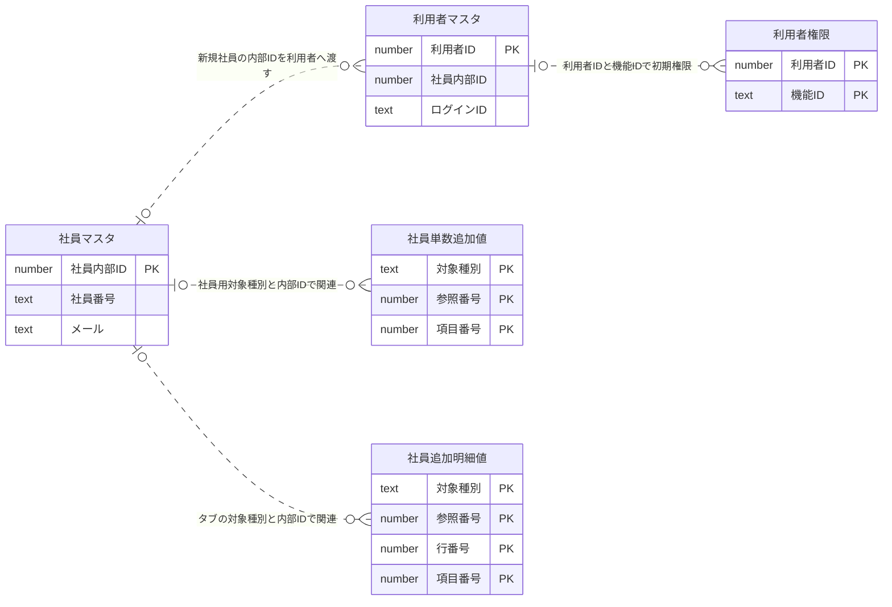

# 共通DB処理仕様 — 社員マスタPilotが利用する処理

## 1. 適用範囲・確認した版

社員マスタの画面→API→業務処理→共通DB処理を再帰して確認した範囲だけを記載する。他機能を今回の改善対象に含めず、ここに記載する共通処理を参照可能な別冊にした。低水準DBライブラリの実装未取得と、稼働DB未照合を区別する。

[社員マスタの外部仕様](../基本設計書/概要仕様書MCT-HrEmployee_社員管理.md)では論理名と本書のCDB-IDを使用する。呼出元、関数の対応、原本行、SQL原本とダンプの差分は[経路・根拠一覧](../../../report/employee-db/画面API_DB追跡.md)を参照する。保存済みダンプからは定義だけを読み、実データ行・認証情報を文書化しない。

| ID | 共通処理 | 利用操作 |
| --- | --- | --- |
| CDB-01 | 共通区分・名称取得 | 初期化、検索、詳細、出力、取込 |
| CDB-02 | 社員検索DB関数 | 検索・CSV出力 |
| CDB-03 | 検索件数・ページ／全件取得 | 検索・CSV出力 |
| CDB-04 | 追加項目のテーブル・列・選択肢定義取得 | 検索、詳細、出力、明細登録 |
| CDB-05 | 単数追加値の取得と不足項目補完 | 検索、詳細、出力 |
| CDB-06 | 複数行追加明細取得 | 詳細 |
| CDB-07 | 単数追加値更新 | 保存 |
| CDB-08 | 複数行追加明細の置換 | 保存 |
| CDB-09 | 一致条件・本人除外の存在確認 | 重複確認、保存 |
| CDB-10 | 共通実行境界・例外・確定／取消 | 各API。取込もこの境界を使用 |
| CDB-11 | 同名参照列の利用確認 | 削除可否 |
| CDB-12 | 一覧CSV作成 | CSV出力 |
| CDB-13 | 社員候補の再利用データ無効化 | 保存・削除 |

## 2. 共通処理の仕様

### CDB-01 共通区分・名称取得

**入力**：区分種別。名称1件の取得では区分コードも渡す。**参照データ**：共通区分マスタ。**出力**：候補値・表示名称の組、又は表示名称1件。

1. 種別が未設定・空白だけの場合、候補取得は空の一覧、名称取得は空文字を返す。
2. 対象種別に一致する行を、表示順番号→コードの順で取得する。候補値はコード、名称は名称欄。数値候補と文字候補の経路があり、部署等の前ゼロ付きコードを数値へ置換しない。
3. 名称取得では、取得した種別内からコード一致の先頭を選ぶ。対応なし・名称なしは空文字。社員自体を検索対象から除外しない。
4. 同じ種別の取得結果は最大5分再利用する。名称一致の検索変換と、一覧の表示名称の取得はこの共通情報に依存する。

**境界・注意**：再利用キーは種別であり、組織や利用者はキーに含まれない。コードは種別＋コードの複合キーである。候補名称の重複、古い再利用値、コード型と比較値の違いは受入試験対象。社員検索の組織制限を、この名称取得処理から推定して追加しない。

### CDB-02 社員検索DB関数

**入力**：全文、性別、在職、社員形態、学歴、部署、役職、職級、作業場所、重複名称モード、並び順の11項目。**基表**：社員マスタのみ。**出力**：対象19列を持つ一時的検索結果と、その全件数。永続的な社員データは更新しない。

全文検索の対象と条件AND／ORはEMP-02の表を正本とする。部署は文字列一致、他区分の入力数値は保存コードの文字列と比較する。氏名は姓＋名、姓＋空白＋名を別候補として部分一致し、カナも同じ構成。日付はYYYY/MM/DDへ整形して部分一致する。検索値の前後空白を除き、英字の大小を区別しない。

通常モードは在職・社員形態・作業場所をAND、重複名称モードはこの3条件だけをORにする。各未指定条件を成立とするため、OR内に未指定が1つあるとまとまり全体が成立する。性別・学歴・部署・役職・職級及び通常全文は外側のAND条件である。

並び順1～16は一覧固定列順の基準項目を表し、正数を昇順、負数を降順とする。氏名は姓、カタカナは姓カナ、区分は名称ではなくコードで比較する。最後に社員番号昇順を加える。値の全順序・NULL順序・文字比較規則はDB設定に依存し、表示名順と混同しない。

**版の不一致**：現行SQL原本は11引数、2025-06-30のダンプは6引数で、性別・学歴・役職・職級・重複名称の入力がない別版。部署も原本は文字、ダンプは整数である。生成済みDB定義書のダンプを、現在の画面APIの動作仕様へそのまま流用してはいけない。どちらが稼働中かは未確認。単独SQLとダンプに共通するのは、社員単表から検索結果を作る構造であり、SQL結合による8種の名称取得は存在しない。

### CDB-03 件数・ページ・全件取得

**入力**：DB検索関数名、その引数、ページ番号、表示件数、並び順。**出力**：全一致件数と、ページ行又は全行。

1. 同じDB接続で検索関数へ引数と必要なら並び順を渡す。ページ番号が0以下なら1へ置換する。
2. 関数の最初の返却値を全件数として取得する。件数が正なら、検索結果に対して表示件数分の取得・ページ開始位置の指定を行う。全件版は件数・位置を指定しない。件数0ならデータ行の取得を省略する。
3. 取得後に一時的検索結果を削除する。正常経路では元社員の永続データを変更しない。例外時の終了はCDB-10へ伝わり、この関数自身に必ず削除するための個別終了処理はない。

**実装根拠を外部結果へ反映した注意**：最終取得には並び順指定がなく、準備時に並べた順番をSQLとして保証できない。ページ欠落・重複・出力順の問題を「検証済み」としない。表示件数は正数検査がなく、0や負数時の扱いも呼出側契約に必要。DB関数に一時結果が既存の場合の再利用処理は確認されない。

### CDB-04 追加項目の定義取得

**入力**：論理テーブルID。社員単数情報は社員用フリー情報ID、明細は設定された各タブID。**参照**：追加項目テーブル定義、項目定義、設定された選択肢参照先。**出力**：タイトル、項目番号、型、長さ、最小／最大値、形式、幅、選択候補。

1. テーブル定義は論理IDで1件取得する。項目定義は同じ論理IDに属するものを項目番号順に取得する。結果は論理IDをキーに最大5分再利用する。
2. 選択肢の参照条件が設定されている場合は、その参照処理を実行して先頭列を値、次列を名称とする。参照先は設定依存であり、ソースだけから固定した表を列挙して完了としない。
3. 選択肢がある場合は選択型、ない場合は入力型として列定義を返す。取得した定義上の長さ・形式が、すべて画面入力検証やDB更新時検証へ適用されるとは限らない。呼出側の検証を別に確認する。

**注意**：未定義のテーブルを安全に空へ変換する統一処理は確認されない。項目番号に欠番がある場合、列のデータ識別と配列位置（1から列数まで）にずれが生じ得る。項目数だけの一致では正しいデータ対応を証明しない。

### CDB-05 単数追加値取得

**入力**：対象種別、社員内部IDの配列、返す列数。**参照**：単数フリー値。**出力**：社員内部ID→固定長の値配列。

1. 社員内部IDが未指定又は0件なら空の対応表を返す。
2. 各社員について対象種別＋社員内部IDを指定し、社員内部ID・項目番号順で取得する。主キー定義は対象種別＋内部ID＋項目番号であり、2項目指定による範囲取得の実現は共通DBライブラリに委譲される。
3. **渡された全社員について必ず配列を作る**。項目番号1～列数に対応する値を入れ、未取得項目は空値とする。取得値0件の社員を対応表から除外しない。
4. 列数外の値は返す配列へ入らない。項目番号の重複は辞書作成でエラーとなり得る。物理キーが現在も有効かはDB未照合。

**例**：列数3、社員501に項目1=A・項目3=Cだけある場合は[A, 空, C]。社員502の保存値0件でも[空, 空, 空]を返す。

### CDB-06 複数行追加明細取得

**入力**：社員用の基本論理ID、社員内部ID。**参照**：追加項目テーブル定義、項目定義、複数行フリー値。

1. 基本IDに「.detail」を付けた文字を含み、物理保存先が複数行フリー値であるテーブル定義を、表示順で取得する。前方一致ではなく含む条件である。
2. 各タブでCDB-04の項目定義を使い、行番号の列を先頭へ追加する。明細値はタブID＋社員内部IDで絞り、行番号・項目番号順で取得する。
3. 行ごとに項目番号と値をまとめる。値が0件なら行番号1の空行を返す。行中で欠けている項目を全部埋める処理はなく、CDB-05の固定長配列とは異なる。

**境界**：設定の重複、項目の重複、値の欠落を黙って「全項目あり」と扱わない。ここでは社員・明細を更新しない。

### CDB-07 単数追加値更新

**入力**：対象種別、値の配列、社員内部ID。**対象**：単数フリー値。

1. 配列の1番目を項目番号1として、対象種別・社員内部ID・項目番号・値の更新用一覧を作る。空要素は空値として渡す。
2. 対象種別＋社員内部IDを条件に、共通の一覧更新へ渡す。この関数内に、単数値の明示的な全削除や新規追加の呼出しはない。
3. 空配列なら空の更新一覧を渡す。既存項目の消去、未登録項目の追加、配列外の古い項目の保持・削除は、未取得の一覧更新ライブラリの契約に依存する。

**未確認を残す理由**：単数値更新を「全置換」又は「不足行も追加」と推定しない。社員新規時の採番値が要求内の社員IDへ反映されるかも、呼出側と低水準の両方で確認する必要がある。

### CDB-08 複数行追加明細の置換

**入力**：送信されたタブ一覧、それぞれのタブ定義・全明細行、社員内部ID。**対象**：複数行フリー値。

1. 送信されたタブごとに、**タブID＋社員内部ID**に一致する既存値を全削除する。社員全体や他タブは削除しない。
2. CDB-04からそのタブの項目定義を取得する。送信行を順に処理し、行番号を1から採番し直す。画面で持っていた行番号を保存キーへそのまま使うわけではない。
3. 各行の各定義項目につき値を作る。送信行に対応項目がなければ空値にする。タブID・社員内部ID・新しい行番号・項目番号をキーとして1件ずつ追加する。
4. タブの送信行が0件なら削除のみ。タブ自体が送られなければそのタブの既存値は触らない。複数タブを含めた取消境界は、呼出元保存のCDB-10を利用する。

**例**：2行×4項目なら8値を追加。定義項目番号が1,3でも、値キーは定義の1,3を使うため、単数更新の連続番号付与とは異なる。

### CDB-09 一致条件・本人除外・競合検査

社員番号の入力終了時は番号一致の取得結果と本人IDを比較する。保存時は番号一致かつ本人ID以外の行の存在を再確認する。画面チェック済みだからといってDB側チェックを省かない。

メール確認は社員のメールと利用者のログインIDを別に検索するが、現在の本人除外は社員側を二重比較する誤りがある。保存時の氏名確認にも社員番号条件再使用の誤りがある。これらを正しい共通ルールへ抽象化せず、該当原本・影響・確認状態を残す。

変更時は詳細取得の更新日時を共通更新へ渡す。画面にない属性を含む社員用の情報構造全体が更新へ渡り、更新列を44入力項目だけに絞る指定は確認されない。非表示の既存属性を保持するか、初期値で上書きするかも低水準ライブラリの確認対象である。更新日時の比較、主キーの利用、更新列選択、0行時の競合、採番返却、監査項目の補完は**AIplus DBライブラリ側の実装未取得**。ソース内のラッパーで確認できた入力条件以上の実効保証をしない。

### CDB-10 共通実行境界・確定／取消

**対象**：社員の各業務APIが使う共通サービス境界。名称が読取向けでも取引開始を行う。

1. 受付情報を持つDB接続を開き、取引を開始する。読取向けはReadUncommitted、保存等はReadCommittedを要求するが、PostgreSQLでは前者も後者相当であり、未確定データを読む保証ではない。
2. 共通前処理→業務処理→共通後処理の順で呼ぶ。**例外が発生しなければ返却コードに関係なく確定する**。業務エラーを返すだけでは取消にならない。
3. 捕捉範囲内で例外が発生した場合は取消を試み、例外を返却形式へ変換する。取消自体の失敗も起こり得る。接続開始・取引開始はこの捕捉の前にある。
4. DB接続は終了時に閉じる。業務処理の各DB命令は同じ接続・セッション経由へ渡される。ただし、低水準ライブラリまで含む実際の参加・取消、採番の返却は実DB未検証。

**外部結果への影響**：DBの取消は、保存した入力ファイル、画面終了、既に返した通知、再利用データの無効化を元に戻す処理ではない。社員取込は読取向け名称の境界を使うが、社員・利用者を更新する。処理名だけから「更新なし」「取引なし」と分類してはいけない。

API共通経路には認証・権限及び通信／処理記録の処理もある。通信ログ保存等は業務データとは別に扱う。呼出されるログ関数の一部には書込が無効化された経路もあるため、メソッド名だけで全ログが保存されると断定しない。認証情報を含む要求・応答の記録範囲は別の運用確認事項。

### CDB-11 同名参照列の利用確認

**入力**：確認する値、参照列名、除外表名。社員削除では社員内部ID、社員参照列名、社員マスタを除く指定。**出力**：削除可能フラグと、利用先のスキーマ・表・説明の一覧。

1. DBの列メタデータから、同じ列名を持つ対象を探索する。システム領域を除き、指定した除外表を除く。外部キー制約の有無を条件にしない。
2. 対象ごとにその列が入力値と一致する行が1件でもあるか調べる。利用があれば対象名と表コメント（なければ論理名なし）を返却一覧へ追加する。
3. 利用先が0なら削除可、1以上なら削除不可。呼出側は返却文字列が空なら可、空でなければ削除可能フラグが真の場合だけ可とする。

**範囲の限界**：異なる列名の汎用的な参照番号は検出しない。閲覧可能なメタデータと権限に依存し、テーブルだけでなく同名列を持つビューも候補になり得る。型不一致・参照権限不足等の個別例外をこのDB関数内で回避する処理はない。通常の関連利用検査を全参照整合性の保証に置き換えない。

このDB関数は保存済みダンプから取得した。社員検索と同じく稼働版の定義照合は未実施であり、作成SQLがないことを「関数なし」とはしない。

### CDB-12 一覧CSVの作成

**入力**：固定列の名称・項目対応、固定値の一覧、追加列名、行ごとの追加値。**出力**：CSVバイト列。

データ又は固定列の対応が空なら空バイト列。値は固定列→追加列の順でカンマ連結して改行する。追加列がある場合は同じ行番号の追加配列を使うため、行順・件数の一致が前提となる。

**ファイル名**：サービスは拡張子付きの完全名と、拡張子のない名称を別々に返す。データ返却コントローラは後者をダウンロード名に渡すため、最終ダウンロード名への.csv付加は実動作で未確認。

**現在の不足**：社員出力が呼ぶ関数は、文字列中のカンマ・引用符・改行をエスケープしない。同じファイルに別のCSV関数があっても、そちらの仕様を流用しない。UTF-8ライターと明示的な先頭識別文字の組合せなので、先頭識別印の重複有無は実出力バイトで確認が必要。これらを「標準CSVへ正しく変換済み」と保証しない。

### CDB-13 社員候補の再利用データ無効化

保存・削除の正常経路で、社員候補の再利用データ全体を無効化する。特定の社員1件だけを無効化する処理ではない。これ自体は社員DBを更新せず、以後の利用機能が再取得するための操作である。現在の取込処理はこの無効化を明示的に行わない。

## 3. 登録・詳細取得の論理ER

点線は処理上の関連で、外部キーの強制ではない。利用者の社員参照に一意制約は確認されていないため、1社員1利用者と断定しない。単数・複数の汎用値の参照番号も、物理外部キーが確認できたという意味ではない。

## 4. データ名・キーの照合表

物理名は根拠照合のためだけに併記する。図の日本語論理名は、DBコメントだけでは区別しにくい汎用マスタを、使用目的で補っている。

| 論理名 | 物理名 | 保存済み定義の主キー | 社員Pilotでの用途 |
| --- | --- | --- | --- |
| 社員マスタ | hrm_emp | emp_seq | 検索基表・登録・詳細・削除 |
| 共通区分・名称 | cmm_masterdata | table_id＋key_cd | 名称補完・条件名称変換・メニュー定義 |
| 追加項目テーブル定義 | cms_table | table_id | 社員用・複数タブの定義 |
| 追加項目の項目定義 | cms_field | table_id＋seq_no | 列数・表示名・型・候補参照 |
| 単数フリー値 | cmt_free | table_nm＋seq＋item_no | 社員用対象種別・内部ID・項目番号 |
| 複数行フリー値 | cmt_free2 | table_nm＋seq＋row_no＋item_no | タブ種別・内部ID・行・項目 |
| 利用者マスタ | cmm_user | user_seq | 新規作成・初期化・取込停止 |
| 利用者権限 | cmm_user_right | user_seq＋func_id | 初期の社員向け権限 |

今回抽出した上記8表の保存済み定義には外部キー制約は見つかっていない。検索基表の社員番号・利用者の社員参照を一意とする制約も未確認。稼働DBの追加制約やデプロイ後変更の不存在を主張するものではない。

## 5. 追加の実行・承認が必要な点

最優先は、検索DB関数の稼働版、ページ順、氏名・メール重複判定、新規採番値と追加値・権限の関連、一覧更新の不足行処理、取込の行範囲と固定補正、CSVの区切り文字処理である。原本アプリは変更していない。静的な処理仕様の抽出と、それが業務的に正しいとの承認は分ける。

## 6. 外部一次資料

PostgreSQL公式の[ページ範囲と並び順](https://www.postgresql.org/docs/current/queries-limit.html)を、並び順未指定の取得を保証しない根拠として参照した。[取引の分離レベル](https://www.postgresql.org/docs/current/transaction-iso.html)ではRead UncommittedとRead Committedの実際の関係を確認した。[MermaidのER図](https://mermaid.js.org/syntax/entityRelationshipDiagram.html)に従い、関連の基数と非識別関連を示す。確認日：2026-10-05。これらは一般的な方式の根拠であり、社員マスタの業務要件の出典ではない。
