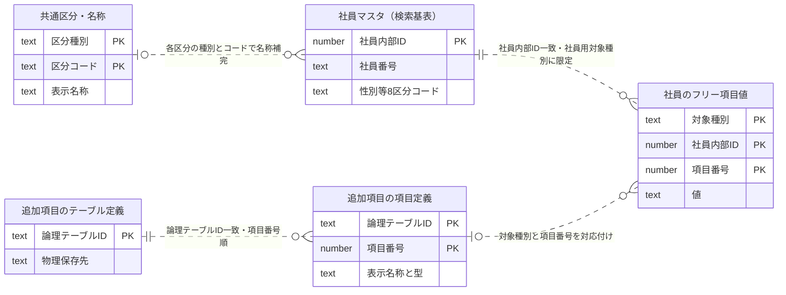
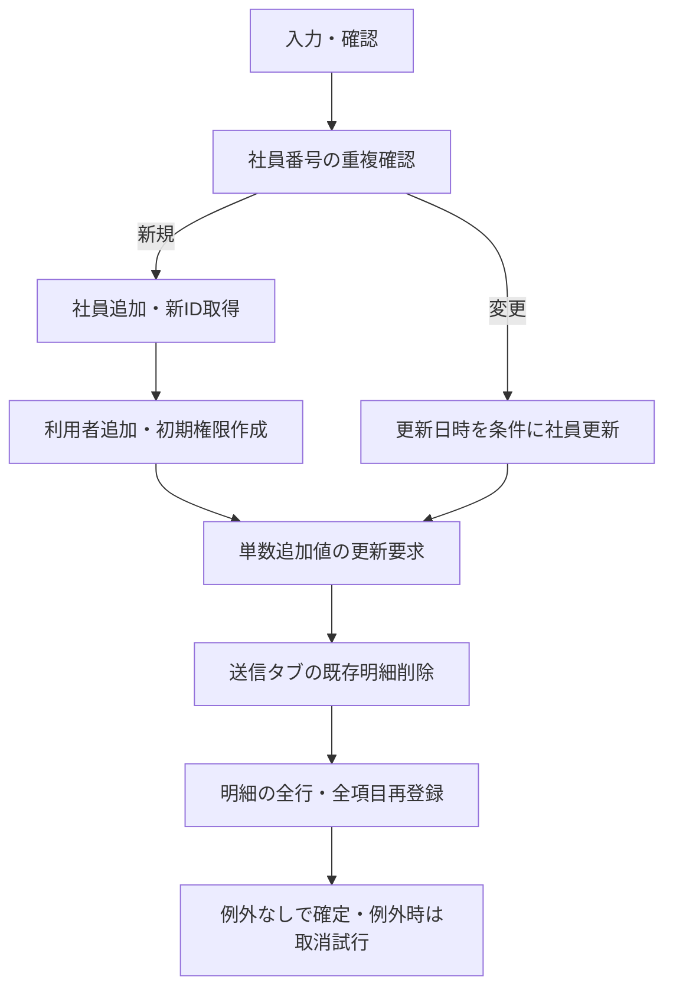

## 3. イベント仕様

各操作を、画面入力→サービス受付→共通DB処理→対象データ→画面・ファイル出力の順で示します。DB処理は利用者から見える抽出・反映条件として記述し、実装上の識別子と原本行は検証資料へ分離します。共通DB処理の詳細は[共通DB処理仕様（社員マスタPilot）](../共通/共通DB処理仕様_社員マスタPilot.md)を参照してください。

**仕様の読み分け**：現行ソースから確認できた動作と、不整合・未確認部分を分けています。「一括登録を依頼する」と「すべて正しく確定することを実DBで確認した」は異なります。本章で承認済み画面レイアウト・固定項目表は変更していません。

### EMP-01 一覧を開く

| 契機・入力 | サービスから受け取る情報 | DB処理・出力 |
| --- | --- | --- |
| 社員マスタを開く。認証済み利用者の情報を付ける | 在職区分・部署・社員形態・作業場所の選択候補 | 共通区分を4分類で参照後、初期条件による社員検索を行う |

1. 認証・利用権限の受付を通過した後、**CDB-01 共通区分参照**で在職区分、部署、社員形態、作業場所の候補を取得する。候補は表示順、コード順で並ぶ。部署コードは前ゼロを保持する文字として扱う。
2. 検索条件は未指定、在職区分は在職、ページは1、表示件数は25としてEMP-02を実行する。初期化の候補取得と、社員一覧の取得は別の要求である。
3. 一覧・総件数を表示し、行未選択では編集を使用不可とする。共通区分が設定されていない場合に架空の候補を作らない。

**取消・異常時**：権限拒否は社員検索を実行しない。候補取得失敗を「社員0件」と読み替えない。共通区分は最大5分の再利用があるため、区分変更直後の表示はDBの即時状態と異なる場合がある。

**データ例**：初回の「在職」は、退職者を含む全社員の意味ではない。該当社員0件なら検索結果は空で、DBの社員情報は変更しない。

### EMP-02 社員を検索する

| 入力 | 入力の意味 | 出力 |
| --- | --- | --- |
| 全文検索、部署、社員形態、作業場所、在職区分 | 未指定条件は原則として絞込みに使用しない | 総件数・総ページ数・現在ページの社員一覧 |
| ページ番号、表示件数、並び順 | 対象範囲と表示順 | 固定16列、設定された追加列、社員ごとの追加値 |
| 全文検索に一致した区分名称 | 性別・在職・社員形態・学歴・部署・役職・職級・作業場所の8分類を照合 | 一致した区分条件への切替。切替時は通常の全文条件を外す |

1. **CDB-01**で8分類の名称候補を取得し、全文入力と名称が**完全一致**する候補を各分類の先頭から探す。区分名称照合では前後空白を除く処理は確認されない。1分類以上で一致すると該当分類の検索条件を置き換え、全文条件は解除する。明示選択された同分類の条件も置換対象である。
2. 1分類だけ一致、又は一致なしの場合は通常モードとする。2分類以上で一致すると重複名称モードとする。これは「すべての条件をORにする」という意味ではない。下表の条件の組合せで対象社員を決める。
3. **CDB-02 社員検索**が社員マスタから一致する社員を抽出する。抽出列は社員内部ID、社員番号、姓・名、姓カナ・名カナ、ローマ字、性別、生年月日、在職区分、入社日、社員形態、学歴、卒業大学、住所、部署、役職、職級、作業場所区分の19項目。画面の固定16列は、姓名等を連結して作る。
4. **CDB-03 ページ取得**が全一致件数を受け取り、表示件数×（ページ番号－1）件を除いた位置から表示件数分を取得する。0以下のページ番号は1へ補正する。表示件数の正数性はこの共通処理では検査されない。現在ページだけでなく、総件数から総ページ数を計算する。
5. **CDB-04 追加項目定義取得**で社員用の列定義を読み、**CDB-05 追加値取得**へ現在ページの社員内部IDだけを渡す。対象社員と項目番号を対応付け、値がない項目も空のまま所定の位置を保持する。追加値がない社員を一覧から除外しない。
6. 固定列の区分コードを**CDB-01**で名称へ置き換える。該当名称がなければ空欄とする。姓と名、姓カナと名カナは空白で連結する。生年月日・入社日は表示用の日付に整形し、追加列・追加値とともに返す。
7. 検索ボタンの場合は受け取った追加列定義も更新する。全文入力・在職区分変更の場合に列定義更新を同じように行うとは確認されない。画面側でページ補正が生じた場合の再取得との整合性は確認対象に残す。

#### 検索条件の組合せ

| 条件 | DBでの判定 |
| --- | --- |
| 全文未指定又は空文字 | 通常の部分一致は行わない。空白だけの入力は区分照合ではそのまま、DBの部分一致では前後空白を除くため、空文字と同一の前処理ではない |
| 全文指定 | 社員番号・ローマ字・生年月日・入社日・卒業大学・住所・姓名・カナ姓名のいずれかに部分一致。年月日はYYYY/MM/DD、姓名・カナ姓名は空白あり／なしの両方。大文字・小文字を区別しない。電話・メール・個人紹介・備考・追加項目は全文対象外 |
| 性別・学歴・部署・役職・職級 | 指定した条件すべてに一致。未指定の条件は成立扱い |
| 在職・社員形態・作業場所：通常モード | 3条件をANDで判定。各未指定条件は成立扱い |
| 在職・社員形態・作業場所：重複名称モード | 3条件をORで判定するが、**未指定の条件も成立扱いのまま**。1条件でも未指定なら、この3条件のまとまりは常に成立する。性別等の他条件はANDのまま |
| ワイルドカード | 全文入力中の`%`と`_`を文字そのものとして扱うためのエスケープは確認されない。通常文字列より広く一致する可能性がある |

**データ例**：重複名称モードで在職が「在職」、社員形態が未指定、作業場所が未指定なら、この3条件のORは成立する。退職者も、性別・学歴・部署等の残りのAND条件を満たせば対象になり得る。これは通常モードとは異なる現行条件で、業務上望ましい動作と断定しない。

#### 検索用ER図・データの対応

**検索DB関数の基表は社員マスタ1表で、区分名称や追加項目とのSQL結合はありません。** 以下は「検索結果を完成させるための論理ER図」です。点線は後段でのキー対応・名称補完を表し、物理的な外部キーや一括結合を表しません。`0..1`は対応なしを許す名称参照、`0..n`は任意個数の追加値を示します。PKは保存済み定義で確認したキーであり、稼働DBの現状とは未照合です。

| 対応元 → 対応先 | 対応条件・対象範囲 | 件数・未一致時 | 実施段階 |
| --- | --- | --- | --- |
| 社員の各区分 → 共通区分名称 | 各項目に対応する区分種別＋社員の区分コード | 各分類で0又は1名称。未定義なら空欄、社員行は残す | 検索後の名称補完 |
| 社員 → フリー項目値 | 社員内部ID＋社員用追加情報の対象種別 | 0件以上。未入力は空要素として保持 | 現在ページ取得後 |
| 追加項目テーブル定義 → 項目定義 | 論理テーブルID一致 | 項目番号順。設定がなければ列数を創作しない | 列定義取得 |
| 項目定義 → フリー項目値 | 論理テーブルID＝値の対象種別、項目番号一致 | 列数に合わせた値配列。項目番号欠番と配列位置の一致は確認が必要 | 値の位置合わせ |
| 設定された選択肢 → フリー項目 | 項目定義の参照条件 | 先頭列を候補値、次列を名称にする。参照先は実際の設定依存 | 共通項目定義取得 |

区分対応は、性別→性別、在職区分→在職、社員形態→社員形態、学歴→学歴、部署→部署、役職→役職、職級→職級、作業場所→作業場所の8種類です。同名コードでも区分種別が違えば別の名称として扱います。

#### 並び順とページ境界

| 並び順の指定 | 基準となるデータ |
| --- | --- |
| 社員番号、ローマ字、日付、卒業大学、住所 | 対応する保存値 |
| 氏名／カタカナ | 連結した表示名全体ではなく、姓／姓カナ |
| 性別、在職区分、社員形態、学歴、部署、役職、職級、作業場所 | 表示名称ではなく保存された区分コード |
| 同順位・初期順 | 最後に社員番号の昇順を付ける。社員番号自体の重複を物理制約で防いでいるとは未確認 |

**取消・異常時／確度**：DB関数は並び順を指定して結果を準備する一方、共通ページ取得では取得時の並び順を再指定していません。そのためページ間の安定した順番は、現行のままで保証できません。SQL原本は11引数、ダンプは6引数の別版であり、今回の検索条件は画面・APIと整合するSQL原本に基づきます。稼働版の確認は未実施です（CDB-02、CDB-03）。

### EMP-03 検索条件をクリアする

1. 全文、部署、社員形態、作業場所を未指定へ戻し、在職区分は在職へ戻す。ページは1、並び順は初期状態とし、表示件数の選択は保持する。
2. 画面の一覧と総件数を空・0にする。この操作自体はAPIへ検索要求を送らず、DBの社員・区分・追加値を読み直しも更新もしない。
3. 次の検索操作でEMP-02を実行する。表示中の一覧を消すことと、社員データを削除することを区別する。

**取消・異常時**：確定済みデータに変更なし。**データ例**：50件表示を選んでいる場合、50件表示の設定を保ったまま一覧0件となる。

### EMP-04 ページ・並び順を変更する

1. 現在の検索条件を保持し、ページ・件数・並び順だけを変更してEMP-02と同じ検索APIへ渡す。
2. CDB-02で条件一致全件と件数を求め、CDB-03で現在ページを取り出す。追加値の取得対象社員も新しいページの社員へ変更する。
3. 返却件数と総ページ数を更新し、一覧のスクロール位置を先頭へ戻す。画面のページ補正と返却行の一致、同順位を含む安定順は受入試験で確認する。

**取消・異常時**：並び替えはDBの社員情報の書換えではない。**データ例**：第2ページ・25件表示では先頭25件を除いた位置から最大25件を取得する。総件数51件なら総ページ数は3となる。

### EMP-05 新規・変更・閲覧を開く

1. 対象社員の内部IDと操作区分を詳細取得APIへ渡す。新規の場合は社員マスタの既存行を取得しない。変更・閲覧の場合は**主キーで1件**を読み、基本・その他44入力項目、監査情報、読み込み時点の更新日時を返す。
2. CDB-01で性別・在職・社員形態・学歴・部署・職務・役職・職級・作業場所の9分類を取得する。一覧の8分類に職務が加わる。
3. CDB-04、CDB-05で単数のフリー項目を取得し、CDB-06で社員用追加明細の各タブ・列・行を取得する。対象タブは社員用の追加明細種別を含み、保存先が複数行用である定義から表示順に選ぶ。
4. 明細は行番号・項目番号順で組み立てる。保存済みの行が0件でも、共通処理は行番号1だけを持つ空行を1件返す。これを保存済み明細1件と誤認しない。
5. 基本タブを表示し、社員の更新日時を変更時の競合検査用として保持する。新規・変更・閲覧の画面状態は承認済みレイアウトの定義に従う。

**取消・異常時**：対象社員が削除済みの場合の利用者通知は明示されておらず、正常な新規画面として扱わない。設定未取得を「追加情報なし」と断定しない。

**データ例**：社員内部ID501の変更では社員501の基本、単数追加値、複数行追加値を取得する。社員番号の一致で別社員を読み込む処理ではない。

### EMP-06 社員番号・メールの重複を確認する

1. 社員番号チェックは社員マスタを社員番号一致で検索し、取得行なし又は取得行が本人なら重複なし、別社員なら重複ありを返す（CDB-09）。
2. メールチェックは社員マスタのメールと利用者マスタのログインIDをそれぞれ一致検索する。双方とも該当しなければ重複なしとする。
3. 現行の本人除外判定は、取得した社員側の内部IDを2回比較しており、利用者側の社員内部IDは本人除外の判定に用いていない。社員側が本人なら、利用者側が別人でも重複なしになり得る。これは要是正事項であり、正しい重複仕様として承認したものではない。
4. この段階ではDBを更新しない。保存APIの再チェックは社員番号が対象であり、メールの同等チェックが必ず実施されるとは記載しない。

**取消・異常時**：検索が複数件に一致した場合の先頭行決定規則と、DBライブラリの1件取得動作は未取得。取得失敗を重複なしに読み替えない。

**データ例**：本人501の番号を変更せず確認すれば重複なし。別社員502の番号なら重複あり。メールの本人除外は、正常例だけでなく利用者側の不一致を試験する必要がある。

### EMP-07 住所を検索する

1. 郵便番号からハイフンを除いた値を外部住所照会へ送る。入力済み住所がある場合は先に上書き確認を行う。
2. 候補の先頭から都道府県・市区町村・町域を住所欄へ補完する。対象なしの場合は対象なしの文言を住所欄へ設定するため、その文言を住所として保存しないよう確認する。
3. この照会は社員管理APIや社員DB関数を経由しない。住所欄の変更を確定するのはEMP-09であり、住所照会だけで社員マスタを更新しない。

**取消・異常時**：確認取消は既存住所を維持する。外部通信障害時の利用者通知は未確認。

**データ例**：123-4567を1234567として照会し、結果を画面で補完した後、社員登録を取り消せば社員DBの住所は更新されない。

### EMP-08 タブ・在職区分を変更する

1. タブを切り替えても詳細取得APIを再度呼ぶ操作ではない。取得済みの基本・給与表示例・追加設定・その他を切り替える。
2. 退職の選択は退職日を表示する。非表示へ戻したときに保存値を自動消去する処理は確認されない。選択変更だけで利用者を停止する処理もない。
3. DBへの反映はEMP-09又はEMP-14の確定経路による。通常の変更とCSV取込では利用者停止の動作が異なる。

**取消・異常時**：追加タブの保存先・項目数は実際の設定に従う。**データ例**：画面で退職を選んだだけでは利用者のログインを停止しない。

### EMP-09 社員情報を登録する

| 入力グループ | 保存対象 | 対象の特定・主な値の由来 |
| --- | --- | --- |
| 基本・その他44入力項目 | 社員マスタ | 新規は入力社員番号、変更は社員内部ID。卒業年月は年月6桁へ正規化。日付変換を行う |
| 新規の社員・認証用入力 | 利用者マスタ | ログインID＝メール、表示名・略称＝姓＋空白＋名、社員参照＝新規社員の内部ID、初期ロール＝社員、停止＝解除 |
| 社員向けメニュー定義 | 利用者権限 | メニュー定義の機能IDごとに、参照・更新・作成削除を許可、禁止を解除する値を作成 |
| 単数追加値 | フリー項目値 | 社員用対象種別＋社員内部ID＋項目番号。入力配列の1番目から番号を付ける（CDB-07） |
| 複数行追加値 | フリー明細値 | 対象タブの種別＋社員内部ID＋行番号＋項目番号。対象タブ単位の全置換（CDB-08） |

1. 画面の基本・その他の入力検証が成立した後、登録確認に了承した場合だけ保存APIへ送る。本文入力、追加項目配列、追加明細、読み込み時点の更新日時を区別して渡す。
2. DB側は**同じ社員番号で、本人とは異なる社員内部IDを持つ行の存在**を確認する。存在すれば業務エラーを返し、この後の社員・利用者・追加値の更新には進まない。氏名重複用の条件も作成しているが、実際には社員番号条件を再使用するため、氏名重複チェックは成立していない。
3. **新規**は社員を追加し、社員番号で新しい社員内部IDを取得する。次に利用者を追加し、社員向けメニュー定義から初期権限を作成して登録する。この順序を省略しない。利用者の採番値が登録後の保持情報へ設定される動作は未取得のDBライブラリに依存し、権限への正しい関連付けは実行未確認である。
4. **変更**は社員マスタの更新処理に、詳細表示時に取得した更新日時を競合検査条件として渡す。競合判定の比較精度、0行更新の扱い、採番・監査値の自動補完は未取得ライブラリ内部にある。変更経路では利用者メール・氏名・初期権限を同期更新する呼出しはない。画面にない社員属性を含めた更新対象列の選択は未取得ライブラリに依存し、44入力項目以外の既存値が必ず保持されるとは保証しない。
5. 社員更新後、**CDB-07**で単数追加値を更新し、**CDB-08**で送信された各追加タブの既存明細を削除して全行を再登録する。新規社員を取り直した内部IDではなく、要求中の社員内部IDが追加値の処理へ渡る。登録時の採番値の反映を未確認のまま「新規追加情報も正しく関連付く」とは保証しない。
6. 社員候補の再利用データを無効化し、**CDB-10 一括処理境界**を終了する。例外がなければ確定し、例外時は取消を試みる。業務エラーという返却値だけでは自動取消しない。社員番号重複時は更新前に返るため業務データ変更はないが、この規則をすべての業務エラーへ一般化しない。
7. 画面は戻り値の成功判定より先に画面を閉じ、一覧再取得を通知する。成功コードの場合だけ完了通知する。したがって、業務エラー返却時にも画面が閉じる可能性を確認事項に残す。通信自体が例外となる経路とは区別する。

**取消・異常時**：利用者側で登録確認を取り消す場合はAPIを実行しない。DB処理中の例外は一括取消を試みるが、接続開始・取引開始が例外捕捉の外側にある。低水準DBライブラリ、採番値の返却、実トランザクションへの参加は実行未検証である。ファイル・表示状態・再利用データの無効化はDB行の取消と同じではない。

**データ例**：新規社員501に追加項目3個、ある追加タブに2行×4項目を登録する場合、社員1件→利用者1件→初期権限複数件→単数値3個の更新要求→そのタブの旧値全削除→明細値8個登録という関係となる。単数追加値に存在しない行を新規作成するかはCDB-07の未確認事項として扱う。

### EMP-10 キャンセル・閉じる

1. 新規・変更のキャンセルは破棄確認後に登録せず閉じる。確認取消なら入力を保持する。閲覧の閉じる・右上の閉じるは別経路であり、同じ破棄確認があるとは扱わない。
2. キャンセル自体は社員DBを更新しない。社員登録前の画面値は破棄できるが、別APIで先に完了したパスワード初期化を取り消さない。

**取消・異常時**：閉じる前の別APIの成功・失敗を曖昧にしない。**データ例**：パスワード初期化の完了後に編集キャンセルをしても、初期化は巻き戻らない。

### EMP-11 社員情報を削除する

1. 変更画面で削除確認に了承した場合、社員内部IDを削除APIへ渡す。社員マスタの主キー検索で対象が存在しなければ、既削除の競合として処理を終了する。
2. **CDB-11 関連利用確認**へ社員内部ID、社員参照項目名、社員マスタを除外する指定を渡す。共通DB関数はシステム領域を除き、同じ列名を持つ対象をメタデータから探し、その社員内部IDが1件でも使われているか確認する。これは「DB外部キーの定義一覧だけを見る」処理ではない。
3. 利用先が1つでもあれば削除不可として業務エラーを返す。利用先に関連利用者が含まれれば、その存在も削除を拒否する候補になる。利用先の表名・説明は共通関数の結果に含まれるが、画面への返却は固定の拒否メッセージである。
4. 利用なしの場合だけ社員マスタを主キーで**物理削除**し、社員候補の再利用データを無効化する。利用者・権限・フリー値・明細を同時に削除する呼出しはない。CDB-10の終了後に画面終了・一覧再取得へ進む。

**取消・異常時**：関連確認は列名が異なる一般化キーのフリー値（社員IDを「参照番号」などで保存する値）を検出しない。外部キーのない孤立データを防ぐ保証ではない。空の確認結果文字列を削除可とする呼出側の扱い、対象DB関数の稼働版も確認が必要。別の更新日時との一致検査は明示されていない。

**データ例**：社員501を参照する利用者が見つかれば削除拒否候補となる。一方、社員501のフリー値だけが残っていても、列名が社員参照列と異なるため、この共通チェックの対象にならない。

### EMP-12 パスワードを初期化する

1. 変更画面で確認に了承した場合、社員内部IDと画面で作成した新しい認証用値を初期化APIへ渡す。社員基本情報の登録要求とは別である。
2. 利用者マスタを社員内部ID一致で取得し、新しい認証用値を設定する。更新条件も社員内部ID一致である。共通更新の実装は1件だけでなく条件一致行を扱うため、同じ社員に複数利用者が存在する場合の上書き範囲は未確認とする。
3. CDB-10で確定後、成功の場合のみ画面へ完了を返す。社員マスタ・フリー値・権限を更新する呼出しはない。

**取消・異常時**：対象利用者なしの場合は値設定時の例外となり得る。更新列を認証値だけに限定する指定は明示されず、取得した利用者情報を更新へ渡す点も受入確認が必要。認証値の実値を仕様書や検証例へ掲載しない。

**データ例**：社員501に関連する利用者の認証情報だけを変更する目的の操作であり、社員情報を後からキャンセルしても確定済み初期化は取り消さない。

### EMP-13 社員一覧をCSV出力する

1. 一覧0件なら対象なし通知で終了する。出力確認に了承した場合、検索条件・並び順をダウンロードAPIへ渡す。
2. EMP-02と同じ8分類の名称照合、通常／重複名称モードの切替、CDB-02の抽出を行う。CDB-03の**全件取得**を使い、ページ番号・表示件数で対象を減らさない。
3. 固定16列を表示名称・連結氏名・日付に変換する。全対象社員の単数追加値をCDB-04、CDB-05で取得し、追加項目が選択型なら値に一致する候補名称へ変換する。候補なしの場合は元の値を出す。複数行追加明細はこの一覧CSVに出力しない。
4. 固定16列の後に項目番号順の追加列を付け、**社員一覧のCSV、text/csv、UTF-8（先頭識別印付き）**として返す。サービス上の完全名は「社員一覧.csv」だが、返却経路は拡張子なしの名称を使うため、実際の保存名への拡張子付加はCDB-12の確認事項とする。CDB-12はカンマで値を連結するが、値中のカンマ・引用符・改行のエスケープは行わない。先頭識別印の重複有無は実バイトで未確認。社員・利用者・追加値の業務更新は行わない。

**取消・異常時**：確認取消では取得・ファイル生成を開始しない。全件取得にも取得時の並び順再指定はなく、出力順の保証にはCDB-03と同じ不足がある。行と追加配列の件数・順序の不一致は許容しない。

**データ例**：検索一致100件、画面25件表示の場合、固定16列＋設定数の列で100件を出力する。出力CSVはEMP-14の取込CSVと同じ形式ではない。

### EMP-14 社員データをアップロードする

1. 確認後にCSVをアップロードAPIへ送る。サーバーは先頭ファイルを保存してShift-JISで読み、空行を除き、見出しから対象列の位置を取得する。現在の読取は引用符内のカンマ・改行を正しく処理するCSVパーサではない。入力ファイルを保存する副作用はDB取消の対象外である。
2. 社員番号を5桁へ前ゼロ補完し、その番号で社員マスタを検索する。退職区分が「対象外」なら在職、それ以外なら退職、社員形態は名称から区分値へ変換する。
3. **新規行**では社員を追加し、利用者と権限の更新要求を行う。基本の登録とは項目範囲・権限の作り方が異なる。氏名・カナ・性別・メール・入社日・社員形態・部署・役職・金融機関コード等を対象とし、ローマ字は空。電話・郵便番号・住所・生年月日の社員への代入はコメント化又は欠落している。生年月日は認証用値の作成には使われるが、社員欄へ保存される保証はない。
4. **既存行**では氏名・カナ・性別・メール・在職・入社日・社員形態・部署・役職・金融機関コード等を更新する。通常変更のような読み込み日時による競合条件は渡さない。退職へ変更する場合、関連利用者が存在して未停止なら停止する。在職に戻したときの自動再開はない。
5. 既存行の処理内には、**ファイルで指定した社員に限定しない、固定された複数社員の氏名と関連利用者名を補正するDB処理**がある。対象の実名・値は掲載しないが、この副作用を「取込対象だけの更新」と隠さない。
6. 全体はCDB-10の読取向け名称の共通境界を使用するが、実際には更新を行い、例外なしで確定する。1行ごとの独立確定ではない。社員候補の再利用データを明示無効化する処理、一覧の自動再検索は確認されない。

**取消・異常時／本番適用保留**：見出しも含む全行を社員番号位置で並べ替え、末尾1行を除いて処理するため、見出しを除外してデータ全行を処理できる保証がない。採番値の返却、権限のリスト更新、引用符や不足列・不正日付、途中例外での一括取消は実DB未検証。正常な入力仕様へ置き換えて記述しない。

**データ例**：入力番号1は00001に補完する。退職既存社員の利用者停止を行う一方、再入社・在職へ戻す取込で停止解除まで行われるとは限らない。

### EMP-15 追加設定の明細を編集する

1. 新規ボタンは画面内の明細に空行を末尾追加する。選択行削除は画面内だけで行い、選択なしなら行選択を求める。この段階でDBの明細を削除・追加しない。
2. 最終登録時にCDB-08へタブ定義と全行を送る。送ったタブはDB内の該当社員・該当種別の既存値を全削除し、送信順に行番号を1から振り直す。各行について設定されている全項目を再登録し、値が送られなかったセルは空値とする。
3. 送られていないタブを一律削除する処理はない。送信されたタブの行が0件なら既存値の削除だけになる。画面上の行番号が保存時にもそのまま使われるとは扱わない。

**取消・異常時**：閲覧では明細編集不可。タブ内CSVの取込・出力は製造中の案内のみ。**データ例**：画面で行番号1、4を残して登録すると、送信順の2行として保存行番号1、2に再構成する。

### 3.16 画面からDBまでの操作別対応

| 画面操作 | APIの業務目的 | 共通DB処理 | 対象データ・作用 |
| --- | --- | --- | --- |
| EMP-01 | 初期候補取得→検索 | CDB-01、02、03、04、05、10 | 共通区分、社員、追加定義・単数値の参照 |
| EMP-02、04 | 社員検索 | CDB-01、02、03、04、05、10 | 条件抽出・ページ取得・名称／追加値補完 |
| EMP-05 | 詳細取得 | CDB-01、04、05、06、10 | 主キーの社員、9区分、単数値・複数明細 |
| EMP-06 | 社員番号／メール確認 | CDB-09、10 | 社員・利用者を参照、更新なし |
| EMP-09 | 社員登録 | CDB-07、08、09、10、13 | 社員→利用者→権限→単数値→明細の反映 |
| EMP-11 | 削除可否と削除 | CDB-11、10、13 | 同名参照列の利用チェック後、社員を物理削除 |
| EMP-12 | 認証初期化 | CDB-10 | 利用者の認証値更新、社員基本は変更しない |
| EMP-13 | CSV出力 | CDB-01、02、03、04、05、10、12 | 全件参照・名称変換・ファイル出力 |
| EMP-14 | CSV取込 | CDB-01、10 | 社員・利用者・権限の反映、固定補正、入力ファイル保存 |
| EMP-03、07、08、10、15 | 画面内又は外部住所照会 | 社員DBの直接呼出しなし | 最終登録等とは別の処理。無関係なDB経路を付けない |
