<!-- spec-meta: {"schema":"spec-md/1.0","documentId":"CSHARP_ASPNET-BAS-STU-04","version":"1.2","path":"基本設計書/04_コード設計書.md","sheets":[{"heading":"概要","kind":"GRID","sheet":"概要"},{"heading":"項目一覧","kind":"LIST","sheet":"初期コード一覧","key":["分類","値"]},{"heading":"イベント仕様","kind":"GRID","sheet":"イベント仕様"},{"heading":"補足説明","kind":"GRID","sheet":"補足説明"}]} -->
# コード設計書（選択値・初期投入・保守契約）
文書ID：CSHARP_ASPNET-BAS-STU-04　版：1.2　種別：code-design　配置：基本設計書/04_コード設計書.md

## 概要

本書は、学生とクラスが使用する選択値について、分類、保存するコード値、表示名称、初期投入、候補利用、通常保守の契約を定義する。コード管理マスタは分類と値の組を識別単位とし、画面は名称を表示してコード文字列を送信する。初期投入SQLには、性別、在籍区分、都道府県、緊急連絡先続柄、学年の5分類・70値が定義されている。学籍番号とクラスコードは個別の識別子、元号は日付処理の固定定義として扱う。〔実装根拠：sources/database/002_seed.sql:8-84、sources/Core/StudentNormalizer.cs:59-64、sources/Core/JapaneseDateService.cs:9-16〕

参考設計は5分類・70値を初期値の正本とし、先頭ゼロを含む文字列を保存・比較する意図を示す。外部規格への適合認証を示す体系ではない。本書の初期一覧は投入材料であり、稼働DBの現在値を表すものではない。〔設計意図の根拠：reference-designs/基本設計書/04_コード設計書.md:13-15〕

### 分類と使用先

| 分類ID | 論理名・使用先 | 固定桁 | 初期件数 | 通常追加 | 保護対象 | 新規学生の初期値 |
| --- | --- | --- | --- | --- | --- | --- |
| GENDER | 性別。学生の選択値として保存する | 1桁 | 4 | 不可 | `0` | `0`：未回答 |
| ENROLLMENT_STATUS | 在籍区分。終了日、所属、定員消費、訂正権限の判定に使用する | 2桁 | 4 | 不可 | 全4値 | `01`：在学 |
| PREFECTURE | 都道府県。住所の選択値として保存し、住所表示へ名称を使用する | 2桁 | 47 | 不可 | 全47値 | 空文字：未選択 |
| RELATIONSHIP | 緊急連絡先続柄。緊急氏名・電話と一式で保存する | 2桁 | 8 | 可 | なし | NULL。画面は未選択 |
| GRADE | 学年。クラスに保存し、学生画面では所属選択を補助する | 2桁 | 7 | 可 | `00` | 学年補助値はNULL |

固定桁と追加可否はseedの分類設定である。学生の初期値は`StudentDraft`、`StudentSaveInput`、新規フォーム生成から得られる。新規年度補助は日本業務日の当年度となる。参考設計が定めるクラス作成時の学年`00`は、現行`ClassChange`の引数を補完する実装ではない。〔実装根拠：sources/database/002_seed.sql:9-13、sources/Core/Contracts.cs:15-29、sources/Web/Inputs/StudentSaveInput.cs:13-29、44-54、sources/Infrastructure/WebPresentation.cs:5-6、sources/Core/MasterMaintenanceService.cs:9-9、32-37。設計意図の根拠：reference-designs/基本設計書/04_コード設計書.md:94-100〕

### 実コード、未選択、NULL

性別の`0`は「未回答」という有効な実コードであり、空文字やNULLとは異なる。性別をNULLまたは空でサービスへ渡すと、必須コードの検査で拒否する。学年の`00`も「学年なし」という実コードで、クラスに設定する値である。学生の未所属は`class_id`のNULL、学年条件の未指定は正規化後のNULLであり、`00`への自動置換は行わない。〔実装根拠：sources/database/002_seed.sql:15-18、78-84、sources/database/001_schema.sql:16-16、28-31、65-66、sources/Core/StudentNormalizer.cs:113-117、128-140〕

画面の「すべて」「未選択」「未所属」は、マスタに存在する空文字コードではない。任意コードのNULL、空文字、上限内の空白だけの値は、正規化でNULLになる。ただし原入力の上限検査はTrimより前なので、上限を超える空白は拒否する。在籍検索の空配列は全区分を意味するが、NULL配列に同じ契約はない。〔実装根拠：sources/Views/Students/Search.cshtml:5-5、sources/Views/Students/Edit.cshtml:9-13、sources/Core/StudentNormalizer.cs:47-57、113-117、sources/Core/SqlServerStudentService.cs:111-112、151-153〕

### 管理属性、業務上限、DB容量

| 属性 | 業務上の意味・検査 | 保存定義 | 設定・利用の範囲 |
| --- | --- | --- | --- |
| 分類ID | 選択値が属する分類を識別する | `m_code_category.category_id varchar(24) NOT NULL`、PK。`m_code.category_id`は同型の複合PK要素 | seedは5分類を追加する。通常の分類更新入口は確認できない |
| 分類名 | 分類自体の名称 | `category_name nvarchar(24) NOT NULL`、DDLで12スカラー相当以内 | 個々の候補名称には使用しない |
| 固定桁 | 分類内の値に要求する桁数 | `code_length smallint NOT NULL`、1～10 | seed設定は1または2。通常保守が値との一致を検査する |
| 通常追加可否 | 未登録キーへの通常追加を許可する | `allow_add bit NOT NULL` | 保守がゲート取得後の最新分類を読む |
| 分類利用状態 | 分類全体の新規選択可否に影響する | `is_active bit NOT NULL DEFAULT 1` | 候補の合成利用状態と学生保存の最新検査に使用する |
| コード値 | 分類内の選択値。先頭ゼロを保持する | `code_value varchar(10) NOT NULL`、分類との複合PK | DDLは非空ASCII数字。通常保守は分類固定桁ちょうどを要求する |
| コード名称 | 候補、検索結果、参照表示に使用する名称 | `code_name nvarchar(24) NOT NULL`、DDLで12スカラー相当以内 | 保守は原入力・Trim後とも12スカラー以内の必須名称を要求する |
| 表示順 | 同分類内の候補順 | `display_order int NOT NULL DEFAULT 0`、非負 | 同順位はコード値順。seedまたは保守引数で設定する |
| 値の利用状態 | 値の新規選択可否に影響する | `is_active bit NOT NULL DEFAULT 1` | 分類と値がともに利用可の場合だけ候補の合成利用状態が真になる |
| 有効期間 | 開始・終了当日を含む利用期間。終了NULLは期限なし | `valid_from date NOT NULL`、`valid_to date NULL` | 開始は1900-01-01以降、終了はNULLまたは開始以上 |
| 保護対象 | 停止と有効期間の短縮を制限する | `is_protected bit NOT NULL` | seedで設定。通常新規は0、既存更新では保持する |
| 備考 | 値の意味・使用上の補足 | `remarks nvarchar(240) NULL`、120スカラー相当以内 | 保守は原入力・保存後とも120スカラー以内。改行をLFへ統一し、空はNULL |
| 作成・更新管理情報 | 作成と実変更の日時・認証主体 | 日時は`datetimeoffset(7) NOT NULL`、者は`nvarchar(128) NOT NULL` | UTC、者64スカラー以内。更新では作成情報を保持する |
| 比較版 | 古い内容を基にした更新を検出する | `row_version bigint NOT NULL DEFAULT 1`、正数 | 新規1、変更時加算。変更なしは加算しない |

物理属性とCHECKはDDL、保守入力の検査はサービスから定義する。DDLには分類の`code_length`とコード値の長さを比較する制約がない。値の汎用容量10を、性別や都道府県の入力桁数へ適用しない。〔実装根拠：sources/database/001_schema.sql:90-135、202-203、sources/Core/MasterMaintenanceService.cs:79-120〕

名称の12スカラーはUnicodeのスカラー値を数える上限である。正しいサロゲートペアは1として数え、不正なサロゲートを拒否する。`nvarchar(24)`と`NVarChar(24)`は24個のUTF-16コード単位の容量であり、業務上限を24文字に広げない。名称は制御文字を検査して前後空白を除去し、FormKC変換は行わない。備考は改行統一とTrimを行う。〔実装根拠：sources/Core/StudentNormalizer.cs:37-57、sources/Core/MasterMaintenanceService.cs:82-83、115-115〕

### 登録入力から保存値への対応

保存用4コードは、フォームの`Input`接頭辞で受けた`StudentSaveInput`から、同名の`StudentDraft`属性へ移送する。下表のselectには`maxlength`がなく、ブラウザーの`required`、サービスの必須・形式検査、最新マスタ検査は別の制約である。〔実装根拠：sources/Views/Students/Edit.cshtml:8-13、sources/Web/Inputs/StudentSaveInput.cs:13-29、34-42〕

| 論理項目・実コントロール | DTO・要求値 | 正規化・処理値 | 保存先・DB属性 | SQLパラメータ |
| --- | --- | --- | --- | --- |
| 性別：REG-006、`Input.GenderCode` select | `string`、新規`0` | 原入力1スカラー以内。Trim・FormKC後ASCII数字1桁、必須 | `m_student.gender_code varchar(1) NOT NULL`。新規の分類は固定`GENDER` | `@gender_code VarChar(1)` |
| 都道府県：REG-008、`Input.PrefectureCode` select | `string`、新規空文字 | 原入力2スカラー以内。Trim・FormKC後ASCII数字2桁、必須 | `prefecture_code varchar(2) NOT NULL`。新規の分類は固定`PREFECTURE` | `@prefecture_code VarChar(2)` |
| 在籍区分：REG-014、`Input.EnrollmentStatusCode` select | `string`、新規`01` | 原入力2スカラー以内。Trim・FormKC後ASCII数字2桁。さらに01～04に限定 | `enrollment_status_code varchar(2) NOT NULL`。新規の分類は固定`ENROLLMENT_STATUS` | `@enrollment_status_code VarChar(2)` |
| 続柄：REG-021、`Input.RelationshipCode` select | `string?`、新規NULL | 任意2桁。値なしはNULL。選択値があれば分類を`RELATIONSHIP`に算定 | `relationship_code varchar(2) NULL`、`relationship_category varchar(24) NULL` | `@relationship_code VarChar(2)`、`@relationship_category VarChar(24)` |
| 年度補助：REG-016、`Input.SchoolYear` select | `int?`、新規当年度 | 値があれば1900～9998。所属指定時に実年度と照合 | 学生には保存しない。参照先は`m_class.school_year smallint NOT NULL` | 学生保存パラメータなし。所属読取りは`@id BigInt` |
| 学年補助：REG-017、`Input.GradeCode` select | `string?`、新規NULL | 任意2桁。所属指定時に実学年と照合 | 学生には保存しない。参照先は`m_class.grade_code varchar(2) NOT NULL` | 学生保存パラメータなし。クラス保守は`@grade_code VarChar(2)` |
| 所属：REG-018、`Input.ClassId` select | `string?` | NULL・空文字はNULL。その他は19 UTF-16コード単位以内のASCII数字から正の`long?`へ変換 | `m_student.class_id bigint NULL` | `@class_id BigInt` |

NULLパラメータは共通`Param`で`DBNull.Value`へ変換する。続柄未選択では分類・値の両列をNULLにする。緊急氏名・続柄・緊急電話は全部NULLまたは全部入力済みとし、一部だけならE-STU-019で拒否する。また、本人電話・本人メール・緊急電話のいずれか1つが必要である。〔実装根拠：sources/Core/StudentNormalizer.cs:128-158、sources/Core/SqlServerStudentService.cs:30-37、67-72、294-301、sources/Web/Inputs/StudentSaveInput.cs:57-60、sources/database/001_schema.sql:15-32、198-199〕

学年補助欄は全GRADE行を表示し、学生保存は学年単独のマスタ存在・利用状態・期間を検査しない。形式と、指定クラスの実学年との一致を確認する。クラスへ学年を保存する保守契約は、補足説明で別に示す。〔実装根拠：sources/Views/Students/Edit.cshtml:12-12、sources/Core/SqlServerStudentService.cs:235-237、362-374、sources/Core/MasterMaintenanceService.cs:59-64〕

以下の70値は、すべて利用可、開始1900-01-01、終了NULLを不足行追加時に設定する。備考はNULL、版は1、作成・更新情報は同じ投入時刻と実行者となる。行ごとの表示順と保護対象は一覧に示す。〔実装根拠：sources/database/002_seed.sql:7-14、88-92〕

## 項目一覧

| 分類 | 値 | 名称 | 表示順 | 保護対象 | 根拠 |
| --- | --- | --- | --- | --- | --- |
| GENDER | `0` | 未回答 | 0 | 対象 | sources/database/002_seed.sql:15-15 |
| GENDER | `1` | 男性 | 10 | 対象外 | sources/database/002_seed.sql:16-16 |
| GENDER | `2` | 女性 | 20 | 対象外 | sources/database/002_seed.sql:17-17 |
| GENDER | `9` | その他 | 90 | 対象外 | sources/database/002_seed.sql:18-18 |
| ENROLLMENT_STATUS | `01` | 在学 | 10 | 対象 | sources/database/002_seed.sql:19-19 |
| ENROLLMENT_STATUS | `02` | 休学 | 20 | 対象 | sources/database/002_seed.sql:20-20 |
| ENROLLMENT_STATUS | `03` | 卒業 | 30 | 対象 | sources/database/002_seed.sql:21-21 |
| ENROLLMENT_STATUS | `04` | 退学 | 40 | 対象 | sources/database/002_seed.sql:22-22 |
| PREFECTURE | `01` | 北海道 | 10 | 対象 | sources/database/002_seed.sql:23-23 |
| PREFECTURE | `02` | 青森県 | 20 | 対象 | sources/database/002_seed.sql:24-24 |
| PREFECTURE | `03` | 岩手県 | 30 | 対象 | sources/database/002_seed.sql:25-25 |
| PREFECTURE | `04` | 宮城県 | 40 | 対象 | sources/database/002_seed.sql:26-26 |
| PREFECTURE | `05` | 秋田県 | 50 | 対象 | sources/database/002_seed.sql:27-27 |
| PREFECTURE | `06` | 山形県 | 60 | 対象 | sources/database/002_seed.sql:28-28 |
| PREFECTURE | `07` | 福島県 | 70 | 対象 | sources/database/002_seed.sql:29-29 |
| PREFECTURE | `08` | 茨城県 | 80 | 対象 | sources/database/002_seed.sql:30-30 |
| PREFECTURE | `09` | 栃木県 | 90 | 対象 | sources/database/002_seed.sql:31-31 |
| PREFECTURE | `10` | 群馬県 | 100 | 対象 | sources/database/002_seed.sql:32-32 |
| PREFECTURE | `11` | 埼玉県 | 110 | 対象 | sources/database/002_seed.sql:33-33 |
| PREFECTURE | `12` | 千葉県 | 120 | 対象 | sources/database/002_seed.sql:34-34 |
| PREFECTURE | `13` | 東京都 | 130 | 対象 | sources/database/002_seed.sql:35-35 |
| PREFECTURE | `14` | 神奈川県 | 140 | 対象 | sources/database/002_seed.sql:36-36 |
| PREFECTURE | `15` | 新潟県 | 150 | 対象 | sources/database/002_seed.sql:37-37 |
| PREFECTURE | `16` | 富山県 | 160 | 対象 | sources/database/002_seed.sql:38-38 |
| PREFECTURE | `17` | 石川県 | 170 | 対象 | sources/database/002_seed.sql:39-39 |
| PREFECTURE | `18` | 福井県 | 180 | 対象 | sources/database/002_seed.sql:40-40 |
| PREFECTURE | `19` | 山梨県 | 190 | 対象 | sources/database/002_seed.sql:41-41 |
| PREFECTURE | `20` | 長野県 | 200 | 対象 | sources/database/002_seed.sql:42-42 |
| PREFECTURE | `21` | 岐阜県 | 210 | 対象 | sources/database/002_seed.sql:43-43 |
| PREFECTURE | `22` | 静岡県 | 220 | 対象 | sources/database/002_seed.sql:44-44 |
| PREFECTURE | `23` | 愛知県 | 230 | 対象 | sources/database/002_seed.sql:45-45 |
| PREFECTURE | `24` | 三重県 | 240 | 対象 | sources/database/002_seed.sql:46-46 |
| PREFECTURE | `25` | 滋賀県 | 250 | 対象 | sources/database/002_seed.sql:47-47 |
| PREFECTURE | `26` | 京都府 | 260 | 対象 | sources/database/002_seed.sql:48-48 |
| PREFECTURE | `27` | 大阪府 | 270 | 対象 | sources/database/002_seed.sql:49-49 |
| PREFECTURE | `28` | 兵庫県 | 280 | 対象 | sources/database/002_seed.sql:50-50 |
| PREFECTURE | `29` | 奈良県 | 290 | 対象 | sources/database/002_seed.sql:51-51 |
| PREFECTURE | `30` | 和歌山県 | 300 | 対象 | sources/database/002_seed.sql:52-52 |
| PREFECTURE | `31` | 鳥取県 | 310 | 対象 | sources/database/002_seed.sql:53-53 |
| PREFECTURE | `32` | 島根県 | 320 | 対象 | sources/database/002_seed.sql:54-54 |
| PREFECTURE | `33` | 岡山県 | 330 | 対象 | sources/database/002_seed.sql:55-55 |
| PREFECTURE | `34` | 広島県 | 340 | 対象 | sources/database/002_seed.sql:56-56 |
| PREFECTURE | `35` | 山口県 | 350 | 対象 | sources/database/002_seed.sql:57-57 |
| PREFECTURE | `36` | 徳島県 | 360 | 対象 | sources/database/002_seed.sql:58-58 |
| PREFECTURE | `37` | 香川県 | 370 | 対象 | sources/database/002_seed.sql:59-59 |
| PREFECTURE | `38` | 愛媛県 | 380 | 対象 | sources/database/002_seed.sql:60-60 |
| PREFECTURE | `39` | 高知県 | 390 | 対象 | sources/database/002_seed.sql:61-61 |
| PREFECTURE | `40` | 福岡県 | 400 | 対象 | sources/database/002_seed.sql:62-62 |
| PREFECTURE | `41` | 佐賀県 | 410 | 対象 | sources/database/002_seed.sql:63-63 |
| PREFECTURE | `42` | 長崎県 | 420 | 対象 | sources/database/002_seed.sql:64-64 |
| PREFECTURE | `43` | 熊本県 | 430 | 対象 | sources/database/002_seed.sql:65-65 |
| PREFECTURE | `44` | 大分県 | 440 | 対象 | sources/database/002_seed.sql:66-66 |
| PREFECTURE | `45` | 宮崎県 | 450 | 対象 | sources/database/002_seed.sql:67-67 |
| PREFECTURE | `46` | 鹿児島県 | 460 | 対象 | sources/database/002_seed.sql:68-68 |
| PREFECTURE | `47` | 沖縄県 | 470 | 対象 | sources/database/002_seed.sql:69-69 |
| RELATIONSHIP | `01` | 父 | 10 | 対象外 | sources/database/002_seed.sql:70-70 |
| RELATIONSHIP | `02` | 母 | 20 | 対象外 | sources/database/002_seed.sql:71-71 |
| RELATIONSHIP | `03` | 祖父 | 30 | 対象外 | sources/database/002_seed.sql:72-72 |
| RELATIONSHIP | `04` | 祖母 | 40 | 対象外 | sources/database/002_seed.sql:73-73 |
| RELATIONSHIP | `05` | 兄弟姉妹 | 50 | 対象外 | sources/database/002_seed.sql:74-74 |
| RELATIONSHIP | `06` | 配偶者 | 60 | 対象外 | sources/database/002_seed.sql:75-75 |
| RELATIONSHIP | `07` | 後見人 | 70 | 対象外 | sources/database/002_seed.sql:76-76 |
| RELATIONSHIP | `99` | その他 | 990 | 対象外 | sources/database/002_seed.sql:77-77 |
| GRADE | `00` | 学年なし | 0 | 対象 | sources/database/002_seed.sql:78-78 |
| GRADE | `01` | 1年 | 10 | 対象外 | sources/database/002_seed.sql:79-79 |
| GRADE | `02` | 2年 | 20 | 対象外 | sources/database/002_seed.sql:80-80 |
| GRADE | `03` | 3年 | 30 | 対象外 | sources/database/002_seed.sql:81-81 |
| GRADE | `04` | 4年 | 40 | 対象外 | sources/database/002_seed.sql:82-82 |
| GRADE | `05` | 5年 | 50 | 対象外 | sources/database/002_seed.sql:83-83 |
| GRADE | `06` | 6年 | 60 | 対象外 | sources/database/002_seed.sql:84-84 |

## イベント仕様

### 初期コードの投入・再実行

#### 処理概要

`database/002_seed.sql`は初期分類とコードの不足分だけを追加する。既存同キーの定義が投入材料と異なる場合は停止し、運用中の名称や利用状態を上書きしない。学生、クラス、操作履歴のサンプル行は投入しない。〔実装根拠：sources/database/002_seed.sql:2-14、85-92〕

#### 処理手順

1. `XACT_ABORT ON`を設定し、トランザクションを開始する。
2. 共通資源`test-project1:student-write`へExclusiveロックを要求する。所有者はTransaction、待機上限は5000ミリ秒、DBプリンシパルは`public`とする。戻り値が負なら明示rollback後に51001を送出する。
3. UTC投入時刻と`ORIGINAL_LOGIN()`の実行者を取得し、5分類・70値をテーブル変数へ設定する。
4. 既存分類を分類ID、既存コードを分類・値で突き合わせる。比較対象に差分があれば全体をrollbackし、51002を送出する。
5. 差分がなければ、未登録の分類を先に、未登録のコードを後にINSERTする。
6. 追加行へ利用可、備考NULL、版1、同じ作成・更新日時と者を設定する。コードには開始1900-01-01、終了NULL、個別の表示順と保護対象を設定する。
7. commitする。不足行がなければ既存行を変更せず終了する。

〔実装根拠：sources/database/002_seed.sql:2-14、85-92〕

#### 処理フロー

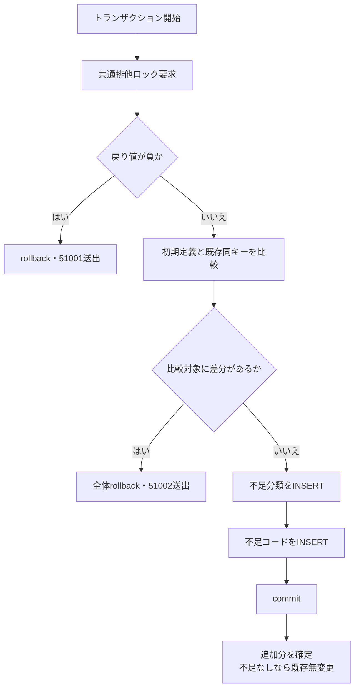

その他のSQL例外を51002へ変換するcatchはない。図の成功出口はcommit到達後の状態である。〔実装根拠：sources/database/002_seed.sql:6-6、85-93〕

#### SQL・テーブル関連（ER図）

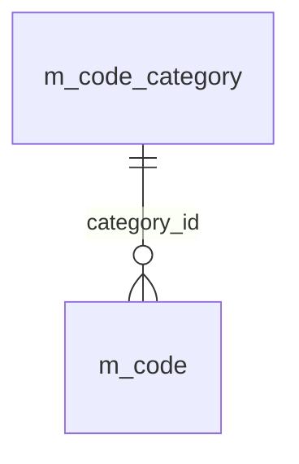

分類IDが分類表のPK、分類・値がコード表の複合PKである。コード表から分類表へのFKに従い、分類を先に追加する。〔実装根拠：sources/database/001_schema.sql:102-102、127-127、189-189〕

#### DB操作の詳細

| 操作 | JOIN・抽出・比較条件 | 結果 |
| --- | --- | --- |
| 分類差分確認 | 初期分類と既存分類を`category_id`でJOIN。名称・固定桁・追加可否の不一致、または既存利用状態が1以外 | 1行でもあれば全体停止 |
| コード差分確認 | 初期値と既存値を分類・値でJOIN。名称・表示順・保護対象の不一致、利用状態が1以外、開始が1900-01-01以外、終了が非NULL | 1行でもあれば全体停止 |
| 分類追加 | 初期分類について同じ分類IDが`NOT EXISTS` | 不足行だけINSERT |
| コード追加 | 初期値について同じ分類・値が`NOT EXISTS` | 不足行だけINSERT |

備考、管理情報、版は既存差分の比較対象ではなく、既存行への上書きも行わない。初期一覧外の追加行を排除する検査はない。材料はSQL内の定数とテーブル変数で、フォームパラメータ、ORDER BY、ページング、取得件数上限は使用しない。〔実装根拠：sources/database/002_seed.sql:8-14、85-92〕

#### 結果・例外時の扱い

ロックの負戻り値は51001、既存定義との差分は51002で、それぞれ明示rollback後に停止する。同一定義なら不足分だけを追加してcommitする。通常保守で初期値の名称を変更した後の再実行も名称差分による停止対象となる。SQL自体に成功応答DTOや一般例外の応答変換はなく、通知方法は実行入口に依存する。〔実装根拠：sources/database/002_seed.sql:2-7、85-93〕

### 共通候補の取得・表示

#### 処理概要

検索と登録は`LookupAsync`の候補を共有する。取得段階では停止・期間外を除外せず、使用先が選択可能条件を適用する。接続されたPOST `/students/options`は検索HTMLを再表示する。宣言された`Coordinator.Options`と`WebPresentation.Lookups`を公開JSON APIとして扱わない。〔実装根拠：sources/Core/SqlServerStudentService.cs:196-216、sources/Web/Controllers/StudentsController.cs:22-22、39-39、sources/Infrastructure/WebStudentCoordinator.cs:16-17〕

#### 処理手順

1. 画面入口で認証情報を確認する。新規学生表示は作成更新権限、既存表示は読取り権限を確認する。サービスも認証主体・セッションを検査する。
2. 接続を開き、SNAPSHOT利用可能状態を確認してSNAPSHOTトランザクションを開始する。
3. コードと分類をINNER JOINして全コードを読む。双方が利用可の場合だけ`CodeEntry.IsActive`を真にする。分類ID、表示順、コード値の順に取得する。
4. クラス全件を学年コードへLEFT JOINして読む。年度降順、学年表示順、クラス表示順、クラスコード、クラスIDの順にする。登録用は非削除・在籍01または02の学生数を集計する。検索用`LookupAsync(false)`は集計を省略して0を返す。
5. 結果を`LookupSet`へ移し、commitする。ビューは分類ごとに抽出し、名称を表示してコード値を送信値にする。
6. 検索は停止・期間外も選択可能にする。登録の性別・都道府県・在籍・続柄は、表示時に有効な値、または読込時`Detail.Draft`と同じ値を選択可能にする。学年補助は全GRADE行を表示する。
7. 候補と選択済み値を別に管理する。検索の候補更新は保持一覧を再利用し、検索を再実行しない。登録では所属選択から年度・学年へ値を移し、上位条件変更で不適合となった所属を解除する。

〔実装根拠：sources/Infrastructure/WebStudentCoordinator.cs:17-17、sources/Core/SqlServerStudentService.cs:46-64、196-216、sources/Views/Students/Search.cshtml:5-5、sources/Views/Students/Edit.cshtml:8-13、sources/Web/Controllers/StudentsController.cs:22-22、sources/wwwroot/js/site.js:7-8〕

#### 処理フロー

サブフロー1は候補集合の取得、サブフロー2はその集合の画面利用を示す。引継ぎ値はコード全件とクラス全件であり、選択済み値を自動的に先頭候補へ置換する操作ではない。

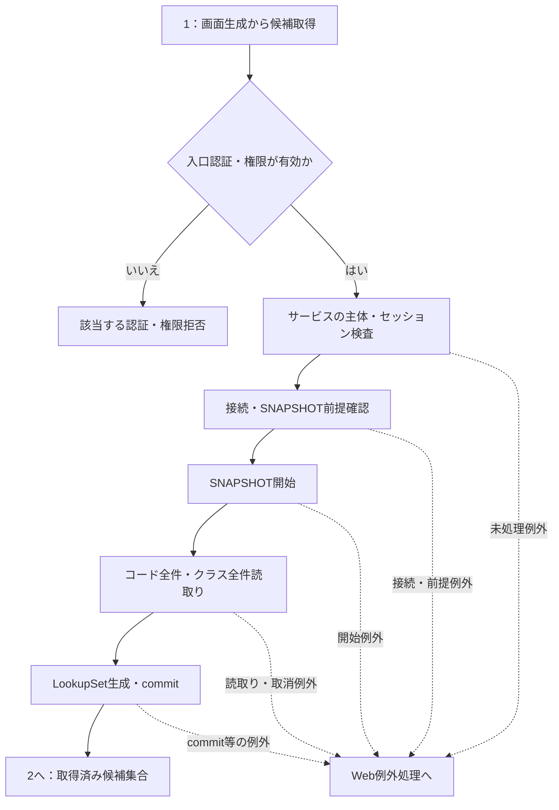

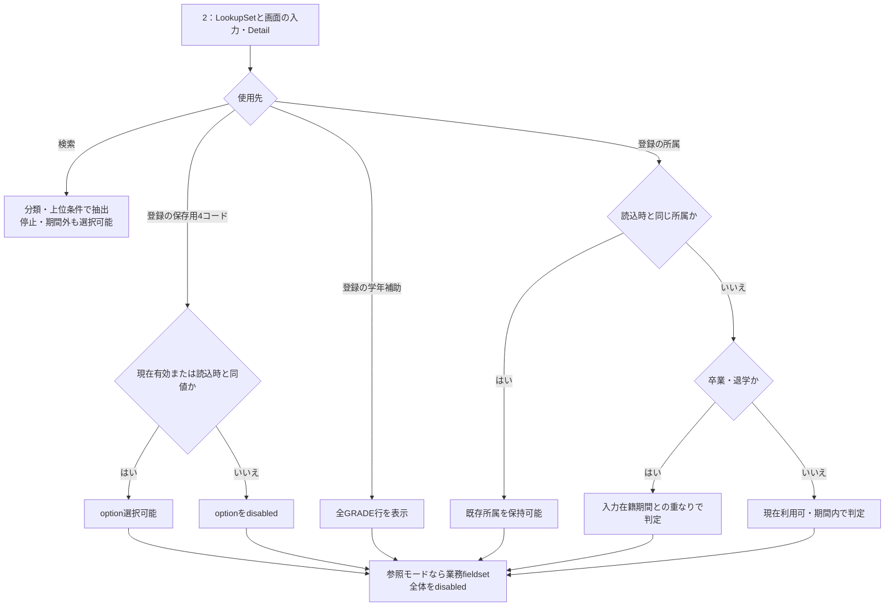

保存用コードの「現在有効」は、合成利用状態が真、表示時日本日付が開始以上、終了NULLまたは終了以下をいう。所属ではクラスの利用状態・期間を使う。所属の候補判定と保存時定員検査は別である。〔実装根拠：sources/Views/Students/Edit.cshtml:2-2、5-13〕

#### SQL・テーブル関連（ER図）

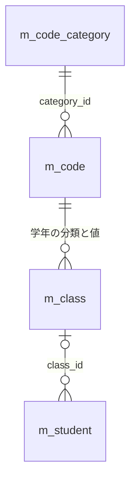

FKは保存可能な参照を制約する。候補SQLの学年LEFT JOINはクラスの並び順を得るための読取り、学生集計は人数表示のための読取りであり、人数をクラスへ保存する関連ではない。〔実装根拠：sources/database/001_schema.sql:189-191、sources/Core/SqlServerStudentService.cs:201-208〕

#### DB操作の詳細

コードSQLにはWHEREがなく、分類へのJOINとORDER BYだけがある。返却属性は分類、値、名称、表示順、合成利用状態、開始・終了日、保護対象である。クラスSQLも利用状態・期間のWHEREを持たない。登録用人数だけが、同じ`class_id`、`is_deleted=0`、在籍01・02で学生を集計する。検索用人数0は集計省略値で、実測0人ではない。両候補にページング・件数上限はなく、共通コマンドは30秒、読取り・commitへ取消トークンを渡す。〔実装根拠：sources/Core/Contracts.cs:61-65、sources/Core/SqlServerStudentService.cs:65-66、196-216〕

| 状態・使用先 | 候補と選択値の扱い |
| --- | --- |
| 検索の学年・都道府県 | 名称を表示する。「すべて」は空文字の画面選択肢 |
| 検索の在籍 | 初期01・02。全解除は空配列に補完し、全区分検索となる |
| 登録の新規選択 | 保存用4コードは現在有効な値を選択可能にする |
| 登録の既存停止値・期間外値 | 読込時の同値は選択可能。他の停止・期間外値はdisabled |
| 停止・期間外の文言 | 性別・都道府県は選択不可行に注記。在籍・続柄には同じ注記がない。既存同値は注記対象にもならない |
| 登録の学年 | 停止・期間外を含む全GRADE行を表示する |
| 検索の上位変更 | 候補更新時に年度・学年と合わない所属を解除する。未所属指定は年度・学年・クラスをNULLへ解除する |
| 登録の連動 | クラスoptionの`data-year`・`data-grade`を補助欄へ移す。年度・学年変更で不適合な所属を解除する |
| 参照モード | 業務fieldsetをdisabledにする。候補取得・名称表示は行う |
| 入力クリア・編集取消 | メモリのOriginalを複製して候補を再取得する。最新DB学生へ置換する処理ではない |

〔実装根拠：sources/Views/Students/Search.cshtml:5-5、sources/Views/Students/Edit.cshtml:5-13、sources/Web/Inputs/StudentSearchInput.cs:14-14、sources/Web/Controllers/StudentsController.cs:14-14、22-22、35-35、sources/wwwroot/js/site.js:7-8、sources/Infrastructure/EditorSnapshotStore.cs:7-11〕

#### 結果・例外時の扱い

コード0件なら該当foreachは空になる。参考設計は必須初期コード不足時の保存不可表示、クラス0件時のW-STU-108案内、存在しない値の先頭候補への代替禁止を定める。現行新規表示は候補取得と初期DTO生成を行うが、これらの不足案内を生成する専用判定はない。保存側の必須・存在・所属検査は別に働く。ブラウザーがどの値を選択・送信するかを、この生成処理だけで保証しない。〔実装根拠：sources/Infrastructure/WebStudentCoordinator.cs:17-17、sources/Core/SqlServerStudentService.cs:196-216、sources/Views/Students/Edit.cshtml:8-13。設計意図の根拠：reference-designs/基本設計書/04_コード設計書.md:104-110、reference-designs/基本設計書/02_学生登録画面.md:177-181〕

候補取得成功は保存成功や席の確保を意味しない。未処理例外は応答開始前ならWeb middlewareがHTMLエラーへ変換し、WebFaultはそのstatus、その他は503とする。応答開始後は当該catchの対象外である。サービスの認証例外を入口のWebFault 401へ一律に置換する処理もない。〔実装根拠：sources/Core/SqlServerStudentService.cs:46-64、199-216、377-380、sources/Infrastructure/WebHostSetup.cs:23-25〕

### 検索条件のコード照合

#### 処理概要

検索は過去の保存値も検索できるように、学年・都道府県について存在だけを確認し、停止・期間外を拒否しない。在籍配列は固定01～04を受け付ける。条件に使用する値と、結果JOINで得る表示名称を分ける。〔実装根拠：sources/Core/SqlServerStudentService.cs:109-153、218-222〕

#### 処理手順

1. POST `/students/search`は認証・CSRF検査後、FormGuardで許可項目と重複を検査する。在籍checkboxが未送信なら空配列を設定する。
2. 検索状態の所有者・セッション・タブ・期限を確認する。ModelState不正は422を設定し、サービス検索を呼ばず再表示へ進む。
3. Coordinatorが入力を`SearchCriteria`へ変換する。ClassId不正はWebFault 422となる。検索状態のGateを待ち、待機後にも所有者・期限等を再確認し、要求版一致と版上限を検査する。
4. サービスがページ、並び順、年度・クラス、未所属との同時指定、在籍配列を検査し、学年・都道府県を任意2桁へ正規化する。
5. SNAPSHOT内で指定コードの存在、指定年度のクラス存在、指定クラスの年度・学年一致を確認する。
6. 非削除学生へ条件を適用し、TOP 10001の件数を確認する。10000件超なら一覧を返さない。それ以外はページを補正し、20・50・100件の指定単位で行を取得する。
7. 検索成功時だけ実行条件・結果をメモリへ保存し、状態版を加算して期限を延長する。その後候補を再取得して検索HTMLを返す。

〔実装根拠：sources/Web/Controllers/StudentsController.cs:13-16、41-41、sources/Web/Inputs/StudentSearchInput.cs:19-22、sources/Infrastructure/WebStudentCoordinator.cs:7-9、sources/Infrastructure/SearchContextStore.cs:13-14、sources/Core/SqlServerStudentService.cs:103-171〕

#### 処理フロー

サブフロー1から2へ、変換済み条件とGate取得済みの検索状態を引き継ぐ。拒否枝では成功時の条件・結果更新を行わない。

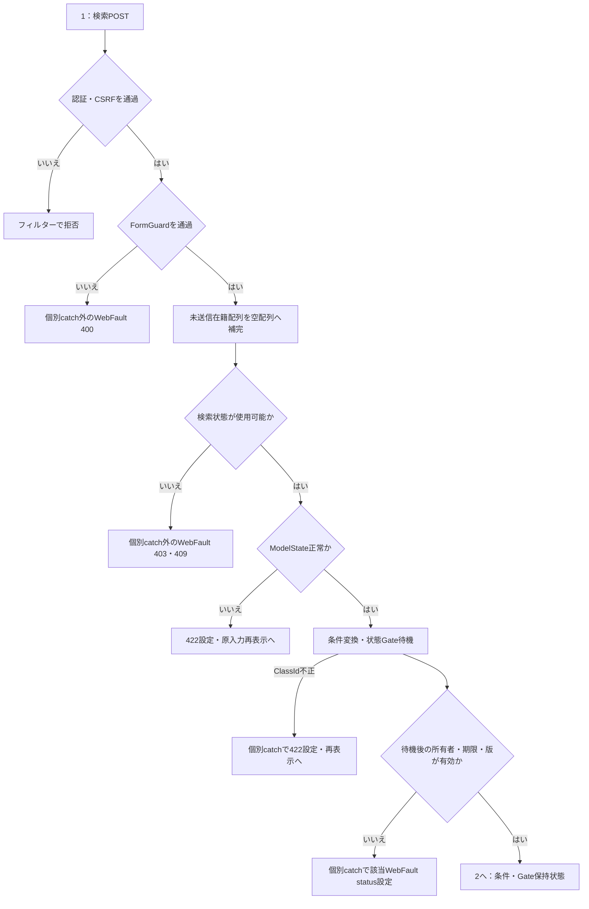

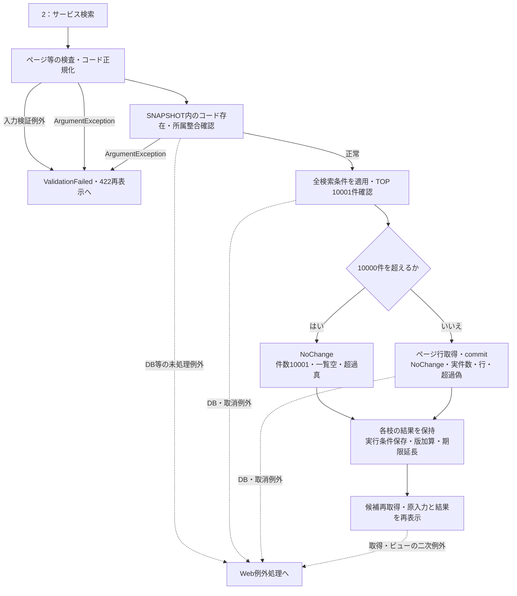

サービス認証、要求変換、Gate待機、再表示の例外は、サービス内の入力例外catchとは異なる境界を持つ。図中の422出口は再表示へ渡すstatusであり、描画完了の保証ではない。〔実装根拠：sources/Core/SqlServerStudentService.cs:105-106、169-170、sources/Infrastructure/WebStudentCoordinator.cs:8-9、sources/Web/Controllers/StudentsController.cs:14-16〕

#### SQL・テーブル関連（ER図）

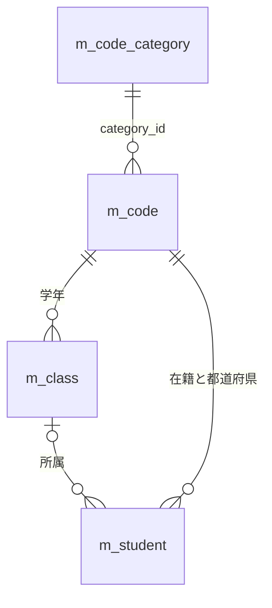

学年条件は所属クラス、在籍・都道府県条件は学生の保存列に適用する。名称取得は分類・値一致のLEFT JOINで、利用状態・期間のJOIN条件はない。FKと名称取得JOINを別の役割として扱う。〔実装根拠：sources/Core/SqlServerStudentService.cs:82-90、143-153、sources/database/001_schema.sql:189-195〕

#### DB操作の詳細

| 条件 | 加工・述語 | パラメータ |
| --- | --- | --- |
| 共通 | `s.is_deleted=0` | なし |
| 学籍番号 | 正規化値をLIKEエスケープし末尾に`%`。`s.student_no LIKE @no ESCAPE '!'` | `@no VarChar(31)` |
| 氏名 | FormKC・大文字化・空白除去の照合キーを作り、エスケープ後の前後に`%`。`s.name_key LIKE @name ESCAPE '!'` | `@name NVarChar(642)` |
| 氏名カナ | カナ正規化後に空白除去し、エスケープ後の前後に`%`。`s.kana_key LIKE @kana ESCAPE '!'` | `@kana NVarChar(74)` |
| 年度 | `c.school_year=@year` | `@year SmallInt` |
| 学年 | 任意2桁正規化値。`c.grade_code=@grade` | `@grade VarChar(2)` |
| クラス | `s.class_id=@class` | `@class BigInt` |
| 未所属 | `s.class_id IS NULL` | なし |
| 都道府県 | 任意2桁正規化値。`s.prefecture_code=@prefecture` | `@prefecture VarChar(2)` |
| 電話 | 本人または緊急電話との一致。`(s.phone_number=@phone OR s.emergency_phone_number=@phone)` | `@phone VarChar(16)` |
| 入学日開始 | `s.admission_date>=@from` | `@from Date` |
| 入学日終了 | `s.admission_date<=@to` | `@to Date` |
| 在籍 | 非空配列だけ`s.enrollment_status_code IN (@status0,…)` | 各`VarChar(2)` |

任意値の正規化結果がNULLなら対応述語を付けない。在籍は最大4件、重複なし、01～04だけを許し、FormKC変換は行わない。学年・都道府県の存在確認は`m_code`の分類・値一致による`COUNT_BIG(*)=1`であり、`@category VarChar(24)`、`@value VarChar(10)`を使用する。利用状態・期間は確認しない。未所属と所属補助の同時指定は正規化前に検査するため、サービス引数の学年空文字も非NULLとして拒否条件へ入る。〔実装根拠：sources/Core/SqlServerStudentService.cs:109-153、218-222、sources/Core/StudentNormalizer.cs:113-117、161-161〕

年度指定は`m_class.school_year=@year`の存在を確認し、クラス指定は`class_id=@id BigInt`で得た年度・学年と照合する。件数SQLは学生とクラスのLEFT JOIN、行SQLはさらに学年・在籍・都道府県名称へLEFT JOINする。両読取りは同じSNAPSHOT内で行う。〔実装根拠：sources/Core/SqlServerStudentService.cs:82-90、126-156〕

ORDER BYは学籍番号、氏名照合キー、入学日、更新日時の許可列とasc・descを使用し、同順位は学生ID昇順とする。OFFSET/FETCHは`@offset Int`、`@size Int`である。共通コマンドは30秒、読取りとcommitへ取消トークンを渡す。〔実装根拠：sources/Core/SqlServerStudentService.cs:65-66、107-108、156-167〕

#### 結果・例外時の扱い

0件、通常結果、10000件超過はすべてOutcomeがNoChangeとなるが、件数・一覧・超過フラグは異なる。超過枝の固定値を通常枝へ適用せず、それぞれの結果を保持する。入力検証例外、次いでArgumentExceptionはValidationFailedへ変換する。DB例外等はこのcatchで変換しない。ControllerはCoordinatorからのWebFaultを個別捕捉してstatusとエラーを設定するが、FormGuardと最初の状態取得はその外側にある。〔実装根拠：sources/Core/SqlServerStudentService.cs:159-170、sources/Web/Controllers/StudentsController.cs:14-16〕

在籍配列には専用NULL検査がなく、`statuses.Length`を参照する。未送信checkboxの空配列補完や非nullable注釈を、全受信経路のNULL排除保証としない。暗黙Requiredも抑止されている。〔実装根拠：sources/Core/SqlServerStudentService.cs:111-112、sources/Web/Controllers/StudentsController.cs:14-14、sources/Infrastructure/WebHostSetup.cs:16-16〕

入力拒否後もControllerは要求`pageSize`を再表示モデルへ設定する。ビューはこれをページ数計算の除数に使うため、0のまま到達するとDivideByZeroExceptionが生じ得る。この二次例外はサービスやControllerの個別catchの範囲外で、応答開始前ならmiddlewareの503処理へ進む。検索入力拒否の422を、全不正入力の最終応答に一般化しない。〔実装根拠：sources/Core/SqlServerStudentService.cs:107-107、169-170、sources/Web/Controllers/StudentsController.cs:15-16、sources/Views/Students/Search.cshtml:8-8、sources/Infrastructure/WebHostSetup.cs:23-23〕

### 学生保存時の最新コード照合

#### 処理概要

登録画面で選択可能だった値も、保存時に最新の分類・コードを再取得する。同値保持の比較対象はゲート下で取得した最新DB学生の保存値であり、読込時画面や送信された変更有無ではない。コードと所属の検査は変更なし判定より前に行う。本イベントは学生保存のうちコード契約に必要な入力、再検査、結果・確定境界を示す。〔実装根拠：sources/Core/SqlServerStudentService.cs:245-262、344-383。設計意図の根拠：reference-designs/基本設計書/04_コード設計書.md:108-110〕

#### 処理手順

1. createまたは対象ID付きupdateは認証・自動CSRF検査を通り、ControllerでFormGuard、作成更新権限、Snapshot取得、復帰状態確認、読込時復帰先との一致、ModelStateの順に検査する。
2. ModelState不正は422を設定して再表示へ進む。正常なら個別WebFault catch内でCoordinatorを呼ぶ。Coordinatorは権限と復帰状態を再確認し、`ToRequest`を実行する。
3. `ToRequest`はClassIdを任意の正Int64へ変換する。不正ClassId、不正または欠落した更新期待版は422、新規で非空の期待版を指定すると400のWebFaultとなる。Controllerが捕捉し、サービス結果なしで原入力とSnapshotのDetail等を保持して再表示へ進む。
4. サービスは認証情報を検査し、ViewerならForbiddenを返す。入力正規化、理由、ID・期待版の組、年度、任意学年を検査する。入力検証例外とArgumentExceptionはValidationFailedへ変換する。
5. 接続とReadCommittedトランザクションを開始し、共通書込ゲートを取得する。更新は非削除対象を再取得し、期待版、学籍番号不変、終了区分03・04から別区分へ訂正する場合の管理者権限・理由を確認する。
6. 性別・都道府県・在籍・入力済み続柄を固定分類と正規化値で最新マスタへ照合する。行なしはE-STU-009、新規または最新保存値から変更するコードの停止・期間外はE-STU-011となる。同値でも存在確認は行う。
7. 所属の存在、指定年度・学年との一致、増席時の利用状態・期間・定員、終了区分の在籍期間との重なりを確認する。学年補助単独のマスタ有効性検査は行わない。
8. 全検査後に差分を判定する。変更なしは明示rollbackし、NoChange・要求対象ID・取得済み版を返す。変更ありは版上限、削除済みを含む学籍番号一意、同一人物候補の確認へ進む。
9. 確認情報は所有者・セッション・対象・期待版・正規化内容・全候補IDと版・10分期限・Busy取得に結び付ける。有効な確認で理由なしは拒否する。再確認が必要なら保存トランザクションをrollbackし、新しい確認情報と最大20表示候補を返す。続行でも本イベントの最新検査を再実行する。
10. 保存可能なら学生と監査を同一トランザクションで書く。commit成功後にSaved・保存ID・新しい版を返す。Web確認情報は成功または結果不明で無効化し、未完了かつ結果不明でない場合は取得したBusyを解除する。
11. サービス結果はControllerでstatusと確認値へ反映する。Savedは303の検索復帰へ進む。それ以外は原入力・SnapshotのDetailを保持して候補を再取得し、Editを返す。

〔実装根拠：sources/Web/Controllers/StudentsController.cs:26-38、41-41、sources/Web/Inputs/StudentSaveInput.cs:34-43、57-60、sources/Infrastructure/WebStudentCoordinator.cs:18-18、sources/Core/SqlServerStudentService.cs:227-324、344-383〕

#### 処理フロー

サブフロー1はControllerの事前検査、2は要求変換とサービス入力検査、3は最新対象・コード・所属、4は差分・確認・保存、5は保存tryの例外、6は画面応答を示す。各結果はID・版・確認情報をその枝のまま引き継ぐ。

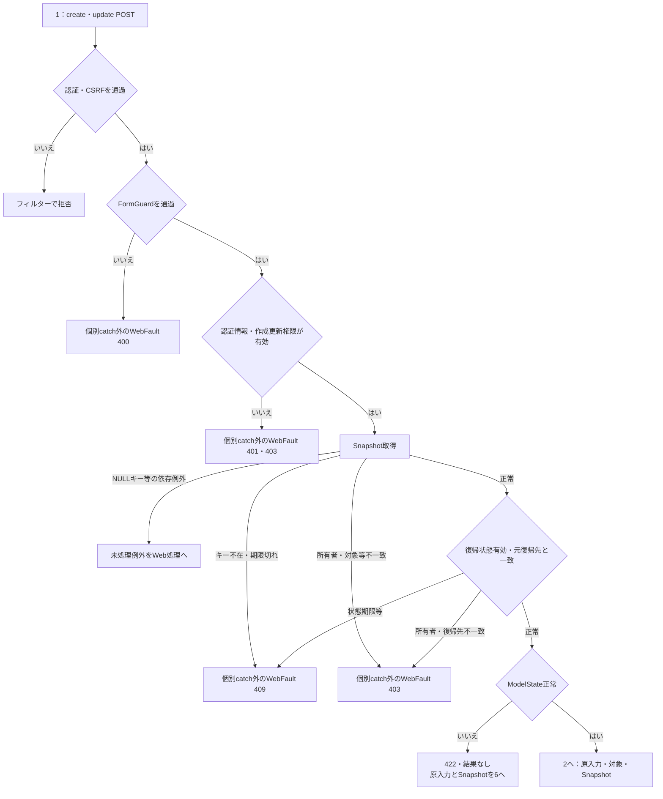

SnapshotIdの空文字・キー不在は独自409に進む一方、NULLは明示検査より前に辞書へ渡るためArgumentNullExceptionが生じ得る。これを同じ409へまとめない。事前検査のWebFaultは応答開始前ならmiddlewareへ渡される。〔実装根拠：sources/Infrastructure/EditorSnapshotStore.cs:7-11、sources/Web/Controllers/StudentsController.cs:29-30、sources/Infrastructure/WebHostSetup.cs:23-23〕

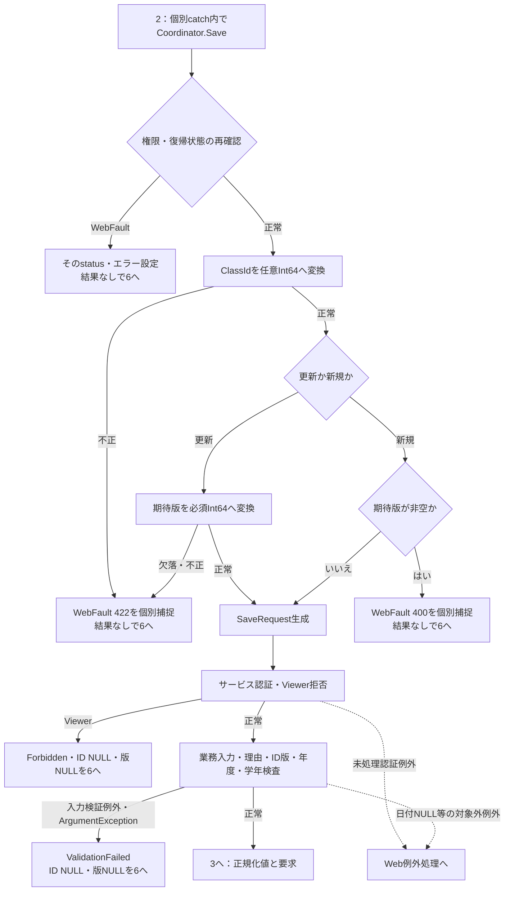

要求変換の400／422枝にSaveResultはない。原入力、SnapshotのDetail・SnapshotId・ReturnRevisionを保持する。`BirthDateInput`本体のNULLは補完するが、年・月・日やISO日付文字列のNULLまでは補完しない。直接`Normalize`へ到達するNULLのNullReferenceExceptionは、サービスの入力検証例外・ArgumentException catchでは変換しない。〔実装根拠：sources/Web/Inputs/StudentSaveInput.cs:34-43、sources/Web/Controllers/StudentsController.cs:30-33、sources/Core/JapaneseDateService.cs:17-32、52-59、sources/Core/SqlServerStudentService.cs:229-242〕

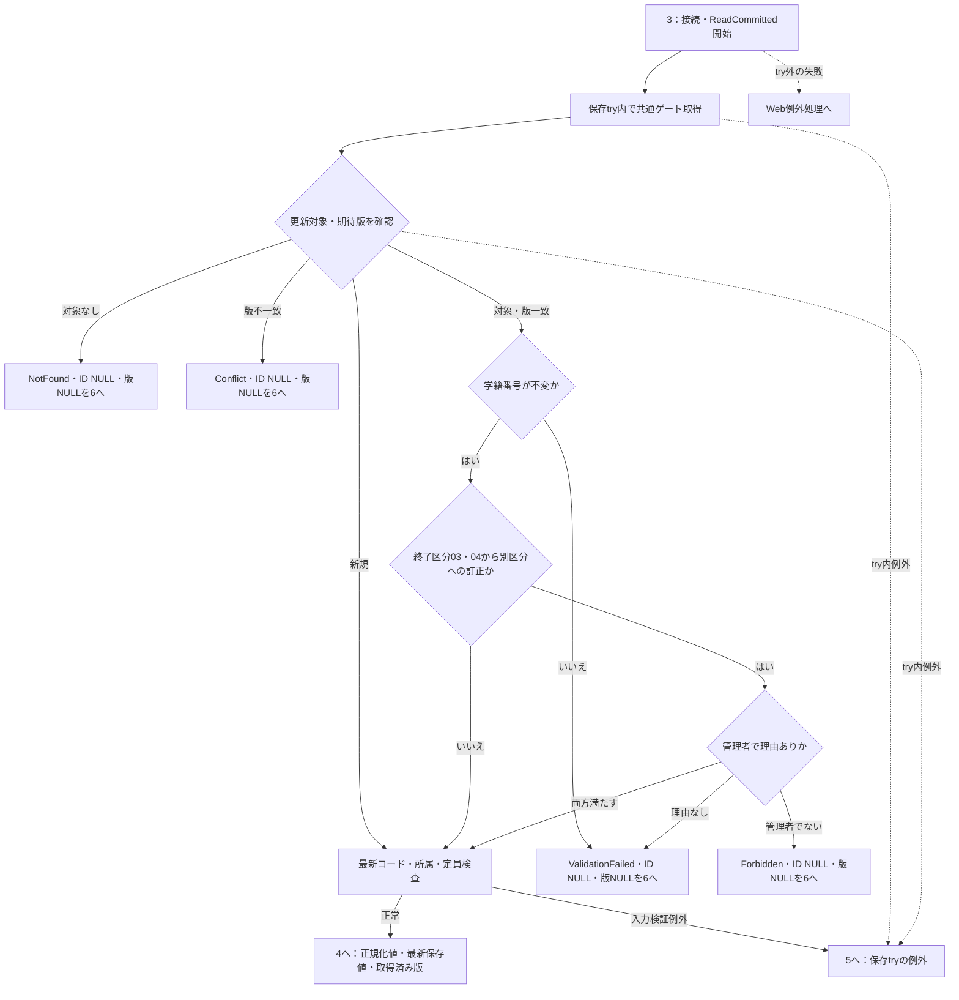

コード行なし、変更値の停止・期間外、所属不存在・不一致、増席の利用不可・定員超過、終了区分の期間不整合は手順6・7の入力検証例外となる。対象なし等の早期結果は明示rollbackを行わず、トランザクション破棄へ進む。コード検査を通る前に変更なしを返すことはない。〔実装根拠：sources/Core/SqlServerStudentService.cs:244-263、347-383〕

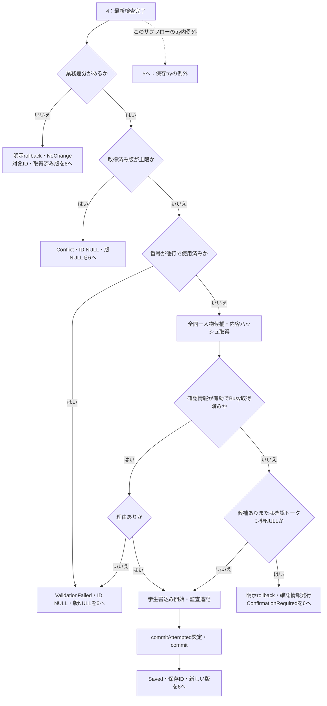

NoChangeは対象IDと取得済み版を保つ。ConfirmationRequiredは、更新なら要求対象IDと取得済み版、新規ならID・版ともNULLを返し、別に確認トークン・全件数・最大20候補を引き継ぐ。保存成功版は新規1、更新は取得済み版＋1である。全候補の取得・ハッシュと、最大20件の表示を混同しない。このサブフローのrollback、確認発行、読取り、書込み、監査、commit中の例外もサブフロー5へ渡す。〔実装根拠：sources/Core/SqlServerStudentService.cs:260-315〕

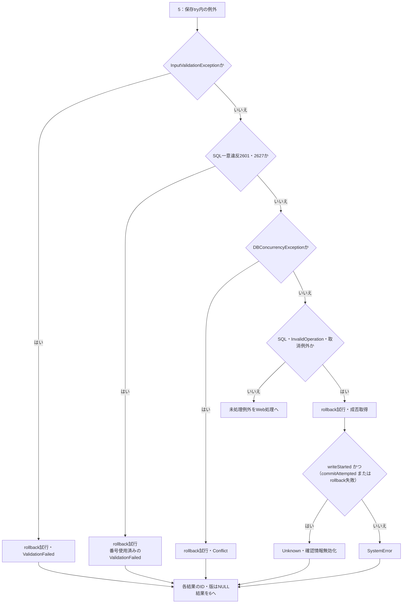

Unknown条件は最後のcatchへ到達した場合だけに適用する。書込み未開始ならrollback失敗だけではUnknownにならない。先行catchの結果を後段で再分類しない。Rollbackは取消トークンNoneで実行し、SqlExceptionとInvalidOperationExceptionをfalseへ変換する。それ以外がRollbackから送出されれば結果生成まで進まない可能性がある。finallyは、取得済みBusyを未完了かつUnknownでない場合に解除する。〔実装根拠：sources/Core/SqlServerStudentService.cs:316-329〕

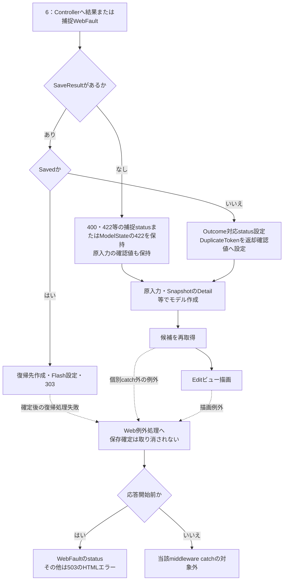

要求変換拒否とサービスValidationFailedは、statusが同じ422でも結果の有無と確認値の扱いが異なる。候補再取得と描画は個別WebFault catchの後にあるため、捕捉した400／422や生成したサービス結果だけで最終HTTP応答を保証しない。303後のGETは検索復帰・再検索の別入口である。〔実装根拠：sources/Web/Controllers/StudentsController.cs:30-39、sources/Infrastructure/WebPresentation.cs:23-23、sources/Infrastructure/WebHostSetup.cs:23-23〕

#### SQL・テーブル関連（ER図）

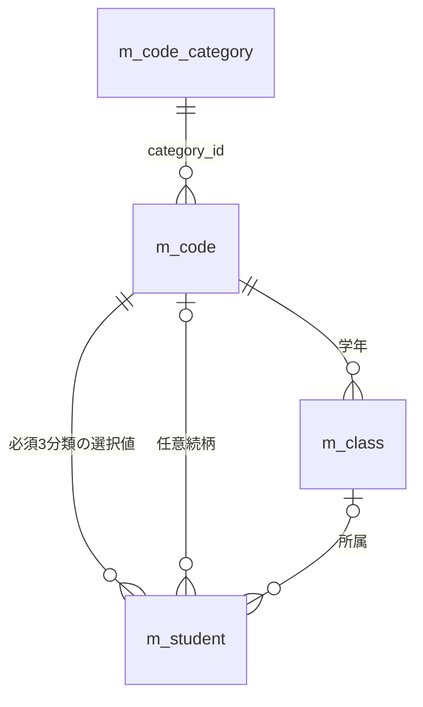

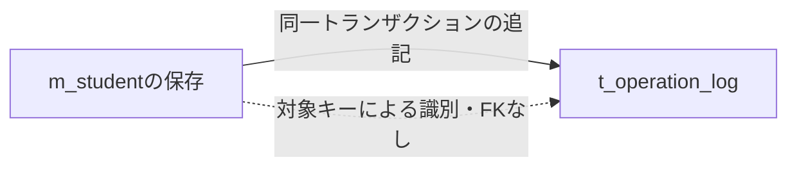

複合FKは分類・値の参照存在を制約する。利用状態・期間はサービスが読み取って判断する。監査対象キーには学生・コードへのFKがなく、監査追記は処理上の依存である。〔実装根拠：sources/database/001_schema.sql:137-154、189-199、sources/Core/SqlServerStudentService.cs:306-307、349-355〕

#### DB操作の詳細

最新コード検査は`m_code`と`m_code_category`を分類IDでINNER JOINし、`c.category_id=@category AND c.code_value=@value`で取得する。`@category VarChar(24)`、`@value VarChar(10)`を使用する。新規・変更値は双方の利用可と両端包含の期間を要求し、同値は存在を要求する。日本業務日は保存開始時UTCから求めた値であり、DBのawait後に取り直す日付ではない。〔実装根拠：sources/Core/SqlServerStudentService.cs:229-229、347-355〕

在籍01・02は終了日NULL・所属必須で定員を消費する。03・04は入学日以上の終了日必須・所属任意となる。03・04から別コードへの訂正は管理者と理由を要求する。同じ終了区分の一般項目訂正とは別条件である。〔実装根拠：sources/Core/StudentNormalizer.cs:150-158、sources/Core/SqlServerStudentService.cs:255-258〕

所属読取りは`m_class.class_id=@id BigInt`で、年度・学年・期間・利用状態・定員を取得する。新たに席を消費する場合だけ、現在利用可・期間内を要求する。定員が非NULLなら、同じクラス、非削除、在籍01・02、自分以外の学生を`COUNT_BIG`し、今回の1人を加えて比較する。既存の同じ席の保持には新規増席の検査を適用しない。03・04で所属・区分・入学日・終了日を変える場合は、在籍期間とクラス期間の重なりを確認する。〔実装根拠：sources/Core/SqlServerStudentService.cs:357-383〕

新規SQLは3必須分類を固定文字列で設定し、正規化コード、算定続柄分類、所属IDを保存する。更新SQLは学籍番号と必須分類を変更せず、対象ID・期待版・非削除をWHEREに使用する。続柄分類と値は、両方NULLまたは分類付き値として更新する。名称コピーは保存しない。保存パラメータの型・サイズは概要の対応表に従う。学生の更新管理情報・版と、CREATEまたはUPDATE監査を同じトランザクションで確定する。〔実装根拠：sources/Core/SqlServerStudentService.cs:30-37、294-315〕

Webの確認情報はメモリ辞書に保持する。所有者・セッション・対象・期待版・内容ハッシュ・全候補IDと版のハッシュ・期限・Busyが一致して初めて確認続行を認める。期限比較も保存開始時`now`を使用する。確認待ちでは学生保存を確定せず、非Web設定時の確認表分岐と区別する。〔実装根拠：sources/Core/SqlServerStudentService.cs:19-29、274-290、330-342、sources/Infrastructure/WebHostSetup.cs:19-19〕

#### 結果・例外時の扱い

| 経路 | 結果・引継ぎ値 | 画面処理・確定境界 |
| --- | --- | --- |
| 不正ClassId、不正・欠落した更新期待版 | WebFault 422。SaveResultなし | 個別catchがstatusと項目エラーを設定。原入力、SnapshotのDetail・ID・復帰版を保持して再表示へ |
| 新規で非空の期待版 | WebFault 400。SaveResultなし | 個別catchが400を設定。サービス保存なし。原入力・Snapshotを保持して再表示へ |
| ModelState不正 | 結果なし、422設定 | 要求変換・サービス保存を呼ばず再表示へ |
| サービスの必須・形式・存在・有効性不正 | ValidationFailed、ID NULL・版NULL | 422。try内の例外ならrollback試行。原入力・読込時Detailで再表示へ |
| 最新対象なし | NotFound、ID NULL・版NULL | 404。保存・監査なし、早期戻り |
| 最新版不一致・版上限・DB競合 | Conflict、ID NULL・版NULL | 409。早期戻りとcatch内rollback試行を区別する |
| Viewerまたは終了区分訂正の権限不足 | Forbidden、ID NULL・版NULL | 403。保存なし |
| 全検査後の変更なし | 明示rollback、NoChange、対象ID・取得済み版 | 200。「変更はありません」。監査・版加算なし |
| 重複再確認が必要 | 明示rollback、ConfirmationRequired。対象ID・取得済み版、確認値・候補情報 | 409。新規のID・版はNULL。更新の取得済み版を失わせない |
| 学生・監査のcommit成功 | Saved、保存ID・新しい版 | Controllerは303で検索復帰へ。後続失敗を保存rollbackと解釈しない |
| 最後のcatchでUnknown条件成立 | Unknown、ID NULL・版NULL | 503。再保存前に検索で確認する案内 |
| 最後のcatchでUnknown条件不成立 | SystemError、ID NULL・版NULL | 503 |

再表示枝には候補再取得・ビュー生成の成功条件がある。要求変換WebFaultでは結果がないため、原入力のDuplicateTokenをサービス返却値で置換しない。サービス結果がある枝だけ返却確認値へ置換する。〔実装根拠：sources/Web/Controllers/StudentsController.cs:30-33、sources/Infrastructure/WebPresentation.cs:23-23〕

Snapshotは読込時フォームの複製、Detail、対象、所有者・セッション、30分期限、復帰版をメモリに保持する。キー不在・期限切れは409、別所有者・セッション・対象は403であり、NULLキーの依存例外とは別である。非nullable注釈とブラウザーrequiredを、欠落・NULLの受信保証に使わない。〔実装根拠：sources/Infrastructure/EditorSnapshotStore.cs:7-11、sources/Web/Controllers/StudentsController.cs:29-33、sources/Infrastructure/WebHostSetup.cs:16-16〕

### コードの通常追加・変更

#### 処理概要

`MasterMaintenanceService.SaveCodeAsync`は、DB認証による管理者確認後にコードを追加・更新する宣言済みサービスである。Webは`IStudentService`に`SqlServerStudentService`を登録しており、確認した登録・ルートにはこの保守サービスの呼出しがない。CLIに関するコメントを、公開保守画面や接続済みCLIの実装根拠にはしない。〔実装根拠：sources/Core/MasterMaintenanceService.cs:9-15、79-121、sources/Infrastructure/WebHostSetup.cs:13-19、sources/Web/Controllers/StudentsController.cs:5-42〕

#### 処理手順

1. `CodeChange`の分類を5固定IDに限定し、0以下の期待版と負の表示順を拒否する。名称・備考・開始終了日を検査する。終了NULL・空文字は期限なし、空白だけの終了日は日付解析へ進む。期間逆転は拒否する。
2. 暗号化必須・サーバー証明書検証を設定した接続を開き、`ORIGINAL_LOGIN()`と`IS_ROLEMEMBER('student_admin')`を読む。行なし、ロール判定NULL、1以外はUnauthorizedAccessExceptionとする。主体を必須64スカラー以内へ検査する。
3. ReadCommittedを開始し、UTC日時を取得する。ここまでが保守tryの外側である。try内で共通書込ゲートを取得する。
4. 最新分類から固定桁と追加可否を読む。分類なしはE-MST-001のArgumentException。分類桁を原入力上限としてコード値をTrim・FormKC変換し、正規化後の固定桁ASCII数字を要求する。
5. 分類・正規化値で既存行を読む。対象なし・期待版ありはNotFound、対象あり・期待版不一致またはNULLはConflict。新規は追加可の分類だけに許可する。
6. 既存保護値の停止、開始日の後ろ倒し、無期限から有限期限への変更、既存終了日の短縮を拒否する。
7. 名称、表示順、利用状態、開始日、終了日、備考の6項目を比較する。差分なしは明示rollbackし、NoChangeと期待版を返す。差分がある場合だけ版上限を検査する。
8. 新規は保護0・版1・作成更新情報を含めてINSERTする。更新は6項目と更新情報を設定し、版を加算する。分類・値・期待版をWHEREに使用し、書込み件数が1でなければDBConcurrencyExceptionとする。
9. 同じトランザクションへ操作履歴を追記する。既存なしはCREATE、利用状態が同じならUPDATE、状態変更はENABLEまたはDISABLEとなる。
10. commit成功後だけSavedと新しい版を返す。try内の例外はrollbackを試行し、通常復帰した場合に元例外を再throwする。

〔実装根拠：sources/Core/MasterMaintenanceService.cs:10-11、17-28、79-121、132-135、sources/Core/AuditOperation.cs:6-7〕

#### 処理フロー

サブフロー1は入力・認証・読取り、2は追加と保護・差分判定、3は保存と監査、4は例外処理である。保守にはHTTP応答へ変換する接続入口がなく、図にもHTTP statusを設定しない。

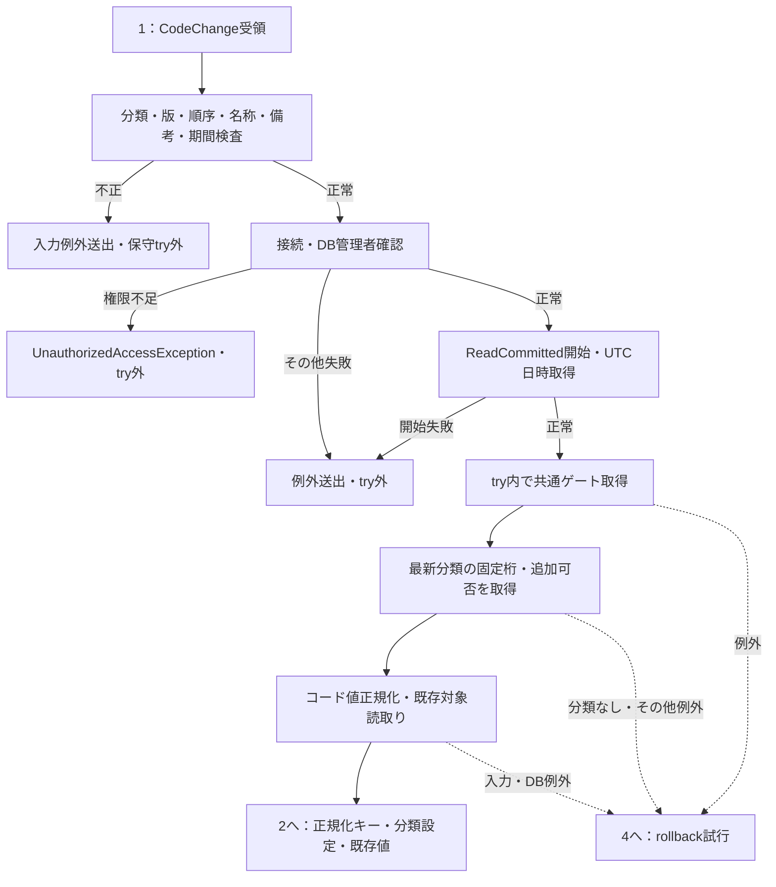

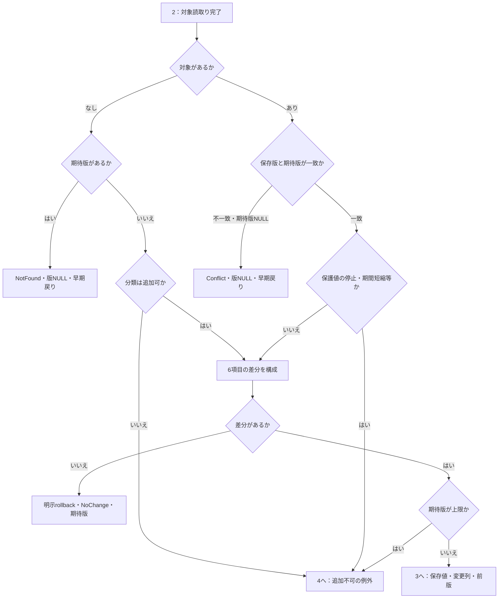

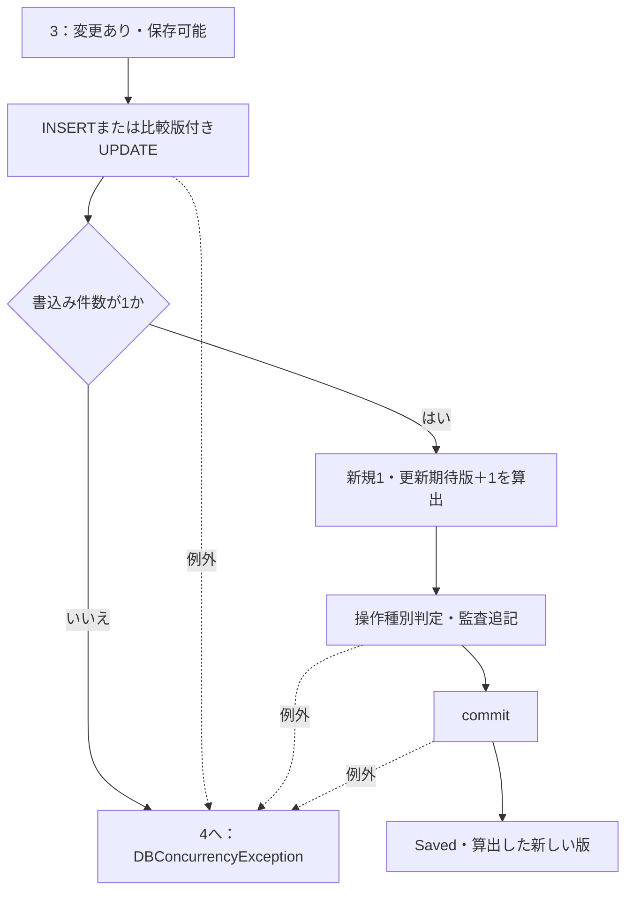

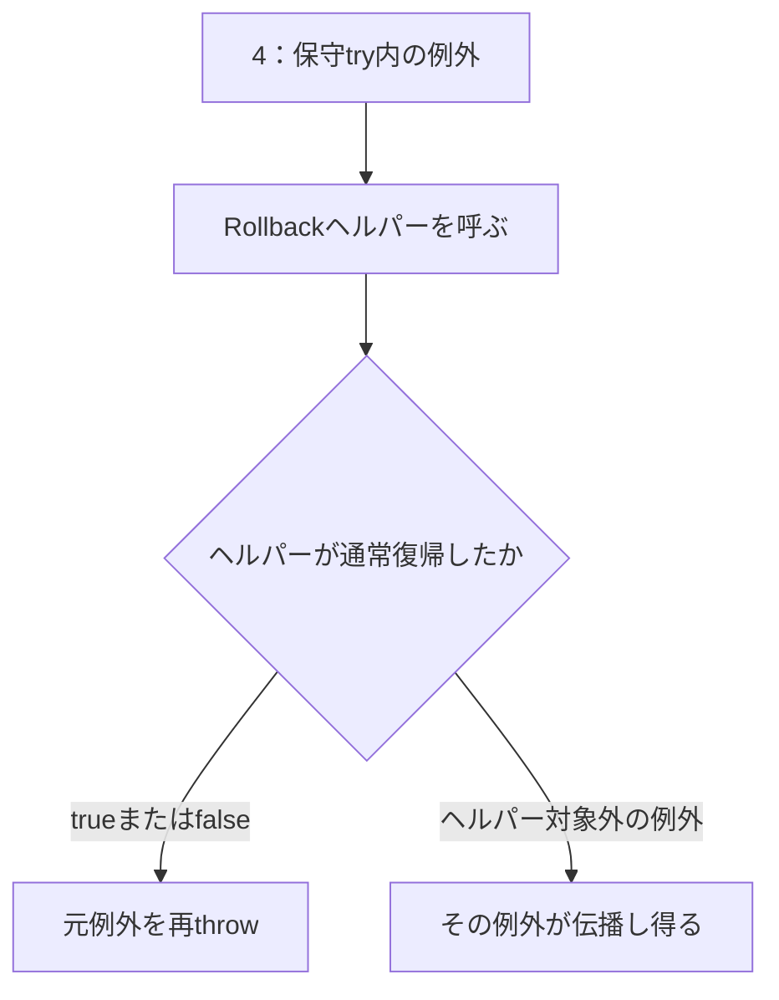

NotFoundとConflictは明示rollbackせず、`await using`のトランザクション破棄へ進む。NoChangeは明示rollback、Savedはcommit後である。NoChangeのrollback例外もサブフロー4へ進む。保護検査を変更なしより前に行うため、保護値を利用不可のまま送信する要求を「変更なし」で受け入れない。〔実装根拠：sources/Core/MasterMaintenanceService.cs:88-121〕

#### SQL・テーブル関連（ER図）

```mermaid
erDiagram
 m_code_category ||--o{ m_code : category_id
```

```mermaid
flowchart LR
 C[m_codeの保存] -->|同一トランザクションの追記| L[t_operation_log]
 C -.->|分類と値で対象識別・FKなし| L
```

分類は固定桁・追加可否の参照元、コードは更新対象、履歴は一括確定する追記先である。保守は分類利用状態を追加拒否条件として読み取らない。候補の合成利用状態や学生保存の分類利用状態検査とは別契約である。〔実装根拠：sources/Core/MasterMaintenanceService.cs:92-104、113-120、132-135、sources/database/001_schema.sql:137-154、189-189〕

#### DB操作の詳細

| 入力・内部値 | 処理と保存先 | パラメータ・型・サイズ |
| --- | --- | --- |
| `CategoryId string` | 5固定ID。分類・対象キーに使用。`category_id varchar(24) NOT NULL` | `@category VarChar(24)` |
| `CodeValue string` | 分類桁を原入力上限とし、Trim・FormKC後の固定桁ASCII数字を保存。`code_value varchar(10) NOT NULL` | `@value VarChar(10)` |
| `ExpectedVersion long?` | NULLは新規意図。既存は保存版との一致を要求 | 更新の`@version BigInt` |
| `CodeName string` | 原入力・Trim後12スカラーの必須名称。`code_name nvarchar(24) NOT NULL` | `@name NVarChar(24)` |
| `DisplayOrder int` | 非負。`display_order int NOT NULL` | `@order Int` |
| `IsActive bool` | 今回の利用状態。`is_active bit NOT NULL` | `@active Bit` |
| `ValidFrom string` | FormKC後の厳密なyyyy-MM-dd、1900-01-01以降。`valid_from date NOT NULL` | `@from Date` |
| `ValidTo string?` | NULL・空文字は期限なし。空白だけは日付解析へ。`valid_to date NULL` | `@to Date`、値なしはDBNull |
| `Remarks string?` | 原入力・保存後120スカラー、LF統一・Trim、空はNULL。`remarks nvarchar(240) NULL` | `@remarks NVarChar(240)` |
| DB認証主体・UTC日時 | 新規は作成更新双方、更新は更新側だけを設定 | `@actor NVarChar(128)`、`@now DateTimeOffset` |
| 保護対象 | 入力項目なし。新規0、既存保持 | INSERT定数0。UPDATE設定なし |

日付保守は未来日を許す。開始日NULLが渡された場合、日付解析の直接`Normalize`呼出しで生じる例外を非nullable宣言だけで排除できない。〔実装根拠：sources/Core/MasterMaintenanceService.cs:10-10、81-120、sources/Core/JapaneseDateService.cs:52-59、sources/Core/StudentNormalizer.cs:47-57、113-117、sources/Core/SqlServerStudentService.cs:67-72〕

分類読取りのWHEREは分類ID、対象読取りは分類ID・正規化値の一致である。ORDER BY、ページング、件数上限はない。UPDATEのWHEREは同じ2キーと期待版で、キー・保護・作成情報を変更しない。新規の表示順・利用状態は引数を明示設定し、DB DEFAULTやseedの利用可で補完しない。共通コマンドは30秒、読取り・書込み・監査・commitへ取消トークンを渡す。〔実装根拠：sources/Core/MasterMaintenanceService.cs:92-120、132-135、sources/Core/SqlServerStudentService.cs:65-66〕

保護値は今回の利用可を要求し、開始日の後ろ倒し、旧終了NULLから有限期限への変更、有限終了日の短縮を拒否する。開始日の前倒し、有限終了日の延長、終了NULL化はこの条件では拒否しない。キー変更、保護解除、物理削除の更新項目はない。〔実装根拠：sources/Core/MasterMaintenanceService.cs:105-113〕

| 以前の利用状態 | 今回の利用状態 | 変更ありの操作種別 |
| --- | --- | --- |
| 既存なし | 利用可・利用不可のいずれも | CREATE |
| 利用可 | 利用可 | UPDATE |
| 利用不可 | 利用不可 | UPDATE |
| 利用不可 | 利用可 | ENABLE |
| 利用可 | 利用不可 | DISABLE |

停止のまま名称・表示順を変更してもUPDATEとなる。変更なしは判定前に終了し、履歴を作らない。この判定はクラス保守でも共用する。〔実装根拠：sources/Core/AuditOperation.cs:6-7、sources/Core/MasterMaintenanceService.cs:67-76、109-119〕

コード監査の対象表は`m_code`、対象キーは分類IDと正規化値をコロンで連結する。変更列JSONは6属性のうち実際に変わった列名で、新規は6属性すべてとなる。名称等の前後値コピーは保存しない。前版は期待版で新規NULL、後版は保存後の版、実行者はDB認証主体、日時はUTC、受付UUIDはログ呼出し時に生成、理由NULL、重複確認フラグ0である。〔実装根拠：sources/Core/MasterMaintenanceService.cs:109-120、132-135〕

監査パラメータは対象表`VarChar(21)`、対象キー`VarChar(35)`、操作種別`VarChar(11)`、前後版`BigInt`、変更列JSON`NVarChar(max)`、者`NVarChar(128)`、日時`DateTimeOffset`、受付UUID`UniqueIdentifier`である。〔実装根拠：sources/Core/MasterMaintenanceService.cs:134-135〕

#### 結果・例外時の扱い

| 経路 | MaintenanceResult・例外 | DB境界 |
| --- | --- | --- |
| 対象なし・期待版あり | NotFound、版NULL | 明示rollbackなしの早期戻り。保存・監査なし |
| 対象あり・版不一致または期待版NULL | Conflict、版NULL | 明示rollbackなしの早期戻り。保存・監査なし |
| 保護検査後に差分なし | NoChange、版は期待版 | 明示rollback。版加算・監査なし。版上限検査より前 |
| 保存・監査・commit成功 | Saved、新規1または期待版＋1 | コードと履歴を一括確定 |
| 通常追加不可・保護違反・期間不正等 | ArgumentException。名称等はInputValidationExceptionの場合もある | 発生位置がtry内ならrollback試行。結果DTOへ変換しない |
| DB管理者でない | UnauthorizedAccessException | 保守トランザクション開始前 |
| try内のDB・取消・その他例外 | rollback試行後に再throw | rollback成否を保守結果に反映しない |

入力前段、DB管理者確認、接続開始、トランザクション開始は保守try外である。Rollbackヘルパーがfalseを返しても保守はその値を使用せず、SystemError・UnknownのMaintenanceResultを生成しない。commit失敗を含む例外返却を未保存の保証とせず、学生保存のUnknown条件をこの保守へ適用しない。〔実装根拠：sources/Core/MasterMaintenanceService.cs:81-90、120-121、sources/Core/SqlServerStudentService.cs:319-329〕

## 補足説明

### 名称変更、保存値、保持済み表示

学生はコード値と所属IDを保存し、名称コピーを保存しない。コード・クラス名称の保守変更は、その後の候補取得と検索JOINに反映される。名称変更だけで学生の保存値・版を変更するSQLはない。検索状態のLastResultは取得済み行をメモリ保持し、候補更新はこれを再利用するため、最新候補名称と旧一覧名称が同時に存在し得る。検索、ページ操作、検索復帰の再検索で保持結果を取り替える。〔実装根拠：sources/Core/SqlServerStudentService.cs:82-90、183-216、sources/Core/MasterMaintenanceService.cs:109-120、sources/Infrastructure/SearchContextStore.cs:9-15、sources/Infrastructure/WebStudentCoordinator.cs:9-14、sources/Web/Controllers/StudentsController.cs:22-22〕

表示用の年度・学年・クラス・在籍名称はLEFT JOIN結果としてNULLになり得る。一方、保存元の`m_code.code_name`と`m_class.class_name`はNOT NULLである。クラス名称は保守の原入力・保存後18スカラー、DBは`nvarchar(36)`、保存パラメータは`NVarChar(36)`である。表示DTOのnullableから保存列のNULL可否や名称上限を決めない。〔実装根拠：sources/Core/Contracts.cs:50-53、sources/Core/MasterMaintenanceService.cs:33-35、73-74、82-82、115-115、sources/database/001_schema.sql:68-68、115-115〕

| 使用先 | 参考設計の表示意図 | 現行の表示生成 |
| --- | --- | --- |
| 年度・学年 | 4桁西暦と学年名称。未所属は「－」、名称欠落は不整合表示 | 年度と学年名称を表示する。ビューに共通の「－」・不整合置換はない |
| クラス | コード9文字以内、名称18スカラー以内、状態注記 | 検索候補は年度・コード・名称・停止注記。登録候補は年度・学年コード・コード・名称・停止または期間外注記。検索一覧はコードと名称 |
| 在籍 | 名称12スカラー以内 | JOIN名称をそのまま表示する |
| 住所 | 都道府県名称12スカラーと住所1の45スカラー。住所2は一覧外 | 名称と住所1を連結する。名称NULLなら`[不整合]`を付け、住所2は含めない |
| 登録の共有選択値 | 名称を表示しコードを保存。年度・学年は選択補助 | 保存用4コードはこの対応。年度・学年は学生へ保存せず、所属との一致を検査する |

参考表示は設計意図であり、現行画面の撮影や投影ではない。登録クラス候補の学年部分は、現行では名称ではなくコードを表示する。〔設計意図の根拠：reference-designs/詳細仕様書/CSharp_ASPNET/01_学生検索画面.md:107-110、reference-designs/詳細仕様書/CSharp_ASPNET/02_学生登録画面.md:92-107、761-763。実装根拠：sources/Views/Students/Search.cshtml:5-8、sources/Views/Students/Edit.cshtml:8-13、sources/Core/SqlServerStudentService.cs:77-90〕

### 分類の意味と保守で維持する契約

参考設計の性別は申告を強制せず、未回答`0`を有効値として扱う。現行の所属・連絡先必須条件は性別による分岐を持たない。在籍4値は日付・定員・訂正権限に関係し、seedですべて保護する。検索の初期01・02と全解除時の全区分は、保存用の新規初期01と区別する。〔設計意図の根拠：reference-designs/基本設計書/04_コード設計書.md:141-147。実装根拠：sources/database/002_seed.sql:15-22、sources/Core/StudentNormalizer.cs:150-158、sources/Web/Inputs/StudentSearchInput.cs:14-14〕

都道府県の参考設計は国内住所を対象とし、不明・海外コード、郵便番号の実在や都道府県との外部照合を含めない。現行の郵便番号処理は形式正規化である。続柄の追加を許しても、緊急氏名・続柄・電話の一式入力条件は変わらない。追加値や名称の業務妥当性を、桁・文字数の検査で承認するものではない。〔設計意図の根拠：reference-designs/基本設計書/04_コード設計書.md:149-155。実装根拠：sources/Core/StudentNormalizer.cs:95-100、155-158、sources/Core/MasterMaintenanceService.cs:91-115〕

学年01～06は学校種別未指定下の候補例という設計であり、6年制を前提に年齢・入学日を制限しない。学年はクラスに保存し、自動進級を定義しない。参考設計のクラス作成時学年00、年度開始・終了日の初期値は、現行の引数補完やDDL DEFAULTではない。現行`ClassChange`は学年・開始日・終了日を呼出し元から受ける。〔設計意図の根拠：reference-designs/基本設計書/04_コード設計書.md:94-100、157-159、reference-designs/基本設計書/テーブル/02_m_class.md:24-34。実装根拠：sources/Core/MasterMaintenanceService.cs:9-9、32-37、sources/database/001_schema.sql:65-70〕

クラス保守は学年を必須2桁へ正規化し、ゲート下でGRADEコードと分類をJOINして存在を確認する。新規または保存学年から変更する場合だけ双方の利用状態と日本業務日の期間内を要求し、同学年は存在確認後に停止・期間外を保持できる。ただし削除済みを含む参照学生が1件でもあれば学年変更を拒否する。保存は固定分類GRADEと`grade_code VarChar(2)`であり、学生の学年補助とは別責務である。〔実装根拠：sources/Core/MasterMaintenanceService.cs:34-34、44-64、73-76、127-129〕

参考設計はキー、分類桁数・追加可否、値の意味を通常保守で変えず、非保護値を停止しても参照実体を残す契約を置く。現行サービスはキー・保護を更新せず、物理削除入口も持たないが、名称変更が意味を維持しているかを判定する処理はない。再開時の業務判断を文字数検査の成功に置換しない。〔設計意図の根拠：reference-designs/基本設計書/04_コード設計書.md:112-116。実装根拠：sources/Core/MasterMaintenanceService.cs:79-121〕

### DB権限と分類保守

権限SQLはviewerへ学生・クラス・分類・コードのSELECTを付与し、staffをviewer、adminをstaffへ所属させる。adminにはクラス・コードのINSERT・UPDATEを付与する一方、そのDELETEと分類のINSERT・UPDATE・DELETEを拒否する。staffには履歴INSERTを付与し、履歴UPDATE・DELETEを拒否する。DBロールはHTTPのRoleとは別で、保守は接続ごとに`student_admin`所属を確認する。〔実装根拠：sources/database/003_web_permissions.sql:8-24、sources/Core/MasterMaintenanceService.cs:17-28〕

確認できる分類書込みはseedの不足分類追加である。分類の通常更新や監査入口を参考設計から補わず、seed適用主体の権限を通常admin権限から推定しない。〔実装根拠：sources/database/002_seed.sql:85-92、sources/database/003_web_permissions.sql:22-22、sources/Core/MasterMaintenanceService.cs:79-121〕

### 学籍番号とクラスコード

| 識別子 | 正規化・上限 | 保存・一意性・不変条件 |
| --- | --- | --- |
| 学籍番号 | 必須。原入力15スカラー以内を先に検査し、Trim・FormKC・大文字化後も15以内。先頭ASCII英数字、以降英数字・ハイフン | `m_student.student_no varchar(15) NOT NULL`、`VarChar(15)`。削除済みを含む全学生で一意、更新不可。REG-002のmaxlength=30は別のブラウザー制約 |
| クラスコード | 必須。同じ正規化で原入力・正規化後9スカラー以内 | `m_class.class_code varchar(9) NOT NULL`、`VarChar(9)`。年度との組で一意。既存年度・コードの変更を保守が拒否 |
| 学生・クラス管理番号 | 個別業務コードとは別のシステム識別値 | 各`bigint IDENTITY(1,1)`。参考設計は連続性を保証せず欠番を認める |

参考設計で学校付番とする学籍番号についても、現行の形式・一意検査が学校の正規付番を認証するわけではない。学籍番号・クラスコードをコードマスタへ追加する処理はない。〔実装根拠：sources/Core/StudentNormalizer.cs:59-64、124-124、sources/Views/Students/Edit.cshtml:6-6、sources/Core/SqlServerStudentService.cs:254-266、sources/Core/MasterMaintenanceService.cs:33-33、52-52、73-74、sources/database/001_schema.sql:8-9、63-67、187-188。設計意図の根拠：reference-designs/基本設計書/04_コード設計書.md:118-127〕

### 元号、学校年度、管理日時

| 固定ID | 名称 | 西暦年加算値 | 受入日付範囲 |
| --- | --- | --- | --- |
| REIWA | 令和 | 2018 | 2019-05-01～`DateOnly.MaxValue` |
| HEISEI | 平成 | 1988 | 1989-01-08～2019-04-30 |
| SHOWA | 昭和 | 1925 | 1926-12-25～1989-01-07 |
| TAISHO | 大正 | 1911 | 1912-07-30～1926-12-24 |
| MEIJI | 明治 | 1867 | 1900-01-01～1912-07-29 |

元号は`JapaneseDateService`の固定配列とREG-005の固定optionであり、seedの分類に追加しない。元号ID、年、月、日を受け、「元」を1へ変換する。FormKC後の年最大4桁・月日最大2桁の正整数、実在日、元号境界、業務日以前、逆変換一致を確認する。保存は`birth_date date NOT NULL`、表示は元号名＋年（1年は元年）＋2桁月日である。明治の開始1900-01-01はこの処理の受入下限を表す。〔実装根拠：sources/Core/JapaneseDateService.cs:9-50、sources/Views/Students/Edit.cshtml:7-7、sources/database/001_schema.sql:14-14〕

日本業務日はUTCから＋09:00へ変換した日付、学校年度は4月開始とする。管理日時はUTC保存し、日本時間の`yyyy/MM/dd HH:mm:ss`で表示する。元号・年度計算・表示書式はプログラム定義であり、画面モード、権限内部値、削除印、ページ件数、メッセージ番号を業務コードへ混在させないという参考設計の整理に対応する。〔実装根拠：sources/Core/SqlServerStudentService.cs:44-45、sources/Core/JapaneseDateService.cs:61-61、sources/Infrastructure/WebPresentation.cs:5-7。設計意図の根拠：reference-designs/基本設計書/04_コード設計書.md:131-135〕

### 入出力と異常段階の確認責務

参考設計は、顧客IT部門が入出力、権限、画面とDBの対応、競合・障害時結果を確認し、実装工程が入力から処理値、DB、再表示まで往復確認する責務を置く。本書では、次の値と境界を確認対象とする。〔設計意図の根拠：reference-designs/基本設計書/01_学生検索画面.md:487-491、reference-designs/基本設計書/02_学生登録画面.md:685-689、reference-designs/詳細仕様書/CSharp_ASPNET/01_学生検索画面.md:546-550、reference-designs/詳細仕様書/CSharp_ASPNET/02_学生登録画面.md:749-753〕

| 段階 | 確認対象 | 判断する境界 |
| --- | --- | --- |
| 入力・変換 | 0・00・先頭ゼロ、空・NULL、全角数字、raw上限、正規化後桁、ClassId・期待版 | HTTP受信、DTO、要求変換、サービスを区別し、400／422の個別catchと未処理例外を確認する |
| 名称・容量 | 12スカラー、24コード単位、補助文字、不正Unicode、Trim・制御文字 | 業務長、DB容量、SQLサイズを区別する |
| 候補表示 | 分類・値の停止、期間境界、既存同値、0件、名称欠落、上位変更 | 名称と送信値、選択可能条件、学年補助の実装差を確認する |
| 最新検査 | 表示後の停止、最新保存値との同値比較、旧版、終了区分訂正、最終席競合 | ゲート後の最新状態を基準にし、表示人数を席予約と扱わない |
| 保存・監査 | 続柄両列NULL、変更なし、保護期間短縮、操作種別、履歴失敗 | 更新対象・WHERE・比較版、業務更新と監査の確定範囲を確認する |
| 失敗・再表示 | commit・rollback失敗、候補取得・描画失敗、保存後の復帰失敗 | 学生の最後のcatch限定Unknown、保守の再throw、応答開始前後を区別する |
| 名称の再参照 | 名称変更後の候補、保持一覧、再検索 | 最新候補と旧LastResultを区別する |

この表は確認責務と対象を定義する。名称の意味維持、追加する続柄・学年の具体値、保守障害後の再試行判断は、形式検査だけで自動承認される事項ではない。〔設計意図の根拠：reference-designs/基本設計書/04_コード設計書.md:112-116〕

### 関連文書の対応

次の対応はユーザー指定計画のID・kind・相対pathを維持する。本応答で本文を生成するのは本書だけであり、他のリンク先は本応答では未生成の計画上の参照先である。計画への存在を生成済み・承認済みの証拠としない。

| 文書ID | kind | 計画path・本書からのリンク | 対応責務 |
| --- | --- | --- | --- |
| CSHARP_ASPNET-BAS-STU-01 | basic-design | [基本設計書/01_学生検索画面.md](01_学生検索画面.md) | 検索候補、初期在籍選択、名称参照、保持一覧 |
| CSHARP_ASPNET-BAS-STU-02 | basic-design | [基本設計書/02_学生登録画面.md](02_学生登録画面.md) | 新規選択、既存値保持、学年補助、候補不足の設計意図 |
| CSHARP_ASPNET-BAS-STU-03 | table-index | [基本設計書/03_テーブル仕様書.md](03_テーブル仕様書.md) | 分類付き参照、FK、共通管理、保存と監査 |
| CSHARP_ASPNET-BAS-STU-04 | code-design | [基本設計書/04_コード設計書.md](04_コード設計書.md) | 本書。初期値、候補利用、最新照合、保守契約 |
| CSHARP_ASPNET-BAS-STU-03-M_STUDENT | table-definition | [基本設計書/テーブル/01_m_student.md](テーブル/01_m_student.md) | 保存コード、算定続柄分類、所属ID |
| CSHARP_ASPNET-BAS-STU-03-M_CLASS | table-definition | [基本設計書/テーブル/02_m_class.md](テーブル/02_m_class.md) | 学年保存、年度内識別子、名称、期間、定員 |
| CSHARP_ASPNET-BAS-STU-03-M_CODE_CATEGORY | table-definition | [基本設計書/テーブル/03_m_code_category.md](テーブル/03_m_code_category.md) | 分類名、固定桁、追加可否、分類利用状態 |
| CSHARP_ASPNET-BAS-STU-03-M_CODE | table-definition | [基本設計書/テーブル/04_m_code.md](テーブル/04_m_code.md) | 値、名称、表示順、期間、保護、版 |
| CSHARP_ASPNET-BAS-STU-03-T_OPERATION_LOG | table-definition | [基本設計書/テーブル/05_t_operation_log.md](テーブル/05_t_operation_log.md) | 操作種別、対象キー、変更列、前後版、追記権限 |
| CSHARP_ASPNET-DET-CSharp_ASPNET-SCR-STU-001 | detailed-specification | [詳細仕様書/CSharp_ASPNET/01_学生検索画面.md](../詳細仕様書/CSharp_ASPNET/01_学生検索画面.md) | フォーム、検索DTO、コード正規化、SQL、拒否後再表示 |
| CSHARP_ASPNET-DET-CSharp_ASPNET-SCR-STU-002 | detailed-specification | [詳細仕様書/CSharp_ASPNET/02_学生登録画面.md](../詳細仕様書/CSharp_ASPNET/02_学生登録画面.md) | 要求変換、Snapshot、最新検査、確認待ち、保存catch、画面応答 |
