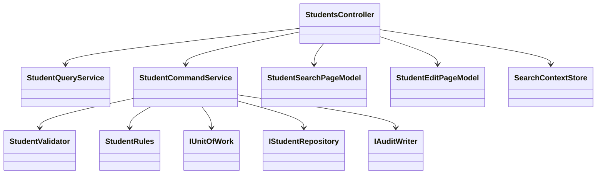

<!-- spec-meta: {"schema":"spec-md/1.0","documentId":"CSHARP_ASPNET-COM-CSharp_ASPNET","version":"8.0","path":"test-project1/srcs/CSharp_ASPNET/spec/共通/方式別/CSharp_ASPNET/01_共通実装仕様.md","sheets":[{"heading":"クラス・配置","kind":"GRID","sheet":"01_クラス・配置"},{"heading":"SQLと同時実行","kind":"GRID","sheet":"02_SQLと同時実行"},{"heading":"サーバー状態・認証・UI","kind":"GRID","sheet":"03_サーバー状態・認証・UI"},{"heading":"共通規約・日付実装","kind":"GRID","sheet":"04_共通規約・日付実装"}],"isolationProfile":"CSharp_ASPNET"} -->
# C#／ASP.NET 共通実装仕様

| 項目 | 内容 |
| --- | --- |
| 版数・改訂日 | 8.0／2026-10-12 |
| 対象方式 | C#／ASP.NET |
| 適用 | 設計上の実装契約。製品コードの実装・コンパイルは未実施 |

開発入力：[学生検索詳細](../../../詳細仕様書/CSharp_ASPNET/01_学生検索画面.md)／[学生登録詳細](../../../詳細仕様書/CSharp_ASPNET/02_学生登録画面.md)／[共通実装](01_共通実装仕様.md)／[DB定義](../../../DB定義/SQLServer/01_DB定義書.md)／[方式別開発規約](../../../規約/CSharp_ASPNET.md)／[共通開発規約](../../../規約/開発規約.md)。

## クラス・配置

```text
Web/Controllers/StudentsController.cs
Web/Models/StudentSearchPageModel.cs, StudentEditPageModel.cs
Web/Inputs/StudentSearchInput.cs, StudentSaveInput.cs, StudentDeleteInput.cs
Web/Views/Students/Search.cshtml, Edit.cshtml
Web/Views/Shared/_Layout.cshtml, _MessagePanel.cshtml, _CodeSelect.cshtml
Web/Views/Shared/_ClassSelector.cshtml, _Pager.cshtml, _DuplicateConfirmation.cshtml
Application/StudentQueryService.cs, StudentCommandService.cs, MasterMaintenanceService.cs
Domain/Student.cs, SchoolClass.cs, CodeCategory.cs, CodeEntry.cs, StudentDraft.cs
Infrastructure/Microsoft.Data.SqlClientStudentRepository.cs, SqlServerUnitOfWork.cs, AuditWriter.cs
Infrastructure/SearchContextStore.cs, DuplicateConfirmationStore.cs, FlashMessageStore.cs
```



Controllerは認証・HTTP入出力だけ、Serviceは確定単位、RepositoryはSQL、Viewは表示。共通01～03はCurrentUserAccessor/AuthorizationService/BusinessClock、04～05はStudentNormalizer/StudentValidator、06～10はMasterLookupService/StudentRules/CapacityService/DuplicateService、11～12は各StateStore、13はSqlServerUnitOfWork、14はAuditWriter、15はMessageCatalog/ExceptionFilter。

```csharp
[Authorize]
public sealed class StudentsController : Controller {
    // Input DTOだけを受理。Entityの管理列はバインドしない。
    [HttpPost("/students/{id:long}/update")]
    [ValidateAntiForgeryToken]
    public async Task<IActionResult> Update(long id, StudentSaveInput input,
                                            CancellationToken ct) {
        // 正規化・権限・検査・Txはサービスで行い、結果別にView/303を返す。
        var result = await service.UpdateAsync(id, input, ct);
        return Present(result, input);
    }
}
```

構造例であり、service/Presentの完全実装を省略している。非同期I/OにAwaitを用い、HTTP要求のScoped接続をSingletonへ保持しない。

## SQLと同時実行

共通の保存・検索手順は[SQL Server DB定義](../../../DB定義/SQLServer/01_DB定義書.md)の補足説明を適用する。ここで定義するRepository/UnitOfWorkはその入出力・確定境界を実装する。名前だけを別DBへ置換したSQLは使用しない。

## サーバー状態・認証・UI

基準はWebサーバー1台。SearchContextStoreは認証UserId＋LoginSessionId＋TabIdで所有者を照合し、256bit乱数のContextId、AppliedCriteria、Page、PageSize、Sort、Revision、ExpiresAtを持つ。30分スライド期限、要求はContextId単位で直列化し古いRevisionを拒否。個人情報をCookieへ保存しない。

DuplicateConfirmationStoreは10分固定、利用者・対象・旧版・固定順正規化業務値のSHA256・全候補ID/版のSHA256を保存。理由・復帰先・選択補助はハッシュ対象外だが別途毎回検査。同一トークン同時処理は拒否、成功で消費、書込み開始後の例外・結果不明で失効。複数ノード化する場合は共有ストアと保護鍵を使用する別配置設計が必要。

Razorの標準エスケープを利用し、学生値をHtml.Rawへ渡さない。input名とModelStateキーを対応付ける。日付空欄、停止既存値、エラー時候補再構成、未保存破棄確認を共通部分ビュー化。個人情報ページはCache-Control:no-store。HTTPS、Secure/HttpOnly Cookie、ログイン失効時再認証、全POSTの明示的なCSRF検証を行う。[S-14]

サーバーは共通認証から得た利用者を信頼し、フォームのUserId/Roleは受け取らない。DB資格情報はサーバーだけが保持し最小権限。通常ログへ要求本文・氏名・住所・メール・トークンを出さない。

## 共通規約・日付実装

対象読者は実務経験５年程度のプログラマー。[検索詳細](../../../詳細仕様書/CSharp_ASPNET/01_学生検索画面.md)／[登録詳細](../../../詳細仕様書/CSharp_ASPNET/02_学生登録画面.md)／[開発規約](../../../規約/開発規約.md)／[日付正本](../../07_日付・和暦仕様.md)。

共通16の入力は元号識別値・年・月・日という原文字列4値と業務日。出力は正規化日付と和暦表示文字列、または項目エラー。共通17は項目種別と日付／年度にDATE-R01～06を適用する。変換で不正日を補正しない。OS全体の暦設定を変更しない。元号表の版を画面・保存側で一致させる。

| 役割 | 実装仕様 |
| --- | --- |
| 共通16物理名 | _JapaneseBirthDate.cshtml / JapaneseDateService |
| 内部日付型 | DateOnly / DateOnly? |
| 入力と保存 | 和暦原入力4値から日付を生成。StudentDraft等のbirth_date相当は正規化日付。元号をDBへ重複保存しない |
| 通信境界 | Webの保存要求はbirthDateInputの4文字列を受け、保存側で厳密変換。既存取得応答のbirthDateはISO日付。入力と応答の型を混同しない |
| 表示 | 一覧・参照・重複確認のBirthDateWareki相当文字列は共通16で生成。その他の日付・日時は西暦 |
| 例外 | CHK-032～034、E-DATE-001～003。構文検査後、実在日、元号境界、逆変換、業務範囲、前後関係を順に検査 |
| 参考試験 | DATE-T01～20。ライブラリーの解析成功だけで元号境界を合格にしない |

### 保守入口・方式固有の適合条件

#### 戻る・権限・保守・試験

検索状態は認証者・セッション・タブ別30分、重複確認10分。改変・他人のIDは拒否。取消は最後の読込スナップショット、再読込は明示確認後GET、戻るは未保存破棄確認。保存確定後の応答喪失は結果不明で検索を案内。

管理者用`StudentMaintenance`コンソールはWebと同じサービスとゲートを利用。初期5分類70値、キー不変、保護コード、クラス参照・定員・期間の確認と監査を実行。マスタ専用Web画面は追加しない。

共通T-01～28に加え、CSRF欠落、余分なEntity管理列の送信、フォーム二重POST、ブラウザー戻る、認証失効、XSS文字列、条件がURLへ出ないこと、ModelState入力保持、候補0件、cookieに個人情報を保存しないことを試験する。

### SQL Server接続・型・共通呼出契約

検索Repositoryは型付き条件、page/pageSize、Cancellation/要求IDを受け、上限超過/件数/一覧/検索日時を返す。SqlServerUnitOfWorkは検索をSNAPSHOT、保存をREAD COMMITTED＋Transaction所有のsp_getapplockで制御する。全DBコマンドは同じConnection/Transactionを受け、個別Commitを禁止する。保存戻り値はSuccess/ValidationError/ConfirmationRequired/Conflict/NotFound/Unknownに分ける。OUTPUT値はCOMMIT確認前にSuccessへしない。

.NETはMicrosoft.Data.SqlClientを参照。SqlDbType.BigInt/Int/SmallInt/Bit/Date/DateTimeOffset/VarChar/NVarChar/UniqueIdentifier/VarBinaryをDB定義と対応させる。長さを推測するAddWithValueを標準にせず型とSizeを明示する。日付パラメーターはDateOnly対応を採用ドライバーで試験し、未対応アダプターではDateTimeの年月日をSqlDbType.Dateへ渡し時差変換しない。GUIDと画面token文字列の表現を混同しない。

WHERE/LIKE/ページ/例外・ゲート戻り値はSQL Server DB定義を正本とし、LIKEは!/%/_/[のリテラル化を含む。接続暗号化、証明書検証、認証主体を最小権限で分離。UIの権限表示だけを更新認可として使わない。

### 派生分類と監査の共通実装

新規／通常更新は[共通データアクセス](../../08_データアクセス仕様.md)の緊急４保存項目一式を適用する。続柄分類を常にRELATIONSHIPへ設定する処理は禁止し、続柄値未設定時は分類もNULLへバインドする。コード値を更新する際は分類も同時更新し、変更列監査へ含める。必須３分類は固定のまま。

マスタ監査は[共通モジュール](../../03_共通モジュール設計.md)の状態遷移表に従い、停止中の名称変更はUPDATE、状態が実際に停止へ変わる時だけDISABLEとする。認証不成立はE-COM-001、認証済み利用者の認可拒否はE-COM-002を使用し、実装の誤った番号を仕様値として採用しない。

