<!-- spec-meta: {"schema":"spec-md/1.0","documentId":"CSHARP_ASPNET-DET-CSharp_ASPNET-SCR-STU-001","version":"1.1","path":"詳細仕様書/CSharp_ASPNET/01_学生検索画面.md","sheets":[{"heading":"概要","kind":"GRID","sheet":"01_概要"},{"heading":"項目一覧","kind":"LIST","sheet":"02_項目一覧","key":["No"]},{"heading":"選択候補一覧","kind":"LIST","sheet":"03_選択候補一覧","key":["候補ID"]},{"heading":"内部項目一覧","kind":"LIST","sheet":"04_内部項目一覧","key":["内部項目ID"]},{"heading":"イベント仕様","kind":"GRID","sheet":"05_イベント仕様"},{"heading":"項目移送仕様","kind":"LIST","sheet":"06_項目移送仕様","key":["移送ID"]},{"heading":"補足説明","kind":"GRID","sheet":"07_補足説明"}]} -->
# 学生検索画面 詳細仕様書

| 文書属性 | 値 |
| --- | --- |
| 文書ID | CSHARP_ASPNET-DET-CSharp_ASPNET-SCR-STU-001 |
| 文書種別 | detailed-specification |
| 版 | 1.1 |
| 正本の相対パス | 詳細仕様書/CSharp_ASPNET/01_学生検索画面.md |
| 対象 | ASP.NETの学生検索フォーム、検索状態、候補、一覧取得、登録画面との移送 |
| 読者 | 業務システムのIT担当者、経験5年程度の実装者 |
| 根拠の区分 | 「実装根拠」は現行ソースの静的な観測、「設計意図」は参考設計が要求する動作を示す。 |

## 概要

### 機能と処理の責務

学生検索画面は、論理削除されていない学生を検索し、新規登録・編集・参照へ進む入口である。年度と学年は、学生の所属先 `class_id` が参照するクラスの属性を使って絞り込む。年度別の所属履歴を読み出す処理はない。検索画面の操作は学生やマスタを更新せず、検索条件、結果、ページ、検索状態の版をサーバープロセスのメモリへ保持する。〔実装根拠：`sources/Views/Students/Search.cshtml:4-8`、`sources/Core/SqlServerStudentService.cs:137-168`、`sources/Infrastructure/WebStudentCoordinator.cs:7-15`〕

画面で編集中の条件、最後に正常実行した条件 `Applied`、その結果 `LastResult` は別の値である。候補更新は編集中の条件を返し、一覧には保持結果を使う。ページ操作は保持条件を複製して実行し、編集中の検索フォームを送信しない。サービス内の正規化キーや電話値はSQL照合用のローカル値であり、保持条件の文字列へ書き戻さない。〔実装根拠：`sources/Web/Controllers/StudentsController.cs:13-22`、`sources/Infrastructure/WebStudentCoordinator.cs:8-14`、`sources/Core/SqlServerStudentService.cs:113-153`〕

参考設計は、学生基本情報の検索から登録画面へ進む業務を対象とし、入力・処理値・DB・再表示の対応を確認する責務を定義している。本書では現行の接続と動作を具体化し、候補連動、失効時の初期化、表示形式等の設計との差を補足説明に分ける。〔設計意図：`reference-designs/詳細仕様書/CSharp_ASPNET/01_学生検索画面.md:16-25`、`reference-designs/詳細仕様書/CSharp_ASPNET/01_学生検索画面.md:586-608`〕

### 接続される入口

| HTTP入口 | 実画面・受信値 | 接続先と結果 |
| --- | --- | --- |
| GET `/students` | 初回は状態指定なし。復帰は `contextId`、`contextRevision`。 | `StudentsController.Index`。初期状態の作成、または `Resume` 後に検索HTMLを返す。 |
| POST `/students/search` | 検索フォーム。`Criteria` 接頭辞の `StudentSearchInput`、状態3項目、表示3項目。 | `Search` → Coordinatorの `Search` → 登録された `IStudentService.SearchAsync`。 |
| POST `/students/options` | 検索フォームの「候補を更新」。原ビューはボタンの `formaction` で送信先を変更する。 | Controllerの `Options` → `SearchModel` → `LookupAsync(false, ct)`。全HTMLを返す。 |
| POST `/students/page` | 一覧側の独立フォーム。`PageRequest` と `TabId`。 | `Page` → Coordinatorの `Page`。保持条件で再検索する。 |
| POST `/students/clear` | 独立したクリアフォーム。`ContextRequest` と `TabId`。 | `Clear` → Coordinatorの `Clear`。同じ状態を未検索へ戻す。 |
| GET `/students/new` | Viewer以外に表示する新規登録リンク。`returnContextId`。 | 登録側の `Load(null, ...)`。新規登録権限を入口でも確認する。 |
| GET `/students/{id:long}` | 一覧の学生IDと `returnContextId`。 | 登録側の `Load(id, ...)`。最新の非削除学生を再取得する。 |

`Program` は依存登録、middleware、Controllerルートを接続する。Controller全体に `Authorize` と `Route("students")` がある。`RequestIdentity`、Coordinator、`IStudentService` はScoped、検索状態・Flash・編集スナップショットはSingletonである。`IStudentService` の実装は `SqlServerStudentService` で、`StudentDb` が空白の場合は生成時に503の `WebFault` となる。WebとCoreは `net10.0`、CoreのSqlClient参照は6.1.3である。〔実装根拠：`sources/Program.cs:2-8`、`sources/Infrastructure/WebHostSetup.cs:13-19`、`sources/Web/Controllers/StudentsController.cs:5-25`、`sources/StudentManagement.Web.csproj:1-5`、`sources/Core/StudentManagement.Core.csproj:1-9`〕

`SearchRequest` は検索アクションが組み立てる内部引数である。`OptionsRequest`、`StrictJson.Read`、Coordinatorの `Options`、`WebPresentation.Lookups` は宣言されているが、接続された学生フォームのControllerから呼ばれない。したがって、これらを公開学生JSON APIへ数えず、StrictJsonの64KiB、深さ16、重複・未知プロパティ検査をフォーム受信の保証へ転用しない。〔実装根拠：`sources/Web/Inputs/StudentSearchInput.cs:24-31`、`sources/Infrastructure/StrictJson.cs:4-15`、`sources/Infrastructure/WebStudentCoordinator.cs:16-16`、`sources/Infrastructure/WebPresentation.cs:8-19`、`sources/Web/Controllers/StudentsController.cs:13-22`〕

### 入出力と保持領域

| 領域 | 当該機能との関係 | 内容 |
| --- | --- | --- |
| HTTPフォーム | 入力 | 条件、ページ・ソート、状態ID・版・タブ、CSRF情報。MVCのバインド後にアクションへ渡る。 |
| 認証情報 | 入力 | Claimの主体、ログインセッション、Role。フォームから権限を受けない。 |
| 学生DB | 読取り | 条件照合、件数、一覧。検索入口から学生保存や履歴追記を行わない。 |
| クラス・コード・コード種別DB | 読取り | 指定値の存在、所属組合せ、候補、一覧の名称。 |
| 検索状態 | 入出力 | メモリ辞書内のEntry。条件、結果、版、期限、所有者、タブ、Gate。 |
| Flash | 取得・消費 | 主体・セッション・状態ID別のメモリ通知。GETで一度だけ取り出す。 |
| HTML | 出力 | 条件、候補、一覧、情報・エラー、権限別リンク。モデル内のJsonElementは公開JSON応答ではない。 |
| DOM | 一時的な入出力 | 未所属切替の値解除、送信中のbutton・form属性。サーバー保持条件とは別。 |
| 外部ファイル | 対応処理なし | この検索入口にはCSV、帳票、取込ファイルの入出力がない。 |

〔実装根拠：`sources/Infrastructure/RequestIdentity.cs:7-16`、`sources/Infrastructure/SearchContextStore.cs:9-15`、`sources/Infrastructure/FlashMessageStore.cs:6-9`、`sources/Web/Models/StudentSearchPageModel.cs:6-15`、`sources/wwwroot/js/site.js:4-7`〕

### 画面の静的投影

以下はStaffの初期未検索状態の非実行投影である。共有ヘッダー、フォームの配置、一覧枠、実際に適用されるCSSセレクターを反映する。年度・クラスは実データを作らず、コードはseedの定義から表示例を抜粋する。初期画面には情報・エラー領域を出さず、発生時だけ共有MessagePanelが追加する。

送信先・method・遷移先は `data-*` に残す。すべてのbuttonは `type="button"` とし、formの `action`、buttonの `formaction`、アプリURLへの `href`、JavaScriptを付けない。実行画面の撮影を示すものではない。〔投影根拠：`sources/Views/_ViewStart.cshtml:1-1`、`sources/Views/Shared/_Layout.cshtml:1-1`、`sources/Views/Shared/_MessagePanel.cshtml:1-3`、`sources/Views/Students/Search.cshtml:3-8`、`sources/wwwroot/css/site.css:1-1`、`sources/database/002_seed.sql:19-23`、`sources/database/002_seed.sql:78-84`〕

<!doctype html>
<html lang="ja">
<head>
<meta charset="utf-8">
<meta name="viewport" content="width=device-width,initial-scale=1">
<title>学生管理</title>
<style>
:root{font-family:Meiryo,'Yu Gothic UI',sans-serif;color:#243448;background:#f2f5f9;font-size:14px}*{box-sizing:border-box}body{margin:0}header{background:#153654;color:white;padding:16px 28px;display:flex;justify-content:space-between;gap:20px}main{background:white;max-width:1440px;margin:24px auto;padding:24px}h1{font-size:24px}fieldset{border:1px solid #c8d1dc;padding:18px;margin:12px 0}legend{font-weight:bold}.fields{display:grid;grid-template-columns:1fr 1fr;gap:14px 28px}label{display:flex;flex-direction:column;gap:5px}input,select,textarea,button{font:inherit;padding:8px;border:1px solid #afbece;border-radius:3px}input,select,textarea{max-width:100%;width:100%}.check{display:inline-flex;flex-direction:row;align-items:center;margin-right:12px}.check input{width:auto}.actions{display:flex;gap:10px;align-items:center;flex-wrap:wrap;margin:16px 0}button{background:white;cursor:pointer}.primary{background:#1c5985;color:white}button:disabled{cursor:default;color:#8a98a5;background:#f3f5f8}.message{padding:14px;border:1px solid #b6dccc;background:#edf7f3}.error{background:#fff1f1;border-color:#c66}.warning{background:#fff8eb;padding:12px}.grid{overflow-x:auto}table{border-collapse:collapse;min-width:1050px;width:100%;font-size:12px}th,td{padding:10px 8px;border:1px solid #d4dee8;vertical-align:top;overflow-wrap:anywhere}th{background:#e6eef6}tr:nth-child(even){background:#f8fafc}.pager{display:flex;gap:14px;align-items:center;justify-content:center;margin:18px}small{color:#5f7183}@media(max-width:760px){main{margin:0;padding:15px}.fields{grid-template-columns:1fr}header{flex-direction:column}}
</style>
</head>
<body>
<header><strong>学生管理システム</strong><span>利用者 〔表示名〕　業務日 〔yyyy/MM/dd〕</span></header>
<main>
<h1>学生検索</h1>
<form data-method="POST" data-action="/students/search" data-search-form>
<input type="hidden" name="ContextId" value=""><input type="hidden" name="ContextRevision" value="1"><input type="hidden" name="TabId" value=""><input type="hidden" name="PageSize" value="20"><input type="hidden" name="SortKey" value="studentNo"><input type="hidden" name="SortDirection" value="asc"><input type="hidden" name="__RequestVerificationToken" value="">
<fieldset><legend>検索条件</legend><div class="fields">
<label>学籍番号<input name="Criteria.StudentNo" id="SRC-001" maxlength="30" value=""></label>
<label>氏名<input name="Criteria.Name" id="SRC-002" maxlength="16" value=""></label>
<label>氏名カナ<input name="Criteria.Kana" id="SRC-003" maxlength="72" value=""></label>
<label>年度<select name="Criteria.SchoolYear" id="SRC-004"><option value="">すべて</option></select></label>
<label>学年<select name="Criteria.GradeCode" id="SRC-005"><option value="">すべて</option><option value="00">学年なし</option><option value="01">1年</option><option value="02">2年</option><option value="03">3年</option><option value="04">4年</option><option value="05">5年</option><option value="06">6年</option></select></label>
<label>クラス<select name="Criteria.ClassId" id="SRC-006"><option value="">すべて</option></select></label>
<label class="check"><input type="checkbox" name="Criteria.UnassignedOnly" id="SRC-007" value="true">未所属のみ</label>
<fieldset><legend>在籍区分</legend><label class="check"><input type="checkbox" name="Criteria.StatusCodes" value="01" checked>在学</label><label class="check"><input type="checkbox" name="Criteria.StatusCodes" value="02" checked>休学</label><label class="check"><input type="checkbox" name="Criteria.StatusCodes" value="03">卒業</label><label class="check"><input type="checkbox" name="Criteria.StatusCodes" value="04">退学</label><small>全解除はすべて</small></fieldset>
<label>都道府県<select name="Criteria.PrefectureCode" id="SRC-009"><option value="">すべて</option><option value="01">北海道</option></select></label>
<label>電話番号<input name="Criteria.PhoneNumber" id="SRC-010" maxlength="40" value=""></label>
<label>入学日・開始<input name="Criteria.AdmissionFrom" id="SRC-011" type="date" value=""></label>
<label>入学日・終了<input name="Criteria.AdmissionTo" id="SRC-012" type="date" value=""></label>
</div><div class="actions"><button type="button" class="primary" data-method="POST" data-action="/students/search">検索</button><button type="button" data-method="POST" data-formaction="/students/options">候補を更新</button></div></fieldset>
</form>
<div class="actions"><form data-method="POST" data-action="/students/clear"><input type="hidden" name="__RequestVerificationToken" value=""><input type="hidden" name="ContextId" value=""><input type="hidden" name="ContextRevision" value="1"><input type="hidden" name="TabId" value=""><button type="button">クリア</button></form><a href="#event-register" data-route="/students/new?returnContextId={ContextId}">新規登録</a></div>
<p>未検索</p>
<form data-method="POST" data-action="/students/page"><input type="hidden" name="__RequestVerificationToken" value=""><input type="hidden" name="ContextId" value=""><input type="hidden" name="ContextRevision" value="1"><input type="hidden" name="TabId" value="">
<div class="actions"><label>表示件数<select name="PageSize"><option value="20" selected>20</option><option value="50">50</option><option value="100">100</option></select></label><label>並び順<select name="SortKey"><option value="studentNo" selected>学籍番号</option><option value="name">氏名</option><option value="admissionDate">入学日</option><option value="updatedAt">更新日時</option></select></label><select name="SortDirection" aria-label="並び順方向"><option value="asc" selected>昇順</option><option value="desc">降順</option></select><button type="button" name="Page" value="1" disabled>並び順・件数を反映</button></div>
<div class="grid"><table><thead><tr><th>学籍番号</th><th>氏名</th><th>氏名カナ</th><th>生年月日</th><th>年度／学年</th><th>クラス</th><th>在籍区分</th><th>住所</th><th>本人電話</th><th>更新日時</th><th>操作</th></tr></thead><tbody></tbody></table></div>
<nav class="pager"><button type="button" name="Page" value="0" disabled>前へ</button><span>1 / 1</span><button type="button" name="Page" value="2" disabled>次へ</button></nav>
</form>
</main>
</body>
</html>

未所属OFFの投影では所属selectの `disabled` を省略する。ONの応答では3つへ `disabled` を付けるが、値の解除は次の状態表の経路ごとに異なる。Viewerでは新規リンクを省略し、結果行の操作文言を「参照」にする。Staff・Administratorでは「編集」である。通常結果の行リンクは本投影と同じく文書内fragmentに置き換え、元の学生IDとrouteを `data-route` に残す。

### 状態別表示

| 状態・発生経路 | 条件・一覧の扱い | 操作・表示の条件 |
| --- | --- | --- |
| 初期未検索 | 在籍01・02、他条件は空またはNULL。行なし、文言「未検索」。 | 20件、学籍番号昇順、1ページ。ページ反映・前・次は非活性。 |
| 正常検索0件 | 条件と0件結果を保持。文言「該当する学生はありません。」。 | 行なし、ページ操作は非活性。検索日時は結果にあるがこの枝では表示しない。 |
| 10000件超過 | Count=10001は打切り値。行を取得しない。 | `p.warning` に上限文言。実総数・検索日時をこの文言に付けない。ページ操作は非活性。 |
| 正常検索1～10000件 | 件数、検索日時、取得ページの行を表示する。 | 反映は活性。前はpage>1、次はpage×PageSize<countのとき活性。 |
| 検索のModelState不正・個別WebFault | 受信DTOとModelStateを再表示へ渡す。当該応答はNULL結果で、以前の保持結果を暗黙表示しない。 | 設定したstatusとエラーを使用する。後続の候補取得・描画の成功は別条件。 |
| 候補更新・未所属ON | Controllerが年度・学年・クラスをNULLにし、対応するModelStateを除去する。保持一覧は維持する。 | 応答の3selectはdisabled。Applied・版・期限は変更しない。 |
| 検索拒否再表示・未所属ON | Controllerは所属値とModelStateを解除しない。受信値が再表示モデルへ残る。 | ビューは3selectをdisabledにする。サーバーの値解除とは別。 |
| JavaScript初回評価・未所属change | ONなら所属3項目のDOM値を空にする。OFFでは復元しない。 | disabledを変更せず、候補通信も行わない。検索拒否画面でもスクリプト実行後にDOM値が解除され得る。 |
| Viewer | 新規リンクなし。行リンクは参照。 | 検索・候補・ページ・クリアは配置される。 |
| Staff・Administrator | 新規リンクと編集リンクを表示する。 | 検索画面には削除ボタンを置かない。 |
| middlewareの例外応答 | 検索ビューとは別のHTMLエラーとなる。 | 応答未開始の場合に捕捉し、WebFaultのstatusまたは一般例外503を使う。 |

`_MessagePanel` はエラーを `message error`、情報を `message info`、両方を `aria-live="polite"` で出す。独立した `.info` セレクターはなく `.message` が適用される。検索上限の `.warning` に、共有CSSの固定配置 `.dialog` は適用されない。〔実装根拠：`sources/Views/Students/Search.cshtml:2-8`、`sources/Views/Shared/_MessagePanel.cshtml:1-3`、`sources/wwwroot/css/site.css:1-1`、`sources/Web/Controllers/StudentsController.cs:13-22`、`sources/wwwroot/js/site.js:7-7`〕

### 宣言されたDB関連

次のER図は検索に関係する実FKを示す。コードの参照は分類と値の複合キーである。学生の `class_id` はNULL可で最大1クラスを参照し、クラスは0人以上の学生から参照される。ただし在籍01・02はCHECK制約により所属必須となる。

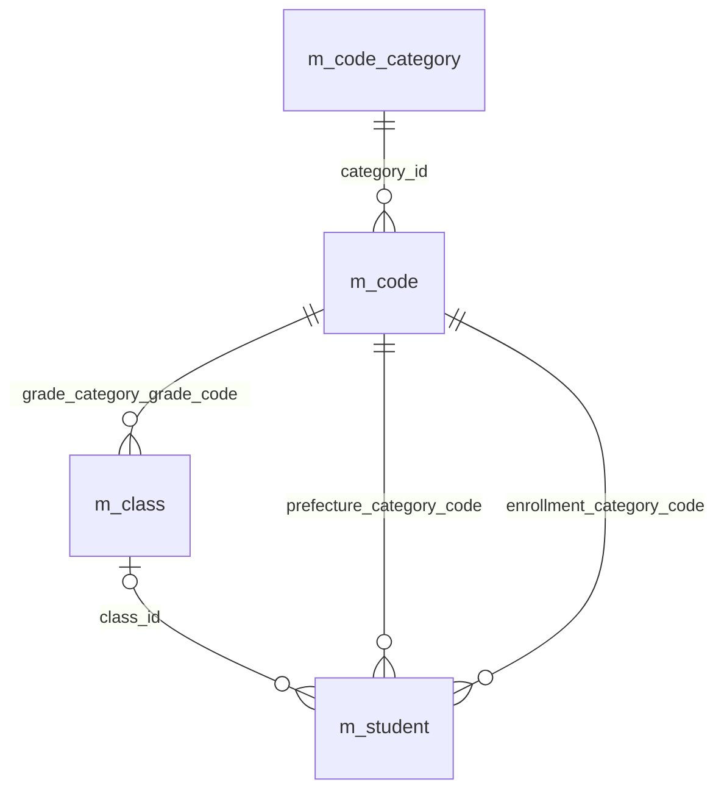

一覧は所属と3用途のコード名称をLEFT JOINし、候補コードはコード種別とINNER JOINする。FKの多重度とSQLのJOIN種別は別の事項である。履歴への検索時の追記はない。〔実装根拠：`sources/database/001_schema.sql:189-198`、`sources/Core/SqlServerStudentService.cs:82-90`、`sources/Core/SqlServerStudentService.cs:203-208`〕

## 項目一覧

| No | グループ | 項目名 | 種類 | 入出力 | DB連携項目 | 候補取得元 | 必須 | 形式・桁 | 説明 |
| --- | --- | --- | --- | --- | --- | --- | --- | --- | --- |
| SRC-001 | 検索条件 | 学籍番号 | input、id=`SRC-001` | I | `m_student.student_no: varchar(15) NOT NULL`、BIN2。前方一致。 | ‐ | 任意 | HTML maxlength=30。raw・Trim後・FormKCと大文字化後の各上限15スカラー。 | `Criteria.StudentNo` → DTO `StudentNo: string` →条件 `StudentNo: string?`。初期空。NULL・空文字は条件なし、非空の空白だけは必須検査で拒否。先頭英数字、後続英数字・ハイフン。`@no: VarChar(31)`。〔`sources/Web/Inputs/StudentSearchInput.cs:7-22`、`sources/Core/StudentNormalizer.cs:59-64`、`sources/Core/SqlServerStudentService.cs:113-140`、`sources/database/001_schema.sql:9-9`〕 |
| SRC-002 | 検索条件 | 氏名 | input、id=`SRC-002` | I | 検索は `name_key: nvarchar(320) NOT NULL`、BIN2。表示・保存原表記は `student_name: nvarchar(16) NOT NULL`。 | ‐ | 任意 | HTML16、raw・Trim後8スカラー。照合キー160スカラー。 | `Criteria.Name` → `Name: string` → `StudentName: string?`。初期空。Text後にFormKC、大文字化、全Unicode空白除去。空・空白だけは条件なし。`@name: NVarChar(642)` の部分一致。〔`sources/Core/StudentNormalizer.cs:47-70`、`sources/Core/SqlServerStudentService.cs:114-141`、`sources/database/001_schema.sql:10-12`、`sources/database/001_schema.sql:44-46`〕 |
| SRC-003 | 検索条件 | 氏名カナ | input、id=`SRC-003` | I | 検索 `kana_key`、表示・保存 `student_name_kana`。双方 `nvarchar(36) NOT NULL`。キーはBIN2。 | ‐ | 任意 | HTML72、raw・Trim後36、正規化後18スカラー。 | `Criteria.Kana` → `Kana: string` → `StudentNameKana: string?`。初期空。FormKC、空白整理、限定ひらがな変換、限定カタカナ検査、18スカラー検査、検索用ASCII空白除去の順。具体的集合は補足説明。`@kana: NVarChar(74)`。非空の空白入力は空キーで `LIKE '%%'`。〔`sources/Core/StudentNormalizer.cs:72-85`、`sources/Core/SqlServerStudentService.cs:116-142`、`sources/database/001_schema.sql:11-13`、`sources/database/001_schema.sql:45-47`〕 |
| SRC-004 | 検索条件 | 年度 | select、id=`SRC-004` | I | `m_class.school_year: smallint NOT NULL`。一致条件。 | CAND-001 | 任意 | DTO・条件とも `int?`。1900～9998と年度存在を検査。 | `Criteria.SchoolYear`。初期NULL、「すべて」は未指定。原HTTP文字列の4桁検査はサービスにない。`@year: SmallInt`。未所属ONの応答はdisabled。〔`sources/Web/Inputs/StudentSearchInput.cs:10-22`、`sources/Core/SqlServerStudentService.cs:109-129`、`sources/Core/SqlServerStudentService.cs:143-143`、`sources/database/001_schema.sql:64-64`〕 |
| SRC-005 | 検索条件 | 学年 | select、id=`SRC-005` | I | `m_class.grade_code: varchar(2) NOT NULL`。参照値は `m_code.code_value: varchar(10) NOT NULL`。 | CAND-002 | 任意 | DTO・条件 `string?`。raw・Trim後2スカラー、FormKC後ASCII数字2桁。 | `Criteria.GradeCode`。初期NULL。空・空白はNULLへ正規化。GRADEの存在確認後に `@grade: VarChar(2)` で一致。00は学年なしという値で、未所属や未指定とは別。〔`sources/Core/StudentNormalizer.cs:113-117`、`sources/Core/SqlServerStudentService.cs:118-144`、`sources/database/001_schema.sql:65-66`、`sources/database/002_seed.sql:78-84`〕 |
| SRC-006 | 検索条件 | クラス | select、id=`SRC-006` | I | 学生 `class_id: bigint NULL` →クラス `class_id: bigint IDENTITY NOT NULL`、PK。 | CAND-003 | 任意 | 受信 `string?`、条件 `long?`。ASCII数字19コード単位以内、正のInt64。 | `Criteria.ClassId`。NULL・空は未指定。IdParserはTrim・FormKCなし。先行ゼロを一律禁止しない。変換後に実在・指定年度・正規化学年との一致を検査。`@class`、存在確認の `@id` はBigInt。〔`sources/Web/Inputs/StudentSaveInput.cs:57-60`、`sources/Web/Inputs/StudentSearchInput.cs:12-22`、`sources/Core/SqlServerStudentService.cs:131-145`、`sources/database/001_schema.sql:28-28`、`sources/database/001_schema.sql:63-80`〕 |
| SRC-007 | 検索条件 | 未所属のみ | checkbox、id=`SRC-007` | I | `s.class_id IS NULL`。boolの保存列なし。 | ‐ | 任意 | `Criteria.UnassignedOnly: bool` →条件 `bool`。初期false。 | trueかつ所属3条件のいずれか非NULLなら、正規化前にE-SRC-001で拒否。GradeCodeの空文字もこの段階では非NULL。値解除の層は概要の状態表に従う。SQLパラメータなし。〔`sources/Core/SqlServerStudentService.cs:110-110`、`sources/Core/SqlServerStudentService.cs:146-146`、`sources/Web/Controllers/StudentsController.cs:22-22`、`sources/wwwroot/js/site.js:7-7`〕 |
| SRC-008 | 検索条件 | 在籍区分 | checkbox群。実ビューにSRC-008のidなし。 | I | `m_student.enrollment_status_code: varchar(2) NOT NULL`。 | CAND-004 | 任意 | `Criteria.StatusCodes: string[]` → `EnrollmentStatusCodes: string[]`。最大4、重複なし、01～04。 | 初期01・02。検索・候補更新で項目未送信なら空配列へ。空配列は状態条件なし。完全一致検査でFormKCなし。各 `@status0`～`@status3: VarChar(2)`。NULL配列は空配列と別。〔`sources/Views/Students/Search.cshtml:5-5`、`sources/Web/Controllers/StudentsController.cs:14-22`、`sources/Core/SqlServerStudentService.cs:111-112`、`sources/Core/SqlServerStudentService.cs:151-153`、`sources/database/001_schema.sql:25-26`〕 |
| SRC-009 | 検索条件 | 都道府県 | select、id=`SRC-009` | I | `m_student.prefecture_code: varchar(2) NOT NULL`。分類列との複合FK。 | CAND-005 | 任意 | DTO・条件 `string?`。raw・Trim後2スカラー、FormKC後ASCII数字2桁。 | `Criteria.PrefectureCode`。初期NULL。空・空白はNULLへ。PREFECTUREの存在確認後に `@prefecture: VarChar(2)` で一致。未指定は保存列NULLの検索を意味しない。〔`sources/Core/StudentNormalizer.cs:113-117`、`sources/Core/SqlServerStudentService.cs:119-147`、`sources/database/001_schema.sql:18-19`、`sources/database/001_schema.sql:193-193`〕 |
| SRC-010 | 検索条件 | 電話番号 | input、id=`SRC-010` | I | 本人 `phone_number` と緊急 `emergency_phone_number`。双方 `varchar(16) NULL`。 | ‐ | 任意 | HTML40、raw・Trim後20スカラー、正規化後最大16文字。 | `Criteria.PhoneNumber` →DTO `string` →条件 `string?`。初期空。Text、FormKC、限定記号・空白除去、電話形式検査の順。具体的集合は補足説明。本人・緊急の完全一致OR、共通 `@phone: VarChar(16)`。〔`sources/Core/StudentNormalizer.cs:87-93`、`sources/Core/SqlServerStudentService.cs:117-148`、`sources/database/001_schema.sql:22-22`、`sources/database/001_schema.sql:32-32`〕 |
| SRC-011 | 検索条件 | 入学日・開始 | input type=date、id=`SRC-011` | I | `m_student.admission_date: date NOT NULL` の下限。 | ‐ | 任意 | DTO・条件 `string?` →ローカル `DateOnly? from`。FormKC後厳密な `yyyy-MM-dd`。 | `Criteria.AdmissionFrom`。初期NULL。NULL・空は制約なし。Trimなし。実在日、1900-01-01以上、日本時間業務日以下を検査。raw10文字の事前上限検査はない。`>=@from: Date`。〔`sources/Core/JapaneseDateService.cs:52-59`、`sources/Core/SqlServerStudentService.cs:120-122`、`sources/Core/SqlServerStudentService.cs:149-149`、`sources/database/001_schema.sql:24-24`〕 |
| SRC-012 | 検索条件 | 入学日・終了 | input type=date、id=`SRC-012` | I | `m_student.admission_date: date NOT NULL` の上限。 | ‐ | 任意 | DTO・条件 `string?` →ローカル `DateOnly? to`。開始と同じ日付検査。 | `Criteria.AdmissionTo`。初期NULL。片側指定可。両端指定時の開始超過はE-STU-006。`<=@to: Date`。両端を含む。〔`sources/Web/Inputs/StudentSearchInput.cs:17-22`、`sources/Core/SqlServerStudentService.cs:120-122`、`sources/Core/SqlServerStudentService.cs:150-150`〕 |
| PAGE-001 | 表示指定 | 表示件数 | 一覧select、検索hidden。idなし。 | I | 保存列なし。`@size: Int`。 | CAND-006 | 許可値が必要 | `PageSize: int`。初期20、20・50・100。 | 検索は受信値を再表示モデルにも設定。Pageは変更時1ページへ。0の拒否後も検索ビューの除算へ0が届き得る。〔`sources/Views/Students/Search.cshtml:4-8`、`sources/Web/Controllers/StudentsController.cs:13-19`、`sources/Core/SqlServerStudentService.cs:107-164`〕 |
| PAGE-002 | 表示指定 | 並び順 | 一覧select、検索hidden。idなし。 | I | 順序列 `student_no`、`name_key`、`admission_date`、`updated_at`。保存なし。 | CAND-007 | 許可値が必要 | `SortKey: string`。初期 `studentNo`。 | 許可値を固定SQL列へ対応付ける。氏名順は原表記でなく照合キー。自由なSQL列名を受け入れない。〔`sources/Core/SqlServerStudentService.cs:108-108`、`sources/Core/SqlServerStudentService.cs:162-162`〕 |
| PAGE-003 | 表示指定 | 並び順方向 | select、aria-label=`並び順方向`。検索hidden。 | I | 保存列なし。主順序の方向。 | CAND-008 | 許可値が必要 | `SortDirection: string`。初期asc、asc・desc。 | 副順序の `student_id ASC` は方向指定によらず固定。〔`sources/Web/Inputs/StudentSearchInput.cs:27-29`、`sources/Views/Students/Search.cshtml:8-8`、`sources/Core/SqlServerStudentService.cs:162-162`〕 |
| PAGE-004 | ページ操作 | 反映・前へ・次へ | name=`Page` のbutton群。idなし。 | I | 保存列なし。`@offset: Int` を算出する。 | ‐ | 実行時は正数 | `PageRequest.Page: int`、既定1。送信値は1、現在−1、現在＋1。 | 先頭・最後の実コントロールはない。変更時1ページ、件数減少時の補正はページイベントで説明する。〔`sources/Views/Students/Search.cshtml:8-8`、`sources/Infrastructure/WebStudentCoordinator.cs:12-12`、`sources/Core/SqlServerStudentService.cs:160-164`〕 |
| ACT-001 | 操作 | 検索 | 検索フォームのprimary button。idなし。 | ‐ | 検索読取りのみ。 | ‐ | ‐ | POST `/students/search`。 | 条件と状態・表示指定を検査し、新しい検索を実行する。〔`sources/Views/Students/Search.cshtml:4-5`、`sources/Web/Controllers/StudentsController.cs:13-16`〕 |
| ACT-002 | 操作 | 候補を更新 | 同じ検索フォームのbutton。idなし。 | ‐ | 候補読取りのみ。 | CAND-001～005 | ‐ | POST `/students/options`。 | 学生再検索はせず、編集中の所属候補と選択を整える。〔`sources/Views/Students/Search.cshtml:5-5`、`sources/Web/Controllers/StudentsController.cs:22-22`〕 |
| ACT-003 | 操作 | クリア | 独立formのbutton。idなし。 | ‐ | 再表示候補の読取り。業務更新なし。 | CAND-001～005 | 状態・版が必要 | POST `/students/clear`。 | 同じ状態IDでApplied・LastResultを解除し、版を加算する。〔`sources/Views/Students/Search.cshtml:6-6`、`sources/Infrastructure/WebStudentCoordinator.cs:15-15`〕 |
| ACT-004 | 操作 | 新規登録 | a。idなし。 | ‐ | 遷移先で登録用候補を読む。 | ‐ | Viewer以外 | GET `/students/new`。 | 状態IDだけを復帰先として渡す。検索の業務入力を登録値へ移さない。〔`sources/Views/Students/Search.cshtml:6-6`、`sources/Web/Controllers/StudentsController.cs:23-25`〕 |
| OUT-001 | 一覧 | 学籍番号 | td | O | `student_no: varchar(15) NOT NULL`。 | ‐ | 出力 | `StudentRow.StudentNo: string` → `studentNo`。業務15。 | 保存番号を表示。保存側Identifierと `VarChar(15)` の値であり、LIKEパターンを表示しない。〔`sources/Core/StudentNormalizer.cs:124-124`、`sources/Core/SqlServerStudentService.cs:30-31`、`sources/Core/SqlServerStudentService.cs:77-85`〕 |
| OUT-002 | 一覧 | 氏名 | td | O | `student_name: nvarchar(16) NOT NULL`。 | ‐ | 出力 | `StudentName: string` → `studentName`。raw・Trim後8スカラー。 | 保存原表記を表示する。保存型 `NVarChar(16)`。照合キーは表示しない。〔`sources/Core/StudentNormalizer.cs:125-145`、`sources/Core/SqlServerStudentService.cs:30-32`、`sources/Infrastructure/WebPresentation.cs:20-20`〕 |
| OUT-003 | 一覧 | 氏名カナ | td | O | `student_name_kana: nvarchar(36) NOT NULL`。 | ‐ | 出力 | `StudentNameKana: string`。raw36、正規化後18スカラー。 | 保存時に正規化したカナを表示。保存型 `NVarChar(36)`。空白を除く検索キーとは別。〔`sources/Core/StudentNormalizer.cs:72-85`、`sources/Core/StudentNormalizer.cs:126-145`、`sources/Core/SqlServerStudentService.cs:31-32`〕 |
| OUT-004 | 一覧 | 生年月日 | td | O | `birth_date: date NOT NULL`。保存型Date。 | ‐ | 出力 | `BirthDate: DateOnly` → `BirthDateWareki: string`。 | 元号境界で和暦へ変換。年1は元、月日2桁。日付に時差変換をしない。〔`sources/Core/Contracts.cs:50-55`、`sources/Core/JapaneseDateService.cs:9-16`、`sources/Core/JapaneseDateService.cs:41-50`、`sources/database/001_schema.sql:14-14`〕 |
| OUT-005 | 一覧 | 年度／学年 | td | O | `m_class.school_year: smallint NOT NULL`、学年の `m_code.code_name: nvarchar(24) NOT NULL`。結合結果NULL可。 | ‐ | 出力 | `SchoolYear: int?`、`GradeName: string?`。名称の保存業務上限12スカラー。 | 参照値を並べて表示。未所属の「－」を生成しない。名称保存型 `NVarChar(24)`。〔`sources/Core/SqlServerStudentService.cs:79-90`、`sources/Core/MasterMaintenanceService.cs:82-115`、`sources/database/001_schema.sql:64-66`、`sources/database/001_schema.sql:115-128`〕 |
| OUT-006 | 一覧 | クラス | td | O | `m_class.class_code: varchar(9) NOT NULL`、`class_name: nvarchar(36) NOT NULL`。結合結果NULL可。 | ‐ | 出力 | `ClassCode: string?`、`ClassName: string?`。コード9、名称18スカラー。 | コードと名称を表示。一覧行に停止・期間外注記や未所属の代替文言を追加しない。保存型 `VarChar(9)`、`NVarChar(36)`。〔`sources/Core/SqlServerStudentService.cs:79-87`、`sources/Core/MasterMaintenanceService.cs:33-34`、`sources/Core/MasterMaintenanceService.cs:73-76`、`sources/database/001_schema.sql:67-81`〕 |
| OUT-007 | 一覧 | 在籍区分 | td | O | 分類付きJOINの `m_code.code_name: nvarchar(24) NOT NULL`。結合結果NULL可。 | ‐ | 出力 | `EnrollmentStatusName: string?` → `enrollmentName`。保存業務上限12スカラー。 | 学生の保存コードに対応する名称。名称NULLの代替表示を生成しない。保存型 `NVarChar(24)`。〔`sources/Core/SqlServerStudentService.cs:80-89`、`sources/Infrastructure/WebPresentation.cs:20-20`、`sources/Core/MasterMaintenanceService.cs:82-115`〕 |
| OUT-008 | 一覧 | 住所 | td | O | 都道府県 `code_name: nvarchar(24) NOT NULL` と `address_line1: nvarchar(90) NOT NULL`。 | ‐ | 出力 | `Address: string` → `addressDisplay`。名称12、住所1は45スカラーの保存上限。 | 名称NULLだけ `[不整合]` にし、住所1を区切りなしで連結。住所2は表示しない。保存型は名称 `NVarChar(24)`、住所 `NVarChar(90)`。〔`sources/Core/SqlServerStudentService.cs:80-90`、`sources/Core/StudentNormalizer.cs:131-132`、`sources/database/001_schema.sql:20-21`〕 |
| OUT-009 | 一覧 | 本人電話 | td | O | `phone_number: varchar(16) NULL`。保存型VarChar(16)。 | ‐ | 出力 | `PhoneNumber: string?`。正規化後最大16文字。 | NULLだけ「－」。ハイフンを再付与しない。緊急電話は検索対象でも一覧出力しない。〔`sources/Core/StudentNormalizer.cs:87-93`、`sources/Infrastructure/WebPresentation.cs:20-20`、`sources/Views/Students/Search.cshtml:8-8`〕 |
| OUT-010 | 一覧 | 更新日時 | td | O | `updated_at: datetimeoffset(7) NOT NULL`。UTCオフセット0のCHECK。 | ‐ | 出力 | `UpdatedAt: DateTimeOffset` → `updatedAt: string`。 | UTC+9の `yyyy/MM/dd HH:mm:ss`。保存値と表示文字列を分ける。〔`sources/Infrastructure/WebPresentation.cs:7-7`、`sources/database/001_schema.sql:40-40`、`sources/database/001_schema.sql:57-57`〕 |
| OUT-011 | 一覧操作 | 編集／参照 | 学生IDによるa。idなし。 | ‐ | `student_id: bigint IDENTITY NOT NULL`、PK。 | ‐ | 対象IDが必要 | `StudentId: long` →InvariantCultureの10進文字列。 | Viewerは参照、その他は編集。行のRowVersionをURLへ渡さず、登録側が最新対象を読む。〔`sources/Core/Contracts.cs:50-53`、`sources/Infrastructure/WebPresentation.cs:20-20`、`sources/Views/Students/Search.cshtml:8-8`〕 |
| OUT-012 | 結果表示 | 結果状態・件数・検索日時 | p、上限はp.warning | O | 算出値。業務保存列なし。 | ‐ | 状態別 | `outcome`、`totalCount: int?`、`searchedAt`。日時は日本時間。 | 未検索、上限、0件、通常を分ける。通常だけ件数・日時を表示。上限10001は実総数ではない。〔`sources/Core/SqlServerStudentService.cs:105-168`、`sources/Infrastructure/WebStudentCoordinator.cs:21-21`、`sources/Views/Students/Search.cshtml:7-7`〕 |
| OUT-013 | メッセージ | 情報・エラー | MessagePanelのdiv | O | DB列なし。ModelState、Flash、候補解除から生成。 | ‐ | 発生時 | `Message: string`、ModelState。aria-live=polite。 | 情報はmessage info、エラーはmessage errorのvalidation summary。エラーFieldにCriteria接頭辞を追加しない。〔`sources/Views/Shared/_MessagePanel.cshtml:1-3`、`sources/Web/Controllers/StudentsController.cs:15-22`〕 |
| CTL-001 | 状態制御 | 検索状態ID・版・タブ | 各フォームのhidden。id属性なし。 | I／O | DB列なし。メモリEntryに対応。 | ‐ | 既存状態操作はID・版が必要 | name=`ContextId`、`ContextRevision`、`TabId`。要求側はstring。 | 詳細は内部項目一覧。IDのNULL、空、不在、期限と、所有者・指定タブの不一致を区別する。要求タブがNULL・空なら比較しない。〔`sources/Views/Students/Search.cshtml:4-8`、`sources/Web/Inputs/StudentSearchInput.cs:25-29`、`sources/Infrastructure/SearchContextStore.cs:9-14`〕 |
| CTL-002 | 状態制御 | CSRF情報 | AntiForgeryTokenのフォーム情報 | I／O | DB列なし。認証基盤の検証対象。 | ‐ | POSTで検証 | `__RequestVerificationToken`。実値長を業務桁として定義しない。 | 各POSTに配置。状態版・Gate・認可を代替しない。〔`sources/Infrastructure/WebHostSetup.cs:15-16`、`sources/Views/Students/Search.cshtml:4-8`〕 |

## 選択候補一覧

| 候補ID | 使用項目・初期値 | 取得元・抽出条件 | 順序 | キーと表示 | 選択保持・解除、停止・期間外の扱い | 根拠 |
| --- | --- | --- | --- | --- | --- | --- |
| CAND-001 | 年度。初期すべて。 | 全クラスのSchoolYearをDistinct。年度専用マスタなし。 | 年度降順。 | 年度数値／年度。 | 停止・期間外クラスの年度も含む。Optionsの未所属ONで解除。 | `sources/Views/Students/Search.cshtml:5-5`、`sources/Core/SqlServerStudentService.cs:206-214` |
| CAND-002 | 学年。初期すべて。 | 全コードのGRADE分類。 | 分類、display_order、code_valueの取得順。 | CodeValue／CodeName。seedの00は学年なし。 | 停止・期間外も除外・注記・選択禁止なし。名称12スカラー、DB24コード単位。 | `sources/Core/SqlServerStudentService.cs:203-212`、`sources/Views/Students/Search.cshtml:5-5`、`sources/Core/MasterMaintenanceService.cs:82-115` |
| CAND-003 | クラス。初期すべて。 | 全クラスから、年度未指定または一致、かつ学年未指定・空または一致をビューで抽出。 | 年度DESC、学年コードの表示順、クラス表示順、クラスコード、クラスID。 | ClassId文字列／年度、クラスコード、クラス名。 | 停止だけ「（停止）」。期間外、学年名称、人数・定員はoptionに出さない。Optionsで生の選択ID・上位条件と不適合なら解除。名称18スカラー、DB36コード単位。 | `sources/Core/SqlServerStudentService.cs:206-214`、`sources/Web/Controllers/StudentsController.cs:22-22`、`sources/Views/Students/Search.cshtml:5-5`、`sources/Core/MasterMaintenanceService.cs:33-34` |
| CAND-004 | 在籍区分。初期01・02。 | 全コードのENROLLMENT_STATUS分類。 | コード取得順。 | CodeValue／CodeName。seedでは01在学、02休学、03卒業、04退学。 | 停止・期間外も残す。全解除は検索条件なし。取得分類全件と、サービスが受け入れる01～04を区別する。 | `sources/Core/SqlServerStudentService.cs:112-112`、`sources/Core/SqlServerStudentService.cs:203-212`、`sources/database/002_seed.sql:19-22` |
| CAND-005 | 都道府県。初期すべて。 | 全コードのPREFECTURE分類。 | コード取得順。 | CodeValue／CodeName。 | 停止・期間外も除外・注記・選択禁止なし。名称12スカラー、DB24コード単位。 | `sources/Views/Students/Search.cshtml:5-5`、`sources/Core/SqlServerStudentService.cs:203-212`、`sources/Core/MasterMaintenanceService.cs:82-115` |
| CAND-006 | 表示件数。初期20。 | ビューの固定配列。 | 20、50、100。 | 数値／同じ数値。 | 変更時はPageイベントで1ページ。Optionsは受信表示指定を採用せずApplied由来または20。 | `sources/Views/Students/Search.cshtml:8-8`、`sources/Web/Controllers/StudentsController.cs:39-39` |
| CAND-007 | 並び順。初期studentNo。 | ビューの固定組。 | 学籍番号、氏名、入学日、更新日時。 | studentNo、name、admissionDate、updatedAt／各名称。 | 許可列への対応は項目一覧。 | `sources/Views/Students/Search.cshtml:8-8`、`sources/Core/SqlServerStudentService.cs:108-108` |
| CAND-008 | 方向。初期asc。 | 固定option。 | 昇順、降順。 | asc、desc／昇順、降順。 | 主順序に適用。IDの副順序はASC。 | `sources/Views/Students/Search.cshtml:8-8`、`sources/Core/SqlServerStudentService.cs:162-162` |

## 内部項目一覧

| 内部項目ID | 実名・型・保持領域 | 初期値・取得元 | 更新と用途 | 検査・寿命 | 根拠 |
| --- | --- | --- | --- | --- | --- |
| INT-001 | `Entry.Id: string`。辞書キー、フォームContextId。 | 32乱数バイトの小文字64桁hex。 | 同じ検索状態を識別する。登録・復帰へ参照キーとして渡す。 | GetはNULLを辞書呼出し前に409へ。空・不在・期限切れも409。64桁の形式検査なし。 | `sources/Infrastructure/SearchContextStore.cs:9-13` |
| INT-002 | `Entry.Owner: string`。メモリ。 | CurrentUser.Principal。 | 主体所有者。フォームから更新しない。 | 有効状態でも不一致403。認証側は空白・64Rune超過を401へ。 | `sources/Infrastructure/SearchContextStore.cs:9-13`、`sources/Infrastructure/RequestIdentity.cs:7-10` |
| INT-003 | `Entry.Session: string`。メモリ。 | CurrentUser.SessionId。 | ログインセッションを識別する。 | 不一致403。認証側は空白・64コード単位超過を401へ。 | `sources/Infrastructure/SearchContextStore.cs:9-13`、`sources/Infrastructure/RequestIdentity.cs:7-10` |
| INT-004 | `Entry.Tab: string`。フォームTabId。 | 作成引数がNULL・空なら独立した乱数キー。 | 指定されたタブを照合する。 | 要求tabが非空のときだけ比較。不一致403。GET復帰はNULL。RequestIdentity.TabIdはこの経路で未使用。 | `sources/Infrastructure/SearchContextStore.cs:9-14`、`sources/Infrastructure/RequestIdentity.cs:12-12`、`sources/Web/Controllers/StudentsController.cs:8-22` |
| INT-005 | `Entry.Revision: long`。要求ContextRevisionはstring。 | 1。応答はInvariantCultureの10進文字列。 | Search・Page・Clear・検索済みResumeで加算。学生版とは別。 | Gate下で完全一致。不一致・long.MaxValueは409。NULL・空・旧版・先行ゼロを補完しない。 | `sources/Infrastructure/SearchContextStore.cs:9-14`、`sources/Infrastructure/WebStudentCoordinator.cs:9-15` |
| INT-006 | `Entry.Expires: DateTimeOffset`。メモリ。 | 作成UTC＋30分。 | Useのoperation正常復帰後に現在UTC＋30分へ延長。GetだけのOptionsは延長しない。 | Expires<現在UTCで失効。Create時に期限切れ既存Entryを除去。DB await後の期限再確認なし。 | `sources/Infrastructure/SearchContextStore.cs:9-14` |
| INT-007 | `Entry.Applied: SearchCriteria?`。メモリ。 | NULL。 | Search・Page成功後にJSON複製を保存。ClearでNULL。Resumeは元条件を維持。 | 保存するのはバインド後文字列と型付き条件。SQL用正規化ローカル値ではない。 | `sources/Infrastructure/SearchContextStore.cs:15-15`、`sources/Infrastructure/WebStudentCoordinator.cs:8-15` |
| INT-008 | `Entry.LastResult: SearchResult?`。メモリ。 | NULL。 | Search・Page・検索済みResume成功後に結果保存。ClearでNULL。Optionsはこの結果を投影する。 | Search・Page拒否応答はPresentへNULLを渡し、以前の結果を暗黙採用しない。 | `sources/Infrastructure/WebStudentCoordinator.cs:9-15`、`sources/Web/Controllers/StudentsController.cs:14-22` |
| INT-009 | `Entry.Gate: SemaphoreSlim(1,1)`。状態別メモリ。 | Entryごとに生成。 | 同一プロセスの同一検索状態操作を直列化する。 | ct付き待機後にGetを再実施。取得後はfinallyでRelease。待機取消は未取得Gateを解放しない。Optionsは使わない。 | `sources/Infrastructure/SearchContextStore.cs:9-14` |
| INT-010 | `no,name,kana,phone,grade,prefecture`、`DateOnly? from,to`。サービスローカル。 | 条件から正規化・解析。 | 存在確認とSQLパラメータへ使用する。 | 元条件へ書き戻さない。保存値・表示原表記と区別する。 | `sources/Core/SqlServerStudentService.cs:113-153` |
| INT-011 | `SearchResult`、Presentの匿名型、モデルの `Data: JsonElement`。応答領域。 | サービス結果とEntry。 | 当該結果から状態・件数・行・日時、Appliedからページ・ソート・条件を作る。 | NULL結果でAppliedを消さない。上限のtotalCountはNULL、0件は0。公開JSON APIではない。 | `sources/Core/Contracts.cs:57-58`、`sources/Infrastructure/WebStudentCoordinator.cs:21-21`、`sources/Web/Models/StudentSearchPageModel.cs:10-15` |
| INT-012 | Flash辞書の `(string Message, DateTimeOffset Expires)`。メモリ。 | 登録側Saved後のPut。 | 主体＋NUL＋セッション＋NUL＋ContextIdをキーに一度だけ取得。 | UTC＋10分。TakeはTryRemoveを先に行い、期限内だけ文言を返す。表示失敗後に復元しない。 | `sources/Infrastructure/FlashMessageStore.cs:6-9`、`sources/Web/Controllers/StudentsController.cs:31-38` |
| INT-013 | 登録側 `ReturnContextId`、`ReturnRevision`、編集Snapshot。メモリ。 | 検索リンクはIDだけ。登録Loadが現在検索版を読む。 | 戻るリンクとSaved後の303復帰に使用。 | 保存済み復帰版を最新版へ補完しない。SnapshotのGet契約を検索EntryのGetと同一視しない。 | `sources/Web/Controllers/StudentsController.cs:23-25`、`sources/Web/Controllers/StudentsController.cs:38-38`、`sources/Infrastructure/EditorSnapshotStore.cs:7-10` |

## イベント仕様

### 初期表示

#### 処理概要

GET `/students` の `contextId` がNULL・空の場合、新しい検索状態、初期条件、全候補を表示する。学生件数と一覧は取得しない。既存IDがある場合は「検索状態への復帰」に進む。〔実装根拠：`sources/Web/Controllers/StudentsController.cs:8-11`〕

#### 処理手順

1. 認証・認可を通過し、`identity.Read()` でClaimから得る利用者情報を確認する。
2. 状態指定なしの場合、NewContextがEntryを辞書へ追加する。版1、Applied・LastResultはNULL、期限UTC＋30分とする。
3. `Present(entry, null)` で未検索・空一覧を作る。初期条件は在籍01・02、Page=1、20件、studentNo昇順である。
4. 新しいStudentSearchInputとFlashのTake結果をSearchModelへ渡す。Takeは候補取得前に評価される。
5. SearchModelが `LookupAsync(false, ct)` で候補を取得し、利用者とJsonElementを設定する。
6. Searchビューと共有レイアウトを描画する。必須マスタ不足を検査して検索ボタンを非活性にする分岐はない。

〔実装根拠：`sources/Infrastructure/SearchContextStore.cs:9-12`、`sources/Core/Contracts.cs:31-48`、`sources/Web/Inputs/StudentSearchInput.cs:7-18`、`sources/Web/Controllers/StudentsController.cs:9-11`、`sources/Web/Controllers/StudentsController.cs:39-39`。必須マスタ検査の設計意図：`reference-designs/詳細仕様書/CSharp_ASPNET/01_学生検索画面.md:159-165`〕

#### 処理フロー

初期表示フロー1。正常出口は検索HTML、既存IDの出口は復帰イベントである。例外出口Mは補足説明の共通応答境界に従う。

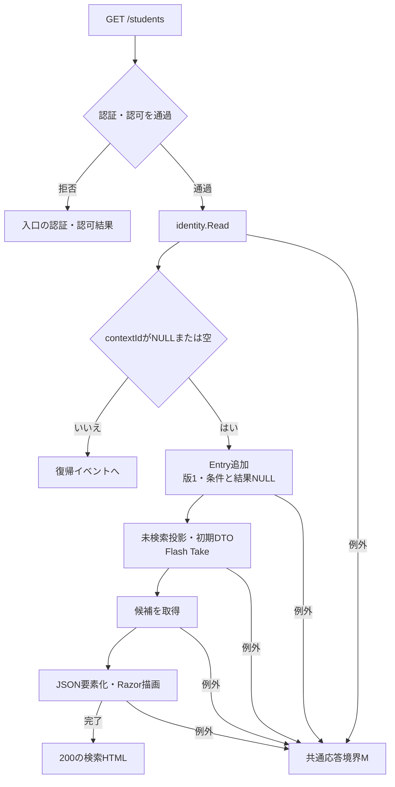

#### SQL・テーブル関連（ER図）

候補取得はコード分類・コード・クラスを読む。FKは概要ER図、実SQLの関連は次の図に対応する。

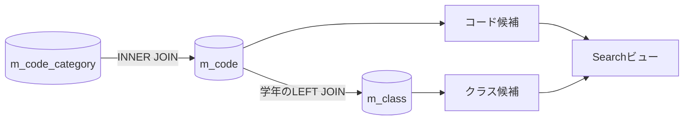

#### DB操作の詳細

Lookupは接続診断、SNAPSHOT開始、コードとクラスの2結果セット読取り、commitの順である。停止・期間外によるWHERE除外はなく、検索用の人数は `CONVERT(int,0)` で投影する。これは集計省略値であり、実測人数0を意味しない。SQLの順序と型は補足説明に定義する。〔実装根拠：`sources/Core/SqlServerStudentService.cs:196-216`〕

#### 結果・例外時の扱い

描画完了時は200の検索HTMLとなる。個別catchはない。候補取得等の失敗前に作成したEntryを除去する処理もない。認証による入口拒否と、例外がmiddlewareへ届いた独立HTMLエラーを区別する。

### 検索実行

#### 処理概要

POST `/students/search` は条件と表示指定で検索し、0件・通常・上限超過を正常結果として保持する。拒否応答の一覧は空にするが、以前のApplied・LastResultをクリアする処理は行わない。〔実装根拠：`sources/Web/Controllers/StudentsController.cs:13-16`、`sources/Infrastructure/WebStudentCoordinator.cs:7-9`〕

#### 処理手順

1. 認証・認可、CSRF検証、MVCのバインドを経てアクションへ入る。アクションは最初にFormGuardで許可名・重複・フォームメタ情報を検査する。
2. `Criteria.StatusCodes` 項目自体がなければ、DTOの初期選択を空配列へ置き換える。
3. CurrentUserを取得し、最初のGetで状態の存在・期限・所有者・セッション・指定タブを確認する。このGetとFormGuardは個別catch外である。
4. 当該応答用のdataを `Present(entry, null)` とする。Appliedがあればページ・ソート等は保持値を使用する。
5. ModelState不正なら422を設定してCoordinatorを呼ばない。有効なら個別tryへ進む。
6. CoordinatorがReadを再確認し、ToCriteriaで項目を対応付ける。ClassIdはOptionalでlong?へ変換し、Pageを1にする。この変換はUseの版検査より前である。
7. UseがGet、Gate待機、取得後の再Get、要求版の完全一致、long上限を順に確認する。Gate取得後の拒否もfinallyで解放する。
8. SearchAsyncはtry外でUser、検索開始UTC時刻、日本時間業務日を取得する。try内で表示指定、年度・クラス値、未所属との排他、在籍配列、文字列・コード正規化、日付解析と範囲を順に検査する。
9. 接続・SNAPSHOT開始後、学年・都道府県、年度、クラスと上位条件を確認する。共通述語で最大10001件の件数を取り、上限超過なら一覧を取らずcommitする。10000件以下は同じSNAPSHOTでページを取得しcommitする。
10. EnsureSearch成功後、条件のJSON複製をAppliedへ、結果をLastResultへ保存し、版を加算してPresentを返す。operationの正常復帰後にUseが期限を延長する。
11. 個別try内のWebFaultはFieldまたは空キーへMessageを追加し、statusをe.Statusにする。その他の例外はこのcatchを通過する。
12. catch外で候補を再取得する。再表示条件は受信DTOで、PageSize・SortKey・SortDirectionも受信値でモデルを上書きする。Razor描画が完了した場合に検索HTMLを返す。

〔実装根拠：`sources/Web/Controllers/StudentsController.cs:13-16`、`sources/Web/Controllers/StudentsController.cs:41-41`、`sources/Infrastructure/WebStudentCoordinator.cs:7-9`、`sources/Infrastructure/SearchContextStore.cs:13-15`、`sources/Core/SqlServerStudentService.cs:103-170`〕

#### 処理フロー

検索フロー1は入口である。無効ModelStateの出口は、422・NULL結果・受信DTOをフロー4へ渡す。有効枝は同じ受信値をフロー2へ渡す。

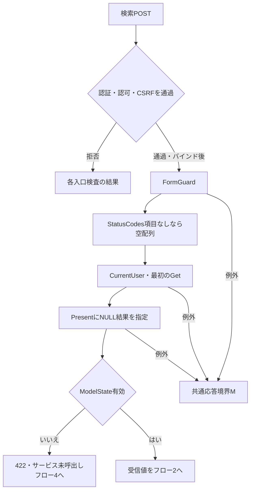

検索フロー2はCoordinatorと状態Gateである。正常出口はGateを保持したままフロー3へ進む。例外時は、Gate取得済みならfinallyで解放し、WebFaultを個別catchへ、その他をMへ渡す。

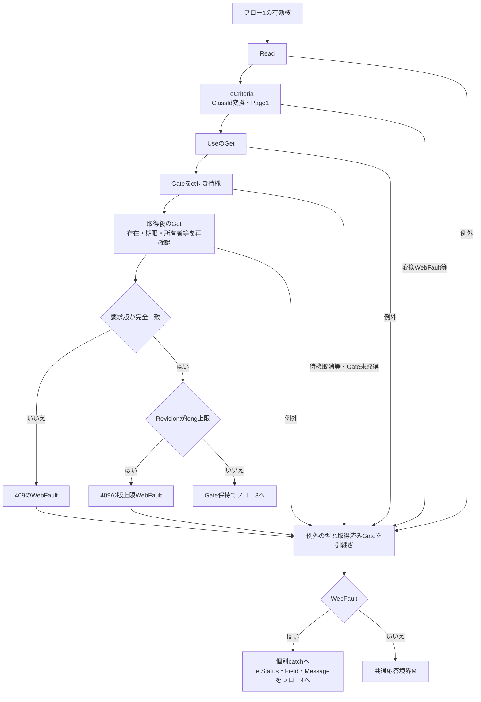

検索フロー3はサービスと保持更新である。正常結果は枝ごとのCount・Items・LimitExceededを維持する。拒否結果はEnsureSearchからWebFaultとなり、NULL結果の再表示へ進む。

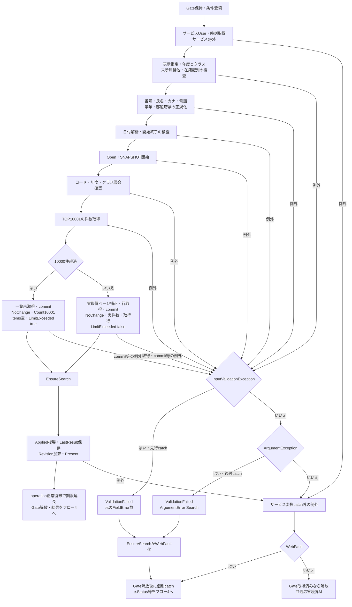

フロー3の保持更新は逐次代入である。Copyが失敗すればその代入以降へ進まない。版加算後のPresentや投影で失敗した場合は、更新済み値を戻さない。またoperationが正常復帰していなければ期限延長に到達しない。図の正常出口Nだけが結果・期限延長を確定してフロー4へ渡す。

検索フロー4は表示準備である。成功結果、ModelState拒否、個別WebFaultを合流させるが、各枝のstatusとresultをそのまま引き継ぐ。

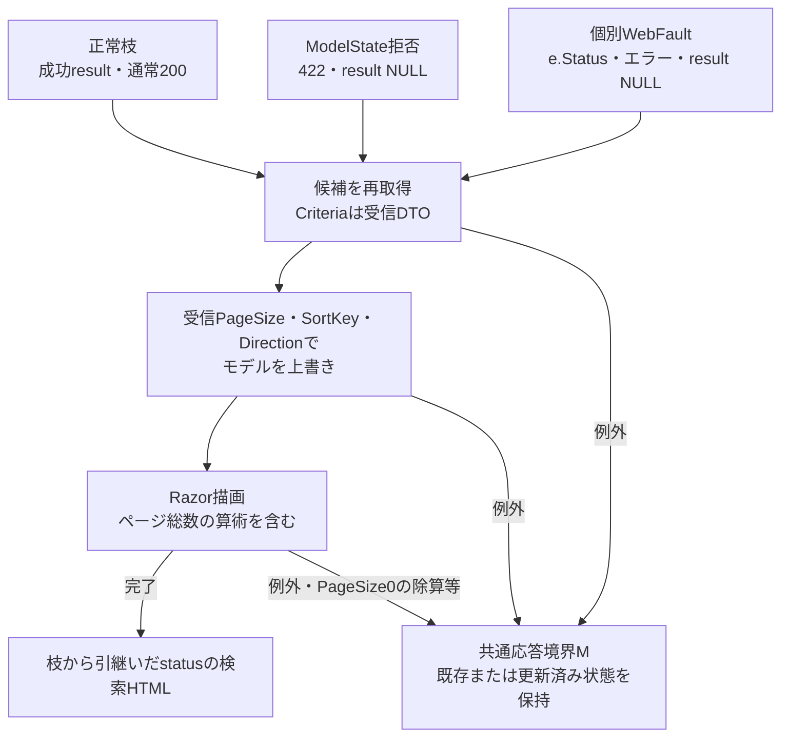

#### SQL・テーブル関連（ER図）

存在検査はコードとクラス、件数は学生とクラス、一覧は学年・在籍・都道府県の名称も読む。実FKは概要ER図に従う。次の図は名称取得のLEFT JOINである。

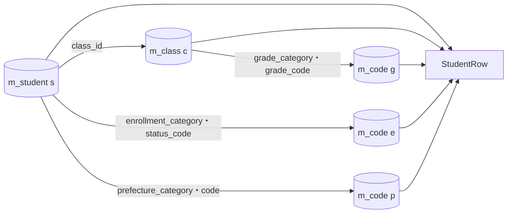

#### DB操作の詳細

常設の非削除条件に指定条件をANDで加え、在籍配列内はIN、電話は本人・緊急の括弧付きORとする。存在確認、件数、ページは1接続のSNAPSHOTに属し、正常枝でcommitする。例外枝に明示RollbackAsyncはなく、await usingによる読取トランザクションの破棄へ進む。再表示候補は別接続・別SNAPSHOTである。全述語、パラメータ、取得列、ORDER BY、取消境界は補足説明に定義する。〔実装根拠：`sources/Core/SqlServerStudentService.cs:123-171`、`sources/Web/Controllers/StudentsController.cs:39-39`〕

#### 結果・例外時の扱い

現行SearchAsyncの0件・通常・上限超過はすべてOutcome.NoChangeである。上限結果はCount=10001、Items空、LimitExceeded=trueとなり、PresentのtotalCountはNULLになる。0件はCount=0、LimitExceeded=falseで、0件でも行SQLを実行する。いずれもEnsureSearchを通り、保持条件と版を更新する。〔実装根拠：`sources/Core/SqlServerStudentService.cs:156-170`、`sources/Infrastructure/WebStudentCoordinator.cs:20-21`〕

サービスcatchはInputValidationException、ArgumentExceptionの順である。前者はFieldError群を返し、後者はArgumentErrorで既知のエラーコードまたはE-STU-002へ変換する。SQL例外、取消、InvalidOperationException、NullReferenceExceptionはこの2catchで検索結果へ変換しない。サービスUserの処理はtry外なので、そこで起きる入力例外もこの検索catchへ入らない。〔実装根拠：`sources/Core/SqlServerStudentService.cs:105-106`、`sources/Core/SqlServerStudentService.cs:169-170`、`sources/Core/StudentNormalizer.cs:162-166`〕

バインド後PageSize=0の場合、サービスまたはModelStateで拒否しても、Controllerは再表示モデルへ受信0を設定する。ビューは未検索・拒否の枝でもページ総数の除算を評価するため、二次描画例外が生じ得る。この枝を422の検索HTMLが必ず返る経路として扱わない。応答未開始の一般例外ならMで503となり、応答開始後はMのcatch対象外である。〔実装根拠：`sources/Web/Controllers/StudentsController.cs:15-16`、`sources/Views/Students/Search.cshtml:8-8`、`sources/Infrastructure/WebHostSetup.cs:23-23`〕

### 候補更新

#### 処理概要

「候補を更新」は編集中の検索条件を送信し、所属候補と選択クラスを整える。一覧はLastResultを使用し、学生を再検索しない。受信ContextRevisionと表示指定は版検査・状態更新へ使用しない。〔実装根拠：`sources/Web/Controllers/StudentsController.cs:22-22`〕

#### 処理手順

1. 認証・CSRF等を通過した後、FormGuardを実行する。
2. StatusCodes項目未送信なら空配列へ設定する。
3. CurrentUserとGetで状態を確認する。Gate待機と版照合はしない。
4. 未所属ONならSchoolYear・GradeCode・ClassIdをNULLにし、対応する3つの `Criteria.*` のModelStateを除去する。
5. `Present(entry, entry.LastResult)` を作り、SearchModelで全候補を再取得する。表示指定はApplied由来、なければ初期値である。
6. 非空ClassIdについて、候補IDのToStringと入力文字列、指定年度、生のGradeCodeとの一致を確認する。
7. 不適合ならClassIdをNULLにし、そのModelStateを除去して「上位条件に合わないクラスを解除しました。」を設定する。他の場合は「条件を変更しました。検索を押すと一覧に反映します。」を維持する。
8. ビューが入力年度・学年でクラス候補を抽出して描画する。未所属ONの3selectはdisabledとなる。

この経路はModelState全体判定、IdParser、コード正規化を呼ばない。数値上同じ先行ゼロ付きClassIdでも候補の文字列表現と異なれば解除され、生の全角GradeCodeも検索サービスの正規化と同じ方法では比較されない。〔実装根拠：`sources/Web/Controllers/StudentsController.cs:22-22`、`sources/Web/Controllers/StudentsController.cs:39-39`、`sources/Views/Students/Search.cshtml:5-5`〕

#### 処理フロー

候補フロー1。FormGuardと状態取得の間に未送信配列の補完を置く。合流後もApplied・LastResult・版・期限は変更しない。

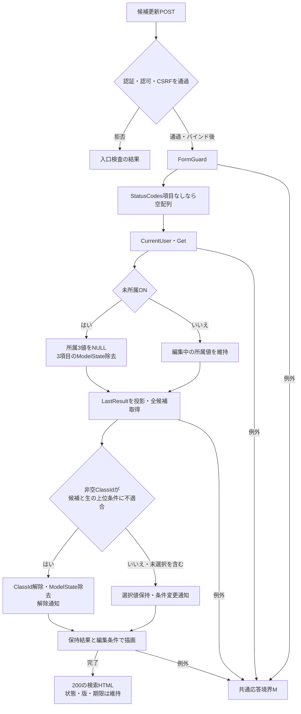

#### SQL・テーブル関連（ER図）

初期表示と同じコード分類・コード・クラスの候補関連を読む。学生一覧はメモリの保持結果から取得する。

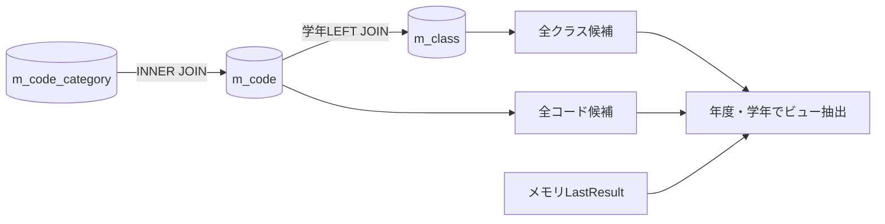

#### DB操作の詳細

LookupAsync(false)だけを実行する。入力年度・学年をSQLパラメータにした候補抽出ではなく、全取得後にControllerとビューで照合する。停止・期間外を含み、人数は集計しない。業務表と検索状態の書込みはない。〔実装根拠：`sources/Core/SqlServerStudentService.cs:197-216`〕

#### 結果・例外時の扱い

個別catchとModelState全体の422判定はない。状態取得・候補取得・描画の失敗はMへ進む。在籍配列がNULLのまま描画へ届く場合、checkboxのContainsで例外が起こり得る。項目未送信を空配列にする処理から、項目が存在する場合のNULLも排除されるとは判断しない。

設計意図はクラス先行選択による年度・学年反映、応答順照合、W-STU-107の解除通知を含む。現行は全HTML応答と文言通知であり、検索側の先行反映、要求連番、旧応答破棄、通知ID出力は接続されていない。〔設計意図：`reference-designs/詳細仕様書/CSharp_ASPNET/01_学生検索画面.md:252-273`。実装根拠：`sources/Web/Controllers/StudentsController.cs:22-22`、`sources/wwwroot/js/site.js:7-8`〕

### 並び替え・表示件数変更・ページ移動

#### 処理概要

一覧フォームの表示指定と要求Pageを使い、最後に実行した条件でDBを再検索する。編集中のCriteriaはこのフォームに含まれない。表示指定変更時は1ページへ、件数減少時は必要に応じて最終ページへ保持条件を補正する。〔実装根拠：`sources/Views/Students/Search.cshtml:8-8`、`sources/Infrastructure/WebStudentCoordinator.cs:11-12`〕

#### 処理手順

1. 認証・CSRF等の入口検査後、PageRequestとTabIdを対象にFormGuardを実行する。
2. CurrentUserと最初のGetで状態を取得する。ここは個別try外で、ModelStateの有効判定はない。
3. try内でCoordinatorがReadとUseのGet・Gate待機・再Get・版一致・版上限を確認する。
4. Appliedがなければ409「先に検索してください。」を投げる。
5. Appliedを複製し、PageSize・SortKey・SortDirectionのいずれかが異なればPage=1、同じなら要求Pageを設定する。受信表示指定を複製条件へ設定する。
6. SearchAsync、EnsureSearchを実行する。サービス内でSQL実取得ページは補正されるが、条件Pageへ書き戻されない。
7. 非上限結果で条件Pageが件数から求めた最終ページを超えた場合、条件Pageを最終ページへ変更して、一度だけ別SNAPSHOTで再検索する。2回目の結果に同じ補正を繰り返すループはない。
8. 必要な検索がすべて成功した後、Applied・LastResult・版を更新する。正常operation復帰で期限を延長しGateを解放する。
9. 同じ個別try内で候補を取得し、Appliedから復元した入力と結果でモデルを作る。
10. try内のWebFaultはe.Status・Field・Messageを引き継ぎ、NULL結果と現在Appliedから復元した入力で再表示を試みる。catch内の候補再取得も失敗した場合は同じcatchへ戻らない。

〔実装根拠：`sources/Web/Controllers/StudentsController.cs:18-19`、`sources/Infrastructure/WebStudentCoordinator.cs:12-12`、`sources/Infrastructure/SearchContextStore.cs:14-14`、`sources/Core/SqlServerStudentService.cs:160-168`〕

#### 処理フロー

ページフロー1は状態検査と再検索である。正常出口は更新済みEntryと最終結果をフロー2へ渡す。検索拒否出口は更新前のEntryとWebFaultを渡す。

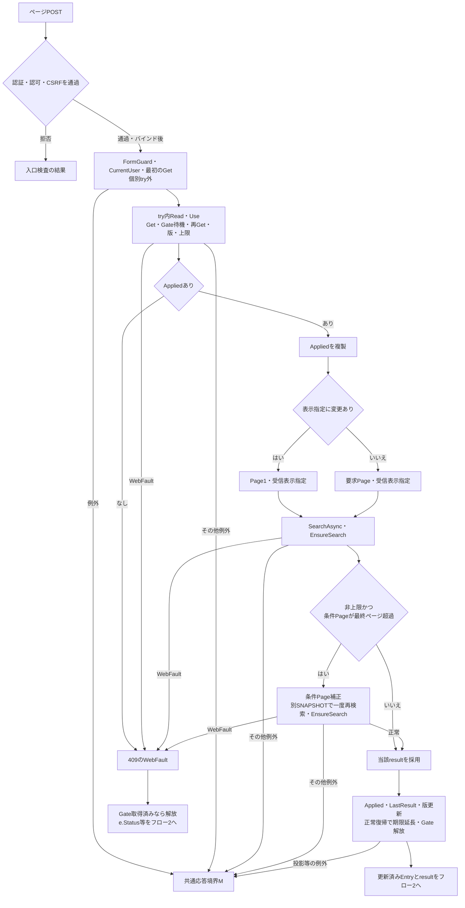

ページフロー2は候補と再表示である。状態更新後の候補WebFaultと更新前の拒否を同一の未更新状態へまとめない。

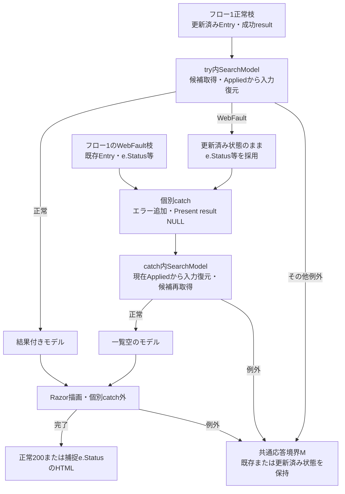

#### SQL・テーブル関連（ER図）

検索本体は検索実行の学生・クラス・名称コード関連、再表示候補はコード種別も参照する。複数回の検索は同じ業務関連を使うが、トランザクションは別である。

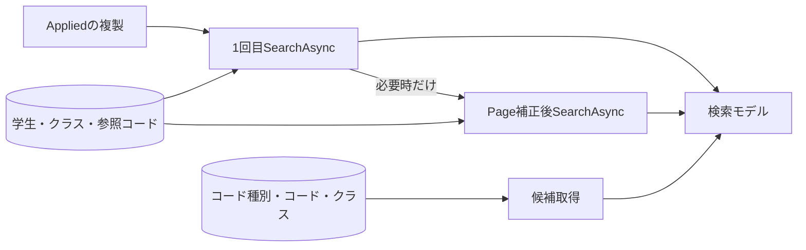

#### DB操作の詳細

各SearchAsync内の存在・件数・一覧は1つのSNAPSHOTで揃う。補正再検索と候補取得は別SNAPSHOTである。検索は読取りのみで、業務表の更新・履歴追記を行わない。2回目までにDBが変化した場合、さらに保持Pageを補正するループはない。

#### 結果・例外時の扱い

Appliedなしの409は個別catchの一覧空再表示へ進む。最初のGetによる失効409はcatch外でMへ進む。設計の「保持条件なし・失効を初期化して通知」とは異なり、自動初期化しない。〔実装根拠：`sources/Web/Controllers/StudentsController.cs:19-19`、`sources/Infrastructure/WebStudentCoordinator.cs:12-12`。設計意図：`reference-designs/詳細仕様書/CSharp_ASPNET/01_学生検索画面.md:303-320`〕

成功後の候補WebFaultは、このイベントではtry内なので個別catchに入る。その場合、新しいApplied・LastResult・版は保持し、当該画面の結果だけをNULLにする。SQL例外・取消等はWebFault catch対象外である。ModelState判定がないため、HTTP変換失敗後のPage等の到達値はサービス検査だけでは確定しない。

### クリア

#### 処理概要

同じContextIdとTabを保ち、実行済み条件と結果を解除して初期入力・未検索へ戻す。学生の削除や更新は行わない。再表示に必要な候補はDBから読む。〔実装根拠：`sources/Web/Controllers/StudentsController.cs:21-21`、`sources/Infrastructure/WebStudentCoordinator.cs:15-15`〕

#### 処理手順

1. 認証・CSRF等の入口検査後、ContextRequestとTabIdのFormGuardを行う。
2. Coordinator.ClearがRead、UseのGet・Gate待機・再Get・版一致・版上限を確認する。
3. AppliedとLastResultをNULLにし、版を加算して未検索Presentを返す。正常operation復帰で期限を延長する。
4. ControllerがModelStateをClearし、Getで状態を取得し直す。
5. 新しいStudentSearchInputとLookupAsync(false)の候補で描画する。在籍01・02、20件、studentNo昇順、Page=1へ戻る。

〔実装根拠：`sources/Infrastructure/SearchContextStore.cs:14-14`、`sources/Web/Controllers/StudentsController.cs:21-21`、`sources/Web/Controllers/StudentsController.cs:39-39`、`sources/Web/Inputs/StudentSearchInput.cs:7-18`〕

#### 処理フロー

クリアフロー1。消去前の拒否と消去後の表示失敗を別の出口にする。

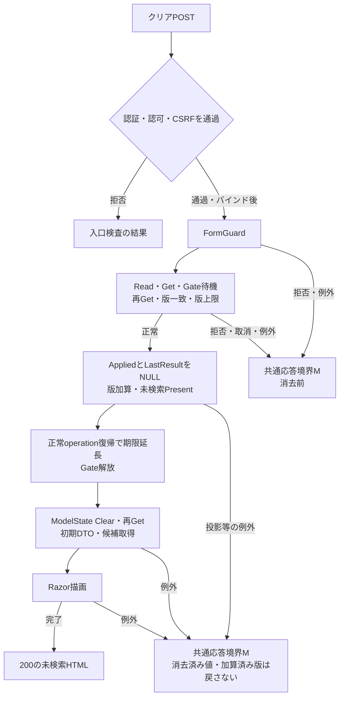

#### SQL・テーブル関連（ER図）

解除対象はメモリEntryである。再表示では初期表示と同じ候補関連を読む。

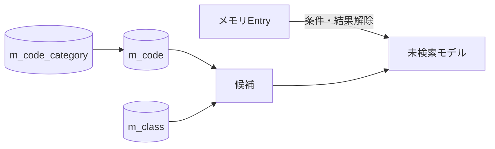

#### DB操作の詳細

学生検索SQLは呼ばず、候補SQLだけを呼ぶ。UPDATE、DELETE、履歴INSERTはない。クリア操作全体をDB非使用と記述すると、再表示候補の読取りが欠落する。〔実装根拠：`sources/Web/Controllers/StudentsController.cs:21-21`、`sources/Web/Controllers/StudentsController.cs:39-39`〕

#### 結果・例外時の扱い

ModelState有効判定と個別catchはない。状態・版拒否はMへ進む。消去後の再Get、候補取得、描画が失敗しても、条件・結果・版を元に戻す処理はない。期限延長はoperationの正常復帰に到達した場合だけである。

### 未所属切替と送信中表示

#### 処理概要

検索側JavaScriptは未所属ON時のDOM値解除と、共通submit時の送信中属性を扱う。サーバー条件、検索状態、DBを直接更新しない。〔実装根拠：`sources/wwwroot/js/site.js:4-7`〕

#### 処理手順

1. SRC-007のchangeへ処理を登録し、初回にも評価する。
2. ONならSRC-004・005・006のDOM値を空にする。OFFでは元値を復元しない。
3. disabledを変更しない。ON応答で非活性になったselectをOFFのDOM変更だけで活性化する処理もない。
4. 年度・学年変更による自動候補通信や、検索クラス選択による上位条件反映は行わない。
5. 各formのsubmitで確認文言があり取消された場合はpreventDefaultする。検索フォームにはその確認文言属性がない。
6. 通常送信では送信button以外の同フォームbuttonをdisabledにし、aria-busyをtrueにする。送信button自身は無効化せず、busy値で再入を拒否しない。

〔実装根拠：`sources/wwwroot/js/site.js:4-8`、`sources/Views/Students/Search.cshtml:4-8`〕

#### 処理フロー

DOMフロー1は未所属、DOMフロー2は送信である。どちらもHTTP応答やサーバー状態更新を確定しない。

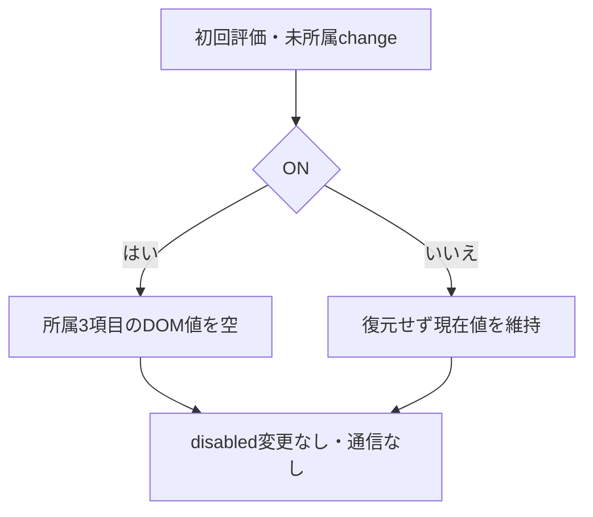

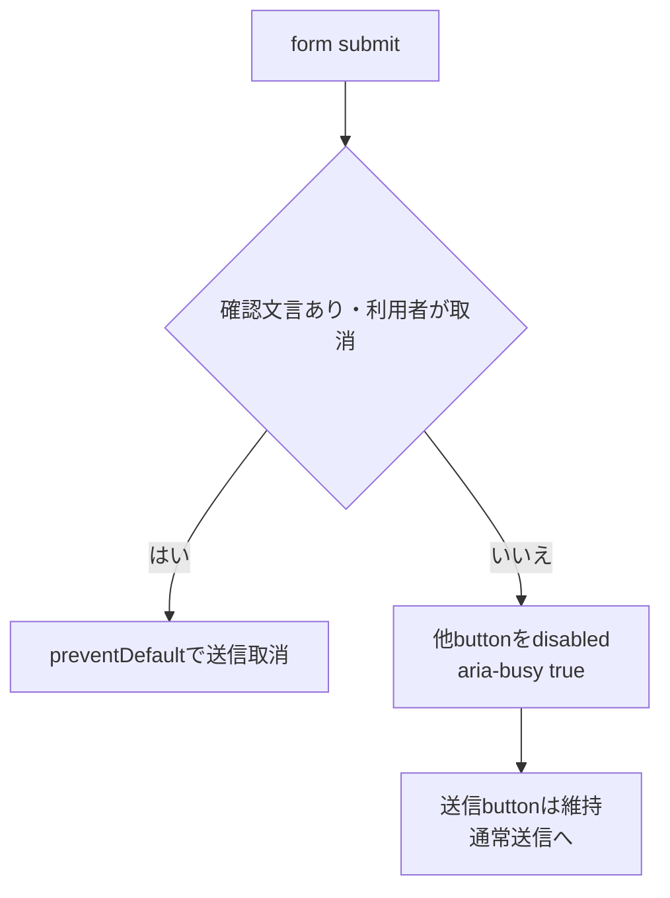

#### SQL・テーブル関連（ER図）

DOMだけを扱うため、このイベント単体ではDBを使用せずER図は非該当である。サーバー側の検索・候補更新は別イベントとしてメモリとDBを扱う。

#### DB操作の詳細

該当なし。保持先はinput・selectのDOM値、buttonのdisabled、formのaria-busyである。Applied、LastResult、Revision、DB列への代入はない。

#### 結果・例外時の扱い

値解除と非活性化を同時の処理として保証しない。原文のREG-018、REG-016、REG-017を使うクラス連動は登録画面用であり、検索側へ適用しない。DOMの送信中表示は認可、状態版、Gate、DB排他の代わりにはならない。

### 新規登録・編集・参照への遷移

#### 処理概要

新規リンクと行リンクは、検索状態IDを復帰先として登録画面へ渡す。行の対象は行番号ではなく学生IDである。検索の業務入力、検索状態版、一覧で取得した学生版はリンクへ移さない。〔実装根拠：`sources/Views/Students/Search.cshtml:6-8`〕

#### 処理手順

1. Viewerには新規リンクを置かず、行リンクを参照とする。それ以外は新規・編集を表示する。
2. 新規は `/students/new?returnContextId=...`、既存は `/students/{studentId}?returnContextId=...` へGETする。
3. 登録側Coordinator.EditでReadと復帰状態のGetを確認する。新規だけCreateOrUpdateを確認し、Viewerを拒否する。
4. 既存はGetAsyncで最新の非削除対象を読み、不在なら404 E-STU-103とする。新規は既存学生を読まない。
5. 人数を含む登録用LookupAsync(ct)で候補を取得する。
6. Controller.Loadは候補取得後に復帰状態を再取得し、現在Revisionを読む。入力原本、対象、Detail、ReturnRevisionを編集Snapshotへ保存する。
7. 登録HTMLへ引き渡す。保存・削除の全仕様は登録詳細文書の責務であり、本書は渡す参照キーと復帰版の取得境界を定義する。

〔実装根拠：`sources/Web/Controllers/StudentsController.cs:23-25`、`sources/Infrastructure/WebStudentCoordinator.cs:6-6`、`sources/Infrastructure/WebStudentCoordinator.cs:17-17`、`sources/Core/SqlServerStudentService.cs:172-196`、`sources/Infrastructure/EditorSnapshotStore.cs:7-9`〕

#### 処理フロー

遷移フロー1。新規枝はDetailなし、既存枝は再取得Detailありのまま候補取得へ合流する。

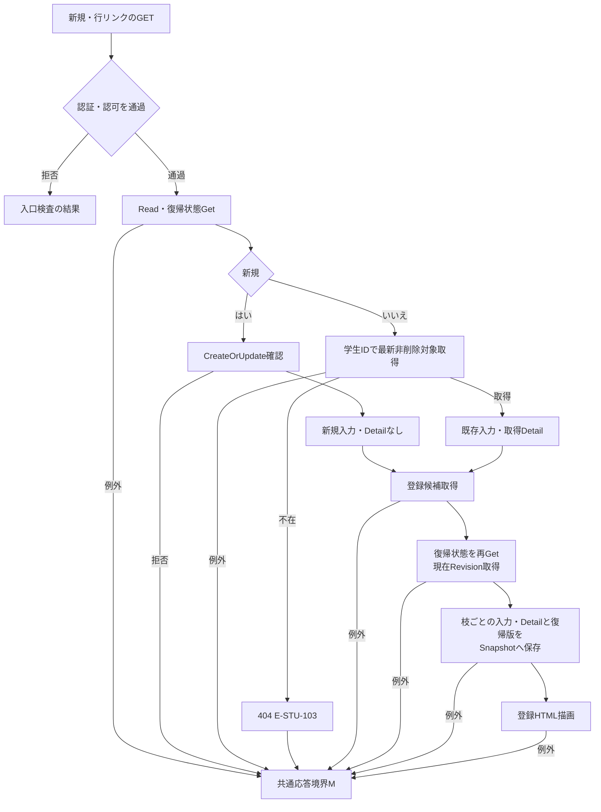

#### SQL・テーブル関連（ER図）

リンク自体はDBを使用しない。接続された遷移先では学生の単一表読取りと、登録候補の複数表読取りがある。

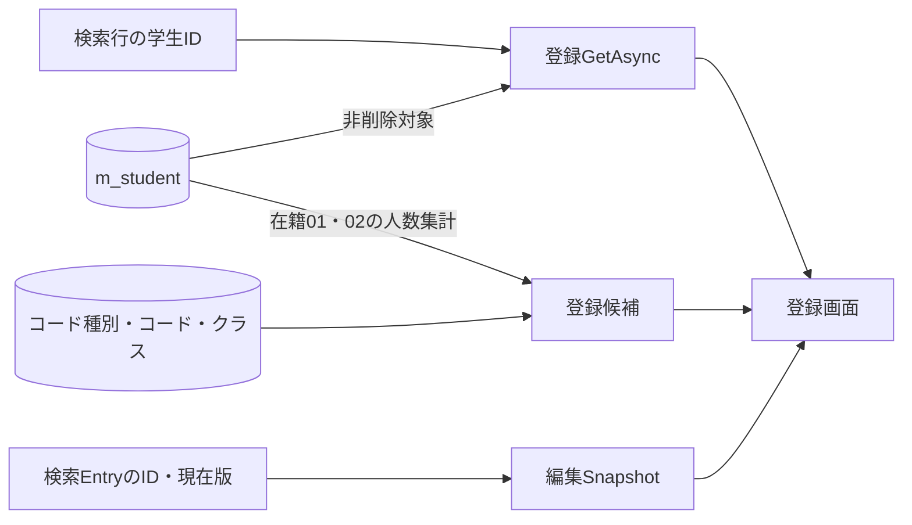

#### DB操作の詳細

既存読取りは `student_id=@id AND is_deleted=0`、パラメータはBigIntである。対象IDが正でない場合はGetAsyncがNULLを返す。登録用の引数なしLookupはtrueへ接続し、非削除・在籍01／02の人数を集計する。検索用falseの集計省略と区別する。〔実装根拠：`sources/Core/SqlServerStudentService.cs:172-179`、`sources/Core/SqlServerStudentService.cs:196-216`〕

#### 結果・例外時の扱い

新規リンク非表示だけに権限を依存せず、入口でもViewerを拒否する。復帰状態不正、既存対象不在、候補取得後の復帰状態再Get失敗は正常登録画面の生成を中断する。編集の基準は登録側で再取得した対象と版である。

<a id="event-register"></a>

### 検索状態への復帰

#### 処理概要

既存ContextIdによるGETは元条件で最新結果を取り直す。Appliedなしなら未検索を返し、学生検索は行わない。保存した学生が元条件外でも、条件をその学生へ合わせて変更しない。成功通知はFlashから一度だけ取得する。〔実装根拠：`sources/Web/Controllers/StudentsController.cs:8-11`、`sources/Infrastructure/WebStudentCoordinator.cs:14-14`〕

#### 処理手順

1. 登録画面の戻るリンクはReturnContextIdと保存済みReturnRevisionを送る。保存・削除のOutcome.Saved時だけReturnAfterSaveがFlashをPutし303を返す。復帰先なしなら新しい未検索状態を作り、そのID・版を使用する。
2. IndexがReadと最初のGetを行う。GETではTabを渡さない。
3. contextRevisionがNULLなら空文字をResumeへ渡す。最新Revisionで補完しない。
4. ResumeのUseがGet、Gate待機、再Get、版一致、版上限を検査する。ここでもTabはNULLである。
5. AppliedなしならPresent(entry, null)だけを返す。LastResult代入と版加算は行わず、正常operation復帰によって期限だけ延長する。
6. Appliedありなら元条件でSearchAsyncとEnsureSearchを実行し、LastResultを更新して版を加算する。Appliedは元のままとし、正常復帰で期限を延長する。
7. ControllerがAppliedから入力DTOを復元し、FlashをTakeする。その後候補取得、JSON要素化、Razor描画を行う。

〔実装根拠：`sources/Web/Controllers/StudentsController.cs:8-11`、`sources/Web/Controllers/StudentsController.cs:31-40`、`sources/Infrastructure/WebStudentCoordinator.cs:14-14`、`sources/Infrastructure/FlashMessageStore.cs:6-9`。戻るリンク：`sources/Views/Students/Edit.cshtml:16-16`〕

#### 処理フロー

復帰フロー1。未検索と検索済みの保持値を分け、合流後は各枝のPresent結果と現在版を引き継ぐ。

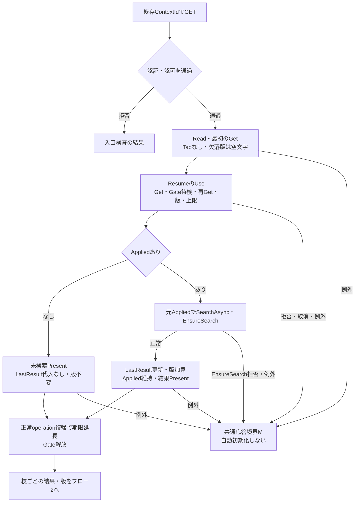

復帰フロー2。Flash消費後の失敗を、通知未取得の失敗へ合流させない。

```mermaid
flowchart TD
    A[フロー1の結果・現在Entry] --> B[Appliedから入力復元<br/>なしなら初期DTO]
    B --> C[Flash Take<br/>削除して期限内の通知を取得]
    C --> D[候補取得・JSON要素化]
    D --> E[Razor描画]
    E -->|完了| O[200の検索HTML<br/>取得済み通知を表示]
    B -->|例外| M0[共通応答境界M<br/>状態更新は戻さない]
    D -->|例外| M1[共通応答境界M<br/>状態更新は戻さない<br/>取得済みFlashは復元しない]
    E -->|例外| M1
```

#### SQL・テーブル関連（ER図）

未検索枝は候補だけ、検索済み枝は学生・クラス・名称コードの検索後に候補を読む。条件と通知はDB表ではなくメモリから得る。

```mermaid
flowchart LR
    A[メモリApplied] -->|ある場合だけ| S[SearchAsync]
    D[(学生・クラス・参照コード)] --> S
    K[(コード種別・コード・クラス)] --> L[候補取得]
    S --> V[Searchビュー]
    L --> V
    F[メモリFlash] -->|Takeで消費| V
```

#### DB操作の詳細

検索済み枝は検索SQL契約を実行する。ResumeにはPageイベントの保持Page補正と再検索がない。サービスが実取得ページを最終ページへ補正してもApplied.Pageは元のままで、Presentも保持Pageを返す。件数減少時、表示ページと実取得ページが異なる場合がある。候補読取りは両枝で実行する。〔実装根拠：`sources/Infrastructure/WebStudentCoordinator.cs:12-14`、`sources/Infrastructure/WebStudentCoordinator.cs:21-21`、`sources/Core/SqlServerStudentService.cs:160-164`〕

#### 結果・例外時の扱い

期限切れ409、所有者・別セッション不一致403、復帰版不一致409を初期化へ変換しない。編集開始後に検索版が進めば、保存済みReturnRevisionによる復帰は拒否される。GETではタブ比較がないため、この入口だけで別タブ分離を保証しない。〔実装根拠：`sources/Infrastructure/SearchContextStore.cs:13-14`、`sources/Web/Controllers/StudentsController.cs:10-10`、`sources/Web/Controllers/StudentsController.cs:38-38`。失効初期化の設計意図：`reference-designs/詳細仕様書/CSharp_ASPNET/01_学生検索画面.md:390-392`〕

Flashは候補取得前に消費され、後続表示失敗で復元しない。登録・削除のSavedはDB・監査のcommit後に返る。303後の復帰拒否や検索表示失敗は、その確定済み保存をrollbackする処理ではない。〔実装根拠：`sources/Infrastructure/FlashMessageStore.cs:9-9`、`sources/Web/Controllers/StudentsController.cs:31-38`、`sources/Core/SqlServerStudentService.cs:306-315`、`sources/Core/SqlServerStudentService.cs:413-414`〕

## 項目移送仕様

| 移送ID | 起点・方向 | 移送先 | 加工・対応 | 条件と保持結果 | 根拠 |
| --- | --- | --- | --- | --- | --- |
| MOVE-001 | フォーム→MVC | 条件DTO、状態・表示指定 | Criteria接頭辞。年度int?、未所属bool、在籍string[]へバインド。 | FormGuardはバインド後の名前・重複検査。SearchのみModelState判定。未送信在籍はSearch・Optionsで空配列。 | `sources/Web/Controllers/StudentsController.cs:13-22`、`sources/Web/Inputs/StudentSearchInput.cs:7-29` |
| MOVE-002 | DTO→検索条件 | SearchCriteria | Name→StudentName、Kana→StudentNameKana、StatusCodes→EnrollmentStatusCodes。ClassIdはOptionalでlong?。 | Page=1、表示指定は引数。ClassId変換はUse前。文字列正規化は未実施。 | `sources/Web/Inputs/StudentSearchInput.cs:19-22`、`sources/Infrastructure/WebStudentCoordinator.cs:8-9` |
| MOVE-003 | 条件→照合値 | サービスローカル・SQLパラメータ | 番号、氏名キー、カナキー、電話、コード、DateOnly範囲を生成。 | 正規化成功値をSQLへ渡す。元条件に書き戻さない。 | `sources/Core/SqlServerStudentService.cs:113-153` |
| MOVE-004 | 正常条件・結果→保持 | Applied・LastResult・Revision | 条件のJSON複製、結果保存、版＋1。 | EnsureSearch成功後。0件・上限も含む。後続表示失敗で戻さない。 | `sources/Infrastructure/WebStudentCoordinator.cs:9-9`、`sources/Infrastructure/SearchContextStore.cs:15-15` |
| MOVE-005 | Applied→ページ条件 | SearchCriteria複製 | 表示指定変更時Page1、それ以外は要求Page。必要時に保持Page補正。 | 全検索のEnsureSearch成功後に保持を置換。編集途中Criteriaを混ぜない。 | `sources/Infrastructure/WebStudentCoordinator.cs:12-12` |
| MOVE-006 | Applied→再表示入力 | Controller.From | 番号・氏名・カナ・電話NULLは空文字。ClassIdはInvariantCultureの10進文字列。その他を対応付ける。 | GET復帰、Page正常・拒否で使用。Search再表示は受信input。 | `sources/Web/Controllers/StudentsController.cs:11-19`、`sources/Web/Controllers/StudentsController.cs:40-40` |
| MOVE-007 | Entry・当該result→投影 | Present→JsonElement | resultから状態・件数・行・日時。Appliedまたは初期条件からページ・ソート・条件。EntryからID・版。 | result=NULLでLastResultを暗黙採用しない。Appliedも消さない。上限件数はNULL。 | `sources/Infrastructure/WebStudentCoordinator.cs:21-21`、`sources/Web/Models/StudentSearchPageModel.cs:15-15` |
| MOVE-008 | DB行→一覧 | StudentRow→WebPresentation.Row | 原表記、保存カナ、和暦、JOIN名称、名称＋住所1、本人電話、日本時間日時、文字列学生ID。 | 入学日と学生版はStudentRowまで取得するが一覧投影へ含めない。 | `sources/Core/SqlServerStudentService.cs:77-90`、`sources/Infrastructure/WebPresentation.cs:20-20` |
| MOVE-009 | 全候補→画面選択 | ビュー・Options | 分類別コード、重複除去年度、上位条件でクラス抽出。不適合選択クラスをOptionsで解除。 | 候補集合と選択済み値は別。未所属ONはOptionsが3値とModelStateを解除。Appliedは維持。 | `sources/Web/Controllers/StudentsController.cs:22-22`、`sources/Views/Students/Search.cshtml:5-5` |
| MOVE-010 | 検索→登録 | URLの学生ID・returnContextId | 新規は状態ID、既存は学生IDと状態ID。 | 検索入力・検索版・行版を移さず、登録側で最新対象と復帰版を取得。 | `sources/Views/Students/Search.cshtml:6-8`、`sources/Web/Controllers/StudentsController.cs:23-25` |
| MOVE-011 | 登録→検索 | contextId・contextRevision・Flash | 戻るはSnapshotの復帰版。Saved後は通知Put・303。元条件で再検索。 | Saved以外を成功通知にしない。復帰先なしは新しい未検索状態。確定済みDB保存と復帰表示を分ける。 | `sources/Web/Controllers/StudentsController.cs:31-38`、`sources/Views/Students/Edit.cshtml:16-16` |
| MOVE-012 | Clear→初期状態 | 同じEntry・新DTO | Applied・LastResult NULL、版＋1。入力初期化、20件、studentNo昇順、Page1。 | 状態・版検査成功後。再表示候補は再取得する。 | `sources/Infrastructure/WebStudentCoordinator.cs:15-15`、`sources/Web/Controllers/StudentsController.cs:21-21` |

## 補足説明

### 入力検査とバインドの境界

Cookie認証はSecure、HttpOnly、SameSite=Strict、30分、有効期限のスライドを設定する。認証要求は401、アクセス拒否は403を設定し、学生ルートでは独自JSON本文を作らない。CSRFはMVC全体のAutoValidateAntiforgeryTokenで検証し、独自JSONへの失敗変換は `/api` 配下だけに適用する。学生フォームのCSRF拒否はアクションの個別catchより前である。〔実装根拠：`sources/Infrastructure/WebHostSetup.cs:14-16`、`sources/Infrastructure/AntiforgeryResultFilter.cs:5-8`〕

RequestIdentityはNameIdentifier、login_session、RoleをClaimから取得する。主体の空白または64Rune超過、セッションの空白または64コード単位超過、Enum.TryParse失敗は401となる。検索のReadはCurrentUser取得である。CreateOrUpdateはViewerを拒否し、Administratorの判定は別処理である。〔実装根拠：`sources/Infrastructure/RequestIdentity.cs:7-16`〕

FormGuardはDTO公開プロパティから許可名を作る。Search・OptionsはCriteria.*と状態3項目・表示3項目、PageはPageRequestとTabId、ClearはContextRequestとTabIdを許可する。CSRF項目と `__Invariant` も含める。許可集合は大文字小文字を区別しない。許可外名は400、同名複数値も原則400だが、末尾StatusCodes、末尾UnassignedOnly、正確な綴りの `__Invariant` は重複の例外である。`__Invariant` の値が許可名かを検査する分岐も正確な綴りによる比較で、許可集合の比較規則とは異なる。これは値の業務妥当性を認定する処理ではない。〔実装根拠：`sources/Web/Controllers/StudentsController.cs:13-22`、`sources/Web/Controllers/StudentsController.cs:41-41`〕

受信設定はKestrel本文65536、MultipartBodyLengthLimit=65536、ValueLengthLimit=65536、ValueCountLimit=128である。MVCは非nullable参照型への暗黙Requiredを抑止する。宣言のstring・string[]や初期値、ブラウザー属性だけで受信NULLを排除する保証にはしない。原HTTP値、MVC変換後DTO、サービス引数は別段階である。SearchはModelState不正ならサービスを呼ばないが、Page・Options・Clearは同じ判定を持たない。〔実装根拠：`sources/Infrastructure/WebHostSetup.cs:16-18`、`sources/Web/Controllers/StudentsController.cs:13-22`〕

NULLの扱いは項目ごとに異なる。TextはNULLを空文字へ、IdParser.OptionalはNULL・空文字を未指定へ、検索GetはNULLを辞書呼出し前に409へ分類する。一方、在籍配列はサービスがLengthを先に参照するため、NULLが届いた場合は独自検査前にNullReferenceExceptionとなる。OptionsのビューもContainsに依存する。欠落項目の空配列補完とNULL配列は同じ契約ではない。MVC変換失敗時の実到達値は、これら後段の分岐から逆算して保証しない。〔実装根拠：`sources/Core/StudentNormalizer.cs:47-55`、`sources/Web/Inputs/StudentSaveInput.cs:60-60`、`sources/Infrastructure/SearchContextStore.cs:13-13`、`sources/Core/SqlServerStudentService.cs:111-112`、`sources/Views/Students/Search.cshtml:5-5`〕

登録連携のSnapshot.Getは検索Getとは異なり、NULLの明示検査より先にTryGetValueを呼ぶ。検索IDのNULL→409契約をSnapshotIdへ一般化しない。入力がNULLでコレクションへ到達する場合のライブラリ例外と、キー不在・期限切れの独自WebFaultは別の境界として扱う。〔実装根拠：`sources/Infrastructure/EditorSnapshotStore.cs:10-10`〕

### 文字列正規化の具体的契約

ScalarCountはサロゲート対を1スカラーとして数え、孤立した上位・下位サロゲートをArgumentExceptionにする。TextはNULL補完、raw上限、Controlカテゴリ禁止、Trim、空・必須、Trim後上限の順に検査する。この検索の単行項目では改行やタブもControlとして拒否する。HTML maxlengthはUTF-16コード単位のブラウザー制限、string.Lengthもコード単位、業務長はスカラー値であり、SQLのnvarchar容量と同一の上限ではない。〔実装根拠：`sources/Core/StudentNormalizer.cs:37-57`、`sources/Views/Students/Search.cshtml:5-5`〕

氏名カナは次の順で処理する。

1. 検索のNULL・空文字はカナ条件を省略する。その他には任意Textを適用し、raw・Trim後36スカラーとControl禁止を確認する。
2. FormKCを適用する。
3. Rune.IsWhiteSpaceの連続を内部ASCII空白U+0020の1個へまとめ、先頭・末尾には残さない。Textで先に拒否されるControl空白を、この段階の除去で受け入れることはない。
4. ひらがなU+3041～U+3096、U+309D、U+309Eだけに0x60を加える。
5. 変換後の文字はU+30A1～U+30FA、U+30FC、U+30FB、U+30FD、U+30FEだけを許可する。整理した区切り空白は別に追加される。
6. 区切り空白を含む結果の18スカラー上限を確認する。
7. 検索キーではASCII空白を除去し、LIKE部分一致へ渡す。非空の空白だけの入力は空キーとなり、NULLでないため `LIKE '%%'` が残る。

この範囲に含まれないカナ関連文字を、一般的な「カタカナ」の解釈で追加しない。保存側は正規化カナと空白除去キーを別のNVarChar(36)として扱う。〔実装根拠：`sources/Core/StudentNormalizer.cs:72-85`、`sources/Core/StudentNormalizer.cs:126-145`、`sources/Core/SqlServerStudentService.cs:31-32`、`sources/Core/SqlServerStudentService.cs:116-142`〕

電話はTextでraw・Trim後20スカラーとControl禁止を確認し、空・空白だけならNULLを返す。その後FormKCを適用し、Rune.IsWhiteSpace、U+002D、U+2010、U+2011、U+2212、U+0028、U+0029を除去する。これは任意のダッシュ類を除去する規則ではない。FormKCで別表記がこれらへ変わる場合は、変換後の文字に対して除去を行う。

除去後は、0始まりのASCII数字10～11桁、またはU+002Bのプラスに続く非ゼロ始まりASCII数字7～15桁だけを許可する。最大長はプラスを含む16文字となる。記号除去後に空文字になった非空入力は、NULLへ再変換せず形式不正になる。本人・緊急の保存側も同じPhoneとVarChar(16)を使う。〔実装根拠：`sources/Core/StudentNormalizer.cs:87-93`、`sources/Core/StudentNormalizer.cs:133-141`、`sources/Core/SqlServerStudentService.cs:34-37`〕

### 保存列・表示名称・日付形式

学生保存側は氏名原表記とname_key、正規化カナとkana_keyを別列へ渡す。SQLパラメータは氏名NVarChar(16)、name_key NVarChar(320)、カナとkana_key NVarChar(36)、住所各NVarChar(90)、電話各VarChar(16)である。住所1・2の保存業務上限は各raw・Trim後45スカラーで、住所2はNULL可、一覧は住所1だけを使う。検索側のローカルキーをそのまま学生へ保存する経路はない。〔実装根拠：`sources/Core/StudentNormalizer.cs:124-145`、`sources/Core/SqlServerStudentService.cs:30-37`、`sources/database/001_schema.sql:10-22`〕

クラス名は宣言されたSaveClassAsyncでraw・Trim後18スカラー、必須を検査し、NVarChar(36)へ渡す。クラスコードはIdentifierで9以内、VarChar(9)である。コード名称はSaveCodeAsyncでraw・Trim後12スカラー、必須を検査し、NVarChar(24)へ渡す。DDLも名称上限のCHECKを持つ。これらは検索候補とJOIN名称の属性根拠だが、Webにマスタ保守の入口やDI登録が接続されたことを意味しない。category_nameは分類名であり、候補のcode_nameとは別列である。〔実装根拠：`sources/Core/MasterMaintenanceService.cs:30-37`、`sources/Core/MasterMaintenanceService.cs:73-76`、`sources/Core/MasterMaintenanceService.cs:81-115`、`sources/database/001_schema.sql:67-81`、`sources/database/001_schema.sql:115-128`、`sources/Infrastructure/WebHostSetup.cs:13-19`〕

JOIN名称の保存列はNOT NULLでも、LEFT JOINの結果はNULLとなり得る。現行の代替表示は都道府県名NULLの `[不整合]` と本人電話NULLの「－」に限定される。学年・クラス・在籍名称の欠損や停止・期間外を一律に補う表示処理はない。名称変更は参照時の表示へ影響し、学生へ保存するのは名称ではなく参照コード・クラスIDである。〔実装根拠：`sources/Core/SqlServerStudentService.cs:77-90`、`sources/Views/Students/Search.cshtml:8-8`〕

生年月日はdateから和暦へ変換する。実装の境界は明治1900-01-01～1912-07-29、大正1912-07-30～1926-12-24、昭和1926-12-25～1989-01-07、平成1989-01-08～2019-04-30、令和2019-05-01以後である。年1は「元」、月日2桁で表示し、DateOnlyに時差変換は行わない。更新・検索日時はUTC+9の `yyyy/MM/dd HH:mm:ss`。検索日時はサービスの検索開始時刻、共有ヘッダーの業務日は描画時のUTCから得る日本時間日付であり、取得段階が異なる。〔実装根拠：`sources/Core/JapaneseDateService.cs:9-16`、`sources/Core/JapaneseDateService.cs:41-50`、`sources/Infrastructure/WebPresentation.cs:5-7`、`sources/Views/Shared/_Layout.cshtml:1-1`〕

### 検索SQLと候補SQL

#### 接続、型付きパラメータ、取消

接続文字列はEncrypt=Mandatory、TrustServerCertificate=falseへ設定する。OpenAsync後、現在DBのsnapshot_isolation_stateが1かを診断し、不一致ならInvalidOperationExceptionとなる。接続・診断失敗時は接続を破棄して再throwする。検索・候補のCommand補助はCommandTimeout=30で、診断用CreateCommandには明示Timeout設定がない。〔実装根拠：`sources/Core/SqlServerStudentService.cs:39-66`〕

ParamはSqlDbTypeを指定し、Sizeが0以外なら設定する。DateOnlyはTimeOnly.MinValueのDateTimeへ、NULLはDBNull.Valueへ変換する。接続、トランザクション開始、SQL実行、reader、commitにはctを渡す。30秒のコマンド設定と要求取消は別の中断境界であり、常に入力不正へ変換されるものではない。〔実装根拠：`sources/Core/SqlServerStudentService.cs:67-72`、`sources/Core/SqlServerStudentService.cs:123-168`、`sources/Core/SqlServerStudentService.cs:199-216`〕

#### 存在・組合せの確認

| 対象 | SQL条件・取得値 | パラメータ | 拒否と検査範囲 |
| --- | --- | --- | --- |
| 学年・都道府県 | `m_code` の `category_id=@category AND code_value=@value`、COUNT_BIG。 | categoryはVarChar(24)、valueはVarChar(10)。 | 件数1だけ存在。分類はGRADEまたはPREFECTURE。不在はE-STU-009。停止・期間を検査しない。 |
| 年度 | `m_class.school_year=@year`、COUNT_BIG。 | SmallInt。 | 0件はE-STU-014。 |
| クラス | `m_class.class_id=@id`、school_yearとgrade_code。 | BigInt。 | 不在、指定年度との不一致、正規化学年との不一致はE-STU-014。停止・期間を検査しない。 |
| 学籍番号 | 検索前の完全一致存在確認なし。 | 検索パターン用@noだけ。 | 一意確認・同一人物候補確認は検索では行わない。 |

学年確認を先に評価し、不在ならORの短絡で都道府県確認に進まず拒否する。存在確認も件数・一覧と同じSNAPSHOT内にある。〔実装根拠：`sources/Core/SqlServerStudentService.cs:123-135`、`sources/Core/SqlServerStudentService.cs:218-222`〕

#### 全検索述語

| 適用条件 | SQL述語 | パラメータと値 |
| --- | --- | --- |
| 常時 | `s.is_deleted=0` | 論理削除を除外。 |
| no非NULL | `s.student_no LIKE @no ESCAPE '!'` | VarChar(31)。エスケープ済みno＋末尾%。 |
| name非NULL | `s.name_key LIKE @name ESCAPE '!'` | NVarChar(642)。エスケープ済みキーの両側に%。 |
| kana非NULL | `s.kana_key LIKE @kana ESCAPE '!'` | NVarChar(74)。エスケープ済みキーの両側に%。空キーでも省略しない。 |
| 年度非NULL | `c.school_year=@year` | SmallInt。 |
| grade非NULL | `c.grade_code=@grade` | VarChar(2)。 |
| クラスID非NULL | `s.class_id=@class` | BigInt。 |
| 未所属true | `s.class_id IS NULL` | パラメータなし。所属との排他は正規化前に検査。 |
| prefecture非NULL | `s.prefecture_code=@prefecture` | VarChar(2)。 |
| phone非NULL | `(s.phone_number=@phone OR s.emergency_phone_number=@phone)` | 共通VarChar(16)。他条件とは括弧外でAND。 |
| from非NULL | `s.admission_date>=@from` | Date。 |
| to非NULL | `s.admission_date<=@to` | Date。 |
| 在籍配列非空 | `s.enrollment_status_code IN (@status0,...)` | 各VarChar(2)。空配列は述語なし。 |

Whereが省くのはNULLであり、空文字を一律に省かない。LIKEエスケープは `!`→`!!`、`%`→`!%`、`_`→`!_`、`[`→`![` の順である。入力値を自由な述語として連結せず、型・サイズ付きパラメータへ渡す。〔実装根拠：`sources/Core/SqlServerStudentService.cs:137-155`、`sources/Core/StudentNormalizer.cs:161-161`〕

#### 件数、一覧、ページング

件数SQLは次の構成である。波括弧部は上表の同一述語へ置き換えられる。

```sql
SELECT COUNT_BIG(*)
FROM (
  SELECT TOP (10001) s.student_id
  FROM dbo.m_student s
  LEFT JOIN dbo.m_class c ON c.class_id=s.class_id
  {検索述語}
) limited
```

10000件超過では実総数を数えず、行SQLも実行しない。10000件以下は同じSNAPSHOTでRowSelectへ同じ述語・パラメータを適用する。取得列は学生ID、番号、氏名、カナ、生年月日、クラス年度・コード・名、学年名、在籍名、都道府県名、住所1、本人電話、入学日、更新日時、学生版である。RowSelectのJOINは、所属ID、学年の分類＋値、在籍の分類＋値、都道府県の分類＋値によるLEFT JOINである。〔実装根拠：`sources/Core/SqlServerStudentService.cs:77-90`、`sources/Core/SqlServerStudentService.cs:156-168`〕

StudentRowのID・版はlong、生年月日・入学日はDateOnly、年度はint?、参照名称はstring?、更新日時はDateTimeOffsetである。一覧投影は入学日と学生版を含めず、住所2、メール、緊急連絡先、備考も出力しない。〔実装根拠：`sources/Core/Contracts.cs:50-58`、`sources/Infrastructure/WebPresentation.cs:20-20`〕

| SortKey | 主順序列 | 方向・副順序 |
| --- | --- | --- |
| studentNo | `s.student_no` | ascまたはdesc、続けて `s.student_id ASC`。 |
| name | `s.name_key` | ascまたはdesc、続けて `s.student_id ASC`。 |
| admissionDate | `s.admission_date` | ascまたはdesc、続けて `s.student_id ASC`。 |
| updatedAt | `s.updated_at` | ascまたはdesc、続けて `s.student_id ASC`。 |

全一致集合をこの順序にしてからOFFSET/FETCHを適用する。最終ページは `max(1,(count+PageSize-1)/PageSize)`、実取得ページは要求Pageと最終ページの小さい方である。offsetは `checked((実取得ページ-1)*PageSize)`、sizeはPageSizeで、双方Int。実取得ページをSearchCriteriaへ書き戻さない。〔実装根拠：`sources/Core/SqlServerStudentService.cs:107-108`、`sources/Core/SqlServerStudentService.cs:160-168`〕

#### 候補SQL

コードは `m_code c JOIN m_code_category k ON k.category_id=c.category_id` で全件を取り、category_id、display_order、code_value順に返す。IsActiveはコードと分類の両方が有効な場合だけtrueとなるが、この値や期間によるWHERE除外はない。

クラスは `m_class c LEFT JOIN m_code g ON g.category_id=c.grade_category AND g.code_value=c.grade_code` で全件を取り、年度DESC、学年表示順、クラス表示順、コード、ID順に返す。検索用falseはoccupiedを整数0で投影する。登録用trueだけが非削除・在籍01／02の人数を集計する。候補の人数値を予約済み人数や保存成功の保証へ使わない。〔実装根拠：`sources/Core/SqlServerStudentService.cs:196-216`〕

### 保持状態と確定境界

UseはGate待機前のGetに加え、取得後にもGetを行い、待機中の期限切れや所有者・指定タブ不一致を再確認する。版照合と上限確認の後にoperationを呼ぶ。DB await後に所有者・期限を再確認する処理はない。期限延長はoperation正常復帰後、版加算は各operationが実施する。〔実装根拠：`sources/Infrastructure/SearchContextStore.cs:14-14`、`sources/Infrastructure/WebStudentCoordinator.cs:9-15`〕

| 経路 | Applied | LastResult | 版と期限 | 当該画面のresult |
| --- | --- | --- | --- | --- |
| Search・Page正常 | 成功条件の複製へ置換。 | 成功結果へ置換。 | 版＋1。operation正常復帰後に期限延長。 | 成功結果。0件・上限も含む。 |
| 保持更新前の検索・ページ拒否 | 以前の値。 | 以前の値。 | 代入に至らなければ変更なし。 | 個別再表示はNULL。 |
| Options | 変更なし。 | 変更なし。 | Gate・版検査・期限延長なし。 | LastResultを指定。 |
| Clear正常 | NULL。 | NULL。 | 版＋1、正常復帰で期限延長。 | NULL、初期条件。 |
| AppliedなしResume | NULLのまま。 | 代入なし。 | 版不変、正常復帰で期限延長。 | NULL。 |
| AppliedありResume | 元条件を維持。 | 再検索結果。 | 版＋1、正常復帰で期限延長。 | 再検索結果。 |
| 状態代入後の投影失敗 | 到達済みの代入を戻さない。 | 到達済みの代入を戻さない。 | 版加算済みなら保持。operation未正常復帰なら延長未到達。 | 正常HTMLを保証しない。 |
| Use正常復帰後の候補・描画失敗 | 更新済み値を維持。 | 更新済み値を維持。 | 更新済み版・延長済み期限を戻さない。 | Pageの候補WebFault再表示はNULL、その他は応答境界に従う。 |

Presentは当該resultから行・日時・件数、Appliedからページ・表示指定を作る。NULL結果へ合流したからといって保持条件やPageを1へ固定しない。ビューはNULL件数をcount=0として除算するため、保持Pageが大きい拒否・上限画面では「保持Page / 1」となる場合がある。〔実装根拠：`sources/Infrastructure/WebStudentCoordinator.cs:21-21`、`sources/Views/Students/Search.cshtml:2-8`〕

検索状態とFlashは接続されたメモリ実装である。DDLのt_runtime_stateに暗号化payload、期限、版、consumedが宣言されていても、この検索経路から読書き、暗号化、永続化、消費する処理は接続されていない。〔実装根拠：`sources/Infrastructure/SearchContextStore.cs:9-15`、`sources/Infrastructure/FlashMessageStore.cs:6-9`、`sources/Infrastructure/WebHostSetup.cs:13-19`、`sources/database/001_schema.sql:171-184`〕

### 共通応答境界M

図のMは、個別catchを通過した例外がWebHostSetupのmiddlewareへ届く境界である。Response.HasStarted=falseの場合だけ捕捉する。学生ルートではWebFaultのStatus、それ以外は503を設定し、メッセージをHtmlEncodeした独立HTMLと検索画面へのリンクを返す。応答開始後の例外はこのcatch条件に合わず、同じエラーHTMLへ必ず変換される保証はない。レスポンスにはno-store、nosniff、no-referrer、self中心のCSPを設定する。〔実装根拠：`sources/Infrastructure/WebHostSetup.cs:22-25`〕

| 段階・例外 | 捕捉・値の引継ぎ | 応答が到達する範囲 |
| --- | --- | --- |
| 認証・認可の拒否 | Cookie設定の401・403。 | アクション前。学生独自JSONなし。 |
| CSRF拒否 | MVC検証結果。独自JSON変換はAPI配下だけ。 | アクション前。Search・Page個別catch外。 |
| SearchのModelState不正 | Controllerが422を設定。 | 候補取得・描画が成功すれば検索HTML。二次例外は別。 |
| サービスtry内InputValidationException | 先行catchが元のFieldError群を返す。 | EnsureSearchが先頭エラーをWebFaultへ移す。 |
| サービスtry内ArgumentException | 後段catchがArgumentErrorを返す。 | 先行catch対象をこの分類へ含めない。既知コードを継承、それ以外E-STU-002。 |
| Search・Pageの個別try内WebFault | e.Status・Field・Messageをそのまま使う。 | NULL結果の再表示を試みる。FieldにCriteriaを追加しない。 |
| FormGuard・最初のGet等のtry外WebFault | Mで固有Statusを保持する。 | 応答未開始なら独立HTML。 |
| SQL例外・取消・一般例外等 | 該当する個別catchへ入らなければM。 | 応答未開始なら503。開始後はMの捕捉対象外。 |
| Pageの状態更新後候補WebFault | Page個別catchへ入り、更新済み状態を保持。 | NULL結果で再取得・再表示。catch内失敗はM。 |
| Razor描画の二次例外 | アクションのWebFault catch外。 | HasStartedに従う。常に入力422となるものではない。 |

EnsureSearchはSavedまたはNoChangeを受け入れ、それ以外をOutcomeのHTTP対応値でWebFaultへ移す。ValidationFailed=422、Forbidden=403、NotFound=404、Conflict・ConfirmationRequired=409、その他=503である。先頭エラーがあればMessage・Field・Codeを引き継ぎ、なければ共通文言とE-COM-004を使う。現行検索の正常OutcomeはNoChangeである。〔実装根拠：`sources/Infrastructure/WebStudentCoordinator.cs:20-20`、`sources/Infrastructure/WebPresentation.cs:23-23`〕

### CRUDの責務

| イベント | m_student | m_class | m_code | m_code_category | メモリ操作 |
| --- | --- | --- | --- | --- | --- |
| 初期表示 | ‐ | R候補 | R候補 | R候補 | Entry作成、Flash Take。 |
| 検索 | R件数・一覧 | R存在・JOIN・候補 | R存在・名称・候補 | R候補 | 正常時にApplied・LastResult・版・期限更新。 |
| 候補更新 | ‐ | R候補 | R候補 | R候補 | Entry参照。編集中DTOの解除。保持状態は変更なし。 |
| ページ | R件数・一覧 | R存在・JOIN・候補 | R存在・名称・候補 | R候補 | 正常時に保持条件・結果・版・期限更新。 |
| クリア | ‐ | R再表示候補 | R再表示候補 | R再表示候補 | 条件・結果解除、版・期限更新。 |
| 復帰・未検索 | ‐ | R候補 | R候補 | R候補 | 版不変、期限延長、Flash Take。 |
| 復帰・検索済み | R件数・一覧 | R存在・JOIN・候補 | R存在・名称・候補 | R候補 | 元条件維持、結果・版・期限更新、Flash Take。 |

検索機能から業務表のC・U・Dやt_operation_logの追記はない。登録遷移先の保存・監査は別責務で、検索復帰がそのcommitを取り消す処理にはならない。WebのRole ClaimとDB接続主体の権限も別である。〔実装根拠：`sources/Web/Controllers/StudentsController.cs:8-22`、`sources/Core/SqlServerStudentService.cs:103-216`、`sources/Core/SqlServerStudentService.cs:306-315`〕

### 設計意図と現行実装の対応

| 対象 | 設計意図 | 現行の動作と差 |
| --- | --- | --- |
| 初期候補 | 必須マスタ不足なら検索不可。 | 全候補取得後に描画する。必須分類・初期コード不足で検索を非活性化する検査なし。 |
| 条件連動 | 未所属ONで解除・非活性、OFFで復元しない。クラス先行反映と旧応答破棄。 | DOM値解除、OptionsのDTO・ModelState解除、応答時disabledは別処理。検索側の先行反映・要求連番なし。 |
| 候補表示 | クラスに年度・学年・コード・名称。停止・過去値を含む。 | optionは年度・コード・名称と停止注記。学年名称・期間外・人数・定員を出さない。 |
| ページ失効 | 保持条件なし・失効を初期化して通知。 | Appliedなしは個別409、最初のGet失効はMの409。自動初期化なし。 |
| 復帰 | 元条件で最新DB検索、期限切れ初期化、確定通知。 | 元条件検索とFlashは接続。失効409、GETタブ比較なし、Resumeの保持Page補正なし。 |
| 一覧欠損 | 未所属の「－」、名称不整合、停止・期間外の区別。 | 都道府県名NULLだけ不整合、本人電話NULLだけ「－」。他の名称の代替や一覧注記なし。 |
| 一覧操作 | 範囲、先頭・前・次・最後、メニュー。 | 反映・前・次が存在。範囲、先頭・最後、メニューの実コントロールなし。 |
| 結果通知 | 0件I-SRC-001、上限W-SRC-001。 | 対応する文言を表示するがMessageIdの画面出力なし。 |
| raw入力 | 不正な原入力を保持し、厳密変換成功値だけ次層へ渡す。 | バインド後DTOと保持条件の文字列は残る。年度・bool・ページ等の原HTTP文字列は独立保持しない。 |
| 制御値 | 状態版、学生版、要求連番、Busyを用途別に分ける。 | 状態版と学生版は別。要求連番なし。submitはbusy属性を設定するが再入拒否なし。 |

〔設計意図：`reference-designs/詳細仕様書/CSharp_ASPNET/01_学生検索画面.md:99-147`、`reference-designs/詳細仕様書/CSharp_ASPNET/01_学生検索画面.md:159-165`、`reference-designs/詳細仕様書/CSharp_ASPNET/01_学生検索画面.md:256-273`、`reference-designs/詳細仕様書/CSharp_ASPNET/01_学生検索画面.md:303-320`、`reference-designs/詳細仕様書/CSharp_ASPNET/01_学生検索画面.md:390-392`、`reference-designs/詳細仕様書/CSharp_ASPNET/01_学生検索画面.md:590-610`。現行の対応位置は項目・イベントの実装根拠に示す。〕

参考の画面HTMLは架空値を使う設計見本である。本書の静的投影は現行ビューと共有CSSに対応させ、設計見本の範囲表示・メニュー等を実コントロールとして追加しない。日付入力は現行type=dateとサービスのISO解析、一覧生年月日は和暦、日時は日本時間という値の経路で確認する。〔設計意図：`reference-designs/詳細仕様書/CSharp_ASPNET/01_学生検索画面.md:29-33`、`reference-designs/詳細仕様書/CSharp_ASPNET/01_学生検索画面.md:99-116`。実装根拠：`sources/Views/Students/Search.cshtml:5-8`〕

### 実装・確認担当の責務

実装者は項目ごとに、HTTP入力、MVC変換後DTO、サービス引数、正規化ローカル値、型付きSQLパラメータ、取得列、再表示値の往復を確認する。HTML上限、rawスカラー上限、正規化後上限、DB容量を別々に照合し、氏名原表記と照合キー、本人電話表示と二列電話検索、未指定コードと00、NULLと空配列を取り違えない。

確認段階は、形式検査前の受信失敗、サービス検査、DB読取り後の存在不正、0件・10000件・10001件以上、保持状態の競合、保持更新後の候補・描画失敗に分ける。カナの境界文字、電話の除去対象外記号、日付両端、同順位の学生ID順、停止候補、Gate待機中の失効、同じ要求版の並行処理、Optionsの版未照合、Resumeの表示Page差を対象にする。PageSize=0の拒否後描画とNULL配列は、受信到達条件と後段分岐を別々に確認する。

登録との連携では、検索から渡す対象ID・復帰ID、登録側で取得する最新対象・復帰版、Saved後の303・Flash・元条件再検索を照合する。保存・監査の失敗や結果不明は登録側の結果契約として確認し、検索の共通呼出し成功や復帰表示成功から業務保存成功を推測しない。

顧客IT担当者は、検索入力の意味、一覧の保存元と参照名称、権限差、登録との移送、状態失効・版競合・障害時の結果を確認する。設計との差を意図へ合わせるか現行動作を採用するかは、差異ごとの判断対象である。これらは確認の責務と観点であり、試験合格や顧客承認を示すものではない。〔設計意図：`reference-designs/詳細仕様書/CSharp_ASPNET/01_学生検索画面.md:546-550`、`reference-designs/詳細仕様書/CSharp_ASPNET/01_学生検索画面.md:586-608`〕

### 関連文書の対応

以下は提供された文書計画との対応である。本書以外は本応答で未生成であり、リンクは予定配置を示す。未生成の参照先だけに、本書で必要な入力・分岐・確定境界の説明を委ねない。

| 文書ID | kind | 計画の相対path | 責務との対応・状態 |
| --- | --- | --- | --- |
| CSHARP_ASPNET-BAS-STU-01 | basic-design | [基本設計書/01_学生検索画面.md](../../基本設計書/01_学生検索画面.md) | 検索業務、論理項目、状態別操作。未生成。 |
| CSHARP_ASPNET-BAS-STU-02 | basic-design | [基本設計書/02_学生登録画面.md](../../基本設計書/02_学生登録画面.md) | 新規・編集・参照と保存後復帰の業務。未生成。 |
| CSHARP_ASPNET-BAS-STU-03 | table-index | [基本設計書/03_テーブル仕様書.md](../../基本設計書/03_テーブル仕様書.md) | 業務表の索引・関連・保存規則。未生成。 |
| CSHARP_ASPNET-BAS-STU-04 | code-design | [基本設計書/04_コード設計書.md](../../基本設計書/04_コード設計書.md) | 分類、候補値、初期投入、保守契約。未生成。 |
| CSHARP_ASPNET-BAS-STU-03-M_STUDENT | table-definition | [基本設計書/テーブル/01_m_student.md](../../基本設計書/テーブル/01_m_student.md) | 検索・表示列、所属・コードFK。未生成。 |
| CSHARP_ASPNET-BAS-STU-03-M_CLASS | table-definition | [基本設計書/テーブル/02_m_class.md](../../基本設計書/テーブル/02_m_class.md) | 年度・学年・クラス候補、名称・期間属性。未生成。 |
| CSHARP_ASPNET-BAS-STU-03-M_CODE_CATEGORY | table-definition | [基本設計書/テーブル/03_m_code_category.md](../../基本設計書/テーブル/03_m_code_category.md) | 分類と候補利用可否への参照。未生成。 |
| CSHARP_ASPNET-BAS-STU-03-M_CODE | table-definition | [基本設計書/テーブル/04_m_code.md](../../基本設計書/テーブル/04_m_code.md) | 選択値・名称・分類付き存在確認。未生成。 |
| CSHARP_ASPNET-BAS-STU-03-T_OPERATION_LOG | table-definition | [基本設計書/テーブル/05_t_operation_log.md](../../基本設計書/テーブル/05_t_operation_log.md) | 登録側の確定・監査。検索から読書きなし。未生成。 |
| CSHARP_ASPNET-DET-CSharp_ASPNET-SCR-STU-001 | detailed-specification | 詳細仕様書/CSharp_ASPNET/01_学生検索画面.md | 本書。フォーム、状態、候補、SQL、HTML応答。 |
| CSHARP_ASPNET-DET-CSharp_ASPNET-SCR-STU-002 | detailed-specification | [詳細仕様書/CSharp_ASPNET/02_学生登録画面.md](02_学生登録画面.md) | 保存・削除・編集Snapshot、確認情報、検索復帰の登録側詳細。未生成。 |
