<!-- spec-meta: {"schema":"spec-md/1.0","documentId":"CSHARP_ASPNET-BAS-STU-03","version":"1.3","path":"基本設計書/03_テーブル仕様書.md","sheets":[{"heading":"概要","kind":"GRID","sheet":"01_概要"},{"heading":"テーブル一覧","kind":"LIST","sheet":"02_テーブル一覧","key":["No"]},{"heading":"イベント仕様","kind":"GRID","sheet":"03_イベント仕様"},{"heading":"補足説明","kind":"GRID","sheet":"04_補足説明"}]} -->
# テーブル仕様書（索引・データ関連・共通保存規則）

文書ID：CSHARP_ASPNET-BAS-STU-03／種別：基本設計・テーブル索引（table-index）／版：1.3／正本：Markdown／対象：学生、年度内クラス、業務コード、操作履歴

## 概要

本書は、5業務表の保存単位と個別テーブル仕様への索引を示し、参照関係、表示情報の取得、変更と監査の一括保存、比較版、排他、一時情報、権限、DB配備の共通規則を説明する。列ごとの物理属性は各表の分冊へ対応させ、本書では複数表・複数処理にまたがる条件と確定境界を扱う。

学生基本情報は学生1人、クラスマスタは年度内のクラス1件、コード種別マスタは分類1件、コード管理マスタは分類内のコード1件、操作履歴は操作記録1件を保存する。列数は順に35、17、11、14、12、合計89列である。学生・クラス・履歴の主キーは`bigint IDENTITY(1,1)`、分類の主キーは分類識別子、コードの主キーは分類と値の組である。確認表と実行時状態表の17列は、この89列に含めない。〔observed-source：`sources/database/001_schema.sql:7-184`、`sources/database/004_verify_deployment.sql:7-17`〕

学生は学籍番号、氏名原表記、整えたカナ、日付、住所、連絡先、在籍区分、現在・最終所属、緊急連絡先、備考を保存する。氏名・カナ照合キーは処理が生成して通常の保存列へ書き込む値であり、表示原表記と分ける。論理削除の状態・日時・者・理由も、卒業・退学等の在籍区分とは別の管理情報である。〔observed-source：`sources/database/001_schema.sql:9-42`、`sources/Core/StudentNormalizer.cs:124-158`〕

学生には年度、学年、クラス名称、年齢を重複保存しない。年度・所属名称は参照先から取得し、クラスの現在人数は非削除・在籍01又は02の学生から集計する。取得用の`StudentRow`、`StudentDetail`、`CodeEntry`、`SchoolClass`はDB表そのものではなく、JOIN結果のNULLや人数等の算出値を含む移送型である。取得DTOのnullable属性から保存列のNULL可否を決めない。〔observed-source：`sources/database/001_schema.sql:7-88`、`sources/Core/Contracts.cs:50-70`、`sources/Core/SqlServerStudentService.cs:77-90,196-216`〕

参考設計は学生・クラス・業務コード・履歴を対象とし、成績テーブルを設けないと定める。これは設計上の対象範囲である。現行DDLで観測できるのは5業務表と補助2表であり、成績機能や追加文書を本書へ補わない。〔reference-design：`reference-designs/基本設計書/03_テーブル仕様書.md:8-18`。observed-source：`sources/database/001_schema.sql:7-184`〕

### 保存情報の参照関係

コードは分類と値の組で識別する。異なる分類の`01`は別の親行であり、コード値だけで分類を横断して関連付けない。

| FK名 | 子側の保存列 | 親側のキー | 子1件の参照条件 |
| --- | --- | --- | --- |
| `fk_code_category` | `m_code.category_id` | `m_code_category.category_id` | 分類1件、必須 |
| `fk_class_grade` | `m_class.grade_category, grade_code` | `m_code.category_id, code_value` | 学年コード1件、必須 |
| `fk_student_class` | `m_student.class_id` | `m_class.class_id` | クラス0又は1件。在学・休学では必須 |
| `fk_student_gender` | `m_student.gender_category, gender_code` | `m_code.category_id, code_value` | 性別コード1件、必須 |
| `fk_student_prefecture` | `m_student.prefecture_category, prefecture_code` | `m_code.category_id, code_value` | 都道府県コード1件、必須 |
| `fk_student_enrollment` | `m_student.enrollment_category, enrollment_status_code` | `m_code.category_id, code_value` | 在籍コード1件、必須 |
| `fk_student_relationship` | `m_student.relationship_category, relationship_code` | `m_code.category_id, code_value` | 続柄コード0又は1件。緊急連絡先設定時は必須 |

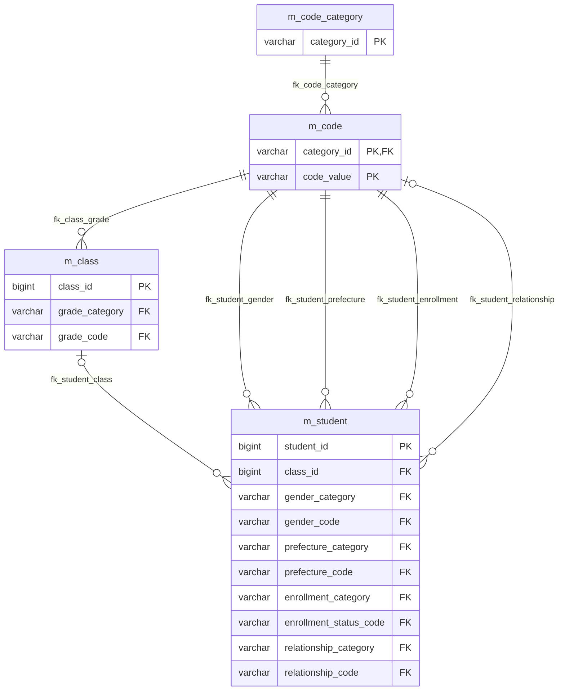

親キーは一意で、子の参照列には一意制約がないため、親1件を子0件以上が参照できる。学生のクラスと続柄2列はNULL可能だが、別のCHECKが在籍区分に応じた所属と緊急連絡先の一式設定を要求する。7FKにはCASCADE指定がない。参照先の存在はFKの条件、停止・期間・定員の適合は保存処理の条件として分ける。〔observed-source：`sources/database/001_schema.sql:15-32,63-66,91-127,187-203`〕

### 表示JOINと監査追記

一覧SQLは学生を起点に、クラス、クラスの学年コード、学生の在籍コード、都道府県コードをLEFT JOINする。この一覧SQLには性別・続柄名称のJOINがない。JOIN自体は参照先欠落だけで学生行を除去しないが、指定した年度・学年等の検索述語による絞込みは別に適用される。

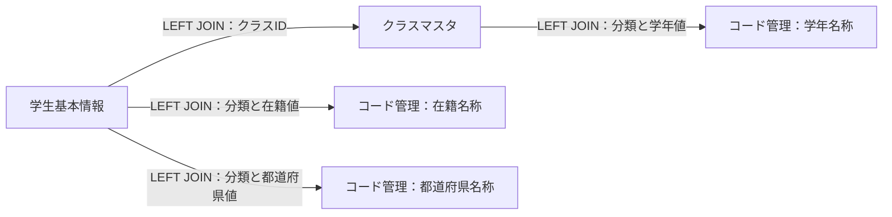

一覧住所は都道府県名称と`address_line1`の連結値であり、名称欠落時は`[不整合]`を使用する。`address_line2`は連結しない。名称保存列のNOT NULLと、LEFT JOIN結果として生じ得る名称NULLは別の属性である。表示名称の業務上限は、補足説明でマスタ保存側へ対応させる。〔observed-source：`sources/Core/SqlServerStudentService.cs:77-90,137-153`〕

監査追記は処理から履歴への依存であり、保存情報のFKとは分ける。

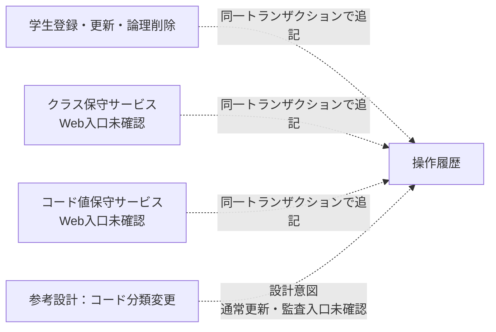

履歴の`target_table`と`target_key`には業務表へのFKがない。対象キーは学生・クラスの管理番号の十進文字列、又は`分類:コード値`である。参考設計は分類変更も監査対象とするが、現行で確認できる分類書込みはseedの不足行追加であり、通常分類更新と監査追記の入口は確認できない。〔observed-source：`sources/database/001_schema.sql:137-154,189-205`、`sources/Core/SqlServerStudentService.cs:385-390`、`sources/Core/MasterMaintenanceService.cs:132-135`、`sources/database/002_seed.sql:88-92`。reference-design：`reference-designs/基本設計書/03_テーブル仕様書.md:20-34`〕

本書の個別表リンクと関連文書リンクは、提供された文書計画との対応を示す。本応答では本書だけを作成し、他の文書は未生成の計画先として扱う。

## テーブル一覧

| No | 論理名 | 物理名 | 1件の単位・主キー | 列数 | kind | 個別文書ID | 契約path・本書からの相対リンク | 文書状態 |
| --- | --- | --- | --- | --- | --- | --- | --- | --- |
| 1 | 学生基本情報 | `dbo.m_student` | 学生1人。`student_id` | 35 | `table-definition` | `CSHARP_ASPNET-BAS-STU-03-M_STUDENT` | [基本設計書/テーブル/01_m_student.md](テーブル/01_m_student.md) | 計画先・未生成 |
| 2 | クラスマスタ | `dbo.m_class` | 年度内のクラス1件。`class_id` | 17 | `table-definition` | `CSHARP_ASPNET-BAS-STU-03-M_CLASS` | [基本設計書/テーブル/02_m_class.md](テーブル/02_m_class.md) | 計画先・未生成 |
| 3 | コード種別マスタ | `dbo.m_code_category` | 分類1件。`category_id` | 11 | `table-definition` | `CSHARP_ASPNET-BAS-STU-03-M_CODE_CATEGORY` | [基本設計書/テーブル/03_m_code_category.md](テーブル/03_m_code_category.md) | 計画先・未生成 |
| 4 | コード管理マスタ | `dbo.m_code` | 分類内コード1件。`category_id, code_value` | 14 | `table-definition` | `CSHARP_ASPNET-BAS-STU-03-M_CODE` | [基本設計書/テーブル/04_m_code.md](テーブル/04_m_code.md) | 計画先・未生成 |
| 5 | 操作履歴 | `dbo.t_operation_log` | 操作記録1件。`log_id` | 12 | `table-definition` | `CSHARP_ASPNET-BAS-STU-03-T_OPERATION_LOG` | [基本設計書/テーブル/05_t_operation_log.md](テーブル/05_t_operation_log.md) | 計画先・未生成 |

## イベント仕様

### 学生検索・詳細読込み・候補取得

#### 処理概要

検索は非削除学生を条件で絞り、所属とコード名称を付けた一覧を返す。詳細読込みは学生1件を登録画面用の値へ戻す。候補取得はコードとクラスの選択キー、名称、期間、利用状態を供給する。いずれも参照処理であり、業務表を変更せず、操作履歴を増やさない。

#### 処理手順

1. 検索POSTは認証・CSRFの設定下でFormGuardを実施する。許可項目・重複を検査し、在籍区分が未送信の場合だけ空配列を設定する。最初の検索状態取得はControllerの個別WebFault catchの外で行う。
2. ModelStateが無効なら状態422を設定する。有効ならcatch内でCoordinatorを呼び、認証主体確認、DTOから検索条件への変換、検索状態のGate待機へ進む。Gate待機後にも所有者・セッション・タブ・期限を確認し、要求状態版と版上限を検査する。
3. サービスはページ正数、表示件数20・50・100、並び順4種類、昇降順、年度1900～9998、正のクラスIDを検査する。未所属と年度・学年・クラスの併用を拒否する。在籍区分は最大4値、重複なし、01～04とする。
4. 検索文字列を番号、氏名・カナ照合キー、電話、コード、日付へ整える。入学日両端指定時は開始日以下の終了日を要求しないよう、開始日≦終了日を検査する。SNAPSHOT開始後、指定学年・都道府県コード、指定年度のクラス存在、指定クラスと年度・学年の一致を確認する。この存在検査は停止・期間外の一律拒否ではない。
5. 同じ条件で最大10001件を数える。10000件超ならcommitして一覧を抑止する。通常は最終ページを計算して取得ページを補正し、ページ行を取得してcommitする。成功した検索は実行条件・結果を検索状態へ保持し、状態版を加算する。
6. CoordinatorからのWebFaultはControllerがエラーとその状態コードを設定する。拒否ではAppliedとLastResultを更新しないが、当該検索POSTの表示データは初期設定した`Present(entry,null)`を引き継ぐ。成功・拒否のいずれも、その後に検索用候補取得とビュー出力が続く。
7. 詳細読込みは主体確認後、正でないIDならNULLを返す。正のIDでは非削除学生を読み、不在はNULL、存在時は日付・任意値・比較版・更新情報を`StudentDetail`へ移す。明示SNAPSHOTトランザクションはない。
8. 候補取得はSNAPSHOT内でコードとクラスの2結果集合を読む。人数付きでは非削除・在籍01又は02を集計する。検索用`LookupAsync(false)`は人数を集計せず、`Occupied=0`を設定する。

〔observed-source：`sources/Web/Controllers/StudentsController.cs:13-19,39-41`、`sources/Infrastructure/SearchContextStore.cs:13-14`、`sources/Infrastructure/WebStudentCoordinator.cs:7-14,20-21`、`sources/Core/SqlServerStudentService.cs:103-222`〕

#### 処理フロー

参照1は検索POSTの受付と応答境界である。最初の状態取得失敗はmiddlewareへ進み、catch内の拒否は再表示へ進む。参照2の結果・例外は、それぞれこの図の対応する出口へ戻す。

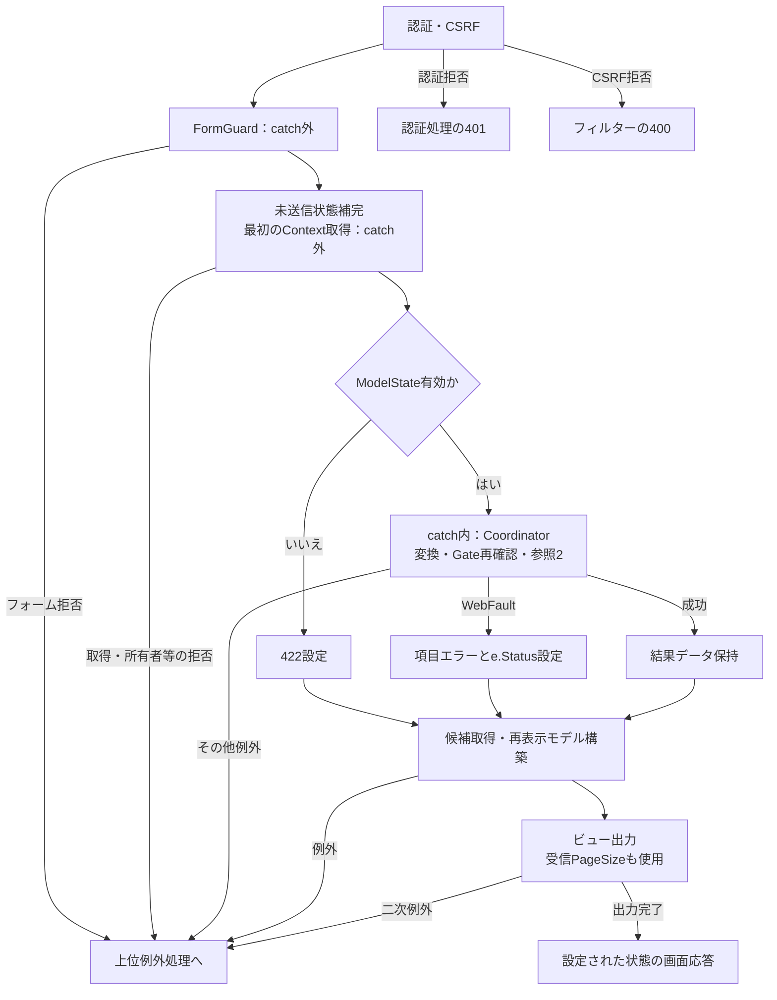

参照2はサービス検索である。入力検証結果はCoordinatorのEnsureSearchでWebFaultへ変換され、参照1の項目エラー設定へ戻る。主体取得は検索tryの外にある。

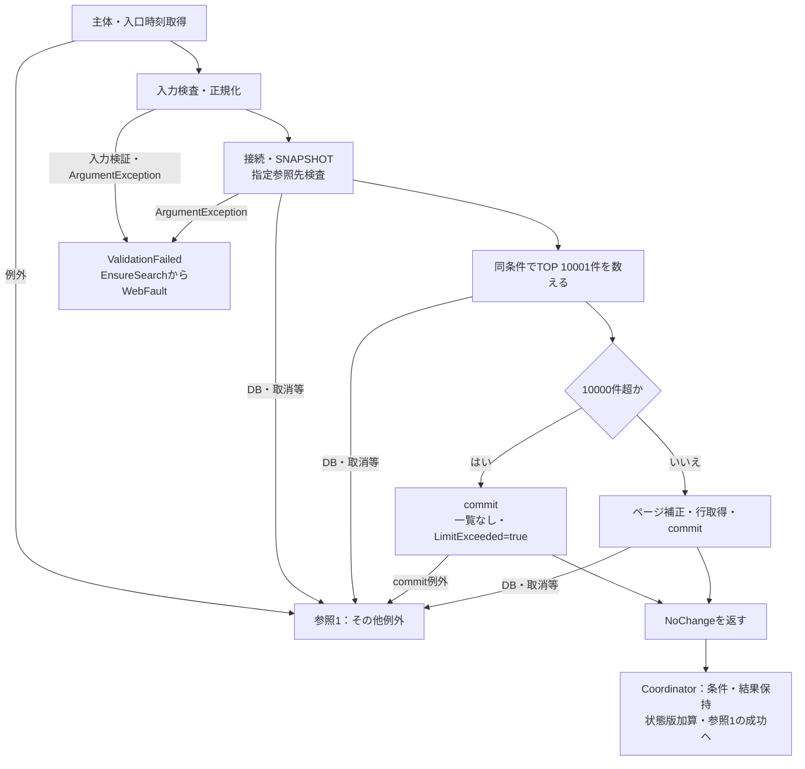

参照3は詳細と候補の取得である。詳細NULL、集計人数、集計省略の0を別の出口で扱う。

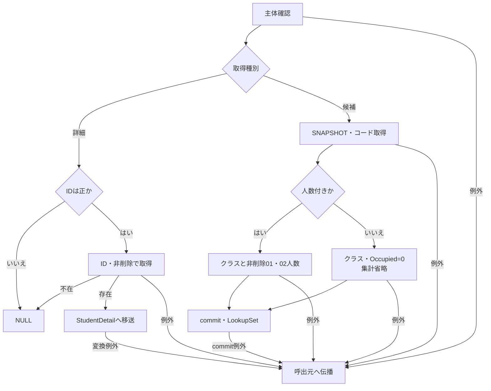

#### SQL・テーブル関連（ER図）

保存参照は概要のER図に対応する。件数SQLは学生とクラスを使い、行SQLは学年・在籍・都道府県名称のLEFT JOINを加える。候補コードは分類とのINNER JOINで、分類と値の両方が利用可の場合だけDTOの`IsActive=true`とする。クラス候補は学年コードをLEFT JOINする。候補SQLには停止・期間外を除外するWHEREがなく、表示用途に応じた選択可否は取得後に判定する。〔observed-source：`sources/Core/SqlServerStudentService.cs:82-90,156-168,203-214`〕

#### DB操作の詳細

検索には常に`s.is_deleted=0`を適用する。任意条件は正規化後の値が非NULLの場合にANDで追加する。電話だけは括弧内で本人・緊急電話のORを使う。

| 条件 | 検索対象・述語 | パラメータ・型・サイズ |
| --- | --- | --- |
| 学籍番号 | `s.student_no`前方一致 | `@no VarChar(31)`。エスケープ後、末尾に`%` |
| 氏名 | `s.name_key`部分一致 | `@name NVarChar(642)`。前後に`%` |
| 氏名カナ | `s.kana_key`部分一致 | `@kana NVarChar(74)`。前後に`%` |
| 年度 | `c.school_year=@year` | `@year SmallInt` |
| 学年 | `c.grade_code=@grade` | `@grade VarChar(2)` |
| クラス | `s.class_id=@class` | `@class BigInt` |
| 未所属 | `s.class_id IS NULL` | なし。所属条件との併用を拒否 |
| 都道府県 | `s.prefecture_code=@prefecture` | `@prefecture VarChar(2)` |
| 電話 | 本人電話又は緊急電話が`@phone`と一致 | `@phone VarChar(16)` |
| 入学日開始 | `s.admission_date>=@from` | `@from Date` |
| 入学日終了 | `s.admission_date<=@to` | `@to Date` |
| 在籍区分 | `s.enrollment_status_code IN (...)` | 各値を`@statusN VarChar(2)`。空配列は条件なし |
| ページ | `OFFSET @offset ROWS FETCH NEXT @size ROWS ONLY` | `@offset Int`、`@size Int` |

LIKEは`!`をESCAPE文字とし、`!`、`%`、`_`、`[`をエスケープする。並び順は学籍番号、氏名キー、入学日、更新日時の4種類、昇順又は降順に限定する。副順序は学生ID昇順である。確認件数とページ行は同じSNAPSHOT内で取得する。ページ操作は最後に実行した条件を使い、表示件数・並び順変更時は1ページへ戻す。件数減少で保持ページが範囲外になった場合は補正条件で再検索する。〔observed-source：`sources/Core/SqlServerStudentService.cs:107-168`、`sources/Core/StudentNormalizer.cs:161-161`、`sources/Infrastructure/WebStudentCoordinator.cs:11-14`〕

詳細SQLは`student_id=@id AND is_deleted=0`、パラメータは`BigInt`である。コード候補は分類・表示順・値、クラス候補は年度降順・学年表示順・クラス表示順・クラスコード・IDの順で返す。人数集計はクラス一致、非削除、在籍01又は02を条件とする。検索用の人数0は実測0人ではない。〔observed-source：`sources/Core/SqlServerStudentService.cs:172-216`〕

#### 結果・例外時の扱い

0件、通常一覧、10000件超は、サービスではいずれも`NoChange`である。10001は上限超過を確認するための件数であり、全該当件数ではない。上限超過のWeb表示では総件数をNULLとし、一覧を抑止する。詳細NULLは既存学生の画面読込みで対象不在404へ変換する。〔observed-source：`sources/Core/SqlServerStudentService.cs:159-181`、`sources/Infrastructure/WebStudentCoordinator.cs:17-21`〕

検索try内のInputValidationExceptionとArgumentExceptionはValidationFailedへ変換する。DB・取消等の未捕捉例外は呼出元へ伝播する。在籍配列NULLがサービスへ届いた場合は`Length`へのアクセスがあり、非nullable注釈だけでその経路を排除できない。HTTP受信・MVC変換・サービス引数は別の境界である。〔observed-source：`sources/Core/SqlServerStudentService.cs:105-112,169-170`、`sources/Web/Controllers/StudentsController.cs:14-16`〕

catch内の拒否後も候補取得とビュー出力が続く。検索POSTは受信`pageSize`を再表示モデルへ設定し、ビューはその値でページ数を除算するため、0が残れば二次例外が生じ得る。図の画面応答へ到達するのは、後続表示まで完了した場合である。middlewareは応答未開始の場合だけWebFaultの状態又は一般例外503を設定し、学生ルートには簡易エラーHTMLを出力する。応答開始後の例外は同catchの対象外である。〔observed-source：`sources/Web/Controllers/StudentsController.cs:13-19`、`sources/Views/Students/Search.cshtml:8-8`、`sources/Infrastructure/WebHostSetup.cs:22-24`〕

### 学生の新規登録・更新・重複確認続行

#### 処理概要

保存は業務入力を正規化し、書込ゲート下で最新対象、期待版、コード、所属、定員、番号一意性、同一人物候補を確認する。学生1件と操作履歴1件を同じトランザクションで確定する。変更なしと確認待ちは学生書込みへ進まない。

#### 処理手順

1. Web受付はFormGuard、作成更新権限、Snapshot取得、復帰検索状態、読込時復帰先との一致を順に確認する。これらはControllerの個別WebFault catchの外であり、拒否はmiddlewareへ伝播する。その後にModelStateを判定する。
2. ModelState有効時だけcatch内でCoordinatorを呼ぶ。Coordinatorは権限・復帰状態を再確認し、ToRequestでクラスID・期待版を変換する。ここでのWebFaultはControllerが捕捉し、エラー・状態を設定して再表示へ進む。
3. サービスは受付GUID、主体、入口UTC時刻、日本時間の業務日を取得する。Viewerを拒否し、19業務入力、任意理由60スカラー、対象IDと期待版の同時設定・正数、年度範囲、任意学年コードを検査する。接続とReadCommitted開始は書込tryの外である。
4. try内で共通書込ゲートを取得する。更新だけが非削除対象を再読込みし、不在、期待版不一致、学籍番号変更を区別する。保存済み在籍03・04から別区分へ訂正する場合は管理者権限と理由を要求する。新規は既存行・既存版をNULLのまま保持する。
5. 最新コードは常に存在を要求し、新規又は変更値だけに分類・値の利用可と当日有効を要求する。指定クラスは存在と年度・学年一致を確認する。新たな在学・休学の席を増やす場合は利用状態、当日期間、最新人数による定員を検査する。卒業・退学で所属・区分・入学日・終了日が変わる場合は在籍期間とクラス期間の重なりを検査する。
6. 正規化保存値とDB値を比較する。変更なしなら明示rollbackし、既存ID・読込済み版を返す。変更ありでは版上限、その後に削除済みを含む学籍番号一意性を検査する。理由だけの変更では学生の日時・版・履歴を増やさない。
7. 非削除、自身以外、生年月日一致、氏名キー又はカナキー一致の候補を学生ID順で全件取得する。正規化内容と全候補ID・版をハッシュ化し、提示確認情報を照合する。有効な確認で続行する場合は理由が必須である。
8. 候補がある、又は確認値が非NULLで、確認が無効なら、保存トランザクションをrollbackして確認情報を発行する。全候補件数と最大20件を返す。新規のID・既存版はNULL、更新は対象ID・読込済み版を保持する。
9. 保存可能なら学生をINSERT又はUPDATEし、OUTPUTでIDを取得する。履歴を追記し、非Web方式で有効確認を使用した場合は消費更新も加えてcommitする。commit完了後だけSavedを返す。
10. SavedはFlashと303へ進む。その他のサービス結果は結果別の状態と確認値を設定し、Snapshotの読込時Detail、受信入力、候補を使って再表示する。ModelState不正又は個別WebFault捕捉で結果がNULLの場合は、サービス結果による確認値置換を行わない。

〔observed-source：`sources/Web/Controllers/StudentsController.cs:26-33`、`sources/Infrastructure/WebStudentCoordinator.cs:18-18`、`sources/Web/Inputs/StudentSaveInput.cs:34-43`、`sources/Core/SqlServerStudentService.cs:227-324,344-383`〕

#### 処理フロー

保存1-Aはcatch外の受付である。各拒否の状態は直後の対応表に示す。有効なSnapshotと入力を保存1-Bへ渡す。

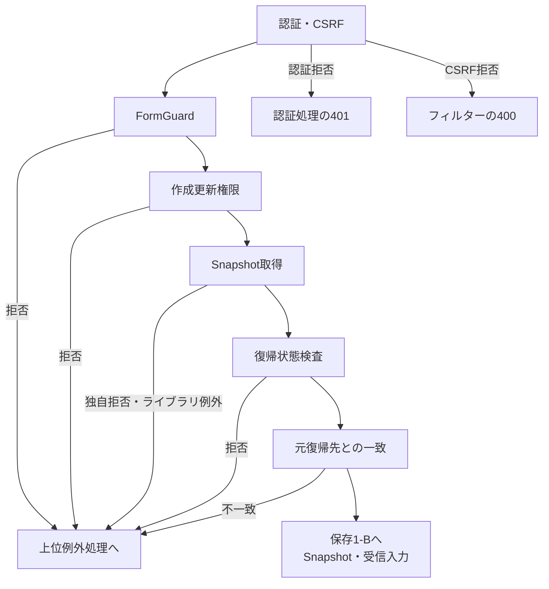

| catch外の検査 | 拒否又は失敗 | 上位での扱い |
| --- | --- | --- |
| FormGuard | 未知項目、不許可重複、不正フォームメタ情報 | WebFault 400 |
| 作成更新権限 | Viewer | WebFault 403 |
| Snapshot取得 | キー不在・期限切れ | WebFault 409 |
| Snapshot取得 | 所有者・セッション・対象不一致 | WebFault 403 |
| Snapshot取得 | NULLキーが辞書へ渡る等、独自検査前のライブラリ例外 | 個別WebFault catchへ入らず上位へ伝播 |
| 復帰状態 | 状態不在・期限切れ／所有者・セッション不一致 | WebFault 409／403 |
| 元復帰先照合 | 読込時と異なる復帰先 | WebFault 403 |

保存1-Bは個別catchと結果後処理である。catch内の拒否は保存1-Aの拒否と同じ終端へ直接合流させず、候補再取得とビュー出力へ接続する。

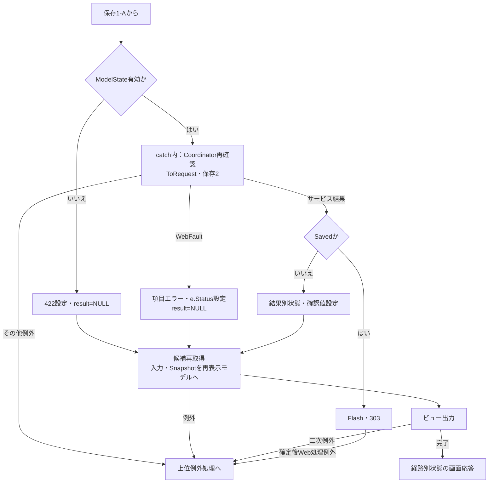

ToRequestの識別値・期待版変換拒否は422、新規への期待版指定は400である。Coordinator再確認の認証・権限・復帰状態拒否も、そのWebFault状態を保持して保存1-Bのエラー設定へ進む。〔observed-source：`sources/Web/Inputs/StudentSaveInput.cs:40-43,57-60`、`sources/Infrastructure/WebStudentCoordinator.cs:6-6,18-18`〕

保存2-Aはサービス入口である。入口時刻と正規化成功値を保存2-Bへ渡す。

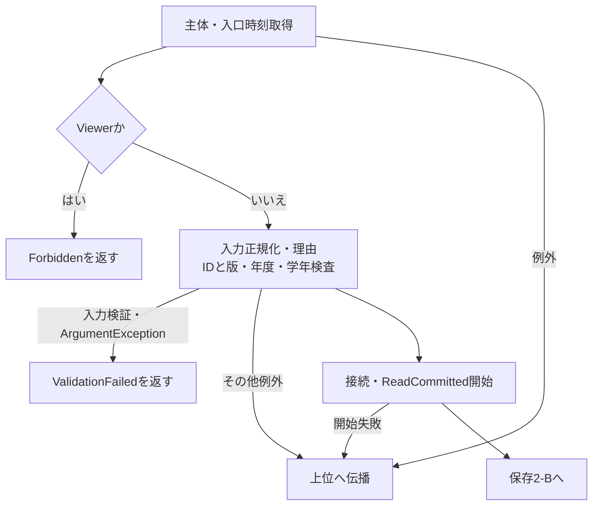

保存2-Bは書込try内の最新検査である。新規のNULL情報と更新の取得済み情報を分けて保存3へ引き継ぐ。

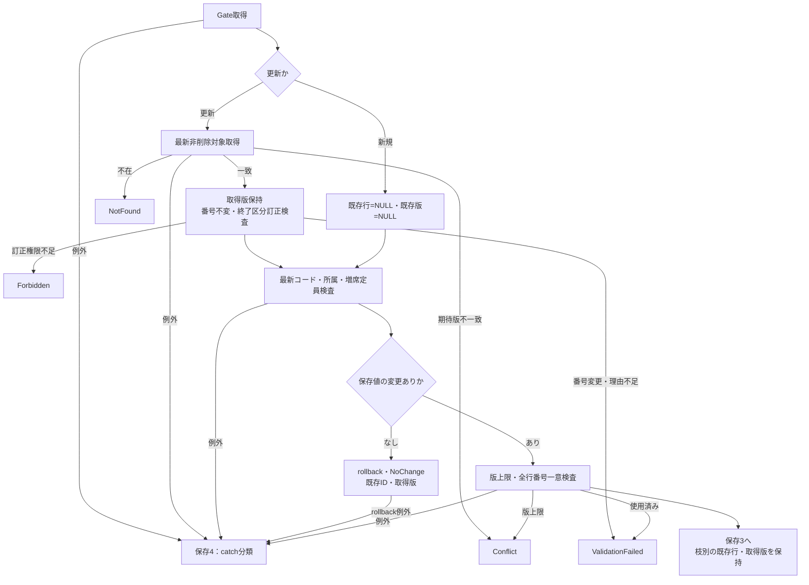

不在・版不一致等の早期returnではcommitしない。変更なしは明示rollbackで戻る。各結果はその種類を保持して保存1-Bへ返す。

保存3は同一人物確認と確定である。確認待ちと保存成功のID・版は後述の結果表に対応し、新規枝のNULLを更新枝へ適用しない。

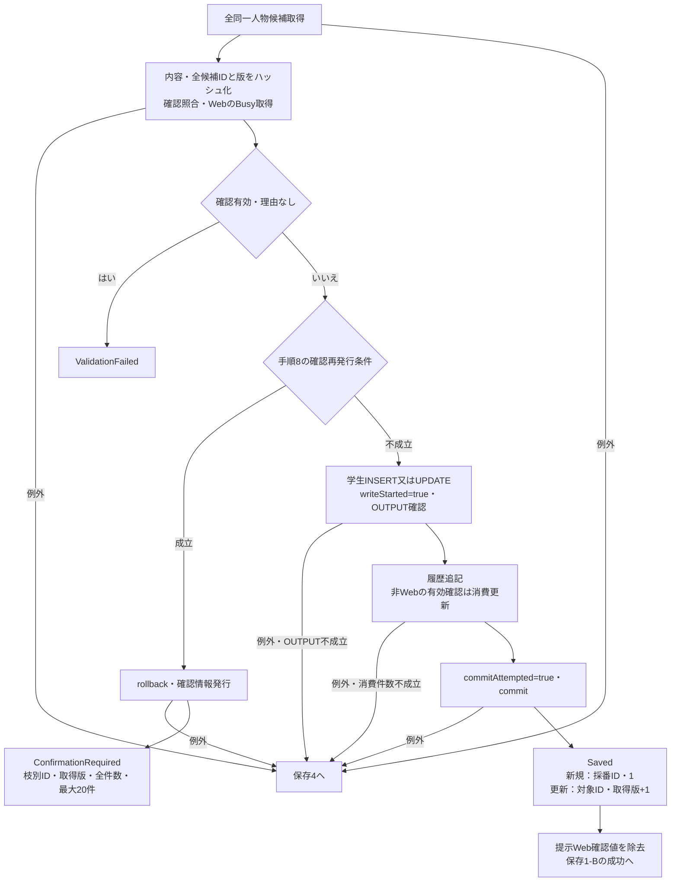

手順8の条件は、候補件数が正又は確認値が非NULLであり、かつ確認が無効であること。空文字の確認値も非NULLとしてこの判定に参加する。確認待ちの発行は学生保存rollback後に行う。

保存4は書込tryのcatch順である。後段の結果不明条件を先行catchへ適用しない。

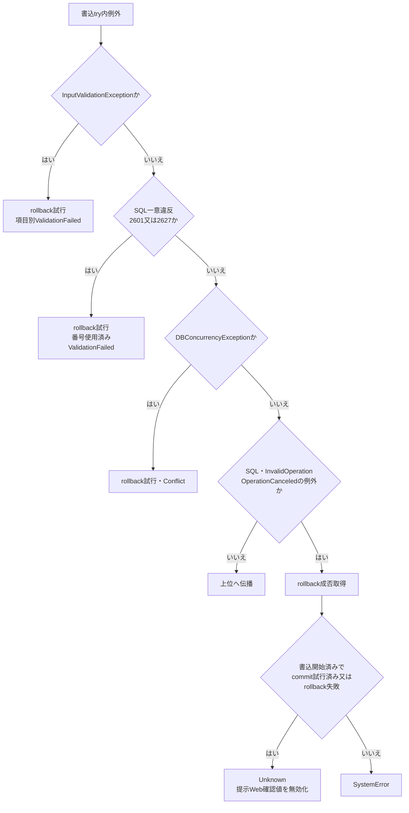

Busyを取得済みで未完了、かつUnknownでない場合はfinallyでBusyを解除する。完了又はUnknownの場合には、その解除条件へ入らない。

#### SQL・テーブル関連（ER図）

参照先は概要のER図に対応する。保存前に分類付きコード、クラス、人数集計用学生、同一人物候補を読み、学生書込みと履歴追記を同じトランザクションに置く。非Web確認方式だけは確認表の消費更新を追加する。Web確認方式はメモリ保持である。

#### DB操作の詳細

新規INSERTは正規化保存列に固定分類`GENDER`、`PREFECTURE`、`ENROLLMENT_STATUS`、未削除、作成更新日時・者、版1を加える。UPDATEは学籍番号を除く正規化保存列と更新管理情報・版を設定し、学籍番号・固定3分類・作成情報を保持する。WHEREは`student_id=@id AND row_version=@version AND is_deleted=0`、ID・版は`BigInt`である。OUTPUTは表変数経由で取得し、NULL又はDBNullなら競合例外とする。〔observed-source：`sources/Core/SqlServerStudentService.cs:292-305`〕

コード検査は分類・値の両条件でコードと分類をJOINし、分類を`VarChar(24)`、値を`VarChar(10)`で渡す。新規又は変更値だけに利用状態・当日期間を要求する。クラスは`@id BigInt`で読み、指定年度・学年と一致させる。増席時の定員集計はクラス一致、非削除、在籍01又は02、自身以外を条件とし、人数に1を加える。定員NULLは制限なしである。〔observed-source：`sources/Core/SqlServerStudentService.cs:347-380`〕

学籍番号一意検査は番号一致と自身以外を条件とし、論理削除を除外しない。同一人物候補は非削除、自身以外、生年月日一致、氏名キー又はカナキー一致、学生ID順で全件取得する。候補パラメータはID=`BigInt`、生年月日=`Date`、氏名キー=`NVarChar(320)`、カナキー=`NVarChar(36)`である。表示20件を照合対象の取得上限にしない。〔observed-source：`sources/Core/SqlServerStudentService.cs:264-290`〕

学生監査は対象表`m_student`、対象キーは取得IDの十進文字列とする。新規はCREATE・前版NULL・後版1、更新はUPDATE・取得版・新版を記録する。新規の変更列名一覧には固定分類・削除状態・管理列も加え、更新には実変更列と更新日時・者・版を記録する。理由を履歴へ渡し、確認フラグは最新候補件数が正かどうかで設定する。業務値の前後コピーは保存しない。〔observed-source：`sources/Core/SqlServerStudentService.cs:306-307,385-390`〕

#### 結果・例外時の扱い

| 結果 | 返却ID・版と処理段階 | 通常のWeb後処理 |
| --- | --- | --- |
| Saved | commit完了。新規は採番ID・1、更新は対象ID・取得版+1 | Flash・303 |
| NoChange | 既存ID・取得版。明示rollback | 200・再表示。日時・版・履歴を増やさない |
| ConfirmationRequired | 学生保存rollback済み。新規ID・版NULL、更新ID・取得版保持 | 409・全件数と最大20候補を表示 |
| ValidationFailed | ID・版未設定。入力・参照先・定員・番号一意等の拒否 | 422・再表示 |
| Forbidden | ID・版未設定。保存又は終了区分訂正の権限不足 | 403・再表示 |
| NotFound | ID・版未設定。最新非削除対象なし | 404・再表示 |
| Conflict | ID・版未設定。期待版不一致、変更ありの版上限、競合catch | 409・再表示 |
| SystemError | 最後の対象catchへ到達し、Unknown条件に該当しない | 503・再表示 |
| Unknown | 最後の対象catchで書込開始済み、かつcommit試行済み又はrollback失敗 | 503・再保存前に検索確認 |

入力検証、SQL一意違反、DB競合の先行3catchはrollbackを試みるが、成否でUnknownへ再分類しない。最後の対象catchだけが`writeStarted && (commitAttempted || !rolledBack)`でUnknownを判定する。rollback helperは取消なしで試み、SQL例外又は無効状態例外ならfalseを返す。履歴失敗も同じ取消対象だが、結果分類は到達したcatchと書込・commit段階に従う。OUTPUT取得だけでは保存確定ではない。〔observed-source：`sources/Core/SqlServerStudentService.cs:302-329`〕

主体取得、接続・トランザクション開始、Controller事前検査、候補再取得、ビュー出力は同じcatch範囲ではない。Saved以外でも表示処理が続くため、上表の通常状態だけで最終HTML完了を保証しない。Saved後のFlash・303生成・次要求の検索復帰の失敗は、確定済みDB保存のrollbackを意味しない。上位のWebFault又は一般例外は、応答未開始の場合に限りmiddlewareのエラー出力へ進む。〔observed-source：`sources/Web/Controllers/StudentsController.cs:29-39`、`sources/Infrastructure/WebHostSetup.cs:22-24`〕

### 学生の論理削除

#### 処理概要

管理者が対象と理由を確認し、削除属性と更新管理情報だけを変更する。編集中の氏名・住所・所属等は保存しない。論理削除とDELETE監査を同じトランザクションで確定する。

#### 処理手順

1. WebはFormGuard、参照権限、Snapshot取得、読込時復帰先との一致を確認する。Coordinatorは管理者権限、復帰状態、明示確認、期待版変換の順に検査する。削除Controllerには保存と同じ個別WebFault catchがない。
2. サービスは主体・管理者を確認し、必須理由のraw・保存60スカラーを検査する。この入口catchはInputValidationExceptionだけである。その後に正のID・版、版上限を確認する。
3. 接続とReadCommitted開始後、try内でGateを取得する。非削除対象の現在版を読み、不在はNotFound、版不一致はConflictとする。
4. ID・期待版・非削除のWHEREで削除7列だけを更新し、1件を要求する。DELETE監査を追記してcommitする。
5. 成功は対象ID・版+1を返し、Webは303へ進む。それ以外は結果別状態とエラーを設定した後、最新対象と候補をLoadして再表示する。

〔observed-source：`sources/Web/Controllers/StudentsController.cs:25-25,37-38`、`sources/Infrastructure/WebStudentCoordinator.cs:19-19`、`sources/Core/SqlServerStudentService.cs:392-416`〕

#### 処理フロー

削除1は受付と入口検査である。独自拒否、変換拒否、ライブラリ例外はいずれも個別Controller catchを経由しない。

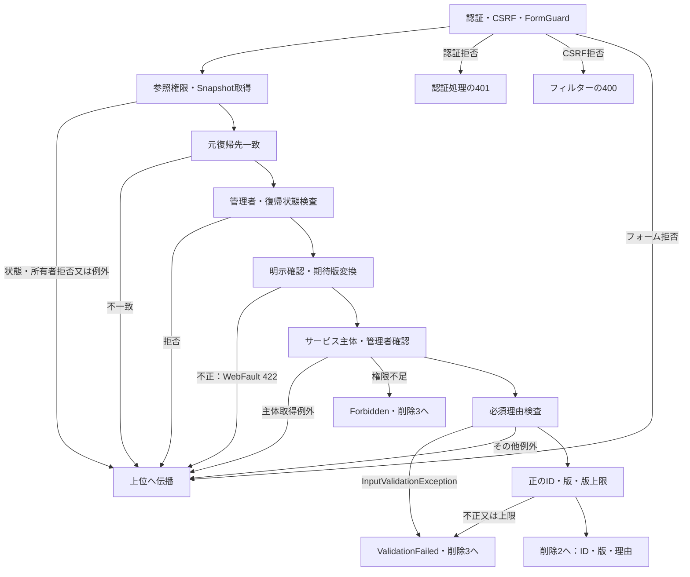

削除2はDB更新とcatch分類である。接続開始失敗は書込catchの外にあり、競合catchを後段のUnknown条件へ含めない。

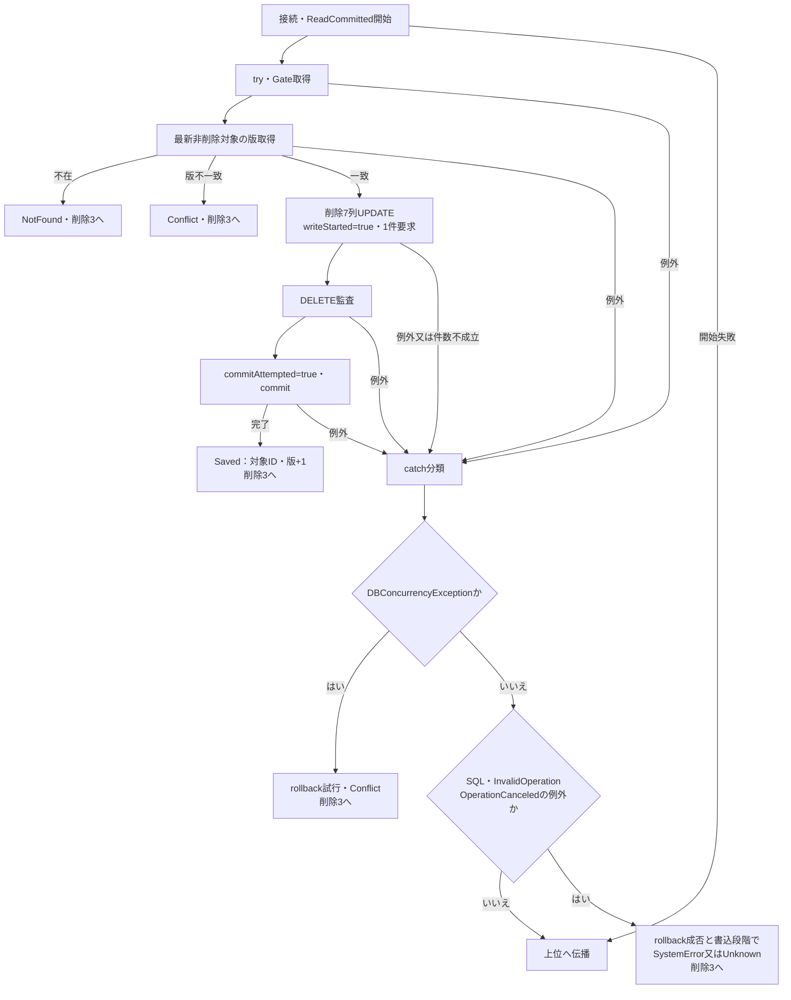

削除3は結果後処理である。各流入枝の結果を保持し、後段Loadの失敗を固定のサービス状態へまとめない。

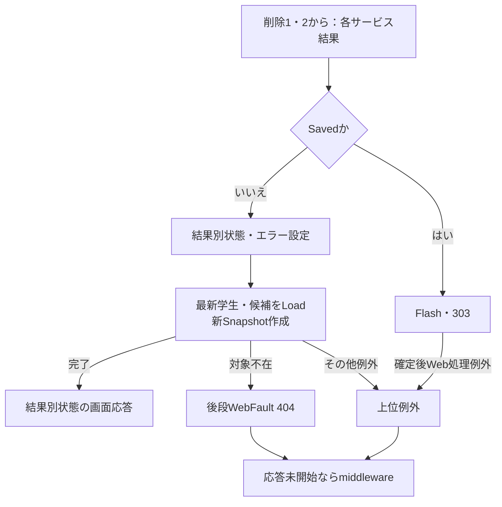

#### SQL・テーブル関連（ER図）

対象は学生と操作履歴で、概要の監査追記図に対応する。クラス・コード参照列を変更せず、物理DELETEやFKによる削除連動は行わない。

#### DB操作の詳細

WHEREは`student_id=@id AND row_version=@version AND is_deleted=0`である。設定列は`is_deleted`、`deleted_at`、`deleted_by`、`delete_reason`、`updated_at`、`updated_by`、`row_version`の7列だけである。ID・版=`BigInt`、日時=`DateTimeOffset`、者=`NVarChar(128)`、理由=`NVarChar(120)`を使用し、更新1件を要求する。

監査はDELETE、前後版は期待版と期待版+1、変更列JSONは上記7列、理由は削除理由、確認フラグはfalseとする。DDLは削除済み状態で削除日時・者・理由の全設定を要求する。〔observed-source：`sources/Core/SqlServerStudentService.cs:404-414`、`sources/database/001_schema.sql:200-200`〕

#### 結果・例外時の扱い

理由の必須・長さ・制御文字等によるInputValidationExceptionはValidationFailedとなる。不正サロゲートのArgumentExceptionは入口catchで変換されず上位へ伝播する。これはその値がサービスへ届いた場合の経路であり、HTTPバインド全体についての保証ではない。〔observed-source：`sources/Core/StudentNormalizer.cs:37-56`、`sources/Core/SqlServerStudentService.cs:394-398`〕

競合は先行catchでConflictとなる。後続の対象catchだけが書込開始・commit試行・rollback成否からUnknown又はSystemErrorを決める。削除の版上限は入口ValidationFailedであり、変更あり学生更新のConflictとは異なる。通常の状態対応は保存結果表に従い、Savedだけは303となる。〔observed-source：`sources/Core/SqlServerStudentService.cs:398-416`、`sources/Infrastructure/WebPresentation.cs:23-23`〕

Saved以外は最新Loadが続く。例えば結果不明の後に対象が既に削除されていれば、Loadの対象不在404へ進み得る。候補取得等の失敗も別の上位例外となるため、最初に設定したサービス結果の状態を最終応答へ固定しない。middlewareの捕捉は応答未開始の場合に限る。〔observed-source：`sources/Web/Controllers/StudentsController.cs:25-25,37-38`、`sources/Infrastructure/WebStudentCoordinator.cs:17-17`、`sources/Infrastructure/WebHostSetup.cs:22-24`〕

### クラスマスタの保守

#### 処理概要

クラス保守サービスは年度内クラスの学年、名称、期間、定員、表示順、利用状態、備考を保存する。引数は`ClassChange`、戻り値は結果、版、メッセージ、同名警告を持つ`MaintenanceResult`である。Webの実装登録・Controllerからの入口は確認できない。実行者と管理者判定はDB接続の認証主体から取得する。

#### 処理手順

1. 年度1900～9998、定員NULL又は1～9999、非負表示順、対象ID・期待版の同時設定と正数を検査する。コードはraw・正規化後9以内、名称はraw・保存18スカラー、備考は120スカラーへ整える。
2. 開始・終了日をISO日付から変換し、開始日≦終了日、当該年度4月1日～翌年3月31日の範囲内を要求する。同日を許す。
3. 接続でDB認証者と`student_admin`所属を確認し、ReadCommittedを開始する。try内で共通Gateを取得する。
4. 新規は既存行NULLのまま手順6へ進む。新規には既存比較、学生参照集計、現在人数検査を行わない。
5. 更新だけが既存行を読み、不在・期待版不一致を結果として返す。一致時は年度・コード変更を拒否する。削除済みを含む参照学生が存在すれば学年変更を拒否する。非削除・在籍01又は02の現在人数が正なら停止・当日期間外を拒否し、定員を現在人数未満にする変更も拒否する。
6. 共通処理で学年コードの存在を確認する。新規又は学年変更時だけ分類・値の利用可と当日有効を要求する。未変更の停止・期間外学年は存在確認の上で保持できる。
7. 保存値を比較し、変更なしならrollbackして既存期待版、同名警告falseを返す。変更ありでは版上限を検査し、同年度・同学年・同名・自身以外の件数から警告を求める。停止クラスも対象で、同名だけでは拒否しない。
8. クラスと監査を保存してcommitし、新規1又は期待版+1と、取得した同名警告を返す。

〔observed-source：`sources/Core/MasterMaintenanceService.cs:9-11,17-77`、`sources/Infrastructure/WebHostSetup.cs:12-19`〕

#### 処理フロー

クラス1は新規・更新の分岐である。新規は既存行NULLを、更新は取得済み既存行と期待版をクラス2へ渡す。

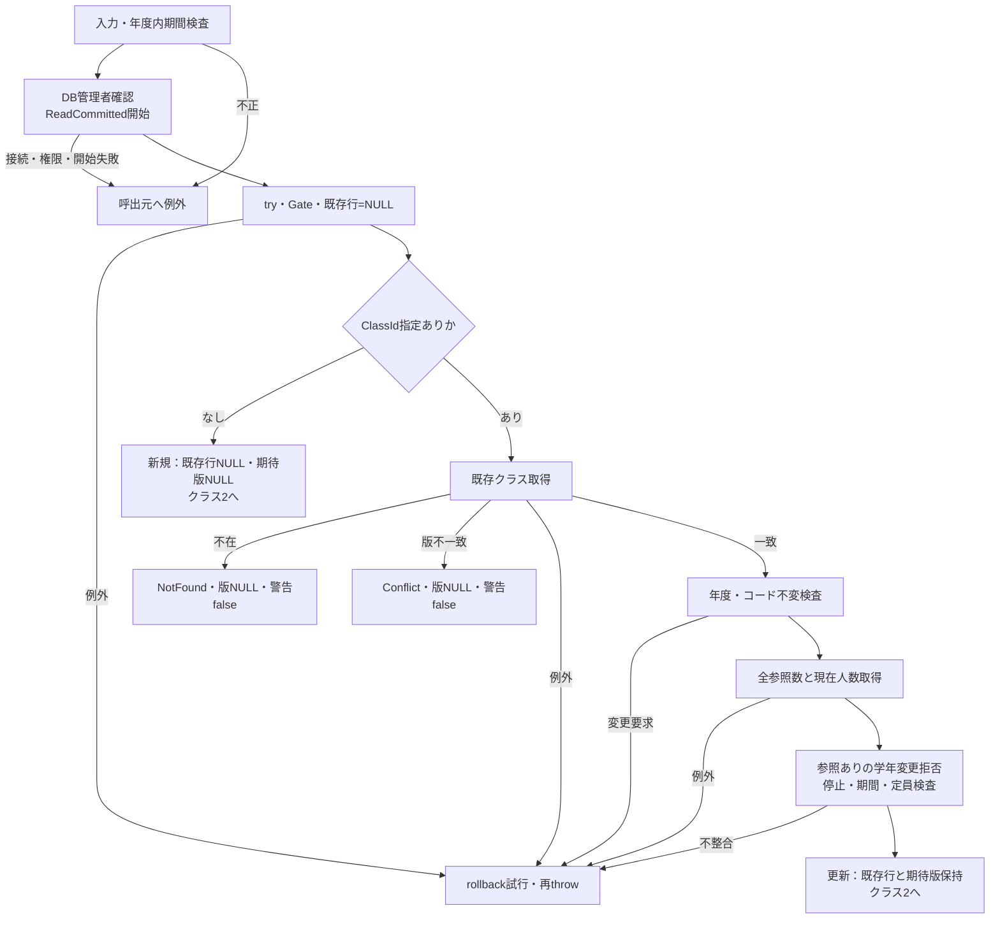

クラス2は共通学年検査と確定である。成功時の警告は同名検査で得た値を引き継ぐ。

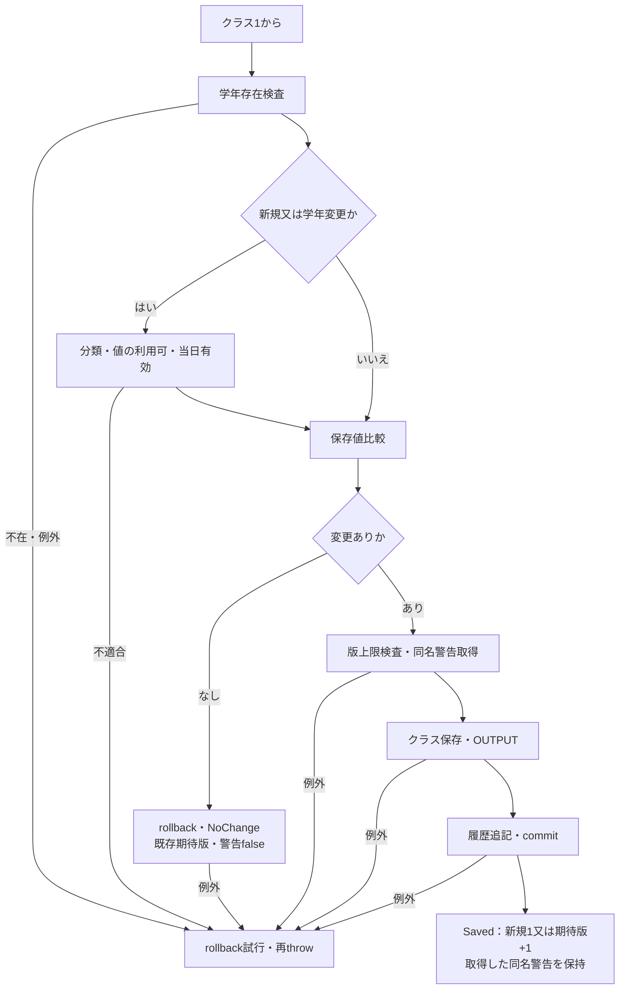

#### SQL・テーブル関連（ER図）

クラスは学年コードを複合FKで参照し、学生はクラスIDを参照する。概要のER図に対応する。更新時の全参照数と現在人数は、同じ学生表から異なる条件で求める。クラス保存から履歴への追記はFKではなく処理依存である。

#### DB操作の詳細

既存クラスは`class_id=@id`、`@id BigInt`で取得する。更新時の学生集計はクラスID一致を条件とし、全参照数は削除済みを含む。現在人数だけを非削除・在籍01又は02に限定する。この学生読取りを新規枝へ適用しない。

学年検査は分類とコードをJOINし、`category_id='GRADE' AND code_value=@grade`、`@grade VarChar(2)`を使用する。同名検査は年度・学年・名称・自身以外の4条件であり、利用状態を条件にしない。年度=`SmallInt`、学年=`VarChar(2)`、名称=`NVarChar(36)`、任意ID=`BigInt`で渡す。〔observed-source：`sources/Core/MasterMaintenanceService.cs:44-71`〕

保存値は年度、学年、コード、名称、期間、定員、順序、状態、備考である。新規は固定分類GRADE、作成更新情報、版1を加える。更新WHEREはID・期待版で、年度・コードもSQL設定対象だが、事前不変検査で既存値に限定する。

型は年度=`SmallInt`、学年=`VarChar(2)`、コード=`VarChar(9)`、名称=`NVarChar(36)`、期間=`Date`、定員・順序=`Int`、状態=`Bit`、備考=`NVarChar(240)`、ID・版=`BigInt`である。OUTPUTの明示的な不成立検査はNULLだけで、学生保存のNULL・DBNull検査と同一ではない。取得IDを監査へ渡し、commit後に結果を返す。〔observed-source：`sources/Core/MasterMaintenanceService.cs:73-76,124-135`〕

#### 結果・例外時の扱い

不在・版不一致は版NULL、警告falseとなる。変更なしは既存期待版、警告falseとなり、日時・版・履歴を増やさない。Savedは新規1又は期待版+1と、取得した警告値を返す。更新枝の取得済み情報を新規枝のNULLや警告falseで上書きしない。

監査種別は新規CREATE、利用状態維持UPDATE、利用可への変更ENABLE、利用不可への変更DISABLEである。停止したままの名称変更もUPDATEとなる。対象キーはクラスID、前版は要求期待版、新版は保存結果、理由NULL、確認フラグfalse、実行者はDB認証者である。変更列一覧へ管理列を追加する処理はない。〔observed-source：`sources/Core/MasterMaintenanceService.cs:65-77,132-135`、`sources/Core/AuditOperation.cs:6-7`〕

try内の失敗はrollbackを試みて再throwする。学生サービスのSystemError・UnknownやHTTP状態へ変換する処理はない。入力、接続、トランザクション開始の失敗は、このrollback catchの外である。

参考設計の学年00、年度開始・終了日は業務初期値の意図である。現行DDLにそれらのDEFAULTはなく、サービスは渡された学年・日付を検査して使う。未確認の保守入口による自動補完を実装済みとは扱わない。〔reference-design：`reference-designs/基本設計書/テーブル/02_m_class.md:25-40`。observed-source：`sources/database/001_schema.sql:62-88`、`sources/Core/MasterMaintenanceService.cs:32-37`〕

### コード管理マスタの保守

#### 処理概要

コード保守サービスは`CodeChange`を受け、分類内コードの名称、順序、利用状態、期間、備考を保存する。学生・クラスが保持するコード値を名称変更に合わせて置換しない。Web保守入口は確認できない。

#### 処理手順

1. 分類をGENDER、ENROLLMENT_STATUS、PREFECTURE、RELATIONSHIP、GRADEに限定する。名称12スカラー、備考120スカラー、非負順序、指定時の正の期待版を検査する。開始日を必須とし、終了日はNULL又は開始日以上とする。
2. DB管理者確認、ReadCommitted開始、Gate取得後、分類の固定桁数と通常追加可否を読む。分類不在は例外とする。この読取りは分類利用状態の検査ではない。
3. 値を分類設定の固定桁数字へ正規化し、分類・値で既存行を読む。不在で期待版ありはNotFound、既存版と要求版の不一致はConflictとする。既存行への期待版省略も不一致となる。新規で通常追加不可なら例外とする。
4. 保護値の停止、開始日の後ろ倒し、無期限値への終了日設定、既存終了日の短縮を拒否する。
5. 保存値を比較し、変更なしならrollbackして既存期待版を返す。変更ありの場合だけ版上限を確認する。
6. コードと監査を同じトランザクションで保存してcommitし、新規1又は期待版+1を返す。

〔observed-source：`sources/Core/MasterMaintenanceService.cs:79-121`〕

#### 処理フロー

コード1は分類・既存版・保護の検査である。キー、保存値、既存行、期待版をコード2へ渡す。

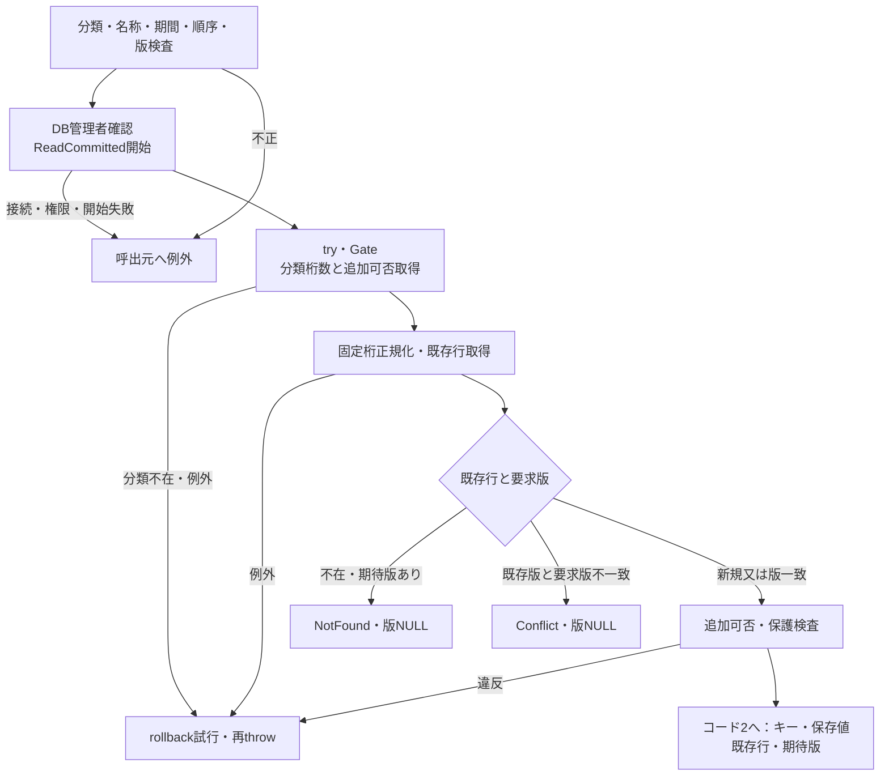

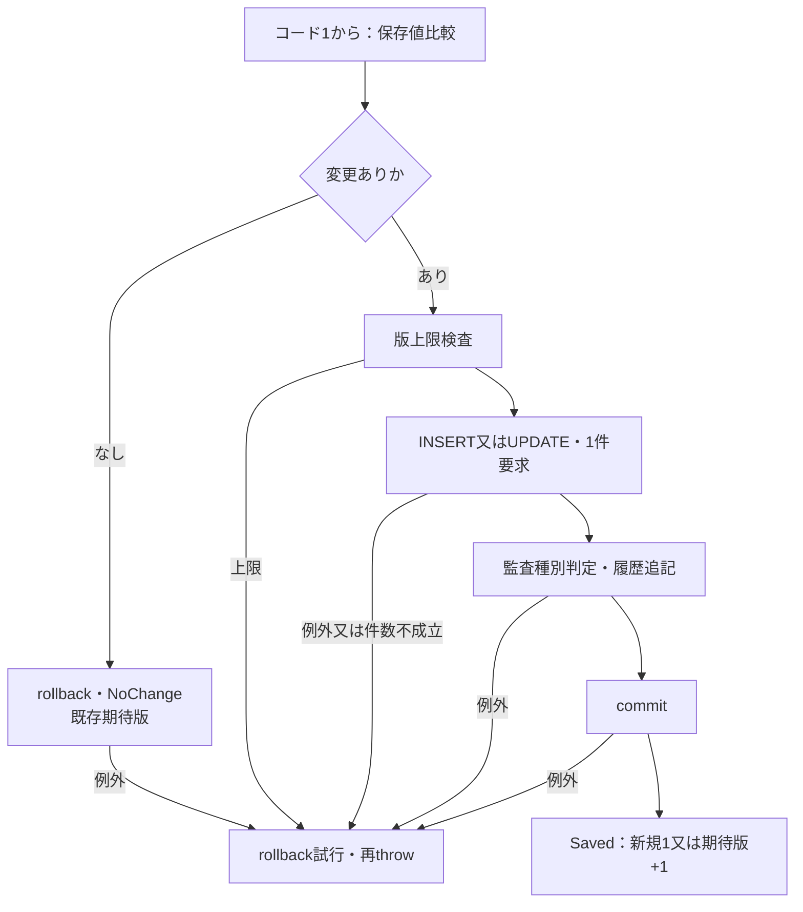

#### SQL・テーブル関連（ER図）

コードは分類をFKで参照し、学生の性別・都道府県・在籍・続柄、クラスの学年から参照される。概要のER図に対応する。この保守は分類の桁数・追加可否を読むが、分類名称・桁数・追加可否・利用状態は更新しない。履歴追記はコード保存の処理依存である。

#### DB操作の詳細

既存キーは`category_id=@category AND code_value=@value`である。分類=`VarChar(24)`、値=`VarChar(10)`を使用する。保存列の汎用容量10と、分類設定による固定桁数検査を分ける。

新規は分類・値、名称・順序・状態・期間・備考、保護false、作成更新情報、版1をINSERTする。更新は名称・順序・状態・期間・備考・更新管理情報・版を設定し、WHEREを分類・値・期待版とする。キーと保護状態は変更しない。

名称=`NVarChar(24)`、備考=`NVarChar(240)`、期間=`Date`、順序=`Int`、状態=`Bit`、版=`BigInt`で渡し、実行件数1を要求する。監査対象キーは`分類:値`、前版は期待版、新版は新規1又は期待版+1である。〔observed-source：`sources/Core/MasterMaintenanceService.cs:91-120,132-135`〕

#### 結果・例外時の扱い

変更なしは版・日時・履歴を増やさない。Savedの監査種別は新規CREATE、状態維持UPDATE、利用可への変更ENABLE、利用不可への変更DISABLEである。停止したままの名称変更もUPDATEとなる。理由NULL、確認フラグfalse、実行者DB認証者で記録する。try内の失敗はrollbackを試みて再throwする。〔observed-source：`sources/Core/AuditOperation.cs:6-7`、`sources/Core/MasterMaintenanceService.cs:109-135`〕

参考設計はコード値を別の意味へ再利用せず、名称を識別子にしない保守を要求する。意味を変えてよいかの判断には、削除済み学生からの参照も含める。現行SaveCodeAsyncには学生参照の読取りや名称変更前後の意味判定がないため、この要求を自動検査済みとは扱わない。保守担当は意味を保つ調整であることと、削除済みを含む既存参照への影響を確認する責務を持つ。クラス学年変更の参照数検査とは別の責務である。〔reference-design：`reference-designs/基本設計書/03_テーブル仕様書.md:59-59,85-87`、`reference-designs/基本設計書/04_コード設計書.md:110-116`。observed-source：`sources/Core/MasterMaintenanceService.cs:79-121`〕

### DB配備・初期投入・Principal結合・配備検査

#### 処理概要

配備スクリプトはInstall、Verify、BindPrincipalを宣言し、既定ActionをVerify、対象DBを`contextbase_test_project1_mvc`とする。Installは空の専用DBへスキーマ・初期コード・権限を順に適用する。Verifyは配備印・入力ハッシュ・宣言定義を照合し、BindPrincipalは既存Windowsログイン又はグループをDBユーザー・ロールへ結合する。以下はスクリプトに定義された処理契約である。

#### 処理手順

1. 4ローカルSQLの存在と引数を検査する。Microsoft ODBC版sqlcmdの製品情報・PEヘッダーを読み、ProductVersion major16以上のx64又はx86を選ぶ。x64を優先し、その後に製品版、パス順で選ぶ。PlanOnlyでもメタデータとSQLハッシュを読み、SQL呼出しを計画出力へ置き換える。
2. 通常呼出しはWindows認証、暗号化、証明書検証を使用する。serverGuardはExpress major17、MachineNameとHOST_NAMEの一致、NTLM又はKERBEROSを要求する。sqlcmdの製品版条件とサーバー版条件は別である。
3. InstallはDB不在なら作成する。既存DBにはUseExistingEmptyDatabaseを要求し、非システムオブジェクト、対象3ロール、プロジェクト印がない空DBを確認する。
4. 001_schema、002_seed、003_web_permissionsを別々のsqlcmd呼出しで適用する。001はSNAPSHOT有効化、7表、制約、索引、3ロールを宣言する。002はGate下で初期値差分を確認し、不足分類の後に不足コードを追加する。003はDB権限とロール継承を設定する。
5. Installはプロジェクト印と3 SQLのSHA-256をDB拡張プロパティへ保存する。その後、全ActionでserverGuard、DB名、印、ハッシュを照合する。
6. Install又はBindPrincipalでApplicationPrincipalが指定された場合は、既存Windows主体、sysadmin・DB所有者との分離、SID・種類、異なる直接ロール所属の不在を検査する。許容時だけDB USERと指定ロール所属を追加する。
7. 004の配備検査を行う。Installでは初期空データ検査も必須とし、その他はRequireInitialEmptyData指定時に追加する。

〔observed-source：`sources/database/Deploy-Database.ps1:1-165`、`sources/database/001_schema.sql:3-7,187-218`、`sources/database/002_seed.sql:2-13,85-92`〕

#### 処理フロー

配備1は前提とInstallである。PlanOnlyは選択Actionに対応する全段階の呼出計画を出力する経路であり、SQLを起動しない。

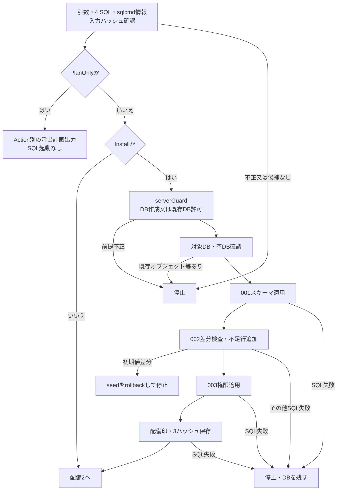

配備2は照合・Principal結合・検査である。後段の失敗を前段DDLの取消へ合流させない。

```mermaid
flowchart TD
    A[serverGuard<br/>DB・印・ハッシュ照合] --> B{Install又はBindPrincipalで<br/>Principal指定ありか}
    A -->|不一致| X[停止]
    B -->|はい| C[Windows主体・特権分離<br/>SID・種類・直接ロール検査]
    C -->|不整合| X
    C --> D[USER・ロール所属追加・commit]
    D -->|SQL失敗| S[停止・DBを残す]
    B -->|いいえ| E[004配備検査]
    D --> E
    E -->|不一致又はSQL失敗| S
    E --> F{初期空データ検査が必要か}
    F -->|いいえ| Z[配備情報出力]
    F -->|はい| G[学生・クラス・履歴・補助2表が空<br/>分類5件・コード70件確認]
    G -->|不一致又はSQL失敗| S
    G -->|一致| Z
```

#### SQL・テーブル関連（ER図）

DDLは概要の5業務表と補助2表を宣言する。seedは分類を先に、コード値を後に追加し、分類FKの参照先を揃える。学生・クラスのサンプル投入と、seedからの履歴追記はない。

#### DB操作の詳細

| 段階 | 操作・検査 | 確定単位 |
| --- | --- | --- |
| 001 | SNAPSHOTをONにし、表・制約・索引・ロールを作成 | 配備全体を包む単一トランザクションではない |
| 002 | 5分類・70初期値の比較、不足行追加 | 共通Gateを持つ明示トランザクション |
| 003 | DB名・ロール存在、GRANT・DENY・継承設定 | 明示トランザクション |
| 配備印 | プロジェクト印・3 SQLハッシュ追加 | 個別トランザクション |
| Principal結合 | DB USER・直接ロール所属追加 | 個別トランザクション |
| 004 | 定義・初期キー・宣言権限の参照検査 | 業務データ更新なし |
| 初期空データ検査 | 5表の空、分類5件・コード70件の確認 | 業務データ更新なし |

seedの分類設定は性別1桁、その他4分類2桁、通常追加可は続柄・学年だけである。既存分類の名称・桁数・追加可否・利用状態、初期コードの名称・順序・保護・利用状態・開始1900-01-01・終了NULLが違えばrollbackし、THROW 51002で停止する。一致行は上書きしない。不足行は利用可、備考NULL、UTC管理日時、DB認証者、版1を設定する。既存管理列・備考まで完全一致を要求する検査ではない。〔observed-source：`sources/database/002_seed.sql:3-13,85-92`〕

004はDB名、Express major17、SNAPSHOT状態、非システム表総数7、dboの指定表と列数35・17・11・14・12・9・8を確認する。無効又は未信頼のFK/CHECK、FK総数7、続柄FKの参照表と削除更新非連動、続柄2列のNULL可能、連絡先CHECKの存在を検査する。全列型・容量、全CHECK本文、全FK列対応、全索引を完全比較する検査ではない。〔observed-source：`sources/database/004_verify_deployment.sql:3-25`〕

004は分類数5、列挙70初期キーの存在、対象3ロールの宣言GRANT/DENYとの差分、viewerからstaff・staffからadminへの継承を検査する。このSQL単体はコード総数70や全名称・期間一致を要求しない。コード総数70と学生・クラス・履歴・補助表の空は、追加の初期空データ検査で要求する。〔observed-source：`sources/database/004_verify_deployment.sql:26-127`、`sources/database/Deploy-Database.ps1:149-156`〕

#### 結果・例外時の扱い

配備全体には一つの共通トランザクションがない。sqlcmdが非ゼロ終了すると停止してDBを残すため、スキーマだけ適用済み、権限まで適用済み等の途中状態があり得る。後段検査の失敗が前段DDLを取り消したとは判断しない。〔observed-source：`sources/database/Deploy-Database.ps1:65-76,90-123`〕

Principal結合はサーバーログインを作成・変更せず、異なる既存ロール所属を自動置換しない。Viewer・Staff・Administrator引数はDBロールへの対応であり、Web Claimsを付与する処理ではない。〔observed-source：`sources/database/Deploy-Database.ps1:125-147`〕

004と追加検査のPASSは、条件通過時にSELECTする文字列である。宣言権限検査と、Windowsグループ・サーバー権限を含む運用Principalの実効権限確認は別である。ソースコメントは実Windowsログインを通した実効権限確認を要求する。〔observed-source：`sources/database/004_verify_deployment.sql:128-134`、`sources/database/Deploy-Database.ps1:150-156`〕

## 補足説明

### 個別テーブル仕様の共通記述規約

参考設計は各表を「テーブルヘッダー＋項目詳細」の1ファイルとし、Excelでは二章を同一シートに配置する。索引・共通保存規則は各テーブルシートへ繰り返し展開しない。本文は論理名を中心に言語非依存で記述し、物理名はDBとの対応確認用として併記する。製品別の実DB型・索引・作成命令は採用DDLへ対応させる。本書ではSQL Serverの現行DDLをその物理根拠とする。〔reference-design：`reference-designs/基本設計書/03_テーブル仕様書.md:8-10`〕

分冊の明細は「No、論理名、物理名、PK、NOT NULL、タイプ、長さ、初期値、説明」の九列とする。PK・NOT NULLは該当時〇、非該当は空欄、初期値なしと長さ非適用も空欄とする。参考設計の長さは業務上限を表すため、単位を明示し、nvarchar容量やSQLパラメータサイズを同じ値として代用しない。DB確定後のタイプには実DB型を示し、物理容量はタイプ・説明又はヘッダーで併記する。〔reference-design：`reference-designs/基本設計書/03_テーブル仕様書.md:36-36`〕

文書対応契約では個別表をspec-md/1.1のTABLE文書とし、物理表名のシート1件、HEADERとLISTの二章、九列の明細へ対応させる。ヘッダーに定義・制約・索引・根拠・実装との差をまとめる。参考設計の業務初期値、DDL DEFAULT、保存処理が明示設定する値を区別し、条件付き必須と参照先は説明へ残す。これにより、論理的意味と実DB型・容量・NULL属性を一つの表別文書で確認できる。

### 共通管理項目・比較版・日時

学生、クラス、コード分類、コード値の4表には、次の5管理列を持つ。各表の列数にはこれらを含む。

| 論理項目 | 物理列 | DB属性 | 設定・用途 |
| --- | --- | --- | --- |
| 作成日時 | `created_at` | `datetimeoffset(7) NOT NULL`、UTCオフセット0 | 初回保存で設定。既存更新で保持 |
| 作成者 | `created_by` | `nvarchar(128) NOT NULL`、64スカラー以下 | 初回保存の認証主体。既存更新で保持 |
| 更新日時 | `updated_at` | `datetimeoffset(7) NOT NULL`、UTCオフセット0 | 実変更時に設定。変更なしでは変更しない |
| 更新者 | `updated_by` | `nvarchar(128) NOT NULL`、64スカラー以下 | 実変更を行う認証主体 |
| 更新管理番号 | `row_version` | `bigint NOT NULL`、DEFAULT 1、正数CHECK | 新規1、実変更ごとに1加算。期待版と比較 |

日時・者にはDDL DEFAULTがなく、保存処理が設定する。学生はWeb認証主体とTimeProviderのUTC時刻、マスタ保守はDB認証主体とUTC時刻、seedはORIGINAL_LOGINとUTC SQL時刻を使う。分類の設定入口として確認できるのはseedの不足行追加である。管理情報を通常業務入力DTOから上書きする処理はない。〔observed-source：`sources/database/001_schema.sql:38-59,75-109,122-134`、`sources/Core/SqlServerStudentService.cs:44-50,296-307`、`sources/Core/MasterMaintenanceService.cs:23-26,113-128`、`sources/database/002_seed.sql:7-7,88-91`。reference-design：`reference-designs/基本設計書/03_テーブル仕様書.md:71-75`〕

`row_version`は自動rowversion型ではなく、処理が比較・加算するbigintで、C#のlongへ対応する。フォーム期待版は正の十進文字列からlongへ変換する。変更なし判定は版上限検査より前にある。変更あり学生更新の上限はConflict、マスタ保守は例外、学生削除は入口ValidationFailedとなる。〔observed-source：`sources/Web/Inputs/StudentSaveInput.cs:42-60`、`sources/Core/SqlServerStudentService.cs:261-263,398-398`、`sources/Core/MasterMaintenanceService.cs:65-68,109-112`〕

Web管理日時は+09:00へ変換し、`yyyy/MM/dd HH:mm:ss`で表示する。学生保存と履歴はサービス入口時刻を使用し、commit完了時刻を取り直さない。生年月日、入学日、終了日、マスタ期間は時刻を持たないdateである。DateOnlyのSQL移送では午前0時のDateTimeをDateパラメータへ渡し、管理日時の時差変換と分ける。〔observed-source：`sources/Infrastructure/WebPresentation.cs:5-7`、`sources/Core/SqlServerStudentService.cs:67-72,229-229,300-313`〕

### 日付の正本参照と表示・保存の分担

参考設計は[日付・年範囲](../共通/07_日付・和暦仕様.md)を日付・年範囲の正本として指定する。この参照名と相対パスは設計上の参照として保持する。当該資料はcapsuleに未収録で本文未確認、現文書契約の生成対象外であるため、その文書IDや未提供の規則は補わない。〔reference-design：`reference-designs/基本設計書/03_テーブル仕様書.md:65-67`〕

本書で確認できる現行処理は、生年月日の元号・年・月・日からDateOnlyへの変換、元年、FormKC後の正数、実在日、元号境界、1900年下限、業務日上限の検査である。他の日付はFormKC後の`yyyy-MM-dd`からDateOnlyへ変換する。元号は日付処理の固定定義であり、seedの5分類70値へ追加するものではない。〔observed-source：`sources/Core/JapaneseDateService.cs:9-59`、`sources/database/002_seed.sql:8-84`〕

参考設計は生年月日だけ和暦、他日付は西暦表示、郵便番号は7桁保存・3桁－4桁表示を意図する。現行は生年月日を和暦4入力へ戻し、他日付をISO文字列でdate inputへ渡す。実ブラウザーの日付描画形式は値移送だけでは確定しない。郵便番号は保存7桁をそのままフォームへ戻しており、ハイフン表示加工は確認できない。〔reference-design：`reference-designs/基本設計書/03_テーブル仕様書.md:67-67`、`reference-designs/基本設計書/02_学生登録画面.md:125-145`。observed-source：`sources/Web/Inputs/StudentSaveInput.cs:47-54`、`sources/Views/Students/Edit.cshtml:7-11`〕

### 受信値・正規化値・保存値の対応

登録フォームはInput接頭辞でStudentSaveInputへバインドし、ToRequestでStudentDraftと保存制御値へ移す。次表のDTO型は受信後の言語型、DBのNULL属性はDDL、SQL型・サイズは保存パラメータ宣言に基づく。文字列のraw・保存上限はスカラー数、HTML maxlengthはブラウザーの物理入力ガードとして区別する。

| 項目・実コントロール | DTOから内部値への対応 | raw上限・正規化後条件 | 保存列・DB型・NULL | SQLパラメータ・型・サイズ | HTML maxlength |
| --- | --- | --- | --- | --- | --- |
| 学籍番号 REG-002 input | `StudentNo:string`→識別子文字列 | raw15・保存15。FormKC・大文字化、先頭英数字、英数字・ハイフン | `student_no varchar(15)`、不可 | `@student_no VarChar(15)`。新規のみ | 30 |
| 氏名 REG-003 input | `StudentName:string`→原表記文字列 | raw8・保存8。Trim | `student_name nvarchar(16)`、不可 | `@student_name NVarChar(16)` | 16 |
| 氏名カナ REG-004 input | `StudentNameKana:string`→カナ文字列 | raw36・保存18。FormKC、カタカナ化、空白整理 | `student_name_kana nvarchar(36)`、不可 | `@student_name_kana NVarChar(36)` | 72 |
| 生年月日 REG-005 selectと3 input | `BirthDateInput`の4つの`string`→`DateOnly` | 元号・年・月・日、実在日、元号境界、1900年下限、業務日上限 | `birth_date date`、不可 | `@birth_date Date` | 年4、月2、日2 |
| 性別 REG-006 select | `GenderCode:string`→数字文字列 | raw・正規化後1桁。新規0 | `gender_code varchar(1)`、不可 | `@gender_code VarChar(1)` | なし |
| 郵便番号 REG-007 input | `PostalCode:string`→7桁文字列 | raw10。FormKC、空白・区切り除去後7桁 | `postal_code varchar(7)`、不可 | `@postal_code VarChar(7)` | 20 |
| 都道府県 REG-008 select | `PrefectureCode:string`→数字文字列 | raw・正規化後2桁 | `prefecture_code varchar(2)`、不可 | `@prefecture_code VarChar(2)` | なし |
| 住所1 REG-009 input | `AddressLine1:string`→文字列 | raw45・保存45、必須、Trim | `address_line1 nvarchar(90)`、不可 | `@address_line1 NVarChar(90)` | 90 |
| 住所2 REG-010 input | `AddressLine2:string?`→任意文字列 | raw45・保存45。Trim後空はNULL | `address_line2 nvarchar(90)`、可 | `@address_line2 NVarChar(90)` | 90 |
| 本人電話 REG-011 input | `PhoneNumber:string?`→任意電話文字列 | raw20。FormKC、空白・区切り・括弧除去。国内0始まり10～11桁又は国番号付き最大16文字 | `phone_number varchar(16)`、可 | `@phone_number VarChar(16)` | 40 |
| 本人メール REG-012 input | `EmailAddress:string?`→任意メール文字列 | raw・保存60。ASCII形式・ドメイン構成、ドメイン小文字化 | `email_address varchar(60)`、可 | `@email_address VarChar(60)` | 120 |
| 入学日 REG-013 date input | `AdmissionDate:string`→`DateOnly` | FormKC後ISO10文字、1900年下限、業務日上限 | `admission_date date`、不可 | `@admission_date Date` | 指定なし |
| 卒業・退学日 REG-015 date input | `EnrollmentEndDate:string?`→`DateOnly?` | NULL・空はNULL。設定時ISO日付と在籍条件検査 | `enrollment_end_date date`、可・条件付き必須 | `@enrollment_end_date Date` | 指定なし |
| 在籍区分 REG-014 select | `EnrollmentStatusCode:string`→数字文字列 | raw・正規化後2桁。新規01 | `enrollment_status_code varchar(2)`、不可 | `@enrollment_status_code VarChar(2)` | なし |
| クラス REG-018 select | `ClassId:string?`→`long?` | NULL・空は未所属。指定時19桁以内の正のlong | `class_id bigint`、可・条件付き必須 | `@class_id BigInt` | なし |
| 緊急氏名 REG-020 input | `EmergencyContactName:string?`→任意文字列 | raw8・保存8。Trim後空はNULL | `emergency_contact_name nvarchar(16)`、可 | `@emergency_contact_name NVarChar(16)` | 16 |
| 続柄 REG-021 select | `RelationshipCode:string?`→任意数字文字列 | raw・正規化後2桁。未選択はNULL | `relationship_code varchar(2)`、可 | `@relationship_code VarChar(2)` | なし |
| 緊急電話 REG-022 input | `EmergencyPhoneNumber:string?`→任意電話文字列 | 本人電話と同じraw20・正規化後最大16 | `emergency_phone_number varchar(16)`、可 | `@emergency_phone_number VarChar(16)` | 40 |
| 備考 REG-023 textarea | `Remarks:string?`→任意文字列 | raw120・保存120、LF改行可。空はNULL | `remarks nvarchar(240)`、可 | `@remarks NVarChar(240)` | 240 |

〔observed-source：`sources/Views/Students/Edit.cshtml:6-13`、`sources/Web/Inputs/StudentSaveInput.cs:9-42,57-60`、`sources/Core/StudentNormalizer.cs:59-158`、`sources/Core/JapaneseDateService.cs:17-59`、`sources/database/001_schema.sql:9-33`、`sources/Core/SqlServerStudentService.cs:30-37,294-301`〕

Text処理はNULLを空文字へ補い、raw上限、複数行のLF統一、許可外制御文字、Trim、必須又は空欄NULL化、保存上限の順に検査する。ScalarCountは正常なサロゲートペアを1スカラーと数え、不正な組合せをArgumentExceptionとする。nvarchar容量とNVarCharサイズはUTF-16コード単位の領域であり、業務スカラー上限を拡張しない。DDLの文字数CHECKはSC照合順序と末尾付加文字を使い、末尾空白も数える。識別子・照合キー等の比較にはBIN2照合順序を使用する。〔observed-source：`sources/Core/StudentNormalizer.cs:37-85`、`sources/database/001_schema.sql:9-13,44-58`〕

氏名原表記からFormKC・大文字化・全空白除去でname_keyを生成する。業務上限160スカラー、DB・保存パラメータは320コード単位である。保存カナから空白を除いたkana_keyは18スカラー、DB・保存領域36コード単位である。検索はキー部分一致、同一人物候補はキー等値比較を使う。検索パラメータ642・74はLIKEエスケープとワイルドカードを含む別の領域である。〔observed-source：`sources/Core/StudentNormalizer.cs:66-85,144-145`、`sources/Core/SqlServerStudentService.cs:32-32,140-142,269-271`〕

年度REG-016の`SchoolYear:int?`と学年REG-017の`GradeCode:string?`は、候補絞込み・クラス整合検査のための選択補助であり、学生へ保存しない。年度候補はクラスの年度、学年候補はGRADE分類のコード名称、クラス候補はIDと名称を使う。既存読込みでは選択クラスから年度・学年を戻し、新規でクラスがない場合は当年度を補助初期値とする。人数・定員はREG-018内のsmallに表示する参考値で、REG-019の独立DOM IDはない。人数表示は席の予約ではない。〔observed-source：`sources/Views/Students/Edit.cshtml:12-12`、`sources/Web/Inputs/StudentSaveInput.cs:28-29,44-54`、`sources/Core/SqlServerStudentService.cs:371-380`〕

続柄分類はフォーム入力に持たず、正規化後の続柄値がNULLならNULL、設定済みならRELATIONSHIPを算定する。保存列`relationship_category varchar(24) NULL`へ`VarChar(24)`で渡す。緊急連絡先の全消去では、氏名・分類・値・電話を同時にNULL化する。〔observed-source：`sources/Core/StudentNormalizer.cs:139-158`、`sources/Core/SqlServerStudentService.cs:36-37`、`sources/database/001_schema.sql:29-32,199-199`。reference-design：`reference-designs/詳細仕様書/CSharp_ASPNET/02_学生登録画面.md:811-815`〕

確認・変更理由REG-024の`OperationReason:string?`はraw・保存60スカラー、HTML上限120である。学生業務列ではなく履歴の`operation_reason nvarchar(120) NULL`へ`@reason NVarChar(120)`で渡す。削除理由REG-026の`Reason:string`も60スカラーだが必須で、学生delete_reasonと履歴理由の双方へ保存する。〔observed-source：`sources/Views/Students/Edit.cshtml:13-13,17-17`、`sources/Web/Inputs/StudentSaveInput.cs:30-43`、`sources/Web/Inputs/StudentDeleteInput.cs:4-4`、`sources/Core/SqlServerStudentService.cs:234-234,389-389,396-413`〕

ExpectedVersionは比較条件、DuplicateTokenは確認情報参照、ReturnContextIdは検索復帰先、Controller引数SnapshotIdは読込時状態参照であり、学生業務列へ保存しない。ルートID、管理日時・者、固定分類、削除情報は通常保存DTOの業務入力ではない。〔observed-source：`sources/Web/Inputs/StudentSaveInput.cs:28-43`、`sources/Web/Controllers/StudentsController.cs:26-38`〕

HTML required・maxlength、DTOの非nullable注釈は受信NULL排除の実行保証ではない。MVCは非nullable参照型からの暗黙required生成を抑止している。ToRequestはBirthDateInput全体のNULLを補うが構成文字列までは補わず、日付処理にはNormalizeへの直接呼出しがある。項目集約はInputValidationExceptionとArgumentExceptionだけを捕捉し、別種の例外をすべて入力不正へ変換するものではない。〔observed-source：`sources/Infrastructure/WebHostSetup.cs:16-18`、`sources/Web/Inputs/StudentSaveInput.cs:34-42`、`sources/Core/JapaneseDateService.cs:19-24,52-55`、`sources/Core/StudentNormalizer.cs:123-143`〕

### 表示名称・識別子の保存側制約

| 対象 | 業務上限・正規化 | 保存列・DB属性 | 保存パラメータ・確認できる入口 |
| --- | --- | --- | --- |
| クラス名称 | raw・保存18スカラー、Trim | `class_name nvarchar(36) NOT NULL` | `NVarChar(36)`、宣言クラス保守 |
| コード名称 | raw・保存12スカラー、Trim | `code_name nvarchar(24) NOT NULL` | `NVarChar(24)`、宣言コード保守 |
| 分類名称 | DDLで12スカラー以下 | `category_name nvarchar(24) NOT NULL` | seed不足行追加。通常分類保守入口未確認 |
| クラスコード | raw・正規化後9以内、FormKC・大文字化、英数字・ハイフン | `class_code varchar(9) NOT NULL` | `VarChar(9)`、宣言クラス保守 |
| 分類内コード値 | 分類設定の固定桁数字 | `code_value varchar(10) NOT NULL` | `VarChar(10)`、宣言コード保守・seed |

名称は表示値であり、学生・クラスが保存する参照キーの代わりにはしない。分類名は候補名code_nameとは別列である。分類の桁数はsmallint、1～10のCHECKを持つが、seed設定は性別1、他4分類2である。表示名称の上限は保存側検査とDDLを対応させ、JOIN DTOやDB容量だけから決めない。〔observed-source：`sources/database/001_schema.sql:67-81,91-103,113-128,202-203`、`sources/Core/MasterMaintenanceService.cs:33-35,73-73,81-83,91-115`、`sources/database/002_seed.sql:9-13`〕

### 条件付き必須・固定分類・所属の意味

| 対象 | 条件と保存上の意味 |
| --- | --- |
| 学生日付 | 生年月日≦入学日。同日可。終了日設定時は入学日以上 |
| 在学01・休学02 | クラス必須、終了日NULL |
| 卒業03・退学04 | 終了日必須、クラスNULL可 |
| 連絡方法 | 本人電話・本人メール・緊急電話の少なくとも1つ |
| 緊急連絡先 | 氏名・続柄・電話が全部未設定又は全部設定。分類も連動 |
| 削除属性 | 未削除なら日時・者・理由NULL。削除済みなら全部設定 |
| クラス期間 | 年度内、開始日≦終了日。同日可 |
| クラス定員 | NULLは制限なし。0不可。設定時1～9999 |
| 学籍番号 | 全行一意、更新不可、削除後も再利用不可 |
| クラスコード | 年度とコードの組で一意。同年度なら学年が違っても重複不可 |

学生日付の1900年下限・業務日上限は日付処理で検査する。DDLも1900年下限、前後関係、在籍条件を制約するが、サービスの未来日上限を同じ形では検査していない。〔observed-source：`sources/Core/JapaneseDateService.cs:17-29,52-59`、`sources/Core/StudentNormalizer.cs:148-158`、`sources/database/001_schema.sql:187-203`〕

「学年なし」は所属クラスの`grade_category='GRADE', grade_code='00'`を意味する。学生がそのクラスIDを保持していれば、学年なしのクラスに所属している。一方、「クラス未所属」は学生の`class_id=NULL`であり、所属クラス自体がない。画面の学年「すべて」や年度「未指定」は選択補助の条件省略で、この二つの保存状態とも異なる。性別0もseedの文字列コード「未回答」であり、NULLや数値ゼロと混同しない。〔reference-design：`reference-designs/基本設計書/03_テーブル仕様書.md:79-79`。observed-source：`sources/database/002_seed.sql:15-15,78-78`、`sources/database/001_schema.sql:28-28,65-66`、`sources/Views/Students/Edit.cshtml:12-12`〕

学生の性別・都道府県・在籍分類、クラスの学年分類は処理が固定値を設定し、DDLのCHECKも限定する。固定分類にDDL DEFAULTはない。続柄分類は値の有無から算定する。学籍番号・クラスコードは個別識別子であり、コード管理へ1件ずつ追加する選択値ではない。〔observed-source：`sources/Core/SqlServerStudentService.cs:296-297`、`sources/Core/MasterMaintenanceService.cs:127-127`、`sources/Core/StudentNormalizer.cs:147-147`、`sources/database/001_schema.sql:196-199`。reference-design：`reference-designs/基本設計書/04_コード設計書.md:122-127`〕

候補はコード値・クラスIDを保存し、名称・人数を保存しない。検索候補は停止・期間外も含む。登録候補は利用状態・期間を判定しつつ、読込時の既存値を保持できる。新規クラス選択は在学・休学で利用可かつ当日期間内、卒業・退学で入力在籍期間との重なりを使う。年度・学年変更時は不適合クラスを解除し、検索の未所属指定時は年度・学年・クラスを解除する。保存時は最新DBを再検査するため、候補表示と参考人数だけでは保存可否を確定しない。〔observed-source：`sources/Views/Students/Edit.cshtml:8-13`、`sources/Web/Controllers/StudentsController.cs:22-22`、`sources/wwwroot/js/site.js:7-8`、`sources/Core/SqlServerStudentService.cs:344-383`〕

### CRUDと保存の依存

CはINSERT、Rは参照、UはUPDATE、‐は当該処理で操作しないことを示す。論理削除はUである。

| 処理 | 学生 | クラス | コード種別 | コード値 | 操作履歴 | 接続状況・条件 |
| --- | --- | --- | --- | --- | --- | --- |
| 学生検索 | R | R | ‐ | R | ‐ | Web接続あり |
| 学生詳細 | R | ‐ | ‐ | ‐ | ‐ | Web接続あり |
| 候補取得 | 人数付きのみR | R | R | R | ‐ | Web接続あり |
| 学生保存 | R・C又はU | R | R | R | C | 最新参照先・候補を検査 |
| 学生論理削除 | R・U | ‐ | ‐ | ‐ | C | 削除属性・管理情報のみ |
| クラス保守 | 更新時だけR | R・C又はU | R | R | C | 宣言サービス。Web入口未確認 |
| コード値保守 | ‐ | ‐ | R | R・C又はU | C | 宣言サービス。Web入口未確認 |
| seed | ‐ | ‐ | R・不足行C | R・不足行C | ‐ | 配備スクリプトの適用対象 |

各処理が行い得る操作を示しており、拒否・変更なし・確認待ちでは書込みや履歴追記へ到達しない。通常処理に業務表の物理DELETE、履歴UPDATE・DELETEはない。分類の確認できる書込みはseedである。学生機能はマスタを参照するが更新せず、入力・理由、DB値、一時情報、画面出力を別の入出力として扱う。〔observed-source：`sources/Core/SqlServerStudentService.cs:123-222,245-324,344-414`、`sources/Core/MasterMaintenanceService.cs:44-77,91-135`、`sources/database/002_seed.sql:85-92`。reference-design：`reference-designs/基本設計書/02_学生登録画面.md:85-115`〕

### 排他・メモリ保持・補助表

学生保存・削除、宣言クラス・コード保守、seedは共通資源`test-project1:student-write`を使う。GateはXACT_ABORT ON、Exclusive、Transaction所有、待機5000ミリ秒、DbPrincipal publicでsp_getapplockを呼び、負の戻り値をTHROW 51001で拒否する。同じGateを使う処理間の契約であり、外部DMLまで参加する保証ではない。検索状態のSemaphoreSlimとは別の排他である。〔observed-source：`sources/Core/SqlServerStudentService.cs:92-102,241-244,399-403`、`sources/Core/MasterMaintenanceService.cs:38-42,87-90`、`sources/database/002_seed.sql:3-6`〕

| 保持対象 | 保持先・内容 | 期限・使用・終了 |
| --- | --- | --- |
| 検索状態 | singleton辞書。所有者・セッション・タブ、Applied、LastResult、初期Revision=1、Gate | 30分。取得時とGate待機後に再確認。正常操作後に延長。検索・ページ・実行済み復帰再検索・クリアで版加算 |
| 編集Snapshot | singleton辞書。所有者・セッション・対象ID、読込時Detail、OriginalのJSON複製、復帰版 | 30分。保存・削除・Resetで確認。ResetはOriginal複製へ復帰 |
| Flash | singleton辞書。利用者・セッション・検索Contextの組と通知 | 10分。Takeで先に除去し、期限内なら一度返す |
| Web重複確認 | static辞書。参照値、所有者・セッション、対象ID・版、内容・全候補ハッシュ、Busy | 10分。最新候補取得後に照合・Busy取得。Saved・Unknownで提示値除去。未完了かつUnknown以外はBusy解除 |
| 非Web重複確認 | `t_confirmation`。GUID、所有者、GUIDセッション、任意ID・版、2つの32バイトハッシュ、UTC期限、消費状態 | webTokens=false分岐。発行は元保存rollback後の別トランザクション。成功時消費は学生・履歴と一括 |
| 実行時状態表 | `t_runtime_state`のDDL。状態ID、所有者、セッション、種別、バイナリペイロード、UTC期限、版、消費状態 | 業務読書き入口未確認。配備検査・初期空データ検査の対象 |

〔observed-source：`sources/Infrastructure/WebHostSetup.cs:13-19`、`sources/Infrastructure/SearchContextStore.cs:9-15`、`sources/Infrastructure/EditorSnapshotStore.cs:7-11`、`sources/Infrastructure/FlashMessageStore.cs:6-9`、`sources/Infrastructure/WebStudentCoordinator.cs:7-15`、`sources/Core/SqlServerStudentService.cs:19-29,276-342`、`sources/database/001_schema.sql:156-184`〕

未実行の画面入力、Applied、LastResult、検索状態版、学生DB版は別の情報である。候補更新は未実行入力を使うがApplied・LastResultを置換しない。SnapshotのDetail、現在入力、DB最新行も別であり、OriginalへのResetと最新DB再読込みを同一処理にしない。

Context.GetはNULLを明示検査する。一方、Snapshot.GetはNULL事前検査なしでTryGetValueを呼ぶため、NULL引数のライブラリ例外が独自409判定に先行し得る。空文字・キー不在・期限切れとNULLを同じ結果へまとめない。Context・Snapshotは期限が現在時刻より前なら拒否する。Web確認は期限がサービス入口nowより後の場合だけ有効で、待機・DB読取り後に時計を取り直さない。〔observed-source：`sources/Infrastructure/SearchContextStore.cs:13-14`、`sources/Infrastructure/EditorSnapshotStore.cs:10-10`、`sources/Core/SqlServerStudentService.cs:229-229,278-278`〕

Web確認は所有者・セッション・対象ID・期待版・正規化内容・全候補IDと版を結び付け、Busyを原子的に0から1へ変更できた場合だけ有効とする。参照値は32ランダムバイト由来の64桁小文字16進文字列である。入力変更・確認取消はブラウザーのhidden確認値を消すが、その操作だけでサーバー辞書を即削除しない。期限切れ情報の除去は新規発行時に行う。〔observed-source：`sources/Core/SqlServerStudentService.cs:224-225,274-290,313-323,332-335`、`sources/wwwroot/js/site.js:3-6`〕

`t_confirmation`は9列で、token uniqueidentifierがPK、所有者nvarchar(128)、セッションuniqueidentifier、対象ID・期待版bigint NULL、2ハッシュbinary(32)、期限datetimeoffset(7)、消費状態bitを宣言する。非Web確認はUPDLOCK付きで参照値・所有者・セッション・NULL同士を含む対象と版一致・期限がnowより後・未消費を要求し、両ハッシュを照合する。発行は元保存rollback後の別ReadCommittedで、未消費とnowから10分後を設定する。成功時の消費更新は参照値・未消費を条件に1件を要求する。Web登録はwebTokens=trueであり、通常保持先はこの表ではない。〔observed-source：`sources/database/001_schema.sql:156-169`、`sources/Core/SqlServerStudentService.cs:276-283,308-312,330-342`、`sources/Infrastructure/WebHostSetup.cs:19-19`〕

`t_runtime_state`は8列すべてNOT NULLで、state_id varchar(64)がPKである。所有者nvarchar(128)、セッションvarchar(64)、種別varchar(16)、encrypted_payload varbinary(max)、UTC期限、正数bigint revision、bit consumedを宣言する。列名から暗号化・復号・消費・期限清掃・DB状態共有を実装済みとは扱わない。Webストアはメモリ辞書であり、この表への保存経路は確認できない。補助2表の説明は本書へ置き、契約外の個別表文書を追加しない。〔observed-source：`sources/database/001_schema.sql:171-184`、`sources/Infrastructure/SearchContextStore.cs:9-15`、`sources/Infrastructure/EditorSnapshotStore.cs:7-11`、`sources/database/004_verify_deployment.sql:7-17`〕

### 接続・Web認可・DB権限

ProgramはWebHostSetup.Add・UseとMapControllersを接続する。Webは設定名StudentDbを要求し、空ならWebFault 503とする。IStudentServiceにはRequestIdentityを主体供給元とするSqlServerStudentServiceをwebTokens=trueで登録する。学生サービスとマスタ保守は暗号化必須・証明書検証ありの接続を生成し、学生サービスは接続ごとにSNAPSHOT有効状態1を要求する。〔observed-source：`sources/Program.cs:2-8`、`sources/Infrastructure/WebHostSetup.cs:13-19`、`sources/Core/SqlServerStudentService.cs:39-63`、`sources/Core/MasterMaintenanceService.cs:17-28`〕

共通Commandはタイムアウト30秒を設定する。ParamはSqlDbTypeと指定時のSizeを設定し、NULLをDBNullへ変換する。接続・実行・読取り・トランザクション操作へ取消トークンを渡す。OpenのSNAPSHOT診断はCreateCommandで別に作られ、共通Commandの明示設定を直接通らない。〔observed-source：`sources/Core/SqlServerStudentService.cs:53-72,156-167,298-313`〕

| 認可層・主体 | 許可範囲 | 制限・補足 |
| --- | --- | --- |
| Web Viewer | 学生参照 | 作成・更新不可 |
| Web Staff | 学生作成・更新 | 論理削除不可。終了区分訂正には管理者条件あり |
| Web Administrator | 学生作成・更新・論理削除 | 入力・対象・版・業務条件の検査は継続 |
| DB student_viewer | 学生・クラス・分類・コードSELECT | 履歴SELECTのGRANTは当該SQLにない |
| DB student_staff | viewer継承、学生INSERT・UPDATE、履歴INSERT | 学生DELETE、履歴UPDATE・DELETEをDENY |
| DB student_admin | staff継承、クラス・コードINSERT・UPDATE | クラス・コードDELETE、分類INSERT・UPDATE・DELETEをDENY |

Web Claims Roleと接続主体のDB Roleは別の認可層であり、要求ごとに同一化する登録は確認できない。権限SQLは補助2表のDMLを付与しない。非Web確認表分岐の呼出元と必要権限はWeb登録から確定しない。MasterMaintenanceServiceの宣言・コメントから公開保守画面や稼働CLIを補わず、StrictJsonやCoordinator.Optionsの存在から公開学生JSON APIを補わない。〔observed-source：`sources/Infrastructure/RequestIdentity.cs:7-16`、`sources/Infrastructure/WebHostSetup.cs:13-19`、`sources/Web/Controllers/StudentsController.cs:5-42`、`sources/Infrastructure/WebStudentCoordinator.cs:16-19`、`sources/database/003_web_permissions.sql:8-24`〕

### 索引・履歴・運用要求

学生の学籍番号一意制約は論理削除行を含み、クラスは年度・コードの組で一意である。学生には非削除行を対象とする生年月日、クラス・在籍区分、入学日、更新日時、本人電話、緊急電話の索引がある。履歴には対象表・対象キー・実行日時の索引がある。索引宣言は各検索の実行計画や性能値を定めるものではない。〔observed-source：`sources/database/001_schema.sql:187-188,206-212`〕

履歴は対象、操作、前後版、変更列名JSON、実行者・UTC日時、受付UUID、理由、確認フラグを保存する。操作はCREATE・UPDATE・DELETE・DISABLE・ENABLEに限定し、変更列JSONは配列を要求する。業務変更と同じトランザクションで追記し、変更なし・参照だけでは追記しない。過去の氏名・住所・所属の値コピーや復元処理はない。〔observed-source：`sources/database/001_schema.sql:137-154,204-205`、`sources/Core/SqlServerStudentService.cs:262-262,306-324,385-390`、`sources/Core/MasterMaintenanceService.cs:67-77,111-121`。reference-design：`reference-designs/基本設計書/03_テーブル仕様書.md:89-91`〕

参考設計は、物理消去と保管期間には別途運用承認が必要と定める。また、サンプル学生・クラスを本番へ自動投入しないこと、初期投入をコード分類、コード値、学校が確認したクラスの順とすることを要求する。学校名・実クラスは未指定である。現行seedが実装するのは分類・コードまでであり、学校確認済みクラスの投入や承認取得を示すものではない。〔reference-design：`reference-designs/基本設計書/03_テーブル仕様書.md:63-63`。observed-source：`sources/database/002_seed.sql:88-92`〕

個人情報の保存期間、削除復元、物理消去は運用要件として確認する。論理削除を永久保存の承認として扱わない。参照されているクラス・コードの実体を通常削除せず、意味変更の判断には削除済み学生からの参照も含めるという設計要求を、通常DMLの有無とは分けて保持する。〔reference-design：`reference-designs/基本設計書/03_テーブル仕様書.md:59-63`、`reference-designs/基本設計書/02_学生登録画面.md:679-681`〕

### 設計確認・実装確認の責務

参考設計は、顧客IT部門の確認対象を入出力、権限、画面とDBの追跡、競合・障害時結果とする。実装工程では入力→処理値→DB→再表示の往復を確認する。本書の保存契約に対応する具体的な対象は次のとおりである。

| 確認対象 | 値の往復 | 異常段階の確認対象 |
| --- | --- | --- |
| 文字列・日付 | raw入力、正規化値、生成キー、DB値、和暦・ISO再設定 | Unicode最大長、不正サロゲート、NULL・変換失敗、日付・元号境界 |
| 選択値・所属 | コード値・クラスID保存、名称・人数参照表示 | 停止・期間外、既存値保持、上位不一致、最終席競合、最新マスタ検査 |
| 保存・削除 | 期待版、DB版、業務更新、監査、返却ID・版 | 旧版、履歴失敗、OUTPUT後commit失敗、rollback失敗、結果不明 |
| 一時情報・認可 | Web主体・DB主体、Context、Snapshot、確認値を分離 | 別所有者・セッション、期限、NULLキー、待機後再確認、確定後Web失敗 |
| マスタ保守 | 新規・更新、全参照数、現在人数、比較版、同名警告 | 更新だけの検査範囲、削除済み参照、意味保持、警告値保持、再throw境界 |

rawは再表示用に保持し、正規化成功値だけを保存対象へ移す。変換失敗をNULL・0へ置き換えず、共通変換成功、OUTPUT取得、DB確定、画面出力を別の段階として確認する。参考設計の内部名や要求連番を現行実装の存在証明に使わない。この節は確認責務を定義し、顧客承認や試験合格の結果を記録するものではない。〔reference-design：`reference-designs/基本設計書/02_学生登録画面.md:685-697`、`reference-designs/詳細仕様書/CSharp_ASPNET/02_学生登録画面.md:749-753,759-809`〕

### 関連文書の対応

| 文書ID | kind | 契約path・本書からの相対リンク | 分担 | 文書状態 |
| --- | --- | --- | --- | --- |
| `CSHARP_ASPNET-BAS-STU-01` | `basic-design` | [基本設計書/01_学生検索画面.md](01_学生検索画面.md) | 検索条件・一覧・候補連動・検索状態の業務説明 | 計画先・未生成 |
| `CSHARP_ASPNET-BAS-STU-02` | `basic-design` | [基本設計書/02_学生登録画面.md](02_学生登録画面.md) | 登録・編集・参照、条件付き必須、確認・削除操作 | 計画先・未生成 |
| `CSHARP_ASPNET-BAS-STU-04` | `code-design` | [基本設計書/04_コード設計書.md](04_コード設計書.md) | 5分類70初期値、順序・保護・追加可否、意味保持 | 計画先・未生成 |
| `CSHARP_ASPNET-DET-CSharp_ASPNET-SCR-STU-001` | `detailed-specification` | [詳細仕様書/CSharp_ASPNET/01_学生検索画面.md](../詳細仕様書/CSharp_ASPNET/01_学生検索画面.md) | フォーム・DTO・検索SQL・状態版・例外応答 | 計画先・未生成 |
| `CSHARP_ASPNET-DET-CSharp_ASPNET-SCR-STU-002` | `detailed-specification` | [詳細仕様書/CSharp_ASPNET/02_学生登録画面.md](../詳細仕様書/CSharp_ASPNET/02_学生登録画面.md) | 入力移送、保存・確認・削除、catchと確定応答 | 計画先・未生成 |
