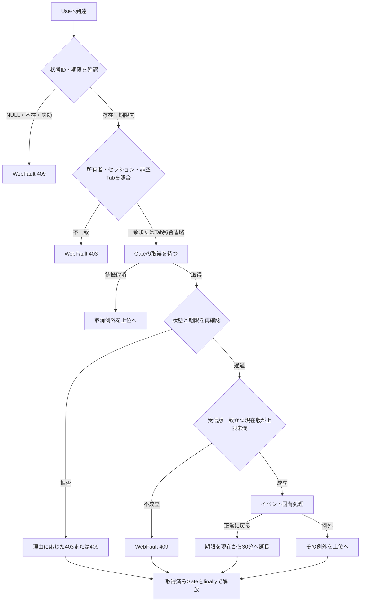
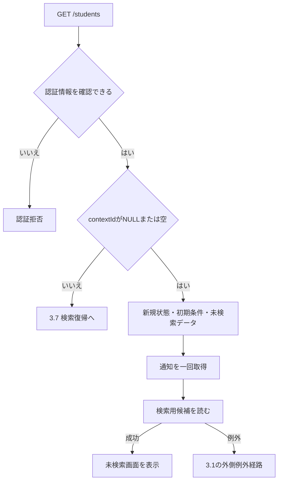
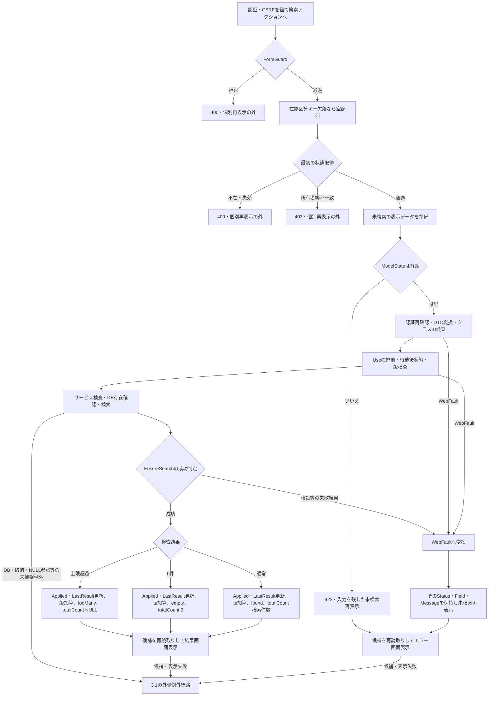
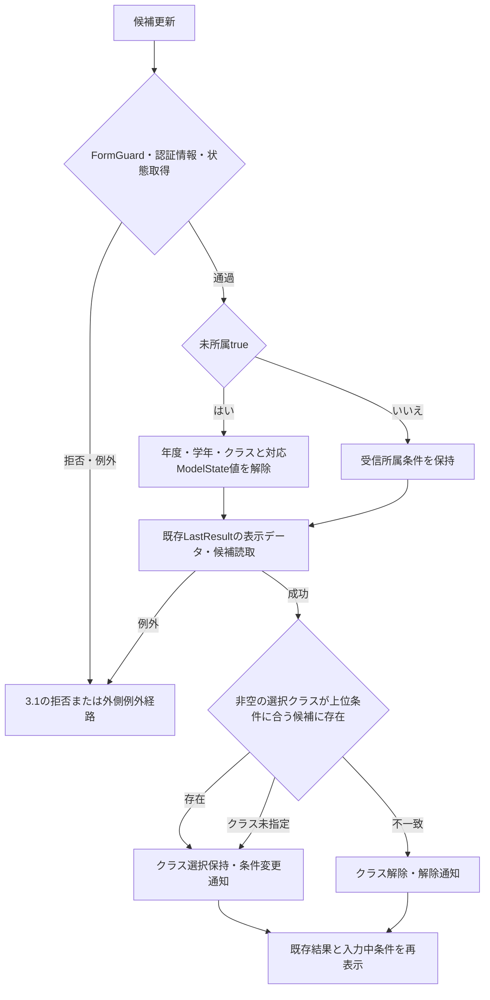
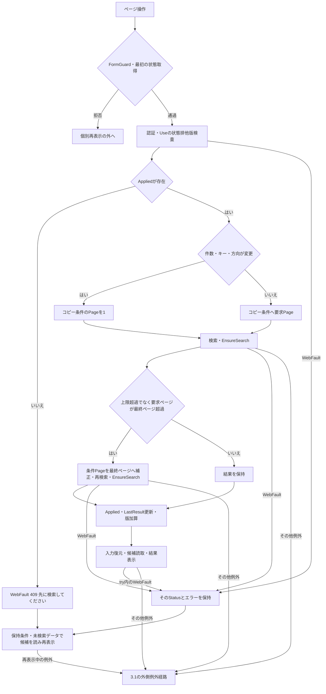
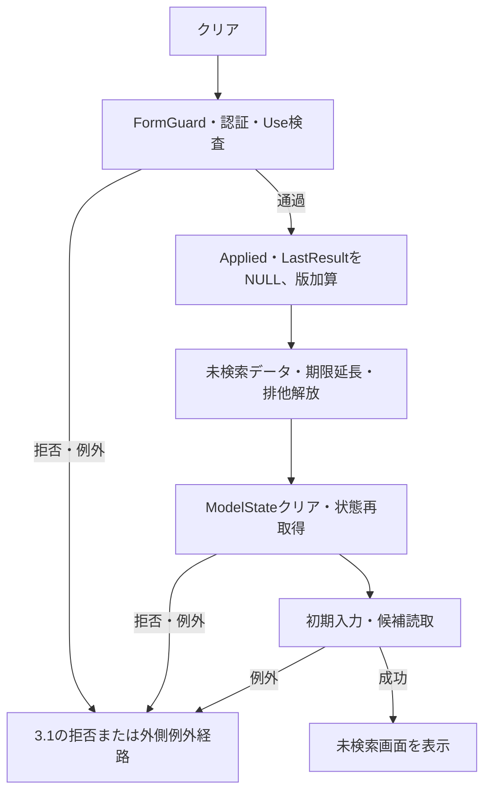
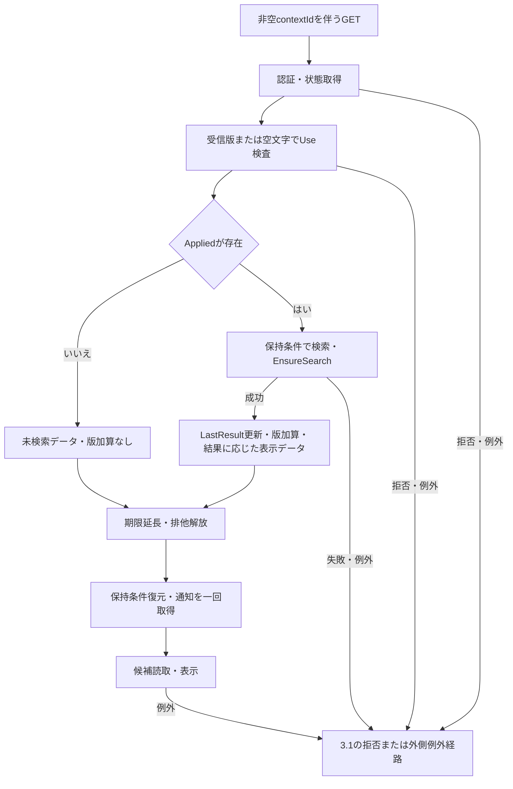
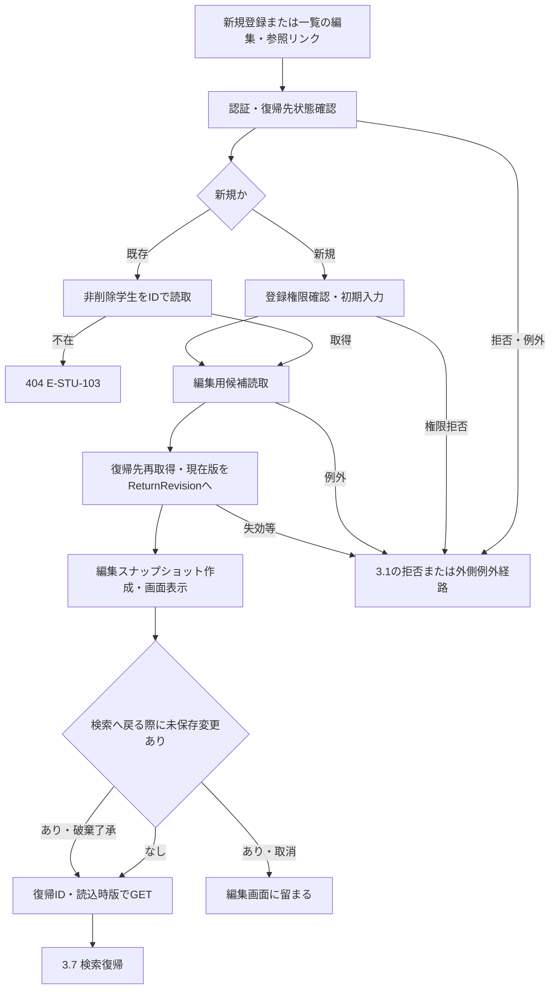
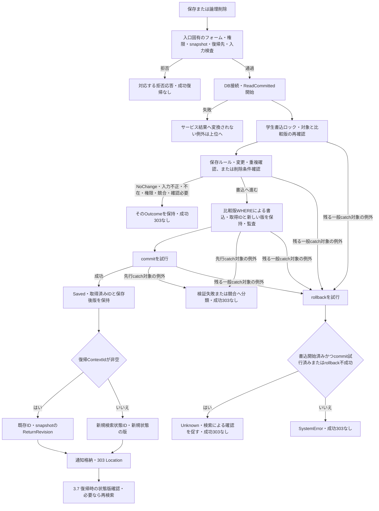
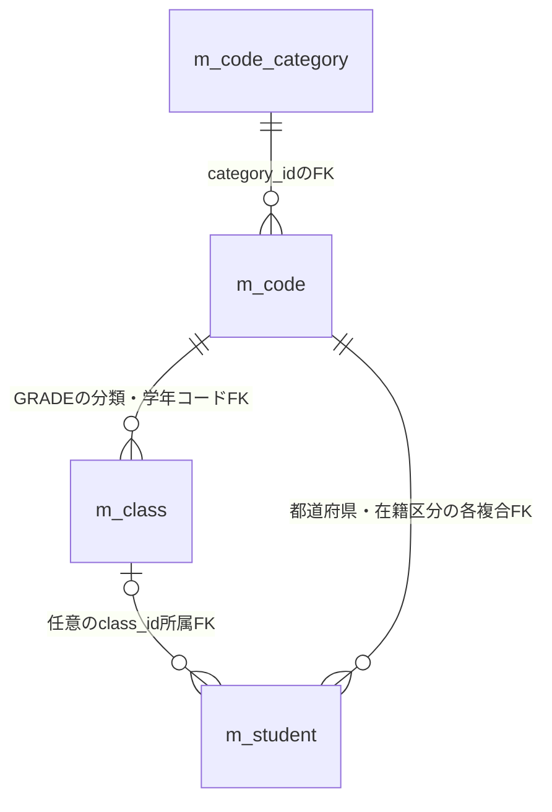

<!-- spec-meta
{"schema":"spec-md/1.0","documentId":"CSHARP_ASPNET-BAS-STU-01","version":"1.0","path":"基本設計書/01_学生検索画面.md","sheets":[{"heading":"概要","kind":"GRID","sheet":"概要"},{"heading":"項目一覧","kind":"LIST","sheet":"項目一覧","key":["項目ID"]},{"heading":"イベント仕様","kind":"GRID","sheet":"イベント仕様"},{"heading":"補足説明","kind":"GRID","sheet":"補足説明"}]}
-->
# 学生検索画面 基本設計書

| 文書属性 | 内容 |
| --- | --- |
| 文書ID | CSHARP_ASPNET-BAS-STU-01 |
| 種別 | basic-design／基本設計書 |
| 版 | 1.0 |
| 正本の相対パス | 基本設計書/01_学生検索画面.md |
| 対象 | 学生の条件検索、候補更新、一覧・ページ操作、検索状態の保持、登録・編集・参照との往復 |
| 記述の基準 | ソースで観測した実装。コメントの意図、DDLの宣言、初期投入SQLの定義は、それぞれ区別して記載する。 |
| 根拠表記 | 原ソースのPOSIX相対パスと開始行・終了行。カプセル内の対応するindexed原文行番号による。 |
| 対応する詳細仕様書 | CSHARP_ASPNET-DET-CSharp_ASPNET-SCR-STU-001／detailed-specification／`詳細仕様書/CSharp_ASPNET/01_学生検索画面.md`。計画時点では未生成。検索項目、制御値、入口、各イベントを対応対象とする。 |

## 概要

### 1.1 目的と利用者

学生検索画面は、論理削除されていない学生を条件で絞り込み、氏名、生年月日、所属、在籍区分、住所、本人電話、更新日時を一覧で確認する画面である。条件を入力しただけでは一覧を更新せず、「検索」で条件を適用する。検索SQLには常に `s.is_deleted=0` が含まれる。電話番号は本人電話と緊急連絡先電話の両方を検索するが、一覧に表示する電話は本人電話である。［根拠：Views/Students/Search.cshtml:5-8、Core/SqlServerStudentService.cs:137-153］

検索と既存学生の読込みは認証済み利用者が行う。宣言された役割は Viewer、Staff、Administrator であり、Viewer の一覧リンクは「参照」、その他の役割では「編集」となる。両リンクの読込先は同じ学生IDの入口である。新規登録リンクは Viewer に表示しない。遷移先でも Viewer の登録・更新をサーバー側で拒否し、論理削除は Administrator に限定する。検索画面の表示上の区別だけで権限を決める構造ではない。［根拠：Core/Contracts.cs:4-6、Views/Students/Search.cshtml:6-8、Infrastructure/RequestIdentity.cs:14-16、Infrastructure/WebStudentCoordinator.cs:17-19］

### 1.2 画面と処理の責務

画面は、共有ヘッダー、画面名、メッセージ、検索条件、検索・候補更新、クリア・新規登録、結果状態、表示件数・並び順、11列の一覧、ページ操作の順に構成される。共有ヘッダーの利用者名は `User.Identity.Name`、業務日は現在時刻をUTCオフセット+9へ変換した日付である。利用者名の表示値と、状態所有者の照合に使用する認証主体は別の値である。［根拠：Views/Shared/_Layout.cshtml:1-1、Views/Students/Search.cshtml:3-8、Infrastructure/WebPresentation.cs:5-7、Infrastructure/RequestIdentity.cs:8-10］

ブラウザーからはフォーム値を送る。MVCがバインド・変換した入力をコントローラーが受け、検索では `StudentSearchInput` から `SearchCriteria` へ移送する。サービスはその引数を検査・正規化し、SQLパラメータを作る。検索結果は `StudentRow`、表示用オブジェクト、`JsonElement` を経てRazorへ渡る。このJSON変換は画面モデル内部の処理であり、検索フォームの成功応答はRazor画面である。［根拠：Web/Controllers/StudentsController.cs:13-22、Web/Inputs/StudentSearchInput.cs:19-22、Core/SqlServerStudentService.cs:77-90、Infrastructure/WebPresentation.cs:20-20、Web/Models/StudentSearchPageModel.cs:15-15］

検索条件、適用済み条件、直近の検索結果は区別する。候補更新は入力中の条件と候補を再表示する操作で、適用済み条件と直近結果を更新しない。検索・ページ変更・復帰の再検索が成功したときに、検索状態へ結果を反映する。［根拠：Web/Controllers/StudentsController.cs:22-22、Infrastructure/WebStudentCoordinator.cs:7-15］

### 1.3 静的画面投影

次のHTMLは、職員等の Viewer 以外の利用者が初期表示した未検索状態を投影したものである。角括弧の値は動的値の差込み位置であり、候補や利用者の実データを示すものではない。在籍区分は初期選択コード01・02を示し、名称の位置にはDB候補の名称を置く。実画面の撮影ではなく、送信・JavaScript・外部資源読込みを含まない静的表示である。元の送信先は `data-source-route` に記録する。

原画面の `.fields` は2列で、幅760px以下では1列となる。`.grid` は横スクロールを持ち、表の最小幅は1050pxである。セルは `overflow-wrap:anywhere` により折り返す。操作領域は `.actions` のflex配置で折返しを許可する。`class` と `id` は別属性であり、検索項目IDだけでこれらの配置が適用されるわけではない。［根拠：Views/_ViewStart.cshtml:1-1、Views/_ViewImports.cshtml:1-3、Views/Shared/_Layout.cshtml:1-1、Views/Students/Search.cshtml:3-8、wwwroot/css/site.css:1-1］

<!doctype html>
<html lang="ja">
<head>
<meta charset="utf-8">
<meta name="viewport" content="width=device-width,initial-scale=1">
<title>学生管理</title>

</head>
<body>
<header><strong>学生管理システム</strong>利用者 ［利用者名］　業務日 ［yyyy/MM/dd］</header>
<main>
<h1>学生検索</h1>
<form data-search-form data-http-method="POST" data-source-route="/students/search">
<input type="hidden" name="ContextId" value="［検索状態ID］">
<input type="hidden" name="ContextRevision" value="［検索状態版］">
<input type="hidden" name="TabId" value="［画面識別値］">
<input type="hidden" name="PageSize" value="20">
<input type="hidden" name="SortKey" value="studentNo">
<input type="hidden" name="SortDirection" value="asc">
<input type="hidden" name="__RequestVerificationToken" value="">
<fieldset><legend>検索条件</legend>

<label>学籍番号<input name="Criteria.StudentNo" id="SRC-001" maxlength="30" value=""></label>
<label>氏名<input name="Criteria.Name" id="SRC-002" maxlength="16" value=""></label>
<label>氏名カナ<input name="Criteria.Kana" id="SRC-003" maxlength="72" value=""></label>
<label>年度<select name="Criteria.SchoolYear" id="SRC-004"><option value="" selected>すべて</option><option value="［候補年度］">［DB年度候補］</option></select></label>
<label>学年<select name="Criteria.GradeCode" id="SRC-005"><option value="" selected>すべて</option><option value="［学年コード］">［DB学年名］</option></select></label>
<label>クラス<select name="Criteria.ClassId" id="SRC-006"><option value="" selected>すべて</option><option value="［クラスID］">［年度］ ［クラスコード］ ［クラス名称］</option></select></label>
<label class="check"><input type="checkbox" name="Criteria.UnassignedOnly" id="SRC-007" value="true">未所属のみ</label>
<fieldset><legend>在籍区分</legend>
<label class="check"><input type="checkbox" name="Criteria.StatusCodes" value="01" checked>［01のDB名称］</label>
<label class="check"><input type="checkbox" name="Criteria.StatusCodes" value="02" checked>［02のDB名称］</label>
<label class="check"><input type="checkbox" name="Criteria.StatusCodes" value="03">［03のDB名称］</label>
<label class="check"><input type="checkbox" name="Criteria.StatusCodes" value="04">［04のDB名称］</label>
<small>全解除はすべて</small>
</fieldset>
<label>都道府県<select name="Criteria.PrefectureCode" id="SRC-009"><option value="" selected>すべて</option><option value="［都道府県コード］">［DB都道府県名］</option></select></label>
<label>電話番号<input name="Criteria.PhoneNumber" id="SRC-010" maxlength="40" value=""></label>
<label>入学日・開始<input name="Criteria.AdmissionFrom" id="SRC-011" type="date" value=""></label>
<label>入学日・終了<input name="Criteria.AdmissionTo" id="SRC-012" type="date" value=""></label>

<button type="button" class="primary" data-http-method="POST" data-source-route="/students/search">検索</button><button type="button" data-http-method="POST" data-source-route="/students/options">候補を更新</button>

</fieldset>
</form>

<form data-http-method="POST" data-source-route="/students/clear"><input type="hidden" name="__RequestVerificationToken" value=""><input type="hidden" name="ContextId" value="［検索状態ID］"><input type="hidden" name="ContextRevision" value="［検索状態版］"><input type="hidden" name="TabId" value="［画面識別値］"><button type="button">クリア</button></form><a href="#event-open" data-http-method="GET" data-source-route="/students/new?returnContextId={ContextId}">新規登録</a>

未検索

<form data-http-method="POST" data-source-route="/students/page">
<input type="hidden" name="__RequestVerificationToken" value=""><input type="hidden" name="ContextId" value="［検索状態ID］"><input type="hidden" name="ContextRevision" value="［検索状態版］"><input type="hidden" name="TabId" value="［画面識別値］">

<label>表示件数<select name="PageSize"><option value="20" selected>20</option><option value="50">50</option><option value="100">100</option></select></label>
<label>並び順<select name="SortKey"><option value="studentNo" selected>学籍番号</option><option value="name">氏名</option><option value="admissionDate">入学日</option><option value="updatedAt">更新日時</option></select></label>
<select name="SortDirection" aria-label="並び順方向"><option value="asc" selected>昇順</option><option value="desc">降順</option></select>
<button type="button" name="Page" value="1" disabled>並び順・件数を反映</button>

<table><thead><tr><th>学籍番号</th><th>氏名</th><th>氏名カナ</th><th>生年月日</th><th>年度／学年</th><th>クラス</th><th>在籍区分</th><th>住所</th><th>本人電話</th><th>更新日時</th><th>操作</th></tr></thead><tbody></tbody></table>

<nav class="pager"><button type="button" name="Page" value="0" disabled>前へ</button>1 / 1<button type="button" name="Page" value="2" disabled>次へ</button></nav>
</form>
</main>
</body>
</html>

この投影に対する状態差分は次のとおりである。原ビューの在籍区分チェックボックスには個別DOM IDがなく、投影にも追加しない。コード候補はDBから得た件数だけ列挙するため、上の4コードの差込み位置が稼働DBで常に4候補存在することを保証するものではない。［根拠：Views/Students/Search.cshtml:5-8、database/002_seed.sql:19-22］

| 状態・役割 | 原画面に対応する差分 |
| --- | --- |
| Viewer | 「新規登録」のa要素を表示しない。一覧各行のリンク文言は「参照」。Viewer以外は「編集」。元の遷移先はいずれも `/students/{studentId}?returnContextId={ContextId}`。静的な行リンクは文書内fragmentとし、元routeをdata属性へ置く。 |
| 未所属trueの再描画 | SRC-007をchecked、SRC-004・005・006をdisabledにする。候補更新では所属3値をNULLへ解除する。ブラウザー内のチェック変更だけではdisabledを変更しない。 |
| 通常結果 | 結果位置を「検索結果 ［件数］ 件　［検索日時］」へ置換し、tbodyに取得したページ分の行を表示する。反映ボタンは有効。前後ボタンはページ境界によって切り替える。 |
| 0件 | 結果位置を「該当する学生はありません。」へ置換する。tbodyは空。表示データの件数は0だが、ビューは件数数値と検索日時を表示しない。反映・前後ボタンは無効。 |
| 10,000件超過 | 結果位置を `
10,000件を超えました。条件を追加してください。
` へ置換する。tbodyは空。件数・検索日時を表示せず、反映・前後ボタンは無効。 |
| 通常通知あり | h1の直後に `
［通知文］
` を表示する。 |
| 検証エラーあり | h1の直後に `.message.error` のAll検証サマリーを表示し、`aria-live="polite"` を付ける。通常通知もある場合はその後に表示する。 |
| 停止クラス | 候補の「年度 クラスコード 名称」の後ろに「（停止）」を付ける。期間外の注記は付けない。 |

### 1.4 結果状態と操作活性

未検索、0件、通常結果、上限超過は異なる状態である。入力検証に失敗した結果を0件検索の成功として扱わない。上限超過の内部件数10001は上限判定のための打切り値であり、実総件数ではない。［根拠：Core/SqlServerStudentService.cs:156-170、Infrastructure/WebStudentCoordinator.cs:20-21］

| 状態 | 表示データ | 画面の結果説明 | 反映ボタン | 前へ／次へ |
| --- | --- | --- | --- | --- |
| unsearched | totalCount=NULL、items空、searchedAt=NULL | 未検索 | 無効 | 両方無効 |
| empty | totalCount=0、items空、searchedAtあり | 該当する学生はありません。 | 無効 | 両方無効 |
| found | totalCount=検索件数、itemsはページ分、searchedAtあり | 件数と検索日時 | 有効 | 前へはpage>1、次へはpage×表示件数<検索件数の場合に有効 |
| tooMany | totalCount=NULL、items空、searchedAtあり | 条件追加の警告。時刻は画面に表示しない。 | 無効 | 両方無効 |

表示件数・並び順・方向のselect自体は、未検索・0件・上限超過でも無効化しない。ページ表示は `page / max(1,切上げ件数÷表示件数)` であり、未検索や上限超過ではビューが件数を0として分母を計算する。［根拠：Views/Students/Search.cshtml:2-2、Views/Students/Search.cshtml:7-8、Infrastructure/WebStudentCoordinator.cs:21-21］

## 項目一覧

| 項目ID | 論理項目・業務上の用途 | 実コントロール／内部値 | 条件・正規化・初期値 | 検索・保存・DBとの対応 | 根拠 |
| --- | --- | --- | --- | --- | --- |
| SRC-001 | 学籍番号で学生を絞る。 | input、`Criteria.StudentNo`。入力DTOは `string`、検索引数は `StudentNo:string?`。 | 初期空。maxlength=30。サービスは原入力・Trim後・NFKCと英大文字化後を15 Unicodeスカラー以内に検査。先頭は英数字、後続は英数字・ハイフン。NULL・空文字は条件なし。空白だけの非空入力は必須検査エラー。 | `m_student.student_no` の前方一致。列は `varchar(15) NOT NULL`。検索 `@no:VarChar(31)` は末尾%付き。保存も同じ識別値加工を使い `VarChar(15)` で保存する。 | Views/Students/Search.cshtml:5-5、Web/Inputs/StudentSearchInput.cs:7-22、Core/StudentNormalizer.cs:47-64、Core/StudentNormalizer.cs:124-124、Core/SqlServerStudentService.cs:30-31・113-140、database/001_schema.sql:9-9 |
| SRC-002 | 氏名の照合値で部分一致検索する。 | input、`Criteria.Name:string` → `StudentName:string?`。 | 初期空、maxlength=16。原入力・Trim後表示値は各8スカラー以内。NULL・空白のみは条件なし。照合キーはNFKC、英大文字化、全Unicode空白除去を行い160スカラー以内。 | 検索対象は表示氏名ではなく `name_key`、`@name:NVarChar(642)`。保存は表示値 `student_name:nvarchar(16) NOT NULL` と照合値 `name_key:nvarchar(320) NOT NULL` に分け、保存パラメータも16・320。DDLのスカラーCHECKは8・160。 | Views/Students/Search.cshtml:5-5、Web/Inputs/StudentSearchInput.cs:8-22、Core/StudentNormalizer.cs:47-70・125-145、Core/SqlServerStudentService.cs:31-32・114-141、database/001_schema.sql:10-13・44-46 |
| SRC-003 | 氏名カナの照合値で部分一致検索する。 | input、`Criteria.Kana:string` → `StudentNameKana:string?`。 | 初期空、maxlength=72。原入力36スカラー以内。Trim、NFKC、ひらがなのカタカナ化、単語間空白の単一半角空白化を行い、許可カタカナ・長音・中点・繰返し記号に限定。正規化後は空白込み18スカラー以内。NULL・空文字は条件なし。空白だけの非空入力は空キーのLIKEとなる。 | `kana_key` の部分一致、`@kana:NVarChar(74)`。保存は正規化カナと半角空白除去キーを `student_name_kana`・`kana_key` へ分ける。両列 `nvarchar(36) NOT NULL`、保存 `NVarChar(36)`、DDLのスカラーCHECK各18。 | Views/Students/Search.cshtml:5-5、Web/Inputs/StudentSearchInput.cs:9-22、Core/StudentNormalizer.cs:72-85・126-145、Core/SqlServerStudentService.cs:31-32・116-142、database/001_schema.sql:11-13・45-47 |
| SRC-004 | 所属クラスの年度で絞る。 | select、`Criteria.SchoolYear:int?` → `SchoolYear:int?`。 | 初期「すべて」。全クラス候補の年度を重複除去し降順。指定時1900～9998、候補年度の存在を検査。未所属の再描画時disabled。 | `m_class.school_year:smallint NOT NULL` の一致、`@year:SmallInt`。学生の保存列ではない。保存時の年度は所属クラスとの整合確認用で、学生へ保存する所属値はclass_id。 | Views/Students/Search.cshtml:5-5、Web/Inputs/StudentSearchInput.cs:10-22、Core/SqlServerStudentService.cs:109-129・143-143・363-374、database/001_schema.sql:64-64 |
| SRC-005 | 所属クラスの学年で絞る。 | select、`Criteria.GradeCode:string?` → `GradeCode:string?`。 | 初期「すべて」。GRADE分類のコード値を選択し名称を表示する。原入力・Trim後は2スカラー以内、NFKC後半角数字2桁。空白のみは条件なし。コード存在を確認。未所属の再描画時disabled。 | `m_class.grade_code:varchar(2) NOT NULL` の一致、`@grade:VarChar(2)`。学生保存時はクラスとの補助整合値。学年名は `m_code.code_name`。 | Views/Students/Search.cshtml:5-5、Web/Inputs/StudentSearchInput.cs:11-22、Core/StudentNormalizer.cs:113-117、Core/SqlServerStudentService.cs:118-135・144-144、database/001_schema.sql:65-66 |
| SRC-006 | 特定クラスへの所属で絞る。 | select、`Criteria.ClassId:string?` → `ClassId:long?`。 | 初期「すべて」。年度・学年に合う候補。キーはclass_id、表示は年度・クラスコード・名称。空値は未指定。それ以外は19コード単位以内の半角数字、正のlongへ変換。サービスで存在・上位条件整合を確認。未所属の再描画時disabled。 | `m_student.class_id:bigint NULL` の一致、`@class:BigInt`。保存もこの所属キーを設定する。参照先 `m_class.class_id:bigint NOT NULL` はPK。クラス名は18スカラーの保守検査と `nvarchar(36) NOT NULL` の容量を持つ。 | Views/Students/Search.cshtml:5-5、Web/Inputs/StudentSearchInput.cs:12-22、Web/Inputs/StudentSaveInput.cs:57-60、Core/SqlServerStudentService.cs:131-145、Core/MasterMaintenanceService.cs:33-33、database/001_schema.sql:28-28・63-81 |
| SRC-007 | クラス未所属の学生だけを検索する。 | checkbox、`Criteria.UnassignedOnly:bool` → `UnassignedOnly:bool`。 | 初期false。trueと年度・学年・クラスの非NULL値の同時指定は拒否。候補更新では所属3項目をNULLへ解除。ブラウザーのチェック変更は値を空にするだけ。 | 非保存条件。SQLへ `s.class_id IS NULL` を追加する。未指定のクラス検索と未所属検索は異なる。 | Views/Students/Search.cshtml:5-5、Web/Controllers/StudentsController.cs:22-22、Core/SqlServerStudentService.cs:110-110・146-146、wwwroot/js/site.js:7-7 |
| STATUS | 在籍区分を複数選択して絞る。STATUSは文書整理キーで、原ビューに個別DOM IDはない。 | 候補別checkbox、送信名 `Criteria.StatusCodes`。入力DTO `string[]` → `EnrollmentStatusCodes:string[]`。 | 初期01・02。seedでは在学・休学であるが、表示名称はDB候補を使用する。全解除は絞込みなし。サービスは最大4値、重複なし、01～04を検査。NULL配列は空配列と同じ経路にならない。 | `m_student.enrollment_status_code:varchar(2) NOT NULL` のIN検索、各 `@statusN:VarChar(2)`。保存は単一の必須2桁コードをこの列へ `VarChar(2)` で設定する。 | Views/Students/Search.cshtml:5-5、Web/Inputs/StudentSearchInput.cs:14-22、Web/Controllers/StudentsController.cs:14-14・22-22、Core/SqlServerStudentService.cs:111-112・151-153、Core/StudentNormalizer.cs:136-136、database/001_schema.sql:25-26、database/002_seed.sql:19-22 |
| SRC-009 | 住所の都道府県で絞る。 | select、`Criteria.PrefectureCode:string?` → `PrefectureCode:string?`。 | 初期「すべて」。PREFECTURE分類の値・名称を使う。原入力・Trim後2スカラー以内、NFKC後半角数字2桁。空白のみは条件なし。分類内の存在を確認する。 | `m_student.prefecture_code:varchar(2) NOT NULL` の一致、`@prefecture:VarChar(2)`。学生保存では必須コード。住所表示の名称は `m_code.code_name` のLEFT JOIN結果。 | Views/Students/Search.cshtml:5-5、Core/StudentNormalizer.cs:113-117・130-130、Core/SqlServerStudentService.cs:80-90・119-125・147-147、database/001_schema.sql:18-19 |
| SRC-010 | 本人電話または緊急連絡先電話が一致する学生を絞る。 | input、`Criteria.PhoneNumber:string` → `PhoneNumber:string?`。 | 初期空、maxlength=40、サービス原入力上限20スカラー。Trim・NFKC後に全空白、半角ハイフン、U+2010・U+2011・U+2212、丸括弧を除去。国内は0開始10～11桁、国際は+に続く非0開始7～15桁。NULL・空白のみは条件なし。 | `phone_number` または `emergency_phone_number` の完全一致、`@phone:VarChar(16)`。両保存列は `varchar(16) NULL`、保存も同じ電話加工と `VarChar(16)` を使用。一覧表示は本人電話のみ。 | Views/Students/Search.cshtml:5-8、Core/StudentNormalizer.cs:87-94・133-141、Core/SqlServerStudentService.cs:34-37・117-148、database/001_schema.sql:22-32 |
| SRC-011 | 入学日の下限で絞る。 | date input、`Criteria.AdmissionFrom:string?` → `AdmissionFrom:string?`、サービス局所値 `DateOnly?`。 | 初期未指定。NULL・空文字は下限なし。非空はNFKC後 `yyyy-MM-dd` の10文字を厳密解析し、1900-01-01以上かつ日本時間の業務日以下。前後空白をTrimしない。両端指定時は開始≤終了。 | `m_student.admission_date:date NOT NULL` に開始日以上、`@from:Date`。保存では単一入学日を同じ日付解析で検査する。 | Views/Students/Search.cshtml:5-5、Web/Inputs/StudentSearchInput.cs:17-22、Core/JapaneseDateService.cs:52-59、Core/SqlServerStudentService.cs:120-122・149-149、Core/StudentNormalizer.cs:135-135、database/001_schema.sql:24-24 |
| SRC-012 | 入学日の上限で絞る。 | date input、`Criteria.AdmissionTo:string?` → `AdmissionTo:string?`、サービス局所値 `DateOnly?`。 | 初期未指定。NULL・空文字は上限なし。解析・許容範囲はSRC-011と同じ。終了日を含む。 | `m_student.admission_date:date NOT NULL` に終了日以下、`@to:Date`。検索条件であり、別の終了日列へ保存しない。 | Views/Students/Search.cshtml:5-5、Web/Inputs/StudentSearchInput.cs:18-22、Core/JapaneseDateService.cs:52-59、Core/SqlServerStudentService.cs:121-122・150-150 |
| PAGE-SIZE | 一覧の1ページに表示する最大行数。文書整理キー。 | select、送信名 `PageSize`、要求・検索引数 `int`。検索フォームにも同名hiddenがあるが別フォーム。 | 初期20、許可20・50・100。ページ操作で適用済み値と違えば先頭ページへ移動。selectを変更しただけでは検索フォームのhiddenは更新しない。 | DB保存列なし。ページ取得 `@size:Int`。適用済み検索状態へ保持する。 | Views/Students/Search.cshtml:4-4・8-8、Web/Inputs/StudentSearchInput.cs:27-29、Infrastructure/WebStudentCoordinator.cs:12-12、Core/SqlServerStudentService.cs:107-107・164-164 |
| SORT-KEY | 一覧の比較対象を選ぶ。文書整理キー。 | select、`SortKey:string`。検索フォームにもhidden。 | 初期studentNo。許可値はstudentNo・name・admissionDate・updatedAt。変更反映時は先頭ページへ移動。 | 対応列は `student_no`・`name_key`・`admission_date`・`updated_at`。氏名順は表示氏名順ではなく照合キー順。すべて末尾に `student_id ASC` を付ける。 | Views/Students/Search.cshtml:4-4・8-8、Core/SqlServerStudentService.cs:108-108・162-164、Infrastructure/WebStudentCoordinator.cs:12-12 |
| SORT-DIR | 並び順の方向。文書整理キー。 | select、`SortDirection:string`、aria-labelは並び順方向。検索フォームにもhidden。 | 初期asc、許可asc・desc。方向変更の反映時は先頭ページへ移動。 | DB保存列なし。許可済み方向をORDER BYへ使用する。 | Views/Students/Search.cshtml:4-4・8-8、Core/SqlServerStudentService.cs:107-108・162-162、Infrastructure/WebStudentCoordinator.cs:12-12 |
| PAGE | ページ位置を移動する。文書整理キー。 | 反映・前へ・次へボタンの送信名 `Page`、`PageRequest.Page:int`。 | 初期1、サービスは1以上を要求。反映ボタンは1、前後は表示pageの±1。通常のページ操作は最終ページ超過時に保持ページも補正する。復帰では同じ補正保証を持たない。 | DB保存列なし。`@offset:Int` とFETCHの位置へ換算する。 | Views/Students/Search.cshtml:8-8、Web/Inputs/StudentSearchInput.cs:29-29、Infrastructure/WebStudentCoordinator.cs:12-14、Core/SqlServerStudentService.cs:160-164 |
| ROW-01 | 一覧の学籍番号。文書整理キー。 | 第1列、`StudentRow.StudentNo:string` → `studentNo`。 | 保存された学籍番号を表示する。 | `m_student.student_no:varchar(15) NOT NULL`。 | Views/Students/Search.cshtml:8-8、Core/Contracts.cs:50-50、Core/SqlServerStudentService.cs:78-78・83-83 |
| ROW-02 | 一覧の氏名。文書整理キー。 | 第2列、`StudentName:string` → `studentName`。 | 照合キーではなく保存表示値を表示する。 | `m_student.student_name:nvarchar(16) NOT NULL`、保存時8スカラー上限。 | Views/Students/Search.cshtml:8-8、Core/SqlServerStudentService.cs:78-78、Core/StudentNormalizer.cs:125-125、database/001_schema.sql:10-10 |
| ROW-03 | 一覧の氏名カナ。文書整理キー。 | 第3列、`StudentNameKana:string` → `studentNameKana`。 | 半角空白除去キーではなく正規化済み表示カナを表示する。 | `m_student.student_name_kana:nvarchar(36) NOT NULL`、保存時18スカラー上限。 | Views/Students/Search.cshtml:8-8、Core/SqlServerStudentService.cs:78-78、Core/StudentNormalizer.cs:72-85・126-126、database/001_schema.sql:11-11 |
| ROW-04 | 生年月日を和暦で確認する。文書整理キー。 | 第4列、`BirthDate:DateOnly` → `BirthDateWareki:string`。 | 明治・大正・昭和・平成・令和の明示境界で変換。元号年1は「元」、月日2桁。「元号名＋年＋年MM月DD日」の形式。明治の実装下限は1900-01-01。 | `m_student.birth_date:date NOT NULL`。検索条件には使用しない。 | Views/Students/Search.cshtml:8-8、Core/Contracts.cs:50-55、Core/JapaneseDateService.cs:10-16・41-50、database/001_schema.sql:14-14 |
| ROW-05 | 所属の年度と学年を確認する。文書整理キー。 | 第5列、`SchoolYear:int?`、`GradeName:string?`。 | 年度と学年名を並べる。未所属や結合不成立時にNULLになり得る。 | 年度は `m_class.school_year:smallint NOT NULL`、学年名は `m_code.code_name:nvarchar(24) NOT NULL`。NULL可能なJOIN結果と保存列のNOT NULLは別。 | Views/Students/Search.cshtml:8-8、Core/Contracts.cs:51-51、Core/SqlServerStudentService.cs:79-89、database/001_schema.sql:64-66・115-115 |
| ROW-06 | 所属クラスを確認する。文書整理キー。 | 第6列、`ClassCode:string?`、`ClassName:string?`。 | コードと名称を並べる。一覧には停止注記を追加しない。 | `m_class.class_code:varchar(9) NOT NULL`、`class_name:nvarchar(36) NOT NULL`。保守側はコード9、名称18スカラー上限。JOIN結果はNULL可能。 | Views/Students/Search.cshtml:8-8、Core/SqlServerStudentService.cs:79-87、Core/MasterMaintenanceService.cs:33-33・73-76、database/001_schema.sql:67-68 |
| ROW-07 | 在籍区分を名称で確認する。文書整理キー。 | 第7列、`EnrollmentStatusName:string?` → `enrollmentName`。 | 在籍コードに対応するDB名称を表示する。 | `m_code` を学生の分類・コードでLEFT JOIN。名称保存列は `nvarchar(24) NOT NULL`、保守側名称上限12スカラー。 | Views/Students/Search.cshtml:8-8、Core/SqlServerStudentService.cs:80-89、Infrastructure/WebPresentation.cs:20-20、Core/MasterMaintenanceService.cs:82-82・113-120 |
| ROW-08 | 住所を確認する。文書整理キー。 | 第8列、`Address:string` → `addressDisplay`。 | 都道府県名と住所1を直接連結する。都道府県名NULLなら先頭に「[不整合]」。住所2は取得・表示しない。 | 都道府県名はコード名称。`m_student.address_line1:nvarchar(90) NOT NULL` は保存時原入力・Trim後45スカラー以内、保存 `NVarChar(90)`。 | Views/Students/Search.cshtml:8-8、Core/SqlServerStudentService.cs:34-34・80-90、Core/StudentNormalizer.cs:131-132、database/001_schema.sql:20-21 |
| ROW-09 | 本人電話を確認する。文書整理キー。 | 第9列、`PhoneNumber:string?`。 | NULLだけを「－」へ置換。緊急連絡先電話で検索一致した場合もこの列は本人電話を表示する。 | `m_student.phone_number:varchar(16) NULL`。 | Views/Students/Search.cshtml:8-8、Core/SqlServerStudentService.cs:80-85・148-148、database/001_schema.sql:22-22 |
| ROW-10 | 学生の最終更新日時を確認する。文書整理キー。 | 第10列、`UpdatedAt:DateTimeOffset` → `updatedAt:string`。 | UTCオフセット+9へ変換し `yyyy/MM/dd HH:mm:ss`。検索実施日時とは別。 | `m_student.updated_at:datetimeoffset(7) NOT NULL`。保存・削除時に更新し、更新者と版も併せて設定する。 | Views/Students/Search.cshtml:8-8、Infrastructure/WebPresentation.cs:7-7・20-20、Core/SqlServerStudentService.cs:297-301・409-410、database/001_schema.sql:40-42 |
| ROW-11 | 選択学生を編集または参照する。文書整理キー。 | 第11列のa要素。内部 `StudentId:long` を10進文字列へ変換してURLへ使用。 | Viewerは参照、その他は編集。検索状態IDを復帰先として渡す。 | `m_student.student_id:bigint NOT NULL`、PK・IDENTITY。リンク自体はDB更新しない。検索行の `RowVersion:long` は画面に表示せず、編集読込みで比較版を取得する。 | Views/Students/Search.cshtml:8-8、Infrastructure/WebPresentation.cs:20-20、Web/Controllers/StudentsController.cs:24-25、Core/Contracts.cs:50-53、database/001_schema.sql:8-8・42-43 |
| CTL-CONTEXT | 同じ検索状態を指定する。文書整理キー。 | 各操作フォームのhidden `ContextId`。要求は `string`、ストアGetの引数は `string?`。 | 生成値は32ランダムバイトの小文字16進64文字。NULL、不在、失効は409。空文字は辞書不在として409。GET初期表示のNULL・空は新規作成。 | DB列ではなくメモリ辞書のキー。学生IDと異なる。 | Views/Students/Search.cshtml:4-8、Web/Inputs/StudentSearchInput.cs:25-29、Infrastructure/SearchContextStore.cs:9-14、Web/Controllers/StudentsController.cs:9-10 |
| CTL-REVISION | 古い画面からの状態更新を検知する。文書整理キー。 | hidden `ContextRevision:string`。内部 `Revision:long`。 | 初期1。受信文字列を現在版のInvariantCulture文字列と直接比較。相違・版上限は409。候補更新では比較しない。 | メモリ上の検索状態版。学生DBの `row_version` とは別。 | Views/Students/Search.cshtml:4-8、Web/Inputs/StudentSearchInput.cs:25-29、Infrastructure/SearchContextStore.cs:9-14、Web/Controllers/StudentsController.cs:22-22 |
| CTL-TAB | 検索画面の識別を照合する。文書整理キー。 | hidden `TabId:string`、Entryの `Tab:string`。 | 新規未指定時は64文字の生成値。非空の受信Tabだけ一致を確認し、相違は403。NULL・空では照合を省略する。 | メモリ制御値。POST検索操作で渡す。GET復帰と編集の復帰先確認では渡さない。 | Views/Students/Search.cshtml:4-8、Infrastructure/SearchContextStore.cs:11-14、Web/Controllers/StudentsController.cs:9-22、Infrastructure/WebStudentCoordinator.cs:6-6 |
| CTL-CSRF | フォーム要求の検証情報。文書整理キー。 | 各POSTフォームの `Html.AntiForgeryToken()` と全体のCSRF検証設定。 | トークンの実値は仕様値ではない。CSRF拒否は通常の入力エラー再表示へ合流する契約ではない。 | 非DBの要求検証情報。`/students` は `/api` 用JSON失敗変換の対象外。 | Views/Students/Search.cshtml:4-8、Infrastructure/WebHostSetup.cs:15-16、Infrastructure/AntiforgeryResultFilter.cs:7-8 |

## イベント仕様

### 3.1 接続された入口と共通の拒否境界

Programはサービス・middlewareを設定してコントローラーを接続する。`IStudentService` は `SqlServerStudentService` に登録され、Web用設定で生成される。次の入口が検索画面に接続されている。［根拠：Program.cs:2-8、Infrastructure/WebHostSetup.cs:12-19、Web/Controllers/StudentsController.cs:5-25］

| イベント | HTTP入口 | 主な受渡し |
| --- | --- | --- |
| 初期表示・検索復帰 | GET `/students` | contextId、contextRevision。状態IDなしは初期表示、非空は復帰。 |
| 検索 | POST `/students/search` | Criteria配下の条件、ContextId、ContextRevision、TabId、PageSize、SortKey、SortDirection |
| 候補更新 | POST `/students/options` | 検索フォームと同じ項目。条件の再表示とクラス保持・解除。 |
| ページ・並び順変更 | POST `/students/page` | PageRequest、TabId。入力中の検索条件はこのフォームから送らない。 |
| クリア | POST `/students/clear` | ContextId、ContextRevision、TabId |
| 新規登録への遷移 | GET `/students/new` | returnContextId |
| 編集・参照への遷移 | GET `/students/{id:long}` | 学生ID、returnContextId |

認証とCSRF検証はフレームワーク側に設定されている。コントローラーが呼ばれた後、各POSTは最初にFormGuardを実行する。FormGuardは入力型の公開プロパティ、明示した制御項目、検証トークン、書式メタ情報を許可する。許可外キー、不正な `__Invariant` 内容、例外項目以外の同名複数値は400で拒否する。StatusCodesとUnassignedOnlyは複数値を許可する。許可項目がすべて送信されたことを必須化する検査ではない。［根拠：Infrastructure/WebHostSetup.cs:14-18、Web/Controllers/StudentsController.cs:13-22・41-41］

非nullable参照型からの暗黙Requiredは抑止されている。検索はModelStateを実行条件として確認するが、候補更新・ページ操作・クリアに同じ確認はない。HTTP文字列、MVC変換後の `int?`・`bool`・配列等、サービス引数を同一視しない。たとえば在籍区分キーがないフォームは検索・候補更新入口で空配列へ補正するが、NULL配列がサービスへ届いた場合はLength参照の例外となり、全解除の検索と同じ結果ではない。［根拠：Infrastructure/WebHostSetup.cs:16-16、Web/Controllers/StudentsController.cs:14-22、Core/SqlServerStudentService.cs:111-112］

状態を更新する共通処理Useは、状態取得、排他待機、待機後の状態再確認、版比較、版上限確認、個別処理の順に進む。状態所有者・認証セッションの不一致は403、ID不在・失効は409である。非空Tabが異なる場合も403となる。正常に戻ったときだけ期限をその時点から30分へ延長し、取得済み排他はfinallyで解放する。待機取消はtryに入る前の例外であり、DB処理のawait後には状態Getを再実行しない。［根拠：Infrastructure/SearchContextStore.cs:13-14］

上図の解放は応答を決定する合流点ではない。イベント固有処理の戻り値または例外を引き継ぎ、後続のコントローラーcatchの有無に従う。

外側middlewareは応答未開始の場合だけ例外を捕捉する。WebFaultならそのStatus・Message、それ以外なら503と「処理結果を確認できません。検索で確認してください。」をHTMLで返す。認証の401・403、CSRFのフレームワーク拒否、外側例外HTML、検索画面内のエラー再表示は異なる応答経路である。`/students` のCSRF拒否に `/api` 用JSON変換は適用しない。［根拠：Infrastructure/WebHostSetup.cs:14-16・22-25、Infrastructure/AntiforgeryResultFilter.cs:7-8］

### 3.2 初期表示

状態IDなしのGETは新しい検索状態と初期条件を作り、学生検索をせずに候補を表示する。contextIdがNULLまたは空文字ならこの経路を使う。

1. 認証情報を確認する。
2. 所有者・認証セッションを付けた検索状態を作る。版は1、期限は作成時から30分、適用済み条件と直近結果はNULLとする。
3. 未検索の表示データと初期入力を作る。在籍区分01・02、未所属false、表示件数20、学籍番号昇順、ページ1とし、その他の条件は空または未指定とする。
4. この利用者・セッション・検索状態IDの通知を一回取得する。
5. 検索用候補を読取り、共有レイアウトを使って画面を表示する。

SQL・テーブル関連は4.1の候補読取と4.3の関連図による。m_code・m_code_category・m_classをSnapshotトランザクションで参照し、学生の件数判定・一覧取得は行わない。候補読取に失敗した場合、初期状態を作成できたことだけで画面表示成功とはならない。［根拠：Web/Controllers/StudentsController.cs:8-11・39-39、Web/Inputs/StudentSearchInput.cs:7-22、Infrastructure/SearchContextStore.cs:9-12、Core/SqlServerStudentService.cs:197-216］

### 3.3 検索

検索は、入力中の条件を検査して先頭ページを取得し、その条件と結果を適用済み状態へ反映する操作である。

1. FormGuardで送信項目を検査する。在籍区分キーがない場合は空配列を設定する。
2. 現在利用者と受信TabIdで検索状態を取得し、失敗時表示用の未検索データを準備する。この取得は個別catchの外にある。
3. ModelStateを確認する。不正なら422とし、サービス検索へ進まない。
4. Coordinatorが認証を再確認し、入力DTOをSearchCriteriaへ移送する。クラスIDの正整数変換はここで行い、Useより前に失敗し得る。検索ページは1にする。
5. Useの排他・待機後状態・版確認を通す。
6. サービスが、ページ・件数・方向、並び順キー、年度範囲・正のクラスID、未所属と所属条件の同時指定、在籍区分配列、各文字列、入学日期間の順に検査する。未所属の同時指定検査は学年コードの空白正規化より前である。
7. DB接続とSnapshot開始後、学年・都道府県コードの存在、年度候補の存在、クラスの存在と年度・学年整合を確認する。検索では停止・期間外を拒否しない。
8. 4.2の述語で上限判定し、10000以下ならページ分を取得する。読取トランザクションをcommitして検索結果を返す。
9. EnsureSearchが成功結果を確認する。成功は通常結果・0件・上限超過を含む。成功後に入力由来条件のコピーをApplied、結果をLastResultへ設定し、版を1加算する。
10. 候補を再読取りして表示する。検索フォームの受信件数・並び順・方向は画面モデルへ残す。

［根拠：Web/Controllers/StudentsController.cs:13-16、Web/Inputs/StudentSearchInput.cs:19-22、Web/Inputs/StudentSaveInput.cs:57-60、Infrastructure/WebStudentCoordinator.cs:7-9・20-21、Core/SqlServerStudentService.cs:103-170］

図のWebFault枝には固定の422を置かない。DTO識別値不正は422、Useの状態・版拒否は理由に応じた403・409、サービス検証失敗は結果から422へ変換する。Coordinator呼出し内のWebFaultはコントローラーが捕捉するが、FormGuardと最初の状態取得の拒否はこのcatchへ到達しない。［根拠：Web/Controllers/StudentsController.cs:14-16、Infrastructure/SearchContextStore.cs:13-14、Infrastructure/WebStudentCoordinator.cs:20-20、Infrastructure/WebPresentation.cs:23-23］

サービスのcatch順序はInputValidationException、続いてArgumentExceptionである。前者はErrorsを引き継ぎ、後者は `ArgumentError("Search",e)` でFieldErrorへ変換する。規定形式の例外メッセージ先頭コードは保持し、それ以外はE-STU-002とする。検証失敗のCount=0・Items空は成功0件ではなく、EnsureSearchでWebFaultへ変換する。サービスの利用者確認はtryの前にあり、DB例外・取消・NULL参照をこの検証結果変換へ一般化しない。［根拠：Core/SqlServerStudentService.cs:105-106・169-170、Core/StudentNormalizer.cs:162-168、Infrastructure/WebStudentCoordinator.cs:20-20］

ModelState不正または個別catchのWebFaultでは、入力条件を残して未検索表示にするが、過去のApplied・LastResultを消さない。表示データ側のページ・件数・並び順は既存Appliedを参照するため、受信値を残した画面モデルと一致するとは限らない。また、状態反映後の候補読取・表示変換の失敗は状態更新を取り消さない。［根拠：Web/Controllers/StudentsController.cs:14-16・39-39、Infrastructure/WebStudentCoordinator.cs:9-9・21-21］

SQL・テーブル関連は4.2の検索SQLと4.3の関連図による。検索自体はDBを更新せず、検索成功後の更新先はメモリの検索状態である。

### 3.4 候補更新・所属条件の連動

候補更新は、入力した年度・学年に合わせてクラス候補を再表示し、上位条件に合わない選択を解除する操作である。入力中の条件を一覧へ適用する操作ではない。

1. FormGuardを実行し、在籍区分キー欠落を空配列にする。
2. 現在利用者・セッション・非空Tabで検索状態を取得する。
3. 未所属trueなら年度・学年・クラスをNULLへ変え、対応するModelState値も解除する。
4. 既存LastResultから表示データを作り、検索用候補を読取る。
5. 選択クラスが、受信年度・学年に合う候補に含まれるか、クラスIDの文字列表現で照合する。IdParserによる数値化は行わない。
6. 不一致ならClassIdとそのModelState値を解除する。通常は「条件を変更しました。検索を押すと一覧に反映します。」、クラス解除時は「上位条件に合わないクラスを解除しました。」を表示する。

Applied・LastResult・Revisionは更新しない。Useを呼ばないため、受信ContextRevisionを比較せず、期限延長も行わない。ModelState有効性による抑止もない。受信した件数・並び順は許可されるが、SearchModelの件数・並び順設定は適用済み値または初期値を使う。［根拠：Web/Controllers/StudentsController.cs:22-22・39-39、Infrastructure/WebStudentCoordinator.cs:21-21］

ブラウザーでは未所属のチェック変更と初期実行時に、チェック済みなら所属3コントロールのvalueを空にする。そこでdisabledを変更したり、自動検索・自動候補更新を行ったりはしない。所属selectのdisabledはサーバー再描画時のビューが設定する。検索画面の年度・学年変更には即時クラス解除のJavaScriptが接続されていない。REG-016～018を対象にした編集画面の連動処理と区別する。［根拠：wwwroot/js/site.js:7-8、Views/Students/Search.cshtml:5-5］

SQL・テーブル関連は4.1の候補読取と4.3の関連図による。学生検索SQLは実行しない。候補SQLに停止・有効期間による除外述語はなく、検索では既存停止値を含む候補を使用できる。候補読取や表示の例外を処理する検索同様の個別catchはない。

### 3.5 ページ・並び順・件数の変更

ページ操作は適用済み条件で再検索する。検索条件フォームの未適用入力は、この操作の検索条件へ移送しない。

1. FormGuardを実行して状態を取得する。この最初の取得は個別catchの外にある。
2. Coordinatorで認証確認とUseの状態・排他・版検査を行う。
3. AppliedがNULLなら409「先に検索してください。」とする。
4. Appliedをコピーし、要求された件数・キー・方向を設定する。いずれかが変更された場合はPage=1、それ以外は要求Pageとする。
5. 検索サービスを呼び、EnsureSearchで結果を確認する。
6. 上限超過でなく、要求ページが最終ページを超えた場合は、コピーした条件のPageを最終ページへ直して再検索する。最終ページは最低1とする。
7. 成功後にApplied・LastResultを更新し、版を1加算する。
8. 適用済み条件から入力を復元し、候補を読取って表示する。

この入口はModelState.IsValidで実行を抑止しない。サービスへ渡る値に対する検査と、フレームワークの変換結果を区別する。個別catchはCoordinatorだけでなく、try内の入力復元・SearchModel作成までを含む。そこで捕捉したWebFaultはStatusを引き継ぎ、保持条件と未検索データで再表示する。catch内の再表示がさらに失敗すれば外側へ進む。成功後の表示失敗で、更新済み状態を取り消す処理はない。［根拠：Web/Controllers/StudentsController.cs:18-19、Infrastructure/WebStudentCoordinator.cs:11-12］

SQL・テーブル関連は4.2・4.3による。通常は検索1回、最終ページ超過補正ではさらに検索1回を行い、それぞれサービス側のSnapshotトランザクションで読取る。DB更新は行わない。各成功結果の件数・上限フラグを保持し、再検索後の結果を最終結果とする。

### 3.6 クリア

クリアは検索状態IDと画面識別値を保ったまま、適用済み条件と結果を解除して初期入力へ戻す操作である。

1. FormGuardと認証確認を行う。
2. Useで状態・排他・待機後状態・版を検査する。
3. AppliedとLastResultをNULLへ変え、版を1加算して未検索データを返す。
4. ModelStateをクリアし、検索状態を再取得する。
5. 初期StudentSearchInputと候補を用意して未検索画面を表示する。

初期在籍区分01・02、20件、学籍番号昇順、ページ1へ戻る。SQL・テーブル関連は4.1・4.3の候補読取のみで、学生検索SQLは行わない。状態・版の拒否を処理する個別catchはなく、クリア後の候補読取が失敗してもメモリのクリアを元へ戻さない。［根拠：Web/Controllers/StudentsController.cs:21-21・39-39、Infrastructure/WebStudentCoordinator.cs:15-15、Web/Inputs/StudentSearchInput.cs:7-22］

### 3.7 検索復帰

非空contextIdを伴うGETは、保持した検索条件で一覧を取り直す。編集フォームの未保存値から検索条件を作らない。

1. 認証確認後、復帰先検索状態を取得する。このGETではTabを渡さない。
2. 受信contextRevisionまたは空文字を使ってResumeを呼ぶ。
3. Useで排他、待機後状態、版、版上限を確認する。
4. AppliedがNULLなら未検索データを返し、版を加算しない。正常復帰による期限延長は行う。
5. Appliedがある場合は保持条件で検索し、EnsureSearch成功後にLastResultを更新して版を1加算する。
6. Appliedから入力を復元する。復帰成功後に通知を一回取得し、候補を読取って画面を表示する。

版不一致・失効・再検索失敗をGET内で検索画面へ再表示する個別catchはない。Resume失敗時は通知取得へ到達しない。通知は10分期限で、Takeがキーを削除する一回取得であるため、取得後の候補・表示失敗では通知を消費したまま表示できない場合がある。［根拠：Web/Controllers/StudentsController.cs:8-11、Infrastructure/WebStudentCoordinator.cs:14-14、Infrastructure/FlashMessageStore.cs:7-9］

SQL・テーブル関連は、Appliedなしなら4.1の候補読取、Appliedありなら4.2の検索と4.1の候補読取、関連図は4.3による。ResumeはApplied.Pageを補正しない。サービスは一覧取得ページを内部で最終ページ以下へ補正するが、SearchResultに補正ページを返さず、画面はApplied.Pageを表示する。保存・削除等で件数が減った場合、取得した一覧が最終ページでもページ表示が古い値のままになる可能性がある。通常のページ操作と同じ保持ページ補正を保証しない。［根拠：Infrastructure/WebStudentCoordinator.cs:12-14・21-21、Core/SqlServerStudentService.cs:160-168、Core/Contracts.cs:57-58］

### 3.8 登録・編集・参照への遷移と戻る操作

新規登録リンクと一覧操作リンクは、検索状態IDをreturnContextIdとして渡す。検索状態版はリンクから渡さず、遷移先の読込みで現在版を取得する。

1. 遷移先が認証と復帰先の所有者・セッション・期限を確認する。新規登録では登録権限も確認する。
2. 既存学生は学生IDと `is_deleted=0` で読込む。不在は404、E-STU-103とする。
3. 編集用候補を読取る。この候補読取は検索用と異なり所属人数を含む。
4. 候補読取後に復帰先を再取得し、その現在版をReturnRevisionとして保持する。
5. 所有者、認証セッション、対象学生ID、読込明細、入力コピー、ReturnRevisionを30分期限の編集スナップショットへ保存する。
6. 「検索へ戻る」はReturnContextIdと読込時ReturnRevisionをGETへ渡し、3.7の復帰処理へ進む。

SQL・テーブル関連は学生単体読取と候補読取である。既存学生読取は `SELECT * FROM dbo.m_student WHERE student_id=@id AND is_deleted=0`、`@id:BigInt` で、最大1学生の明細を返す。候補は4.1の取得形を使い、編集用途では非削除かつ01・02の所属人数を集計する。検索状態や編集スナップショットはDBへ保存しない。［根拠：Views/Students/Search.cshtml:6-8、Web/Controllers/StudentsController.cs:23-25、Infrastructure/WebStudentCoordinator.cs:6-6・17-17、Core/SqlServerStudentService.cs:172-181・196-216、Infrastructure/EditorSnapshotStore.cs:7-10］

編集画面では入力イベントでdirtyを立て、確認情報を空にする。dirty状態の戻る・再読込リンクは破棄確認を行い、取消なら遷移を止める。beforeunloadもdirtyかつ離脱確定前に警告する。これは保存ではない。「入力クリア／編集取消」のPOSTはスナップショットの読込時入力へ戻す操作で、検索画面のクリアとは異なる。［根拠：Views/Students/Edit.cshtml:16-16、wwwroot/js/site.js:2-5、Web/Controllers/StudentsController.cs:35-35］

### 3.9 保存・論理削除の結果と検索への復帰

この節は、遷移先の結果が検索画面へ及ぼす境界を定義する。登録画面の全項目仕様は対象に含めない。

1. 保存入口はFormGuard、登録・更新権限、編集スナップショットの所有者・セッション・対象、復帰先状態、読込時と受信のReturnContextId一致の順に確認する。その後ModelStateを確認し、保存要求へ変換する。
2. 削除入口はFormGuard、認証、編集スナップショットの対象と復帰ID一致を確認する。Coordinatorが管理者権限、復帰先状態、Confirmedを確認し、ExpectedVersionを正のlongへ変換する。削除フォームは編集中の業務値を送らず、対象・比較版・確認値・理由・復帰情報を送る。
3. サービスは入力を検査してReadCommittedトランザクションを開始し、学生書込用排他ロックを取得する。既存の非削除行と比較版を再確認する。
4. 保存ではDBコード・クラスを再読取りしてルールを確認する。新規または変更コードには稼働状態・有効期間を要求し、既存の同じ停止コードは存在確認の上で保持できる。クラスは上位条件整合、期間・停止状態、在籍区分との関係、新たな在学・休学所属時の定員を確認する。定員確認は本人を除く非削除かつ01・02の人数を再集計する。
5. 保存の新規は正規化列、固定分類、作成・更新情報、初期版1をINSERTする。更新は学籍番号を変更列から除き、学生ID・比較版・非削除のWHEREで更新情報と版を更新する。変更なしはrollbackしてNoChangeとする。
6. 削除は同じ対象・比較版・非削除のWHEREで、削除フラグ、削除日時・実施者・理由、更新日時・更新者、版を設定する。1行更新を確認する。保存・削除とも同一トランザクションへ監査を書き、commit成功後にSavedと対象ID・新しい版を返す。
7. コントローラーはSavedだけを成功復帰とする。通知を格納し、HTTP303と検索GETのLocationを返す。既存復帰先にはスナップショットのReturnRevisionを使い、復帰先NULL・空なら新規検索状態とその版を作る。
8. 後続GETが3.7を実行する。適用済み条件があれば再検索し、通知は「保存しました。」または「論理削除しました。」を一回表示する。

［根拠：Web/Controllers/StudentsController.cs:29-38、Infrastructure/WebStudentCoordinator.cs:18-19、Views/Students/Edit.cshtml:17-17、Core/SqlServerStudentService.cs:92-101・227-323・344-383・392-416］

上図の先行catchと一般catchは、次の順序で区別する。一般catchの確定不明判定を、先行catchが処理する例外へ拡張しない。

| 処理 | catchの順序と返却結果 |
| --- | --- |
| 保存トランザクション内 | InputValidationException → ValidationFailed。次に2601・2627のSqlException → 学籍番号使用済みのValidationFailed。次にDBConcurrencyException → Conflict。残るSqlException・InvalidOperationException・OperationCanceledExceptionだけが一般catchへ進む。 |
| 削除トランザクション内 | DBConcurrencyException → Conflict。続いてSqlException・InvalidOperationException・OperationCanceledExceptionが一般catchへ進む。 |
| 一般catchの判定 | rollback結果を取得し、`writeStarted && (commitAttempted || !rolledBack)` がtrueならUnknown、falseならSystemError。条件式の論理和は図の判定文でも同じ意味とする。 |
| commit前の変更なし | 保存は明示rollbackしてNoChange。保存済み通知・成功303を返さない。 |

検索とのSQL・テーブル関連は、m_studentの変更、m_code・m_code_category・m_classのルール再確認、t_operation_logへの監査INSERTである。監査は対象学生、処理種別、変更列、変更前後版、実施者・時刻、理由、受付識別情報等を記録する。監査書込も同じcommitの対象となる。［根拠：Core/SqlServerStudentService.cs:294-315・344-390・409-416］

Saved以外のNoChange、ValidationFailed、Forbidden、NotFound、Conflict、ConfirmationRequired、SystemError、Unknownは成功復帰へ進まない。保存は編集画面再表示となり、削除はエラーを設定して対象を再読込むため、その読込み自体が不在404となる経路もある。接続・トランザクション開始はトランザクション内catchの前であり、その失敗が同じSaveResultになるとは限らない。［根拠：Web/Controllers/StudentsController.cs:30-37、Core/SqlServerStudentService.cs:240-243・399-402］

復帰先は保存前に確認するが、DB完了後に期限を再確認しない。保存中に別操作が検索状態版を進めても、303の版を最新値へ差し替える処理はない。そのためDB保存がSavedでも、後続の復帰GETは版不一致409となり得る。DB確定、303発行、復帰再検索、通知表示は別の到達段階である。［根拠：Infrastructure/WebStudentCoordinator.cs:18-19、Web/Controllers/StudentsController.cs:31-38、Infrastructure/SearchContextStore.cs:14-14］

## 補足説明

### 4.1 候補データの取得と選択保持

検索画面は `LookupAsync(false)` を使い、Snapshotトランザクションで2結果セットを取得する。第1結果はm_codeとm_code_categoryの内部結合、第2結果はm_classと学年コードのLEFT JOINである。停止・期間外を除くWHEREはない。コードのIsActiveはコードと分類の両方が有効なときだけtrueとなるが、検索ビューはその値でコード候補を除外しない。［根拠：Web/Controllers/StudentsController.cs:39-39、Core/SqlServerStudentService.cs:197-216、Views/Students/Search.cshtml:5-5］

| 候補 | 取得元・キーと名称 | 抽出・順序・初期値・保持 |
| --- | --- | --- |
| 年度 | 全m_class候補のschool_year | 重複除去・降順。初期は「すべて」で、現在年度の自動選択ではない。 |
| 学年 | m_codeのGRADE分類。code_value／code_name | コード結果の順序はcategory_id、display_order、code_value。初期は「すべて」。 |
| 在籍区分 | m_codeのENROLLMENT_STATUS分類。code_value／code_name | 初期選択01・02。seedの名称は01在学、02休学、03卒業、04退学。実画面名称はDB候補に従う。全解除は絞込みなし。 |
| 都道府県 | m_codeのPREFECTURE分類。code_value／code_name | コード結果の順序を保持。初期は「すべて」。 |
| クラス | m_class。class_id／年度・class_code・class_name | 受信年度が指定されていれば一致、学年が非空なら一致。取得順序は年度降順、学年コードdisplay_order、クラスdisplay_order、class_code、class_id。候補更新で合わない選択を解除する。 |
| 停止・期間外 | コードの有効状態・有効期間、クラスのis_active・valid_from・valid_to | 検索では候補から除外しない。コード候補に注記なし。クラスは停止時だけ「（停止）」、期間外の注記なし。検索のコード・年度・クラス存在確認にも有効性の拒否条件はない。 |
| 所属人数 | LookupAsync(false)のOccupied | 集計SQLを使わず0を設定する。実人数の調査結果ではなく、検索画面にも表示しない。編集用LookupAsyncは人数を集計する。 |

コード候補は分類ID、コード値、名称、表示順、有効状態、有効開始・終了、保護値を返す。クラス候補はID、年度、学年コード、クラスコード・名称、期間、定員、人数、有効状態を返す。候補取得に検索用パラメータはなく、年度・学年による画面候補の抽出は取得後に行う。コマンドタイムアウトは30秒、取消トークンをSQL実行・読取・commitへ渡し、正常読取後にcommitする。［根拠：Core/Contracts.cs:61-65、Core/SqlServerStudentService.cs:65-73・197-216］

### 4.2 検索SQLと読取の確定境界

検索述語は次表をANDで結合する。電話の本人・緊急連絡先の比較だけは一つの括弧内のORである。未指定条件は述語を追加しないため、未指定を列のNULL一致へ置き換えない。［根拠：Core/SqlServerStudentService.cs:137-155］

| 条件 | SQL上の比較 | パラメータ型・サイズ |
| --- | --- | --- |
| 常時 | `s.is_deleted=0` | パラメータなし |
| 学籍番号あり | `s.student_no LIKE @no ESCAPE '!'`。正規化値末尾に% | `@no:VarChar(31)` |
| 氏名キーあり | `s.name_key LIKE @name ESCAPE '!'`。キー前後に% | `@name:NVarChar(642)` |
| カナキーあり | `s.kana_key LIKE @kana ESCAPE '!'`。キー前後に% | `@kana:NVarChar(74)` |
| 年度あり | `c.school_year=@year` | `@year:SmallInt` |
| 学年あり | `c.grade_code=@grade` | `@grade:VarChar(2)` |
| クラスあり | `s.class_id=@class` | `@class:BigInt` |
| 未所属true | `s.class_id IS NULL` | パラメータなし |
| 都道府県あり | `s.prefecture_code=@prefecture` | `@prefecture:VarChar(2)` |
| 電話あり | `(s.phone_number=@phone OR s.emergency_phone_number=@phone)` | `@phone:VarChar(16)` |
| 入学日開始あり | `s.admission_date>=@from` | `@from:Date` |
| 入学日終了あり | `s.admission_date<=@to` | `@to:Date` |
| 在籍区分配列が非空 | `s.enrollment_status_code IN (...)`。配列ごとに@statusN | 各 `@statusN:VarChar(2)` |

LIKE値内の `!`・`%`・`_`・`[` はEscapeLikeでエスケープする。入力中のこれらを検索用ワイルドカードとしてそのまま使用しない。パラメータhelperはNULLをDBNull.Valueへ、DateOnlyを当日午前0時のDateTimeへ変換する。［根拠：Core/StudentNormalizer.cs:161-161、Core/SqlServerStudentService.cs:67-73・140-153］

| 読取段階 | 操作・戻り値 |
| --- | --- |
| 学年・都道府県存在確認 | m_codeの分類と値をCOUNT_BIGし、1件を要求する。`@category:VarChar(24)`、`@value:VarChar(10)`。有効状態・期間を比較しない。 |
| 年度存在確認 | m_classのschool_yearをCOUNT_BIGし、0件なら拒否。`@year:SmallInt`。 |
| クラス整合確認 | m_classをclass_idで読み、取得行のschool_year・grade_codeを指定上位条件と比較。`@id:BigInt`。不在・不一致を拒否する。 |
| 件数判定 | m_studentとm_classのLEFT JOINに全検索述語を適用し、TOP(10001)学生IDのCOUNT_BIGを取得する。10001は打切り判定値。 |
| 上限超過 | commit後、NoChange、空Items、LimitExceeded=trueを返す。一覧SQLを実行しない。 |
| ページ取得 | 10000以下では最終ページを最低1とし、取得ページを内部補正。4種類の許可済み列・方向と `s.student_id ASC` で並べ、OFFSET/FETCHを使用する。`@offset:Int`、`@size:Int`。 |
| 一覧結果 | 学生表示列、クラス年度・コード・名称、学年・在籍・都道府県名、住所1、本人電話、入学日、更新日時、行版を取得する。読取後commitし、NoChange、検索件数、ページ分StudentRow、検索開始時刻、LimitExceeded=false、空Errorsを返す。 |

［根拠：Core/SqlServerStudentService.cs:77-90・123-170・218-222］

一覧SQLは学生からクラスへ `c.class_id=s.class_id`、学年コードへクラスの分類・コード、在籍コードへ学生の分類・コード、都道府県コードへ学生の分類・コードでLEFT JOINする。件数SQLのJOINはクラスだけで、名称取得用JOINは一覧取得で追加する。候補読取と検索読取は別トランザクションであり、候補取得成功だけで後続検索成功や保存可能性を保証しない。［根拠：Core/SqlServerStudentService.cs:82-90・156-168・197-216］

サービスは接続文字列にEncrypt=Mandatory、TrustServerCertificate=falseを設定し、接続後に対象DBのsnapshot_isolation_stateが1であることを確認する。検索の存在確認・件数判定・ページ取得は同一Snapshotトランザクションで行う。検索・候補コマンドhelperのタイムアウトは30秒だが、接続後の診断コマンドは同helperの明示設定対象ではない。接続、開始、SQL実行・読取、commitへ取消トークンを渡す。検索には明示rollback呼出しやDB例外の一般catchはなく、未commit時はawait usingによる資源破棄へ進む。［根拠：Core/SqlServerStudentService.cs:39-73・123-170］

### 4.3 学生・所属・コードの関係

次図はDDLに宣言された検索関連FKを示す。表示取得のLEFT JOINとは別の関係である。学生の所属は任意で、class_idはNULL可能。学生側class_idに一意制約はないため、同じクラスを複数学生が参照できる。都道府県と在籍区分は、それぞれ分類・コードの組をコード表へ参照する。［根拠：database/001_schema.sql:28-43・62-80・187-197］

| 対象 | 検索画面での意味とDDL上の属性 |
| --- | --- |
| m_student | 学生IDは `bigint IDENTITY NOT NULL` のPK。学籍番号は削除行を含むUNIQUE。表示氏名・カナと照合キーは別列。生年月日は和暦材料、住所1と都道府県コードは住所表示材料、本人・緊急電話は検索対象、入学日は期間と並び順、所属・在籍区分は抽出と名称参照に使う。row_versionは正のbigintで、検索状態版と異なる。is_deletedはbit、DEFAULT 0で通常検索から削除行を除く。 |
| m_class | class_idは `bigint IDENTITY NOT NULL` のPK。school_yearは `smallint NOT NULL`、学年分類・コードは `varchar(24)`・`varchar(2) NOT NULL`。コード・名称は候補と一覧表示に使う。期間は `date NOT NULL`、稼働状態は `bit NOT NULL`、順序は `int NOT NULL DEFAULT 0`。capacityは `int NULL` で、新たな所属の保存時定員確認に使い、検索画面に表示しない。 |
| m_code | category_idとcode_valueは `varchar(24)`・`varchar(10) NOT NULL` の複合PK。code_nameは `nvarchar(24) NOT NULL` で学年・在籍・都道府県の名称。display_orderは `int NOT NULL DEFAULT 0`。is_activeは `bit NOT NULL DEFAULT 1`、valid_fromは `date NOT NULL`、valid_toは `date NULL`、is_protectedは `bit NOT NULL`。検索候補では取得するが、状態・期間で除外しない。 |
| m_code_category | category_idは `varchar(24) NOT NULL` のPK。category_nameは `nvarchar(24) NOT NULL`、code_lengthは `smallint NOT NULL`、allow_addは `bit NOT NULL`、is_activeは `bit NOT NULL DEFAULT 1`。検索は分類キーで候補・名称参照を限定し、分類名を検索画面には表示しない。code_length・allow_addはコード保守側の幅・追加許可に使う。 |

［根拠：database/001_schema.sql:7-134・187-203、Core/SqlServerStudentService.cs:77-90・137-153・197-214、Core/MasterMaintenanceService.cs:91-109］

クラスには年度・クラスコードの複合UNIQUE、年度1900～9998、年度内の利用期間、定員NULLまたは1～9999、非負表示順が宣言される。クラスの学年分類はGRADE、学生の都道府県分類はPREFECTURE、在籍分類はENROLLMENT_STATUSにCHECKで限定する。非削除行を対象とする所属・在籍、入学日、更新日時、本人・緊急電話等の索引も宣言される。これらのDDL宣言は、サービスの個別入力検査や検索JOINの実装と区別する。［根拠：database/001_schema.sql:187-211］

### 4.4 表示名称・文字数・保存値

候補と一覧のコード名称は、コード保守実装で原入力とTrim後の両方を12 Unicodeスカラー以内の必須値として検査する。保存は `@name:NVarChar(24)`、列は `m_code.code_name:nvarchar(24) NOT NULL`、DDLに12スカラーCHECKがある。クラス名称は保守実装で原入力・Trim後18スカラー以内、保存パラメータ `NVarChar(36)`、列 `m_class.class_name:nvarchar(36) NOT NULL`、DDLに18スカラーCHECKを持つ。クラスコードの保守上限は9で、列・パラメータは `varchar(9)`・`VarChar(9)` である。これらは検索画面の名称表示を支える保存側の制約であり、検索Webアプリから保守画面へ到達する入口を示すものではない。［根拠：Core/MasterMaintenanceService.cs:30-37・73-85・113-120、database/001_schema.sql:67-81・112-128、Infrastructure/WebHostSetup.cs:13-19］

サービスの文字数はScalarCountによるUnicodeスカラー数で、サロゲートペアは1として数え、不正サロゲートはArgumentExceptionとなる。共通Text処理はNULLを空文字へ置き、原入力上限、制御文字禁止、Trim、必須・空値、加工後上限の順に確認する。ブラウザーmaxlength、サービス原入力上限、正規化後上限、照合キー上限、nvarcharのUTF-16容量、DDLのスカラーCHECKは別の制約である。たとえば氏名maxlength=16は、サービスの8スカラー上限を16文字へ拡張する意味ではない。［根拠：Core/StudentNormalizer.cs:37-57、Views/Students/Search.cshtml:5-5、database/001_schema.sql:10-13・44-47］

検索の正規化値はサービス局所変数とSQLパラメータに使う。一方、Appliedに保存するのは入力由来SearchCriteriaのコピーである。画面へ復元する条件が、DB照合キーや保存表示値そのものに書き換わる設計ではない。［根拠：Core/SqlServerStudentService.cs:113-153、Infrastructure/WebStudentCoordinator.cs:8-9、Web/Controllers/StudentsController.cs:40-40］

### 4.5 メモリ保持・一時情報・状態版

| 保持領域 | 内容・用途 | 期限・更新・利用制限 |
| --- | --- | --- |
| SearchContextStore | SingletonのConcurrentDictionary。ID、所有者、認証セッション、Tab、Expires、Revision、Applied、LastResult、SemaphoreSlimを保持する。 | 初期版1、初期30分。Useによる正常完了で30分延長。検索・ページ・適用済み条件ありの復帰・クリアで版加算。候補更新は版比較・期限延長なし。 |
| EditorSnapshotStore | 所有者・認証セッション・対象学生ID・読込明細・入力コピー・ReturnRevisionを保持するメモリ辞書。 | 作成から30分。空文字・不在・失効は独自409、所有者・セッション・対象相違は403。NULLキーの明示検査はなく、辞書呼出しが独自検査より先にライブラリ例外を起こし得る。 |
| FlashMessageStore | 利用者主体・認証セッション・検索ContextIdの組をキーに通知を保持するメモリ辞書。 | 10分。Takeで削除し、期限内なら一回返す。通知取得後に候補・画面表示が失敗しても再格納しない。 |
| t_runtime_state | DDLではstate_id、owner_id、login_session_id、state_kind、encrypted_payload、expires_at、revision、consumedをNOT NULLで宣言する。 | この検索状態・スナップショット・通知の実装から、この表への読書きは確認されない。列名から暗号化保存、DB永続化、消費更新を追加しない。 |

［根拠：Infrastructure/WebHostSetup.cs:13-13、Infrastructure/SearchContextStore.cs:9-15、Infrastructure/EditorSnapshotStore.cs:7-11、Infrastructure/FlashMessageStore.cs:6-9、database/001_schema.sql:171-184］

検索状態のコメントは単一ノードで条件をサーバー保持する意図を述べ、実装はメモリ辞書である。検索状態ID・版・Tabは業務検索値ではなく制御値であり、DBの学生ID・行版とも異なる。保存済み通知は顧客確認や承認の記録ではない。［根拠：Infrastructure/SearchContextStore.cs:6-15、Infrastructure/FlashMessageStore.cs:7-9］

認証情報の実装検査は、認証済み、非空白の主体で64スカラー以内、非空白の認証セッションで64コード単位以内、Roleへの変換成功を要求する。不備は401となる。Role変換後に定義済み値へ限定するEnum.IsDefined検査はなく、画面と権限の比較条件はViewer等との一致・不一致である。［根拠：Infrastructure/RequestIdentity.cs:7-16］

### 4.6 接続されていない処理とブラウザーの送信制御

StrictJson.ReadのJSON本文検査は、接続された学生フォーム入口から呼ばれない。WebStudentCoordinator.OptionsもPOST `/students/options` から呼ばれず、コントローラーがSearchModelを直接作る。したがってJSON用の未知項目検査、候補helperのselectable・occupancy等を、この検索画面の公開JSON APIや実際の候補制御として扱わない。［根拠：Web/Controllers/StudentsController.cs:13-22、Infrastructure/WebStudentCoordinator.cs:16-16、Infrastructure/WebPresentation.cs:8-18、Infrastructure/StrictJson.cs:6-14］

全フォーム共通のJavaScriptは、確認取消なら送信を止め、送信時は押したボタン以外の同フォーム内ボタンをdisabledにし、フォームへaria-busy=trueを付ける。別フォームのクリア・検索・ページ操作を横断する排他ではない。検索状態更新の直列化と版検査はサーバー側Useが担い、候補更新はその排他を通らない。［根拠：wwwroot/js/site.js:4-4、Views/Students/Search.cshtml:4-8、Infrastructure/SearchContextStore.cs:14-14、Web/Controllers/StudentsController.cs:22-22］