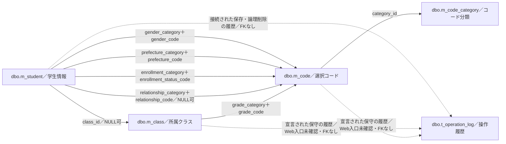
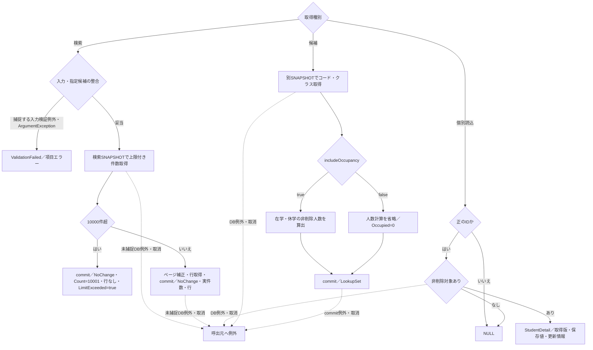
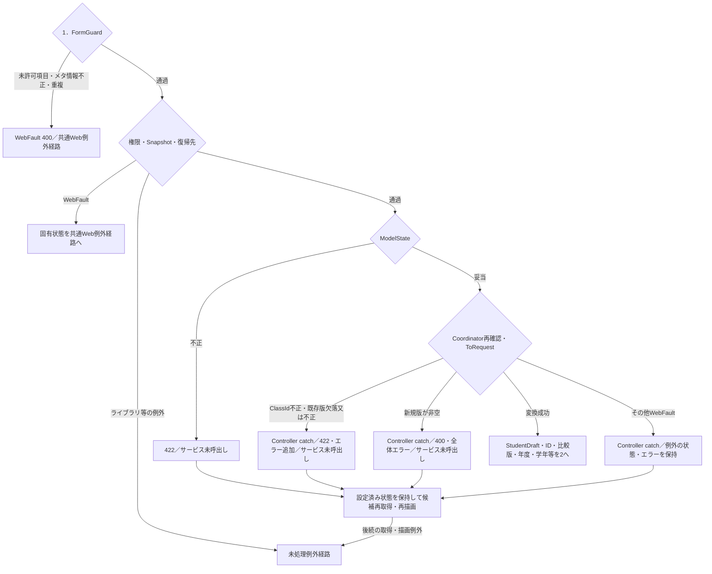
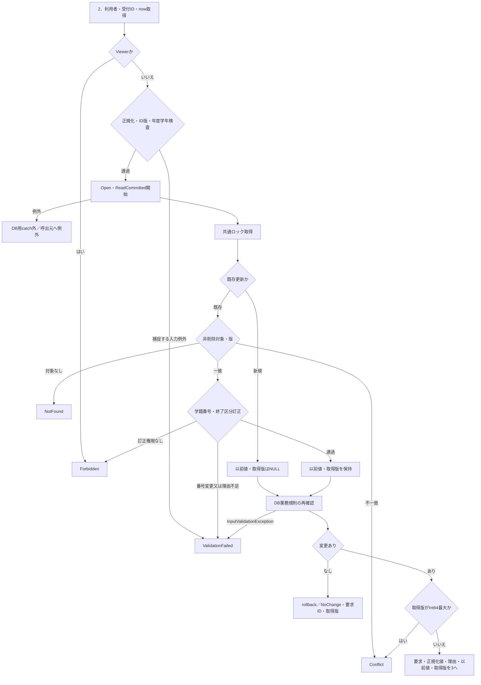
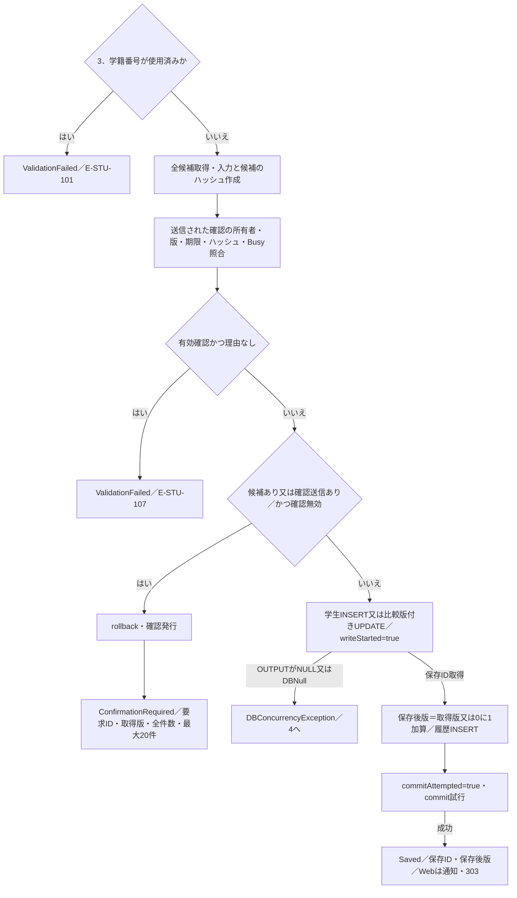
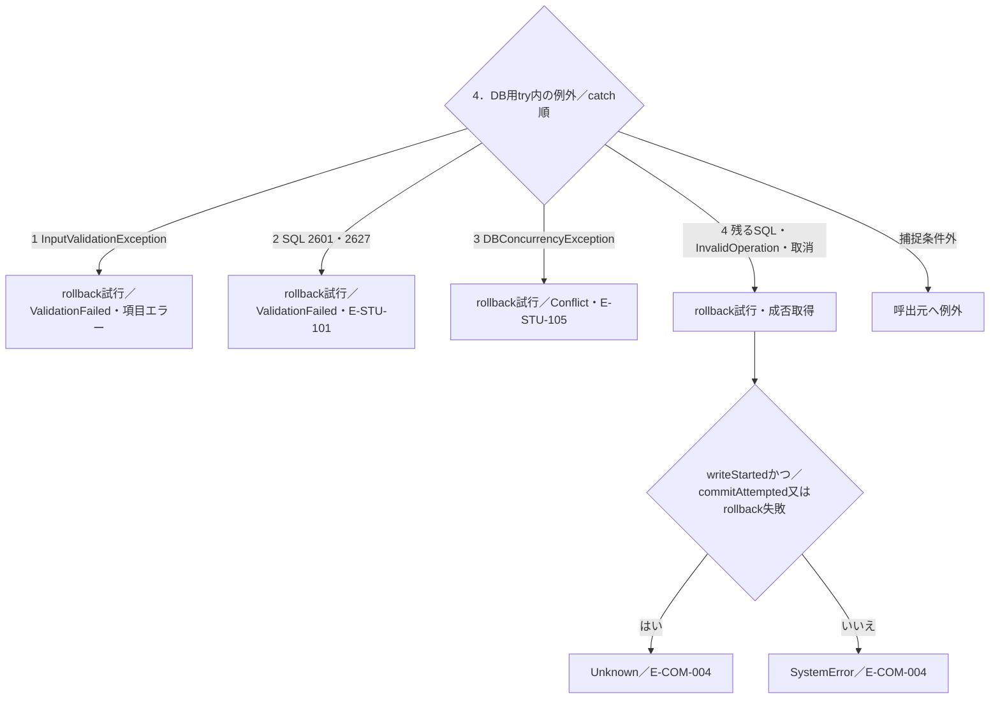
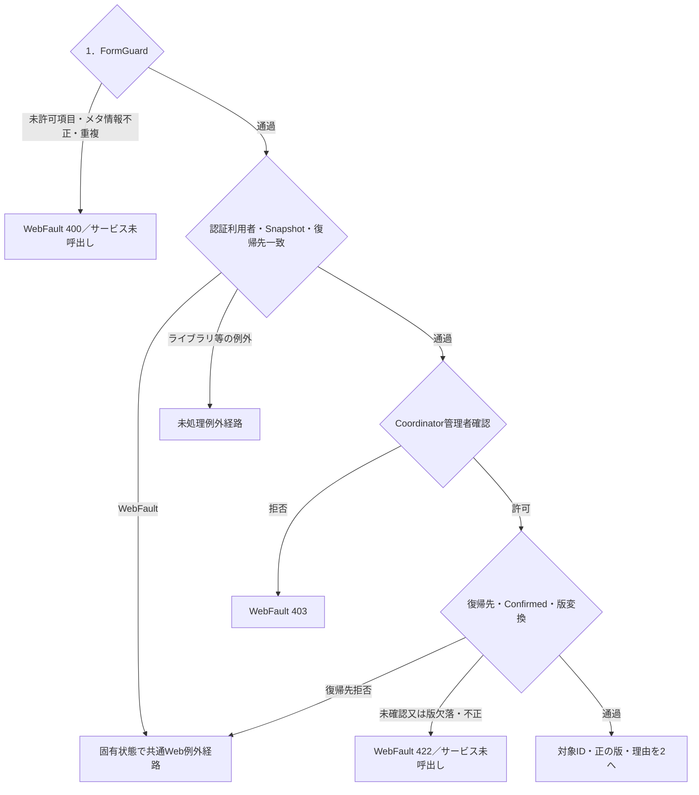
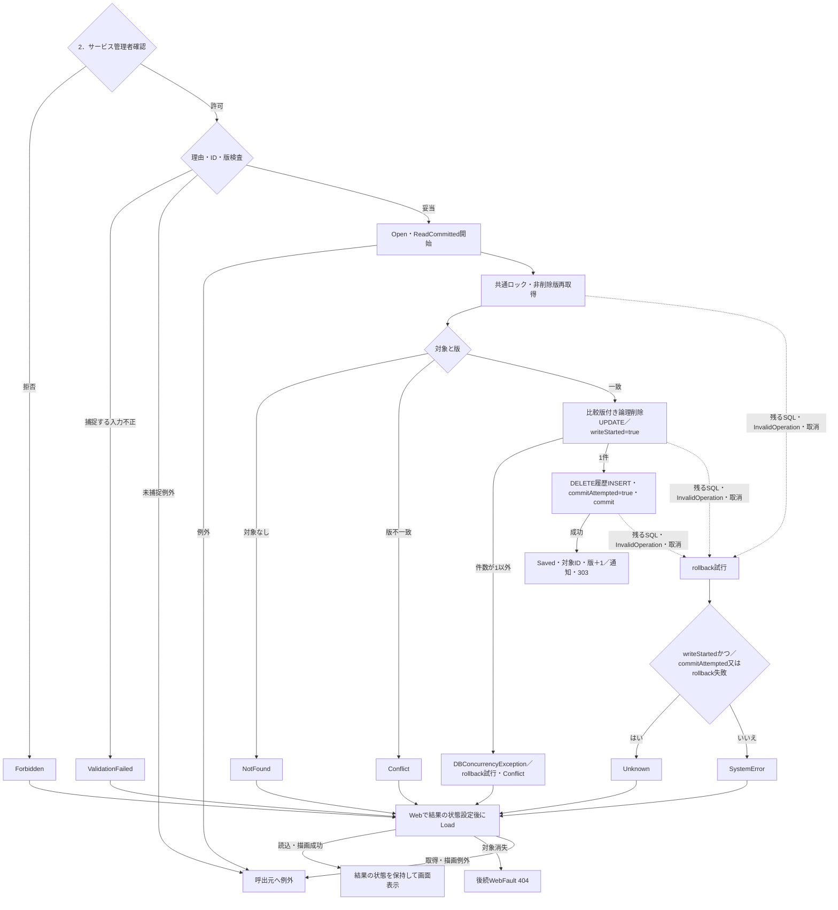
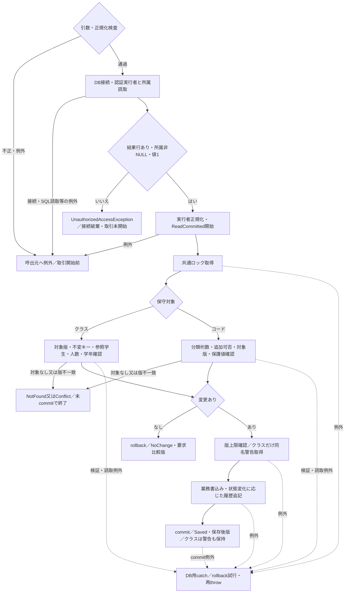
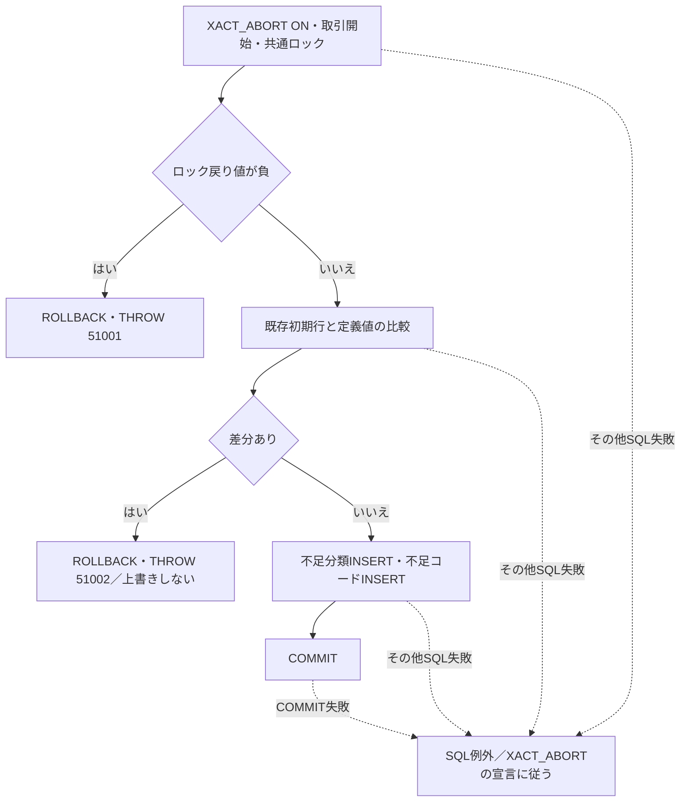

<!-- spec-meta: {"schema":"spec-md/1.0","documentId":"CSHARP_ASPNET-BAS-STU-03","version":"1.1","path":"基本設計書/03_テーブル仕様書.md","sheets":[{"heading":"概要","kind":"GRID","sheet":"概要"},{"heading":"項目一覧","kind":"LIST","sheet":"テーブル索引","key":["No"]},{"heading":"イベント仕様","kind":"GRID","sheet":"データ操作"},{"heading":"補足説明","kind":"GRID","sheet":"横断契約"}]} -->
# 学生管理 テーブル索引・データ関連仕様

| 文書属性 | 内容 |
| --- | --- |
| 文書ID | CSHARP_ASPNET-BAS-STU-03 |
| 文書種別 | table-index／基本設計書 |
| バージョン | 1.1 |
| 文書パス | 基本設計書/03_テーブル仕様書.md |
| 対象 | 学生情報、所属クラス、コード分類、選択コード、操作履歴の5表 |
| 記述区分 | ソースで観測した実装、DDLの宣言、Web入口が接続されていない保守メソッドの宣言契約を区別する。 |

## 概要

本書は、学生情報の保存先と、所属・選択コード・操作履歴との関係を整理する。学生情報は学生の業務値と比較版を保持し、クラスとコードは選択キー、表示名称、利用条件を提供する。コード分類はコードの用途、桁数、通常追加可否を定める。操作履歴は更新対象、前後版、変更列名、実行者、日時、理由を記録する。全列の個別定義は「項目一覧」の5文書へ対応させ、本書では表をまたぐ整合と確定単位を説明する。

学生Webは、`Program`でControllerをマップし、`WebHostSetup`で登録した`IStudentService`をControllerとCoordinatorから呼び出す。登録実装は`SqlServerStudentService`である。クラス・コードを書き込む`MasterMaintenanceService`は存在するが、このWebの実装登録・Controllerから呼ぶ接続は確認できない。以下では、その保守を公開APIや利用可能な保守画面として扱わず、候補データの保存元に宣言された契約として説明する。根拠：`sources/Program.cs:3-7`、`sources/Infrastructure/WebHostSetup.cs:12-19`、`sources/Web/Controllers/StudentsController.cs:5-39`、`sources/Core/MasterMaintenanceService.cs:30-121`。

### 保存上の参照関係

実線はDDLの外部キーである。点線は履歴INSERTに記録する対象表名・対象キーの対応であり、FKではない。図に未宣言の多重度は付けない。

7本のFKは参照キーの存在を制約する。性別、都道府県、在籍区分、学年は用途を固定した分類列とコード値を組にして参照するため、異なる分類の同じ数字コードを混同しない。続柄未設定時は分類・コードともNULLとなる。有効状態、利用期間、定員はFKの検査対象ではなく、保存サービスが別に確認する。根拠：`sources/database/001_schema.sql:189-199`、`sources/Core/StudentNormalizer.cs:147-157`、`sources/Core/SqlServerStudentService.cs:344-383`。

### 名称表示の結合と保存先

検索と同一人物候補の共通取得SQLは、学生からクラスへ、クラスから学年コードへ、学生から在籍コード・都道府県コードへLEFT JOINする。結合条件はそれぞれ所属ID、学年の分類と値、在籍の分類と値、都道府県の分類と値であり、有効状態や期間では絞らない。停止された参照値も名称の結合対象となる。`grade_name`、`status_name`、`prefecture_name`は`m_code.code_name`のSQL別名であり、独立した保存列ではない。根拠：`sources/Core/SqlServerStudentService.cs:82-90`。

`StudentRow`の年度、学年名、クラスコード・名称、在籍名称は結合結果としてNULLを受け得る。一方、保存元の`m_class.class_name`と`m_code.code_name`はNOT NULLである。住所表示は都道府県名と住所1を連結し、都道府県名がNULLなら「[不整合]」を使う。この結果形には住所2を含めない。結合結果のNULL可能性を参照先保存列のNULL属性へ移さない。根拠：`sources/Core/Contracts.cs:50-55`、`sources/Core/SqlServerStudentService.cs:77-90`、`sources/database/001_schema.sql:68-68`、`sources/database/001_schema.sql:115-115`。

## 項目一覧

| No | 論理名 | 物理名・列数 | 業務上の用途 | 読取り主体 | 書込み主体 | 個別定義・生成状態 | 根拠 |
| --- | --- | --- | --- | --- | --- | --- | --- |
| 1 | 学生情報 | `dbo.m_student`／35列 | 学生識別、氏名と照合キー、生年月日、住所・連絡先、入学・在籍・所属、緊急連絡先、備考、論理削除、作成更新情報、比較版を保持する。 | 接続された学生サービスの検索、個別読込、同一人物候補、所属人数計算。宣言されたクラス保守の参照学生・所属人数確認。 | 学生サービスの新規INSERT、比較版付きUPDATE、論理削除UPDATE。 | ID：CSHARP_ASPNET-BAS-STU-03-M_STUDENT kind：table-definition 正式パス：[基本設計書/テーブル/01_m_student.md](テーブル/01_m_student.md) 未生成 | `sources/database/001_schema.sql:7-59` `sources/Core/SqlServerStudentService.cs:137-181`、`sources/Core/SqlServerStudentService.cs:269-315`、`sources/Core/SqlServerStudentService.cs:392-416` `sources/Core/MasterMaintenanceService.cs:53-57` |
| 2 | 所属クラスマスター | `dbo.m_class`／17列 | 年度・学年、クラスコード・名称、期間、定員、表示順、有効状態、備考、作成更新情報、比較版を保持する。人数は保存列ではない。 | 学生サービスの候補・名称結合・年度学年整合・期間・定員確認。宣言されたクラス保守の既存行・同名確認。 | 宣言された`SaveClassAsync`のINSERT・比較版付きUPDATE。Web保守入口は未確認。 | ID：CSHARP_ASPNET-BAS-STU-03-M_CLASS kind：table-definition 正式パス：[基本設計書/テーブル/02_m_class.md](テーブル/02_m_class.md) 未生成 | `sources/database/001_schema.sql:62-87` `sources/Core/SqlServerStudentService.cs:196-216`、`sources/Core/SqlServerStudentService.cs:357-383` `sources/Core/MasterMaintenanceService.cs:30-77` |
| 3 | コード分類マスター | `dbo.m_code_category`／11列 | 分類ID・名称、コード桁数、通常追加可否、有効状態、備考、作成更新情報、比較版を保持する。 | 候補・学生保存・クラス保守で分類の有効状態を参照する。コード保守で桁数・追加可否を取得する。 | 初期投入SQLの不足行INSERT。マスター保守サービスに分類保存メソッドはない。 | ID：CSHARP_ASPNET-BAS-STU-03-M_CODE_CATEGORY kind：table-definition 正式パス：[基本設計書/テーブル/03_m_code_category.md](テーブル/03_m_code_category.md) 未生成 | `sources/database/001_schema.sql:90-109` `sources/database/002_seed.sql:88-89` `sources/Core/SqlServerStudentService.cs:203-212`、`sources/Core/SqlServerStudentService.cs:347-354` `sources/Core/MasterMaintenanceService.cs:59-63`、`sources/Core/MasterMaintenanceService.cs:91-104` |
| 4 | 選択コードマスター | `dbo.m_code`／14列 | 分類とコード値の組に名称、表示順、有効状態、期間、保護状態、備考、作成更新情報、比較版を保持する。 | 学生・クラス候補、検索条件の存在確認、名称結合、保存時の利用可否確認。 | 初期投入SQLの不足行INSERT。宣言された`SaveCodeAsync`のINSERT・比較版付きUPDATE。Web保守入口は未確認。 | ID：CSHARP_ASPNET-BAS-STU-03-M_CODE kind：table-definition 正式パス：[基本設計書/テーブル/04_m_code.md](テーブル/04_m_code.md) 未生成 | `sources/database/001_schema.sql:112-134` `sources/database/002_seed.sql:90-91` `sources/Core/SqlServerStudentService.cs:82-90`、`sources/Core/SqlServerStudentService.cs:196-222` `sources/Core/MasterMaintenanceService.cs:79-121` |
| 5 | 操作履歴 | `dbo.t_operation_log`／12列 | 対象表・対象キー、操作種別、前後版、変更列名JSON、実行者、UTC日時、相関ID、理由、重複確認有無を保持する。 | 接続されたアプリケーションに履歴照会処理は確認できない。 | 学生保存・論理削除の`Audit`と、宣言されたクラス・コード保守の`Log`によるINSERT。 | ID：CSHARP_ASPNET-BAS-STU-03-T_OPERATION_LOG kind：table-definition 正式パス：[基本設計書/テーブル/05_t_operation_log.md](テーブル/05_t_operation_log.md) 未生成 | `sources/database/001_schema.sql:137-153` `sources/Core/SqlServerStudentService.cs:385-390` `sources/Core/MasterMaintenanceService.cs:132-135` |

## イベント仕様

### 検索・個別読込・選択候補の取得

#### 処理概要

検索は条件に合う非削除学生の件数とページを取得する。個別読込は編集対象の保存値・版・更新情報を取得する。候補取得はコードとクラスを返し、登録用途では所属人数も算出する。検索と候補取得はそれぞれ独立したSNAPSHOTトランザクションであり、個別読込には明示トランザクションがない。画面読込全体を一つのSNAPSHOTとして扱わない。根拠：`sources/Core/SqlServerStudentService.cs:103-216`、`sources/Infrastructure/WebStudentCoordinator.cs:17-17`。

#### 処理手順

1. Web入口は認証を要求する。既存学生画面では認証利用者と任意の検索復帰先を確認し、新規画面では登録更新権限も確認する。各サービスも利用者情報を確認する。
2. 検索ではページ、ページサイズ、並び順、年度・クラス、未所属との併用、在籍区分の重複・許可値を検査する。文字列、電話、コード、入学日の範囲を正規化する。
3. 検索用SNAPSHOT内で指定学年・都道府県コードの存在、指定年度のクラス存在、指定クラスと任意指定された年度・学年の一致を確認する。ここでは停止・期間外を存在確認から除外しない。
4. 検索述語に一致する最大10001行の件数を取得する。10000件を超えた場合はページ行を取得せず、commit後に上限超過結果を返す。
5. 上限以内なら要求ページを最終ページ以内へ補正し、指定列・方向と学生ID昇順でページを取得する。commit後に実件数と取得行を返す。0件も通常の検索結果である。
6. 個別読込は正の学生IDを使い、非削除行だけを取得する。保存日付を和暦成分・西暦文字列へ戻し、保存版と更新情報を`StudentDetail`へ返す。
7. 候補取得は別のSNAPSHOT内でコード、クラスの2結果を読む。登録用途は非削除の在学・休学人数を算出し、検索用途は人数計算を省いて`Occupied=0`を設定する。
8. 編集用入力は保存された`class_id`に一致するクラス候補から年度・学年を復元する。Controllerは元入力のコピー、読込情報、検索復帰版を編集スナップショットへ保持する。

根拠：`sources/Web/Controllers/StudentsController.cs:5-25`、`sources/Web/Controllers/StudentsController.cs:39-39`、`sources/Core/SqlServerStudentService.cs:105-216`、`sources/Web/Inputs/StudentSaveInput.cs:44-54`。

#### 処理フロー

本図はサービスの利用者確認後の取得処理を示す。Webの認証・復帰先拒否とサービス利用者確認の例外は、通常の検索結果へ合流しない。

#### SQL・テーブル関連（ER図）

概要の関連図に示した学生、クラス、コード、分類を読む。件数取得は学生とクラスのLEFT JOIN、行取得はさらに学年・在籍・都道府県名称のLEFT JOINを使う。コード候補はコードと分類のINNER JOINで双方の有効状態を合成する。クラス候補の学年コードLEFT JOINは並び順に使う。これらのJOINとDDLのFKは別の役割である。根拠：`sources/Core/SqlServerStudentService.cs:82-90`、`sources/Core/SqlServerStudentService.cs:156-162`、`sources/Core/SqlServerStudentService.cs:203-208`。

#### DB操作の詳細

検索の共通条件は` s.is_deleted=0 `で、設定された条件をANDで追加する。LIKE入力中の`!`、`%`、`_`、`[`は`!`でエスケープする。

| 検索対象 | 述語・加工 | パラメータ型・Size |
| --- | --- | --- |
| 学籍番号 | 正規化した`student_no`の前方一致。末尾にワイルドカードを付ける。 | `@no`：VarChar・31 |
| 氏名 | 氏名照合キーに加工し、`name_key`の部分一致。前後にワイルドカードを付ける。 | `@name`：NVarChar・642 |
| カナ | 正規化カナから空白を除き、`kana_key`の部分一致。 | `@kana`：NVarChar・74 |
| 年度・学年 | 結合先の`c.school_year=@year`、`c.grade_code=@grade`。 | `@year`：SmallInt、`@grade`：VarChar・2 |
| クラス | `s.class_id=@class`。 | `@class`：BigInt |
| 未所属 | `s.class_id IS NULL`。年度・学年・クラスとの同時指定は拒否する。 | パラメータなし |
| 都道府県 | `s.prefecture_code=@prefecture`。 | `@prefecture`：VarChar・2 |
| 電話 | 本人電話または緊急電話の完全一致。 | `@phone`：VarChar・16 |
| 入学日 | 指定した開始以上・終了以下の条件を追加する。 | `@from`、`@to`：Date |
| 在籍区分 | 指定値のIN条件。全解除ならIN条件を追加しない。 | `@status0`等：各VarChar・2 |
| ページ | OFFSET/FETCH。ページサイズは20・50・100。 | `@offset`、`@size`：Int |

学年・都道府県の存在確認は`m_code`の分類IDとコード値を条件とし、`@category`はVarChar・24、`@value`はVarChar・10である。年度確認は`m_class.school_year=@year`のCOUNT_BIG、クラス確認は`class_id=@id`の年度・学年取得で、`@id`はBigIntである。

件数は同じ検索述語を付けたTOP(10001)のCOUNT_BIGである。`Count=10001`は上限超過を示し、それを超える実総件数ではない。並び順は学籍番号、氏名照合キー、入学日、更新日時から許可値を選び、昇順・降順の後に`student_id ASC`を付ける。根拠：`sources/Core/SqlServerStudentService.cs:107-170`、`sources/Core/SqlServerStudentService.cs:218-222`、`sources/Core/StudentNormalizer.cs:161-161`。

個別読込は`student_id=@id AND is_deleted=0`で全学生列を取得し、`@id`はBigIntである。コード候補はWHEREで停止・期間外を除外せず、分類ID、表示順、コード値の順に並べる。クラス候補は年度降順、学年コードの表示順、クラス表示順、クラスコード、クラスIDの順である。登録用人数は同じクラスに属する非削除かつ在学01・休学02のCOUNTで、検索用の0は実人数の測定値ではない。SQL実行、行読取、結果切替、commitには取消トークンを渡す。根拠：`sources/Core/SqlServerStudentService.cs:172-216`。

#### 結果・例外時の扱い

検索は通常・0件・上限超過を`Outcome.NoChange`で返し、件数、行、`LimitExceeded`で区別する。入力検証例外とArgumentExceptionは`ValidationFailed`へ変換する。利用者確認は検索のtryより前であり、同じ入力結果へ変換する範囲には含まれない。DB例外や取消を0件結果にするcatchはない。

個別読込の対象なしはNULLで、既存画面のCoordinatorは404のWebFaultへ変換する。未処理例外は応答開始前に限りmiddlewareがWebFaultの状態、または503へ変換する。根拠：`sources/Core/SqlServerStudentService.cs:103-106`、`sources/Core/SqlServerStudentService.cs:159-181`、`sources/Infrastructure/WebStudentCoordinator.cs:17-20`、`sources/Infrastructure/WebHostSetup.cs:22-24`。

### 学生の登録・更新

#### 処理概要

登録・更新は正規化した学生情報と操作履歴を同じトランザクションで保存する。既存更新は読込時の比較版を要求し、ロック取得後の再読込とUPDATEのWHEREで競合を確認する。学籍番号は新規時に保存し、既存更新では変更できない。

実入口はPOST `/students/create`とPOST `/students/{id}/update`である。フォーム受信値は`Input`接頭辞の`StudentSaveInput`へバインドされ、Coordinator内の`ToRequest`で`StudentDraft`と`SaveRequest`へ変換してからサービスへ渡る。根拠：`sources/Web/Controllers/StudentsController.cs:26-33`、`sources/Infrastructure/WebStudentCoordinator.cs:18-18`、`sources/Web/Inputs/StudentSaveInput.cs:34-43`。

#### 処理手順

1. 共通設定はControllerへの認証とPOSTのCSRF検査を要求する。アクションに到達した後は、まずFormGuardが送信項目を検査する。未許可項目、不正な`__Invariant`の値、禁止された同名項目重複は400のWebFaultで拒否する。
2. 登録更新権限、編集スナップショット、検索復帰先の存在・所有者等、読込時復帰先との一致を順に確認する。この検査は後段のController内catchより前であり、拒否は共通Web例外経路へ進む。
3. ModelStateが不正なら422を設定し、サービスを呼ばず候補を再取得して再描画する。
4. ModelStateが妥当ならCoordinatorが権限と復帰先を再確認し、`ToRequest`を評価する。ClassIdのNULL・空文字は未所属とし、それ以外は19コード単位以内のASCII数字から正のInt64へ変換する。不正なら422のWebFaultとなる。既存更新のExpectedVersionは必須の正のInt64で、欠落・不正も422となる。新規のExpectedVersionが非空なら400となる。これらはサービス未呼出しの拒否で、ControllerがWebFaultの状態を保持して項目または全体エラーを追加する。
5. サービスは受付Guid、利用者、UTC時刻、日本時間の業務日を取得する。Viewerを拒否し、学生値、任意理由、対象ID・比較版の正数性と同時設定、年度範囲、学年コードを検査する。
6. DB接続とReadCommitted開始後、共通保存ロックを取得する。OpenとBeginTransactionはDB処理用tryの外である。
7. 既存更新は非削除行を再読込する。対象なしはNotFound、比較版不一致はConflict、学籍番号変更はValidationFailedとする。保存済み区分が卒業03・退学04で区分を変更する場合は管理者権限と理由を要求する。
8. コードとクラスの存在、利用状態・期間、任意年度・学年との整合、必要な定員をDBで再確認する。画面の候補や参考人数をこの検査の代わりにはしない。
9. 正規化値に変更がなければ明示rollbackしてNoChangeを返す。変更があり取得版がInt64最大ならConflictとする。
10. 学籍番号の使用済み検査を行う。削除行も対象とし、自分以外に同番号があれば拒否する。
11. 非削除、自分以外、同一生年月日、氏名照合キーまたはカナ照合キー一致の全候補を学生ID順に取得する。正規化入力と全候補のID・版から確認用ハッシュを作る。
12. 確認情報が送信された場合は所有者、セッション、対象ID、比較版、期限、両ハッシュ、Busyの原子的取得を照合する。有効な確認で続ける場合は理由を必須とする。候補あり、または確認情報送信ありで、確認が無効ならrollback後に確認情報を発行し、全候補件数と最大20件を返す。
13. 書込みへ進む場合、新規は学生INSERTのOUTPUTから採番IDを取得する。更新は学生ID・比較版・非削除をWHEREにして保存対象列と更新情報を設定し、版を1加算する。OUTPUTがNULLまたはDBNullならDBConcurrencyExceptionとする。
14. CREATEまたはUPDATEの履歴を同じトランザクションへ追記する。commit試行直前に`commitAttempted=true`を設定し、commit成功後にSaved、保存ID、保存後版を返す。
15. WebはSavedなら通知を置いて303で検索へ戻す。それ以外、またはControllerがWebFaultを捕捉した場合は、候補再取得とEditビューの描画へ進む。

根拠：`sources/Infrastructure/WebHostSetup.cs:14-18`、`sources/Web/Controllers/StudentsController.cs:28-33`、`sources/Web/Controllers/StudentsController.cs:41-41`、`sources/Web/Inputs/StudentSaveInput.cs:34-43`、`sources/Web/Inputs/StudentSaveInput.cs:59-60`、`sources/Core/SqlServerStudentService.cs:227-315`。

#### 処理フロー

サブフロー1は共通認証・CSRF検査を通過してアクションに到達した要求から始まる。認証拒否は401、CSRFは共通MVCフィルターの拒否で終了し、この図の変換へ進まない。通常の`/students`経路に対するCSRF失敗結果の依存実装は、サービスの検証結果とは分ける。

サブフロー2はサービス引数を受け、書込み前の再確認までを行う。新規は以前値・取得版がNULL、既存更新は再読込した以前値・版をサブフロー3へ引き継ぐ。

ロック、再読込、業務規則検査等のDB用try内の例外はサブフロー4へ進む。図のValidationFailedは捕捉された検証例外または明示的な拒否結果であり、未捕捉例外を含めない。

ConfirmationRequiredのID・版は固定NULLではない。新規時は要求ID・取得版がNULL、既存更新時は要求対象ID・再読込した版を返す。確認発行、学生書込み、履歴、commitの例外もサブフロー4へ進む。

第4catchの条件を先行catchの結果へ適用しない。利用者取得、正規化の未捕捉例外、Open、BeginTransactionはこの図の入口には入らない。根拠：`sources/Core/SqlServerStudentService.cs:229-243`、`sources/Core/SqlServerStudentService.cs:316-329`。

#### SQL・テーブル関連（ER図）

概要の5表の関連を利用する。書込み対象は学生と操作履歴で、両方を同じ確定単位にする。クラス、コード、分類は保存可否の確認に読む。履歴の対象表・対象キーに学生へのFKはない。接続されたWeb確認はメモリであり、この確定単位へ確認表のUPDATEを追加しない。

#### DB操作の詳細

| 操作 | 対象・条件・設定 | パラメータ型・Sizeと結果 |
| --- | --- | --- |
| 既存再読込 | `m_student`の`student_id=@id AND is_deleted=0`。取得版を比較する。 | `@id`：BigInt。以前値・取得版を保持する。 |
| 学籍番号使用済み確認 | `student_no=@no AND (@id IS NULL OR student_id<>@id)`。削除行を除外しない。 | `@no`：VarChar・15、`@id`：BigInt・NULL可。COUNT_BIGが0超なら拒否。 |
| 同一人物候補 | 非削除、自分以外、同一生年月日、氏名キーまたはカナキー一致。学生ID順。TOPなし。 | `@id`：BigInt、`@birth`：Date、`@name`：NVarChar・320、`@kana`：NVarChar・36。全候補を読む。 |
| 用途別コード確認 | コードと分類をJOINし、分類ID・コード値で取得する。存在、新規・変更値の双方有効状態、業務日の期間を検査する。 | `@category`：VarChar・24、`@value`：VarChar・10。不存在E-STU-009、利用不可E-STU-011。 |
| クラス確認 | `class_id=@id`で年度・学年・期間・有効状態・定員を取得する。任意指定された年度・学年との一致を確認する。 | `@id`：BigInt。不在E-STU-010、上位不一致E-STU-014。 |
| 定員確認 | 指定クラス、非削除、在学01・休学02、自分以外のCOUNT_BIGに1を加える。新たに席を使い、定員がNULLでない場合だけ行う。 | `@class`、`@id`：BigInt。超過E-STU-102。 |
| 新規INSERT | 正規化保存列、固定分類、非削除状態、作成更新情報、版1を明示設定する。 | 保存列の型・Sizeは補足表に対応。`@now`：DateTimeOffset、`@actor`：NVarChar・128。OUTPUTで学生ID取得。 |
| 既存UPDATE | 学籍番号をSETから外し、保存対象列・更新情報・版加算を設定する。WHEREは学生ID・比較版・非削除。 | `@id`、`@version`：BigInt。OUTPUTで学生ID取得。 |
| 履歴INSERT | 対象表、対象キー、前後版、変更列名、実行者等を追記する。 | 学生`Audit`のリテラル・パラメータ契約は補足説明に示す。 |

同じコードを保持する既存更新でも存在確認は行うが、有効状態・期間の拒否対象からは外す。在学・休学で新たに席を使うときはクラスの有効状態・現在期間・定員を確認する。同じクラスで既に席を使っていた場合には、この新規所属の検査を適用しない。卒業・退学で所属、区分、入学日、終了日が変わるときは在籍期間とクラス期間の重なりを確認する。定員NULLは上限制限なしであり、0ではない。根拠：`sources/Core/SqlServerStudentService.cs:245-307`、`sources/Core/SqlServerStudentService.cs:344-383`。

#### 結果・例外時の扱い

NoChangeと確認要求は明示rollbackする。一部の対象なし・競合等の早期returnは明示Rollbackを呼ばず、未commitのトランザクションを`await using`の破棄対象にする。全拒否経路が同じrollback呼出しを行うとは説明しない。

DB用catchは入力検証、SQL 2601・2627、DBConcurrencyException、残るSQL・InvalidOperation・取消の順である。最後のcatchだけが、書込み開始済みで、commit試行済みまたはrollback失敗の場合にUnknownを返す。他の場合はSystemErrorである。rollback helperは取消なしで実行し、SQL例外・InvalidOperationExceptionを失敗値へ変換する。根拠：`sources/Core/SqlServerStudentService.cs:240-243`、`sources/Core/SqlServerStudentService.cs:302-329`。

WebではSavedは通知後303、NoChangeは200、ValidationFailedは422、Forbiddenは403、NotFoundは404、ConflictとConfirmationRequiredは409、SystemErrorとUnknownは503へ対応する。変換時のWebFaultは400または422等の元状態を保持し、SaveResultへ変換しない。保存の再描画は元DTOを保持して候補を再取得するため、候補取得や描画の例外で最終応答が変わり得る。応答開始後の例外にmiddlewareの503変換を保証しない。根拠：`sources/Web/Controllers/StudentsController.cs:30-33`、`sources/Infrastructure/WebPresentation.cs:23-23`、`sources/Infrastructure/WebHostSetup.cs:22-24`。

### 学生の論理削除

#### 処理概要

POST `/students/{id}/delete`は学生行を残し、削除状態・削除情報・更新情報・版を変更する。管理者だけが実行できる。編集中の氏名や住所等は保存しない。学生UPDATEとDELETE履歴を同じトランザクションで確定する。根拠：`sources/Web/Controllers/StudentsController.cs:37-38`、`sources/Views/Students/Edit.cshtml:17-17`、`sources/Core/SqlServerStudentService.cs:409-414`。

#### 処理手順

1. 共通認証・CSRF設定を通過した後、FormGuardが未許可項目、不正な書式メタ情報、禁止された重複を400で拒否する。
2. 認証利用者、対象IDに対応するスナップショット、読込時復帰先との一致を確認する。
3. Coordinatorは管理者権限、復帰先検索状態、Confirmed、比較版文字列から正のInt64への変換を順に確認する。Confirmed=false、版欠落・不正は422のWebFaultで、サービスを呼ばない。削除アクションに保存と同じModelState分岐はなく、明示検査を通してサービスへ渡す。
4. サービスは管理者を再確認し、必須理由を原入力・保存値とも60スカラー以内へ正規化する。正のID・版を要求し、Int64最大版を拒否する。
5. OpenとReadCommitted開始後、共通ロックを取得する。非削除学生の版を再取得し、対象なしと比較版不一致を分けて返す。
6. 学生ID・比較版・非削除をWHEREにして論理削除UPDATEを行い、更新件数1を要求する。
7. 同じトランザクションへDELETE履歴を追記し、commit成功後にSaved、対象ID、版＋1を返す。
8. Webは成功なら通知と303復帰を行う。サービスが失敗結果を返した場合はエラー・状態コードを設定してからLoadで学生と候補を再取得し、新しい編集スナップショットを作る。

根拠：`sources/Web/Controllers/StudentsController.cs:25-25`、`sources/Web/Controllers/StudentsController.cs:37-41`、`sources/Infrastructure/WebStudentCoordinator.cs:19-19`、`sources/Core/SqlServerStudentService.cs:392-416`。

#### 処理フロー

サブフロー1は共通認証・CSRF通過後からサービス引数への変換までである。入口拒否はControllerの保存用catchを通らず、共通Web例外経路へ進む。

#### SQL・テーブル関連（ER図）

書込み対象は概要の学生と操作履歴である。履歴への点線は文字列の対象対応を表し、学生へのFKではない。クラス・コード・分類を更新しない。論理削除後は通常検索、個別読込、在学・休学人数から除外される。

#### DB操作の詳細

再取得は`student_id=@id AND is_deleted=0`の版を読む。UPDATEもこの条件へ`row_version=@version`を加え、`is_deleted=1`、`deleted_at`、`deleted_by`、`delete_reason`、`updated_at`、`updated_by`、`row_version=row_version+1`だけを設定する。`@id`・`@version`はBigInt、`@now`はDateTimeOffset、`@actor`はNVarChar・128、`@reason`はNVarChar・120である。

履歴は上記7列を変更列名として記録し、前版は比較版、後版は版＋1、理由は学生削除理由と同じ正規化値、重複確認有無はfalseとする。学生の物理DELETEではなく、学籍番号の一意性は削除後も残る。根拠：`sources/Core/SqlServerStudentService.cs:404-414`、`sources/database/001_schema.sql:187-187`。

#### 結果・例外時の扱い

理由正規化のcatchはInputValidationExceptionだけで、不正Unicode等のArgumentExceptionを同じValidationFailedへ変換する保証はない。DB用tryはOpenとBeginTransactionの後から始まる。DBConcurrencyExceptionはrollback試行後Conflict、残るSQL・InvalidOperation・取消例外は図の条件でUnknownまたはSystemErrorとなる。先行catchをUnknown判定へ含めない。根拠：`sources/Core/SqlServerStudentService.cs:396-416`。

失敗結果の後もLoadによるDB読込が続く。対象が消失していれば404となり、取得・描画が失敗すれば未処理例外経路となるため、サービス結果の状態を最終HTTP応答と断定しない。FormGuard、認証、スナップショット、Coordinatorの拒否はサービス失敗結果の再読込経路には入らない。根拠：`sources/Web/Controllers/StudentsController.cs:25-25`、`sources/Web/Controllers/StudentsController.cs:37-37`、`sources/Infrastructure/WebStudentCoordinator.cs:17-19`。

### クラス・コード保守の宣言契約

#### 処理概要

`SaveClassAsync`と`SaveCodeAsync`は、学生の候補・名称表示に使うマスターの追加・更新と履歴追記を定義する。呼出入口のWeb接続は確認できない。接続ごとにDB認証の`ORIGINAL_LOGIN()`と`IS_ROLEMEMBER('student_admin')`を取得し、管理者所属が1でない接続を拒否する。Web利用者Claimの判定とは別の契約である。根拠：`sources/Core/MasterMaintenanceService.cs:17-28`、`sources/Infrastructure/WebHostSetup.cs:12-19`。

#### 処理手順

1. クラスは年度1900〜9998、定員NULLまたは1〜9999、非負表示順、ID・比較版の組を検査する。コードを9文字以内のIdentifier、名称を18スカラー、学年を2桁コード、備考を120スカラーへ正規化し、期間を年度内に収める。
2. コードは許可された5分類、任意比較版の正数性、非負表示順を検査する。名称を12スカラー、備考を120スカラーへ正規化し、開始日・任意終了日と前後関係を確認する。
3. DB接続を開いて管理者所属を読む。結果行なし、所属値NULL、値が1以外ならUnauthorizedAccessExceptionを送出する。接続・SQL読取・実行者正規化の失敗もOpenから再throwする。ここではトランザクションをまだ開始していない。
4. DB管理者確認後にReadCommittedを開始し、共通保存ロックを取得する。
5. クラス更新は対象と版を確認し、既存の年度・クラスコード変更を拒否する。削除学生を含む参照学生があれば学年変更を拒否する。非削除の在学・休学人数がある場合の停止・現在期間外化と、人数より小さい定員を拒否する。
6. クラスの学年はコードと分類のJOINで存在を確認する。新規または学年変更時だけ双方の有効状態と現在期間を要求する。
7. コードは分類から桁数・通常追加可否を取得し、分類別の固定桁数字へ正規化して既存行を読む。比較版付き要求で対象なしならNotFound、既存版不一致ならConflict、新規で追加不可なら例外とする。保護値の停止、開始日後ろ倒し、無期限から有限期限への変更、既存終了日より前への短縮を拒否する。
8. 無変更は明示rollbackしてNoChangeを返す。変更があり比較版がInt64最大なら例外とする。クラスだけは同年度・同学年・同名の別行を取得し、同名警告として保持する。
9. 業務INSERTまたは比較版付きUPDATEと履歴INSERTを行う。commit成功後にSavedと保存後版を返し、クラスは同名警告も返す。DB用try内の例外はrollbackを試みて再throwする。

根拠：`sources/Core/MasterMaintenanceService.cs:17-121`。

#### 処理フロー

入口の引数検査、DB管理者確認、BeginTransactionの例外と、DB用try内のrollback経路を分ける。

#### SQL・テーブル関連（ER図）

クラス保守はクラス、参照学生、学年コード、分類、履歴を使う。コード保守はコード、分類、履歴を使う。関係は概要のFKと履歴の文字列対応に従う。分類の保存メソッドと、クラス・コードの物理削除経路はない。

#### DB操作の詳細

クラス既存取得は`class_id=@id`で、`@id`はBigIntである。参照確認は`m_student WHERE class_id=@id`から全参照件数と、非削除かつ在学01・休学02の人数を取得する。同名確認は年度・学年・名称一致、自分以外であり、名称の一意制約ではない。学年取得は分類をSQLリテラル`GRADE`に固定し、`@grade`はVarChar・2である。

クラス新規は`grade_category='GRADE'`、作成更新情報、版1を明示し、OUTPUTで採番IDを取得する。更新WHEREはクラスID・比較版で、年度・コードは変更を事前拒否するがUPDATEの設定列にも含む。年度はSmallInt、コードはVarChar・9、名称はNVarChar・36、期間はDate、定員・表示順はInt、有効状態はBit、備考はNVarChar・240で渡す。根拠：`sources/Core/MasterMaintenanceService.cs:45-75`、`sources/Core/MasterMaintenanceService.cs:124-130`。

コード既存取得は分類ID・コード値、更新WHEREはこれらと比較版である。分類取得は`code_length`と`allow_add`を読むもので、分類有効状態をSaveCodeAsyncの入口条件にする検査はない。追加は`is_protected=0`・版1を明示し、更新SQLは保護状態を変更しない。分類IDはVarChar・24、コード値はVarChar・10、名称はNVarChar・24、表示順はInt、有効状態はBit、期間はDate、備考はNVarChar・240、比較版はBigIntである。双方の日時はDateTimeOffset、実行者はNVarChar・128で渡す。根拠：`sources/Core/MasterMaintenanceService.cs:91-119`。

#### 結果・例外時の扱い

対象なしと競合はMaintenanceResultで返す。既存コードへ比較版なしで要求した場合もConflictとなり、通常追加可の分類でも既存キーを無条件に上書きしない。無変更は要求比較版を返す。クラス同名警告は保存を拒否する条件ではなく、コード保存結果へは設定しない。

管理者確認の拒否は取引開始前のUnauthorizedAccessExceptionで、MaintenanceResultへ変換しない。DB用catchも例外を再throwし、学生保存のUnknown・SystemError分類は行わない。commit中の例外で保存成否やrollback成功を断定しない。クラス保存helperはNULL出力をDBConcurrencyExceptionにするが、学生保存と同じDBNull検査はなく、その後の型変換例外も保守catchから再throwされる。根拠：`sources/Core/MasterMaintenanceService.cs:23-28`、`sources/Core/MasterMaintenanceService.cs:67-77`、`sources/Core/MasterMaintenanceService.cs:102-121`、`sources/Core/MasterMaintenanceService.cs:130-130`。

### 初期分類・コードの投入SQL

#### 処理概要

初期投入SQLは5分類と70コードを定義し、既存の初期値に差分があれば上書きせず拒否する。学生・クラスの初期データを作る処理ではない。根拠：`sources/database/002_seed.sql:8-91`。

#### 処理手順

1. XACT_ABORTを有効にしてトランザクションを開始し、共通保存ロックを取得する。負のロック戻り値ならrollbackして51001を送出する。
2. UTC日時とDB認証実行者を取得し、5分類・70コードの初期値を表変数へ用意する。
3. 既存初期分類の名称・桁数・追加可否・有効状態と、既存初期コードの名称・表示順・保護状態・有効状態・期間を比較する。
4. 差分があればrollbackして51002を送出する。
5. 差分がなければ不存在の分類、続いて不存在の分類・コード値の組を追加する。
6. 有効状態1、備考NULL、UTC作成更新日時、DB認証実行者、版1を明示設定してcommitする。

根拠：`sources/database/002_seed.sql:2-14`、`sources/database/002_seed.sql:85-92`。

#### 処理フロー

#### SQL・テーブル関連（ER図）

投入対象は概要のコード分類とコードである。分類へのFKに従って分類を先に追加する。学生、クラス、操作履歴へのINSERTはない。

#### DB操作の詳細

| 分類ID | 論理名 | 桁数 | 通常追加 | 初期コード数 | 主な利用先 |
| --- | --- | --- | --- | --- | --- |
| GENDER | 性別 | 1 | 不可 | 4 | 学生の性別選択・保存 |
| ENROLLMENT_STATUS | 在籍区分 | 2 | 不可 | 4 | 在籍選択・検索・名称・席と終了日の判定 |
| PREFECTURE | 都道府県 | 2 | 不可 | 47 | 住所の選択・検索・名称表示 |
| RELATIONSHIP | 緊急連絡先続柄 | 2 | 可 | 8 | 学生の緊急連絡先続柄 |
| GRADE | 学年 | 2 | 可 | 7 | クラスの学年、上位選択・検索・名称表示 |

性別0は未回答、在籍01・02・03・04は在学・休学・卒業・退学、学年00は学年なしである。保護値は性別0、在籍4値、都道府県全値、学年00である。初期コードは開始1900-01-01、終了NULLとし、表示順・保護状態は定義値を使う。

不存在判定は分類ID、または分類IDとコード値の組で行う。一致した既存行の版、日時、利用者、備考を更新するSQLではない。根拠：`sources/database/002_seed.sql:8-91`。

#### 結果・例外時の扱い

ロック失敗は51001、初期値差分は51002で明示rollbackする。その他の失敗にSaveResultを返すcatchはない。SQLの宣言上の終了条件と実投入の成功は別である。

## 補足説明

### 入力・内部値・保存値・表示値

画面からサービスへの入力方向と、DBから表示への出力方向を分ける。StudentSaveInputの値はToRequestでDraftと制御引数へ移され、正規化後に学生保存列へ対応する。年度・学年はクラス選択の補助と整合検査用であり、学生表に複製保存しない。

| 論理項目・コントロール | 要求DTO・サービス側の型 | 正規化・内部値 | 保存先・DB属性 | 検索・表示用途 |
| --- | --- | --- | --- | --- |
| 学籍番号／REG-002 input | StudentNo：`string`／Draft：`string` | Trim、NFKC、大文字化。先頭英数字、以降英数字・ハイフン。 | student_no：varchar(15)、NOT NULL | 前方一致、一覧、使用済み検査。既存変更不可。 |
| 氏名／REG-003 input | StudentName：`string`／Draft：`string` | 表示保存値はTrim。name_keyはNFKC、大文字化、全空白除去。 | student_name：nvarchar(16)、name_key：nvarchar(320)。各NOT NULL | 表示は氏名、検索・同一人物候補はキー。 |
| 氏名カナ／REG-004 input | StudentNameKana：`string`／Draft：`string` | NFKC、ひらがな変換、空白集約。kana_keyは正規化カナの空白除去。 | student_name_kana、kana_key：各nvarchar(36)、NOT NULL | 表示カナと検索・候補用キーを分ける。 |
| 生年月日／REG-005 元号select・年月日input | BirthDateInput各成分：`string`／保存値：`DateOnly` | 元号境界・正の年月日・許容日を確認して日付化。 | birth_date：date、NOT NULL | 同一人物候補の同日条件。和暦は保存日付から生成。 |
| 性別／REG-006 select | GenderCode：`string` | Trim・NFKC後の1桁数字。 | gender_code：varchar(1)、NOT NULL。新規分類はGENDER固定。 | GENDERのコード値を保存し、名称を候補表示。 |
| 郵便番号／REG-007 input | PostalCode：`string` | NFKC、空白・指定ハイフン類除去、7桁数字。 | postal_code：varchar(7)、NOT NULL | 個別読込で入力へ戻す。 |
| 都道府県／REG-008 select | PrefectureCode：`string` | Trim・NFKC後の2桁数字。 | prefecture_code：varchar(2)、NOT NULL。新規分類はPREFECTURE固定。 | 条件検索、コード名称JOIN、住所表示。 |
| 住所1・2／REG-009・010 input | AddressLine1：`string`、AddressLine2：`string?` | Trim。住所1は必須、住所2の空入力はNULL。 | 各nvarchar(90)。住所1はNOT NULL、住所2はNULL可。 | 一覧住所は都道府県名＋住所1。住所2は一覧結果に含まない。 |
| 本人電話・緊急電話／REG-011・022 input | 各`string?` | NFKC、空白・指定ハイフン類・括弧除去。国内0始まり10〜11桁、または＋と1〜9始まり7〜15桁を確認。 | phone_number、emergency_phone_number：各varchar(16)、NULL可 | 電話検索は両列のORによる完全一致。一覧は本人電話を返す。 |
| 本人メール／REG-012 input | EmailAddress：`string?` | Trim、ローカル部・ドメイン形式確認、ドメインだけ小文字化。 | email_address：varchar(60)、NULL可 | 連絡先組合せ検査、個別読込・保存。 |
| 入学日・終了日／REG-013・015 date input | 入学日：`string`、終了日：`string?`／内部：`DateOnly`・`DateOnly?` | NFKC後のyyyy-MM-ddを日付化。終了日未設定はNULL。 | admission_date：date、NOT NULL。enrollment_end_date：date、NULL可。 | 入学日範囲、在籍状態、クラス期間との整合。 |
| 在籍区分／REG-014 select | EnrollmentStatusCode：`string` | Trim・NFKC後の2桁数字。 | enrollment_status_code：varchar(2)、NOT NULL。新規分類はENROLLMENT_STATUS固定。 | 検索、名称、席を使う01・02、終了日判定。 |
| 年度・学年／REG-016・017 select | SchoolYear：`int?`、GradeCode：`string?`／SaveRequestにも保持 | 年度範囲、学年形式、選択クラスとの一致を確認。 | 学生保存列なし。参照元はクラスのschool_year：smallint、grade_code：varchar(2)、各NOT NULL。 | 上位選択・検索条件。既存値は保存class_idから復元。 |
| 所属クラス／REG-018 select | ClassId：`string?`／Draft：`long?` | NULL・空文字は未所属。他は正のInt64へ変換。 | class_id：bigint、NULL可 | 所属保存キー、名称・年度・学年の参照、人数計算。 |
| 緊急氏名・続柄／REG-020 input・REG-021 select | 各`string?` | 氏名はTrim、続柄は2桁。続柄ありなら分類RELATIONSHIP、なしなら分類もNULL。 | 氏名nvarchar(16)、分類varchar(24)、続柄varchar(2)。各NULL可。 | 緊急電話を含む全設定・全未設定の検査。 |
| 備考／REG-023 textarea | Remarks：`string?` | 改行をLFへ統一、Trim。空入力はNULL。 | remarks：nvarchar(240)、NULL可 | 個別読込・保存。 |
| 確認・変更理由／REG-024 textarea | OperationReason：`string?`／SaveRequest.Reason：`string?` | 複数行Textへ正規化。条件により必須。 | 履歴operation_reason：nvarchar(120)、NULL可。学生通常保存列なし。 | 終了区分訂正・有効な重複確認続行の理由。 |
| 削除理由／REG-026 textarea | StudentDeleteInput.Reason：`string`／サービス理由：`string` | 必須の複数行Textへ正規化。 | 学生delete_reasonと履歴operation_reason：各nvarchar(120)、列はNULL可だが削除時必須。 | 削除情報とDELETE履歴へ同じ値を保存。 |

根拠：`sources/Views/Students/Edit.cshtml:6-17`、`sources/Web/Inputs/StudentSaveInput.cs:9-60`、`sources/Core/Contracts.cs:8-29`、`sources/Core/Contracts.cs:66-70`、`sources/Core/StudentNormalizer.cs:47-158`、`sources/Core/JapaneseDateService.cs:17-59`、`sources/database/001_schema.sql:9-37`、`sources/Core/SqlServerStudentService.cs:30-37`、`sources/Core/SqlServerStudentService.cs:183-194`、`sources/Core/SqlServerStudentService.cs:409-413`。

クラス選択時はJavaScriptが候補の年度・学年を上位項目へ反映し、上位変更で不一致となったクラスを解除する。候補キーと表示名称、人数・定員の参考表示、選択済値は別の情報である。学生ID・更新情報はDB由来の表示値、SnapshotId・検索復帰先・重複確認情報は制御値で、学生の通常業務保存列ではない。ExpectedVersionはDB版の比較引数であり、その値をそのまま新しい版として保存する処理ではない。根拠：`sources/Views/Students/Edit.cshtml:4-5`、`sources/Views/Students/Edit.cshtml:12-12`、`sources/wwwroot/js/site.js:8-8`。

### 文字上限・DB容量・SQLサイズ

サービスの文字数はUnicodeスカラー数で、サロゲートペアを1と数え、不正な単独サロゲートはArgumentExceptionとなる。Textは原入力上限、必要な改行統一、制御文字、Trim、必須・空値、正規化後上限の順で検査する。原入力上限を、Trim後の値だけの上限へ置き換えない。

ブラウザーmaxlengthはUTF-16コード単位の制約である。`nvarchar(n)`のnは2バイトの格納単位であり、任意のUnicode文字をn個保存できる意味ではない。SQLパラメータSizeはさらに別の指定として記録する。

| 値 | サービス原入力→正規化後上限 | DB容量 | 保存パラメータ型・Size | 画面maxlength |
| --- | --- | --- | --- | --- |
| 学籍番号 | 15→15スカラー、正規化後は許可ASCII形式 | varchar(15) | VarChar・15 | 30 |
| 氏名・氏名キー | 氏名8→8。生成キーは160スカラー以内。 | nvarchar(16)・nvarchar(320) | NVarChar・16、NVarChar・320 | 氏名16、キー入力なし |
| カナ・カナキー | 原入力36、表示保存値18スカラー以内。キーは空白除去値。 | 各nvarchar(36) | 各NVarChar・36 | カナ72、キー入力なし |
| 郵便番号 | 原入力10スカラー、保存値7桁 | varchar(7) | VarChar・7 | 20 |
| 住所1・2 | 各45→45スカラー | 各nvarchar(90) | 各NVarChar・90 | 各90 |
| 本人・緊急電話 | 原入力20スカラー、保存形式最大16ASCII文字 | 各varchar(16) | 各VarChar・16 | 各40 |
| メール | 60→60スカラー、許可形式はASCII | varchar(60) | VarChar・60 | 120 |
| 緊急氏名 | 8→8スカラー | nvarchar(16) | NVarChar・16 | 16 |
| 備考 | 120→120スカラー | nvarchar(240) | NVarChar・240 | 240 |
| 確認・変更理由、削除理由 | 各60→60スカラー | nvarchar(120) | NVarChar・120 | 各120 |
| クラスコード・名称 | 宣言保守：コード9→9、名称18→18スカラー | varchar(9)・nvarchar(36) | VarChar・9、NVarChar・36 | 保守画面は未接続 |
| コード名称 | 宣言保守：12→12スカラー | nvarchar(24)、NOT NULL | NVarChar・24 | 保守画面は未接続 |
| 分類名称 | DDL CHECKは12スカラー。通常保存処理の上限は未確認。 | nvarchar(24)、NOT NULL | 通常保存パラメータなし | 分類編集画面は未確認 |

DDLの名称・住所・備考・理由・実行者等のCHECKは、SC照合順序で末尾記号を付けたLENから1を引き、末尾空白を含めたスカラー上限を設定する。識別値・コード・照合キーは`Latin1_General_100_BIN2`、名称・説明・実行者等は`Latin1_General_100_CS_AS_SC`である。分類名称の容量から通常保守の業務上限を補うことはしない。根拠：`sources/Core/StudentNormalizer.cs:37-117`、`sources/Core/StudentNormalizer.cs:124-142`、`sources/Core/SqlServerStudentService.cs:30-37`、`sources/Core/MasterMaintenanceService.cs:32-35`、`sources/Core/MasterMaintenanceService.cs:73-73`、`sources/Core/MasterMaintenanceService.cs:82-83`、`sources/Core/MasterMaintenanceService.cs:115-115`、`sources/database/001_schema.sql:9-153`、`sources/Views/Students/Edit.cshtml:6-17`。

### 共通制約と状態別の整合

| 対象 | 制約・業務上の意味 | 根拠 |
| --- | --- | --- |
| 主キー | 学生ID、クラスID、履歴IDはbigint IDENTITY(1,1)のPK。分類は分類ID、コードは分類ID・コード値の複合PK。 | `sources/database/001_schema.sql:8-43`、`sources/database/001_schema.sql:63-80`、`sources/database/001_schema.sql:102-102`、`sources/database/001_schema.sql:127-150` |
| 学籍番号 | 一意制約と使用済み検査は削除行も含む。論理削除後も同番号を再使用できない。 | `sources/database/001_schema.sql:187-187`、`sources/Core/SqlServerStudentService.cs:264-266` |
| クラス一意性 | 年度・クラスコードの組が一意。同年度・同学年・同名は保守の警告で、名称一意制約ではない。 | `sources/database/001_schema.sql:188-188`、`sources/Core/MasterMaintenanceService.cs:69-76` |
| 固定分類 | 学生の性別GENDER、都道府県PREFECTURE、在籍ENROLLMENT_STATUS、クラスの学年GRADEを固定する。緊急設定時の続柄はRELATIONSHIP。 | `sources/database/001_schema.sql:196-199` |
| 学生日付 | 生年月日・入学日は1900年以降で、生年月日≦入学日。サービスは業務日以前も要求するがDDLに業務日上限はない。 | `sources/database/001_schema.sql:198-198`、`sources/Core/JapaneseDateService.cs:17-29`、`sources/Core/JapaneseDateService.cs:52-59` |
| 在学・休学 | 区分01・02は終了日NULL、クラス必須。class_id列のNULL可否と状態別必須を分ける。 | `sources/database/001_schema.sql:198-198`、`sources/Core/StudentNormalizer.cs:152-154` |
| 卒業・退学 | 区分03・04は終了日必須、入学日以降。所属・区分・日付の変更時はクラス期間との重なりも確認する。 | `sources/database/001_schema.sql:198-198`、`sources/Core/SqlServerStudentService.cs:372-374` |
| 本人連絡先 | 本人電話・メール・緊急電話の少なくとも一つを要求する。 | `sources/database/001_schema.sql:199-199`、`sources/Core/StudentNormalizer.cs:155-155` |
| 緊急連絡先 | 氏名・続柄分類・続柄コード・電話は全NULLまたは全設定。設定時の分類はRELATIONSHIP。 | `sources/database/001_schema.sql:199-199`、`sources/Core/StudentNormalizer.cs:147-157` |
| 論理削除 | 非削除は削除日時・利用者・理由が全NULL、削除済みは全設定。 | `sources/database/001_schema.sql:200-200` |
| クラス期間・定員 | 年度1900〜9998、開始≦終了、年度4月1日〜翌年3月31日内。定員NULLまたは1〜9999、表示順非負。 | `sources/database/001_schema.sql:201-201` |
| コード桁数・期間 | 分類桁数は1〜10。コードは非空数字列、開始1900年以降、終了NULLまたは開始以降、表示順非負。分類別桁数照合は保守が行い、DDLに分類表との桁数照合CHECKはない。 | `sources/database/001_schema.sql:202-203`、`sources/Core/MasterMaintenanceService.cs:91-96` |
| 履歴 | 操作はCREATE・UPDATE・DELETE・DISABLE・ENABLE。変更列名は有効JSONかつ配列開始記号を先頭に要求する。全要素の実在列名まではDDLで検査しない。 | `sources/database/001_schema.sql:204-205` |

### 候補の状態と保存時検査

コード候補DTOのIsActiveはコード・分類双方の有効状態のANDである。期間は別属性で返す。検索画面は停止・期間外のコードも表示する。登録画面の性別・都道府県・在籍・続柄は、現在利用可能な候補または読込時の既存値を選択可能にする。学年の上位選択はGRADE候補を使うが、学生への直接保存ではなくクラス整合の引数である。根拠：`sources/Core/Contracts.cs:61-65`、`sources/Core/SqlServerStudentService.cs:203-214`、`sources/Views/Students/Edit.cshtml:8-13`、`sources/Views/Students/Search.cshtml:5-5`。

既存クラスは停止・期間外でも保持できる。卒業・退学の新しいクラス選択は入力した在籍期間との重なり、その他の新しい選択はクラスの有効状態と現在期間を画面が使う。年度候補はクラスの実年度から作り、登録画面では入力年度も加える。初期性別0・在籍01はDTO既定値であり、クラス初期データの存在を意味しない。表示・選択可能であっても、保存時のDB再検査成功は保証しない。根拠：`sources/Web/Inputs/StudentSaveInput.cs:13-21`、`sources/Web/Inputs/StudentSaveInput.cs:44-54`、`sources/Views/Students/Edit.cshtml:12-12`、`sources/Core/SqlServerStudentService.cs:344-383`。

候補名称の保存元も区別する。CodeEntryの名称はコード保存列、SchoolClassの名称はクラス保存列であり、各保守に12・18スカラーの上限がある。分類名称は保持されるがLookupSetには含まれない。名称変更は次回候補取得や検索JOINへ反映する構造で、学生の保存コード・所属IDを名称へ置き換える処理ではない。根拠：`sources/Core/Contracts.cs:61-65`、`sources/Core/MasterMaintenanceService.cs:33-35`、`sources/Core/MasterMaintenanceService.cs:82-83`、`sources/Core/SqlServerStudentService.cs:82-90`。

### DEFAULT・採番・日時・比較版

| 設定対象 | DDL DEFAULT | 処理による明示設定 |
| --- | --- | --- |
| 学生の削除状態 | 0 | 新規INSERTで0、論理削除で1。 |
| 学生・クラス・分類・コードの版 | 1 | 学生・クラス・コードの新規、分類・コードseedで1。更新処理は1加算。分類の通常更新処理はない。 |
| クラス・コードの表示順 | 0 | 保守要求値またはseed定義値。 |
| クラス・分類・コードの有効状態 | 1 | 保守要求値またはseedの1。 |
| 履歴の重複確認有無 | 0 | 学生保存は候補件数0超、削除はfalse。保守LogはSQLリテラル0。 |
| 作成更新日時・利用者 | なし | 学生はWeb利用者とUTC時刻、保守・seedはDB認証実行者とUTC時刻。 |

IDENTITY採番、DEFAULT、処理の明示設定は別の契約である。コードの保護状態にはDEFAULTがなく、通常追加は0、seedは定義値を明示する。根拠：`sources/database/001_schema.sql:8-42`、`sources/database/001_schema.sql:63-101`、`sources/database/001_schema.sql:116-149`、`sources/Core/SqlServerStudentService.cs:294-307`、`sources/Core/MasterMaintenanceService.cs:113-135`、`sources/database/002_seed.sql:88-91`。

業務表の作成更新日時、学生削除日時、履歴実行日時は`datetimeoffset(7)`で、DDLはUTCオフセット0を要求する。学生はTimeProviderのUTC時刻、保守はDateTimeOffset.UtcNow、seedはSYSUTCDATETIMEにUTCオフセットを付けた値を使う。表示は日本時間の`yyyy/MM/dd HH:mm:ss`へ変換する。

4業務表の`row_version`は正のbigintで、SQL Serverの自動rowversion型ではない。新規1と更新時加算は処理が設定する。履歴の前版はNULL可、後版はNOT NULLだが、履歴版自体に正数CHECKはない。根拠：`sources/database/001_schema.sql:35-59`、`sources/database/001_schema.sql:75-109`、`sources/database/001_schema.sql:122-153`、`sources/Core/SqlServerStudentService.cs:44-45`、`sources/Core/SqlServerStudentService.cs:292-307`、`sources/Core/MasterMaintenanceService.cs:40-40`、`sources/database/002_seed.sql:7-7`、`sources/Infrastructure/WebPresentation.cs:5-7`。

### 排他・接続・取消・索引

学生保存・削除、宣言されたマスター保守、seedは、資源`test-project1:student-write`のExclusiveアプリケーションロックをTransaction所有で取得する。待機5000ミリ秒、DB Principalはpublicで、負の戻り値は51001となる。学生・保守が使うGateはXACT_ABORT ONを設定する。比較版はこのロックと併用するが、同じ規約を使わない外部更新まで排除する保証はない。根拠：`sources/Core/SqlServerStudentService.cs:92-101`、`sources/Core/MasterMaintenanceService.cs:39-42`、`sources/Core/MasterMaintenanceService.cs:88-90`、`sources/database/002_seed.sql:3-6`。

学生接続は暗号化必須、TrustServerCertificate=falseで構築し、Open時にSNAPSHOT有効状態を確認する。共通Commandで作る通常SQLのタイムアウトは30秒である。ParamはSQL型・必要なSizeを指定し、DateOnlyを午前0時のDateTime、NULLをDBNull.Valueへ変換する。DB実行・読取・commitには取消トークンを渡すが、例外処理用rollback helperはCancellationToken.Noneを使う。根拠：`sources/Core/SqlServerStudentService.cs:39-72`、`sources/Core/SqlServerStudentService.cs:329-329`。

| 索引名 | キー・条件 | 処理との対応 |
| --- | --- | --- |
| ix_student_birth | birth_date、非削除行 | 同一人物候補の同一生年月日条件。 |
| ix_student_class_status | class_id・enrollment_status_code、非削除行 | 所属条件、在学・休学人数。 |
| ix_student_admission | admission_date、非削除行 | 入学日範囲・並び順。 |
| ix_student_updated | updated_at、非削除行 | 更新日時の並び順。 |
| ix_student_phone | phone_number、非削除行 | 本人電話一致。 |
| ix_student_emergency_phone | emergency_phone_number、非削除行 | 緊急電話一致。 |
| ix_operation_target | target_table・target_key・executed_at | 履歴対象と実行日時。接続された履歴照会処理の存在は意味しない。 |

根拠：`sources/database/001_schema.sql:206-212`、`sources/Core/SqlServerStudentService.cs:137-164`、`sources/Core/SqlServerStudentService.cs:269-271`、`sources/Core/SqlServerStudentService.cs:378-380`。

### 操作履歴の意味とSQLへの渡し方

履歴は変更列名の配列をJSONで保存し、変更前後の個人情報値を保存する実装ではない。学生新規は保存列と固定分類・状態・作成更新情報・版、更新は差分列と更新情報・版、削除は削除関連7列を記録する。保守Logの変更列名は保守値辞書から抽出し、学生Auditと同じ列名集合へ補完しない。

| 主体 | 対象表・対象キー | 操作・版 | 実行者・理由・確認 |
| --- | --- | --- | --- |
| 学生登録・更新 | m_student、学生IDの十進文字列 | CREATE／UPDATE。新規前版NULL、更新前版は取得版、後版は保存後版。 | Web利用者Principal、UTC時刻、受付Guid。正規化理由。重複確認は保存時候補件数0超。 |
| 学生論理削除 | m_student、学生IDの十進文字列 | DELETE、前版は比較版、後版は版＋1。 | Web利用者Principal、UTC時刻、受付Guid。削除理由、重複確認false。 |
| 宣言されたクラス保守 | m_class、クラスIDの十進文字列 | 新規CREATE、同じ有効状態UPDATE、無効→有効ENABLE、有効→無効DISABLE。前版は要求比較版、後版は保存後版。 | DB認証実行者、UTC時刻、新規Guid。理由NULL、重複確認false。 |
| 宣言されたコード保守 | m_code、分類ID＋「:」＋コード値 | クラスと同じ操作判定。新規前版NULL、更新前版は要求比較版、後版は保存後版。 | DB認証実行者、UTC時刻、新規Guid。理由NULL、重複確認false。 |

学生Auditと保守Logでは、SQLリテラルとパラメータの指定が異なる。

| 履歴項目 | 学生Audit | 保守Log |
| --- | --- | --- |
| 対象表 | SQLリテラル`'m_student'`。対象表名パラメータはない。 | `@table`：VarChar・21。 |
| 対象キー | `@id`：VarChar・35。業務UPDATEのBigInt IDとは別の履歴文字列。 | `@key`：VarChar・35。 |
| 操作・前後版 | `@op`：VarChar・11、`@before`・`@after`：BigInt。 | 同じ型・Sizeのパラメータ。 |
| 変更列名 | `@changed`：NVarChar・Size=-1、列名配列のJSON。 | 同じ型・Size、保守差分列名のJSON。 |
| 実行者・日時 | `@actor`：NVarChar・128、`@now`：DateTimeOffset。 | 同じ型・Size、DB認証実行者を渡す。 |
| 相関ID | `@request`：UniqueIdentifier、保存・削除受付Guid。 | `@request`：UniqueIdentifier、Log内で新規Guid。 |
| 理由 | `@reason`：NVarChar・120。 | SQLリテラルNULL。理由パラメータはない。 |
| 重複確認有無 | `@confirmed`：Bit。 | SQLリテラル0。確認パラメータはない。 |

対象表名・対象キーに業務表へのFKはない。DB列容量を、存在しないパラメータのSizeとして記載しない。根拠：`sources/Core/SqlServerStudentService.cs:306-307`、`sources/Core/SqlServerStudentService.cs:385-389`、`sources/Core/SqlServerStudentService.cs:413-413`、`sources/Core/MasterMaintenanceService.cs:74-75`、`sources/Core/MasterMaintenanceService.cs:118-119`、`sources/Core/MasterMaintenanceService.cs:132-135`、`sources/Core/AuditOperation.cs:6-7`。

### Web利用者権限とDBロール

Webは認証ClaimsからViewer・Staff・Administratorを取得する。Viewerの登録更新、管理者以外の削除をWeb入口と学生サービスで拒否する。DBロール所属は別の契約で、Webの管理者ClaimからDB接続のstudent_admin所属を導くことはできない。根拠：`sources/Infrastructure/RequestIdentity.cs:7-16`、`sources/Core/SqlServerStudentService.cs:229-230`、`sources/Core/SqlServerStudentService.cs:394-395`。

| DBロール | 明示GRANT | 明示DENY | 継承関係 |
| --- | --- | --- | --- |
| student_viewer | 学生・クラス・分類・コードのSELECT | このSQLに明示DENYなし | student_staffがこのロールのメンバーとなる。 |
| student_staff | 学生INSERT・UPDATE、履歴INSERT | 学生DELETE、履歴UPDATE・DELETE | student_viewerの権限を継承。student_adminがこのロールのメンバーとなる。 |
| student_admin | クラス・コードINSERT・UPDATE | クラス・コードDELETE、分類INSERT・UPDATE・DELETE | student_staffの権限を継承。宣言保守は接続ごとに所属を確認する。 |

この権限SQLに履歴SELECT、確認表・実行状態表のDML許可はない。分類初期投入と通常Web用権限を分け、管理者が通常画面で分類を自由に編集できる仕様にはしない。根拠：`sources/database/003_web_permissions.sql:8-24`、`sources/Core/MasterMaintenanceService.cs:23-26`。

### 補助DDLと一時情報の保持領域

| 保持領域 | 保持する値 | 接続・検査・寿命 | 根拠 |
| --- | --- | --- | --- |
| dbo.t_confirmation | uniqueidentifierの確認ID、所有者、セッションGuid、任意対象ID・版、binary(32)の入力・候補ハッシュ、UTC期限、消費状態。 | webTokens=false分岐の保存先。Web登録はtrueを指定するため選ばない。契約対象5表の個別定義へ追加しない。 | `sources/database/001_schema.sql:156-168`、`sources/Infrastructure/WebHostSetup.cs:19-19` |
| WebConfirmations | CurrentUser、対象ID・版、両ハッシュ、期限、Busy。 | static ConcurrentDictionary。保存入口のnowを基準に10分。所有者・セッション・対象・版・期限・ハッシュ・Busyを照合する。 | `sources/Core/SqlServerStudentService.cs:19-29`、`sources/Core/SqlServerStudentService.cs:229-229`、`sources/Core/SqlServerStudentService.cs:276-278`、`sources/Core/SqlServerStudentService.cs:330-335` |
| EditorSnapshotStore | 所有者、セッション、対象ID、読込Detail、元入力のJSONコピー、検索復帰版、期限。 | Singletonのメモリ辞書、作成から30分。resetは元入力と読込情報を使い候補を再取得。最新再読込は学生DBを読み直す。 | `sources/Infrastructure/EditorSnapshotStore.cs:7-11`、`sources/Infrastructure/WebHostSetup.cs:13-13`、`sources/Web/Controllers/StudentsController.cs:25-35` |
| SearchContextStore | 所有者、セッション、タブ、検索状態版、適用条件、最終結果、SemaphoreSlim、期限。 | メモリ辞書、初期版1、30分。待機前後に所有者・期限等を確認し、要求版・版上限を検査する。正常Use後に期限を延長する。 | `sources/Infrastructure/SearchContextStore.cs:9-15` |
| FlashMessageStore | 利用者・セッション・検索状態IDを組にしたキー、通知、期限。 | メモリ辞書、10分。TakeのTryRemoveで一回取り出す。保存・削除後の303復帰通知に使う。 | `sources/Infrastructure/FlashMessageStore.cs:6-9`、`sources/Web/Controllers/StudentsController.cs:38-38` |
| dbo.t_runtime_state | varchar(64)の状態ID、所有者、セッション文字列、種別、varbinary(max)のペイロード、UTC期限、正のbigint版、消費状態。 | DDL宣言はあるが、上記ストアから接続された読書きは確認できない。暗号化・復号・消費を稼働処理として定義しない。 | `sources/database/001_schema.sql:171-184`、`sources/Infrastructure/EditorSnapshotStore.cs:7-11`、`sources/Infrastructure/SearchContextStore.cs:9-15`、`sources/Infrastructure/FlashMessageStore.cs:6-9` |

Web確認はcommit成功後に除去し、保存の最後のcatchでUnknownとなった場合も除去する。取得済み確認があり、成功でもUnknownでもない終了ではfinallyがBusyを解放する。期限判定に使うnowは保存入口の取得値で、照合直前に取り直していない。入力変更・確認取消のJavaScriptはhiddenの確認値を空にする操作で、DB確認行の消費UPDATEではない。根拠：`sources/Core/SqlServerStudentService.cs:313-335`、`sources/wwwroot/js/site.js:3-6`。

未選択のDB確認分岐は、所有者・セッション・対象ID・比較版・期限・未消費を条件にUPDLOCKでハッシュを読む。確認発行は業務rollback後の別トランザクションINSERT、消費は業務更新と同じトランザクションで確認ID・未消費を条件にUPDATEし、更新件数1を要求する。この宣言をWebメモリ確認の永続化として扱わない。根拠：`sources/Core/SqlServerStudentService.cs:279-284`、`sources/Core/SqlServerStudentService.cs:308-311`、`sources/Core/SqlServerStudentService.cs:337-342`。

検索状態版は検索・ページ・クリア、および適用済み条件がある再開で加算する。適用条件がない再開は未検索表示を返し、版を加算しない。検索状態版は学生DBの比較版とは別である。根拠：`sources/Infrastructure/WebStudentCoordinator.cs:7-15`、`sources/Infrastructure/SearchContextStore.cs:14-14`。

### 受信・変換・再描画の境界

非nullable参照型への暗黙Requiredは抑止されている。DTOのstring宣言とブラウザーrequiredを受信NULL排除の実行保証にしない。ToRequestはBirthDateInput全体のNULLを補完するが、内部Year・Month・Dayは補完しない。有効な元号の後でこれらのNormalizeへNULLが届く経路、入学日NormalizeへNULLが届く経路は、TextがNULLを空文字にして必須検査へ進む経路とは異なる。NormalizeのSetと保存前catchが扱うInputValidationException・ArgumentExceptionへNULL参照例外を含めない。根拠：`sources/Infrastructure/WebHostSetup.cs:16-16`、`sources/Web/Inputs/StudentSaveInput.cs:34-43`、`sources/Core/StudentNormalizer.cs:47-55`、`sources/Core/StudentNormalizer.cs:119-143`、`sources/Core/JapaneseDateService.cs:19-24`、`sources/Core/JapaneseDateService.cs:52-59`、`sources/Core/SqlServerStudentService.cs:232-239`。

SnapshotIdはNULL・空文字・不在キーを一律409へまとめない。EditorSnapshotStore.Getは明示NULL検査より先にConcurrentDictionary.TryGetValueを呼ぶ。NULL引数が届く場合のライブラリ例外経路と、空文字・不在キー・期限切れの独自409、所有者・セッション・対象不一致の403を分ける。SearchContextStore.Getには先行NULL検査がある。依存実装と実受信結果がないため、任意のフォーム欠落がどの値として到達するかは別途確認対象である。根拠：`sources/Infrastructure/EditorSnapshotStore.cs:10-10`、`sources/Infrastructure/SearchContextStore.cs:13-14`。

保存でModelStateまたはToRequestが拒否された場合も、元の入力を再表示モデルに保持する。EditビューはClassIdを候補IDの文字列と比較し、年度値を候補集合へ加え、クラス期間の表示判定にはDateOnly.TryParseを使う。ClassIdを再描画時にIdParserへ渡す処理ではない。一方、候補取得、Tag Helper、ビュー評価が完了するまでは応答確定とは扱わない。取得・描画の二次例外はControllerの変換用catchの範囲を越え、応答開始前だけmiddlewareの変換対象となる。根拠：`sources/Web/Controllers/StudentsController.cs:30-33`、`sources/Views/Students/Edit.cshtml:2-12`、`sources/Infrastructure/WebHostSetup.cs:22-24`。

### 配備検証SQLの宣言範囲

権限SQLと検証SQLはDB名を`contextbase_test_project1_mvc`に限定する。検証SQLはExpressメジャー17、SNAPSHOT有効、dbo配下の7表・列数、FKとCHECKの有効かつ信頼状態、FK数7、続柄のNULL属性・FK・CHECK、分類数5、初期70コードキーの存在、明示GRANT・DENYとロール継承を検査する。コード総数を70へ固定する条件はなく、末尾SELECTで現在件数を返す。

末尾のPASSは条件を通過した場合に返すSQLの宣言である。検査対象はDBローカルの明示権限で、Windowsグループ・サーバー権限を含む実効権限とは別である。根拠：`sources/database/003_web_permissions.sql:5-7`、`sources/database/004_verify_deployment.sql:3-25`、`sources/database/004_verify_deployment.sql:26-99`、`sources/database/004_verify_deployment.sql:100-134`。

### 関連文書

以下は提示された文書計画との対応で、各リンク先は未生成である。5個の個別テーブル定義は項目一覧に対応させている。

| 文書ID・kind | 正式パスと本書からのリンク | 本書との対応 | 生成状態 |
| --- | --- | --- | --- |
| CSHARP_ASPNET-BAS-STU-02／basic-design | [基本設計書/02_学生登録画面.md](02_学生登録画面.md) | 登録・編集・参照の項目・イベントと、保存先・状態別整合を対応させる。 | 未生成 |
| CSHARP_ASPNET-BAS-STU-04／code-design | [基本設計書/04_コード設計書.md](04_コード設計書.md) | 分類別コード、候補、初期値、クラス・コード保守の宣言契約を対応させる。 | 未生成 |
| CSHARP_ASPNET-DET-CSharp_ASPNET-SCR-STU-002／detailed-specification | [詳細仕様書/CSharp_ASPNET/02_学生登録画面.md](../詳細仕様書/CSharp_ASPNET/02_学生登録画面.md) | 実コントロール、受信・変換、サービス引数、SQL、一時状態、例外・最終応答の詳細を対応させる。 | 未生成 |
