<!-- spec-meta: {"schema":"spec-md/1.0","documentId":"SM-DET-STUDENT-SEARCH","version":"1.0","path":"spec/detail/student-search.md","sheets":[{"heading":"概要","kind":"GRID","sheet":"01_概要"},{"heading":"項目一覧","kind":"LIST","sheet":"02_項目一覧","key":["項目キー"]},{"heading":"選択候補一覧","kind":"LIST","sheet":"03_選択候補一覧","key":["候補キー"]},{"heading":"内部項目一覧","kind":"LIST","sheet":"04_内部項目一覧","key":["内部項目キー"]},{"heading":"項目移送仕様","kind":"LIST","sheet":"05_項目移送仕様","key":["移送キー"]},{"heading":"イベント仕様","kind":"GRID","sheet":"06_イベント仕様"},{"heading":"補足説明","kind":"GRID","sheet":"07_補足説明"}]} -->
# 学生検索画面 詳細仕様書

| 文書属性 | 内容 |
| --- | --- |
| 文書ID | SM-DET-STUDENT-SEARCH |
| 文書種別 | 詳細仕様書 |
| 版数 | 1.0 |
| 正本パス | spec/detail/student-search.md |
| 対象 | 学生検索のHTML画面、検索状態、候補取得、検索SQL、登録画面との往復 |
| 記述基準 | ソースで観測した実装を現行動作として記載し、設計資料の意図は別に示す |
| 対象読者 | 業務システムのIT担当者、実装経験5年程度の担当者 |

## 概要

### 機能と責務

学生検索画面は、利用者が指定した条件で論理削除されていない学生を検索し、登録表記の氏名、所属、在籍区分、住所、本人電話などを一覧表示する。検索条件の入力、候補更新、検索実行、表示件数・並び順の変更、ページ移動、条件クリアを扱う。新規登録と既存学生の編集・参照には検索状態IDを渡し、戻ったときに最後に成功した条件で再検索する。検索画面から業務テーブルを更新する処理はない。根拠: `sources/Views/Students/Search.cshtml:4-8`、`sources/Infrastructure/WebStudentCoordinator.cs:7-17`、`sources/Core/SqlServerStudentService.cs:103-170`。

HTTP入口は認証を要求する `StudentsController` の `/students` 配下にある。Controllerはフォーム検査とHTML画面モデルの作成を担当し、`WebStudentCoordinator` は検索状態の版照合、条件の複製、サービス呼出しと結果確定を担当する。`IStudentService` には `SqlServerStudentService` が登録され、SQL Serverの検索を実行する。`SearchContextStore` はsingleton、認証情報取得、Coordinator、サービスはscoped登録である。起動処理はControllerをルートに接続し、`GET /` を `/students` へ転送する。根拠: `sources/Program.cs:2-7`、`sources/Infrastructure/WebHostSetup.cs:13-19`、`sources/Web/Controllers/StudentsController.cs:5-16`。

検索結果の `JsonElement` はRazorがHTMLを生成するための内部材料である。確認した検索、候補更新、ページ、クリアの各ルートはHTMLを返す。`OptionsRequest`、`WebStudentCoordinator.Options`、`WebPresentation.Lookups` には候補オブジェクトを作る宣言があるが、実際の `POST /students/options` はそれらを呼ばない。この文書の候補契約はControllerとRazorの接続された経路を対象とする。根拠: `sources/Web/Controllers/StudentsController.cs:18-22,39-40`、`sources/Web/Models/StudentSearchPageModel.cs:10-15`、`sources/Infrastructure/WebStudentCoordinator.cs:16,21`、`sources/Infrastructure/WebPresentation.cs:8-20`。

### 入力中の条件と成功済み条件

入力中の条件はブラウザーのフォーム、要求中の `StudentSearchInput`、画面モデルの `Criteria` にある。検索状態にDraft専用保存領域はない。最後に成功した条件は `Entry.Applied`、その検索結果は `Entry.LastResult` に保持する。候補更新では今回の入力を再表示するが、Appliedを変えない。ページ操作はAppliedの複製を使用するため、ブラウザーで変更しただけの条件はページ要求に入らない。根拠: `sources/Web/Models/StudentSearchPageModel.cs:6-10`、`sources/Infrastructure/SearchContextStore.cs:9-15`、`sources/Web/Controllers/StudentsController.cs:18-22`。

`ToCriteria` は学籍番号などの入力を `SearchCriteria` へ移し、クラスIDを正の `long?` に変換し、ページを1にする。SQLサービスは入力をローカル変数 `no`、`name`、`kana`、`phone`、`grade`、`prefecture`、`from`、`to` に正規化するが、渡されたCriteriaの文字列を置換しない。したがってAppliedは成功要求の条件の複製であり、SQLへ渡した照合キーだけを保存する領域ではない。根拠: `sources/Web/Inputs/StudentSearchInput.cs:19-22`、`sources/Core/SqlServerStudentService.cs:113-122`、`sources/Infrastructure/WebStudentCoordinator.cs:9-14`。

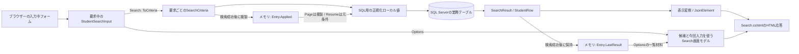

この図のメモリはアプリケーションプロセス内の保持領域である。認証セッションは利用者の所有照合に使う識別値であり、検索条件を保存するセッションストレージではない。編集スナップショットと成功通知は検索Entryとは別の辞書に保持する。根拠: `sources/Infrastructure/RequestIdentity.cs:7-13`、`sources/Infrastructure/SearchContextStore.cs:9-15`、`sources/Infrastructure/EditorSnapshotStore.cs:7-11`、`sources/Infrastructure/FlashMessageStore.cs:6-9`。

### 画面設計

原本の配置は、共通ヘッダー、見出しとメッセージ、検索条件、検索・候補更新、クリア・新規登録、結果状態、表示指定、一覧、前後ページ操作の順である。条件は通常2列、幅760px以下では1列になる。一覧は最小幅1050pxの表を横スクロール領域に置く。メッセージは `aria-live=polite` を指定する。根拠: `sources/Views/Students/Search.cshtml:3-8`、`sources/Views/Shared/_Layout.cshtml:1-1`、`sources/Views/Shared/_MessagePanel.cshtml:2-3`、`sources/wwwroot/css/site.css:1-1`。

以下はソースの項目と配置を反映した静的HTML/CSSであり、実画面撮影ではない。未検索・Viewerの構成を示す。在籍区分の名称はseed定義を例示し、年度・学年・クラス・都道府県の実候補は動的取得欄として先頭の「すべて」だけを示す。Staff・Administratorではクリアの横に新規登録リンクが加わり、結果行の操作名は編集になる。未所属がtrueでサーバー再描画された場合は年度・学年・クラスが非活性になる。根拠: `sources/Views/Students/Search.cshtml:5-8`、`sources/database/002_seed.sql:19-22`。

<style>
.ss-screen{font:14px Meiryo,'Yu Gothic UI',sans-serif;color:#243448;background:#f2f5f9;padding:12px}.ss-screen *{box-sizing:border-box}.ss-screen header{background:#153654;color:white;padding:16px 28px;display:flex;justify-content:space-between;gap:20px}.ss-screen main{background:white;max-width:1440px;margin:24px auto;padding:24px}.ss-screen h1{font-size:24px}.ss-screen fieldset{border:1px solid #c8d1dc;padding:18px;margin:12px 0}.ss-screen legend{font-weight:bold}.ss-screen .fields{display:grid;grid-template-columns:1fr 1fr;gap:14px 28px}.ss-screen label{display:flex;flex-direction:column;gap:5px}.ss-screen input,.ss-screen select,.ss-screen button{font:inherit;padding:8px;border:1px solid #afbece;border-radius:3px}.ss-screen input,.ss-screen select{width:100%;max-width:100%}.ss-screen .check{display:inline-flex;flex-direction:row;align-items:center;margin-right:12px}.ss-screen .check input{width:auto}.ss-screen .actions{display:flex;gap:10px;align-items:center;flex-wrap:wrap;margin:16px 0}.ss-screen button{background:white}.ss-screen .primary{background:#1c5985;color:white}.ss-screen button:disabled{color:#8a98a5;background:#f3f5f8}.ss-screen .grid{overflow-x:auto}.ss-screen table{border-collapse:collapse;min-width:1050px;width:100%;font-size:12px}.ss-screen th,.ss-screen td{padding:10px 8px;border:1px solid #d4dee8;vertical-align:top}.ss-screen th{background:#e6eef6}.ss-screen .pager{display:flex;gap:14px;justify-content:center;align-items:center;margin:18px}.ss-screen small{color:#5f7183}@media(max-width:760px){.ss-screen .fields{grid-template-columns:1fr}.ss-screen header{flex-direction:column}.ss-screen main{margin:0;padding:15px}}
</style>
<div class="ss-screen">
<header><strong>学生管理システム</strong><span>利用者名・業務日の表示領域</span></header>
<main>
<h1>学生検索</h1>
<div aria-live="polite"></div>
<fieldset><legend>検索条件</legend>
<div class="fields">
<label>学籍番号<input id="SRC-001" name="Criteria.StudentNo" maxlength="30"></label>
<label>氏名<input id="SRC-002" name="Criteria.Name" maxlength="16"></label>
<label>氏名カナ<input id="SRC-003" name="Criteria.Kana" maxlength="72"></label>
<label>年度<select id="SRC-004" name="Criteria.SchoolYear"><option value="">すべて</option></select></label>
<label>学年<select id="SRC-005" name="Criteria.GradeCode"><option value="">すべて</option></select></label>
<label>クラス<select id="SRC-006" name="Criteria.ClassId"><option value="">すべて</option></select></label>
<label class="check"><input id="SRC-007" name="Criteria.UnassignedOnly" type="checkbox">未所属のみ</label>
<fieldset><legend>在籍区分</legend>
<label class="check"><input name="Criteria.StatusCodes" type="checkbox" value="01" checked>在学</label>
<label class="check"><input name="Criteria.StatusCodes" type="checkbox" value="02" checked>休学</label>
<label class="check"><input name="Criteria.StatusCodes" type="checkbox" value="03">卒業</label>
<label class="check"><input name="Criteria.StatusCodes" type="checkbox" value="04">退学</label>
<small>全解除はすべて</small></fieldset>
<label>都道府県<select id="SRC-009" name="Criteria.PrefectureCode"><option value="">すべて</option></select></label>
<label>電話番号<input id="SRC-010" name="Criteria.PhoneNumber" maxlength="40"></label>
<label>入学日・開始<input id="SRC-011" name="Criteria.AdmissionFrom" type="date"></label>
<label>入学日・終了<input id="SRC-012" name="Criteria.AdmissionTo" type="date"></label>
</div>
<div class="actions"><button type="button" class="primary">検索</button><button type="button">候補を更新</button></div>
</fieldset>
<div class="actions"><button type="button">クリア</button></div>
<p>未検索</p>
<div class="actions">
<label>表示件数<select name="PageSize"><option selected>20</option><option>50</option><option>100</option></select></label>
<label>並び順<select name="SortKey"><option value="studentNo" selected>学籍番号</option><option value="name">氏名</option><option value="admissionDate">入学日</option><option value="updatedAt">更新日時</option></select></label>
<select name="SortDirection" aria-label="並び順方向"><option value="asc" selected>昇順</option><option value="desc">降順</option></select>
<button type="button" disabled>並び順・件数を反映</button>
</div>
<div class="grid"><table><thead><tr><th>学籍番号</th><th>氏名</th><th>氏名カナ</th><th>生年月日</th><th>年度／学年</th><th>クラス</th><th>在籍区分</th><th>住所</th><th>本人電話</th><th>更新日時</th><th>操作</th></tr></thead><tbody></tbody></table></div>
<nav class="pager"><button type="button" disabled>前へ</button><span>1 / 1</span><button type="button" disabled>次へ</button></nav>
</main>
</div>

実フォームは検索条件、クリア、ページ操作の3つに分かれ、それぞれ偽造防止情報を持つ。検索フォームの表示指定はhiddenであり、ページフォームのselectとは別の値である。ページ側のselectを変更しただけでは検索フォームのhiddenに移されない。表示指定を確定する操作は「並び順・件数を反映」またはページフォームの送信である。根拠: `sources/Views/Students/Search.cshtml:4-8`、`sources/wwwroot/js/site.js:2-9`。

## 項目一覧

| 項目キー | 論理項目 | 実コントロール・フォーム名 | 受信型 → 検索条件 | 初期値・状態 | 検査・検索対象 | 根拠 |
| --- | --- | --- | --- | --- | --- | --- |
| SRC-001 | 学籍番号 | input、id=SRC-001、Criteria.StudentNo、maxlength=30 | StudentSearchInput.StudentNo:string → SearchCriteria.StudentNo:string? | 空。null・空文字は条件なし | raw15スカラー値以内。Trim・NFKC・大文字化後15以内、先頭英数字、以降英数字・ハイフン。student_no前方一致。空白だけは拒否 | sources/Views/Students/Search.cshtml:5-5、sources/Web/Inputs/StudentSearchInput.cs:7-7,19-22、sources/Core/StudentNormalizer.cs:47-64、sources/Core/SqlServerStudentService.cs:113-113,140-140 |
| SRC-002 | 氏名 | input、id=SRC-002、Criteria.Name、maxlength=16 | Name:string → StudentName:string? | 空。Trim後空は条件なし | raw・Trim後8スカラー値以内。NameKeyでNFKC・大文字化・Unicode空白除去、最大160スカラー値。name_key部分一致 | sources/Views/Students/Search.cshtml:5-5、sources/Web/Inputs/StudentSearchInput.cs:8-8,19-19、sources/Core/StudentNormalizer.cs:47-70、sources/Core/SqlServerStudentService.cs:114-115,141-141 |
| SRC-003 | 氏名カナ | input、id=SRC-003、Criteria.Kana、maxlength=72 | Kana:string → StudentNameKana:string? | 空。null・空文字は条件なし | raw・Trim後36スカラー値以内。NFKC、ひらがな変換、内部空白統合、許可文字検査後18以内。半角空白除去後kana_key部分一致。空白だけの非空入力は空キー条件になる | sources/Views/Students/Search.cshtml:5-5、sources/Web/Inputs/StudentSearchInput.cs:9-9,19-19、sources/Core/StudentNormalizer.cs:72-85、sources/Core/SqlServerStudentService.cs:116-116,142-142 |
| SRC-004 | 年度 | select、id=SRC-004、Criteria.SchoolYear | SchoolYear:int? → SchoolYear:int? | すべて=null。未所属trueの再描画では非活性 | 1900～9998。m_classに年度が存在することを確認し、c.school_year完全一致 | sources/Views/Students/Search.cshtml:5-5、sources/Web/Inputs/StudentSearchInput.cs:10-10,20-20、sources/Core/SqlServerStudentService.cs:109-109,126-129,143-143 |
| SRC-005 | 学年 | select、id=SRC-005、Criteria.GradeCode | GradeCode:string? → GradeCode:string? | すべて=null。未所属trueの再描画では非活性 | raw2スカラー値以内、Trim・NFKC後ASCII数字2桁。GRADE存在確認、c.grade_code完全一致。00は学年なしで、未所属とは異なる | sources/Views/Students/Search.cshtml:5-5、sources/Core/StudentNormalizer.cs:113-117、sources/Core/SqlServerStudentService.cs:118-125,144-144、sources/database/002_seed.sql:78-84 |
| SRC-006 | クラス | select、id=SRC-006、Criteria.ClassId | ClassId:string? → IdParser.Optional → ClassId:long? | すべて=null。未所属trueの再描画では非活性 | 非空は19コード単位以下のASCII数字、正のInt64。Trim・NFKCなし。存在と指定年度・学年の一致を確認し、s.class_id完全一致 | sources/Views/Students/Search.cshtml:5-5、sources/Web/Inputs/StudentSearchInput.cs:12-12,20-20、sources/Web/Inputs/StudentSaveInput.cs:57-60、sources/Core/SqlServerStudentService.cs:131-145 |
| SRC-007 | 未所属のみ | checkbox、id=SRC-007、Criteria.UnassignedOnly | UnassignedOnly:bool → UnassignedOnly:bool | false。ON時は所属3項目を解除 | trueならs.class_id IS NULL。サービスへ年度・学年・クラスの非null指定も渡るとE-SRC-001 | sources/Views/Students/Search.cshtml:5-5、sources/wwwroot/js/site.js:7-7、sources/Core/SqlServerStudentService.cs:110-110,146-146 |
| 在籍区分群 | 在籍区分 | 同名checkbox群、Criteria.StatusCodes。実HTMLにid=SRC-008はない | StatusCodes:string[] → EnrollmentStatusCodes:string[] | 01・02。全解除は空配列で全区分 | 最大4件、Ordinal重複なし、01・02・03・04のみ。NFKC・マスター存在確認なし。非空配列をIN条件にする | sources/Views/Students/Search.cshtml:5-5、sources/Web/Inputs/StudentSearchInput.cs:14-14,21-21、sources/Web/Controllers/StudentsController.cs:14-14,22-22、sources/Core/SqlServerStudentService.cs:111-112,151-154 |
| SRC-009 | 都道府県 | select、id=SRC-009、Criteria.PrefectureCode | PrefectureCode:string? → PrefectureCode:string? | すべて=null | raw2スカラー値以内、Trim・NFKC後ASCII数字2桁。PREFECTURE存在確認、s.prefecture_code完全一致 | sources/Views/Students/Search.cshtml:5-5、sources/Core/StudentNormalizer.cs:113-117、sources/Core/SqlServerStudentService.cs:119-125,147-147 |
| SRC-010 | 電話番号 | input、id=SRC-010、Criteria.PhoneNumber、maxlength=40 | PhoneNumber:string → PhoneNumber:string? | 空。Trim後空は条件なし | raw20スカラー値以内。NFKC後に空白、指定ハイフン類、丸括弧を除去。国内0始まり10～11桁、国際+と非ゼロ始まり7～15桁。本人電話または緊急電話と完全一致 | sources/Views/Students/Search.cshtml:5-5、sources/Core/StudentNormalizer.cs:87-93、sources/Core/SqlServerStudentService.cs:117-117,148-148 |
| SRC-011 | 入学日・開始 | date input、id=SRC-011、Criteria.AdmissionFrom | AdmissionFrom:string? → AdmissionFrom:string? → from:DateOnly? | 未設定。片側指定可 | NFKC後10コード単位のyyyy-MM-dd、Trimなし。1900-01-01～業務日。s.admission_date以上条件の下端、当日を含む | sources/Views/Students/Search.cshtml:5-5、sources/Web/Inputs/StudentSearchInput.cs:17-17,22-22、sources/Core/JapaneseDateService.cs:52-59、sources/Core/SqlServerStudentService.cs:120-122,149-149 |
| SRC-012 | 入学日・終了 | date input、id=SRC-012、Criteria.AdmissionTo | AdmissionTo:string? → AdmissionTo:string? → to:DateOnly? | 未設定。片側指定可 | 開始と同じ形式・範囲。両側指定では開始≦終了。s.admission_date以下条件の上端、当日を含む | sources/Views/Students/Search.cshtml:5-5、sources/Web/Inputs/StudentSearchInput.cs:18-18,22-22、sources/Core/JapaneseDateService.cs:52-59、sources/Core/SqlServerStudentService.cs:121-122,150-150 |
| 検索操作 | 検索 | 検索フォームのsubmit、POST /students/search | StudentSearchInputと状態・表示指定 → SearchRequest | 未検索でも操作可 | 今回条件をPage=1で検索。成功後だけAppliedを更新 | sources/Views/Students/Search.cshtml:4-5、sources/Web/Controllers/StudentsController.cs:13-16、sources/Infrastructure/WebStudentCoordinator.cs:7-9 |
| 候補更新操作 | 候補を更新 | 同じ検索フォームのsubmit、formaction=/students/options | StudentSearchInputと状態識別 | 未検索でも操作可 | 今回入力に合わせて候補を再描画。学生検索、Applied更新、版更新なし | sources/Views/Students/Search.cshtml:5-5、sources/Web/Controllers/StudentsController.cs:22-22 |
| クリア操作 | クリア | 独立フォーム、POST /students/clear | ContextRequestとTabId | 認証・状態照合後に操作 | Applied・LastResult消去、版を進め、条件と表示指定を初期値へ戻す | sources/Views/Students/Search.cshtml:6-6、sources/Web/Controllers/StudentsController.cs:21-21、sources/Infrastructure/WebStudentCoordinator.cs:15-15 |
| 新規登録操作 | 新規登録 | /students/new?returnContextId=状態ID | 復帰状態ID | Viewerには表示しない | Staff・Administratorの新規入口へ遷移。検索条件を登録値へ転記しない | sources/Views/Students/Search.cshtml:6-6、sources/Web/Controllers/StudentsController.cs:23-25、sources/Infrastructure/WebStudentCoordinator.cs:17-17 |
| 表示件数指定 | 表示件数 | ページフォームのselect、PageSize。検索フォームには同名hidden | PageRequest.PageSize:int / Searchのint引数 → PageSize:int | 20、候補20・50・100 | 成功済み条件の表示指定変更は1ページへ戻す。select変更だけでは検索フォームhiddenへ移送しない | sources/Views/Students/Search.cshtml:4-4,8-8、sources/Web/Inputs/StudentSearchInput.cs:29-29、sources/Infrastructure/WebStudentCoordinator.cs:12-12、sources/wwwroot/js/site.js:2-9 |
| 並び順指定 | 並び順 | ページフォームのselect、SortKey。検索フォームには同名hidden | string → SortKey:string | studentNo | studentNo・name・admissionDate・updatedAtのみ。変更時は1ページ | sources/Views/Students/Search.cshtml:4-4,8-8、sources/Core/SqlServerStudentService.cs:108-108、sources/Infrastructure/WebStudentCoordinator.cs:12-12 |
| 方向指定 | 並び順方向 | ページフォームのselect、SortDirection。検索フォームには同名hidden | string → SortDirection:string | asc | 小文字asc・descのみ。変更時は1ページ | sources/Views/Students/Search.cshtml:4-4,8-8、sources/Core/SqlServerStudentService.cs:107-107、sources/Infrastructure/WebStudentCoordinator.cs:12-12 |
| 表示指定反映 | 並び順・件数を反映 | ページフォームのbutton、name=Page、value=1 | PageRequest | found以外は非活性 | Appliedを使って再検索し、表示指定と結果を確定 | sources/Views/Students/Search.cshtml:8-8、sources/Infrastructure/WebStudentCoordinator.cs:11-12 |
| 前ページ操作 | 前へ | ページフォームのbutton、name=Page、value=表示page-1 | PageRequest.Page:int | foundかつpage>1で活性 | 表示指定が変わっていれば1ページ、それ以外は要求ページ | sources/Views/Students/Search.cshtml:8-8、sources/Infrastructure/WebStudentCoordinator.cs:12-12 |
| 次ページ操作 | 次へ | ページフォームのbutton、name=Page、value=表示page+1 | PageRequest.Page:int | foundかつpage×PageSize<countで活性 | 表示指定が変わっていれば1ページ。それ以外は要求ページを使用し、最終ページ補正を行う | sources/Views/Students/Search.cshtml:8-8、sources/Infrastructure/WebStudentCoordinator.cs:12-12 |
| 行操作 | 編集・参照 | /students/{studentId}?returnContextId=状態ID | ルートlong id、復帰状態ID | Viewerは参照、Staff・Administratorは編集 | 行番号を使わずStudentIdで最新非削除行を再取得。未存在は404 | sources/Views/Students/Search.cshtml:8-8、sources/Web/Controllers/StudentsController.cs:24-25、sources/Core/SqlServerStudentService.cs:172-181 |

## 選択候補一覧

| 候補キー | 対象 | 取得元・抽出条件 | 順序 | 送信キー・表示名 | 初期選択 | 連動・保持・解除 | 停止・期間・0件時 | 根拠 |
| --- | --- | --- | --- | --- | --- | --- | --- | --- |
| 年度候補 | SRC-004 | LookupSet.ClassesのSchoolYearを重複排除。SQLはm_class全件 | SchoolYear降順 | 年度整数・同じ年度文字列 | 空値のすべて | 学年によって年度候補を絞る処理はない。未所属ONで値を解除 | 停止・期間外クラスも年度生成元。0件でもすべてを残す | sources/Views/Students/Search.cshtml:5-5、sources/Core/SqlServerStudentService.cs:206-214 |
| 学年候補 | SRC-005 | m_code INNER JOIN m_code_categoryの結果からCategoryId=GRADE | SQLのcategory_id、display_order、code_valueの順序を維持 | CodeValue・CodeName | 空値のすべて | 年度で学年候補を絞らない。年度・学年変更後の不適合クラス解除は明示Optionsで行う | IsActive・期間で選択不可にしない。0件でもすべてを残す | sources/Views/Students/Search.cshtml:5-5、sources/Web/Controllers/StudentsController.cs:22-22、sources/Core/SqlServerStudentService.cs:203-212 |
| クラス候補 | SRC-006 | m_class全件を取得し、Razorで今回年度・学年に一致するものを表示。上位未指定ならその条件を省略 | school_year DESC、学年コードのdisplay_order、クラスdisplay_order、class_code、class_id | ClassId・年度 クラスコード クラス名。IsActive=falseなら（停止） | 空値のすべて | OptionsでClassId文字列とIDのToString、および今回上位条件を比較。不適合ならnullへ戻しModelStateも除去。クラスから上位条件の補完はしない | 停止・期間外も取得・選択可能。停止注記だけ表示し、期間外注記はない。人数は集計せずOccupied=0を設定 | sources/Views/Students/Search.cshtml:5-5、sources/Web/Controllers/StudentsController.cs:22-22、sources/Core/SqlServerStudentService.cs:201-214 |
| 在籍区分候補 | 在籍区分群 | コード取得結果からCategoryId=ENROLLMENT_STATUS | display_order、code_value | CodeValue・CodeName | 01・02が候補にある場合にチェック | 同名複数値で送信。キー自体がなければControllerが空配列へ置換。未所属ONでもチェックを解除しない | 停止・期間で制限しない。候補0件なら次のPOSTは全区分条件になる。サービスは01～04だけを許す | sources/Views/Students/Search.cshtml:5-5、sources/Web/Controllers/StudentsController.cs:14-14,22-22、sources/Core/SqlServerStudentService.cs:111-112,203-212 |
| 都道府県候補 | SRC-009 | コード取得結果からCategoryId=PREFECTURE | display_order、code_value | CodeValue・CodeName | 空値のすべて | 所属条件との連動なし | 停止・期間で制限しない。0件でもすべてを残す | sources/Views/Students/Search.cshtml:5-5、sources/Core/SqlServerStudentService.cs:203-212 |

## 内部項目一覧

| 内部項目キー | 論理的な役割 | 実名・型 | 保持領域・受渡し | 初期値・更新条件 | 根拠 |
| --- | --- | --- | --- | --- | --- |
| 状態ID | 検索画面の状態を識別 | Entry.Id:string、ContextId:string | プロセスメモリの辞書キー、各フォームhidden、復帰URL | 32バイト乱数を64桁小文字hexへ符号化して発行。条件文字列を含めない | sources/Infrastructure/SearchContextStore.cs:9-12、sources/Views/Students/Search.cshtml:4-8 |
| 所有者 | 状態の利用者照合 | Entry.Owner:string、CurrentUser.Principal:string | メモリ。認証NameIdentifierから取得 | 作成時に固定。Getで現在主体と比較 | sources/Infrastructure/RequestIdentity.cs:7-10、sources/Infrastructure/SearchContextStore.cs:9-13 |
| 認証セッション | 同一ログインの照合 | Entry.Session:string、CurrentUser.SessionId:string | メモリ。login_session claimから取得 | 作成時に固定。Getで現在セッションと比較 | sources/Infrastructure/RequestIdentity.cs:9-10、sources/Infrastructure/SearchContextStore.cs:9-13 |
| タブID | 指定された画面識別の照合 | Entry.Tab:string、フォームTabId:string | メモリとhidden | 新規未指定時は状態IDと同じ形式の別乱数。Getは引数が非空の場合だけ比較 | sources/Infrastructure/SearchContextStore.cs:9-14、sources/Views/Students/Search.cshtml:4-8 |
| 有効期限 | 検索状態の期限 | Entry.Expires:DateTimeOffset | プロセスメモリ | 作成時UTC現在+30分。Useのoperationが正常終了した場合だけ再延長。OptionsのGetでは延長しない | sources/Infrastructure/SearchContextStore.cs:9-14 |
| 状態版 | 同一状態への古い要求を拒否 | Entry.Revision:long、ContextRevision:string | メモリ、hidden、復帰URL、内部提示データ | 初期1。成功Search・Page・検索済みResume・Clearで+1。期待値はInvariantCulture文字列と完全一致 | sources/Infrastructure/SearchContextStore.cs:9-14、sources/Infrastructure/WebStudentCoordinator.cs:9-15,21-21 |
| 状態排他 | 同一Entryの更新を直列化 | Entry.Gate:SemaphoreSlim(1,1) | プロセスメモリ | UseでWaitAsync(ct)、取得後に所有・期限・版を再確認しfinallyで解放 | sources/Infrastructure/SearchContextStore.cs:9-14 |
| 入力中条件 | 今回フォームの値 | StudentSearchInput、StudentSearchPageModel.Criteria | ブラウザーと要求・画面モデル | OptionsとSearchは今回入力を使う。サーバーDraft専用保存領域なし | sources/Web/Models/StudentSearchPageModel.cs:6-10、sources/Web/Controllers/StudentsController.cs:13-22 |
| 成功済み条件 | 最後の検索条件と表示指定 | Entry.Applied:SearchCriteria? | プロセスメモリ | 初期null。成功Search・PageでJSON深い複製を保存。Resumeでは置換しない。Clearでnull | sources/Infrastructure/SearchContextStore.cs:9-15、sources/Infrastructure/WebStudentCoordinator.cs:9-15 |
| 最後の結果 | 成功した件数・行・検索日時 | Entry.LastResult:SearchResult? | プロセスメモリ | 初期null。成功Search・Page・検索済みResumeで設定。局所検証失敗では消去せず、Clearでnull | sources/Infrastructure/WebStudentCoordinator.cs:9-15、sources/Web/Controllers/StudentsController.cs:14-22 |
| SQL照合値 | DBへ渡す検査済み値 | no/name/kana/phone/grade/prefecture:string?、from/to:DateOnly? | SearchAsyncのローカル変数 | 要求ごとに生成。入力Criteriaの文字列を書き換えず、専用永続領域に保存しない | sources/Core/SqlServerStudentService.cs:113-122,140-150 |
| 検索結果 | サービスの戻り値 | SearchResult(Outcome,int Count,IReadOnlyList<StudentRow> Items,DateTimeOffset SearchedAt,bool LimitExceeded,Errors) | サービス→Coordinator | 通常・0件・超過はNoChange。入力不正はValidationFailed。超過Count=10001は検出値 | sources/Core/Contracts.cs:57-58、sources/Core/SqlServerStudentService.cs:156-170 |
| HTML生成材料 | 表示状態・行・ページ情報 | StudentSearchPageModel.Data:JsonElement | Controller→Search.cshtml | Presentの匿名オブジェクトをWeb既定JSON設定で変換。公開検索JSON APIの応答ではない | sources/Web/Models/StudentSearchPageModel.cs:10-15、sources/Infrastructure/WebStudentCoordinator.cs:21-21、sources/Views/Students/Search.cshtml:2-2 |
| 編集復帰版 | 編集開始時の検索状態版 | ReturnRevision:string?、Snapshot.ReturnRevision:string? | 登録画面モデルと別メモリの編集スナップショット | Load時の現在Revisionを記録。戻るリンク・保存成功後の303に使い、最新版へ補完しない | sources/Web/Controllers/StudentsController.cs:25-25,38-38、sources/Infrastructure/EditorSnapshotStore.cs:7-11、sources/Views/Students/Edit.cshtml:16-16 |
| 学生行版 | 保存・削除の比較版 | StudentRow.RowVersion:long、StudentDetail.RowVersion:long、ExpectedVersion:string? | DB行・登録画面。検索状態版とは別 | 検索一覧の表示JSONには出力しない。登録入口で最新行を再取得してExpectedVersionを作る | sources/Core/Contracts.cs:50-59、sources/Infrastructure/WebPresentation.cs:20-20、sources/Web/Inputs/StudentSaveInput.cs:54-54 |
| 成功通知 | 保存確定後の一度だけの通知 | FlashMessageStoreのMessage:stringとExpires | 検索Entryとは別のプロセスメモリ | 主体・セッション・状態IDで照合、10分。Takeは辞書から削除して取得 | sources/Infrastructure/FlashMessageStore.cs:6-9、sources/Web/Controllers/StudentsController.cs:11-11,38-38 |

## 項目移送仕様

| 移送キー | 取得元・型 | 移送先 | 変換・表示先 | NULL・非表示の扱い | 根拠 |
| --- | --- | --- | --- | --- | --- |
| 行ID移送 | s.student_id:bigint | StudentRow.StudentId:long → studentId:string | InvariantCultureの10進文字列。行リンクの対象ID | 一覧表示列には出さない。行番号で代用しない | sources/Core/SqlServerStudentService.cs:77-85、sources/Core/Contracts.cs:50-50、sources/Infrastructure/WebPresentation.cs:20-20、sources/Views/Students/Search.cshtml:8-8 |
| 番号移送 | s.student_no:varchar(15) | StudentRow.StudentNo:string → studentNo | 学籍番号列に保存文字列を表示 | 照合パターンを表示しない | sources/database/001_schema.sql:9-9、sources/Core/SqlServerStudentService.cs:78-83、sources/Views/Students/Search.cshtml:8-8 |
| 氏名移送 | s.student_name:nvarchar(16) | StudentRow.StudentName:string → studentName | 氏名列に登録表記を表示 | name_keyを表示しない | sources/database/001_schema.sql:10-10、sources/Core/SqlServerStudentService.cs:78-83、sources/Infrastructure/WebPresentation.cs:20-20 |
| カナ移送 | s.student_name_kana:nvarchar(36) | StudentRow.StudentNameKana:string → studentNameKana | 氏名カナ列に保存表記を表示 | kana_keyを表示しない | sources/database/001_schema.sql:11-11、sources/Core/SqlServerStudentService.cs:78-83、sources/Infrastructure/WebPresentation.cs:20-20 |
| 生年月日移送 | s.birth_date:date | StudentRow.BirthDate:DateOnly → BirthDateWareki → birthDateWareki | 明示元号境界で和暦文字列へ変換し生年月日列に表示。元年は元 | 生年月日に時差を加えない。内部BirthDateはJSONへ直接出さない | sources/Core/SqlServerStudentService.cs:76-83、sources/Core/Contracts.cs:51-55、sources/Core/JapaneseDateService.cs:9-16,41-50、sources/Infrastructure/WebPresentation.cs:20-20 |
| 年度移送 | c.school_year:smallint、LEFT JOIN結果はNULL可 | StudentRow.SchoolYear:int? → schoolYear | 年度／学年列の年度部分 | 未所属時などのNULLをそのまま描画。一律の－補完なし | sources/database/001_schema.sql:64-64、sources/Core/SqlServerStudentService.cs:79-84、sources/Views/Students/Search.cshtml:8-8 |
| 学年名移送 | g.code_name:nvarchar(24)、別名grade_name | StudentRow.GradeName:string? → gradeName | 年度／学年列の学年部分 | 結合欠落時はnullable値のまま。学年コードを名称の代わりに補わない | sources/Core/SqlServerStudentService.cs:79-88、sources/Infrastructure/WebPresentation.cs:20-20、sources/Views/Students/Search.cshtml:8-8 |
| クラスコード移送 | c.class_code:varchar(9) | StudentRow.ClassCode:string? → classCode | クラス列のコード部分 | NULLをそのまま描画 | sources/database/001_schema.sql:67-67、sources/Core/SqlServerStudentService.cs:79-87、sources/Views/Students/Search.cshtml:8-8 |
| クラス名移送 | c.class_name:nvarchar(36) | StudentRow.ClassName:string? → className | クラス列の名称部分 | NULL補完、停止・期間外注記なし。一覧SQLはその状態を取得しない | sources/database/001_schema.sql:68-68、sources/Core/SqlServerStudentService.cs:79-90、sources/Views/Students/Search.cshtml:8-8 |
| 在籍名移送 | e.code_name、別名status_name | StudentRow.EnrollmentStatusName:string? → enrollmentName | 在籍区分列に名称を表示 | 名称欠落でも学生行は残り、名称はnullable値のまま | sources/Core/SqlServerStudentService.cs:80-89、sources/Infrastructure/WebPresentation.cs:20-20、sources/Views/Students/Search.cshtml:8-8 |
| 住所移送 | p.code_name、別名prefecture_name + s.address_line1:nvarchar(90) | StudentRow.Address:string → addressDisplay | 区切り文字を追加せず都道府県名と住所1を連結 | 都道府県名欠落時だけ[不整合]を補う。住所2は取得しない | sources/Core/SqlServerStudentService.cs:80-90、sources/Infrastructure/WebPresentation.cs:20-20 |
| 本人電話移送 | s.phone_number:varchar(16) NULL可 | StudentRow.PhoneNumber:string? → phoneNumber | 本人電話列 | NULLは－。緊急電話に一致した検索でも表示は本人電話だけ | sources/Core/SqlServerStudentService.cs:80-85,148-148、sources/Infrastructure/WebPresentation.cs:20-20、sources/Views/Students/Search.cshtml:8-8 |
| 入学日内部移送 | s.admission_date:date | StudentRow.AdmissionDate:DateOnly | 行DTO内に保持 | 一覧JSONと表示列へ直接出力しない。検索条件とソートには使用 | sources/Core/Contracts.cs:52-53、sources/Core/SqlServerStudentService.cs:80-85,108-108、sources/Infrastructure/WebPresentation.cs:20-20 |
| 更新日時移送 | s.updated_at:datetimeoffset(7) | StudentRow.UpdatedAt:DateTimeOffset → updatedAt:string | +09:00へ変換しyyyy/MM/dd HH:mm:ssで表示 | DBの日時型と画面文字列を区別 | sources/database/001_schema.sql:40-40、sources/Core/SqlServerStudentService.cs:81-85、sources/Infrastructure/WebPresentation.cs:7-7,20-20 |
| 行版内部移送 | s.row_version:bigint | StudentRow.RowVersion:long | 行DTO内に保持 | 一覧JSONへ直接出力しない。SQL Serverのrowversion型ではなくbigint列 | sources/database/001_schema.sql:42-42、sources/Core/SqlServerStudentService.cs:81-85、sources/Infrastructure/WebPresentation.cs:20-20 |
| 結果状態移送 | SearchResult?、Count、LimitExceeded、SearchedAt | Present → outcome、totalCount、items、searchedAt | 結果なし=unsearched、超過=tooMany、0件=empty、その他=found | 未検索・超過のtotalCountはnull。超過検出値10001を全件数として表示しない | sources/Infrastructure/WebStudentCoordinator.cs:21-21、sources/Views/Students/Search.cshtml:2-2,7-8 |
| 成功条件復元 | Entry.Applied:SearchCriteria | Controller.From → StudentSearchInput | StudentName→Name、StudentNameKana→Kana、EnrollmentStatusCodes→StatusCodes。ClassIdを10進文字列へ戻す | StudentNo・氏名・カナ・電話のnullは空文字。Page・表示指定はCriteriaへ混入せず別画面プロパティ | sources/Web/Controllers/StudentsController.cs:39-40 |
| 状態識別移送 | Entry.Id、Revision、Tab | 検索・クリア・ページフォームhidden | ContextId・ContextRevision・TabIdとして送信 | ContextRevisionは数値解析せず文字列比較。Index/ResumeはTabを渡さない | sources/Views/Students/Search.cshtml:4-8、sources/Infrastructure/SearchContextStore.cs:13-14、sources/Web/Controllers/StudentsController.cs:8-10 |

## イベント仕様

### 共通の受付条件

検索系の各POSTは、Controllerへ進む前に偽造防止検査の対象となる。各フォームには `AntiForgeryToken` を出力し、起動設定は `AutoValidateAntiforgeryToken` を全Controllerに登録する。非nullable参照型の暗黙Requiredは抑制されているため、文字入力の必須・形式判定は実際のモデル状態と正規化処理を追う。フォーム値長上限は65,536、値数上限は128、multipart本文とKestrel要求本文の上限は65,536である。これらは個別項目の業務上限を拡張しない。根拠: `sources/Views/Students/Search.cshtml:4-8`、`sources/Infrastructure/WebHostSetup.cs:15-18`。

`FormGuard` は入力型の公開プロパティから許可フォーム名を生成する。検索・候補更新では `Criteria.` を付け、状態ID・版・TabId・表示指定を追加許可する。ページではPageRequest、クリアではContextRequestの項目とTabIdを許可する。許可外キー、不正な `__Invariant` 参照、通常項目の同名複数値は400になる。複数値を許すのは `__Invariant`、末尾StatusCodes、末尾UnassignedOnlyである。この検査は送信名の検査であり、状態版やTabIdを非空必須とする検査ではない。根拠: `sources/Web/Controllers/StudentsController.cs:13-22,41-41`。

認証情報はNameIdentifier、login_session、Role claimから取得する。未認証、主体・セッション未設定、主体64スカラー値超、セッション64コード単位超、RoleのEnum.TryParse失敗は401になる。`Read` はこの情報取得を確認し、Staff・Administrator限定判定は行わない。定義されたViewer・Staff・Administratorはいずれも検索操作に進める。Viewerの新規登録は画面非表示に加えサーバー入口でも403になる。根拠: `sources/Core/Contracts.cs:4-6`、`sources/Infrastructure/RequestIdentity.cs:7-15`、`sources/Infrastructure/WebStudentCoordinator.cs:17-19`。

### E01 初回表示 — Index

#### 処理概要

`GET /students` に状態IDがない場合は、新しい未検索状態を作り、コード・クラス候補だけを取得する。学生件数確認や一覧検索は行わない。状態IDがある場合はE06の復帰へ進む。根拠: `sources/Web/Controllers/StudentsController.cs:8-11`。

#### 処理手順

1. `identity.Read()` で認証情報を確認する。
2. contextIdがnullまたは空なら `NewContext()` でEntryを作成する。ID、Tab、30分の期限、Revision=1を設定し、Applied・LastResultは未設定とする。
3. `Present(entry,null)` で未検索、空一覧、件数未設定の提示データを作る。
4. `StudentSearchInput` の初期値を用意する。在籍区分は01・02、未所属false、表示指定は20件・学籍番号昇順とする。
5. `SearchModel` で `LookupAsync(false,ct)` を呼び、候補を取得してJsonElementを作る。
6. SearchビューをHTMLとして返す。候補先頭の自動選択や、候補不足による検索ボタン無効化は行わない。

根拠: `sources/Infrastructure/SearchContextStore.cs:9-12`、`sources/Web/Inputs/StudentSearchInput.cs:7-18`、`sources/Web/Controllers/StudentsController.cs:8-11,39-39`、`sources/Views/Students/Search.cshtml:5-8`。

#### 条件付き処理フロー

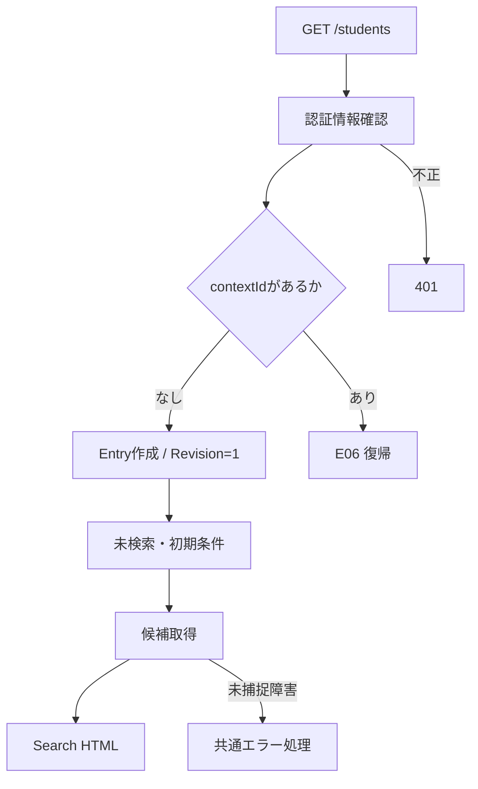

#### SQL・テーブル関連（ER図）とDB操作の詳細

使用するDB操作は後述のQ-LOOKUPだけである。`m_code` と `m_code_category` のINNER JOIN、`m_class` と学年 `m_code` のLEFT JOINを同じ候補用SNAPSHOTトランザクションで読む。関連図は「候補取得の検索関連図」、FKは「DDL上の関連図」を参照する。初回表示は学生テーブルを人数集計しない。新規EntryはConcurrentDictionaryに保持し、`t_runtime_state` を使用しない。根拠: `sources/Core/SqlServerStudentService.cs:197-216`、`sources/Infrastructure/SearchContextStore.cs:9-12`。

#### 結果・例外時の扱い

成功時は未検索表示と空のtbodyを返し、ページ操作を非活性にする。候補0件でも検索ボタンを止める実装分岐はない。候補障害はIndexで捕捉せず、応答開始前なら共通エラーHTMLへ進む。作成済みEntryを候補障害に合わせて取り消す処理はない。根拠: `sources/Views/Students/Search.cshtml:5-8`、`sources/Web/Controllers/StudentsController.cs:8-11`、`sources/Infrastructure/WebHostSetup.cs:23-23`。

### E02 検索 — Search

#### 処理概要

`POST /students/search` は今回の入力を検査し、状態の期待版を照合したうえで1ページ目を検索する。入力不正と旧版拒否では今回入力を再表示し、応答一覧を空にする。正常、0件、上限超過はいずれも成功済み検索条件として確定する。根拠: `sources/Web/Controllers/StudentsController.cs:13-16`、`sources/Infrastructure/WebStudentCoordinator.cs:7-9`。

#### 処理手順

1. `FormGuard` でCriteriaと許可された制御項目を検査する。在籍区分キーがない場合はStatusCodesを空配列にする。
2. `contexts.Get` で状態の存在・期限・所有者・認証セッションと、非空TabIdが指定されている場合のタブ一致を確認する。このGetは局所tryの外である。
3. 空一覧用に `Present(entry,null)` を作る。ModelStateが不正なら422にし、Coordinatorを呼ばず手順9へ進む。
4. Coordinatorで認証情報を確認し、`ToCriteria` で入力を移す。ClassIdを変換し、Page=1と今回の表示指定を設定する。この変換はGate取得前に行う。
5. `Use` でGateを取得し、取得後に所有・期限を再確認する。ContextRevisionが現在版の10進文字列と完全一致しなければ409にする。版上限も409にする。
6. `SearchAsync` で表示指定、所属条件、在籍区分、各入力の形式・上限・日付を検査する。Q-EXISTS、Q-COUNT、必要な場合のQ-PAGEを実行する。
7. `EnsureSearch` がSavedまたはNoChangeを認めた後にだけ、Criteriaの深い複製をAppliedへ保存し、LastResultを設定し、Revisionを1進める。SQLサービスの正常・0件・超過はNoChangeである。
8. operationが正常終了するとUseが期限を現在時刻+30分へ延長し、Gateを解放する。
9. Controllerが今回のinputとQ-LOOKUPの候補で画面モデルを作る。Search経路ではPageSize・SortKey・SortDirectionを今回送信値で明示上書きする。
10. Searchビューを返す。Coordinator呼出し中のWebFaultはModelStateへ追加し、そのHTTP状態コードで空一覧の画面を返す。

根拠: `sources/Web/Controllers/StudentsController.cs:13-16,39-39`、`sources/Web/Inputs/StudentSearchInput.cs:19-22`、`sources/Infrastructure/SearchContextStore.cs:13-15`、`sources/Infrastructure/WebStudentCoordinator.cs:7-9,20-21`、`sources/Core/SqlServerStudentService.cs:103-170`。

#### 条件付き処理フロー

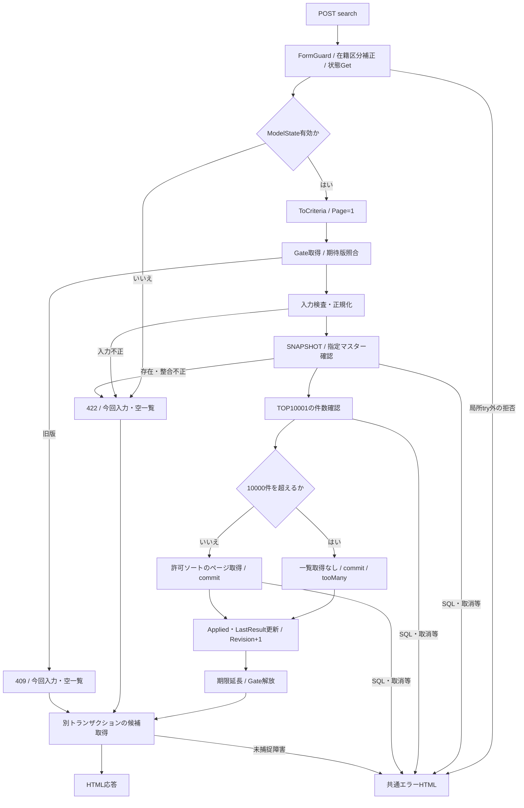

#### SQL・テーブル関連（ER図）とDB操作の詳細

Q-EXISTS、Q-COUNT、Q-PAGEは1回のSearchAsync内の同一SNAPSHOTで読む。件数は学生とクラスだけを結合し、一覧では学年・在籍・都道府県名称を追加LEFT JOINする。全WHERE述語と型付きパラメータは後述の共通DB操作に定義する。Q-LOOKUPは検索状態確定後の別接続・別トランザクションであり、候補と検索結果全体が同じDBスナップショットという保証はない。根拠: `sources/Core/SqlServerStudentService.cs:123-168,197-216`、`sources/Web/Controllers/StudentsController.cs:16-16,39-39`。

#### 結果・例外時の扱い

0件はempty、10,000件超はtooMany、その他はfoundになる。超過は一覧取得を省略する成功であり、Applied・版を更新する。ModelState不正やサービス入力不正では学生検索結果を確定せず、応答の状態は `Present(entry,null)` によるunsearchedとなる。ただし画面再構築の候補取得は行う。根拠: `sources/Core/SqlServerStudentService.cs:159-170`、`sources/Infrastructure/WebStudentCoordinator.cs:9-9,21-21`、`sources/Web/Controllers/StudentsController.cs:14-16`。

検索サービスが入力不正結果に変換する例外はInputValidationExceptionとArgumentExceptionである。EnsureSearchはErrorsの先頭1件のField・Message・CodeをWebFaultへ移す。複数エラー全件を検索Controllerへ移送する処理ではない。またFieldを `Criteria.Name` などのフォーム名へ一律に付け替える処理もないため、画面では共通のvalidation-summary Allで表示する。根拠: `sources/Core/SqlServerStudentService.cs:169-170`、`sources/Infrastructure/WebStudentCoordinator.cs:20-20`、`sources/Web/Controllers/StudentsController.cs:15-15`、`sources/Views/Shared/_MessagePanel.cshtml:2-2`。

SQL障害・取消等は入力不正結果にならず伝播する。検索成功後の候補取得や表示変換で障害が起きた場合、メモリの状態はすでに更新されている場合がある。HTTP応答失敗に合わせて旧状態へ戻す補償はない。根拠: `sources/Core/SqlServerStudentService.cs:123-170`、`sources/Infrastructure/WebStudentCoordinator.cs:9-9`、`sources/Web/Controllers/StudentsController.cs:16-16,39-39`。

### E03 候補更新 — Options

#### 処理概要

「候補を更新」は今回の入力に合う候補を再描画する。学生検索は行わず、最後の成功一覧を表示材料に使う。ContextRevisionは受信するが照合せず、検索状態版を進めない。根拠: `sources/Web/Controllers/StudentsController.cs:22-22`。

#### 処理手順

1. 検索と同じ許可フォーム検査を行い、在籍区分キーがなければ空配列へ補正する。
2. `contexts.Get` で所有・セッション・期限と、非空指定時のTabを確認する。
3. 未所属trueならSchoolYear・GradeCode・ClassIdをnullにする。各 `Criteria.*` のModelStateも除去する。
4. `Present(entry,entry.LastResult)` を作り、今回入力とQ-LOOKUPの候補で画面モデルを作る。「条件を変更しました。検索を押すと一覧に反映します。」を設定する。
5. ClassIdが非空なら、取得クラスのID文字列、指定年度、指定学年との一致を確認する。不適合ならClassIdをnullへ戻し、対応ModelStateを除去し、「上位条件に合わないクラスを解除しました。」へ通知を替える。
6. Searchビュー全体をHTMLとして返す。送信された表示指定を画面モデルへ明示反映せず、SearchModelがAppliedまたは既定値から設定する。

根拠: `sources/Web/Controllers/StudentsController.cs:22-22,39-39`。

#### 条件付き処理フロー

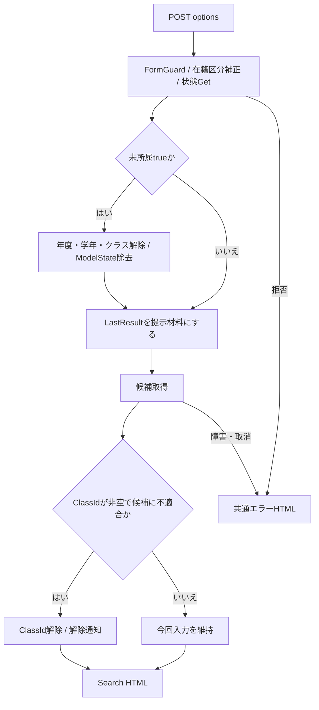

#### SQL・テーブル関連（ER図）とDB操作の詳細

Q-LOOKUPと候補取得の検索関連図を適用する。検索用クラス候補はSQLで年度・学年を絞らず、RazorとControllerが取得済みリストを比較する。学生検索、人数集計、業務DB書込みは行わない。状態GetのみでUseへ入らないため、Gate、期待版照合、期限延長も行わない。根拠: `sources/Web/Controllers/StudentsController.cs:22-22,39-39`、`sources/Core/SqlServerStudentService.cs:197-216`、`sources/Infrastructure/SearchContextStore.cs:13-14`。

#### 結果・例外時の扱い

ModelState.IsValidで処理を停止する分岐はない。検索サービスの文字正規化を呼ばずに候補を照合するため、先頭ゼロ付きClassIdは数値として同じでもIDのToStringと一致せず解除される。全角学年コードも、検索サービスでは正規化できる場合でも候補照合では一致しない場合がある。根拠: `sources/Web/Controllers/StudentsController.cs:22-22`、`sources/Web/Inputs/StudentSaveInput.cs:60-60`、`sources/Core/StudentNormalizer.cs:113-117`。

直前のSearch・Pageの局所検証失敗は応答一覧を空にするが、LastResultを消さない。その後のOptionsは最後の成功一覧を再表示し得る。OptionsはGateを使わないため、Applied・LastResult・Revisionを並行更新から一括保護して読む実装ではない。根拠: `sources/Web/Controllers/StudentsController.cs:14-22`、`sources/Infrastructure/SearchContextStore.cs:9-14`。

### E04 表示指定変更・ページ移動 — Page

#### 処理概要

`POST /students/page` は最後に成功した条件を使って再検索する。今回の検索フォームのCriteriaは送られない。表示指定が変わった場合は1ページ、変わっていない場合は要求ページを使う。根拠: `sources/Views/Students/Search.cshtml:8-8`、`sources/Infrastructure/WebStudentCoordinator.cs:11-12`。

#### 処理手順

1. PageRequestの許可項目とTabIdを検査し、最初の状態Getを行う。両処理は局所tryの外にある。
2. CoordinatorのUseでGate取得、所有・期限・期待版を確認する。Appliedがnullなら409「先に検索してください。」とする。
3. Appliedを深く複製する。PageSize・SortKey・SortDirectionのどれかが変わっていればPage=1、すべて同じならrequest.Pageを設定する。その後に今回表示指定を設定する。
4. SearchAsyncを実行し、結果をEnsureSearchで確認する。
5. 上限超過でなく、Criteria.Pageが結果件数から求めた最終ページを超えていれば、Criteria.Pageを最終ページへ補正してSearchAsyncを再実行する。
6. 成功したCriteriaと結果をApplied・LastResultへ保存し、Revisionを1進める。Use正常終了時に期限を延長してGateを解放する。
7. Controller.FromでAppliedを入力欄へ復元し、Q-LOOKUPの候補とともにHTMLを返す。

根拠: `sources/Web/Controllers/StudentsController.cs:18-19,39-40`、`sources/Infrastructure/WebStudentCoordinator.cs:11-12`、`sources/Infrastructure/SearchContextStore.cs:14-15`。

#### 条件付き処理フロー

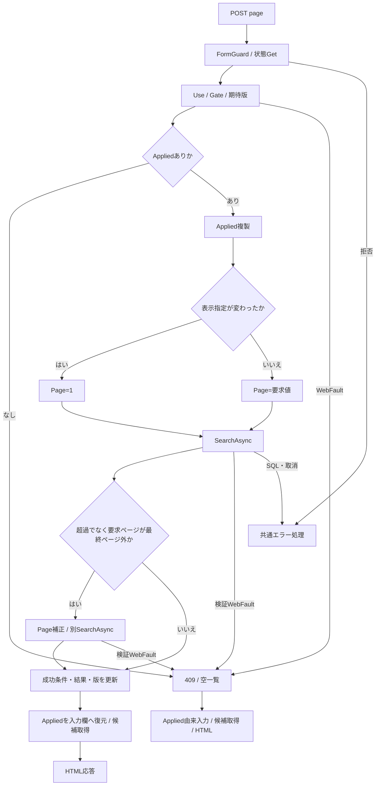

#### SQL・テーブル関連（ER図）とDB操作の詳細

Q-EXISTS、Q-COUNT、Q-PAGEと検索JOIN図を適用する。各SearchAsyncは自身のSNAPSHOTで件数・一覧を揃える。最終ページ補正のための再呼出しは別接続・別SNAPSHOTであり、2回全体を同じDBスナップショットにはしない。2回目の件数を使ってさらにCriteria.Pageを補正する処理はない。根拠: `sources/Infrastructure/WebStudentCoordinator.cs:12-12`、`sources/Core/SqlServerStudentService.cs:123-168`。

#### 結果・例外時の扱い

入力欄はAppliedから再構成するため、ブラウザーだけに存在した未実行入力は保持されない。サービスに渡るPageは1以上を要求するが、表示指定変更時はrequest.Pageを使わず1に置換してから検査する。ControllerにはModelState.IsValidによる停止分岐がない。根拠: `sources/Web/Controllers/StudentsController.cs:18-19`、`sources/Infrastructure/WebStudentCoordinator.cs:12-12`、`sources/Core/SqlServerStudentService.cs:107-108`。

局所try内のWebFaultではその状態コードを設定し、Applied由来の入力とunsearched・空一覧を返す。SQL・取消等は共通エラーへ進む。Pageのtryには成功後のSearchModel作成も含まれるため、後段でWebFaultが発生した場合の空一覧応答と、前段で検索状態を更新済みかどうかは分けて扱う。根拠: `sources/Web/Controllers/StudentsController.cs:19-19`、`sources/Infrastructure/WebStudentCoordinator.cs:12-12`。

### E05 条件クリア — Clear

#### 処理概要

`POST /students/clear` は検索状態を残したまま、成功済み条件と結果を消して未検索へ戻す。学生検索や業務DB更新は行わない。根拠: `sources/Infrastructure/WebStudentCoordinator.cs:15-15`。

#### 処理手順

1. ContextRequestとTabIdの許可フォーム検査を行う。
2. Coordinatorで認証情報を確認し、Useで所有・期限・非空指定時のTab・期待版を照合する。
3. AppliedとLastResultをnullにし、Revisionを1進め、未検索提示データを作る。
4. Use正常終了時に期限を延長しGateを解放する。
5. ControllerがModelStateを全消去し、同じ状態をGetする。
6. 新しいStudentSearchInput、20件・studentNo・asc、Q-LOOKUPの候補でSearchビューを返す。

根拠: `sources/Web/Controllers/StudentsController.cs:21-21,39-39`、`sources/Infrastructure/WebStudentCoordinator.cs:15-15`、`sources/Infrastructure/SearchContextStore.cs:14-14`。

#### 条件付き処理フロー

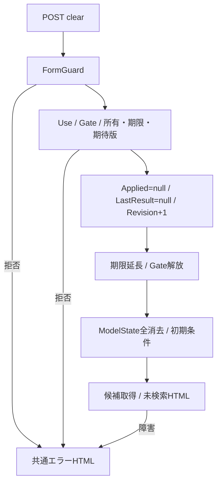

#### SQL・テーブル関連（ER図）とDB操作の詳細

条件と結果の消去対象はメモリのEntryであり、DBテーブルのDELETEではない。ER図はそのメモリ更新には適用しない。画面再構築ではQ-LOOKUPと候補取得の関連図を適用する。根拠: `sources/Infrastructure/SearchContextStore.cs:9-15`、`sources/Web/Controllers/StudentsController.cs:21-21,39-39`。

#### 結果・例外時の扱い

初期在籍区分01・02を含む初期条件へ戻す。LastResult自体を消すため、次のOptionsでも以前の成功一覧は復活しない。版照合拒否は局所捕捉せず共通エラーになる。条件消去後の候補取得障害は、消去と版更新を取り消さない。根拠: `sources/Web/Inputs/StudentSearchInput.cs:7-18`、`sources/Infrastructure/WebStudentCoordinator.cs:15-15`、`sources/Web/Controllers/StudentsController.cs:21-22`。

### E06 検索画面への復帰 — Resume

#### 処理概要

Resumeは独立したHTTPルートではない。contextId付き `GET /students` が既存状態を取得し、Coordinator.Resumeを呼ぶ。検索済みならAppliedの元条件で最新DBを再検索し、未検索なら検索しない。根拠: `sources/Web/Controllers/StudentsController.cs:8-11`、`sources/Infrastructure/WebStudentCoordinator.cs:14-14`。

#### 処理手順

1. Indexが認証確認後に既存EntryをGetする。この経路はTabを渡さない。
2. ContextRevisionはqueryの値を渡し、省略なら空文字にする。現在Revisionによる補完はしない。
3. ResumeのUseがGate取得、所有・期限再確認、期待版照合を行う。
4. Appliedがnullなら `Present(entry,null)` を返し、学生検索とRevision更新を行わない。Use正常終了による期限延長は行う。
5. Appliedがある場合はその条件でSearchAsyncを実行する。成功時はLastResultを置換してRevisionを1進める。Appliedは置換しない。
6. IndexがAppliedから入力欄を復元し、flash.Takeで通知を取り出し、候補を取得してHTMLを返す。

根拠: `sources/Web/Controllers/StudentsController.cs:8-11,39-40`、`sources/Infrastructure/WebStudentCoordinator.cs:14-14`、`sources/Infrastructure/SearchContextStore.cs:14-14`。

#### 条件付き処理フロー

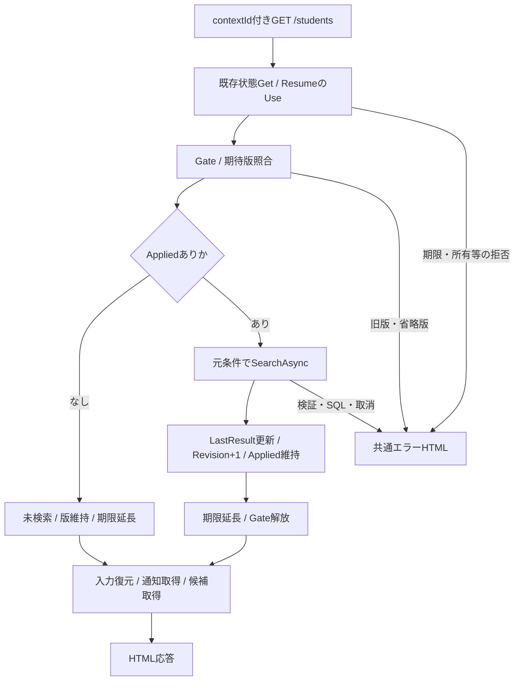

#### SQL・テーブル関連（ER図）とDB操作の詳細

検索済み復帰はQ-EXISTS、Q-COUNT、Q-PAGEと検索JOIN図を適用する。未検索復帰は学生検索なしで、Q-LOOKUPだけを行う。保存・削除により対象学生が条件外となった場合も、元条件を変更して対象を一覧へ押し込む処理はない。根拠: `sources/Infrastructure/WebStudentCoordinator.cs:14-14`、`sources/Web/Controllers/StudentsController.cs:11-11,39-40`。

#### 結果・例外時の扱い

SearchAsyncはSQL取得ページを最終ページ内に補正するが、Applied.Pageは変更しない。ResumeもAppliedを置換しないため、件数減少時に取得内容は最終ページでも表示pageは以前の値となり、総ページ数を超える可能性がある。これは現行実装の状態移送から導かれる挙動である。根拠: `sources/Core/SqlServerStudentService.cs:160-164`、`sources/Infrastructure/WebStudentCoordinator.cs:14-14,21-21`、`sources/Views/Students/Search.cshtml:8-8`。

期限切れは409で、自動初期化しない。旧版や期限で復帰が拒否されるとflash.Takeまで到達せず、保存成功通知はその応答に表示されない。一方、Takeまで到達した後の候補取得障害では、通知がメモリから消費済みでもHTMLに表示できない場合がある。根拠: `sources/Infrastructure/SearchContextStore.cs:13-14`、`sources/Web/Controllers/StudentsController.cs:8-11`、`sources/Infrastructure/FlashMessageStore.cs:9-9`。

### E07 未所属・上位条件の変更と送信中表示

#### 処理概要

検索条件のブラウザー操作には、未所属ON時の所属値解除とフォーム送信時の一部ボタン非活性化を補助するJavaScriptがある。年度・学年変更の自動候補更新、検索クラス選択からの上位補完は実装されていない。根拠: `sources/wwwroot/js/site.js:2-9`。

#### 処理手順

1. 読込み時にSRC-007を取得する。checkedならSRC-004・005・006の値を空にする。
2. SRC-007のchangeでも同じ解除を行う。unchecked時に以前の条件を復元しない。
3. JavaScriptはdisabled属性を切り替えない。年度・学年・クラスの非活性はRazorのCriteria.UnassignedOnlyで決まるため、ON/OFF直後は再描画まで活性状態が変わらない。
4. 年度・学年変更後の候補整合を反映する場合は「候補を更新」を送信し、E03で処理する。検索を直接送る場合はE02のサービス検査が所属整合を判断する。
5. フォームsubmit時は送信ボタン以外の同フォーム内buttonをdisabledにし、aria-busy=trueを設定する。送信ボタン自身や別フォームのbuttonは無効化しない。

根拠: `sources/wwwroot/js/site.js:4-8`、`sources/Views/Students/Search.cshtml:5-8`。

#### 条件付き処理フロー

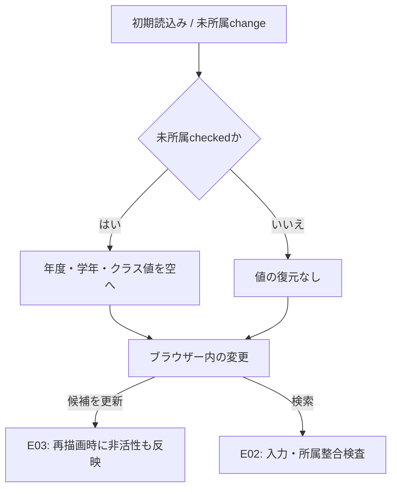

#### SQL・テーブル関連（ER図）とDB操作の詳細

JavaScriptだけのchangeはブラウザーのコントロール値を変え、DBやEntryを変更しないためER図は適用しない。POSTに進んだ後はE02またはE03のDB操作を適用する。REG-018からREG-016・017を補完するコードは登録画面用であり、SRCコントロールの連動仕様ではない。根拠: `sources/wwwroot/js/site.js:7-8`。

#### 結果・例外時の扱い

未所属ONでも在籍区分01・02は自動解除されない。提示DDLのck_student_datesが有効なDBでは、01・02の学生はclass_idが非NULLでなければならないため、未所属かつ01・02の検索に一致行はない。卒業・退学を対象とする場合は03・04を選ぶか、在籍区分を全解除して条件を省く。この0件判断はDDL制約と検索述語からの条件付き推論である。根拠: `sources/wwwroot/js/site.js:7-7`、`sources/Web/Controllers/StudentsController.cs:22-22`、`sources/Core/SqlServerStudentService.cs:146-154`、`sources/database/001_schema.sql:198-198`、`sources/database/002_seed.sql:19-22`。

通常のHTMLフォーム送信であり、fetch、AbortController、検索要求連番、古い検索応答を破棄する処理はない。送信時のボタン制御だけで画面全体の再送を禁止するわけではなく、状態更新の競合はサーバーのGateとRevisionで判定する。根拠: `sources/wwwroot/js/site.js:2-9`、`sources/Infrastructure/SearchContextStore.cs:14-14`。

### E08 新規登録・既存学生の編集／参照への遷移

#### 処理概要

新規登録は `/students/new`、既存行は `/students/{id}` にreturnContextIdを付けて遷移する。登録画面は検索行の表示値をそのまま編集原本にせず、対象IDで最新の非削除学生を再取得する。根拠: `sources/Views/Students/Search.cshtml:6-8`、`sources/Web/Controllers/StudentsController.cs:23-25`。

#### 処理手順

1. Coordinator.Editで認証情報と復帰状態の所有・期限を確認する。CheckReturnはTabを渡さない。
2. 新規の場合はCreateOrUpdateを確認し、Viewerを403で拒否する。
3. 既存の場合は `GetAsync(id,ct)` で最新行を読む。未存在なら404にする。
4. 登録用候補を取得し、StudentSaveInput.Fromで登録画面の原入力を作る。検索Criteriaを登録業務値に転記しない。
5. Controller.Loadがこの時点の検索RevisionをReturnRevisionとして記録する。
6. 所有者・セッション・対象学生ID・読込詳細・原入力・ReturnRevisionを、30分の編集スナップショットとして別辞書へ保存し、Editビューを返す。

根拠: `sources/Infrastructure/WebStudentCoordinator.cs:6-6,17-17`、`sources/Core/SqlServerStudentService.cs:172-194`、`sources/Web/Inputs/StudentSaveInput.cs:44-54`、`sources/Web/Controllers/StudentsController.cs:25-25`、`sources/Infrastructure/EditorSnapshotStore.cs:7-11`。

#### 条件付き処理フロー

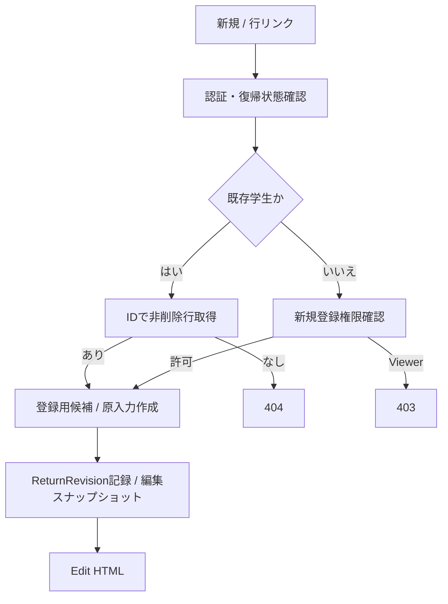

#### SQL・テーブル関連（ER図）とDB操作の詳細

既存取得は `SELECT * FROM dbo.m_student WHERE student_id=@id AND is_deleted=0`、@idはBigIntである。対象は学生単表のID読込みであり、このSQL自体のER図は単表のため省略する。取得したrow_versionは登録画面のExpectedVersionになり、検索Revisionと区別する。登録用候補取得は既定のLookupAsyncで人数集計を含むため、検索用Q-LOOKUPのOccupied=0とは別の経路である。根拠: `sources/Core/SqlServerStudentService.cs:172-201`、`sources/Web/Inputs/StudentSaveInput.cs:54-54`。

#### 結果・例外時の扱い

検索条件を変えずに参照・編集へ進む。登録画面の「検索へ戻る」は保存せずcontextIdとReturnRevision付きGETへ進み、E06を実行する。「編集取消／入力クリア」はPOST /students/resetで原スナップショットを再表示し、検索へ直接戻らない。登録フォームの未保存変更にはdirty確認があるが、検索フォームには適用しない。根拠: `sources/Views/Students/Edit.cshtml:16-16`、`sources/Web/Controllers/StudentsController.cs:35-35`、`sources/wwwroot/js/site.js:2-5`。

### E09 保存・削除確定後の検索復帰

#### 処理概要

登録画面の保存・削除が `Outcome.Saved` を返した場合だけ、成功通知を置いて検索画面へ303で転送する。SQLのOUTPUT取得、確認待ち、NoChange、結果不明を保存成功とは扱わない。根拠: `sources/Web/Controllers/StudentsController.cs:29-38`、`sources/Core/SqlServerStudentService.cs:302-315,409-416`。

#### 処理手順

1. 保存入口は許可フォーム、保存権限、編集スナップショット、復帰状態の所有・期限、スナップショット原本と復帰先の一致を確認する。削除入口もスナップショットと復帰先一致を確認し、CoordinatorでAdministrator、Confirmed=true、正のExpectedVersionを要求する。
2. 保存サービスは業務値と確認理由を正規化し、対象IDと期待版の対応を確認する。削除サービスは必須理由60スカラー値以内、正のID・版、版上限未到達を確認する。
3. READ COMMITTEDトランザクションを開始し、共通のExclusive・Transaction所有アプリケーションロックを取得する。ロック待ちは5,000msで、負の取得結果はSQL例外にする。
4. 既存対象の非削除・期待row_versionを再確認する。保存では学籍番号変更不可、コード存在・新規選択時の停止／期間、所属整合・新規所属可否・定員、番号一意、同生日かつ氏名キーまたはカナキー一致の重複候補も確認する。終了区分の訂正には管理者と理由を要求する。
5. 重複確認を続ける場合は、主体・セッション・対象・期待版・入力ハッシュ・候補ID／版ハッシュ・期限とBusy取得を照合し、確認理由を要求する。確認待ちでは書込みを確定せず、検索成功通知を出さない。
6. 保存の新規は正規化業務列と固定分類・作成更新情報・初期版1をINSERTする。更新はstudent_no以外の正規化業務列、updated_at、updated_by、row_version+1を設定し、ID・期待版・非削除をWHEREにする。
7. 削除は同じID・期待版・非削除をWHEREにし、is_deleted=1、deleted_at、deleted_by、delete_reason、updated_at、updated_by、row_version+1を設定する。物理DELETEは行わない。
8. 保存はOUTPUTの対象ID、削除は更新1件を確認し、同じトランザクションで監査をINSERTする。CommitAsyncが正常終了した後だけSavedを返す。
9. ReturnAfterSaveは主体・セッション・検索状態IDに対応する10分の成功通知を置く。復帰先が未指定なら新しい未検索状態を発行する。既存復帰先なら編集開始時のReturnRevisionを使用し、最新版へ置き換えない。
10. `303` と `Location=/students?contextId=...&contextRevision=...` を返す。続くGETがE06を実行して元条件を再検索する。

根拠: `sources/Web/Controllers/StudentsController.cs:29-38`、`sources/Infrastructure/WebStudentCoordinator.cs:18-19`、`sources/Core/SqlServerStudentService.cs:92-101,227-315,344-390,392-416`、`sources/Infrastructure/FlashMessageStore.cs:6-9`。

#### 条件付き処理フロー

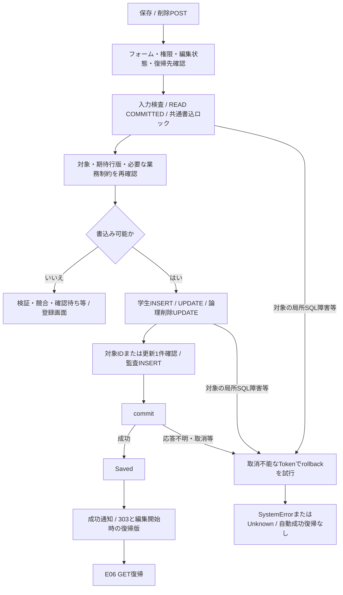

#### SQL・テーブル関連（ER図）とDB操作の詳細

書込対象の学生業務列は、student_no、student_name、student_name_kana、name_key、kana_key、birth_date、gender_code、postal_code、prefecture_code、address_line1、address_line2、phone_number、email_address、admission_date、enrollment_status_code、enrollment_end_date、class_id、emergency_contact_name、relationship_category、relationship_code、emergency_phone_number、remarksである。更新時だけstudent_noを除外する。各列のSqlDbTypeとSizeはサービスのColumns定義から設定する。新規にはgender_category='GENDER'、prefecture_category='PREFECTURE'、enrollment_category='ENROLLMENT_STATUS'、is_deleted=0、作成更新情報、row_version=1を加える。根拠: `sources/Core/StudentNormalizer.cs:124-147`、`sources/Core/SqlServerStudentService.cs:30-37,292-301`。

更新と削除の比較条件はともに `student_id=@id AND row_version=@version AND is_deleted=0` で、@id・@versionはBigIntである。更新日時はDateTimeOffset、主体はNVarChar(128)、削除理由はNVarChar(120)で渡す。理由のSQL領域120は入力60スカラー値の上限とは別である。監査は `dbo.t_operation_log` に対象表・キー、操作、前後版、変更列JSON、実行者・日時、要求識別、理由、重複確認有無をINSERTする。根拠: `sources/Core/SqlServerStudentService.cs:297-307,385-390,409-414`。

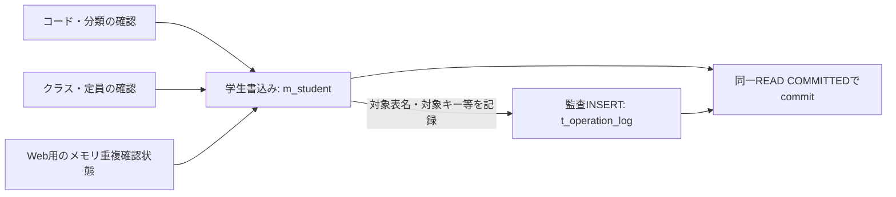

この図は書込順序・参照関係であり、学生と監査のFKを表していない。Web起動登録はwebTokens=trueであるため、重複確認はサービスのメモリ辞書を使う。非Web用に宣言されたt_confirmationの保存経路を、検索画面から到達するWeb保存の保持先として記載しない。根拠: `sources/Infrastructure/WebHostSetup.cs:19-19`、`sources/Core/SqlServerStudentService.cs:19-29,276-290,330-342`。

#### 結果・例外時の扱い

変更なし保存は明示rollbackしてNoChangeを返し、登録画面に留まる。保存の一意違反2601・2627はValidationFailed、DBConcurrencyExceptionはConflictになる。その他の局所catch対象であるSqlException・InvalidOperationException・OperationCanceledExceptionでは、CancellationToken.Noneでrollbackを試みる。`writeStarted && (commitAttempted || !rolledBack)` の場合はUnknown、それ以外はSystemErrorとなる。削除も同じ確定不明判定を用いる。Openとトランザクション開始は書込局所tryの外であり、全障害をSaveResultへ変換するわけではない。根拠: `sources/Core/SqlServerStudentService.cs:240-262,316-329,399-416`。

Unknownは再保存・再削除の前に検索で結果を確認する案内となり、成功通知や自動303を出さない。Saved後の303はDB書込み確定後の遷移指示であるが、続く復帰検索の成功までは保証しない。旧検索版や期限切れで復帰が拒否される場合も、確定済み書込みを戻す処理はない。根拠: `sources/Core/SqlServerStudentService.cs:319-322,416-416`、`sources/Web/Controllers/StudentsController.cs:31-38`、`sources/Infrastructure/WebStudentCoordinator.cs:14-14`。

### 共通DB操作

#### 接続と取消境界

SQL接続はEncrypt=Mandatory、TrustServerCertificate=falseを設定する。Openは接続後に `SELECT snapshot_isolation_state FROM sys.databases WHERE database_id=DB_ID()` を実行し、結果が1以外ならSNAPSHOT有効化が必要として例外にする。失敗した接続は破棄する。検索・候補・存在確認のCommand helperはCommandTimeout=30秒を設定する。診断コマンドはCreateCommandで生成する別経路である。根拠: `sources/Core/SqlServerStudentService.cs:39-66`。

接続、トランザクション開始、SQL実行、Reader読取り、commitにはCancellationTokenを渡す。検索と候補取得はawait usingで接続・トランザクションを破棄するが、検索コードには明示RollbackAsyncとrollback成否を返す処理はない。検索取消専用ボタン・ルート・取消成功応答はない。根拠: `sources/Core/SqlServerStudentService.cs:53-63,123-170,197-216`、`sources/Views/Students/Search.cshtml:4-8`。

#### Q-EXISTS 指定マスターの確認

入力正規化後にSNAPSHOTを開始する。学年が指定されていればGRADE、都道府県が指定されていればPREFECTUREの存在を確認する。各コードは `m_code` の分類＋値でCOUNT_BIGし、1件を要求する。停止・期間・分類表とのJOINは条件にしない。未指定値は確認しない。いずれかの確認が不正なら後続検索へ進まない。根拠: `sources/Core/SqlServerStudentService.cs:123-125,218-222`。

```sql
SELECT COUNT_BIG(*)
FROM dbo.m_code
WHERE category_id=@category AND code_value=@value;

SELECT COUNT_BIG(*)
FROM dbo.m_class
WHERE school_year=@year;

SELECT school_year,grade_code
FROM dbo.m_class
WHERE class_id=@id;
```

@categoryはVarChar(24)、@valueはVarChar(10)、年度確認の@yearはSmallInt、クラス確認の@idはBigIntである。年度は0件を拒否する。クラスは行が存在し、指定年度と正規化学年が取得値に一致することを要求する。検索時にはis_active、valid_from、valid_toを検査しない。年度候補不在とクラスの上位不一致はE-STU-014、コード不在はE-STU-009になる。根拠: `sources/Core/SqlServerStudentService.cs:125-135,218-222`。

#### 検索WHEREと型付きパラメータ

必須述語は `s.is_deleted=0` である。指定された任意条件をANDで追加し、nullの任意値では述語そのものを省略する。未指定をSQL列のNULL検索へ置き換えない。電話2列は括弧内OR、在籍区分はINによるいずれか一致である。根拠: `sources/Core/SqlServerStudentService.cs:137-155`。

| 条件 | 追加する全述語 | パラメータ型・Size | 設定値・省略条件 |
| --- | --- | --- | --- |
| 学籍番号 | s.student_no LIKE @no ESCAPE '!' | @no:VarChar(31) | 正規化noをエスケープして末尾%。no=nullなら省略 |
| 氏名 | s.name_key LIKE @name ESCAPE '!' | @name:NVarChar(642) | 正規化NameKeyをエスケープして前後%。name=nullなら省略 |
| カナ | s.kana_key LIKE @kana ESCAPE '!' | @kana:NVarChar(74) | 正規化カナキーをエスケープして前後%。kana=nullなら省略。空キーなら%% |
| 年度 | c.school_year=@year | @year:SmallInt | Criteria.SchoolYear。nullなら省略 |
| 学年 | c.grade_code=@grade | @grade:VarChar(2) | 正規化grade。nullなら省略 |
| クラス | s.class_id=@class | @class:BigInt | Criteria.ClassId。nullなら省略 |
| 未所属 | s.class_id IS NULL | パラメータなし | UnassignedOnly=trueだけで追加 |
| 都道府県 | s.prefecture_code=@prefecture | @prefecture:VarChar(2) | 正規化prefecture。nullなら省略 |
| 電話 | (s.phone_number=@phone OR s.emergency_phone_number=@phone) | @phone:VarChar(16) | 正規化phone。nullなら省略 |
| 入学日開始 | s.admission_date>=@from | @from:Date | DateOnlyのfrom。nullなら省略 |
| 入学日終了 | s.admission_date<=@to | @to:Date | DateOnlyのto。nullなら省略 |
| 在籍区分 | s.enrollment_status_code IN (@status0,...,@statusN) | 各@statusN:VarChar(2) | 配列順に値を設定。配列空なら述語なし |
| ページ開始位置 | OFFSET @offset ROWS | @offset:Int | checked((SQL用page-1)×PageSize) |
| ページ取得数 | FETCH NEXT @size ROWS ONLY | @size:Int | 20・50・100のPageSize |

上表の検索条件パラメータは件数SQLと一覧SQLへ同じ値を設定する。ParamはDateOnlyを当日0時のDateTimeに変換し、SqlDbType.Dateとして渡す。一般のnull値はDBNull.Valueにするが、任意検索条件はWhere helperでnullなら追加しないため、未指定条件用のパラメータを一律に生成する実装ではない。LIKE用Sizeはエスケープと%を含む検索パターンの領域であり、入力上限や保存列長を増やす値ではない。根拠: `sources/Core/SqlServerStudentService.cs:67-72,139-164`。

EscapeLikeは `!→!!`、`%→!%`、`_→!_`、`[→![` の順で置換し、SQL側でESCAPE '!'を使う。入力中のLIKE特殊文字を検索範囲拡張指示として扱わない。学籍番号はその前段で英数字・ハイフン形式に限定する。根拠: `sources/Core/StudentNormalizer.cs:59-64,161-161`、`sources/Core/SqlServerStudentService.cs:140-142`。

#### Q-COUNT 上限確認

```sql
SELECT COUNT_BIG(*)
FROM (
  SELECT TOP (10001) s.student_id
  FROM dbo.m_student s
  LEFT JOIN dbo.m_class c ON c.class_id=s.class_id
  WHERE /* 必須述語と指定された全検索述語 */
) limited;
```

WHEREの具体的な組立ては前表に従う。件数SQLに名称コード表は結合しない。TOPにはORDER BYを付けず、10,000件超の検出に必要な最大10,001件だけを数える。Count=10001は上限超過検出値であり、実際の全件数ではない。超過時は一覧SQLを実行せずcommitし、NoChange、Items空、LimitExceeded=trueを返す。根拠: `sources/Core/SqlServerStudentService.cs:155-159`。

#### Q-PAGE 一覧取得と順序

一覧のSELECTは次の16列を取得する。WHEREにはQ-COUNTと同じ検索述語を使い、許可された順序とOFFSET/FETCHを後置する。根拠: `sources/Core/SqlServerStudentService.cs:82-90,162-168`。

```sql
SELECT s.student_id,s.student_no,s.student_name,s.student_name_kana,s.birth_date,
       c.school_year,c.class_code,c.class_name,
       g.code_name grade_name,e.code_name status_name,
       p.code_name prefecture_name,s.address_line1,s.phone_number,
       s.admission_date,s.updated_at,s.row_version
FROM dbo.m_student s
LEFT JOIN dbo.m_class c ON c.class_id=s.class_id
LEFT JOIN dbo.m_code g
  ON g.category_id=c.grade_category AND g.code_value=c.grade_code
LEFT JOIN dbo.m_code e
  ON e.category_id=s.enrollment_category AND e.code_value=s.enrollment_status_code
LEFT JOIN dbo.m_code p
  ON p.category_id=s.prefecture_category AND p.code_value=s.prefecture_code
WHERE /* 必須述語と指定された全検索述語 */
ORDER BY /* 許可列とascまたはdesc */,s.student_id ASC
OFFSET @offset ROWS FETCH NEXT @size ROWS ONLY;
```

| SortKey | 許可するSQL列 | 意味 |
| --- | --- | --- |
| studentNo | s.student_no | 保存済み学籍番号の文字順 |
| name | s.name_key | 正規化氏名照合キーの順序 |
| admissionDate | s.admission_date | 入学日の順序 |
| updatedAt | s.updated_at | 更新日時の順序 |

SortKeyはswitchでこの4列へ限定し、SortDirectionは小文字asc・descだけを許す。主ソートが同順位でも `s.student_id ASC` を必ず加える。学籍番号を数値に変換して並べる処理はない。提示DDLのstudent_no・name_keyはBIN2照合順序である。根拠: `sources/Core/SqlServerStudentService.cs:107-108,162-164`、`sources/database/001_schema.sql:9-13`。

最終ページは `max(1,(count+PageSize-1)/PageSize)`、SQL用ページは `min(Criteria.Page,最終ページ)` とする。offsetはchecked計算し、Intで渡す。0件でも最終ページ・SQL用ページは1で、Readerから取得する行は空になる。結果行数は最大PageSizeであり、全件数と同じ値ではない。根拠: `sources/Core/SqlServerStudentService.cs:160-168`。

LEFT JOINで名称が取得できないだけでは学生行を落とさない。ただし年度・学年指定のWHEREはクラス側の値を要求するため、class_id=NULLの学生はその条件に一致しない。住所の都道府県名称欠落だけは[不整合]を補う。一覧の停止・期間外クラス注記を作る列は取得しない。根拠: `sources/Core/SqlServerStudentService.cs:77-90,143-146`。

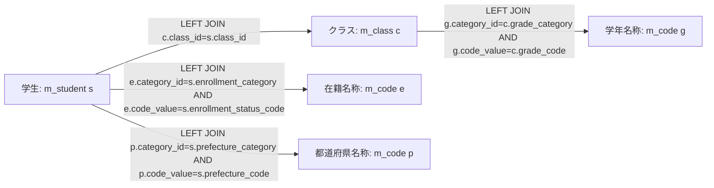

この図は一覧SELECTの結合条件を示す。件数SELECTが使用する辺は学生からクラスへの1本だけである。検索JOINをDBのFK制約や削除連動の定義として扱わない。根拠: `sources/Core/SqlServerStudentService.cs:82-90,156-156`。

#### Q-LOOKUP コード・クラス候補取得

SearchModelは毎回 `LookupAsync(false,ct)` を呼ぶ。SQLは次の2結果セットであり、抽出WHEREもページングもない。検索用途のOccupiedは人数を確認した値ではなく、未集計時に設定する0である。根拠: `sources/Web/Controllers/StudentsController.cs:39-39`、`sources/Core/SqlServerStudentService.cs:197-216`。

```sql
SELECT c.category_id,c.code_value,c.code_name,c.display_order,
       CONVERT(bit,CASE WHEN c.is_active=1 AND k.is_active=1 THEN 1 ELSE 0 END) is_active,
       c.valid_from,c.valid_to,c.is_protected
FROM dbo.m_code c
JOIN dbo.m_code_category k ON k.category_id=c.category_id
ORDER BY c.category_id,c.display_order,c.code_value;

SELECT c.*,CONVERT(int,0) occupied
FROM dbo.m_class c
LEFT JOIN dbo.m_code g
  ON g.category_id=c.grade_category AND g.code_value=c.grade_code
ORDER BY c.school_year DESC,g.display_order,c.display_order,c.class_code,c.class_id;
```

コードとクラスは同じ候補用SNAPSHOTトランザクションで読み、NextResultAsyncで第2結果へ進む。コード結果をCodeEntry、クラス結果をSchoolClassへ移し、commit後にLookupSetを返す。クラスSQLはc.*を取得するが、SchoolClassへ移すのはID、年度、学年、コード・名称、期間、定員、Occupied、IsActiveである。コードのIsActiveはコードと分類の双方がactiveのときだけtrueになるが、Razorは検索候補の選択可否にそれを使わない。根拠: `sources/Core/Contracts.cs:61-65`、`sources/Core/SqlServerStudentService.cs:203-216`、`sources/Views/Students/Search.cshtml:5-5`。

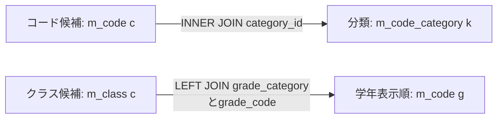

候補取得の図はSELECTの関連を表す。検索用includeOccupancy=falseでは学生人数集計への辺を置かない。各候補のキー・表示名・画面での絞込みは「選択候補一覧」に従う。根拠: `sources/Core/SqlServerStudentService.cs:201-208`。

#### DDL上の関連図

以下は検索に関係するFKの抜粋である。検索JOINの別名g・e・pは同じコード表を用途別に読むための別名であり、別の物理テーブルではない。図の多重度は提示DDLのPK・FK・NULL許容・子側一意性から決める。根拠: `sources/database/001_schema.sql:18-28,62-80,90-127,187-197`。

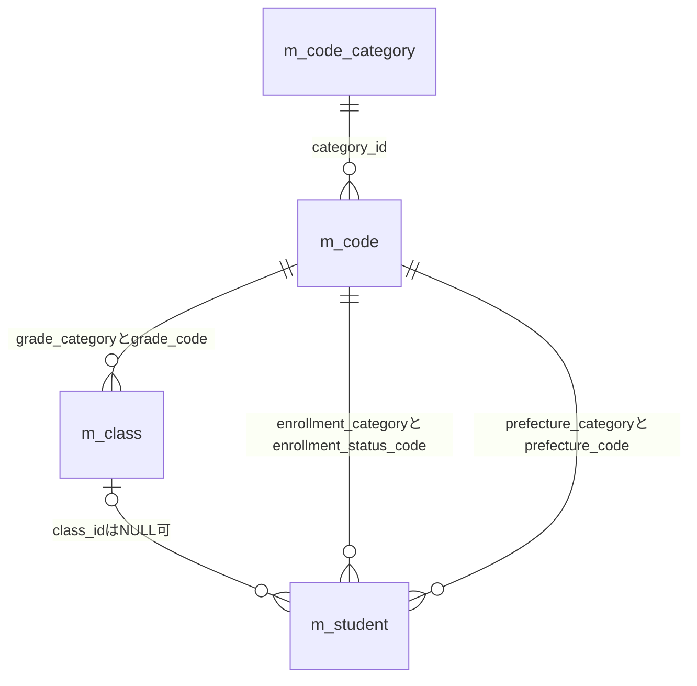

m_codeの親キーはcategory_id・code_valueの複合主キーである。学年、在籍、都道府県の参照分類・値はNOT NULLなので、DDLに従う各子行には該当コードが1行必要となる。学生のclass_idはNULL可で、学生からクラスは0または1、クラスから学生は0以上である。学生class_idに子側一意制約はない。性別・続柄のFKもDDLにあるが、一覧SELECTの名称結合には使用しない。根拠: `sources/database/001_schema.sql:15-31,65-66,127-127,189-197`。

## 補足説明

### 長さ・正規化・空値の区別

サーバーの文字数検査はUnicodeスカラー値単位である。ScalarCountはサロゲート対を1と数え、単独サロゲートをArgumentExceptionにする。TextはTrim前のraw上限を先に確認し、制御文字を拒否した後でTrimし、任意項目の空をnullへ戻す。その後の正規化と上限検査は各項目の処理に従う。余分な空白を除けば短くなる入力でも、raw上限超過を先に拒否する。根拠: `sources/Core/StudentNormalizer.cs:37-64`。

HTMLのmaxlength、.NET文字列のLength、サーバーのスカラー値数、SQLの物理領域は同じ値ではない。学籍番号・氏名・カナ・電話のHTML maxlengthは30・16・72・40、サーバーraw上限は15・8・36・20スカラー値である。nvarcharの括弧内長はUTF-16のコード単位用領域であり、氏名nvarchar(16)、カナnvarchar(36)、氏名キーnvarchar(320)、カナキーnvarchar(36)には別途8・18・160・18スカラー値のCHECKがある。varcharのSizeも文字業務上限と同一の一般規則に置き換えず、対象のASCII正規化値と併せて解釈する。根拠: `sources/Views/Students/Search.cshtml:5-5`、`sources/Core/StudentNormalizer.cs:47-93`、`sources/database/001_schema.sql:9-13,44-47`。

空白だけの入力の扱いは項目ごとに異なる。氏名・電話はnull条件になり、学籍番号は非空入力としてIdentifierの必須検査で拒否される。カナは非空入力から空キーが作られ、LIKE '%%'相当の述語が付く。クラスIDはTrimしないため空白文字列をIDとして拒否し、日付もTrimしないため前後空白を許す仕様ではない。根拠: `sources/Core/SqlServerStudentService.cs:113-121`、`sources/Core/StudentNormalizer.cs:47-93`、`sources/Web/Inputs/StudentSaveInput.cs:60-60`、`sources/Core/JapaneseDateService.cs:52-59`。

「すべて」は任意条件の未設定であり、年度0、学年00、クラスID0を表さない。学年00はseedの「学年なし」で、クラスの学年コードとして検索する。未所属は学生class_idのNULLであり、学年コード00とは独立する。在籍区分の空配列はSQLの区分条件なしであって、区分NULLだけを抽出する条件ではない。根拠: `sources/database/002_seed.sql:78-84`、`sources/Core/SqlServerStudentService.cs:109-110,144-154`。

### 一覧とページの表示状態

| 状態 | 条件 | 件数・一覧・日時 | ページ操作 |
| --- | --- | --- | --- |
| 未検索 | Presentへ結果nullを渡す | 未検索表示。totalCount=null、items空、searchedAt=null | 非活性。Appliedなしなら1/1 |
| 0件 | 結果あり、LimitExceeded=false、Count=0 | 該当する学生はありません。件数の内部値は0、一覧空 | 非活性。通常の検索・Pageではページ基準1 |
| 上限超過 | LimitExceeded=true | 10,000件超の絞込み警告。totalCount=null、items空。検索日時は結果内にあるがビューの警告分岐では表示しない | 非活性 |
| 検出あり | LimitExceeded=false、Count>0 | 実件数、検索日時、最大PageSizeの一覧 | 反映ボタン活性。前後は現在pageと件数で個別判定 |
| 局所検証・旧版拒否 | Search/Pageの捕捉対象となる失敗 | エラー概要とunsearched・空一覧。Searchは今回入力、PageはApplied由来入力 | 非活性。Appliedが残る場合、表示pageはその既存値 |

根拠: `sources/Infrastructure/WebStudentCoordinator.cs:21-21`、`sources/Web/Controllers/StudentsController.cs:14-19`、`sources/Views/Students/Search.cshtml:2-2,7-8`。

ビューはtotalCount=nullをページ計算用の0として読むが、outcomeをemptyへ変えない。表示ページは `page / max(1,ceil(count/Model.PageSize))` である。前へはpage<=1、次へはpage×PageSize>=countでも非活性にする。ResumeのApplied.Page未補正や失敗時の既存Appliedがある場合は、通常の初回1/1とは異なる番号表示になり得る。根拠: `sources/Views/Students/Search.cshtml:2-2,8-8`、`sources/Infrastructure/WebStudentCoordinator.cs:14-14,21-21`。

一覧は10表示列と操作列である。電話NULLの－と住所の[不整合]以外に、年度・学年・クラス・在籍名称へ統一欠損表示を補う処理はない。候補に停止クラスを残して停止注記を付けることと、結果一覧に停止状態を表示することは別であり、後者は実装されていない。根拠: `sources/Core/SqlServerStudentService.cs:77-90`、`sources/Views/Students/Search.cshtml:5-8`。

### 日付と日時

検索の業務日はサービス入口のUTC現在時刻を+09:00へ変換して求める。SearchResult.SearchedAtは同じ入口時刻で、処理完了時刻を別に採番しない。検索日時と更新日時は日本時間のyyyy/MM/dd HH:mm:ssで表示する。共通ヘッダーの業務日はWebPresentationが取得する現在日であり、検索要求の入口時刻を同じ変数として共有する実装ではない。根拠: `sources/Core/SqlServerStudentService.cs:44-45,105-105,168-168`、`sources/Infrastructure/WebPresentation.cs:5-7`、`sources/Views/Shared/_Layout.cshtml:1-1`。

生年月日はDateOnlyのまま元号へ変換する。境界は明治1900-01-01～1912-07-29、大正1912-07-30～1926-12-24、昭和1926-12-25～1989-01-07、平成1989-01-08～2019-04-30、令和2019-05-01以降である。年1は「元」、月日は2桁表示になる。入学日検索はISO形式をDateOnlyへ解析してSQL Dateの両端比較に使い、和暦文字列や日時文字列で比較しない。根拠: `sources/Core/JapaneseDateService.cs:9-16,41-59`、`sources/Core/SqlServerStudentService.cs:120-122,149-150`。

### 状態競合・期限・応答失敗

状態GetはID未存在または期限切れをW-SRC-002付き409、所有者・セッション・非空指定されたタブの不一致を403にする。TabIdを必須非空として検査する処理はなく、Index/ResumeとCheckReturnはTabを渡さない。RequestIdentity.TabIdのheader/query取得プロパティも、確認した検索Controller経路では使わない。根拠: `sources/Infrastructure/SearchContextStore.cs:13-14`、`sources/Infrastructure/RequestIdentity.cs:12-12`、`sources/Web/Controllers/StudentsController.cs:8-25`。

UseはGate取得後に状態を再確認し、版をInvariantCulture文字列と完全一致で比較する。数値として同じ先頭ゼロ付き版や省略版を最新値へ補完しない。同じRevisionの並行更新は、先行成功が版を進めれば後続が409になる。成功しなかったoperationでは期限延長をしない。期限切れ辞書要素の削除はCreate時に行う。根拠: `sources/Infrastructure/SearchContextStore.cs:12-14`。

Search/Pageの最初のFormGuard・Get、Index/Resume、Clear、Optionsの未捕捉例外は共通ミドルウェアへ進む。応答開始前ならWebFaultの状態コード、その他は503とし、非API要求にはエラーHTMLと `/students` を開くリンクを返す。元フォーム入力を再表示したり、期限切れ状態を自動初期化したりはしない。認証失効はCookie認証設定の401であり、状態期限切れ409とは別である。応答開始後の例外はこのcatchの対象外である。根拠: `sources/Web/Controllers/StudentsController.cs:8-22`、`sources/Infrastructure/WebHostSetup.cs:14-14,22-24`。

検索のメモリ確定、候補DB取得、表示変換、HTML応答は別の境界である。Search・Page・検索済みResume・Clearの成功後に後段の候補取得が失敗しても、Applied・LastResult・Revisionが更新済みの場合がある。状態版を旧値へ戻す補償や、Optionsの読み取りを更新要求と一括同期する処理はない。これは業務DB書込みが検索で発生するという意味ではない。根拠: `sources/Infrastructure/WebStudentCoordinator.cs:9-15`、`sources/Web/Controllers/StudentsController.cs:11-22,39-39`。

### 設計意図と現行実装の対応

| 主題 | 設計資料が定義する意図 | 現行ソースで観測した動作 | 根拠 |
| --- | --- | --- | --- |
| 初期候補不足 | 必須マスター不足時は検索不可 | 候補0件でも検索ボタンを無効にする分岐なし | reference-designs/詳細仕様書/CSharp_ASPNET/01_学生検索画面.md:159-165、sources/Views/Students/Search.cshtml:5-8 |
| 所属条件の連動 | 上位変更で候補再取得、不適合クラス解除。クラス先行選択で実年度・学年を反映 | 明示Optionsで再描画・解除。検索用上位変更の自動送信とクラス先行補完はない | reference-designs/詳細仕様書/CSharp_ASPNET/01_学生検索画面.md:254-262、sources/Web/Controllers/StudentsController.cs:22-22、sources/wwwroot/js/site.js:7-8 |
| 未所属の非活性 | ONで所属3項目解除・非活性、OFFで勝手に復元しない | JavaScriptは値解除だけ。非活性はサーバー再描画で反映。自動復元なし | reference-designs/詳細仕様書/CSharp_ASPNET/01_学生検索画面.md:256-256、sources/Views/Students/Search.cshtml:5-5、sources/wwwroot/js/site.js:7-7 |
| 候補応答順 | 古い候補応答を破棄する | 通常のHTML POSTで、要求世代による破棄処理なし | reference-designs/詳細仕様書/CSharp_ASPNET/01_学生検索画面.md:258-262、sources/wwwroot/js/site.js:2-9 |
| 失敗時の表示 | 原入力保持・一覧消去 | Searchの局所検証エラーは今回入力と空一覧。SQL・取消・最初の状態取得等の失敗は共通エラーHTML | reference-designs/詳細仕様書/CSharp_ASPNET/01_学生検索画面.md:205-208,504-506、sources/Web/Controllers/StudentsController.cs:14-19、sources/Infrastructure/WebHostSetup.cs:23-23 |
| 期限切れ復帰 | 初期化する | 409と検索画面リンク。自動初期化なし | reference-designs/詳細仕様書/CSharp_ASPNET/01_学生検索画面.md:390-392、sources/Infrastructure/SearchContextStore.cs:13-13、sources/Infrastructure/WebHostSetup.cs:23-23 |
| 復帰ページ | 件数減少時は最終有効ページへ補正 | SQL用ページは補正するがResumeはApplied.Pageを更新しない | reference-designs/詳細仕様書/CSharp_ASPNET/01_学生検索画面.md:303-305、sources/Core/SqlServerStudentService.cs:160-164、sources/Infrastructure/WebStudentCoordinator.cs:14-14 |
| 状態版 | 検索・ページ・クリア・復帰で期待版を照合し旧版を自動再送しない | Useで照合。候補更新は版を使わない。タブ照合は非空引数がある経路だけ | reference-designs/詳細仕様書/CSharp_ASPNET/01_学生検索画面.md:604-610、sources/Infrastructure/SearchContextStore.cs:13-14、sources/Web/Controllers/StudentsController.cs:8-22 |
| 操作・表示 | メニューへ、表示範囲、先頭・最後ページ、未所属の－表示を定義 | 実ビューは前へ・次へと表示指定反映。メニュー・RangeFrom/RangeTo・先頭／最後専用操作・所属欄の統一－補完なし | reference-designs/詳細仕様書/CSharp_ASPNET/01_学生検索画面.md:99-114,135-142、sources/Views/Students/Search.cshtml:3-8 |
| 内部名 | StudentQueryService、StudentNoPrefix、NameKey、KanaKey、StudentListItem等の設計名 | WebStudentCoordinator、SqlServerStudentService、SearchCriteriaと正規化ローカル値、StudentRowが実名 | reference-designs/詳細仕様書/CSharp_ASPNET/01_学生検索画面.md:20-25,558-592、sources/Core/Contracts.cs:31-58、sources/Core/SqlServerStudentService.cs:113-122 |

設計資料は設計意図の材料であり、上表の意図を現行実装の保証へ読み替えない。運用上の採否が必要な論点は、Page・Optionsの型変換不正時の扱い、Resumeの状態ページ補正、候補と状態の同期、タブ照合の適用範囲、状態確定後の応答失敗からの回復である。これらを見直すことは改善提案であり、この文書の現行仕様を変更するものではない。改善の根拠となる実装箇所は `sources/Web/Controllers/StudentsController.cs:18-22,39-39`、`sources/Infrastructure/WebStudentCoordinator.cs:12-15`、`sources/Infrastructure/SearchContextStore.cs:13-14` である。

検索Entryはプロセス内の辞書であり、DDLにt_runtime_stateが存在することを永続化実装と解釈しない。検索の外部入出力はHTTPフォーム、HTML応答、SQL Server参照であり、確認した検索入口にCSV、帳票、取込などのファイル処理はない。DB各表の全列定義はDB定義文書、登録業務項目全体は登録画面仕様の責務とし、本書は検索条件・結合・表示移送・検索復帰に必要な対応を記載する。根拠: `sources/Infrastructure/SearchContextStore.cs:9-15`、`sources/database/001_schema.sql:171-183`、`sources/Views/Students/Search.cshtml:4-8`、`sources/Web/Controllers/StudentsController.cs:8-25`。
