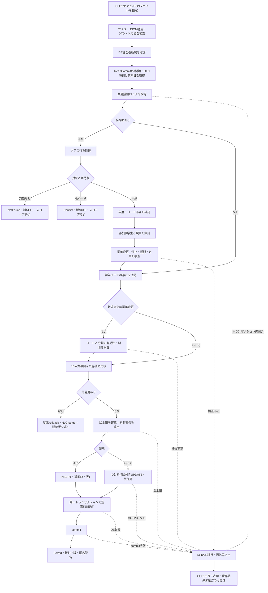
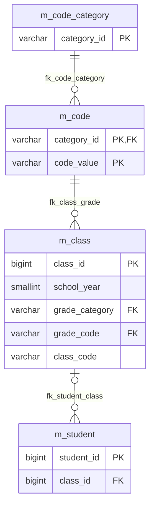
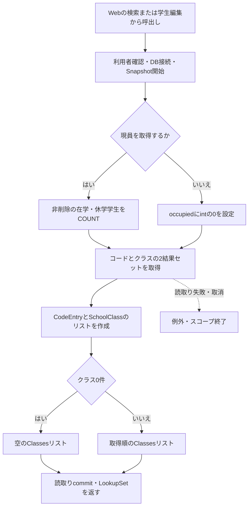
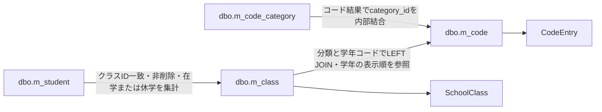

<!-- spec-meta: {"schema":"spec-md/1.0","documentId":"SM-DB-M-CLASS","version":"1.0","path":"spec/database/tables/m_class.md","sheets":[{"sheet":"m_class","sections":[{"heading":"概要","kind":"GRID"},{"heading":"項目一覧","kind":"LIST","key":["物理名"],"columns":["No","論理名","物理名","実DB型・照合順序","容量・単位","NOT NULL","PK","IDENTITY","DEFAULT","DB制約・許容値","保守入力・設定元","根拠"]},{"heading":"イベント仕様","kind":"GRID"},{"heading":"補足説明","kind":"GRID"}]}]} -->

# クラスマスター dbo.m_class テーブル定義
文書ID：SM-DB-M-CLASS　版：1.0　文書種別：DBテーブル定義　正本：Markdown  
論理名：クラスマスター　物理名：dbo.m_class　DB製品：SQL Server　主キー：class_id　物理列数：17

## 概要

クラスマスターは、学校年度内のクラスを1行で管理する。年度、学年、年度内で一意のクラスコード、表示名称、利用期間、定員、表示順、利用可否、備考を保持し、作成・更新情報と整数の更新管理番号を保存する。クラス管理番号は年度やコードとは別の内部識別子であり、学生の所属先から参照される。〔根拠：sources/database/001_schema.sql:62-88、188-191〕

現員はこのテーブルに保存しない。学生テーブルのうち、対象クラスを参照し、論理削除されておらず、在籍区分が在学「01」または休学「02」の行から計算する。学年名称はコードマスターから取得する。担任情報とクラスの削除フラグも、17列には含まれない。〔根拠：sources/database/001_schema.sql:62-88、sources/Core/SqlServerStudentService.cs:201-214〕

クラスの新規登録・変更は、保守CLIの `class` 指定から `MasterMaintenanceService.SaveClassAsync` に到達する。Web側は学生サービスを登録してクラスを参照し、学生の検索条件や所属先候補として利用する。クラス保守の画面や保存ルートは、この入口構成には含まれない。〔根拠：sources/maintenance/Program.cs:4-12、sources/Program.cs:1-8、sources/Infrastructure/WebHostSetup.cs:13-19、sources/Web/Controllers/StudentsController.cs:5-39、sources/StudentManagement.Web.csproj:5-5〕

本書では、DB型・容量・制約を物理定義として記載し、入力の正規化や所属状況による変更制限をサービス規則として記載する。設計資料の業務初期値は、補足説明で実装による設定と対応付ける。

## 項目一覧

| No | 論理名 | 物理名 | 実DB型・照合順序 | 容量・単位 | NOT NULL | PK | IDENTITY | DEFAULT | DB制約・許容値 | 保守入力・設定元 | 根拠 |
| --- | --- | --- | --- | --- | --- | --- | --- | --- | --- | --- | --- |
| 1 | クラス管理番号 | class_id | bigint | 符号付き64bit整数・8バイト | はい | pk_m_classの単一列主キー | (1,1) | なし | 主キーによる一意性。正数CHECKはない | ClassChange.ClassIdはlong?。新規はNULL、更新は正数。INSERTでは列を指定せず、採番結果をOUTPUTで取得 | sources/database/001_schema.sql:63-80、sources/Core/MasterMaintenanceService.cs:9-9、30-32、124-130 |
| 2 | 学校年度 | school_year | smallint | 符号付き16bit整数・2バイト | はい | 非該当 | なし | なし | ck_class_limits：1900～9998 | ClassChange.SchoolYearはint。SmallInt引数で保存。既存値からの変更はサービスが拒否 | sources/database/001_schema.sql:64-64、201-201、sources/Core/MasterMaintenanceService.cs:9-9、32-32、52-52、73-74 |
| 3 | 学年のコード分類 | grade_category | varchar(24) COLLATE Latin1_General_100_BIN2 | 最大24バイト | はい | 非該当 | なし | なし | ck_class_category：GRADE固定。grade_codeと組にしてfk_class_grade | 入力DTOに項目なし。INSERTがSQLリテラルGRADEを設定。UPDATEでは変更しない | sources/database/001_schema.sql:65-65、190-190、197-197、sources/Core/MasterMaintenanceService.cs:9-9、124-129 |
| 4 | 学年 | grade_code | varchar(2) COLLATE Latin1_General_100_BIN2 | 最大2バイト | はい | 非該当 | なし | なし | grade_categoryとの複合FKでm_codeの存在を保証 | ClassChange.GradeCodeはstring。原入力2スカラー値以内、Trim・NFKC後に半角数字2桁。VarChar(2)で保存 | sources/database/001_schema.sql:66-66、190-190、sources/Core/MasterMaintenanceService.cs:9-9、34-34、73-73、sources/Core/StudentNormalizer.cs:47-57、113-117 |
| 5 | クラスコード | class_code | varchar(9) COLLATE Latin1_General_100_BIN2 | 最大9バイト | はい | 非該当 | なし | なし | uq_class_year_code：school_yearとの組が一意。コード形式CHECKはない | ClassChange.ClassCodeはstring。原入力9スカラー値以内、Trim・NFKC・大文字化後も9以内。先頭は英大文字または数字、後続は英大文字・数字・ハイフン。VarChar(9)で保存 | sources/database/001_schema.sql:67-67、188-188、sources/Core/MasterMaintenanceService.cs:9-9、33-33、52-52、73-73、sources/Core/StudentNormalizer.cs:47-64 |
| 6 | クラス名 | class_name | nvarchar(36) COLLATE Latin1_General_100_CS_AS_SC | 36 UTF-16コード単位・最大72バイト。DB上限18スカラー値 | はい | 非該当 | なし | なし | ck_m_class_class_name_scalar：末尾空白を含め18スカラー値以内。空文字を禁止するCHECKはない | ClassChange.ClassNameはstring。原入力・Trim後とも18スカラー値以内、必須、制御文字不可。NVarChar(36)で保存 | sources/database/001_schema.sql:68-68、81-81、sources/Core/MasterMaintenanceService.cs:9-9、33-33、73-73、sources/Core/StudentNormalizer.cs:37-57 |
| 7 | 利用開始日 | valid_from | date | 日単位。時刻・UTCオフセットなし | はい | 非該当 | なし | なし | ck_class_limits：年度の4月1日以降、valid_to以下 | ClassChange.ValidFromはstring。NFKC後のyyyy-MM-ddをDateOnlyへ変換し、Date引数で保存 | sources/database/001_schema.sql:69-69、201-201、sources/Core/MasterMaintenanceService.cs:9-9、36-37、73-73、sources/Core/JapaneseDateService.cs:52-59 |
| 8 | 利用終了日 | valid_to | date | 日単位。時刻・UTCオフセットなし | はい | 非該当 | なし | なし | ck_class_limits：valid_from以上、翌年3月31日以前 | ClassChange.ValidToはstring。NFKC後のyyyy-MM-ddをDateOnlyへ変換し、Date引数で保存 | sources/database/001_schema.sql:70-70、201-201、sources/Core/MasterMaintenanceService.cs:9-9、36-37、73-73、sources/Core/JapaneseDateService.cs:52-59 |
| 9 | 定員 | capacity | int | 符号付き32bit整数・4バイト | いいえ | 非該当 | なし | なし | ck_class_limits：NULLまたは1～9999。0は不可 | ClassChange.Capacityはint?。Int引数。NULLはDBNull.Valueとして保存し、人数の上限比較を省略 | sources/database/001_schema.sql:71-71、201-201、sources/Core/MasterMaintenanceService.cs:9-9、32-32、57-57、73-73、sources/Core/SqlServerStudentService.cs:67-72、377-380 |
| 10 | 表示順 | display_order | int | 符号付き32bit整数・4バイト | はい | 非該当 | なし | df_m_class_display_order：0 | ck_class_limits：0以上 | ClassChange.DisplayOrderはint。非負を検査し、Int引数で明示保存 | sources/database/001_schema.sql:72-72、201-201、sources/Core/MasterMaintenanceService.cs:9-9、32-32、73-73 |
| 11 | 利用可否 | is_active | bit | 真偽値。0＝停止、1＝利用可 | はい | 非該当 | なし | df_m_class_is_active：1 | NOT NULLのbit値 | ClassChange.IsActiveはbool。INSERT・UPDATEともBit引数で明示保存。現員がある場合、停止値を拒否 | sources/database/001_schema.sql:73-73、sources/Core/MasterMaintenanceService.cs:9-9、56-57、65-74 |
| 12 | 備考 | remarks | nvarchar(240) COLLATE Latin1_General_100_CS_AS_SC | 240 UTF-16コード単位・最大480バイト。DB上限120スカラー値 | いいえ | 非該当 | なし | なし | ck_m_class_remarks_scalar：NULLまたは末尾空白を含め120スカラー値以内 | ClassChange.Remarksはstring?。原入力120以内、CRLF・CRをLFへ変換してTrimし、保存値も120以内。LF以外の制御文字不可。未設定・空文字・空白のみはNULL。NVarChar(240)で保存 | sources/database/001_schema.sql:74-74、82-82、sources/Core/MasterMaintenanceService.cs:9-9、35-35、73-73、sources/Core/StudentNormalizer.cs:37-57 |
| 13 | 作成日時 | created_at | datetimeoffset(7) | 小数秒7桁、UTCオフセット付き日時 | はい | 非該当 | なし | なし | ck_m_class_created_at_utc：TZOFFSET＝0 | INSERTでDateTimeOffset.UtcNow由来のnowを設定。DateTimeOffset引数。UPDATE対象外 | sources/database/001_schema.sql:75-75、83-83、sources/Core/MasterMaintenanceService.cs:39-42、124-129 |
| 14 | 作成者 | created_by | nvarchar(128) COLLATE Latin1_General_100_CS_AS_SC | 128 UTF-16コード単位・最大256バイト。DB上限64スカラー値 | はい | 非該当 | なし | なし | ck_m_class_created_by_scalar：末尾空白を含め64スカラー値以内 | ORIGINAL_LOGIN()の結果を必須テキストとして整形したactor。INSERTでNVarChar(128)引数を設定。UPDATE対象外 | sources/database/001_schema.sql:76-76、84-84、sources/Core/MasterMaintenanceService.cs:23-27、124-129 |
| 15 | 更新日時 | updated_at | datetimeoffset(7) | 小数秒7桁、UTCオフセット付き日時 | はい | 非該当 | なし | なし | ck_m_class_updated_at_utc：TZOFFSET＝0 | INSERTではcreated_atと同じnow。実変更UPDATEでも今回のnowを設定。変更なしでは更新しない | sources/database/001_schema.sql:77-77、85-85、sources/Core/MasterMaintenanceService.cs:65-68、124-130 |
| 16 | 更新者 | updated_by | nvarchar(128) COLLATE Latin1_General_100_CS_AS_SC | 128 UTF-16コード単位・最大256バイト。DB上限64スカラー値 | はい | 非該当 | なし | なし | ck_m_class_updated_by_scalar：末尾空白を含め64スカラー値以内 | INSERT・実変更UPDATEで今回のactorをNVarChar(128)引数として設定。変更なしでは更新しない | sources/database/001_schema.sql:78-78、86-86、sources/Core/MasterMaintenanceService.cs:23-27、65-68、124-130 |
| 17 | 更新管理番号 | row_version | bigint | 符号付き64bit整数・8バイト | はい | 非該当 | なし | df_m_class_row_version：1 | ck_m_class_row_version：1～9223372036854775807 | SQL Serverのrowversion型ではない。INSERTは1、実変更UPDATEは現在値＋1。ExpectedVersionはlong?。変更なしでは加算しない | sources/database/001_schema.sql:79-87、sources/Core/MasterMaintenanceService.cs:9-9、65-68、124-130 |

## イベント仕様

### 1. クラスの新規登録・変更

#### 処理概要

保守CLIはJSONファイルを `ClassChange` に変換し、保存サービスへ渡す。保存サービスは、入力値を検査・正規化した後にDB接続の管理者所属を確認する。共通排他ロックの下で既存行と学生の所属状況を再取得し、保存対象の10項目に実変更がある場合にクラス行と監査ログを同じトランザクションで保存する。〔根拠：sources/maintenance/Program.cs:7-13、sources/Core/MasterMaintenanceService.cs:30-77〕

`ClassId` と `ExpectedVersion` は、新規では双方をNULL、更新では双方を正数にする。片方だけの指定は入力不正となる。期待版は入力DTOの制御項目であり、17列のうち独立した保存列にはならない。〔根拠：sources/Core/MasterMaintenanceService.cs:9-9、30-32、124-130〕

#### 番号付き処理手順

1. CLIは引数が2個で、処理種別が `class` または `code` であることを確認する。クラス保存では `class` を指定する。入力ファイルを全量読み取ってから、65536バイト以下であることを確認する。JSONルートはオブジェクトに限定し、Ordinal比較で同名プロパティの重複を拒否する。camelCaseのプロパティ名で `ClassChange` に変換し、未定義項目を拒否する。〔根拠：sources/maintenance/Program.cs:4-12〕
2. サービスは、年度1900～9998、定員NULLまたは1～9999、非負の表示順、IDと期待版の組合せを検査する。クラスコード、名称、学年、備考を正規化し、開始日・終了日を解析する。日付の逆転と年度外の期間を拒否する。ここまでの検査はDB接続前に行う。〔根拠：sources/Core/MasterMaintenanceService.cs:30-37〕
3. 暗号化必須、サーバー証明書の無条件信頼を無効にしたDB接続を開く。`ORIGINAL_LOGIN()` と `IS_ROLEMEMBER(N'student_admin')` を取得し、管理者所属の結果が1でなければ権限例外とする。DBログイン名を原入力・保存値とも64スカラー値以内の必須テキストとして整形し、作成者・更新者に使用する。〔根拠：sources/Core/MasterMaintenanceService.cs:17-28〕
4. ReadCommittedトランザクションを開始する。UTCの `now` を取得し、UTC+9に換算した日付を今回の業務日 `day` とする。続いて `Gate` を呼び、`SET XACT_ABORT ON` とトランザクション所有の排他アプリケーションロックを設定する。ロック資源は `test-project1:student-write`、待機上限は5000ミリ秒で、取得結果が負数ならSQL例外となる。〔根拠：sources/Core/MasterMaintenanceService.cs:38-42、sources/Core/SqlServerStudentService.cs:92-101〕
5. 更新の場合、`class_id=@id` だけを条件に既存行の全列を取得する。停止・期間外の行も対象になる。0件なら `NotFound`、保存版と期待版が異なれば `Conflict` を返す。行を取得できた場合は、DBのNULLをC#のnullに変換して `previous` 辞書に保持する。新規の場合はこの取得を行わない。〔根拠：sources/Core/MasterMaintenanceService.cs:43-50〕
6. 更新の場合、保存済み年度と正規化後のクラスコードが今回値と同じであることを確認する。続いて、対象クラスを参照する全学生数と現員を集計する。全参照学生が1件以上ある場合は学年変更を拒否する。全参照学生には論理削除済み、卒業、退学の学生も含む。〔根拠：sources/Core/MasterMaintenanceService.cs:52-56〕
7. 更新の場合、現員が1人以上あるときは、今回の利用可否が停止、または今回の利用期間に業務日を含まない入力を拒否する。今回の定員が現員を下回る場合も拒否する。現員と同数の定員は許可し、定員NULLでは上限比較を行わない。これらの検査は実変更の判定より前に行う。〔根拠：sources/Core/MasterMaintenanceService.cs:56-67〕
8. GRADE分類の学年コードをコード分類と結合して取得する。コードが存在しなければ常に拒否する。新規または学年変更では、コードと分類が双方有効で、業務日がコードの利用期間内であることを要求する。既存行が同じ学年を保持する場合は、コードの停止・期間外による拒否を行わない。〔根拠：sources/Core/MasterMaintenanceService.cs:59-64〕
9. 年度、学年、クラスコード、名称、開始日、終了日、定員、表示順、利用可否、備考の10項目を既存値と比較する。DateOnlyとDB由来のDateTimeは日付として比較し、年度のintとsmallint由来のshortは数値として比較する。変更がなければ明示rollbackし、`NoChange` と入力の期待版を返す。〔根拠：sources/Core/MasterMaintenanceService.cs:65-67、123-123〕
10. 実変更がある場合、期待版が `long.MaxValue` なら加算せず拒否する。その後、同年度・同学年・同名で自分以外のクラスを数える。停止・期間外の行も含め、1件以上なら同名警告を設定する。確認待ちには移らず、保存を続行する。〔根拠：sources/Core/MasterMaintenanceService.cs:68-71〕
11. 10入力列を型付きSQL引数へ設定し、新規はINSERT、更新はIDと期待版を条件にUPDATEする。採番または更新対象IDを `OUTPUT` から取得する。UPDATEでIDを取得できなければ `DBConcurrencyException` を投げる。〔根拠：sources/Core/MasterMaintenanceService.cs:73-74、124-130〕
12. 同じトランザクションで操作ログをINSERTする。対象テーブル、対象ID、変更前後の版、変更した入力列、DB認証者、UTC時刻、相関GUIDを記録する。新規はCREATE、利用可否が変わらなければUPDATE、停止はDISABLE、再開はENABLEになる。〔根拠：sources/Core/MasterMaintenanceService.cs:75-75、132-135、sources/Core/AuditOperation.cs:6-7〕
13. クラス行と監査ログの保存後にcommitする。正常完了では `Saved`、新しい版、メッセージ、同名警告を返す。トランザクション内の例外では共通rollbackを試み、例外を再送出する。CLIは通常結果をJSONとして標準出力へ出し、例外は標準エラーへ表示する。〔根拠：sources/Core/MasterMaintenanceService.cs:76-77、sources/maintenance/Program.cs:13-17〕

#### 条件付き処理フロー



入力検査・DB接続・権限確認の失敗もCLIの例外処理へ進む。図のrollback経路はトランザクション内の処理に対応する。〔根拠：sources/Core/MasterMaintenanceService.cs:17-77、124-135、sources/maintenance/Program.cs:7-17〕

#### SQL・テーブル関連（ER図）



この図はDDLのFK関係を表す。クラスはNOT NULLの分類・学年コードで必ず1件の学年コードを参照し、分類固定CHECKによりGRADE分類を使う。学年コード1件から参照するクラスは0～複数件になる。学生のクラス列はNULL可であり、学生1件のクラス参照は0～1件、クラス1件を参照する学生は0～複数件になる。ただし在学・休学では、学生側の `ck_student_dates` が所属クラスを必須にする。これらのFK宣言にCASCADE指定はない。〔根拠：sources/database/001_schema.sql:28-28、65-66、127-127、189-198〕

保存処理は、学年の確認に `m_code` と `m_code_category`、所属状況の確認に `m_student` を読み、`m_class` と `t_operation_log` を更新する。監査ログは `target_table='m_class'` とIDの10進文字列で対象を記録する。これはログ上の対応付けであり、上図のFKとは別の関係である。〔根拠：sources/Core/MasterMaintenanceService.cs:53-64、74-75、132-135、sources/database/001_schema.sql:189-195〕

#### DB操作の詳細

更新対象の取得条件は次の1条件であり、`@id` はBigIntで渡す。主キーによる取得なので結果は0件または1件になる。〔根拠：sources/Core/MasterMaintenanceService.cs:44-50、sources/database/001_schema.sql:80-80〕

```sql
SELECT *
FROM dbo.m_class
WHERE class_id=@id;
```

学生集計は、`class_id=@id` を満たす全参照行を対象とする。第1列の `COUNT_BIG(*)` は全参照学生数、第2列は非削除かつ在学・休学の現員である。CASEの結果をbigintへ変換してSUMし、参照0件ではCOALESCEにより現員を0にする。`@id` はBigIntである。〔根拠：sources/Core/MasterMaintenanceService.cs:53-57〕

```sql
SELECT COUNT_BIG(*),
       COALESCE(SUM(CONVERT(bigint,
           CASE WHEN is_deleted=0
                     AND enrollment_status_code IN ('01','02')
                THEN 1 ELSE 0 END)),0)
FROM dbo.m_student
WHERE class_id=@id;
```

学年確認は分類とコードを組にして検索し、コードの有効性、分類の有効性、コードの開始日・終了日を1行で取得する。`@grade` はVarChar(2)である。終了日NULLは終了未設定として扱う。存在確認と利用可否の検査は別段階であり、同じ学年の保持でも存在確認は省略しない。〔根拠：sources/Core/MasterMaintenanceService.cs:59-64〕

```sql
SELECT c.is_active,k.is_active,c.valid_from,c.valid_to
FROM dbo.m_code c
JOIN dbo.m_code_category k ON k.category_id=c.category_id
WHERE c.category_id='GRADE'
  AND c.code_value=@grade;
```

同名確認の全条件は、年度一致、学年一致、名称一致、自分以外である。新規の `@id` はDB NULLにする。`@year` はSmallInt、`@grade` はVarChar(2)、`@name` はNVarChar(36)、`@id` はBigIntである。同名の判定はDBの名称照合に従い、UNIQUE制約とは別に警告を算出する。〔根拠：sources/Core/MasterMaintenanceService.cs:69-71〕

```sql
SELECT COUNT_BIG(*)
FROM dbo.m_class
WHERE school_year=@year
  AND grade_code=@grade
  AND class_name=@name
  AND (@id IS NULL OR class_id<>@id);
```

保存引数と列の対応は次のとおりである。`Param` はDateOnlyを午前0時のDateTimeへ変換してDate型引数に設定し、C#のnullを `DBNull.Value` に変換する。サイズ指定のある引数にはSizeを設定する。〔根拠：sources/Core/MasterMaintenanceService.cs:65-74、124-129、sources/Core/SqlServerStudentService.cs:67-72〕

| SQL引数 | 設定列・用途 | SqlDbType・Size | 設定元 |
| --- | --- | --- | --- |
| @school_year | school_year | SmallInt・サイズ指定なし | raw.SchoolYear |
| @grade_code | grade_code | VarChar(2) | 正規化後grade |
| @class_code | class_code | VarChar(9) | 正規化後code |
| @class_name | class_name | NVarChar(36) | 整形後name |
| @valid_from | valid_from | Date・サイズ指定なし | 解析後from |
| @valid_to | valid_to | Date・サイズ指定なし | 解析後to |
| @capacity | capacity | Int・サイズ指定なし | raw.Capacity。NULLはDB NULL |
| @display_order | display_order | Int・サイズ指定なし | raw.DisplayOrder |
| @is_active | is_active | Bit・サイズ指定なし | raw.IsActive |
| @remarks | remarks | NVarChar(240) | 整形後remarks。空値はDB NULL |
| @now | 作成・更新日時 | DateTimeOffset・サイズ指定なし | 保存処理で取得したUTCのnow |
| @actor | 作成・更新者 | NVarChar(128) | DBログイン名を整形したactor |
| @id | UPDATEの対象ID | BigInt・サイズ指定なし | raw.ClassId。更新時だけ設定 |
| @version | UPDATEの比較版 | BigInt・サイズ指定なし | raw.ExpectedVersion。更新時だけ設定 |

Saveヘルパーがクラス用に構築する新規SQLは、次の列構成になる。10入力列に固定分類と作成・更新情報、版を加え、IDはIDENTITYに委ねる。作成・更新日時は同じ `@now`、作成・更新者は同じ `@actor` になる。〔根拠：sources/Core/MasterMaintenanceService.cs:65-65、124-130〕

```sql
DECLARE @saved TABLE(id bigint);
INSERT dbo.m_class
    (school_year,grade_code,class_code,class_name,valid_from,valid_to,
     capacity,display_order,is_active,remarks,grade_category,
     created_at,created_by,updated_at,updated_by,row_version)
OUTPUT INSERTED.class_id INTO @saved
VALUES
    (@school_year,@grade_code,@class_code,@class_name,@valid_from,@valid_to,
     @capacity,@display_order,@is_active,@remarks,'GRADE',
     @now,@actor,@now,@actor,1);
SELECT id FROM @saved;
```

更新では10入力列をすべてSETする。年度とクラスコードもSETに含まれるが、サービスが旧値と同一であることを先に確認する。分類、作成日時、作成者、IDは更新しない。対象IDと期待版をWHEREで再比較し、読み込み後の版変更もDMLの対象から除外する。〔根拠：sources/Core/MasterMaintenanceService.cs:52-52、65-65、124-130〕

```sql
DECLARE @saved TABLE(id bigint);
UPDATE dbo.m_class
SET school_year=@school_year,
    grade_code=@grade_code,
    class_code=@class_code,
    class_name=@class_name,
    valid_from=@valid_from,
    valid_to=@valid_to,
    capacity=@capacity,
    display_order=@display_order,
    is_active=@is_active,
    remarks=@remarks,
    updated_at=@now,
    updated_by=@actor,
    row_version=row_version+1
OUTPUT INSERTED.class_id INTO @saved
WHERE class_id=@id AND row_version=@version;
SELECT id FROM @saved;
```

`@saved` はこのSQLバッチ内の表変数であり、永続テーブルではない。ExecuteScalarAsyncでIDを取得し、新規では版1、更新では期待版＋1をヘルパーの戻り値にする。スカラー結果がnullなら競合例外を投げる。〔根拠：sources/Core/MasterMaintenanceService.cs:124-130〕

監査INSERTは `target_table`、`target_key`、`operation_type`、`before_version`、`after_version`、`changed_columns`、`executed_by`、`executed_at`、`correlation_id`、`operation_reason`、`duplicate_confirmed` を設定する。対象キーはIDのInvariantCultureによる10進文字列、変更列はJSON配列、相関IDは生成GUIDである。操作理由はNULL、重複確認済みフラグは0とする。同名警告を検出しても、このフラグを1にする処理はない。〔根拠：sources/Core/MasterMaintenanceService.cs:75-75、132-135〕

変更列の配列は比較対象の10入力項目から作る。新規では10項目全部が変更列となり、更新では異なる項目だけになる。生成された更新日時、更新者、版はこの配列に追加しない。コマンドタイムアウトは共通で30秒である。非同期DB操作には取消トークンを渡すが、CLIからの呼出しは取消トークンを明示せず既定値を使用する。〔根拠：sources/Core/MasterMaintenanceService.cs:65-76、128-135、sources/Core/SqlServerStudentService.cs:65-72、sources/maintenance/Program.cs:12-12〕

#### 結果・例外時の扱い

`MaintenanceResult` はOutcome、RowVersion、Message、SameNameWarningを返す。採番IDは内部の監査対象キーに使用するが、結果DTOにはClassId項目がない。〔根拠：sources/Core/MasterMaintenanceService.cs:11-11、74-76〕

- `Saved`：commit完了後に新しい版と同名警告を返す。CLI終了コードは0になる。
- `NoChange`：明示rollback後に入力の期待版を返す。クラスの更新日時・更新者・版と監査ログを変更せず、CLI終了コードは0になる。
- `NotFound`：更新対象が存在せず、版NULLを返す。CLI終了コードは1になる。
- `Conflict`：取得行の版が期待版と異なり、版NULLを返す。CLI終了コードは1になる。

〔根拠：sources/Core/MasterMaintenanceService.cs:48-49、65-76、sources/maintenance/Program.cs:13-13〕

NotFoundとConflictの早期戻りでは、明示commit・rollbackを呼ばず、`await using` のトランザクション破棄へ進む。NoChangeは明示rollbackを呼ぶ。版上限の検査はNoChange判定の後なので、前段の検査を通過して変更なしになった場合は、期待版がlong.MaxValueでもNoChangeを返せる。〔根拠：sources/Core/MasterMaintenanceService.cs:39-68〕

トランザクション内の例外では共通Rollbackを呼ぶ。このRollbackは `CancellationToken.None` を使用し、SQL例外またはInvalidOperationExceptionの場合はfalseを返す。クラス保守側はその戻り値を確認しない。commit例外やrollback失敗に対して、確定した未保存を返す処理はない。〔根拠：sources/Core/MasterMaintenanceService.cs:76-77、sources/Core/SqlServerStudentService.cs:329-329〕

CLIは入力検証例外、引数例外、権限例外を個別表示する。その他の例外は「処理結果を確認できません。再実行前にマスタを照会してください。」と表示し、終了コード1にする。年度内コード重複のSQL例外、DML段階のDBConcurrencyException、取消は、クラス保守では個別のOutcomeへ変換されない。〔根拠：sources/Core/MasterMaintenanceService.cs:77-77、130-130、sources/maintenance/Program.cs:14-17〕

### 2. クラス候補と現員の取得

#### 処理概要

`SqlServerStudentService.LookupAsync` は、コード候補とクラス候補を同一Snapshotトランザクションで読み取る。クラスを利用可否・期間で絞らず取得し、呼出側が用途に応じて表示や選択可否を決める。引数なしの現員指定は取得ありであり、`includeOccupancy=false` では集計を省略する。〔根拠：sources/Core/SqlServerStudentService.cs:196-216〕

Webの検索画面は `SearchModel` から `LookupAsync(false,ct)` を呼ぶ。新規・編集画面は `Load`、`WebStudentCoordinator.Edit` を経由して現員取得ありの候補を読む。保存が通常結果で再表示される場合と入力リセットの場合も、現員取得ありで候補を再取得する。〔根拠：sources/Web/Controllers/StudentsController.cs:23-25、33-35、39-39、sources/Infrastructure/WebStudentCoordinator.cs:17-17〕

#### 番号付き処理手順

1. 認証利用者を確認し、DB接続を開いてSnapshotトランザクションを開始する。〔根拠：sources/Core/SqlServerStudentService.cs:197-200〕
2. `includeOccupancy` に応じて、クラス結果の現員列を相関COUNT(*)または `CONVERT(int,0)` とする。〔根拠：sources/Core/SqlServerStudentService.cs:201-201〕
3. 第1結果セットとして全コードを分類へ内部結合し、分類、値、名称、表示順、コード・分類双方を合成した有効性、利用期間、保護値を取得する。分類、表示順、コード値の昇順に並べる。〔根拠：sources/Core/SqlServerStudentService.cs:202-205〕
4. 第2結果セットとして全クラスを学年コードへLEFT JOINし、クラス全列と現員列を取得する。年度降順、学年コードの表示順、クラスの表示順、クラスコード、クラスIDの順に並べる。〔根拠：sources/Core/SqlServerStudentService.cs:206-208〕
5. コードをCodeEntry、クラスをSchoolClassへ変換する。全行を読み終えてcommitし、2つのリストをLookupSetとして返す。〔根拠：sources/Core/SqlServerStudentService.cs:210-216、sources/Core/Contracts.cs:61-65〕

#### 条件付き処理フロー



〔根拠：sources/Core/SqlServerStudentService.cs:196-216〕

#### SQL・テーブル関連（ER図）

候補取得のFK関係は、前節のER図と同じ `m_code_category` → `m_code` → `m_class` → `m_student` である。次の図は、そのFKを利用する検索・集計上の関連を表す。LEFT JOINと相関集計は読取り方法であり、FK制約を新たに定義する処理ではない。



〔根拠：sources/database/001_schema.sql:189-191、sources/Core/SqlServerStudentService.cs:201-214〕

#### DB操作の詳細

現員取得ありのSQLは次の構成である。双方の主SELECTにWHERE、TOP、OFFSET、FETCHはなく、引数による抽出や件数上限もない。停止・期間外のコードとクラスも取得する。現員だけは相関サブクエリの3条件で絞る。〔根拠：sources/Core/SqlServerStudentService.cs:201-208〕

```sql
SELECT c.category_id,c.code_value,c.code_name,c.display_order,
       CONVERT(bit,CASE WHEN c.is_active=1 AND k.is_active=1
                        THEN 1 ELSE 0 END) is_active,
       c.valid_from,c.valid_to,c.is_protected
FROM dbo.m_code c
JOIN dbo.m_code_category k ON k.category_id=c.category_id
ORDER BY c.category_id,c.display_order,c.code_value;

SELECT c.*,
       (SELECT COUNT(*)
        FROM dbo.m_student s
        WHERE s.class_id=c.class_id
          AND s.is_deleted=0
          AND s.enrollment_status_code IN ('01','02')) occupied
FROM dbo.m_class c
LEFT JOIN dbo.m_code g
       ON g.category_id=c.grade_category AND g.code_value=c.grade_code
ORDER BY c.school_year DESC,g.display_order,c.display_order,
         c.class_code,c.class_id;
```

現員取得なしでは、相関サブクエリ全体を `CONVERT(int,0)` に置き換える。これは集計省略時にDTOへ渡す値であり、実際の現員が0人であることを示さない。取得ありの現員も、学生の入学日や終了日による追加抽出を行わず、非削除と在籍区分で計算する。〔根拠：sources/Core/SqlServerStudentService.cs:196-201〕

SchoolClassはClassId(long)、SchoolYear(int)、GradeCode・ClassCode・ClassName(string)、ValidFrom・ValidTo(DateOnly)、Capacity(int?)、Occupied(int)、IsActive(bool)を持つ。DBの全列をSELECTするが、分類、表示順、備考、版、作成・更新情報はこのDTOへ移送しない。現員をm_classへ書き戻す処理もない。〔根拠：sources/Core/Contracts.cs:63-65、sources/Core/SqlServerStudentService.cs:206-216〕

#### 結果・例外時の扱い

クラス0件では空のClassesリストを返す。停止・期間外のクラスを含む取得結果は、候補であって選択済み値ではない。検索画面は年度・学年で候補を絞って表示し、学生登録画面は取得した全クラスを列挙した上で選択可否を付ける。定員による保存可否は、候補読取り後の参考人数ではなく学生保存時に再計算する。〔根拠：sources/Core/SqlServerStudentService.cs:210-216、377-380、sources/Views/Students/Search.cshtml:5-5、sources/Views/Students/Edit.cshtml:12-12〕

LookupAsyncには例外を通常結果へ変換するcatchがなく、読取り・commit・取消の例外は呼出元へ伝わる。Webの外側の例外処理は、応答未開始の場合にエラー応答を生成する。この取得処理はクラス・学生・監査ログへのDMLを行わない。〔根拠：sources/Core/SqlServerStudentService.cs:197-216、sources/Infrastructure/WebHostSetup.cs:21-23〕

## 補足説明

### DB制約の意味と保証範囲

`uq_class_year_code` は年度とクラスコードの組を一意にする。同じ年度では、学年が違っても同じコードを登録できない。異なる年度でのコード再利用は、この制約には抵触しない。クラス名にUNIQUE制約はなく、サービスは同年度・同学年の同名を保存後の警告として返す。〔根拠：sources/database/001_schema.sql:188-190、sources/Core/MasterMaintenanceService.cs:69-76〕

`ck_class_limits` の全条件は次のとおりである。年度の4月1日から翌年3月31日までに、開始日と終了日の両方を収める。定員のNULLは許可するが、0は許可しない。〔根拠：sources/database/001_schema.sql:201-201〕

```sql
school_year BETWEEN 1900 AND 9998
AND valid_from<=valid_to
AND valid_from>=DATEFROMPARTS(school_year,4,1)
AND valid_to<=DATEFROMPARTS(school_year+1,3,31)
AND (capacity IS NULL OR capacity BETWEEN 1 AND 9999)
AND display_order>=0
```

このCHECKは、今日がクラス期間内であること、現員が定員以下であること、登録後の年度・コードが不変であること、参照学生がいるクラスの学年を変更しないことまでは保証しない。それらは保存サービスが、既存値と学生の集計値を取得して確認する規則である。〔根拠：sources/database/001_schema.sql:201-201、sources/Core/MasterMaintenanceService.cs:52-64〕

権限SQLはstudent_viewerへSELECTを付与し、student_staffがviewer、student_adminがstaffの権限を継承する構成を宣言する。管理者にはm_classのINSERT・UPDATEを付与し、DELETEを拒否する。直接DMLも可能な権限定義なので、サービスの不変項目検査、所属状況検査、共通アプリケーションロックは、示された保存入口を通る処理の保証として扱う。〔根拠：sources/database/003_web_permissions.sql:8-20、sources/Core/MasterMaintenanceService.cs:42-57〕

クラス保守にはクラス削除入口がない。停止はis_activeを0にする更新であり、クラス行を削除せず、学生のclass_idも解除しない。〔根拠：sources/Core/MasterMaintenanceService.cs:30-77、124-130、sources/database/003_web_permissions.sql:20-20〕

### 文字容量、業務上限、正規化

varcharの定義長はバイト数、nvarcharの定義長はUTF-16コード単位数である。たとえばclass_nameはnvarchar(36)だが、保存できる業務文字数はCHECKで18スカラー値以内になる。18スカラー値と36コード単位、最大72バイトを同じ単位の上限として扱わない。〔根拠：sources/database/001_schema.sql:65-86〕

名称、備考、作成者、更新者のCHECKは、対象列をnvarchar(max)へ変換し、`Latin1_General_100_CS_AS_SC` 照合の `LEN(文字列+N'#')-1` で長さを評価する。末尾に文字を加えるため、元の末尾空白も長さに含まれる。上限は名称18、備考120、作成者・更新者64である。NULL許可の式と各列のNOT NULL指定は別に作用するため、名称・作成者・更新者のNULLは保存できない。一方、この上限制約だけでは空文字を禁止しない。〔根拠：sources/database/001_schema.sql:68-86〕

保守入力のScalarCountはサロゲート対を1個として数え、孤立したサロゲートを拒否する。原入力の長さを先に確認し、その後に改行整形・制御文字検査・Trim・保存値の長さ確認を行う。クラスコードはさらにNFKCと大文字化を行い、その結果にも上限と形式検査を適用する。学年はNFKC後に半角数字ちょうど2桁を要求する。名称と備考のText処理自体にはNFKC変換がない。〔根拠：sources/Core/StudentNormalizer.cs:37-64、113-117、sources/Core/MasterMaintenanceService.cs:33-35〕

備考はCRLFとCRをLFへ変換するが、原入力の上限検査は変換前に行う。このためCRLFは原入力では2スカラー値として数えられる。LF以外の制御文字は許可せず、整形後に空になればNULLを保存する。名称は必須なので、Trim後に空になる入力を拒否する。〔根拠：sources/Core/StudentNormalizer.cs:47-57、sources/Core/MasterMaintenanceService.cs:33-35〕

### 日付、UTC時刻、更新管理番号

利用開始日・終了日は日付だけを保存し、現在利用可否の判定では開始日と終了日を含む。保守のISO日付解析はNFKC後の10文字・yyyy-MM-dd形式を要求し、historical=falseで呼ぶため、未来日であることだけを理由には拒否しない。その後、クラス年度内の期間であることを別に検査する。〔根拠：sources/Core/JapaneseDateService.cs:52-59、sources/Core/MasterMaintenanceService.cs:36-40、57-63、sources/Core/SqlServerStudentService.cs:369-374〕

作成・更新日時はUTCオフセット0のdatetimeoffset(7)で保存する。保存用のnowはトランザクション開始後、排他ロック取得前に採取するため、ロック待ちやDMLの終了時刻、commit完了時刻とは一致しない。所属状況の検査に用いる業務日も、このnowをUTC+9に換算した日付である。〔根拠：sources/database/001_schema.sql:75-85、sources/Core/MasterMaintenanceService.cs:39-42、57-63、124-129〕

row_versionはアプリケーションが加算するbigintであり、SQL Serverの自動更新されるrowversion型ではない。DBは正数を要求し、保守は新規1、実変更ごとに1加算する。変更なしでは日時・更新者・版を変更しない。更新DMLはIDと版の両方を比較するが、版を加算しない外部更新まで、この比較だけで検出できるという規則は実装していない。〔根拠：sources/database/001_schema.sql:79-87、sources/Core/MasterMaintenanceService.cs:65-68、124-130〕

### 全参照学生と現員による状態差

全参照学生数は `class_id` の一致だけで数える。現員はそのうち非削除の在学・休学学生だけである。卒業・退学や論理削除で現員から外れても、class_idが残れば全参照学生数には含まれ、クラスの学年変更制限は残る。現員集計を支える学生側の索引として、`ix_student_class_status` がclass_idとenrollment_status_codeをキーに、is_deleted=0のフィルター付きで宣言されている。〔根拠：sources/Core/MasterMaintenanceService.cs:53-57、sources/Core/SqlServerStudentService.cs:201-201、409-414、sources/database/001_schema.sql:207-207〕

現員0人の既存クラスは、年度内期間・定員等の基本検査を満たせば停止や業務日外の期間を入力できる。現員がある場合は、停止値、業務日を含まない期間、現員未満の定員を拒否する。保存値の比較前に検査するため、既存クラスが現員を持ちながら期間外になった状態では、値を変えずに送っても期間検査で拒否され得る。〔根拠：sources/Core/MasterMaintenanceService.cs:32-37、53-67〕

### 学生保存・削除との整合

学生保存は、クラス保守と同じ排他ロックを取得した後、クラスIDをBigInt引数として年度、学年、期間、利用可否、定員を再取得する。クラスが存在しなければE-STU-010、指定された年度・学年と一致しなければE-STU-014になる。新たに在学・休学の席を使用する場合は、クラスが有効で、業務日が期間内であることを要求する。〔根拠：sources/Core/SqlServerStudentService.cs:242-260、357-374〕

定員が設定され、新たな席を使用する場合、学生保存は本人を除く現員をCOUNT_BIGで数え直す。全述語は `class_id=@class AND is_deleted=0 AND enrollment_status_code IN ('01','02') AND (@id IS NULL OR student_id<>@id)` で、両IDはBigIntである。この人数に1を加えた値が定員を超えるとE-STU-102になる。定員NULLでは比較を行わず、画面に表示した参考人数も判定には流用しない。〔根拠：sources/Core/SqlServerStudentService.cs:377-380〕

既存学生が同じクラスで在学・休学の席を保持する場合、停止・期間外・定員による新規所属の検査を再適用しない。在学・休学の未所属は正規化で拒否する。卒業・退学では、クラスまたは在籍期間等が変わるときにクラス期間との重なりを確認し、入学日がクラス終了日より後、または終了日がクラス開始日より前ならE-STU-108になる。境界日が同日なら、この不一致条件には該当しない。〔根拠：sources/Core/StudentNormalizer.cs:150-154、sources/Core/SqlServerStudentService.cs:357-380〕

学生の重複候補で確認待ちになる場合は学生保存のトランザクションをrollbackして戻る。確認後の再送は保存入口から再び排他とクラス・定員の検査を通るため、確認前に数えた現員を保存確定まで保持する方式ではない。〔根拠：sources/Core/SqlServerStudentService.cs:242-260、287-290〕

学生の論理削除は、Web側で管理者権限と確認済み入力を要求し、サービス側でも管理者、対象の非削除状態、期待版を確認する。DMLは `student_id=@id AND row_version=@version AND is_deleted=0` を条件に、削除情報、更新情報、版を変更し、class_idは変更しない。監査ログと同時にcommitされた削除は現員から外れるが、全参照学生には残る。〔根拠：sources/Infrastructure/WebStudentCoordinator.cs:19-19、sources/Core/SqlServerStudentService.cs:392-414〕

### 表示値、候補、選択済み値、一時状態

検索画面では年度・学年・クラスを検索条件として扱い、クラスの値にclass_id、表示に年度・コード・名称を使う。候補更新のPOST /students/optionsはHTML検索画面を返し、上位条件に合わなくなった選択クラスを解除する。検索クリアも検索状態を変更して候補を再取得する操作であり、m_classの保存ではない。学生検索でクラスと学年名称を取得するLEFT JOINも、クラスの停止や期間外を理由に所属表示を除外しない。〔根拠：sources/Views/Students/Search.cshtml:4-6、sources/Web/Controllers/StudentsController.cs:21-22、39-39、sources/Infrastructure/WebStudentCoordinator.cs:15-15、sources/Core/SqlServerStudentService.cs:82-90〕

学生登録画面のREG-018は取得済みの全クラスを列挙し、年度・学年で候補リスト自体を絞る処理を持たない。読込時の所属は停止・期間外でも保持でき、新たな選択は利用可否・期間または在籍期間との重なりで選択可否を付ける。定員超過による候補の無効化は行わず、人数・定員を参考表示する。定員NULLは「制限なし」と表示する。〔根拠：sources/Views/Students/Edit.cshtml:2-5、12-12〕

検索条件・結果はSearchContextStore、読込時の編集入力・学生詳細はEditorSnapshotStoreのサーバーメモリに保持される。これらの状態版や有効期限はクラスのrow_versionとは別である。フォーム上の年度・学年やクラス候補リストを変更しても、それだけでm_classの保存にはならない。〔根拠：sources/Infrastructure/SearchContextStore.cs:9-15、sources/Infrastructure/EditorSnapshotStore.cs:7-11、sources/Infrastructure/WebStudentCoordinator.cs:7-17〕

`WebStudentCoordinator.Options` と `WebPresentation.Lookups` は候補生成helperとして宣言されている。確認した起動登録、Controller、画面からの接続はなく、本書の稼働するJSON候補APIには含めない。実際のPOST /students/optionsは、ControllerがSearchModelを呼んでHTMLを返す別の入口である。〔根拠：sources/Infrastructure/WebStudentCoordinator.cs:16-16、sources/Infrastructure/WebPresentation.cs:8-18、sources/Web/Controllers/StudentsController.cs:22-22、39-39、sources/Program.cs:1-8〕

### 設計資料の初期値と実装の対応

設計資料はDB製品非依存の論理テーブルとして17項目を定義し、長さを業務上限、初期値を業務設定としている。学年分類GRADE、学年00、年度開始日・年度終了日、表示順0、利用可、更新管理番号1は、設計意図として記載された初期値である。物理容量やDDLのDEFAULTとは分けて扱う。〔設計意図の根拠：reference-designs/基本設計書/テーブル/02_m_class.md:9-18、24-40〕

実装のDDLでDEFAULTがあるのは、表示順0、利用可否1、更新管理番号1である。通常の保守INSERTではこれらにも値を明示し、利用可否は入力値を保存する。GRADEはSQLリテラル、版1はINSERTの固定値になる。学年00と年度開始・終了日は、保守CLIとSaveClassAsyncによる自動補完がなく、入力値の正規化・解析・検査を行う。〔実装の根拠：sources/database/001_schema.sql:64-79、sources/Core/MasterMaintenanceService.cs:33-37、65-74、124-129、sources/maintenance/Program.cs:8-12〕

初期データSQLはGRADE分類をコード長2・追加可として宣言し、00「学年なし」を表示順0・保護値、01～06「1年～6年」を表示順10～60として用意する。初期のコード期間は1900-01-01から終了未設定、有効状態である。投入対象は分類とコードであり、クラスの初期行を登録する処理はない。〔根拠：sources/database/002_seed.sql:8-14、78-92〕

設計資料にある登録後の不変項目、定員未設定の意味、停止後の参照保持、実変更時の更新情報は、前述のDDLとサービス規則に対応する。備考をクラス説明に使い、担任の人事管理を対象外とする記述は設計上の意図である。ソース上でも担任を保存する列はない。〔設計意図の根拠：reference-designs/基本設計書/テーブル/02_m_class.md:24-40、実装の根拠：sources/database/001_schema.sql:62-88、sources/Core/MasterMaintenanceService.cs:52-76〕

### 詳細保守仕様への対応点

詳細保守仕様から本テーブルへ対応付ける入口は `MasterMaintenanceService.SaveClassAsync(ClassChange, CancellationToken)` である。入力DTO、10入力列の正規化と型付き引数、生成列、ID・期待版によるUPDATE条件、共通排他ロック、監査INSERT、commit、MaintenanceResultを一続きの処理として参照する。列対応とDB操作は本書のイベント1に記載した。〔根拠：sources/Core/MasterMaintenanceService.cs:9-11、30-77、124-135〕