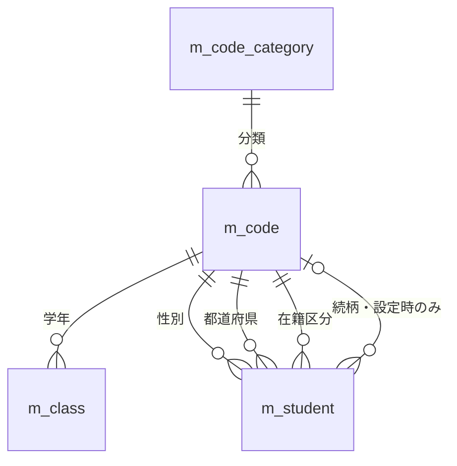
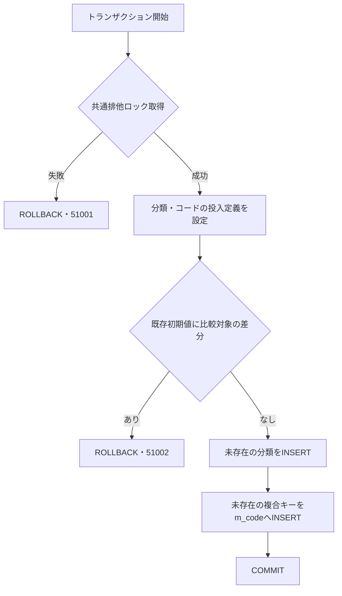
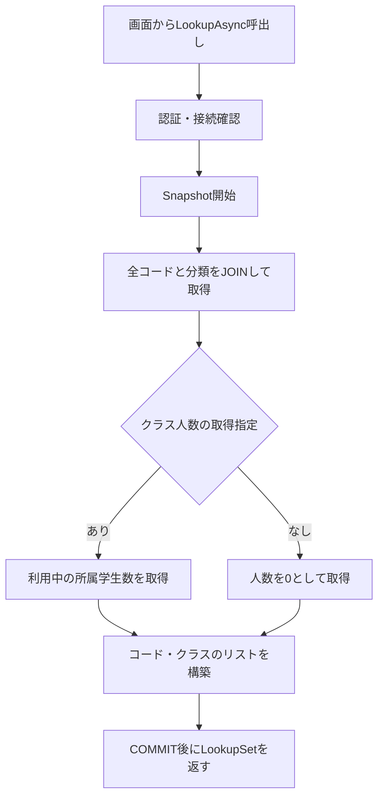
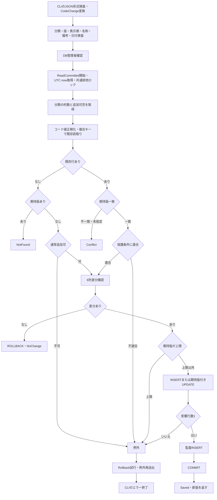
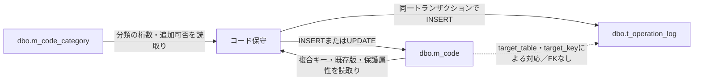

<!-- spec-meta: {"schema":"spec-md/1.0","documentId":"SM-DB-M-CODE","version":"1.0","path":"spec/database/tables/m_code.md","sheets":[{"sheet":"m_code","kind":"GRID","sections":[{"heading":"概要","kind":"GRID"},{"heading":"項目一覧","kind":"LIST","key":["物理名"],"columns":["No","論理名","物理名","PK","実DB型","容量・単位","NOT NULL","DB DEFAULT","制約・設定内容","根拠"]},{"heading":"制約一覧","kind":"LIST","key":["制約名"],"columns":["制約名","種別","定義内容","根拠"]},{"heading":"制約の解釈","kind":"GRID"},{"heading":"参照関係一覧","kind":"LIST","key":["制約名"],"columns":["制約名","参照元","参照先","必須性・分類条件","根拠"]},{"heading":"テーブル関連","kind":"GRID"},{"heading":"分類別初期設定","kind":"LIST","key":["分類"],"columns":["分類","分類名称","固定桁数","通常追加","初期コード件数","根拠"]},{"heading":"コード初期値","kind":"LIST","key":["分類","コード値"],"columns":["分類","コード値","コード名称","表示順","保護対象","根拠"]},{"heading":"初期投入共通値","kind":"GRID"},{"heading":"イベント仕様","kind":"GRID"},{"heading":"保守SQL引数","kind":"LIST","key":["引数"],"columns":["引数","値の取得元","SqlDbType・サイズ","対応列・用途","根拠"]},{"heading":"補足説明","kind":"GRID"}]}]} -->
# コード管理マスター dbo.m_code テーブル定義

文書ID：SM-DB-M-CODE　版：1.0　文書種別：DBテーブル定義　対象：SQL Server／dbo.m_code

論理テーブル名：コード管理マスタ　物理テーブル名：dbo.m_code　項目数：14　主キー順序：category_id → code_value

## 概要

コード管理マスタは、分類内のコード値に名称、表示順、利用可否、有効期間を対応させる永続データである。1行は分類とコード値の組で識別する。同じコード値でも分類が異なれば別のコードとして管理する。学生の性別・都道府県・在籍区分・緊急連絡先続柄と、クラスの学年が本表を参照する。学生検索結果では学年、在籍区分、都道府県の名称取得にも使用する。（根拠：`sources/database/001_schema.sql:112-135`、`sources/database/001_schema.sql:189-199`、`sources/Core/SqlServerStudentService.cs:82-90`）

論理名と項目の業務上の意味は参照設計に対応させる。参照設計の名称12文字、備考120文字、作成者・更新者64文字という長さは業務上限である。実装では、補助文字を格納できる物理容量と文字数の検査を別に定義しているため、以下ではSQL Serverの型・容量、DBの長さCHECK、サービスのUnicodeスカラー数検査を区別する。（設計上の根拠：`reference-designs/基本設計書/テーブル/04_m_code.md:9-18`、`reference-designs/基本設計書/テーブル/04_m_code.md:24-37`。実装上の根拠：`sources/database/001_schema.sql:113-134`、`sources/Core/StudentNormalizer.cs:37-57`）

通常保守の接続入口はCLIの`code`処理であり、`CodeChange`を`SaveCodeAsync`へ渡す。本表専用のWeb保守画面は、この接続入口には含まれない。Web画面は本表を候補取得と名称参照に使用する。コードの物理削除ではなく、`is_active`の更新によって利用停止を扱う。（根拠：`sources/maintenance/Program.cs:4-13`、`sources/Core/MasterMaintenanceService.cs:79-121`、`sources/Core/Contracts.cs:71-79`、`sources/database/003_web_permissions.sql:19-22`）

## 項目一覧

| No | 論理名 | 物理名 | PK | 実DB型 | 容量・単位 | NOT NULL | DB DEFAULT | 制約・設定内容 | 根拠 |
| --- | --- | --- | --- | --- | --- | --- | --- | --- | --- |
| 1 | コード分類 | category_id | 第1列 | varchar(24) COLLATE Latin1_General_100_BIN2 | 最大24バイト | YES | なし | m_code_category.category_idを参照。通常保守は5分類の完全一致を要求する。 | `sources/database/001_schema.sql:113-113`、`sources/database/001_schema.sql:127-127`、`sources/database/001_schema.sql:189-189`、`sources/Core/MasterMaintenanceService.cs:81-81` |
| 2 | コード値 | code_value | 第2列 | varchar(10) COLLATE Latin1_General_100_BIN2 | 最大10バイト | YES | なし | DBは空文字とASCII数字以外を拒否する。分類別の固定桁はサービスが検査する。先頭ゼロを文字列として保持する。 | `sources/database/001_schema.sql:114-114`、`sources/database/001_schema.sql:127-127`、`sources/database/001_schema.sql:203-203`、`sources/Core/MasterMaintenanceService.cs:91-99` |
| 3 | コード名称 | code_name | 対象外 | nvarchar(24) COLLATE Latin1_General_100_CS_AS_SC | 24 UTF-16コード単位／最大48バイト | YES | なし | DBのSC照合順序による長さ上限12。通常保守は原入力・Trim後とも12 Unicodeスカラー以内とし、必須・制御文字検査を行う。 | `sources/database/001_schema.sql:115-115`、`sources/database/001_schema.sql:128-128`、`sources/Core/MasterMaintenanceService.cs:82-82`、`sources/Core/StudentNormalizer.cs:37-57` |
| 4 | 表示順 | display_order | 対象外 | int | 整数。CHECK適用後は0以上 | YES | df_m_code_display_order：0 | 0は有効な順位。候補の同順位はcode_value昇順で並べる。 | `sources/database/001_schema.sql:116-116`、`sources/database/001_schema.sql:203-203`、`sources/Core/SqlServerStudentService.cs:203-205` |
| 5 | 利用可否 | is_active | 対象外 | bit | 真偽値0／1 | YES | df_m_code_is_active：1 | 本列はコード自身の状態。候補DTOのIsActiveは分類の状態も合成した値である。 | `sources/database/001_schema.sql:117-117`、`sources/Core/SqlServerStudentService.cs:203-205` |
| 6 | 有効開始日 | valid_from | 対象外 | date | 日単位 | YES | なし | 1900-01-01以上。初期投入は1900-01-01を明示する。通常保守は入力日を保存し、未来日も許容する。 | `sources/database/001_schema.sql:118-118`、`sources/database/001_schema.sql:203-203`、`sources/database/002_seed.sql:90-91`、`sources/Core/MasterMaintenanceService.cs:84-86` |
| 7 | 有効終了日 | valid_to | 対象外 | date | 日単位 | NO | なし | NULLは期限なし。非NULLならvalid_from以上。通常保守のnull・空文字はDB NULLへ変換する。 | `sources/database/001_schema.sql:119-119`、`sources/database/001_schema.sql:203-203`、`sources/Core/MasterMaintenanceService.cs:85-86`、`sources/Core/SqlServerStudentService.cs:67-72` |
| 8 | 保護対象 | is_protected | 対象外 | bit | 真偽値0／1 | YES | なし | 初期投入で各値の保護属性を明示する。通常保守の新規は0固定、更新では変更しない。保護検査はサービス側で実施する。 | `sources/database/001_schema.sql:120-120`、`sources/database/002_seed.sql:90-91`、`sources/Core/MasterMaintenanceService.cs:105-115` |
| 9 | 備考 | remarks | 対象外 | nvarchar(240) COLLATE Latin1_General_100_CS_AS_SC | 240 UTF-16コード単位／最大480バイト | NO | なし | DBの長さ上限120。通常保守は原入力120 Unicodeスカラー以内を確認し、改行統一・Trim後に空ならNULLを保存する。 | `sources/database/001_schema.sql:121-121`、`sources/database/001_schema.sql:129-129`、`sources/Core/MasterMaintenanceService.cs:83-83`、`sources/Core/StudentNormalizer.cs:47-57` |
| 10 | 作成日時 | created_at | 対象外 | datetimeoffset(7) | 秒の小数部7桁・オフセット付き日時 | YES | なし | UTCオフセット0。新規保守はUTC nowを設定する。通常更新の設定列には含めない。 | `sources/database/001_schema.sql:122-122`、`sources/database/001_schema.sql:130-130`、`sources/Core/MasterMaintenanceService.cs:88-88`、`sources/Core/MasterMaintenanceService.cs:113-115` |
| 11 | 作成者 | created_by | 対象外 | nvarchar(128) COLLATE Latin1_General_100_CS_AS_SC | 128 UTF-16コード単位／最大256バイト | YES | なし | DBの長さ上限64。通常保守はORIGINAL_LOGIN()を必須・原入力64／保存値64 Unicodeスカラー以内で検査し、新規時に設定する。 | `sources/database/001_schema.sql:123-123`、`sources/database/001_schema.sql:131-131`、`sources/Core/MasterMaintenanceService.cs:23-26`、`sources/Core/MasterMaintenanceService.cs:113-115` |
| 12 | 更新日時 | updated_at | 対象外 | datetimeoffset(7) | 秒の小数部7桁・オフセット付き日時 | YES | なし | UTCオフセット0。新規・実変更に設定する。時刻はトランザクション開始直後、排他ロック待機前に取得する。変更なしでは維持する。 | `sources/database/001_schema.sql:124-124`、`sources/database/001_schema.sql:132-132`、`sources/Core/MasterMaintenanceService.cs:88-90`、`sources/Core/MasterMaintenanceService.cs:109-120` |
| 13 | 更新者 | updated_by | 対象外 | nvarchar(128) COLLATE Latin1_General_100_CS_AS_SC | 128 UTF-16コード単位／最大256バイト | YES | なし | DBの長さ上限64。通常保守は検査済みORIGINAL_LOGIN()を新規・実変更時に設定する。変更なしでは維持する。 | `sources/database/001_schema.sql:125-125`、`sources/database/001_schema.sql:133-133`、`sources/Core/MasterMaintenanceService.cs:23-26`、`sources/Core/MasterMaintenanceService.cs:109-115` |
| 14 | 更新管理番号 | row_version | 対象外 | bigint | 正整数。SQL Serverのrowversion型ではない | YES | df_m_code_row_version：1 | DBは0以下を拒否する。通常保守は新規1、実変更ごとに1加算、変更なしは維持する。実変更時のlong.MaxValueを拒否する。 | `sources/database/001_schema.sql:126-126`、`sources/database/001_schema.sql:134-134`、`sources/Core/MasterMaintenanceService.cs:109-120` |

## 制約と関連テーブル

### 制約一覧

| 制約名 | 種別 | 定義内容 | 根拠 |
| --- | --- | --- | --- |
| pk_m_code | PRIMARY KEY | (category_id, code_value)。列順はcategory_idが先。 | `sources/database/001_schema.sql:127-127` |
| fk_code_category | FOREIGN KEY | category_id → dbo.m_code_category(category_id)。CASCADE指定なし。 | `sources/database/001_schema.sql:189-189` |
| ck_m_code_code_name_scalar | CHECK | code_name IS NULL OR L(code_name) <= 12。列自体はNOT NULL。 | `sources/database/001_schema.sql:115-115`、`sources/database/001_schema.sql:128-128` |
| ck_m_code_remarks_scalar | CHECK | remarks IS NULL OR L(remarks) <= 120。 | `sources/database/001_schema.sql:129-129` |
| ck_m_code_created_at_utc | CHECK | created_at IS NULL OR DATEPART(TZOFFSET,created_at)=0。列自体はNOT NULL。 | `sources/database/001_schema.sql:122-122`、`sources/database/001_schema.sql:130-130` |
| ck_m_code_created_by_scalar | CHECK | created_by IS NULL OR L(created_by) <= 64。列自体はNOT NULL。 | `sources/database/001_schema.sql:123-123`、`sources/database/001_schema.sql:131-131` |
| ck_m_code_updated_at_utc | CHECK | updated_at IS NULL OR DATEPART(TZOFFSET,updated_at)=0。列自体はNOT NULL。 | `sources/database/001_schema.sql:124-124`、`sources/database/001_schema.sql:132-132` |
| ck_m_code_updated_by_scalar | CHECK | updated_by IS NULL OR L(updated_by) <= 64。列自体はNOT NULL。 | `sources/database/001_schema.sql:125-125`、`sources/database/001_schema.sql:133-133` |
| ck_m_code_row_version | CHECK | row_version > 0。 | `sources/database/001_schema.sql:134-134` |
| ck_code_limits | CHECK | code_value<>'' AND code_value NOT LIKE '%[^0-9]%' COLLATE Latin1_General_100_BIN2 AND valid_from>='19000101' AND (valid_to IS NULL OR valid_to>=valid_from) AND display_order>=0。 | `sources/database/001_schema.sql:203-203` |

### 制約の解釈

制約一覧の`L(列)`は、次の実装式を読みやすく表したものである。`nvarchar(max)`への変換後、SC照合順序で長さを数える。末尾に付ける`#`は、`LEN`が末尾空白を除いて数える動作を避けるための検査用文字であり、保存列へ追加する値ではない。（根拠：`sources/database/001_schema.sql:128-133`）

```sql
LEN(CONVERT(nvarchar(max),列) COLLATE Latin1_General_100_CS_AS_SC + N'#') - 1
```

DBの長さCHECKと、通常保守の入力検査は責務が異なる。名称のNOT NULLと長さCHECKだけでは空文字を禁止しない。C#の`Text`は、原入力のUnicodeスカラー数を先に検査し、制御文字を確認してからTrimし、必須性と保存値の長さを検査する。不正なサロゲートの並びも`ScalarCount`で拒否する。したがって、DBの長さ式を入力正規化やUnicode妥当性検査の代わりに扱わない。（根拠：`sources/database/001_schema.sql:115-115`、`sources/database/001_schema.sql:128-133`、`sources/Core/StudentNormalizer.cs:37-57`）

分類別の固定桁、通常追加の可否、保護値の停止・期間短縮禁止は、本表のCHECKには定義されていない。通常保守は親分類の`code_length`・`allow_add`と既存コードの`is_protected`を読み、保存前に検査する。親分類には`code_length BETWEEN 1 AND 10`というCHECKがあるが、FKが保証するのは分類の存在であり、コード値の桁数と親分類の指定桁数の一致ではない。（根拠：`sources/database/001_schema.sql:112-135`、`sources/database/001_schema.sql:189-189`、`sources/database/001_schema.sql:202-203`、`sources/Core/MasterMaintenanceService.cs:91-107`）

### 参照関係一覧

| 制約名 | 参照元 | 参照先 | 必須性・分類条件 | 根拠 |
| --- | --- | --- | --- | --- |
| fk_code_category | dbo.m_code.category_id | dbo.m_code_category.category_id | category_idはNOT NULL。コードは1分類に属する。分類にコードが存在することは要求しない。 | `sources/database/001_schema.sql:113-113`、`sources/database/001_schema.sql:189-189` |
| fk_class_grade | dbo.m_class.(grade_category, grade_code) | dbo.m_code.(category_id, code_value) | 両列NOT NULL。ck_class_categoryでgrade_category='GRADE'。 | `sources/database/001_schema.sql:65-66`、`sources/database/001_schema.sql:190-190`、`sources/database/001_schema.sql:197-197` |
| fk_student_gender | dbo.m_student.(gender_category, gender_code) | dbo.m_code.(category_id, code_value) | 両列NOT NULL。ck_student_categoryでgender_category='GENDER'。 | `sources/database/001_schema.sql:15-16`、`sources/database/001_schema.sql:192-192`、`sources/database/001_schema.sql:196-196` |
| fk_student_prefecture | dbo.m_student.(prefecture_category, prefecture_code) | dbo.m_code.(category_id, code_value) | 両列NOT NULL。ck_student_categoryでprefecture_category='PREFECTURE'。 | `sources/database/001_schema.sql:18-19`、`sources/database/001_schema.sql:193-193`、`sources/database/001_schema.sql:196-196` |
| fk_student_enrollment | dbo.m_student.(enrollment_category, enrollment_status_code) | dbo.m_code.(category_id, code_value) | 両列NOT NULL。ck_student_categoryでenrollment_category='ENROLLMENT_STATUS'。 | `sources/database/001_schema.sql:25-26`、`sources/database/001_schema.sql:194-194`、`sources/database/001_schema.sql:196-196` |
| fk_student_relationship | dbo.m_student.(relationship_category, relationship_code) | dbo.m_code.(category_id, code_value) | 両列NULL可。緊急連絡先整合CHECKで関連4列を全NULLまたは全非NULLとし、設定時はrelationship_category='RELATIONSHIP'。 | `sources/database/001_schema.sql:29-32`、`sources/database/001_schema.sql:195-195`、`sources/database/001_schema.sql:199-199` |

### テーブル関連

以下はDDLのFKに基づく関連である。分類からコード、コードから参照元への件数は0件以上であり、参照元に最低1件の登録を要求する制約はない。続柄の参照は緊急連絡先を設定する場合に成立する。図の関連はコードの存在を保証するもので、利用可否・有効期間を保証するものではない。（根拠：`sources/database/001_schema.sql:15-31`、`sources/database/001_schema.sql:65-66`、`sources/database/001_schema.sql:189-199`）



参照FKにはCASCADE指定がない。コードの停止や期限変更によって参照元の保存コードを書き換える処理も、これらのFKには含まれない。検索時の名称JOINは、FKとは別の読取り処理として「補足説明」に示す。（根拠：`sources/database/001_schema.sql:189-195`、`sources/Core/SqlServerStudentService.cs:82-90`）

## 初期値

### 分類別初期設定

| 分類 | 分類名称 | 固定桁数 | 通常追加 | 初期コード件数 | 根拠 |
| --- | --- | --- | --- | --- | --- |
| GENDER | 性別 | 1 | 不可 | 4 | `sources/database/002_seed.sql:9-9`、`sources/database/002_seed.sql:15-18` |
| ENROLLMENT_STATUS | 在籍区分 | 2 | 不可 | 4 | `sources/database/002_seed.sql:10-10`、`sources/database/002_seed.sql:19-22` |
| PREFECTURE | 都道府県 | 2 | 不可 | 47 | `sources/database/002_seed.sql:11-11`、`sources/database/002_seed.sql:23-69` |
| RELATIONSHIP | 緊急連絡先続柄 | 2 | 可 | 8 | `sources/database/002_seed.sql:12-12`、`sources/database/002_seed.sql:70-77` |
| GRADE | 学年 | 2 | 可 | 7 | `sources/database/002_seed.sql:13-13`、`sources/database/002_seed.sql:78-84` |

### コード初期値

| 分類 | コード値 | コード名称 | 表示順 | 保護対象 | 根拠 |
| --- | --- | --- | --- | --- | --- |
| GENDER | `0` | 未回答 | 0 | 1 | `sources/database/002_seed.sql:15-15` |
| GENDER | `1` | 男性 | 10 | 0 | `sources/database/002_seed.sql:16-16` |
| GENDER | `2` | 女性 | 20 | 0 | `sources/database/002_seed.sql:17-17` |
| GENDER | `9` | その他 | 90 | 0 | `sources/database/002_seed.sql:18-18` |
| ENROLLMENT_STATUS | `01` | 在学 | 10 | 1 | `sources/database/002_seed.sql:19-19` |
| ENROLLMENT_STATUS | `02` | 休学 | 20 | 1 | `sources/database/002_seed.sql:20-20` |
| ENROLLMENT_STATUS | `03` | 卒業 | 30 | 1 | `sources/database/002_seed.sql:21-21` |
| ENROLLMENT_STATUS | `04` | 退学 | 40 | 1 | `sources/database/002_seed.sql:22-22` |
| PREFECTURE | `01` | 北海道 | 10 | 1 | `sources/database/002_seed.sql:23-23` |
| PREFECTURE | `02` | 青森県 | 20 | 1 | `sources/database/002_seed.sql:24-24` |
| PREFECTURE | `03` | 岩手県 | 30 | 1 | `sources/database/002_seed.sql:25-25` |
| PREFECTURE | `04` | 宮城県 | 40 | 1 | `sources/database/002_seed.sql:26-26` |
| PREFECTURE | `05` | 秋田県 | 50 | 1 | `sources/database/002_seed.sql:27-27` |
| PREFECTURE | `06` | 山形県 | 60 | 1 | `sources/database/002_seed.sql:28-28` |
| PREFECTURE | `07` | 福島県 | 70 | 1 | `sources/database/002_seed.sql:29-29` |
| PREFECTURE | `08` | 茨城県 | 80 | 1 | `sources/database/002_seed.sql:30-30` |
| PREFECTURE | `09` | 栃木県 | 90 | 1 | `sources/database/002_seed.sql:31-31` |
| PREFECTURE | `10` | 群馬県 | 100 | 1 | `sources/database/002_seed.sql:32-32` |
| PREFECTURE | `11` | 埼玉県 | 110 | 1 | `sources/database/002_seed.sql:33-33` |
| PREFECTURE | `12` | 千葉県 | 120 | 1 | `sources/database/002_seed.sql:34-34` |
| PREFECTURE | `13` | 東京都 | 130 | 1 | `sources/database/002_seed.sql:35-35` |
| PREFECTURE | `14` | 神奈川県 | 140 | 1 | `sources/database/002_seed.sql:36-36` |
| PREFECTURE | `15` | 新潟県 | 150 | 1 | `sources/database/002_seed.sql:37-37` |
| PREFECTURE | `16` | 富山県 | 160 | 1 | `sources/database/002_seed.sql:38-38` |
| PREFECTURE | `17` | 石川県 | 170 | 1 | `sources/database/002_seed.sql:39-39` |
| PREFECTURE | `18` | 福井県 | 180 | 1 | `sources/database/002_seed.sql:40-40` |
| PREFECTURE | `19` | 山梨県 | 190 | 1 | `sources/database/002_seed.sql:41-41` |
| PREFECTURE | `20` | 長野県 | 200 | 1 | `sources/database/002_seed.sql:42-42` |
| PREFECTURE | `21` | 岐阜県 | 210 | 1 | `sources/database/002_seed.sql:43-43` |
| PREFECTURE | `22` | 静岡県 | 220 | 1 | `sources/database/002_seed.sql:44-44` |
| PREFECTURE | `23` | 愛知県 | 230 | 1 | `sources/database/002_seed.sql:45-45` |
| PREFECTURE | `24` | 三重県 | 240 | 1 | `sources/database/002_seed.sql:46-46` |
| PREFECTURE | `25` | 滋賀県 | 250 | 1 | `sources/database/002_seed.sql:47-47` |
| PREFECTURE | `26` | 京都府 | 260 | 1 | `sources/database/002_seed.sql:48-48` |
| PREFECTURE | `27` | 大阪府 | 270 | 1 | `sources/database/002_seed.sql:49-49` |
| PREFECTURE | `28` | 兵庫県 | 280 | 1 | `sources/database/002_seed.sql:50-50` |
| PREFECTURE | `29` | 奈良県 | 290 | 1 | `sources/database/002_seed.sql:51-51` |
| PREFECTURE | `30` | 和歌山県 | 300 | 1 | `sources/database/002_seed.sql:52-52` |
| PREFECTURE | `31` | 鳥取県 | 310 | 1 | `sources/database/002_seed.sql:53-53` |
| PREFECTURE | `32` | 島根県 | 320 | 1 | `sources/database/002_seed.sql:54-54` |
| PREFECTURE | `33` | 岡山県 | 330 | 1 | `sources/database/002_seed.sql:55-55` |
| PREFECTURE | `34` | 広島県 | 340 | 1 | `sources/database/002_seed.sql:56-56` |
| PREFECTURE | `35` | 山口県 | 350 | 1 | `sources/database/002_seed.sql:57-57` |
| PREFECTURE | `36` | 徳島県 | 360 | 1 | `sources/database/002_seed.sql:58-58` |
| PREFECTURE | `37` | 香川県 | 370 | 1 | `sources/database/002_seed.sql:59-59` |
| PREFECTURE | `38` | 愛媛県 | 380 | 1 | `sources/database/002_seed.sql:60-60` |
| PREFECTURE | `39` | 高知県 | 390 | 1 | `sources/database/002_seed.sql:61-61` |
| PREFECTURE | `40` | 福岡県 | 400 | 1 | `sources/database/002_seed.sql:62-62` |
| PREFECTURE | `41` | 佐賀県 | 410 | 1 | `sources/database/002_seed.sql:63-63` |
| PREFECTURE | `42` | 長崎県 | 420 | 1 | `sources/database/002_seed.sql:64-64` |
| PREFECTURE | `43` | 熊本県 | 430 | 1 | `sources/database/002_seed.sql:65-65` |
| PREFECTURE | `44` | 大分県 | 440 | 1 | `sources/database/002_seed.sql:66-66` |
| PREFECTURE | `45` | 宮崎県 | 450 | 1 | `sources/database/002_seed.sql:67-67` |
| PREFECTURE | `46` | 鹿児島県 | 460 | 1 | `sources/database/002_seed.sql:68-68` |
| PREFECTURE | `47` | 沖縄県 | 470 | 1 | `sources/database/002_seed.sql:69-69` |
| RELATIONSHIP | `01` | 父 | 10 | 0 | `sources/database/002_seed.sql:70-70` |
| RELATIONSHIP | `02` | 母 | 20 | 0 | `sources/database/002_seed.sql:71-71` |
| RELATIONSHIP | `03` | 祖父 | 30 | 0 | `sources/database/002_seed.sql:72-72` |
| RELATIONSHIP | `04` | 祖母 | 40 | 0 | `sources/database/002_seed.sql:73-73` |
| RELATIONSHIP | `05` | 兄弟姉妹 | 50 | 0 | `sources/database/002_seed.sql:74-74` |
| RELATIONSHIP | `06` | 配偶者 | 60 | 0 | `sources/database/002_seed.sql:75-75` |
| RELATIONSHIP | `07` | 後見人 | 70 | 0 | `sources/database/002_seed.sql:76-76` |
| RELATIONSHIP | `99` | その他 | 990 | 0 | `sources/database/002_seed.sql:77-77` |
| GRADE | `00` | 学年なし | 0 | 1 | `sources/database/002_seed.sql:78-78` |
| GRADE | `01` | 1年 | 10 | 0 | `sources/database/002_seed.sql:79-79` |
| GRADE | `02` | 2年 | 20 | 0 | `sources/database/002_seed.sql:80-80` |
| GRADE | `03` | 3年 | 30 | 0 | `sources/database/002_seed.sql:81-81` |
| GRADE | `04` | 4年 | 40 | 0 | `sources/database/002_seed.sql:82-82` |
| GRADE | `05` | 5年 | 50 | 0 | `sources/database/002_seed.sql:83-83` |
| GRADE | `06` | 6年 | 60 | 0 | `sources/database/002_seed.sql:84-84` |

### 初期投入共通値

投入定義は合計70件であり、保護対象は53件、非保護は17件である。保護対象は、性別の未回答1件、在籍区分4件、都道府県47件、学年なし1件である。`GENDER/0`と`GRADE/00`は名称を持つ実コードであり、NULLや未選択を表す保存値ではない。（根拠：`sources/database/002_seed.sql:15-84`）

新たに投入する全コードは、`is_active=1`、`valid_from=1900-01-01`、`valid_to=NULL`、`remarks=NULL`、`row_version=1`とする。`created_at`と`updated_at`には同じUTCの`@now`を、`created_by`と`updated_by`には同じ`ORIGINAL_LOGIN()`の`@actor`を設定する。保護属性はコード初期値一覧の値を使用する。分類の初期投入でも`is_active=1`を明示する。（根拠：`sources/database/002_seed.sql:7-7`、`sources/database/002_seed.sql:88-91`）

初期投入による設定とDB DEFAULTは別である。特に、有効開始日の1900-01-01と新規保守の保護対象0は、INSERTが明示する値であり、DDLのDEFAULTではない。参照設計は有効開始日の業務初期値を1900-01-01とするが、通常保守のサービスは`CodeChange.ValidFrom`を解析して保存し、その初期値を補充する処理を持たない。（根拠：`sources/database/001_schema.sql:118-120`、`sources/database/002_seed.sql:90-91`、`sources/Core/MasterMaintenanceService.cs:84-85`、`sources/Core/MasterMaintenanceService.cs:113-115`。設計上の根拠：`reference-designs/基本設計書/テーブル/04_m_code.md:27-31`）

## イベント仕様

### 初期コード投入

#### 処理概要

初期投入SQLは、定義済みの5分類と70コードについて、既存値の整合を確認してから未存在のキーだけを追加する。既存値の上書きや、投入定義外コードの削除は行わない。（根拠：`sources/database/002_seed.sql:8-14`、`sources/database/002_seed.sql:85-92`）

#### 処理手順

1. `XACT_ABORT ON`を設定してトランザクションを開始し、共通資源`test-project1:student-write`の排他アプリケーションロックを取得する。待機上限は5000ミリ秒、所有者はTransaction、DB主体はpublicとする。負の戻り値ならROLLBACKし、51001を送出する。（根拠：`sources/database/002_seed.sql:2-6`）
2. UTCの実行時刻とDB接続の認証主体を取得し、分類・コードの投入材料をテーブル変数へ設定する。（根拠：`sources/database/002_seed.sql:7-84`）
3. 既存分類をcategory_idで結び、名称・桁数・追加可否・利用可否を比較する。既存コードは複合キーで結び、名称・表示順・保護属性・利用可否・開始日・終了日を比較する。いずれかに差分があればROLLBACKし、51002を送出する。（根拠：`sources/database/002_seed.sql:85-87`）
4. 分類を先に追加する。`NOT EXISTS`のcategory_id条件で未存在の分類だけを対象とする。続いて、category_idとcode_valueの両条件で未存在のコードだけを追加し、14列すべてを設定する。（根拠：`sources/database/002_seed.sql:88-91`）
5. 追加処理の後でCOMMITする。（根拠：`sources/database/002_seed.sql:92-92`）

#### 条件付き処理フロー



#### SQL・テーブル関連とDB操作の詳細

対象は`dbo.m_code_category`と`dbo.m_code`であり、関連は「テーブル関連」の分類FKに対応する。テーブル変数`@categories`・`@codes`は投入SQL内の一時材料で、永続マスターではない。抽出にORDER BY・ページングはなく、追加件数は未存在キーの件数によって決まる。（根拠：`sources/database/002_seed.sql:8-14`、`sources/database/002_seed.sql:88-91`）

再実行時の比較は、備考・作成情報・更新情報・row_versionを対象にしていない。例えば、既存初期コードの備考だけが変更されている場合、その変更を理由に51002とはせず、既存行の備考を上書きもしない。投入定義と名称等の比較対象が一致していれば、そのキーをINSERT対象から除外する。（根拠：`sources/database/002_seed.sql:85-91`）

#### 結果・例外時の扱い

ロック失敗と既存差分は、明示的なROLLBACKとエラー番号によって終了する。その他のSQLエラーには`XACT_ABORT ON`の設定が適用される。SQLには画面向けの結果DTOや、投入件数を返すSELECTは定義されていない。（根拠：`sources/database/002_seed.sql:2-6`、`sources/database/002_seed.sql:85-93`）

### 画面候補取得

#### 処理概要

Webの検索画面と学生登録・編集画面は、登録済みの`IStudentService`から`LookupAsync`を呼び、コードとクラスの候補を取得する。検索用は`includeOccupancy=false`、登録・編集用は既定のtrueを使用する。検索用でもコードの取得条件は同じであり、違いはクラス人数の取得有無である。（根拠：`sources/Program.cs:3-6`、`sources/Infrastructure/WebHostSetup.cs:19-19`、`sources/Web/Controllers/StudentsController.cs:23-25`、`sources/Web/Controllers/StudentsController.cs:39-39`、`sources/Infrastructure/WebStudentCoordinator.cs:17-17`、`sources/Core/SqlServerStudentService.cs:196-208`）

#### 処理手順

1. 認証主体と認証セッションを確認する。接続時にはSnapshot分離が有効であることを確認する。（根拠：`sources/Core/SqlServerStudentService.cs:46-63`、`sources/Core/SqlServerStudentService.cs:199-199`）
2. Snapshotトランザクションを開始する。（根拠：`sources/Core/SqlServerStudentService.cs:200-200`）
3. 本表と分類をcategory_idでINNER JOINし、コード候補8項目を全件取得する。コードと分類の両方が利用可の場合だけ、結果のIsActiveをtrueにする。（根拠：`sources/Core/SqlServerStudentService.cs:203-205`）
4. 第1結果セットを`CodeEntry`へ変換する。有効終了日のDB NULLは`DateOnly?`のnullとする。（根拠：`sources/Core/Contracts.cs:61-62`、`sources/Core/SqlServerStudentService.cs:210-212`）
5. 第2結果セットからクラスを取得する。人数取得ありの場合は、削除されておらず在籍区分が01・02の所属学生数を数える。人数取得なしの場合は0を返す。（根拠：`sources/Core/SqlServerStudentService.cs:201-201`、`sources/Core/SqlServerStudentService.cs:206-214`）
6. COMMITが正常復帰した後、CodesとClassesのリストを`LookupSet`として返す。（根拠：`sources/Core/Contracts.cs:65-65`、`sources/Core/SqlServerStudentService.cs:216-216`）

#### 条件付き処理フロー



#### SQL・テーブル関連とDB操作の詳細

コード候補SQLは次の形である。入力パラメータ、WHERE、件数上限、OFFSET/FETCHはない。停止コードと期間外コードも取得し、分類、表示順、コード値の昇順で返す。期間による選択可否は、このSQLでは判定しない。（根拠：`sources/Core/SqlServerStudentService.cs:203-205`）

```sql
SELECT c.category_id,c.code_value,c.code_name,c.display_order,
       CONVERT(bit,CASE WHEN c.is_active=1 AND k.is_active=1
                        THEN 1 ELSE 0 END) is_active,
       c.valid_from,c.valid_to,c.is_protected
  FROM dbo.m_code c
  JOIN dbo.m_code_category k ON k.category_id=c.category_id
 ORDER BY c.category_id,c.display_order,c.code_value;
```

クラス候補は、`m_class`から`m_code`へ`grade_category=category_id AND grade_code=code_value`でLEFT JOINする。並び順は年度降順、学年コードの表示順、クラスの表示順、クラスコード、クラスIDの順である。人数取得ありの場合の副問い合わせは`class_id`一致、`is_deleted=0`、`enrollment_status_code IN ('01','02')`を条件とする。これらの読取り関連は、分類・学年のFKを示したER図と対応する。（根拠：`sources/Core/SqlServerStudentService.cs:201-208`）

`CodeEntry`の型は、CategoryId・CodeValue・CodeNameがstring、DisplayOrderがint、IsActive・IsProtectedがbool、ValidFromがDateOnly、ValidToがDateOnly?である。備考、作成・更新情報、row_versionは候補DTOに含まれない。候補のIsActiveは合成値なので、コード保守で更新する本表のis_active保存値と区別する。（根拠：`sources/Core/Contracts.cs:61-65`、`sources/Core/SqlServerStudentService.cs:203-214`）

#### 結果・例外時の扱い

コードが0件の場合はCodesを空のリストとして返す。検索結果の0件表示とは別の状態であり、候補取得がマスターを追加することはない。読取り、結果セット移動、トランザクション開始とCOMMITにはCancellationTokenを渡す。認証・接続・DB操作で例外が発生した場合、`LookupAsync`内で正常な候補DTOへ置き換える処理はない。（根拠：`sources/Core/SqlServerStudentService.cs:196-216`）

### コード保守

#### 処理概要

CLIは操作種別`code`と入力JSONファイルを受け取り、camelCaseの入力を`CodeChange`へ変換して保存する。入力DTOはCategoryId:string、CodeValue:string、ExpectedVersion:long?、CodeName:string、DisplayOrder:int、IsActive:bool、ValidFrom:string、ValidTo:string?、Remarks:string?である。保護属性と作成・更新情報は入力項目に含まれない。（根拠：`sources/maintenance/Program.cs:4-12`、`sources/Core/MasterMaintenanceService.cs:10-10`）

保存時は共通排他ロックによって関連書込みを直列化し、既存更新には期待版を要求する。実変更だけをDMLと監査記録へ進め、COMMIT後に保存結果を返す。（根拠：`sources/Core/MasterMaintenanceService.cs:88-121`、`sources/Core/SqlServerStudentService.cs:92-101`）

#### 処理手順

1. CLIは読取り後の入力が65536バイト以下であること、JSONルートがオブジェクトであること、ルートの同名項目が重複しないことを確認する。DTOに未定義の項目はデシリアライズ時に拒否する。（根拠：`sources/maintenance/Program.cs:8-12`）
2. サービスはCategoryIdがGENDER・ENROLLMENT_STATUS・PREFECTURE・RELATIONSHIP・GRADEのいずれかに完全一致すること、指定されたExpectedVersionが正数であること、DisplayOrderが非負であることを確認する。（根拠：`sources/Core/MasterMaintenanceService.cs:81-81`）
3. 名称と備考を正規化する。名称は原入力12 Unicodeスカラー以内、制御文字なし、Trim後に必須かつ12以内とする。備考は原入力120以内を確認してからCRLF・CRをLFに統一し、LF以外の制御文字を拒否してTrimする。空になった備考はnullとする。名称・備考のText処理はFormKC変換を行わない。（根拠：`sources/Core/MasterMaintenanceService.cs:82-83`、`sources/Core/StudentNormalizer.cs:37-57`）
4. 開始日と、空でない終了日をFormKC後のyyyy-MM-dd形式で解析する。1900-01-01以上を要求し、終了日が開始日より前ならE-MST-004とする。終了日のnull・空文字だけを期限なしとし、空白だけの文字列を同じ扱いにはしない。未来日の禁止は行わない。（根拠：`sources/Core/MasterMaintenanceService.cs:84-86`、`sources/Core/JapaneseDateService.cs:52-59`）
5. DB接続でORIGINAL_LOGIN()とIS_ROLEMEMBER('student_admin')を取得する。管理者所属が1でなければ拒否する。認証主体は必須・原入力と保存値とも64 Unicodeスカラー以内で検査する。（根拠：`sources/Core/MasterMaintenanceService.cs:17-28`）
6. ReadCommittedトランザクションを開始し、UTCのnowを取得した後、共通排他ロックを取得する。（根拠：`sources/Core/MasterMaintenanceService.cs:88-90`、`sources/Core/SqlServerStudentService.cs:92-101`）
7. CategoryIdで分類のcode_length・allow_addを読む。分類がなければE-MST-001とする。このSELECTは分類のis_activeを取得しない。コード値は原入力を指定桁以内で検査し、Trim、FormKCの順に処理した後、結果が指定桁数のASCII数字だけであることを確認する。数値化やゼロ埋めはしない。（根拠：`sources/Core/MasterMaintenanceService.cs:91-96`、`sources/Core/StudentNormalizer.cs:113-117`）
8. 正規化した複合キーで既存コード全列を読む。既存なし・期待版ありはNotFound、既存あり・期待版なしまたは不一致はConflictとする。既存なし・期待版なしの場合だけ新規とし、allow_add=falseならE-MST-003で拒否する。（根拠：`sources/Core/MasterMaintenanceService.cs:98-104`）
9. 既存行が保護対象なら、保存するIsActiveがfalseである場合、開始日を既存より後にする場合、非NULLの終了日で既存の期限なしを期限付きにする場合、または既存終了日より前にする場合をE-MST-003で拒否する。（根拠：`sources/Core/MasterMaintenanceService.cs:105-107`）
10. 正規化後の名称、表示順、利用可否、開始日、終了日、備考の6列を比較する。差分なしは明示ROLLBACKしてNoChangeを返す。日付はDateOnlyとDBのDateTimeの日付部分を比較する。差分ありで期待版がlong.MaxValueなら版上限として拒否する。（根拠：`sources/Core/MasterMaintenanceService.cs:109-112`、`sources/Core/MasterMaintenanceService.cs:123-123`）
11. 新規は14列を指定してINSERTし、既存は複合キーと期待版をWHEREに付けてUPDATEする。影響行数が1でなければDBConcurrencyExceptionとする。（根拠：`sources/Core/MasterMaintenanceService.cs:113-116`）
12. 新版を期待版または0に1を加えた値として計算し、同じトランザクションへ監査をINSERTする。COMMITが正常復帰した後にSavedと新版を返す。トランザクション内の例外はRollbackを試みて再送出する。（根拠：`sources/Core/MasterMaintenanceService.cs:118-121`、`sources/Core/MasterMaintenanceService.cs:132-135`）

#### 条件付き処理フロー



入力検査・DB接続・ロック・SQL・監査・COMMITで発生する例外も、それぞれの段階からエラー終了へ進む。NotFoundとConflictはDML前の早期戻りであり、明示Rollbackではなく`await using`によるトランザクション破棄へ進む。（根拠：`sources/Core/MasterMaintenanceService.cs:81-104`、`sources/Core/MasterMaintenanceService.cs:119-121`、`sources/maintenance/Program.cs:14-17`）

#### SQL・テーブル関連

保守は親分類を読み、本表を書き、監査表へ操作記録を追加する。分類と本表の関係はFKである。一方、監査は`target_table='m_code'`と`target_key=分類+':'+コード値`によるアプリケーション上の対応で、本表へのFKはない。（根拠：`sources/database/001_schema.sql:137-154`、`sources/database/001_schema.sql:189-205`、`sources/Core/MasterMaintenanceService.cs:92-99`、`sources/Core/MasterMaintenanceService.cs:119-135`）



共通ロックは`XACT_ABORT ON`、資源`test-project1:student-write`、Exclusive、Transaction所有、public主体、5000ミリ秒待機で取得する。取得結果が負なら51001を送出する。学生保存・削除、クラス保守、初期投入も同じ資源を使う入口である。（根拠：`sources/Core/SqlServerStudentService.cs:92-101`、`sources/Core/SqlServerStudentService.cs:244-244`、`sources/Core/SqlServerStudentService.cs:403-403`、`sources/Core/MasterMaintenanceService.cs:42-42`、`sources/database/002_seed.sql:3-6`）

#### DB操作の詳細

分類読取りは`WHERE category_id=@category`でcode_lengthとallow_addの2列を返す。既存コード読取りは`WHERE category_id=@category AND code_value=@value`で全列を返す。いずれもORDER BY・ページングはなく、キー制約により対象は最大1行である。（根拠：`sources/Core/MasterMaintenanceService.cs:92-100`、`sources/database/001_schema.sql:102-102`、`sources/database/001_schema.sql:127-127`）

新規INSERTでは、入力由来の8列に加え、保護属性0、作成・更新情報、版1を明示する。DB DEFAULTがある列も、この入口では省略しない。（根拠：`sources/Core/MasterMaintenanceService.cs:113-115`）

```sql
INSERT dbo.m_code
(category_id,code_value,code_name,display_order,is_active,
 valid_from,valid_to,is_protected,remarks,
 created_at,created_by,updated_at,updated_by,row_version)
VALUES
(@category,@value,@name,@order,@active,
 @from,@to,0,@remarks,@now,@actor,@now,@actor,1);
```

既存UPDATEでは、差分列だけでなく下記9列を設定する。主キー、is_protected、created_at、created_byは変更しない。期待版は読取り時の比較に加えて、DMLのWHEREにも含める。（根拠：`sources/Core/MasterMaintenanceService.cs:103-116`）

```sql
UPDATE dbo.m_code
   SET code_name=@name,
       display_order=@order,
       is_active=@active,
       valid_from=@from,
       valid_to=@to,
       remarks=@remarks,
       updated_at=@now,
       updated_by=@actor,
       row_version=row_version+1
 WHERE category_id=@category
   AND code_value=@value
   AND row_version=@version;
```

共通ParamはDateOnlyを午前0時のDateTimeへ変換し、nullをDBNull.Valueへ変換する。共通Commandのタイムアウトは30秒である。引数サイズのNVarChar(24)・NVarChar(240)・NVarChar(128)は物理容量であり、入力検査の12・120・64 Unicodeスカラーという上限とは別である。（根拠：`sources/Core/SqlServerStudentService.cs:65-72`、`sources/Core/MasterMaintenanceService.cs:115-115`）

#### 保守SQL引数

| 引数 | 値の取得元 | SqlDbType・サイズ | 対応列・用途 | 根拠 |
| --- | --- | --- | --- | --- |
| @category | CodeChange.CategoryId | VarChar(24) | category_id。分類読取り・既存読取り・保存対象キー。 | `sources/Core/MasterMaintenanceService.cs:93-93`、`sources/Core/MasterMaintenanceService.cs:99-99`、`sources/Core/MasterMaintenanceService.cs:115-115` |
| @value | 正規化後CodeValue | VarChar(10) | code_value。既存読取り・保存対象キー。 | `sources/Core/MasterMaintenanceService.cs:96-99`、`sources/Core/MasterMaintenanceService.cs:115-115` |
| @name | 正規化後CodeName | NVarChar(24) | code_name。 | `sources/Core/MasterMaintenanceService.cs:82-82`、`sources/Core/MasterMaintenanceService.cs:115-115` |
| @order | CodeChange.DisplayOrder | Int | display_order。 | `sources/Core/MasterMaintenanceService.cs:115-115` |
| @active | CodeChange.IsActive | Bit | is_active。 | `sources/Core/MasterMaintenanceService.cs:115-115` |
| @from | 解析済みValidFrom | Date | valid_from。 | `sources/Core/MasterMaintenanceService.cs:84-84`、`sources/Core/MasterMaintenanceService.cs:115-115` |
| @to | 解析済みValidToまたはnull | Date | valid_to。nullはDB NULL。 | `sources/Core/MasterMaintenanceService.cs:85-85`、`sources/Core/MasterMaintenanceService.cs:115-115` |
| @remarks | 正規化後Remarksまたはnull | NVarChar(240) | remarks。空になった値はDB NULL。 | `sources/Core/MasterMaintenanceService.cs:83-83`、`sources/Core/MasterMaintenanceService.cs:115-115` |
| @now | DateTimeOffset.UtcNow | DateTimeOffset | 新規のcreated_at・updated_at、更新のupdated_at。 | `sources/Core/MasterMaintenanceService.cs:88-88`、`sources/Core/MasterMaintenanceService.cs:113-115` |
| @actor | 検査済みORIGINAL_LOGIN() | NVarChar(128) | 新規のcreated_by・updated_by、更新のupdated_by。 | `sources/Core/MasterMaintenanceService.cs:23-26`、`sources/Core/MasterMaintenanceService.cs:113-115` |
| @version | CodeChange.ExpectedVersion | BigInt | 既存UPDATEの比較版。新規INSERTでは使用しない。 | `sources/Core/MasterMaintenanceService.cs:113-115` |

#### 監査の設定内容

監査INSERTは、target_tableにm_code、target_keyに分類とコード値をコロンで結んだ文字列、before_versionに入力期待版、after_versionに計算した新版、changed_columnsに差分列名のJSON配列を設定する。executed_byとexecuted_atは本表保存と同じactor・nowを使い、correlation_idは新しいGUID、operation_reasonはNULL、duplicate_confirmedは0とする。（根拠：`sources/Core/MasterMaintenanceService.cs:109-120`、`sources/Core/MasterMaintenanceService.cs:132-135`）

新規の差分配列は、名称・表示順・利用可否・開始日・終了日・備考の6列である。全INSERT列の一覧ではない。操作種別は新規CREATE、利用可否不変UPDATE、falseからtrueへの変更ENABLE、trueからfalseへの変更DISABLEとする。停止済みコードの名称等を変更した場合も、利用可否が変わらなければUPDATEとなる。（根拠：`sources/Core/MasterMaintenanceService.cs:109-119`、`sources/Core/AuditOperation.cs:6-7`）

#### 結果・例外時の扱い

SavedはCOMMIT正常復帰後に返し、RowVersionは計算した新版、Messageは「コードを保存しました。」とする。NoChangeは明示ROLLBACK後に入力期待版と「変更内容がありません。」を返す。この場合、DML、監査INSERT、更新日時・更新者の変更、版加算は行わない。（根拠：`sources/Core/MasterMaintenanceService.cs:109-120`）

NotFoundは対象コードなしで期待版が指定されている場合、Conflictは既存コードの版が入力期待版と一致しない場合に返す。いずれもRowVersionはnullである。コード保守のSameNameWarningは、結果レコードの既定値falseのままである。（根拠：`sources/Core/MasterMaintenanceService.cs:11-11`、`sources/Core/MasterMaintenanceService.cs:102-103`、`sources/Core/MasterMaintenanceService.cs:120-120`）

保護対象では、入力IsActive=falseを常に拒否する。既存が停止状態でも、falseのまま保存する処理はこの検査を通らない。保護検査と期待版検査は変更なし判定より先に行うため、差分がない入力でも、それらの前提を満たす必要がある。保護対象の名称・表示順・備考を一律に変更禁止とはしていない。（根拠：`sources/Core/MasterMaintenanceService.cs:103-111`）

DB操作とCOMMITにはctを渡す。例外時の共通RollbackはCancellationToken.Noneで試みるが、戻り値の成功可否をコード保守結果へ反映せず、元の例外を再送出する。コード保守には学生保存のwriteStarted・commitAttemptedによるUnknown判定はない。このため、COMMIT時の通信失敗を、CLIのエラー終了だけから取消成功と判断することはできない。（根拠：`sources/Core/MasterMaintenanceService.cs:88-121`、`sources/Core/SqlServerStudentService.cs:319-329`）

CLIは結果をJSON出力し、Saved・NoChangeなら終了コード0、NotFound・Conflict等の結果なら1とする。入力検査・引数・権限例外は対応するメッセージを表示する。その他の例外は「処理結果を確認できません。再実行前にマスタを照会してください。」として終了コード1とする。CLIはサービスへctを指定せず、既定値で呼ぶ。（根拠：`sources/maintenance/Program.cs:12-17`）

## 補足説明

### 有効期間と保護対象の意味

選択可否の判定では開始日当日と終了日当日を有効期間に含める。終了日NULLは期限なしであり、日付の未解析やゼロ日付ではない。学生保存とクラス保守の判定日は、UTC時刻を+09:00へ変換した業務日である。（根拠：`sources/Core/SqlServerStudentService.cs:44-45`、`sources/Core/SqlServerStudentService.cs:349-354`、`sources/Core/MasterMaintenanceService.cs:40-40`、`sources/Core/MasterMaintenanceService.cs:59-63`）

保護対象は停止と期間短縮を防ぐ属性である。開始日を既存より前へ広げる変更、終了日を既存より後へ延ばす変更、終了日をNULLへ変更する延長は、保護条件だけを理由には拒否しない。ただし、初期保護値は開始日1900-01-01・終了日NULLなので、日付下限と保護検査を合わせると、通常保守でその開始日を変更したり終了期限を付けたりすることはできない。（根拠：`sources/Core/MasterMaintenanceService.cs:105-107`、`sources/Core/JapaneseDateService.cs:57-58`、`sources/database/002_seed.sql:90-91`）

### 候補、選択済み値、保存値

学生登録画面の性別REG-006、都道府県REG-008、在籍区分REG-014、続柄REG-021は、それぞれGENDER、PREFECTURE、ENROLLMENT_STATUS、RELATIONSHIPの候補を表示する。optionのvalueにはCodeValue、表示にはCodeNameを使用する。合成IsActiveがtrueで業務日が有効期間内の値、または読込み済み学生の同じ保存値を選択可能とし、それ以外をdisabledにする。候補取得SQLが停止・期間外を除外しないことにより、既存値を画面へ残すことができる。（根拠：`sources/Views/Students/Edit.cshtml:5-13`、`sources/Core/SqlServerStudentService.cs:203-205`）

登録画面の学年REG-017にはGRADEの全候補を表示し、このコントロール自体に停止・期限によるdisabled判定はない。検索画面の学年SRC-005、在籍区分、都道府県SRC-009も、コードの停止・期限によって候補を除外しない。検索の学年・都道府県の空値と、在籍区分の全解除は絞込みなしを表す。これらの空値をGENDER/0やGRADE/00と同じコードとして保存しない。（根拠：`sources/Views/Students/Edit.cshtml:12-12`、`sources/Views/Students/Search.cshtml:5-5`、`sources/Web/Controllers/StudentsController.cs:14-14`、`sources/Core/SqlServerStudentService.cs:118-125`、`sources/Core/SqlServerStudentService.cs:151-154`）

### 参照元保存時のコード再検査

学生保存は、入力正規化、共通排他ロック、既存学生の期待版確認を経て、性別・都道府県・在籍区分・続柄のコードを再検査する。続柄がnullの場合はコード照合を省く。それ以外は次のSQLで、コードと分類の状態、有効期間を複合キーにより最大1行取得する。@categoryはVarChar(24)、@valueはVarChar(10)であり、ORDER BY・ページングはない。（根拠：`sources/Core/SqlServerStudentService.cs:229-260`、`sources/Core/SqlServerStudentService.cs:344-356`）

```sql
SELECT c.is_active,k.is_active,c.valid_from,c.valid_to
  FROM dbo.m_code c
  JOIN dbo.m_code_category k ON k.category_id=c.category_id
 WHERE c.category_id=@category AND c.code_value=@value;
```

存在しないコードはE-STU-009となる。新規学生または保存値からコードを変更する場合は、コード・分類のいずれかが停止、開始日前、終了日後ならE-STU-011となる。既存と同じ保存値は、存在を確認した上で停止・期間外でも保持を認める。検査エラーはInputValidationExceptionへまとめ、学生保存の例外処理がRollbackを試みてValidationFailedを返す。この照合自体は本表を更新しない。（根拠：`sources/Core/SqlServerStudentService.cs:347-355`、`sources/Core/SqlServerStudentService.cs:383-383`、`sources/Core/SqlServerStudentService.cs:316-316`）

クラス保守も、共通ロック取得後にGRADEのコードと分類をJOINする。@gradeはVarChar(2)で、条件は`c.category_id='GRADE' AND c.code_value=@grade`である。不存在をE-STU-009、新規または学年変更時の停止・期間外をE-STU-011とする。既存と同じ学年は保持できるが、削除済みを含む参照学生が1件でもいるクラスでは学年変更を拒否する。後続のクラスDML・監査・COMMITはクラス保守の処理であり、本表へのDMLは行わない。（根拠：`sources/Core/MasterMaintenanceService.cs:34-34`、`sources/Core/MasterMaintenanceService.cs:42-77`）

コード自体を保守するSaveCodeAsyncは、分類のcode_length・allow_addだけを読み、分類停止を検査しない。候補の合成状態や参照元保存時の利用可否検査を、コード保守の条件へ混在させない。また、学生保存のGRADE入力は上述のコード検査ループに含まれず、選択クラスの年度・学年との一致を確認する。（根拠：`sources/Core/MasterMaintenanceService.cs:92-94`、`sources/Core/SqlServerStudentService.cs:347-347`、`sources/Core/SqlServerStudentService.cs:363-371`）

### 検索条件の存在検査と名称JOIN

学生検索で指定された学年・都道府県は、任意の2桁数字として正規化した後、`COUNT_BIG(*) FROM dbo.m_code WHERE category_id=@category AND code_value=@value`が1であることを確認する。@categoryはVarChar(24)、@valueはVarChar(10)である。この検査には利用可否、有効期間、分類状態の条件がなく、停止・期間外コードも検索条件として使用できる。在籍区分入力は重複なし・最大4件・01〜04に限定する。（根拠：`sources/Core/SqlServerStudentService.cs:111-125`、`sources/Core/SqlServerStudentService.cs:218-222`）

名称取得の共通RowSelectは、学生からクラスをclass_idでLEFT JOINし、学年名称はクラスのgrade_category・grade_code、在籍区分名称は学生のenrollment_category・enrollment_status_code、都道府県名称は学生のprefecture_category・prefecture_codeで本表をLEFT JOINする。各JOINに利用可否・有効期間・分類状態の条件はない。したがって、保存コードが停止または期間外でも名称取得の対象になる。（根拠：`sources/Core/SqlServerStudentService.cs:82-90`）

```sql
FROM dbo.m_student s
LEFT JOIN dbo.m_class c ON c.class_id=s.class_id
LEFT JOIN dbo.m_code g
       ON g.category_id=c.grade_category AND g.code_value=c.grade_code
LEFT JOIN dbo.m_code e
       ON e.category_id=s.enrollment_category
      AND e.code_value=s.enrollment_status_code
LEFT JOIN dbo.m_code p
       ON p.category_id=s.prefecture_category
      AND p.code_value=s.prefecture_code
```

名称はgrade_name、status_name、prefecture_nameとしてStudentRowへ移送する。住所表示は都道府県名称とaddress_line1を連結し、都道府県名称がNULLの場合は「[不整合]」を補う。これらは検索・重複候補の表示値であり、学生へ名称を再保存する処理ではない。（根拠：`sources/Core/SqlServerStudentService.cs:77-90`、`sources/Core/SqlServerStudentService.cs:162-168`、`sources/Core/SqlServerStudentService.cs:269-272`）

RowSelectを使用する学生検索は、`s.is_deleted=0`を必須条件とする。入力指定時だけ、学籍番号前方一致、氏名照合キー部分一致、カナ照合キー部分一致、クラス年度一致、クラス学年一致、学生class_id一致、未所属の`class_id IS NULL`、都道府県一致、本人電話または緊急電話一致、入学日下限・上限、選択在籍区分のIN条件をANDで追加する。未指定値をNULLとの等値比較にはせず、条件自体を追加しない。LIKEは`!`をESCAPE文字として扱う。（根拠：`sources/Core/SqlServerStudentService.cs:137-155`）

検索引数の型・サイズは、@no=VarChar(31)、@name=NVarChar(642)、@kana=NVarChar(74)、@year=SmallInt、@grade=VarChar(2)、@class=BigInt、@prefecture=VarChar(2)、@phone=VarChar(16)、@from・@to=Date、各@status=VarChar(2)である。件数検査は同じ条件のTOP(10001)をCOUNT_BIGで数え、10000を超えた場合は一覧を取得しない。この検査用件数は10001で打ち切られる。（根拠：`sources/Core/SqlServerStudentService.cs:140-159`）

通常の一覧は、学籍番号・氏名照合キー・入学日・更新日時から指定した列を昇順または降順とし、第2キーをstudent_id ASCとする。@offset・@sizeはIntで、OFFSET/FETCHにより20・50・100件のページを取得する。指定ページが最終ページを超えれば最終ページへ補正する。Snapshot内の読取りとCOMMITにctを渡し、正常時はSearchResultのNoChangeを返す。入力不正はValidationFailedを返す。ここでの件数上限とページングは学生検索のものであり、コード候補の全件取得へ適用しない。（根拠：`sources/Core/SqlServerStudentService.cs:107-108`、`sources/Core/SqlServerStudentService.cs:124-124`、`sources/Core/SqlServerStudentService.cs:156-170`）

重複候補のRowSelectには、`s.is_deleted=0`、`@id IS NULL OR s.student_id<>@id`、`s.birth_date=@birth`、`s.name_key=@name OR s.kana_key=@kana`の条件をANDで付け、student_id順で全件取得する。@idはBigInt、@birthはDate、@nameはNVarChar(320)、@kanaはNVarChar(36)である。この取得にもコードの停止・期限の条件はなく、SQL上のページングはない。確認結果へ渡す候補一覧は先頭20件とし、候補件数は別に保持する。（根拠：`sources/Core/SqlServerStudentService.cs:269-290`）

### 権限と削除境界

権限SQLはstudent_viewerへ本表と分類のSELECTを付与し、student_staffをviewerのメンバー、student_adminをstaffのメンバーにする。student_adminには本表のINSERT・UPDATEを付与する一方、本表DELETEと分類のINSERT・UPDATE・DELETEをDENYする。CLIのサービスも接続ごとに管理者ロールを確認する。（根拠：`sources/database/003_web_permissions.sql:10-22`、`sources/Core/MasterMaintenanceService.cs:23-25`）

通常コード保守にはDELETE処理がなく、利用停止はis_activeのUPDATEである。DBのINSERT・UPDATE権限は、サービスが実施する分類別固定桁、追加可否、保護条件をDB CHECKへ追加するものではない。DB制約で保証する内容は「制約一覧」、保守入口で保証する内容は「コード保守」に従う。（根拠：`sources/Core/MasterMaintenanceService.cs:79-121`、`sources/database/001_schema.sql:112-135`、`sources/database/001_schema.sql:202-203`）

### 作成・更新情報と一時保持領域

参照設計は、作成情報を最初の保存で自動設定して変更不可、更新情報を実変更時に設定する意図を示す。通常保守のINSERT・UPDATEはこの区分に対応するが、保存するnowは排他ロック待機前の取得時刻であり、COMMIT完了時刻そのものではない。また、DB CHECKはUTCオフセットを保証するだけで、作成情報の更新禁止を定義してはいない。（設計上の根拠：`reference-designs/基本設計書/テーブル/04_m_code.md:33-37`。実装上の根拠：`sources/database/001_schema.sql:130-133`、`sources/Core/MasterMaintenanceService.cs:88-90`、`sources/Core/MasterMaintenanceService.cs:113-120`）

マスターの保存先はdbo.m_codeである。LookupSetはDB読取り結果としてページモデルに渡される。検索条件・検索結果はSearchContextStoreのConcurrentDictionary、編集取消用の読込み時学生情報・入力値はEditorSnapshotStoreのConcurrentDictionaryに保持する。これらは所有者・認証セッションと30分の期限を確認するサーバーメモリ上の一時状態で、本表の保守データではない。（根拠：`sources/Core/SqlServerStudentService.cs:210-216`、`sources/Web/Controllers/StudentsController.cs:25-25`、`sources/Web/Controllers/StudentsController.cs:39-39`、`sources/Infrastructure/SearchContextStore.cs:9-14`、`sources/Infrastructure/EditorSnapshotStore.cs:7-10`）

検索クリアは検索条件と結果を未設定へ戻す。編集resetは読込み時の入力値をコピーし、候補を再取得する。どちらも本表のUPDATE・DELETEではない。取得済み検索結果に名称が残っていても、そのメモリ値がマスターの保存値になることはない。（根拠：`sources/Infrastructure/WebStudentCoordinator.cs:15-15`、`sources/Web/Controllers/StudentsController.cs:21-21`、`sources/Web/Controllers/StudentsController.cs:35-35`、`sources/Infrastructure/EditorSnapshotStore.cs:11-11`）

### 候補処理の接続入口

公開されているPOST /students/optionsは、フォームの検索条件を受けてSearchModelを構築し、Searchビューを返す処理である。年度・学年に合わない選択済みクラスは解除する。WebStudentCoordinator.Options(OptionsRequest)は別に宣言されたhelperであり、このコントローラー処理からの呼出しはない。helperの宣言を、候補JSONを返す公開APIの実装として扱わない。（根拠：`sources/Web/Controllers/StudentsController.cs:22-22`、`sources/Web/Controllers/StudentsController.cs:39-39`、`sources/Infrastructure/WebStudentCoordinator.cs:16-16`）
