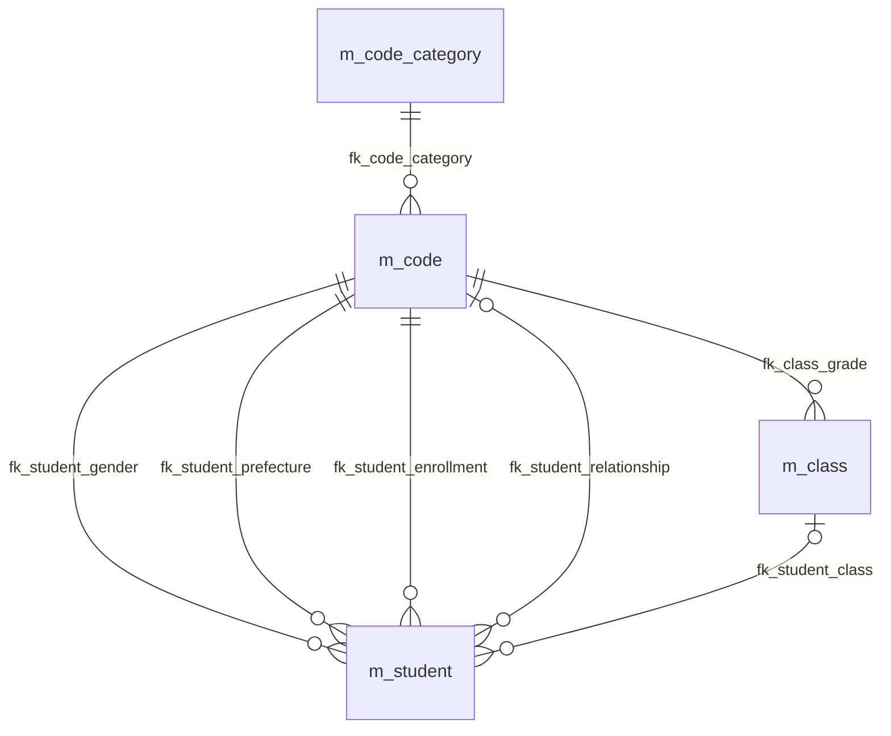
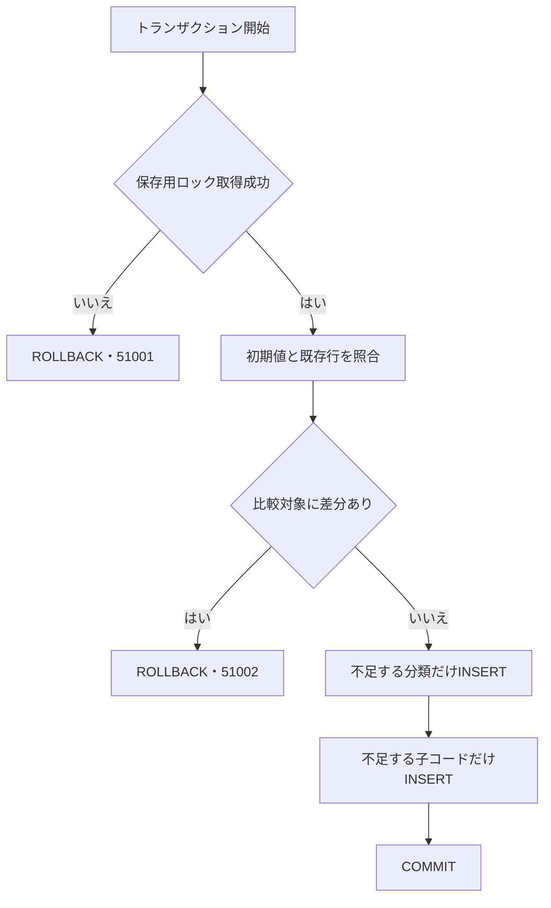
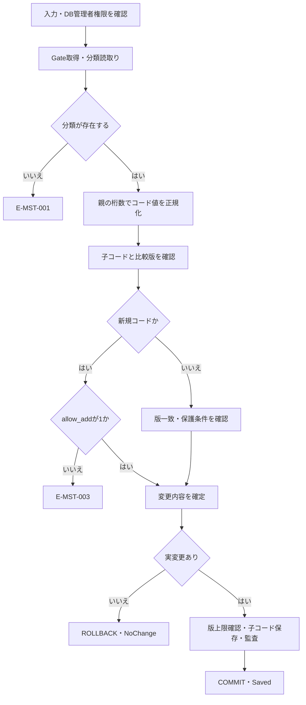
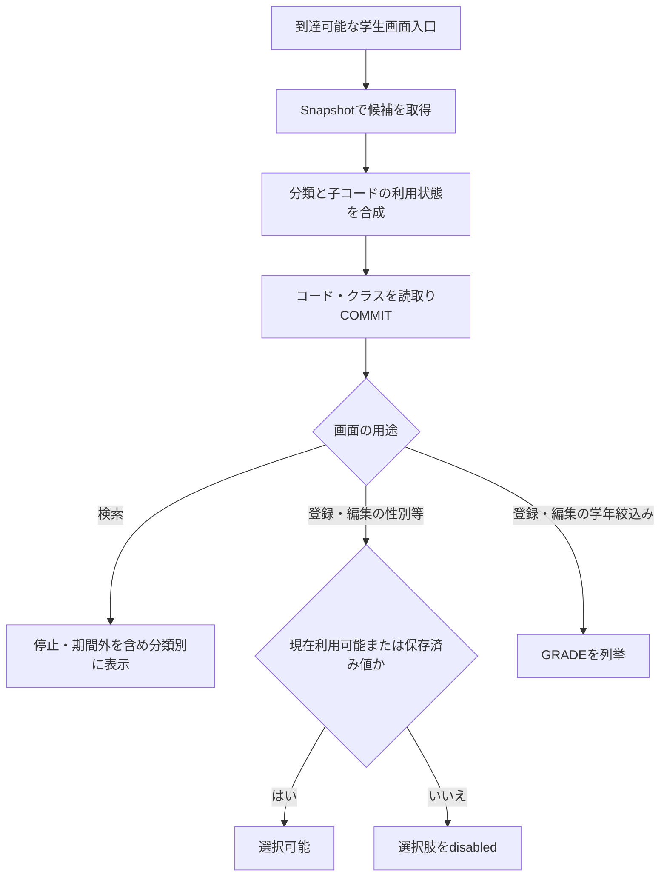
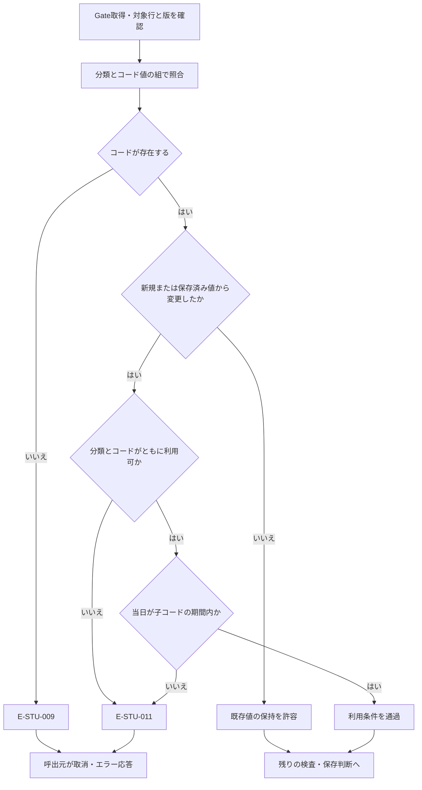

<!-- spec-meta: {"schema":"spec-md/1.0","documentId":"SM-DB-M-CODE-CATEGORY","version":"1.0","path":"spec/database/tables/m_code_category.md","sheets":[{"heading":"概要","kind":"GRID","sheet":"01_概要"},{"heading":"項目一覧","kind":"LIST","sheet":"02_項目一覧","key":["項目ID"],"columns":["項目ID","論理名","物理名","実DB型","照合順序","容量・単位","PK","NOT NULL","DEFAULT","制約・用途","根拠"]},{"heading":"初期分類一覧","kind":"LIST","sheet":"03_初期分類一覧","key":["category_id"],"columns":["category_id","category_name","code_length","allow_add","is_active","初期コード件数","根拠"]},{"heading":"イベント仕様","kind":"GRID","sheet":"04_イベント仕様"},{"heading":"補足説明","kind":"GRID","sheet":"05_補足説明"}]} -->
# コード種別マスター dbo.m_code_category テーブル定義

文書ID：SM-DB-M-CODE-CATEGORY／版：1.0／種別：物理DBテーブル定義／対象：SQL Server・dbo.m_code_category

## 概要

コード種別マスターは、性別や在籍区分などの分類ごとに、コード値の固定桁数、通常追加の可否、分類の利用状態を保持する。1行は1分類であり、主キーはcategory_idである。分類内の個々の値と表示名称は子テーブルdbo.m_codeに保持する。本表は11列を持ち、remarksだけがNULLを許容する。根拠：sources/database/001_schema.sql:90-110、112-127、189-189。

コード保守は本表からcode_lengthとallow_addを読み、入力されたコード値の桁数と、新規コードを追加できる分類かを確認する。学生画面の候補取得と保存時検査は、子コードと本表を結合して分類の利用状態を確認する。分類名称や備考を学生の選択値として保存する処理ではない。根拠：sources/Core/MasterMaintenanceService.cs:79-104、sources/Core/SqlServerStudentService.cs:196-216、344-355。

通常保守CLIの操作はclassとcodeであり、分類そのものを登録・更新・削除する入力DTOや保存分岐はない。WebのIStudentServiceにはSqlServerStudentServiceが登録され、MasterMaintenanceServiceはWebの分類保守入口として登録されていない。また、権限SQLはstudent_adminに対して本表のINSERT・UPDATE・DELETEを明示的に拒否する。根拠：sources/maintenance/Program.cs:4-13、sources/Core/MasterMaintenanceService.cs:9-15、79-120、sources/Infrastructure/WebHostSetup.cs:12-19、sources/database/003_web_permissions.sql:18-22。

論理名と業務上の意味は、[論理表「コード種別マスタ」](../../../reference-designs/基本設計書/テーブル/03_m_code_category.md#項目詳細)と対応する。本書のTBL-03-001～011は同分冊の項目IDに一致し、論理項目から実DB列への対応と、その逆の対応を確認できる。論理分冊の長さは業務上限であり、本書では実DB型の容量とCHECKによる上限を分けて記載する。根拠：reference-designs/基本設計書/テーブル/03_m_code_category.md:9-18、24-34。

### テーブル関連



図のテーブルはすべてdboスキーマに属する。fk_code_categoryはm_code.category_idからm_code_category.category_idへのFKである。子のcategory_idはNOT NULLであり、各コードは必ず1分類に属する。一方、分類に子コードが存在することを必須にする制約はなく、分類は0件以上のコードを持てる。根拠：sources/database/001_schema.sql:91-102、112-127、189-189。

学生とクラスは本表を直接参照せず、m_codeの複合主キーcategory_id・code_valueを参照する。図の学生への各辺は性別、都道府県、在籍区分、続柄という役割ごとの関係を示す。続柄の参照列と学生のclass_idはNULLを許容する。これらのFKに更新・削除のCASCADE指定はない。候補取得のJOINや操作履歴への記録は、図のFKとは別の処理である。根拠：sources/database/001_schema.sql:15-31、127-127、189-199。

## 項目一覧

| 項目ID | 論理名 | 物理名 | 実DB型 | 照合順序 | 容量・単位 | PK | NOT NULL | DEFAULT | 制約・用途 | 根拠 |
| --- | --- | --- | --- | --- | --- | --- | --- | --- | --- | --- |
| TBL-03-001 | コード分類 | category_id | varchar(24) | Latin1_General_100_BIN2 | 最大24バイト。seed値はASCII文字列 | はい・単独キー | はい | なし | pk_m_code_category。分類の識別子。IDENTITY指定なし。5分類限定やASCII限定のCHECKはない | sources/database/001_schema.sql:91-102、202-203／sources/database/002_seed.sql:8-13 |
| TBL-03-002 | コード分類名 | category_name | nvarchar(24) | Latin1_General_100_CS_AS_SC | 最大24 UTF-16コード単位・48バイト。CHECK上限12文字 | いいえ | はい | なし | ck_m_code_category_category_name_scalar。分類の名称。空文字を禁止するCHECKはない | sources/database/001_schema.sql:92-103 |
| TBL-03-003 | コード値の桁数 | code_length | smallint | 対象外 | 2バイト整数。許容値1～10 | いいえ | はい | なし | ck_category_lengthで1以上10以下。コード保守が固定桁検査に使用する | sources/database/001_schema.sql:93-93、202-202／sources/Core/MasterMaintenanceService.cs:91-96 |
| TBL-03-004 | 値の追加可否 | allow_add | bit | 対象外 | 真偽値0／1 | いいえ | はい | なし | 1は分類内のコード値の通常追加を許可し、0は新規追加を拒否する。分類追加の許可や既存コード更新の一律禁止を表さない | sources/database/001_schema.sql:94-94／sources/Core/MasterMaintenanceService.cs:92-104 |
| TBL-03-005 | 分類の利用可否 | is_active | bit | 対象外 | 真偽値0／1 | いいえ | はい | df_m_code_category_is_active：1 | 子コードの利用状態と組み合わせて候補・保存検査に使用する。0の保存を禁止するCHECKはない | sources/database/001_schema.sql:95-110／sources/Core/SqlServerStudentService.cs:203-205、349-354 |
| TBL-03-006 | 備考 | remarks | nvarchar(240) | Latin1_General_100_CS_AS_SC | 最大240 UTF-16コード単位・480バイト。CHECK上限120文字 | いいえ | いいえ | なし | ck_m_code_category_remarks_scalar。NULLまたは120文字以下。seedではNULLを明示する | sources/database/001_schema.sql:96-104／sources/database/002_seed.sql:88-89 |
| TBL-03-007 | 作成日時 | created_at | datetimeoffset(7) | 対象外 | 小数秒精度7桁・タイムゾーンオフセット付き日時 | いいえ | はい | なし | ck_m_code_category_created_at_utcでDATEPART(TZOFFSET,created_at)=0。seedがUTC日時を明示する | sources/database/001_schema.sql:97-105／sources/database/002_seed.sql:7-7、88-89 |
| TBL-03-008 | 作成者 | created_by | nvarchar(128) | Latin1_General_100_CS_AS_SC | 最大128 UTF-16コード単位・256バイト。CHECK上限64文字 | いいえ | はい | なし | ck_m_code_category_created_by_scalar。seedは投入接続のORIGINAL_LOGIN()を設定する | sources/database/001_schema.sql:98-106／sources/database/002_seed.sql:7-7、88-89 |
| TBL-03-009 | 更新日時 | updated_at | datetimeoffset(7) | 対象外 | 小数秒精度7桁・タイムゾーンオフセット付き日時 | いいえ | はい | なし | ck_m_code_category_updated_at_utcでDATEPART(TZOFFSET,updated_at)=0。seedでは作成日時と同じ値を設定する | sources/database/001_schema.sql:99-107／sources/database/002_seed.sql:88-89 |
| TBL-03-010 | 更新者 | updated_by | nvarchar(128) | Latin1_General_100_CS_AS_SC | 最大128 UTF-16コード単位・256バイト。CHECK上限64文字 | いいえ | はい | なし | ck_m_code_category_updated_by_scalar。seedでは作成者と同じ値を設定する | sources/database/001_schema.sql:100-108／sources/database/002_seed.sql:88-89 |
| TBL-03-011 | 更新管理番号 | row_version | bigint | 対象外 | 8バイト整数。許容値1～9223372036854775807 | いいえ | はい | df_m_code_category_row_version：1 | ck_m_code_category_row_versionでrow_version>0。SQL Serverのrowversion型ではない。DDLに自動加算処理はない | sources/database/001_schema.sql:101-109／sources/database/002_seed.sql:88-89 |

## 初期分類一覧

| category_id | category_name | code_length | allow_add | is_active | 初期コード件数 | 根拠 |
| --- | --- | --- | --- | --- | --- | --- |
| GENDER | 性別 | 1 | 0・通常追加不可 | 1・利用可 | 4件 | sources/database/002_seed.sql:9-9、15-18、88-91 |
| ENROLLMENT_STATUS | 在籍区分 | 2 | 0・通常追加不可 | 1・利用可 | 4件 | sources/database/002_seed.sql:10-10、19-22、88-91 |
| PREFECTURE | 都道府県 | 2 | 0・通常追加不可 | 1・利用可 | 47件 | sources/database/002_seed.sql:11-11、23-69、88-91 |
| RELATIONSHIP | 緊急連絡先続柄 | 2 | 1・通常追加可 | 1・利用可 | 8件 | sources/database/002_seed.sql:12-12、70-77、88-91 |
| GRADE | 学年 | 2 | 1・通常追加可 | 1・利用可 | 7件 | sources/database/002_seed.sql:13-13、78-84、88-91 |

## イベント仕様

### 1. 初期分類とコードの投入

#### 処理概要

002_seed.sqlは、初期体系の5分類と70コードについて、既存行の比較対象に差分がないことを確認してから、不足行だけを投入する。既存値の修正や余分な分類の削除を目的とする処理ではない。分類と子コードは同一トランザクションで扱い、親分類を先に登録する。根拠：sources/database/002_seed.sql:2-13、14-92。

#### 処理手順

1. SET XACT_ABORT ONを指定してトランザクションを開始する。sys.sp_getapplockでtest-project1:student-writeのExclusiveロックを取得する。所有者はTransaction、待機上限は5000ミリ秒、DB主体はpublicである。戻り値が負ならROLLBACKし、エラー51001を送出する。
2. @nowにTODATETIMEOFFSET(SYSUTCDATETIME(),'+00:00')を設定し、@actorにORIGINAL_LOGIN()を設定する。@categoriesには分類ID・分類名・桁数・追加可否を、@codesには子コードの初期値を保持する。両者はこのSQLバッチ内のテーブル変数である。
3. 既存分類をcategory_idで照合し、分類名、桁数、追加可否、利用可否を比較する。続いて既存コードをcategory_id・code_valueで照合し、名称、表示順、保護状態、利用状態、有効開始日、有効終了日を比較する。いずれかに差分があれば、投入前にROLLBACKしてエラー51002を送出する。
4. category_idが存在しない分類だけをINSERTする。11列すべてを指定し、先頭4列は@categoriesから取得する。is_activeは1、remarksはNULL、created_atとupdated_atは@now、created_byとupdated_byは@actor、row_versionは1を設定する。
5. category_id・code_valueの組が存在しない子コードだけをINSERTする。利用状態は1、有効開始日は1900-01-01、有効終了日と備考はNULL、管理日時・管理者は同じ@now・@actor、版は1を設定する。
6. 分類と子コードの投入が終わった後にCOMMITする。

根拠：sources/database/002_seed.sql:2-8、85-92。

#### 条件付き処理フロー



#### SQL・テーブル関連とDB操作の詳細

対象はdbo.m_code_categoryとdbo.m_codeであり、両表のFK関係は概要のER図に示す。分類を先に投入することで、子コードのfk_code_categoryの参照先を用意する。学生、クラス、操作履歴へのINSERTは行わない。根拠：sources/database/001_schema.sql:189-189、sources/database/002_seed.sql:88-92。

分類の差分検査は、@categories iとdbo.m_code_category cをc.category_id=i.category_idでINNER JOINする。WHERE条件は、c.category_name<>i.category_name、c.code_length<>i.code_length、c.allow_add<>i.allow_add、c.is_active<>1のORである。remarks、作成・更新情報、row_versionは比較しない。比較はSQLの比較述語によって行われ、全列のバイト単位一致を検査するものではない。根拠：sources/database/002_seed.sql:85-85。

子コードの差分検査は、分類と値の2条件でINNER JOINする。WHERE条件は、名称不一致、表示順不一致、保護状態不一致、is_active<>1、valid_from<>'19000101'、valid_to IS NOT NULLのORである。この検査も、備考、作成・更新情報、版を対象にしない。根拠：sources/database/002_seed.sql:86-87。

分類INSERTの抽出条件は、同じcategory_idの既存行がNOT EXISTSであることだけである。子コードINSERTでは、同じcategory_id・code_valueの既存行がNOT EXISTSであることを確認する。ORDER BY、TOP、OFFSET、FETCHはない。不足分類の投入件数は0～5件、不足コードは0～70件となる。初期一覧にない既存分類やコードを取り除く述語はない。根拠：sources/database/002_seed.sql:8-84、88-91。

#### 結果・例外時の扱い

既存行がすべて存在し、比較対象にも差分がなければ、行の更新や版の加算を行わずCOMMITする。ただし、備考や管理情報の違いまで一致を保証する処理ではない。差分がある場合は既存値を上書きせず、51002で停止する。根拠：sources/database/002_seed.sql:85-92。

明示的な取消経路は、ロック取得失敗と初期値差分に対するROLLBACKである。ほかのSQL実行エラーを業務用の戻り値へ変換する処理はなく、バッチにはXACT_ABORT ONが指定されている。COMMITの応答を確認できない場合に、確定状況を返す独自の結果照会処理は定義されていない。根拠：sources/database/002_seed.sql:2-7、85-93。

### 2. コード保守での分類条件参照

#### 処理概要

保守CLIでcodeを指定すると、CodeChangeを受け取ったSaveCodeAsyncが、対象分類の桁数と通常追加の可否を本表から読み取る。保存対象はdbo.m_codeであり、本表の分類名、桁数、追加可否、管理情報は変更しない。根拠：sources/maintenance/Program.cs:4-13、sources/Core/MasterMaintenanceService.cs:10-10、79-120。

#### 処理手順

1. CategoryIdがGENDER、ENROLLMENT_STATUS、PREFECTURE、RELATIONSHIP、GRADEのいずれかであること、指定されたExpectedVersionが正数であること、DisplayOrderが0以上であることを確認する。名称・備考を検査し、有効期間の逆転を拒否する。
2. DB接続を開き、IS_ROLEMEMBER(N'student_admin')が1であることを確認する。管理者でない場合はUnauthorizedAccessExceptionを送出する。管理者名は接続のORIGINAL_LOGIN()を取得して正規化する。
3. ReadCommittedトランザクションを開始し、保存用Gateを取得する。Gateは初期投入と同じリソース名、Exclusive、Transaction所有、5000ミリ秒待機のロックである。
4. category_idを指定してcode_lengthとallow_addを取得する。0件ならE-MST-001として処理を拒否する。1件ならcode_lengthをGetInt16でshort型のwidthへ、allow_addをGetBooleanでbool型のallowへ読み取る。
5. widthをStudentNormalizer.Codeへ渡し、コード値を正規化する。正規化前のUnicodeスカラー数がwidthを超える入力、不正なサロゲート、制御文字を拒否する。前後空白を除去し、必須値の空を拒否した後、FormKCで正規化する。正規化後の文字列長がwidthと一致し、全桁がASCIIの0～9であることを確認する。
6. m_codeを分類と正規化後のコード値で読み取る。行がなくExpectedVersionが指定されていればNotFoundを返す。行が存在して保存済み版とExpectedVersionが一致しなければConflictを返す。新規行でallowがfalseならE-MST-003で拒否する。
7. 既存行が保護値の場合、利用停止、有効開始日の後ろ倒し、有効終了日の新設・短縮を拒否する。名称、表示順、利用可否、有効期間、備考を保存済み値と比較し、変更がなければ明示的にROLLBACKしてNoChangeを返す。比較版がlong.MaxValueなら変更保存を拒否する。
8. 新規コードはis_protected=0、row_version=1でINSERTする。既存コードはcategory_id・code_value・row_versionの3条件でUPDATEし、更新日時・更新者を設定して版を1加算する。影響件数が1件でなければDBConcurrencyExceptionを送出する。
9. m_codeの変更履歴を同じトランザクションで追記する。COMMIT完了後にSavedと保存後の版を返す。

根拠：sources/Core/MasterMaintenanceService.cs:17-28、79-121、132-135、sources/Core/SqlServerStudentService.cs:92-101、sources/Core/StudentNormalizer.cs:37-57、113-117。

#### 条件付き処理フロー



#### SQL・テーブル関連とDB操作の詳細

分類読取りのSQLは次のとおりである。

```sql
SELECT code_length,allow_add
FROM dbo.m_code_category
WHERE category_id=@category
```

@categoryはSqlDbType.VarChar、Size=24である。主キーへの等値条件なので結果は0件または1件であり、ORDER BY、ページングはない。分類のis_activeとrow_versionは取得せず、分類が停止していることをこの保守の拒否条件には用いない。根拠：sources/Core/MasterMaintenanceService.cs:91-96。

子コードの読取りは、SELECT * FROM dbo.m_code WHERE category_id=@category AND code_value=@valueである。@valueはSqlDbType.VarChar、Size=10であり、複合主キーによって0件または1件となる。分類と子コードの関係は概要のfk_code_categoryを参照する。コード保守ではさらにt_operation_logへ記録するが、この記録は分類やコードへの物理FKを意味しない。根拠：sources/Core/MasterMaintenanceService.cs:98-100、119-119、132-135、sources/database/001_schema.sql:137-154、189-195。

UPDATEはcode_name、display_order、is_active、valid_from、valid_to、remarks、updated_at、updated_by、row_versionを設定する。WHEREはcategory_id=@category AND code_value=@value AND row_version=@versionであり、@versionはSqlDbType.BigIntである。名称はNVarChar(24)、備考はNVarChar(240)、表示順はInt、利用状態はBit、期間はDate、管理日時はDateTimeOffset、管理者はNVarChar(128)で渡す。終了日・備考の未設定値はNULLとして扱う。根拠：sources/Core/MasterMaintenanceService.cs:109-116。

監査のtarget_tableはm_code、target_keyは分類IDとコード値をコロンで連結した値である。操作種別は、新規がCREATE、利用状態が変わらない変更がUPDATE、再開がENABLE、停止がDISABLEとなる。本表のrow_versionを比較したり、分類行の変更履歴を作成したりする処理ではない。根拠：sources/Core/MasterMaintenanceService.cs:118-120、132-135、sources/Core/AuditOperation.cs:4-7。

#### 結果・例外時の扱い

NotFoundとConflictは書込み前に戻り、明示的COMMITを行わずトランザクションを破棄する。NoChangeだけは明示的ROLLBACK後に返す。例外時はCancellationToken.Noneを使ったRollbackを試み、例外を再送出する。CLIは入力検査、引数不正、権限不足をそれぞれ表示し、一般例外では「処理結果を確認できません。再実行前にマスタを照会してください。」を表示して終了コード1を返す。SavedとNoChangeの終了コードは0である。根拠：sources/Core/MasterMaintenanceService.cs:102-121、sources/Core/SqlServerStudentService.cs:329-329、sources/maintenance/Program.cs:13-17。

コード値は数値へ変換せず文字列として保持するため、01などの先頭ゼロは失われない。width=2の場合、全角の０１は2スカラーの原入力を通過して01へ正規化される。一方、空白込みで3文字以上ある入力は、空白除去後に2桁となる場合でも原入力上限で拒否される。原入力上限と正規化後の固定桁一致は別の検査である。根拠：sources/Core/StudentNormalizer.cs:37-57、113-117。

### 3. 学生画面へのコード候補供給

#### 処理概要

検索画面のSearchModelはLookupAsync(false)を呼び、登録・編集画面のLoadはWebStudentCoordinator.Editを経由してLookupAsyncを呼ぶ。サービスは分類とコードの利用状態を合成したCodeEntryを返し、Razor画面が用途ごとに候補を表示する。分類を編集する画面や分類CRUD APIではない。根拠：sources/Program.cs:2-7、sources/Infrastructure/WebHostSetup.cs:19-19、sources/Web/Controllers/StudentsController.cs:23-25、39-39、sources/Infrastructure/WebStudentCoordinator.cs:17-17。

#### 処理手順

1. 利用者を確認してDB接続を開き、Snapshotトランザクションを開始する。
2. m_codeとm_code_categoryをcategory_idでINNER JOINし、子コードの識別子・名称・表示順・期間・保護状態と、両表の利用状態をANDした値を取得する。
3. 第1結果をCodeEntryのリストへ格納する。valid_toがDB NULLなら、CodeEntry.ValidToをnullにする。
4. 第2結果としてクラスを取得する。includeOccupancy=trueの場合は在学・休学かつ未削除の学生数を取得し、falseの場合は人数を0として返す。検索画面はfalse、登録・編集画面は既定のtrueを使う。
5. 両結果を読み終えてCOMMITし、LookupSetを呼出元へ返す。
6. 検索画面は分類IDで候補を抽出する。登録・編集画面は、対象項目について当日の利用可能性と保存済み値の保持条件を判定する。

根拠：sources/Core/SqlServerStudentService.cs:196-216、sources/Core/Contracts.cs:61-65、sources/Web/Controllers/StudentsController.cs:39-39、sources/Infrastructure/WebStudentCoordinator.cs:17-17、sources/Views/Students/Search.cshtml:2-5、sources/Views/Students/Edit.cshtml:8-13。

#### 条件付き処理フロー



#### SQL・テーブル関連とDB操作の詳細

コード候補SQLは次のとおりである。

```sql
SELECT c.category_id,c.code_value,c.code_name,c.display_order,
       CONVERT(bit,CASE WHEN c.is_active=1 AND k.is_active=1
                        THEN 1 ELSE 0 END) is_active,
       c.valid_from,c.valid_to,c.is_protected
FROM dbo.m_code c
JOIN dbo.m_code_category k ON k.category_id=c.category_id
ORDER BY c.category_id,c.display_order,c.code_value;
```

このSQLにはWHERE、TOP、OFFSET、FETCH、入力パラメータがない。停止値や期間外値も取得し、分類ID、表示順、コード値の順に並べる。結果のis_activeは合成値であり、本表のis_active列そのものを単独で返す値ではない。分類名、code_length、allow_add、分類のrow_versionは投影しない。根拠：sources/Core/SqlServerStudentService.cs:203-205。

第2結果はm_class cをm_code gへg.category_id=c.grade_category AND g.code_value=c.grade_codeでLEFT JOINする。順序はc.school_year DESC、g.display_order、c.display_order、c.class_code、c.class_idである。人数取得の述語はs.class_id=c.class_id AND s.is_deleted=0 AND s.enrollment_status_code IN ('01','02')であり、includeOccupancy=falseではこの集計をCONVERT(int,0)に置き換える。第2結果にもWHEREやページングはない。これらの検索JOINと、概要のFK定義は別に扱う。根拠：sources/Core/SqlServerStudentService.cs:201-208。

CodeEntryではCategoryId、CodeValue、CodeNameがstring、DisplayOrderがint、IsActiveとIsProtectedがbool、ValidFromがDateOnly、ValidToがDateOnly?である。CodeEntryとSchoolClassのリストをLookupSetとして返し、ページモデルが候補表示に使用する。取得結果は呼出し中のメモリ上のリストであり、分類行の更新やセッションへの分類保存はこのメソッドでは行わない。根拠：sources/Core/Contracts.cs:61-65、sources/Core/SqlServerStudentService.cs:210-216、sources/Web/Models/StudentEditPageModel.cs:6-9。

#### 結果・例外時の扱い

コード0件の場合は空リストを返し、初期値の再投入や先頭候補への置換を行わない。接続、トランザクション開始、SQL実行、行読取り、次結果への移動、COMMITにはCancellationTokenを渡す。取消やDB例外を正常なLookupSetへ変換する例外処理は、このメソッドにはない。根拠：sources/Core/SqlServerStudentService.cs:197-216。

検索画面は、GRADEを学年SRC-005、ENROLLMENT_STATUSを在籍区分チェックボックス群、PREFECTUREを都道府県SRC-009に使用する。値はCodeValue、名称はCodeNameであり、合成IsActiveや期間による除外を行わない。学年と都道府県の空値は「すべて」である。在籍区分の初期選択は01・02であり、全解除は空配列として扱う。根拠：sources/Views/Students/Search.cshtml:5-5、sources/Web/Inputs/StudentSearchInput.cs:10-15、sources/Web/Controllers/StudentsController.cs:14-14。

登録・編集画面では、GENDERを性別REG-006、PREFECTUREを都道府県REG-008、ENROLLMENT_STATUSを在籍区分REG-014、RELATIONSHIPを続柄REG-021に使用する。合成IsActive=true、ValidFrom≦日本時間の当日、ValidToがNULLまたは当日≦ValidToの場合に選択可能とする。保存済み学生の同じ値も選択可能として保持し、それ以外はdisabledにする。学年REG-017のGRADE列挙には、この利用可否・期間によるdisabled判定は実装されていない。根拠：sources/Infrastructure/WebPresentation.cs:5-5、sources/Views/Students/Edit.cshtml:8-13。

新規学生の初期値は性別が0、在籍区分が01、都道府県が空文字、続柄がnullである。「未選択」や「すべて」は空値の画面状態であり、実コードの0や00とは区別する。Viewerは既存学生の編集画面を閲覧できるが、編集fieldsetは無効となる。新規画面の入口と保存入口はCreateOrUpdateで拒否する。根拠：sources/Core/Contracts.cs:15-27、sources/Views/Students/Search.cshtml:5-5、sources/Views/Students/Edit.cshtml:5-13、sources/Web/Models/StudentEditPageModel.cs:14-14、sources/Infrastructure/WebStudentCoordinator.cs:17-18、sources/Infrastructure/RequestIdentity.cs:13-15。

### 4. 保存直前の分類・コード利用条件の再確認

#### 処理概要

学生保存は、画面表示時の候補状態をそのまま信用せず、保存トランザクション内でコードの存在と分類・コードの利用状態を再確認する。既存値を保持するかどうかは、入力の自己申告ではなく保存済み学生の値との比較で判定する。クラス保守も、学年コードを新しく設定するときにGRADE分類の利用状態を確認する。根拠：sources/Core/SqlServerStudentService.cs:242-260、344-355、sources/Core/MasterMaintenanceService.cs:59-63。

#### 処理手順

1. 学生保存入口は権限と入力を検査する。ViewerはForbiddenとなる。学生のコード入力幅は性別1桁、都道府県・在籍区分・続柄2桁に固定され、本表のcode_lengthを取得して決めるものではない。
2. SaveAsyncはReadCommittedトランザクションでGateを取得する。既存学生では、未削除行の存在、ExpectedVersionとの一致、変更不可項目などを確認してからCheckRulesを呼ぶ。
3. CheckRulesは性別、都道府県、在籍区分、続柄の順に、対象分類とコード値を照合する。続柄などの正規化後値がstringでない場合は、そのコード照合を実行しない。
4. 照合結果が0件なら、対象項目へE-STU-009を追加する。新規学生または保存済みコード値から変更した場合は、子コードと分類の両方が利用可であり、当日が子コードの有効期間内であることを確認する。違反した場合はE-STU-011を追加する。
5. 既存コード値を変更していない場合は、存在確認を行ったうえで停止・期間外の保持を許容する。ほかのクラス整合・定員検査も実施し、集約したエラーがあればInputValidationExceptionを送出する。SaveAsyncはROLLBACK後にValidationFailedを返す。
6. 検査を通過しても、無変更、学生版上限、学籍番号重複、重複登録の再確認などにより、学生書込み前に戻る場合がある。実際に保存するときはm_studentをINSERTまたは版条件付きUPDATEし、操作履歴を同じトランザクションに記録する。COMMIT完了後にSavedを返す。本表は更新しない。
7. クラス保守では、2桁に正規化した学年コードをGRADEの子コードと本表のJOINで確認する。0件ならE-STU-009、新規クラスまたは学年変更で停止・期間外ならE-STU-011で拒否する。既存学年を変更しない場合は保持できる。検査を通過した後はクラスの保存・監査を行い、COMMIT後にSavedを返す。

根拠：sources/Core/SqlServerStudentService.cs:227-263、264-323、344-383、sources/Core/StudentNormalizer.cs:128-140、147-147、sources/Core/MasterMaintenanceService.cs:34-34、38-77。

#### 条件付き処理フロー



#### SQL・テーブル関連とDB操作の詳細

学生保存のコード照合は次のSQLを用いる。

```sql
SELECT c.is_active,k.is_active,c.valid_from,c.valid_to
FROM dbo.m_code c
JOIN dbo.m_code_category k ON k.category_id=c.category_id
WHERE c.category_id=@category AND c.code_value=@value
```

@categoryはSqlDbType.VarChar、Size=24、@valueはSqlDbType.VarChar、Size=10である。m_codeの複合主キーと分類の主キーにより結果は0件または1件となり、ORDER BY、TOP、OFFSET、FETCHはない。利用状態をWHEREで除外しないため、停止行が存在することと、行自体が存在しないことを区別できる。valid_toのDB NULLは終了期限なしとして判定する。根拠：sources/database/001_schema.sql:102-102、113-127、sources/Core/SqlServerStudentService.cs:347-355。

クラス保守では、同じJOINに対してc.category_id='GRADE' AND c.code_value=@gradeを指定する。@gradeはSqlDbType.VarChar、Size=2である。学年の入力幅は処理内の固定値であり、分類のcode_lengthやallow_addを読むSQLではない。根拠：sources/Core/MasterMaintenanceService.cs:34-34、59-63。

照合対象の関係は概要のER図を参照する。学生・クラスはm_codeへのFKで存在を保証するが、分類やコードの停止状態、有効期間、新規選択と既存保持の違いはFKでは判定しない。これらはサービスの保存検査で扱う。学生保存の後続UPDATEはstudent_id、row_version、is_deleted=0を条件とし、版を1加算する。クラスの後続UPDATEはclass_idとrow_versionを条件とする。根拠：sources/database/001_schema.sql:189-199、sources/Core/SqlServerStudentService.cs:292-307、sources/Core/MasterMaintenanceService.cs:124-130。

#### 結果・例外時の扱い

学生の分類・コード検査エラーは項目エラーとして集約し、ROLLBACK後のValidationFailedへ変換する。学生書込みで競合が発生した場合はConflictとなる。SQL例外・取消などでは取消を試み、書込み開始後にCOMMITを試行した場合、または取消を確認できなかった場合はUnknownとなり、再保存前の検索確認を案内する。それ以外の同経路の失敗はSystemErrorとして返す。分類利用検査の通過だけで、学生保存の成功が確定するものではない。根拠：sources/Core/SqlServerStudentService.cs:316-323、329-329、383-383。

クラス保守の検査例外は取消を試みた後に再送出され、CLIの例外処理へ渡る。既存クラスの存在・版の不一致、無変更、版上限なども呼出元で判定される。本表の版を用いた比較排他は行われない。根拠：sources/Core/MasterMaintenanceService.cs:44-68、74-77、sources/maintenance/Program.cs:13-17。

## 補足説明

### 文字長・NULL・既定値の境界

nvarcharの宣言長はUTF-16コード単位の容量であり、分類名の24と業務上限12、備考の240と上限120、作成者・更新者の128と上限64は別の値である。文字上限CHECKは、対象列をnvarchar(max)へ変換し、SC照合順序のLENで末尾にN'#'を付加した長さから1を引いて判定する。補助文字のサロゲートペアは1文字として数え、末尾空白も長さに含める。見た目の1文字や正規化後の長さを検査する式ではなく、DDLにTrimやFormKCは定義されていない。根拠：sources/database/001_schema.sql:92-108。

文字上限とUTCのCHECKにはIS NULLの分岐があるが、NULL保存の可否は列のNOT NULLも合わせて判断する。remarksだけがNULLを保存でき、分類名、作成・更新日時、作成・更新者のNULLは拒否される。NOT NULLは空文字の禁止を意味せず、分類名や作成・更新者に対する非空CHECKはない。根拠：sources/database/001_schema.sql:91-109。

DEFAULTはis_activeの1とrow_versionの1だけである。列を省略したINSERTには既定値が適用されるが、明示的なNULLが1へ置換されるわけではない。is_active=0は保存可能であり、row_version=0はCHECKで拒否される。seedは両列を省略せず1を明示する。日時の現在値設定や版の自動加算を行うDEFAULTはない。根拠：sources/database/001_schema.sql:95-109、sources/database/002_seed.sql:88-89。

### DB制約とサービス検査の分担

ck_category_lengthはcode_lengthを1～10に限定する。子コードのck_code_limitsはcode_valueが空でなくASCII数字だけであることなどを検査するが、子コード長を親のcode_lengthと一致させる制約ではない。固定桁一致はSaveCodeAsyncのStudentNormalizer.Codeで行う。学生入力とクラス学年入力はそれぞれ固定の1桁・2桁を使用するため、本表の桁数変更だけで全入力経路の幅が変わるわけではない。根拠：sources/database/001_schema.sql:202-203、sources/Core/MasterMaintenanceService.cs:34-34、91-96、sources/Core/StudentNormalizer.cs:128-140。

本表にはcategory_idを初期5分類へ限定するCHECK、category_idを登録後変更不可にする処理、is_activeを常に1へ固定するCHECKがない。FKの更新・削除連動も指定されていない。通常保守が5分類だけを受け付けること、初期投入が5分類を用意すること、配備検査が分類件数5を要求することは、それぞれ異なる境界である。根拠：sources/database/001_schema.sql:90-110、189-203、sources/Core/MasterMaintenanceService.cs:81-81、sources/database/002_seed.sql:8-13、sources/database/004_verify_deployment.sql:97-99。

### DBロールの権限

003_web_permissions.sqlは対象DBがcontextbase_test_project1_mvcであることと、student_viewer、student_staff、student_adminの存在を確認してから権限を設定する。DB名不一致は51205、必要ロールの不足は51214で停止する。処理にはXACT_ABORT ONとトランザクションが指定され、最後にCOMMITする。根拠：sources/database/003_web_permissions.sql:3-7、25-25。

student_viewerには本表のSELECTを付与する。student_staffをstudent_viewerのメンバー、student_adminをstudent_staffのメンバーとするため、上位ロールもこの参照権限を継承する。一方、student_adminには本表のINSERT・UPDATE・DELETEを明示的にDENYする。m_classとm_codeへのINSERT・UPDATE付与を、分類への更新許可へ読み替えてはならない。根拠：sources/database/003_web_permissions.sql:10-13、18-22。

### 候補更新・クリアと保持領域

検索のPOST /students/optionsは、未所属のみの場合に年度・学年・クラスを解除し、上位条件に合わない選択済みクラスも解除して画面を再表示する。検索クリアは検索コンテキストの条件と結果を破棄し、初期入力を表示する。これらは画面入力や検索状態への変更であり、本表やm_codeのDMLではない。根拠：sources/Web/Controllers/StudentsController.cs:21-22、sources/Infrastructure/WebStudentCoordinator.cs:15-15。

登録画面では、クラス選択によって年度・学年を設定する。年度・学年を非空値へ変更し、選択中クラスの属性と不一致になった場合はクラスだけを空にする。年度または学年を空にした場合は、その側の不一致条件を判定しないため、空へのクリアだけで必ずクラスが解除されるわけではない。いずれもブラウザー上の入力変更である。根拠：sources/wwwroot/js/site.js:7-8。

WebStudentCoordinator.OptionsとWebPresentation.Lookupsには用途別候補を整形するhelperが宣言されているが、確認対象のコントローラーと起動登録に、このhelperを呼ぶ公開ルートはない。実際のPOST /students/optionsはSearchModelを使う画面再表示処理であり、helperのJSON形を稼働する候補APIの応答として扱わない。根拠：sources/Infrastructure/WebStudentCoordinator.cs:16-16、sources/Infrastructure/WebPresentation.cs:8-18、sources/Web/Controllers/StudentsController.cs:22-25、39-39、sources/Program.cs:3-7。

### 論理設計の意図と実装の対応

論理分冊は、分類識別子を登録後変更不可とし、本版の5分類は利用可を維持すると定義する。また、作成情報は初回保存時に自動設定して変更不可、更新情報は実変更時に設定、更新管理番号は新規1・実変更ごとに1加算・上限で停止とする。これらは分類の管理規則として示された設計意図である。根拠：reference-designs/基本設計書/テーブル/03_m_code_category.md:24-34。

現行実装では、seedが作成・更新情報と版1を明示して初期登録する。通常の分類変更サービスはなく、DDLにも作成情報の変更禁止や分類版の自動加算は定義されていない。したがって、論理分冊の「自動」を本表のDB自動更新機能として説明しない。分類の桁数・追加可否を通常保守で変更しないという設計意図には、現行保守入力がその変更項目を持たないことが対応している。根拠：sources/database/001_schema.sql:90-110、sources/database/002_seed.sql:88-89、sources/Core/MasterMaintenanceService.cs:9-10、79-120、reference-designs/基本設計書/04_コード設計書.md:112-116。

論理分冊のcode_lengthの長さ2.0は、整数桁・小数桁という設計上の表記である。実DB型はsmallintであり、decimal(2,0)ではない。また、業務上限の算定理由をこの表記だけから導出しない。根拠：reference-designs/基本設計書/テーブル/03_m_code_category.md:15-17、26-26、sources/database/001_schema.sql:93-93、202-202。

共通論理関連図には分類から操作履歴への点線があるが、資料は点線を変更時の記録と説明している。この線は物理FKではない。現行seedは履歴を作成せず、コード保守の履歴対象はm_codeであるため、分類変更履歴が現行サービスで生成されるとは記載しない。根拠：reference-designs/基本設計書/03_テーブル仕様書.md:20-34、sources/database/002_seed.sql:85-92、sources/Core/MasterMaintenanceService.cs:119-120。

### 配備検査として定義されている条件

004_verify_deployment.sqlには、本表の列数11、分類件数5、初期コードキーの存在、FK・CHECKの有効性、ロール権限を検査する処理がある。Deploy-Database.ps1のRequireInitialEmptyData分岐は、分類5件・コード70件と、業務データ等が空であることを追加検査する。分類件数5の検査はseedの差分検査とは別であり、seedに追加分類の削除機能があることを意味しない。根拠：sources/database/004_verify_deployment.sql:7-21、97-124、sources/database/Deploy-Database.ps1:149-156。
