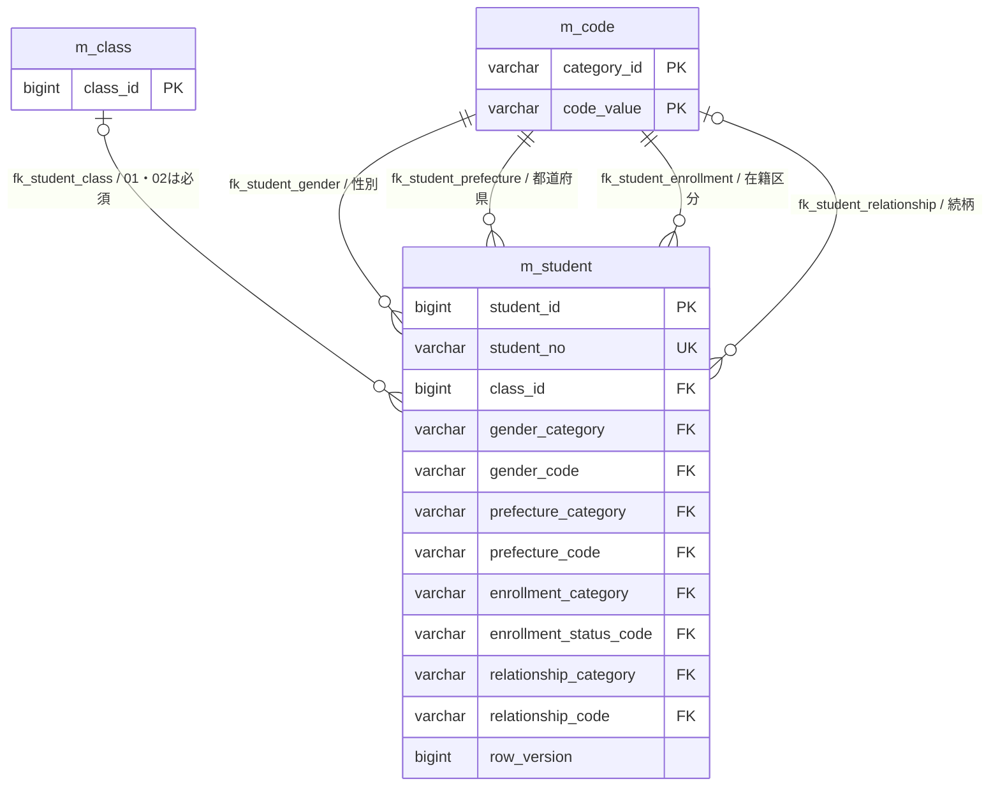
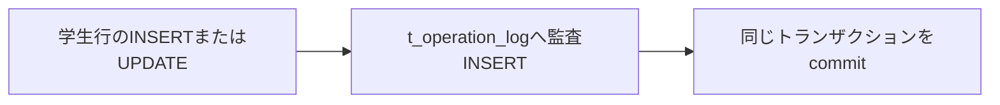
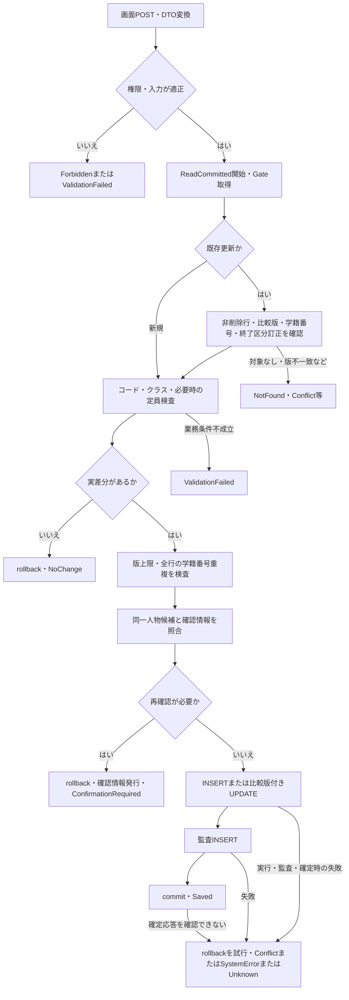
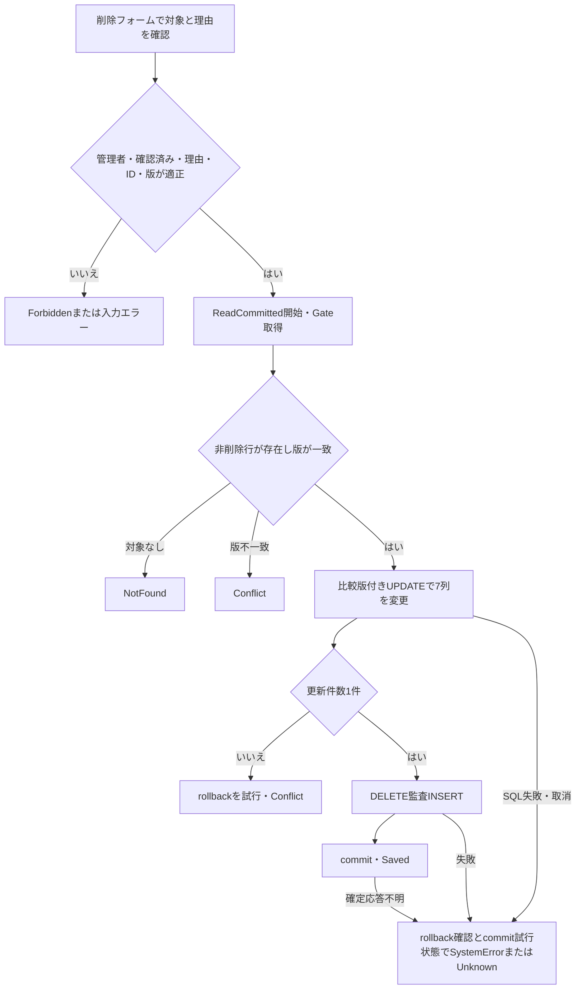
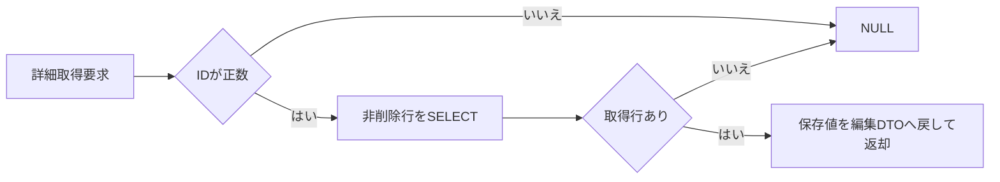
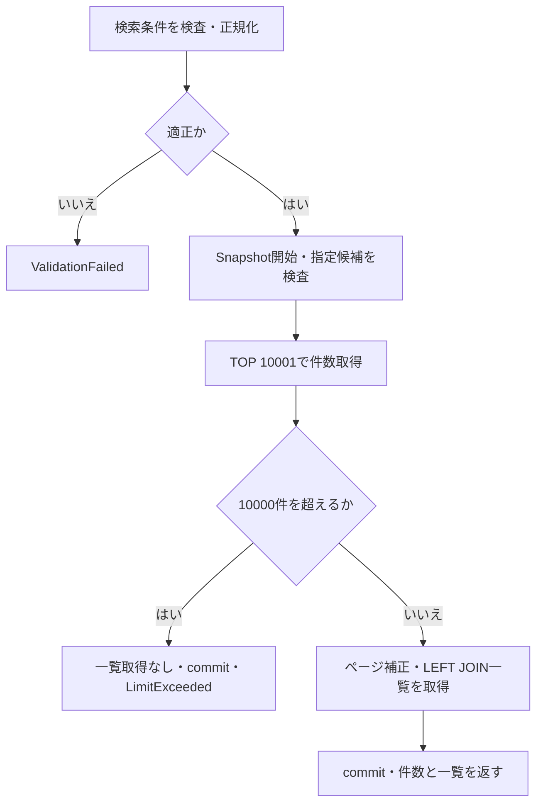
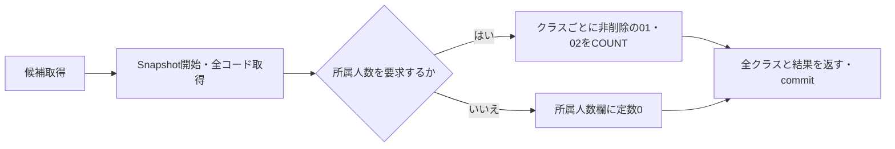

<!-- spec-meta: {"schema":"spec-md/1.0","documentId":"SM-DB-M-STUDENT","version":"1.0","path":"spec/database/tables/m_student.md","sheets":[{"sheet":"m_student","sections":[{"heading":"概要","kind":"GRID"},{"heading":"項目一覧","kind":"LIST","key":["物理名"],"columns":["No","論理名","物理名","DB型","型容量・精度","NOT NULL","PK","IDENTITY","DEFAULT","制約・供給元","根拠"]},{"heading":"制約一覧","kind":"LIST","key":["制約名"],"columns":["制約名","対象列","条件・参照先","根拠"]},{"heading":"索引一覧","kind":"LIST","key":["索引名"],"columns":["索引名","キー列順","対象行","UNIQUE","INCLUDE","根拠"]},{"heading":"イベント仕様","kind":"GRID"},{"heading":"補足説明","kind":"GRID"}]}]} -->
# 学生基本情報 dbo.m_student テーブル定義

文書ID：SM-DB-M-STUDENT／版：1.0／文書種別：DBテーブル定義／論理名：学生基本情報／物理名：dbo.m_student／対象：SQL Serverの提供DDLとC#実装

## 概要

学生基本情報は、学生を内部管理番号で識別し、学籍番号、氏名、連絡先、在籍状態、現在・最終所属クラスを保持する表である。参照設計は学生1人の基本情報と現在・最終所属を35項目で管理する用途を定義している。実装も35列を持ち、スキーマは`dbo`、表名は`m_student`である。論理名は参照設計に対応させ、DB型、NULL可否、採番、DEFAULT、制約はDDLから記載する。根拠：`reference-designs/基本設計書/テーブル/01_m_student.md:9-18`、同`:24-58`、`sources/database/001_schema.sql:7-59`。

学生の識別には`student_id`を使い、学籍番号は削除済みを含む全行で一意にする。所属は1行の`class_id`に保持し、年度や学年を学生表へ重複保存しない。在籍区分と論理削除状態は別々の列であり、卒業・退学と論理削除は異なる状態として扱う。根拠：`sources/database/001_schema.sql:8-42`、同`:187-200`、`sources/Core/SqlServerStudentService.cs:83-90`。

通常保存は入力を正規化してから登録または更新し、論理削除は業務項目を保存せず、削除情報と更新管理情報だけを更新する。実変更がある更新と論理削除では、要求の比較版をWHERE条件に置き、学生行と監査行を同じトランザクションで確定する。`row_version`はSQL Serverの`rowversion`型ではなく、サービスが加算する`bigint`である。根拠：`sources/Core/SqlServerStudentService.cs:260-315`、同`:392-416`。

本書の型容量は、`varchar(n)`では最大nバイト、`nvarchar(n)`では最大n個のUTF-16コード単位に相当する2バイト単位の容量を示す。後者は最大2nバイトであり、Unicodeスカラー数の上限とは別である。列ごとのスカラー数CHECKは項目一覧へ、複合条件、外部キー、UTC、版の制約は制約一覧へ記載する。サービスはサロゲートペアを1スカラーとして数え、片側だけのサロゲートを拒否する。根拠：`sources/database/001_schema.sql:9-59`、`sources/Core/StudentNormalizer.cs:37-56`。

参照設計の「長さ」は業務上限、「初期値」は業務設定である。例えば性別の初期値`0`、在籍区分の初期値`01`、固定分類の設定値は、これらの列にDBのDEFAULTがあることを意味しない。DDLでDEFAULTが定義される列は`is_deleted`と`row_version`の2列だけである。根拠：`reference-designs/基本設計書/テーブル/01_m_student.md:15-18`、同`:31-58`、`sources/database/001_schema.sql:8-42`、`sources/Core/Contracts.cs:15-25`。

## 項目一覧

| No | 論理名 | 物理名 | DB型 | 型容量・精度 | NOT NULL | PK | IDENTITY | DEFAULT | 制約・供給元 | 根拠 |
| --- | --- | --- | --- | --- | --- | --- | --- | --- | --- | --- |
| 01 | 学生管理番号 | student_id | bigint | 8バイト整数 | はい | はい・単一列 | (1,1) | なし | DBが採番する内部ID。INSERTでは指定せず、OUTPUTで取得する。 | sources/database/001_schema.sql:8-8、43-43; sources/Core/SqlServerStudentService.cs:292-304 |
| 02 | 学籍番号 | student_no | varchar(15) | 最大15バイト | はい | いいえ | なし | なし | StudentNoを正規化して登録。uq_student_noで全行一意。通常更新では既存値との一致を検査し、SETから除外する。 | sources/database/001_schema.sql:9-9、187-187; sources/Core/StudentNormalizer.cs:59-64、124-124; sources/Core/SqlServerStudentService.cs:254-254、294-297 |
| 03 | 学生氏名 | student_name | nvarchar(16) | 最大16コード単位・32バイト | はい | いいえ | なし | なし | StudentNameから設定。ck_m_student_student_name_scalarの上限8。サービスの原入力・保存値も各8スカラー。 | sources/database/001_schema.sql:10-10、44-44; sources/Core/StudentNormalizer.cs:47-57、125-125 |
| 04 | 学生氏名カナ | student_name_kana | nvarchar(36) | 最大36コード単位・72バイト | はい | いいえ | なし | なし | StudentNameKanaをカナ正規化して設定。ck_m_student_student_name_kana_scalarの上限18。原入力上限は36スカラー、正規化後は18スカラー。 | sources/database/001_schema.sql:11-11、45-45; sources/Core/StudentNormalizer.cs:72-85、126-126 |
| 05 | 氏名照合用情報 | name_key | nvarchar(320) | 最大320コード単位・640バイト | はい | いいえ | なし | なし | 氏名からサービスが生成する通常列。ck_m_student_name_key_scalarの上限160。計算列ではない。 | sources/database/001_schema.sql:12-12、46-46; sources/Core/StudentNormalizer.cs:66-70、144-144 |
| 06 | 氏名カナ照合用情報 | kana_key | nvarchar(36) | 最大36コード単位・72バイト | はい | いいえ | なし | なし | 正規化済みカナから半角空白を除去して生成。ck_m_student_kana_key_scalarの上限18。 | sources/database/001_schema.sql:13-13、47-47; sources/Core/StudentNormalizer.cs:145-145 |
| 07 | 生年月日 | birth_date | date | 日付・3バイト | はい | いいえ | なし | なし | BirthDateInputの元号・年・月・日をDateOnlyへ変換。時刻・時差は保存しない。 | sources/database/001_schema.sql:14-14; sources/Core/StudentNormalizer.cs:127-127; sources/Core/JapaneseDateService.cs:17-33 |
| 08 | 性別のコード分類 | gender_category | varchar(24) | 最大24バイト | はい | いいえ | なし | なし | ck_student_categoryでGENDERに固定。INSERTのSQLリテラルから設定する。 | sources/database/001_schema.sql:15-15、196-196; sources/Core/SqlServerStudentService.cs:296-296 |
| 09 | 性別 | gender_code | varchar(1) | 最大1バイト | はい | いいえ | なし | なし | GenderCodeから設定。分類との複合FKでコードを参照。DTO初期値は文字列0。 | sources/database/001_schema.sql:16-16、192-192; sources/Core/Contracts.cs:15-15; sources/Core/StudentNormalizer.cs:128-128 |
| 10 | 郵便番号 | postal_code | varchar(7) | 最大7バイト | はい | いいえ | なし | なし | PostalCodeを区切りなしの半角数字7桁へ正規化。先頭ゼロを文字列として保持する。原入力上限10スカラー。 | sources/database/001_schema.sql:17-17; sources/Core/StudentNormalizer.cs:95-100、129-129 |
| 11 | 都道府県のコード分類 | prefecture_category | varchar(24) | 最大24バイト | はい | いいえ | なし | なし | ck_student_categoryでPREFECTUREに固定。INSERTのSQLリテラルから設定する。 | sources/database/001_schema.sql:18-18、196-196; sources/Core/SqlServerStudentService.cs:296-296 |
| 12 | 都道府県 | prefecture_code | varchar(2) | 最大2バイト | はい | いいえ | なし | なし | PrefectureCodeを半角数字2桁へ正規化。分類との複合FKでコードを参照する。 | sources/database/001_schema.sql:19-19、193-193; sources/Core/StudentNormalizer.cs:113-117、130-130 |
| 13 | 住所1 | address_line1 | nvarchar(90) | 最大90コード単位・180バイト | はい | いいえ | なし | なし | AddressLine1から設定。ck_m_student_address_line1_scalarの上限45。原入力・保存値各45スカラーで、Trim後の空値は拒否する。 | sources/database/001_schema.sql:20-20、48-48; sources/Core/StudentNormalizer.cs:47-57、131-131 |
| 14 | 住所2 | address_line2 | nvarchar(90) | 最大90コード単位・180バイト | いいえ | いいえ | なし | なし | AddressLine2から設定。ck_m_student_address_line2_scalarの上限45。任意入力の空値はNULLへ変換する。 | sources/database/001_schema.sql:21-21、49-49; sources/Core/StudentNormalizer.cs:47-57、132-132 |
| 15 | 本人電話 | phone_number | varchar(16) | 最大16バイト | いいえ | いいえ | なし | なし | PhoneNumberを国内または先頭プラス記号付き国際形式へ正規化。原入力上限20スカラー。連絡先の条件付き必須対象。 | sources/database/001_schema.sql:22-22、199-199; sources/Core/StudentNormalizer.cs:87-93、133-133 |
| 16 | 本人メール | email_address | varchar(60) | 最大60バイト | いいえ | いいえ | なし | なし | EmailAddressから設定。原入力・保存値各60スカラー、ASCIIのメール形式を検査し、ドメインだけ小文字化する。 | sources/database/001_schema.sql:23-23; sources/Core/StudentNormalizer.cs:102-111、134-134 |
| 17 | 入学日 | admission_date | date | 日付・3バイト | はい | いいえ | なし | なし | AdmissionDateを西暦日付からDateOnlyへ変換。DBでは1900-01-01以上かつ生年月日以上。未来日はサービスで拒否する。 | sources/database/001_schema.sql:24-24、198-198; sources/Core/StudentNormalizer.cs:135-135; sources/Core/JapaneseDateService.cs:52-59 |
| 18 | 在籍区分のコード分類 | enrollment_category | varchar(24) | 最大24バイト | はい | いいえ | なし | なし | ck_student_categoryでENROLLMENT_STATUSに固定。INSERTのSQLリテラルから設定する。 | sources/database/001_schema.sql:25-25、196-196; sources/Core/SqlServerStudentService.cs:296-296 |
| 19 | 在籍区分 | enrollment_status_code | varchar(2) | 最大2バイト | はい | いいえ | なし | なし | EnrollmentStatusCodeから設定。01在学、02休学、03卒業、04退学。DTO初期値01。終了日・所属条件と連動する。 | sources/database/001_schema.sql:26-26、194-194、198-198; sources/database/002_seed.sql:19-22; sources/Core/Contracts.cs:23-23 |
| 20 | 卒業・退学日 | enrollment_end_date | date | 日付・3バイト | いいえ | いいえ | なし | なし | EnrollmentEndDateから設定。01/02ではNULL、03/04では必須かつ入学日以上。NULLまたは空文字は未設定、空白だけは日付形式エラー。 | sources/database/001_schema.sql:27-27、198-198; sources/Core/StudentNormalizer.cs:137-137; sources/Core/JapaneseDateService.cs:52-59 |
| 21 | 現在・最終所属クラス | class_id | bigint | 8バイト整数 | いいえ | いいえ | なし | なし | ClassIdから設定しm_classを参照。01/02はCHECKで非NULL必須、03/04はNULL可。サービスでは有値の0以下を拒否する。 | sources/database/001_schema.sql:28-28、191-191、198-198; sources/Core/StudentNormalizer.cs:138-138 |
| 22 | 緊急連絡先氏名 | emergency_contact_name | nvarchar(16) | 最大16コード単位・32バイト | いいえ | いいえ | なし | なし | EmergencyContactNameから設定。ck_m_student_emergency_contact_name_scalarの上限8。続柄・電話と一式で入力する。 | sources/database/001_schema.sql:29-29、50-50、199-199; sources/Core/StudentNormalizer.cs:139-139、156-157 |
| 23 | 続柄のコード分類 | relationship_category | varchar(24) | 最大24バイト | いいえ | いいえ | なし | なし | 続柄コードがNULLならNULL、有値ならRELATIONSHIPを生成。クライアント入力項目ではない。 | sources/database/001_schema.sql:30-30、199-199; sources/Core/StudentNormalizer.cs:147-147 |
| 24 | 緊急連絡先続柄 | relationship_code | varchar(2) | 最大2バイト | いいえ | いいえ | なし | なし | RelationshipCodeを半角数字2桁へ正規化。分類との複合FKでコードを参照し、表示名は保存しない。 | sources/database/001_schema.sql:31-31、195-195; sources/Core/StudentNormalizer.cs:113-117、140-140 |
| 25 | 緊急連絡先電話 | emergency_phone_number | varchar(16) | 最大16バイト | いいえ | いいえ | なし | なし | EmergencyPhoneNumberを本人電話と同じ処理で正規化。原入力上限20スカラー。緊急連絡先一式を構成する。 | sources/database/001_schema.sql:32-32、199-199; sources/Core/StudentNormalizer.cs:87-93、141-141、156-157 |
| 26 | 備考 | remarks | nvarchar(240) | 最大240コード単位・480バイト | いいえ | いいえ | なし | なし | Remarksから設定。ck_m_student_remarks_scalarの上限120。原入力・保存値各120スカラー、改行可。 | sources/database/001_schema.sql:33-33、51-51; sources/Core/StudentNormalizer.cs:47-57、142-142 |
| 27 | 削除の状態 | is_deleted | bit | 真偽値 | はい | いいえ | なし | 0・df_m_student_is_deleted | INSERTでも0を明示。論理削除で1へ変更する。在籍区分とは独立した状態。 | sources/database/001_schema.sql:34-34、200-200; sources/Core/SqlServerStudentService.cs:296-296、409-409 |
| 28 | 削除日時 | deleted_at | datetimeoffset(7) | 小数秒精度7・時差付き日時 | いいえ | いいえ | なし | なし | 削除時の@now。ck_m_student_deleted_at_utcで時差0分。未削除はNULL、削除済みは非NULL。 | sources/database/001_schema.sql:35-35、52-52、200-200; sources/Core/SqlServerStudentService.cs:409-410 |
| 29 | 削除者 | deleted_by | nvarchar(128) | 最大128コード単位・256バイト | いいえ | いいえ | なし | なし | 削除時のCurrentUser.Principal。ck_m_student_deleted_by_scalarの上限64。未削除はNULL、削除済みは非NULL。 | sources/database/001_schema.sql:36-36、53-53、200-200; sources/Core/SqlServerStudentService.cs:409-410 |
| 30 | 削除理由 | delete_reason | nvarchar(120) | 最大120コード単位・240バイト | いいえ | いいえ | なし | なし | 削除要求のReasonを正規化して設定。ck_m_student_delete_reason_scalarの上限60。削除時はサービスで空白だけの入力を拒否する。 | sources/database/001_schema.sql:37-37、54-54、200-200; sources/Core/SqlServerStudentService.cs:396-397、409-410 |
| 31 | 作成日時 | created_at | datetimeoffset(7) | 小数秒精度7・時差付き日時 | はい | いいえ | なし | なし | INSERTの@now。ck_m_student_created_at_utcで時差0分。通常更新・論理削除では変更しない。 | sources/database/001_schema.sql:38-38、55-55; sources/Core/SqlServerStudentService.cs:296-297、409-409 |
| 32 | 作成者 | created_by | nvarchar(128) | 最大128コード単位・256バイト | はい | いいえ | なし | なし | INSERTのCurrentUser.Principal。ck_m_student_created_by_scalarの上限64。通常更新・論理削除では変更しない。 | sources/database/001_schema.sql:39-39、56-56; sources/Core/SqlServerStudentService.cs:296-300、409-409 |
| 33 | 更新日時 | updated_at | datetimeoffset(7) | 小数秒精度7・時差付き日時 | はい | いいえ | なし | なし | INSERT、実変更UPDATE、論理削除の@now。ck_m_student_updated_at_utcで時差0分。 | sources/database/001_schema.sql:40-40、57-57; sources/Core/SqlServerStudentService.cs:296-300、409-410 |
| 34 | 更新者 | updated_by | nvarchar(128) | 最大128コード単位・256バイト | はい | いいえ | なし | なし | INSERT、実変更UPDATE、論理削除のCurrentUser.Principal。ck_m_student_updated_by_scalarの上限64。 | sources/database/001_schema.sql:41-41、58-58; sources/Core/SqlServerStudentService.cs:296-300、409-410 |
| 35 | 更新管理番号 | row_version | bigint | 8バイト整数 | はい | いいえ | なし | 1・df_m_student_row_version | ck_m_student_row_versionで正数。INSERTは1、実変更UPDATE・論理削除はSQLで1加算。DBの自動更新型ではない。 | sources/database/001_schema.sql:42-42、59-59; sources/Core/SqlServerStudentService.cs:263-263、296-297、398-409 |

## 制約一覧

| 制約名 | 対象列 | 条件・参照先 | 根拠 |
| --- | --- | --- | --- |
| pk_m_student | student_id | student_id単独のPRIMARY KEY。 | sources/database/001_schema.sql:43-43 |
| uq_student_no | student_no | 全行でUNIQUE。is_deletedによるフィルターはなく、削除後も番号を占有する。 | sources/database/001_schema.sql:187-187 |
| fk_student_class | class_id | dbo.m_class(class_id)を参照。列はNULL可だが01/02は別CHECKで必須。ON DELETE/ON UPDATE句なし。 | sources/database/001_schema.sql:80-80、191-191、198-198 |
| fk_student_gender | gender_category, gender_code | dbo.m_code(category_id, code_value)を参照。ON DELETE/ON UPDATE句なし。 | sources/database/001_schema.sql:127-127、192-192 |
| fk_student_prefecture | prefecture_category, prefecture_code | dbo.m_code(category_id, code_value)を参照。ON DELETE/ON UPDATE句なし。 | sources/database/001_schema.sql:127-127、193-193 |
| fk_student_enrollment | enrollment_category, enrollment_status_code | dbo.m_code(category_id, code_value)を参照。ON DELETE/ON UPDATE句なし。 | sources/database/001_schema.sql:127-127、194-194 |
| fk_student_relationship | relationship_category, relationship_code | dbo.m_code(category_id, code_value)を参照。緊急連絡先を省略すると両列NULL。ON DELETE/ON UPDATE句なし。 | sources/database/001_schema.sql:127-127、195-195、199-199 |
| ck_student_category | gender_category, prefecture_category, enrollment_category | 順にGENDER、PREFECTURE、ENROLLMENT_STATUSへ固定する。 | sources/database/001_schema.sql:196-196 |
| ck_student_dates | birth_date, admission_date, enrollment_status_code, enrollment_end_date, class_id | birth_date≧1900-01-01、birth_date≦admission_date、admission_date≧1900-01-01。さらに01/02なら終了日NULLかつclass_id非NULL、03/04なら終了日非NULLかつ終了日≧入学日。 | sources/database/001_schema.sql:198-198 |
| ck_student_contact | phone_number, email_address, emergency_contact_name, relationship_category, relationship_code, emergency_phone_number | 本人電話・本人メール・緊急電話の少なくとも1列が非NULL。緊急氏名・分類・続柄コード・電話は全列NULL、または全列非NULLかつ分類RELATIONSHIP。 | sources/database/001_schema.sql:199-199 |
| ck_student_deleted | is_deleted, deleted_at, deleted_by, delete_reason | is_deleted=0なら削除情報3列すべてNULL。is_deleted=1なら3列すべて非NULL。 | sources/database/001_schema.sql:200-200 |
| ck_m_student_deleted_at_utc | deleted_at | NULLまたはDATEPART(TZOFFSET, deleted_at)=0。 | sources/database/001_schema.sql:52-52 |
| ck_m_student_created_at_utc | created_at | CHECK式はNULLまたは時差0分。列自体はNOT NULL。 | sources/database/001_schema.sql:38-38、55-55 |
| ck_m_student_updated_at_utc | updated_at | CHECK式はNULLまたは時差0分。列自体はNOT NULL。 | sources/database/001_schema.sql:40-40、57-57 |
| ck_m_student_row_version | row_version | row_version>0。自動加算や比較版による排他はこのCHECKの機能ではない。 | sources/database/001_schema.sql:59-59 |

## 索引一覧

| 索引名 | キー列順 | 対象行 | UNIQUE | INCLUDE | 根拠 |
| --- | --- | --- | --- | --- | --- |
| ix_student_birth | birth_date | is_deleted=0 | なし | なし | sources/database/001_schema.sql:206-206 |
| ix_student_class_status | class_id, enrollment_status_code | is_deleted=0 | なし | なし | sources/database/001_schema.sql:207-207 |
| ix_student_admission | admission_date | is_deleted=0 | なし | なし | sources/database/001_schema.sql:208-208 |
| ix_student_updated | updated_at | is_deleted=0 | なし | なし | sources/database/001_schema.sql:209-209 |
| ix_student_phone | phone_number | is_deleted=0 | なし | なし | sources/database/001_schema.sql:210-210 |
| ix_student_emergency_phone | emergency_phone_number | is_deleted=0 | なし | なし | sources/database/001_schema.sql:211-211 |

## イベント仕様

### 1. 関連表と共通の入出力

#### SQL・テーブル関連（ER図）

学生は、クラスを任意の1件、性別・都道府県・在籍区分のコードを各1件参照する。続柄コードは緊急連絡先一式を設定した場合だけ1件参照する。同じクラスまたはコードを複数学生が参照でき、学生側の参照列にUNIQUE制約はない。在学・休学のクラス必須条件は、クラスFKではなく`ck_student_dates`による条件である。根拠：`sources/database/001_schema.sql:15-32`、同`:187-200`。



図中の物理表はすべて`dbo`スキーマに属し、`m_code`のPKは2列の複合キーである。外部キーに連鎖更新・連鎖削除の指定はない。根拠：`sources/database/001_schema.sql:62-80`、同`:112-127`、同`:191-195`。

監査表`dbo.t_operation_log`への対応は、サービスが`target_table='m_student'`と学生IDの文字列表現を`target_key`へ書くことで成立する。提供DDLに学生表への監査FKはないため、監査の関連は次の処理上の関係として示す。根拠：`sources/database/001_schema.sql:137-153`、`sources/Core/SqlServerStudentService.cs:385-390`。



#### 型とパラメータ

通常保存の正規化結果は22列である。`Columns`辞書は、その22列についてDDLに対応する`SqlDbType`と文字列Sizeを持つ。`varchar`列は`VarChar`、`nvarchar`列は`NVarChar`、3つの日付列は`Date`、`class_id`は`BigInt`を指定する。`NVarChar`のSizeはDB型の16、36、320、90、240等であり、8、18、160、45、120というスカラー上限とは別に保持する。根拠：`sources/Core/SqlServerStudentService.cs:30-37`、`sources/Core/StudentNormalizer.cs:124-147`。

`DateOnly`はパラメータ設定時に午前0時の`DateTime`へ変換し、NULLは`DBNull.Value`へ変換する。学生ID・比較版は`BigInt`、管理日時は`DateTimeOffset`、認証主体は`NVarChar(128)`、削除理由と監査理由は`NVarChar(120)`で渡す。入力値をSQL文字列へ埋め込む処理ではない。根拠：`sources/Core/SqlServerStudentService.cs:67-72`、同`:298-301`、同`:388-389`、同`:409-410`。

#### 更新時刻と実行者

サービスは受付時に時計からUTC時刻`now`を取得する。その同じ値を保存SQLと監査SQLへ渡すため、日時はDBのDEFAULTやSQL実行時の自動設定値ではない。業務日はそのUTC時刻をUTC+9へ変換した日付である。根拠：`sources/Core/SqlServerStudentService.cs:44-45`、同`:229-229`、同`:300-307`、同`:394-414`。

作成者・更新者・削除者は`CurrentUser.Principal`から設定する。Webは認証クレームの`NameIdentifier`、`login_session`、`Role`から利用者を作り、サービスでもPrincipalを原入力・保存値各64スカラー以内の必須テキストとして検査する。ただしサービスは`Text`の戻り値を利用者へ代入しないため、保存する認証主体はTrim後の値ではなく、取得したPrincipalそのものである。根拠：`sources/Infrastructure/RequestIdentity.cs:7-16`、`sources/Core/SqlServerStudentService.cs:46-51`、同`:300-300`、同`:410-410`。

### 2. 学生の新規登録・通常更新

#### 処理概要

新規登録の`POST /students/create`と既存更新の`POST /students/{id}/update`は、`StudentsController`から`WebStudentCoordinator.Save`、`StudentSaveInput.ToRequest`を経由して`SaveAsync`へ到達する。WebのDIは`IStudentService`へ`SqlServerStudentService`を`webTokens:true`で登録し、ProgramがMVCルートを登録している。根拠：`sources/Program.cs:2-6`、`sources/Infrastructure/WebHostSetup.cs:13-19`、`sources/Web/Controllers/StudentsController.cs:26-33`、`sources/Infrastructure/WebStudentCoordinator.cs:18-18`。

保存は、認証・入力検査、共通排他、既存行と比較版の検査、コード・所属の再検査、差分と重複の確認を経て実行する。同一人物候補があってもDBのUNIQUE違反とはせず、別人として続行する再確認を要求する。根拠：`sources/Core/SqlServerStudentService.cs:227-290`。

#### 処理手順

1. 受付番号を作り、利用者、UTC時刻、業務日を取得する。Viewerは保存不可とする。Web側でも保存権限と画面復帰先を検査する。根拠：`sources/Core/SqlServerStudentService.cs:229-230`、`sources/Infrastructure/WebStudentCoordinator.cs:18-18`。
2. 19個の業務入力を正規化し、氏名キー、カナキー、続柄分類を加えて22列の保存値を作る。確認・変更理由は任意の改行可テキストとして原入力・保存値各60スカラー以内にする。新規は学生IDと比較版がともにNULL、既存はともに正数でなければならない。年度指定は1900～9998、学年コードは任意の半角数字2桁とする。根拠：`sources/Core/StudentNormalizer.cs:124-158`、`sources/Core/SqlServerStudentService.cs:232-239`。
3. 接続を開き、SNAPSHOT分離が有効であることを確認する。ReadCommittedトランザクションを開始し、`XACT_ABORT ON`とトランザクション所有の排他的アプリケーションロックを設定する。ロック資源は`test-project1:student-write`、待機上限は5000ミリ秒で、取得結果が負ならSQL例外にする。共通SQLコマンドのタイムアウトは30秒である。根拠：`sources/Core/SqlServerStudentService.cs:53-66`、同`:92-101`、同`:240-244`。
4. 既存更新では`student_id=@id AND is_deleted=0`で現在行を読む。0件ならNotFound、現在版とExpectedVersionが違えばConflictとする。正規化後の学籍番号が既存値と違えばValidationFailedとする。既存区分が03または04で区分自体を変更する場合は、Administratorと非空の訂正理由を要求する。終了済み学生の全項目を一律に管理者専用とする条件ではない。根拠：`sources/Core/SqlServerStudentService.cs:245-259`。
5. 性別、都道府県、在籍区分、任意の続柄コードについて、コードと分類をJOINし、分類・コードの一致で存在を確認する。新規またはコードを変更するときは、両方の有効フラグと、開始日≦業務日、終了日NULLまたは業務日≦終了日を要求する。既存コードをそのまま保持するときは、存在確認を行ったうえで停止・期間外の選択可否検査を省く。根拠：`sources/Core/SqlServerStudentService.cs:347-355`。
6. クラス有値時は存在を確認し、要求に年度・学年があれば一致を確認する。在学・休学の席を新たに使用する、または別クラスへ移る場合は、有効フラグと業務日の利用期間内条件を検査する。この場合に限り、定員が非NULLなら同じクラスの非削除かつ01/02かつ自分以外の人数に1を加え、定員以下であることを確認する。同じクラスの既存の席を維持するときは、この有効期間・定員検査を省く。卒業・退学では、クラス・区分・入学日・終了日のいずれかを変更する場合に、学生在籍期間とクラス期間の重なりを要求する。根拠：`sources/Core/SqlServerStudentService.cs:357-383`。
7. 正規化後の22列と既存値を比較する。DateOnlyとDB取得のDateTimeは日付として比較する。差分0件なら明示的にrollbackし、NoChangeと既存ID・既存版を返す。更新日時、更新者、版、監査は変更しない。差分がある既存行の版が`long.MaxValue`ならConflictとする。根拠：`sources/Core/SqlServerStudentService.cs:260-263`、同`:325-327`。
8. 学籍番号が一致し、かつ新規または自分以外である全行を`COUNT_BIG`で検査する。削除済み行も対象とし、1件以上あればValidationFailedとする。根拠：`sources/Core/SqlServerStudentService.cs:264-267`。
9. 非削除、自分以外、生年月日一致、かつ氏名キー一致またはカナキー一致の候補を取得し、学生ID昇順に並べる。候補全件のID・版から候補ハッシュを作り、22列のうち派生3列を除く19列から入力ハッシュを作る。根拠：`sources/Core/SqlServerStudentService.cs:224-225`、同`:268-274`。
10. Webではサーバーメモリの確認情報を照合する。利用者、セッション、学生ID、比較版、両ハッシュ、有効期限が一致し、Busyを原子的に取得できる場合だけ確認済みとする。確認済みなら非空の続行理由を要求する。候補がある、または確認情報が送られているのに確認が無効なら、学生保存トランザクションをrollbackし、10分期限の確認情報を発行する。応答はConfirmationRequired、候補全件数、学生ID順の最大20件である。根拠：`sources/Core/SqlServerStudentService.cs:276-290`、同`:330-335`。
11. 新規は31列を指定するINSERT、既存は24列を設定する比較版付きUPDATEを実行する。OUTPUTの学生IDを表変数へ受け、SELECTで取得する。結果がNULLまたはDBNullなら更新競合とする。根拠：`sources/Core/SqlServerStudentService.cs:292-305`。
12. 同じトランザクションでCREATEまたはUPDATE監査を登録してcommitする。成功後にWebの確認情報を取り除き、Saved、学生ID、新しい版、受付番号を返す。新規の版は1、既存は読込版+1である。根拠：`sources/Core/SqlServerStudentService.cs:306-315`。

#### 条件付き処理フロー



フローの条件と順序の根拠：`sources/Core/SqlServerStudentService.cs:227-323`。接続・トランザクション開始時の例外境界は「結果・例外時の扱い」に記載する。

#### SQL・テーブル関連（ER図）

更新対象は`dbo.m_student`である。登録前の存在・選択可否検査は共通ER図の`dbo.m_class`、`dbo.m_code`に加え、コード分類の`dbo.m_code_category`を読む。監査の`dbo.t_operation_log`は学生更新と同じトランザクションに参加するが、学生FKの参照先ではない。根拠：`sources/Core/SqlServerStudentService.cs:264-307`、同`:347-390`。関係と多重度は「1. 関連表と共通の入出力」のER図による。

Webの同一人物再確認はstaticの`ConcurrentDictionary`に保持し、`m_student`へ確認情報を保存しない。`webTokens:false`には`dbo.t_confirmation`を読む・消費する別分岐が存在する。Webで登録される実装はtrue分岐である。根拠：`sources/Core/SqlServerStudentService.cs:19-29`、同`:276-285`、同`:308-342`、`sources/Infrastructure/WebHostSetup.cs:19-19`。

#### DB操作の詳細

正規化する19入力は、学籍番号、氏名、カナ、生年月日、性別、郵便番号、都道府県、住所1・2、本人電話、本人メール、入学日、在籍区分、終了日、クラス、緊急氏名、続柄、緊急電話、備考である。これに`name_key`、`kana_key`、`relationship_category`を加えた22列が通常保存値となる。根拠：`sources/Web/Inputs/StudentSaveInput.cs:34-42`、`sources/Core/StudentNormalizer.cs:124-147`。

| 列群 | 新規INSERT | 実変更UPDATE | 論理削除UPDATE |
| --- | --- | --- | --- |
| student_id | 列指定なし。IDENTITY採番 | 変更しない | 変更しない |
| student_no | 正規化値を設定 | SET対象外。既存値との一致が前提 | 変更しない |
| student_name, student_name_kana, birth_date, gender_code, postal_code, prefecture_code, address_line1, address_line2, phone_number, email_address, admission_date, enrollment_status_code, enrollment_end_date, class_id, emergency_contact_name, relationship_code, emergency_phone_number, remarks | 18列の正規化値を設定 | 18列すべての正規化値を設定 | 変更しない |
| name_key, kana_key, relationship_category | 派生3列を設定 | 派生3列を設定 | 変更しない |
| gender_category, prefecture_category, enrollment_category | GENDER、PREFECTURE、ENROLLMENT_STATUSを設定 | 変更しない | 変更しない |
| is_deleted | 0を明示設定 | 変更しない | 1へ変更 |
| deleted_at, deleted_by, delete_reason | 列指定なし。NULLで作成 | 変更しない | @now、@actor、@reasonを設定 |
| created_at, created_by | @now、@actorを設定 | 変更しない | 変更しない |
| updated_at, updated_by | @now、@actorを設定 | @now、@actorを設定 | @now、@actorを設定 |
| row_version | 1を明示設定 | 現在値に1加算 | 現在値に1加算 |

設定列の根拠：`sources/Core/SqlServerStudentService.cs:292-307`、同`:409-413`。新規は正規化22列と固定分類・管理9列の計31列、通常更新は学籍番号を除く正規化21列と更新管理3列の計24列、論理削除は7列である。

通常UPDATEのWHEREは`student_id=@id AND row_version=@version AND is_deleted=0`の全条件である。`@id`と`@version`はBigIntで、事前読込だけでなく書込み時にも比較版を検査する。SETは実差分列だけに絞らず、学籍番号を除く正規化21列をすべて設定する。監査の`changed_columns`には、そのうち実際に差分があった列と`updated_at`、`updated_by`、`row_version`を記録する。根拠：`sources/Core/SqlServerStudentService.cs:261-261`、同`:294-307`。

学籍番号使用済み検査は`student_no=@no AND (@id IS NULL OR student_id<>@id)`で、`@no`はVarChar(15)、`@id`はNULL可のBigIntである。同一人物候補は`is_deleted=0 AND (@id IS NULL OR student_id<>@id) AND birth_date=@birth AND (name_key=@name OR kana_key=@kana)`を使う。候補のパラメータは順にBigInt、Date、NVarChar(320)、NVarChar(36)である。候補取得はRowSelectのLEFT JOINを伴い、全候補を読んでから応答の20件へ絞る。根拠：`sources/Core/SqlServerStudentService.cs:83-90`、同`:264-290`。

定員検査のSQLは`class_id=@class AND is_deleted=0 AND enrollment_status_code IN ('01','02') AND (@id IS NULL OR student_id<>@id)`で`COUNT_BIG(*)`を取得する。`@class`と`@id`はBigIntであり、検査対象人数へ今回の1人を加える。既存の同じ席の維持ではこのSQLを実行しない。根拠：`sources/Core/SqlServerStudentService.cs:357-380`。

監査は学生IDをVarChar(35)の文字列キーにし、操作種別、前後版、変更列JSON、実行者、UTC時刻、受付番号、理由、候補存在に対応する`duplicate_confirmed`を登録する。新規の監査前版はNULL、後版は1である。新規の変更列はINSERT指定31列、既存の変更列は実差分と更新管理3列で、採番IDと省略した削除情報3列を新規の変更列へ追加する処理ではない。根拠：`sources/Core/SqlServerStudentService.cs:306-307`、同`:385-390`。

#### 結果・例外時の扱い

Savedだけが学生SQL・監査SQL・commitを完了した正常保存応答である。NoChangeは学生行を変更せず、既存IDと版を返す。ConfirmationRequiredは学生保存をrollbackした確認待ち状態であり、候補の件数と確認情報を返す。権限不足、対象不在、版不一致、入力不正はそれぞれForbidden、NotFound、Conflict、ValidationFailedへ分ける。根拠：`sources/Core/SqlServerStudentService.cs:227-290`、同`:313-323`。

捕捉した入力検証例外、UNIQUE違反2601・2627、DBConcurrencyExceptionではrollbackを試み、ValidationFailedまたはConflictへ変換する。書込み開始後のSQL例外・InvalidOperationException・取消は、commitを試みたか、rollbackの完了を確認できない場合にUnknownとする。それ以外はSystemErrorとする。Unknownでは再保存前に検索で結果を確認する応答を返す。rollback用の共通処理は`CancellationToken.None`を使う。根拠：`sources/Core/SqlServerStudentService.cs:302-329`。

書込み前の対象なし・版不一致等の直接returnでは、明示的なrollback呼出しを置かず、commitしないまま`await using`のトランザクション破棄へ進む。NoChangeとConfirmationRequiredの明示rollbackには要求のCancellationTokenを渡す。接続Openとトランザクション開始は内側の結果変換tryより前なので、その例外はSaveResultに変換されずWeb側へ伝播する。根拠：`sources/Core/SqlServerStudentService.cs:240-263`、同`:287-290`、同`:316-329`。

MVCのSaved応答は成功メッセージを保持し、303で検索画面へ戻す。NoChangeは編集画面へ「変更はありません」と表示する。結果のHTTP対応はValidationFailed=422、Forbidden=403、NotFound=404、Conflict・ConfirmationRequired=409、SystemError・Unknown=503である。保存失敗時は送信入力と読込時スナップショットを使って編集画面を再表示する。根拠：`sources/Web/Controllers/StudentsController.cs:28-38`、`sources/Infrastructure/WebPresentation.cs:23-23`。

### 3. 学生の論理削除

#### 処理概要

`POST /students/{id}/delete`は保存と独立したフォームから送信され、Coordinatorを経由して`DeleteAsync`へ到達する。フォームは比較版、削除理由、確認済みフラグ、復帰先、編集スナップショットを送る。Administratorだけが実行でき、編集中の氏名や所属等はこの削除SQLへ移送しない。根拠：`sources/Views/Students/Edit.cshtml:17-17`、`sources/Web/Controllers/StudentsController.cs:37-37`、`sources/Infrastructure/WebStudentCoordinator.cs:19-19`。

#### 処理手順

1. フォーム送信時にJavaScriptが「対象と理由を確認して論理削除しますか。」という確認を行う。CoordinatorはAdministrator権限とConfirmed=trueを確認する。根拠：`sources/Views/Students/Edit.cshtml:17-17`、`sources/wwwroot/js/site.js:4-4`、`sources/Infrastructure/WebStudentCoordinator.cs:19-19`。
2. サービスでもAdministratorを再確認し、理由を原入力・保存値各60スカラー以内の必須・改行可テキストへ正規化する。学生ID・比較版は正数を要求し、比較版が`long.MaxValue`ならValidationFailedとする。根拠：`sources/Core/SqlServerStudentService.cs:392-398`。
3. ReadCommittedトランザクションと保存と同じGateを取得する。`student_id=@id AND is_deleted=0`で現在版を読み、0件ならNotFound、要求版と不一致ならConflictとする。根拠：`sources/Core/SqlServerStudentService.cs:399-407`。
4. 学生ID・比較版・非削除条件をWHEREへ再指定し、削除状態、削除情報3列、更新情報2列、版の計7列を更新する。更新件数が1でなければDBConcurrencyExceptionとする。根拠：`sources/Core/SqlServerStudentService.cs:409-411`。
5. DELETE監査を同じトランザクションへ登録し、commit後にSaved、対象ID、要求版+1、受付番号を返す。根拠：`sources/Core/SqlServerStudentService.cs:413-414`。

#### 条件付き処理フロー



フローの根拠：`sources/Infrastructure/WebStudentCoordinator.cs:19-19`、`sources/Core/SqlServerStudentService.cs:392-416`。

#### SQL・テーブル関連（ER図）

変更する表は`dbo.m_student`と`dbo.t_operation_log`である。学生行は残り、共通ER図のクラス・コードへの参照値も保持する。削除処理はクラスやコードの物理削除を行わない。監査との関係はFKではなく同一トランザクション内の記録関係である。根拠：`sources/Core/SqlServerStudentService.cs:409-414`、`sources/database/001_schema.sql:191-200`。関係は「1. 関連表と共通の入出力」の図による。

#### DB操作の詳細

```sql
UPDATE dbo.m_student
   SET is_deleted = 1,
       deleted_at = @now,
       deleted_by = @actor,
       delete_reason = @reason,
       updated_at = @now,
       updated_by = @actor,
       row_version = row_version + 1
 WHERE student_id = @id
   AND row_version = @version
   AND is_deleted = 0;
```

`@id`・`@version`はBigInt、`@now`はDateTimeOffset、`@actor`はNVarChar(128)、`@reason`はNVarChar(120)である。学籍番号、業務値、派生キー、固定分類、作成情報はSETに含まれない。削除日時と更新日時、削除者と更新者はそれぞれ同じ値になる。根拠：`sources/Core/SqlServerStudentService.cs:409-410`。

DELETE監査の変更列は`is_deleted`、`deleted_at`、`deleted_by`、`delete_reason`、`updated_at`、`updated_by`、`row_version`の7列である。監査前版は要求版、後版は要求版+1、理由は正規化済み削除理由、`duplicate_confirmed`はfalseとする。根拠：`sources/Core/SqlServerStudentService.cs:413-413`。

#### 結果・例外時の扱い

既に削除済みの行は非削除条件に一致しないためNotFoundになる。事前版不一致または書込み件数不一致はConflictになる。削除の版上限は保存の実変更時とは異なり、入口でValidationFailedとして扱う。根拠：`sources/Core/SqlServerStudentService.cs:398-411`。

DBConcurrencyExceptionではrollbackを試みてConflictを返す。SQL例外・InvalidOperationException・取消では、書込み開始後かつcommit試行済みまたはrollback未確認ならUnknown、それ以外はSystemErrorを返す。Openとトランザクション開始の例外は、この結果変換の外側で発生する。根拠：`sources/Core/SqlServerStudentService.cs:399-416`。

理由の長さ・必須違反はInputValidationExceptionとしてValidationFailedへ変換する。一方、理由に単独サロゲートが含まれて`ScalarCount`からArgumentExceptionが出た場合、DeleteAsyncの理由検査catchはその例外を捕捉しない。Webまで伝播した例外は共通例外処理の対象になる。根拠：`sources/Core/StudentNormalizer.cs:37-56`、`sources/Core/SqlServerStudentService.cs:396-397`、`sources/Infrastructure/WebHostSetup.cs:23-23`。

削除成功は303で検索画面へ戻し、論理削除の成功メッセージを表示する。削除失敗時は結果のHTTP状態を設定したうえで、Loadによる再取得を行う。Unknownを、学生行が未更新であるという意味へ読み替えない。根拠：`sources/Web/Controllers/StudentsController.cs:37-38`、`sources/Core/SqlServerStudentService.cs:416-416`。

### 4. 学生の詳細取得

#### 処理概要

既存学生の編集表示は`GET /students/{id}`からCoordinatorのEditを経由し、`GetAsync`で非削除行を取得する。返却値は`StudentDetail`で、学生ID、版、編集値、日付型の生年月日、更新日時、更新者を持つ。根拠：`sources/Web/Controllers/StudentsController.cs:24-25`、`sources/Infrastructure/WebStudentCoordinator.cs:17-17`、`sources/Core/Contracts.cs:59-60`。

#### 処理手順

1. 利用者を確認する。IDが0以下ならDBを読まずNULLを返す。
2. 接続を開き、BigIntの`@id`を設定して非削除行を取得する。0件ならNULLを返す。
3. 保存列をStudentDraftへ戻す。生年月日は元号入力へ、入学日・終了日は`yyyy-MM-dd`へ変換する。NULL許容の保存値はNULLとして保持する。
4. 読込版、更新日時、更新者を付けたStudentDetailを返す。

手順の根拠：`sources/Core/SqlServerStudentService.cs:172-194`。

#### 条件付き処理フロー



#### SQL・テーブル関連（ER図）とDB操作の詳細

```sql
SELECT *
  FROM dbo.m_student
 WHERE student_id = @id
   AND is_deleted = 0;
```

この取得自体は単一表処理でJOINを使わず、PK検索により結果は最大1行である。そのため詳細取得単独のER図は省略し、表のFK構造は共通ER図に示す。明示トランザクションは開始せず、学生行や版を変更しない。根拠：`sources/database/001_schema.sql:43-43`、`sources/Core/SqlServerStudentService.cs:175-181`。

#### 結果・例外時の扱い

未検出のNULLはCoordinatorで404へ変換する。DBの作成情報・削除情報を編集用DTOとして返す構造ではない。SQL読出しにはCancellationTokenを渡すが、GetAsyncはSQL例外・取消を保存結果のOutcomeへ変換しない。根拠：`sources/Infrastructure/WebStudentCoordinator.cs:17-17`、`sources/Core/SqlServerStudentService.cs:172-194`。

### 5. 学生一覧の検索

#### 処理概要

検索は、非削除学生を対象に、指定された条件をANDで追加する。件数と一覧を同一Snapshotトランザクション内で取得し、10000件を超える場合は一覧を返さない。検索は学生表を更新しない。根拠：`sources/Core/SqlServerStudentService.cs:103-170`。

#### 処理手順

1. 利用者を確認し、ページ1以上、ページサイズ20・50・100、指定された4種類のソートキー、方向asc・descを検査する。入力を正規化し、未所属と年度・学年・クラスの併用、在籍区分の重複・4値以外、入学日範囲の逆転を拒否する。
2. Snapshotトランザクションを開始する。指定された学年・都道府県コードの存在、年度のクラス候補の存在、指定クラスと年度・学年の一致を確認する。
3. 共通非削除条件と有値条件からWHEREを作り、TOP(10001)の学生IDをCOUNT_BIGで数える。
4. 10000件を超えた場合は一覧を取得せず、commitしてCount=10001、LimitExceeded=trueを返す。
5. 上限以内なら最終ページを計算し、要求ページを最終ページ以内へ補正する。指定列・指定方向と学生ID昇順で並べ、OFFSET/FETCHで一覧を読む。
6. 一覧をStudentRowへ変換し、commitして件数、一覧、検索時刻を返す。0件では空一覧を返す。

手順の根拠：`sources/Core/SqlServerStudentService.cs:105-170`。

#### 条件付き処理フロー



#### SQL・テーブル関連（ER図）

一覧のRowSelectは学生からクラスを`c.class_id=s.class_id`でLEFT JOINする。学年名は`g.category_id=c.grade_category AND g.code_value=c.grade_code`、在籍名は`e.category_id=s.enrollment_category AND e.code_value=s.enrollment_status_code`、都道府県名は`p.category_id=s.prefecture_category AND p.code_value=s.prefecture_code`で、いずれもm_codeへLEFT JOINする。JOINにマスター有効フラグ・有効期間条件は置かない。共通ER図はFKの存在関係を示すもので、この表示名取得JOINとは役割が異なる。根拠：`sources/Core/SqlServerStudentService.cs:82-90`、`sources/database/001_schema.sql:190-195`。

#### DB操作の詳細

| 条件 | 追加する述語・設定 | パラメータ型 | 未設定時 |
| --- | --- | --- | --- |
| 共通 | s.is_deleted=0 | パラメータなし | 常に適用 |
| 学籍番号 | s.student_no LIKE @no ESCAPE '!'。正規化値を前方一致にする | VarChar(31) | 述語なし |
| 氏名 | s.name_key LIKE @name ESCAPE '!'。照合キーを部分一致にする | NVarChar(642) | 述語なし |
| カナ | s.kana_key LIKE @kana ESCAPE '!'。照合キーを部分一致にする | NVarChar(74) | 述語なし |
| 年度 | c.school_year=@year | SmallInt | 述語なし |
| 学年 | c.grade_code=@grade | VarChar(2) | 述語なし |
| クラス | s.class_id=@class | BigInt | 述語なし |
| 未所属のみ | s.class_id IS NULL | パラメータなし | falseなら述語なし |
| 都道府県 | s.prefecture_code=@prefecture | VarChar(2) | 述語なし |
| 電話 | s.phone_number=@phone OR s.emergency_phone_number=@phoneを括弧でまとめる | VarChar(16) | 述語なし |
| 入学日開始 | s.admission_date>=@from | Date | 述語なし |
| 入学日終了 | s.admission_date<=@to | Date | 述語なし |
| 在籍区分 | s.enrollment_status_code IN (@status0等) | 各VarChar(2) | 0選択なら述語なし |

述語とパラメータの根拠：`sources/Core/SqlServerStudentService.cs:137-155`。LIKE値の`!`、`%`、`_`、`[`はエスケープし、ワイルドカードを追加する。根拠：`sources/Core/StudentNormalizer.cs:161-161`。

件数SQLは学生とクラスをLEFT JOINし、一覧と同じWHEREでTOP(10001)を適用する。Count=10001は上限超過を示す値であり、全該当件数の確定値ではない。上限以内の一覧は、studentNoなら`student_no`、nameなら`name_key`、admissionDateなら`admission_date`、updatedAtなら`updated_at`を指定方向に並べ、同順位を`student_id ASC`で確定する。`@offset`と`@size`はIntで、`OFFSET @offset ROWS FETCH NEXT @size ROWS ONLY`を使う。根拠：`sources/Core/SqlServerStudentService.cs:107-108`、同`:156-168`。

StudentRowには学生ID、学籍番号、氏名、カナ、生年月日、年度、学年名、クラスコード・名、在籍名、住所表示、本人電話、入学日、更新日時、版を返す。住所表示は都道府県名と住所1の連結で、都道府県名を取得できない場合は`[不整合]`を付ける。住所2、本人メール、緊急連絡先は一覧結果に含めない。根拠：`sources/Core/SqlServerStudentService.cs:77-90`、`sources/Core/Contracts.cs:50-56`。

#### 結果・例外時の扱い

未検索、検索結果0件、上限超過は別状態である。サービスの0件はCount=0と空一覧、上限超過はCount=10001と空一覧・LimitExceeded=trueであり、Webはそれぞれempty、tooManyへ対応させる。上限超過時のWeb総件数はNULLになる。入力検証例外とArgumentExceptionはValidationFailedへ変換するが、SQL例外・取消はSearchAsync内でOutcomeへ変換しない。根拠：`sources/Core/SqlServerStudentService.cs:159-170`、`sources/Infrastructure/WebStudentCoordinator.cs:21-21`。

### 6. 選択候補と所属人数の取得

#### 処理概要

LookupAsyncはコード・クラス候補を取得し、要求された場合だけ学生表から所属人数を算出する。検索画面は`includeOccupancy=false`、編集画面は既定のtrueで呼び出す。候補一覧と保存値は別であり、候補の表示人数は確定時の定員再検査に代わらない。根拠：`sources/Core/SqlServerStudentService.cs:196-216`、`sources/Infrastructure/WebStudentCoordinator.cs:17-17`、`sources/Web/Controllers/StudentsController.cs:39-39`。

#### 処理手順

1. 利用者を確認して接続し、Snapshotトランザクションを開始する。
2. m_codeとm_code_categoryをINNER JOINして全コードを取得する。両方のis_activeが1の場合だけ、返却値のIsActiveをtrueにする。
3. m_classと学年コードをLEFT JOINして全クラスを取得する。所属人数を要求された場合はクラスごとに非削除かつ01/02の学生を数え、要求されなければ定数0を返す。
4. 2つの結果セットをCodeEntryとSchoolClassへ変換し、commitしてLookupSetを返す。

手順の根拠：`sources/Core/SqlServerStudentService.cs:197-216`。

#### 条件付き処理フロー



#### SQL・テーブル関連（ER図）とDB操作の詳細

m_studentの読出しは`class_id=c.class_id AND is_deleted=0 AND enrollment_status_code IN ('01','02')`の相関副問合せで、`COUNT(*)`によりクラスの占有人数を得る。学生とクラスの参照構造は共通ER図による。候補取得はマスターと学生の読出しだけで、学生行を変更しない。根拠：`sources/Core/SqlServerStudentService.cs:201-208`。

コードのキーは分類・コード、表示名はcode_nameで、順序はcategory_id、display_order、code_valueである。クラスのキーはclass_id、表示材料は年度・学年・class_code・class_nameで、順序はschool_year降順、学年コードのdisplay_order、クラスのdisplay_order、class_code、class_idである。マスター取得SQLに有効行だけへ絞るWHEREはなく、有効性は返却情報と画面・保存時の判断に使う。根拠：`sources/Core/SqlServerStudentService.cs:203-214`。

#### 結果・例外時の扱い

`includeOccupancy=false`の人数0は、実際の所属人数0を意味しない。コードまたはクラスが0件なら対応するリストを空のまま返す。SQL実行・結果読出し・commitにCancellationTokenを渡し、LookupAsync内ではSQL例外・取消を業務Outcomeへ変換しない。根拠：`sources/Core/SqlServerStudentService.cs:197-216`。

## 補足説明

### 1. 文字列の保存規則と照合順序

文字列長CHECKは、対象値をnvarchar(max)へ変換し、`Latin1_General_100_CS_AS_SC`で末尾に`#`を付けたLENから1を引く。末尾空白も数える構造で、項目一覧に示した12列の上限を検査する。例えば氏名はDB型が16コード単位で、CHECK上限が8である。これは補助文字を含む値の型容量と、SC照合順序で数える長さを分けた定義である。CHECK式の`IS NULL`分岐は、列のNOT NULL指定を解除しない。根拠：`sources/database/001_schema.sql:44-58`。

サービスのScalarCountは正しいサロゲートペアを1スカラーとして数え、片側だけのサロゲートを拒否する。DBのLEN式は長さ検査であり、同じ不正Unicode検査を行う式はDDLにない。根拠：`sources/Core/StudentNormalizer.cs:37-45`、`sources/database/001_schema.sql:44-58`。

保存照合順序`Latin1_General_100_BIN2`の対象は、学籍番号、氏名・カナの照合キー、4役割の分類・コード、郵便番号、本人電話、本人メール、緊急電話である。`Latin1_General_100_CS_AS_SC`の対象は、氏名、カナ、住所1・2、緊急氏名、備考、削除者、削除理由、作成者、更新者である。照合キーも長さCHECK時にはSC照合順序へ切り替えて数える。根拠：`sources/database/001_schema.sql:9-58`。

Textは原入力長を最初に検査し、改行許可項目ではCRLFとCRをLFへ統一し、制御文字を検査してからTrimする。空になった任意項目はNULL、必須項目はエラーとし、最後に保存値長を検査する。空白除去や改行統一で短くなる入力でも、最初の原入力上限を超えれば拒否する。改行を許可する備考・理由ではLF以外の制御文字を拒否する。根拠：`sources/Core/StudentNormalizer.cs:47-57`、同`:142-142`、`sources/Core/SqlServerStudentService.cs:234-234`、同`:396-396`。

### 2. 照合キーと入力形式

学籍番号は原入力15スカラー以内を検査し、Trim、FormKC、大文字化後、先頭を英数字、残りを英数字またはハイフンへ限定する。氏名の保存値はTrimした表記で、FormKCや大文字化を直接施さない。氏名キーを作るときだけFormKC、大文字化、Unicode空白除去を行う。根拠：`sources/Core/StudentNormalizer.cs:59-70`、同`:124-125`、同`:144-144`。

カナは原入力36スカラー以内からFormKCを行い、ひらがなを対応するカタカナへ変換する。カタカナ、長音、中点、反復記号を許可し、内部空白を半角空白1つへまとめる。正規化後の18スカラー以内を検査し、カナキーにはその半角空白を除いた値を使う。根拠：`sources/Core/StudentNormalizer.cs:72-85`、同`:145-145`。

電話はFormKC後にUnicode空白、半角ハイフン、U+2010・U+2011・U+2212、半角括弧を取り除く。保存形式は0から始まる10～11桁、またはプラス記号にゼロ以外の先頭数字と残り6～14桁が続く国際形式で、最大16文字となる。郵便番号は空白と指定ハイフンを除いた半角数字7桁にする。これらの形式検査はサービス処理であり、学生DDLに同じ形式CHECKはない。根拠：`sources/Core/StudentNormalizer.cs:87-100`、`sources/database/001_schema.sql:7-59`、同`:187-200`。

メールはASCIIの形式を検査し、@を1つに限定する。ローカル部の先頭・末尾ドットと連続ドットを拒否し、ドメインを2ラベル以上、各ラベルを1～63文字の英数字・内部ハイフンに限定する。ドメインだけを小文字化し、ローカル部の大文字・小文字は保存値に保持する。メール列にUNIQUE制約はなく、学籍番号とは異なる。根拠：`sources/Core/StudentNormalizer.cs:102-111`、`sources/database/001_schema.sql:23-23`、同`:187-200`。

### 3. DB制約とサービス検査の境界

DBの日付CHECKは、生年月日・入学日の1900-01-01下限と前後関係、在籍区分ごとの終了日・所属条件を検査する。未来日、クラス期間、定員は検査しない。サービスでは生年月日の元号境界と実在日、入学日・終了日のFormKC後の`yyyy-MM-dd`形式、1900-01-01下限、業務日以前を確認する。生年月日の明治範囲も実装上は1900-01-01から始まる。根拠：`sources/database/001_schema.sql:198-198`、`sources/Core/JapaneseDateService.cs:10-39`、同`:52-59`。

連絡先CHECKは非NULL列の組合せを保証し、空文字や電話・メール形式を保証しない。削除CHECKも削除情報のNULL整合を保証するが、理由が空白だけでないことは保証しない。これらの入力品質は正規化処理で確保する。論理削除済みの行にも、日付・連絡先・FK等の既存制約は適用される。根拠：`sources/database/001_schema.sql:191-200`、`sources/Core/StudentNormalizer.cs:87-111`、同`:151-157`、`sources/Core/SqlServerStudentService.cs:396-396`。

UTCのCHECKは保存した時差を0分へ限定する。日時が実際の現在時刻か、作成日時≦更新日時≦削除日時かを検査する制約ではない。画面表示ではUTC+9へ変換し、`yyyy/MM/dd HH:mm:ss`として秒まで表示するが、DBのdatetimeoffset(7)保存値とは分けて扱う。根拠：`sources/database/001_schema.sql:35-40`、同`:52-57`、`sources/Infrastructure/WebPresentation.cs:7-7`。

### 4. 初期値、既存停止値、入力を戻す操作

新規のStudentDraftとStudentSaveInputは性別`0`、在籍区分`01`を初期値とし、クラスは未選択である。seedは`0`を未回答、`01`を在学として定義する。これらはDTO初期値とコード定義であり、学生表へのDB DEFAULTではない。在学で保存するには、初期状態の未選択クラスを確定する必要がある。根拠：`sources/Core/Contracts.cs:15-25`、`sources/Web/Inputs/StudentSaveInput.cs:13-23`、`sources/database/002_seed.sql:15-22`、`sources/Core/StudentNormalizer.cs:154-154`。

既存の停止・期間外コードは、値を変更しなければ存在確認後に保持できる。同じクラスの既存の在学・休学の席も、有効期間・定員の新規利用検査を省いて保持する。DBのFKだけからこの保持条件を判断することはできず、サービスの新規・変更判定が条件になる。根拠：`sources/Core/SqlServerStudentService.cs:347-380`。

編集取消・入力クリアは、読込時スナップショットの元入力を画面へ戻す操作で、学生SQLを実行しない。検索クリアも検索条件・結果のメモリ状態を解除する操作である。検索コンテキストのRevisionと学生行のrow_versionは別の管理値で、クリアを学生の論理削除や版更新と解釈しない。根拠：`sources/Web/Controllers/StudentsController.cs:35-35`、`sources/Infrastructure/WebStudentCoordinator.cs:15-15`、同`:21-21`。

年度・学年はクラス選択の整合検査用、ExpectedVersionは比較版、DuplicateTokenは再確認用、OperationReasonは監査用、ReturnContextIdは画面復帰用である。これらを学生表の独立列として保存しない。通常保存のOperationReasonは`delete_reason`へ移送せず、削除要求のReasonだけが削除理由になる。根拠：`sources/Web/Inputs/StudentSaveInput.cs:28-43`、`sources/Core/SqlServerStudentService.cs:234-237`、同`:296-307`、同`:409-413`。

### 5. 排他、版、関連保守

共通Gateは、同じアプリケーションロックを利用する学生書込みやクラス保守を直列化する。任意の直接DMLまでこのロックを強制するDB制約ではないため、通常更新と論理削除は書込みWHEREにも版と非削除条件を置く。row_versionの正数CHECKは版比較や自動加算を代行しない。根拠：`sources/Core/SqlServerStudentService.cs:92-101`、同`:297-297`、同`:409-409`、`sources/Core/MasterMaintenanceService.cs:39-42`。

通常保存では実差分なしなら版を加算しない。実差分ありの更新は現在版が`long.MaxValue`ならConflict、論理削除は要求版が同値なら入口でValidationFailedとなる。新規は1、正常な実変更・削除は1加算で、日時だけを変更する無変更保存は行わない。根拠：`sources/Core/SqlServerStudentService.cs:260-263`、同`:292-315`、同`:398-414`。

クラス保守はmaintenanceのclass入口から到達する。既存クラスでは削除済みを含む参照学生が1件でもあれば学年変更を拒否し、占有人数は非削除かつ01/02だけで数える。占有があるクラスの停止・現在日が期間外になる変更や、占有人数未満への定員変更を拒否する。参照学生の業務値や学生版をこの処理で更新するSQLはない。根拠：`sources/maintenance/Program.cs:11-13`、`sources/Core/MasterMaintenanceService.cs:44-57`、同`:65-76`。

### 6. 読出し対象とDB権限

通常検索、詳細取得、更新対象読込、同一人物候補、所属人数集計は非削除条件を明示する。一方、学籍番号の使用済み検査とクラス保守の参照件数は削除済み学生も対象にする。6本の通常索引のフィルターは前者に合わせた`is_deleted=0`であり、全行のPK・学籍番号UNIQUEとは別の定義である。根拠：`sources/Core/SqlServerStudentService.cs:137-137`、同`:176-176`、同`:247-247`、同`:264-269`、同`:378-378`、`sources/Core/MasterMaintenanceService.cs:53-55`、`sources/database/001_schema.sql:43-43`、同`:187-187`、同`:206-211`。

提供Web権限SQLはstudent_viewerへ学生表SELECT、student_staffへINSERT・UPDATEを付与し、student_staffの物理DELETEをDENYする。student_staffはstudent_viewerの、student_adminはstudent_staffのメンバーとして設定する。監査表はstaffへINSERTを付与し、UPDATE・DELETEをDENYする。アプリのAdministrator論理削除は学生表のUPDATEとして実装されるため、アプリの削除権限判定とDBの物理DELETE権限は別の境界である。根拠：`sources/database/003_web_permissions.sql:8-17`、`sources/Core/SqlServerStudentService.cs:395-413`。
