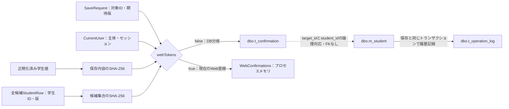
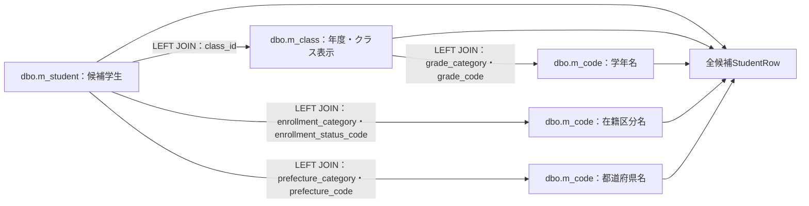
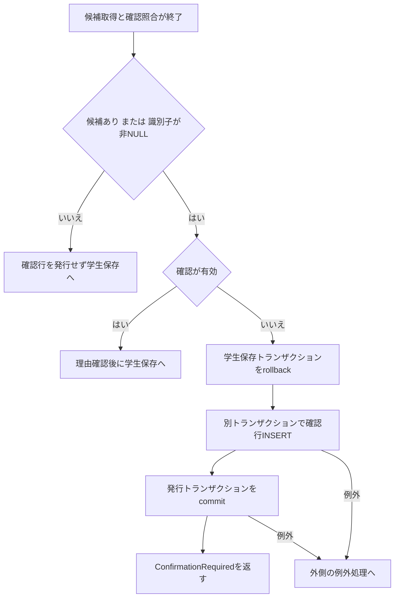
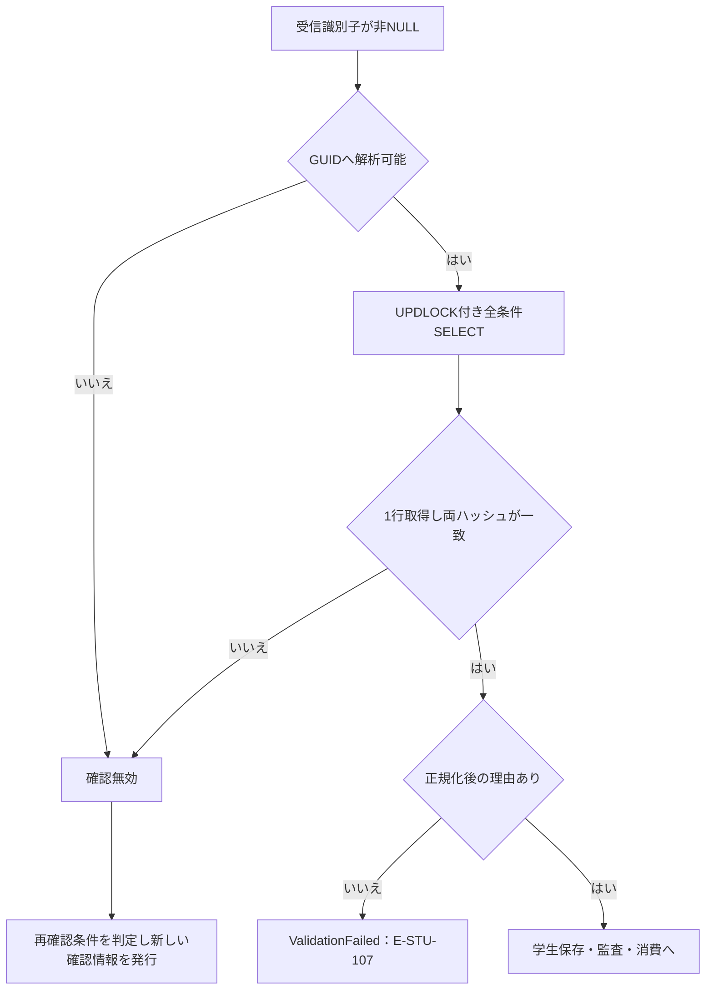
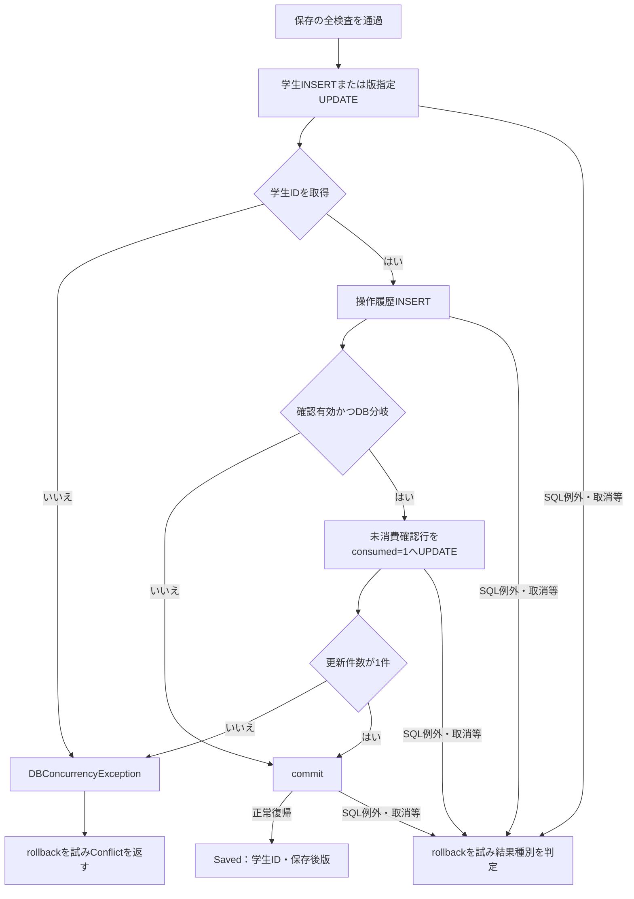
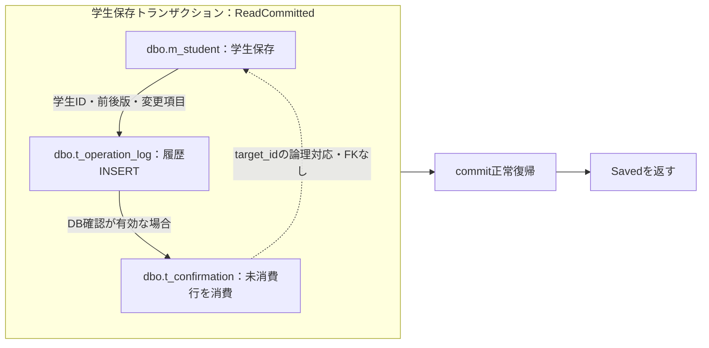

<!-- spec-meta: {"schema":"spec-md/1.0","documentId":"SM-DB-T-CONFIRMATION","version":"1.0","path":"spec/database/tables/t_confirmation.md","sheets":[{"heading":"概要","kind":"GRID","sheet":"01_概要"},{"heading":"項目一覧","kind":"LIST","sheet":"02_項目一覧","key":["物理名"]},{"heading":"イベント仕様","kind":"GRID","sheet":"03_イベント仕様"},{"heading":"補足説明","kind":"GRID","sheet":"04_補足説明"}]} -->
# 重複確認情報 dbo.t_confirmation テーブル定義

文書属性：DBテーブル定義／版1.0／論理名：重複確認情報／物理名：dbo.t_confirmation／対象DB製品：SQL Server／項目数：9／主キー：token。

## 概要

重複確認情報は、同一人物の候補を確認して学生の保存を続行する要求について、確認時の所有者、認証セッション、保存対象、期待版、保存内容、候補集合、有効期限を保持する。1行の単位は、アプリケーションが発行した確認識別子1件である。確認後に入力内容や候補が変わった要求を、その確認情報で保存させないために照合する。確認理由や候補の表示内容そのものは本表へ保存しない。（根拠：`sources/database/001_schema.sql:156-169`、`sources/Core/SqlServerStudentService.cs:274-290`、`sources/Core/SqlServerStudentService.cs:337-342`）

本表を使う実装は、`SqlServerStudentService` の `webTokens=false` 分岐である。公開コンストラクターの既定値もfalseだが、現在のWeb起動処理は `webTokens:true` を明示してサービスを登録する。このWeb登録では確認情報をプロセスメモリに保持し、本表への発行INSERT、照合SELECT、消費UPDATEを行わない。学生と操作履歴の保存には引き続きDBを使用する。（根拠：`sources/Core/SqlServerStudentService.cs:39-42`、`sources/Core/SqlServerStudentService.cs:276-284`、`sources/Core/SqlServerStudentService.cs:308-342`、`sources/Infrastructure/WebHostSetup.cs:19-19`）

接続されているWebの保存入口は、新規の `POST /students/create` と更新の `POST /students/{id}/update` である。コントローラーは認証、許可されたフォーム項目、保存権限、編集スナップショットの所有者・セッション・対象・期限、復帰先を確認する。入力が有効なら `WebStudentCoordinator.Save` から `IStudentService.SaveAsync` を呼ぶ。画面のhidden項目 `Input.DuplicateToken` は `StudentSaveInput.DuplicateToken` を経て `SaveRequest.ConfirmationToken` に渡される。所有者とセッションは入力DTOから受け取らず、認証情報から作る `CurrentUser` を使用する。（根拠：`sources/Program.cs:3-6`、`sources/Web/Controllers/StudentsController.cs:5-6`、`sources/Web/Controllers/StudentsController.cs:26-33`、`sources/Web/Controllers/StudentsController.cs:41-41`、`sources/Infrastructure/EditorSnapshotStore.cs:7-10`、`sources/Infrastructure/RequestIdentity.cs:7-14`、`sources/Infrastructure/WebStudentCoordinator.cs:18-18`、`sources/Web/Inputs/StudentSaveInput.cs:30-43`、`sources/Views/Students/Edit.cshtml:5-5`）

本表には独立した操作画面や確認情報専用の公開APIは定義されていない。確認後の続行は同じ学生保存POSTの再送である。以下のDBイベントは、DB使用分岐に実装された内部処理を説明する。（根拠：`sources/Web/Controllers/StudentsController.cs:26-38`、`sources/Views/Students/Edit.cshtml:14-15`、`sources/Core/SqlServerStudentService.cs:227-342`）

### データの受渡しと保持先

対象ID・期待版は保存要求から、所有者・セッションは認証情報から取得する。正規化済み学生値と全候補のID・版は、それぞれハッシュへ変換して確認情報へ渡す。`target_id` と学生IDの対応はアプリケーションが照合する論理関係であり、本表から学生表へのFKは定義されていない。新規登録の確認行では対象IDがNULLで、保存後の消費UPDATEも対象IDを採番済み学生IDへ変更しない。（根拠：`sources/Core/Contracts.cs:6-6`、`sources/Core/Contracts.cs:66-70`、`sources/Core/SqlServerStudentService.cs:224-225`、`sources/Core/SqlServerStudentService.cs:279-283`、`sources/Core/SqlServerStudentService.cs:308-311`、`sources/Core/SqlServerStudentService.cs:339-341`、`sources/database/001_schema.sql:156-169`、`sources/database/001_schema.sql:189-195`）



この図はデータの受渡しと分岐を示す関連図である。DB制約の多重度や、DBとメモリへ同時に永続化する関係は表していない。

## 項目一覧

| No | 論理名 | 物理名 | 実DB型・照合順序 | 容量・単位 | NULL | PK | 既定値・自動生成 | 内容・制約 | 根拠 |
| --- | --- | --- | --- | --- | --- | --- | --- | --- | --- |
| 1 | 確認識別子 | token | uniqueidentifier | 16バイトのGUID | 不可 | 単独主キー | DEFAULTなし、IDENTITYなし。発行時にアプリケーションで生成 | `pk_t_confirmation` の対象。DB分岐は `Guid.NewGuid()` を設定し、文字列表現を呼出元へ返す | `sources/database/001_schema.sql:157-166`、`sources/Core/SqlServerStudentService.cs:337-342` |
| 2 | 確認情報の所有者 | principal | nvarchar(128) COLLATE Latin1_General_100_CS_AS_SC | 128 UTF-16コード単位、最大256バイト。CHECK上限は64 Unicodeスカラー値 | 不可 | 対象外 | DEFAULTなし、自動生成なし | `CurrentUser.Principal` を保存。`ck_t_confirmation_principal_scalar` で末尾空白を含め64文字以下を要求 | `sources/database/001_schema.sql:158-167`、`sources/Core/SqlServerStudentService.cs:340-340` |
| 3 | 認証セッション | session_id | uniqueidentifier | 16バイトのGUID | 不可 | 対象外 | DEFAULTなし、自動生成なし | DB分岐は `CurrentUser.SessionId` をGUIDとして検証・変換して保存 | `sources/database/001_schema.sql:159-159`、`sources/Core/SqlServerStudentService.cs:46-51`、`sources/Core/SqlServerStudentService.cs:340-340` |
| 4 | 保存対象学生ID | target_id | bigint | 8バイト、符号付き64bit整数 | 可 | 対象外 | DEFAULTなし、自動生成なし | `SaveRequest.StudentId`。新規はNULL、更新は対象学生ID。正数CHECKと学生表へのFKはなし | `sources/database/001_schema.sql:160-169`、`sources/database/001_schema.sql:189-195`、`sources/Core/SqlServerStudentService.cs:235-235`、`sources/Core/SqlServerStudentService.cs:341-341` |
| 5 | 確認時の期待版 | expected_version | bigint | 8バイト、符号付き64bit整数 | 可 | 対象外 | DEFAULTなし、自動生成なし | `SaveRequest.ExpectedVersion`。SQL Serverのrowversion型ではない。正数CHECK、対象IDとのNULL組合せCHECKはなし | `sources/database/001_schema.sql:161-169`、`sources/Core/SqlServerStudentService.cs:235-235`、`sources/Core/SqlServerStudentService.cs:341-341` |
| 6 | 保存内容の照合値 | payload_hash | binary(32) | 固定32バイト | 不可 | 対象外 | DEFAULTなし、自動生成なし | 正規化済み19業務項目のJSONをUTF-8へ変換して計算したSHA-256。表示用のhex文字列は保存しない | `sources/database/001_schema.sql:162-162`、`sources/Core/SqlServerStudentService.cs:30-38`、`sources/Core/SqlServerStudentService.cs:224-224`、`sources/Core/SqlServerStudentService.cs:341-341` |
| 7 | 全候補の照合値 | candidate_hash | binary(32) | 固定32バイト | 不可 | 対象外 | DEFAULTなし、自動生成なし | 全候補の学生ID・版の組を、取得順でJSON化して計算したSHA-256。画面表示分20件だけを対象にしない | `sources/database/001_schema.sql:163-163`、`sources/Core/SqlServerStudentService.cs:225-225`、`sources/Core/SqlServerStudentService.cs:268-290` |
| 8 | UTC有効期限 | expires_at | datetimeoffset(7) | 日時とオフセット、小数秒7桁 | 不可 | 対象外 | DEFAULTなし、自動生成なし | `ck_t_confirmation_expires_at_utc` でオフセット0を要求。発行値は保存要求入口のUTC時刻＋10分 | `sources/database/001_schema.sql:164-168`、`sources/Core/SqlServerStudentService.cs:44-44`、`sources/Core/SqlServerStudentService.cs:229-229`、`sources/Core/SqlServerStudentService.cs:341-341` |
| 9 | 消費状態 | consumed | bit | 0／1の真偽値 | 不可 | 対象外 | DEFAULTなし、自動生成なし | 発行INSERTが明示的に0を設定。有効な確認で学生保存を行う場合に1へ更新。消費日時の列はなし | `sources/database/001_schema.sql:165-169`、`sources/Core/SqlServerStudentService.cs:308-311`、`sources/Core/SqlServerStudentService.cs:339-339` |

## イベント仕様

### 共通：確認処理に到達するまでの学生保存

確認情報は学生保存の全検査を省略するための情報ではない。再送要求でも権限、学生値、現在の学生版、コード・クラスの業務条件、学籍番号の重複、同一人物候補を確認し直す。以下の順序で進み、途中で結果を返した要求は確認行の照合・消費へ到達しない。（根拠：`sources/Core/SqlServerStudentService.cs:227-290`）

1. 認証主体を検証し、UTC時刻 `now` を取得する。Viewerなら `Forbidden` を返す。学生値を正規化し、理由を原入力60・正規化後60のUnicodeスカラー値上限で検証する。対象IDと期待版は、新規なら双方NULL、更新なら双方正数であることを要求する。年度は指定時に1900～9998、学年コードは正規化後のコードとして検証する。（根拠：`sources/Core/SqlServerStudentService.cs:229-239`、`sources/Core/StudentNormalizer.cs:37-57`、`sources/Core/StudentNormalizer.cs:119-159`）
2. DB接続を開き、`ALLOW_SNAPSHOT_ISOLATION` の状態が1であることを確認してから、ReadCommittedの学生保存トランザクションを開始する。保存用のアプリケーションロックを取得する。（根拠：`sources/Core/SqlServerStudentService.cs:53-63`、`sources/Core/SqlServerStudentService.cs:241-244`）
3. 更新では `student_id=@id AND is_deleted=0` の学生を読み込む。0件なら `NotFound`、学生の現行 `row_version` と要求の期待版が異なれば `Conflict` を返す。学籍番号変更は禁止し、既存の在籍区分03・04からの訂正は管理者権限と理由を要求する。（根拠：`sources/Core/SqlServerStudentService.cs:246-257`）
4. コードの存在、変更時の利用可否、クラスの存在と年度・学年の整合、所属や在籍期間、必要時の定員を再検査する。既存と同じコード値は存在確認を行うが、新規・変更値に対する停止・有効期間の検査は行わない。クラスの新規所属可否と定員検査も、在学・休学の所属を新たに設定する条件で行う。（根拠：`sources/Core/SqlServerStudentService.cs:344-383`）
5. 正規化済み保存値に変更がなければ、明示的にrollbackして `NoChange` を返す。既存版が `long.MaxValue` の場合は `Conflict` を返す。（根拠：`sources/Core/SqlServerStudentService.cs:260-263`）
6. 学籍番号は `student_no=@no AND (@id IS NULL OR student_id<>@id)` で `COUNT_BIG(*)` を取得し、1件以上なら使用済みとして拒否する。この検索に削除状態の述語はなく、削除済み学生も対象である。`@no` はVarChar(15)、`@id` はNULL可のBigIntである。（根拠：`sources/Core/SqlServerStudentService.cs:264-266`）
7. 同一人物候補を全件取得し、正規化済み学生値と候補集合から2種類のハッシュを計算する。受信確認識別子がある場合は、その保持先の分岐で照合する。（根拠：`sources/Core/SqlServerStudentService.cs:268-284`）

#### 排他と時刻の前提

保存用ロックは `sp_getapplock` を使い、リソース `test-project1:student-write`、モードExclusive、所有者Transaction、待機上限5000ミリ秒、DBプリンシパルpublicを指定する。SQLバッチは `SET XACT_ABORT ON` を設定し、取得結果が負なら51001のSQL例外を発生させる。共通のSQLコマンドタイムアウトは30秒である。本表のUPDLOCK付き照合も、この学生保存トランザクションに所属する。（根拠：`sources/Core/SqlServerStudentService.cs:65-66`、`sources/Core/SqlServerStudentService.cs:92-101`、`sources/Core/SqlServerStudentService.cs:241-244`、`sources/Core/SqlServerStudentService.cs:280-280`）

発行期限と照合基準は、保存要求入口で取得したUTC時刻 `now` を使用する。照合直前やcommit直前に時刻を取得し直す処理はない。期限判定は `expires_at > @now` であり、期限と基準時刻が等しい行は無効である。（根拠：`sources/Core/SqlServerStudentService.cs:44-44`、`sources/Core/SqlServerStudentService.cs:229-229`、`sources/Core/SqlServerStudentService.cs:280-281`、`sources/Core/SqlServerStudentService.cs:313-313`、`sources/Core/SqlServerStudentService.cs:341-341`）

#### 同一人物候補のSQL・テーブル関連

候補は、未削除で、生年月日が一致し、氏名照合キーまたはカナ照合キーが一致する学生である。更新時は自分自身を除外する。クラスとコードのLEFT JOINは候補の表示情報を得るための検索結合であり、本表のFKではない。（根拠：`sources/Core/SqlServerStudentService.cs:82-91`、`sources/Core/SqlServerStudentService.cs:269-272`）

```sql
SELECT s.student_id,s.student_no,s.student_name,s.student_name_kana,s.birth_date,
       c.school_year,c.class_code,c.class_name,g.code_name grade_name,e.code_name status_name,
       p.code_name prefecture_name,s.address_line1,s.phone_number,s.admission_date,
       s.updated_at,s.row_version
  FROM dbo.m_student s
  LEFT JOIN dbo.m_class c
    ON c.class_id=s.class_id
  LEFT JOIN dbo.m_code g
    ON g.category_id=c.grade_category AND g.code_value=c.grade_code
  LEFT JOIN dbo.m_code e
    ON e.category_id=s.enrollment_category AND e.code_value=s.enrollment_status_code
  LEFT JOIN dbo.m_code p
    ON p.category_id=s.prefecture_category AND p.code_value=s.prefecture_code
 WHERE s.is_deleted=0
   AND (@id IS NULL OR s.student_id<>@id)
   AND s.birth_date=@birth
   AND (s.name_key=@name OR s.kana_key=@kana)
 ORDER BY s.student_id;
```

| パラメータ | SqlDbType・Size | 値・NULLの扱い |
| --- | --- | --- |
| @id | BigInt | 保存対象学生ID。新規はDBNull.Value |
| @birth | Date | 正規化済み生年月日。DateOnlyを日付の午前0時のDateTimeへ変換 |
| @name | NVarChar、320 | サーバーで生成した氏名照合キー |
| @kana | NVarChar、36 | サーバーで生成したカナ照合キー |

TOP、OFFSET、ページングはなく、学生ID昇順の全件を `List<StudentRow>` に読み込む。結果には学生ID、学籍番号、氏名、氏名カナ、生年月日、年度、学年名、クラスコード・名称、在籍区分名、住所表示、本人電話、入学日、更新日時、学生版を持つ。住所表示は都道府県名と住所1から組み立て、都道府県名が取得できない場合は `[不整合]` を使用する。確認応答は全件数と先頭最大20件を返すが、ハッシュは全件を対象とする。（根拠：`sources/Core/SqlServerStudentService.cs:67-73`、`sources/Core/SqlServerStudentService.cs:77-91`、`sources/Core/SqlServerStudentService.cs:268-290`、`sources/Core/Contracts.cs:50-55`）



この図は候補取得SQLの検索結合を示す。FK制約や多重度の定義としては使用しない。

#### ハッシュ対象と照合方法

保存内容のハッシュは、`Columns` の列挙から `name_key`、`kana_key`、`relationship_category` を除いた19項目をキーと値の組としてJSON化し、UTF-8バイト列のSHA-256を計算する。対象列は `student_no`、`student_name`、`student_name_kana`、`birth_date`、`gender_code`、`postal_code`、`prefecture_code`、`address_line1`、`address_line2`、`phone_number`、`email_address`、`admission_date`、`enrollment_status_code`、`enrollment_end_date`、`class_id`、`emergency_contact_name`、`relationship_code`、`emergency_phone_number`、`remarks` である。理由、補助入力の年度・学年、対象ID、期待版は含まない。対象IDと期待版は本表の別列で照合する。（根拠：`sources/Core/SqlServerStudentService.cs:30-38`、`sources/Core/SqlServerStudentService.cs:224-224`、`sources/Core/StudentNormalizer.cs:124-147`、`sources/Core/SqlServerStudentService.cs:280-283`）

候補ハッシュは、学生ID昇順に得た全候補について `[StudentId, RowVersion]` の組を並べてJSON化し、UTF-8バイト列のSHA-256を計算する。候補の増減、並び、学生版の変化が計算対象になる。JOINで得た名称などの表示値そのものは含まない。照合では読取り済みの2つのbyte配列を、今回計算した値と `CryptographicOperations.FixedTimeEquals` で比較し、両方が一致することを要求する。（根拠：`sources/Core/SqlServerStudentService.cs:225-225`、`sources/Core/SqlServerStudentService.cs:269-283`）

### 確認情報の発行：DB使用分岐

#### 処理概要

候補が1件以上ある、または確認識別子が非NULLである保存要求について、確認情報が有効でなければ新しい確認行を発行する。学生保存をいったんrollbackした後、同じDB接続で別のトランザクションを開始する。確認行の発行と学生保存は別の確定単位である。（根拠：`sources/Core/SqlServerStudentService.cs:287-290`、`sources/Core/SqlServerStudentService.cs:330-342`）

#### 処理手順

1. 学生保存トランザクションを `RollbackAsync(ct)` で終了する。
2. `IssueConfirmation` に認証情報、保存要求、今回の保存内容ハッシュ、全候補ハッシュ、入口時刻 `now` を渡す。
3. DB分岐では `Guid.NewGuid()` で識別子を生成し、ReadCommittedの発行トランザクションを開始する。
4. 全9列を指定して1行をINSERTする。対象IDと期待版のC#のnullはSQL NULLとし、消費状態はSQLリテラル0、期限は `now.AddMinutes(10)` とする。
5. INSERTとcommitを順にawaitした後、GUIDの文字列表現を返す。`SaveAsync` は `ConfirmationRequired`、対象ID、既存学生版、確認識別子、全候補件数、先頭最大20件を返す。

（根拠：`sources/Core/SqlServerStudentService.cs:67-73`、`sources/Core/SqlServerStudentService.cs:287-290`、`sources/Core/SqlServerStudentService.cs:337-342`）

#### 条件付き処理フロー



#### SQL・テーブル関連

発行SQLの書込み対象は本表1表だけであり、JOINはない。単一表INSERTのため、このイベント固有のER図は省略する。値の出所は概要の関連図に示す。

```sql
INSERT INTO dbo.t_confirmation
    (token,principal,session_id,target_id,expected_version,
     payload_hash,candidate_hash,expires_at,consumed)
VALUES
    (@token,@actor,@session,@id,@version,
     @payload,@candidates,@expires,0);
```

（根拠：`sources/Core/SqlServerStudentService.cs:339-342`）

#### DB操作の詳細

| パラメータ | SqlDbType・Size | 設定値 | NULL |
| --- | --- | --- | --- |
| @token | UniqueIdentifier | アプリケーションで生成したGUID | 不可 |
| @actor | NVarChar、128 | CurrentUser.Principal | 不可 |
| @session | UniqueIdentifier | Guid.Parse(CurrentUser.SessionId) | 不可 |
| @id | BigInt | SaveRequest.StudentId | 新規はSQL NULL |
| @version | BigInt | SaveRequest.ExpectedVersion | 新規はSQL NULL |
| @payload | Binary、32 | 保存内容のSHA-256のbyte配列 | 不可 |
| @candidates | Binary、32 | 全候補のSHA-256のbyte配列 | 不可 |
| @expires | DateTimeOffset | 保存要求入口のUTC時刻＋10分 | 不可 |

共通 `Param` はSqlDbTypeを明示し、指定された場合にSizeを設定する。C#のnullは `DBNull.Value` に変換し、対象ID・期待版をゼロへ置換しない。INSERTの戻り件数に対する1件要求の判定はなく、実行とcommitの正常復帰後に識別子を返す。（根拠：`sources/Core/SqlServerStudentService.cs:67-73`、`sources/Core/SqlServerStudentService.cs:339-342`）

#### 結果・例外時の扱い

発行成功の応答は確認待ちであり、学生保存成功の応答ではない。再確認時も新しい行をINSERTするだけで、古い確認行の削除・置換・消費は行わない。形式不正、存在なし、所有者・セッション・対象・確認行の期待版の相違、期限切れ、消費済み、ハッシュ不一致はいずれも確認無効となり、この発行側へ進む。候補が0件になっていても識別子が非NULLなら再確認になる場合がある。（根拠：`sources/Core/SqlServerStudentService.cs:275-290`、`sources/Core/SqlServerStudentService.cs:337-342`）

発行には専用の書込み開始・commit試行フラグがない。発行commitでSQL例外、無効状態、取消例外が発生した場合、外側の学生保存では学生書込み前の扱いとなり、`SystemError` 側へ進む。戻り値だけでは確認行が確定したかを判断できない。また2601・2627のSQL例外は、発生元を区別せず学籍番号使用済みの `ValidationFailed` へ変換する。（根拠：`sources/Core/SqlServerStudentService.cs:240-240`、`sources/Core/SqlServerStudentService.cs:317-322`、`sources/Core/SqlServerStudentService.cs:337-342`）

### 確認情報の照合：DB使用分岐

#### 処理概要

非NULLの確認識別子を受け取ったDB分岐は、GUIDとして解析できた場合だけ本表を検索する。所有者、セッション、対象、期待版、期限、未消費状態をSQLで絞り込み、取得した2つのハッシュをアプリケーションで比較する。（根拠：`sources/Core/SqlServerStudentService.cs:276-284`）

#### 処理手順

1. 受信した `SaveRequest.ConfirmationToken` を `Guid.TryParse` する。解析できなければ照合SELECTを実行せず、確認無効のまま後続判定へ進む。
2. 学生保存トランザクションに所属するUPDLOCK付きSELECTを実行する。
3. token、principal、session_id、対象ID、期待版、期限、未消費状態の全SQL条件を満たす行を読む。対象IDと期待版は、それぞれ双方NULLの場合も一致とする。
4. 0件なら確認無効とする。1件を取得した場合は `payload_hash` と今回の保存内容ハッシュ、`candidate_hash` と今回の全候補ハッシュが両方一致した場合だけ確認有効とする。
5. 確認有効でも正規化後の理由がnullなら、E-STU-107の `ValidationFailed` を返す。理由があれば学生保存へ進む。確認無効の場合は候補件数と識別子の非NULL条件に従って再確認を発行する。

（根拠：`sources/Core/SqlServerStudentService.cs:279-290`）

#### 条件付き処理フロー



#### SQL・テーブル関連

照合SELECTは本表のみを読み、JOIN、ORDER BY、TOP、ページングはない。単一表の主キー検索のためイベント固有のER図は省略する。候補の再取得に使用する複数表の検索結合は、共通節の候補関連図に示す。

```sql
SELECT payload_hash,candidate_hash
  FROM dbo.t_confirmation WITH (UPDLOCK)
 WHERE token=@token
   AND principal=@actor
   AND session_id=@session
   AND ((target_id IS NULL AND @id IS NULL) OR target_id=@id)
   AND ((expected_version IS NULL AND @version IS NULL) OR expected_version=@version)
   AND expires_at>@now
   AND consumed=0;
```

（根拠：`sources/Core/SqlServerStudentService.cs:280-283`）

#### DB操作の詳細

| パラメータ | SqlDbType・Size | 設定値 | NULL |
| --- | --- | --- | --- |
| @token | UniqueIdentifier | TryParseで得た受信GUID | 不可 |
| @actor | NVarChar、128 | 今回のCurrentUser.Principal | 不可 |
| @session | UniqueIdentifier | Guid.Parseした今回のSessionId | 不可 |
| @id | BigInt | 今回のSaveRequest.StudentId | 新規はSQL NULL |
| @version | BigInt | 今回のSaveRequest.ExpectedVersion | 新規はSQL NULL |
| @now | DateTimeOffset | 今回のSaveAsync入口で取得したUTC時刻 | 不可 |

tokenの単独主キーにより、全条件に一致する結果は最大1行である。SQLの結果形は固定32バイトのハッシュ2列で、ハッシュはWHERE条件には含めず、読取り後にC#で比較する。主体名のSQL比較には列に指定された照合順序が適用される。（根拠：`sources/database/001_schema.sql:158-166`、`sources/Core/SqlServerStudentService.cs:280-283`）

#### 結果・例外時の扱い

確認行の期待版が今回の要求と異なることによる再確認と、学生の現行版が今回の要求と異なることによる競合は区別する。後者は確認SELECTより前にE-STU-105の `Conflict` で終了する。（根拠：`sources/Core/SqlServerStudentService.cs:246-252`、`sources/Core/SqlServerStudentService.cs:280-290`）

有効な確認でも理由不足なら学生保存・監査・確認消費を行わない。この早期returnには明示的なrollback呼出しがなく、`await using` の学生保存トランザクション破棄へ進む。検索・読取りには受信CancellationTokenを渡し、SQL例外、無効状態、取消例外は共通の例外処理に入る。（根拠：`sources/Core/SqlServerStudentService.cs:241-243`、`sources/Core/SqlServerStudentService.cs:282-286`、`sources/Core/SqlServerStudentService.cs:319-323`）

### 学生保存に伴う確認情報の消費：DB使用分岐

#### 処理概要

確認が有効で理由がある場合、学生保存、操作履歴INSERT、確認消費UPDATEを同じ学生保存トランザクション内で行い、最後にcommitする。候補0件かつ識別子未設定の通常保存も学生と履歴を保存するが、確認行の消費UPDATEは行わない。（根拠：`sources/Core/SqlServerStudentService.cs:286-315`）

#### 処理手順

1. 新規なら保存後版を1、更新なら読取り済み学生版＋1とする。
2. 新規では正規化済み19業務値と派生値 `name_key`、`kana_key`、`relationship_category` をINSERTする。区分固定値はGENDER、PREFECTURE、ENROLLMENT_STATUS、削除状態は0、作成・更新情報は今回の主体と入口時刻、版は1を設定する。
3. 更新では上記正規化済み値から学籍番号を除いて設定し、更新主体・時刻を設定して版を1増やす。WHEREは `student_id=@id AND row_version=@version AND is_deleted=0` とする。パラメータ型とサイズは `Columns` 定義に従い、nullはDBNull.Valueへ変換する。
4. 学生保存SQLは `OUTPUT INSERTED.student_id` を一時的なテーブル変数へ入れて学生IDを返す。`ExecuteScalarAsync` の結果がnullまたはDBNullなら `DBConcurrencyException` を発生させる。
5. `t_operation_log` に対象学生、CREATE／UPDATE、前後版、変更列名のJSON、実行者・時刻、要求識別子、理由、候補の有無をINSERTする。理由はNVarChar(120)で渡す。`duplicate_confirmed` の設定条件は今回の候補件数が1件以上かどうかである。
6. 確認有効かつDB分岐なら、対象確認行の `consumed` を0から1へ更新し、更新件数がちょうど1件であることを要求する。
7. commit試行フラグを設定して `CommitAsync(ct)` を実行する。正常復帰後に `Saved` と学生ID・保存後版を返す。

（根拠：`sources/Core/SqlServerStudentService.cs:30-38`、`sources/Core/SqlServerStudentService.cs:67-73`、`sources/Core/SqlServerStudentService.cs:292-315`、`sources/Core/SqlServerStudentService.cs:385-390`）

#### 条件付き処理フロー



#### SQL・テーブル関連

このイベントは学生、操作履歴、確認情報の3表を同じ確定単位で操作する。関連図は実行順序と論理的な対象対応を示し、表間のFKや多重度は追加しない。（根拠：`sources/Core/SqlServerStudentService.cs:295-313`、`sources/Core/SqlServerStudentService.cs:387-390`）



#### DB操作の詳細

確認消費のSQLは次のとおりである。

```sql
UPDATE dbo.t_confirmation
   SET consumed=1
 WHERE token=@token
   AND consumed=0;
```

`@token` は受信確認識別子を `Guid.Parse` したUniqueIdentifierである。`ExecuteNonQueryAsync(ct)` が返す件数が1以外なら競合例外とする。更新列は `consumed` のみで、対象ID、期待版、期限、ハッシュは変更しない。（根拠：`sources/Core/SqlServerStudentService.cs:308-311`）

消費UPDATEのWHEREには所有者、セッション、対象、期待版、期限、ハッシュを再記載しない。同じトランザクションで先に実行したUPDLOCK付き全照合を前提としている。UPDATE直前の時刻再取得や追加の再照合もない。（根拠：`sources/Core/SqlServerStudentService.cs:279-283`、`sources/Core/SqlServerStudentService.cs:308-313`）

学生と履歴の保存後でも、消費件数不一致やcommit前の失敗によってrollbackが成功すれば、そのトランザクションの学生・履歴・消費更新が取り消される。確認発行は以前の別トランザクションなので、このrollbackで発行行そのものを削除する処理にはならない。（根拠：`sources/Core/SqlServerStudentService.cs:287-290`、`sources/Core/SqlServerStudentService.cs:308-329`、`sources/Core/SqlServerStudentService.cs:337-342`）

#### 結果・例外時の扱い

入力検証例外は `ValidationFailed`、SQLの2601・2627は学籍番号使用済みの `ValidationFailed`、学生保存または確認消費の競合例外は `Conflict` を返す。これらのcatchはrollbackを試みるが、rollback成否を結果種別へ反映しない。（根拠：`sources/Core/SqlServerStudentService.cs:316-318`）

その他のSQL例外、InvalidOperationException、OperationCanceledExceptionでは、学生書込み開始済みで、commit試行済みまたはrollback失敗の場合に `Unknown` とする。それ以外は `SystemError` とする。`Unknown` は確定結果を保証せず、再保存の前に検索で結果を確認するよう返す。rollback helperは取消済み要求でも取消されないよう `CancellationToken.None` を使い、SQL例外または無効状態ならfalseを返す。（根拠：`sources/Core/SqlServerStudentService.cs:240-240`、`sources/Core/SqlServerStudentService.cs:302-323`、`sources/Core/SqlServerStudentService.cs:329-329`）

DB接続開始と学生保存トランザクション開始は、上記結果変換のtryより前にある。そこで発生した例外は、このcatchによる `SaveResult` 変換の対象にならない。SQL接続、トランザクション開始、検索、読取り、書込み、commitには受信CancellationTokenを渡す。（根拠：`sources/Core/SqlServerStudentService.cs:53-63`、`sources/Core/SqlServerStudentService.cs:241-243`、`sources/Core/SqlServerStudentService.cs:269-313`、`sources/Core/SqlServerStudentService.cs:338-342`）

## 補足説明

### 制約・索引・既定値の境界

提供DDLの主キーは `pk_t_confirmation(token)` の1件、表固有CHECKは主体名の上限とUTC期限の2件である。全9列にDEFAULTとIDENTITYはなく、所有者・セッション・対象ごとの追加UNIQUE、FK、期限検索用の追加索引は記載されていない。対象ID・期待版の正数条件とNULL組合せはアプリケーションの検証であり、本表の物理制約ではない。（根拠：`sources/database/001_schema.sql:156-169`、`sources/database/001_schema.sql:187-212`、`sources/Core/SqlServerStudentService.cs:235-235`）

主体名CHECKは `principal IS NULL OR LEN(CONVERT(nvarchar(max),principal) COLLATE Latin1_General_100_CS_AS_SC+N'#')-1<=64` である。補助文字を1文字として数え、末尾に印を加えることで末尾空白も長さに含める。列の物理容量128コード単位とCHECKの64スカラー値上限は別の制限である。CHECK内にNULL分岐があっても列自体はNOT NULLであり、CHECKには空文字や空白のみを禁止する条件はない。（根拠：`sources/database/001_schema.sql:158-167`）

サービスは主体名を `StudentNormalizer.Text(...,64,64,...,true)` に渡し、原入力上限、制御文字、前後空白除去後の必須・上限を検証する。ただし戻り値を主体名へ代入せず、元の `CurrentUser.Principal` を保存・照合に使用する。したがって検証処理が前後空白を除去しても、保存値がその除去結果になるとは説明しない。（根拠：`sources/Core/SqlServerStudentService.cs:46-51`、`sources/Core/SqlServerStudentService.cs:281-281`、`sources/Core/SqlServerStudentService.cs:340-340`、`sources/Core/StudentNormalizer.cs:47-57`）

期限CHECKは `expires_at IS NULL OR DATEPART(TZOFFSET,expires_at)=0` で、列自体はNOT NULLである。オフセット0を要求するが、現在時刻より未来であることや、発行から10分という間隔はDDLで強制しない。消費状態の初期0もDEFAULTではなく、発行INSERTが設定する値である。（根拠：`sources/database/001_schema.sql:164-168`、`sources/Core/SqlServerStudentService.cs:339-341`）

### 現在のWebが使うメモリ確認情報

現在のWebはstaticな `ConcurrentDictionary<string,Confirmation>` を使用し、同じプロセス内のサービスインスタンス間で確認情報を共有する。識別子は暗号学的乱数32バイトを小文字の64桁hexへ変換した文字列であり、DB分岐のGUIDとは形式が異なる。保持値は `CurrentUser`、NULL可の対象ID・期待版、2つのbyte配列ハッシュ、UTC期限、排他用Busyである。DB列 `consumed` をそのままメモリへ持つ構造ではない。（根拠：`sources/Infrastructure/WebHostSetup.cs:19-19`、`sources/Core/SqlServerStudentService.cs:19-29`、`sources/Core/SqlServerStudentService.cs:332-335`）

メモリ照合は所有者のPrincipal・SessionId、対象ID、期待版、期限、2つのハッシュを比較し、`Interlocked.CompareExchange` でBusyを0から1へ変更できた要求を有効とする。保存成功時は辞書から除去し、結果不明のUnknown時にも受信識別子を除去する。確認情報を取得済みで、保存未完了かつUnknownではない場合はfinallyでBusyを0へ戻す。期限切れ情報の除去は新しい確認情報の発行時に行い、期限が入口時刻以下の項目を対象にする。（根拠：`sources/Core/SqlServerStudentService.cs:278-278`、`sources/Core/SqlServerStudentService.cs:313-323`、`sources/Core/SqlServerStudentService.cs:332-335`）

### 画面操作と確認情報の状態

確認待ちではコントローラーが返却識別子を `Input.DuplicateToken` へ設定し、HTTP 409で編集画面を再表示する。画面は全候補件数と最大20件を表示し、続行で同じ保存フォームを送る。確認取消はhidden識別子を空にし、確認部分を画面から除去するクライアント操作であり、サーバーへの取消要求を送らない。編集フォーム内のinputイベントは理由入力も含めて識別子を空にする。（根拠：`sources/Web/Controllers/StudentsController.cs:32-33`、`sources/Infrastructure/WebPresentation.cs:23-23`、`sources/Views/Students/Edit.cshtml:14-15`、`sources/wwwroot/js/site.js:3-6`）

入力クリア・編集取消は `POST /students/reset` で初回スナップショットの入力に戻す。初回の `StudentSaveInput.From` は確認識別子を設定しないため、ここでも未設定へ戻る。この操作で本表を更新・削除する処理はない。保存成功では303で検索画面へ遷移する。保存結果を受け取って再表示する場合、入力の確認識別子をその結果の `ConfirmationToken` へ置換するため、理由不足など識別子を返さない結果では画面の識別子も解除される。（根拠：`sources/Web/Inputs/StudentSaveInput.cs:44-54`、`sources/Web/Controllers/StudentsController.cs:31-38`）

理由は本表へ保存せず、学生保存時の操作履歴へ渡す。原入力・正規化後とも60スカラー値を上限とし、改行をLFへ統一して前後空白を除去する。画面textareaの `maxlength=120` とこのサーバー検証上限を同じ値・単位として扱わない。（根拠：`sources/Core/SqlServerStudentService.cs:234-234`、`sources/Core/StudentNormalizer.cs:37-57`、`sources/Views/Students/Edit.cshtml:13-13`、`sources/Core/SqlServerStudentService.cs:389-390`）

### 宣言された処理と接続された入口

提供されたmaintenance入口は `MasterMaintenanceService` によるクラス・コード保存を呼ぶ。DB分岐の確認処理はサービス内に実装されているが、その公開コンストラクターの既定値だけを、本表を使用する業務入口の稼働根拠にはしない。サービスコメントの別EXEC専用DB入口も要求・意図の記載として扱う。（根拠：`sources/maintenance/Program.cs:11-12`、`sources/Core/SqlServerStudentService.cs:11-12`、`sources/Core/SqlServerStudentService.cs:39-42`、`sources/Infrastructure/WebHostSetup.cs:19-19`）

`WebPresentation.Save` は確認識別子や候補をJSON向けに変換するhelperで、ConfirmationRequiredに対するW-STU-101の対応を持つ。しかし接続された保存コントローラーはこのhelperを呼ばず、Viewまたは303応答を返す。W-STU-101を現在の保存画面が返すメッセージIDとは断定しない。サービスの再確認結果はConfirmationRequiredであり、確認不一致専用のW-STU-102はこの分岐で返していない。（根拠：`sources/Infrastructure/WebPresentation.cs:24-30`、`sources/Web/Controllers/StudentsController.cs:26-38`、`sources/Core/SqlServerStudentService.cs:287-290`）

### 設計資料に記載された意図

参照設計は画面のDuplicateTokenを256bit乱数の64桁hex、未確認時NULL、有効期間10分として定義する。また確認不一致時のW-STU-102による再確認、理由を付けた保存全検査の再実行、取消時のDB更新なしを意図している。これらは設計上の意図であり、本表の `uniqueidentifier` 定義やDB分岐のGUID発行、現在の戻り値を置き換える根拠にはしない。（設計意図の根拠：`reference-designs/詳細仕様書/CSharp_ASPNET/02_学生登録画面.md:150-153`、`reference-designs/詳細仕様書/CSharp_ASPNET/02_学生登録画面.md:374-380`、`reference-designs/基本設計書/02_学生登録画面.md:366-368`。実装の根拠：`sources/database/001_schema.sql:157-157`、`sources/Core/SqlServerStudentService.cs:287-290`、`sources/Core/SqlServerStudentService.cs:337-342`）

### 権限定義と行の保管

Web権限SQLは業務表のSELECT、学生のINSERT・UPDATE、操作履歴のINSERTなどを付与するが、本表へのSELECT・INSERT・UPDATE・DELETEは付与していない。同ファイルのメモリ保持に関するコメントは、現在のWeb登録およびメモリ分岐の実装と対応する。DB分岐で使用する本表の操作はSELECT・INSERT・UPDATEである。（根拠：`sources/database/003_web_permissions.sql:8-24`、`sources/Infrastructure/WebHostSetup.cs:19-19`、`sources/Core/SqlServerStudentService.cs:280-281`、`sources/Core/SqlServerStudentService.cs:308-311`、`sources/Core/SqlServerStudentService.cs:339-342`）

DB分岐の業務処理には期限切れ行・消費済み行のDELETEがない。期限切れは照合対象から外れ、消費済みは `consumed=0` の条件から外れるが、それだけでは行が削除されない。Webの辞書に対する期限切れ除去も本表の削除処理には該当しない。（根拠：`sources/Core/SqlServerStudentService.cs:279-290`、`sources/Core/SqlServerStudentService.cs:308-311`、`sources/Core/SqlServerStudentService.cs:330-342`）
