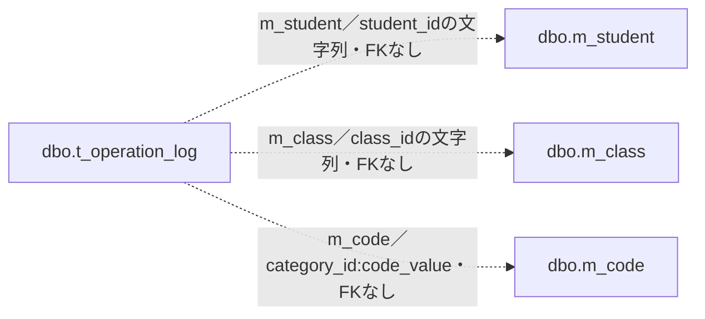
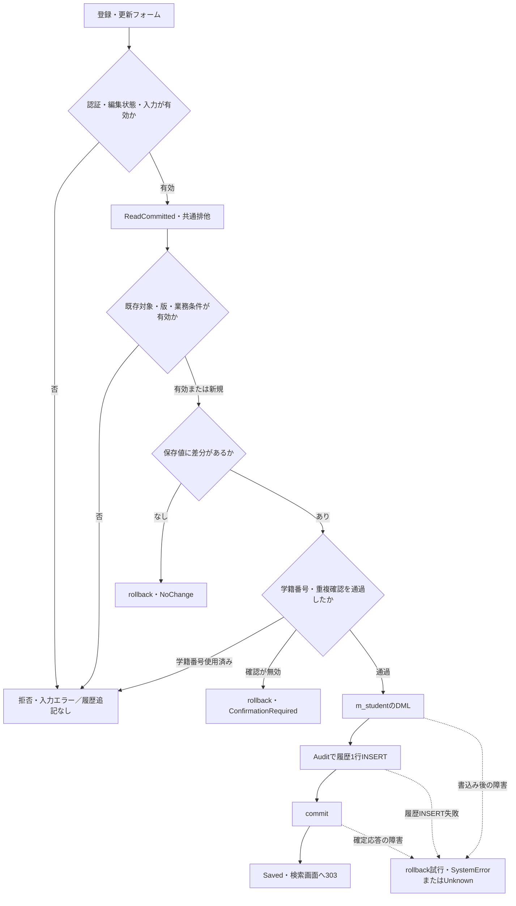
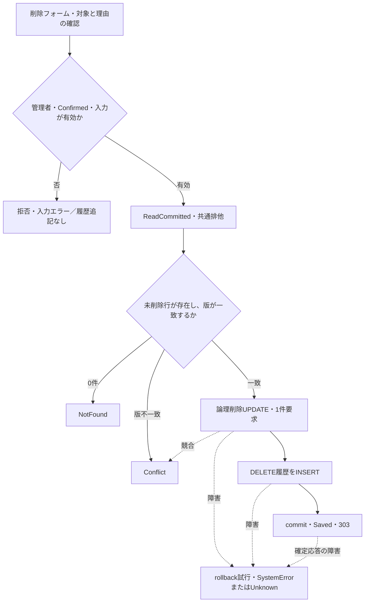
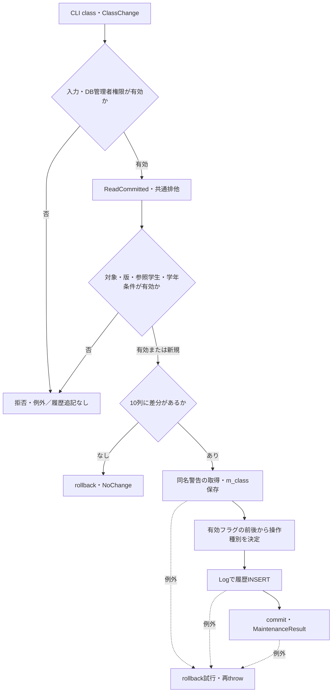
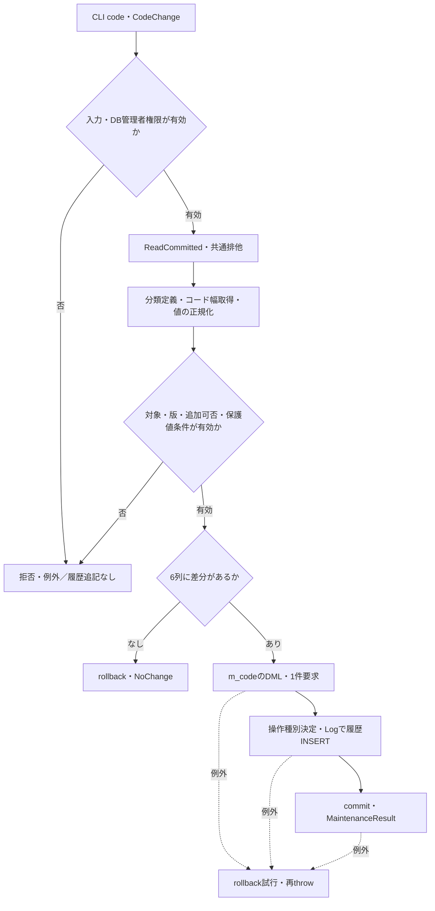

<!-- spec-meta: {"schema":"spec-md/1.0","documentId":"SM-DB-T-OPERATION-LOG","version":"1.0","path":"spec/database/tables/t_operation_log.md","table":{"logicalName":"操作履歴","physicalName":"dbo.t_operation_log","primaryKey":["log_id"]},"sheets":[{"sheet":"t_operation_log","kind":"TABLE","sections":[{"heading":"概要","kind":"GRID"},{"heading":"項目一覧","kind":"LIST","key":["物理名"],"columns":["No","論理名","物理名","PK","実DB型","容量・精度・単位","照合順序","NOT NULL","SQL DEFAULT・採番","保存内容・制約","根拠"]},{"heading":"イベント仕様","kind":"GRID"},{"heading":"補足説明","kind":"GRID"}]}]} -->
# 操作履歴 dbo.t_operation_log テーブル定義
文書属性：文書ID＝SM-DB-T-OPERATION-LOG／版＝1.0／文書種別＝DBテーブル定義／論理名＝操作履歴／物理名＝dbo.t_operation_log／対象DB製品＝SQL Server。

## 概要

操作履歴は、学生、クラス、コード値の変更について、対象の識別情報、操作種別、変更前後の更新管理番号、変更した列名、実行者、操作時点、受付番号、理由、重複警告の確認有無を保存する12列のテーブルである。学生の新規登録・更新・論理削除と、マスター保守によるクラス・コード値の保存では、業務行を変更した後に履歴を1行追記し、その業務変更と同じトランザクションをcommitする。履歴だけを独立して確定する呼出経路ではない。〔根拠：sources/database/001_schema.sql:137–154、sources/Core/SqlServerStudentService.cs:292–315、409–414、sources/Core/MasterMaintenanceService.cs:74–77、113–121〕

本表は変更内容を値単位で復元するためのテーブルではない。学生氏名、住所、連絡先などの変更前値・変更後値を保持する列はなく、changed_columnsには列名だけを保存する。対象学生は内部管理番号から生成したtarget_keyで識別する。一方、executed_byとoperation_reasonには実行者の識別文字列と入力理由を保存するため、理由本文を含めてすべての文字列が匿名化される構造ではない。〔根拠：sources/database/001_schema.sql:137–153、sources/Core/SqlServerStudentService.cs:306–307、385–390、sources/Core/StudentNormalizer.cs:47–57〕

履歴への追記は業務処理の内部動作である。学生側のAuditとマスター側のLogはprivateメソッドであり、履歴を直接登録する公開ルートではない。学生フォームはControllerとWebStudentCoordinatorを経由してSqlServerStudentServiceへ接続され、マスター保守は独立したCLIからMasterMaintenanceServiceへ接続される。〔根拠：sources/Program.cs:3–6、sources/Infrastructure/WebHostSetup.cs:19–19、sources/Web/Controllers/StudentsController.cs:26–37、sources/Infrastructure/WebStudentCoordinator.cs:18–19、sources/Core/SqlServerStudentService.cs:385–390、sources/maintenance/Program.cs:4–13、sources/Core/MasterMaintenanceService.cs:132–135〕

設計資料は、確定した変更ごとの追記と、個人情報の変更前後値を保持しない用途を定義している。資料の長さは業務上限、初期値は業務設定であり、本書の物理容量・SQL DEFAULTとは区別する。たとえば変更後の更新管理番号の業務初期値は1であるが、after_version列にSQL DEFAULTは定義されていない。〔設計意図の根拠：reference-designs/基本設計書/テーブル/05_t_operation_log.md:9–18、29–35。実装の根拠：sources/database/001_schema.sql:143–149、sources/Core/SqlServerStudentService.cs:292–307〕

## 項目一覧

| No | 論理名 | 物理名 | PK | 実DB型 | 容量・精度・単位 | 照合順序 | NOT NULL | SQL DEFAULT・採番 | 保存内容・制約 | 根拠 |
| --- | --- | --- | --- | --- | --- | --- | --- | --- | --- | --- |
| 1 | 操作履歴番号 | log_id | 該当・単一列 | bigint | 64bit符号付き整数。文字長は対象外 | 対象外 | 該当 | DEFAULTなし。IDENTITY(1,1)で採番 | pk_t_operation_logの主キー。履歴INSERTでは指定しない。受付番号とは別の識別子 | sources/database/001_schema.sql:138–150、sources/Core/SqlServerStudentService.cs:387–390、sources/Core/MasterMaintenanceService.cs:134–135 |
| 2 | 対象情報の種類 | target_table | 非該当 | varchar(21) | 21バイト | Latin1_General_100_BIN2 | 該当 | なし | 実装の設定値はm_student、m_class、m_code。スキーマ名は含めない。この3値に限定するCHECKはない | sources/database/001_schema.sql:139–154、204–205、sources/Core/SqlServerStudentService.cs:387–387、sources/Core/MasterMaintenanceService.cs:75–75、119–119 |
| 3 | 対象の識別情報 | target_key | 非該当 | varchar(35) | 35バイト | Latin1_General_100_BIN2 | 該当 | なし | 学生・クラスは内部IDの10進文字列。コード値は分類ID、コロン、正規化済みコード値の連結。対象表へのFKなし | sources/database/001_schema.sql:140–140、189–195、sources/Core/SqlServerStudentService.cs:388–388、sources/Core/MasterMaintenanceService.cs:75–75、96–119 |
| 4 | 操作の種類 | operation_type | 非該当 | varchar(11) | 11バイト | Latin1_General_100_BIN2 | 該当 | なし | ck_audit_operationによりCREATE、UPDATE、DELETE、DISABLE、ENABLEを許容。学生のDELETEは論理削除 | sources/database/001_schema.sql:141–141、205–205、sources/Core/AuditOperation.cs:6–7、sources/Core/SqlServerStudentService.cs:413–413 |
| 5 | 変更前の更新管理番号 | before_version | 非該当 | bigint | 64bit符号付き整数。文字長は対象外 | 対象外 | 非該当・NULL可 | なし | 新規はNULL。既存変更は一致確認済みの変更前版。新規以外の必須性や正数条件を検査する履歴CHECKはない | sources/database/001_schema.sql:142–154、sources/Core/SqlServerStudentService.cs:245–253、307–307、404–413、sources/Core/MasterMaintenanceService.cs:48–75、102–119 |
| 6 | 変更後の更新管理番号 | after_version | 非該当 | bigint | 64bit符号付き整数。文字長は対象外 | 対象外 | 該当 | なし | アプリケーションが新規1、既存変更は前版＋1を設定。正数や前版との大小関係を検査する履歴CHECKはない | sources/database/001_schema.sql:143–154、sources/Core/SqlServerStudentService.cs:292–307、398–414、sources/Core/MasterMaintenanceService.cs:112–130 |
| 7 | 変更項目一覧 | changed_columns | 非該当 | nvarchar(max) | max指定。有限のnによる容量指定なし。配列要素数・業務上の総文字数CHECKなし | Latin1_General_100_CS_AS_SC | 該当 | なし | string[]をJSON配列文字列へ直列化。ck_audit_jsonは有効なJSONと配列の開始文字を検査し、要素の型・列名・重複・最小件数は検査しない | sources/database/001_schema.sql:144–144、204–204、sources/Core/SqlServerStudentService.cs:385–389、sources/Core/MasterMaintenanceService.cs:132–135 |
| 8 | 実行者 | executed_by | 非該当 | nvarchar(128) | 128 UTF-16コード単位。SC照合順序の文字数CHECKは上限64 | Latin1_General_100_CS_AS_SC | 該当 | なし | 学生はCurrentUser.Principal。マスターはORIGINAL_LOGIN()を検証・前後空白除去した値。ck_t_operation_log_executed_by_scalarを適用 | sources/database/001_schema.sql:145–151、sources/Core/SqlServerStudentService.cs:46–51、307–307、sources/Core/MasterMaintenanceService.cs:23–27 |
| 9 | 実行日時 | executed_at | 非該当 | datetimeoffset(7) | 小数秒精度7桁。時差オフセットはCHECKにより0 | 対象外 | 該当 | なし | 業務行と同じnowを設定。学生はTimeProvider.GetUtcNow()、マスターはトランザクション開始後のDateTimeOffset.UtcNow。commit完了時刻の列ではない | sources/database/001_schema.sql:146–152、sources/Core/SqlServerStudentService.cs:44–45、229–229、307–307、394–414、sources/Core/MasterMaintenanceService.cs:39–40、88–88、119–119 |
| 10 | 受付番号 | correlation_id | 非該当 | uniqueidentifier | GUID型。文字長の指定なし | 対象外 | 該当 | なし | 学生はサービス呼出し開始時のGUIDを設定し、SaveResult.RequestIdにも返す。マスターはLog内部で生成。一意制約・専用索引なし | sources/database/001_schema.sql:147–154、187–212、sources/Core/SqlServerStudentService.cs:229–229、307–315、394–414、sources/Core/MasterMaintenanceService.cs:11–11、135–135 |
| 11 | 操作・確認理由 | operation_reason | 非該当 | nvarchar(120) | 120 UTF-16コード単位。SC照合順序の文字数CHECKは上限60 | Latin1_General_100_CS_AS_SC | 非該当・NULL可 | なし | 学生保存は任意または条件付き必須、学生削除は必須。マスターはSQL NULLを明示設定。ck_t_operation_log_operation_reason_scalarを適用 | sources/database/001_schema.sql:148–153、sources/Core/SqlServerStudentService.cs:234–234、255–257、286–286、396–413、sources/Core/MasterMaintenanceService.cs:134–134 |
| 12 | 重複警告の確認有無 | duplicate_confirmed | 非該当 | bit | 真偽値0／1 | 対象外 | 該当 | df_t_operation_log_duplicate_confirmedによるDEFAULT (0) | 学生保存は候補件数が正かを明示設定。学生削除はfalse、マスターは0。削除フォームのConfirmedとは別項目 | sources/database/001_schema.sql:149–149、sources/Core/SqlServerStudentService.cs:307–307、389–389、413–413、sources/Core/MasterMaintenanceService.cs:134–134、sources/Infrastructure/WebStudentCoordinator.cs:19–19 |

## イベント仕様

### 共通の履歴追記方式

#### トランザクションと排他

学生保存・削除、クラス保存、コード値保存はReadCommittedトランザクション内で共通Gateを呼ぶ。GateはSET XACT_ABORT ONを設定し、資源名test-project1:student-writeに対してExclusiveのアプリケーションロックを取得する。ロック所有者はTransaction、待機上限は5000ミリ秒、DBプリンシパルはpublicである。sp_getapplockの戻り値が負の場合はTHROWし、業務書込みへ進まない。〔根拠：sources/Core/SqlServerStudentService.cs:92–101、242–244、400–403、sources/Core/MasterMaintenanceService.cs:39–42、88–90〕

業務DMLと履歴INSERTには同じSqlConnectionとSqlTransactionを渡す。Commandのタイムアウトは30秒であり、ParamはSQL型と必要なSizeを明示し、C#のnullをDBNull.Valueへ変換する。非同期DB呼出しとcommitには呼出元のCancellationTokenを渡す。例外時の共通RollbackはCancellationToken.Noneを使用し、SqlExceptionまたはInvalidOperationExceptionでrollbackできなかった場合はfalseを返す。〔根拠：sources/Core/SqlServerStudentService.cs:65–73、302–329、385–390、409–416、sources/Core/MasterMaintenanceService.cs:124–135〕

#### 対象表との関連

次の図は、履歴が識別する対象を示す関連図である。点線はtarget_tableとtarget_keyの文字列による関連を表し、FK線やDBで保証された多重度を表さない。履歴DDLには対象の存在、キー形式、対象行の更新管理番号との一致を検査する参照制約がない。学生・クラス・コード値間に定義された業務FKと、履歴の汎用識別は別の構造である。〔根拠：sources/database/001_schema.sql:137–154、189–195、sources/Core/SqlServerStudentService.cs:387–388、sources/Core/MasterMaintenanceService.cs:75–75、119–119〕



#### 履歴INSERTのSQLとパラメータ

学生用Auditは、target_tableに固定値m_studentを設定して次のINSERTを実行する。target_keyのパラメータ名は@idであるが、SQL型はBigIntではなくVarCharであり、学生IDをInvariantCultureの10進文字列に変換して渡す。〔根拠：sources/Core/SqlServerStudentService.cs:385–390〕

```sql
INSERT INTO dbo.t_operation_log
  (target_table,target_key,operation_type,before_version,after_version,
   changed_columns,executed_by,executed_at,correlation_id,
   operation_reason,duplicate_confirmed)
VALUES
  ('m_student',@id,@op,@before,@after,@changed,@actor,@now,@request,
   @reason,@confirmed);
```

学生用の対象・操作パラメータは@id＝VarChar(35)、@op＝VarChar(11)であり、前後版は@before・@after＝BigIntである。変更列は@changed＝NVarChar、Size=-1にJsonSerializer.Serialize(changed)の結果を設定する。実行者は@actor＝NVarChar(128)、日時は@now＝DateTimeOffset、受付番号は@request＝UniqueIdentifier、理由は@reason＝NVarChar(120)、重複確認有無は@confirmed＝Bitである。新規の@beforeと任意理由の未設定はSQL NULLとなる。〔根拠：sources/Core/SqlServerStudentService.cs:67–73、388–389〕

マスター用Logは、対象種別もパラメータで受け取り、理由と重複確認有無を固定値にする。〔根拠：sources/Core/MasterMaintenanceService.cs:132–135〕

```sql
INSERT dbo.t_operation_log
  (target_table,target_key,operation_type,before_version,after_version,
   changed_columns,executed_by,executed_at,correlation_id,
   operation_reason,duplicate_confirmed)
VALUES
  (@table,@key,@op,@before,@after,@changed,@actor,@now,@request,NULL,0);
```

マスター用の@tableはVarChar(21)、@keyはVarChar(35)、@opはVarChar(11)である。前後版、変更列、実行者、日時、受付番号のSQL型・Sizeは学生用と同じであり、@requestにはLog内部で生成したGuid.NewGuid()を設定する。operation_reasonのNULLとduplicate_confirmedの0はSQLへ明記され、DEFAULTによる補完ではない。〔根拠：sources/Core/MasterMaintenanceService.cs:134–135〕

両INSERTは単一VALUESによる1行の追記であり、WHERE、JOIN、ORDER BY、ページングを持たない。log_idを列一覧から省略してDB採番させる。AuditとLogはExecuteNonQueryAsyncの影響件数を判定せず、採番された履歴番号も取得しない。呼出元にはTaskの完了だけを返す。〔根拠：sources/Core/SqlServerStudentService.cs:385–390、sources/Core/MasterMaintenanceService.cs:132–135〕

### EVT-OPLOG-STUDENT-SAVE：学生の新規登録・更新に伴う追記

#### 処理概要

登録フォームのPOST /students/createと更新フォームのPOST /students/{id}/updateを起点とし、StudentsController、WebStudentCoordinator、SaveAsyncの順に到達する。新規はCREATE、既存更新はUPDATEとして記録する。保存値の検査、対象の再確認、差分判定、重複確認を通過した変更が履歴追記の対象となる。〔根拠：sources/Web/Controllers/StudentsController.cs:26–33、sources/Infrastructure/WebStudentCoordinator.cs:18–18、sources/Core/SqlServerStudentService.cs:227–315〕

#### 処理手順

1. Controllerは認証と偽造防止検査の対象となる。フォームでは許可項目と同名項目の重複を検査し、Viewerの書込みを拒否する。編集スナップショットの期限、所有者、ログインセッション、対象IDを確認し、送信された復帰先が読込時の復帰先と一致することを確認する。スナップショットは30分有効のサーバーメモリ情報であり、本表の履歴ではない。〔根拠：sources/Web/Controllers/StudentsController.cs:5–5、29–30、41–41、sources/Infrastructure/WebHostSetup.cs:13–16、sources/Infrastructure/EditorSnapshotStore.cs:7–10、sources/Infrastructure/RequestIdentity.cs:13–15〕
2. StudentSaveInput.ToRequestは画面値をStudentDraftへ移し、ルートのIDをStudentId、既存のExpectedVersionを正のInt64、DuplicateTokenをConfirmationToken、OperationReasonをReasonへ対応付ける。フォームからtarget_table、変更列配列、実行者、実行日時、受付番号を履歴値として直接受け取らない。〔根拠：sources/Web/Inputs/StudentSaveInput.cs:9–43、57–60、sources/Core/Contracts.cs:66–70、sources/Views/Students/Edit.cshtml:5–5、13–13〕
3. SaveAsyncは呼出しごとの受付番号、利用者、UTC時点を取得し、学生値と理由を正規化する。学生IDと比較版は新規で双方NULL、既存で双方正数を要求する。理由は原入力と正規化後をそれぞれ60 Unicodeスカラー以内に検査する。〔根拠：sources/Core/SqlServerStudentService.cs:229–239、sources/Core/StudentNormalizer.cs:37–57〕
4. ReadCommittedトランザクションと共通排他を取得する。既存学生は未削除行を再取得し、存在と比較版の一致を確認する。学籍番号変更は拒否する。既存在籍区分03・04を別区分へ訂正する場合は管理者権限と非NULL理由を要求する。〔根拠：sources/Core/SqlServerStudentService.cs:241–257〕
5. コードと所属クラスの業務条件をDBで確認してから、正規化値と既存値の差分を求める。差分0件は明示的にrollbackしてNoChangeを返す。理由だけを変更しても学生業務列の差分にはならず、履歴を追記しない。既存版がlong.MaxValueなら変更を拒否する。〔根拠：sources/Core/SqlServerStudentService.cs:260–263、325–327、344–383〕
6. 学籍番号の他行使用と同一人物候補を確認する。候補・内容・利用者等に対応する有効な重複確認が必要な場合は確認理由も要求する。確認が無効なら業務トランザクションをrollbackし、ConfirmationRequiredを返す。〔根拠：sources/Core/SqlServerStudentService.cs:264–290〕
7. 新規INSERTまたは比較版付きUPDATEを実行して学生IDを取得する。履歴の対象キー、前後版、変更列配列、利用者、同じnow、理由、候補件数から求めた確認有無、受付番号をAuditへ渡す。履歴追記後にcommitし、Saved、学生ID、新版、受付番号を返す。〔根拠：sources/Core/SqlServerStudentService.cs:292–315〕

#### 条件付き処理フロー



フローのUnknownは、業務変更と履歴の確定状態を判定できない応答である。履歴INSERT失敗時でも、rollbackの成否とcommit試行状態を含めて判定する。〔根拠：sources/Core/SqlServerStudentService.cs:302–323〕

#### SQL・テーブル関連

保存対象はdbo.m_student、履歴追記先はdbo.t_operation_logである。コード検査ではdbo.m_codeとdbo.m_code_categoryをJOINし、クラス検査ではdbo.m_classと所属学生を参照する。これらの確認SQLと、共通関連図に示した履歴の対象識別を区別する。〔根拠：sources/Core/SqlServerStudentService.cs:247–307、344–383〕

既存対象の再取得はstudent_id=@id AND is_deleted=0であり、@idはBigIntである。学籍番号使用検査はstudent_no=@no AND (@id IS NULL OR student_id<>@id)で、@noはVarChar(15)、@idはNULL可能なBigIntである。この検査にはis_deletedの述語がなく、削除済み行の番号も使用済みとして扱う。COUNT_BIGの結果が正ならDML前に拒否する。〔根拠：sources/Core/SqlServerStudentService.cs:247–254、264–266〕

同一人物候補は、学生sに対しクラスcをc.class_id=s.class_id、学年コードgをg.category_id=c.grade_category AND g.code_value=c.grade_code、在籍コードeをe.category_id=s.enrollment_category AND e.code_value=s.enrollment_status_code、都道府県コードpをp.category_id=s.prefecture_category AND p.code_value=s.prefecture_codeでLEFT JOINする。抽出条件はs.is_deleted=0、自己行の除外、生年月日一致、氏名照合キーまたはカナ照合キー一致であり、s.student_id順に全件を読む。@idはBigInt、@birthはDate、@nameはNVarChar(320)、@kanaはNVarChar(36)である。〔根拠：sources/Core/SqlServerStudentService.cs:82–91、268–272〕

候補検索にはTOPやページングがない。全候補から件数とID・版のハッシュを計算し、確認応答に返す候補だけを先頭20件に制限する。候補の画面表示上限をDB取得件数の上限とは扱わない。〔根拠：sources/Core/SqlServerStudentService.cs:224–225、272–290〕

コード検査はc.category_id=@category AND c.code_value=@value、分類とのJOIN条件はk.category_id=c.category_idであり、パラメータはVarChar(24)とVarChar(10)である。NULLの任意続柄は検査をスキップする。設定値が存在することは常に要求し、新規または選択変更時だけコード値・分類の双方が有効で、当日が有効期間内であることを追加要求する。既存値を変更しない場合には停止・期間外の値を保持できる。〔根拠：sources/Core/SqlServerStudentService.cs:347–355〕

クラスはclass_id=@idで取得し、指定された年度・学年と照合する。在学・休学の席を新たに使用する場合は使用可否を確認し、定員が非NULLならclass_id=@class AND is_deleted=0 AND enrollment_status_code IN ('01','02') AND (@id IS NULL OR student_id<>@id)の人数に1を加えて定員以下を要求する。終了区分03・04で所属期間等を変更する場合には、学生の在籍期間とクラス期間の重なりを要求する。クラスID・除外学生IDの型はBigIntである。〔根拠：sources/Core/SqlServerStudentService.cs:357–383〕

#### DB操作の詳細

新規学生は正規化済み保存辞書22列、固定分類3列、削除フラグ0、作成更新情報、版1をINSERTする。OUTPUT INSERTED.student_idを表変数へ受け、SELECTでIDを取得する。既存更新は学籍番号を除く21業務列と更新情報を設定し、row_versionを1増やす。更新の全述語はstudent_id=@id AND row_version=@version AND is_deleted=0であり、IDを取得できなければDBConcurrencyExceptionとする。〔根拠：sources/Core/StudentNormalizer.cs:124–147、sources/Core/SqlServerStudentService.cs:292–305〕

新規のchanged_columnsは次の31列である。任意項目がNULLでも、その列はINSERT対象として配列に含まれる。〔根拠：sources/Core/StudentNormalizer.cs:124–147、sources/Core/SqlServerStudentService.cs:294–306〕

```json
[
  "student_no", "student_name", "student_name_kana", "birth_date",
  "gender_code", "postal_code", "prefecture_code", "address_line1",
  "address_line2", "phone_number", "email_address", "admission_date",
  "enrollment_status_code", "enrollment_end_date", "class_id",
  "emergency_contact_name", "relationship_code", "emergency_phone_number",
  "remarks", "name_key", "kana_key", "relationship_category",
  "gender_category", "prefecture_category", "enrollment_category",
  "is_deleted", "created_at", "created_by", "updated_at", "updated_by",
  "row_version"
]
```

既存更新では、正規化済み辞書と既存行で値が異なる列にupdated_at、updated_by、row_versionを加える。name_key、kana_key、relationship_categoryも比較対象である。日付はDateOnlyとDBから取得したDateTimeを日付として比較し、その他はEqualsで比較する。業務UPDATEが設定する列の集合と、履歴へ記録する差分列の集合は一致を要求していない。〔根拠：sources/Core/SqlServerStudentService.cs:253–261、294–306、325–327、sources/Core/StudentNormalizer.cs:144–147〕

履歴のbefore_versionは新規NULL、既存ではDBから再取得して要求版と一致を確認した版である。after_versionは新規1、既存ではその版＋1となる。duplicate_confirmedは有効確認トークンの存在そのものではなく、保存時のcandidates.Count>0を記録する。〔根拠：sources/Core/SqlServerStudentService.cs:245–252、292–307〕

#### 結果・例外時の扱い

Savedは履歴INSERT後のcommit完了を受けて返す。Controllerは成功メッセージを一時メモリへ保存し、HTTP 303で検索画面へ遷移させる。サービスのSaveResultには受付番号があるが、通常フォームの成功応答として履歴番号を返す処理はない。〔根拠：sources/Core/SqlServerStudentService.cs:313–315、sources/Web/Controllers/StudentsController.cs:31–38、sources/Infrastructure/FlashMessageStore.cs:6–9〕

入力不正、権限不足、対象0件、版競合、無変更、学籍番号使用済み、確認待ちはAudit前に終了する。失敗操作自体の履歴を本表へINSERTする呼出しはない。NoChangeとConfirmationRequiredは明示的にrollbackするが、対象0件・版競合等の早期returnには明示的Rollback呼出しがない経路もあり、commitせずusingの終了境界へ戻る。〔根拠：sources/Core/SqlServerStudentService.cs:230–290〕

内部tryのInputValidationException、SQLエラー2601・2627、DBConcurrencyExceptionはrollbackを試み、それぞれValidationFailed、学籍番号使用済みのValidationFailed、Conflictへ変換する。SqlException、InvalidOperationException、OperationCanceledExceptionの共通分岐では、writeStartedがtrueで、commit試行済みまたはrollback成功を確認できない場合にUnknownを返す。それ以外はSystemErrorとなる。Unknownから業務変更失敗や履歴不存在を断定しない。〔根拠：sources/Core/SqlServerStudentService.cs:316–329〕

非成功OutcomeのHTTP対応は、ValidationFailed＝422、Forbidden＝403、NotFound＝404、Conflict・ConfirmationRequired＝409、Unknown・SystemError＝503であり、NoChangeは200で編集画面を返す。接続OpenとBeginTransactionAsyncは内部tryの前にあるため、その失敗が常にSaveResultへ変換されるわけではない。未開始のWeb応答に対する外側の例外処理は、WebFaultのステータスまたは503を設定して検索による確認を案内する。〔根拠：sources/Core/SqlServerStudentService.cs:241–243、sources/Infrastructure/WebPresentation.cs:23–23、sources/Web/Controllers/StudentsController.cs:32–33、sources/Infrastructure/WebHostSetup.cs:22–24〕

### EVT-OPLOG-STUDENT-DELETE：学生の論理削除に伴う追記

#### 処理概要

既存学生を管理者が開いた場合に表示される削除フォームを起点とし、POST /students/{id}/deleteからDeleteAsyncへ到達する。学生行に削除情報を設定する論理削除であり、履歴のoperation_typeはDELETEとする。編集中の学生業務値はこの要求では保存しない。〔根拠：sources/Views/Students/Edit.cshtml:17–17、sources/Web/Controllers/StudentsController.cs:37–37、sources/Infrastructure/WebStudentCoordinator.cs:19–19、sources/Core/SqlServerStudentService.cs:392–414〕

#### 処理手順

1. 削除フォームはSnapshotId、ExpectedVersion、ReturnContextId、Confirmed=true、Reasonを送信する。JavaScriptの確認ダイアログで取消した場合は送信しない。〔根拠：sources/Views/Students/Edit.cshtml:17–17、sources/wwwroot/js/site.js:4–4、sources/Web/Inputs/StudentDeleteInput.cs:4–4〕
2. Controllerは許可フォーム項目、認証、編集スナップショット、読込時と送信時の復帰先一致を確認する。Coordinatorは管理者権限、Confirmed、復帰先の使用可否、正の比較版を確認してDeleteAsyncを呼ぶ。〔根拠：sources/Web/Controllers/StudentsController.cs:37–37、41–41、sources/Infrastructure/WebStudentCoordinator.cs:19–19、sources/Web/Inputs/StudentSaveInput.cs:57–60〕
3. DeleteAsyncは受付番号、利用者、UTC時点を取得し、管理者以外を拒否する。削除理由を必須として正規化し、IDと版が正数で、版がlong.MaxValueでないことを検査する。〔根拠：sources/Core/SqlServerStudentService.cs:394–398〕
4. ReadCommittedトランザクションと共通排他を取得し、未削除行のrow_versionを再取得する。0件はNotFound、不一致はConflictとして業務書込み前に終了する。〔根拠：sources/Core/SqlServerStudentService.cs:399–407〕
5. 対象ID、比較版、未削除条件で業務UPDATEを実行し、影響行数が1であることを要求する。DELETE履歴をAuditで追記してcommitし、Saved、対象ID、新版、受付番号を返す。〔根拠：sources/Core/SqlServerStudentService.cs:409–414〕

#### 条件付き処理フロー



#### SQL・テーブル関連

更新対象はdbo.m_student、追記先はdbo.t_operation_logであり、双方を同じトランザクションで処理する。履歴の対象関連は共通関連図のm_studentへの汎用識別である。再取得SQLはSELECT row_version FROM dbo.m_student WHERE student_id=@id AND is_deleted=0であり、@idはBigIntである。このイベントでは候補検索やマスターJOINを実行しない。〔根拠：sources/Core/SqlServerStudentService.cs:404–413〕

#### DB操作の詳細

業務UPDATEは次の全述語と設定項目を使用する。@id・@versionはBigInt、@nowはDateTimeOffset、@actorはNVarChar(128)、@reasonはNVarChar(120)である。ExecuteNonQueryAsyncの結果が1でなければDBConcurrencyExceptionとする。〔根拠：sources/Core/SqlServerStudentService.cs:409–411〕

```sql
UPDATE dbo.m_student
SET is_deleted=1,
    deleted_at=@now,
    deleted_by=@actor,
    delete_reason=@reason,
    updated_at=@now,
    updated_by=@actor,
    row_version=row_version+1
WHERE student_id=@id
  AND row_version=@version
  AND is_deleted=0;
```

履歴の変更列配列はis_deleted、deleted_at、deleted_by、delete_reason、updated_at、updated_by、row_versionの固定7列である。before_versionは一致確認済みの要求版、after_versionは要求版＋1、operation_reasonは正規化済み削除理由、duplicate_confirmedはfalseとなる。フォームのConfirmedがtrueであっても、重複警告の確認有無をtrueにする処理ではない。〔根拠：sources/Core/SqlServerStudentService.cs:404–414、sources/Infrastructure/WebStudentCoordinator.cs:19–19〕

#### 結果・例外時の扱い

commit完了後はSavedを返し、Controllerは成功メッセージを置いて検索画面へ303で遷移する。比較版による業務UPDATEが成立しなければrollbackを試みてConflictを返す。DB障害・不正状態・取消については、学生保存と同じwriteStarted、commitAttempted、rollback成否によるUnknown／SystemError判定を行う。〔根拠：sources/Core/SqlServerStudentService.cs:414–416、sources/Web/Controllers/StudentsController.cs:37–38〕

理由の未入力・超過・禁止制御文字等のInputValidationExceptionはValidationFailedとなる。一方、ScalarCountが不正なサロゲートに対して投げるArgumentExceptionは、DeleteAsyncの理由検査にあるcatchの対象ではない。接続・トランザクション開始失敗と同様、SaveResultを経由せずWebの外側の例外処理へ伝播する場合がある。〔根拠：sources/Core/StudentNormalizer.cs:37–57、sources/Core/SqlServerStudentService.cs:396–402、sources/Infrastructure/WebHostSetup.cs:22–24〕

### EVT-OPLOG-CLASS-SAVE：クラス保存に伴う追記

#### 処理概要

マスター保守CLIへclassと入力JSONファイルを指定し、ClassChangeを経由してSaveClassAsyncへ到達する。DB接続から取得した管理者権限とログイン名を使用し、クラス保存と同じトランザクションへ履歴を追記する。Webの学生登録ルートから実行する処理ではない。〔根拠：sources/maintenance/Program.cs:4–13、sources/maintenance/StudentMaintenance.csproj:1–4、sources/StudentManagement.Web.csproj:3–5、sources/Core/MasterMaintenanceService.cs:9–27、30–77〕

#### 処理手順

1. CLIは2引数とclass指定を確認する。入力ファイルを読んだ後に65536バイト以下であること、JSONのルートがオブジェクトであること、同名項目の重複がないことを検査し、未定義項目を拒否してClassChangeへ変換する。〔根拠：sources/maintenance/Program.cs:4–12〕
2. サービスは年度1900～9998、定員が非NULLなら1～9999、表示順0以上、IDと版の正数性・同時設定を検査する。クラスコード、名称、学年、備考、期間を正規化し、期間が年度内に収まることを要求する。〔根拠：sources/Core/MasterMaintenanceService.cs:32–37〕
3. 接続ごとにORIGINAL_LOGIN()とIS_ROLEMEMBER('student_admin')を取得する。管理者ロール所属が1でなければ拒否する。ログイン名を必須・原入力64スカラー以内・保存後64スカラー以内で検証し、前後空白を除いた実行者を得る。ReadCommitted開始後にUTC時点を取得して共通排他へ進む。〔根拠：sources/Core/MasterMaintenanceService.cs:17–27、38–42、sources/Core/StudentNormalizer.cs:47–57〕
4. 既存行の存在と版を再確認し、年度・クラスコード変更を拒否する。参照学生がある場合の学年変更を拒否し、現在の在学・休学人数と停止・利用期間・定員の整合を確認する。学年コードの存在を確認し、新規または学年変更時は使用可能な学年であることを要求する。〔根拠：sources/Core/MasterMaintenanceService.cs:44–64〕
5. 10列の比較値から差分を求める。差分0件はrollbackしてNoChangeを返す。既存版がlong.MaxValueなら拒否する。同年度・同学年・同名の別クラスがあるかを警告用に取得する。〔根拠：sources/Core/MasterMaintenanceService.cs:65–71〕
6. Save helperでクラスを保存し、取得ID、新版、操作種別、前版、差分列、実行者、同じnowをLogへ渡す。履歴追記後にcommitし、Saved、新版、メッセージ、同名警告有無を返す。〔根拠：sources/Core/MasterMaintenanceService.cs:73–77、124–135〕

#### 条件付き処理フロー



#### SQL・テーブル関連

業務保存はdbo.m_class、履歴追記はdbo.t_operation_logであり、同じトランザクションで処理する。既存クラスの読込みはclass_id=@id、参照学生の集計もclass_id=@idを条件とし、@idはBigIntである。参照数は削除済みを含む全学生のCOUNT_BIG、占有人数はis_deleted=0 AND enrollment_status_code IN ('01','02')の学生だけをCASE式で集計する。全参照数が正のクラスでは学年変更を認めない。〔根拠：sources/Core/MasterMaintenanceService.cs:45–57〕

学年確認はm_code cとm_code_category kをk.category_id=c.category_idでJOINし、c.category_id='GRADE' AND c.code_value=@gradeで取得する。@gradeはVarChar(2)である。新規・学年変更時には双方の有効フラグと当日の有効期間を検査し、既存学年を保持する場合は存在の確認にとどめる。〔根拠：sources/Core/MasterMaintenanceService.cs:59–63〕

同名警告の取得条件はschool_year=@year AND grade_code=@grade AND class_name=@name AND (@id IS NULL OR class_id<>@id)である。パラメータ型はSmallInt、VarChar(2)、NVarChar(36)、NULL可能なBigIntであり、COUNT_BIGが正ならSameNameWarningをtrueにする。この警告は学生の重複確認とは別で、履歴のduplicate_confirmedは0のままである。これらの取得SQLにはORDER BYやページングがない。〔根拠：sources/Core/MasterMaintenanceService.cs:69–76、134–134〕

#### DB操作の詳細

差分の比較対象はschool_year、grade_code、class_code、class_name、valid_from、valid_to、capacity、display_order、is_active、remarksの10列である。新規履歴は10列全部、既存履歴は差分列だけを記録する。DateOnlyとDateTimeは日付として、intとshortは数値として比較し、その他はEqualsで比較する。〔根拠：sources/Core/MasterMaintenanceService.cs:65–66、123–123〕

新規業務INSERTは10列にgrade_category='GRADE'、作成更新情報、row_version=1を加える。既存UPDATEは10列とupdated_at、updated_byを設定し、row_versionを1増やす。既存更新の全述語はclass_id=@id AND row_version=@versionである。OUTPUT INSERTED.class_idを表変数へ受けてIDを取得し、取得できなければ競合例外とする。〔根拠：sources/Core/MasterMaintenanceService.cs:124–130〕

履歴のtarget_tableはm_class、target_keyは保存されたclass_idのInvariantCultureによる10進文字列となる。前後版は新規NULL→1、既存ExpectedVersion→ExpectedVersion＋1である。業務行で自動設定したgrade_category、作成更新情報、row_versionを、履歴の変更列配列へ追加する処理はない。〔根拠：sources/Core/MasterMaintenanceService.cs:65–75、127–135〕

操作種別はAuditOperation.ForMasterで決定する。前の有効フラグがNULLならCREATE、前後が同じならUPDATE、false→trueならENABLE、true→falseならDISABLEである。新規行が停止状態でもCREATEとなり、既存停止行の名称等を変更して停止状態を維持した場合はUPDATEとなる。〔根拠：sources/Core/AuditOperation.cs:6–7、sources/Core/MasterMaintenanceService.cs:75–75〕

#### 結果・例外時の扱い

履歴INSERT後のcommitが完了するとMaintenanceResultを返す。結果にはRowVersionとSameNameWarningがあるが、保存ID、履歴番号、受付番号の返却項目はない。CLIはSaved・NoChangeを終了コード0、それ以外の結果を1とする。〔根拠：sources/Core/MasterMaintenanceService.cs:11–11、76–76、sources/maintenance/Program.cs:13–13〕

内部tryの例外は共通Rollbackを試みてから再throwする。学生サービスのようなcommit試行状態を用いたUnknown判定はない。CLIは入力検査・引数・権限の例外を個別に報告し、一般例外では結果を確認できない旨と再実行前のマスター照会を案内する。一般例外だけを根拠に、未commitや履歴不存在を確定しない。〔根拠：sources/Core/MasterMaintenanceService.cs:77–77、sources/Core/SqlServerStudentService.cs:329–329、sources/maintenance/Program.cs:14–17〕

### EVT-OPLOG-CODE-SAVE：コード値保存に伴う追記

#### 処理概要

マスター保守CLIへcodeと入力JSONファイルを指定し、CodeChangeを経由してSaveCodeAsyncへ到達する。分類とコード値で対象を特定し、コード値の保存後に履歴を追記する。コード分類そのものを保存する入口ではない。〔根拠：sources/maintenance/Program.cs:4–13、sources/Core/MasterMaintenanceService.cs:10–10、79–121〕

#### 処理手順

1. CLIはクラス保存と同じ入力JSON検査を実施する。サービスは対象分類をGENDER、ENROLLMENT_STATUS、PREFECTURE、RELATIONSHIP、GRADEに限定し、版、表示順、名称、備考、期間を検査する。有効終了日は未設定を許容する。〔根拠：sources/maintenance/Program.cs:8–12、sources/Core/MasterMaintenanceService.cs:81–86〕
2. 管理者ロール所属と実行者をDB接続から取得し、ReadCommittedトランザクション開始後のUTC時点を保存する。共通排他を取得してから分類定義を読む。〔根拠：sources/Core/MasterMaintenanceService.cs:17–27、87–94〕
3. 分類定義のcode_lengthとallow_addを取得し、入力コード値をその幅に正規化する。コード値は前後空白除去・FormKC正規化後に規定幅のASCII数字であることを要求する。分類と正規化値で既存行を取得し、対象の存在と要求版を確認する。〔根拠：sources/Core/MasterMaintenanceService.cs:92–103、sources/Core/StudentNormalizer.cs:113–117〕
4. 新規でallow_add=falseなら拒否する。既存の保護値では停止と有効期間の短縮を拒否する。6列の差分が0件ならrollbackしてNoChangeを返し、既存版がlong.MaxValueなら拒否する。〔根拠：sources/Core/MasterMaintenanceService.cs:104–112〕
5. 新規INSERTまたは比較版付きUPDATEを実行し、影響行数1を要求する。分類ID、コロン、正規化値から対象キーを生成し、操作種別、前後版、差分列、実行者、同じnowをLogへ渡す。履歴追記後にcommitし、Savedと新版を返す。〔根拠：sources/Core/MasterMaintenanceService.cs:113–120〕

#### 条件付き処理フロー



#### SQL・テーブル関連

分類定義の取得元はdbo.m_code_category、保存対象はdbo.m_code、履歴追記先はdbo.t_operation_logである。履歴の対象関連は共通関連図のm_codeへの汎用識別であり、分類・値へのFKではない。〔根拠：sources/Core/MasterMaintenanceService.cs:92–119、sources/database/001_schema.sql:189–195〕

分類定義はcategory_id=@categoryを条件にcode_lengthとallow_addを取得し、@categoryはVarChar(24)である。分類0件は初期値不足として例外にする。既存コードはcategory_id=@category AND code_value=@valueで取得し、@valueはVarChar(10)である。読込みSQLにJOIN、ORDER BY、ページングはなく、最初のReadAsyncで対象行を扱う。〔根拠：sources/Core/MasterMaintenanceService.cs:92–100〕

要求版が設定されていて対象0件ならNotFound、既存行があり、その版が要求版と異なる場合はConflictとなる。新規要求の版NULLで既存行が見つかった場合もConflictとなる。保護値ではIsActive=false、有効開始日の後退ではなく後ろへの移動、または有効終了日の短縮を拒否する。既存終了日がNULLの保護値へ有限の終了日を設定する場合も短縮として拒否する。〔根拠：sources/Core/MasterMaintenanceService.cs:102–107〕

#### DB操作の詳細

比較対象はcode_name、display_order、is_active、valid_from、valid_to、remarksの6列である。新規履歴は6列全部、既存履歴は差分列だけを記録する。新規業務INSERTはcategory_id、code_value、is_protected=0、作成更新情報、版1も設定するが、これらを履歴の変更列配列へ追加しない。〔根拠：sources/Core/MasterMaintenanceService.cs:109–119〕

既存業務UPDATEは6列とupdated_at、updated_byを設定して版を1増やす。更新の全述語はcategory_id=@category AND code_value=@value AND row_version=@versionである。@categoryはVarChar(24)、@valueはVarChar(10)、@versionはBigInt、@nameはNVarChar(24)、@orderはInt、@activeはBit、@from・@toはDate、@remarksはNVarChar(240)、@nowはDateTimeOffset、@actorはNVarChar(128)であり、未設定の終了日・備考はSQL NULLに変換する。新規・既存ともDMLの影響行数が1でなければ競合例外とする。〔根拠：sources/Core/MasterMaintenanceService.cs:113–116、sources/Core/SqlServerStudentService.cs:67–73〕

履歴はtarget_table=m_code、target_key=CategoryId+':'＋正規化済みCodeValueとする。前後版は新規NULL→1、既存ExpectedVersion→ExpectedVersion＋1であり、操作種別はクラス保存と同じ有効フラグ遷移で決定する。Logはoperation_reason=NULL、duplicate_confirmed=0を設定する。〔根拠：sources/Core/MasterMaintenanceService.cs:118–119、132–135、sources/Core/AuditOperation.cs:6–7〕

#### 結果・例外時の扱い

commit完了後にSaved、新版、メッセージを返す。MaintenanceResultには受付番号の項目がなく、Log内部で生成したcorrelation_idをCLI応答へ返す処理もない。無変更はNoChange、対象0件・版競合はNotFound・Conflictとなり、履歴追記へ進まない。〔根拠：sources/Core/MasterMaintenanceService.cs:11–11、102–103、111–121、135–135〕

例外時はrollbackを試みて再throwする。CLIの終了コードと例外報告はクラス保存と同じであり、一般例外時は再実行前のマスター照会を案内する。commit応答の障害を含む例外から履歴の存否を断定しない。〔根拠：sources/Core/MasterMaintenanceService.cs:120–121、sources/maintenance/Program.cs:13–17〕

## 補足説明

### 主キー、DEFAULT、CHECKの保証範囲

pk_t_operation_logはlog_idの単一列主キーであり、log_idにはIDENTITY(1,1)を定義する。主キー定義にはCLUSTERED／NONCLUSTEREDの明示指定がない。SQL DEFAULTがある列はduplicate_confirmedだけであり、学生・マスターの履歴INSERTはいずれもこの値を明示設定する。after_version=1、実行日時、受付番号はアプリケーション側の生成規則である。〔根拠：sources/database/001_schema.sql:138–150、sources/Core/SqlServerStudentService.cs:292–307、387–389、sources/Core/MasterMaintenanceService.cs:118–135〕

ck_t_operation_log_executed_by_scalarとck_t_operation_log_operation_reason_scalarは、SC照合順序で文字列末尾にN'#'を加えてLENを求め、1を引いた値をそれぞれ64以下、60以下とする。末尾空白も計数対象に含め、補助文字のサロゲートペアを1文字として数える。nvarcharの容量はUTF-16コード単位であり、64／60の文字数上限とは別である。これらのCHECKは長さの上限を検査し、空文字や制御文字、不正なサロゲートを拒否するアプリケーション検査全体を代替するものではない。〔根拠：sources/database/001_schema.sql:145–153、sources/Core/StudentNormalizer.cs:37–57〕

ck_t_operation_log_executed_at_utcはDATEPART(TZOFFSET,executed_at)=0を要求する。実行者・実行日時のCHECK式にはIS NULLの分岐があるが、両列はNOT NULLであるためNULL保存は認められない。理由列はNULLを許容する。〔根拠：sources/database/001_schema.sql:145–153〕

変更列JSONのCHECKの全条件は次のとおりである。〔根拠：sources/database/001_schema.sql:204–204〕

```sql
ISJSON(changed_columns)=1
AND LEFT(LTRIM(changed_columns),1)='['
```

この式は、JSONが有効であり、LTRIM後の先頭文字が開き角括弧であることを要求する。空配列を拒否する条件、各要素を文字列に限定する条件、実在列名との照合、要素重複の排除はない。アプリケーションがstring[]を直列化して列名だけを保存する事実と、DDLが保証する範囲を分けて扱う。〔根拠：sources/database/001_schema.sql:204–204、sources/Core/SqlServerStudentService.cs:306–307、385–389、sources/Core/MasterMaintenanceService.cs:65–66、109–110、135–135〕

ck_audit_operationはoperation_type IN ('CREATE','UPDATE','DELETE','DISABLE','ENABLE')を要求する。target_tableとの組合せ制約はない。また、target_tableの許容値、target_keyの形式、before_versionの条件付き必須性、前後版の正数性・連続性、correlation_idの一意性を検査する履歴制約は定義されていない。〔根拠：sources/database/001_schema.sql:137–154、187–212〕

### 対象検索索引

ix_operation_targetはdbo.t_operation_logのtarget_table、target_key、executed_atをこの順でキーとする索引である。CREATE INDEXにはUNIQUE、WHERE、INCLUDE、ASC／DESCの明示指定がない。対象種別と対象キーを先頭条件として履歴を探す用途に対応する構造であり、correlation_id用の索引ではない。〔根拠：sources/database/001_schema.sql:212–212〕

索引のキー順は履歴閲覧画面の表示順や取得SQLのORDER BYを定義しない。ページ件数、最大取得件数、対象業務表とのJOINは、この索引定義に含まれない。〔根拠：sources/database/001_schema.sql:212–212〕

### 追記権限と変更・削除の拒否

003_web_permissions.sqlはstudent_staffへ本表のINSERTをGRANTし、UPDATEとDELETEをDENYする。student_adminはstudent_staffのメンバーであり、student_staffはstudent_viewerのメンバーである。このロール構成に対して、アプリケーションの追記経路とDBの変更・削除拒否を組み合わせている。〔根拠：sources/database/003_web_permissions.sql:12–17〕

student_viewerへのSELECT許可はm_student、m_class、m_code_category、m_codeの4表に対するものであり、本表へのSELECT許可はこの権限スクリプトに記述されていない。student_adminによるm_code_categoryのINSERT・UPDATE・DELETEもDENYする。これらは宣言されたDBロールの権限定義であり、すべての特権主体に対する改変不能性を示す定義ではない。〔根拠：sources/database/003_web_permissions.sql:8–22〕

### 理由の正規化と条件付き必須

学生保存のReasonと削除のReasonは、原入力を60 Unicodeスカラー以内に検査した後、CRLF・CRをLFへ統一する。改行以外の制御文字を拒否し、前後空白を除去して保存後も60スカラー以内であることを確認する。原入力のCRLFは正規化前に2スカラーとして計数される。任意理由の空白のみ入力はNULL、必須理由の空白のみ入力は入力エラーとなる。〔根拠：sources/Core/StudentNormalizer.cs:37–57、sources/Core/SqlServerStudentService.cs:234–234、396–397〕

学生保存では終了区分03・04の訂正と、有効な重複確認による続行で非NULL理由を要求する。学生削除では常に必須とする。DBのoperation_reasonはNULL許容であり、操作種別に応じた必須性をDDLで検査していない。画面のmaxlength=120とDBのnvarchar(120)から、原入力120スカラーを許容すると読み替えない。〔根拠：sources/Core/SqlServerStudentService.cs:255–257、286–286、396–396、sources/Views/Students/Edit.cshtml:13–13、17–17、sources/database/001_schema.sql:148–153〕

学生の実行者検査ではStudentNormalizer.Textの戻り値を採用せず、元のCurrentUserを返す。そのため履歴へ設定する学生のPrincipalについて、前後空白が除去されているとは扱わない。マスターはTextの戻り値をactorに採用する。両者ともフォームに入力された履歴実行者を使用する処理ではない。〔根拠：sources/Infrastructure/RequestIdentity.cs:7–10、sources/Core/SqlServerStudentService.cs:46–51、307–307、sources/Core/MasterMaintenanceService.cs:23–27〕

### 確認状態、受付番号、履歴番号の区別

現在のWeb実装登録はwebTokens:trueを指定するため、重複確認は静的ConcurrentDictionaryの一時情報を使用する。有効性は利用者、ログインセッション、対象ID、比較版、10分の期限、正規化内容ハッシュ、全候補のID・版ハッシュ、Busyの排他獲得で判定する。サービスにはt_confirmationを使用する別分岐もあるが、現在のWeb登録では選択しない。本表とt_confirmationの間にFKはない。〔根拠：sources/Infrastructure/WebHostSetup.cs:19–19、sources/Core/SqlServerStudentService.cs:19–29、274–290、330–342、sources/database/001_schema.sql:189–195〕

候補0件でも、サービス要求に非NULLのConfirmationTokenがあり、その確認が無効ならConfirmationRequiredへ進む。有効な確認で続行する場合は理由を要求するが、履歴のduplicate_confirmedは最終候補件数が正であるかで決まる。候補、確認トークン、履歴フラグを同じ状態として扱わない。〔根拠：sources/Core/SqlServerStudentService.cs:276–290、307–307〕

確認取消はブラウザー内でInput.DuplicateTokenを空にし、確認表示を除去する。編集フォームのinputイベントもトークンを空にする。これらの操作を履歴表へ追記する呼出しはなく、再送時はサーバーで内容と候補を再検査する。編集取消・入力クリアも編集スナップショットを画面へ戻す処理であり、学生の業務UPDATEや履歴INSERTを呼ばない。〔根拠：sources/wwwroot/js/site.js:3–6、sources/Views/Students/Edit.cshtml:14–16、sources/Web/Controllers/StudentsController.cs:35–35〕

学生のcorrelation_idは各サービス呼出しの開始時に生成する。確認待ちの呼出しと、その後の再送は別の受付番号となる。log_idはDB採番の履歴番号、correlation_idは要求調査用の受付番号、ConfirmationTokenは一時確認情報の識別子であり、それぞれ生成元と用途が異なる。correlation_idの一意制約を用いて再送の重複実行を排除する仕組みは、このDDLに定義されていない。〔根拠：sources/Core/SqlServerStudentService.cs:229–229、289–290、307–315、330–342、sources/database/001_schema.sql:138–154、212–212〕

WebPresentation.SaveにはcorrelationId等を組み立てる表示helperがあるが、学生Controllerの保存・削除経路はそのhelperを呼ばず、MVCフォーム応答を返す。この宣言を公開JSON保存APIの実装として扱わない。〔根拠：sources/Infrastructure/WebPresentation.cs:30–30、sources/Web/Controllers/StudentsController.cs:28–38〕

### 設計意図と実装の対応

設計資料は対象情報の種類に学生、クラス、コード分類、コード値を含める。実装の履歴生成入口はm_student、m_class、m_codeに接続され、マスターCLIの対象はclassとcodeである。m_code_categoryはコード幅と追加可否の取得元であり、その保守と履歴生成が実装されているとは扱わない。〔設計意図の根拠：reference-designs/基本設計書/テーブル/05_t_operation_log.md:25–25。実装の根拠：sources/maintenance/Program.cs:4–12、sources/Core/MasterMaintenanceService.cs:75–75、92–94、119–119、sources/database/003_web_permissions.sql:22–22〕

設計資料の変更前版は新規以外必須、変更後版は新規1または前版＋1である。実装の各書込み経路は対象再取得と版比較を経てこの値を生成するが、履歴DDLだけではその関係を保証しない。同様に、設計資料の受付番号は同一要求の障害調査用識別子であるが、学生の結果DTOへの返却と、マスター内部だけでの生成は別の実装として扱う。〔設計意図の根拠：reference-designs/基本設計書/テーブル/05_t_operation_log.md:28–29、33–33。実装の根拠：sources/database/001_schema.sql:142–154、sources/Core/SqlServerStudentService.cs:307–315、sources/Core/MasterMaintenanceService.cs:11–11、118–135〕