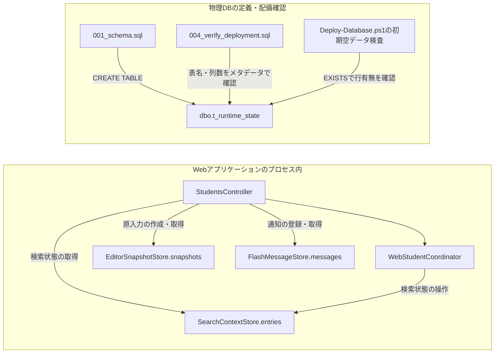
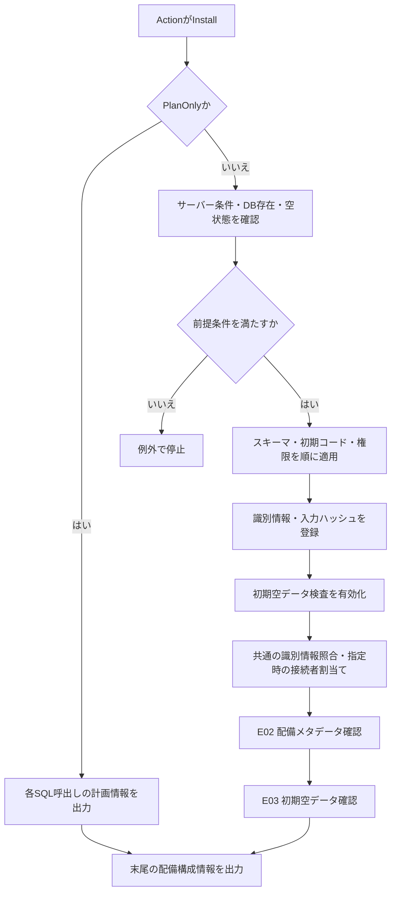
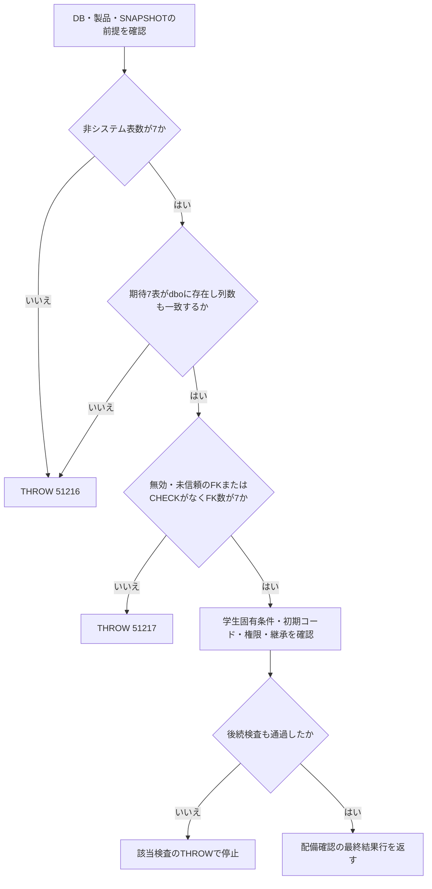
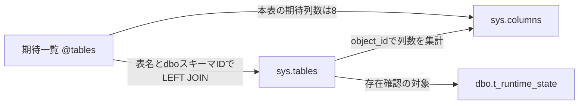
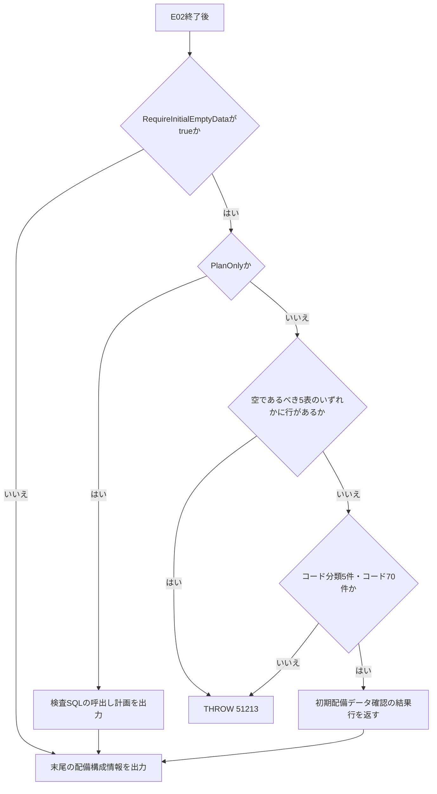
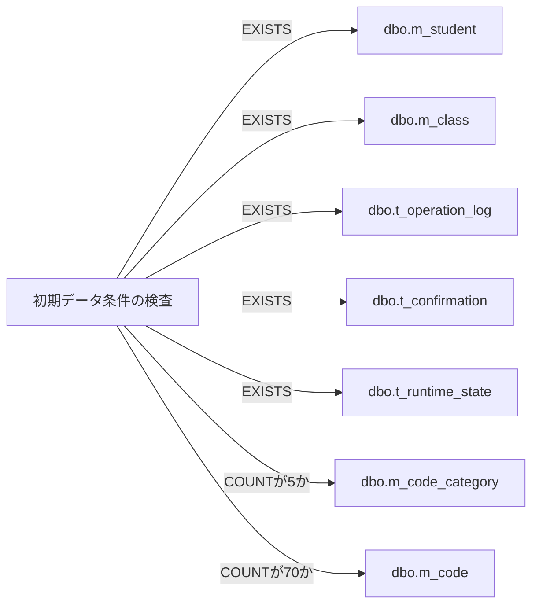

<!-- spec-meta: {"schema":"spec-md/1.0","documentId":"SM-DB-T-RUNTIME-STATE","version":"1.0","path":"spec/database/tables/t_runtime_state.md","sheets":[{"sheet":"t_runtime_state","sections":[{"heading":"概要","kind":"GRID"},{"heading":"項目一覧","kind":"LIST","key":["物理名"],"columns":["No","論理名","物理名","実DB型","長さ・容量・単位","照合順序","PK","NOT NULL","DB既定値","制約・取扱い","根拠"]},{"heading":"イベント仕様","kind":"GRID"},{"heading":"補足説明","kind":"GRID"}]}]} -->
# 実行時状態 dbo.t_runtime_state テーブル定義

文書ID：SM-DB-T-RUNTIME-STATE ／ 版：1.0 ／ 文書種別：DB物理テーブル定義 ／ 配置先：spec/database/tables/t_runtime_state.md  
論理名：実行時状態 ／ 物理名：dbo.t_runtime_state ／ DB製品：SQL Server ／ 項目数：8 ／ 主キー：state_id（単一列）

## 概要

### 定義の対象

`dbo.t_runtime_state`は、状態識別子、所有者、ログインセッション、状態種別、バイナリの状態データ、期限日時、版番号、消費フラグを持つ物理テーブルである。8列すべてにNOT NULLが指定され、`state_id`を主キーとする。DEFAULT、IDENTITY、計算列は指定されていないため、この定義自体から初回の版番号や消費フラグの初期値は供給されない。根拠：`sources/database/001_schema.sql:171-184`。

本表は配備確認の期待表一覧に含まれ、列数8として検査される。一方、現行Webの検索状態、編集原入力、フラッシュ通知の保持先は、それぞれ`ConcurrentDictionary`である。これらのストアから本表を読み書きするSQL入口、列マッピング、起動時の復元処理は確認できない。本書では物理定義と配備処理を定義し、メモリ状態の契約は別の保持領域として説明する。根拠：`sources/database/004_verify_deployment.sql:7-17`、`sources/Infrastructure/SearchContextStore.cs:9-15`、`sources/Infrastructure/EditorSnapshotStore.cs:7-11`、`sources/Infrastructure/FlashMessageStore.cs:6-9`。

### 保持領域と呼出しの関係

`Program`は`WebHostSetup.Add`でサービスを登録し、`MapControllers`でMVCの入口を接続する。3ストアはSingleton、`WebStudentCoordinator`と`RequestIdentity`はScopedで登録され、`StudentsController`が画面ルートから使用する。したがって、3ストアはWebアプリケーションのプロセス内で共有されるメモリ保持領域であり、DBテーブルのラッパーとして登録されているわけではない。根拠：`sources/Program.cs:2-8`、`sources/Infrastructure/WebHostSetup.cs:12-19`、`sources/Web/Controllers/StudentsController.cs:5-11`。



図の線は呼出し、定義、検査対象を示す。3辞書と本表を結ぶ保存・復元の線は、提示実装に対応する処理がないため設けていない。根拠：`sources/Web/Controllers/StudentsController.cs:8-38`、`sources/Infrastructure/WebStudentCoordinator.cs:5-15`、`sources/database/001_schema.sql:171-184`、`sources/database/Deploy-Database.ps1:149-157`。

### 設計資料に示された意図

基本設計では、検索状態・確認情報を業務表と別の一時情報として扱い、確定検索条件、ページ、原入力、確認対象を保持して所有者と期限を検査する意図が示されている。この論理的な要求から、本表の1行に対応する状態単位、種別コード、ペイロード形式を確定することはできない。テーブル仕様索引も5業務表を対象としており、本表の個別定義を含まない。根拠（設計意図）：`reference-designs/基本設計書/01_学生検索画面.md:79-87`、`reference-designs/基本設計書/03_テーブル仕様書.md:8-18`、`reference-designs/基本設計書/03_テーブル仕様書.md:40-46`。

## 項目一覧

| No | 論理名 | 物理名 | 実DB型 | 長さ・容量・単位 | 照合順序 | PK | NOT NULL | DB既定値 | 制約・取扱い | 根拠 |
| --- | --- | --- | --- | --- | --- | --- | --- | --- | --- | --- |
| 1 | 状態識別子 | state_id | varchar(64) | 最大64バイト。Unicode文字数の上限ではない | Latin1_General_100_BIN2 | 第1列・唯一の構成列 | 指定あり | 指定なし | pk_t_runtime_stateで一意性を保証。固定64桁、16進形式、空文字禁止、自動採番は指定なし | sources/database/001_schema.sql:172-180 |
| 2 | 所有者識別子 | owner_id | nvarchar(128) | 物理容量はUTF-16の128コード単位、最大256バイト。別途CHECKによる計数上限64 | Latin1_General_100_CS_AS_SC | 対象外 | 指定あり | 指定なし | ck_t_runtime_state_owner_id_scalarを適用。サロゲートペアを1つとして数え、末尾空白も計数する。正規化・空文字禁止は指定なし | sources/database/001_schema.sql:173-181 |
| 3 | ログインセッション識別子 | login_session_id | varchar(64) | 最大64バイト | Latin1_General_100_BIN2 | 対象外 | 指定あり | 指定なし | 文字列型。GUID形式、16進形式、固定長、空文字禁止、セッション表へのFKは指定なし | sources/database/001_schema.sql:174-184 |
| 4 | 状態種別 | state_kind | varchar(16) | 最大16バイト | Latin1_General_100_BIN2 | 対象外 | 指定あり | 指定なし | 許容値一覧のCHECK、種別マスタへのFKは指定なし。保存コード一覧は未確定 | sources/database/001_schema.sql:175-184 |
| 5 | 状態データ（バイナリ） | encrypted_payload | varbinary(max) | バイト単位。型の最大容量は2,147,483,647バイト | 対象外 | 対象外 | 指定あり | 指定なし | 実列名はencrypted_payload。業務上の容量上限、形式、内容のCHECK、暗号化方式は指定なし | sources/database/001_schema.sql:176-184 |
| 6 | 期限日時 | expires_at | datetimeoffset(7) | 小数秒7桁、100ナノ秒単位 | 対象外 | 対象外 | 指定あり | 指定なし | ck_t_runtime_state_expires_at_utcにより保存オフセットを0分に限定。未来日時の要求や有効期間は指定なし | sources/database/001_schema.sql:177-182 |
| 7 | 版番号 | revision | bigint | 8バイトの符号付き64bit整数。CHECK適用後は1～9,223,372,036,854,775,807 | 対象外 | 対象外 | 指定あり | 指定なし | ck_t_runtime_state_revisionにより正数のみ。rowversion型、自動増分ではなく、初回値・加算規則・期待版比較は未確定 | sources/database/001_schema.sql:178-183 |
| 8 | 消費フラグ | consumed | bit | 格納値は0または1 | 対象外 | 対象外 | 指定あり | 指定なし | 初期値0のDEFAULTはなし。消費条件、版との連動、消費後の削除は未確定 | sources/database/001_schema.sql:179-184 |

## イベント仕様

### E01 配備時の物理定義と権限定義

#### 処理概要

`Deploy-Database.ps1`の`Action=Install`分岐は、対象DBの作成・空状態確認後、スキーマ、初期コード、Web用権限のSQLを順番に呼び出す。本表はスキーマSQLのCREATE TABLEによって定義される。これは配備入口であり、画面操作に伴う状態データの保存入口ではない。根拠：`sources/database/Deploy-Database.ps1:90-114`、`sources/database/001_schema.sql:171-185`。

#### 処理手順

1. サーバーの製品メジャー番号17、Expressエディション、ローカルWindowsサーバー、Windows統合認証を確認する。対象DBが存在しなければ作成する。既存DBの場合は`UseExistingEmptyDatabase`による明示的な許容が必要となる。根拠：`sources/database/Deploy-Database.ps1:83-95`。
2. 選択したDBに非システムオブジェクト、対象3ロール、プロジェクト識別用の拡張プロパティが存在しないことを確認する。不一致はTHROW 51206で停止する。根拠：`sources/database/Deploy-Database.ps1:96-103`。
3. `001_schema.sql`、`002_seed.sql`、`003_web_permissions.sql`をこの順で呼び出す。本表の定義では8列、単一列主キー、3件のCHECKを作成する。初期コードSQLの永続表へのINSERT対象はコード分類とコードであり、本表への初期行INSERTはない。根拠：`sources/database/Deploy-Database.ps1:104-104`、`sources/database/001_schema.sql:171-184`、`sources/database/002_seed.sql:88-92`。
4. Web用権限SQLは独立したトランザクションでGRANT、DENY、ロール継承を設定してCOMMITする。本表はGRANT／DENYの対象に含まれない。同ファイルのコメントには、現行Webの状態・確認情報をサーバーメモリに保持し、本表へのDMLを必要としない意図が記載されている。根拠：`sources/database/003_web_permissions.sql:3-25`。
5. プロジェクト識別情報と入力SQLのハッシュを拡張プロパティへ登録するトランザクションをCOMMITし、`RequireInitialEmptyData`をtrueにする。その後、識別情報とハッシュの照合、指定時のアプリケーション接続者の割当てを経て、E02とE03へ進む。根拠：`sources/database/Deploy-Database.ps1:105-157`。
6. 各SQL呼出しで`PlanOnly`がtrueの場合は、呼出し引数などの計画情報を出力してその呼出しを戻る。SQLクライアントの起動には進まない。スクリプト末尾では配備構成情報を出力する。根拠：`sources/database/Deploy-Database.ps1:65-76`、`sources/database/Deploy-Database.ps1:159-165`。

#### 条件付き処理フロー



正常経路の途中でSQLクライアントが非ゼロ終了した場合も、例外で停止する。根拠：`sources/database/Deploy-Database.ps1:75-76`。

#### SQL・テーブル関連（ER図）

本表のCREATE TABLEは単一表の定義である。本表にFKはなく、後続のFK追加にも本表は含まれないため、他表とのFK線や多重度を示すER図は省略する。定義・確認処理との関連は概要の図を参照する。根拠：`sources/database/001_schema.sql:171-195`。

#### DB操作の詳細

本表のCREATE TABLE部分には、8列と4件の制約が記述されている。状態データを登録するINSERT、更新対象のWHERE、SQLパラメータ、更新件数判定は含まれない。権限設定と拡張プロパティ登録はそれぞれ独立したトランザクションであり、スクリプトはSQLファイルを別々に呼び出す構造を持つ。配備全体を一括でCOMMIT／ROLLBACKする処理としては扱わない。根拠：`sources/database/001_schema.sql:171-184`、`sources/database/003_web_permissions.sql:3-25`、`sources/database/Deploy-Database.ps1:104-113`。

#### 結果・例外時の扱い

正常経路では物理定義の適用後に配備検査へ進む。SQLクライアントが非ゼロ終了すると、呼出し側は例外を送出する。停止時に対象DBをDROPしたり、適用済みの定義を自動で元に戻したりする処理は、この呼出し部分にない。`PlanOnly`の出力はSQL呼出し計画であり、適用後のDB状態を返すものではない。根拠：`sources/database/Deploy-Database.ps1:65-76`、`sources/database/Deploy-Database.ps1:90-115`。

### E02 配備時のメタデータ確認

#### 処理概要

`004_verify_deployment.sql`は、対象DBの前提、物理表の存在と列数、制約の有効・信頼状態、初期コード、Web用権限を確認する。本表については、dboスキーマに` t_runtime_state `という表があり、物理列数が8であることをメタデータで確認する。根拠：`sources/database/004_verify_deployment.sql:2-25`。

#### 処理手順

1. DB名、サーバーの製品メジャー番号17とExpressエディション、対象DBの` snapshot_isolation_state=1 `を確認する。不一致はそれぞれTHROW 51205、51200、51215となる。根拠：`sources/database/004_verify_deployment.sql:3-6`。
2. テーブル変数`@tables`に7表の期待表名と列数を設定する。本表の期待値は`name=N't_runtime_state'`、`columns=8`である。根拠：`sources/database/004_verify_deployment.sql:7-14`。
3. `sys.tables`の`is_ms_shipped=0`に該当する表数が7であることを確認する。続いて期待一覧と`sys.tables`を表名およびdboスキーマIDでLEFT JOINし、表の欠落または対応する`sys.columns`の列数不一致を検出する。いずれかの不一致でTHROW 51216となる。根拠：`sources/database/004_verify_deployment.sql:15-17`。
4. `sys.foreign_keys`と`sys.check_constraints`に無効または未信頼の制約がないこと、およびFK総数が7であることを確認する。不一致はTHROW 51217となる。根拠：`sources/database/004_verify_deployment.sql:18-21`。
5. 後続の学生固有の列・参照制約、初期コードキー、3ロールの明示権限とロール継承を確認する。これらを含むすべての検査を通過した場合に、最終結果行を返す。根拠：`sources/database/004_verify_deployment.sql:22-132`。

#### 条件付き処理フロー



#### SQL・テーブル関連（ER図）

表存在と列数の検査は、次の述語を持つ。

```sql
IF (SELECT COUNT(*) FROM sys.tables WHERE is_ms_shipped=0)<>7
 OR EXISTS(
   SELECT 1
   FROM @tables e
   LEFT JOIN sys.tables t
     ON t.name=e.name AND t.schema_id=SCHEMA_ID(N'dbo')
   WHERE t.object_id IS NULL
      OR (SELECT COUNT(*) FROM sys.columns c
          WHERE c.object_id=t.object_id)<>e.columns
 )
 THROW 51216,N'The seven local production tables or their physical column counts differ.',1;
```

この関連はシステムカタログを使ったメタデータ検索であり、本表に対するFK関係ではない。



根拠：`sources/database/004_verify_deployment.sql:7-17`。

#### DB操作の詳細

`@tables`は`name sysname`と`columns int`を持つ検査用のテーブル変数である。表存在判定に使う` t.object_id IS NULL `はLEFT JOINで期待表が見つからなかった場合の判定であり、本表の列にNULLを許可する条件ではない。列数集計は` c.object_id=t.object_id `で対象表に限定する。検査にはORDER BY、ページング、状態行を選ぶパラメータはない。根拠：`sources/database/004_verify_deployment.sql:7-17`。

制約の検査条件は、FKまたはCHECKの`is_disabled=1 OR is_not_trusted=1`と、FK総数が7以外であることである。本表の3件のCHECKがそれぞれ存在するか、その名前や式がDDLと一致するかを個別比較する処理ではない。同様に、列数8という確認だけでは、8列の列名、実型、長さ、NULL属性、DEFAULTの一致までは確認しない。根拠：`sources/database/004_verify_deployment.sql:15-25`。

権限検査の期待集合に本表は含まれない。期待集合から明示権限を引く側は、対象3ロール、`p.class=1`、`p.minor_id=0`を条件とする。逆方向は対象3ロールの明示権限から期待集合を引き、余分な明示権限も検出する。不一致はTHROW 51220、定義されたロール継承の欠落はTHROW 51221となる。根拠：`sources/database/004_verify_deployment.sql:100-127`。

本処理はメタデータと他表の検査であり、本表のデータを変更しない。状態行に対する排他、期待`revision`を含むWHERE、更新件数判定、状態行のCOMMIT／ROLLBACKは定義されていない。根拠：`sources/database/004_verify_deployment.sql:7-25`、`sources/database/004_verify_deployment.sql:97-132`。

#### 結果・例外時の扱い

不一致では対応するTHROWにより最終結果SELECTへ進まない。正常経路の最終SELECTは、`Result`、`DatabaseName`、`ProductVersion`、`Edition`、`VerificationLogin`、`VerificationDatabaseUser`、`CodeCategories`、`Codes`、`Classes`、`Students`を持つ1行を返す。本表の行内容や行数はこの結果形に含まれない。根拠：`sources/database/004_verify_deployment.sql:128-132`。

権限検査の対象は定義されたDB内ロールの明示権限と継承である。Windowsグループやサーバー権限を含む接続者の実効権限は、この検査結果の対象とは別である。根拠：`sources/database/004_verify_deployment.sql:120-127`、`sources/database/004_verify_deployment.sql:133-134`。

### E03 初期配備時の空データ確認

#### 処理概要

`Deploy-Database.ps1`はE02の後、`RequireInitialEmptyData`がtrueの場合に初期データ状態を確認する。Install分岐ではこのフラグをtrueに設定するため、初期配備時の検査に本表の空状態確認が含まれる。通常のVerifyはこのスイッチを指定しなければ本検査へ進まない。根拠：`sources/database/Deploy-Database.ps1:3-12`、`sources/database/Deploy-Database.ps1:114-114`、`sources/database/Deploy-Database.ps1:149-158`。

#### 処理手順

1. E02を呼び出した後、`RequireInitialEmptyData`を判定する。falseの場合はこのSQL呼出しを省略して末尾の構成情報出力へ進む。根拠：`sources/database/Deploy-Database.ps1:149-165`。
2. trueの場合は、学生、クラス、操作履歴、確認情報、実行時状態の各表に行が存在しないことを確認する。根拠：`sources/database/Deploy-Database.ps1:151-153`。
3. コード分類数が5、コード数が70であることを確認する。前項の行存在条件を含め、いずれかが不一致ならTHROW 51213となる。根拠：`sources/database/Deploy-Database.ps1:154-155`。
4. 全条件を満たす場合は、`Result`列に初期配備データ確認の文字列を持つ1行を返す。SQL呼出しを終えた後、スクリプト末尾の配備構成情報を出力する。根拠：`sources/database/Deploy-Database.ps1:156-165`。

#### 条件付き処理フロー



#### SQL・テーブル関連（ER図）

```sql
IF EXISTS(SELECT 1 FROM dbo.m_student)
 OR EXISTS(SELECT 1 FROM dbo.m_class)
 OR EXISTS(SELECT 1 FROM dbo.t_operation_log)
 OR EXISTS(SELECT 1 FROM dbo.t_confirmation)
 OR EXISTS(SELECT 1 FROM dbo.t_runtime_state)
 OR (SELECT COUNT(*) FROM dbo.m_code_category)<>5
 OR (SELECT COUNT(*) FROM dbo.m_code)<>70
 THROW 51213,N'Initial deployment requires five categories / 70 codes and no invented business data.',1;
SELECT N'PASS initial deployment data' AS Result;
```

各表の判定は独立してORで結合される。本表と他表をJOINする処理はなく、この検査から表間のFKや多重度は導けない。次の図は検査対象の関連を示す。



根拠：`sources/database/Deploy-Database.ps1:151-157`。

#### DB操作の詳細

本表への直接のデータ参照は`EXISTS(SELECT 1 FROM dbo.t_runtime_state)`である。WHEREがないため、所有者、セッション、種別、期限、版、消費状態を問わず、行が1件でもあれば不一致条件となる。行内容や件数を呼出し元へ返す検索ではなく、論理的な行有無の判定である。JOIN、ORDER BY、ページング、SQLパラメータはない。根拠：`sources/database/Deploy-Database.ps1:152-155`。

本検査には、本表のINSERT、UPDATE、DELETE、期限切れ行の清掃はない。期限超過や`consumed=1`であっても、行が存在すれば同じ判定となる。検査SQLには明示的なBEGIN TRANSACTION、COMMIT、ROLLBACKはなく、状態行を変更して検査条件に合わせる処理もない。根拠：`sources/database/Deploy-Database.ps1:151-157`。

#### 結果・例外時の扱い

0件は本表に関する空状態条件を満たす。1件以上は他の表の条件が正常でもTHROW 51213となり、成功経路のSELECTへ進まない。成功経路の結果は`Result`列だけを持つ1行である。根拠：`sources/database/Deploy-Database.ps1:152-156`。

SQLクライアントの呼出しは接続タイムアウト15秒、クエリタイムアウト120秒を指定し、非ゼロ終了を例外として扱う。本検査専用のCancellationTokenや、取消時に本表の状態を変更する契約はない。根拠：`sources/database/Deploy-Database.ps1:65-76`。

## 補足説明

### 主キー、索引、参照関係

`pk_t_runtime_state`の構成列は`state_id`だけである。所有者やセッションを主キーに含める指定はなく、所有者別の複合一意制約もない。主キーのCLUSTERED／NONCLUSTEREDは明示されていない。後続のALTER TABLEとCREATE INDEXにも本表は含まれず、主キーに伴う索引以外に、所有者、セッション、種別、期限を対象とした追加索引は記述されていない。根拠：`sources/database/001_schema.sql:180-184`、`sources/database/001_schema.sql:187-212`。

所有者、セッション、状態種別の列にはFKがない。列名が他の概念に対応していても、参照先の物理表、参照整合性、多重度は本DDLから追加しない。根拠：`sources/database/001_schema.sql:171-195`。

### 所有者の物理容量とCHECK上限

所有者に適用するCHECKは次の式である。

```sql
CONSTRAINT ck_t_runtime_state_owner_id_scalar CHECK (
  owner_id IS NULL OR
  LEN(CONVERT(nvarchar(max),owner_id)
      COLLATE Latin1_General_100_CS_AS_SC+N'#')-1<=64
)
```

`nvarchar(128)`の128はUTF-16コード単位による物理容量である。CHECK側はSC照合順序のLENでサロゲートペアを1つとして数え、64以下を要求する。末尾に`N'#'`を付けてから1を引くため、元の値の末尾空白も計数対象となる。物理容量128コード単位とCHECKの上限64は、計数単位が異なる制限として併用される。根拠：`sources/database/001_schema.sql:173-173`、`sources/database/001_schema.sql:181-181`。

式に`owner_id IS NULL`が含まれていても、列のNOT NULLは有効である。また、このCHECKは空文字禁止、トリム、Unicode正規化、文字列の生成方法を定義しない。保存前の正規化後上限として解釈する根拠もない。根拠：`sources/database/001_schema.sql:173-173`、`sources/database/001_schema.sql:181-181`。

### UTC期限と正の版番号

期限日時と版番号に適用するCHECKは次の式である。

```sql
CONSTRAINT ck_t_runtime_state_expires_at_utc CHECK (
  expires_at IS NULL OR DATEPART(TZOFFSET,expires_at)=0
)
CONSTRAINT ck_t_runtime_state_revision CHECK (revision>0)
```

期限日時は`datetimeoffset(7)`で保持し、保存オフセットが0分であることを要求する。NULLは列のNOT NULLによって拒否される。過去のUTC日時を禁止する条件、現在時刻との比較、保存時刻からの有効期間、期限延長や削除の条件は含まれない。根拠：`sources/database/001_schema.sql:177-177`、`sources/database/001_schema.sql:182-182`。

版番号は通常の`bigint`に正数のCHECKを加えた列である。0と負数は許容されず、正の最大値は型の上限までとなる。初回を1とするDEFAULT、更新時の加算、旧版を拒否するWHEREは定義されていない。メモリ上の検索状態が初回`Revision=1`であることを、DB行の初期値として転記しない。根拠：`sources/database/001_schema.sql:178-183`、`sources/Infrastructure/SearchContextStore.cs:9-14`。

### 識別子、ペイロード、消費状態の契約

`state_id`と`login_session_id`は最大64バイトのvarchar、`state_kind`は最大16バイトのvarcharである。DDLは固定長、16進形式、GUID形式、空文字禁止を要求していない。状態種別の保存値一覧も定義されていないため、検索状態、編集スナップショット、通知というクラスの分類を、そのまま種別コードにはできない。根拠：`sources/database/001_schema.sql:172-184`。

`encrypted_payload`はバイナリ列であり、文字列列やJSON型の列ではない。列名に含まれるencryptedという語から、暗号化・復号の実装、鍵管理、シリアライズ形式を確定しない。型の容量上限とは別の業務上限や、空のバイナリ値を禁止するCHECKも定義されていない。根拠：`sources/database/001_schema.sql:176-184`。

`consumed`はNULLを許容しないbit列だが、初期値0のDEFAULTはない。0から1へ変える入口、再利用の拒否条件、消費後の物理削除、`revision`との連動は未確定である。これらの未確認契約は解析報告のU01～U04へ引き継ぐ。

### 現行Webのメモリ状態との対応範囲

検索状態は`SearchContextStore.entries`に保持する。作成時には期限切れの既存エントリを除去し、32バイト乱数を小文字64桁の16進文字列にしたID、所有者、セッション、Tab、30分のUTC期限、初回版1を設定する。適用済み検索条件と直近結果は未設定で開始する。これらはメモリオブジェクトの初期化であり、本表への列マッピングやINSERTではない。根拠：`sources/Infrastructure/SearchContextStore.cs:9-12`。

検索状態の取得は、未存在または期限超過を409、所有者・セッションの相違を403として拒否する。Tabは呼出側が空でない値を渡した場合に照合する。状態操作では`SemaphoreSlim`を取得した後に取得条件を再確認し、期待版を現在版の10進文字列と照合する。不一致または版上限では処理本体を呼ばず、正常終了した場合だけ期限を現在UTCから30分へ延長する。これはメモリ状態単位の排他であり、DBの`revision`をWHEREで比較する処理ではない。根拠：`sources/Infrastructure/SearchContextStore.cs:13-14`。

検索・ページ操作は検索結果の正常性を確認してから適用済み条件、結果、版を更新する。0件と上限超過も結果状態として保持する。クリアは条件と結果をnullにして版を進める。復帰は適用済み条件がある場合に再検索して結果と版を更新し、条件がなければ未検索状態を返して版を進めない。これらの状態遷移は本表のUPDATEとして実装されていない。根拠：`sources/Infrastructure/WebStudentCoordinator.cs:7-15`、`sources/Infrastructure/WebStudentCoordinator.cs:20-21`。

編集原入力は`EditorSnapshotStore.snapshots`に保持する。スナップショットには所有者、セッション、nullableな学生IDと詳細、原入力、30分のUTC期限、nullableな復帰版を持たせる。取得時は未存在・期限超過を409、所有者・セッション・学生IDの相違を403として拒否する。原入力のJSON複製はメモリ上の複製処理であり、本表のペイロード形式を定めない。取得時の期限延長や消費更新はなく、保存成功時にスナップショットを明示削除する処理もコントローラにない。根拠：`sources/Infrastructure/EditorSnapshotStore.cs:7-11`、`sources/Web/Controllers/StudentsController.cs:25-37`。

フラッシュ通知は`FlashMessageStore.messages`に保持する。所有者、セッション、検索状態IDをNUL文字で区切ったキーを使い、登録時は同じキーを上書きして期限をUTCから10分にする。取得時は先に辞書から除去し、期限内の場合だけ通知を返す。未存在と期限超過は空文字を返す。この辞書削除は本表の`consumed`更新やDELETEではない。根拠：`sources/Infrastructure/FlashMessageStore.cs:6-9`。

学生保存・論理削除の成功後、コントローラは通知をメモリへ登録し、検索状態IDと版をLocationに設定して303を返す。学生DBのCOMMITと通知登録・HTTP応答は同一トランザクションではない。学生保存・削除のSQLは学生表と操作履歴を対象とし、本表への確定保存を伴わない。確認情報についても、Web登録では別のメモリ辞書を使い、DB分岐は` t_confirmation `を対象とするため、その消費契約を本表へ移さない。根拠：`sources/Web/Controllers/StudentsController.cs:31-38`、`sources/Core/SqlServerStudentService.cs:292-342`、`sources/Core/SqlServerStudentService.cs:385-416`、`sources/Infrastructure/WebHostSetup.cs:19-19`。

### 設計意図との差分と文書間の責務

詳細設計は、既存検索状態を使う検索・ページ・クリア・復帰で、所有者、認証、Tab、期限、期待Revisionを確認する意図を示す。現行実装では検索・ページ・クリアのPOSTがTabIdを渡す一方、検索画面への復帰は`Resume`へnullを渡し、復帰先確認と編集画面の復帰版取得もTabを指定しない。この差分は論理状態の画面分離に関する確認事項であり、本表のFKや列制約で解消されているとは説明しない。根拠（設計意図）：`reference-designs/詳細仕様書/CSharp_ASPNET/01_学生検索画面.md:604-610`。根拠（現行実装）：`sources/Infrastructure/SearchContextStore.cs:13-14`、`sources/Infrastructure/WebStudentCoordinator.cs:6-6`、`sources/Web/Controllers/StudentsController.cs:8-25`。

本書の責務は、実行時状態の8列と物理制約、配備処理、本表へ到達する参照の範囲を定めることである。検索状態・編集原入力・通知の保存単位、所有権、期限、排他、版、消費の意味は、独立した「実行時一時情報の論理定義」で扱う。その文書IDと配置先は未確定のため、解析報告U07へ引き継ぐ。将来本表と接続する場合に必要となる種別、ペイロード、列マッピング、CRUDとトランザクションの契約は、解析報告U01～U05に記録する。
