<!-- spec-meta: {"schema":"spec-md/1.0","documentId":"SM-DET-STUDENT-EDITOR","version":"3.0","path":"spec/detail/student-editor.md","sheets":[{"heading":"概要","kind":"GRID","sheet":"01_概要"},{"heading":"項目一覧","kind":"LIST","sheet":"02_項目一覧","key":["項目ID"]},{"heading":"項目移送仕様","kind":"LIST","sheet":"03_項目移送","key":["移送ID"]},{"heading":"項目更新仕様","kind":"LIST","sheet":"04_項目更新","key":["更新ID"]},{"heading":"選択候補一覧","kind":"LIST","sheet":"05_選択候補","key":["候補ID"]},{"heading":"内部項目・一時情報","kind":"LIST","sheet":"06_内部項目","key":["内部ID"]},{"heading":"イベント仕様","kind":"GRID","sheet":"07_イベント仕様"},{"heading":"補足説明","kind":"GRID","sheet":"08_補足説明"}]} -->
# 学生登録・編集・参照画面 詳細仕様書

| 文書属性 | 内容 |
| --- | --- |
| 文書ID | SM-DET-STUDENT-EDITOR |
| 正本パス | spec/detail/student-editor.md |
| 版 | 3.0 |
| 対象 | 学生1件の新規登録、更新、参照、同一人物候補の確認、論理削除、入力復元、最新再読込、検索復帰 |
| 記述基準 | 接続されたソース実装の動作。参考設計の意図は実装根拠と区別する |
| 読者 | 業務システムのIT担当者、実装経験5年程度の開発者 |

## 概要

### 画面の責務

本画面は、学生の基本情報、住所、本人連絡先、在籍状態、所属クラス、緊急連絡先を1件単位で読み込み、登録または更新する。学生管理番号はDB採番の内部IDであり、学籍番号は新規登録時に設定する業務識別値である。既存学生の学籍番号は変更できない。年度と学年はクラス選択の補助値で、学生にはClassIdだけを保存する。根拠: `sources/Views/Students/Edit.cshtml:4-13`、`sources/Web/Inputs/StudentSaveInput.cs:34-54`、`sources/Core/SqlServerStudentService.cs:254-254`、`sources/Core/SqlServerStudentService.cs:294-301`。

確認・変更理由は学生の備考とは別の監査情報である。論理削除は専用フォームを使い、削除理由、対象ID、期待版、確認済み値を送る。編集中の業務項目を削除要求へ移さず、DB上の業務値を保持したまま削除属性を設定する。根拠: `sources/Views/Students/Edit.cshtml:13-17`、`sources/Web/Inputs/StudentDeleteInput.cs:4-4`、`sources/Core/SqlServerStudentService.cs:385-414`。

処理の入口はStudentsControllerである。Controllerはフォーム検査、読込時Snapshotとの照合、画面モデルとHTTP応答を担当する。WebStudentCoordinatorは認証・操作権限・検索復帰先を確認し、入力DTOからサービス要求を組み立てる。登録されたSqlServerStudentServiceは正規化、最新DB値の検査、排他、学生書込み、監査追加、確定結果の分類を担当する。根拠: `sources/Program.cs:2-6`、`sources/Infrastructure/WebHostSetup.cs:13-19`、`sources/Web/Controllers/StudentsController.cs:23-38`、`sources/Infrastructure/WebStudentCoordinator.cs:17-19`。

### モードと公開入口

対象IDがなければ新規、対象IDがありCanEditがtrueなら編集、falseなら参照となる。CanEditはRoleとViewerの不一致で判定する。参照では業務入力、候補確認、保存ボタンを含むfieldsetがdisabledになる。既存の学籍番号はreadonlyである。編集取消、最新再読込、検索復帰はこのfieldsetの外にあり、論理削除は既存学生かつAdministratorの場合だけ別フォームとして表示する。根拠: `sources/Web/Models/StudentEditPageModel.cs:5-14`、`sources/Views/Students/Edit.cshtml:3-17`。

| 操作 | HTTP入口 | 入口で受ける情報 | 本書のイベント |
| --- | --- | --- | --- |
| 新規表示 | GET `/students/new` | 任意の`returnContextId` | EV-01 |
| 既存編集・参照 | GET `/students/{id:long}` | ルートID、任意の`returnContextId` | EV-02 |
| 新規登録 | POST `/students/create` | `Input.*`、`SnapshotId`、CSRF情報 | EV-04 |
| 更新 | POST `/students/{id:long}/update` | ルートID、`Input.*`、`SnapshotId`、CSRF情報 | EV-04 |
| 入力クリア・編集取消 | POST `/students/reset` | `SnapshotId`、任意の`StudentId`、CSRF情報 | EV-07 |
| 論理削除 | POST `/students/{id:long}/delete` | 削除DTO、`SnapshotId`、CSRF情報 | EV-06 |
| 最新再読込 | GET `/students/{id:long}` | 対象ID、`returnContextId` | EV-08 |
| 手動検索復帰・成功後復帰 | GET `/students` | `contextId`、`contextRevision` | EV-09 |

Controller全体にAuthorizeがあり、POSTにはMVC全体のCSRF検査を設定する。新規表示と保存はViewerを拒否し、削除はAdministratorとの一致を要求する。画面のdisabledやreadonlyだけに認可を委ねない。根拠: `sources/Web/Controllers/StudentsController.cs:5-6`、`sources/Infrastructure/WebHostSetup.cs:15-16`、`sources/Infrastructure/RequestIdentity.cs:13-16`。

### 入力、保存値、表示値の分担

フォームの`Input.*`はMVCのバインド後にStudentSaveInputとなる。ToRequestは業務19項目をStudentDraftへ移し、ClassIdだけを`string?`から`long?`へ変換する。正規化結果は物理列名をキーにしたNormalizedStudent.Valuesへ入り、氏名照合値、カナ照合値、続柄分類を加えた22値になる。年度、学年、理由、対象ID、期待版、確認キーはSaveRequestの独立属性である。検索復帰先とSnapshotIdは学生保存値に含まれない。根拠: `sources/Web/Inputs/StudentSaveInput.cs:9-43`、`sources/Core/Contracts.cs:8-29`、`sources/Core/Contracts.cs:66-70`、`sources/Core/StudentNormalizer.cs:119-159`。

項目一覧のmaxlengthはブラウザーのUTF-16コード単位による入力ガードである。サービスのraw上限は、サービスへ届いた文字列について正規化前に数えるUnicodeスカラー値数である。`nvarchar(n)`のnはUTF-16格納容量、`varchar(n)`のnはバイト容量として扱う。DTOのnullable、業務の条件付き必須、DB列のNULL可否を別々に記載する。和暦部品とISO日付には通常Textとは異なる検査があり、DATE-01で層別に説明する。根拠: `sources/Core/StudentNormalizer.cs:37-57`、`sources/Core/JapaneseDateService.cs:17-39`、`sources/Core/JapaneseDateService.cs:52-59`、`sources/database/001_schema.sql:9-33`。

REG番号は項目対応の識別子として使う。実DOM idがあるのはREG-002～018、REG-020～024、REG-026で、REG-005は和暦4部品を囲むfieldsetである。学生管理番号、更新情報、人数、ボタン、リンク、候補領域にはREG番号と同名のDOM idを追加していない。根拠: `sources/Views/Students/Edit.cshtml:4-17`。

### 画面配置と非実行の静的投影

共有Layoutのheaderにはシステム名、利用者名、業務日があり、画面本文はmainに入る。mainは最大幅1440px、外余白24px、内側余白24px、h1は24pxである。業務入力は原本順の2列、備考と確認・変更理由は全幅、和暦部品は折返し可能な横並びで配置する。760px以下では入力を1列、headerを縦並びにし、mainの外余白を0、内側余白を15pxにする。根拠: `sources/Views/_ViewStart.cshtml:1-1`、`sources/Views/Shared/_Layout.cshtml:1-1`、`sources/Views/Students/Edit.cshtml:5-13`、`sources/wwwroot/css/site.css:1-1`。

次のHTMLは通常新規の配置を示す静的投影であり、実画面撮影ではない。動的値は角括弧で示す。フォームにaction・formactionを設定せず、送信先とHTTP methodは非実行のdata属性と入口表に残す。すべてのボタンをtype=buttonにし、アプリ内リンクは文書内fragmentへ置き換える。JavaScript、イベントハンドラー、外部CSSの読込みを含めない。

<!doctype html>
<html lang="ja">
<head>
<meta charset="utf-8">
<meta name="viewport" content="width=device-width,initial-scale=1">
<title>学生管理</title>

</head>
<body>
<header><strong>学生管理システム</strong>利用者 ［User.Identity.Name］　業務日 ［描画時業務日 yyyy/MM/dd］</header>
<main>
<h1>学生登録 ／新規</h1>

学生管理番号 新規　更新日時 －　更新者 －

<form data-source-method="POST" data-source-route="/students/create" data-editor-form>
<input type="hidden" name="__RequestVerificationToken"><input type="hidden" name="SnapshotId"><input type="hidden" name="Input.ExpectedVersion"><input type="hidden" name="Input.ReturnContextId"><input type="hidden" name="Input.DuplicateToken">
<fieldset><legend>学生基本情報</legend>

<label>学籍番号 ※必須<input name="Input.StudentNo" id="REG-002" maxlength="30" required></label>
<label>氏名 ※必須<input name="Input.StudentName" id="REG-003" maxlength="16" required><small>8文字以内</small></label>
<label>氏名カナ ※必須<input name="Input.StudentNameKana" id="REG-004" maxlength="72" required><small>原入力36、正規化後18文字</small></label>
<fieldset class="wareki" id="REG-005"><legend>生年月日 ※必須</legend><select name="Input.BirthDateInput.Era" aria-label="元号" required><option value="">元号</option><option value="REIWA">令和</option><option value="HEISEI">平成</option><option value="SHOWA">昭和</option><option value="TAISHO">大正</option><option value="MEIJI">明治</option></select><input name="Input.BirthDateInput.Year" aria-label="元号年" maxlength="4" required>年<input name="Input.BirthDateInput.Month" aria-label="月" maxlength="2" required>月<input name="Input.BirthDateInput.Day" aria-label="日" maxlength="2" required>日</fieldset>
<label>性別 ※必須<select name="Input.GenderCode" id="REG-006" required><option value="0" selected>［候補0のコード名称］</option></select></label>
<label>郵便番号 ※必須<input name="Input.PostalCode" id="REG-007" maxlength="20" required></label>
<label>都道府県 ※必須<select name="Input.PrefectureCode" id="REG-008" required><option value="">未選択</option></select></label>
<label>住所1 ※必須<input name="Input.AddressLine1" id="REG-009" maxlength="90" required><small>45文字以内</small></label>
<label>住所2<input name="Input.AddressLine2" id="REG-010" maxlength="90"></label>
<label>本人電話<input name="Input.PhoneNumber" id="REG-011" maxlength="40"><small>原入力20、正規化後16文字</small></label>
<label>本人メール<input name="Input.EmailAddress" id="REG-012" maxlength="120"></label>
<label>入学日 ※必須<input name="Input.AdmissionDate" id="REG-013" type="date" required></label>
<label>在籍区分 ※必須<select name="Input.EnrollmentStatusCode" id="REG-014" required><option value="01" selected>［候補01のコード名称］</option></select></label>
<label>卒業・退学日<input name="Input.EnrollmentEndDate" id="REG-015" type="date"></label>
<label>年度<select name="Input.SchoolYear" id="REG-016"><option value="">未指定</option><option selected>［読込時当学校年度］</option></select></label>
<label>学年<select name="Input.GradeCode" id="REG-017"><option value="">すべて</option></select></label>
<label>クラス<select name="Input.ClassId" id="REG-018"><option value="">未所属</option></select><small>人数 －／定員 制限なし（参考）</small></label>
<label>緊急連絡先氏名<input name="Input.EmergencyContactName" id="REG-020" maxlength="16"></label>
<label>緊急連絡先続柄<select name="Input.RelationshipCode" id="REG-021"><option value="">未選択</option></select></label>
<label>緊急連絡先電話<input name="Input.EmergencyPhoneNumber" id="REG-022" maxlength="40"></label>
<label class="full">備考<textarea name="Input.Remarks" id="REG-023" maxlength="240"></textarea></label>
<label class="full">確認・変更理由<textarea name="Input.OperationReason" id="REG-024" maxlength="120"></textarea></label>

本人電話・メール・緊急電話のいずれか1つ以上。緊急連絡先は3項目すべて入力してください。

<button type="button" class="primary" data-source-operation="submit">登録</button>

</fieldset></form>

<form data-source-method="POST" data-source-route="/students/reset" data-confirm="編集内容を読込時の値へ戻しますか。"><input type="hidden" name="__RequestVerificationToken"><input type="hidden" name="SnapshotId"><input type="hidden" name="StudentId"><button type="button" data-source-operation="submit">入力クリア</button></form><a data-dirty-link href="#ev-09" data-source-method="GET" data-source-route="/students?contextId={Input.ReturnContextId}&amp;contextRevision={ReturnRevision}">検索へ戻る</a>

</main>
</body>
</html>

この通常新規投影は初期値に対応する候補が取得された場合の配置を示す。DB候補の実値、件数、有効性を補わない。エラーがある状態ではh1の後に`.message.error`、通知がある状態では`.message.info`を表示し、項目エラーはvalidation-summary=Allへまとめる。入力横の個別validation spanはない。根拠: `sources/Views/Shared/_MessagePanel.cshtml:1-3`、`sources/Views/Students/Edit.cshtml:3-3`。

| 状態 | 成立条件 | 通常新規からの差分 |
| --- | --- | --- |
| 既存編集 | IDあり、Viewer以外 | h1は「学生登録 ／編集」。REG-002をreadonlyにする。保存先は対象IDのupdate、操作名は更新。入力クリアを編集取消へ変え、最新再読込リンクを追加する |
| 既存参照 | IDあり、Viewer | h1は「学生登録 ／参照」。業務fieldsetをdisabled、REG-002をreadonlyにする。fieldset内の更新と候補操作も無効。外側の編集取消・最新再読込・検索復帰は残す |
| 候補確認 | Result.OutcomeがConfirmationRequired | 業務項目説明pの後、保存actionsの前へ次のsectionを挿入する。新規・編集の元モードを維持する |
| 管理者の既存編集 | IDあり、Administrator | 外側の操作actionsの後へ独立した削除フォームを追加する |

根拠: `sources/Views/Students/Edit.cshtml:3-17`。最新再読込リンクの非実行投影は次のa要素を外側の操作actionsへ置く。hrefは文書内参照なので、元のリンクに対応する青色・下線の識別を保つ。

<a data-dirty-link data-confirm="編集内容を破棄して最新情報を読み込みますか。" href="#ev-08" data-source-method="GET" data-source-route="/students/{StudentId}?returnContextId={Input.ReturnContextId}">最新情報を再読込</a>

候補確認領域の原本は`role=dialog`、`class=warning`、見出しの`id=duplicate-title`を使う。roleとclassは別属性であり、CSSの`.dialog`による固定配置や`.dialog table`の最小幅解除は適用されない。tableはsection直下にあり、最小幅1050px、セル内折返しが適用される。`.grid`ラッパーを追加しない。根拠: `sources/Views/Students/Edit.cshtml:14-14`、`sources/wwwroot/css/site.css:1-1`。

<section role="dialog" aria-labelledby="duplicate-title" class="warning">
<h2 id="duplicate-title">同一人物候補の確認</h2>

全 ［CandidateCount］ 件、最大20件表示

<table><thead><tr><th>学籍番号</th><th>氏名</th><th>和暦生年月日</th><th>クラス</th></tr></thead><tbody></tbody></table>

別人と確認した場合は、確認理由を入力して続行してください。

<button type="button" data-cancel-duplicate autofocus>確認取消</button><button type="button" data-source-operation="submit" data-confirm="別人として保存しますか。">別人と確認して続行</button>
</section>

削除フォームは保存フォームの外へ置く。削除理由は通常保存理由と共有せず、業務値が保存されない旨のpを保持する。根拠: `sources/Views/Students/Edit.cshtml:17-17`。

<form data-source-method="POST" data-source-route="/students/{StudentId}/delete" data-confirm="対象と理由を確認して論理削除しますか。">
<input type="hidden" name="__RequestVerificationToken"><input type="hidden" name="SnapshotId"><input type="hidden" name="ExpectedVersion"><input type="hidden" name="ReturnContextId"><input type="hidden" name="Confirmed" value="true">
<label>削除理由 ※必須<textarea name="Reason" id="REG-026" maxlength="120" required></textarea></label>
<button type="button" class="danger" data-source-operation="submit">対象を確認して論理削除</button>
編集中の業務値は保存されません。

</form>

## 項目一覧

| 項目ID | 論理名 | 実コントロール・要求名 | 初期値・必須条件 | 表示・入力制御 | 根拠 |
| --- | --- | --- | --- | --- | --- |
| REG-001 | 学生管理番号 | 先頭p、`StudentId` | 新規はIDなし | 新規または内部IDを表示。同名DOM idなし | `sources/Views/Students/Edit.cshtml:4-4` |
| REG-002 | 学籍番号 | `input#REG-002`、`Input.StudentNo` | 空、必須 | maxlength=30、required、既存readonly | `sources/Views/Students/Edit.cshtml:6-6` |
| REG-003 | 氏名 | `input#REG-003`、`Input.StudentName` | 空、必須 | maxlength=16、required、8文字以内の説明 | `sources/Views/Students/Edit.cshtml:6-6` |
| REG-004 | 氏名カナ | `input#REG-004`、`Input.StudentNameKana` | 空、必須 | maxlength=72、required、raw36・正規化後18の説明 | `sources/Views/Students/Edit.cshtml:6-6` |
| REG-005 | 生年月日 | `fieldset#REG-005`内の`Input.BirthDateInput.Era/Year/Month/Day` | 4部品とも空、全部品必須 | 元号select、年・月・日input。年maxlength=4、月日各2、全部品required | `sources/Views/Students/Edit.cshtml:7-7` |
| REG-006 | 性別 | `select#REG-006`、`Input.GenderCode` | 0、必須 | required、空optionなし | `sources/Views/Students/Edit.cshtml:8-8`、`sources/Web/Inputs/StudentSaveInput.cs:13-13` |
| REG-007 | 郵便番号 | `input#REG-007`、`Input.PostalCode` | 空、必須 | maxlength=20、required | `sources/Views/Students/Edit.cshtml:9-9` |
| REG-008 | 都道府県 | `select#REG-008`、`Input.PrefectureCode` | 空、必須 | required、空optionは未選択 | `sources/Views/Students/Edit.cshtml:9-9` |
| REG-009 | 住所1 | `input#REG-009`、`Input.AddressLine1` | 空、必須 | maxlength=90、required、45文字以内の説明 | `sources/Views/Students/Edit.cshtml:10-10` |
| REG-010 | 住所2 | `input#REG-010`、`Input.AddressLine2` | 未設定、任意 | maxlength=90 | `sources/Views/Students/Edit.cshtml:10-10` |
| REG-011 | 本人電話 | `input#REG-011`、`Input.PhoneNumber` | 未設定、最低1連絡手段の判定対象 | maxlength=40、raw20・正規化後16の説明 | `sources/Views/Students/Edit.cshtml:10-10`、`sources/Core/StudentNormalizer.cs:155-155` |
| REG-012 | 本人メール | `input#REG-012`、`Input.EmailAddress` | 未設定、最低1連絡手段の判定対象 | maxlength=120 | `sources/Views/Students/Edit.cshtml:10-10`、`sources/Core/StudentNormalizer.cs:155-155` |
| REG-013 | 入学日 | `input#REG-013`、`Input.AdmissionDate` | 空、必須 | type=date、required、maxlengthなし | `sources/Views/Students/Edit.cshtml:11-11` |
| REG-014 | 在籍区分 | `select#REG-014`、`Input.EnrollmentStatusCode` | 01、必須 | required、空optionなし | `sources/Views/Students/Edit.cshtml:11-11`、`sources/Web/Inputs/StudentSaveInput.cs:21-21` |
| REG-015 | 卒業・退学日 | `input#REG-015`、`Input.EnrollmentEndDate` | 未設定。03・04は必須、01・02は未設定 | type=date、requiredとmaxlengthなし | `sources/Views/Students/Edit.cshtml:11-11`、`sources/Core/StudentNormalizer.cs:153-153` |
| REG-016 | 年度 | `select#REG-016`、`Input.SchoolYear` | 当学校年度、任意 | 空は未指定。クラス選択補助 | `sources/Views/Students/Edit.cshtml:12-12`、`sources/Web/Inputs/StudentSaveInput.cs:53-53` |
| REG-017 | 学年 | `select#REG-017`、`Input.GradeCode` | 未設定、任意 | 空はすべて。クラス選択補助 | `sources/Views/Students/Edit.cshtml:12-12` |
| REG-018 | クラス | `select#REG-018`、`Input.ClassId` | 未設定。01・02は必須、03・04は任意 | 空は未所属。選択IDと表示名称を分離 | `sources/Views/Students/Edit.cshtml:12-12`、`sources/Core/StudentNormalizer.cs:154-154` |
| REG-019 | 所属人数・定員 | クラスlabel内small | 未選択時は人数－、定員制限なし | 描画時の参考値。同名DOM idなし | `sources/Views/Students/Edit.cshtml:2-2`、`sources/Views/Students/Edit.cshtml:12-12` |
| REG-020 | 緊急連絡先氏名 | `input#REG-020`、`Input.EmergencyContactName` | 未設定。緊急3項目は全未設定または全設定 | maxlength=16 | `sources/Views/Students/Edit.cshtml:13-13`、`sources/Core/StudentNormalizer.cs:156-157` |
| REG-021 | 緊急連絡先続柄 | `select#REG-021`、`Input.RelationshipCode` | 未設定、緊急一式の判定対象 | 空は未選択 | `sources/Views/Students/Edit.cshtml:13-13` |
| REG-022 | 緊急連絡先電話 | `input#REG-022`、`Input.EmergencyPhoneNumber` | 未設定、緊急一式・最低1連絡手段の判定対象 | maxlength=40 | `sources/Views/Students/Edit.cshtml:13-13`、`sources/Core/StudentNormalizer.cs:155-157` |
| REG-023 | 備考 | `textarea#REG-023`、`Input.Remarks` | 未設定、任意 | maxlength=240、全幅 | `sources/Views/Students/Edit.cshtml:13-13` |
| REG-024 | 確認・変更理由 | `textarea#REG-024`、`Input.OperationReason` | 未設定。有効確認続行・終了区分訂正で必須 | maxlength=120、全幅、監査用 | `sources/Views/Students/Edit.cshtml:13-13`、`sources/Core/SqlServerStudentService.cs:255-257`、`sources/Core/SqlServerStudentService.cs:286-286` |
| REG-025 | 更新日時・更新者 | 先頭p、`Detail.UpdatedAt/UpdatedBy` | 新規は各－ | 日時は日本時間。同名DOM idなし | `sources/Views/Students/Edit.cshtml:4-4`、`sources/Infrastructure/WebPresentation.cs:7-7` |
| REG-026 | 削除理由 | 別フォームの`textarea#REG-026`、`Reason` | 空、削除時必須 | maxlength=120、required | `sources/Views/Students/Edit.cshtml:17-17` |
| REG-027 | 登録・更新 | 保存フォーム内button | Viewer以外が操作対象 | 新規は登録、既存は更新。参照fieldset内では無効 | `sources/Views/Students/Edit.cshtml:5-5`、`sources/Views/Students/Edit.cshtml:15-15` |
| REG-028 | 入力クリア・編集取消 | resetフォーム内button | 有効Snapshotが必要 | 新規・既存で文言を変更。復元確認付き | `sources/Views/Students/Edit.cshtml:16-16` |
| REG-029 | 最新情報を再読込 | `data-dirty-link`付きa | 既存時のみ | dirty時は破棄確認 | `sources/Views/Students/Edit.cshtml:16-16`、`sources/wwwroot/js/site.js:5-5` |
| REG-030 | 検索へ戻る | `data-dirty-link`付きa | 復帰Contextと読込時検索版を使用 | dirty時は破棄確認 | `sources/Views/Students/Edit.cshtml:16-16` |
| REG-031 | 論理削除 | 別フォーム内danger button | 既存Administrator | 対象と理由の確認付き | `sources/Views/Students/Edit.cshtml:17-17` |
| REG-032 | 同一人物候補 | warning section直下table | ConfirmationRequired時 | 全件数、先頭最大20件。番号・氏名・和暦生年月日・クラス | `sources/Views/Students/Edit.cshtml:14-14` |
| REG-033 | 別人と確認して続行 | 確認section内submit button | 有効確認と理由が必要 | 同じ保存フォームを再送信、確認付き | `sources/Views/Students/Edit.cshtml:14-14` |
| REG-034 | 確認取消 | `data-cancel-duplicate`付きbutton | 確認領域表示時 | type=button、autofocus、要求なし | `sources/Views/Students/Edit.cshtml:14-14`、`sources/wwwroot/js/site.js:6-6` |

## 項目移送仕様

| 移送ID | 画面・要求項目 | バインド後DTOから内部値への移送 | 正規化・用途 | DB列・実型・NULL | SQLパラメータ・型・Size | 根拠 |
| --- | --- | --- | --- | --- | --- | --- |
| TR-001 | REG-002、`Input.StudentNo` | `StudentSaveInput.StudentNo:string`→`StudentDraft.StudentNo:string`→`Values[student_no]:string` | raw15。Trim・NFKC・大文字化後15以内、先頭ASCII英数字、以降英数字・ハイフン。更新不変 | `m_student.student_no varchar(15) NOT NULL` | INSERT `@student_no VarChar(15)`、一意検査`@no VarChar(15)` | `sources/Web/Inputs/StudentSaveInput.cs:9-35`、`sources/Core/StudentNormalizer.cs:59-64`、`sources/Core/StudentNormalizer.cs:124-124`、`sources/database/001_schema.sql:9-9` |
| TR-002 | REG-003、`Input.StudentName` | `StudentName:string`→同名Draft→`Values[student_name]:string` | 必須単一行Text、raw8・Trim後8。保存氏名にNFKCなし | `m_student.student_name nvarchar(16) NOT NULL`、CHECK8スカラー値 | `@student_name NVarChar(16)` | `sources/Web/Inputs/StudentSaveInput.cs:10-35`、`sources/Core/StudentNormalizer.cs:125-125`、`sources/database/001_schema.sql:10-10`、`sources/database/001_schema.sql:44-44` |
| TR-003 | REG-004、`Input.StudentNameKana` | `StudentNameKana:string`→同名Draft→`Values[student_name_kana]:string` | raw36、NFKC・カタカナ化・内部空白整理後18以内 | `m_student.student_name_kana nvarchar(36) NOT NULL`、CHECK18スカラー値 | `@student_name_kana NVarChar(36)` | `sources/Core/StudentNormalizer.cs:72-85`、`sources/Core/StudentNormalizer.cs:126-126`、`sources/database/001_schema.sql:11-11`、`sources/database/001_schema.sql:45-45` |
| TR-004 | REG-005、`Input.BirthDateInput.Era/Year/Month/Day` | `BirthDateInput`の4つの`string`→同型Draft→`Parse`→`Values[birth_date]:DateOnly` | 元号完全一致、数値部NFKC後の桁数・正整数、実在日・境界・未来日検査。通常Textのraw上限検査は行わない。NULL部品の分岐はDATE-01 | `m_student.birth_date date NOT NULL`、元号別列なし | `@birth_date Date`、Size未指定 | `sources/Web/Inputs/StudentSaveInput.cs:12-36`、`sources/Core/JapaneseDateService.cs:17-39`、`sources/Core/StudentNormalizer.cs:127-127`、`sources/database/001_schema.sql:14-14` |
| TR-005 | REG-006、`Input.GenderCode` | `GenderCode:string`→同名Draft→`Values[gender_code]:string` | raw1、Trim・NFKC後ASCII数字1桁、GENDER検査 | `m_student.gender_code varchar(1) NOT NULL` | `@gender_code VarChar(1)` | `sources/Core/StudentNormalizer.cs:113-128`、`sources/database/001_schema.sql:16-16` |
| TR-006 | REG-007、`Input.PostalCode` | `PostalCode:string`→同名Draft→`Values[postal_code]:string` | raw10、Trim・NFKC、空白と指定ハイフン除去後7桁。読込時も保存7桁 | `m_student.postal_code varchar(7) NOT NULL` | `@postal_code VarChar(7)` | `sources/Core/StudentNormalizer.cs:95-100`、`sources/Core/StudentNormalizer.cs:129-129`、`sources/Core/SqlServerStudentService.cs:189-189`、`sources/database/001_schema.sql:17-17` |
| TR-007 | REG-008、`Input.PrefectureCode` | `PrefectureCode:string`→同名Draft→`Values[prefecture_code]:string` | raw2、Trim・NFKC後ASCII数字2桁、PREFECTURE検査 | `m_student.prefecture_code varchar(2) NOT NULL` | `@prefecture_code VarChar(2)` | `sources/Core/StudentNormalizer.cs:113-117`、`sources/Core/StudentNormalizer.cs:130-130`、`sources/database/001_schema.sql:19-19` |
| TR-008 | REG-009、`Input.AddressLine1` | `AddressLine1:string`→同名Draft→`Values[address_line1]:string` | 必須単一行Text、raw45・Trim後45。算出住所の構成値 | `m_student.address_line1 nvarchar(90) NOT NULL`、CHECK45スカラー値 | `@address_line1 NVarChar(90)` | `sources/Core/StudentNormalizer.cs:131-131`、`sources/Core/SqlServerStudentService.cs:80-85`、`sources/database/001_schema.sql:20-20`、`sources/database/001_schema.sql:48-48` |
| TR-009 | REG-010、`Input.AddressLine2` | `AddressLine2:string?`→同名Draft→`Values[address_line2]:stringまたはNULL` | 任意単一行Text、raw45・Trim後45、空はNULL。算出住所には含めない | `m_student.address_line2 nvarchar(90) NULL`、CHECK45スカラー値 | `@address_line2 NVarChar(90)` | `sources/Core/StudentNormalizer.cs:132-132`、`sources/Core/SqlServerStudentService.cs:80-85`、`sources/database/001_schema.sql:21-21`、`sources/database/001_schema.sql:49-49` |
| TR-010 | REG-011、`Input.PhoneNumber` | `PhoneNumber:string?`→同名Draft→`Values[phone_number]:stringまたはNULL` | raw20、Textで空ならNULL。NFKC・空白・指定ハイフン・丸括弧除去後に電話形式を検査。形式上最大16文字 | `m_student.phone_number varchar(16) NULL` | `@phone_number VarChar(16)` | `sources/Core/StudentNormalizer.cs:87-93`、`sources/Core/StudentNormalizer.cs:133-133`、`sources/database/001_schema.sql:22-22` |
| TR-011 | REG-012、`Input.EmailAddress` | `EmailAddress:string?`→同名Draft→`Values[email_address]:stringまたはNULL` | raw60・Trim後60、空はNULL。NFKCなし、ASCIIメール形式、ドメインだけ小文字化 | `m_student.email_address varchar(60) NULL` | `@email_address VarChar(60)` | `sources/Core/StudentNormalizer.cs:102-111`、`sources/Core/StudentNormalizer.cs:134-134`、`sources/database/001_schema.sql:23-23` |
| TR-012 | REG-013、`Input.AdmissionDate` | `AdmissionDate:string`→同名Draft→`ParseIso`→`Values[admission_date]:DateOnly` | NFKC後10コード単位のyyyy-MM-dd。1900年下限、業務日以下、生年月日以上。NULLはDATE-01の未捕捉例外経路 | `m_student.admission_date date NOT NULL` | `@admission_date Date`、Size未指定 | `sources/Web/Inputs/StudentSaveInput.cs:20-38`、`sources/Core/JapaneseDateService.cs:52-59`、`sources/Core/StudentNormalizer.cs:135-151`、`sources/database/001_schema.sql:24-24` |
| TR-013 | REG-014、`Input.EnrollmentStatusCode` | `EnrollmentStatusCode:string`→同名Draft→`Values[enrollment_status_code]:string` | raw2、Trim・NFKC後ASCII数字2桁、01～04、ENROLLMENT_STATUS検査 | `m_student.enrollment_status_code varchar(2) NOT NULL` | `@enrollment_status_code VarChar(2)` | `sources/Core/StudentNormalizer.cs:136-154`、`sources/database/001_schema.sql:26-26` |
| TR-014 | REG-015、`Input.EnrollmentEndDate` | `EnrollmentEndDate:string?`→同名Draft→`Values[enrollment_end_date]:DateOnlyまたはNULL` | サービス引数NULL・空文字はNULL、それ以外はParseIso。03・04は必須で入学日以上、01・02はNULL | `m_student.enrollment_end_date date NULL` | `@enrollment_end_date Date`、Size未指定 | `sources/Core/StudentNormalizer.cs:137-153`、`sources/database/001_schema.sql:27-27` |
| TR-015 | REG-018、`Input.ClassId` | `ClassId:string?`→`IdParser.Optional`→`Draft.ClassId:long?`→`Values[class_id]:longまたはNULL` | NULL・空は未所属。非空は19コード単位以内のASCII数字、正のInt64。先頭ゼロは禁止しない | `m_student.class_id bigint NULL`、名称・年度・学年は保存しない | `@class_id BigInt`、Size未指定 | `sources/Web/Inputs/StudentSaveInput.cs:40-60`、`sources/Core/StudentNormalizer.cs:138-138`、`sources/database/001_schema.sql:28-28` |
| TR-016 | REG-020、`Input.EmergencyContactName` | `EmergencyContactName:string?`→同名Draft→`Values[emergency_contact_name]:stringまたはNULL` | 任意単一行Text、raw8・Trim後8、空はNULL | `m_student.emergency_contact_name nvarchar(16) NULL`、CHECK8スカラー値 | `@emergency_contact_name NVarChar(16)` | `sources/Core/StudentNormalizer.cs:139-139`、`sources/database/001_schema.sql:29-29`、`sources/database/001_schema.sql:50-50` |
| TR-017 | REG-021、`Input.RelationshipCode` | `RelationshipCode:string?`→同名Draft→`Values[relationship_code]:stringまたはNULL` | raw2、Trim・NFKC後ASCII数字2桁またはNULL、RELATIONSHIP検査 | `m_student.relationship_code varchar(2) NULL` | `@relationship_code VarChar(2)` | `sources/Core/StudentNormalizer.cs:140-147`、`sources/database/001_schema.sql:31-31` |
| TR-018 | REG-022、`Input.EmergencyPhoneNumber` | `EmergencyPhoneNumber:string?`→同名Draft→`Values[emergency_phone_number]:stringまたはNULL` | TR-010と同じPhone変換。緊急一式と最低1連絡手段に使用 | `m_student.emergency_phone_number varchar(16) NULL` | `@emergency_phone_number VarChar(16)` | `sources/Core/StudentNormalizer.cs:141-157`、`sources/database/001_schema.sql:32-32` |
| TR-019 | REG-023、`Input.Remarks` | `Remarks:string?`→同名Draft→`Values[remarks]:stringまたはNULL` | 複数行Text、raw120・整形後120、改行LF統一、Trim後空はNULL | `m_student.remarks nvarchar(240) NULL`、CHECK120スカラー値 | `@remarks NVarChar(240)` | `sources/Core/StudentNormalizer.cs:47-57`、`sources/Core/StudentNormalizer.cs:142-142`、`sources/database/001_schema.sql:33-33`、`sources/database/001_schema.sql:51-51` |
| TR-020 | REG-016、`Input.SchoolYear` | `SchoolYear:int?`→`SaveRequest.SchoolYear:int?` | 1900～9998、指定クラスの実年度と比較。Draft・Valuesには移さない | 比較先`m_class.school_year smallint NOT NULL`。学生保存列なし | 年度保存パラメータなし。クラス取得`@id BigInt` | `sources/Web/Inputs/StudentSaveInput.cs:28-42`、`sources/Core/SqlServerStudentService.cs:236-236`、`sources/Core/SqlServerStudentService.cs:363-371`、`sources/database/001_schema.sql:64-64` |
| TR-021 | REG-017、`Input.GradeCode` | `GradeCode:string?`→`SaveRequest.GradeCode:string?` | raw2、Trim・NFKC後ASCII数字2桁またはNULL、指定クラスの実学年と比較。独立GRADE存在検査なし | 比較先`m_class.grade_code varchar(2) NOT NULL`。学生保存列なし | 学年保存パラメータなし。クラス取得`@id BigInt` | `sources/Web/Inputs/StudentSaveInput.cs:29-42`、`sources/Core/SqlServerStudentService.cs:237-237`、`sources/Core/SqlServerStudentService.cs:344-383`、`sources/database/001_schema.sql:66-66` |
| TR-022 | REG-024、`Input.OperationReason` | `OperationReason:string?`→`SaveRequest.Reason:string?` | 複数行Text、raw60・整形後60、空はNULL。終了区分訂正・有効確認続行で必須。NoChange比較・入力ハッシュ対象外 | `t_operation_log.operation_reason nvarchar(120) NULL`、CHECK60スカラー値 | 監査`@reason NVarChar(120)` | `sources/Core/SqlServerStudentService.cs:234-257`、`sources/Core/SqlServerStudentService.cs:286-286`、`sources/Core/SqlServerStudentService.cs:385-390`、`sources/database/001_schema.sql:148-153` |
| TR-023 | REG-026、`Reason` | `StudentDeleteInput.Reason:string`→`DeleteAsync`の`reason:string` | 必須複数行Text、raw60・整形後60。通常保存理由とは独立 | `m_student.delete_reason nvarchar(120) NULL`と` t_operation_log.operation_reason nvarchar(120) NULL`。削除時に両方設定 | 削除・監査`@reason NVarChar(120)` | `sources/Web/Inputs/StudentDeleteInput.cs:4-4`、`sources/Core/SqlServerStudentService.cs:396-413`、`sources/database/001_schema.sql:37-37`、`sources/database/001_schema.sql:148-153` |
| TR-024 | `Input.ExpectedVersion`、削除の`ExpectedVersion` | 保存`string?`・削除`string`→`IdParser.Required`→`long` | 更新・削除の投稿版。新規の非空期待版は400。Snapshot版や最新版へ差し替えない | 比較・WHERE対象`m_student.row_version bigint NOT NULL`、DEFAULT1 | `@version BigInt`、Size未指定 | `sources/Web/Inputs/StudentSaveInput.cs:42-60`、`sources/Infrastructure/WebStudentCoordinator.cs:19-19`、`sources/Core/SqlServerStudentService.cs:252-252`、`sources/database/001_schema.sql:42-42` |
| TR-025 | 保存氏名から生成 | `NameKey`→`Values[name_key]:string` | NFKC・大文字化・全空白除去、160スカラー値以内。氏名検索・同一人物照合 | `m_student.name_key nvarchar(320) NOT NULL`、CHECK160スカラー値 | 保存`@name_key NVarChar(320)`、候補`@name NVarChar(320)` | `sources/Core/StudentNormalizer.cs:66-70`、`sources/Core/StudentNormalizer.cs:144-144`、`sources/database/001_schema.sql:12-12`、`sources/database/001_schema.sql:46-46` |
| TR-026 | 保存カナから生成 | 半角空白除去→`Values[kana_key]:string` | カナ検索・同一人物照合。表示カナと分離 | `m_student.kana_key nvarchar(36) NOT NULL`、CHECK18スカラー値 | 保存`@kana_key NVarChar(36)`、候補`@kana NVarChar(36)` | `sources/Core/StudentNormalizer.cs:145-145`、`sources/database/001_schema.sql:13-13`、`sources/database/001_schema.sql:47-47` |
| TR-027 | 続柄値から生成 | `Values[relationship_category]:stringまたはNULL` | 続柄NULLならNULL、非NULLなら固定RELATIONSHIP。フォームから受けない | `m_student.relationship_category varchar(24) NULL` | `@relationship_category VarChar(24)` | `sources/Core/StudentNormalizer.cs:147-157`、`sources/database/001_schema.sql:30-30`、`sources/database/001_schema.sql:199-199` |
| TR-028 | REG-001、対象ID | ルート`long`、モデル`StudentId:long?` | 新規は未採番、既存保存対象はルートから決める | `m_student.student_id bigint IDENTITY(1,1) NOT NULL`、PK | 読取・UPDATE条件`@id BigInt`。INSERT入力なし | `sources/Web/Controllers/StudentsController.cs:23-27`、`sources/Core/SqlServerStudentService.cs:172-181`、`sources/database/001_schema.sql:8-43` |
| TR-029 | REG-019、人数・定員 | `SchoolClass.Occupied:int`、`Capacity:int?`→small | 非削除01・02人数と定員。描画時の参考値、人数は非DB列 | `m_class.capacity int NULL`、非NULLは1～9999 | Lookup入力パラメータなし。保存人数検査`@class/@id BigInt` | `sources/Core/Contracts.cs:63-64`、`sources/Core/SqlServerStudentService.cs:201-214`、`sources/Core/SqlServerStudentService.cs:377-380`、`sources/database/001_schema.sql:71-71`、`sources/database/001_schema.sql:201-201` |
| TR-030 | REG-025、更新情報 | `StudentDetail.UpdatedAt:DateTimeOffset`、`UpdatedBy:string`→p | 日時を+09:00のyyyy/MM/dd HH:mm:ssにする。主体は認証情報から設定 | `m_student.updated_at datetimeoffset(7) NOT NULL`、`updated_by nvarchar(128) NOT NULL`、主体CHECK64スカラー値 | `@now DateTimeOffset`、`@actor NVarChar(128)` | `sources/Core/Contracts.cs:59-60`、`sources/Infrastructure/WebPresentation.cs:7-7`、`sources/Core/SqlServerStudentService.cs:300-300`、`sources/database/001_schema.sql:40-58` |

## 項目更新仕様

| 更新ID | 操作 | 設定する値 | 対象条件・取得結果 | 保持する値・確定条件 | 根拠 |
| --- | --- | --- | --- | --- | --- |
| UP-001 | 新規INSERTの業務値 | TR-001～019の19列、TR-025～027の生成3列 | 検証・一意性・必要な確認を通過。OUTPUTのIDを表変数からスカラー取得 | 任意空値はNULL。ID取得だけではSavedにしない | `sources/Core/SqlServerStudentService.cs:292-307` |
| UP-002 | 新規INSERTの分類・管理値 | 固定GENDER/PREFECTURE/ENROLLMENT_STATUS、is_deleted=0、created_at/by、updated_at/by、row_version=1 | UTC開始時点、認証主体を明示設定。IDはIDENTITY | deleted_at/by・delete_reasonは指定外でNULL。is_deletedと版にはDDL DEFAULTもある | `sources/Core/SqlServerStudentService.cs:296-300`、`sources/database/001_schema.sql:8-42` |
| UP-003 | 通常UPDATE | 学籍番号以外の業務18列、生成3列、updated_at/by、版+1 | student_id・投稿期待版・is_deleted=0。OUTPUTのIDがNULL/DBNullなら競合 | 任意空値もNULLで上書き。番号、固定3分類、作成情報、削除属性は保持 | `sources/Core/SqlServerStudentService.cs:294-305` |
| UP-004 | 変更なし | 学生DML・監査なし | 正規化22値と最新DB値に差分なし。明示Rollback正常終了後NoChange | 版・更新時点を増やさない。理由・年度・学年・一時情報は比較対象外 | `sources/Core/SqlServerStudentService.cs:260-263`、`sources/Core/SqlServerStudentService.cs:325-327` |
| UP-005 | 論理削除UPDATE | is_deleted、deleted_at/by、delete_reason、updated_at/by、row_versionの7列 | student_id・投稿期待版・非削除条件。ExecuteNonQuery件数1を要求 | 業務値、class_id、番号、作成情報を保持。物理DELETEなし | `sources/Core/SqlServerStudentService.cs:409-414` |
| UP-006 | CREATE・UPDATE監査 | 対象、操作、前後版、変更列名JSON、主体、UTC時点、受付GUID、理由、確認有無 | 学生DMLと同じトランザクションで1件追加 | CREATE前版NULL・後版1。UPDATEは実差分列と管理3列。個人情報の前後値を複写しない | `sources/Core/SqlServerStudentService.cs:306-307`、`sources/Core/SqlServerStudentService.cs:385-390` |
| UP-007 | DELETE監査 | UP-005の7列、前版・版+1、削除理由、確認有無false | 論理削除と同じトランザクションで1件追加 | 学生・監査のCommit正常終了後Saved | `sources/Core/SqlServerStudentService.cs:413-414` |
| UP-008 | Web確認状態 | 有効確認のBusyを原子的0→1。成功後に供給キー削除 | 主体・セッション・対象・期待版・期限・入力/全候補ハッシュ一致 | 取得済みBusyは未完了かつUnknownでない場合0へ戻す。Unknown時は供給キー削除 | `sources/Core/SqlServerStudentService.cs:274-290`、`sources/Core/SqlServerStudentService.cs:313-335` |
| UP-009 | 成功通知 | Flashへ保存・論理削除成功文言 | Saved後、303直前にメモリへ設定 | 同じ主体・セッション・Contextの文言を置換。10分保持、一度のTakeで除去 | `sources/Web/Controllers/StudentsController.cs:31-38`、`sources/Infrastructure/FlashMessageStore.cs:6-9` |

## 選択候補一覧

| 候補ID | 対象・取得元 | キー・表示名 | 描画時の選択条件 | 順序 | 初期値・保持・連動 | 根拠 |
| --- | --- | --- | --- | --- | --- | --- |
| OPT-ERA | REG-005、View固定option | REIWA/HEISEI/SHOWA/TAISHO/MEIJI、元号名称 | 空optionあり。サーバーで実在日・境界・未来日を検査 | 令和、平成、昭和、大正、明治 | 新規は未選択。元号変更の即時検証なし | `sources/Views/Students/Edit.cshtml:7-7`、`sources/Core/JapaneseDateService.cs:9-39` |
| OPT-GENDER | REG-006、Lookup.CodesのGENDER | CodeValue、CodeName | 有効・期間内またはDetailの既存同値。不可値disabled、停止・期間外注記 | display_order、code_value | 初期0、空optionなし。IsProtectedは可否判定に使わない | `sources/Views/Students/Edit.cshtml:8-8`、`sources/Core/SqlServerStudentService.cs:203-212` |
| OPT-PREFECTURE | REG-008、PREFECTURE | CodeValue、CodeName | 性別と同じ、不可値に停止・期間外注記 | display_order、code_value | 初期未選択、空optionあり | `sources/Views/Students/Edit.cshtml:9-9`、`sources/Core/SqlServerStudentService.cs:203-205` |
| OPT-STATUS | REG-014、ENROLLMENT_STATUS | CodeValue、CodeName | 有効・期間内または既存同値。不可値disabled、専用注記なし | display_order、code_value | 初期01、空optionなし。投入定義の01/02/03/04は在学/休学/卒業/退学 | `sources/Views/Students/Edit.cshtml:11-11`、`sources/database/002_seed.sql:19-22` |
| OPT-YEAR | REG-016、全クラス年度とInput.SchoolYear | SchoolYear、年度数値 | 全クラス年度に現在入力を加えて重複除去 | 年度降順 | 新規は当学校年度、既存は所属クラス年度、所属なし既存はNULL。空は未指定 | `sources/Views/Students/Edit.cshtml:12-12`、`sources/Web/Inputs/StudentSaveInput.cs:46-54` |
| OPT-GRADE | REG-017、GRADE | CodeValue、CodeName | 分類内全値を列挙。有効性・期間によるdisabledなし | display_order、code_value | 初期NULL、空はすべて。00の学年なしと未所属NULLは別 | `sources/Views/Students/Edit.cshtml:12-12`、`sources/database/002_seed.sql:78-84` |
| OPT-CLASS | REG-018、Lookup.Classes | ClassId、年度・学年コード・クラスコード・名称 | 全候補を列挙。既存IDは保持可。その他は原入力03/04なら在籍期間重なり、他区分なら有効・本日期間内 | 年度降順、学年表示順、クラス表示順、クラスコード、ID | 初期NULL、空は未所属。クラス変更で上位同期、上位不一致で解除。年度学年によるoption再絞込みなし | `sources/Views/Students/Edit.cshtml:12-12`、`sources/Core/SqlServerStudentService.cs:206-214`、`sources/wwwroot/js/site.js:8-8` |
| OPT-RELATIONSHIP | REG-021、RELATIONSHIP | CodeValue、CodeName | 有効・期間内または既存同値。不可値disabled、専用注記なし | display_order、code_value | 初期NULL、空は未選択。NULL保存なら続柄分類もNULL | `sources/Views/Students/Edit.cshtml:13-13`、`sources/Core/StudentNormalizer.cs:140-147` |

## 内部項目・一時情報

| 内部ID | 名称・要求名 | 実型・保持領域 | 用途・発行 | 照合・期限・更新 | 根拠 |
| --- | --- | --- | --- | --- | --- |
| INT-TARGET | 学生対象ID | ルート`long`、モデル`long?` | 新規NULL、既存はルート値。Resetは任意正整数変換 | SnapshotのStudentIdと一致を要求 | `sources/Web/Controllers/StudentsController.cs:23-35` |
| INT-VERSION | 学生期待版 | 保存`string?`、削除`string`→`long` | 更新・削除のDB比較版とWHERE条件 | 最新DB版と比較。Snapshot読込版への差替え・追加一致検査なし | `sources/Web/Inputs/StudentSaveInput.cs:42-60`、`sources/Core/SqlServerStudentService.cs:252-252`、`sources/Core/SqlServerStudentService.cs:407-410` |
| INT-CONTEXT | ReturnContextId、検索状態 | Singleton SearchContextStoreのentries辞書、DTO`string?` | 32バイト乱数の64桁hex IDを独立発行。Owner/Session/Tab、Applied、LastResult、Revision、Gateを保持 | 30分、初版1。不在/失効409、所有/セッション相違403、非空Tab指定時だけTab照合。Use成功で期限延長 | `sources/Infrastructure/SearchContextStore.cs:9-15` |
| INT-SNAPSHOT | SnapshotId、読込時状態 | Singleton EditorSnapshotStoreのsnapshots辞書 | 同じ乱数関数を新たに呼ぶ別キー。Owner/Session/StudentId/Detail/Original/ReturnRevisionを保持、OriginalはJSON複製 | 作成から30分。不在/失効409、所有/セッション/対象相違403。延長・消費なし、作成時失効掃除 | `sources/Infrastructure/EditorSnapshotStore.cs:7-11` |
| INT-RETURN-REV | 読込時検索版 | モデル・Snapshotの`string?` | Load時のContext.Revisionを保存、リンク・303へ渡す | Resumeで現在検索版の10進文字列との一致を要求。学生期待版と分離 | `sources/Web/Controllers/StudentsController.cs:25-25`、`sources/Web/Controllers/StudentsController.cs:38-38`、`sources/Infrastructure/SearchContextStore.cs:14-14` |
| INT-CONFIRM | Input.DuplicateToken | `string?`→SaveRequest.ConfirmationToken、static WebConfirmations辞書 | 独立乱数キー。所有者、対象、期待版、正規化業務19値ハッシュ、全候補ID/版ハッシュを保持 | 保存開始now+10分。主体・セッション・対象・版・期限・両ハッシュ・Busy照合。Role/Tab/Snapshot/Contextは照合対象外 | `sources/Core/SqlServerStudentService.cs:19-29`、`sources/Core/SqlServerStudentService.cs:224-225`、`sources/Core/SqlServerStudentService.cs:274-335` |
| INT-CONFIRM-BUSY | 確認使用中 | Confirmation.Busyの`int`、static辞書 | Interlocked.CompareExchangeで0→1取得 | 使用中は確認不成立。未完了かつUnknownでない場合に取得Busyを0へ戻す | `sources/Core/SqlServerStudentService.cs:27-29`、`sources/Core/SqlServerStudentService.cs:278-278`、`sources/Core/SqlServerStudentService.cs:323-323` |
| INT-DELETE-CONFIRM | Confirmed | StudentDeleteInputの`bool` | 専用フォームがtrueを送信 | Coordinatorでfalseを422拒否。ブラウザーconfirmとは別検査 | `sources/Views/Students/Edit.cshtml:17-17`、`sources/Infrastructure/WebStudentCoordinator.cs:19-19` |
| INT-FLASH | 成功通知 | Singleton FlashMessageStoreのmessages辞書 | 主体・セッション・Contextを区切り文字付きで連結したキーへ保存 | 10分。同キー置換、Takeで先に除去。不在/失効は空 | `sources/Infrastructure/FlashMessageStore.cs:6-9` |
| INT-DIRTY | 入力操作あり | ブラウザー内`bool`、初期false | 保存フォームのinputでtrue。実値差分を比較しない | 元値に戻しても解除しない。削除理由は別フォームで監視外 | `sources/wwwroot/js/site.js:2-3`、`sources/Views/Students/Edit.cshtml:5-17` |
| INT-LEAVING | 送信・離脱続行 | ブラウザー内`bool`、初期false | submit確認通過、リンク続行でtrue | beforeunload条件に使用。二重送信拒否には使用しない | `sources/wwwroot/js/site.js:2-5` |
| INT-UI-BUSY | 処理中表示 | DOMのaria-busy、button.disabled | submit続行で同フォームの押下以外のbuttonを無効化 | 押下自身の再入拒否・要求連番・旧応答破棄なし。サーバーBusyと別状態 | `sources/wwwroot/js/site.js:4-4` |
| INT-RESULT | 結果・受付番号 | 要求単位SaveResult、GUID文字列 | Outcome、ID、版、Errors、確認キー、全件数、表示候補、RequestId | 保存・削除開始ごとに受付番号生成。学生入力・DB版とは別 | `sources/Core/Contracts.cs:68-70`、`sources/Core/SqlServerStudentService.cs:229-229`、`sources/Core/SqlServerStudentService.cs:394-394` |

## イベント仕様

### EV-01 新規画面表示

#### 処理概要

GET `/students/new`を受け、初期入力、人数付き候補、読込時Snapshotを作る。学生本体の1件取得は行わない。根拠: `sources/Web/Controllers/StudentsController.cs:23-25`、`sources/Infrastructure/WebStudentCoordinator.cs:17-17`。

#### 処理手順

1. Coordinator.Editが認証情報を読み、非空の復帰Contextがあれば所有者・認証セッション・期限を確認する。
2. 作成・更新権限を確認し、Viewerを拒否する。
3. OP-LKのLookupAsyncを人数付きで呼ぶ。
4. StudentSaveInput.Fromは必須文字項目と和暦4部品を空、性別を0、在籍を01、年度を当学校年度とする。任意業務値、クラス、期待版、確認キー、理由は未設定にする。
5. Controller.Loadは任意Contextの現在Revisionを読み、対象ID・DetailなしのSnapshotを作る。
6. 初期Input、Lookups、User、SnapshotId、ReturnRevisionを持つEdit Viewを返す。

根拠: `sources/Infrastructure/WebStudentCoordinator.cs:6-6`、`sources/Infrastructure/WebStudentCoordinator.cs:17-17`、`sources/Web/Inputs/StudentSaveInput.cs:44-54`、`sources/Core/Contracts.cs:8-29`、`sources/Web/Controllers/StudentsController.cs:25-25`。

#### 条件付き処理フロー

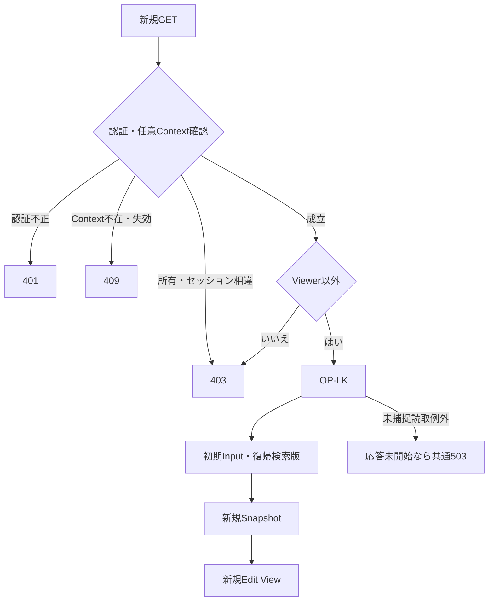

#### SQL・テーブル関連、DB操作の詳細

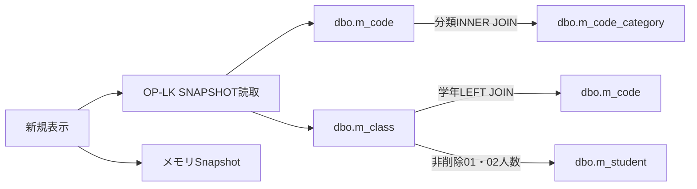

OP-LKの全JOIN・順序・結果集合は補足説明に記載する。新規表示でも人数集計のため学生表を参照するが、学生1件のGetAsync、学生DML、監査追加はない。Snapshotの保持先はメモリであり、状態表へのINSERTはない。根拠: `sources/Core/SqlServerStudentService.cs:196-216`、`sources/Infrastructure/EditorSnapshotStore.cs:7-11`。

#### 結果・例外時の扱い

初期コード0・01の存在確認やクラス0件の専用警告をLoadで設定する処理はない。Lookupから描画できる候補と、保存可能な業務状態は分かれる。保存時のコード存在・所属必須検査をEV-04で適用する。読取例外・取消は表示側で結果型へ変換せず上位へ伝播する。根拠: `sources/Infrastructure/WebStudentCoordinator.cs:17-17`、`sources/Core/StudentNormalizer.cs:154-154`、`sources/Core/SqlServerStudentService.cs:344-383`、`sources/Infrastructure/WebHostSetup.cs:23-23`。

### EV-02 既存学生の編集・参照表示

#### 処理概要

GET `/students/{id:long}`は非削除学生の保存値を読み、入力DTOへ復元する。学生本体の取得後にLookupを別取得し、新しいSnapshotを作る。Viewerは同じViewの参照モードを使う。根拠: `sources/Web/Controllers/StudentsController.cs:24-25`、`sources/Infrastructure/WebStudentCoordinator.cs:17-17`。

#### 処理手順

1. 認証と任意復帰Contextを確認する。
2. GetAsyncへルートIDを渡す。戻り値NULLなら404・E-STU-103とする。
3. GetAsyncは保存22値、版、生年月日、更新情報からStudentDetailを作る。生年月日を和暦4値、入学日・終了日をISO文字列に戻す。
4. 人数付きLookupを取得し、所属クラスの年度・学年をInputへ設定する。期待版はRowVersionの10進文字列とする。
5. 復帰検索版を読み、Detailと復元Inputを持つ新Snapshotを作る。
6. CanEditに従う編集または参照Viewを返す。

根拠: `sources/Core/SqlServerStudentService.cs:172-216`、`sources/Web/Inputs/StudentSaveInput.cs:44-54`、`sources/Web/Controllers/StudentsController.cs:25-25`。

#### 条件付き処理フロー

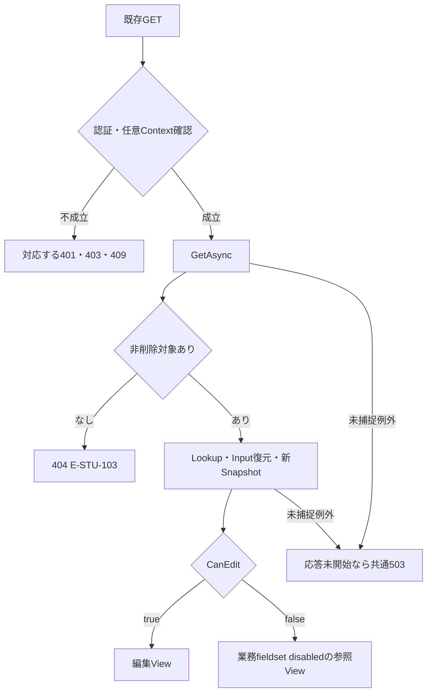

#### SQL・テーブル関連、DB操作の詳細

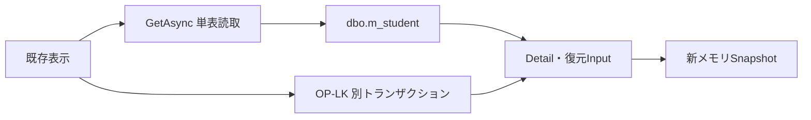

SQLは`SELECT * FROM dbo.m_student WHERE student_id=@id AND is_deleted=0`で、@idはBigInt、Size未指定。正でないIDは接続前にNULL、0件もNULLとなる。PKに従うDBでは最大1行であり、JOIN、ORDER BY、ページング、明示トランザクションはない。対象取得は単表なので、このSELECT自体のER図は省略する。OP-LKは別の複数表読取であり、本体と候補を同一トランザクションで一括取得する処理ではない。根拠: `sources/Core/SqlServerStudentService.cs:172-181`、`sources/Core/SqlServerStudentService.cs:196-216`、`sources/database/001_schema.sql:43-43`。

#### 結果・例外時の扱い

不在、削除済み、正でないIDは404となる。停止・期間外の既存コードやクラスはLookupに存在する限り描画条件で保持できる。欠落したコードを追加optionで補う処理はない。DB読取、日付の復元、Lookup、Snapshot作成の対象外例外は上位へ伝播する。根拠: `sources/Infrastructure/WebStudentCoordinator.cs:17-17`、`sources/Views/Students/Edit.cshtml:8-13`、`sources/Infrastructure/WebHostSetup.cs:23-23`。

### EV-03 入力補助、送信確認、離脱確認

#### 処理概要

site.jsは描画済みクラスoptionの属性を使って年度・学年を同期し、保存フォームの入力操作をdirtyとして記録する。送信とリンク離脱の確認、確認キーの消去もブラウザー内で行う。根拠: `sources/wwwroot/js/site.js:2-9`。

#### 処理手順

1. クラスchangeで選択optionにdata-yearがあれば年度をdata-year、学年をdata-gradeへ合わせる。未所属optionには属性がないので上位値を消さない。
2. 年度・学年changeで、選択クラスがあり、非空の上位値とoption属性が異なればクラスを空にし、解除した旨をalertする。一致または上位値が空なら保持する。
3. 保存フォームのinputでdirty=true、Input.DuplicateTokenを空文字にする。理由入力も対象である。
4. beforeunloadはdirtyかつleaving=falseで確認を要求する。dirtyリンクはdirty時に破棄確認し、取消なら遷移を止め、続行ならleaving=trueとする。
5. 全フォームのsubmitでは押下ボタンのdata-confirmを優先し、なければフォームのdata-confirmを使う。確認取消なら送信を止める。
6. 送信続行時はleaving=true、同フォームの押下ボタン以外をdisabled、フォームをaria-busy=trueにする。

根拠: `sources/wwwroot/js/site.js:2-8`、`sources/Views/Students/Edit.cshtml:12-17`。

#### 条件付き処理フロー

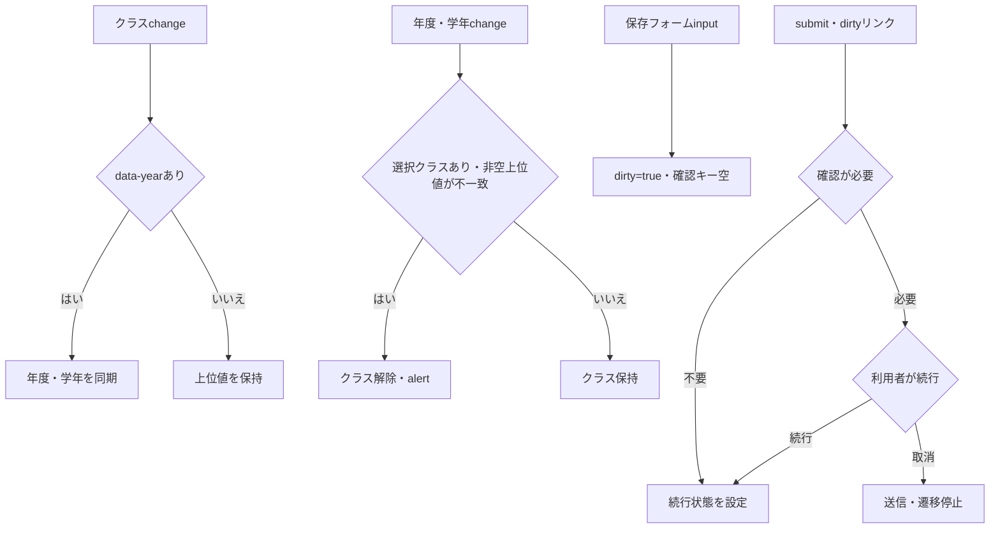

#### SQL・保持領域関連、DB操作の詳細

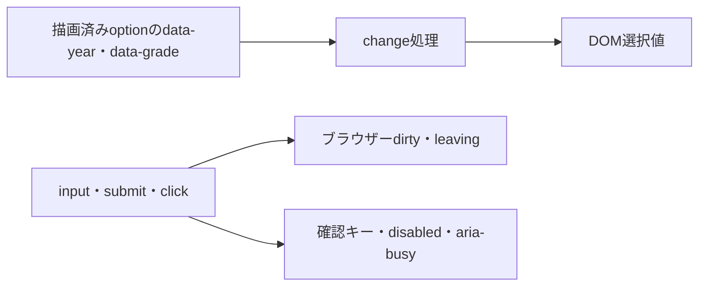

イベント時のSQL、候補API要求、サーバー状態更新はないためER図を省略する。クラスoptionの再取得・再絞込み、在籍区分や日付変更後の可否再計算、人数の即時更新、和暦の即時検証はこの処理にはない。根拠: `sources/wwwroot/js/site.js:2-9`。

#### 結果・例外時の扱い

dirtyは入力操作の記録であり、実際の値が読込時と異なることの判定ではない。値を元に戻しても解除しない。削除理由は別フォームなのでdirty監視の対象外である。押下ボタン自身の再入拒否、leavingによる二重送信拒否、要求連番による旧応答破棄はない。ブラウザーのaria-busy、サーバー確認辞書のBusy、学生期待版、DB書込ゲートは別の制御である。根拠: `sources/wwwroot/js/site.js:2-5`、`sources/Core/SqlServerStudentService.cs:244-252`、`sources/Core/SqlServerStudentService.cs:278-278`。

### EV-04 新規登録・更新

#### 処理概要

登録と更新はController.Saveを共用する。入口検査後、投稿DTOを保存要求へ変換し、サービスで正規化する。DB書込ゲート内で対象、版、マスター、所属、一意性、同一人物候補を再確認し、学生と監査をまとめて確定する。正常Commit後だけSavedとする。根拠: `sources/Web/Controllers/StudentsController.cs:26-33`、`sources/Core/SqlServerStudentService.cs:227-323`。

#### 処理手順

1. MVCが`Bind(Prefix="Input")`で作ったDTOとModelStateをControllerが受ける。FormGuardは保存DTO各項目、和暦4部品、SnapshotId、CSRF項目、許可された__Invariantを検査する。
2. 作成・更新権限、Snapshotの所有者・セッション・対象・期限、任意復帰Contextを確認する。投稿復帰先とSnapshot.Original.ReturnContextIdの一致を要求する。
3. ModelState不正ならサービスを呼ばず422にする。有効ならCoordinator.Saveが権限・復帰先を再確認してToRequestを呼ぶ。
4. ClassIdを任意の正のInt64へ、更新期待版を必須の正のInt64へ変換する。新規に非空期待版がある場合は400のWebFaultとする。
5. SaveAsyncは受付GUID、CurrentUser、開始UTC時点now、その日本時間の業務日dayを決める。ViewerならForbiddenを返す。
6. 業務19項目を順に正規化する。個別検証エラーを収集し、エラーがあれば生成値・項目間検査へ進まない。個別成功後に照合値と続柄分類を作り、生年月日・入学日・在籍・所属必須・連絡先一式を検査する。DATE-01のNullReferenceExceptionはこのエラー収集経路を中断する。
7. 理由を正規化し、対象ID・期待版の正数と同時設定、年度1900～9998、補助学年の形式を検査する。
8. 接続を開き、ReadCommittedを開始し、TX-01の共通書込ゲートを取得する。
9. 更新では非削除対象を再取得し、存在、期待版一致、学籍番号不変の順に確認する。旧区分03・04から異なる区分への訂正はAdministratorと理由を要求する。
10. 最新DBのコード、クラス、補助値整合、所属期間、新席取得時の定員を検査する。
11. 正規化22値と最新DB値を比較する。差分なしは明示Rollback後NoChange。実変更があり現版がlong.MaxValueならConflictとする。
12. 削除済みを含む全学生から本人を除外し、学籍番号の一意性を確認する。
13. 全同一人物候補を取得し、EV-05の確認照合を行う。確認不成立ならRollback後に新確認を発行する。有効確認で理由がなければ検証失敗とする。
14. UP-001～003のINSERTまたはUPDATEを実行し、OUTPUTのIDを取得する。NULL・DBNullならDBConcurrencyExceptionとする。
15. 同じトランザクションで監査を追加する。Commit試行前にcommitAttemptedを立て、正常終了後に確認キーを削除してSavedを返す。
16. ControllerはSavedをFlashと303へ変換する。その他の結果、捕捉したWebFault、ModelState不正は、それぞれのHTTP状態を保って投稿Inputと新Lookupで同じEdit Viewを返す。

根拠: `sources/Web/Controllers/StudentsController.cs:26-33`、`sources/Web/Controllers/StudentsController.cs:41-41`、`sources/Web/Inputs/StudentSaveInput.cs:34-60`、`sources/Core/StudentNormalizer.cs:119-159`、`sources/Core/SqlServerStudentService.cs:227-323`、`sources/Core/SqlServerStudentService.cs:344-390`。

#### 条件付き処理フロー

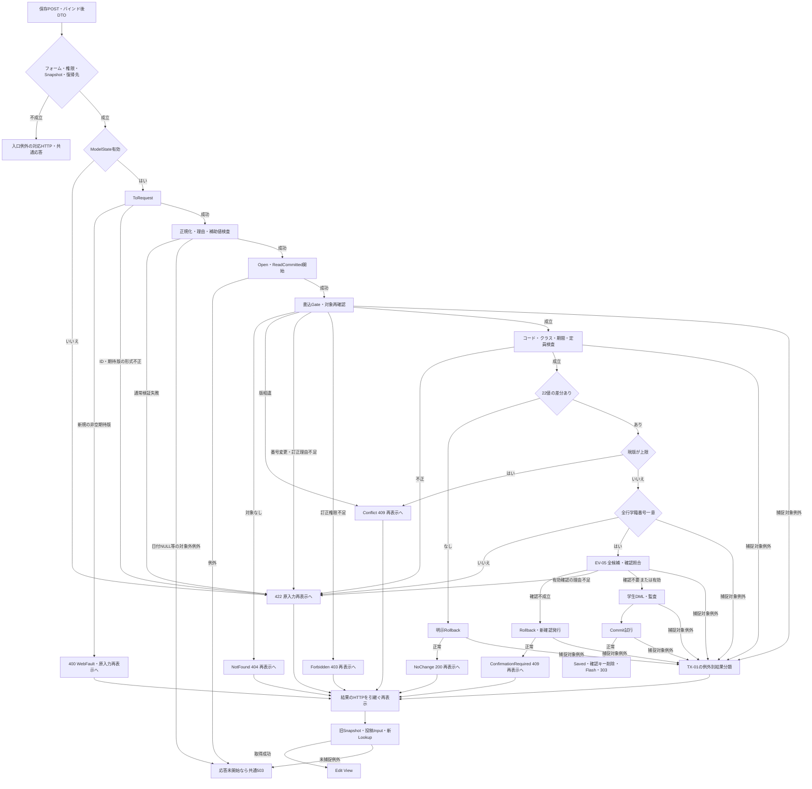

TX-01から合流する結果はValidationFailed=422、Conflict=409、SystemError/Unknown=503を保持する。対象外例外はこの結果分類を通らず上位へ伝播する。上図の通常検証失敗と日付NULLの経路を同じ422へまとめない。根拠: `sources/Core/SqlServerStudentService.cs:238-242`、`sources/Core/SqlServerStudentService.cs:316-323`、`sources/Web/Controllers/StudentsController.cs:30-33`。

#### SQL・テーブル関連

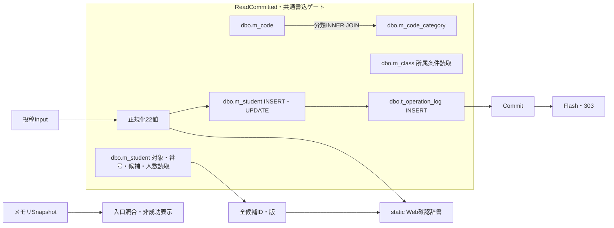

この図は処理の参照・記録関係である。監査target_keyから学生への物理FKを示さない。実DDLのFKは補足説明のER図に分ける。根拠: `sources/Core/SqlServerStudentService.cs:244-315`、`sources/database/001_schema.sql:189-195`。

#### DB操作の詳細

更新対象は`SELECT * FROM dbo.m_student WHERE student_id=@id AND is_deleted=0`、@id BigIntで再取得する。対象なしはE-STU-103、版相違はE-STU-105、番号変更はE-STU-104の順である。終了区分訂正には03→04などの終了区分間の変更も含む。NoChangeはSnapshot.Originalとの比較ではなく、書込単位内の最新DB値との比較で、DateOnlyとDB DateTimeは日付として比較する。根拠: `sources/Core/SqlServerStudentService.cs:246-263`、`sources/Core/SqlServerStudentService.cs:325-327`。

コード検査は性別、都道府県、在籍区分、続柄の順に行う。SQLは`m_code c JOIN m_code_category k ON k.category_id=c.category_id WHERE c.category_id=@category AND c.code_value=@value`で、@category VarChar(24)、@value VarChar(10)。NULL続柄は照会しない。各キーに対応する最大1行を取得し、ORDER BYとページングはない。不存在は既存同値でもE-STU-009、新規・変更値はコードと分類の両有効フラグ、開始日≦day、終了日NULLまたはday≦終了日を要求し、不成立はE-STU-011となる。既存同値は存在確認を残し、有効性・期間だけを免除する。根拠: `sources/Core/SqlServerStudentService.cs:347-356`。

クラス指定時は`SELECT school_year,grade_code,valid_from,valid_to,is_active,capacity FROM dbo.m_class WHERE class_id=@id`、@id BigIntで最大1行を取得する。不在はE-STU-010、指定された年度・学年と実値が異なればE-STU-014となる。学年補助値の独立したGRADE存在・有効性検査はない。根拠: `sources/Core/SqlServerStudentService.cs:236-237`、`sources/Core/SqlServerStudentService.cs:357-383`。

| 保存する状態 | 所属・期間の確認 | 定員の確認 |
| --- | --- | --- |
| 新規01・02、旧席なしから01・02、別クラスへの移動 | クラス存在、指定補助値一致、有効、本日が利用期間内。不成立はE-STU-013 | 定員非NULLなら本人除外人数+1を比較 |
| 同じクラスの01・02席保持 | 存在・補助値一致。有効性・本日期間内を再適用しない | 加算検査なし。既存超過だけでは拒否しない |
| 新規03・04でクラス指定 | 存在・補助値一致、在籍期間とクラス期間の重なり | 席を増やさない |
| 03・04でクラス・区分・入学日・終了日を変更 | 期間重なりを再確認。不成立はE-STU-108、停止自体は拒否条件にしない | 席を増やさない |
| 03・04でクラス・区分・在籍日付を保持 | 存在・補助値一致。期間重なりを再検査しない | 席を増やさない |
| 03・04でクラス未指定 | 年度範囲・学年形式を確認。クラス照会なし | 非適用 |

旧席と新席はそれぞれ「クラスあり、在籍01・02」とする。休学も1席である。03・04から01・02への訂正は同じClassIdでも新席取得となる。期間重なりは端点を含み、学生入学日≦クラス終了日かつ学生終了日≧クラス開始日で成立する。根拠: `sources/Core/SqlServerStudentService.cs:357-380`。

定員照会は`SELECT COUNT_BIG(*) FROM dbo.m_student WHERE class_id=@class AND is_deleted=0 AND enrollment_status_code IN ('01','02') AND (@id IS NULL OR student_id<>@id)`である。@class・@idはBigInt、新規の本人IDはDBNullとなる。新席取得かつ定員非NULLの場合だけ人数+1を比較し、超過はE-STU-102とする。定員NULLは無制限、非NULLのDDL範囲は1～9999であり、0を無制限として扱わない。画面の参考人数は席予約ではない。根拠: `sources/Core/SqlServerStudentService.cs:377-380`、`sources/database/001_schema.sql:201-201`。

番号照会は`SELECT COUNT_BIG(*) FROM dbo.m_student WHERE student_no=@no AND (@id IS NULL OR student_id<>@id)`、@no VarChar(15)、@id BigIntまたはDBNullである。非削除条件を付けないので削除済み番号も再利用できない。DDLのuq_student_noも全行UNIQUEである。根拠: `sources/Core/SqlServerStudentService.cs:264-266`、`sources/database/001_schema.sql:187-187`。

INSERTとUPDATEは項目更新仕様の列を設定する。通常UPDATEのWHEREは`student_id=@id AND row_version=@version AND is_deleted=0`で、@id・@version BigInt、@now DateTimeOffset、@actor NVarChar(128)。業務パラメータは項目移送表に従う。両DMLは`OUTPUT INSERTED.student_id INTO @changed`後のSELECTをExecuteScalarで取得し、NULL・DBNullなら競合とする。PKに従う対象は最大1行で、別の取得件数SELECTはない。UPDATEの全設定列と、監査へ記録する実差分列は同じ集合ではない。根拠: `sources/Core/SqlServerStudentService.cs:292-307`、`sources/database/001_schema.sql:43-43`。

#### 結果・例外時の扱い

| 結果または入口状態 | HTTP | 画面・確定状態 |
| --- | --- | --- |
| Saved | 303 | 正常Commit後にFlashを置き、固定検索復帰先へ移す |
| NoChange | 200 | 「変更はありません。」。学生DML・監査・版加算なし |
| ValidationFailed、ModelState不正 | 422 | 通常は投稿Inputで再表示、項目・全体エラーを表示 |
| 新規の非空期待版によるWebFault | 400 | Coordinator呼出し内のcatchで同画面へエラーを追加 |
| Forbidden | 403 | 結果型は同画面。入口例外は共通応答 |
| NotFound | 404 | 保存結果なら投稿Inputを持つ同画面 |
| Conflict | 409 | 競合・版上限を通知、期待版の自動更新なし |
| ConfirmationRequired | 409 | 同画面に全件数、先頭候補、新確認キーを設定 |
| SystemError | 503 | 捕捉した失敗結果を表示 |
| Unknown | 503 | 確定を断定せず、再保存前の検索確認を案内 |
| 日付NULL、Open・Begin失敗などの未捕捉例外 | 応答未開始なら503 | 共通HTML応答。422の原入力再表示とは別経路 |

根拠: `sources/Web/Inputs/StudentSaveInput.cs:43-43`、`sources/Web/Controllers/StudentsController.cs:29-38`、`sources/Infrastructure/WebPresentation.cs:23-23`、`sources/Core/SqlServerStudentService.cs:320-322`、`sources/Infrastructure/WebHostSetup.cs:23-23`。

FormGuard、入口権限、Snapshot、復帰先の検査はCoordinator呼出し用catchの外にある。catch内で捕捉するのはWebFaultだけである。結果があればInput.DuplicateTokenを結果のConfirmationTokenへ置換し、そのModelStateだけ除去する。ほかのModelStateを一律Clearせず、投稿Input、旧SnapshotのDetail・SnapshotId・ReturnRevision、新Lookupを使う。したがって原入力保持は、この再表示まで到達した場合の契約である。再表示Lookupの失敗は元の結果を画面に提示せず上位応答へ進み得る。根拠: `sources/Web/Controllers/StudentsController.cs:29-33`。

NoChangeと確認再発行は明示Rollbackを行う。対象不在などの早期returnではCommitせず、トランザクションの破棄へ進む。書込み中の例外はTX-01に従う。HTTP受信値の欠落・空・空白と、MVCが作るDTO・ModelStateの具体的な組合せは、サービス単体の検査から確定しない。

### EV-05 同一人物候補の確認続行・取消

#### 処理概要

実変更保存で番号一意性を通過した後、本人以外の非削除学生について、生年月日一致かつ氏名照合値またはカナ照合値一致を候補とする。確認には全候補のID・版を使い、表示は最大20件に限る。続行は同じ保存POSTを再実行する。根拠: `sources/Core/SqlServerStudentService.cs:224-225`、`sources/Core/SqlServerStudentService.cs:264-290`。

#### 処理手順

1. 学生ID昇順で全候補を取得する。
2. Columns順の業務19値を列名付きJSONへ直列化し、UTF-8のSHA-256で入力ハッシュを作る。生成3値、理由、年度・学年、復帰先、SnapshotIdを含めない。
3. 全候補のStudentIdとRowVersionを取得順にJSON化してSHA-256を作る。表示されない21件目以降も含む。
4. 非NULLの供給キーがあれば、主体・セッション・対象・期待版・期限・両ハッシュを照合し、Busyを原子的に0→1取得する。
5. 有効確認で理由NULLならE-STU-107とする。候補あり、または供給キー非NULLで確認不成立ならRollback後に新キーを発行し、ConfirmationRequiredを返す。
6. Viewは全件数と先頭最大20件を表示する。続行操作では入力、版、マスター、候補を再検査する。
7. 確認取消はブラウザーのキーを空文字にし、確認sectionを除く。サーバー要求や辞書消費を行わない。
8. 正常Commit後は供給キーを削除する。確認取得後の未完了かつUnknownでない経路ではBusyを0へ戻し、Unknownでは供給キーを削除する。

根拠: `sources/Core/SqlServerStudentService.cs:224-225`、`sources/Core/SqlServerStudentService.cs:274-290`、`sources/Core/SqlServerStudentService.cs:313-335`、`sources/Views/Students/Edit.cshtml:14-14`、`sources/wwwroot/js/site.js:3-6`。

#### 条件付き処理フロー

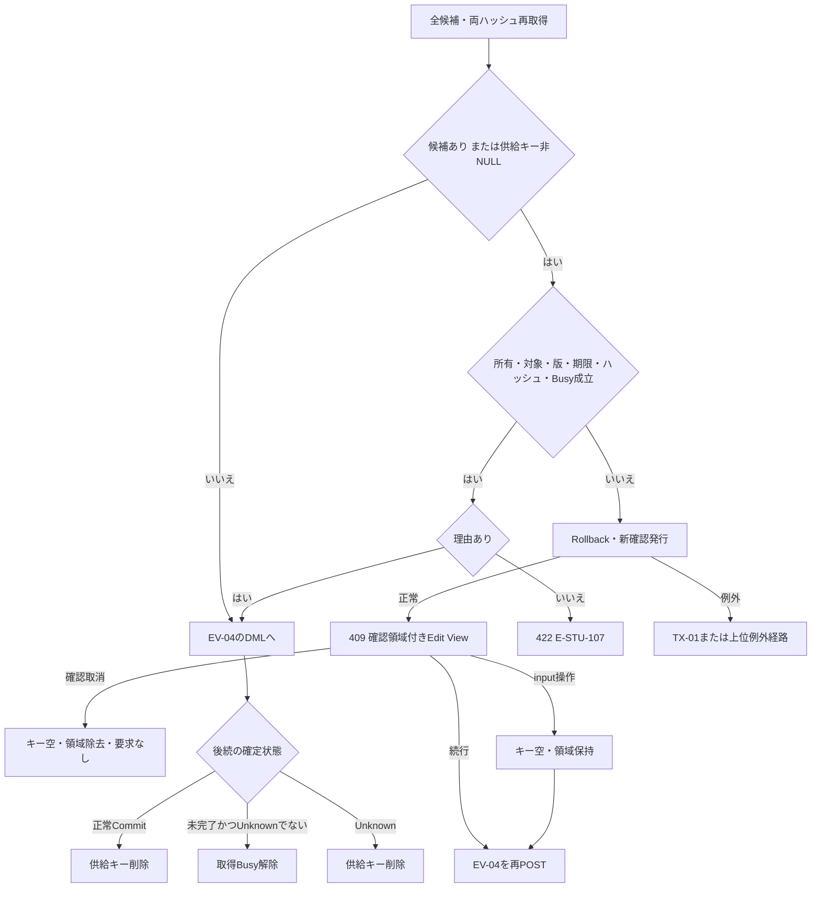

#### SQL・テーブル関連、DB操作の詳細

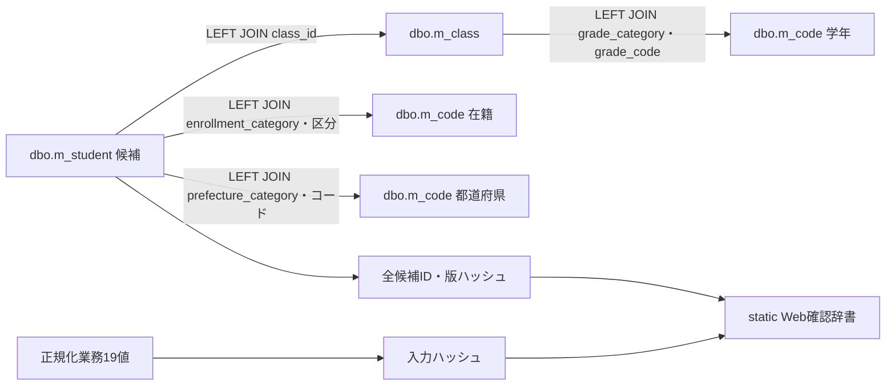

候補SQLはRowSelectへ`WHERE s.is_deleted=0 AND (@id IS NULL OR s.student_id<>@id) AND s.birth_date=@birth AND (s.name_key=@name OR s.kana_key=@kana) ORDER BY s.student_id`を加える。@id BigIntまたはDBNull、@birth Date、@name NVarChar(320)、@kana NVarChar(36)。TOP、OFFSET/FETCHはなく全件取得し、在籍区分やマスター停止・期間で除外しない。この読取は保存のReadCommittedトランザクション内で行い、画面用LookupのSNAPSHOTとは分ける。根拠: `sources/Core/SqlServerStudentService.cs:242-242`、`sources/Core/SqlServerStudentService.cs:269-272`。

RowSelectはクラスを`c.class_id=s.class_id`、学年を`g.category_id=c.grade_category AND g.code_value=c.grade_code`、在籍を`e.category_id=s.enrollment_category AND e.code_value=s.enrollment_status_code`、都道府県を`p.category_id=s.prefecture_category AND p.code_value=s.prefecture_code`でLEFT JOINする。JOINに有効性・期間条件はない。StudentRowにはID、番号、氏名、カナ、生年月日、所属年度・学年名称・クラスコード・名称、在籍名称、算出住所、本人電話、入学日、更新時点、版を移す。算出住所は都道府県名称NULLを「[不整合]」へ置換して住所1を連結し、住所2を含めない。候補表が使うのは番号、氏名、和暦生年月日、クラス名だけで、クラス名NULLを「未所属」へ置換する処理はない。根拠: `sources/Core/SqlServerStudentService.cs:77-91`、`sources/Core/Contracts.cs:50-55`、`sources/Views/Students/Edit.cshtml:14-14`。

Web確認はstatic辞書へ発行する。期限と照合時点は各保存要求の開始nowを使い、発行完了時刻から10分ではない。キー発行時に期限切れを掃除するが、同じSnapshotや編集状態に属する旧キーを一括撤回しない。現在のWeb登録はwebTokens=trueなので、この処理でt_confirmationを読書きしない。根拠: `sources/Infrastructure/WebHostSetup.cs:19-19`、`sources/Core/SqlServerStudentService.cs:278-278`、`sources/Core/SqlServerStudentService.cs:330-335`。

#### 結果・例外時の扱い

確認はPrincipal、SessionId、対象、期待版、期限、正規化業務値、全候補ID・版、Busyを検査する。Role、Tab、SnapshotId、ReturnContextIdは照合対象ではない。候補が0件に変わっても、不正な非NULL旧キーがあれば再確認となる。サービスまで空文字が届いた場合も非NULLキーとして扱う。対象版競合とNoChangeは確認照合より前に判定する。根拠: `sources/Core/SqlServerStudentService.cs:252-290`。

理由入力を含む保存フォームのinput操作はキーを消すが、確認sectionを残す。候補確認後に理由を入力した場合、候補が残ればその保存で新確認を取得し、その後入力を変えず続行する経路になる。ブラウザーのキー消去と確認取消はサーバー側の消費ではない。MVCが空文字をサービスへNULLとして渡すかは、ここで保証しない。根拠: `sources/wwwroot/js/site.js:3-6`、`sources/Core/SqlServerStudentService.cs:276-290`。

### EV-06 論理削除

#### 処理概要

既存Administratorが専用フォームで対象と理由を確認して送信する。削除要求は編集中のInput.*を受けず、DB業務値を保持したまま削除属性と更新管理値を変更する。根拠: `sources/Views/Students/Edit.cshtml:17-17`、`sources/Core/SqlServerStudentService.cs:409-413`。

#### 処理手順

1. 専用フォームからSnapshotId、ExpectedVersion、ReturnContextId、Confirmed=true、Reason、CSRF情報を送る。
2. ControllerはFormGuard、認証、Snapshotの所有・セッション・対象・期限、復帰先と読込時復帰先の一致を確認する。
3. Coordinator.DeleteはAdministrator、復帰Context、Confirmed=true、正の期待版を確認してDeleteAsyncを呼ぶ。保存と同じModelState.IsValid分岐やWebFault catchはない。
4. サービスは受付GUID、CurrentUser、開始UTC時点を決め、管理者、必須理由、正のID・版、版がlong.MaxValueでないことを検査する。
5. 接続、ReadCommitted、共通Gateの後、非削除対象の現版を取得し、存在と期待版一致を確認する。
6. 削除7列をUPDATEし、ExecuteNonQueryの件数1を要求する。
7. 同じトランザクションでDELETE監査を追加し、正常Commit後にSavedと版+1を返す。
8. ControllerはSavedならFlashと303、非Savedの結果ならエラーとHTTP状態を設定してLoadを再実行する。

根拠: `sources/Web/Controllers/StudentsController.cs:37-41`、`sources/Infrastructure/WebStudentCoordinator.cs:19-19`、`sources/Core/SqlServerStudentService.cs:392-416`。

#### 条件付き処理フロー

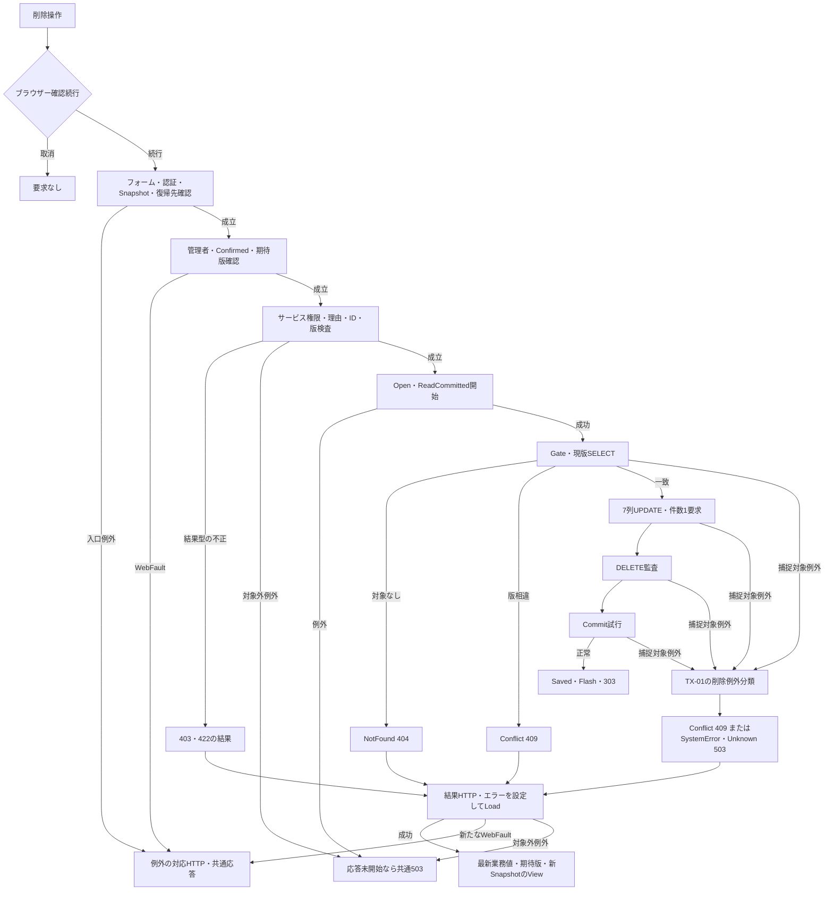

#### SQL・テーブル関連、DB操作の詳細

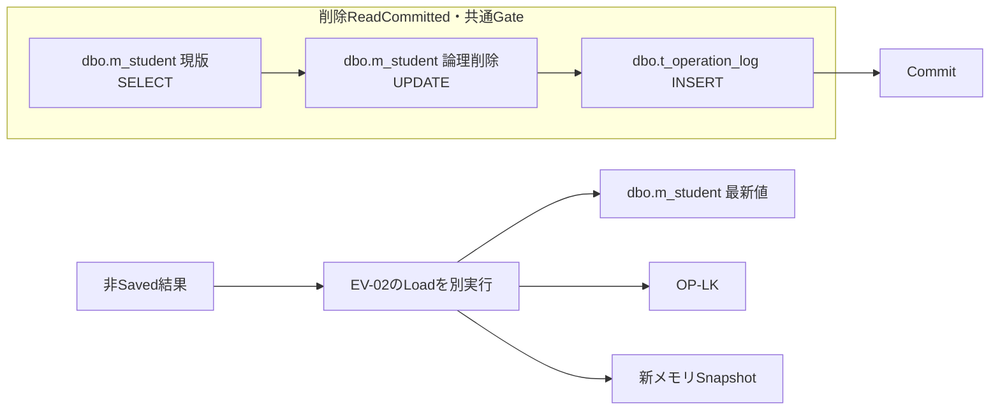

現版SQLは`SELECT row_version FROM dbo.m_student WHERE student_id=@id AND is_deleted=0`、@id BigIntのスカラー取得である。0件はNotFound、現版相違はConflictとなる。UPDATEのSETは`is_deleted=1,deleted_at=@now,deleted_by=@actor,delete_reason=@reason,updated_at=@now,updated_by=@actor,row_version=row_version+1`、WHEREは`student_id=@id AND row_version=@version AND is_deleted=0`。@id・@version BigInt、@now DateTimeOffset、@actor NVarChar(128)、@reason NVarChar(120)で、更新件数1を要求する。JOIN、ORDER BY、ページングはない。根拠: `sources/Core/SqlServerStudentService.cs:404-411`。

業務列、class_id、学籍番号、作成情報はSETに含まれない。監査は同じ7列、前版、版+1、理由、duplicate_confirmed=falseを記録する。学生と監査の正常Commit後だけSavedとなる。論理削除後の行は非削除条件を持つ検索と人数集計から外れるが、番号一意確認からは外れない。根拠: `sources/Core/SqlServerStudentService.cs:201-201`、`sources/Core/SqlServerStudentService.cs:264-266`、`sources/Core/SqlServerStudentService.cs:409-414`。

#### 結果・例外時の扱い

DBConcurrencyExceptionはRollback試行後Conflictとなる。それ以外のSqlException、InvalidOperationException、OperationCanceledExceptionはTX-01に従ってSystemErrorまたはUnknownへ分ける。OpenとBeginTransactionは結果分類tryの外にある。削除理由の入力catchはInputValidationExceptionだけなので、不正UnicodeのArgumentExceptionなどは上位へ伝播する。根拠: `sources/Core/StudentNormalizer.cs:37-57`、`sources/Core/SqlServerStudentService.cs:396-416`。

非Saved結果後のLoadが成功すれば最新DB業務値、最新期待版、Lookup、新Snapshotで表示する。編集中の業務値や投稿削除理由を復元しない。Loadで対象が削除済みと判明して404を投げた場合、応答未開始なら元のUnknown等に代わって共通404が表に出得る。入口例外はこの非Saved後Loadへ入らない。根拠: `sources/Web/Controllers/StudentsController.cs:25-25`、`sources/Web/Controllers/StudentsController.cs:37-37`、`sources/Infrastructure/WebStudentCoordinator.cs:17-19`、`sources/Infrastructure/WebHostSetup.cs:23-23`。

### EV-07 入力クリア・編集取消

#### 処理概要

POST `/students/reset`はSnapshot.Originalへ入力を戻す。学生本体の最新取得ではない。根拠: `sources/Web/Controllers/StudentsController.cs:35-35`。

#### 処理手順

1. ブラウザーで読込時値への復元確認を行い、続行ならSnapshotIdとStudentIdを送る。
2. FormGuardと認証を確認し、StudentIdを任意の正のInt64へ変換する。
3. Snapshotの所有者、認証セッション、対象ID、期限を照合する。
4. ModelStateをClearし、Originalの複製をInputへ設定する。Detail、SnapshotId、ReturnRevisionは同じSnapshotの値を使う。
5. 人数付きLookupだけを再取得し、「入力を読込時の値へ戻しました。」とEdit Viewを返す。

根拠: `sources/Views/Students/Edit.cshtml:16-16`、`sources/Web/Controllers/StudentsController.cs:35-35`、`sources/Infrastructure/EditorSnapshotStore.cs:7-11`。

#### 条件付き処理フロー

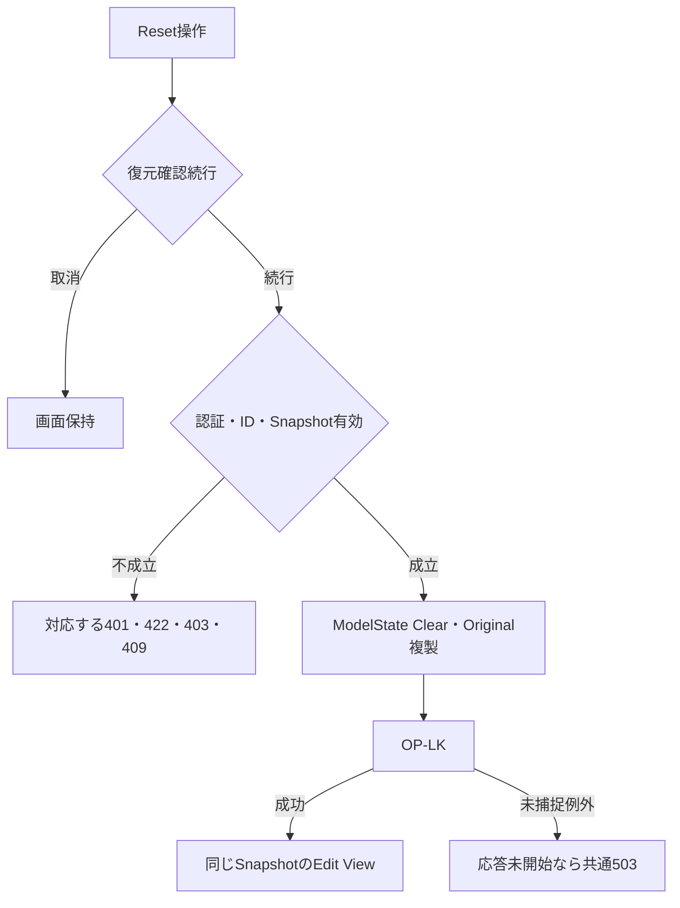

#### SQL・保持領域関連、DB操作の詳細

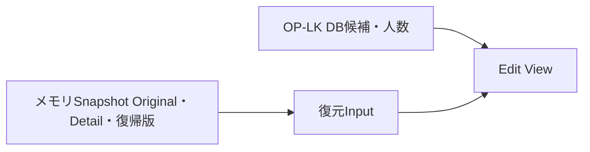

入力復元元はメモリであり、学生GetAsync、学生DML、監査追加は呼ばない。DB読取はOP-LKだけで、その関連図と全SQLは補足説明に従う。学生の期待版は読込時値を維持し、候補と参考人数だけを再取得する。根拠: `sources/Web/Controllers/StudentsController.cs:35-35`、`sources/Core/SqlServerStudentService.cs:196-216`。

#### 結果・例外時の扱い

新規クリアは性別0、在籍01、読込時当年度などへ戻す操作で、全項目を空にしない。既存取消後にDBが変更されていれば次回保存で競合となる。Reset自身は復帰Contextを再検査せず、Snapshotの期限延長・消費も行わない。根拠: `sources/Web/Inputs/StudentSaveInput.cs:44-54`、`sources/Infrastructure/EditorSnapshotStore.cs:10-10`、`sources/Web/Controllers/StudentsController.cs:35-35`。

### EV-08 最新情報を再読込

#### 処理概要

既存時のリンクからEV-02の通常GETを再実行し、学生の全業務値と期待版を取得し直す。根拠: `sources/Views/Students/Edit.cshtml:16-16`、`sources/Web/Controllers/StudentsController.cs:24-25`。

#### 処理手順

1. dirtyなら編集内容の破棄を確認し、取消なら画面に留まる。
2. 続行またはdirtyでなければ、対象IDとreturnContextIdを持つ既存GETへ進む。
3. EV-02の認証・Context確認、非削除学生取得、人数付きLookup、Input復元を実行する。
4. 最新業務値、最新期待版、新SnapshotでEdit Viewを返す。旧Snapshotを明示削除しない。

根拠: `sources/wwwroot/js/site.js:5-5`、`sources/Infrastructure/WebStudentCoordinator.cs:17-17`、`sources/Web/Controllers/StudentsController.cs:25-25`、`sources/Infrastructure/EditorSnapshotStore.cs:9-11`。

#### 条件付き処理フロー

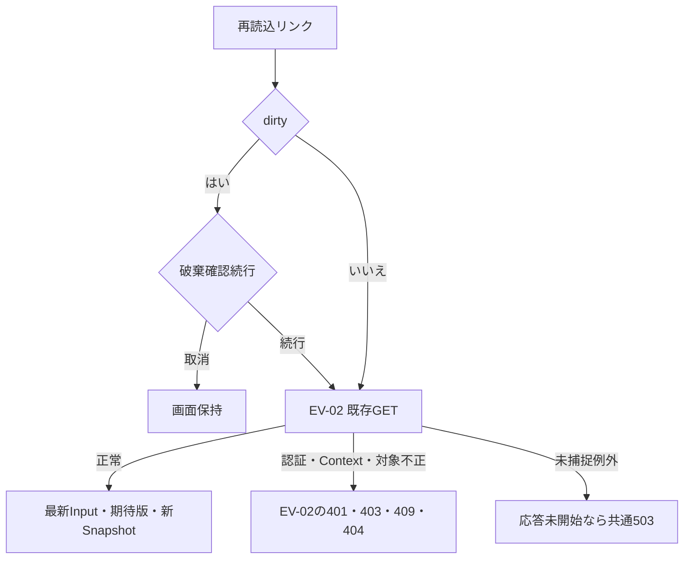

#### SQL・テーブル関連、DB操作の詳細

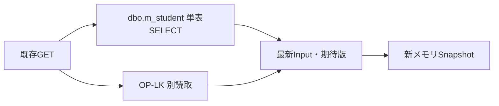

対象SQL、@id BigInt、最大1行、非削除条件はEV-02と同じ。学生本体は単表読取なので単独ER図を省略し、Lookupの複数表関係はOP-LKを参照する。期待版だけを最新版へ差し替える操作や学生書込みはない。根拠: `sources/Core/SqlServerStudentService.cs:172-216`。

#### 結果・例外時の扱い

復帰Context失効は学生取得前に拒否し、対象削除済みは404となる。成功時に編集中Inputを引き継がず、DB値から作り直す。ResetがメモリOriginalを使うのに対し、本イベントはDB最新値を使う。根拠: `sources/Infrastructure/WebStudentCoordinator.cs:17-17`、`sources/Web/Controllers/StudentsController.cs:25-35`。

### EV-09 検索へ戻る・確定成功後の復帰

#### 処理概要

手動復帰はInput.ReturnContextIdと読込時ReturnRevisionを使う。保存・削除成功は通知をメモリへ置き、固定内部パスへ303を返す。復帰先は保存済みApplied条件によって検索を再実行する。根拠: `sources/Views/Students/Edit.cshtml:16-16`、`sources/Web/Controllers/StudentsController.cs:8-11`、`sources/Web/Controllers/StudentsController.cs:38-39`。

#### 処理手順

1. 手動リンクはdirty時だけ未保存変更の破棄を確認する。
2. Saved後、復帰Contextが未設定なら新検索Contextを作り、その初期Revisionを使う。
3. Flashへ「保存しました。」または「論理削除しました。」を置く。Contextと検索版をURIエスケープした`/students?contextId=…&contextRevision=…`をLocationに設定し、303 EmptyResultを返す。
4. 検索Indexは認証を確認する。Context未指定なら新未検索状態、指定ありならResumeへ進む。
5. ResumeはContextのSemaphoreSlim内で所有・セッション・期限を再確認し、要求検索版の10進文字列一致と版上限未到達を要求する。
6. Appliedなしなら未検索のまま版を維持する。Appliedありなら保存済み条件・ページ・件数・ソートでSearchAsyncを呼び、成功結果をLastResultへ設定してRevisionを1増やす。Appliedは書き換えない。Use成功で期限を30分延長する。
7. Resume後にFlash.Takeを評価し、その後人数なしLookupを取得してSearch Viewを返す。

根拠: `sources/Web/Controllers/StudentsController.cs:8-11`、`sources/Web/Controllers/StudentsController.cs:38-39`、`sources/Infrastructure/WebStudentCoordinator.cs:14-21`、`sources/Infrastructure/SearchContextStore.cs:9-14`、`sources/Infrastructure/FlashMessageStore.cs:6-9`。

#### 条件付き処理フロー

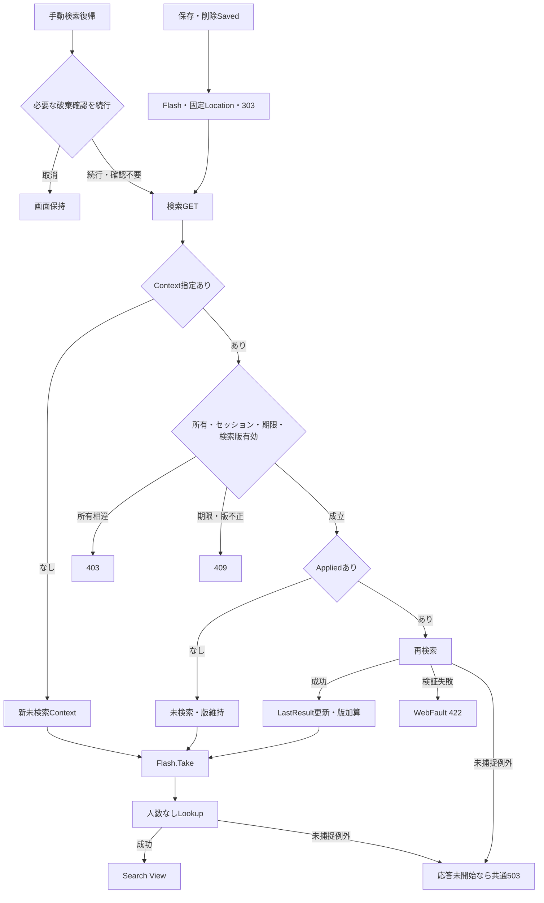

認証不正は検索GET入口で401となる。ContextのUse成功時だけ期限を延長する。図のFlash消費は再検索成功または未検索復帰後であり、DB確定と同じ境界ではない。根拠: `sources/Web/Controllers/StudentsController.cs:9-11`、`sources/Infrastructure/SearchContextStore.cs:14-14`。

#### SQL・テーブル関連、DB操作の詳細

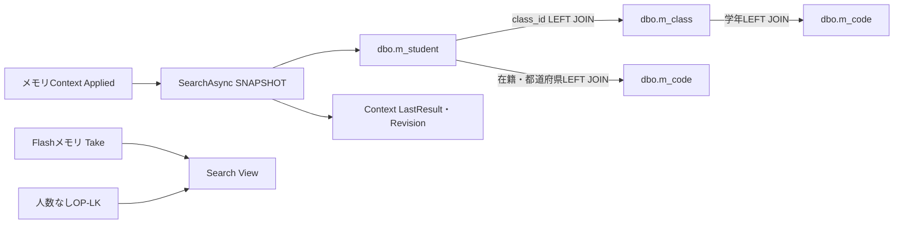

Appliedなしでは学生検索SQLを実行しない。Appliedありの検索は、保存済み条件の検証後、SNAPSHOT内でTOP(10001)の件数確認とページ取得を行う。10000件超はLimitExceeded=true、一覧空、表示totalCount=NULLとなる。通常ページサイズは20・50・100、ソートはstudentNo/name/admissionDate/updatedAtとasc/descに限定し、同順位は学生ID昇順とする。OFFSET/FETCHの@offset・@sizeはIntである。検索の全述語・条件パラメータはSM-DET-STUDENT-SEARCHの責務で、本イベントはAppliedをそのまま渡す。根拠: `sources/Core/SqlServerStudentService.cs:107-108`、`sources/Core/SqlServerStudentService.cs:156-168`、`sources/Infrastructure/WebStudentCoordinator.cs:14-21`。

検索用LookupはincludeOccupancy=falseなので人数集計を行わず、CONVERT(int,0)を返す。この0は実人数ゼロではない。ContextとFlashはメモリであり、t_runtime_stateへのDB書込みはない。根拠: `sources/Web/Controllers/StudentsController.cs:39-39`、`sources/Core/SqlServerStudentService.cs:201-208`、`sources/Infrastructure/SearchContextStore.cs:9-14`、`sources/Infrastructure/FlashMessageStore.cs:6-9`。

#### 結果・例外時の扱い

編集時のCheckReturnはTabと期待検索版を渡さず、Contextの所有・セッション・期限だけを確認する。そのため学生保存が確定した後でも、Resumeで検索版相違となり得る。任意URLを復帰先として受けず、固定内部パスとContextを使う。根拠: `sources/Infrastructure/WebStudentCoordinator.cs:6-6`、`sources/Infrastructure/SearchContextStore.cs:13-14`、`sources/Web/Controllers/StudentsController.cs:38-38`。

FlashはResume後、Lookup前に除去する。Resume失敗では未消費、Lookup失敗では消費済みとなり得る。SQLが取得するページは最終ページ以下へ補正するが、ResumeはApplied.Pageを書き戻さず、提示pageは元Appliedを使う。削除でページ数が縮んだ場合などに、取得ページと提示pageが異なる可能性がある。未検索、0件、上限超過、通常結果を分け、件数NULLを0件へ置き換えない。根拠: `sources/Web/Controllers/StudentsController.cs:8-11`、`sources/Infrastructure/WebStudentCoordinator.cs:14-21`、`sources/Core/SqlServerStudentService.cs:160-164`。

## 補足説明

### DATE-01 日付入力の層別契約

入学日・終了日の画面部品はtype=dateであり、DTOでは入学日が`string`、終了日が`string?`である。入学日にはrequiredがあるが、両部品にmaxlengthはない。フォーム値からMVCが作るDTOとModelState、サービスが受ける文字列、内部日付、DB日付、再表示文字列を次のように分ける。根拠: `sources/Views/Students/Edit.cshtml:11-11`、`sources/Web/Inputs/StudentSaveInput.cs:20-22`。

| 層 | 入学日 | 卒業・退学日 | 担当・根拠 |
| --- | --- | --- | --- |
| HTML要求項目 | `Input.AdmissionDate`、type=date・required | `Input.EnrollmentEndDate`、type=date | View。ブラウザーの見た目を一律yyyy/MM/ddにする処理はない。`sources/Views/Students/Edit.cshtml:11-11` |
| バインド後DTO・サービス引数 | `AdmissionDate:string`を同名Draftへ移す | `EnrollmentEndDate:string?`を同名Draftへ移す | ToRequestは日付文字列を解析せず移送する。`sources/Web/Inputs/StudentSaveInput.cs:34-42` |
| 厳密変換 | ParseIsoへ渡す。NULLならraw.Normalizeで例外 | NULL・空文字なら解析せずNULL。空白だけならParseIsoへ渡す | NFKC後10コード単位、InvariantCultureのyyyy-MM-dd、1900年下限・業務日以下。`sources/Core/JapaneseDateService.cs:52-59`、`sources/Core/StudentNormalizer.cs:135-137` |
| 内部比較 | `DateOnly` | `DateOnly?` | 生年月日≦入学日、区分に対応する終了日の有無、終了日≧入学日。`sources/Core/StudentNormalizer.cs:148-154` |
| SQL・DB | `@admission_date Date`、`date NOT NULL` | `@enrollment_end_date Date`、`date NULL` | DateOnlyを午前0時のDateTime、NULLをDBNullへ変換。`sources/Core/SqlServerStudentService.cs:35-36`、`sources/Core/SqlServerStudentService.cs:67-72`、`sources/database/001_schema.sql:24-27` |
| 既存値の再表示 | DB日付をyyyy-MM-dd文字列へ戻す | DB NULLはNULL、日付はyyyy-MM-dd文字列 | Detail→Draft→Input→type=date。日付に時差変換しない。`sources/Core/SqlServerStudentService.cs:183-194`、`sources/Web/Inputs/StudentSaveInput.cs:47-54` |

和暦4部品はBirthDateInputの4つの`string`であり、Parseは元号を先に照合し、年、月、日の順で変換する。通常Textのraw上限検査やTrimを通さない。根拠: `sources/Core/Contracts.cs:8-8`、`sources/Core/JapaneseDateService.cs:17-39`。

| 部品 | 原入力に対するHTMLガード | サーバー変換・変換後制約 | サービス引数NULLの場合 |
| --- | --- | --- | --- |
| Era | select、required、maxlengthなし | 固定5IDと完全一致。NFKC・Trim・raw10文字検査なし | 数値部より先にE-DATE-001のArgumentException |
| Year | input、required、maxlength=4コード単位 | NFKC後「元」は1、その他は4コード単位以内のASCII正整数 | 有効元号のもとでYear.NormalizeがNullReferenceException |
| Month | input、required、maxlength=2コード単位 | NFKC後2コード単位以内のASCII正整数 | 元号・年解析成功後、Month.NormalizeがNullReferenceException |
| Day | input、required、maxlength=2コード単位 | NFKC後2コード単位以内のASCII正整数 | 元号・年・月解析成功後、Day.NormalizeがNullReferenceException |

根拠: `sources/Views/Students/Edit.cshtml:7-7`、`sources/Core/JapaneseDateService.cs:19-39`。ToRequestはBirthDateInput全体がNULLなら空の構造へ置き換えるが、内部のNULL部品を補完しない。根拠: `sources/Web/Inputs/StudentSaveInput.cs:36-36`。

Parseは実在日、元号期間内、業務日以下、逆変換した元号・年の一致を確認する。固定境界は次表のとおりで、明治の1900年開始は本実装の許容下限である。根拠: `sources/Core/JapaneseDateService.cs:9-33`。

| 元号ID | 名称 | 開始日 | 終了日 | 西暦年への加算 |
| --- | --- | --- | --- | --- |
| REIWA | 令和 | 2019-05-01 | DateOnly.MaxValue | 2018 |
| HEISEI | 平成 | 1989-01-08 | 2019-04-30 | 1988 |
| SHOWA | 昭和 | 1926-12-25 | 1989-01-07 | 1925 |
| TAISHO | 大正 | 1912-07-30 | 1926-12-24 | 1911 |
| MEIJI | 明治 | 1900-01-01 | 1912-07-29 | 1867 |

成功した生年月日だけがDateOnlyとしてbirth_dateへ入る。ToInputは元年を「1」、月日を2桁で復元し、候補用ToWarekiは元年を「元」で表示する。サービスの業務日は要求開始UTC時点から+09:00で求め、画面の業務日は描画時の現在UTCから別に求める。更新時点のDateTimeOffsetだけを日本時間表示へ変換する。根拠: `sources/Core/JapaneseDateService.cs:41-61`、`sources/Core/SqlServerStudentService.cs:44-45`、`sources/Core/SqlServerStudentService.cs:229-229`、`sources/Infrastructure/WebPresentation.cs:5-7`。

通常の空文字、形式不正、元号不正などによるArgumentExceptionは個別SetでFieldErrorへ変換し、SaveAsyncのValidationFailedとなる。一方、上表のNULL部品またはAdmissionDateのNULLによるNullReferenceExceptionはSet、SaveAsyncの入力catch、ControllerのWebFault catchのいずれにも捕捉されない。先行項目で収集したエラーがあってもこの例外で処理が中断し、応答未開始なら共通503 HTMLへ進む。ブラウザーrequiredや非nullable注釈をNULL排除の実行保証として扱わない。根拠: `sources/Core/StudentNormalizer.cs:123-143`、`sources/Core/SqlServerStudentService.cs:232-239`、`sources/Web/Controllers/StudentsController.cs:30-33`、`sources/Infrastructure/WebHostSetup.cs:16-23`。

### OP-LK 候補読取と表示名称の保存元

LookupAsyncは認証主体を確認し、SNAPSHOT内で2結果集合を全件取得する。第1集合は`m_code c JOIN m_code_category k ON k.category_id=c.category_id`から分類、値、名称、表示順、期間、保護設定を読む。IsActiveはコードと分類の両方が有効な場合だけtrueで、順序は`c.category_id,c.display_order,c.code_value`である。停止・期間のWHERE除外はない。根拠: `sources/Core/SqlServerStudentService.cs:197-212`。

第2集合は`m_class c LEFT JOIN m_code g ON g.category_id=c.grade_category AND g.code_value=c.grade_code`からクラス列と人数を読む。順序は`c.school_year DESC,g.display_order,c.display_order,c.class_code,c.class_id`である。編集人数の全条件は同class_id、is_deleted=0、在籍01・02のCOUNT(*)。パラメータ、TOP、OFFSET/FETCHはなく、コード集合の後にクラス集合を全件読む。正常Commit後にLookupSetを返す。接続、開始、読取、CommitにCancellationTokenを渡す。根拠: `sources/Core/SqlServerStudentService.cs:199-216`。

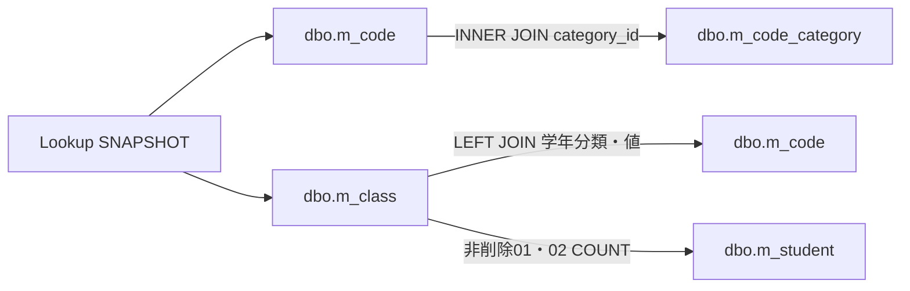

候補は保存済み選択値とは別の領域である。コードの描画可否はコード・分類の有効性、画面業務日との期間比較、Detailの既存同値保持で決める。IsProtectedは可否判定に使わない。クラスは年度・学年で絞らず全optionを列挙し、既存IDを保持する。03・04の描画期間判定は原入力をDateOnly.TryParseで読むため、保存時のNFKC後厳密解析と同じ契約ではない。根拠: `sources/Views/Students/Edit.cshtml:8-13`。

人数の表示対象はClassId.ToString()とInput.ClassIdの文字列一致で求める。先頭ゼロ付きIDがIdParserを通っても、表示時のクラスが見つからず人数－となる場合がある。未選択時の定員「制限なし」は表示上の代替値であり、選択済みクラスのcapacity=NULLと同じ取得状態とは限らない。根拠: `sources/Views/Students/Edit.cshtml:2-2`、`sources/Views/Students/Edit.cshtml:12-12`、`sources/Web/Inputs/StudentSaveInput.cs:60-60`。

表示専用名称の保存元は次のとおりである。名称列のNOT NULLと、学生からLEFT JOINした結果のNULL可能性を分ける。

| 表示値 | 更新入口・業務検査 | 保存列・DB属性 | 保存パラメータ | 本画面での扱い・根拠 |
| --- | --- | --- | --- | --- |
| コード名称、学年・在籍・都道府県名称 | CLI code→CodeChange.CodeName:string→SaveCodeAsync。必須単一行Text、raw12・Trim後12スカラー値、NFKCなし | `m_code.code_name nvarchar(24) NOT NULL`、CHECK12スカラー値 | `@name NVarChar(24)` | 学生はコード値を保存し名称を更新しない。StudentRowの名称NULLは結合結果。`sources/maintenance/Program.cs:11-12`、`sources/Core/MasterMaintenanceService.cs:79-83`、`sources/Core/MasterMaintenanceService.cs:113-115`、`sources/database/001_schema.sql:115-128` |
| クラス名称 | CLI class→ClassChange.ClassName:string→SaveClassAsync。必須単一行Text、raw18・Trim後18スカラー値、NFKCなし | `m_class.class_name nvarchar(36) NOT NULL`、CHECK18スカラー値 | `@class_name NVarChar(36)` | Lookup直接値は非NULL契約、学生のLEFT JOIN結果ClassNameはNULL可。`sources/Core/MasterMaintenanceService.cs:30-33`、`sources/Core/MasterMaintenanceService.cs:73-74`、`sources/Core/MasterMaintenanceService.cs:124-130`、`sources/database/001_schema.sql:68-81`、`sources/Core/Contracts.cs:50-64` |
| クラスコード | 同CLIのClassCode:string、Identifierでraw9・正規化後9、Trim・NFKC・大文字化・ASCII形式 | `m_class.class_code varchar(9) NOT NULL` | `@class_code VarChar(9)` | 選択表示に使用。学生はClassIdだけ保存。結合結果ClassCodeはNULL可。`sources/Core/MasterMaintenanceService.cs:33-33`、`sources/Core/MasterMaintenanceService.cs:73-74`、`sources/database/001_schema.sql:67-67`、`sources/Core/Contracts.cs:50-51` |

クラスの年度smallint、学年コードvarchar(2)、利用開始・終了date、利用状態bit、表示順intはNOT NULLで、定員intはNULL可である。コードの分類varchar(24)と値varchar(10)は複合キー、名称・表示順・利用状態・開始日はNOT NULL、終了日dateはNULL可で期限なしを表す。学生画面からこれらのマスター列は更新しない。根拠: `sources/database/001_schema.sql:64-73`、`sources/database/001_schema.sql:113-127`。

初期投入定義では性別0は未回答、在籍01/02/03/04は在学/休学/卒業/退学、学年00は学年なしである。0や00はコード値であり、未設定NULLではない。保護値は性別0、在籍01～04、都道府県01～47、学年00で、コード保守は停止と期間短縮を拒否する。名称、表示順、備考などをすべて変更禁止にする契約ではない。通常追加はis_protected=0、通常更新は保護設定をSETしない。根拠: `sources/database/002_seed.sql:14-84`、`sources/Core/MasterMaintenanceService.cs:105-115`。

### 正規化・項目間検査の接続

TextはNULLを空文字へ変え、Trimと改行統一より前にrawスカラー値数を検査する。不正サロゲートはArgumentExceptionとなる。単一行は制御文字を拒否し、複数行はCRLF・CRをLFへ統一してLF以外の制御文字を拒否する。Trim後空は任意項目ならNULL、必須項目ならエラーである。正規化で短くなる入力でも、raw上限超過は先に拒否する。根拠: `sources/Core/StudentNormalizer.cs:37-57`。

カナはNFKC後、ひらがなU+3041～U+3096と反復記号を対応するカタカナへ変換する。許可文字はU+30A1～U+30FA、長音、中点、カタカナ反復記号で、内部空白は半角1個へ整理する。郵便・電話から除くハイフンはASCIIハイフン、U+2010、U+2011、U+2212であり、電話は丸括弧も除く。電話は国内0始まり10～11桁、または+の後に非ゼロ始まり7～15桁で、記号除去後の空をNULLにする分岐はない。根拠: `sources/Core/StudentNormalizer.cs:72-100`。

メールは@が1個、非空ASCIIローカル部、先頭・末尾の点と連続点の禁止、2個以上のドメインラベル、各ラベル1～63文字と英数字・内部ハイフン形式を検査する。ローカル部の大小を保持し、ドメインだけ小文字化する。コードはTextのraw幅を確認してからNFKCし、指定幅のASCII数字に限定する。根拠: `sources/Core/StudentNormalizer.cs:102-117`。

個別正規化成功後は、生年月日≦入学日、在籍01～04、01・02の終了日NULL・クラス必須、03・04の終了日必須・入学日以上、本人電話・本人メール・緊急電話の最低1つ、緊急氏名・続柄・電話の全未設定または全設定を検査する。続柄未設定時は生成分類もNULLとする。詳細な共通契約の分担先はSM-COM-NORMALIZATION-DATEである。根拠: `sources/Core/StudentNormalizer.cs:143-159`。

### TX-01 接続、排他、取消、確定結果の分類

学生サービスは接続をEncrypt=Mandatory、TrustServerCertificate=falseに設定し、Open後に対象DBのsnapshot_isolation_state=1を要求する。共通Command helperはSQLタイムアウト30秒である。業務パラメータは明示したSqlDbTypeとSizeを使用し、DateOnlyを午前0時のDateTime、NULLをDBNullへ変換する。Size=0ではSizeを設定しない。根拠: `sources/Core/SqlServerStudentService.cs:39-72`。

保存・削除はReadCommitted内でSET XACT_ABORT ONを実行し、sp_getapplockを資源`test-project1:student-write`、Exclusive、Transaction所有、待機5000ms、DbPrincipal=publicで取得する。負戻り値を拒否する。クラス・コード保守も同じゲートを使う。Lookupと検索の読取はSNAPSHOTであり、保存中の同一人物候補再取得はReadCommittedの一部である。根拠: `sources/Core/SqlServerStudentService.cs:92-101`、`sources/Core/SqlServerStudentService.cs:197-200`、`sources/Core/SqlServerStudentService.cs:242-269`、`sources/Core/MasterMaintenanceService.cs:39-42`、`sources/Core/MasterMaintenanceService.cs:88-90`。

CancellationTokenを接続、開始、ゲート、照会、DML、Commitへ渡す。Rollback helperはCancellationToken.Noneで試み、SqlExceptionまたはInvalidOperationExceptionならfalseを返す。User取得、Open、保存・削除のBeginTransactionはDML結果分類tryの外側にある。根拠: `sources/Core/SqlServerStudentService.cs:229-244`、`sources/Core/SqlServerStudentService.cs:329-329`、`sources/Core/SqlServerStudentService.cs:394-403`。

| 経路 | Rollback・確定判定 | 保存結果・削除結果 |
| --- | --- | --- |
| 保存中のInputValidationException | Rollback試行。成否を結果分類に反映しない | ValidationFailed、422 |
| 保存中のSQL番号2601/2627 | Rollback試行。制約名を判別せず番号使用済みに変換 | ValidationFailed、E-STU-101、422 |
| 保存・削除のDBConcurrencyException | Rollback試行。成否を結果分類に反映しない | Conflict、E-STU-105、409 |
| その他のSqlException・InvalidOperationException・OperationCanceledException | Rollback結果を取得し、`writeStarted && (commitAttempted &#124;&#124; !rolledBack)`を判定 | trueならUnknown、falseならSystemError、いずれも503 |
| Open・Begin失敗、対象外例外 | 上記結果catchを経由しない | 上位へ伝播。応答未開始ならWebFaultのStatusまたは共通503 |

根拠: `sources/Core/SqlServerStudentService.cs:316-329`、`sources/Core/SqlServerStudentService.cs:399-416`、`sources/Infrastructure/WebHostSetup.cs:23-23`。

DML直前にwriteStarted、Commit直前にcommitAttemptedをtrueにする。Commit試行後の対象例外は、後続Rollbackが正常でもUnknownとなる。学生OUTPUTや監査INSERTが正常終了していても、正常Commitの戻りを得るまではSavedにしない。Unknownは未保存と断定せず、保存では再保存前、削除では検索による結果確認を案内する。根拠: `sources/Core/SqlServerStudentService.cs:302-322`、`sources/Core/SqlServerStudentService.cs:411-416`。

### 監査と実DDLの関連

監査INSERTはtarget_table=m_student、target_key=学生IDの10進文字列、CREATE/UPDATE/DELETE、前後版、物理変更列名JSON配列、認証主体、開始UTC時点、受付GUID、理由、重複確認有無を記録する。CREATE前版はNULL、後版は1。UPDATEは実差分列にupdated_at、updated_by、row_versionを加える。DELETEは削除・更新管理7列である。個人情報の変更前後値を複写する処理ではない。根拠: `sources/Core/SqlServerStudentService.cs:306-307`、`sources/Core/SqlServerStudentService.cs:385-390`、`sources/Core/SqlServerStudentService.cs:413-413`。

監査パラメータは@id VarChar(35)、@op VarChar(11)、@before/@after BigInt、@changed NVarChar Size=-1、@actor NVarChar(128)、@now DateTimeOffset、@request UniqueIdentifier、@reason NVarChar(120)、@confirmed Bitである。before_versionとoperation_reasonはNULL可、その他のこれら記録列はNOT NULL。保存のduplicate_confirmedは今回候補件数>0、削除はfalseとなる。log_idはIDENTITY PKで、target_keyから学生へのFKはない。根拠: `sources/Core/SqlServerStudentService.cs:307-307`、`sources/Core/SqlServerStudentService.cs:387-390`、`sources/database/001_schema.sql:137-153`、`sources/database/001_schema.sql:189-195`。

次図はDDLで宣言されたPK・FKとNULL可否に基づく関連である。検索JOIN、監査対象キー、メモリ確認状態の関連とは分ける。

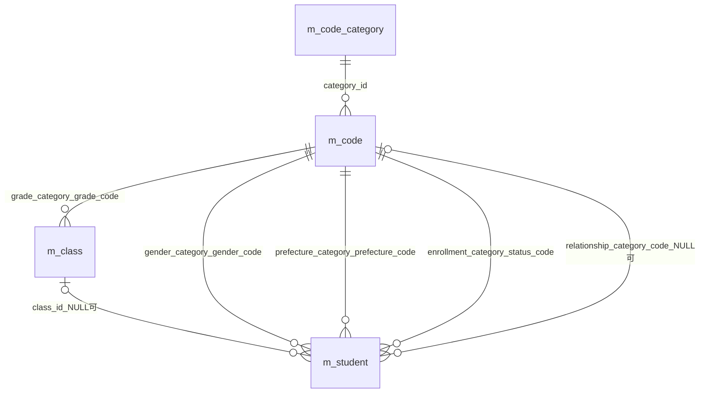

m_codeは分類＋値、m_classはclass_id、m_studentはstudent_idをPKとする。子側FKに一意制約はなく複数行が同じ親を参照できる。学生クラスと続柄組はNULL可、必須3コード組とクラス学年組はNOT NULLである。固定分類CHECKを持ち、監査・確認・実行時状態から学生への物理FKは定義されていない。根拠: `sources/database/001_schema.sql:8-43`、`sources/database/001_schema.sql:64-80`、`sources/database/001_schema.sql:127-127`、`sources/database/001_schema.sql:189-199`。

学生DDLは文字スカラー上限、UTC時点、正のbigint版、日付・在籍・所属、最低1連絡手段、緊急一式、削除属性整合をCHECKする。現在のコード可否、新席定員、同一人物確認、登録後番号不変はサービス検査である。row_versionはSQL Serverのrowversion型ではなく、処理が増分するbigintである。権限SQLは学生INSERT・UPDATEと監査INSERTを許可し、学生物理DELETEと監査UPDATE・DELETEを拒否する。論理削除の管理者限定はアプリ認可で行う。根拠: `sources/database/001_schema.sql:44-59`、`sources/database/001_schema.sql:196-205`、`sources/database/003_web_permissions.sql:14-22`、`sources/Infrastructure/WebStudentCoordinator.cs:19-19`。

### HTTP入口と接続範囲

FormGuardの許可項目照合はOrdinalIgnoreCaseである。許可外項目、不正な__Invariant、許容例外以外の同名複数値を400で拒否する。MVCは非nullable参照型の暗黙requiredを抑止し、本文・Multipart本文上限65536バイト、フォームValueLengthLimit=65536、ValueCountLimit=128、モデル検証エラー上限100を設定する。これらは項目の業務文字数上限とは別である。根拠: `sources/Web/Controllers/StudentsController.cs:41-41`、`sources/Infrastructure/WebHostSetup.cs:16-18`。

RequestIdentityは認証済み状態、NameIdentifier、login_session、Role claimを確認する。主体は空白のみ・64スカラー値超、セッションは空白のみ・64コード単位超、RoleはEnum.TryParse失敗を401とする。Enum.IsDefinedによる値域検査はないので、認可の観測条件はViewerとの差、Administratorとの一致として記載する。CookieはSecure、HttpOnly、SameSite Strict、30分、SlidingExpirationを設定する。根拠: `sources/Infrastructure/RequestIdentity.cs:7-16`、`sources/Infrastructure/WebHostSetup.cs:14-16`。

共通例外ミドルウェアは応答未開始の場合だけWebFaultのStatusまたは503へ変換する。学生HTML経路ではエスケープした文言と検索リンクを返す。認証ミドルウェアの401・403やCSRF検査による入口拒否と、この例外HTML生成を同じ経路として扱わない。共通契約の分担先はSM-COM-HTTP-SECURITYである。根拠: `sources/Infrastructure/WebHostSetup.cs:14-25`、`sources/Infrastructure/AntiforgeryResultFilter.cs:5-8`。

編集の公開経路はHTML GETとフォームPOSTである。POST `/students/options`は検索DTOから検索Viewを再表示し、編集Viewやsite.jsから呼ばれない。Coordinator.Options、WebPresentation.Lookups・Save、StrictJson.Readを編集用JSON APIとして説明しない。WebPresentation.Saveの候補クラスNULL→「未所属」整形も、編集候補表へ適用しない。根拠: `sources/Web/Controllers/StudentsController.cs:22-42`、`sources/Infrastructure/WebStudentCoordinator.cs:16-19`、`sources/Infrastructure/WebPresentation.cs:30-30`、`sources/wwwroot/js/site.js:2-9`。

webTokens=falseにはt_confirmationへの発行、UPDLOCK照合、学生保存と同時のconsumed更新があるが、現在のWeb登録はtrueである。検索Context、Snapshot、FlashはSingletonメモリ、確認はstatic辞書を使う。t_runtime_stateのDDLから本画面の永続化、暗号化、復元、消費処理を補わない。根拠: `sources/Infrastructure/WebHostSetup.cs:13-19`、`sources/Core/SqlServerStudentService.cs:279-283`、`sources/Core/SqlServerStudentService.cs:308-342`、`sources/Infrastructure/SearchContextStore.cs:9-14`、`sources/Infrastructure/EditorSnapshotStore.cs:7-11`、`sources/Infrastructure/FlashMessageStore.cs:6-9`。

### 設計意図と関連文書の分担

参考設計は和暦入力、生年月日の日付保存、理由付き別人確認、学生と履歴の一括確定などを定義する。本書の呼出名、型、状態遷移は現行ソースに対応するものを使う。参考設計のcommand.BirthDate、ParseBirthDate、FormatBirthDateを実在名として記載せず、StudentDraft.BirthDateInput、Parse、ToInput、ToWareki、Values[birth_date]に対応付ける。根拠: `reference-designs/詳細仕様書/CSharp_ASPNET/02_学生登録画面.md:757-776`、`reference-designs/詳細仕様書/CSharp_ASPNET/02_学生登録画面.md:793-795`、`sources/Core/JapaneseDateService.cs:17-50`、`sources/Core/StudentNormalizer.cs:127-127`。

参考設計の表示yyyy/MM/dd、郵便番号ハイフン表示、初期候補不足警告、候補再取得、UI再入制御などの意図と現行ソースの対応は、SM-RPT-DESIGN-IMPLEMENTATIONへ分担する。参考設計の定義を本書の実行済み動作や承認済み仕様へ置き換えない。根拠: `reference-designs/詳細仕様書/CSharp_ASPNET/02_学生登録画面.md:93-103`、`reference-designs/詳細仕様書/CSharp_ASPNET/02_学生登録画面.md:154-177`、`sources/Views/Students/Edit.cshtml:9-12`、`sources/wwwroot/js/site.js:2-9`。

次表は提供された全体計画との対応である。生成済み成果物の索引ではなく、リンク先は本応答では未生成として扱う。

| 文書ID | 正本相対パス | 本書から分担する責務 | 状態 |
| --- | --- | --- | --- |
| SM-BAS-STUDENT-EDITOR | spec/basic/student-editor.md | 業務目的、項目の意味、新規・編集・参照の業務状態 | 未生成 |
| SM-BAS-STUDENT-SEARCH | spec/basic/student-search.md | 復帰先の業務状態 | 未生成 |
| SM-DET-STUDENT-SEARCH | spec/detail/student-search.md | 復帰再検索の全検査、SQL、ページング | 未生成 |
| SM-COM-HTTP-SECURITY | spec/common/http-security-contract.md | フォーム受信、認証、CSRF、HTTP応答 | 未生成 |
| SM-COM-NORMALIZATION-DATE | spec/common/normalization-date.md | 正規化、文字数、日付変換・境界 | 未生成 |
| SM-COM-LOOKUPS | spec/common/lookup-contract.md | 候補、描画可否、既存値保持 | 未生成 |
| SM-COM-RUNTIME-STATE | spec/common/runtime-state.md | Context、Snapshot、確認、Flashの共通保持契約 | 未生成 |
| SM-COM-TRANSACTION-AUDIT | spec/common/transaction-audit.md | 接続、排他、取消、確定、監査 | 未生成 |
| SM-DATA-LOGICAL-CONTRACTS | spec/data/logical-contracts.md | DTO、受信値・保存値・表示値の移送 | 未生成 |
| SM-DET-CLASS-MAINTENANCE | spec/detail/class-maintenance.md | クラス名称・コード・期間・定員の更新元 | 未生成 |
| SM-DET-CODE-MAINTENANCE | spec/detail/code-maintenance.md | コード名称・期間・保護設定の更新元 | 未生成 |
| SM-DB-INDEX | spec/database/index.md | DDL関連、索引、共通物理規則 | 未生成 |
| SM-DB-M-STUDENT | spec/database/tables/m_student.md | 学生35列の物理定義 | 未生成 |
| SM-DB-M-CLASS | spec/database/tables/m_class.md | クラスの物理定義 | 未生成 |
| SM-DB-M-CODE | spec/database/tables/m_code.md | コード値・名称・保護属性の物理定義 | 未生成 |
| SM-DB-M-CODE-CATEGORY | spec/database/tables/m_code_category.md | コード分類の物理定義 | 未生成 |
| SM-DB-T-OPERATION-LOG | spec/database/tables/t_operation_log.md | 操作履歴の物理定義 | 未生成 |
| SM-DB-T-CONFIRMATION | spec/database/tables/t_confirmation.md | 非Web確認分岐の保持・消費 | 未生成 |
| SM-DB-T-RUNTIME-STATE | spec/database/tables/t_runtime_state.md | DDLと現行メモリ実装の境界 | 未生成 |
| SM-OPS-DATABASE-DEPLOYMENT | spec/operations/database-deployment.md | 配備入力、適用順、権限確認 | 未生成 |
| SM-DEP-PROCESS | spec/dependencies/process-dependencies.md | 呼出し接続、寿命、保持領域 | 未生成 |
| SM-RPT-DESIGN-IMPLEMENTATION | spec/reports/design-implementation-differences.md | 設計意図と現行実装の対応・差 | 未生成 |
| SM-RPT-UNRESOLVED | spec/reports/unresolved-and-analysis-limits.md | 不足資料、未確認境界、解析・検証範囲 | 未生成 |
