<!-- spec-meta: {"schema":"spec-md/1.0","documentId":"SM-DET-STUDENT-SEARCH","version":"3.0","path":"spec/detail/student-search.md","sheets":[{"heading":"概要","kind":"GRID","sheet":"01_概要"},{"heading":"項目一覧","kind":"LIST","sheet":"02_項目一覧","key":["項目キー"]},{"heading":"選択候補一覧","kind":"LIST","sheet":"03_選択候補一覧","key":["候補キー"]},{"heading":"内部項目一覧","kind":"LIST","sheet":"04_内部項目一覧","key":["内部項目キー"]},{"heading":"項目移送仕様","kind":"LIST","sheet":"05_項目移送仕様","key":["移送キー"]},{"heading":"イベント仕様","kind":"GRID","sheet":"06_イベント仕様"},{"heading":"補足説明","kind":"GRID","sheet":"07_補足説明"}]} -->
# 学生検索画面 詳細仕様書

| 文書属性 | 内容 |
| --- | --- |
| 文書ID | SM-DET-STUDENT-SEARCH |
| 文書種別 | 詳細仕様書 |
| 版数 | 3.0 |
| 正本パス | spec/detail/student-search.md |
| 対象 | 検索条件の受付、候補更新、学生検索、ページ取得、一覧表示、検索状態、登録画面への移送と復帰 |
| 動作の記述基準 | 接続されたソースの実装を本文の現行動作とする。参考設計の意図は補足説明で区別する |
| 対象読者 | 業務システムのIT担当者、実装経験5年程度の担当者 |

## 概要

### 機能と呼出しの責務

学生検索画面は、条件に一致する非削除学生を取得し、学生基本情報と所属・コードの名称を一覧へ表示する。利用者は条件を入力し、必要に応じて候補を更新してから検索する。検索後のページ操作は最後に成功した検索条件を使用する。新規登録と行の編集・参照は登録画面への遷移であり、検索画面の検索・候補更新・クリアは学生情報を変更しない。根拠: `sources/Views/Students/Search.cshtml:4-8`、`sources/Web/Controllers/StudentsController.cs:8-25`、`sources/Core/SqlServerStudentService.cs:103-170,197-216`。

Controllerはフォームの許可項目検査、状態取得、画面モデル作成を担当する。Coordinatorは検索状態の排他内でサービスを呼び、成功した条件と結果をメモリへ移す。起動登録では、接続設定名StudentDbを使ってIStudentServiceをSqlServerStudentServiceへ解決する。利用者情報、Coordinator、サービスはScoped、検索・編集・通知のストアはSingletonである。接続設定が空の場合は503のWebFaultとなる。根拠: `sources/Infrastructure/WebHostSetup.cs:13-19`、`sources/Infrastructure/WebStudentCoordinator.cs:7-21`。

| 操作・入口 | HTTPと実ルート | 受付材料 | 通常の返却先 |
| --- | --- | --- | --- |
| 初回表示 Index | GET `/students` | contextIdなし | 初期条件と未検索のSearch HTML |
| 検索 Search | POST `/students/search` | Criteria.*、ContextId、ContextRevision、TabId、PageSize、SortKey、SortDirection | 今回条件と検索結果のSearch HTML |
| 候補更新 Options | POST `/students/options` | 検索と同じフォーム | 今回条件・候補とLastResultのSearch HTML |
| ページ Page | POST `/students/page` | PageRequestの各項目とTabId | Applied由来条件と再検索結果のSearch HTML |
| クリア Clear | POST `/students/clear` | ContextId、ContextRevision、TabId | 同じ状態IDの初期条件・未検索HTML |
| 復帰 Resume | GET `/students?contextId=…&contextRevision=…` | 状態IDと期待検索版。Tabを渡さない | 未検索の復元、または元条件で再検索したHTML |
| 新規登録 | GET `/students/new?returnContextId=…` | 復帰状態ID | Edit HTML。Viewerは拒否 |
| 編集・参照 | GET `/students/{id}?returnContextId=…` | 学生IDと復帰状態ID | 最新の非削除詳細から作るEdit HTML |

Resumeに独立したルートはなく、状態ID付きIndexから呼ばれる。GET `/` は `/students` へ転送する。入口表は正常到達時の返却先を示し、拒否・SQL障害・取消の返却先はイベント仕様に定義する。根拠: `sources/Program.cs:6-7`、`sources/Web/Controllers/StudentsController.cs:8-25`。

### 入力中条件と成功済み条件

HTTPフォームの受信値はMVCによってStudentSearchInputへバインドされ、Search時にToCriteriaでSearchCriteriaへ移される。氏名はNameからStudentNameへ、カナはKanaからStudentNameKanaへ、在籍配列はStatusCodesからEnrollmentStatusCodesへ移す。年度はDTO時点でint?、未所属はbool、在籍はstring[]である。クラスだけはstring?を正のlong?へ解析する。サービスは条件からSQL用の正規化値をローカル変数へ作る。根拠: `sources/Web/Inputs/StudentSearchInput.cs:7-29`、`sources/Core/Contracts.cs:31-48`、`sources/Core/SqlServerStudentService.cs:113-150`。

入力途中の条件はブラウザー、要求input、応答モデルCriteriaにある。検索Entryに入力途中条件専用の領域はない。Appliedは最後に成功したSearchCriteria、LastResultは成功結果を保持する。SearchとPageは成功確認後に条件を深く複製してAppliedを置き換える。SQL用正規化値でAppliedの文字列を書き換える処理はない。Optionsは今回inputとLastResultを表示し、PageはAppliedを使う。Resumeは元Appliedを維持して再検索する。根拠: `sources/Infrastructure/SearchContextStore.cs:9-15`、`sources/Infrastructure/WebStudentCoordinator.cs:7-15`、`sources/Web/Controllers/StudentsController.cs:22-22`。

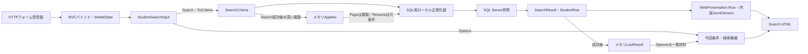

Normalizerのraw上限は、バインド後にNormalizerへ渡った文字列の上限である。空白だけのHTTP値が同じ文字列で残るかNULLへ変換されるか、欠落・型変換失敗がどの最終値になるかは、DTO宣言だけから保証しない。MVCは非nullable参照型の暗黙Requiredを抑制しており、stringやstring[]の注釈もNULL排除の実行保証ではない。再表示材料はinputとModelStateであり、HTTP原文字列の完全な別保存ではない。根拠: `sources/Infrastructure/WebHostSetup.cs:16-18`、`sources/Web/Controllers/StudentsController.cs:13-16`、`sources/Core/StudentNormalizer.cs:47-57`。

### 画面構成と静的投影

共有Layoutはヘッダーへ利用者名と業務日を置き、mainに個別ビューを配置する。検索画面の順序は、見出し・メッセージ、条件と検索／候補更新、クリア／新規登録、結果状態、表示指定、一覧、前後ページである。条件は.fieldsの2列配置、760px以下は1列となる。一覧は.gridで横スクロールし、tableの最小幅は1050px、セルは上寄せと任意位置の折返しを使う。根拠: `sources/Views/_ViewStart.cshtml:1-1`、`sources/Views/Shared/_Layout.cshtml:1-1`、`sources/Views/Students/Search.cshtml:3-8`、`sources/wwwroot/css/site.css:1-1`。

SRCのidはJavaScriptによる項目特定に使う。CSSの適用はclassと要素セレクターであり、SRCのidを指定したCSSはない。メッセージはaria-live=politeを持ち、role属性はない。エラーは.message.error、情報は.message.infoとなるが、CSSに.info専用定義はなく、情報表示へは.messageの共通定義が適用される。根拠: `sources/Views/Shared/_MessagePanel.cshtml:2-3`、`sources/wwwroot/css/site.css:1-1`、`sources/wwwroot/js/site.js:7-7`。

以下は原ビュー・共有Layout・検索画面に適用されるCSSから作った、単独表示用の静的投影である。実画面撮影ではない。未検索、Viewer、未所属OFFを示す。在籍名はseedの01～04を配置材料に使い、学校固有の年度・クラス候補や学生レコードを補っていない。状態・偽造防止情報の実値は掲載しない。原ルートとHTTP methodはdata属性に残し、formの送信先を設定せず、全ボタンをtype=button、アプリ内リンクを文書内fragmentとする。根拠: `sources/Views/Students/Search.cshtml:4-8`、`sources/Views/Shared/_Layout.cshtml:1-1`、`sources/database/002_seed.sql:19-22`。

<!doctype html>
<html lang="ja">
<head>
<meta charset="utf-8">
<meta name="viewport" content="width=device-width,initial-scale=1">
<title>学生管理</title>
<style>
:root{font-family:Meiryo,'Yu Gothic UI',sans-serif;color:#243448;background:#f2f5f9;font-size:14px}*{box-sizing:border-box}body{margin:0}header{background:#153654;color:white;padding:16px 28px;display:flex;justify-content:space-between;gap:20px}main{background:white;max-width:1440px;margin:24px auto;padding:24px}h1{font-size:24px}fieldset{border:1px solid #c8d1dc;padding:18px;margin:12px 0}legend{font-weight:bold}.fields{display:grid;grid-template-columns:1fr 1fr;gap:14px 28px}label{display:flex;flex-direction:column;gap:5px}input,select,textarea,button{font:inherit;padding:8px;border:1px solid #afbece;border-radius:3px}input,select,textarea{max-width:100%;width:100%}.check{display:inline-flex;flex-direction:row;align-items:center;margin-right:12px}.check input{width:auto}.actions{display:flex;gap:10px;align-items:center;flex-wrap:wrap;margin:16px 0}button{background:white;cursor:pointer}.primary{background:#1c5985;color:white}button:disabled{cursor:default;color:#8a98a5;background:#f3f5f8}.message{padding:14px;border:1px solid #b6dccc;background:#edf7f3}.error{background:#fff1f1;border-color:#c66}.warning{background:#fff8eb;padding:12px}.grid{overflow-x:auto}table{border-collapse:collapse;min-width:1050px;width:100%;font-size:12px}th,td{padding:10px 8px;border:1px solid #d4dee8;vertical-align:top;overflow-wrap:anywhere}th{background:#e6eef6}tr:nth-child(even){background:#f8fafc}.pager{display:flex;gap:14px;align-items:center;justify-content:center;margin:18px}small{color:#5f7183}@media(max-width:760px){main{margin:0;padding:15px}.fields{grid-template-columns:1fr}header{flex-direction:column}}
</style>
</head>
<body>
<header><strong>学生管理システム</strong><span>利用者 〈利用者表示名〉　業務日 〈yyyy/MM/dd〉</span></header>
<main>
<h1>学生検索</h1>
<form data-search-form data-source-method="POST" data-source-route="/students/search">
<fieldset><legend>検索条件</legend><div class="fields">
<label>学籍番号<input id="SRC-001" name="Criteria.StudentNo" maxlength="30"></label>
<label>氏名<input id="SRC-002" name="Criteria.Name" maxlength="16"></label>
<label>氏名カナ<input id="SRC-003" name="Criteria.Kana" maxlength="72"></label>
<label>年度<select id="SRC-004" name="Criteria.SchoolYear"><option value="">すべて</option></select></label>
<label>学年<select id="SRC-005" name="Criteria.GradeCode"><option value="">すべて</option></select></label>
<label>クラス<select id="SRC-006" name="Criteria.ClassId"><option value="">すべて</option></select></label>
<label class="check"><input id="SRC-007" name="Criteria.UnassignedOnly" type="checkbox">未所属のみ</label>
<fieldset><legend>在籍区分</legend><label class="check"><input type="checkbox" name="Criteria.StatusCodes" value="01" checked>在学</label><label class="check"><input type="checkbox" name="Criteria.StatusCodes" value="02" checked>休学</label><label class="check"><input type="checkbox" name="Criteria.StatusCodes" value="03">卒業</label><label class="check"><input type="checkbox" name="Criteria.StatusCodes" value="04">退学</label><small>全解除はすべて</small></fieldset>
<label>都道府県<select id="SRC-009" name="Criteria.PrefectureCode"><option value="">すべて</option></select></label>
<label>電話番号<input id="SRC-010" name="Criteria.PhoneNumber" maxlength="40"></label>
<label>入学日・開始<input id="SRC-011" name="Criteria.AdmissionFrom" type="date"></label>
<label>入学日・終了<input id="SRC-012" name="Criteria.AdmissionTo" type="date"></label>
</div><div class="actions"><button type="button" class="primary" data-source-method="POST" data-source-route="/students/search">検索</button><button type="button" data-source-method="POST" data-source-route="/students/options">候補を更新</button></div></fieldset>
</form>
<div class="actions"><form data-source-method="POST" data-source-route="/students/clear"><button type="button">クリア</button></form></div>
<p>未検索</p>
<form data-source-method="POST" data-source-route="/students/page">
<div class="actions"><label>表示件数<select name="PageSize"><option value="20" selected>20</option><option value="50">50</option><option value="100">100</option></select></label><label>並び順<select name="SortKey"><option value="studentNo" selected>学籍番号</option><option value="name">氏名</option><option value="admissionDate">入学日</option><option value="updatedAt">更新日時</option></select></label><select name="SortDirection" aria-label="並び順方向"><option value="asc" selected>昇順</option><option value="desc">降順</option></select><button type="button" name="Page" value="1" disabled>並び順・件数を反映</button></div>
<div class="grid"><table><thead><tr><th>学籍番号</th><th>氏名</th><th>氏名カナ</th><th>生年月日</th><th>年度／学年</th><th>クラス</th><th>在籍区分</th><th>住所</th><th>本人電話</th><th>更新日時</th><th>操作</th></tr></thead><tbody></tbody></table></div>
<nav class="pager"><button type="button" name="Page" value="0" disabled>前へ</button><span>1 / 1</span><button type="button" name="Page" value="2" disabled>次へ</button></nav>
</form>
</main>
</body>
</html>

権限・結果・未所属の差は、上の状態へ同時に合成せず、次の差分として適用する。StaffとAdministratorはクリアの隣に新規登録リンクを表示し、一覧行のリンク文言を編集とする。Viewerには新規リンクがなく、行リンクは参照となる。リンクは原本のa要素のまま、静的投影ではfragmentに置き換える。根拠: `sources/Views/Students/Search.cshtml:6-8`。

<div class="actions"><form data-source-method="POST" data-source-route="/students/clear"><button type="button">クリア</button></form><a href="#student-editor-contract" data-source-method="GET" data-source-route="/students/new?returnContextId=〈状態ID〉">新規登録</a></div>

foundの場合は結果文を「検索結果 〈件数〉 件　〈検索日時〉」にし、取得行をtbodyへ置く。次は行の移送位置を示す表示例であり、学生データではない。反映ボタンのdisabledを外し、前へはpage>1、次へはpage×PageSize<countのときだけdisabledを外す。根拠: `sources/Views/Students/Search.cshtml:7-8`。

<div class="grid"><table><thead><tr><th>学籍番号</th><th>氏名</th><th>氏名カナ</th><th>生年月日</th><th>年度／学年</th><th>クラス</th><th>在籍区分</th><th>住所</th><th>本人電話</th><th>更新日時</th><th>操作</th></tr></thead><tbody><tr><td>〈studentNo〉</td><td>〈studentName〉</td><td>〈studentNameKana〉</td><td>〈birthDateWareki〉</td><td>〈schoolYear〉 〈gradeName〉</td><td>〈classCode〉 〈className〉</td><td>〈enrollmentName〉</td><td>〈addressDisplay〉</td><td>〈phoneNumber、NULL時は－〉</td><td>〈updatedAt〉</td><td><a href="#student-editor-contract" data-source-method="GET" data-source-route="/students/{studentId}?returnContextId=〈状態ID〉">編集</a></td></tr></tbody></table></div>

0件は「該当する学生はありません。」、超過は.warningの「10,000件を超えました。条件を追加してください。」とし、tbodyは空にする。局所失敗は見出し直後に.message.errorのエラー概要と未検索用データを表示する。未所属ONの再描画では所属3selectをdisabledにする。JavaScriptのON/OFF操作だけではdisabledを変更しない。根拠: `sources/Views/Shared/_MessagePanel.cshtml:2-3`、`sources/Views/Students/Search.cshtml:5-8`、`sources/wwwroot/js/site.js:7-7`。

## 項目一覧

| 項目キー | 論理名・初期値 | 実コントロール・フォーム名 | DTOからサービス条件への対応 | 検査・正規化 | 検索列・保存列とDB属性 | SQL条件・パラメータ | 根拠 |
| --- | --- | --- | --- | --- | --- | --- | --- |
| SRC-001 | 学籍番号、空 | input、id=`SRC-001`、`Criteria.StudentNo`、maxlength=30 | `StudentNo:string`→`StudentNo:string?` | サービス引数NULL・空文字は省略。非空はraw・Trim後・NFKC大文字化後とも15スカラー値以内。先頭英数字、以降英数字・ハイフン | 検索・保存とも`m_student.student_no:varchar(15) NOT NULL`。15バイト。保存もIdentifierを使用 | 前方一致`LIKE @no ESCAPE '!'`、`@no:VarChar(31)`。保存`@student_no:VarChar(15)` | `sources/Views/Students/Search.cshtml:5-5`、`sources/Web/Inputs/StudentSearchInput.cs:7-22`、`sources/Core/StudentNormalizer.cs:47-64,124-124`、`sources/Core/SqlServerStudentService.cs:31-31,113-113,140-140,294-301`、`sources/database/001_schema.sql:9-9` |
| SRC-002 | 氏名、空 | input、id=`SRC-002`、`Criteria.Name`、maxlength=16 | `Name:string`→`StudentName:string?` | Textでraw・Trim後8スカラー値。任意空はNULL。非NULLはNFKC、大文字化、Unicode空白除去のNameKey、キー上限160 | 検索`name_key:nvarchar(320) NOT NULL`、保存表記`student_name:nvarchar(16) NOT NULL`。容量320／16 UTF-16コード単位、CHECK160／8 | 部分一致`LIKE @name ESCAPE '!'`、`@name:NVarChar(642)`。保存表記／キーは`NVarChar(16)`／`NVarChar(320)` | `sources/Views/Students/Search.cshtml:5-5`、`sources/Web/Inputs/StudentSearchInput.cs:8-22`、`sources/Core/StudentNormalizer.cs:47-70,125-145`、`sources/Core/SqlServerStudentService.cs:31-32,114-115,141-141,294-301`、`sources/database/001_schema.sql:10-12,44-46` |
| SRC-003 | 氏名カナ、空 | input、id=`SRC-003`、`Criteria.Kana`、maxlength=72 | `Kana:string`→`StudentNameKana:string?` | NULL・空文字は省略。非空はraw・Trim後36スカラー値、NFKC、ひらがな変換、空白統合、許可カナ検査、変換後18以内。検索キーは半角空白除去 | 検索`kana_key`、保存表記`student_name_kana`とも`nvarchar(36) NOT NULL`、容量36 UTF-16コード単位、CHECK18。保存Kanaは必須 | 部分一致`LIKE @kana ESCAPE '!'`、`@kana:NVarChar(74)`。保存表記／キーはともに`NVarChar(36)` | `sources/Views/Students/Search.cshtml:5-5`、`sources/Web/Inputs/StudentSearchInput.cs:9-22`、`sources/Core/StudentNormalizer.cs:72-85,126-145`、`sources/Core/SqlServerStudentService.cs:31-32,116-116,142-142`、`sources/database/001_schema.sql:11-13,45-47` |
| SRC-004 | 年度、すべて | select、id=`SRC-004`、`Criteria.SchoolYear`。未所属再描画時disabled | `SchoolYear:int?`→`int?` | 指定値1900～9998、年度候補の存在を確認。0は未指定にしない | `m_class.school_year:smallint NOT NULL`。所属クラスの属性、学生表に年度列なし | `c.school_year=@year`、`@year:SmallInt`、Sizeなし。保守保存も`@school_year:SmallInt` | `sources/Views/Students/Search.cshtml:5-5`、`sources/Web/Inputs/StudentSearchInput.cs:10-20`、`sources/Core/SqlServerStudentService.cs:109-109,126-129,143-143`、`sources/Core/MasterMaintenanceService.cs:32-32,73-74`、`sources/database/001_schema.sql:64-64` |
| SRC-005 | 学年、すべて | select、id=`SRC-005`、`Criteria.GradeCode`。未所属再描画時disabled | `GradeCode:string?`→`string?` | raw2スカラー値、Trim・NFKC後ASCII数字2桁。任意空はNULL。GRADE存在確認。00は学年なし | `m_class.grade_code:varchar(2) NOT NULL`、`grade_category:varchar(24) NOT NULL`。学生に学年列なし | `c.grade_code=@grade`、`@grade:VarChar(2)`。保守`@grade_code:VarChar(2)` | `sources/Views/Students/Search.cshtml:5-5`、`sources/Web/Inputs/StudentSearchInput.cs:11-20`、`sources/Core/StudentNormalizer.cs:113-117`、`sources/Core/SqlServerStudentService.cs:118-125,144-144`、`sources/Core/MasterMaintenanceService.cs:34-34,73-74`、`sources/database/001_schema.sql:65-66`、`sources/database/002_seed.sql:78-78` |
| SRC-006 | クラス、すべて | select、id=`SRC-006`、`Criteria.ClassId`。未所属再描画時disabled | `ClassId:string?`→IdParser.Optional→`long?` | NULL・空文字は未指定。非空は19コード単位以内、ASCII数字、正のInt64。Trim・NFKCなし。存在と指定年度・正規化学年の一致を確認 | 学生保存列`m_student.class_id:bigint NULL`。参照先`m_class.class_id:bigint IDENTITY NOT NULL`、PK。0は未所属ではない | `s.class_id=@class`、`@class:BigInt`。存在確認`@id:BigInt`、保存`@class_id:BigInt`。Sizeなし | `sources/Views/Students/Search.cshtml:5-5`、`sources/Web/Inputs/StudentSearchInput.cs:12-20`、`sources/Web/Inputs/StudentSaveInput.cs:57-60`、`sources/Core/SqlServerStudentService.cs:36-36,131-145`、`sources/database/001_schema.sql:28-28,63-80` |
| SRC-007 | 未所属のみ、false | checkbox、id=`SRC-007`、`Criteria.UnassignedOnly` | `UnassignedOnly:bool`→`bool` | trueと年度・非NULL学年・クラスの同時指定は、学年正規化前に拒否。Searchは自動解除せず、Optionsは所属値を解除 | `m_student.class_id:bigint NULL`のNULLを検索。専用保存列なし | trueなら`s.class_id IS NULL`、専用パラメータなし | `sources/Views/Students/Search.cshtml:5-5`、`sources/Web/Inputs/StudentSearchInput.cs:13-20`、`sources/Web/Controllers/StudentsController.cs:22-22`、`sources/Core/SqlServerStudentService.cs:110-110,146-146` |
| STATUS-GROUP | 在籍区分、01・02 | 同名checkbox群、`Criteria.StatusCodes`。SRC-008というDOM idなし | `StatusCodes:string[]`→`EnrollmentStatusCodes:string[]` | POSTにキーなしなら空配列。最大4件、Ordinal重複なし、01・02・03・04だけ。NFKC・在籍マスター存在照会なし | `enrollment_status_code:varchar(2) NOT NULL`、`enrollment_category:varchar(24) NOT NULL` | 非空配列は`IN (@status0,...)`、各`VarChar(2)`。空配列は述語省略。保存`@enrollment_status_code:VarChar(2)` | `sources/Views/Students/Search.cshtml:5-5`、`sources/Web/Inputs/StudentSearchInput.cs:14-21`、`sources/Web/Controllers/StudentsController.cs:14-14,22-22`、`sources/Core/SqlServerStudentService.cs:35-35,111-112,151-154`、`sources/database/001_schema.sql:25-26` |
| SRC-009 | 都道府県、すべて | select、id=`SRC-009`、`Criteria.PrefectureCode` | `PrefectureCode:string?`→`string?` | raw2スカラー値、Trim・NFKC後ASCII数字2桁、任意空はNULL。PREFECTURE存在確認 | `prefecture_code:varchar(2) NOT NULL`、名称結合用`prefecture_category:varchar(24) NOT NULL`。表示住所そのものを検索しない | `s.prefecture_code=@prefecture`、`@prefecture:VarChar(2)`。保存`@prefecture_code:VarChar(2)` | `sources/Views/Students/Search.cshtml:5-5`、`sources/Web/Inputs/StudentSearchInput.cs:15-21`、`sources/Core/StudentNormalizer.cs:113-117,130-130`、`sources/Core/SqlServerStudentService.cs:33-33,119-125,147-147`、`sources/database/001_schema.sql:18-19` |
| SRC-010 | 電話番号、空 | input、id=`SRC-010`、`Criteria.PhoneNumber`、maxlength=40 | `PhoneNumber:string`→`string?` | raw20スカラー値、Trim後空はNULL。NFKC後、Unicode空白、半角ハイフン・U+2010・U+2011・U+2212・丸括弧を除去。国内0始まり10～11桁、国際は+と非ゼロ始まり7～15桁。形式上最大16 | `phone_number`と`emergency_phone_number`はともに`varchar(16) NULL`。保存もPhoneを使用 | `(s.phone_number=@phone OR s.emergency_phone_number=@phone)`、`@phone:VarChar(16)`。保存側両パラメータも`VarChar(16)` | `sources/Views/Students/Search.cshtml:5-8`、`sources/Web/Inputs/StudentSearchInput.cs:16-21`、`sources/Core/StudentNormalizer.cs:87-93,133-141`、`sources/Core/SqlServerStudentService.cs:34-37,117-117,148-148`、`sources/database/001_schema.sql:22-32` |
| SRC-011 | 入学日・開始、未設定 | date input、id=`SRC-011`、`Criteria.AdmissionFrom`。maxlengthなし | `AdmissionFrom:string?`→`string?`→サービス内`DateOnly?` | NULL・空文字は下端省略。非空はTrimなし、NFKC後10コード単位、InvariantCultureのyyyy-MM-dd厳密解析。1900-01-01～入口業務日。片側指定可 | `m_student.admission_date:date NOT NULL`。任意検索条件と保存列必須性を区別 | 開始を含む`s.admission_date>=@from`、`@from:Date`、Sizeなし。DateOnlyは当日0時のDateTimeへ変換 | `sources/Views/Students/Search.cshtml:5-5`、`sources/Web/Inputs/StudentSearchInput.cs:17-22`、`sources/Core/JapaneseDateService.cs:52-59`、`sources/Core/SqlServerStudentService.cs:67-72,105-105,120-122,149-149`、`sources/database/001_schema.sql:24-24` |
| SRC-012 | 入学日・終了、未設定 | date input、id=`SRC-012`、`Criteria.AdmissionTo`。maxlengthなし | `AdmissionTo:string?`→`string?`→サービス内`DateOnly?` | 変換・範囲は開始と同じ。片側指定可、両端があれば開始≦終了。逆転はE-STU-006 | 開始と同じ`admission_date:date NOT NULL`の上端 | 終了を含む`s.admission_date<=@to`、`@to:Date`、Sizeなし。保存`@admission_date:Date` | `sources/Views/Students/Search.cshtml:5-5`、`sources/Web/Inputs/StudentSearchInput.cs:18-22`、`sources/Core/JapaneseDateService.cs:52-59`、`sources/Core/SqlServerStudentService.cs:35-35,120-122,150-150`、`sources/database/001_schema.sql:24-24` |
| ACT-SEARCH | 検索 | 検索フォームのsubmit、POST `/students/search` | 今回inputと状態・表示指定→`SearchRequest` | ToCriteriaでPage1。成功確認後だけAppliedを置換 | 学生・マスター参照、検索メモリ更新。学生書込みなし | E02、Q-E・Q-S・Q-L | `sources/Web/Controllers/StudentsController.cs:13-16`、`sources/Infrastructure/WebStudentCoordinator.cs:7-9` |
| ACT-OPTIONS | 候補を更新 | 同じフォームのsubmit、formaction=`/students/options` | 今回inputと状態識別 | 候補再描画。学生検索・期待版照合なし | マスター参照、Applied更新なし | E03、Q-L | `sources/Web/Controllers/StudentsController.cs:22-22` |
| ACT-CLEAR | クリア | 独立フォーム、POST `/students/clear` | `ContextRequest`と`TabId:string` | 初期条件と未検索へ戻す | メモリApplied・LastResult消去。DB DELETEなし | E05、再描画Q-L | `sources/Web/Controllers/StudentsController.cs:21-21`、`sources/Infrastructure/WebStudentCoordinator.cs:15-15` |
| ACT-NEW | 新規登録 | a要素、GET `/students/new`、returnContextId付き | `returnContextId:string?` | Viewerでは非表示、遷移先でも作成権限検査 | 検索条件を登録値へ転記しない | E08 | `sources/Views/Students/Search.cshtml:6-6`、`sources/Infrastructure/WebStudentCoordinator.cs:17-17` |
| PAGE-SIZE | 表示件数、20 | ページフォームselect `PageSize`、検索フォーム同名hidden | Search引数`int`／`PageRequest.PageSize:int`→条件`int` | 20・50・100。表示指定変更時Page1 | 非DB制御項目、1回の取得行数上限 | `@size:Int`、Sizeなし | `sources/Views/Students/Search.cshtml:4-4,8-8`、`sources/Core/SqlServerStudentService.cs:107-107,164-164` |
| SORT-KEY | 並び順、studentNo | ページフォームselect `SortKey`、検索フォーム同名hidden | `string`→条件`SortKey:string` | studentNo・name・admissionDate・updatedAtの4値 | 許可済み列への対応。保存なし | ORDER BY列をswitchで決定 | `sources/Views/Students/Search.cshtml:4-4,8-8`、`sources/Core/SqlServerStudentService.cs:108-108,162-162` |
| SORT-DIRECTION | 方向、asc | select `SortDirection`、aria-label=並び順方向、検索フォーム同名hidden | `string`→条件`SortDirection:string` | 小文字asc・descのみ | 非DB制御項目 | 検査済み方向をORDER BYへ使用 | `sources/Views/Students/Search.cshtml:4-4,8-8`、`sources/Core/SqlServerStudentService.cs:107-107,162-162` |
| ACT-PAGE | 表示指定反映・前へ・次へ | button名`Page`、反映1、前後page±1 | `PageRequest.Page:int`→条件`Page:int` | found以外で非活性。前へpage>1、次へpage×size<count | Appliedから再検索。今回Criteria.*は送らない | `@offset:Int`、`@size:Int`。補正E04 | `sources/Views/Students/Search.cshtml:8-8`、`sources/Infrastructure/WebStudentCoordinator.cs:11-12` |
| ACT-ROW | 編集・参照 | a要素、GET `/students/{studentId}`、returnContextId付き | route `id:long`、復帰ID | Viewerは参照、他は編集。入口で最新対象を再取得 | `m_student.student_id:bigint NOT NULL`、PK | 詳細取得`@id:BigInt`。未存在404 | `sources/Views/Students/Search.cshtml:8-8`、`sources/Web/Controllers/StudentsController.cs:24-25`、`sources/Core/SqlServerStudentService.cs:172-181` |

## 選択候補一覧

| 候補キー | 対象 | 取得元・抽出 | 完全な順序 | キー・表示名と保存側属性 | 初期・候補なし | 保持・連動・状態 | 根拠 |
| --- | --- | --- | --- | --- | --- | --- | --- |
| L-YEAR | SRC-004 | 全`LookupSet.Classes`のSchoolYearを重複排除 | 年度降順 | 年度整数と同じ数字表示。`m_class.school_year:smallint NOT NULL`、保守1900～9998 | 空値すべて。候補0件でも先頭選択肢あり | 学年で絞らない。停止・期間外クラスも年度生成元。未所属ONで解除 | `sources/Views/Students/Search.cshtml:5-5`、`sources/Core/SqlServerStudentService.cs:206-214`、`sources/Core/MasterMaintenanceService.cs:32-32`、`sources/database/001_schema.sql:64-64` |
| L-GRADE | SRC-005 | CodesのGRADE分類 | display_order、code_value | CodeValue・CodeName。名称は保守raw・Trim後12スカラー値、`m_code.code_name:nvarchar(24) NOT NULL`、CHECK12 | 空値すべて。00は学年なしという実コード | 年度で絞らない。停止・期間で選択を禁止しない。クラス適合確認はOptions | `sources/Views/Students/Search.cshtml:5-5`、`sources/Core/SqlServerStudentService.cs:203-212`、`sources/Core/MasterMaintenanceService.cs:82-82,113-115`、`sources/database/001_schema.sql:115-128`、`sources/database/002_seed.sql:78-78` |
| L-CLASS | SRC-006 | 全m_classを取得後、今回年度・学年の指定条件でRazorが抽出 | school_year DESC、学年コードdisplay_order、クラスdisplay_order、class_code、class_id | ClassId・年度＋ClassCode＋ClassName＋停止注記。コードraw・変換後9 ASCII以内、名称raw・Trim後18スカラー値。DBは`varchar(9)`／`nvarchar(36)`、NOT NULL、名称CHECK18 | 空値すべて。候補0件でも先頭選択肢あり | Optionsで不適合ID解除。クラス先行選択から上位補完なし。停止は（停止）、期間外・人数の注記なし。停止・期間外も選択可 | `sources/Views/Students/Search.cshtml:5-5`、`sources/Web/Controllers/StudentsController.cs:22-22`、`sources/Core/SqlServerStudentService.cs:206-214`、`sources/Core/MasterMaintenanceService.cs:33-33,73-74`、`sources/database/001_schema.sql:67-81` |
| L-STATUS | 在籍区分群 | CodesのENROLLMENT_STATUS分類 | display_order、code_value | CodeValue・CodeName。名称12スカラー値、DB24 UTF-16コード単位、NOT NULL、CHECK12 | 候補の01・02をchecked。候補0件ならcheckboxなし | 全解除・キー省略は空配列。未所属ONでも解除しない。停止・期間で禁止しない | `sources/Views/Students/Search.cshtml:5-5`、`sources/Web/Controllers/StudentsController.cs:14-14,22-22`、`sources/Core/MasterMaintenanceService.cs:82-82,113-115`、`sources/database/001_schema.sql:115-128` |
| L-PREFECTURE | SRC-009 | CodesのPREFECTURE分類 | display_order、code_value | CodeValue・CodeName。名称12スカラー値、DB24 UTF-16コード単位、NOT NULL、CHECK12 | 空値すべて。候補0件でも先頭選択肢あり | 所属との連動なし。停止・期間で禁止しない | `sources/Views/Students/Search.cshtml:5-5`、`sources/Core/SqlServerStudentService.cs:203-212`、`sources/Core/MasterMaintenanceService.cs:82-82,113-115`、`sources/database/001_schema.sql:115-128` |
| L-SIZE | PageSize | ビュー固定値 | 20、50、100 | 整数と数字表示、非DB項目 | 20 | select変更だけでは検索フォームhiddenへ同期しない。Pageで反映 | `sources/Views/Students/Search.cshtml:4-4,8-8`、`sources/wwwroot/js/site.js:2-9` |
| L-SORT | SortKey | ビュー固定値 | studentNo、name、admissionDate、updatedAt | 固定キー・学籍番号、氏名、入学日、更新日時 | studentNo | Pageで反映。変更時1ページ | `sources/Views/Students/Search.cshtml:8-8`、`sources/Infrastructure/WebStudentCoordinator.cs:12-12` |
| L-DIRECTION | SortDirection | ビュー固定値 | asc、desc | 固定キー・昇順、降順 | asc | Pageで反映。大文字等はサービスで拒否 | `sources/Views/Students/Search.cshtml:8-8`、`sources/Core/SqlServerStudentService.cs:107-107` |

## 内部項目一覧

| 内部項目キー | 意味 | 実名・型 | 保持・移送 | 初期・照合・更新 | 根拠 |
| --- | --- | --- | --- | --- | --- |
| INT-ID | 検索状態の識別 | `Entry.Id:string`、`ContextId:string` | メモリ辞書のキー、3フォームhidden、登録・復帰URL | 32バイト乱数を64桁小文字hexへ符号化。Clearでも維持 | `sources/Infrastructure/SearchContextStore.cs:9-12`、`sources/Views/Students/Search.cshtml:4-8` |
| INT-OWNER | 状態所有者 | `Entry.Owner:string`、`CurrentUser.Principal:string` | メモリ、NameIdentifier claim | 作成時固定、Getで一致要求 | `sources/Infrastructure/RequestIdentity.cs:7-10`、`sources/Infrastructure/SearchContextStore.cs:9-13` |
| INT-SESSION | 認証セッション | `Entry.Session:string`、`CurrentUser.SessionId:string` | メモリ、login_session claim | 作成時固定、Getで一致要求。検索条件のCookie保存ではない | `sources/Infrastructure/RequestIdentity.cs:9-10`、`sources/Infrastructure/SearchContextStore.cs:9-13` |
| INT-TAB | 指定された画面の識別 | `Entry.Tab:string`、`TabId:string` | メモリ、3フォームhidden | Createで未指定なら採番。Getは非空要求時だけ比較。Index／Resumeでは渡さない | `sources/Infrastructure/SearchContextStore.cs:9-14`、`sources/Web/Controllers/StudentsController.cs:8-10` |
| INT-EXPIRES | 状態の利用期限 | `Expires:DateTimeOffset` | メモリ | 初期UTC現在+30分。Useのoperation正常終了時に延長。Createで期限切れ掃除 | `sources/Infrastructure/SearchContextStore.cs:9-14` |
| INT-REVISION | 古い状態更新の拒否 | `Revision:long`、`ContextRevision:string` | メモリ、hidden、復帰query、内部提示データ | 初期1。成功Search・Page・Clear・検索済みResumeで+1。期待値は現在版の十進文字列と完全一致 | `sources/Infrastructure/SearchContextStore.cs:9-14`、`sources/Infrastructure/WebStudentCoordinator.cs:9-15,21-21` |
| INT-GATE | Entry更新の直列化 | `Gate:SemaphoreSlim` | メモリ | 初期1、ct付き待機、取得後再確認、finally解放。Optionsは未使用 | `sources/Infrastructure/SearchContextStore.cs:9-14`、`sources/Web/Controllers/StudentsController.cs:22-22` |
| INT-INPUT | 今回の条件 | `StudentSearchInput`、モデル`Criteria` | ブラウザー、要求、応答モデル | Search・Optionsは今回input。Entryに入力途中条件領域なし | `sources/Web/Models/StudentSearchPageModel.cs:6-10`、`sources/Web/Controllers/StudentsController.cs:13-22` |
| INT-APPLIED | 成功済み条件と表示指定 | `Applied:SearchCriteria?` | メモリ | 初期NULL。成功Search・Pageで深い複製へ置換。Resumeは維持。ClearでNULL | `sources/Infrastructure/SearchContextStore.cs:9-15`、`sources/Infrastructure/WebStudentCoordinator.cs:9-15` |
| INT-RESULT | 成功済み検索結果 | `LastResult:SearchResult?` | メモリ | 成功Search・Page・検索済みResumeで更新。局所失敗では消さず、ClearでNULL | `sources/Infrastructure/WebStudentCoordinator.cs:9-15`、`sources/Web/Controllers/StudentsController.cs:14-22` |
| INT-SQL-VALUES | 検査後の検索値 | `no/name/kana/phone/grade/prefecture:string?`、`from/to:DateOnly?` | SearchAsyncのローカル変数 | 要求ごとに生成。Applied文字列の置換に使わない | `sources/Core/SqlServerStudentService.cs:113-150` |
| INT-SERVICE-RESULT | 件数・取得行・結果分類 | `SearchResult`、`Count:int`、`Items:IReadOnlyList<StudentRow>`、`SearchedAt:DateTimeOffset`、`LimitExceeded:bool` | Service→Coordinator→状態・表示 | 正常・0件・超過はNoChange。10001は上限検出値 | `sources/Core/Contracts.cs:57-58`、`sources/Core/SqlServerStudentService.cs:159-170` |
| INT-DATA | HTML用表示材料 | `StudentSearchPageModel.Data:JsonElement` | Controller→Razor | PresentをWeb既定JSON設定で内部変換。公開JSON応答ではない | `sources/Web/Models/StudentSearchPageModel.cs:10-15`、`sources/Infrastructure/WebStudentCoordinator.cs:21-21` |
| INT-STUDENT-VERSION | 学生の更新比較版 | `StudentRow.RowVersion:long`、編集`ExpectedVersion:string?` | DB・DTO・編集画面 | 正のbigint、検索Revisionと別。一覧表示材料に出さず登録入口で再取得 | `sources/database/001_schema.sql:42-59`、`sources/Infrastructure/WebPresentation.cs:20-20`、`sources/Web/Inputs/StudentSaveInput.cs:54-54` |
| INT-RETURN-VERSION | 編集開始時の検索版 | `ReturnRevision:string?` | 編集モデル・スナップショット | Loadで採取。戻るリンクとSaved後303に使う。最新版へ補完しない | `sources/Web/Controllers/StudentsController.cs:25-25,38-38`、`sources/Infrastructure/EditorSnapshotStore.cs:7-9` |
| INT-FLASH | 確定した保存・削除の通知 | `Message:string`、`Expires:DateTimeOffset` | 検索Entryとは別の辞書 | 主体・認証セッション・状態IDをキーに10分。Takeで取り除いて取得 | `sources/Infrastructure/FlashMessageStore.cs:6-9`、`sources/Web/Controllers/StudentsController.cs:11-11,38-38` |
| INT-CSRF | POST偽造防止情報 | `__RequestVerificationToken` | 各フォーム・MVC検査 | 各フォームで生成。業務ID、期待版、排他の代替ではない。実値は掲載しない | `sources/Views/Students/Search.cshtml:4-8`、`sources/Infrastructure/WebHostSetup.cs:15-16` |

## 項目移送仕様

| 移送キー | 表示・利用先 | 取得列・DB型・NULL | 保存側の入力・業務上限・パラメータ | StudentRowから表示材料への対応 | 算出・欠損・非表示 | 根拠 |
| --- | --- | --- | --- | --- | --- | --- |
| ROW-ID | 行リンク対象 | `s.student_id:bigint NOT NULL`、IDENTITY、PK | DB採番、検索入力なし | `StudentId:long`→`studentId`のInvariantCulture十進文字列 | 行番号で代用せず遷移先で再取得 | `sources/database/001_schema.sql:8-8,43-43`、`sources/Core/SqlServerStudentService.cs:77-85`、`sources/Infrastructure/WebPresentation.cs:20-20` |
| ROW-NO | 学籍番号 | `s.student_no:varchar(15) NOT NULL`、15バイト | `StudentDraft.StudentNo`→Identifier、raw・変換後15、`@student_no:VarChar(15)` | `StudentNo:string`→`studentNo` | 保存番号を表示。検索パターンではない | `sources/Core/StudentNormalizer.cs:59-64,124-124`、`sources/Core/SqlServerStudentService.cs:31-31,78-83,294-301`、`sources/database/001_schema.sql:9-9` |
| ROW-NAME | 氏名 | `s.student_name:nvarchar(16) NOT NULL`、16 UTF-16コード単位、CHECK8 | `StudentDraft.StudentName`→必須Text、raw・Trim後8、`@student_name:NVarChar(16)` | `StudentName:string`→`studentName` | 登録表記。name_keyを表示しない | `sources/Core/StudentNormalizer.cs:125-125,144-144`、`sources/Core/SqlServerStudentService.cs:31-31,78-83,294-301`、`sources/database/001_schema.sql:10-10,44-44` |
| ROW-KANA | 氏名カナ | `s.student_name_kana:nvarchar(36) NOT NULL`、36 UTF-16コード単位、CHECK18 | `StudentDraft.StudentNameKana`→必須Kana、raw36・変換後18、`@student_name_kana:NVarChar(36)` | `StudentNameKana:string`→`studentNameKana` | 保存表記。kana_keyを表示しない | `sources/Core/StudentNormalizer.cs:72-85,126-145`、`sources/Core/SqlServerStudentService.cs:31-31,78-83,294-301`、`sources/database/001_schema.sql:11-11,45-45` |
| ROW-BIRTH | 生年月日 | `s.birth_date:date NOT NULL` | `StudentDraft.BirthDateInput`→和暦検査、`@birth_date:Date`、Sizeなし | `BirthDate:DateOnly`→`BirthDateWareki:string`→`birthDateWareki` | 年1は元、月日は2桁。日付に時差を加えない。内部日付を一覧表示材料へ出さない | `sources/Core/StudentNormalizer.cs:127-127`、`sources/Core/JapaneseDateService.cs:9-16,41-50`、`sources/Core/Contracts.cs:50-55`、`sources/database/001_schema.sql:14-14` |
| ROW-YEAR | 年度／学年の年度 | `c.school_year:smallint NOT NULL`。LEFT JOIN結果NULL可 | CLI classの`ClassChange.SchoolYear:int`、1900～9998、`@school_year:SmallInt` | `SchoolYear:int?`→`schoolYear` | 所属クラスの属性。学生に重複保存なし。専用の－補完なし | `sources/maintenance/Program.cs:10-13`、`sources/Core/MasterMaintenanceService.cs:9-9,32-32,73-74,127-128`、`sources/Core/SqlServerStudentService.cs:79-88`、`sources/database/001_schema.sql:64-64` |
| ROW-GRADE | 年度／学年の学年名 | `g.code_name AS grade_name`、基表`m_code.code_name:nvarchar(24) NOT NULL`、CHECK12。結合結果NULL可 | CLI codeの`CodeChange.CodeName:string`、必須Text、raw・Trim後12、`@name:NVarChar(24)` | `GradeName:string?`→`gradeName` | GRADEの名称。コード値・－への補完なし | `sources/Core/MasterMaintenanceService.cs:10-10,82-82,113-115`、`sources/database/001_schema.sql:115-128`、`sources/Core/SqlServerStudentService.cs:79-88` |
| ROW-CLASS-CODE | クラスのコード | `c.class_code:varchar(9) NOT NULL`、9バイト。結合結果NULL可 | CLI classの`ClassChange.ClassCode:string`、Identifier、raw・変換後9 ASCII以内、`@class_code:VarChar(9)` | `ClassCode:string?`→`classCode` | 学生保存列ではない。欠損補完なし | `sources/Core/MasterMaintenanceService.cs:9-9,33-33,73-74,127-128`、`sources/database/001_schema.sql:67-67`、`sources/Core/SqlServerStudentService.cs:79-88` |
| ROW-CLASS-NAME | クラスの名称 | `c.class_name:nvarchar(36) NOT NULL`、36 UTF-16コード単位、CHECK18。結合結果NULL可 | CLI classの`ClassChange.ClassName:string`、必須Text、raw・Trim後18、`@class_name:NVarChar(36)` | `ClassName:string?`→`className` | 一覧にはクラス状態・期間の取得と注記なし | `sources/Core/MasterMaintenanceService.cs:9-9,33-33,73-74,127-128`、`sources/database/001_schema.sql:68-81`、`sources/Core/SqlServerStudentService.cs:79-90` |
| ROW-STATUS | 在籍区分名 | `e.code_name AS status_name`、基表`nvarchar(24) NOT NULL`、CHECK12。結合結果NULL可 | CLI codeのCodeName、必須Text、raw・Trim後12、`@name:NVarChar(24)` | `EnrollmentStatusName:string?`→`enrollmentName` | 分類と値で結合。名称欠落だけで学生を除外しない。補完なし | `sources/Core/MasterMaintenanceService.cs:82-82,113-115`、`sources/database/001_schema.sql:115-128`、`sources/Core/SqlServerStudentService.cs:80-89`、`sources/Infrastructure/WebPresentation.cs:20-20` |
| ROW-PREFECTURE | 住所の都道府県名 | `p.code_name AS prefecture_name`、基表`nvarchar(24) NOT NULL`、CHECK12。結合結果NULL可 | CLI codeのCodeName、必須Text、raw・Trim後12、`@name:NVarChar(24)` | ローカル名称→`Address:string`→`addressDisplay` | SQL NULLの場合だけ[不整合]。住所1との間に区切りなし | `sources/Core/MasterMaintenanceService.cs:82-82,113-115`、`sources/database/001_schema.sql:115-128`、`sources/Core/SqlServerStudentService.cs:80-90` |
| ROW-ADDRESS1 | 住所の住所1 | `s.address_line1:nvarchar(90) NOT NULL`、90 UTF-16コード単位、CHECK45 | `StudentDraft.AddressLine1`、必須Text、raw・Trim後45、`@address_line1:NVarChar(90)` | 都道府県名と連結した`Address:string`→`addressDisplay` | 複数列の算出表示。`address_line2:nvarchar(90) NULL`は保存項目だが一覧SELECT・表示に含めない | `sources/Core/StudentNormalizer.cs:131-132`、`sources/Core/SqlServerStudentService.cs:34-34,80-85,294-301`、`sources/database/001_schema.sql:20-21,48-49` |
| ROW-PHONE | 本人電話 | `s.phone_number:varchar(16) NULL` | `StudentDraft.PhoneNumber`→Phone、raw20・形式上最大16、`@phone_number:VarChar(16)` | `PhoneNumber:string?`→`phoneNumber` | NULLだけ－。緊急電話に検索一致しても表示は本人電話 | `sources/Core/StudentNormalizer.cs:87-93,133-133`、`sources/Core/SqlServerStudentService.cs:34-34,80-85,148-148`、`sources/Views/Students/Search.cshtml:8-8`、`sources/database/001_schema.sql:22-22` |
| ROW-ADMISSION | 範囲検索・並替え材料 | `s.admission_date:date NOT NULL` | `StudentDraft.AdmissionDate`→ParseIso、`@admission_date:Date`、Sizeなし | `AdmissionDate:DateOnly` | StudentRowにあるが一覧表示用オブジェクトへ出さない | `sources/Core/StudentNormalizer.cs:135-135`、`sources/Core/SqlServerStudentService.cs:35-35,85-85,108-108,149-150`、`sources/Infrastructure/WebPresentation.cs:20-20`、`sources/database/001_schema.sql:24-24` |
| ROW-UPDATED | 更新日時 | `s.updated_at:datetimeoffset(7) NOT NULL`、UTCオフセット0のCHECK | 保存・更新処理が現在UTCを設定、`@now:DateTimeOffset`、Sizeなし | `UpdatedAt:DateTimeOffset`→`updatedAt:string`、+09:00、yyyy/MM/dd HH:mm:ss | 保存日時と表示文字列を区別 | `sources/database/001_schema.sql:40-40,57-57`、`sources/Core/SqlServerStudentService.cs:81-85,296-300`、`sources/Infrastructure/WebPresentation.cs:7-7,20-20` |
| ROW-VERSION | 学生比較版 | `s.row_version:bigint NOT NULL`、DEFAULT1、正値CHECK | 保存時1、更新時+1、期待版`@version:BigInt` | `RowVersion:long` | 一覧表示材料へ出さず、登録入口で再取得。SQL Serverのrowversion型ではない | `sources/database/001_schema.sql:42-59`、`sources/Core/SqlServerStudentService.cs:81-85,296-301`、`sources/Infrastructure/WebPresentation.cs:20-20` |
| VIEW-RESULT | 結果文・一覧・ページ | 非DB算出値、`SearchResult?` | 保存なし | NULL→unsearched、超過→tooMany、Count0→empty、他→found。`totalCount:int?`、行配列、日時文字列 | 未検索・超過件数はNULL、0件は0。10001を総件数表示しない。件数・日時本文はfoundだけ | `sources/Infrastructure/WebStudentCoordinator.cs:21-21`、`sources/Views/Students/Search.cshtml:2-2,7-8` |
| VIEW-CRITERIA | 条件欄の復元 | メモリApplied | 保存なし | Controller.FromでStudentName→Name、StudentNameKana→Kana、在籍配列→StatusCodes、ClassId→十進文字列 | 番号・氏名・カナ・電話のNULLは空文字。表示指定は別プロパティ。日付文字列はそのまま移す | `sources/Web/Controllers/StudentsController.cs:39-40` |

## イベント仕様

### 共通受付と状態利用

StudentsControllerはAuthorizeを要求し、POSTにはMVCの偽造防止検査を登録する。検索の読取にStaff限定判定はない。RequestIdentityは認証状態、NameIdentifier、login_session、Roleの解析を確認し、主体・セッションの空白、主体64スカラー値超、セッション64コード単位超などを401にする。新規登録はViewerを拒否する。根拠: `sources/Web/Controllers/StudentsController.cs:5-6`、`sources/Infrastructure/RequestIdentity.cs:7-15`、`sources/Infrastructure/WebHostSetup.cs:15-16`。

FormGuardは入力型の公開プロパティと追加許可名から、大小文字を区別しない許可集合を作る。Search・OptionsはCriteria.*と状態・表示指定、PageはPageRequestとTabId、ClearはContextRequestとTabIdを受け付ける。未知項目、不正な__Invariantの参照先、許可されない同名複数値は400となる。複数値例外は__Invariant、末尾StatusCodes、末尾UnassignedOnlyである。これはキーと重複の検査であり、値の型変換や状態項目の非空必須検査ではない。ReadFormAsyncへControllerのctを明示していない。根拠: `sources/Web/Controllers/StudentsController.cs:13-22,41-41`。

要求本文上限は65,536バイト、MultipartBodyLengthLimitとValueLengthLimitは65,536、ValueCountLimitは128である。これらの受付制限、HTML maxlength、サービス業務上限は別に扱う。認証、Cookie、CSRF、共通応答の全契約は計画文書SM-COM-HTTP-SECURITYへ対応する。根拠: `sources/Infrastructure/WebHostSetup.cs:14-18`。

Getは状態未存在・期限切れをW-SRC-002付き409、主体・認証セッション不一致と非空指定時のTab不一致を403とする。UseはGateをct付きで待ち、取得後にGetで再確認する。期待ContextRevisionは現在RevisionのInvariantCulture十進文字列と完全一致で比較し、省略や先頭ゼロを最新版へ補完しない。不一致とlong.MaxValueは409である。operation正常終了時だけ期限を30分延長し、取得したGateをfinallyで解放する。根拠: `sources/Infrastructure/SearchContextStore.cs:12-15`。

| 操作 | 条件材料 | Applied・LastResult | 成功時の検索版と期限 |
| --- | --- | --- | --- |
| 初回Index | 初期input | 両方NULL | 作成版1、期限30分 |
| Search | 今回input、Page1 | 両方置換 | 版+1、期限延長 |
| Options | 今回input | 維持、LastResult読取り | 版照合・更新・期限延長なし |
| Page | Appliedの複製 | 表示指定と補正ページを含め置換 | 版+1、期限延長 |
| Clear | 初期inputへ戻す | 両方NULL | 版+1、期限延長 |
| 未検索Resume | Appliedなし | 維持 | 版維持、期限延長 |
| 検索済みResume | 元Applied | Applied維持、LastResult置換 | 版+1、期限延長 |

根拠: `sources/Infrastructure/WebStudentCoordinator.cs:7-15`。

### 共通DB操作と関連図

イベントごとのSQL実行条件は以下のQ-E、Q-S、Q-Lへ対応付ける。検索状態の版・排他はメモリの制御であり、学生更新の期待版・書込ロックとは別である。

#### 接続・パラメータ・取消

サービスは接続文字列にEncrypt=Mandatory、TrustServerCertificate=falseを設定する。Openは接続後、現在DBのsnapshot_isolation_state=1を要求し、不成立なら接続を破棄して例外を再送出する。Command helperのSQLタイムアウトは30秒で、接続診断は別のCreateCommand経路である。ParamはSqlDbTypeを明示し、Sizeが0以外の場合だけ設定する。DateOnlyは当日0時のDateTime、NULLはDBNullに変換する。根拠: `sources/Core/SqlServerStudentService.cs:39-72`。

接続、トランザクション開始、SQL実行、Reader読取り、NextResult、commitへctを渡す。検索・候補取得はawait usingで資源を破棄するが、明示RollbackAsyncの成否を結果にする分岐はない。検索のcatchはInputValidationExceptionとArgumentExceptionだけをValidationFailedへ変換し、SQL障害・OperationCanceledExceptionを取消成功へ変換しない。根拠: `sources/Core/SqlServerStudentService.cs:123-170,197-216`。

#### Q-E 指定マスターの存在・上位整合

正規化後、検索用SNAPSHOT内で指定された学年、都道府県、年度、クラスを確認する。未指定は照会しない。状態・期間条件、ORDER BY、ページングはなく、コード存在確認に分類表JOINはない。在籍配列は許可値検査だけで、この存在照会を行わない。根拠: `sources/Core/SqlServerStudentService.cs:111-135,218-222`。

| 対象 | SQL・返却形 | パラメータ | 拒否条件 |
| --- | --- | --- | --- |
| 学年・都道府県 | `SELECT COUNT_BIG(*) FROM dbo.m_code WHERE category_id=@category AND code_value=@value`、bigint件数 | `@category:VarChar(24)`、GRADEまたはPREFECTURE。`@value:VarChar(10)`、正規化値 | 件数が1以外、E-STU-009 |
| 年度 | `SELECT COUNT_BIG(*) FROM dbo.m_class WHERE school_year=@year`、bigint件数 | `@year:SmallInt`、Sizeなし | 0件、E-STU-014 |
| クラス | `SELECT school_year,grade_code FROM dbo.m_class WHERE class_id=@id`、PK対象の最大1行 | `@id:BigInt`、Sizeなし | 行なし、または指定年度・正規化学年と不一致、E-STU-014 |

各確認は単表参照のため個別ER図を省略し、複数表参照は次の検索・候補図に示す。

#### Q-S 学生検索

サービスは利用者確認と検索開始時刻・業務日取得をtryより前に行う。try内でページ・件数・方向、ソート、年度・クラス範囲、未所属との排他、在籍配列、文字・コード・日付、日付両端の順に検査し、接続とSNAPSHOTを開始する。未所属の排他は学年正規化より前であり、非NULL学年は空文字を含め同時指定として判定される。根拠: `sources/Core/SqlServerStudentService.cs:103-124`。

WHEREの必須条件はs.is_deleted=0である。指定条件はすべてANDで追加し、電話だけ括弧内OR、在籍配列だけINとする。全述語とパラメータは次のとおりである。NULLの任意条件では述語とパラメータを省略し、IS NULL検索へ置き換えない。根拠: `sources/Core/SqlServerStudentService.cs:137-155`。

| 追加条件 | SQL述語 | 値・型・Size |
| --- | --- | --- |
| 学籍番号正規化値あり | `s.student_no LIKE @no ESCAPE '!'` | エスケープ済み番号＋末尾%、VarChar(31) |
| 氏名キーあり | `s.name_key LIKE @name ESCAPE '!'` | 前後%＋エスケープ済みキー、NVarChar(642) |
| カナキーあり | `s.kana_key LIKE @kana ESCAPE '!'` | 前後%＋エスケープ済みキー、NVarChar(74) |
| 年度指定 | `c.school_year=@year` | 年度、SmallInt、Sizeなし |
| 正規化学年あり | `c.grade_code=@grade` | 学年、VarChar(2) |
| クラス指定 | `s.class_id=@class` | クラスID、BigInt、Sizeなし |
| 未所属true | `s.class_id IS NULL` | パラメータなし |
| 正規化都道府県あり | `s.prefecture_code=@prefecture` | 都道府県、VarChar(2) |
| 正規化電話あり | `(s.phone_number=@phone OR s.emergency_phone_number=@phone)` | 電話、VarChar(16) |
| 開始日あり | `s.admission_date>=@from` | 開始を含むDate、Sizeなし |
| 終了日あり | `s.admission_date<=@to` | 終了を含むDate、Sizeなし |
| 在籍配列非空 | `s.enrollment_status_code IN (@status0,...)` | 各配列値、各VarChar(2) |

LIKEの特殊文字は、!→!!、%→!%、_→!_、[→![の順に置換し、ESCAPE '!'を指定する。パラメータSize31・642・74は検索パターンの送信領域であり、入力・保存上限を増やすものではない。根拠: `sources/Core/StudentNormalizer.cs:161-161`、`sources/Core/SqlServerStudentService.cs:140-142`。

マスター確認、件数確認、必要な一覧取得は一つの検索用SNAPSHOTで行う。件数SQLは次の構造で、WHEREには上表の必須・指定条件を同じ順で結合する。

```sql
SELECT COUNT_BIG(*)
FROM (
  SELECT TOP (10001) s.student_id
  FROM dbo.m_student s
  LEFT JOIN dbo.m_class c ON c.class_id=s.class_id
  WHERE /* s.is_deleted=0 AND 指定された検索述語 */
) limited;
```

TOPにはORDER BYがない。10,000件以下は条件一致の実件数、10001は超過検出値であり全件数ではない。超過時は一覧SQLを実行せずcommitし、NoChange、Count=10001、Items空、LimitExceeded=trueを返す。根拠: `sources/Core/SqlServerStudentService.cs:155-159`。

上限内では次の16列を取得する。件数SQLと一覧SQLへ同じ検索パラメータ集合を型・値・Sizeごと移す。

```sql
SELECT s.student_id,s.student_no,s.student_name,s.student_name_kana,s.birth_date,
       c.school_year,c.class_code,c.class_name,g.code_name grade_name,e.code_name status_name,
       p.code_name prefecture_name,s.address_line1,s.phone_number,
       s.admission_date,s.updated_at,s.row_version
FROM dbo.m_student s
LEFT JOIN dbo.m_class c ON c.class_id=s.class_id
LEFT JOIN dbo.m_code g ON g.category_id=c.grade_category AND g.code_value=c.grade_code
LEFT JOIN dbo.m_code e ON e.category_id=s.enrollment_category AND e.code_value=s.enrollment_status_code
LEFT JOIN dbo.m_code p ON p.category_id=s.prefecture_category AND p.code_value=s.prefecture_code
WHERE /* s.is_deleted=0 AND 指定された検索述語 */
ORDER BY /* 許可主ソート列 ascまたはdesc */,s.student_id ASC
OFFSET @offset ROWS FETCH NEXT @size ROWS ONLY;
```

| SortKey | 主ソート列 | 対象値 |
| --- | --- | --- |
| studentNo | `s.student_no` | 保存番号の文字列 |
| name | `s.name_key` | 正規化氏名照合値 |
| admissionDate | `s.admission_date` | 入学日 |
| updatedAt | `s.updated_at` | 更新日時 |

Pageは1以上、PageSizeは20・50・100、方向は小文字asc・desc、SortKeyは上表の4値に限定する。同順位は主方向に関係なくstudent_id ASCとする。DDLではstudent_noとname_keyはBIN2照合であり、学籍番号の数値化は行わない。根拠: `sources/Core/SqlServerStudentService.cs:107-108,162-164`、`sources/database/001_schema.sql:9-13`。

lastPage=max(1,(count+PageSize−1)/PageSize)、SQL用page=min(Criteria.Page,lastPage)とする。checked((page−1)×PageSize)を@offset:Int、PageSizeを@size:Intで渡し、両者にSize指定はない。0件でもSQL用pageは1となる。最大PageSize行をStudentRowへ読み、commit後にNoChangeを返す。SearchedAtは入口のnowであり、完了時刻ではない。根拠: `sources/Core/SqlServerStudentService.cs:105-105,160-168`。

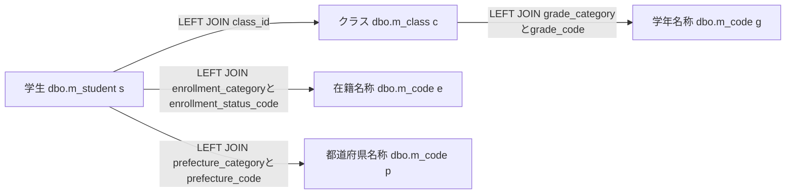

これは検索JOIN図である。g・e・pは同じ物理表の用途別aliasであり、件数SQLは学生とクラスの辺だけを使う。名称JOINには利用状態・期間条件がなく、名称欠落だけで学生行を除外しない。ただし年度・学年のWHEREがクラス値を要求すると、未所属行はその指定条件に一致しない。根拠: `sources/Core/SqlServerStudentService.cs:82-90,143-146,156-162`。

#### Q-L 検索候補取得

SearchModelは毎回LookupAsync(false,ct)を呼ぶ。候補取得は検索と別接続・別SNAPSHOTで、次の二結果セットをNextResultAsyncで切り替えて読む。両SQLに抽出WHERE、受信条件パラメータ、ページングはない。根拠: `sources/Web/Controllers/StudentsController.cs:39-39`、`sources/Core/SqlServerStudentService.cs:197-216`。

```sql
SELECT c.category_id,c.code_value,c.code_name,c.display_order,
       CONVERT(bit,CASE WHEN c.is_active=1 AND k.is_active=1 THEN 1 ELSE 0 END) is_active,
       c.valid_from,c.valid_to,c.is_protected
FROM dbo.m_code c
JOIN dbo.m_code_category k ON k.category_id=c.category_id
ORDER BY c.category_id,c.display_order,c.code_value;

SELECT c.*,CONVERT(int,0) occupied
FROM dbo.m_class c
LEFT JOIN dbo.m_code g ON g.category_id=c.grade_category AND g.code_value=c.grade_code
ORDER BY c.school_year DESC,g.display_order,c.display_order,c.class_code,c.class_id;
```

第1結果をCodeEntry、第2結果をSchoolClassへ移し、commit後にLookupSetを返す。CodeEntry.IsActiveはコードと分類の利用状態のANDで、有効期間の判定は含まない。検索用Occupied=0は人数集計の省略値であり、実人数ゼロではない。根拠: `sources/Core/Contracts.cs:61-65`、`sources/Core/SqlServerStudentService.cs:201-216`。

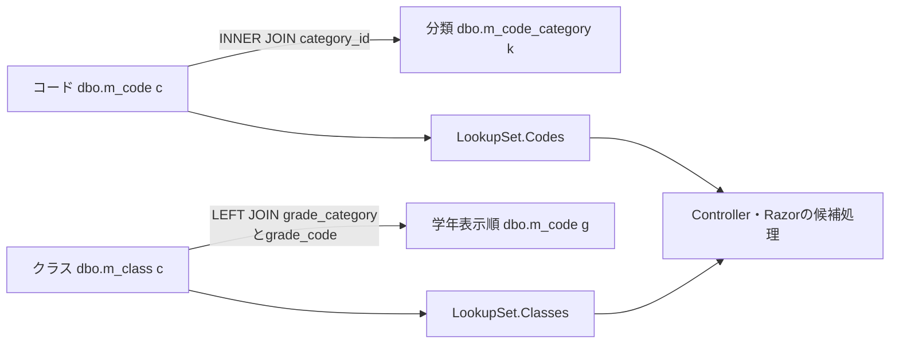

検索用候補図に学生人数集計の辺はない。Razorは停止・期間外を理由に選択を禁止せず、クラスの停止だけを注記する。検索で選べる値が新規保存可能とは限らず、保存側は最新DBでコード・分類の状態・期間、所属上位条件、クラス期間・定員等を再検査する。根拠: `sources/Views/Students/Search.cshtml:5-5`、`sources/Core/SqlServerStudentService.cs:347-383`。

#### 物理FKのER図

以下は検索関連の物理FKであり、上のSQL読取関連とは区別する。コードPKはcategory_idとcode_valueの複合キーで、参照も分類と値の組で行う。学生class_idはNULL可なので学生からクラスは0または1、各親から子は0件以上となる。

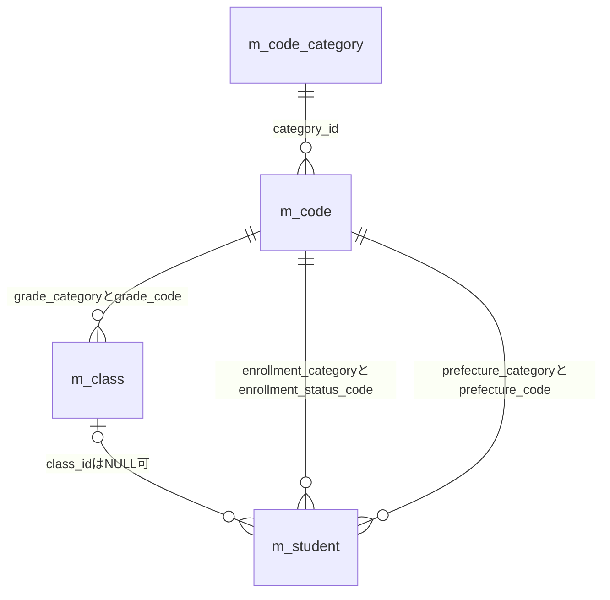

非NULLの分類・コード参照は子行ごとに1親を要求する。性別・続柄のFKもDDLにあるが、検索一覧の名称JOINには使わない。監査対象キーへのFKや削除連動は追加しない。根拠: `sources/database/001_schema.sql:15-31,63-80,113-127,189-197`。

### E01 初回表示 — Index

#### 処理概要

contextIdなしのGET /studentsは、新しい未検索状態と候補を作り、学生検索を行わず画面を返す。contextIdがあればE06へ進む。

#### 処理手順

1. identity.Readで認証情報を確認する。
2. contextIdがNULL・空文字ならNewContextでEntryを作る。AppliedとLastResultはNULL、Revisionは1、期限は30分とする。
3. Presentへ結果NULLを渡し、未検索、件数・日時未設定、空一覧の表示材料を作る。
4. 初期StudentSearchInputを作る。文字条件は空、所属・都道府県・日付は未指定、未所属false、在籍01・02。表示指定は20件、studentNo、ascとする。
5. SearchModelでQ-Lを読み、表示材料をJsonElementへ変換し、SearchのViewResultを返す。

根拠: `sources/Web/Controllers/StudentsController.cs:8-11,39-39`、`sources/Web/Inputs/StudentSearchInput.cs:7-18`、`sources/Infrastructure/SearchContextStore.cs:9-12`。

#### 条件付き処理フロー

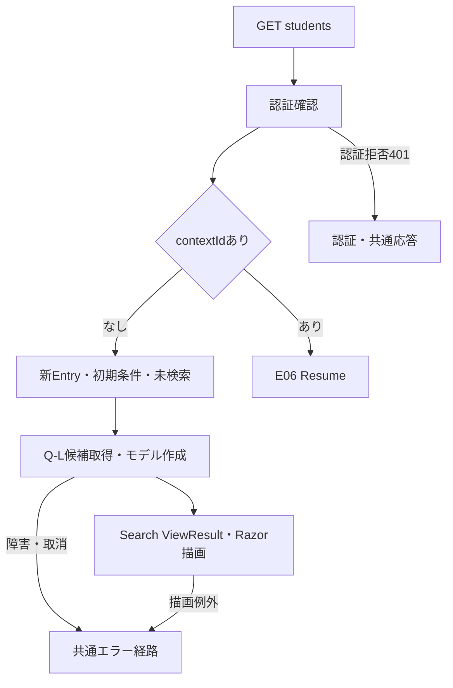

#### SQL・テーブル関連（ER図）

Q-Lのコード・分類・クラス読取関連図を適用する。Entryの作成先はプロセスメモリの辞書であり、DB状態表への保存ではない。

#### DB操作の詳細

候補二結果セットを一つのSNAPSHOTで参照してcommitする。学生件数・一覧・人数集計は実行しない。受信条件パラメータはない。

#### 結果・例外時の扱い

未検索ではページ操作を非活性にする。候補0件で検索ボタンを禁止する分岐はない。候補障害・取消は共通エラーへ伝播し、作成済みEntryを取り消す処理はない。根拠: `sources/Views/Students/Search.cshtml:5-8`、`sources/Web/Controllers/StudentsController.cs:8-11`。

### E02 検索 — Search

#### 処理概要

POST /students/searchは今回inputをPage1で検索し、成功確認後にApplied・LastResultを確定する。0件と上限超過も成功した検索条件として保持する。

#### 処理手順

1. FormGuardで許可項目・重複を確認し、Criteria.StatusCodesキーなしなら空配列へ補正する。
2. 最初のGetで状態の存在・期限・所有・認証セッション・非空指定時Tabを確認し、未検索用の空一覧データを作る。この処理は局所tryの外である。
3. ModelState不正なら422とし、Coordinatorを呼ばず再表示へ進む。
4. 有効ならCoordinatorが認証確認、ToCriteria、クラスID解析、Page1設定を行う。変換はGate取得前である。
5. UseでGate取得、状態再確認、期待Revision照合を行う。
6. SearchAsyncが入力検査・正規化、Q-E、Q-Sを行う。
7. EnsureSearchがSavedまたはNoChangeを認めた後、条件の深い複製をAppliedへ、結果をLastResultへ移し、Revisionを進める。正常検索はNoChangeを返す。
8. Use正常終了で期限延長とGate解放を行う。
9. 今回inputと別のQ-LからSearchModelを作り、モデルの表示指定を送信値で上書きする。
10. ViewResultを返し、RazorでHTMLを描画する。局所try内のWebFaultはエラーとe.Statusを保持して再表示へ進む。

根拠: `sources/Web/Controllers/StudentsController.cs:13-16,39-39`、`sources/Web/Inputs/StudentSearchInput.cs:19-22`、`sources/Infrastructure/WebStudentCoordinator.cs:7-9,20-21`、`sources/Infrastructure/SearchContextStore.cs:14-15`。

#### 条件付き処理フロー

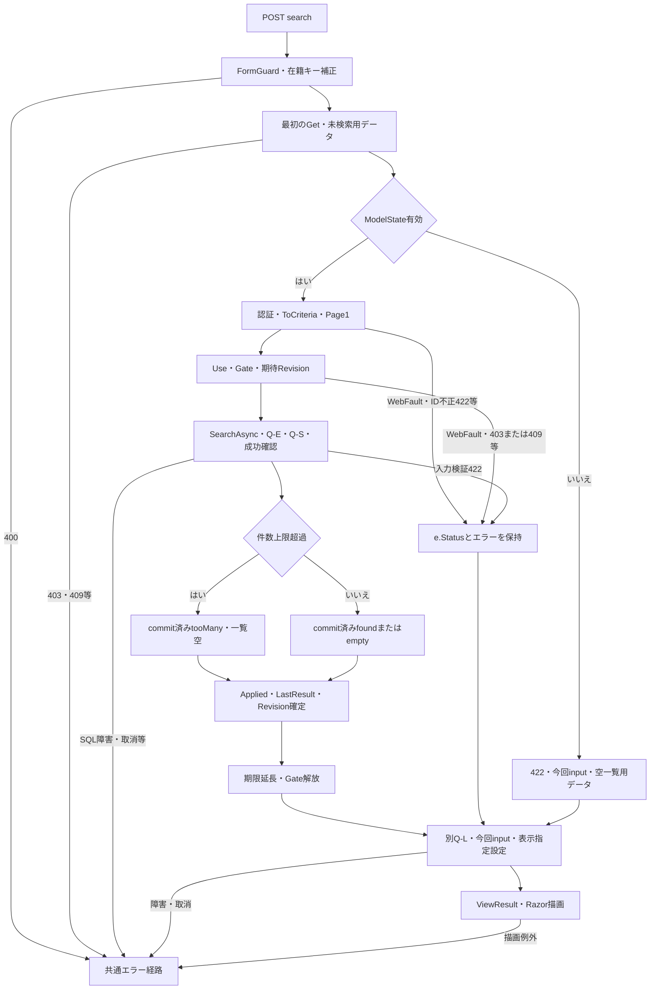

#### SQL・テーブル関連（ER図）

Q-Eの単表確認、Q-Sの検索JOIN図、Q-Lの候補JOIN図を適用する。件数SQLは学生とクラス、一覧SQLは学年・在籍・都道府県名称も参照する。物理FKは別図の制約である。

#### DB操作の詳細

指定マスター確認、件数確認、必要な一覧取得は同一検索SNAPSHOTで行う。検索メモリ確定後の候補取得は別接続・別SNAPSHOTで、検索結果と候補全体の同一時点を保証しない。学生へのINSERT・UPDATE・DELETEはない。根拠: `sources/Core/SqlServerStudentService.cs:123-168,197-216`。

#### 結果・例外時の扱い

ModelState不正は422、ToCriteriaのID不正は422、サービスValidationFailedはEnsureSearchを経て422となる。Use内の拒否は理由に応じたe.Statusを維持する。局所失敗のHTMLは今回inputと未検索用空一覧だが、既存Applied・LastResultは消さない。EnsureSearchは先頭エラーだけをWebFaultへ移し、FieldをCriteria.*へ一律変換しない。画面はvalidation-summary Allで表示する。根拠: `sources/Web/Controllers/StudentsController.cs:14-16`、`sources/Infrastructure/WebStudentCoordinator.cs:20-20`、`sources/Core/SqlServerStudentService.cs:169-170`、`sources/Views/Shared/_MessagePanel.cshtml:2-2`。

最初のFormGuard・Get、再表示用SearchModel、Razor描画は検索実行の局所catchの対象ではない。SQL障害・取消もWebFaultだけのcatchを越える。pageSize=0がバインド後に処理される場合、サービスは拒否するがControllerはモデルへ0を設定し、ビューの総ページ計算がゼロ除算になり得る。したがって、すべての入力不正が422の条件保持HTMLで完結するとはいえない。後者は条件付きソース推論である。根拠: `sources/Web/Controllers/StudentsController.cs:14-16`、`sources/Core/SqlServerStudentService.cs:107-107`、`sources/Views/Students/Search.cshtml:8-8`。

### E03 候補更新 — Options

#### 処理概要

POST /students/optionsは今回条件の候補を再描画し、一覧へLastResultを使う。学生検索、期待Revision照合、Gate取得、状態更新、期限延長は行わない。

#### 処理手順

1. Searchと同じFormGuard、在籍キー省略時の空配列補正、状態Getを行う。
2. 未所属trueなら年度・学年・クラスをNULLにし、対応するModelStateを除去する。
3. 今回input、LastResultを使ったPresent、Q-Lからモデルを作る。
4. 「条件を変更しました。検索を押すと一覧に反映します。」を設定する。
5. 非空ClassIdが候補IDの文字列表現と一致し、今回年度・学年にも適合するか確認する。
6. 不適合ならClassIdと該当ModelStateを解除し、「上位条件に合わないクラスを解除しました。」へ通知を置き換える。
7. SearchのViewResultを返す。表示指定はAppliedまたは既定値で作り、受信表示指定を明示反映しない。

根拠: `sources/Web/Controllers/StudentsController.cs:22-22,39-39`。

#### 条件付き処理フロー

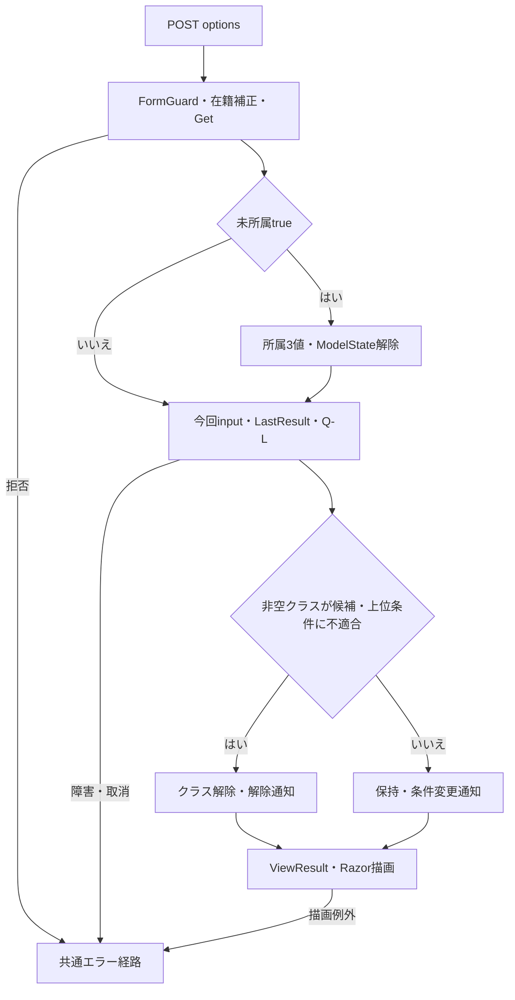

#### SQL・テーブル関連（ER図）

Q-L候補JOIN図を適用する。今回年度・学年はSQLパラメータではなく、全候補取得後のController・Razorでの比較・抽出に使う。

#### DB操作の詳細

候補二結果セットのSNAPSHOTだけを行う。学生検索・人数集計・DB書込みはない。状態はGetで取得し、Gateを使わない。

#### 結果・例外時の扱い

ModelState.IsValidで停止せず、ToCriteria、IdParser、学年正規化も通さない。例えばClassIdが01ならSearchでは数値1へ解析できるが、Optionsでは候補ID文字列1と一致せず解除され得る。全角学年も正規化前の比較となる。根拠: `sources/Web/Controllers/StudentsController.cs:22-22`、`sources/Web/Inputs/StudentSaveInput.cs:60-60`、`sources/Core/StudentNormalizer.cs:113-117`。

Search・Pageの局所失敗後もLastResultが残るため、後続Optionsで最後の成功一覧が再表示され得る。この一覧は今回入力の検索結果ではない。OptionsはApplied・LastResult・RevisionをGateなしで読むため、並行更新に対する一括保護された読取りではない。拒否・障害には入力保持用の局所catchがない。根拠: `sources/Web/Controllers/StudentsController.cs:14-22`、`sources/Infrastructure/SearchContextStore.cs:9-14`。

### E04 表示指定変更・ページ移動 — Page

#### 処理概要

POST /students/pageはAppliedを複製して再検索する。件数・ソートキー・方向のいずれかが変わればPage1、同じなら要求Pageを使う。検索条件フォームの未実行値は送信しない。

#### 処理手順

1. PageRequestとTabIdをFormGuardで検査し、最初のGetを行う。両処理は局所tryの外である。
2. Coordinatorで認証を確認し、UseでGate、状態再確認、期待Revision照合を行う。
3. Appliedなしなら409「先に検索してください。」とする。
4. Appliedを深く複製し、表示指定変更時はPage1、同じ場合は要求Pageを設定する。送信された表示指定を複製条件へ移す。
5. SearchAsyncを呼び、EnsureSearchで成功を確認する。
6. 超過でなく、保持予定Pageが返却件数の最終ページを超える場合だけ、保持Pageを補正してもう一度SearchAsyncを呼び、成功を確認する。
7. 条件の深い複製と結果をApplied・LastResultへ置き、Revisionを進める。Use正常終了で期限を延長しGateを解放する。
8. Controller.FromでApplied由来の入力欄を作り、Q-LとSearchModelからViewResultを返す。
9. 局所try内のWebFaultはe.Statusとエラーを保持し、Applied由来入力、未検索用空一覧、Q-Lで再構築する。

根拠: `sources/Web/Controllers/StudentsController.cs:18-19,39-40`、`sources/Infrastructure/WebStudentCoordinator.cs:11-12,20-20`、`sources/Infrastructure/SearchContextStore.cs:14-15`。

#### 条件付き処理フロー

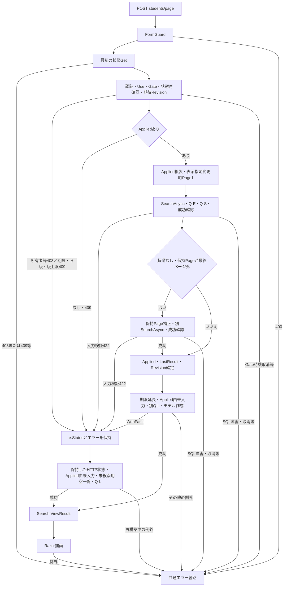

図のWebFault合流点はHTTP状態を固定しない。Applied未設定・旧版等の409、所有者等の403、サービス検証の422は、それぞれe.Statusを再表示へ引き継ぐ。認証など別のWebFaultが発生した場合も同じcatchはその状態を維持する。共通エラー経路の最終応答は補足説明に定義する。根拠: `sources/Web/Controllers/StudentsController.cs:19-19`、`sources/Infrastructure/SearchContextStore.cs:13-14`、`sources/Infrastructure/WebPresentation.cs:23-23`。

#### SQL・テーブル関連（ER図）

Q-E、Q-S検索JOIN図、再描画のQ-L候補JOIN図を適用する。再検索ごとに条件、型付きパラメータ、件数上限、許可ソートを再検査する。

#### DB操作の詳細

最初のSearchAsyncではサービスがSQL用pageを最終ページ以内へ補正する。その後Coordinatorが保持Pageを補正する場合、2回目のSearchAsyncは別接続・別SNAPSHOTとなる。2回全体は一つの読取単位ではない。2回目の件数がさらに減ってもCoordinatorは保持Pageの補正を繰り返さない。根拠: `sources/Infrastructure/WebStudentCoordinator.cs:12-12`、`sources/Core/SqlServerStudentService.cs:123-124,160-168`。

#### 結果・例外時の扱い

入力欄はAppliedから再構成するため、ブラウザーだけにあった未実行条件は復元しない。ControllerにModelState不正で停止する分岐はなく、表示指定変更時の要求Pageはサービス検査前に1へ置き換わる。根拠: `sources/Web/Controllers/StudentsController.cs:18-19`、`sources/Infrastructure/WebStudentCoordinator.cs:12-12`。

| 拒否理由 | 発生位置・結果 | 応答経路 |
| --- | --- | --- |
| 未知・重複フォーム項目 | 最初のFormGuard、400 | 局所catch外の共通エラー |
| 最初の状態不在・期限切れ | 最初のGet、409 | 局所catch外の共通エラー |
| 最初の所有・セッション・非空Tab不一致 | 最初のGet、403 | 局所catch外の共通エラー |
| Use内の所有等再確認不一致 | WebFault、403 | 局所catchで403を保持して再構築 |
| Use内期限・旧Revision・版上限 | WebFault、409 | 局所catchで409を保持して再構築 |
| Applied未設定 | WebFault、409 | 局所catchで409を保持して再構築 |
| ページ・件数・ソート等のサービス検証 | ValidationFailed→EnsureSearch→WebFault、422 | 局所catchで422を保持して再構築 |
| SQL障害・要求取消 | WebFaultへ変換されない例外 | 共通エラー経路 |

根拠: `sources/Web/Controllers/StudentsController.cs:19-19,41-41`、`sources/Infrastructure/SearchContextStore.cs:13-14`、`sources/Infrastructure/WebStudentCoordinator.cs:12-12,20-20`、`sources/Core/SqlServerStudentService.cs:107-110,169-170`、`sources/Infrastructure/WebPresentation.cs:23-23`。

局所WebFault再表示は既存状態を消さない。成功後のSearchModelもtry内にあるため、そこでWebFaultが出た場合は捕捉され得るが、既に更新した状態を復元しない。catch内の再構築例外と、ViewResult返却後のRazor描画例外は同じcatchで再捕捉されない。根拠: `sources/Web/Controllers/StudentsController.cs:19-19`。

### E05 条件クリア — Clear

#### 処理概要

POST /students/clearは状態IDを維持し、Applied・LastResultを消して初期条件の未検索画面へ戻す。

#### 処理手順

1. ContextRequestとTabIdをFormGuardで検査する。
2. Coordinatorで認証を確認し、Useで所有・期限・期待版等を照合する。
3. AppliedとLastResultをNULLにし、Revisionを進める。
4. Use正常終了で期限を延長しGateを解放する。
5. ControllerがModelStateを全消去し、同じEntryを再取得する。
6. 初期StudentSearchInput、既定表示指定、Q-Lで未検索のViewResultを返す。

根拠: `sources/Web/Controllers/StudentsController.cs:21-21,39-39`、`sources/Infrastructure/WebStudentCoordinator.cs:15-15`。

#### 条件付き処理フロー

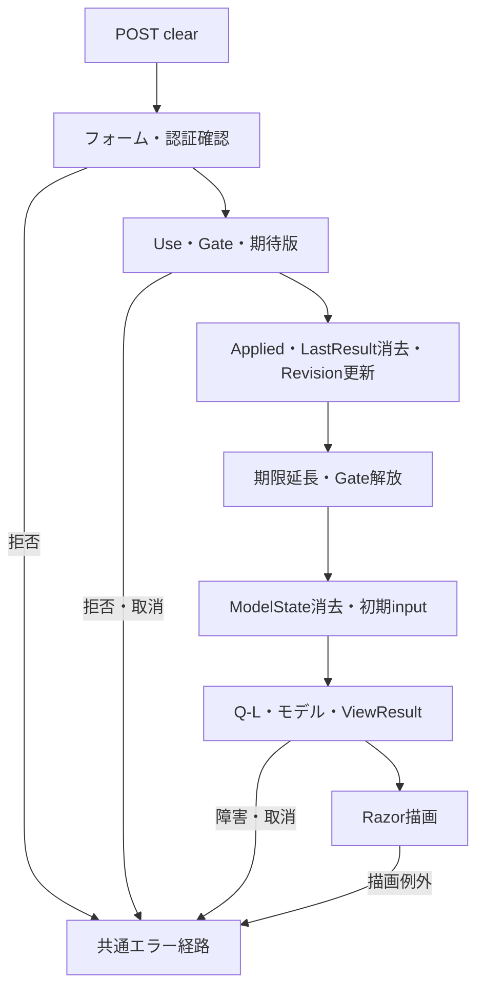

#### SQL・テーブル関連（ER図）

消去対象はメモリEntryであり、消去自体にDBのER図は不要である。再描画にQ-L候補JOIN図を適用する。

#### DB操作の詳細

学生検索、学生DELETE、状態表DELETEは行わない。SQLは画面候補を再取得するQ-Lだけである。

#### 結果・例外時の扱い

初期在籍01・02、20件、studentNo、ascに戻り、状態ID・所有者・Tabは維持する。LastResultを消すため、後続Optionsで旧一覧は復活しない。拒否を局所捕捉する処理はなく、消去後の候補障害でも消去・版更新を戻さない。根拠: `sources/Web/Inputs/StudentSearchInput.cs:7-18`、`sources/Web/Controllers/StudentsController.cs:21-22`。

### E06 検索画面への復帰 — Resume

#### 処理概要

contextId付きGET /studentsは、未検索状態を復元するか、元Appliedで最新DBを再検索する。保存した学生を表示するための条件変更は行わない。

#### 処理手順

1. Indexが認証確認後、Tabを渡さず既存EntryをGetする。
2. queryのcontextRevisionをContextRequestへ移す。省略時は空文字とする。
3. ResumeのUseでGate、状態再確認、期待版照合を行う。
4. Appliedなしなら学生検索と版更新をせず未検索を返す。Use正常終了による期限延長は行う。
5. Appliedありなら元条件でSearchAsyncを呼び、成功後にLastResultとRevisionだけを更新する。
6. Appliedから入力欄を復元し、Flash Takeで通知を取得・消費する。
7. 別のQ-L、モデル作成、ViewResultを経てSearch HTMLを描画する。

根拠: `sources/Web/Controllers/StudentsController.cs:8-11,39-40`、`sources/Infrastructure/WebStudentCoordinator.cs:14-14`、`sources/Infrastructure/FlashMessageStore.cs:6-9`。

#### 条件付き処理フロー

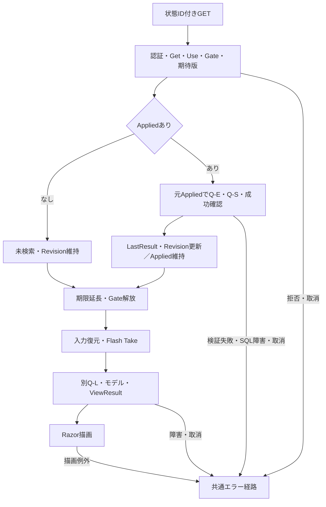

#### SQL・テーブル関連（ER図）

検索済み復帰はQ-EとQ-S検索JOIN図、両状態の画面再構築はQ-L候補JOIN図を使う。状態と通知は別のメモリ辞書で、DBへ復帰情報を保存しない。

#### DB操作の詳細

Appliedを置換せず再検索する。検索用SNAPSHOTと候補用SNAPSHOTは別である。保存学生が条件外、または論理削除済みなら、条件に一致しない行を特別に追加しない。

#### 結果・例外時の扱い

SearchAsyncはSQL用pageを補正するがSearchCriteria.Pageを変更せず、ResumeもAppliedを置換しない。PresentはApplied.Pageを表示pageに使う。このため件数減少時、取得行は最終有効ページでも表示pageが総ページ数を超え得る。Pageの保持Page補正とは異なる条件付き推論である。根拠: `sources/Core/SqlServerStudentService.cs:160-164`、`sources/Infrastructure/WebStudentCoordinator.cs:12-14,21-21`。

期限切れは409で、自動初期化しない。旧版・期限拒否はFlash Take前に起こる。Take後の候補取得・描画障害では、通知を消費しても画面へ届かない場合がある。Resumeには条件保持用の局所catchがない。根拠: `sources/Infrastructure/SearchContextStore.cs:13-14`、`sources/Web/Controllers/StudentsController.cs:8-11`、`sources/Infrastructure/FlashMessageStore.cs:9-9`。

### E07 未所属変更・送信中表示

#### 処理概要

ブラウザー補助は未所属ONで所属値を解除し、submit時に同フォームの一部ボタンを非活性にする。年度・学年変更だけでは候補更新・学生検索を送信しない。

#### 処理手順

1. 初期読込みとSRC-007のchangeでcheckedを確認する。
2. ONならSRC-004・005・006の値を空にする。OFFでも以前の値を復元しない。
3. JavaScriptはdisabledを変更しない。非活性はRazor再描画時のUnassignedOnlyで決まる。
4. 上位条件を候補へ反映するにはE03を実行する。直接検索した場合はE02の整合検査を受ける。
5. submit時は送信button以外の同フォーム内buttonをdisabledにし、aria-busy=trueを設定する。送信button自身と別フォームは対象外とする。

根拠: `sources/wwwroot/js/site.js:4-8`、`sources/Views/Students/Search.cshtml:5-8`。

#### 条件付き処理フロー

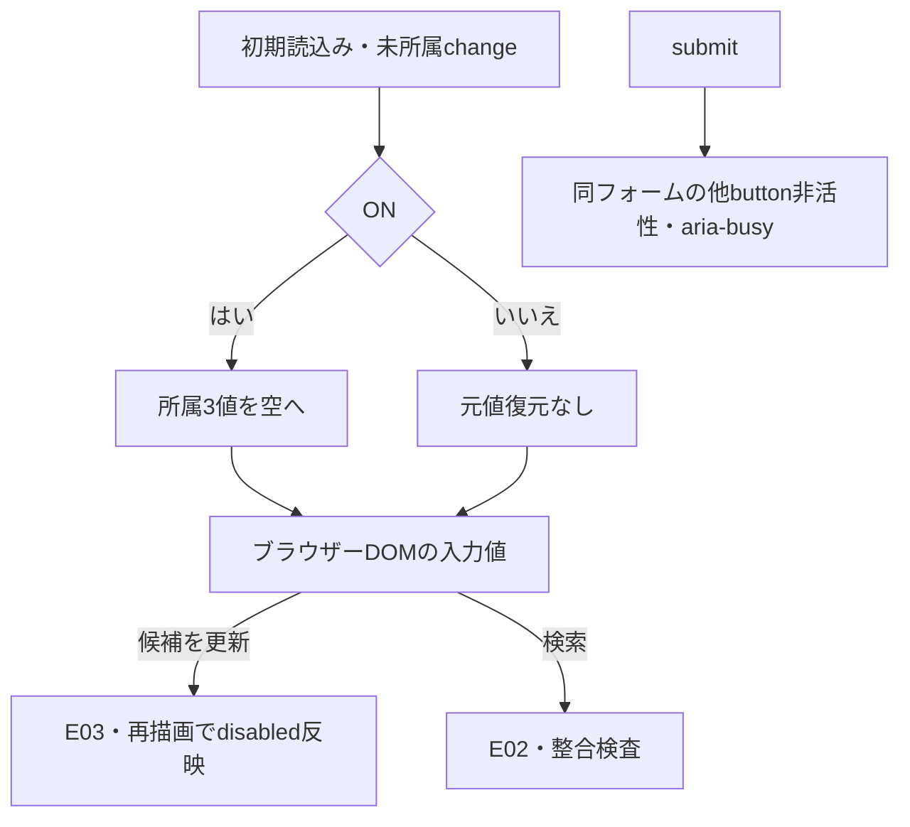

#### SQL・テーブル関連（ER図）

単独のchange・submit補助はブラウザーDOMを扱うため、DBのER図を省略する。POST後の関連はE02またはE03に従う。

#### DB操作の詳細

このJavaScript単独で外部通信、Entry更新、DB操作は行わない。REG-018から上位値を補完する処理は登録画面用であり、SRCクラスの上位補完には接続されていない。

#### 結果・例外時の扱い

未所属ONでも在籍01・02を解除しない。提示DDLのck_student_datesが実DBで適用・有効なら、01・02はclass_id非NULLを要求するため、初期在籍と未所属IS NULLの同時条件には一致行がない。これはDDL適用を条件とする推論である。根拠: `sources/Web/Inputs/StudentSearchInput.cs:13-14`、`sources/wwwroot/js/site.js:7-7`、`sources/Core/SqlServerStudentService.cs:146-154`、`sources/database/001_schema.sql:198-198`。

検索フォームに登録用dirty確認は接続されていない。fetch、AbortController、要求連番による旧HTML破棄はなく、submit補助は画面全体の再送禁止ではない。Entry更新競合はGateとRevisionで扱う。根拠: `sources/wwwroot/js/site.js:2-9`、`sources/Infrastructure/SearchContextStore.cs:14-14`。

### E08 新規・編集・参照への遷移

<a id="student-editor-contract"></a>

#### 処理概要

新規・行リンクはreturnContextIdを登録入口へ渡す。既存の場合は学生IDで最新の非削除詳細を取得し、検索一覧の表示値や未実行条件を登録値へ転記しない。登録の全入力・保存仕様はSM-DET-STUDENT-EDITORへ対応する。

#### 処理手順

1. Coordinator.Editが認証と復帰状態の所有・期限を確認する。復帰確認へTabを渡さない。
2. 新規なら作成権限を確認する。既存ならGetAsyncで詳細を取得し、未存在は404とする。
3. 登録候補と詳細からStudentSaveInputを作り、既存ExpectedVersionに再取得した学生row_versionを設定する。
4. Loadが現在の検索RevisionをReturnRevisionとして採取する。
5. 主体・認証セッション・対象ID・詳細・原入力の複製・復帰版を30分の編集スナップショットへ保持し、Editを返す。

根拠: `sources/Views/Students/Search.cshtml:6-8`、`sources/Infrastructure/WebStudentCoordinator.cs:6-6,17-17`、`sources/Web/Controllers/StudentsController.cs:23-25`、`sources/Web/Inputs/StudentSaveInput.cs:44-54`、`sources/Infrastructure/EditorSnapshotStore.cs:7-11`。

#### 条件付き処理フロー

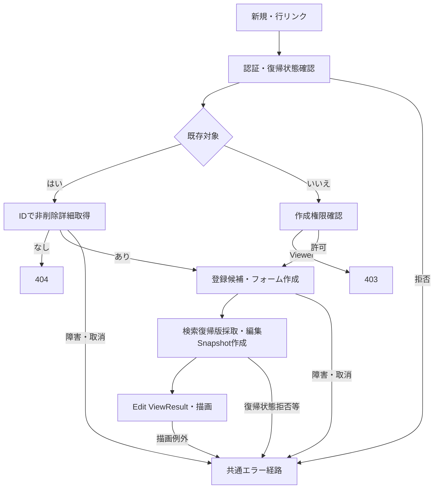

#### SQL・テーブル関連（ER図）

詳細取得はm_student単表なので個別ER図を省略する。登録候補はQ-LのマスターJOINと同じ構造だが、既定LookupAsyncは人数集計を含む。

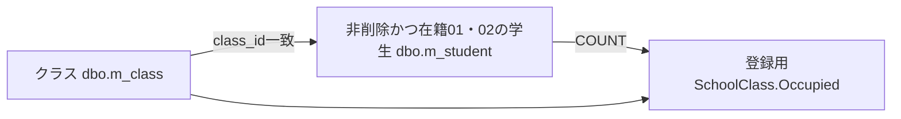

これは候補の集計関連であり、追加FKではない。根拠: `sources/Core/SqlServerStudentService.cs:196-208`。

#### DB操作の詳細

既存取得はSELECT * FROM dbo.m_student WHERE student_id=@id AND is_deleted=0、@id:BigInt、Sizeなしで最大1行を読む。GetAsyncに検索SNAPSHOTをまとめる処理はなく、後続候補は別SNAPSHOTである。取得なしは詳細NULLから404となる。根拠: `sources/Core/SqlServerStudentService.cs:172-194,197-216`。

#### 結果・例外時の扱い

学生期待版と検索復帰版は別の比較情報である。登録画面の「検索へ戻る」は保存せず、contextIdと編集開始時ReturnRevision付きGETでE06へ進む。「入力クリア／編集取消」はメモリの原入力を複製して登録画面に留まり、「最新情報を再読込」は既存GETでDB詳細を再取得する。根拠: `sources/Views/Students/Edit.cshtml:16-16`、`sources/Web/Controllers/StudentsController.cs:25-25,35-35`。

### E09 保存・削除結果からの検索復帰

#### 処理概要

登録側の保存・削除がSavedを返した場合だけ、成功通知と303で検索へ復帰する。本書は復帰ID・版、結果分岐、通知と最終応答の境界を定義する。登録列・重複確認・全監査仕様はSM-DET-STUDENT-EDITORとSM-COM-TRANSACTION-AUDITへ対応する。

#### 処理手順

1. 登録入口は編集スナップショットと復帰先の一致を確認し、保存または削除結果を受け取る。
2. SavedならReturnAfterSaveへ進む。復帰IDありならスナップショットのReturnRevisionを使用し、なしなら新しい未検索Entryと初期版を作る。
3. 主体・認証セッション・状態IDに対応する成功通知をFlashへ10分保持する。
4. 303とcontextId・contextRevision付き/studentsのLocationを設定し、EmptyResultを返す。
5. 続くGETはE06を実行し、未検索の復元または元条件で再検索した後、通知をTakeする。
6. 保存が非Savedなら今回inputと既存スナップショット、結果、再取得候補を使ってEditを返す。NoChangeは変更なし通知を表示する。
7. 削除が非Savedなら結果エラーとHTTP状態を設定し、Loadを再実行する。非削除詳細と候補を取得してフォーム・復帰版・新しいスナップショットを作り直す。

根拠: `sources/Web/Controllers/StudentsController.cs:25-25,29-38`、`sources/Infrastructure/FlashMessageStore.cs:6-9`。

#### 条件付き処理フロー

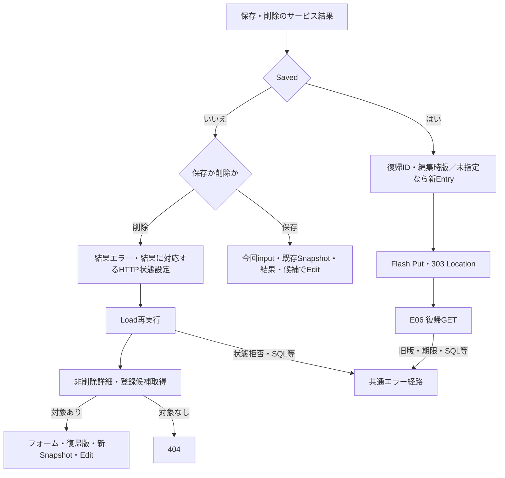

#### SQL・テーブル関連（ER図）

復帰検索はE06のQ-E・Q-S・Q-Lへ対応する。登録側は学生書込みと監査追記を同一トランザクションで確定する。監査対象キーは学生へのFKではない。

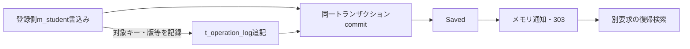

根拠: `sources/Core/SqlServerStudentService.cs:292-315,385-390,409-414`。

#### DB操作の詳細

Savedは登録側ReadCommitted、共通書込アプリケーションロック、対象・学生期待版の確認、版付き書込み、監査、commit正常終了を経て返る。既存更新・論理削除のWHEREはstudent_id、期待row_version、is_deleted=0であり、検索ContextId・Revisionは学生更新条件に使わない。論理削除は削除・更新管理項目と版を変更し、編集中の業務値を保存しない。根拠: `sources/Core/SqlServerStudentService.cs:92-101,241-262,297-315,403-414`、`sources/Views/Students/Edit.cshtml:17-17`。

対象catchのSQL障害・InvalidOperationException・取消ではCancellationToken.Noneでrollbackを試み、writeStarted && (commitAttempted || !rolledBack)をUnknown、それ以外をSystemErrorとする。Openとトランザクション開始はこのcatchの外であり、全障害がSaveResultになるわけではない。根拠: `sources/Core/SqlServerStudentService.cs:240-243,319-329,399-416`。

#### 結果・例外時の扱い

NoChange、ConfirmationRequired、Conflict、UnknownをSavedへ読み替えず、成功通知・自動303を発行しない。Unknownは再送前の検索確認を案内する。303はDB確定後の遷移指示で、復帰検索やHTML配信まで保証しない。復帰失敗時に確定済み書込みを戻す処理はない。根拠: `sources/Core/SqlServerStudentService.cs:319-322,416-416`、`sources/Web/Controllers/StudentsController.cs:31-38`。

削除非Saved後のLoadは、保存非Savedの入力保持とは異なる。削除結果をLoadのResultへ設定せず、削除理由のtextareaにも投稿理由を明示復元しない。Unknownで実際には論理削除済みなら、再Loadの非削除取得が404となり得る。その場合、結果不明案内を載せたEditへ必ず戻るとはいえない。根拠: `sources/Web/Controllers/StudentsController.cs:25-25,37-37`、`sources/Views/Students/Edit.cshtml:17-17`、`sources/Core/SqlServerStudentService.cs:176-179,416-416`、`sources/Infrastructure/WebStudentCoordinator.cs:17-17`。

## 補足説明

### 入学日範囲の層別契約

開始日・終了日は同じ保存列の下端・上端を検索する任意条件であり、入力欄の表示、受信文字列、内部比較、SQL型を別に扱う。

| 担当層 | 保持・受渡し | 実装上の責務 |
| --- | --- | --- |
| Searchビュー・ブラウザー部品 | SRC-011／012、type=date、Criteria.AdmissionFrom／AdmissionTo | 日付入力部品を宣言する。独自表示フォーマッター、maxlength、ロケール固定は宣言していない |
| MVC・StudentSearchInput | バインド後string?、ModelState | 受信値を入力モデルに保持する。HTTP値と最終バインド値の同一性はDTO注釈だけで保証しない |
| ToCriteria | SearchCriteriaのstring? | 日付変換せず文字列を渡す |
| SearchAsync・ParseIso | NULLまたはDateOnly | NULL・空文字はその端を省略。非空はTrimせずNFKC後10コード単位、yyyy-MM-dd厳密解析、1900-01-01～入口業務日を要求 |
| SearchAsyncの範囲比較 | DateOnly?のfrom・to | 片側指定可。両端ありで開始>終了ならE-STU-006。失敗をゼロ日付やNULLへ置換しない |
| Param・SQL Server | @from／@to:SqlDbType.Date | DateOnlyを当日0時のDateTimeへ変換し、date列へ>=と<=の両端包含条件を渡す。Sizeなし |
| 再表示 | 今回input、またはFrom(Applied)の文字列とModelState | asp-forへ値を渡す。サービスのDateOnlyを独自西暦表示へ整形して戻す処理はない |

根拠: `sources/Views/Students/Search.cshtml:5-5`、`sources/Web/Inputs/StudentSearchInput.cs:17-22`、`sources/Core/JapaneseDateService.cs:52-59`、`sources/Core/SqlServerStudentService.cs:44-45,67-72,105-105,120-122,149-150`、`sources/Web/Controllers/StudentsController.cs:16-16,39-40`。

ブラウザーが人に見せる日付形式と、ParseIsoが受け入れるサービス引数形式は別である。参考設計は西暦yyyy/MM/dd表示とyyyy-MM-dd入力を分けて定義しているが、現行ビューはネイティブdate入力であり、その独立表示契約を実装したフォーマッターとして扱わない。根拠: `reference-designs/詳細仕様書/CSharp_ASPNET/01_学生検索画面.md:94-95`、`sources/Views/Students/Search.cshtml:5-5`。

### 長さ、空値、名称、日時

ScalarCountは正常なサロゲート対を1として数え、単独サロゲートをArgumentExceptionで拒否する。TextはNULLを空文字へ置き換え、raw長、制御文字、Trim、必須性、Trim後長の順に検査する。空白除去後に短くなる入力でもraw超過は先に拒否する。HTML maxlengthと.NET Lengthはコード単位、業務上限はUnicodeスカラー値、nvarchar容量はUTF-16コード単位、varchar容量はバイト、SQL Sizeは送信領域として区別する。根拠: `sources/Core/StudentNormalizer.cs:37-57`、`sources/Views/Students/Search.cshtml:5-5`、`sources/database/001_schema.sql:9-22`。

サービスへ非空の空白文字列が保持されたまま届く場合、学籍番号は必須Identifierで拒否し、氏名・電話は任意空として条件を省略する。カナは任意Kanaから空キーを作り、LIKE '%%'相当となる。バインド後NULLになった番号・カナは入口で省略する。これは渡された値ごとの分岐であり、空白だけのHTTP原入力の確定動作ではない。根拠: `sources/Core/SqlServerStudentService.cs:113-117,140-142`、`sources/Core/StudentNormalizer.cs:47-93`。

EnrollmentStatusCodesがサービス引数としてNULLなら、statuses.LengthでNullReferenceExceptionとなり、検証例外のcatchには入らない。フォームに在籍キーがない場合はControllerが空配列へ補正するため、このサービス単体NULL経路をフォーム省略の動作へ拡張しない。根拠: `sources/Core/SqlServerStudentService.cs:111-112,169-170`、`sources/Web/Controllers/StudentsController.cs:14-14,22-22`。

表示専用名称も保存側まで属性を追跡する。CLI classはClassCodeをraw・変換後9 ASCII以内、ClassNameをraw・Trim後18スカラー値で検査し、VarChar(9)とNVarChar(36)で保存する。CLI codeはCodeNameをraw・Trim後12スカラー値で検査し、NVarChar(24)で保存する。基表のNOT NULLとLEFT JOIN後のnullableは別であり、DB容量を名称の業務上限へ代用しない。根拠: `sources/maintenance/Program.cs:10-13`、`sources/Core/MasterMaintenanceService.cs:33-33,73-74,82-82,113-115,127-128`、`sources/database/001_schema.sql:67-81,115-128`、`sources/Core/SqlServerStudentService.cs:79-90`。

「すべて」は任意条件の未設定であり、年度0・クラスID0を意味しない。学年00は学年なしの実コード、未所属はclass_id NULLである。在籍空配列は区分条件なしで、NULL在籍だけを検索する条件ではない。根拠: `sources/database/002_seed.sql:78-78`、`sources/Core/SqlServerStudentService.cs:109-110,144-154`。

検索業務日は入口nowを+09:00へ変換して求め、日付範囲の上限に使う。検索日時・更新日時は日本時間yyyy/MM/dd HH:mm:ssへ変換する。共有ヘッダーの業務日はWebPresentationが別の現在時刻から取得し、検索入口の同じ変数を共有しない。生年月日はDateOnlyから和暦へ変換し、時差を加えない。根拠: `sources/Core/SqlServerStudentService.cs:44-45,105-105`、`sources/Infrastructure/WebPresentation.cs:5-7,20-20`、`sources/Core/JapaneseDateService.cs:41-50`、`sources/Views/Shared/_Layout.cshtml:1-1`。

### 結果状態と応答の確定境界

| 表示状態 | 判定・件数 | 表示・操作 |
| --- | --- | --- |
| unsearched | 結果NULL、件数・日時NULL | 未検索、空一覧、ページ操作非活性 |
| empty | 超過なし、Count=0 | 該当なし、空一覧、ページ操作非活性 |
| tooMany | LimitExceeded、表示件数NULL | 10,000件超の警告、一部一覧も出さず空、ページ操作非活性 |
| found | 超過なし、Count>0 | 実件数・検索日時・最大PageSize行。反映活性、前後は個別条件 |
| Search・Page局所失敗 | エラーと未検索用データ | 空一覧・ページ操作非活性。保持済み状態の消去とは別 |

根拠: `sources/Infrastructure/WebStudentCoordinator.cs:21-21`、`sources/Web/Controllers/StudentsController.cs:14-19`、`sources/Views/Students/Search.cshtml:2-2,7-8`。

ビューは件数NULLをページ計算用の0にし、総ページ数を最低1にする。表示pageはApplied由来なので、空一覧・局所失敗が常に1/1になるとは限らない。本人電話NULLの－と住所の都道府県名NULL時[不整合]は個別補完であり、所属・在籍名称に一律補完はない。根拠: `sources/Views/Students/Search.cshtml:2-2,8-8`、`sources/Core/SqlServerStudentService.cs:79-81`。

GateとRevisionはEntry更新を保護する。同じ期待版の要求は直列化され、先行成功が版を進めれば後続は拒否される。この制御はブラウザーのHTML応答世代とは別である。Optionsは期待版・Gateを使わず、すべて通常フォーム送信と画面全体HTMLで、旧HTMLを要求連番で破棄する処理はない。根拠: `sources/Infrastructure/SearchContextStore.cs:14-14`、`sources/Web/Controllers/StudentsController.cs:13-22`、`sources/wwwroot/js/site.js:2-9`。

成功Search・Page・検索済みResume・Clearの状態更新は、後続候補取得、JsonElement変換、Razor描画、HTML配信より前に行う。後段失敗時にApplied・LastResult・Revisionを復元する補償はない。Useの期限延長もoperation正常終了時だけなので、部分的な設定、期限更新、最終応答成功は別の境界として扱う。根拠: `sources/Infrastructure/WebStudentCoordinator.cs:9-15`、`sources/Infrastructure/SearchContextStore.cs:14-14`、`sources/Web/Controllers/StudentsController.cs:11-22,39-39`。

### 失敗位置と最終応答

| 失敗位置 | 返却経路 | 条件・状態・表示への影響 |
| --- | --- | --- |
| SearchのModelState不正 | 422でSearch再構築 | 今回inputとModelState、未検索用空一覧。後段失敗は別 |
| Search局所try内WebFault | e.StatusでSearch再構築 | 今回input、未検索用空一覧。既存成功状態を消さない |
| Page局所try内WebFault | e.StatusでSearch再構築 | Applied由来input、未検索用空一覧。更新済みかは失敗段階による |
| Search・Page最初のFormGuard／Get | 共通エラー | 入力保持用の局所catchへ入らない |
| Index／Resume・Options・Clearの未捕捉拒否 | 共通エラー | 自動初期化や元フォーム再表示への変換なし |
| 検索・候補SQL障害、取消 | 共通エラーへ伝播 | ValidationFailedや取消成功へ一律変換しない |
| Cookie認証の失効・アクセス拒否 | 401／403 | ログイン転送を行わない。検索Controllerの再構築と別 |
| CSRF拒否 | MVCの拒否 | /api専用JSON変換は本HTMLルートへ適用しない |

根拠: `sources/Web/Controllers/StudentsController.cs:8-22`、`sources/Core/SqlServerStudentService.cs:169-170,197-216`、`sources/Infrastructure/WebHostSetup.cs:14-16,22-24`、`sources/Infrastructure/AntiforgeryResultFilter.cs:7-8`。

共通middlewareは応答未開始の例外だけを捕捉し、WebFaultならそのHTTP状態、その他なら503を設定する。非API要求にはエラーHTMLと検索画面を開くリンクを返そうとする。期限切れで新Entryを自動作成しない。応答開始後の例外や切断後の配信完了はこのcatchで保証されず、検索画面に取消専用ボタン・ルートはない。根拠: `sources/Infrastructure/WebHostSetup.cs:22-24`、`sources/Infrastructure/SearchContextStore.cs:13-13`、`sources/Views/Students/Search.cshtml:4-8`。

### 参考設計の意図との対応

参考設計は単一校の学生基本情報を検索して登録・編集・参照へ進む目的を定義する。年度・学年は現在または最終所属クラスの属性で、過去年次の所属履歴検索ではない。現行検索も保存されたclass_idからクラス属性を取得する。参考設計上のサービス・変数名を実在するクラス名として扱わない。根拠: `reference-designs/基本設計書/01_学生検索画面.md:14-24`、`sources/Core/SqlServerStudentService.cs:82-90`。

| 主題 | 参考設計の意図 | 観測した実装との対応 | 根拠 |
| --- | --- | --- | --- |
| 初期候補不足 | 必須マスター不足なら検索不可 | 候補0件で検索ボタンを禁止する分岐なし | `reference-designs/詳細仕様書/CSharp_ASPNET/01_学生検索画面.md:155-165`、`sources/Views/Students/Search.cshtml:5-8` |
| 所属候補連動 | 上位条件を渡して再取得、不適合解除、クラス先行選択で上位補完 | 明示Optionsで全候補取得後に抽出・解除。SRC自動送信・上位補完なし | `reference-designs/詳細仕様書/CSharp_ASPNET/01_学生検索画面.md:252-262`、`sources/Web/Controllers/StudentsController.cs:22-22`、`sources/wwwroot/js/site.js:7-8` |
| 未所属の活性 | ONで解除・非活性、OFFで元値を戻さない | JSは解除だけ。disabledはサーバー再描画時 | `reference-designs/詳細仕様書/CSharp_ASPNET/01_学生検索画面.md:256-256`、`sources/Views/Students/Search.cshtml:5-5`、`sources/wwwroot/js/site.js:7-7` |
| 応答世代 | RequestSequenceを初期0とし、旧非同期応答無視・桁あふれ採番停止 | 通常HTML送信、要求連番なし。サーバーRevisionとは別 | `reference-designs/詳細仕様書/CSharp_ASPNET/01_学生検索画面.md:147-147,165-165,258-262`、`sources/wwwroot/js/site.js:2-9`、`sources/Infrastructure/SearchContextStore.cs:14-14` |
| 候補応答形式 | 部分HTMLまたは候補JSON | 接続されたOptionsは画面全体HTML。宣言済みJSON用helperは未接続 | `reference-designs/詳細仕様書/CSharp_ASPNET/01_学生検索画面.md:500-506`、`sources/Web/Controllers/StudentsController.cs:22-22,39-39`、`sources/Infrastructure/WebStudentCoordinator.cs:16-16` |
| 失敗時保持 | 入力・システムエラーでも条件保持、前回結果を最新結果として残さない | Search局所失敗は空一覧。SQL・Get等は共通エラー。LastResultは残り、Optionsで再表示され得る | `reference-designs/基本設計書/01_学生検索画面.md:64-69`、`sources/Web/Controllers/StudentsController.cs:14-22`、`sources/Infrastructure/WebHostSetup.cs:23-23` |
| 日付表示 | yyyy/MM/dd表示とyyyy-MM-dd入力を分離 | type=dateと厳密ParseIso。独自表示フォーマッターなし | `reference-designs/詳細仕様書/CSharp_ASPNET/01_学生検索画面.md:94-95`、`sources/Views/Students/Search.cshtml:5-5`、`sources/Core/JapaneseDateService.cs:52-59` |
| 追加表示・操作 | 件数と表示範囲、専用メニュー、先頭・前・次・最後 | RangeFrom／RangeToの算出・移送なし。専用メニュー・先頭・最後操作なし | `reference-designs/詳細仕様書/CSharp_ASPNET/01_学生検索画面.md:99-100,114-114,135-137`、`sources/Infrastructure/WebStudentCoordinator.cs:21-21`、`sources/Views/Students/Search.cshtml:6-8` |
| 所属・名称欠損 | 未所属の－、名称不整合、クラス停止・期間外を区別 | 一覧に統一補完・クラス状態注記なし。住所の[不整合]、本人電話の－は個別 | `reference-designs/詳細仕様書/CSharp_ASPNET/01_学生検索画面.md:107-111`、`sources/Core/SqlServerStudentService.cs:79-90`、`sources/Views/Students/Search.cshtml:5-8` |
| 復帰期限 | 他者拒否、期限切れ初期化、元条件再検索、条件外学生を特別追加しない | 他者拒否・元条件検索。期限切れ409で自動初期化なし | `reference-designs/詳細仕様書/CSharp_ASPNET/01_学生検索画面.md:386-392`、`sources/Infrastructure/SearchContextStore.cs:13-14`、`sources/Infrastructure/WebStudentCoordinator.cs:14-14` |
| 状態版・タブ | 所有・認証・タブ・期限、排他内期待版、省略補完禁止 | Useは厳密期待版照合。Tabは非空指定時だけ、Index／Resumeは渡さず、Optionsは版未使用 | `reference-designs/詳細仕様書/CSharp_ASPNET/01_学生検索画面.md:604-610`、`sources/Infrastructure/SearchContextStore.cs:13-14`、`sources/Web/Controllers/StudentsController.cs:8-22` |

参考設計の配置・追加操作は設計意図であり、概要の静的HTMLは現行ソースの投影である。差分の全体対応はSM-RPT-DESIGN-IMPLEMENTATIONへ集約する。

### 関連文書の責務

以下は入力された文書計画との対応である。本応答で生成する本文は本書だけであり、他文書は本応答では未生成の計画参照として示す。

| 文書ID | 計画上の相対パス | 対応する責務 |
| --- | --- | --- |
| SM-BAS-STUDENT-SEARCH | `spec/basic/student-search.md` | 業務目的、論理項目、利用状態 |
| SM-BAS-STUDENT-EDITOR | `spec/basic/student-editor.md` | 登録・編集・参照の業務状態 |
| SM-DET-STUDENT-EDITOR | `spec/detail/student-editor.md` | 登録全入力、保存・重複確認・削除、登録側結果分岐 |
| SM-COM-HTTP-SECURITY | `spec/common/http-security-contract.md` | 認証、CSRF、受付、HTTP応答 |
| SM-COM-NORMALIZATION-DATE | `spec/common/normalization-date.md` | 正規化、長さ単位、日付・和暦 |
| SM-COM-LOOKUPS | `spec/common/lookup-contract.md` | 候補取得、検索と保存の用途差、既存値保持 |
| SM-COM-RUNTIME-STATE | `spec/common/runtime-state.md` | 検索・編集・通知のメモリ、所有・期限・版 |
| SM-COM-TRANSACTION-AUDIT | `spec/common/transaction-audit.md` | 接続、排他、commit・rollback、Unknown、監査 |
| SM-DATA-LOGICAL-CONTRACTS | `spec/data/logical-contracts.md` | DTOの実型、NULL、項目移送 |
| SM-DET-CLASS-MAINTENANCE | `spec/detail/class-maintenance.md` | クラスコード・名称等の保存側制約 |
| SM-DET-CODE-MAINTENANCE | `spec/detail/code-maintenance.md` | 学年・在籍・都道府県名称の保守入力と保存 |
| SM-DB-INDEX | `spec/database/index.md` | DB全体、物理FK、制約、定義索引 |
| SM-DB-M-STUDENT | `spec/database/tables/m_student.md` | 学生表の全列、型・NULL・CHECK・索引 |
| SM-DB-M-CLASS | `spec/database/tables/m_class.md` | クラス表、年度・名称・所属参照 |
| SM-DB-M-CODE | `spec/database/tables/m_code.md` | コード表、複合キー・名称属性 |
| SM-DB-M-CODE-CATEGORY | `spec/database/tables/m_code_category.md` | 分類表、候補状態・コード属性 |
| SM-DEP-PROCESS | `spec/dependencies/process-dependencies.md` | 画面・サービス・DB・保持領域の依存 |
| SM-RPT-DESIGN-IMPLEMENTATION | `spec/reports/design-implementation-differences.md` | 設計意図と実装の対応・差分 |
| SM-RPT-UNRESOLVED | `spec/reports/unresolved-and-analysis-limits.md` | 未確認境界、不足資料、解析範囲、確認候補 |

本画面の外部入出力はフォーム受信、HTML応答、SQL Server参照である。検索状態はSearchContextStore、編集原入力はEditorSnapshotStore、成功通知はFlashMessageStoreの別辞書に置く。DDLのt_runtime_stateから検索状態の永続化・暗号化・消費・プロセス間共有を追加しない。OptionsRequest、Coordinator.Options、WebPresentation.Lookupsは宣言されているが、収録ルートのOptionsからは呼ばれず、公開JSON APIとして扱わない。根拠: `sources/Infrastructure/SearchContextStore.cs:9-15`、`sources/Infrastructure/EditorSnapshotStore.cs:7-11`、`sources/Infrastructure/FlashMessageStore.cs:6-9`、`sources/Web/Inputs/StudentSearchInput.cs:31-31`、`sources/Infrastructure/WebStudentCoordinator.cs:16-16`、`sources/Infrastructure/WebPresentation.cs:8-18`、`sources/Web/Controllers/StudentsController.cs:22-22,39-39`。
