<!-- spec-meta: {"schema":"spec-md/1.0","documentId":"SM-DET-STUDENT-EDITOR","version":"4.0","path":"spec/detail/student-editor.md","sheets":[{"heading":"概要","kind":"GRID","sheet":"01_概要"},{"heading":"項目一覧","kind":"LIST","sheet":"02_項目一覧","key":["項目ID"]},{"heading":"項目移送仕様","kind":"LIST","sheet":"03_項目移送","key":["移送ID"]},{"heading":"項目更新仕様","kind":"LIST","sheet":"04_項目更新","key":["更新ID"]},{"heading":"選択候補一覧","kind":"LIST","sheet":"05_選択候補","key":["候補ID"]},{"heading":"内部項目・一時情報","kind":"LIST","sheet":"06_内部項目","key":["内部ID"]},{"heading":"イベント仕様","kind":"GRID","sheet":"07_イベント仕様"},{"heading":"補足説明","kind":"GRID","sheet":"08_補足説明"}]} -->
# 学生登録・編集・参照画面 詳細仕様書

| 文書属性 | 内容 |
| --- | --- |
| 文書ID | SM-DET-STUDENT-EDITOR |
| 正本パス | spec/detail/student-editor.md |
| 版 | 4.0 |
| 対象 | 学生1件の新規登録、更新、参照、同一人物候補の確認、論理削除、入力復元、最新再読込、検索復帰 |
| 記述基準 | 接続されたソースで観測した処理。参考設計の意図は別記する |
| 読者 | 業務システムのIT担当者、実装経験5年程度の開発者 |

## 概要

### 画面の責務と処理の接続

本画面は、学生の基本情報、住所、連絡先、在籍状態、所属クラスを1件単位で登録・更新・参照する。学生管理番号はDBが採番する内部ID、学籍番号は新規登録時に入力する業務識別値である。登録後の学籍番号は変更できない。年度と学年は所属クラスの選択・整合確認に使い、学生にはクラスIDだけを保存する。根拠: `sources/Views/Students/Edit.cshtml:4-13`、`sources/Web/Inputs/StudentSaveInput.cs:34-54`、`sources/Core/SqlServerStudentService.cs:254-254,294-301`。

学生の備考と、確認・変更理由は用途が異なる。備考は学生の業務値、確認・変更理由は監査へ記録する操作理由である。論理削除には独立したフォームと削除理由を使い、編集中の業務値を保存せず、DB上の学生へ削除属性と更新管理情報を設定する。根拠: `sources/Views/Students/Edit.cshtml:13-17`、`sources/Web/Inputs/StudentDeleteInput.cs:4-4`、`sources/Core/SqlServerStudentService.cs:385-414`。

Programから接続されたStudentsControllerがHTML表示とフォームPOSTを受ける。WebStudentCoordinatorは認証、操作権限、復帰先、DTOからサービス要求への変換を担当する。登録されたSqlServerStudentServiceは正規化、最新DB値の確認、排他、学生と監査の書込み、確定結果の分類を担当する。RequestIdentity、Coordinator、サービスはScoped、検索Context・編集Snapshot・成功通知のストアはSingletonである。同一人物確認はサービスのstatic辞書に保持する。根拠: `sources/Program.cs:2-8`、`sources/Infrastructure/WebHostSetup.cs:13-19`、`sources/Web/Controllers/StudentsController.cs:23-38`、`sources/Core/SqlServerStudentService.cs:19-29`。

### モードと公開入口

StudentIdがNULLなら新規、既存IDがありCanEditがtrueなら編集、falseなら参照と表示する。CanEditの実条件はRoleがViewerでないことである。参照では業務項目、保存、候補確認を囲むfieldsetをdisabledにする。既存の学籍番号はreadonlyである。入力復元、最新再読込、検索復帰はそのfieldsetの外に置き、既存Administratorには専用の削除フォームを表示する。サーバーも新規表示・保存でViewerを拒否し、削除でAdministratorとの一致を要求する。根拠: `sources/Web/Models/StudentEditPageModel.cs:5-14`、`sources/Views/Students/Edit.cshtml:3-17`、`sources/Infrastructure/RequestIdentity.cs:14-16`。

| 操作 | HTTP入口 | 受信情報 | イベント |
| --- | --- | --- | --- |
| 新規表示 | GET `/students/new` | 任意の`returnContextId` | EV-01 |
| 既存編集・参照 | GET `/students/{id:long}` | ルートID、任意の`returnContextId` | EV-02 |
| 新規登録 | POST `/students/create` | `Input.*`、`SnapshotId`、CSRF情報 | EV-04 |
| 更新 | POST `/students/{id:long}/update` | ルートID、`Input.*`、`SnapshotId`、CSRF情報 | EV-04 |
| 入力クリア・編集取消 | POST `/students/reset` | `SnapshotId`、任意の`StudentId`、CSRF情報 | EV-07 |
| 論理削除 | POST `/students/{id:long}/delete` | 削除DTO、`SnapshotId`、CSRF情報 | EV-06 |
| 最新再読込 | GET `/students/{id:long}` | 対象ID、`returnContextId` | EV-08 |
| 検索復帰 | GET `/students` | `contextId`、`contextRevision` | EV-09 |

ControllerのAuthorizeとMVC全体のCSRF検査は、Controller本体に先行する境界である。本体到達後のFormGuard、RequestIdentity、Snapshot等の順序とは区別する。専用Reload APIや編集用JSON保存ルートは確認した公開経路にない。根拠: `sources/Web/Controllers/StudentsController.cs:5-6,23-42`、`sources/Infrastructure/WebHostSetup.cs:16-16`。

### 受信値、正規化値、保存値

フォーム値はMVCのバインド後にStudentSaveInputとなる。ToRequestは業務19項目をStudentDraftへ移し、ClassIdだけを`string?`から`long?`へ変換する。生年月日は和暦4文字列の構造のまま渡し、サービスでDateOnlyへ変換する。正規化成功後のNormalizedStudent.Valuesは業務19値と生成3値を持つ。年度、学年、理由、対象ID、期待版、確認キーはSaveRequestの独立属性であり、復帰先とSnapshotIdは学生保存値に入らない。根拠: `sources/Web/Inputs/StudentSaveInput.cs:9-43`、`sources/Core/Contracts.cs:8-29,66-70`、`sources/Core/StudentNormalizer.cs:119-159`。

本書のraw上限は、サービスへ届いた文字列について正規化前に数えるUnicodeスカラー値数である。HTML maxlengthのUTF-16コード単位、`nvarchar(n)`のUTF-16格納容量、`varchar(n)`のバイト容量とは別の制約である。和暦数値部とISO日付は通常Textを通らず、変換後文字列のコード単位で検査する。DTOのnullable、業務の必須条件、DBのNULL可否も分けて扱う。根拠: `sources/Core/StudentNormalizer.cs:37-57`、`sources/Core/JapaneseDateService.cs:19-39,52-59`、`sources/database/001_schema.sql:9-33`。

REG番号は項目対応の識別子である。実DOM idを持つのはREG-002～018、REG-020～024、REG-026で、REG-005は和暦4部品のfieldsetに付く。管理番号、更新情報、人数、操作、候補領域へ同名REGのDOM idを補わない。根拠: `sources/Views/Students/Edit.cshtml:4-17`。

### 画面配置と静的投影

共有Layoutは、システム名、利用者名、描画時の業務日をheaderへ置き、画面本文をmainへ配置する。mainは最大幅1440px、外余白と内余白は各24pxである。入力は原本順の2列、備考と確認・変更理由は全幅、和暦部品は横並びで折返す。760px以下では入力が1列、headerが縦並びとなり、mainの外余白は0、内余白は15pxになる。根拠: `sources/Views/_ViewStart.cshtml:1-1`、`sources/Views/Shared/_Layout.cshtml:1-1`、`sources/Views/Students/Edit.cshtml:5-13`、`sources/wwwroot/css/site.css:1-1`。

以下は通常新規の配置を示す非実行HTMLであり、実画面撮影ではない。動的値は角括弧で表す。初期コードに対応する候補が取得された状態を示し、候補の存在や件数を補わない。送信先はdata属性へ記録し、action・formaction、JavaScript、実アプリへ接続するhrefを設けない。ボタンはすべてtype=buttonとする。

<!doctype html>
<html lang="ja">
<head>
<meta charset="utf-8">
<meta name="viewport" content="width=device-width,initial-scale=1">
<title>学生管理</title>

</head>
<body>
<header><strong>学生管理システム</strong>利用者 ［User.Identity.Name］　業務日 ［描画時業務日 yyyy/MM/dd］</header>
<main>
<h1>学生登録 ／新規</h1>

学生管理番号 新規　更新日時 －　更新者 －

<form data-source-method="POST" data-source-route="/students/create" data-editor-form>
<input type="hidden" name="__RequestVerificationToken"><input type="hidden" name="SnapshotId"><input type="hidden" name="Input.ExpectedVersion"><input type="hidden" name="Input.ReturnContextId"><input type="hidden" name="Input.DuplicateToken">
<fieldset><legend>学生基本情報</legend>

<label>学籍番号 ※必須<input name="Input.StudentNo" id="REG-002" maxlength="30" required></label>
<label>氏名 ※必須<input name="Input.StudentName" id="REG-003" maxlength="16" required><small>8文字以内</small></label>
<label>氏名カナ ※必須<input name="Input.StudentNameKana" id="REG-004" maxlength="72" required><small>原入力36、正規化後18文字</small></label>
<fieldset class="wareki" id="REG-005"><legend>生年月日 ※必須</legend><select name="Input.BirthDateInput.Era" aria-label="元号" required><option value="">元号</option><option value="REIWA">令和</option><option value="HEISEI">平成</option><option value="SHOWA">昭和</option><option value="TAISHO">大正</option><option value="MEIJI">明治</option></select><input name="Input.BirthDateInput.Year" aria-label="元号年" maxlength="4" required>年<input name="Input.BirthDateInput.Month" aria-label="月" maxlength="2" required>月<input name="Input.BirthDateInput.Day" aria-label="日" maxlength="2" required>日</fieldset>
<label>性別 ※必須<select name="Input.GenderCode" id="REG-006" required><option value="0" selected>［候補0のコード名称］</option></select></label>
<label>郵便番号 ※必須<input name="Input.PostalCode" id="REG-007" maxlength="20" required></label>
<label>都道府県 ※必須<select name="Input.PrefectureCode" id="REG-008" required><option value="">未選択</option></select></label>
<label>住所1 ※必須<input name="Input.AddressLine1" id="REG-009" maxlength="90" required><small>45文字以内</small></label>
<label>住所2<input name="Input.AddressLine2" id="REG-010" maxlength="90"></label>
<label>本人電話<input name="Input.PhoneNumber" id="REG-011" maxlength="40"><small>原入力20、正規化後16文字</small></label>
<label>本人メール<input name="Input.EmailAddress" id="REG-012" maxlength="120"></label>
<label>入学日 ※必須<input name="Input.AdmissionDate" id="REG-013" type="date" required></label>
<label>在籍区分 ※必須<select name="Input.EnrollmentStatusCode" id="REG-014" required><option value="01" selected>［候補01のコード名称］</option></select></label>
<label>卒業・退学日<input name="Input.EnrollmentEndDate" id="REG-015" type="date"></label>
<label>年度<select name="Input.SchoolYear" id="REG-016"><option value="">未指定</option><option selected>［読込時当学校年度］</option></select></label>
<label>学年<select name="Input.GradeCode" id="REG-017"><option value="">すべて</option></select></label>
<label>クラス<select name="Input.ClassId" id="REG-018"><option value="">未所属</option></select><small>人数 －／定員 制限なし（参考）</small></label>
<label>緊急連絡先氏名<input name="Input.EmergencyContactName" id="REG-020" maxlength="16"></label>
<label>緊急連絡先続柄<select name="Input.RelationshipCode" id="REG-021"><option value="">未選択</option></select></label>
<label>緊急連絡先電話<input name="Input.EmergencyPhoneNumber" id="REG-022" maxlength="40"></label>
<label class="full">備考<textarea name="Input.Remarks" id="REG-023" maxlength="240"></textarea></label>
<label class="full">確認・変更理由<textarea name="Input.OperationReason" id="REG-024" maxlength="120"></textarea></label>

本人電話・メール・緊急電話のいずれか1つ以上。緊急連絡先は3項目すべて入力してください。

<button type="button" class="primary" data-source-operation="submit">登録</button>

</fieldset></form>

<form data-source-method="POST" data-source-route="/students/reset" data-confirm="編集内容を読込時の値へ戻しますか。"><input type="hidden" name="__RequestVerificationToken"><input type="hidden" name="SnapshotId"><input type="hidden" name="StudentId"><button type="button" data-source-operation="submit">入力クリア</button></form><a data-dirty-link href="#ev-09" data-source-method="GET" data-source-route="/students?contextId={Input.ReturnContextId}&amp;contextRevision={ReturnRevision}">検索へ戻る</a>

</main>
</body>
</html>

項目エラーがある場合はh1直後の共有パネルに`.message.error`とvalidation-summary=Allを表示する。通知がある場合は`.message.info`を表示する。項目横の個別validation spanはない。根拠: `sources/Views/Students/Edit.cshtml:3-3`、`sources/Views/Shared/_MessagePanel.cshtml:1-3`。

| 状態 | 成立条件 | 通常新規投影からの差分 |
| --- | --- | --- |
| 既存編集 | IDあり、CanEdit=true | 見出しを「学生登録 ／編集」、学籍番号をreadonly、保存先を対象IDのupdate、保存文言を更新、入力クリアを編集取消にする。最新再読込リンクを追加する |
| 既存参照 | IDあり、Viewer | 見出しを「学生登録 ／参照」、業務fieldsetをdisabled、学籍番号をreadonlyにする。fieldset内の更新・候補操作も無効。外側の取消・再読込・検索復帰は残す |
| 候補確認 | ConfirmationRequired | 業務項目説明pの後、保存actionsの前に次のsectionを挿入する。元の新規・編集モードは維持する |
| 管理者の既存編集 | IDあり、Administrator | 外側の操作actionsの後へ専用削除フォームを追加する |

根拠: `sources/Views/Students/Edit.cshtml:3-17`。最新再読込リンクは元の文言とリンク外観を保ち、非実行fragmentへ対応付ける。

<a data-dirty-link data-confirm="編集内容を破棄して最新情報を読み込みますか。" href="#ev-08" data-source-method="GET" data-source-route="/students/{StudentId}?returnContextId={Input.ReturnContextId}">最新情報を再読込</a>

候補領域はrole=dialog、class=warning、見出しid=duplicate-titleである。roleはCSS classではないため、`.dialog`の固定配置と`.dialog table`の最小幅解除は適用されない。tableはsection直下にあり、共通CSSの最小幅1050pxとセル内折返しを受ける。原画面にない.gridラッパーは追加しない。根拠: `sources/Views/Students/Edit.cshtml:14-14`、`sources/wwwroot/css/site.css:1-1`。

<section role="dialog" aria-labelledby="duplicate-title" class="warning">
<h2 id="duplicate-title">同一人物候補の確認</h2>

全 ［CandidateCount］ 件、最大20件表示

<table><thead><tr><th>学籍番号</th><th>氏名</th><th>和暦生年月日</th><th>クラス</th></tr></thead><tbody></tbody></table>

別人と確認した場合は、確認理由を入力して続行してください。

<button type="button" data-cancel-duplicate autofocus>確認取消</button><button type="button" data-source-operation="submit" data-confirm="別人として保存しますか。">別人と確認して続行</button>
</section>

tbodyには取得した表示候補ごとに、学籍番号、氏名、BirthDateWareki、ClassNameの4セルを持つtrを置く。候補値をこの投影へ創作しない。削除フォームは保存フォームの外にあり、通常保存理由と削除理由を共有しない。根拠: `sources/Views/Students/Edit.cshtml:14-17`。

<form data-source-method="POST" data-source-route="/students/{StudentId}/delete" data-confirm="対象と理由を確認して論理削除しますか。">
<input type="hidden" name="__RequestVerificationToken"><input type="hidden" name="SnapshotId"><input type="hidden" name="ExpectedVersion"><input type="hidden" name="ReturnContextId"><input type="hidden" name="Confirmed" value="true">
<label>削除理由 ※必須<textarea name="Reason" id="REG-026" maxlength="120" required></textarea></label>
<button type="button" class="danger" data-source-operation="submit">対象を確認して論理削除</button>
編集中の業務値は保存されません。

</form>

## 項目一覧

| 項目ID | 論理名 | 実コントロール・要求名 | 初期値・必須条件 | 表示・入力制御 | 根拠 |
| --- | --- | --- | --- | --- | --- |
| REG-001 | 学生管理番号 | 先頭p、`StudentId` | 新規はIDなし | 新規または内部ID。同名DOM idなし | `sources/Views/Students/Edit.cshtml:4-4` |
| REG-002 | 学籍番号 | `input#REG-002`、`Input.StudentNo` | 空、必須 | maxlength=30、required、既存readonly | `sources/Views/Students/Edit.cshtml:6-6` |
| REG-003 | 氏名 | `input#REG-003`、`Input.StudentName` | 空、必須 | maxlength=16、required、8文字以内の説明 | `sources/Views/Students/Edit.cshtml:6-6` |
| REG-004 | 氏名カナ | `input#REG-004`、`Input.StudentNameKana` | 空、必須 | maxlength=72、required、raw36・正規化後18の説明 | `sources/Views/Students/Edit.cshtml:6-6` |
| REG-005 | 生年月日 | `fieldset#REG-005`内の`Input.BirthDateInput.Era/Year/Month/Day` | 4部品とも空、全必須 | 元号select、年・月・日input。年maxlength=4、月日各2、全required | `sources/Views/Students/Edit.cshtml:7-7` |
| REG-006 | 性別 | `select#REG-006`、`Input.GenderCode` | 0、必須 | required、空optionなし | `sources/Views/Students/Edit.cshtml:8-8`、`sources/Web/Inputs/StudentSaveInput.cs:13-13` |
| REG-007 | 郵便番号 | `input#REG-007`、`Input.PostalCode` | 空、必須 | maxlength=20、required | `sources/Views/Students/Edit.cshtml:9-9` |
| REG-008 | 都道府県 | `select#REG-008`、`Input.PrefectureCode` | 空、必須 | required、空optionは未選択 | `sources/Views/Students/Edit.cshtml:9-9` |
| REG-009 | 住所1 | `input#REG-009`、`Input.AddressLine1` | 空、必須 | maxlength=90、required、45文字以内の説明 | `sources/Views/Students/Edit.cshtml:10-10` |
| REG-010 | 住所2 | `input#REG-010`、`Input.AddressLine2` | 未設定、任意 | maxlength=90 | `sources/Views/Students/Edit.cshtml:10-10` |
| REG-011 | 本人電話 | `input#REG-011`、`Input.PhoneNumber` | 未設定、最低1連絡手段の対象 | maxlength=40、raw20・正規化後16の説明 | `sources/Views/Students/Edit.cshtml:10-10`、`sources/Core/StudentNormalizer.cs:155-155` |
| REG-012 | 本人メール | `input#REG-012`、`Input.EmailAddress` | 未設定、最低1連絡手段の対象 | maxlength=120 | `sources/Views/Students/Edit.cshtml:10-10`、`sources/Core/StudentNormalizer.cs:155-155` |
| REG-013 | 入学日 | `input#REG-013`、`Input.AdmissionDate` | 空、必須 | type=date、required、maxlengthなし | `sources/Views/Students/Edit.cshtml:11-11` |
| REG-014 | 在籍区分 | `select#REG-014`、`Input.EnrollmentStatusCode` | 01、必須 | required、空optionなし | `sources/Views/Students/Edit.cshtml:11-11`、`sources/Web/Inputs/StudentSaveInput.cs:21-21` |
| REG-015 | 卒業・退学日 | `input#REG-015`、`Input.EnrollmentEndDate` | 03・04で必須、01・02で未設定 | type=date、required・maxlengthなし | `sources/Views/Students/Edit.cshtml:11-11`、`sources/Core/StudentNormalizer.cs:153-153` |
| REG-016 | 年度 | `select#REG-016`、`Input.SchoolYear` | 新規は当学校年度、任意 | 空は未指定、クラス選択補助 | `sources/Views/Students/Edit.cshtml:12-12`、`sources/Web/Inputs/StudentSaveInput.cs:53-53` |
| REG-017 | 学年 | `select#REG-017`、`Input.GradeCode` | 未設定、任意 | 空はすべて、クラス選択補助 | `sources/Views/Students/Edit.cshtml:12-12` |
| REG-018 | クラス | `select#REG-018`、`Input.ClassId` | 01・02で必須、03・04で任意 | 空は未所属、IDと表示名称を分離 | `sources/Views/Students/Edit.cshtml:12-12`、`sources/Core/StudentNormalizer.cs:154-154` |
| REG-019 | 所属人数・定員 | クラスlabel内small | 未選択時は人数－、定員制限なし | 描画時の参考値。同名DOM idなし | `sources/Views/Students/Edit.cshtml:2-2,12-12` |
| REG-020 | 緊急連絡先氏名 | `input#REG-020`、`Input.EmergencyContactName` | 緊急3項目は全未設定または全設定 | maxlength=16 | `sources/Views/Students/Edit.cshtml:13-13`、`sources/Core/StudentNormalizer.cs:156-157` |
| REG-021 | 緊急連絡先続柄 | `select#REG-021`、`Input.RelationshipCode` | 緊急一式の対象 | 空は未選択 | `sources/Views/Students/Edit.cshtml:13-13` |
| REG-022 | 緊急連絡先電話 | `input#REG-022`、`Input.EmergencyPhoneNumber` | 緊急一式・最低1連絡手段の対象 | maxlength=40 | `sources/Views/Students/Edit.cshtml:13-13`、`sources/Core/StudentNormalizer.cs:155-157` |
| REG-023 | 備考 | `textarea#REG-023`、`Input.Remarks` | 未設定、任意 | maxlength=240、全幅 | `sources/Views/Students/Edit.cshtml:13-13` |
| REG-024 | 確認・変更理由 | `textarea#REG-024`、`Input.OperationReason` | 有効確認続行・終了区分訂正で必須 | maxlength=120、全幅、監査用 | `sources/Views/Students/Edit.cshtml:13-13`、`sources/Core/SqlServerStudentService.cs:255-257,286-286` |
| REG-025 | 更新日時・更新者 | 先頭p、`Detail.UpdatedAt/UpdatedBy` | 新規は各－ | 日時は日本時間。同名DOM idなし | `sources/Views/Students/Edit.cshtml:4-4`、`sources/Infrastructure/WebPresentation.cs:7-7` |
| REG-026 | 削除理由 | 別フォームの`textarea#REG-026`、`Reason` | 空、削除時必須 | maxlength=120、required | `sources/Views/Students/Edit.cshtml:17-17` |
| REG-027 | 登録・更新 | 保存フォーム内button | Viewer以外が操作対象 | 新規は登録、既存は更新。参照fieldset内では無効 | `sources/Views/Students/Edit.cshtml:5-5,15-15` |
| REG-028 | 入力クリア・編集取消 | Resetフォーム内button | 有効Snapshotが必要 | 新規・既存で文言変更、復元確認付き | `sources/Views/Students/Edit.cshtml:16-16` |
| REG-029 | 最新情報を再読込 | `data-dirty-link`付きa | 既存時だけ表示 | dirty時に破棄確認 | `sources/Views/Students/Edit.cshtml:16-16`、`sources/wwwroot/js/site.js:5-5` |
| REG-030 | 検索へ戻る | `data-dirty-link`付きa | 復帰Contextと読込時検索版を使用 | dirty時に破棄確認 | `sources/Views/Students/Edit.cshtml:16-16` |
| REG-031 | 論理削除 | 別フォーム内danger button | 既存Administrator | 対象と理由の確認付き | `sources/Views/Students/Edit.cshtml:17-17` |
| REG-032 | 同一人物候補 | warning section直下table | ConfirmationRequired時 | 全件数と最大20件。番号・氏名・和暦生年月日・クラス | `sources/Views/Students/Edit.cshtml:14-14` |
| REG-033 | 別人と確認して続行 | 確認section内submit button | 有効確認と理由が必要 | 同じ保存フォームを再送信、確認付き | `sources/Views/Students/Edit.cshtml:14-14` |
| REG-034 | 確認取消 | `data-cancel-duplicate`付きbutton | 確認領域表示時 | type=button、autofocus、要求なし | `sources/Views/Students/Edit.cshtml:14-14`、`sources/wwwroot/js/site.js:6-6` |

## 項目移送仕様

| 移送ID | 画面・要求項目 | DTO→Draft／要求→正規化値 | 正規化・用途 | DB列・実型・NULL | SQLパラメータ・型・Size | 根拠 |
| --- | --- | --- | --- | --- | --- | --- |
| TR-001 | REG-002、`Input.StudentNo` | `StudentSaveInput.StudentNo:string`→`StudentDraft.StudentNo:string`→`Values[student_no]:string` | raw15。Trim・NFKC・大文字化後15以内、先頭ASCII英数字、以降英数字・ハイフン。更新不変 | `m_student.student_no varchar(15) NOT NULL` | INSERT `@student_no VarChar(15)`、一意確認`@no VarChar(15)` | `sources/Web/Inputs/StudentSaveInput.cs:9-35`、`sources/Core/StudentNormalizer.cs:59-64,124-124`、`sources/database/001_schema.sql:9-9` |
| TR-002 | REG-003、`Input.StudentName` | `StudentName:string`→同名Draft→`Values[student_name]:string` | 必須単一行Text、raw8・Trim後8。保存氏名にNFKCなし | `m_student.student_name nvarchar(16) NOT NULL`、CHECK8スカラー値 | `@student_name NVarChar(16)` | `sources/Web/Inputs/StudentSaveInput.cs:10-35`、`sources/Core/StudentNormalizer.cs:125-125`、`sources/database/001_schema.sql:10-10,44-44` |
| TR-003 | REG-004、`Input.StudentNameKana` | `StudentNameKana:string`→同名Draft→`Values[student_name_kana]:string` | raw36、NFKC・カタカナ化・内部空白整理後18以内 | `m_student.student_name_kana nvarchar(36) NOT NULL`、CHECK18スカラー値 | `@student_name_kana NVarChar(36)` | `sources/Web/Inputs/StudentSaveInput.cs:11-35`、`sources/Core/StudentNormalizer.cs:72-85,126-126`、`sources/database/001_schema.sql:11-11,45-45` |
| TR-004 | REG-005、`Input.BirthDateInput.Era/Year/Month/Day` | `BirthDateInput`の4つの`string`→同型Draft→`Parse`→`Values[birth_date]:DateOnly` | 元号完全一致、数値部NFKC後桁数・正整数、実在日・境界・未来日検査。通常Textのraw検査なし。NULLはDATE-01 | `m_student.birth_date date NOT NULL`、元号別列なし | `@birth_date Date`、Size未設定 | `sources/Web/Inputs/StudentSaveInput.cs:12-36`、`sources/Core/JapaneseDateService.cs:17-39`、`sources/Core/StudentNormalizer.cs:127-127`、`sources/database/001_schema.sql:14-14` |
| TR-005 | REG-006、`Input.GenderCode` | `GenderCode:string`→同名Draft→`Values[gender_code]:string` | raw1、Trim・NFKC後ASCII数字1桁、GENDER存在・可否確認 | `m_student.gender_code varchar(1) NOT NULL` | `@gender_code VarChar(1)` | `sources/Web/Inputs/StudentSaveInput.cs:13-36`、`sources/Core/StudentNormalizer.cs:113-128`、`sources/database/001_schema.sql:16-16` |
| TR-006 | REG-007、`Input.PostalCode` | `PostalCode:string`→同名Draft→`Values[postal_code]:string` | raw10、Trim・NFKC、空白・指定ハイフン除去後7桁。読込時も保存7桁 | `m_student.postal_code varchar(7) NOT NULL` | `@postal_code VarChar(7)` | `sources/Web/Inputs/StudentSaveInput.cs:14-36`、`sources/Core/StudentNormalizer.cs:95-100,129-129`、`sources/Core/SqlServerStudentService.cs:189-189`、`sources/database/001_schema.sql:17-17` |
| TR-007 | REG-008、`Input.PrefectureCode` | `PrefectureCode:string`→同名Draft→`Values[prefecture_code]:string` | raw2、Trim・NFKC後ASCII数字2桁、PREFECTURE確認 | `m_student.prefecture_code varchar(2) NOT NULL` | `@prefecture_code VarChar(2)` | `sources/Web/Inputs/StudentSaveInput.cs:15-37`、`sources/Core/StudentNormalizer.cs:113-117,130-130`、`sources/database/001_schema.sql:19-19` |
| TR-008 | REG-009、`Input.AddressLine1` | `AddressLine1:string`→同名Draft→`Values[address_line1]:string` | 必須単一行Text、raw45・Trim後45。算出住所の構成値 | `m_student.address_line1 nvarchar(90) NOT NULL`、CHECK45スカラー値 | `@address_line1 NVarChar(90)` | `sources/Web/Inputs/StudentSaveInput.cs:16-37`、`sources/Core/StudentNormalizer.cs:131-131`、`sources/database/001_schema.sql:20-20,48-48` |
| TR-009 | REG-010、`Input.AddressLine2` | `AddressLine2:string?`→同名Draft→`Values[address_line2]:stringまたはNULL` | 任意単一行Text、raw45・Trim後45、空はNULL。算出住所には含めない | `m_student.address_line2 nvarchar(90) NULL`、CHECK45スカラー値 | `@address_line2 NVarChar(90)` | `sources/Web/Inputs/StudentSaveInput.cs:17-37`、`sources/Core/StudentNormalizer.cs:132-132`、`sources/Core/SqlServerStudentService.cs:80-85`、`sources/database/001_schema.sql:21-21,49-49` |
| TR-010 | REG-011、`Input.PhoneNumber` | `PhoneNumber:string?`→同名Draft→`Values[phone_number]:stringまたはNULL` | raw20、Textで空ならNULL。NFKC・空白・指定ハイフン・丸括弧除去後に電話形式を検査。形式上最大16文字 | `m_student.phone_number varchar(16) NULL` | `@phone_number VarChar(16)` | `sources/Web/Inputs/StudentSaveInput.cs:18-38`、`sources/Core/StudentNormalizer.cs:87-93,133-133`、`sources/database/001_schema.sql:22-22` |
| TR-011 | REG-012、`Input.EmailAddress` | `EmailAddress:string?`→同名Draft→`Values[email_address]:stringまたはNULL` | raw60・Trim後60、空はNULL。NFKCなし、ASCIIメール形式、ドメインだけ小文字化 | `m_student.email_address varchar(60) NULL` | `@email_address VarChar(60)` | `sources/Web/Inputs/StudentSaveInput.cs:19-38`、`sources/Core/StudentNormalizer.cs:102-111,134-134`、`sources/database/001_schema.sql:23-23` |
| TR-012 | REG-013、`Input.AdmissionDate` | `AdmissionDate:string`→同名Draft→`ParseIso`→`Values[admission_date]:DateOnly` | NFKC後10コード単位のyyyy-MM-dd、1900年下限、業務日以下、生年月日以上。NULLはDATE-01 | `m_student.admission_date date NOT NULL` | `@admission_date Date`、Size未設定 | `sources/Web/Inputs/StudentSaveInput.cs:20-38`、`sources/Core/JapaneseDateService.cs:52-59`、`sources/Core/StudentNormalizer.cs:135-151`、`sources/database/001_schema.sql:24-24` |
| TR-013 | REG-014、`Input.EnrollmentStatusCode` | `EnrollmentStatusCode:string`→同名Draft→`Values[enrollment_status_code]:string` | raw2、Trim・NFKC後ASCII数字2桁、01～04、ENROLLMENT_STATUS確認 | `m_student.enrollment_status_code varchar(2) NOT NULL` | `@enrollment_status_code VarChar(2)` | `sources/Web/Inputs/StudentSaveInput.cs:21-39`、`sources/Core/StudentNormalizer.cs:136-154`、`sources/database/001_schema.sql:26-26` |
| TR-014 | REG-015、`Input.EnrollmentEndDate` | `EnrollmentEndDate:string?`→同名Draft→`Values[enrollment_end_date]:DateOnlyまたはNULL` | サービス引数NULL・空文字ならNULL、それ以外はParseIso。03・04では必須かつ入学日以上、01・02ではNULL | `m_student.enrollment_end_date date NULL` | `@enrollment_end_date Date`、Size未設定 | `sources/Web/Inputs/StudentSaveInput.cs:22-39`、`sources/Core/StudentNormalizer.cs:137-153`、`sources/database/001_schema.sql:27-27` |
| TR-015 | REG-018、`Input.ClassId` | `ClassId:string?`→`IdParser.Optional`→`Draft.ClassId:long?`→`Values[class_id]:longまたはNULL` | NULL・空は未所属。非空は19コード単位以内のASCII数字、正のInt64。Trim・NFKCなし、先頭ゼロ許容 | `m_student.class_id bigint NULL`、名称・年度・学年は保存しない | `@class_id BigInt`、Size未設定 | `sources/Web/Inputs/StudentSaveInput.cs:23-60`、`sources/Core/StudentNormalizer.cs:138-154`、`sources/database/001_schema.sql:28-28` |
| TR-016 | REG-020、`Input.EmergencyContactName` | `EmergencyContactName:string?`→同名Draft→`Values[emergency_contact_name]:stringまたはNULL` | 任意単一行Text、raw8・Trim後8、空はNULL | `m_student.emergency_contact_name nvarchar(16) NULL`、CHECK8スカラー値 | `@emergency_contact_name NVarChar(16)` | `sources/Web/Inputs/StudentSaveInput.cs:24-40`、`sources/Core/StudentNormalizer.cs:139-139`、`sources/database/001_schema.sql:29-29,50-50` |
| TR-017 | REG-021、`Input.RelationshipCode` | `RelationshipCode:string?`→同名Draft→`Values[relationship_code]:stringまたはNULL` | raw2、Trim・NFKC後ASCII数字2桁またはNULL、RELATIONSHIP確認 | `m_student.relationship_code varchar(2) NULL` | `@relationship_code VarChar(2)` | `sources/Web/Inputs/StudentSaveInput.cs:25-41`、`sources/Core/StudentNormalizer.cs:140-147`、`sources/database/001_schema.sql:31-31` |
| TR-018 | REG-022、`Input.EmergencyPhoneNumber` | `EmergencyPhoneNumber:string?`→同名Draft→`Values[emergency_phone_number]:stringまたはNULL` | TR-010と同じPhone変換。緊急一式と最低1連絡手段の対象 | `m_student.emergency_phone_number varchar(16) NULL` | `@emergency_phone_number VarChar(16)` | `sources/Web/Inputs/StudentSaveInput.cs:26-41`、`sources/Core/StudentNormalizer.cs:141-157`、`sources/database/001_schema.sql:32-32` |
| TR-019 | REG-023、`Input.Remarks` | `Remarks:string?`→同名Draft→`Values[remarks]:stringまたはNULL` | 複数行Text、raw120・整形後120、改行LF統一、Trim後空はNULL | `m_student.remarks nvarchar(240) NULL`、CHECK120スカラー値 | `@remarks NVarChar(240)` | `sources/Web/Inputs/StudentSaveInput.cs:27-41`、`sources/Core/StudentNormalizer.cs:47-57,142-142`、`sources/database/001_schema.sql:33-33,51-51` |
| TR-020 | REG-016、`Input.SchoolYear` | `SchoolYear:int?`→`SaveRequest.SchoolYear:int?` | 1900～9998、非NULLなら指定クラスの実年度と比較。Draft・Valuesへ移さない | 比較先`m_class.school_year smallint NOT NULL`、学生保存列なし | 年度保存パラメータなし。クラス取得`@id BigInt` | `sources/Web/Inputs/StudentSaveInput.cs:28-42`、`sources/Core/SqlServerStudentService.cs:236-236,363-371`、`sources/database/001_schema.sql:64-64` |
| TR-021 | REG-017、`Input.GradeCode` | `GradeCode:string?`→`SaveRequest.GradeCode:string?` | raw2、Trim・NFKC後ASCII数字2桁またはNULL、非NULLならクラス実学年と比較。独立GRADE存在検査なし | 比較先`m_class.grade_code varchar(2) NOT NULL`、学生保存列なし | 学年保存パラメータなし。クラス取得`@id BigInt` | `sources/Web/Inputs/StudentSaveInput.cs:29-42`、`sources/Core/SqlServerStudentService.cs:237-237,344-383`、`sources/database/001_schema.sql:66-66` |
| TR-022 | REG-024、`Input.OperationReason` | `OperationReason:string?`→`SaveRequest.Reason:string?` | 複数行Text、raw60・整形後60、空はNULL。終了区分訂正・有効確認続行で必須。NoChange比較・入力ハッシュ対象外 | `t_operation_log.operation_reason nvarchar(120) NULL`、CHECK60スカラー値 | 監査`@reason NVarChar(120)` | `sources/Web/Inputs/StudentSaveInput.cs:32-42`、`sources/Core/SqlServerStudentService.cs:234-257,286-286,385-390`、`sources/database/001_schema.sql:148-153` |
| TR-023 | REG-026、`Reason` | `StudentDeleteInput.Reason:string`→`DeleteAsync`の`reason:string` | 必須複数行Text、raw60・整形後60。保存理由とは独立 | `m_student.delete_reason nvarchar(120) NULL`と` t_operation_log.operation_reason nvarchar(120) NULL`、削除時に両方設定 | 削除・監査`@reason NVarChar(120)` | `sources/Web/Inputs/StudentDeleteInput.cs:4-4`、`sources/Core/SqlServerStudentService.cs:396-413`、`sources/database/001_schema.sql:37-37,148-153` |
| TR-024 | `Input.ExpectedVersion`、削除`ExpectedVersion` | 保存`string?`・削除`string`→`IdParser.Required`→`long` | 更新・削除の投稿版。新規の非空期待版は400。Snapshot版や最新版へ差替えない | 比較・WHERE対象`m_student.row_version bigint NOT NULL`、DEFAULT1 | `@version BigInt`、Size未設定 | `sources/Web/Inputs/StudentSaveInput.cs:42-60`、`sources/Infrastructure/WebStudentCoordinator.cs:19-19`、`sources/Core/SqlServerStudentService.cs:252-252`、`sources/database/001_schema.sql:42-42` |
| TR-025 | 保存氏名から生成 | `NameKey`→`Values[name_key]:string` | NFKC・大文字化・全空白除去、160スカラー値以内。氏名検索・同一人物照合 | `m_student.name_key nvarchar(320) NOT NULL`、CHECK160スカラー値 | 保存`@name_key NVarChar(320)`、候補`@name NVarChar(320)` | `sources/Core/StudentNormalizer.cs:66-70,144-144`、`sources/database/001_schema.sql:12-12,46-46` |
| TR-026 | 保存カナから生成 | 半角空白除去→`Values[kana_key]:string` | カナ検索・同一人物照合。表示カナと分離 | `m_student.kana_key nvarchar(36) NOT NULL`、CHECK18スカラー値 | 保存`@kana_key NVarChar(36)`、候補`@kana NVarChar(36)` | `sources/Core/StudentNormalizer.cs:145-145`、`sources/database/001_schema.sql:13-13,47-47` |
| TR-027 | 続柄値から生成 | `Values[relationship_category]:stringまたはNULL` | 続柄NULLならNULL、非NULLなら固定RELATIONSHIP。フォームから受けない | `m_student.relationship_category varchar(24) NULL` | `@relationship_category VarChar(24)` | `sources/Core/StudentNormalizer.cs:147-157`、`sources/database/001_schema.sql:30-30,199-199` |
| TR-028 | REG-001、対象ID | ルート`long`、モデル`StudentId:long?` | 新規は未採番、既存保存対象はルートから決定 | `m_student.student_id bigint IDENTITY(1,1) NOT NULL`、PK | 読取・UPDATE条件`@id BigInt`。INSERT入力なし | `sources/Web/Controllers/StudentsController.cs:23-27`、`sources/Core/SqlServerStudentService.cs:172-181`、`sources/database/001_schema.sql:8-8,43-43` |
| TR-029 | REG-019、人数・定員 | `SchoolClass.Occupied:int`、`Capacity:int?`→small | 非削除01・02人数と定員。人数は算出値、席予約ではない | `m_class.capacity int NULL`、非NULLは1～9999。人数保存列なし | Lookup入力パラメータなし。保存人数検査`@class/@id BigInt` | `sources/Core/Contracts.cs:63-64`、`sources/Core/SqlServerStudentService.cs:201-214,377-380`、`sources/database/001_schema.sql:71-71,201-201` |
| TR-030 | REG-025、更新情報 | `StudentDetail.UpdatedAt:DateTimeOffset`、`UpdatedBy:string`→p | 日時は+09:00のyyyy/MM/dd HH:mm:ss、主体は認証情報から設定 | `m_student.updated_at datetimeoffset(7) NOT NULL`、`updated_by nvarchar(128) NOT NULL`、主体CHECK64スカラー値 | `@now DateTimeOffset`、`@actor NVarChar(128)` | `sources/Core/Contracts.cs:59-60`、`sources/Infrastructure/WebPresentation.cs:7-7`、`sources/Core/SqlServerStudentService.cs:300-300`、`sources/database/001_schema.sql:40-58` |

## 項目更新仕様

| 更新ID | 操作 | 設定する値 | 対象条件・取得結果 | 保持する値・確定境界 | 根拠 |
| --- | --- | --- | --- | --- | --- |
| UP-001 | 新規INSERTの正規化値 | 業務19列と生成3列 | 検証、一意性、必要な確認を通過。OUTPUTのIDをスカラー取得 | 任意空値はNULL。ID取得だけではSavedにしない | `sources/Core/SqlServerStudentService.cs:292-307` |
| UP-002 | 新規分類・管理値 | GENDER、PREFECTURE、ENROLLMENT_STATUS、is_deleted=0、created_at/by、updated_at/by、row_version=1 | 時点は要求開始UTC、主体は認証情報。IDはIDENTITY | 削除日時・者・理由は指定外でNULL。削除フラグ・版にはDDL DEFAULTもある | `sources/Core/SqlServerStudentService.cs:296-300`、`sources/database/001_schema.sql:8-42` |
| UP-003 | 通常UPDATE | 学籍番号以外の業務18列、生成3列、updated_at/by、版+1 | student_id・投稿期待版・is_deleted=0。OUTPUTがNULL/DBNullなら競合 | 任意NULLも上書き。番号、固定3分類、作成情報、削除属性は保持 | `sources/Core/SqlServerStudentService.cs:294-305` |
| UP-004 | 緊急一式の全消去 | emergency_contact_name、relationship_category、relationship_code、emergency_phone_numberをNULL | 緊急3入力が全未設定、他の連絡手段が1つ以上 | 続柄分類を固定文字列のまま残さない。通常UPDATEと監査の対象 | `sources/Core/StudentNormalizer.cs:139-157`、`sources/Core/SqlServerStudentService.cs:294-307` |
| UP-005 | 変更なし | 学生DML・監査なし | 正規化22値と最新DB値に差分なし。明示Rollback正常終了後NoChange | 版と更新時点を増やさない。理由・年度・学年・一時情報は比較対象外 | `sources/Core/SqlServerStudentService.cs:260-263,325-327` |
| UP-006 | 論理削除UPDATE | is_deleted、deleted_at/by、delete_reason、updated_at/by、row_versionの7列 | student_id・投稿期待版・非削除条件。更新件数1を要求 | 業務値、class_id、番号、作成情報を保持。物理DELETEなし | `sources/Core/SqlServerStudentService.cs:409-414` |
| UP-007 | CREATE・UPDATE監査 | 対象、操作、前後版、変更列名JSON、主体、UTC時点、受付GUID、理由、確認有無 | 学生DMLと同じトランザクションへINSERT | CREATE前版NULL・後版1。UPDATEは実差分列と管理3列。個人情報の前後値を複写しない | `sources/Core/SqlServerStudentService.cs:306-307,385-390` |
| UP-008 | DELETE監査 | 削除・管理7列、前版・版+1、削除理由、duplicate_confirmed=false | 論理削除と同じトランザクションへINSERT | 学生・監査の正常Commit後にSaved | `sources/Core/SqlServerStudentService.cs:413-414` |
| UP-009 | Web確認状態 | 有効確認のBusyを原子的0→1、正常Commit後に供給キー除去 | 所有・セッション・対象・期待版・期限・両ハッシュ一致 | 未完了かつUnknown以外は取得Busyを解除。Unknownでは供給キー除去 | `sources/Core/SqlServerStudentService.cs:274-290,313-335` |
| UP-010 | 成功通知 | Flashへ保存・論理削除の成功文言 | Saved後、303作成前にメモリへ設定 | 同じ主体・セッション・Contextの文言を置換。10分保持、一度のTakeで除去 | `sources/Web/Controllers/StudentsController.cs:31-38`、`sources/Infrastructure/FlashMessageStore.cs:6-9` |

## 選択候補一覧

| 候補ID | 対象・取得元 | キー・表示名 | 描画時の選択条件 | 順序 | 初期値・保持・連動 | 根拠 |
| --- | --- | --- | --- | --- | --- | --- |
| OPT-ERA | REG-005、View固定option | REIWA/HEISEI/SHOWA/TAISHO/MEIJI、元号名 | 空optionあり。保存時に実在日・境界・未来日を検査 | 令和、平成、昭和、大正、明治 | 新規は未選択。元号変更の即時検証なし | `sources/Views/Students/Edit.cshtml:7-7`、`sources/Core/JapaneseDateService.cs:9-39` |
| OPT-GENDER | REG-006、Lookup.CodesのGENDER | CodeValue、CodeName | 有効・期間内、またはDetailの既存同値。不可値disabled、停止・期間外注記 | display_order、code_value | 初期0、空optionなし。IsProtectedは選択可否に使わない | `sources/Views/Students/Edit.cshtml:8-8`、`sources/Core/SqlServerStudentService.cs:203-212` |
| OPT-PREFECTURE | REG-008、PREFECTURE | CodeValue、CodeName | 有効・期間内、または既存同値。不可値disabled、停止・期間外注記 | display_order、code_value | 初期未選択、空optionあり | `sources/Views/Students/Edit.cshtml:9-9`、`sources/Core/SqlServerStudentService.cs:203-205` |
| OPT-STATUS | REG-014、ENROLLMENT_STATUS | CodeValue、CodeName | 有効・期間内、または既存同値。不可値disabled、専用注記なし | display_order、code_value | 初期01、空optionなし。初期投入定義は01在学・02休学・03卒業・04退学 | `sources/Views/Students/Edit.cshtml:11-11`、`sources/database/002_seed.sql:19-22` |
| OPT-YEAR | REG-016、全クラス年度とInput.SchoolYear | SchoolYear、年度数値 | 全クラス年度に現在入力を加え、重複除去 | 年度降順 | 新規は当学校年度。既存は所属クラス年度、所属なしはNULL。空は未指定 | `sources/Views/Students/Edit.cshtml:12-12`、`sources/Web/Inputs/StudentSaveInput.cs:46-54` |
| OPT-GRADE | REG-017、GRADE | CodeValue、CodeName | 分類内全値。有効性・期間によるdisabledなし | display_order、code_value | 初期NULL、空はすべて。00の学年なしと未所属NULLは別 | `sources/Views/Students/Edit.cshtml:12-12`、`sources/database/002_seed.sql:78-84` |
| OPT-CLASS | REG-018、Lookup.Classes | ClassId、年度・学年コード・クラスコード・名称 | 全候補を列挙。既存IDは保持可。それ以外は原入力03/04なら在籍期間重なり、他区分なら有効・本日期間内 | 年度降順、学年表示順、クラス表示順、クラスコード、ID | 初期NULL、空は未所属。クラス変更で上位同期、上位不一致で解除。年度学年によるoption再絞込みなし | `sources/Views/Students/Edit.cshtml:12-12`、`sources/Core/SqlServerStudentService.cs:206-214`、`sources/wwwroot/js/site.js:8-8` |
| OPT-RELATIONSHIP | REG-021、RELATIONSHIP | CodeValue、CodeName | 有効・期間内、または既存同値。不可値disabled、専用注記なし | display_order、code_value | 初期NULL、空は未選択。NULL保存なら続柄分類もNULL | `sources/Views/Students/Edit.cshtml:13-13`、`sources/Core/StudentNormalizer.cs:140-147` |

## 内部項目・一時情報

| 内部ID | 名称・要求名 | 実型・保持領域 | 用途・発行 | 照合・期限・更新 | 根拠 |
| --- | --- | --- | --- | --- | --- |
| INT-TARGET | 学生対象ID | ルート`long`、モデル`long?` | 新規NULL、既存はルート。Resetは任意正整数変換 | Snapshot.StudentIdとの一致を要求 | `sources/Web/Controllers/StudentsController.cs:23-35` |
| INT-VERSION | 学生期待版 | 保存`string?`、削除`string`→`long` | DB比較版とWHERE条件 | 投稿版を使用。Snapshot読込版への差替え・追加一致検査なし | `sources/Web/Inputs/StudentSaveInput.cs:42-60`、`sources/Core/SqlServerStudentService.cs:252-252,407-410` |
| INT-CONTEXT | ReturnContextId、検索状態 | Singleton SearchContextStoreの辞書、DTO`string?` | Owner/Session/Tab、Applied、LastResult、Revision、Gateを保持。32バイト乱数から識別値発行 | 30分、初版1。不在・失効409、所有相違403。非空Tab指定時だけTab照合。Use成功で期限延長 | `sources/Infrastructure/SearchContextStore.cs:9-15` |
| INT-SNAPSHOT | SnapshotId、読込時状態 | Singleton EditorSnapshotStoreの別辞書 | Owner/Session/StudentId/Detail/Original/ReturnRevision。OriginalはJSON複製。乱数関数を新たに呼ぶ別キー | 作成から30分。不在・失効409、所有・セッション・対象相違403。延長・消費なし、作成時に失効掃除 | `sources/Infrastructure/EditorSnapshotStore.cs:7-11` |
| INT-RETURN-REV | 読込時検索版 | モデル・Snapshotの`string?` | Loadの読取後Context再取得で現在Revisionを保存し、リンク・303へ渡す | Resumeで現在検索版の10進文字列と完全一致を要求。学生期待版とは別 | `sources/Web/Controllers/StudentsController.cs:25-25,38-38`、`sources/Infrastructure/SearchContextStore.cs:14-14` |
| INT-CONFIRM | Input.DuplicateToken | `string?`→ConfirmationToken、static WebConfirmations辞書 | 所有者、対象、期待版、正規化業務19値ハッシュ、全候補ID・版ハッシュ | 要求開始now+10分。照合も要求開始now。Role/Tab/Snapshot/Contextは照合対象外 | `sources/Core/SqlServerStudentService.cs:19-29,224-225,274-335` |
| INT-CONFIRM-BUSY | 確認使用中 | Confirmation.Busyの`int`、static辞書 | Interlockedで0→1取得 | 使用中は確認不成立。未完了かつUnknown以外なら取得Busyを0へ戻す | `sources/Core/SqlServerStudentService.cs:27-29,278-278,323-323` |
| INT-DELETE-CONFIRM | Confirmed | StudentDeleteInputの`bool` | 専用フォームがtrueを送信 | Coordinatorでfalseを422拒否。ブラウザーconfirmと別検査 | `sources/Views/Students/Edit.cshtml:17-17`、`sources/Infrastructure/WebStudentCoordinator.cs:19-19` |
| INT-FLASH | 成功通知 | Singleton FlashMessageStoreの辞書 | 主体・セッション・Contextを区切り付きで連結したキーへ保存 | 10分、同キー置換。Takeで先に除去、不在・失効は空 | `sources/Infrastructure/FlashMessageStore.cs:6-9` |
| INT-DIRTY | 入力操作あり | ブラウザー内`bool`、初期false | 保存フォームinputでtrue。実値差分を比較しない | 元値へ戻しても解除しない。別フォームの削除理由は監視外 | `sources/wwwroot/js/site.js:2-3`、`sources/Views/Students/Edit.cshtml:5-17` |
| INT-LEAVING | 送信・離脱続行 | ブラウザー内`bool`、初期false | submit確認通過・リンク続行でtrue | beforeunload条件に使用。二重送信拒否には使わない | `sources/wwwroot/js/site.js:2-5` |
| INT-UI-BUSY | 処理中表示 | DOMのaria-busy、button.disabled | submit続行時に同フォームの押下以外のbuttonを無効化 | 押下自身の再入拒否、要求連番、旧応答破棄なし。サーバーBusyと別 | `sources/wwwroot/js/site.js:4-4` |
| INT-RESULT | 結果・受付番号 | 要求単位SaveResult、GUID文字列 | Outcome、ID、版、Errors、確認キー、全件数、表示候補、RequestId | 保存・削除ごとに発行。入力値・DB版とは別 | `sources/Core/Contracts.cs:68-70`、`sources/Core/SqlServerStudentService.cs:229-229,394-394` |

## イベント仕様

### 共通の応答境界

以下の図で「共通応答」と記す例外経路は、応答未開始の場合に限る。WebFaultは発生箇所のStatusを保ち、それ以外は503へ変換する。学生画面経路は文言をHTMLエスケープしたエラーHTMLと検索リンクを返す。応答開始後の例外はこの変換条件に入らない。Authorize、Cookie認証、MVCのCSRFによる拒否は、Controller本体のWebFaultを処理するこの経路とは別である。根拠: `sources/Infrastructure/WebHostSetup.cs:14-25`、`sources/Infrastructure/AntiforgeryResultFilter.cs:5-8`。

### EV-01 新規画面表示

#### 処理概要

GET `/students/new`で初期入力、人数付き候補、読込時Snapshotを作る。学生1件のGetAsyncは呼ばない。任意の復帰Contextは候補読取の前後で確認する。根拠: `sources/Web/Controllers/StudentsController.cs:23-25`、`sources/Infrastructure/WebStudentCoordinator.cs:6-6,17-17`。

#### 処理手順

1. Authorize後、Coordinator.Editがidentity.Readを行う。復帰Contextが非空ならCheckReturnで所有者、認証セッション、期限を確認する。
2. 新規の場合の作成権限を確認し、Viewerを拒否する。
3. 人数付きLookupAsyncを呼び、コードとクラスを取得する。
4. Fromが初期Inputを作る。必須文字項目と和暦4部品は空、性別は0、在籍区分は01、年度は当学校年度とする。その他の任意値、期待版、理由、確認キーは未設定にする。
5. await Coordinator.Edit完了後、Controller.Loadは非空Contextをもう一度contexts.Getで取得し、その時点のRevisionをReturnRevisionへ移す。Context省略時はこの取得を行わずNULLとする。
6. 再確認成功後だけ、対象ID・DetailなしのSnapshotを作り、新規Edit Viewを返す。

根拠: `sources/Infrastructure/WebStudentCoordinator.cs:17-17`、`sources/Web/Inputs/StudentSaveInput.cs:44-54`、`sources/Core/Contracts.cs:9-29`、`sources/Web/Controllers/StudentsController.cs:25-25`。

#### 条件付き処理フロー

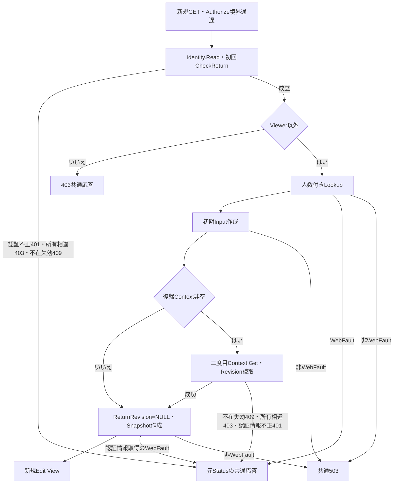

#### SQL・テーブル関連、DB操作の詳細

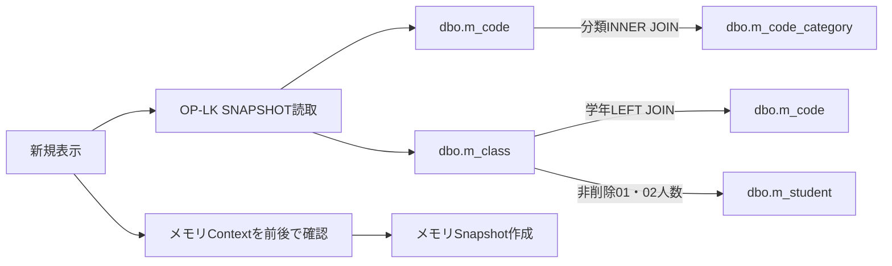

OP-LKのSQL、JOIN、順序、結果集合は補足説明に記載する。学生表は参考人数の集計に使うが、学生本体1件取得、学生DML、監査追加は行わない。ContextとSnapshotの確認・作成はメモリ操作であり、t_runtime_stateへ保存しない。根拠: `sources/Core/SqlServerStudentService.cs:196-216`、`sources/Infrastructure/EditorSnapshotStore.cs:7-11`。

#### 結果・例外時の扱い

初回Context確認を通っても、await読取中に期限切れや状態除去が成立すれば、後段Getが409を投げる。その場合はSnapshot作成とView返却へ進まない。所有者・セッション不一致は403であり、これらを503へ統合しない。Getは期限を延長しない。根拠: `sources/Web/Controllers/StudentsController.cs:25-25`、`sources/Infrastructure/SearchContextStore.cs:13-14`。

Loadには必須初期コード不足やクラス0件の専用警告を設定する処理がない。取得候補と保存可能な状態は別で、保存時にはコード存在、クラス必須等を検査する。読取、初期Input生成、Snapshot複製等の非WebFaultは結果型にせず上位へ伝播する。根拠: `sources/Infrastructure/WebStudentCoordinator.cs:17-17`、`sources/Core/StudentNormalizer.cs:154-154`、`sources/Core/SqlServerStudentService.cs:344-383`。

### EV-02 既存学生の編集・参照表示

#### 処理概要

GET `/students/{id:long}`で非削除学生の保存値を読み、Inputへ復元する。学生本体の取得後に候補を別取得し、復帰Contextを再確認して新Snapshotを作る。Viewerもこの入口から参照できる。根拠: `sources/Web/Controllers/StudentsController.cs:24-25`、`sources/Infrastructure/WebStudentCoordinator.cs:17-17`。

#### 処理手順

1. identity.Readと任意の復帰Context確認を行う。既存表示では作成・更新権限を要求しない。
2. GetAsyncへルートIDを渡す。戻り値NULLは404・E-STU-103とする。
3. GetAsyncは保存22値、版、生年月日、更新情報からStudentDetailを作る。生年月日は和暦4値、入学日・終了日はISO文字列へ戻す。
4. 人数付きLookupを別取得し、FromでInputを復元する。期待版はRowVersionの10進文字列、年度・学年は所属クラスの実値とする。所属なし既存では両補助値はNULLになる。
5. Coordinator.Edit完了後、非空Contextを再取得し、現在Revisionを読む。成功後にDetail・Original・ReturnRevisionを持つ新Snapshotを作る。
6. CanEditに従い編集または参照Viewを返す。

根拠: `sources/Core/SqlServerStudentService.cs:172-216`、`sources/Web/Inputs/StudentSaveInput.cs:44-54`、`sources/Web/Controllers/StudentsController.cs:25-25`。

#### 条件付き処理フロー

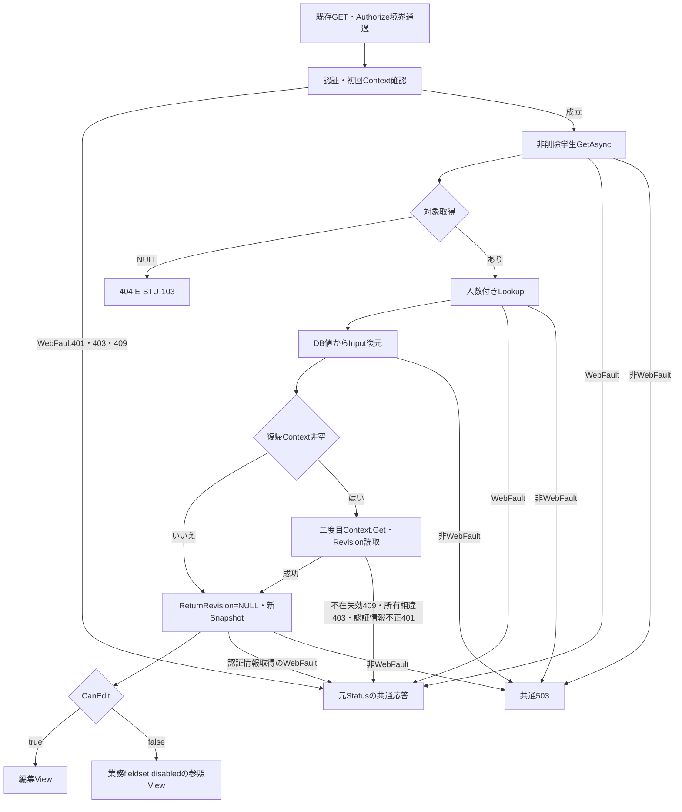

#### SQL・テーブル関連、DB操作の詳細

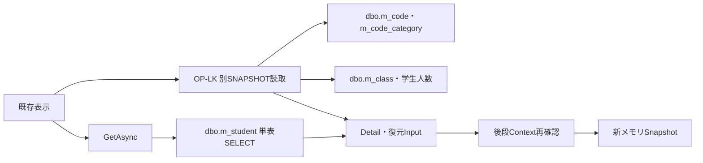

対象SQLは`SELECT * FROM dbo.m_student WHERE student_id=@id AND is_deleted=0`、@idはBigInt、Size未設定である。User確認後、id<=0は接続前にNULL、0件もNULLとなる。宣言されたPKを前提に最大1行で、JOIN、ORDER BY、ページング、明示トランザクションはない。この対象SELECTは単表なので単独ER図を省略する。候補の複数表関係はOP-LKで定義する。学生本体と候補は同一トランザクションで取得されない。根拠: `sources/Core/SqlServerStudentService.cs:172-216`、`sources/database/001_schema.sql:43-43`。

DB NULLは任意Draft NULLへ、保存日付はISO文字列へ逆移送する。クラス名・年度・学年は学生へ重複保存せずLookupから補う。接続、読取、日付逆変換の例外をGetAsyncは結果型へ変換しない。根拠: `sources/Core/SqlServerStudentService.cs:180-194`、`sources/Web/Inputs/StudentSaveInput.cs:46-54`。

#### 結果・例外時の扱い

不在、削除済み、正でないIDは404となる。停止・期間外の既存コードやクラスは、候補に存在する限り描画条件で保持できる。欠落コードを追加optionで補完する処理はない。根拠: `sources/Infrastructure/WebStudentCoordinator.cs:17-17`、`sources/Views/Students/Edit.cshtml:8-13`。

後段Context.Getは学生・候補読取とInput復元の後、Snapshot作成の前にある。読取中の失効による409、所有者・セッション相違の403、認証情報取得の401はそれぞれ元Statusを保持する。非WebFaultだけが共通503となる。初回検査の成功で後段View返却を保証しない。根拠: `sources/Web/Controllers/StudentsController.cs:25-25`、`sources/Infrastructure/SearchContextStore.cs:13-13`、`sources/Infrastructure/WebHostSetup.cs:23-23`。

### EV-03 入力補助、送信確認、離脱確認

#### 処理概要

site.jsは描画済みクラスoptionの属性を使って年度・学年を同期し、保存フォームへの入力操作をdirtyとして記録する。確認キーの消去、送信・離脱確認、処理中表示はブラウザー内で行う。根拠: `sources/wwwroot/js/site.js:2-9`。

#### 処理手順

1. クラスchangeで選択optionにdata-yearがあれば、年度をdata-year、学年をdata-gradeへ合わせる。未所属optionには属性がないため上位値を消さない。
2. 年度・学年changeで選択クラスがあり、非空の上位値とoption属性が不一致ならクラスを空にし、解除した旨をalertする。一致または上位値が空なら保持する。
3. 保存フォームinputでdirty=trueとし、Input.DuplicateTokenを空文字にする。理由入力も対象だが、確認sectionは残す。
4. dirtyかつleaving=falseのbeforeunloadで確認を要求する。dirtyリンクは破棄確認を取り消すと遷移を止め、続行時はleaving=trueとする。
5. 全フォームsubmitでは押下ボタンのdata-confirmを優先し、なければフォームのdata-confirmを使う。確認取消は送信を止める。
6. 送信続行時はleaving=true、同フォームの押下ボタン以外のbuttonをdisabled、フォームをaria-busy=trueにする。

根拠: `sources/wwwroot/js/site.js:2-8`、`sources/Views/Students/Edit.cshtml:12-17`。

#### 条件付き処理フロー

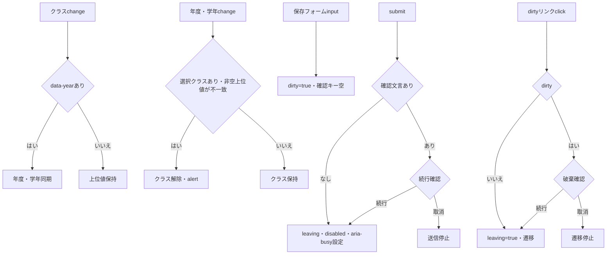

#### SQL・保持領域関連、DB操作の詳細

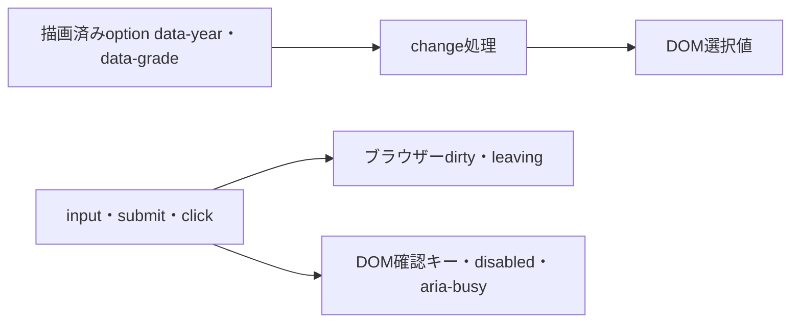

このイベントはDOMとブラウザー内変数だけを変更するためSQLとER図は不要である。候補API要求、サーバー確認辞書の消費、学生書込みは行わない。クラス候補の再取得・再絞込み、在籍区分や日付変更後の可否再計算、人数即時更新、和暦即時検証も接続されていない。根拠: `sources/wwwroot/js/site.js:2-9`。

#### 結果・例外時の扱い

dirtyは入力操作の記録であり、読込時との実値差分ではない。元値へ戻しても解除しない。別フォームの削除理由は監視外である。押下ボタン自身の再入拒否、leavingによる二重送信拒否、要求連番と旧応答破棄はない。ブラウザーのaria-busy、確認辞書のBusy、学生期待版、DB書込ゲートは別々の制御である。根拠: `sources/wwwroot/js/site.js:2-5`、`sources/Core/SqlServerStudentService.cs:244-252,278-278`。

### EV-04 新規登録・更新

#### 処理概要

登録と更新はController.Saveを共用する。バインド後DTOと入口状態を検査し、サービスで正規化する。共通書込ゲート内で最新対象、版、マスター、所属、一意性、候補を確認し、学生と監査をまとめて確定する。正常Commitの戻りを得た場合だけSavedになる。根拠: `sources/Web/Controllers/StudentsController.cs:26-33`、`sources/Core/SqlServerStudentService.cs:227-323`。

#### 処理手順

1. Authorize・MVCのCSRF等を通過して本体へ到達すると、FormGuardがInput配下の保存DTO各項目、和暦4部品、SnapshotId、CSRF項目、許可された__Invariantを検査する。
2. identity.CreateOrUpdate、Snapshotの所有者・セッション・対象・期限、任意復帰Context、投稿復帰先とSnapshot.Original.ReturnContextIdの一致をこの順で確認する。ここまでのWebFaultは後段catchの外にある。
3. ModelState不正なら422としてサービスを呼ばない。有効ならcatch内でCoordinator.Saveを呼び、権限と復帰Contextを再確認する。
4. ToRequestが業務値をDraftへ移す。ClassIdを任意の正のInt64、更新期待版を必須の正のInt64へ変換する。新規の非空期待版はWebFault400とする。
5. SaveAsyncは受付GUID、User、要求開始UTC時点now、その日本時間の業務日dayを決める。ViewerならForbiddenを返す。
6. 業務19項目を宣言順に正規化し、通常の個別検証エラーを収集する。個別成功後に生成3値と項目間検査へ進む。DATE-01のNULL日付部品等の対象外例外は、この収集経路を中断する。
7. 理由、対象IDと期待版の正数・同時設定、年度1900～9998、補助学年形式を検査する。
8. OpenとReadCommitted開始後、TX-01の共通書込ゲートを取得する。Open・開始はDB結果分類tryの外にある。
9. 更新では非削除対象を再取得し、存在、投稿期待版一致、学籍番号不変の順に確認する。旧区分03・04から異なる区分へ訂正する場合はAdministratorと理由を要求する。
10. 最新DBのコード、所属クラス、補助値整合、所属期間、新席取得時の定員を確認する。
11. 正規化22値と最新DB値を比較する。差分なしは明示Rollback後NoChange。実変更があり現版がlong.MaxValueならConflictとする。
12. 削除済みを含む全学生から本人を除き、学籍番号の一意性を確認する。
13. 全同一人物候補を取得し、EV-05の確認照合を行う。候補ありまたは供給キー非NULLで確認不成立ならRollback後に新確認を発行する。有効確認で理由NULLなら検証失敗とする。
14. UP-001～003のINSERTまたはUPDATEを実行し、OUTPUTのIDを取得する。NULL・DBNullならDBConcurrencyExceptionとする。
15. 同じトランザクションへ監査を追加し、commitAttemptedを立ててCommitする。正常終了後に確認キーを除去してSavedを返す。
16. ControllerはSavedをFlashと303へ変換する。非Saved結果、catch内WebFault、ModelState不正は各HTTP状態を保ち、投稿Inputと旧Snapshot、新Lookupで同じEdit Viewを返す。

根拠: `sources/Web/Controllers/StudentsController.cs:28-33,41-41`、`sources/Infrastructure/WebStudentCoordinator.cs:18-18`、`sources/Web/Inputs/StudentSaveInput.cs:34-60`、`sources/Core/StudentNormalizer.cs:119-159`、`sources/Core/SqlServerStudentService.cs:227-323,344-390`。

#### 条件付き処理フロー

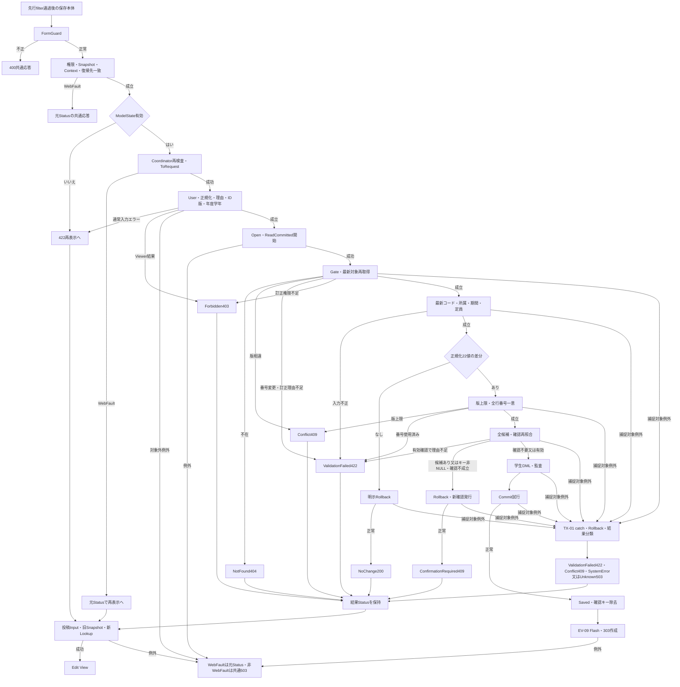

DB結果分類try内でも、catch対象外の例外は共通応答へ伝播する。図のcatch合流は各結果のStatusを引き継ぎ、固定503にはしない。根拠: `sources/Core/SqlServerStudentService.cs:316-323`、`sources/Web/Controllers/StudentsController.cs:30-33`。

#### SQL・テーブル関連

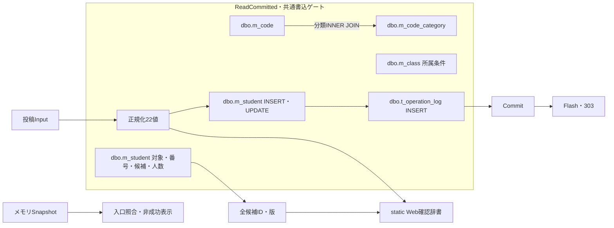

図は処理上の参照・記録関係であり、監査target_keyから学生への物理FKを示さない。実FKは補足説明のER図で定義する。

#### DB操作の詳細

更新対象は`SELECT * FROM dbo.m_student WHERE student_id=@id AND is_deleted=0`、@id BigIntで再取得する。対象なしE-STU-103、版相違E-STU-105、番号変更E-STU-104の順で拒否する。終了区分訂正には03→04など終了区分間の変更も含み、管理者不足はE-COM-002、理由不足はE-STU-106となる。根拠: `sources/Core/SqlServerStudentService.cs:246-258`。

コード検査はGENDER、PREFECTURE、ENROLLMENT_STATUS、RELATIONSHIPの順で、NULL続柄は照会しない。SQLは`m_code c JOIN m_code_category k ON k.category_id=c.category_id WHERE c.category_id=@category AND c.code_value=@value`、@category VarChar(24)、@value VarChar(10)で、最大1行、ORDER BY・ページングなしである。不在は既存同値でもE-STU-009、新規・変更値はコードと分類の両有効フラグ、開始日≦day、終了日NULLまたはday≦終了日を要求し、不成立はE-STU-011となる。既存同値は存在確認を残し、有効性・期間だけを免除する。根拠: `sources/Core/SqlServerStudentService.cs:347-356`。

クラス指定時は`SELECT school_year,grade_code,valid_from,valid_to,is_active,capacity FROM dbo.m_class WHERE class_id=@id`、@id BigIntで最大1行を取得する。不在はE-STU-010、非NULLの年度・学年と実値の不一致はE-STU-014となる。補助学年単独のGRADE存在・有効性照会はない。根拠: `sources/Core/SqlServerStudentService.cs:236-237,363-383`。

| 保存状態 | 所属・期間の確認 | 定員確認 |
| --- | --- | --- |
| 新規01・02、旧席なしから01・02、別クラスへの移動 | クラス存在、補助値一致、有効、本日が利用期間内。不成立はE-STU-013 | 定員非NULLなら本人除外人数+1を比較 |
| 同クラスの01・02席保持 | 存在と補助値一致。有効性・本日期間内を再適用しない | 加算検査なし。既存超過だけでは拒否しない |
| 新規03・04でクラス指定 | 存在、補助値一致、在籍期間とクラス期間の重なり | 席を増やさない |
| 03・04でクラス・区分・入学日・終了日を変更 | 期間重なりを再確認。不成立はE-STU-108。停止自体は拒否条件ではない | 席を増やさない |
| 03・04でクラス・区分・在籍日付を保持 | 存在と補助値一致。期間重なりを再検査しない | 席を増やさない |
| 03・04でクラス未指定 | 年度範囲・学年形式だけ。クラス照会なし | 非適用 |

旧席・新席はそれぞれ「クラスあり、在籍01・02」である。休学も1席を占め、03・04から01・02への訂正は同ClassIdでも新席取得になる。期間重なりは端点を含み、学生入学日≦クラス終了日かつ学生終了日≧クラス開始日で成立する。根拠: `sources/Core/SqlServerStudentService.cs:357-380`。

定員照会は`SELECT COUNT_BIG(*) FROM dbo.m_student WHERE class_id=@class AND is_deleted=0 AND enrollment_status_code IN ('01','02') AND (@id IS NULL OR student_id<>@id)`で、@class・@idはBigInt、新規@idはDBNullである。新席取得かつ定員非NULLの場合だけ人数+1を比較し、超過をE-STU-102とする。定員NULLは無制限、非NULLはDDLで1～9999であり、0を無制限と解釈しない。根拠: `sources/Core/SqlServerStudentService.cs:377-380`、`sources/database/001_schema.sql:201-201`。

NoChangeはSnapshot.Originalではなく最新DBとの22値比較である。DateOnlyとDB DateTimeは日付として比較する。理由、年度、学年、一時情報は比較対象外で、理由だけの変更では監査を作らない。NoChangeの明示Rollbackが失敗すれば正常NoChangeには到達せず、TX-01の例外分類または上位伝播へ進む。根拠: `sources/Core/SqlServerStudentService.cs:260-263,325-327`。

番号照会は`SELECT COUNT_BIG(*) FROM dbo.m_student WHERE student_no=@no AND (@id IS NULL OR student_id<>@id)`、@no VarChar(15)、@id BigIntまたはDBNullである。非削除条件を付けないため、削除済み学籍番号も再利用できない。DDLのuq_student_noも全行UNIQUEである。根拠: `sources/Core/SqlServerStudentService.cs:264-266`、`sources/database/001_schema.sql:187-187`。

INSERT・UPDATEは項目更新仕様の列を設定する。通常UPDATEのWHEREは`student_id=@id AND row_version=@version AND is_deleted=0`、@id・@version BigInt、@now DateTimeOffset、@actor NVarChar(128)である。業務パラメータの型・Sizeは項目移送表に従う。両DMLは`OUTPUT INSERTED.student_id INTO @changed`後のSELECTをExecuteScalarで読み、NULL・DBNullなら競合とする。PKに従う対象は最大1行で、別の件数検査SELECTはない。UPDATEの全設定列と監査の実差分列は同じ集合ではない。根拠: `sources/Core/SqlServerStudentService.cs:292-307`。

#### 結果・例外時の扱い

| 結果・入口状態 | HTTP | 表示・確定状態 |
| --- | --- | --- |
| Saved | 303 | 正常Commit後、Flashを置いて固定検索復帰先へ移す |
| NoChange | 200 | 「変更はありません。」。学生DML・監査・版加算なし |
| ValidationFailed、ModelState不正 | 422 | 再表示到達時は投稿Inputを保持し、エラーを表示 |
| catch内WebFault | 元Status | 新規非空期待版400、識別値不正422、再確認拒否等のStatusで同画面へ |
| Forbidden | 403 | 結果型なら同画面。入口拒否は共通応答 |
| NotFound | 404 | 保存結果型なら投稿Inputを持つ同画面 |
| Conflict | 409 | 版競合・実変更時版上限を通知。期待版の自動更新なし |
| ConfirmationRequired | 409 | 全件数、最大20件、新確認キーを同画面へ設定 |
| SystemError | 503 | 捕捉した失敗結果を表示 |
| Unknown | 503 | 保存済み・未保存を断定せず、再保存前の検索確認を案内 |
| catch外WebFault | 元Status | 原入力再表示を経ず共通応答 |
| 日付NULL、Open・開始失敗等の非WebFault | 応答未開始なら503 | 共通HTML応答。通常422再表示と別経路 |

根拠: `sources/Web/Controllers/StudentsController.cs:29-33,38-38`、`sources/Infrastructure/WebPresentation.cs:23-23`、`sources/Core/SqlServerStudentService.cs:238-242,316-323`。

非成功の結果がある場合、Input.DuplicateTokenを結果のConfirmationTokenへ置換し、そのModelStateだけを除去する。他のModelStateは一律Clearせず、投稿Input、旧SnapshotのDetail・SnapshotId・ReturnRevision、新Lookupを使う。入口拒否はこの再表示へ入らない。再表示LookupのWebFaultは元Status、非WebFaultは共通503へ進むため、元の結果を画面に提示できない場合がある。根拠: `sources/Web/Controllers/StudentsController.cs:29-33`。

学生・監査の正常Commitと、Flash・303の作成・配信完了は別の境界である。ReturnAfterSaveで認証情報取得等が例外となっても、既に正常Commitした学生保存を取り消す処理はない。根拠: `sources/Core/SqlServerStudentService.cs:313-315`、`sources/Web/Controllers/StudentsController.cs:31-38`。

### EV-05 同一人物候補の確認続行・取消

#### 処理概要

実変更保存で番号一意性を通過した後、本人以外の非削除学生について、生年月日一致かつ氏名照合値またはカナ照合値一致を候補とする。全候補を確認対象とし、表示は最大20件に限る。続行は同じ保存POSTを再実行する。根拠: `sources/Core/SqlServerStudentService.cs:224-225,264-290`。

#### 処理手順

1. 学生ID昇順で全候補を取得する。
2. Columns.Keys順で生成3値を除いた正規化業務19値を列名付きJSONへ直列化し、UTF-8のSHA-256で入力ハッシュを作る。理由、年度、学年、復帰先、SnapshotIdは含めない。
3. 全候補のStudentId・RowVersionを取得順にJSON化してSHA-256を作る。21件目以降も照合対象になる。
4. 非NULLの供給キーがあれば、主体、セッション、対象、期待版、期限、両ハッシュを照合し、Busyを原子的に0→1取得できた場合だけ有効とする。
5. 有効確認で理由NULLならE-STU-107となる。候補あり、または供給キー非NULLで確認不成立ならRollback後に新キーを発行し、ConfirmationRequiredを返す。
6. Viewは全件数と先頭最大20件を表示する。続行POSTではEV-04の入力、版、規則、候補をすべて再検査する。
7. 確認取消はブラウザーのキーを空にしてsectionを除去する。サーバー要求とサーバー確認の消費は行わない。
8. 正常Commit後に供給キーを除去する。取得済み確認で未完了かつUnknown以外ならBusyを解除し、Unknownでは供給キーを除去する。

根拠: `sources/Core/SqlServerStudentService.cs:224-225,274-290,313-335`、`sources/Views/Students/Edit.cshtml:14-14`、`sources/wwwroot/js/site.js:3-6`。

#### 条件付き処理フロー

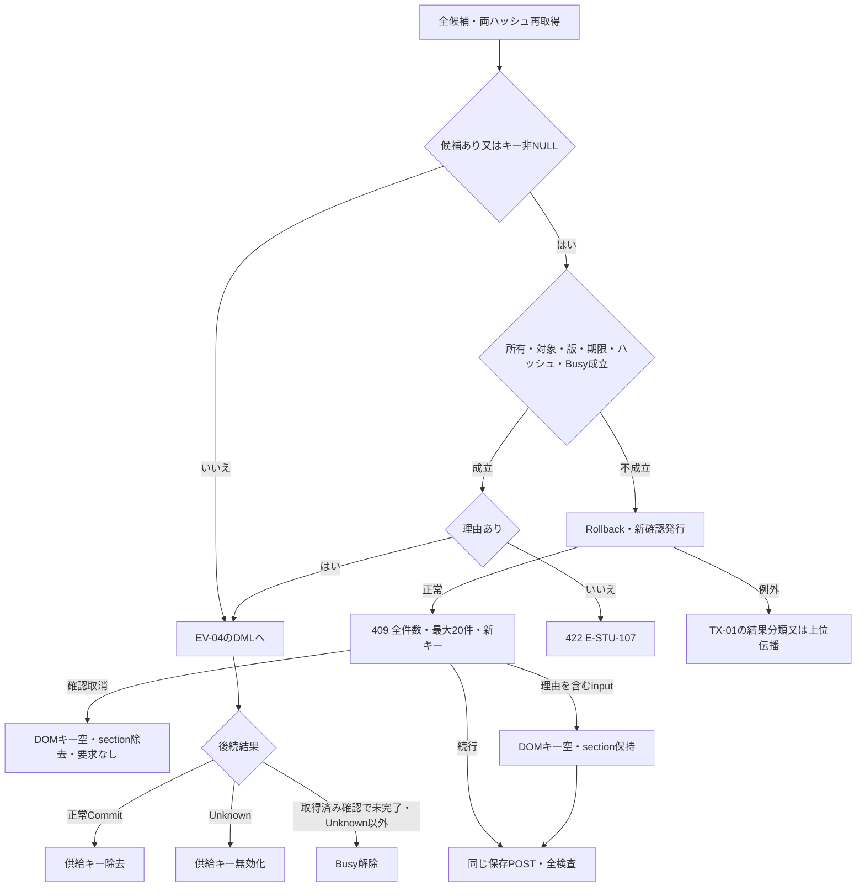

#### SQL・テーブル関連、DB操作の詳細

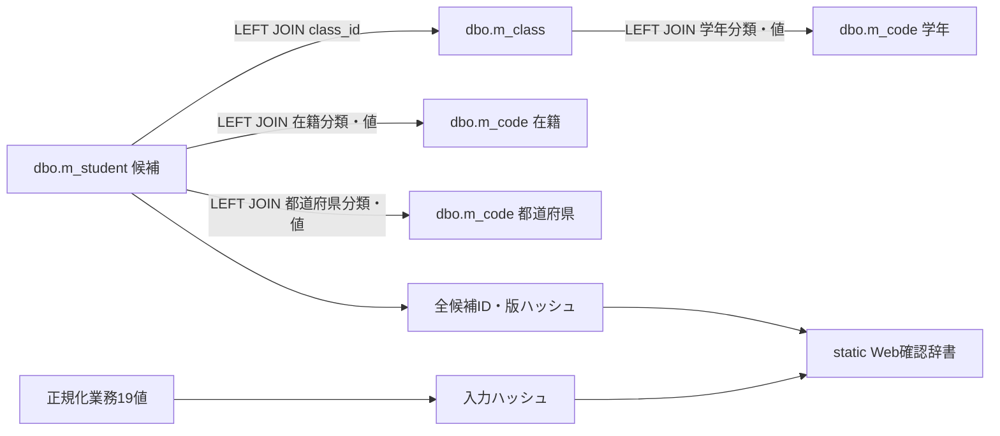

SQLはRowSelectへ`WHERE s.is_deleted=0 AND (@id IS NULL OR s.student_id<>@id) AND s.birth_date=@birth AND (s.name_key=@name OR s.kana_key=@kana) ORDER BY s.student_id`を加える。@id BigIntまたはDBNull、@birth Date、@name NVarChar(320)、@kana NVarChar(36)である。TOP、OFFSET/FETCHはなく全件取得し、在籍区分やマスターの停止・期間では除外しない。保存のReadCommitted内の読取であり、画面LookupのSNAPSHOTとは別である。根拠: `sources/Core/SqlServerStudentService.cs:242-242,269-272`。

RowSelectのLEFT JOINは、クラス`c.class_id=s.class_id`、学年`g.category_id=c.grade_category AND g.code_value=c.grade_code`、在籍`e.category_id=s.enrollment_category AND e.code_value=s.enrollment_status_code`、都道府県`p.category_id=s.prefecture_category AND p.code_value=s.prefecture_code`である。JOINに有効性・期間条件はない。StudentRowはID、番号、氏名、カナ、生年月日、所属年度、学年名、クラスコード・名称、在籍名、算出住所、本人電話、入学日、更新時点、版を持つ。算出住所は都道府県名NULLを「[不整合]」へ置換して住所1を連結し、住所2を含めない。根拠: `sources/Core/SqlServerStudentService.cs:77-91`、`sources/Core/Contracts.cs:50-55`。

HTML候補表は番号、氏名、和暦生年月日、ClassNameだけを表示する。ClassNameのNULLを「未所属」へ置換する処理はこのViewにない。表示専用名称の保存元と業務上限はOP-LKに記載する。根拠: `sources/Views/Students/Edit.cshtml:14-14`。

現在のWeb登録はwebTokens=trueであり、確認発行・照合はstatic辞書を使う。発行時は期限切れを掃除し、別の乱数キーへ保持する。同じSnapshotに属する旧キーをまとめて撤回する処理はない。期限は要求開始now+10分、照合は同要求開始nowを使い、DB読取後の現在時刻を取り直さない。根拠: `sources/Infrastructure/WebHostSetup.cs:19-19`、`sources/Core/SqlServerStudentService.cs:229-229,278-278,330-335`。

#### 結果・例外時の扱い

確認にはPrincipal、SessionId、対象、期待版、期限、正規化業務値、全候補ID・版、Busyを使う。Role、Tab、SnapshotId、ReturnContextIdは照合対象ではない。候補が0件へ変わっても、不正な非NULL旧キーがあれば再確認になる。サービスへ空文字が届いた場合も非NULLキーとして扱う。対象版競合とNoChangeは確認照合より前に判定する。根拠: `sources/Core/SqlServerStudentService.cs:252-290`。

理由入力もキーを消すため、候補確認後に理由を入力した場合、候補が残れば次の保存で新確認を取得し、その後入力を変えずに続行する経路となる。ブラウザーのキー消去はサーバー確認の消費ではない。MVCによる空文字からNULLへの変換を、このサービス分岐から保証しない。根拠: `sources/wwwroot/js/site.js:3-6`、`sources/Core/SqlServerStudentService.cs:276-290`。

### EV-06 論理削除

#### 処理概要

既存Administratorが専用フォームで対象と削除理由を確認して送信する。削除要求はInput.*を受けず、DB業務値を保持して削除属性と更新管理値だけを変更する。根拠: `sources/Views/Students/Edit.cshtml:17-17`、`sources/Core/SqlServerStudentService.cs:409-413`。

#### 処理手順

1. ブラウザー確認を通過すると、SnapshotId、ExpectedVersion、ReturnContextId、Confirmed=true、Reason、CSRF情報を送信する。
2. 先行filter通過後、Controller本体でFormGuard、identity.Read、Snapshotの所有・セッション・対象・期限、投稿復帰先一致を順に確認する。
3. Coordinator.DeleteはAdministrator、復帰Context、Confirmed=true、正の期待版の順に確認してDeleteAsyncへ渡す。保存と同じModelState.IsValid分岐やWebFault catchはない。
4. サービスは受付GUID、User、開始UTC時点を決め、管理者、必須理由、正のID・版、版がlong.MaxValueでないことを検査する。
5. Open、ReadCommitted、共通ゲート後、非削除対象の現版を取得し、存在と投稿版一致を確認する。
6. 削除・更新管理7列をUPDATEし、ExecuteNonQueryの件数1を要求する。
7. 同じトランザクションへDELETE監査を追加する。正常Commit後にSavedと版+1を返す。
8. ControllerはSavedならFlashと303へ進む。非Saved結果ではエラーと結果Statusを設定した後、Loadを再実行する。

根拠: `sources/Web/Controllers/StudentsController.cs:37-38,41-41`、`sources/Infrastructure/WebStudentCoordinator.cs:19-19`、`sources/Core/SqlServerStudentService.cs:392-416`。

#### 条件付き処理フロー

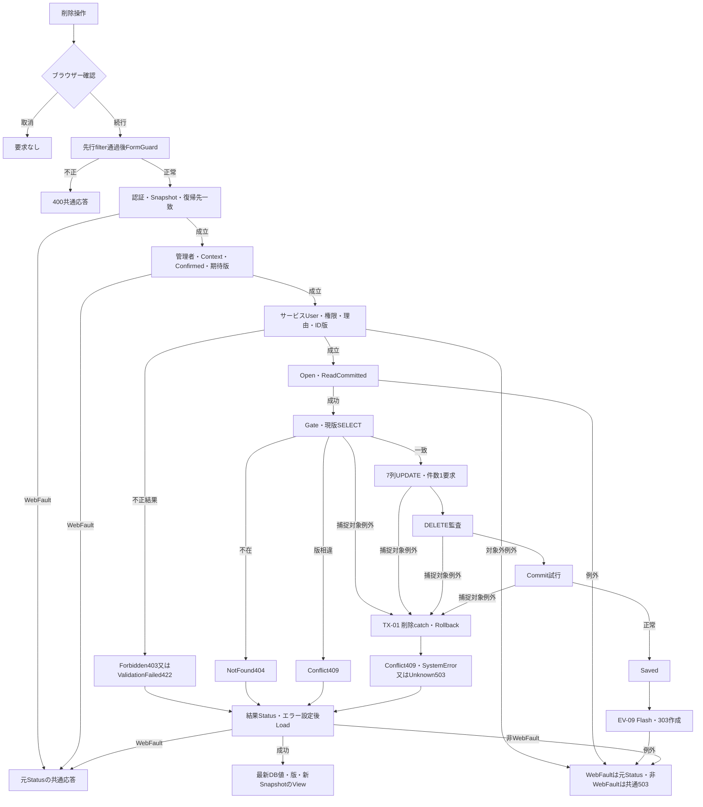

#### SQL・テーブル関連、DB操作の詳細

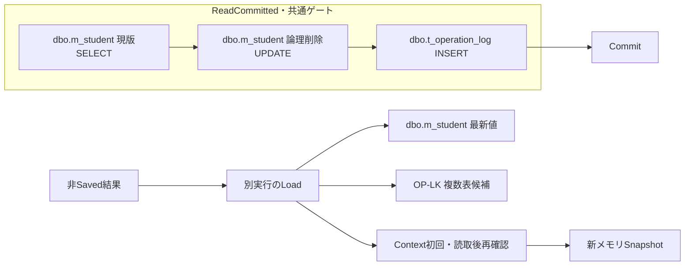

現版SQLは`SELECT row_version FROM dbo.m_student WHERE student_id=@id AND is_deleted=0`、@id BigIntのスカラー取得である。0件はNotFound、版相違はConflictになる。UPDATEのSETは`is_deleted=1,deleted_at=@now,deleted_by=@actor,delete_reason=@reason,updated_at=@now,updated_by=@actor,row_version=row_version+1`、WHEREは`student_id=@id AND row_version=@version AND is_deleted=0`である。@id・@version BigInt、@now DateTimeOffset、@actor NVarChar(128)、@reason NVarChar(120)を使い、更新件数1を要求する。JOIN、ORDER BY、ページング、物理DELETEはない。根拠: `sources/Core/SqlServerStudentService.cs:404-411`。

業務値、class_id、学籍番号、作成情報はSETに含まれない。監査は同じ7列、前版・版+1、削除理由、確認有無falseを記録する。論理削除後の行は非削除検索と人数集計から外れるが、全行番号一意確認からは外れない。根拠: `sources/Core/SqlServerStudentService.cs:201-201,264-266,409-414`。

#### 結果・例外時の扱い

削除のversion==long.MaxValueはValidationFailed422であり、保存の実変更時版上限Conflict409と区別する。理由検査のcatchはInputValidationExceptionだけなので、不正Unicode等のArgumentExceptionは結果型へ変換されず上位へ伝播する。DBConcurrencyExceptionはConflict、その他の捕捉対象例外はTX-01のSystemErrorまたはUnknownになる。OpenとBeginTransactionは結果分類tryの外にある。根拠: `sources/Core/StudentNormalizer.cs:37-57`、`sources/Core/SqlServerStudentService.cs:396-416`。

非Saved後のLoad成功時は最新DB業務値、最新期待版、Lookup、新Snapshotを表示する。編集中の業務値や投稿削除理由を復元しない。Loadで対象が削除済みと判明すれば404、初回または読取後Context確認で失効すれば409となるなど、後段WebFaultが元のUnknown等のStatusに代わって表へ出得る。非WebFaultは共通503へ進む。入口WebFaultは非Saved後Loadへ入らない。根拠: `sources/Web/Controllers/StudentsController.cs:25-25,37-37`、`sources/Infrastructure/WebStudentCoordinator.cs:17-19`、`sources/Infrastructure/WebHostSetup.cs:23-23`。

### EV-07 入力クリア・編集取消

#### 処理概要

POST `/students/reset`でSnapshot.Originalへ入力を戻す。学生本体の最新取得ではなく、読込時メモリ値の復元である。根拠: `sources/Web/Controllers/StudentsController.cs:35-35`。

#### 処理手順

1. ブラウザーで読込時値への復元を確認し、続行ならSnapshotIdとStudentIdを送る。
2. AuthorizeとMVCのCSRF等を通過してController本体へ到達すると、最初にFormGuardを実行する。許可外項目、不正な厳密名__Invariant、許容例外外の同名複数値は400として復元を止める。
3. identity.Readを行い、StudentIdを任意の正のInt64へ変換する。
4. Snapshotの所有者、認証セッション、対象ID、期限を照合する。
5. ModelStateをClearし、Originalの複製をInputへ設定する。Detail、SnapshotId、ReturnRevisionは同じSnapshotの値を使う。
6. 人数付きLookupだけを再取得し、「入力を読込時の値へ戻しました。」とEdit Viewを返す。

根拠: `sources/Views/Students/Edit.cshtml:16-16`、`sources/Web/Controllers/StudentsController.cs:35-35,41-41`、`sources/Infrastructure/EditorSnapshotStore.cs:7-11`。

#### 条件付き処理フロー

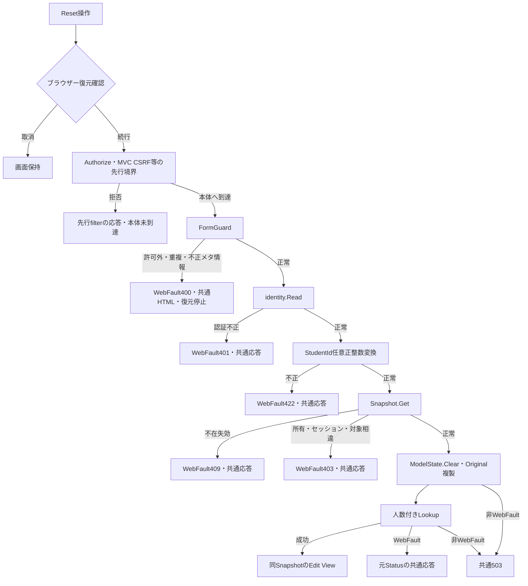

#### SQL・保持領域関連、DB操作の詳細

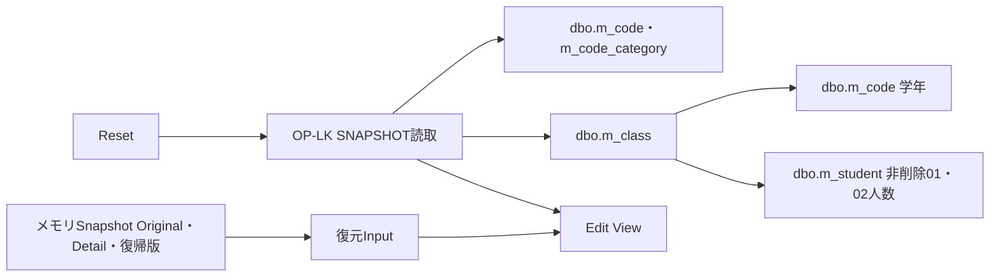

学生GetAsync、学生DML、監査追加は呼ばない。復元元はメモリ、DB読取はOP-LKの候補と人数だけである。期待版は読込時値を維持し、候補・参考人数だけを更新する。SQLと複数表JOINはOP-LKに従う。根拠: `sources/Web/Controllers/StudentsController.cs:35-35`、`sources/Core/SqlServerStudentService.cs:196-216`。

#### 結果・例外時の扱い

FormGuard400はID変換422、Snapshot403・409より前の拒否であり、ModelState.Clear、Original複製、候補再取得へ進まない。フォーム検査の詳細は補足説明のHTTP契約に従う。先行認証filterまでFormGuardの後へ移すという順序ではない。根拠: `sources/Web/Controllers/StudentsController.cs:5-6,35-35,41-41`、`sources/Infrastructure/WebHostSetup.cs:16-25`。

新規クリアは性別0、在籍01、読込時当年度等へ戻し、全項目を空にしない。既存取消後にDBが変更されていれば、次回保存で期待版競合となる。Resetは復帰Contextを再検査せず、Snapshotの期限延長・消費も行わない。LookupのWebFaultは元Status、非WebFaultは共通503となる。根拠: `sources/Web/Inputs/StudentSaveInput.cs:44-54`、`sources/Infrastructure/EditorSnapshotStore.cs:10-10`、`sources/Web/Controllers/StudentsController.cs:35-35`。

### EV-08 最新情報を再読込

#### 処理概要

既存時のリンクでEV-02の通常GETを再実行し、学生の全業務値と期待版をDBから取り直す。根拠: `sources/Views/Students/Edit.cshtml:16-16`、`sources/Web/Controllers/StudentsController.cs:24-25`。

#### 処理手順

1. dirtyなら編集内容の破棄を確認し、取消なら遷移を止める。
2. 続行またはdirtyでなければ、対象IDとreturnContextIdを持つ既存GETへ進む。
3. EV-02の認証・初回Context確認、非削除学生取得、人数付きLookup、Input復元を実行する。
4. 読取後に非空Contextを再取得し、成功後に最新業務値・期待版・新SnapshotでEdit Viewを返す。

根拠: `sources/wwwroot/js/site.js:5-5`、`sources/Infrastructure/WebStudentCoordinator.cs:17-17`、`sources/Web/Controllers/StudentsController.cs:25-25`。

#### 条件付き処理フロー

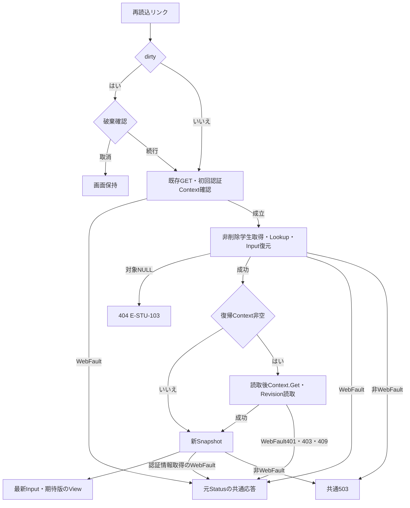

#### SQL・テーブル関連、DB操作の詳細

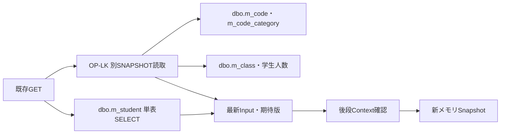

対象SQLはEV-02と同じ`student_id=@id AND is_deleted=0`、@id BigInt、最大1行である。学生本体は単表なので単独ER図を省略し、候補の複数表関係はOP-LKに従う。学生書込みや期待版だけの差替えは行わない。旧Snapshotを明示削除する処理もない。根拠: `sources/Core/SqlServerStudentService.cs:172-216`、`sources/Infrastructure/EditorSnapshotStore.cs:9-11`。

#### 結果・例外時の扱い

初回Context拒否は学生取得前、後段Context拒否は読取後・新Snapshot作成前に発生する。どちらもWebFaultの元Statusを保つ。対象不在・削除済みは404である。成功時に編集中Inputを引き継がず、DB値から作り直す。ResetはメモリOriginal、本イベントはDB最新値を使う。根拠: `sources/Infrastructure/WebStudentCoordinator.cs:17-17`、`sources/Web/Controllers/StudentsController.cs:25-35`。

### EV-09 検索へ戻る・確定成功後の復帰

#### 処理概要

手動復帰はInput.ReturnContextIdと読込時ReturnRevisionを使う。保存・削除成功は通知をメモリへ置き、固定内部パスへ303を返す。復帰先は最後に適用されたApplied条件で検索を再実行する。根拠: `sources/Views/Students/Edit.cshtml:16-16`、`sources/Web/Controllers/StudentsController.cs:8-11,38-39`。

#### 処理手順

1. 手動リンクではdirty時だけ未保存変更の破棄を確認する。
2. Saved後、復帰ContextがNULL・空なら新検索Contextを作り、その初期Revisionを使う。
3. Flashへ「保存しました。」または「論理削除しました。」を置く。ContextとRevisionをURIエスケープした固定内部パスをLocationに設定し、303 EmptyResultを返す。任意URLは受けない。
4. 検索Indexは認証を確認し、Context未指定なら新未検索状態、指定ありならResumeへ進む。
5. ResumeはContextのGate待機後にGetを再実行し、所有・セッション・期限、要求検索版の10進文字列完全一致、版上限未到達を確認する。
6. Appliedなしなら学生検索せず、未検索のまま版を維持する。Appliedありなら保存済み条件・ページ・件数・ソートでSearchAsyncを実行し、成功結果をLastResultへ設定してRevisionを1増やす。Applied自体は変更しない。
7. Use成功でContext期限を30分延長する。Resume後にFlash.Takeを評価し、その後人数なしLookupを取得してSearch Viewを返す。

根拠: `sources/Web/Controllers/StudentsController.cs:8-11,38-39`、`sources/Infrastructure/WebStudentCoordinator.cs:14-21`、`sources/Infrastructure/SearchContextStore.cs:9-14`、`sources/Infrastructure/FlashMessageStore.cs:6-9`。

#### 条件付き処理フロー

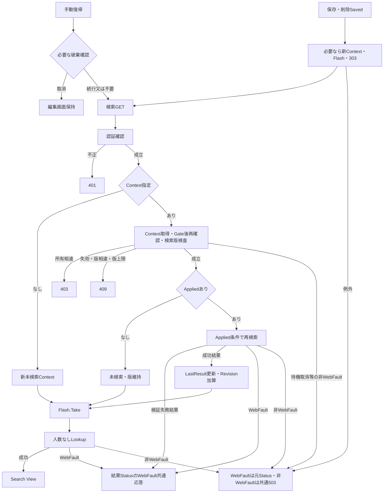

#### SQL・テーブル関連、DB操作の詳細

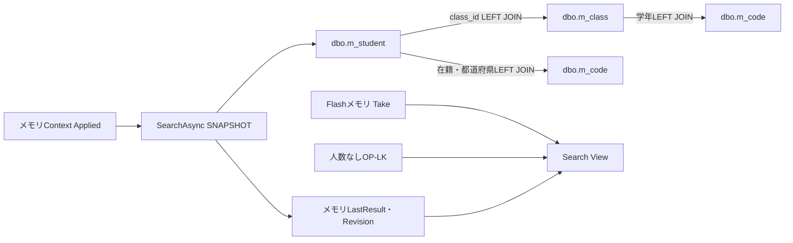

Appliedなしでは学生検索SQLを実行しない。Appliedありでは保存済み条件を再検証し、SNAPSHOT内でTOP(10001)の件数確認とページ取得を行う。10000件超はLimitExceeded=true、一覧空、提示totalCount=NULLとなる。通常ページサイズは20・50・100、ソートはstudentNo/name/admissionDate/updatedAtとasc/descだけを許容し、同順位は学生ID昇順、OFFSET/FETCHの@offset・@sizeはIntである。復帰は入力中条件を使わずAppliedをそのまま渡す。全検索述語・条件パラメータはSM-DET-STUDENT-SEARCHの責務である。根拠: `sources/Core/SqlServerStudentService.cs:103-170`、`sources/Infrastructure/WebStudentCoordinator.cs:14-21`。

検索用LookupはincludeOccupancy=falseのため人数集計を省き、CONVERT(int,0)を返す。この0は実人数ゼロを示さない。ContextとFlashはメモリで、t_runtime_stateへのDB書込みはない。根拠: `sources/Web/Controllers/StudentsController.cs:39-39`、`sources/Core/SqlServerStudentService.cs:201-208`、`sources/Infrastructure/SearchContextStore.cs:9-14`、`sources/Infrastructure/FlashMessageStore.cs:6-9`。

#### 結果・例外時の扱い

編集時のCheckReturnはTabと期待検索版を渡さず、所有・セッション・期限だけを確認する。そのため学生保存が確定した後でも、復帰Resumeの検索版相違で409になり得る。Useは操作成功後だけ期限を延長し、例外時もGateを解放する。根拠: `sources/Infrastructure/WebStudentCoordinator.cs:6-6`、`sources/Infrastructure/SearchContextStore.cs:13-14`。

FlashはResume後、Lookup前に除去する。Resume失敗では未消費、Lookup失敗では消費済みとなり得る。SQLは取得ページを最終ページ以下へ補正するが、ResumeはApplied.Pageを書き戻さず、提示pageは元Appliedを使う。削除でページ数が縮む場合などに取得ページと提示pageが異なる可能性がある。未検索、0件、上限超過、通常結果を分け、件数NULLを0件へ置き換えない。根拠: `sources/Web/Controllers/StudentsController.cs:8-11`、`sources/Infrastructure/WebStudentCoordinator.cs:14-21`、`sources/Core/SqlServerStudentService.cs:160-164`。

## 補足説明

### DATE-01 日付入力の層別契約

入学日・終了日の画面部品はtype=dateだが、バインド後DTOでは入学日が`string`、終了日が`string?`である。ToRequestは日付文字列を解析せず移送する。ParseIsoはNFKC後の文字列を10コード単位、InvariantCultureのyyyy-MM-ddとして厳密変換し、1900年下限と業務日以下を検査する。通常Textによるraw上限やTrimは行わない。根拠: `sources/Views/Students/Edit.cshtml:11-11`、`sources/Web/Inputs/StudentSaveInput.cs:20-22,34-42`、`sources/Core/JapaneseDateService.cs:52-59`。

| 層 | 入学日 | 卒業・退学日 | 担当・根拠 |
| --- | --- | --- | --- |
| HTML要求項目 | Input.AdmissionDate、type=date・required | Input.EnrollmentEndDate、type=date | maxlengthなし。ブラウザー表示を一律yyyy/MM/ddへ変える処理なし。`sources/Views/Students/Edit.cshtml:11-11` |
| バインド後DTO・Draft | AdmissionDate:stringを同名Draftへ移す | EnrollmentEndDate:string?を同名Draftへ移す | HTTPの欠落・変換失敗とDTO値の組合せは、この移送から保証しない。`sources/Web/Inputs/StudentSaveInput.cs:34-42` |
| 厳密変換 | ParseIsoへ渡す。NULLならraw.Normalizeで例外 | NULL・空文字なら解析せずNULL。空白だけなら解析して形式エラー | NFKC後10コード単位、1900年下限・業務日以下。`sources/Core/JapaneseDateService.cs:52-59`、`sources/Core/StudentNormalizer.cs:135-137` |
| 内部比較 | DateOnly、生年月日以上 | DateOnly?、区分に対応する有無、入学日以上 | `sources/Core/StudentNormalizer.cs:148-154` |
| SQL・DB | @admission_date Date、date NOT NULL | @enrollment_end_date Date、date NULL | DateOnlyを午前0時のDateTime、NULLをDBNullへ。Size未設定。`sources/Core/SqlServerStudentService.cs:35-36,67-72`、`sources/database/001_schema.sql:24-27` |
| 既存再表示 | DB日付からyyyy-MM-dd | DB NULLはNULL、日付はyyyy-MM-dd | DateOnlyへ時差変換しない。`sources/Core/SqlServerStudentService.cs:183-194` |

和暦はBirthDateInputの4つのstringである。Parseは元号を先に完全一致で照合し、年、月、日の順に変換する。ToRequestは構造全体がNULLなら空のBirthDateInputへ置換するが、内部部品のNULLは補完しない。根拠: `sources/Core/Contracts.cs:8-8`、`sources/Web/Inputs/StudentSaveInput.cs:36-36`、`sources/Core/JapaneseDateService.cs:19-39`。

| 部品 | HTMLガード | サーバー変換・制約 | サービス引数NULLの場合 |
| --- | --- | --- | --- |
| Era | select、required、maxlengthなし | 固定5IDと完全一致。Trim・NFKC・raw10検査なし | 数値部より先にE-DATE-001のArgumentException |
| Year | input、required、maxlength=4 | NFKC後「元」は1、その他は4コード単位以内のASCII正整数 | 有効元号の下でYear.NormalizeがNullReferenceException |
| Month | input、required、maxlength=2 | NFKC後2コード単位以内のASCII正整数 | 元号・年解析成功後、Month.NormalizeがNullReferenceException |
| Day | input、required、maxlength=2 | NFKC後2コード単位以内のASCII正整数 | 元号・年・月解析成功後、Day.NormalizeがNullReferenceException |

根拠: `sources/Views/Students/Edit.cshtml:7-7`、`sources/Core/JapaneseDateService.cs:19-39`。

Parseは実在日、元号期間内、業務日以下、逆変換した元号・年の一致を要求する。明治の1900年開始は本実装の許容下限である。

| 元号ID | 名称 | 開始日 | 終了日 | 西暦年への加算 |
| --- | --- | --- | --- | --- |
| REIWA | 令和 | 2019-05-01 | DateOnly.MaxValue | 2018 |
| HEISEI | 平成 | 1989-01-08 | 2019-04-30 | 1988 |
| SHOWA | 昭和 | 1926-12-25 | 1989-01-07 | 1925 |
| TAISHO | 大正 | 1912-07-30 | 1926-12-24 | 1911 |
| MEIJI | 明治 | 1900-01-01 | 1912-07-29 | 1867 |

根拠: `sources/Core/JapaneseDateService.cs:9-33`。ToInputは元年を「1」、月日を2桁で復元し、ToWarekiは元年を「元」と表示する。学校年度は4月始まりである。保存業務日は要求開始UTCから+09:00で求め、Layoutの表示業務日は描画時UTCから別に求める。更新日時だけを日本時間表示へ変換する。根拠: `sources/Core/JapaneseDateService.cs:41-61`、`sources/Core/SqlServerStudentService.cs:44-45,229-229`、`sources/Infrastructure/WebPresentation.cs:5-7`。

通常の形式不正等のArgumentExceptionはSetでFieldErrorへ変換する。一方、上記数値部NULLとAdmissionDateのNULLによるNullReferenceExceptionは、Set、SaveAsync入力catch、ControllerのWebFault catchの対象外である。先行項目のエラーが収集済みでも処理を中断し、応答未開始なら共通503へ進む。これはサービスへその値が届いた場合の分岐であり、HTTP項目省略が必ずNULLを生成するという保証ではない。requiredや非nullable注釈をNULL排除の実行保証にしない。根拠: `sources/Core/StudentNormalizer.cs:123-143`、`sources/Core/SqlServerStudentService.cs:232-239`、`sources/Web/Controllers/StudentsController.cs:30-33`、`sources/Infrastructure/WebHostSetup.cs:16-23`。

### OP-LK 候補読取と名称の保存元

LookupAsyncはUser確認後、SNAPSHOT内で2結果集合を全件取得する。第1集合は`m_code c JOIN m_code_category k ON k.category_id=c.category_id`から分類、値、名称、表示順、期間、保護設定を取得する。IsActiveはコードと分類が両方有効な場合だけtrueである。停止・期間によるWHERE除外はなく、順序は`c.category_id,c.display_order,c.code_value`となる。根拠: `sources/Core/SqlServerStudentService.cs:197-212`。

第2集合は`m_class c LEFT JOIN m_code g ON g.category_id=c.grade_category AND g.code_value=c.grade_code`からクラス列と人数を取得する。順序は`c.school_year DESC,g.display_order,c.display_order,c.class_code,c.class_id`である。編集人数は同class_id、is_deleted=0、在籍01・02のCOUNT(*)である。入力パラメータ、TOP、ページングはなく、コード集合の後にクラス集合を読み、正常Commit後にLookupSetを返す。接続、開始、読取、CommitへCancellationTokenを渡す。根拠: `sources/Core/SqlServerStudentService.cs:199-216`。

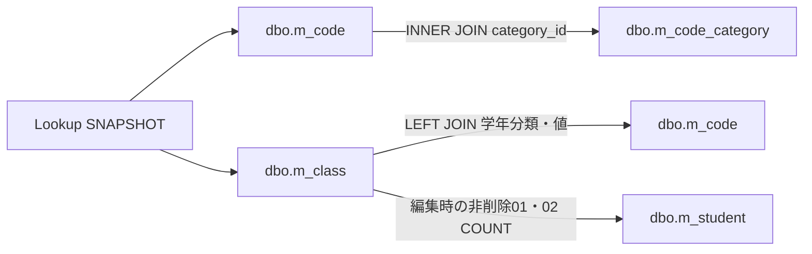

候補と保存済み選択値は別の領域である。コードの描画可否は有効性、画面業務日との期間比較、Detailの既存同値保持で決める。IsProtectedは可否判定に使わない。学年にはこのdisabled判定がない。クラスも年度・学年で絞らず全optionを列挙する。03・04の描画期間判定は原入力をDateOnly.TryParseで読むため、保存時のNFKC後厳密変換とは異なる。根拠: `sources/Views/Students/Edit.cshtml:8-13`。

人数表示対象はClassId.ToString()とInput.ClassIdの文字列一致で求める。先頭ゼロ付きIDはIdParserを通っても、描画時のクラスが見つからず人数－となる場合がある。未選択時の定員「制限なし」は代替表示で、選択クラスのcapacity=NULLを取得した状態と同一ではない。根拠: `sources/Views/Students/Edit.cshtml:2-2,12-12`、`sources/Web/Inputs/StudentSaveInput.cs:60-60`。

名称の保存元は次のとおりである。学生画面は名称を更新せず、学生からLEFT JOINした結果のNULL可能性と、名称保存列のNOT NULLを分ける。

| 表示値 | 更新入口・業務検査 | 保存列・DB属性 | 保存パラメータ | 本画面との対応・根拠 |
| --- | --- | --- | --- | --- |
| コード名称、学年・在籍・都道府県名称 | CLI code→CodeChange.CodeName:string→SaveCodeAsync。必須単一行Text、raw12・Trim後12、NFKCなし | m_code.code_name nvarchar(24) NOT NULL、CHECK12スカラー値 | @name NVarChar(24) | 学生はコード値だけ保存。StudentRowの名称NULLは結合結果。`sources/maintenance/Program.cs:11-12`、`sources/Core/MasterMaintenanceService.cs:79-83,113-115`、`sources/database/001_schema.sql:115-128` |
| クラス名称 | CLI class→ClassChange.ClassName:string→SaveClassAsync。必須単一行Text、raw18・Trim後18、NFKCなし | m_class.class_name nvarchar(36) NOT NULL、CHECK18スカラー値 | @class_name NVarChar(36) | Lookup直接値と、LEFT JOINのClassName:string?を区別。`sources/Core/MasterMaintenanceService.cs:9-9,30-33,73-74,124-130`、`sources/database/001_schema.sql:68-81`、`sources/Core/Contracts.cs:50-64` |
| クラスコード | 同CLIのClassCode:string、Identifierのraw9・正規化後9、Trim・NFKC・大文字化・ASCII形式 | m_class.class_code varchar(9) NOT NULL | @class_code VarChar(9) | 選択表示に使用、学生はClassIdだけ保存。結合結果ClassCodeはNULL可。`sources/Core/MasterMaintenanceService.cs:33-33,73-74`、`sources/database/001_schema.sql:67-67`、`sources/Core/Contracts.cs:50-51` |

クラスの年度smallint、学年コードvarchar(2)、利用開始・終了date、利用状態bit、表示順intはNOT NULL、定員intはNULL可である。コードの分類varchar(24)と値varchar(10)は複合PK、名称・表示順・利用状態・開始日はNOT NULL、終了日dateはNULL可で期限なしを示す。根拠: `sources/database/001_schema.sql:64-73,113-127`。

初期投入定義では性別0は未回答、在籍01～04は在学・休学・卒業・退学、学年00は学年なしである。0・00は実コードであり未設定NULLではない。保護値は性別0、在籍01～04、都道府県01～47、学年00である。コード保守は停止と期間短縮を拒否するが、名称・表示順・備考まで一律変更禁止にしない。通常更新のSETには分類、値、保護設定を含めない。この保守規則と学生画面の新規選択可否・既存値保持は別判定である。根拠: `sources/database/002_seed.sql:15-84`、`sources/Core/MasterMaintenanceService.cs:105-115`。

### 文字正規化と項目間検査

TextはNULLを空文字へ変え、Trim・改行変換より先にrawスカラー値数を確認する。不正サロゲートはArgumentExceptionとなる。単一行は制御文字を拒否する。複数行はCRLF・CRをLFへ統一し、LF以外の制御文字を拒否する。Trim後空は任意項目ならNULL、必須なら入力エラーであり、最後に保存後上限を検査する。Text自体はNFKCを行わず、正規化で短くなる入力でもraw上限超過を先に拒否する。根拠: `sources/Core/StudentNormalizer.cs:37-57`。

カナはNFKC後にひらがなU+3041～U+3096と反復記号をカタカナへ変換し、内部空白を半角1個へ整理する。許容文字はU+30A1～U+30FA、長音、中点、カタカナ反復記号である。郵便・電話から除くハイフンはASCIIハイフン、U+2010、U+2011、U+2212で、電話は丸括弧も除く。電話形式は国内0始まり10～11桁、または+に続く非ゼロ始まり7～15桁である。記号除去後の空をNULLへ置換する分岐はない。根拠: `sources/Core/StudentNormalizer.cs:72-100`。

メールは@が1個、非空ASCIIローカル部、先頭・末尾の点と連続点の禁止、2個以上のドメインラベル、各ラベル1～63文字と英数字・内部ハイフン形式を検査する。ローカル部の大小を保持し、ドメインだけ小文字化する。コードはTextのraw幅検査後にNFKCし、指定幅のASCII数字へ限定する。根拠: `sources/Core/StudentNormalizer.cs:102-117`。

個別正規化成功後、生年月日≦入学日、在籍01～04、01・02の終了日NULL・クラス必須、03・04の終了日必須・入学日以上、本人電話・本人メール・緊急電話の最低1つ、緊急3項目の全未設定または全設定を検査する。続柄未設定なら生成分類もNULLになる。InputValidationExceptionとArgumentExceptionはFieldError化するが、その他の例外を未設定やゼロへ置換しない。根拠: `sources/Core/StudentNormalizer.cs:123-159,162-168`。

### TX-01 接続、排他、取消、確定結果

サービスは接続設定をEncrypt=Mandatory、TrustServerCertificate=falseにし、Open後に対象DBのsnapshot_isolation_state=1を要求する。共通Command helperには30秒のSQLタイムアウトを設定する。Open内の診断コマンドはCreateCommandで作るため、30秒の明示設定はhelper利用SQLに対する観測である。ParamはSqlDbTypeを指定し、非ゼロSizeだけ設定する。DateOnlyは午前0時のDateTime、NULLはDBNullへ変換する。根拠: `sources/Core/SqlServerStudentService.cs:39-72`。

保存・削除はReadCommitted内でSET XACT_ABORT ONを実行し、sp_getapplockを資源`test-project1:student-write`、Exclusive、Transaction所有、待機5000ms、DbPrincipal=publicで取得する。負戻り値は拒否する。クラス・コード保守も同じゲートを使う。Lookupと検索の読取はSNAPSHOT、保存中の候補再取得はReadCommitted内である。根拠: `sources/Core/SqlServerStudentService.cs:92-101,197-200,242-269`、`sources/Core/MasterMaintenanceService.cs:39-42,88-90`。

CancellationTokenは接続、開始、ゲート、読取、DML、Commitへ渡す。Rollback helperはCancellationToken.Noneで試行し、SqlExceptionまたはInvalidOperationExceptionならfalseを返す。User取得、Open、保存・削除のBeginTransactionはDML結果分類tryの外にある。対象不在等の早期returnはCommitせずトランザクション破棄へ進み、NoChange・確認再発行の明示Rollbackと区別する。根拠: `sources/Core/SqlServerStudentService.cs:229-263,287-329,394-403`。

| 経路 | Rollback・確定判定 | 結果 |
| --- | --- | --- |
| 保存中のInputValidationException | Rollback試行。成否を結果分類へ反映しない | ValidationFailed422 |
| 保存中のSQL番号2601・2627 | Rollback試行。制約名は判別しない | 番号使用済みE-STU-101、ValidationFailed422 |
| 保存・削除のDBConcurrencyException | Rollback試行。成否を結果分類へ反映しない | Conflict409、E-STU-105 |
| その他のSqlException・InvalidOperationException・OperationCanceledException | Rollback結果を取得し、`writeStarted && (commitAttempted || !rolledBack)`を判定 | trueならUnknown、falseならSystemError。いずれも503 |
| Open・Begin失敗、catch対象外例外 | 上記結果catchを通らない | 上位伝播。WebFaultは元Status、非WebFaultは応答未開始なら503 |

根拠: `sources/Core/SqlServerStudentService.cs:316-329,399-416`、`sources/Infrastructure/WebHostSetup.cs:23-23`。

DML直前にwriteStarted、Commit直前にcommitAttemptedをtrueにする。Commit試行後の捕捉対象例外は、Rollbackが正常でもUnknownとなる。OUTPUTや監査INSERTが正常終了しても、Commitの正常な戻りを得るまではSavedにしない。Unknownは未保存と断定せず、保存では再保存前、削除では検索による結果確認を案内する。根拠: `sources/Core/SqlServerStudentService.cs:302-322,411-416`。

### 監査と実DDLの関連

監査INSERTはtarget_table=m_student、target_key=学生IDの10進文字列、CREATE/UPDATE/DELETE、前後版、物理変更列名のJSON配列、主体、要求開始UTC時点、受付GUID、理由、確認有無を記録する。CREATEは前版NULL・後版1と全設定列、UPDATEは実差分列にupdated_at・updated_by・row_versionを加える。DELETEは削除・更新管理7列である。個人情報の変更前後値を複写する処理ではない。根拠: `sources/Core/SqlServerStudentService.cs:306-307,385-390,413-413`。

監査パラメータは@id VarChar(35)、@op VarChar(11)、@before/@after BigInt、@changed NVarChar(Size=-1)、@actor NVarChar(128)、@now DateTimeOffset、@request UniqueIdentifier、@reason NVarChar(120)、@confirmed Bitである。before_versionとoperation_reasonはNULL可、ほかのこれら記録列はNOT NULL。保存のduplicate_confirmedは今回候補件数>0、削除はfalseとなる。監査INSERTの更新件数1を別途検査する処理はない。根拠: `sources/Core/SqlServerStudentService.cs:307-307,387-390`、`sources/database/001_schema.sql:137-153`。

次図はDDLのPK・FKとNULL可否に基づく。検索JOIN、監査対象キー、メモリ確認の関連とは別である。

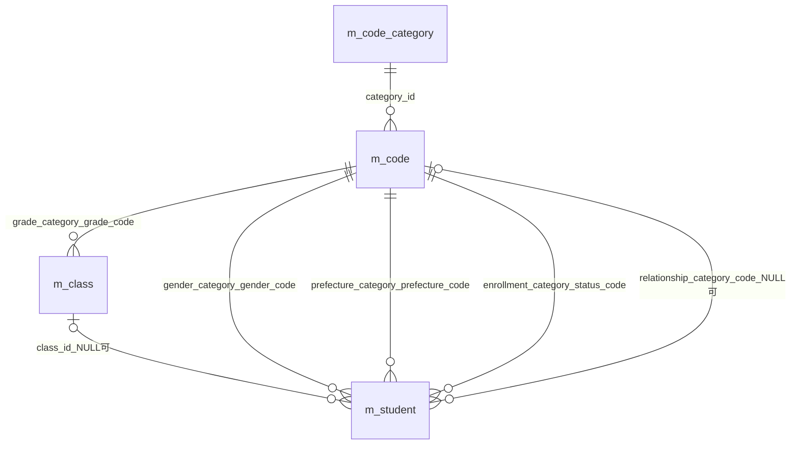

m_codeは分類＋値、m_classはclass_id、m_studentはstudent_idをPKとする。子側FKに一意制約はなく、複数行から同じ親を参照できる。学生クラスと続柄組はNULL可、必須3コード組とクラス学年組はNOT NULLである。監査target_key、確認target_id、実行時状態から学生への物理FKは宣言されていない。根拠: `sources/database/001_schema.sql:8-43,64-80,127-127,137-184,189-199`。

学生DDLは文字スカラー上限、UTC時点、正の版、日付・在籍・所属、最低1連絡手段、緊急一式、削除属性整合をCHECKする。現在のコード可否、新席定員、同一人物確認、番号不変はサービス検査である。row_versionはSQL Serverのrowversion型ではなく、手動増分するbigintである。権限SQLは学生INSERT・UPDATEと監査INSERTを許可し、学生物理DELETEと監査UPDATE・DELETEを拒否する。論理削除の管理者限定はアプリ認可で行う。根拠: `sources/database/001_schema.sql:34-59,196-205`、`sources/database/003_web_permissions.sql:14-22`、`sources/Infrastructure/WebStudentCoordinator.cs:19-19`。

### HTTP受信と接続範囲

FormGuardの許可項目照合はOrdinalIgnoreCaseである。許可外キー、不正な厳密名__Invariant、許容例外以外の同名複数値を400で拒否する。__Invariantの値はNULLまたは許可集合外なら不正であり、重複値の例外は厳密名__Invariant、末尾StatusCodes、末尾UnassignedOnlyである。大小文字を変えた__Invariantは許可名照合を通り得る一方、厳密名の内容検査条件とは一致しない。FormGuardは存在必須や業務内容の検査を代替しない。根拠: `sources/Web/Controllers/StudentsController.cs:41-41`。

MVCは非nullable参照型の暗黙requiredを抑止し、モデル検証エラー上限100を設定する。Kestrel本文とMultipart本文は65536バイト上限、フォームValueLengthLimitは65536、ValueCountLimitは128である。これらは業務スカラー値上限やHTMLコード単位上限とは別の設定である。根拠: `sources/Infrastructure/WebHostSetup.cs:16-18`。

RequestIdentityは認証済み状態、NameIdentifier、login_session、Role claimを確認する。主体は空白のみ・64スカラー値超、セッションは空白のみ・64コード単位超、RoleはEnum.TryParse失敗を401とする。Enum.IsDefinedによる値域確認はないため、認可はViewerとの差、Administratorとの一致という実条件で記載する。サービスUserも主体をTextで検査するが、保存・削除の入力catchより前にある。CookieはSecure、HttpOnly、SameSite Strict、30分、SlidingExpirationである。根拠: `sources/Infrastructure/RequestIdentity.cs:7-16`、`sources/Core/SqlServerStudentService.cs:46-51,229-232,394-396`、`sources/Infrastructure/WebHostSetup.cs:14-16`。

編集の公開経路はHTML GETとフォームPOSTである。POST `/students/options`は検索DTOからSearch Viewを返し、Edit Viewとsite.jsからは呼ばれない。Coordinator.Options、WebPresentation.Lookups・Save、StrictJson.Readを編集用JSON APIとして説明しない。WebPresentation.Saveのクラス名NULL→「未所属」整形や、StrictJsonの深さ・未知項目検査を、接続されたHTML候補表・フォーム保存へ適用しない。根拠: `sources/Web/Controllers/StudentsController.cs:22-42`、`sources/Infrastructure/WebStudentCoordinator.cs:16-19`、`sources/Infrastructure/WebPresentation.cs:8-30`、`sources/Infrastructure/StrictJson.cs:6-14`、`sources/wwwroot/js/site.js:2-9`。

webTokens=falseには、別ReadCommittedでt_confirmationへ発行し、UPDLOCK、未消費、所有者、セッション、対象、版、期限、両ハッシュを照合し、学生保存と同じトランザクションでconsumed=1にする分岐がある。現在のWeb登録はtrueである。検索Context、Snapshot、Flash、Web確認をt_runtime_stateへ保存・暗号化・復元・消費する処理は、この接続からは追跡できない。根拠: `sources/Infrastructure/WebHostSetup.cs:13-19`、`sources/Core/SqlServerStudentService.cs:279-283,308-342`、`sources/Infrastructure/SearchContextStore.cs:9-14`、`sources/Infrastructure/EditorSnapshotStore.cs:7-11`、`sources/Infrastructure/FlashMessageStore.cs:6-9`。

### 設計意図と実装の対応

参考設計は業務19入力、サーバー生成照合値、年度・学年の整合検査、理由の監査、期待版の更新条件、復帰・確認情報の制御用途を定義する。和暦4入力から日付保存、理由付き確認続行時の全検査、学生と監査の一括確定、取消と再読込の区別は現行実装にも対応する。ただし設計名を実在するメソッド名や変数名に読み替えない。根拠: `reference-designs/詳細仕様書/CSharp_ASPNET/02_学生登録画面.md:312-318,372-380,469-477,759-795`、`sources/Web/Inputs/StudentSaveInput.cs:34-54`、`sources/Core/SqlServerStudentService.cs:227-323`。

| 主題 | 参考設計の意図 | ソースで観測した実装 | 根拠 |
| --- | --- | --- | --- |
| 生年月日内部名 | command.BirthDate、ParseBirthDate、FormatBirthDate等の設計名 | StudentDraft.BirthDateInput、Parse、ToInput、ToWareki、Values[birth_date]。元号定義版を引数で受ける宣言なし | `reference-designs/詳細仕様書/CSharp_ASPNET/02_学生登録画面.md:765-795`、`sources/Core/JapaneseDateService.cs:17-50`、`sources/Core/StudentNormalizer.cs:127-127` |
| 郵便・在籍日付表示 | 郵便は3桁-4桁、在籍日付表示はyyyy/MM/dd | 郵便は保存7桁を戻す。在籍日付はISO文字列をtype=dateへ設定し、ブラウザー表示を固定しない | `reference-designs/詳細仕様書/CSharp_ASPNET/02_学生登録画面.md:93-103`、`sources/Views/Students/Edit.cshtml:9-11`、`sources/Core/SqlServerStudentService.cs:189-191` |
| 新規候補不足 | 必須初期コード不足は保存不可、クラス0件はW-STU-108 | Loadに専用警告設定なし。保存時にコード存在・クラス必須を検査 | `reference-designs/詳細仕様書/CSharp_ASPNET/02_学生登録画面.md:169-177`、`sources/Infrastructure/WebStudentCoordinator.cs:17-17`、`sources/Core/StudentNormalizer.cs:154-154` |
| 学年補助 | 新規選択を有効値に限定し、保存時にコード存在を確認 | ViewはGRADE全値を列挙。保存は形式と指定クラス実値との整合を確認し、単独GRADE存在照会なし | `reference-designs/詳細仕様書/CSharp_ASPNET/02_学生登録画面.md:103-103,127-127`、`sources/Views/Students/Edit.cshtml:12-12`、`sources/Core/SqlServerStudentService.cs:237-237,344-383` |
| 入力連動 | 元号変更時の範囲再検証、年度・学年・区分変更に応じた候補再取得 | 描画済みクラス属性で上位同期・不一致解除。候補再取得、和暦即時検証なし | `reference-designs/詳細仕様書/CSharp_ASPNET/02_学生登録画面.md:133-133,266-274`、`sources/wwwroot/js/site.js:2-9` |
| UI処理中制御 | 要求連番・Busy等を分離 | DOMのaria-busyと他ボタン無効化はあるが、押下自身の再入拒否・要求連番・旧応答破棄なし | `reference-designs/詳細仕様書/CSharp_ASPNET/02_学生登録画面.md:778-785`、`sources/wwwroot/js/site.js:4-4` |

この対応は設計意図と現行実装の差を説明するもので、設計資料を実行証拠や顧客承認に置き換えない。差分の受容判断と解析・実行確認の不足は、別報告の責務である。

### 関連文書の責務

次表は提供された計画との対応である。各参照先は本応答では未生成であり、計画への掲載だけで生成済みリンクとは扱わない。

| 文書ID | 正本相対パス | 分担する責務 | 本応答の生成状態 |
| --- | --- | --- | --- |
| SM-BAS-STUDENT-EDITOR | spec/basic/student-editor.md | 業務目的、項目の意味、モード | 未生成 |
| SM-DET-STUDENT-SEARCH | spec/detail/student-search.md | 復帰検索の全検査、述語、ページング | 未生成 |
| SM-COM-HTTP-SECURITY | spec/common/http-security-contract.md | 認証、フォーム受信、CSRF、HTTP応答 | 未生成 |
| SM-COM-NORMALIZATION-DATE | spec/common/normalization-date.md | 文字正規化、長さ単位、日付境界 | 未生成 |
| SM-COM-LOOKUPS | spec/common/lookup-contract.md | 候補、表示可否、既存値保持 | 未生成 |
| SM-COM-RUNTIME-STATE | spec/common/runtime-state.md | Context、Snapshot、確認、Flash | 未生成 |
| SM-COM-TRANSACTION-AUDIT | spec/common/transaction-audit.md | 接続、排他、取消、確定、監査 | 未生成 |
| SM-DATA-LOGICAL-CONTRACTS | spec/data/logical-contracts.md | DTO、入力・保存・表示の移送 | 未生成 |
| SM-DET-CLASS-MAINTENANCE | spec/detail/class-maintenance.md | クラス名称・期間・定員の更新元 | 未生成 |
| SM-DET-CODE-MAINTENANCE | spec/detail/code-maintenance.md | コード名称・期間・保護設定の更新元 | 未生成 |
| SM-DB-INDEX | spec/database/index.md | DDL関連、索引、物理共通規則 | 未生成 |
| SM-DB-M-STUDENT | spec/database/tables/m_student.md | 学生の全列・物理制約 | 未生成 |
| SM-DB-M-CLASS | spec/database/tables/m_class.md | クラスの全列・物理制約 | 未生成 |
| SM-DB-M-CODE | spec/database/tables/m_code.md | コード値・名称・期間の物理定義 | 未生成 |
| SM-DB-M-CODE-CATEGORY | spec/database/tables/m_code_category.md | コード分類の物理定義 | 未生成 |
| SM-DB-T-OPERATION-LOG | spec/database/tables/t_operation_log.md | 監査の物理定義 | 未生成 |
| SM-DB-T-CONFIRMATION | spec/database/tables/t_confirmation.md | 非Web確認分岐の保持・消費 | 未生成 |
| SM-DB-T-RUNTIME-STATE | spec/database/tables/t_runtime_state.md | DDLと現行メモリ実装の境界 | 未生成 |
| SM-OPS-DATABASE-DEPLOYMENT | spec/operations/database-deployment.md | 配備入力、適用順、権限確認 | 未生成 |
| SM-DEP-PROCESS | spec/dependencies/process-dependencies.md | 呼出し接続、寿命、保持領域 | 未生成 |
| SM-RPT-DESIGN-IMPLEMENTATION | spec/reports/design-implementation-differences.md | 設計意図と実装差、対応判断 | 未生成 |
| SM-RPT-UNRESOLVED | spec/reports/unresolved-and-analysis-limits.md | 不足資料、受信境界、実行証跡、解析範囲 | 未生成 |
