<!-- spec-meta: {"schema":"spec-md/1.0","documentId":"SM-DET-STUDENT-SEARCH","version":"4.0","path":"spec/detail/student-search.md","sheets":[{"heading":"概要","kind":"GRID","sheet":"01_概要"},{"heading":"項目一覧","kind":"LIST","sheet":"02_項目一覧","key":["項目キー"]},{"heading":"選択候補一覧","kind":"LIST","sheet":"03_選択候補一覧","key":["候補キー"]},{"heading":"内部項目一覧","kind":"LIST","sheet":"04_内部項目一覧","key":["内部項目キー"]},{"heading":"項目移送仕様","kind":"LIST","sheet":"05_項目移送仕様","key":["移送キー"]},{"heading":"イベント仕様","kind":"GRID","sheet":"06_イベント仕様"},{"heading":"補足説明","kind":"GRID","sheet":"07_補足説明"}]} -->
# 学生検索画面 詳細仕様書

| 文書属性 | 内容 |
| --- | --- |
| 文書ID | SM-DET-STUDENT-SEARCH |
| 文書種別 | 詳細仕様書 |
| 版数 | 4.0 |
| 正本パス | spec/detail/student-search.md |
| 対象責務 | 条件受付、候補更新、学生検索、ページ取得、一覧表示、検索状態、登録入口への移送と検索復帰 |
| 記述基準 | 接続されたソースの動作を現行実装として記述し、参考設計の意図は区別して照合する |
| 対象読者 | 業務システムのIT担当者、実装経験5年程度の担当者 |

## 概要

### 機能と実装の分担

学生検索画面は、指定条件に一致する非削除学生を取得し、学生基本情報と所属・業務コードの名称を一覧に表示する。条件入力、候補更新、検索実行は別の操作である。ページ操作は最後に成功した検索条件を使う。新規登録と行の編集・参照は登録画面を開く操作であり、検索、候補更新、クリアから学生の業務値を書き換える処理はない。根拠: `sources/Views/Students/Search.cshtml:4-8`、`sources/Web/Controllers/StudentsController.cs:8-25`、`sources/Core/SqlServerStudentService.cs:103-170`。

接続された検索経路は、Searchビュー、StudentsController、WebStudentCoordinator、IStudentService.SearchAsync、SqlServerStudentServiceの順である。Controllerはフォーム検査と画面モデルの作成を、Coordinatorは検索状態の排他と成功結果の保持を、サービスは条件検査とDB参照を担当する。SearchContextStoreはプロセスメモリに条件と結果を保持する。根拠: `sources/Program.cs:2-7`、`sources/Infrastructure/WebStudentCoordinator.cs:7-15`、`sources/Infrastructure/SearchContextStore.cs:9-15`。

起動登録ではRequestIdentity、Coordinator、IStudentServiceをScoped、検索・編集・通知ストアをSingletonとする。IStudentServiceには設定名StudentDbの接続文字列を使ってSqlServerStudentServiceを登録し、webTokens=trueを指定する。設定が空なら503のWebFaultを送出する。接続設定名はサービス解決の入口であり、学校や実接続先を表す業務属性ではない。根拠: `sources/Infrastructure/WebHostSetup.cs:13-19`。

| 操作 | HTTP入口 | 受け付ける材料 | 通常の応答 |
| --- | --- | --- | --- |
| 初回表示 Index | GET `/students` | contextIdなし | 初期条件、候補、未検索のSearch HTML |
| 検索 Search | POST `/students/search` | Criteria.*、ContextId、ContextRevision、TabId、表示指定 | 今回条件と検索結果のSearch HTML |
| 候補更新 Options | POST `/students/options` | 検索と同じ条件フォーム | 今回条件、候補、LastResultのSearch HTML |
| ページ Page | POST `/students/page` | PageRequestの項目、TabId | Applied由来条件と再検索結果のSearch HTML |
| クリア Clear | POST `/students/clear` | ContextId、ContextRevision、TabId | 同じ状態IDの初期条件、未検索HTML |
| 復帰 Resume | GET `/students?contextId=…&contextRevision=…` | 状態ID、期待検索版 | 未検索の復元、または元条件で再検索したHTML |
| 新規登録 | GET `/students/new?returnContextId=…` | 復帰状態ID | 新規Edit HTML。Viewerは拒否 |
| 編集・参照 | GET `/students/{id}?returnContextId=…` | 学生ID、復帰状態ID | 最新の非削除詳細を使ったEdit HTML |

Resume専用ルートはなく、contextId付きIndexがCoordinator.Resumeを呼ぶ。GET `/` は `/students` へ転送する。検索・候補更新は一つの条件フォーム、ページとクリアはそれぞれ別フォームである。ページフォームにCriteria.*は含まれない。拒否と障害の応答はイベント仕様に記載する。根拠: `sources/Program.cs:6-7`、`sources/Web/Controllers/StudentsController.cs:8-22`、`sources/Views/Students/Search.cshtml:4-8`。

### 入力中条件と成功済み条件

HTTPフォーム値はMVCがCriteria接頭辞でStudentSearchInputへバインドする。検索時のToCriteriaは、NameをStudentName、KanaをStudentNameKana、StatusCodesをEnrollmentStatusCodesへ移す。年度はint?、未所属はbool、在籍はstring[]として渡す。クラスは入力DTOのstring?を正のlong?へ解析する。日付両端はstring?のまま渡し、サービス内でDateOnly?へ変換する。根拠: `sources/Web/Inputs/StudentSearchInput.cs:7-22`、`sources/Core/Contracts.cs:31-48`。

入力中の条件はブラウザー、要求input、応答モデルCriteriaにある。検索Entryには入力途中条件専用の領域がない。Appliedは最後に成功したSearchCriteria、LastResultはその検索結果である。SearchとPageは成功確認後に条件を深く複製してAppliedへ置く。サービス内のSQL用正規化値でAppliedの文字列を置換しない。Optionsは今回inputとLastResultを併用し、PageはAppliedの複製、Resumeは元Appliedで検索する。根拠: `sources/Infrastructure/SearchContextStore.cs:9-15`、`sources/Infrastructure/WebStudentCoordinator.cs:7-15`、`sources/Web/Controllers/StudentsController.cs:22-22`。

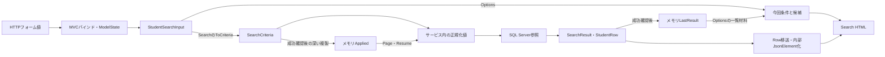

非nullable参照型の暗黙Requiredは抑制されている。DTOのstring・string[]注釈と初期化子は、受信NULL排除の実行保証ではない。Normalizerのrawはその関数へ届いた文字列を指す。HTTPの省略・空白・変換失敗から最終DTOになる境界と、サービスへ渡った値に対する分岐を区別する。再表示材料はinputとModelStateであり、HTTP原文字列を完全に別保存する処理ではない。根拠: `sources/Infrastructure/WebHostSetup.cs:16-18`、`sources/Web/Controllers/StudentsController.cs:13-22`、`sources/Core/StudentNormalizer.cs:47-57`。

### 画面構成と静的ソース投影

共有Layoutは利用者名と業務日をヘッダーに置き、mainに個別ビューを配置する。検索画面の順序は、見出し・メッセージ、条件、検索／候補更新、クリア／新規登録、結果状態、表示指定、一覧、前後ページである。条件は.fieldsの2列配置で、760px以下では1列となる。一覧は.gridで横スクロールし、tableは最小幅1050px、セルは上寄せと任意位置の折返しを使う。根拠: `sources/Views/_ViewStart.cshtml:1-1`、`sources/Views/Shared/_Layout.cshtml:1-1`、`sources/Views/Students/Search.cshtml:3-8`、`sources/wwwroot/css/site.css:1-1`。

SRCのidは項目識別とJavaScriptの検索に使う。画面のCSSは要素・classセレクターで適用され、SRC idを指定するCSSはない。メッセージ領域にはaria-live=politeがあり、role属性はない。エラーは.message.error、通知は.message.infoである。CSSに.info専用定義はなく、通知には.messageの共通定義が適用される。根拠: `sources/Views/Shared/_MessagePanel.cshtml:2-3`、`sources/wwwroot/css/site.css:1-1`、`sources/wwwroot/js/site.js:7-7`。

以下は現行ビュー・共有Layout・適用CSSを基にした、Viewer、未検索、未所属OFFの静的ソース投影である。実画面撮影や参考設計モックの再現ではない。在籍名称だけをseedから配置し、学校固有のクラス・学生データは補っていない。formのaction・formactionと実アプリへのhrefを使わず、送信先をdata属性、リンク先を文書fragment、ボタンをtype=buttonで表す。状態・偽造防止情報の実値とJavaScriptは含めない。根拠: `sources/Views/Students/Search.cshtml:4-8`、`sources/Views/Shared/_Layout.cshtml:1-1`、`sources/database/002_seed.sql:19-22`。

<!doctype html>
<html lang="ja">
<head>
<meta charset="utf-8">
<meta name="viewport" content="width=device-width,initial-scale=1">
<title>学生管理</title>
<style>
:root{font-family:Meiryo,'Yu Gothic UI',sans-serif;color:#243448;background:#f2f5f9;font-size:14px}*{box-sizing:border-box}body{margin:0}header{background:#153654;color:white;padding:16px 28px;display:flex;justify-content:space-between;gap:20px}main{background:white;max-width:1440px;margin:24px auto;padding:24px}h1{font-size:24px}fieldset{border:1px solid #c8d1dc;padding:18px;margin:12px 0}legend{font-weight:bold}.fields{display:grid;grid-template-columns:1fr 1fr;gap:14px 28px}label{display:flex;flex-direction:column;gap:5px}input,select,textarea,button{font:inherit;padding:8px;border:1px solid #afbece;border-radius:3px}input,select,textarea{max-width:100%;width:100%}.check{display:inline-flex;flex-direction:row;align-items:center;margin-right:12px}.check input{width:auto}.actions{display:flex;gap:10px;align-items:center;flex-wrap:wrap;margin:16px 0}button{background:white;cursor:pointer}.primary{background:#1c5985;color:white}button:disabled{cursor:default;color:#8a98a5;background:#f3f5f8}.message{padding:14px;border:1px solid #b6dccc;background:#edf7f3}.error{background:#fff1f1;border-color:#c66}.warning{background:#fff8eb;padding:12px}.grid{overflow-x:auto}table{border-collapse:collapse;min-width:1050px;width:100%;font-size:12px}th,td{padding:10px 8px;border:1px solid #d4dee8;vertical-align:top;overflow-wrap:anywhere}th{background:#e6eef6}tr:nth-child(even){background:#f8fafc}.pager{display:flex;gap:14px;align-items:center;justify-content:center;margin:18px}small{color:#5f7183}@media(max-width:760px){main{margin:0;padding:15px}.fields{grid-template-columns:1fr}header{flex-direction:column}}
</style>
</head>
<body>
<header><strong>学生管理システム</strong><span>利用者 〈利用者表示名〉　業務日 〈yyyy/MM/dd〉</span></header>
<main>
<h1>学生検索</h1>
<form data-search-form data-source-method="POST" data-source-route="/students/search">
<input type="hidden" name="ContextId"><input type="hidden" name="ContextRevision"><input type="hidden" name="TabId"><input type="hidden" name="PageSize" value="20"><input type="hidden" name="SortKey" value="studentNo"><input type="hidden" name="SortDirection" value="asc">
<fieldset><legend>検索条件</legend><div class="fields">
<label>学籍番号<input id="SRC-001" name="Criteria.StudentNo" maxlength="30"></label>
<label>氏名<input id="SRC-002" name="Criteria.Name" maxlength="16"></label>
<label>氏名カナ<input id="SRC-003" name="Criteria.Kana" maxlength="72"></label>
<label>年度<select id="SRC-004" name="Criteria.SchoolYear"><option value="">すべて</option></select></label>
<label>学年<select id="SRC-005" name="Criteria.GradeCode"><option value="">すべて</option></select></label>
<label>クラス<select id="SRC-006" name="Criteria.ClassId"><option value="">すべて</option></select></label>
<label class="check"><input id="SRC-007" name="Criteria.UnassignedOnly" type="checkbox">未所属のみ</label>
<fieldset><legend>在籍区分</legend><label class="check"><input type="checkbox" name="Criteria.StatusCodes" value="01" checked>在学</label><label class="check"><input type="checkbox" name="Criteria.StatusCodes" value="02" checked>休学</label><label class="check"><input type="checkbox" name="Criteria.StatusCodes" value="03">卒業</label><label class="check"><input type="checkbox" name="Criteria.StatusCodes" value="04">退学</label><small>全解除はすべて</small></fieldset>
<label>都道府県<select id="SRC-009" name="Criteria.PrefectureCode"><option value="">すべて</option></select></label>
<label>電話番号<input id="SRC-010" name="Criteria.PhoneNumber" maxlength="40"></label>
<label>入学日・開始<input id="SRC-011" name="Criteria.AdmissionFrom" type="date"></label>
<label>入学日・終了<input id="SRC-012" name="Criteria.AdmissionTo" type="date"></label>
</div><div class="actions"><button type="button" class="primary" data-source-method="POST" data-source-route="/students/search">検索</button><button type="button" data-source-method="POST" data-source-route="/students/options">候補を更新</button></div></fieldset>
</form>
<div class="actions"><form data-source-method="POST" data-source-route="/students/clear"><input type="hidden" name="ContextId"><input type="hidden" name="ContextRevision"><input type="hidden" name="TabId"><button type="button">クリア</button></form></div>
<p>未検索</p>
<form data-source-method="POST" data-source-route="/students/page">
<input type="hidden" name="ContextId"><input type="hidden" name="ContextRevision"><input type="hidden" name="TabId">
<div class="actions"><label>表示件数<select name="PageSize"><option value="20" selected>20</option><option value="50">50</option><option value="100">100</option></select></label><label>並び順<select name="SortKey"><option value="studentNo" selected>学籍番号</option><option value="name">氏名</option><option value="admissionDate">入学日</option><option value="updatedAt">更新日時</option></select></label><select name="SortDirection" aria-label="並び順方向"><option value="asc" selected>昇順</option><option value="desc">降順</option></select><button type="button" name="Page" value="1" disabled>並び順・件数を反映</button></div>
<div class="grid"><table><thead><tr><th>学籍番号</th><th>氏名</th><th>氏名カナ</th><th>生年月日</th><th>年度／学年</th><th>クラス</th><th>在籍区分</th><th>住所</th><th>本人電話</th><th>更新日時</th><th>操作</th></tr></thead><tbody></tbody></table></div>
<nav class="pager"><button type="button" name="Page" value="0" disabled>前へ</button><span>1 / 1</span><button type="button" name="Page" value="2" disabled>次へ</button></nav>
</form>
</main>
</body>
</html>

権限差はクリアの隣と一覧の行リンクに現れる。Staff・Administratorには新規登録リンクを表示し、行操作を「編集」とする。Viewerには新規登録リンクがなく、行操作は「参照」である。次のfragmentはStaff・Administratorの操作領域の差分で、上のViewer状態と同時に適用しない。根拠: `sources/Views/Students/Search.cshtml:6-8`。

<div class="actions"><form data-source-method="POST" data-source-route="/students/clear"><button type="button">クリア</button></form><a href="#student-editor-contract" data-source-method="GET" data-source-route="/students/new?returnContextId=〈状態ID〉">新規登録</a></div>

foundの行は、取得値を次の位置へ移す。これは値の移送位置を示すfragmentで、学生データの表示例ではない。根拠: `sources/Views/Students/Search.cshtml:8-8`、`sources/Infrastructure/WebPresentation.cs:20-20`。

<div class="grid"><table><thead><tr><th>学籍番号</th><th>氏名</th><th>氏名カナ</th><th>生年月日</th><th>年度／学年</th><th>クラス</th><th>在籍区分</th><th>住所</th><th>本人電話</th><th>更新日時</th><th>操作</th></tr></thead><tbody><tr><td>〈studentNo〉</td><td>〈studentName〉</td><td>〈studentNameKana〉</td><td>〈birthDateWareki〉</td><td>〈schoolYear〉 〈gradeName〉</td><td>〈classCode〉 〈className〉</td><td>〈enrollmentName〉</td><td>〈addressDisplay〉</td><td>〈phoneNumber、NULL時は－〉</td><td>〈updatedAt〉</td><td><a href="#student-editor-contract" data-source-method="GET" data-source-route="/students/{studentId}?returnContextId=〈状態ID〉">編集</a></td></tr></tbody></table></div>

| 状態・条件 | 表示と操作の差分 |
| --- | --- |
| found | 結果文に実件数と検索日時を表示し、最大PageSize行を配置する。表示指定反映は活性、前へはpage>1、次へはpage×PageSize<countの場合だけ活性 |
| empty | 「該当する学生はありません。」、空tbody、ページ操作非活性 |
| tooMany | .warningで「10,000件を超えました。条件を追加してください。」、空tbody、ページ操作非活性。一部だけの一覧を出さない |
| Search・Pageの局所失敗 | 見出し直後の.message.errorにvalidation-summary Allを表示し、一覧材料は未検索用の空配列とする |
| Options | 今回条件と最後の成功一覧を表示し、.message.infoに条件未反映またはクラス解除を通知する |
| 未所属ONの再描画 | 年度・学年・クラスの3selectをdisabledにする。在籍選択は維持する |
| 未所属のブラウザー変更だけ | ONで所属3値を空にするが、disabledは変更しない。OFFでも元値を復元しない |

根拠: `sources/Views/Students/Search.cshtml:5-8`、`sources/Views/Shared/_MessagePanel.cshtml:2-3`、`sources/Web/Controllers/StudentsController.cs:14-22`、`sources/wwwroot/js/site.js:7-7`。

参考詳細設計に埋め込まれたHTMLは架空値を使う設計モックであり、現行ソース投影とは出自が異なる。そのモックには表示範囲、メニュー、先頭・最後ページ等も配置されるが、上の投影へ現行機能として追加しない。参考資料からリンクされる単独HTML・画像と、本書内のHTMLも別成果物である。根拠: `reference-designs/詳細仕様書/CSharp_ASPNET/01_学生検索画面.md:27-45`。

## 項目一覧

| 項目キー | 論理名・初期状態 | 実コントロール・フォーム名 | 入力DTO→サービス条件の実型 | 検査・正規化 | 検索列・保存列、DB属性 | SQL条件・パラメータ | 根拠 |
| --- | --- | --- | --- | --- | --- | --- | --- |
| SRC-001 | 学籍番号、空 | input、id=`SRC-001`、`Criteria.StudentNo`、maxlength=30 | `StudentNo:string`→`StudentNo:string?` | サービス引数NULL・空文字は省略。非空はIdentifier。raw・Trim後・NFKC大文字化後15スカラー値以内、先頭英数字、以降英数字・ハイフン | 検索・保存とも`m_student.student_no:varchar(15) NOT NULL`、15バイト。保存もIdentifier | 前方`LIKE @no ESCAPE '!'`、`@no:VarChar(31)`。保存`@student_no:VarChar(15)` | `sources/Views/Students/Search.cshtml:5-5`、`sources/Web/Inputs/StudentSearchInput.cs:7-22`、`sources/Core/StudentNormalizer.cs:59-64`、`sources/Core/StudentNormalizer.cs:124-124`、`sources/Core/SqlServerStudentService.cs:113-113`、`sources/Core/SqlServerStudentService.cs:140-140`、`sources/database/001_schema.sql:9-9` |
| SRC-002 | 氏名、空 | input、id=`SRC-002`、`Criteria.Name`、maxlength=16 | `Name:string`→`StudentName:string?` | 任意Textでraw・Trim後8スカラー値。非NULLはNFKC・大文字化・Unicode空白除去のNameKey、キー上限160 | 検索`name_key:nvarchar(320) NOT NULL`、保存表記`student_name:nvarchar(16) NOT NULL`。容量320／16 UTF-16コード単位、CHECK160／8 | 部分`LIKE @name ESCAPE '!'`、`@name:NVarChar(642)`。保存表記／キーは`NVarChar(16)`／`NVarChar(320)` | `sources/Web/Inputs/StudentSearchInput.cs:8-22`、`sources/Core/StudentNormalizer.cs:47-70`、`sources/Core/StudentNormalizer.cs:125-145`、`sources/Core/SqlServerStudentService.cs:31-32`、`sources/Core/SqlServerStudentService.cs:114-115`、`sources/Core/SqlServerStudentService.cs:141-141`、`sources/database/001_schema.sql:10-12`、`sources/database/001_schema.sql:44-46` |
| SRC-003 | 氏名カナ、空 | input、id=`SRC-003`、`Criteria.Kana`、maxlength=72 | `Kana:string`→`StudentNameKana:string?` | NULL・空文字は省略。非空はraw・Trim後36スカラー値、NFKC、ひらがな変換、空白統合、許可カナ検査、変換後18以内。検索キーは半角空白除去 | 検索`kana_key`、保存表記`student_name_kana`は双方`nvarchar(36) NOT NULL`、容量36 UTF-16コード単位、CHECK18。保存カナは必須 | 部分`LIKE @kana ESCAPE '!'`、`@kana:NVarChar(74)`。保存表記／キーは双方`NVarChar(36)` | `sources/Web/Inputs/StudentSearchInput.cs:9-22`、`sources/Core/StudentNormalizer.cs:72-85`、`sources/Core/StudentNormalizer.cs:126-145`、`sources/Core/SqlServerStudentService.cs:31-32`、`sources/Core/SqlServerStudentService.cs:116-116`、`sources/Core/SqlServerStudentService.cs:142-142`、`sources/database/001_schema.sql:11-13`、`sources/database/001_schema.sql:45-47` |
| SRC-004 | 年度、すべて | select、id=`SRC-004`、`Criteria.SchoolYear`。未所属再描画時disabled | `SchoolYear:int?`→`int?` | 指定値1900～9998、年度候補の存在を確認。0は未指定ではない | `m_class.school_year:smallint NOT NULL`。所属クラスの属性で、学生に年度列なし。保守も同範囲 | `c.school_year=@year`、`@year:SmallInt`、Sizeなし。保守`@school_year:SmallInt` | `sources/Views/Students/Search.cshtml:5-5`、`sources/Web/Inputs/StudentSearchInput.cs:10-20`、`sources/Core/SqlServerStudentService.cs:109-109`、`sources/Core/SqlServerStudentService.cs:126-129`、`sources/Core/SqlServerStudentService.cs:143-143`、`sources/Core/MasterMaintenanceService.cs:32-32`、`sources/Core/MasterMaintenanceService.cs:73-74`、`sources/database/001_schema.sql:64-64` |
| SRC-005 | 学年、すべて | select、id=`SRC-005`、`Criteria.GradeCode`。未所属再描画時disabled | `GradeCode:string?`→`string?` | raw・Trim後2スカラー値以内、NFKC後ASCII数字2桁。任意空はNULL、GRADE存在確認。00は学年なしの実コード | `m_class.grade_code:varchar(2) NOT NULL`、`grade_category:varchar(24) NOT NULL`。学生に学年列なし。保守は学年必須 | `c.grade_code=@grade`、`@grade:VarChar(2)`。保守`@grade_code:VarChar(2)` | `sources/Web/Inputs/StudentSearchInput.cs:11-20`、`sources/Core/StudentNormalizer.cs:113-117`、`sources/Core/SqlServerStudentService.cs:118-125`、`sources/Core/SqlServerStudentService.cs:144-144`、`sources/Core/MasterMaintenanceService.cs:34-34`、`sources/Core/MasterMaintenanceService.cs:73-74`、`sources/database/001_schema.sql:65-66`、`sources/database/002_seed.sql:78-78` |
| SRC-006 | クラス、すべて | select、id=`SRC-006`、`Criteria.ClassId`。未所属再描画時disabled | `ClassId:string?`→IdParser.Optional→`long?` | NULL・空文字は未指定。非空は19コード単位以内、ASCII数字、正のInt64。Trim・NFKCなし。存在と指定年度・正規化学年の一致を確認 | 学生保存列`m_student.class_id:bigint NULL`、参照先`m_class.class_id:bigint IDENTITY NOT NULL`、PK。0は未所属ではない | `s.class_id=@class`、`@class:BigInt`。存在確認`@id:BigInt`、保存`@class_id:BigInt`。Sizeなし | `sources/Web/Inputs/StudentSearchInput.cs:12-20`、`sources/Web/Inputs/StudentSaveInput.cs:57-60`、`sources/Core/SqlServerStudentService.cs:36-36`、`sources/Core/SqlServerStudentService.cs:131-145`、`sources/database/001_schema.sql:28-28`、`sources/database/001_schema.sql:63-80` |
| SRC-007 | 未所属のみ、false | checkbox、id=`SRC-007`、`Criteria.UnassignedOnly` | `UnassignedOnly:bool`→`bool` | trueと年度・非NULL学年・クラスの併指定を学年正規化前に拒否。Searchは自動解除せず、Optionsは所属3値を解除 | `m_student.class_id:bigint NULL`のNULLを検索。専用保存列なし | trueなら`s.class_id IS NULL`、パラメータなし | `sources/Views/Students/Search.cshtml:5-5`、`sources/Web/Inputs/StudentSearchInput.cs:13-20`、`sources/Web/Controllers/StudentsController.cs:22-22`、`sources/Core/SqlServerStudentService.cs:110-110`、`sources/Core/SqlServerStudentService.cs:146-146` |
| STATUS-GROUP | 在籍区分、01・02 | 同名checkbox群、`Criteria.StatusCodes`。DOM idのSRC-008は存在しない | `StatusCodes:string[]`→`EnrollmentStatusCodes:string[]` | POSTキー省略は空配列へ補正。最大4件、Ordinal重複なし、01～04のみ。正規化・在籍マスター存在照会なし | `enrollment_status_code:varchar(2) NOT NULL`、`enrollment_category:varchar(24) NOT NULL` | 非空は`IN (@status0,...)`、各`VarChar(2)`。空配列は述語省略。保存`@enrollment_status_code:VarChar(2)` | `sources/Views/Students/Search.cshtml:5-5`、`sources/Web/Inputs/StudentSearchInput.cs:14-21`、`sources/Web/Controllers/StudentsController.cs:14-14`、`sources/Web/Controllers/StudentsController.cs:22-22`、`sources/Core/SqlServerStudentService.cs:111-112`、`sources/Core/SqlServerStudentService.cs:151-154`、`sources/database/001_schema.sql:25-26` |
| SRC-009 | 都道府県、すべて | select、id=`SRC-009`、`Criteria.PrefectureCode` | `PrefectureCode:string?`→`string?` | raw・Trim後2スカラー値以内、NFKC後ASCII数字2桁。任意空はNULL、PREFECTURE存在確認 | `prefecture_code:varchar(2) NOT NULL`、名称結合用`prefecture_category:varchar(24) NOT NULL`。保存は都道府県必須 | `s.prefecture_code=@prefecture`、`@prefecture:VarChar(2)`。保存`@prefecture_code:VarChar(2)`。表示住所の文字列検索ではない | `sources/Web/Inputs/StudentSearchInput.cs:15-21`、`sources/Core/StudentNormalizer.cs:113-117`、`sources/Core/StudentNormalizer.cs:130-130`、`sources/Core/SqlServerStudentService.cs:33-33`、`sources/Core/SqlServerStudentService.cs:119-125`、`sources/Core/SqlServerStudentService.cs:147-147`、`sources/database/001_schema.sql:18-19` |
| SRC-010 | 電話番号、空 | input、id=`SRC-010`、`Criteria.PhoneNumber`、maxlength=40 | `PhoneNumber:string`→`string?` | raw・Trim後20スカラー値以内、任意空はNULL。NFKC後にUnicode空白、半角ハイフン、U+2010・U+2011・U+2212、丸括弧を除去。国内0始まり10～11桁、国際+と非ゼロ始まり7～15桁。形式上最大16 | `phone_number`と`emergency_phone_number`は双方`varchar(16) NULL`。保存もPhone | `(s.phone_number=@phone OR s.emergency_phone_number=@phone)`、`@phone:VarChar(16)`。保存側双方も`VarChar(16)` | `sources/Views/Students/Search.cshtml:5-5`、`sources/Web/Inputs/StudentSearchInput.cs:16-21`、`sources/Core/StudentNormalizer.cs:87-93`、`sources/Core/StudentNormalizer.cs:133-141`、`sources/Core/SqlServerStudentService.cs:34-37`、`sources/Core/SqlServerStudentService.cs:148-148`、`sources/database/001_schema.sql:22-32` |
| SRC-011 | 入学日・開始、未設定 | date input、id=`SRC-011`、`Criteria.AdmissionFrom`。maxlengthなし | `AdmissionFrom:string?`→`string?`→サービス内`DateOnly?` | NULL・空文字は下端省略。非空はTrimなし、NFKC後10コード単位、InvariantCultureでyyyy-MM-dd厳密解析。1900-01-01～入口業務日。正規化前の個別長上限なし | `m_student.admission_date:date NOT NULL`。任意検索条件と保存列の必須性は別 | 開始を含む`s.admission_date>=@from`、`@from:Date`、Sizeなし。DateOnlyを当日0時のDateTimeへ変換 | `sources/Views/Students/Search.cshtml:5-5`、`sources/Web/Inputs/StudentSearchInput.cs:17-22`、`sources/Core/JapaneseDateService.cs:52-59`、`sources/Core/SqlServerStudentService.cs:67-72`、`sources/Core/SqlServerStudentService.cs:105-105`、`sources/Core/SqlServerStudentService.cs:120-122`、`sources/Core/SqlServerStudentService.cs:149-149`、`sources/database/001_schema.sql:24-24` |
| SRC-012 | 入学日・終了、未設定 | date input、id=`SRC-012`、`Criteria.AdmissionTo`。maxlengthなし | `AdmissionTo:string?`→`string?`→サービス内`DateOnly?` | 開始と同じ変換・範囲。片側指定可。両端ありで開始>終了はE-STU-006 | 同じ`admission_date:date NOT NULL`の上端 | 終了を含む`s.admission_date<=@to`、`@to:Date`、Sizeなし。保存`@admission_date:Date` | `sources/Views/Students/Search.cshtml:5-5`、`sources/Web/Inputs/StudentSearchInput.cs:18-22`、`sources/Core/JapaneseDateService.cs:52-59`、`sources/Core/SqlServerStudentService.cs:35-35`、`sources/Core/SqlServerStudentService.cs:120-122`、`sources/Core/SqlServerStudentService.cs:150-150`、`sources/database/001_schema.sql:24-24` |
| PAGE-SIZE | 表示件数、20 | ページselect `PageSize`、条件フォーム同名hidden | Search引数`int`／`PageRequest.PageSize:int`→条件`int` | 20・50・100のみ | 非DB制御値、取得行数上限 | `@size:Int`、Sizeなし | `sources/Views/Students/Search.cshtml:4-8`、`sources/Web/Inputs/StudentSearchInput.cs:27-29`、`sources/Core/SqlServerStudentService.cs:107-107`、`sources/Core/SqlServerStudentService.cs:164-164` |
| SORT-KEY | 並び順、studentNo | select `SortKey`、条件フォーム同名hidden | `string`→`SearchCriteria.SortKey:string` | studentNo・name・admissionDate・updatedAtのみ | 非DB制御値、許可列への対応 | 許可列をswitchで選ぶ | `sources/Views/Students/Search.cshtml:4-8`、`sources/Core/SqlServerStudentService.cs:108-108` |
| SORT-DIRECTION | 方向、asc | select `SortDirection`、aria-label=並び順方向、条件フォーム同名hidden | `string`→`SearchCriteria.SortDirection:string` | 小文字asc・descのみ | 非DB制御値 | 検査済み方向をORDER BYへ使用 | `sources/Views/Students/Search.cshtml:4-8`、`sources/Core/SqlServerStudentService.cs:107-107`、`sources/Core/SqlServerStudentService.cs:162-162` |
| ACT-SEARCH | 検索 | 条件フォームsubmit、POST `/students/search` | 今回input→`SearchRequest` | ToCriteriaでPage1、成功後だけApplied置換 | 学生・マスター参照、検索メモリ更新 | E02、Q-E・Q-S・Q-L | `sources/Web/Controllers/StudentsController.cs:13-16`、`sources/Infrastructure/WebStudentCoordinator.cs:7-9` |
| ACT-OPTIONS | 候補を更新 | 同フォームsubmit、formaction=`/students/options` | 今回inputと状態識別 | 候補再描画、学生検索・期待版照合なし | マスター参照、Applied更新なし | E03、Q-L | `sources/Web/Controllers/StudentsController.cs:22-22` |
| ACT-CLEAR | クリア | 独立フォーム、POST `/students/clear` | `ContextRequest`、`TabId:string` | 初期条件と未検索へ戻す | メモリ消去、DB DELETEなし | E05、再描画Q-L | `sources/Web/Controllers/StudentsController.cs:21-21`、`sources/Infrastructure/WebStudentCoordinator.cs:15-15` |
| ACT-PAGE | 表示指定反映・前へ・次へ | button名`Page`、反映1、前後page±1 | `PageRequest.Page:int`→条件`Page:int` | found以外で非活性。表示指定変更時Page1 | Appliedから再検索。未実行Criteria.*を送らない | `@offset:Int`、`@size:Int`。E04の補正 | `sources/Views/Students/Search.cshtml:8-8`、`sources/Infrastructure/WebStudentCoordinator.cs:11-12` |
| ACT-NEW | 新規登録 | a要素、GET `/students/new`、returnContextId付き | `returnContextId:string?` | Viewer非表示、入口でも作成権限確認 | 検索条件を登録値へ転記しない | E08 | `sources/Views/Students/Search.cshtml:6-6`、`sources/Infrastructure/WebStudentCoordinator.cs:17-17` |
| ACT-ROW | 編集・参照 | a要素、GET `/students/{studentId}`、returnContextId付き | route `id:long` | Viewerは参照、他は編集。最新対象を再取得 | `m_student.student_id:bigint NOT NULL`、PK | 詳細`@id:BigInt`、Sizeなし、不在404 | `sources/Views/Students/Search.cshtml:8-8`、`sources/Web/Controllers/StudentsController.cs:24-25`、`sources/Core/SqlServerStudentService.cs:172-181` |

## 選択候補一覧

| 候補キー | 対象と取得元 | 抽出・完全な順序 | キー・表示と保存側属性 | 初期・候補なし | 連動・停止値の扱い | 根拠 |
| --- | --- | --- | --- | --- | --- | --- |
| L-YEAR | SRC-004、全`LookupSet.Classes` | SchoolYearを重複排除、年度降順。学年では絞らない | 年度整数を同じ数字で表示。`m_class.school_year:smallint NOT NULL`、保守1900～9998、`@school_year:SmallInt` | 空値「すべて」。候補0件でも先頭選択肢あり | 停止・期間外クラスも生成元。未所属ONのOptionsで解除 | `sources/Views/Students/Search.cshtml:5-5`、`sources/Core/SqlServerStudentService.cs:206-214`、`sources/Core/MasterMaintenanceService.cs:32-32`、`sources/Core/MasterMaintenanceService.cs:73-74`、`sources/database/001_schema.sql:64-64` |
| L-GRADE | SRC-005、CodesのGRADE分類 | SQLはcategory_id、display_order、code_value。画面は分類内順序を保持 | CodeValue・CodeName。名称は保守raw・Trim後12スカラー値、`m_code.code_name:nvarchar(24) NOT NULL`、CHECK12、`@name:NVarChar(24)` | 空値「すべて」。00は「学年なし」の実コード | 年度で絞らない。停止・期間外でも選択可。不適合クラス解除はOptions | `sources/Views/Students/Search.cshtml:5-5`、`sources/Core/SqlServerStudentService.cs:203-212`、`sources/Core/MasterMaintenanceService.cs:82-82`、`sources/Core/MasterMaintenanceService.cs:113-115`、`sources/database/001_schema.sql:115-128`、`sources/database/002_seed.sql:78-78` |
| L-CLASS | SRC-006、全m_class | SQLはschool_year DESC、学年コードdisplay_order、クラスdisplay_order、class_code、class_id。Razorで今回年度・学年を抽出 | ClassId、表示は年度＋ClassCode＋ClassName＋停止注記。コードraw・変換後9 ASCII以内、名称raw・Trim後18スカラー値。DB`varchar(9)`／`nvarchar(36)`、NOT NULL、名称CHECK18。保存`VarChar(9)`／`NVarChar(36)` | 空値「すべて」。候補0件でも先頭選択肢あり | Optionsで不適合ID解除。クラス先行選択の上位補完なし。停止だけ「（停止）」、期間外・学年名・人数の表示なし。停止・期間外も選択可 | `sources/Views/Students/Search.cshtml:5-5`、`sources/Web/Controllers/StudentsController.cs:22-22`、`sources/Core/SqlServerStudentService.cs:206-214`、`sources/Core/MasterMaintenanceService.cs:33-33`、`sources/Core/MasterMaintenanceService.cs:73-74`、`sources/database/001_schema.sql:67-81` |
| L-STATUS | 在籍checkbox群、CodesのENROLLMENT_STATUS分類 | 分類内display_order、code_value | CodeValue・CodeName。名称の保存側上限12スカラー値、DB24 UTF-16コード単位、NOT NULL、CHECK12、`@name:NVarChar(24)` | 候補にある01・02をchecked。候補0件ならcheckboxなし | 全解除・POSTキー省略は空配列。未所属ONでも解除しない。停止・期間外でも選択可 | `sources/Views/Students/Search.cshtml:5-5`、`sources/Web/Controllers/StudentsController.cs:14-14`、`sources/Web/Controllers/StudentsController.cs:22-22`、`sources/Core/MasterMaintenanceService.cs:82-82`、`sources/Core/MasterMaintenanceService.cs:113-115`、`sources/database/001_schema.sql:115-128` |
| L-PREFECTURE | SRC-009、CodesのPREFECTURE分類 | 分類内display_order、code_value | CodeValue・CodeName。名称の保存側上限12スカラー値、DB24 UTF-16コード単位、NOT NULL、CHECK12、`@name:NVarChar(24)` | 空値「すべて」。候補0件でも先頭選択肢あり | 所属との連動なし。停止・期間外でも選択可 | `sources/Views/Students/Search.cshtml:5-5`、`sources/Core/SqlServerStudentService.cs:203-212`、`sources/Core/MasterMaintenanceService.cs:82-82`、`sources/Core/MasterMaintenanceService.cs:113-115`、`sources/database/001_schema.sql:115-128` |
| L-SIZE | PageSize、ビュー固定値 | 20、50、100 | 整数と数字表示、保存列なし | 20 | select変更だけでは検索フォームhiddenへ同期しない。Pageで反映 | `sources/Views/Students/Search.cshtml:4-8`、`sources/wwwroot/js/site.js:2-9` |
| L-SORT | SortKey、ビュー固定値 | studentNo、name、admissionDate、updatedAt | 学籍番号、氏名、入学日、更新日時 | studentNo | Pageで反映し、変更時Page1 | `sources/Views/Students/Search.cshtml:8-8`、`sources/Infrastructure/WebStudentCoordinator.cs:12-12` |
| L-DIRECTION | SortDirection、ビュー固定値 | asc、desc | 昇順、降順 | asc | Pageで反映。大文字などはサービスで拒否 | `sources/Views/Students/Search.cshtml:8-8`、`sources/Core/SqlServerStudentService.cs:107-107` |

## 内部項目一覧

| 内部項目キー | 意味 | 実名・型と保持先 | 初期・照合・更新 | 根拠 |
| --- | --- | --- | --- | --- |
| INT-ID | 検索状態識別 | `Entry.Id:string`、フォーム`ContextId:string`、メモリ辞書キー | 32バイト乱数を64桁小文字hexに符号化。3フォームと復帰先へ移送。Clearで維持 | `sources/Infrastructure/SearchContextStore.cs:9-12`、`sources/Views/Students/Search.cshtml:4-8` |
| INT-OWNER | 状態所有者 | `Entry.Owner:string`、`CurrentUser.Principal:string`、メモリ | 作成時固定。NameIdentifier claimとGetで一致要求 | `sources/Infrastructure/RequestIdentity.cs:7-10`、`sources/Infrastructure/SearchContextStore.cs:9-13` |
| INT-SESSION | 認証セッションとの結合 | `Entry.Session:string`、`CurrentUser.SessionId:string`、メモリ | login_session claimとGetで一致要求。Cookieへ条件を保存する仕組みではない | `sources/Infrastructure/RequestIdentity.cs:9-10`、`sources/Infrastructure/SearchContextStore.cs:9-13` |
| INT-TAB | 指定画面の識別 | `Entry.Tab:string`、フォーム`TabId:string`、メモリ | Createで未指定なら採番。Getは非空指定時だけ照合。Index／Resumeは渡さない | `sources/Infrastructure/SearchContextStore.cs:9-14`、`sources/Web/Controllers/StudentsController.cs:8-10` |
| INT-EXPIRES | 状態利用期限 | `Expires:DateTimeOffset`、メモリ | UTC現在+30分。Useのoperation正常終了時だけ延長。Createで期限切れ掃除 | `sources/Infrastructure/SearchContextStore.cs:9-14` |
| INT-REVISION | 古い検索状態更新の拒否 | `Revision:long`、`ContextRevision:string`、メモリ・フォーム・復帰query | 初期1。成功Search・Page・検索済みResume・Clearで+1。期待文字列を現在版の十進文字列と完全一致比較 | `sources/Infrastructure/SearchContextStore.cs:9-14`、`sources/Infrastructure/WebStudentCoordinator.cs:9-15` |
| INT-GATE | Entry更新の直列化 | `Gate:SemaphoreSlim`、メモリ | 初期1枠。ct付き待機、取得後再検査、取得後tryのfinallyで解放。Optionsは使わない | `sources/Infrastructure/SearchContextStore.cs:9-14`、`sources/Web/Controllers/StudentsController.cs:22-22` |
| INT-INPUT | 今回の未実行条件 | `StudentSearchInput`、画面モデル`Criteria`、ブラウザー・要求・応答 | Search・Optionsは今回input。Entryに入力途中条件専用領域なし | `sources/Web/Models/StudentSearchPageModel.cs:6-10`、`sources/Web/Controllers/StudentsController.cs:13-22` |
| INT-APPLIED | 成功済み条件と表示指定 | `Applied:SearchCriteria?`、メモリ | 初期NULL。成功Search・Pageで深い複製に置換。Resumeで維持、ClearでNULL | `sources/Infrastructure/WebStudentCoordinator.cs:9-15`、`sources/Infrastructure/SearchContextStore.cs:15-15` |
| INT-RESULT | 成功済み検索結果 | `LastResult:SearchResult?`、メモリ | 成功Search・Page・検索済みResumeで更新。検索実行の局所失敗で消さず、ClearでNULL | `sources/Infrastructure/WebStudentCoordinator.cs:9-15`、`sources/Web/Controllers/StudentsController.cs:14-22` |
| INT-SQL-VALUES | 検査後の検索値 | `no/name/kana/phone/grade/prefecture:string?`、`from/to:DateOnly?`、サービスローカル | 要求ごとに生成。Appliedの表記を置換しない | `sources/Core/SqlServerStudentService.cs:113-150` |
| INT-SERVICE-RESULT | 件数・行・検索時刻・上限判定 | `SearchResult`、`Count:int`、`Items:IReadOnlyList<StudentRow>`、`SearchedAt:DateTimeOffset`、`LimitExceeded:bool` | 正常・0件・超過のOutcomeはNoChange。10001は超過検出値 | `sources/Core/Contracts.cs:57-58`、`sources/Core/SqlServerStudentService.cs:159-170` |
| INT-DATA | HTML描画用の内部移送 | `StudentSearchPageModel.Data:JsonElement` | PresentをWeb既定JSON設定で変換。公開JSON応答ではない | `sources/Web/Models/StudentSearchPageModel.cs:10-15`、`sources/Infrastructure/WebStudentCoordinator.cs:21-21` |
| INT-STUDENT-VERSION | 学生の更新比較版 | `StudentRow.RowVersion:long`、編集`ExpectedVersion:string?` | DBの正のbigint。検索Revisionとは別。一覧オブジェクトに出さず、登録入口で再取得 | `sources/database/001_schema.sql:42-59`、`sources/Infrastructure/WebPresentation.cs:20-20`、`sources/Web/Inputs/StudentSaveInput.cs:54-54` |
| INT-RETURN-VERSION | 編集開始時の検索版 | `ReturnRevision:string?`、編集モデル・スナップショット | Loadで採取し、検索へ戻るリンクとSaved後303へ使用。最新版へ補完しない | `sources/Web/Controllers/StudentsController.cs:25-25`、`sources/Web/Controllers/StudentsController.cs:38-38`、`sources/Infrastructure/EditorSnapshotStore.cs:7-9` |
| INT-FLASH | 確定結果の一度限り通知 | `Message:string`、`Expires:DateTimeOffset`、別メモリ辞書 | 主体・セッション・状態IDをキーに10分保持。Takeは削除して取得、期限切れも削除 | `sources/Infrastructure/FlashMessageStore.cs:6-9` |
| INT-CSRF | POST偽造防止情報 | `__RequestVerificationToken`、フォームとMVC検査 | 各フォームで生成。認証・状態版・排他の代替ではない。実値は掲載しない | `sources/Views/Students/Search.cshtml:4-8`、`sources/Infrastructure/WebHostSetup.cs:15-16` |

## 項目移送仕様

| 移送キー | 利用先 | 取得列・DB型・NULL | 保存側入力・業務上限・パラメータ | StudentRow→一覧オブジェクト | 算出・欠損・非表示 | 根拠 |
| --- | --- | --- | --- | --- | --- | --- |
| ROW-ID | 行リンク対象 | `s.student_id:bigint IDENTITY NOT NULL`、PK | DB採番、検索入力なし | `StudentId:long`→`studentId`のInvariantCulture十進文字列 | 行番号を使わず、遷移先で最新対象を取得 | `sources/database/001_schema.sql:8-8`、`sources/database/001_schema.sql:43-43`、`sources/Core/SqlServerStudentService.cs:77-85`、`sources/Infrastructure/WebPresentation.cs:20-20` |
| ROW-NO | 学籍番号 | `s.student_no:varchar(15) NOT NULL`、15バイト | `StudentDraft.StudentNo`→Identifier、raw・変換後15、`@student_no:VarChar(15)` | `StudentNo:string`→`studentNo` | 保存番号を表示。LIKEパターンを表示しない | `sources/Core/StudentNormalizer.cs:59-64`、`sources/Core/StudentNormalizer.cs:124-124`、`sources/Core/SqlServerStudentService.cs:31-31`、`sources/Core/SqlServerStudentService.cs:294-301`、`sources/database/001_schema.sql:9-9` |
| ROW-NAME | 氏名 | `s.student_name:nvarchar(16) NOT NULL`、容量16コード単位、CHECK8 | `StudentDraft.StudentName`→必須Text、raw・Trim後8、`@student_name:NVarChar(16)` | `StudentName:string`→`studentName` | 登録表記を表示、name_keyは非表示 | `sources/Core/StudentNormalizer.cs:125-125`、`sources/Core/SqlServerStudentService.cs:31-31`、`sources/Core/SqlServerStudentService.cs:294-301`、`sources/database/001_schema.sql:10-10`、`sources/database/001_schema.sql:44-44` |
| ROW-KANA | 氏名カナ | `s.student_name_kana:nvarchar(36) NOT NULL`、容量36コード単位、CHECK18 | 必須Kana、raw36・正規化後18、`@student_name_kana:NVarChar(36)` | `StudentNameKana:string`→`studentNameKana` | 保存カナ表記を表示、kana_keyは非表示 | `sources/Core/StudentNormalizer.cs:72-85`、`sources/Core/StudentNormalizer.cs:126-145`、`sources/Core/SqlServerStudentService.cs:31-31`、`sources/database/001_schema.sql:11-11`、`sources/database/001_schema.sql:45-45` |
| ROW-BIRTH | 生年月日 | `s.birth_date:date NOT NULL` | `BirthDateInput`の和暦検査→`@birth_date:Date`、Sizeなし | `BirthDate:DateOnly`→`BirthDateWareki:string`→`birthDateWareki` | 年1は元、月日2桁。時差を加えない。内部BirthDateは一覧オブジェクトに出さない | `sources/Core/StudentNormalizer.cs:127-127`、`sources/Core/JapaneseDateService.cs:9-16`、`sources/Core/JapaneseDateService.cs:41-50`、`sources/Core/Contracts.cs:50-55`、`sources/database/001_schema.sql:14-14` |
| ROW-YEAR | 年度／学年の年度 | `c.school_year:smallint NOT NULL`、LEFT JOIN結果NULL可 | CLI class→`ClassChange.SchoolYear:int`、1900～9998、`@school_year:SmallInt` | `SchoolYear:int?`→`schoolYear` | 所属クラスの属性。学生に重複保存せず、専用の－補完なし | `sources/maintenance/Program.cs:10-13`、`sources/Core/MasterMaintenanceService.cs:32-32`、`sources/Core/MasterMaintenanceService.cs:73-74`、`sources/Core/SqlServerStudentService.cs:79-88`、`sources/database/001_schema.sql:64-64` |
| ROW-GRADE | 年度／学年の学年名 | `g.code_name AS grade_name`、基表`nvarchar(24) NOT NULL`、CHECK12、結合結果NULL可 | CLI code→`CodeChange.CodeName:string`、必須Text、raw・Trim後12、`@name:NVarChar(24)` | `GradeName:string?`→`gradeName` | GRADE名称。コード値や－への代替なし | `sources/Core/MasterMaintenanceService.cs:82-82`、`sources/Core/MasterMaintenanceService.cs:113-115`、`sources/Core/SqlServerStudentService.cs:79-88`、`sources/database/001_schema.sql:115-128` |
| ROW-CLASS-CODE | クラスコード | `c.class_code:varchar(9) NOT NULL`、結合結果NULL可 | CLI class→Identifier、raw・変換後9 ASCII以内、`@class_code:VarChar(9)` | `ClassCode:string?`→`classCode` | 学生保存列ではない。欠損補完なし | `sources/Core/MasterMaintenanceService.cs:33-33`、`sources/Core/MasterMaintenanceService.cs:73-74`、`sources/Core/MasterMaintenanceService.cs:127-128`、`sources/Core/SqlServerStudentService.cs:79-88`、`sources/database/001_schema.sql:67-67` |
| ROW-CLASS-NAME | クラス名 | `c.class_name:nvarchar(36) NOT NULL`、CHECK18、結合結果NULL可 | CLI class→必須Text、raw・Trim後18、`@class_name:NVarChar(36)` | `ClassName:string?`→`className` | 一覧SQLはクラス状態・期間を取得せず、停止・期間外注記なし | `sources/Core/MasterMaintenanceService.cs:33-33`、`sources/Core/MasterMaintenanceService.cs:73-74`、`sources/Core/MasterMaintenanceService.cs:127-128`、`sources/Core/SqlServerStudentService.cs:79-90`、`sources/database/001_schema.sql:68-81` |
| ROW-STATUS | 在籍区分名 | `e.code_name AS status_name`、基表`nvarchar(24) NOT NULL`、CHECK12、結合結果NULL可 | CLI codeのCodeName、必須Text12、`@name:NVarChar(24)` | `EnrollmentStatusName:string?`→`enrollmentName` | 分類と値で結合。名称欠落だけで学生を除外せず、補完なし | `sources/Core/MasterMaintenanceService.cs:82-82`、`sources/Core/MasterMaintenanceService.cs:113-115`、`sources/Core/SqlServerStudentService.cs:80-89`、`sources/Infrastructure/WebPresentation.cs:20-20`、`sources/database/001_schema.sql:115-128` |
| ROW-PREFECTURE | 住所の都道府県名 | `p.code_name AS prefecture_name`、基表`nvarchar(24) NOT NULL`、CHECK12、結合結果NULL可 | CLI codeのCodeName、必須Text12、`@name:NVarChar(24)` | 名称→`Address:string`→`addressDisplay` | SQL NULLの場合だけ[不整合]。住所1と区切りなしで連結 | `sources/Core/MasterMaintenanceService.cs:82-82`、`sources/Core/MasterMaintenanceService.cs:113-115`、`sources/Core/SqlServerStudentService.cs:80-90`、`sources/database/001_schema.sql:115-128` |
| ROW-ADDRESS1 | 住所の住所1 | `s.address_line1:nvarchar(90) NOT NULL`、CHECK45 | `StudentDraft.AddressLine1`→必須Text、raw・Trim後45、`@address_line1:NVarChar(90)` | 都道府県名と連結した`Address:string`→`addressDisplay` | 複数列の算出表示。保存可能な`address_line2:nvarchar(90) NULL`は一覧SELECT・表示に含めない | `sources/Core/StudentNormalizer.cs:131-132`、`sources/Core/SqlServerStudentService.cs:34-34`、`sources/Core/SqlServerStudentService.cs:80-85`、`sources/database/001_schema.sql:20-21`、`sources/database/001_schema.sql:48-49` |
| ROW-PHONE | 本人電話 | `s.phone_number:varchar(16) NULL` | `StudentDraft.PhoneNumber`→Phone、raw20・形式上最大16、`@phone_number:VarChar(16)` | `PhoneNumber:string?`→`phoneNumber` | NULLだけ－。緊急電話に検索一致しても表示は本人電話 | `sources/Core/StudentNormalizer.cs:87-93`、`sources/Core/SqlServerStudentService.cs:34-34`、`sources/Core/SqlServerStudentService.cs:148-148`、`sources/Views/Students/Search.cshtml:8-8`、`sources/database/001_schema.sql:22-22` |
| ROW-ADMISSION | 範囲検索・ソート材料 | `s.admission_date:date NOT NULL` | `StudentDraft.AdmissionDate`→ParseIso、`@admission_date:Date`、Sizeなし | `AdmissionDate:DateOnly` | StudentRowに保持するが一覧オブジェクトに出さない | `sources/Core/StudentNormalizer.cs:135-135`、`sources/Core/SqlServerStudentService.cs:35-35`、`sources/Core/SqlServerStudentService.cs:85-85`、`sources/Infrastructure/WebPresentation.cs:20-20`、`sources/database/001_schema.sql:24-24` |
| ROW-UPDATED | 更新日時 | `s.updated_at:datetimeoffset(7) NOT NULL`、UTCオフセット0のCHECK | 保存処理がUTC現在を設定、`@now:DateTimeOffset`、Sizeなし | `UpdatedAt:DateTimeOffset`→`updatedAt:string` | +09:00のyyyy/MM/dd HH:mm:ss。保存日時と表示文字列は別 | `sources/database/001_schema.sql:40-40`、`sources/database/001_schema.sql:57-57`、`sources/Core/SqlServerStudentService.cs:296-300`、`sources/Infrastructure/WebPresentation.cs:7-7`、`sources/Infrastructure/WebPresentation.cs:20-20` |
| ROW-VERSION | 学生比較版 | `s.row_version:bigint NOT NULL`、DEFAULT1、正値CHECK | 新規1、更新+1、期待版`@version:BigInt` | `RowVersion:long` | 一覧オブジェクトに出さず、登録入口で再取得。SQL Serverのrowversion型ではない | `sources/database/001_schema.sql:42-59`、`sources/Core/SqlServerStudentService.cs:296-301`、`sources/Infrastructure/WebPresentation.cs:20-20` |
| VIEW-RESULT | 結果文・一覧・ページ | 非DB算出値、`SearchResult?` | 保存なし | 結果NULL→unsearched、超過→tooMany、Count0→empty、他→found | 未検索・超過件数はNULL、0件は0。10001を総件数表示しない。件数・日時本文はfoundだけ | `sources/Infrastructure/WebStudentCoordinator.cs:21-21`、`sources/Views/Students/Search.cshtml:2-8` |
| VIEW-CRITERIA | 条件欄の復元 | メモリApplied | 保存なし | FromでStudentName→Name、StudentNameKana→Kana、在籍配列→StatusCodes、ClassId→十進文字列 | 番号・氏名・カナ・電話のNULLは空文字。日付文字列はそのまま。表示指定は別プロパティ | `sources/Web/Controllers/StudentsController.cs:39-40` |

## イベント仕様

### 共通受付・状態利用・例外経路

ControllerにはAuthorize、MVCには自動偽造防止検査が登録される。以下のイベント手順はActionに到達した後の順序を記述する。RequestIdentityは認証状態、主体、login_session、Roleの解析を確認する。主体の空白・64スカラー値超、セッションの空白・64コード単位超等は401となる。検索・候補・ページにStaff限定判定はない。新規登録はViewerを拒否する。根拠: `sources/Web/Controllers/StudentsController.cs:5-6`、`sources/Infrastructure/RequestIdentity.cs:7-15`、`sources/Infrastructure/WebHostSetup.cs:15-16`。

FormGuardは入力型の公開プロパティと追加名から、大小文字を区別しない許可集合を作る。未知項目、不正な__Invariant参照先、許可されない同名複数値は400のWebFaultとなる。複数値例外は__Invariant、末尾StatusCodes、末尾UnassignedOnlyである。これはキー・重複検査であり、値の型変換や非空必須性の保証ではない。ReadFormAsyncへActionのctを明示するコードはない。受付設定は本文最大65,536バイト、MultipartBodyLengthLimit・ValueLengthLimit各65,536、ValueCountLimit128で、項目の業務上限とは別である。根拠: `sources/Web/Controllers/StudentsController.cs:41-41`、`sources/Infrastructure/WebHostSetup.cs:17-18`。

Getは状態不在・期限切れをW-SRC-002付き409、所有主体・認証セッション不一致と非空指定時のTab不一致を403にする。UseはGet、Gate.WaitAsync(ct)、取得後のGet、期待Revision照合、long.MaxValue拒否の順に処理する。期待版は現在版のInvariantCulture十進文字列と完全一致させ、省略や先頭ゼロを最新版へ補完しない。operation正常終了後だけ期限を30分延長する。DB await後に所有者・期限・Revisionをもう一度Getする処理はない。根拠: `sources/Infrastructure/SearchContextStore.cs:13-14`。

Gate待機は取得後のtry・finallyより前にある。取得前にWaitAsyncが取消で失敗した要求はoperation、SearchAsync、SQLへ進まず、その要求によるApplied・LastResult・Revision・期限更新と取得後finallyのReleaseも行わない。取得済みGateを持つ要求が後続で失敗した場合はfinallyで解放する。根拠: `sources/Infrastructure/SearchContextStore.cs:14-14`、`sources/Infrastructure/WebStudentCoordinator.cs:7-12`。

各図の「共通例外経路」は、応答未開始ならWebFaultの元Status、その他の例外なら503を設定するmiddlewareへ伝播する経路である。本画面の非API要求ではエラーHTMLと検索画面を開くリンクの返却を試みる。応答開始後はこのcatchの対象外であり、要求切断後の書込み・HTML配信完了も保証しない。Cookie認証の失効・アクセス拒否は401／403を設定し、HTML要求をログインURLへ転送しない。CSRF拒否の/api専用JSON変換を本HTMLルートへ適用しない。根拠: `sources/Infrastructure/WebHostSetup.cs:14-16`、`sources/Infrastructure/WebHostSetup.cs:22-25`、`sources/Infrastructure/AntiforgeryResultFilter.cs:7-8`。

| 操作 | 使用条件 | 成功後のApplied・LastResult | 検索版・期限 |
| --- | --- | --- | --- |
| 初回Index | 初期条件 | 両方NULL | 新規版1、期限30分 |
| Search | 今回input、Page1 | 両方置換 | 版+1、期限延長 |
| Options | 今回input | 両方維持、LastResultを表示材料に使う | 期待版照合・版更新・期限延長なし |
| Page | Appliedの複製 | 表示指定・補正ページを含め両方置換 | 版+1、期限延長 |
| Clear | 初期条件へ戻す | 両方NULL | 版+1、期限延長 |
| 未検索Resume | Appliedなし | 維持 | 版維持、期限延長 |
| 検索済みResume | 元Applied | Applied維持、LastResult置換 | 版+1、期限延長 |

根拠: `sources/Infrastructure/WebStudentCoordinator.cs:7-15`。

### 共通DB操作と関連図

#### 接続・パラメータ・取消境界

サービスはEncrypt=Mandatory、TrustServerCertificate=falseを設定する。Openは接続後、現在DBのsnapshot_isolation_state=1を要求し、不成立なら接続を破棄して例外を再送出する。Command helperはSQLタイムアウト30秒とするが、接続診断は別のCreateCommand経路である。ParamはSqlDbTypeを明示し、Sizeが0以外の場合だけ設定する。DateOnlyは当日0時のDateTime、NULLはDBNullへ変換する。根拠: `sources/Core/SqlServerStudentService.cs:39-72`。

検索・候補では接続、トランザクション開始、SQL、Reader、NextResult、commitへctを渡す。資源はawait usingで破棄する。検索には明示RollbackAsyncの成否で結果を分類する処理がない。SearchAsyncがValidationFailedへ変換するのはtry内のInputValidationExceptionとArgumentExceptionであり、SQL障害、OperationCanceledException、NullReferenceExceptionを検証結果や取消成功へ変換しない。保存用のUnknown判定を検索に適用しない。根拠: `sources/Core/SqlServerStudentService.cs:123-170`、`sources/Core/SqlServerStudentService.cs:197-216`。

#### Q-E 指定マスターの存在・上位整合

検索用SNAPSHOT内で、指定された正規化学年、都道府県、年度、クラスを確認する。未指定の対象は照会しない。コード確認は分類表とJOINせず、状態・期間も絞らない。在籍配列は01～04の許可値検査だけで、存在照会は行わない。根拠: `sources/Core/SqlServerStudentService.cs:111-135`、`sources/Core/SqlServerStudentService.cs:218-222`。

| 対象 | SQL・結果形 | パラメータ | 拒否条件 |
| --- | --- | --- | --- |
| 学年・都道府県 | `SELECT COUNT_BIG(*) FROM dbo.m_code WHERE category_id=@category AND code_value=@value`、bigint件数 | `@category:VarChar(24)`、GRADE／PREFECTURE。`@value:VarChar(10)` | 件数が1以外、E-STU-009 |
| 年度 | `SELECT COUNT_BIG(*) FROM dbo.m_class WHERE school_year=@year`、bigint件数 | `@year:SmallInt`、Sizeなし | 0件、E-STU-014 |
| クラス | `SELECT school_year,grade_code FROM dbo.m_class WHERE class_id=@id`、PK対象最大1行 | `@id:BigInt`、Sizeなし | 行なし、または指定年度・正規化学年と不一致、E-STU-014 |

各確認は単表参照で、ORDER BY・ページングはないため個別ER図を省略する。複数表の検索・候補取得は以下の図に示す。学籍番号の完全一致存在確認や同一人物候補確認は検索では行わない。

#### Q-S 学生検索

サービスはUser確認、入口now、日本時間の業務日をtry前に取得する。try内ではページ・件数・方向、ソート、年度・クラス範囲、未所属との排他、在籍配列、番号、氏名、カナ、電話、学年、都道府県、日付両端・逆転を順に検査し、接続とSNAPSHOTを開始する。未所属の排他は学年正規化前で、非NULLの空学年文字列も併指定と判定する。根拠: `sources/Core/SqlServerStudentService.cs:103-124`。

WHEREの必須条件はs.is_deleted=0である。任意条件は次表の順にANDで追加する。電話だけ括弧内OR、在籍だけINとなる。任意の正規化値がNULLなら述語とパラメータを省略し、NULL列だけの検索へ置換しない。根拠: `sources/Core/SqlServerStudentService.cs:137-155`。

| 条件 | SQL述語 | 値・SqlDbType・Size |
| --- | --- | --- |
| 学籍番号あり | `s.student_no LIKE @no ESCAPE '!'` | エスケープ済み番号＋末尾%、VarChar(31) |
| 氏名キーあり | `s.name_key LIKE @name ESCAPE '!'` | 前後%＋エスケープ済みキー、NVarChar(642) |
| カナキーあり | `s.kana_key LIKE @kana ESCAPE '!'` | 前後%＋エスケープ済みキー、NVarChar(74) |
| 年度指定 | `c.school_year=@year` | 年度、SmallInt、Sizeなし |
| 学年あり | `c.grade_code=@grade` | 正規化学年、VarChar(2) |
| クラス指定 | `s.class_id=@class` | ID、BigInt、Sizeなし |
| 未所属true | `s.class_id IS NULL` | パラメータなし |
| 都道府県あり | `s.prefecture_code=@prefecture` | 正規化コード、VarChar(2) |
| 電話あり | `(s.phone_number=@phone OR s.emergency_phone_number=@phone)` | 正規化電話、VarChar(16) |
| 開始日あり | `s.admission_date>=@from` | 開始日を含むDate、Sizeなし |
| 終了日あり | `s.admission_date<=@to` | 終了日を含むDate、Sizeなし |
| 在籍配列非空 | `s.enrollment_status_code IN (@status0,...)` | 各配列値、各VarChar(2) |

LIKE特殊文字は!→!!、%→!%、_→!_、[→![の順に置換し、ESCAPE '!'を指定する。Size31・642・74は検索パターンの送信領域であり、入力上限や保存上限を増やすものではない。根拠: `sources/Core/StudentNormalizer.cs:161-161`、`sources/Core/SqlServerStudentService.cs:140-142`。

マスター確認、件数確認、必要な一覧取得は一回のSearchAsyncの同一SNAPSHOT内で行う。件数SQLは次の構造で、WHEREに上表の必須・指定条件を結合する。

```sql
SELECT COUNT_BIG(*)
FROM (
  SELECT TOP (10001) s.student_id
  FROM dbo.m_student s
  LEFT JOIN dbo.m_class c ON c.class_id=s.class_id
  WHERE /* s.is_deleted=0 AND 指定された全検索述語 */
) limited;
```

TOPにORDER BYはない。10,000件以下は実件数、10001は超過検出値であり全件数ではない。超過時は一覧SQLを実行せずcommitし、NoChange、Count=10001、Items空、LimitExceeded=trueを返す。根拠: `sources/Core/SqlServerStudentService.cs:155-159`。

上限内では次の16列を取得する。件数と一覧には同じ検索パラメータ集合を型・値・Sizeごと設定する。

```sql
SELECT s.student_id,s.student_no,s.student_name,s.student_name_kana,s.birth_date,
       c.school_year,c.class_code,c.class_name,g.code_name grade_name,e.code_name status_name,
       p.code_name prefecture_name,s.address_line1,s.phone_number,
       s.admission_date,s.updated_at,s.row_version
FROM dbo.m_student s
LEFT JOIN dbo.m_class c ON c.class_id=s.class_id
LEFT JOIN dbo.m_code g ON g.category_id=c.grade_category AND g.code_value=c.grade_code
LEFT JOIN dbo.m_code e ON e.category_id=s.enrollment_category AND e.code_value=s.enrollment_status_code
LEFT JOIN dbo.m_code p ON p.category_id=s.prefecture_category AND p.code_value=s.prefecture_code
WHERE /* s.is_deleted=0 AND 指定された全検索述語 */
ORDER BY /* 許可主ソート列 ascまたはdesc */,s.student_id ASC
OFFSET @offset ROWS FETCH NEXT @size ROWS ONLY;
```

| SortKey | 主ソート列 | 意味 |
| --- | --- | --- |
| studentNo | `s.student_no` | 保存番号の文字列順 |
| name | `s.name_key` | 正規化氏名照合値の順 |
| admissionDate | `s.admission_date` | 入学日順 |
| updatedAt | `s.updated_at` | 更新日時順 |

Pageは1以上、PageSizeは20・50・100、方向は小文字asc・desc、ソートキーは上表の4値だけを許す。同順位は主方向に関係なくstudent_id ASCとする。DDLのstudent_noとname_keyはBIN2照合で、番号の数値化や氏名表示表記での並べ替えは行わない。根拠: `sources/Core/SqlServerStudentService.cs:107-108`、`sources/Core/SqlServerStudentService.cs:162-164`、`sources/database/001_schema.sql:9-13`。

lastPage=max(1,(count+PageSize−1)/PageSize)、SQL用page=min(要求Page,lastPage)とする。checked((page−1)×PageSize)を@offset:Int、PageSizeを@size:Intで渡し、Sizeは設定しない。0件でもSQL用pageは1である。最大PageSize行をStudentRowへ読み、commit後、NoChange・実件数・取得行・LimitExceeded=falseを返す。SearchedAtは入口nowであり完了時刻ではない。根拠: `sources/Core/SqlServerStudentService.cs:105-105`、`sources/Core/SqlServerStudentService.cs:160-168`。

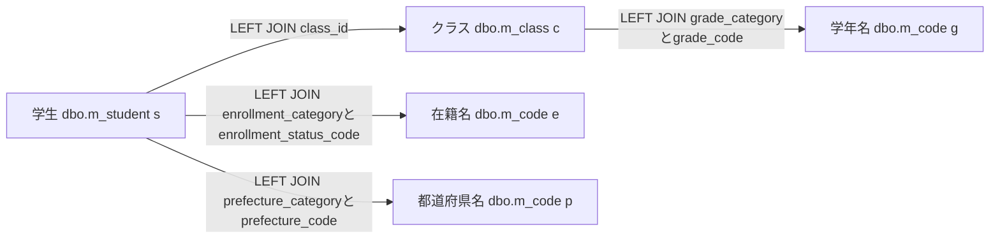

これは検索JOIN図で、g・e・pは同じ物理表の用途別aliasである。件数SQLは学生とクラスの辺だけ、一覧SQLは全辺を使う。名称JOINに利用状態・期間条件はなく、名称欠落だけでは学生行を除外しない。ただし年度・学年のWHEREを指定すると、その所属値を持たない学生は一致しない。根拠: `sources/Core/SqlServerStudentService.cs:82-90`、`sources/Core/SqlServerStudentService.cs:143-146`、`sources/Core/SqlServerStudentService.cs:156-162`。

InputValidationExceptionは元Errors、ArgumentExceptionはArgumentError("Search",e)を持つValidationFailed・Count0・Items空へ変換する。ArgumentErrorは規定形式のコードを引き継ぎ、それ以外をE-STU-002にする。これは失敗結果であり、正常0件としてAppliedへ保持しない。EnsureSearchはSavedまたはNoChangeだけを認め、その他は先頭FieldErrorのメッセージ・Field・コードとOutcome対応HTTP状態を持つWebFaultへ変換する。根拠: `sources/Core/SqlServerStudentService.cs:169-170`、`sources/Core/StudentNormalizer.cs:162-168`、`sources/Infrastructure/WebStudentCoordinator.cs:20-20`、`sources/Infrastructure/WebPresentation.cs:23-23`。

#### Q-L 検索候補取得

SearchModelは毎回LookupAsync(false,ct)を呼ぶ。検索とは別接続・別SNAPSHOTで、次の二結果セットをNextResultAsyncで切り替えて読む。両SQLにWHERE、受信条件パラメータ、ページングはない。根拠: `sources/Web/Controllers/StudentsController.cs:39-39`、`sources/Core/SqlServerStudentService.cs:197-216`。

```sql
SELECT c.category_id,c.code_value,c.code_name,c.display_order,
       CONVERT(bit,CASE WHEN c.is_active=1 AND k.is_active=1 THEN 1 ELSE 0 END) is_active,
       c.valid_from,c.valid_to,c.is_protected
FROM dbo.m_code c
JOIN dbo.m_code_category k ON k.category_id=c.category_id
ORDER BY c.category_id,c.display_order,c.code_value;

SELECT c.*,CONVERT(int,0) occupied
FROM dbo.m_class c
LEFT JOIN dbo.m_code g ON g.category_id=c.grade_category AND g.code_value=c.grade_code
ORDER BY c.school_year DESC,g.display_order,c.display_order,c.class_code,c.class_id;
```

第1結果をCodeEntry、第2結果をSchoolClassへ移し、commit後にLookupSetを返す。CodeEntry.IsActiveはコードと分類の状態のANDで、有効期間判定を含まない。Occupied=0は検索用途で人数集計を省略した値で、実人数ゼロではない。根拠: `sources/Core/Contracts.cs:61-65`、`sources/Core/SqlServerStudentService.cs:201-216`。

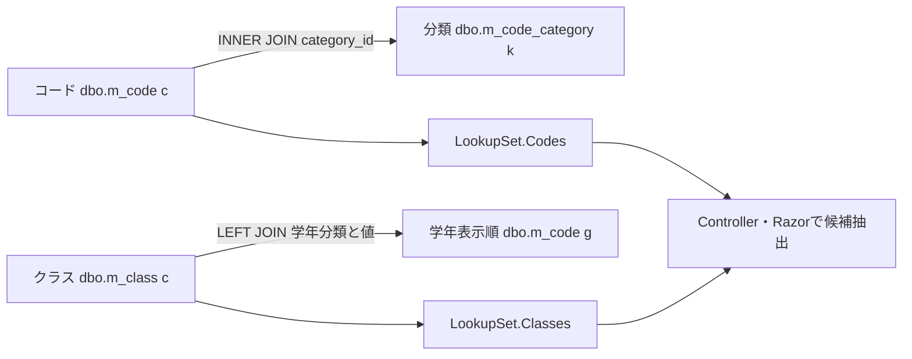

検索候補図には学生人数集計の辺を置かない。検索画面は停止・期間外候補を選択禁止にせず、クラス停止だけを注記する。保存側は最新DBの存在・状態・期間・所属整合・定員を再検査するため、検索で選べる値を新規保存可能値と同一視しない。根拠: `sources/Views/Students/Search.cshtml:5-5`、`sources/Core/SqlServerStudentService.cs:347-383`。

#### 検索関連の物理FK

次図はDDLの物理FKで、検索JOIN図とは別である。コードのPKはcategory_idとcode_valueの複合キーで、参照も分類と値の組を使う。学生class_idはNULL可なので学生からクラスは0または1、非NULLのコード参照は子行ごとに1親を要求し、親から子は0件以上となる。

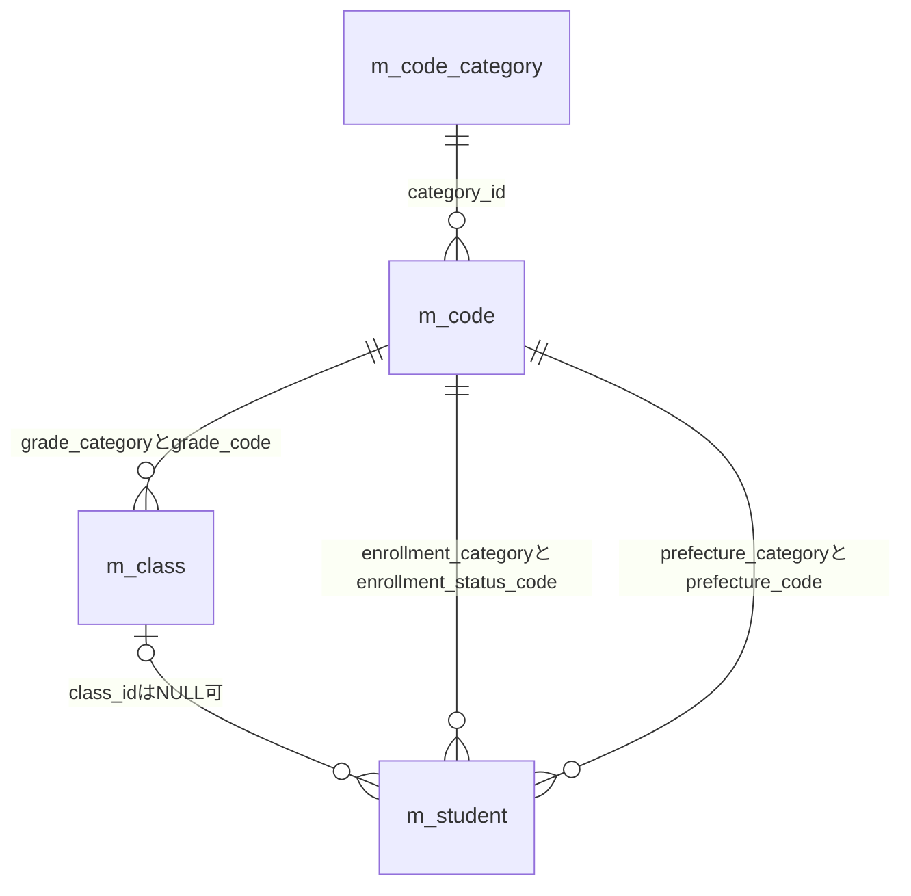

性別・続柄のFKもDDLにあるが、検索一覧の名称JOINには使わない。監査対象キーへのFKや削除連動は本図へ追加しない。基表のNOT NULLとLEFT JOIN後のnullableは別の属性である。根拠: `sources/database/001_schema.sql:15-31`、`sources/database/001_schema.sql:65-66`、`sources/database/001_schema.sql:113-127`、`sources/database/001_schema.sql:189-197`。

### E01 初回表示 — Index

#### 処理概要

contextIdなしのGET /studentsは新しい未検索状態と候補を作り、学生検索をせずSearch HTMLを返す。contextIdがあればE06へ進む。

#### 処理手順

1. identity.Readで認証情報を確認する。
2. contextIdがNULL・空文字ならNewContextでEntryを作る。Applied・LastResultはNULL、Revisionは1、期限は30分とする。
3. Present(entry,null)で未検索、件数・日時NULL、空一覧の表示材料を作る。
4. 初期StudentSearchInputを用意する。文字条件は空、所属・都道府県・日付は未指定、未所属false、在籍01・02とする。表示指定は20・studentNo・ascである。
5. Flash Takeの戻り値を通知材料にし、SearchModelでQ-LとJsonElement化を行う。
6. SearchのViewResultを返し、Razorで描画する。

根拠: `sources/Web/Controllers/StudentsController.cs:8-11`、`sources/Web/Controllers/StudentsController.cs:39-39`、`sources/Web/Inputs/StudentSearchInput.cs:7-18`、`sources/Infrastructure/SearchContextStore.cs:9-12`。

#### 条件付き処理フロー

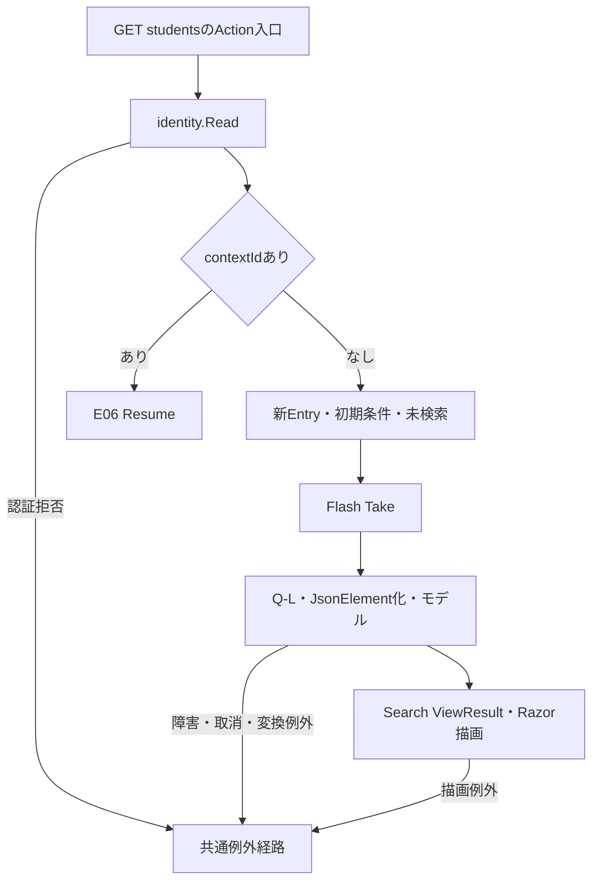

#### SQL・テーブル関連（ER図）

Q-L候補JOIN図を適用する。新Entryの保持先はSearchContextStoreのメモリ辞書で、状態表への保存ではない。

#### DB操作の詳細

候補二結果セットを一つのSNAPSHOTで参照しcommitする。学生件数・一覧・人数集計は実行しない。受信条件パラメータはない。

#### 結果・例外時の扱い

未検索ではページ操作を非活性にする。候補0件でも検索ボタンを禁止する分岐はない。候補・変換・描画例外の局所catchと、作成済みEntryを取り消す処理はない。根拠: `sources/Views/Students/Search.cshtml:5-8`、`sources/Web/Controllers/StudentsController.cs:8-11`。

### E02 検索 — Search

#### 処理概要

今回条件をPage1で検索し、成功確認後にApplied・LastResultを確定する。0件と上限超過もNoChangeの成功経路で、実行した条件を保持する。

#### 処理手順

1. FormGuardで許可項目・重複を検査し、Criteria.StatusCodesキーがなければ空配列にする。
2. 最初のGetで状態の存在・期限・所有者・セッション・非空指定時Tabを確認し、Present(entry,null)で失敗再表示用の空一覧材料を作る。ここまでは局所try外である。
3. ModelState不正なら422にし、Coordinatorを呼ばず再表示へ進む。
4. 有効ならCoordinatorが認証を確認し、ToCriteriaでクラスIDを解析、Page1と表示指定を設定する。変換はGate取得前である。
5. Useで状態Get、Gate待機、取得後Get、期待Revision・版上限の検査を行う。
6. SearchAsyncで入力検査、正規化、Q-E、Q-Sを行い、EnsureSearchで成功を確認する。
7. 条件の深い複製をApplied、結果をLastResultへ置き、Revisionを+1にしてPresentを返す。
8. Useのoperation正常終了後に期限を延長し、取得済みGateを解放する。
9. 今回inputと別のQ-LからSearchModelを作る。モデルのPageSize・SortKey・SortDirectionには送信値を設定する。
10. SearchのViewResultを返す。局所try内のWebFaultはe.Statusとエラーを保持して同じ再表示処理へ進む。

根拠: `sources/Web/Controllers/StudentsController.cs:13-16`、`sources/Web/Inputs/StudentSearchInput.cs:19-22`、`sources/Infrastructure/WebStudentCoordinator.cs:7-9`、`sources/Infrastructure/WebStudentCoordinator.cs:20-21`、`sources/Infrastructure/SearchContextStore.cs:14-15`。

#### 条件付き処理フロー

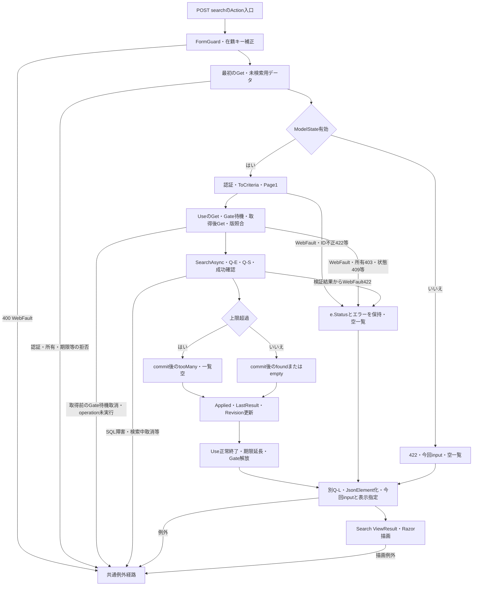

Uの待機取消はSQL実行前の独立経路で、局所WebFault再表示と区別する。取得前に待機が失敗した要求へ、Gate解放や状態・期限更新を加えない。取得済みGateを持つUse内の失敗はfinallyで解放される。根拠: `sources/Infrastructure/SearchContextStore.cs:14-14`、`sources/Web/Controllers/StudentsController.cs:15-15`。

#### SQL・テーブル関連（ER図）

指定マスター確認にQ-E、学生件数・一覧にQ-S検索JOIN図、再描画にQ-L候補JOIN図を適用する。物理FKは共通DB操作の別図である。

#### DB操作の詳細

Q-EとQ-Sは一回の検索SNAPSHOT、後続Q-Lは別接続・別SNAPSHOTである。検索結果と画面候補全体の同一時点を保証しない。学生へのINSERT・UPDATE・DELETEはない。根拠: `sources/Core/SqlServerStudentService.cs:123-168`、`sources/Core/SqlServerStudentService.cs:197-216`。

#### 結果・例外時の扱い

ModelState不正、ToCriteriaのID不正、サービスValidationFailedはそれぞれ422へ進む。Use内の拒否は所有等の403、期限・旧版・版上限等の409を保持する。局所再表示は今回inputとModelState、未検索用空一覧を使うが、既存Applied・LastResultは消さない。EnsureSearchは先頭FieldErrorを使い、FieldをCriteria.*へ一律変換しない。画面はvalidation-summary Allを表示する。根拠: `sources/Web/Controllers/StudentsController.cs:14-16`、`sources/Infrastructure/WebStudentCoordinator.cs:20-20`、`sources/Views/Shared/_MessagePanel.cshtml:2-2`。

最初のFormGuard・Get、後段SearchModel、返却後のRazor描画は検索実行の局所catch外である。Gate待機取消、SQL障害、検索中取消はWebFault限定catchを越える。応答未開始なら非WebFaultの共通経路は503でエラーHTML返却を試みるが、配信完了を保証しない。

バインド後PageSize=0が渡る場合、サービスは拒否する一方、Controllerは再表示モデルにも0を設定する。ビューが総ページ数をPageSizeで除算するため、描画時のゼロ除算になり得る。これは渡された値を前提とするソース推論であり、すべての不正入力が422の条件保持HTMLで完結するとは記述しない。根拠: `sources/Web/Controllers/StudentsController.cs:13-16`、`sources/Core/SqlServerStudentService.cs:107-107`、`sources/Views/Students/Search.cshtml:8-8`。

### E03 候補更新 — Options

#### 処理概要

今回条件の候補を再描画し、一覧はLastResultを使う。学生検索、期待Revision照合、Gate取得、状態更新、期限延長は行わない。

#### 処理手順

1. Searchと同じFormGuard、在籍キー省略補正、状態Getを行う。
2. 未所属trueなら年度・学年・クラスをNULLにし、対応するCriteria.*のModelStateを除去する。
3. 今回input、Present(entry,entry.LastResult)、Q-LからSearchModelを作る。
4. 「条件を変更しました。検索を押すと一覧に反映します。」を通知に設定する。
5. 非空ClassIdが候補IDの文字列表現と一致し、今回年度・学年にも適合するか確認する。
6. 不適合ならClassIdと該当ModelStateを解除し、通知を「上位条件に合わないクラスを解除しました。」へ置き換える。
7. SearchのViewResultを返す。表示指定はAppliedまたは既定値に由来し、受信表示指定を明示反映しない。

根拠: `sources/Web/Controllers/StudentsController.cs:22-22`、`sources/Web/Controllers/StudentsController.cs:39-39`。

#### 条件付き処理フロー

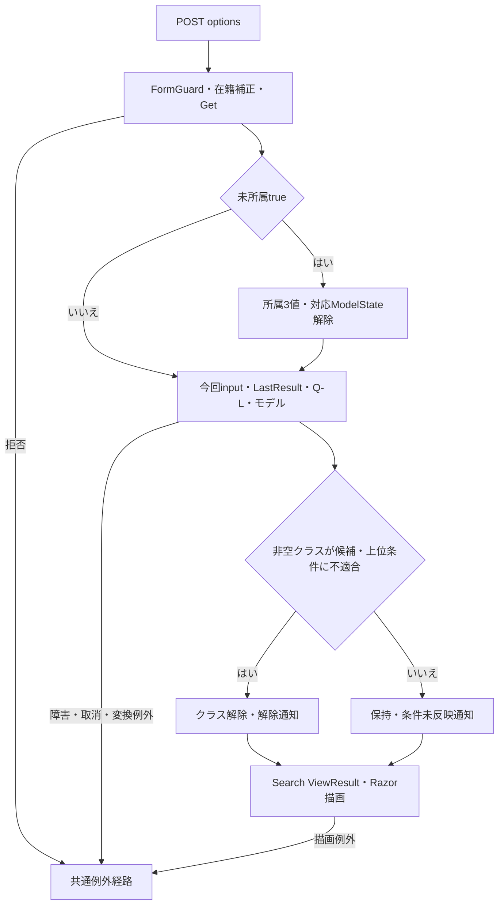

#### SQL・テーブル関連（ER図）

Q-L候補JOIN図を適用する。年度・学年はSQLパラメータではなく、取得後のController・Razorの比較と候補抽出に使う。

#### DB操作の詳細

候補二結果セットのSNAPSHOTだけを行い、学生件数・一覧・人数集計・DB書込みは行わない。状態はGetで取得し、Gateを使わない。

#### 結果・例外時の扱い

ModelState.IsValidで停止せず、ToCriteria、IdParser、学年正規化も通さない。ClassIdの01はSearchで数値1に解析できても、Optionsでは候補文字列1と一致せず解除され得る。全角学年も正規化前の比較となる。根拠: `sources/Web/Controllers/StudentsController.cs:22-22`、`sources/Web/Inputs/StudentSaveInput.cs:60-60`、`sources/Core/StudentNormalizer.cs:113-117`。

Search・Pageの局所失敗後もLastResultが残るため、後続Optionsで最後の成功一覧を再提示し得る。この一覧は今回条件の検索結果ではない。Applied・LastResult・RevisionはGateなしで読むため、一括保護された状態スナップショットではない。拒否・障害に入力保持用の局所catchはない。根拠: `sources/Web/Controllers/StudentsController.cs:14-22`、`sources/Infrastructure/SearchContextStore.cs:9-14`。

### E04 表示指定変更・ページ移動 — Page

#### 処理概要

Appliedを複製して検索する。件数・ソートキー・方向のいずれかが変わればPage1、同じなら要求Pageを使う。未実行の条件フォーム値は混ぜない。

#### 処理手順

1. FormGuardでPageRequestとTabIdを検査し、最初のGetを行う。両処理は局所try外である。
2. Coordinatorで認証を確認し、UseでGate待機、状態再検査、期待Revision照合を行う。
3. Appliedなしなら409「先に検索してください。」とする。
4. Appliedを深く複製し、表示指定変更時はPage1、同じ場合は要求Pageを設定する。受信表示指定を複製条件へ移す。
5. SearchAsyncとEnsureSearchを実行する。
6. 超過でなく保持予定Pageが返却件数の最終ページを超える場合、一度だけ保持Pageを補正し、SearchAsyncと成功確認を再実行する。
7. 成功した条件の深い複製と結果をApplied・LastResultへ置き、Revisionを進める。Use正常終了で期限を延長しGateを解放する。
8. From(Applied)で条件欄を復元し、別Q-LとSearchModelからViewResultを返す。
9. try内WebFaultはe.Statusとエラーを保持し、Applied由来input、未検索用空一覧、Q-Lで再構築する。

根拠: `sources/Web/Controllers/StudentsController.cs:18-19`、`sources/Web/Controllers/StudentsController.cs:39-40`、`sources/Infrastructure/WebStudentCoordinator.cs:11-12`、`sources/Infrastructure/SearchContextStore.cs:14-15`。

#### 条件付き処理フロー

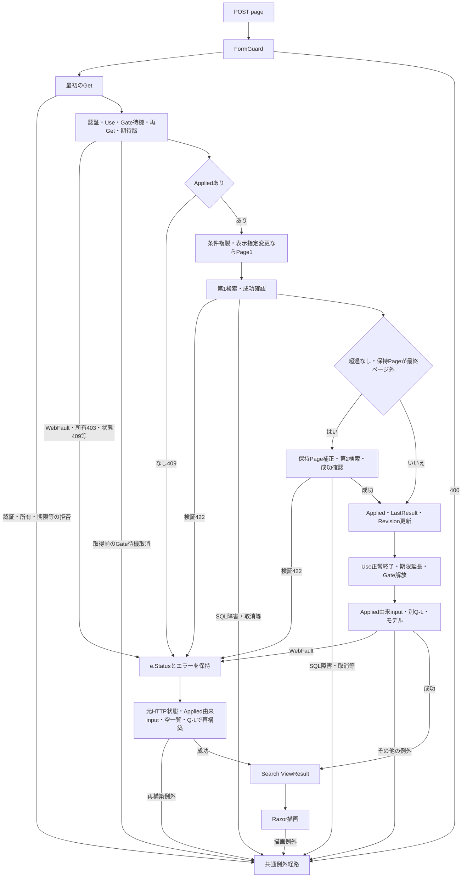

再表示先が同じでも、合流点のHTTP状態を固定しない。所有等の403、期限・旧版・版上限・未検索の409、サービス検証の422はそれぞれe.Statusを引き継ぐ。共通経路もWebFaultなら元状態、その他は応答未開始時の503である。根拠: `sources/Web/Controllers/StudentsController.cs:19-19`、`sources/Infrastructure/SearchContextStore.cs:13-14`、`sources/Infrastructure/WebPresentation.cs:23-23`。

#### SQL・テーブル関連（ER図）

検索ごとにQ-EとQ-S検索JOIN図、再描画にQ-L候補JOIN図を適用する。条件、型付きパラメータ、上限、許可ソートを再検査する。

#### DB操作の詳細

第1検索でサービスはSQL用pageを最終有効ページ以内に補正する。Coordinatorが保持Pageも補正する場合、第2検索は別接続・別SNAPSHOTである。2回全体は一つの読取単位ではなく、第2検索で件数がさらに減っても保持Page補正を反復しない。根拠: `sources/Infrastructure/WebStudentCoordinator.cs:12-12`、`sources/Core/SqlServerStudentService.cs:123-124`、`sources/Core/SqlServerStudentService.cs:160-168`。

#### 結果・例外時の扱い

入力欄はAppliedから作るので、ブラウザーにだけあった未実行条件を復元しない。ControllerにはModelState不正で停止する分岐がなく、表示指定変更時の要求Pageはサービス検査前に1へ置き換わる。根拠: `sources/Web/Controllers/StudentsController.cs:18-19`、`sources/Infrastructure/WebStudentCoordinator.cs:12-12`。

最初のFormGuard・Getは局所catch外で、入力保持再表示へ進まない。Use内のWebFaultとサービス検証WebFaultは元状態で再構築する。成功側SearchModelもtry内なので、状態更新後のWebFaultを捕捉し得るが、更新済み状態を復元しない。catch内の再構築例外と返却後Razor例外は同じcatchで再捕捉しない。Gate待機取消とSQL障害・取消は共通経路へ伝播する。根拠: `sources/Web/Controllers/StudentsController.cs:19-19`、`sources/Infrastructure/SearchContextStore.cs:14-14`。

### E05 条件クリア — Clear

#### 処理概要

状態IDを維持し、Applied・LastResultを消して初期条件の未検索画面へ戻す。

#### 処理手順

1. FormGuardでContextRequestとTabIdを検査する。
2. Coordinatorで認証を確認し、Useで状態・Gate・期待版等を検査する。
3. AppliedとLastResultをNULLにし、Revisionを+1にする。
4. Use正常終了で期限を延長し、取得済みGateを解放する。
5. ControllerがModelStateを全消去し、同じEntryを再Getする。
6. 初期input、既定表示指定、Q-Lから未検索のSearchモデルを作り、ViewResultを返す。

根拠: `sources/Web/Controllers/StudentsController.cs:21-21`、`sources/Web/Controllers/StudentsController.cs:39-39`、`sources/Infrastructure/WebStudentCoordinator.cs:15-15`。

#### 条件付き処理フロー

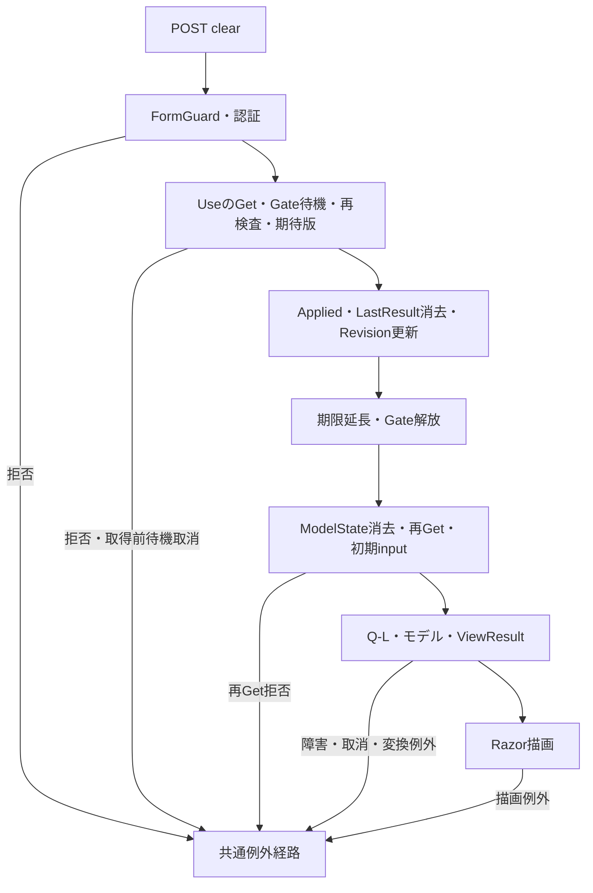

#### SQL・テーブル関連（ER図）

消去対象はメモリEntryなので消去自体のDB ER図を省略する。再描画にQ-L候補JOIN図を適用する。

#### DB操作の詳細

クリア自体はメモリ操作で、学生検索、学生DELETE、t_runtime_state DELETEは行わない。SQLは候補再取得だけである。

#### 結果・例外時の扱い

初期在籍01・02、20件、studentNo、ascへ戻り、状態ID・所有者・Tabは維持する。LastResultを消すので後続Optionsで旧一覧は復活しない。局所catchはなく、消去後の再Get・候補・描画障害でも消去と版更新を戻さない。根拠: `sources/Web/Inputs/StudentSearchInput.cs:7-18`、`sources/Web/Controllers/StudentsController.cs:21-22`。

### E06 検索画面への復帰 — Resume

#### 処理概要

contextId付きIndexは未検索状態を復元するか、元Appliedで最新DBを再検索する。保存した学生が条件外でも条件を変更せず、特別に行を追加しない。

#### 処理手順

1. Indexが認証確認後、Tabを渡さず既存EntryをGetする。
2. queryのcontextRevisionをContextRequestへ移し、省略時は空文字にする。
3. ResumeがUseでGate待機、状態再検査、期待版照合を行う。
4. Appliedなしなら学生検索と版更新をせず未検索を返す。正常終了による期限延長は行う。
5. Appliedありなら元条件でSearchAsyncと成功確認を行い、LastResultとRevisionだけを更新する。
6. Appliedから入力欄を復元し、Flash Takeで通知を取得・消費する。
7. 別Q-L、モデル作成、ViewResultを経てSearch HTMLを描画する。

根拠: `sources/Web/Controllers/StudentsController.cs:8-11`、`sources/Web/Controllers/StudentsController.cs:39-40`、`sources/Infrastructure/WebStudentCoordinator.cs:14-14`、`sources/Infrastructure/FlashMessageStore.cs:6-9`。

#### 条件付き処理フロー

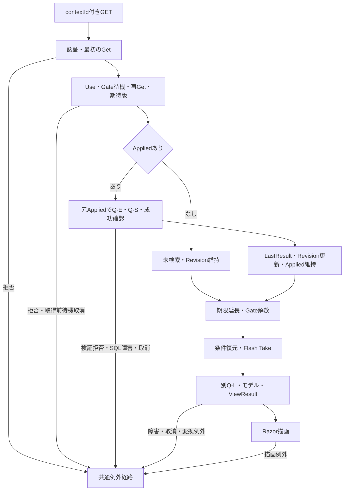

#### SQL・テーブル関連（ER図）

検索済み復帰にQ-EとQ-S検索JOIN図、両状態の再構築にQ-L候補JOIN図を適用する。状態と通知は別のメモリ辞書である。

#### DB操作の詳細

Appliedを置換せず再検索する。検索SNAPSHOTと候補SNAPSHOTは別で、条件外または論理削除済みの保存学生を追加取得しない。

#### 結果・例外時の扱い

期限切れは409で、自動初期化しない。期待版省略を最新版に補完せず、Index／ResumeはTabを渡さない。所有・期限・旧版拒否はFlash Take前に起こる。Take後の候補・変換・描画・配信失敗では、通知を消費していても画面表示に届かない場合がある。入力保持用の局所catchはない。根拠: `sources/Infrastructure/SearchContextStore.cs:13-14`、`sources/Web/Controllers/StudentsController.cs:8-11`、`sources/Infrastructure/FlashMessageStore.cs:9-9`。

件数減少時はSQL取得ページと提示ページがずれ得る。サービスはローカルpageだけを最終ページ以内に補正し、SearchCriteria.Pageを書き換えない。ResumeはAppliedを維持し、PresentはApplied.Pageを出すため、取得行は最終ページでも提示pageが総ページ数を超える場合がある。Pageイベントの保持Page補正とは異なる、値の移送に基づく推論である。根拠: `sources/Core/SqlServerStudentService.cs:160-164`、`sources/Infrastructure/WebStudentCoordinator.cs:12-14`、`sources/Infrastructure/WebStudentCoordinator.cs:21-21`。

### E07 未所属変更・送信中表示

#### 処理概要

ブラウザー補助は未所属ONで所属値を解除し、submit時に同フォームの一部ボタンを非活性にする。年度・学年変更だけでは候補更新・検索を送信しない。

#### 処理手順

1. 初期読込みとSRC-007のchangeでcheckedを確認する。
2. ONならSRC-004・005・006の値を空にする。OFFでも元値を戻さない。
3. disabledは変更しない。所属selectの非活性はRazor再描画時のUnassignedOnlyで決まる。
4. 上位条件を候補に反映するにはE03、学生一覧に反映するにはE02を実行する。
5. submit時、送信button以外の同フォーム内buttonをdisabledにし、フォームへaria-busy=trueを設定する。

根拠: `sources/wwwroot/js/site.js:4-8`、`sources/Views/Students/Search.cshtml:5-8`。

#### 条件付き処理フロー

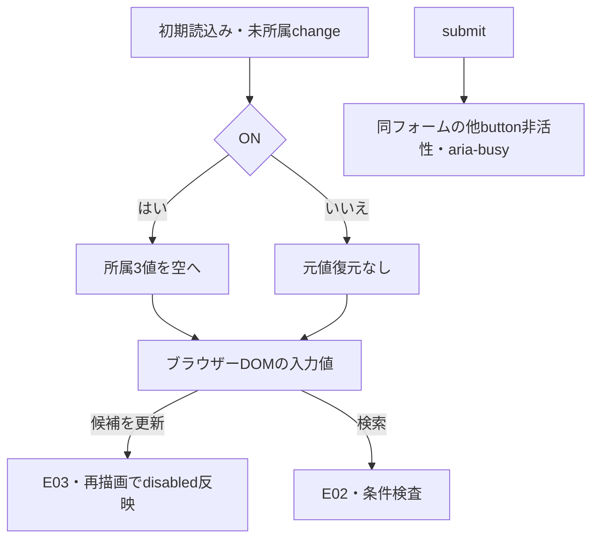

#### SQL・テーブル関連（ER図）

単独のchange・submit補助はブラウザーDOMを扱うためDB ER図を省略する。POST後はE02・E03の関連に従う。

#### DB操作の詳細

このJavaScript単独では外部通信、検索Entry更新、DB操作を行わない。REG-018のクラスから年度・学年を補完する処理は登録画面用で、SRCクラスには接続されていない。

#### 結果・例外時の扱い

送信button自身と別フォームは非活性化の対象外で、画面全体の二重送信禁止ではない。検索には登録用dirty確認、fetch、AbortController、要求連番による旧応答破棄が接続されていない。Entry更新の競合はサーバーのGateとRevisionで扱う。根拠: `sources/wwwroot/js/site.js:2-9`、`sources/Infrastructure/SearchContextStore.cs:14-14`。

未所属ONでも在籍01・02は解除しない。提示DDLのck_student_datesが実DBで適用・有効なら、01・02はclass_id非NULLを要求するため、初期在籍と未所属IS NULLの併指定に一致する行はない。これはDDL適用を条件とする推論である。根拠: `sources/Web/Inputs/StudentSearchInput.cs:13-14`、`sources/wwwroot/js/site.js:7-7`、`sources/Core/SqlServerStudentService.cs:146-154`、`sources/database/001_schema.sql:198-198`。

### E08 新規・編集・参照への遷移

<a id="student-editor-contract"></a>

#### 処理概要

新規・行リンクはreturnContextIdを登録入口へ渡す。既存は学生IDで最新の非削除詳細を取得し、検索一覧の表示値や未実行条件を登録値へ転記しない。登録全入力・保存の責務は計画文書SM-DET-STUDENT-EDITORに対応する。

#### 処理手順

1. Coordinator.Editが認証と復帰状態の所有・期限を確認する。復帰状態確認にはTabを渡さない。
2. 新規は作成権限を確認する。既存はGetAsyncで詳細を取得し、不在なら404とする。
3. 登録候補と詳細からStudentSaveInputを作り、既存ExpectedVersionに再取得した学生RowVersionを設定する。
4. Loadが現在の検索RevisionをReturnRevisionとして採取する。
5. 主体・セッション・対象ID・詳細・原入力の深い複製・復帰版を30分の編集スナップショットに保持し、Editを返す。

根拠: `sources/Views/Students/Search.cshtml:6-8`、`sources/Infrastructure/WebStudentCoordinator.cs:6-6`、`sources/Infrastructure/WebStudentCoordinator.cs:17-17`、`sources/Web/Controllers/StudentsController.cs:23-25`、`sources/Web/Inputs/StudentSaveInput.cs:44-54`、`sources/Infrastructure/EditorSnapshotStore.cs:7-11`。

#### 条件付き処理フロー

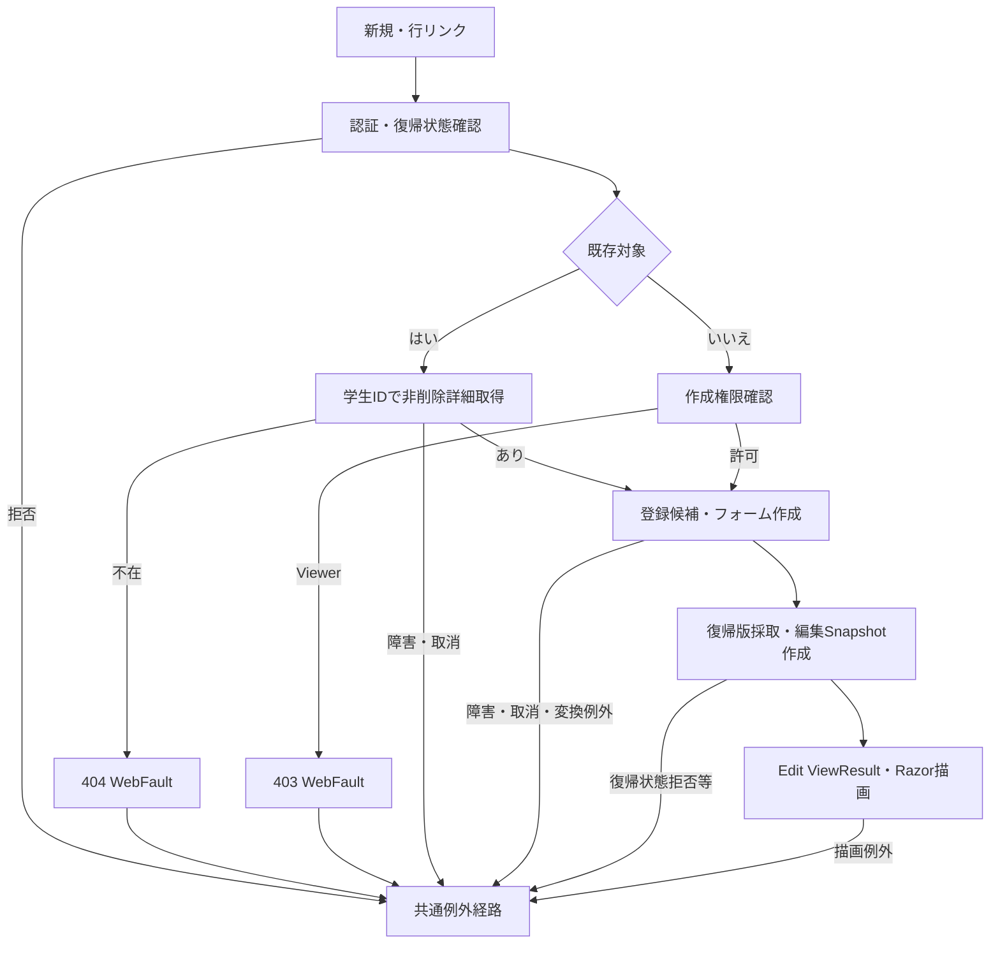

#### SQL・テーブル関連（ER図）

詳細取得はm_student単表なので個別ER図を省略する。登録候補はQ-LのマスターJOINと同じ構造だが、LookupAsync既定呼出しは人数を集計する。

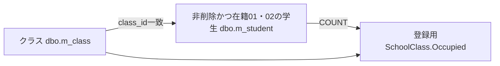

この図は候補集計の読取関連で、追加FKではない。根拠: `sources/Core/SqlServerStudentService.cs:196-208`。

#### DB操作の詳細

既存取得は`SELECT * FROM dbo.m_student WHERE student_id=@id AND is_deleted=0`、@id:BigInt、Sizeなしで最大1行を読む。id<=0も詳細NULLとなる。GetAsyncは明示トランザクションなしの単表参照で、後続登録候補は別SNAPSHOTである。根拠: `sources/Core/SqlServerStudentService.cs:172-194`。

#### 結果・例外時の扱い

Viewerは新規を開けず、既存は参照モードとなる。学生期待版と検索復帰版は別の比較情報である。登録画面の「検索へ戻る」は保存せず編集開始時ReturnRevisionでE06へ進む。「入力クリア／編集取消」はメモリ原入力へ戻ってEditに留まり、「最新情報を再読込」は既存GETでDB詳細を再取得する。根拠: `sources/Views/Students/Edit.cshtml:5-5`、`sources/Views/Students/Edit.cshtml:16-16`、`sources/Web/Controllers/StudentsController.cs:25-25`、`sources/Web/Controllers/StudentsController.cs:35-35`。

### E09 保存・削除結果からの検索復帰

#### 処理概要

登録側がSavedを返した場合だけ、確定通知と303で検索へ復帰する。本書は復帰ID・版、結果分岐、通知の消費と応答境界を扱う。登録全列・重複確認・監査詳細はSM-DET-STUDENT-EDITORとSM-COM-TRANSACTION-AUDITに対応する。

#### 処理手順

1. 登録側入口で編集スナップショット、所有者、対象、復帰先一致を確認し、保存または削除の結果を受け取る。
2. SavedならReturnAfterSaveへ進む。復帰IDありならスナップショットのReturnRevision、なしなら新しい未検索Entryと初期版を使う。
3. 主体・セッション・状態IDをキーにFlashへ成功通知を10分保持する。
4. 303とcontextId・contextRevision付き/studentsのLocationを設定し、EmptyResultを返す。
5. 後続GETがE06を実行し、未検索復元または元条件再検索後に通知をTakeする。
6. 保存非Savedは今回input、既存スナップショット、結果、再取得候補からEditを返す。NoChangeは「変更はありません。」を表示する。
7. 削除非SavedはエラーとOutcome対応HTTP状態を設定後、Loadを再実行する。最新非削除詳細、候補、フォーム、復帰版、新スナップショットを作り直す。

根拠: `sources/Web/Controllers/StudentsController.cs:25-25`、`sources/Web/Controllers/StudentsController.cs:29-38`、`sources/Infrastructure/FlashMessageStore.cs:6-9`。

#### 条件付き処理フロー

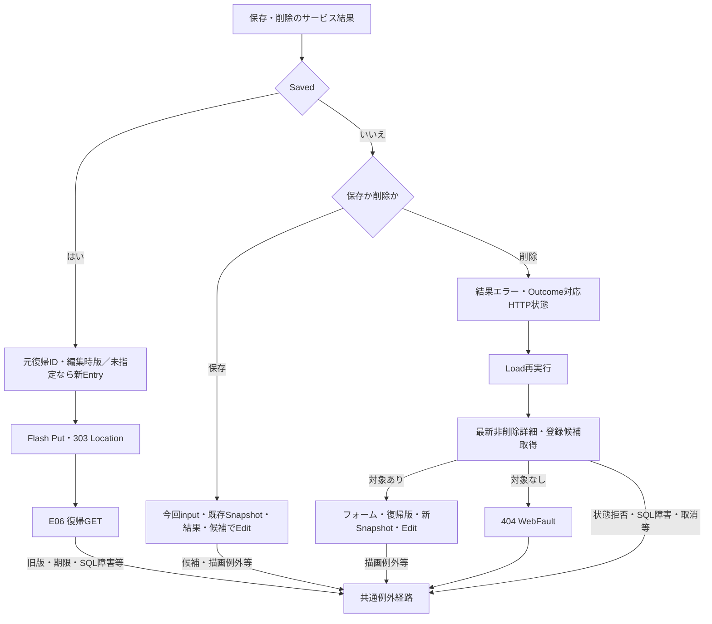

#### SQL・テーブル関連（ER図）

復帰検索はE06のQ-E・Q-S・Q-Lを使う。登録側は学生書込みと監査追記を同一トランザクションで確定する。監査の対象キーは学生へのFKではない。

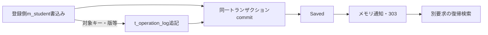

根拠: `sources/Core/SqlServerStudentService.cs:292-315`、`sources/Core/SqlServerStudentService.cs:385-390`、`sources/Core/SqlServerStudentService.cs:409-414`。

#### DB操作の詳細

Savedは登録側ReadCommitted、トランザクション所有の共通書込ゲート、対象・学生期待版の確認、版付き書込み、監査、commit正常終了を経て返る。書込ゲートはExclusive、待機5秒、負戻り値を拒否する。既存更新・論理削除のWHEREはstudent_id、期待row_version、is_deleted=0で、検索ContextId・Revisionは学生更新条件に使わない。論理削除は削除・更新管理項目と版を変更し、編集中の業務値を保存しない。根拠: `sources/Core/SqlServerStudentService.cs:92-101`、`sources/Core/SqlServerStudentService.cs:241-262`、`sources/Core/SqlServerStudentService.cs:297-315`、`sources/Core/SqlServerStudentService.cs:403-414`、`sources/Views/Students/Edit.cshtml:17-17`。

対象catch内のSQL障害・InvalidOperationException・取消ではCancellationToken.Noneでrollbackを試みる。writeStarted && (commitAttempted || !rolledBack)ならUnknown、それ以外はSystemErrorとなる。Openとトランザクション開始はこのcatch外で、すべての障害がSaveResultへ変換されるわけではない。検索にはこのUnknown分類を流用しない。根拠: `sources/Core/SqlServerStudentService.cs:240-243`、`sources/Core/SqlServerStudentService.cs:319-329`、`sources/Core/SqlServerStudentService.cs:399-416`。

#### 結果・例外時の扱い

NoChange、ConfirmationRequired、Conflict、UnknownをSavedへ読み替えず、成功通知・303を発行しない。Unknownは再送前の検索確認を案内する。303はDB確定後の遷移指示で、復帰検索・通知表示・HTML配信の成功までを保証しない。復帰失敗で確定済み書込みを戻す処理はない。根拠: `sources/Web/Controllers/StudentsController.cs:31-38`、`sources/Core/SqlServerStudentService.cs:319-322`、`sources/Core/SqlServerStudentService.cs:416-416`。

削除非Saved後のLoadは、保存非Savedの入力保持と異なる。削除結果をLoadのResultへ設定せず、投稿削除理由もtextareaへ明示復元しない。Unknownで実際には論理削除済みなら再Loadの非削除取得が404となり得るため、元の結果不明案内付きEditへ必ず戻るとはいえない。根拠: `sources/Web/Controllers/StudentsController.cs:25-25`、`sources/Web/Controllers/StudentsController.cs:37-37`、`sources/Views/Students/Edit.cshtml:17-17`、`sources/Core/SqlServerStudentService.cs:176-179`。

## 補足説明

### 長さ・空値・日付・表示値の境界

ScalarCountはサロゲート対を1として数え、単独サロゲートをArgumentExceptionで拒否する。TextはNULLを空文字へ置き換え、raw長、制御文字、Trim、空値・必須性、Trim後長の順に検査する。Trimで短くなる値もraw超過なら先に拒否する。HTML maxlengthと.NET LengthはUTF-16コード単位、業務長はUnicodeスカラー値、nvarchar容量はUTF-16コード単位、varchar容量はバイト、SQL Sizeはパラメータ領域である。これらを同じ上限と扱わない。根拠: `sources/Core/StudentNormalizer.cs:37-57`、`sources/Views/Students/Search.cshtml:5-5`、`sources/database/001_schema.sql:9-22`。

制御文字検査を通る空白だけの非空文字列がサービスへ残って届く場合、番号は必須Identifierで拒否し、氏名・電話は任意空として条件を省略する。カナは任意Kanaから空キーを生成し、LIKE '%%'相当となる。バインド後NULLの番号・カナは入口で省略する。この違いはサービスに渡された値の分岐であり、HTTP空白入力の確定動作ではない。根拠: `sources/Core/SqlServerStudentService.cs:113-117`、`sources/Core/SqlServerStudentService.cs:140-142`、`sources/Core/StudentNormalizer.cs:47-93`。

EnrollmentStatusCodesがサービス引数としてNULLならLength参照でNullReferenceExceptionとなり、検索の検証例外catchに入らない。フォームに在籍キーがない場合はControllerが空配列へ補正するため、このサービス単体NULL経路をフォーム省略の動作に拡張しない。根拠: `sources/Core/SqlServerStudentService.cs:111-112`、`sources/Core/SqlServerStudentService.cs:169-170`、`sources/Web/Controllers/StudentsController.cs:14-14`、`sources/Web/Controllers/StudentsController.cs:22-22`。

入学日両端はネイティブtype=dateの入力部品で、独自表示フォーマッターやロケール固定を宣言していない。DTOとToCriteriaはstring?を渡し、ParseIsoが非空値をTrimせずNFKC後10コード単位・yyyy-MM-ddで厳密解析する。正規化前の個別長上限はなく、1900-01-01～検索入口業務日を許す。片側指定は可能で、両端があれば開始≦終了を要求する。DateOnlyはSQLのDateへ移り、保存列admission_dateの両端包含比較に使われる。再表示は今回inputまたはFrom(Applied)の文字列とModelStateから行い、サービスのDateOnlyを独自書式で入力欄へ戻す処理ではない。根拠: `sources/Views/Students/Search.cshtml:5-5`、`sources/Web/Inputs/StudentSearchInput.cs:17-22`、`sources/Core/JapaneseDateService.cs:52-59`、`sources/Core/SqlServerStudentService.cs:67-72`、`sources/Core/SqlServerStudentService.cs:120-122`、`sources/Core/SqlServerStudentService.cs:149-150`、`sources/Web/Controllers/StudentsController.cs:40-40`。

「すべて」は任意条件の未設定で、年度0・クラスID0ではない。学年00は「学年なし」の実コード、未所属はclass_id NULLである。在籍空配列は区分条件なしで、NULL在籍だけを検索する条件ではない。根拠: `sources/database/002_seed.sql:78-78`、`sources/Core/SqlServerStudentService.cs:109-110`、`sources/Core/SqlServerStudentService.cs:144-154`。

表示専用名称も保存側まで追跡する。CLI classはクラスコード9、クラス名18、CLI codeは名称12のスカラー値上限を検査し、それぞれVarChar(9)、NVarChar(36)、NVarChar(24)で保存する。DB容量を名称の業務上限に代用しない。基表NOT NULLと名称JOIN後のnullableは別である。根拠: `sources/maintenance/Program.cs:10-13`、`sources/Core/MasterMaintenanceService.cs:33-33`、`sources/Core/MasterMaintenanceService.cs:73-74`、`sources/Core/MasterMaintenanceService.cs:82-82`、`sources/Core/MasterMaintenanceService.cs:113-115`、`sources/database/001_schema.sql:67-81`、`sources/database/001_schema.sql:115-128`。

検索業務日は入口nowを+09:00に変換して日付上限に使う。検索日時・更新日時は日本時間yyyy/MM/dd HH:mm:ssで表示する。共有ヘッダーの業務日はWebPresentationが別の現在時刻から取得し、検索入口の同じ変数を共有しない。生年月日はDateOnlyを和暦へ変換し、時差を加えない。根拠: `sources/Core/SqlServerStudentService.cs:44-45`、`sources/Core/SqlServerStudentService.cs:105-105`、`sources/Infrastructure/WebPresentation.cs:5-7`、`sources/Core/JapaneseDateService.cs:41-50`、`sources/Views/Shared/_Layout.cshtml:1-1`。

### 結果・状態更新・HTML応答の確定境界

Presentは結果NULLをunsearched、LimitExceededをtooMany、Count=0をempty、それ以外をfoundとする。未検索・超過のtotalCountはNULL、正常0件は0である。検索結果があれば検索日時を移すが、ビューで件数・日時本文を表示するのはfoundだけである。内部JsonElementはHTML描画材料で、公開JSON応答ではない。根拠: `sources/Infrastructure/WebStudentCoordinator.cs:21-21`、`sources/Web/Models/StudentSearchPageModel.cs:10-15`、`sources/Views/Students/Search.cshtml:2-8`。

ビューは件数NULLをページ計算用の0にし、総ページ数を最低1にする。提示pageはApplied由来なので、空一覧・局所失敗が常に1/1とは限らない。本人電話NULLの－、都道府県名称NULLの[不整合]は個別補完で、所属・在籍名称へ一律に適用しない。根拠: `sources/Views/Students/Search.cshtml:2-8`、`sources/Core/SqlServerStudentService.cs:79-81`。

GateとRevisionはEntry更新を保護する。同じ期待版の要求を直列化し、先行成功が版を進めれば後続を拒否する。これはブラウザー応答の世代管理とは別である。Optionsは期待版とGateを使わず、収録経路は通常フォーム送信と画面全体HTMLで、要求連番による旧HTML破棄はない。根拠: `sources/Infrastructure/SearchContextStore.cs:14-14`、`sources/Web/Controllers/StudentsController.cs:13-22`、`sources/wwwroot/js/site.js:2-9`。

Search・Page・検索済みResume・Clearの状態更新は、後続候補取得、JsonElement化、Razor描画、HTML配信より前に行う。後段失敗の状態復元はない。PresentのitemsはSelectによる移送で、行の列挙や和暦変換は後段JSON化で起こり得る。operation途中の例外ならUseは期限を延長しないが、既に変更した値を自動rollbackする機能もない。DB参照commit、状態更新、期限更新、HTML到達を一つの成功境界にまとめない。根拠: `sources/Infrastructure/WebStudentCoordinator.cs:9-15`、`sources/Infrastructure/WebStudentCoordinator.cs:21-21`、`sources/Infrastructure/SearchContextStore.cs:14-14`、`sources/Web/Controllers/StudentsController.cs:39-39`、`sources/Infrastructure/WebPresentation.cs:20-20`。

### 参考設計の意図と現行責務

参考基本設計は単一校の学生基本情報検索から新規・編集・参照へ進む目的を定義する。年度・学年は現在または最終所属クラスの属性で、過去年度別所属履歴の検索ではない。現行ソースも保存されたclass_idからクラス属性を取得する。参考設計にあるサービス・変数名は設計名として扱い、ソース実在の名前へ置き換えずに引用しない。根拠: `reference-designs/基本設計書/01_学生検索画面.md:14-24`、`reference-designs/詳細仕様書/CSharp_ASPNET/01_学生検索画面.md:586-592`、`sources/Core/SqlServerStudentService.cs:82-90`。

以下の対比は本画面の表示・操作・状態に必要な内容を具体化したものである。設計意図を現行動作や実行証拠へ読み替えない。

| 主題 | 参考設計の意図 | 現行の対象・条件・操作・結果と担当層 | 根拠 |
| --- | --- | --- | --- |
| 初回・クリアと候補不足 | 初期01・02、20件、学籍番号昇順、未検索。必須マスター不足なら検索不可。初回・クリア文言は「条件を指定して検索してください」 | ControllerとDTOの初期値は対応するが、Razorの未検索文言は「未検索」。候補0件でも検索ボタン禁止なし。在籍候補0件ならcheckbox自体がなく、POSTキー省略補正は空配列 | `reference-designs/詳細仕様書/CSharp_ASPNET/01_学生検索画面.md:155-165`、`reference-designs/基本設計書/01_学生検索画面.md:62-68`、`sources/Views/Students/Search.cshtml:5-8`、`sources/Web/Controllers/StudentsController.cs:14-14` |
| 候補連動 | 上位条件を渡してクラス候補再取得、不適合解除、クラス先行選択の上位補完 | SRC年度・学年変更は自動送信しない。利用者がOptionsを押すと全候補SQL後にController・Razorが抽出し、不適合ClassIdを解除して通知する。SRCクラスから年度・学年を補完する接続なし | `reference-designs/詳細仕様書/CSharp_ASPNET/01_学生検索画面.md:252-262`、`sources/Web/Controllers/StudentsController.cs:22-22`、`sources/Core/SqlServerStudentService.cs:203-208`、`sources/wwwroot/js/site.js:7-8` |
| 未所属の活性 | ONで所属解除・非活性、OFFで以前の値を戻さない | JSは所属3値の解除だけを行い、disabledはRazor再描画時に適用する。ON/OFFだけのDOM操作と、Options後の表示状態は異なる | `reference-designs/詳細仕様書/CSharp_ASPNET/01_学生検索画面.md:256-256`、`sources/wwwroot/js/site.js:7-7`、`sources/Views/Students/Search.cshtml:5-5` |
| 処理中と応答世代 | 二重検索抑止、RequestSequence初期0、古い応答破棄、桁あふれ時採番停止 | submit補助は同フォームの送信button以外を止める。画面全体や送信button自身の再操作禁止ではない。fetch・要求連番・旧HTML破棄なし。サーバーRevisionは状態更新競合の制御 | `reference-designs/基本設計書/01_学生検索画面.md:63-63`、`reference-designs/詳細仕様書/CSharp_ASPNET/01_学生検索画面.md:147-147`、`reference-designs/詳細仕様書/CSharp_ASPNET/01_学生検索画面.md:258-262`、`sources/wwwroot/js/site.js:2-9`、`sources/Infrastructure/SearchContextStore.cs:14-14` |
| 候補応答 | 部分HTMLまたは候補JSON | 接続されたOptionsはSearchModelとRazorによる画面全体HTML。候補オブジェクトhelperの宣言を公開JSON APIとして扱わない | `reference-designs/詳細仕様書/CSharp_ASPNET/01_学生検索画面.md:500-506`、`sources/Web/Controllers/StudentsController.cs:22-22`、`sources/Infrastructure/WebStudentCoordinator.cs:16-16` |
| 日付表示・入力 | 西暦yyyy/MM/dd表示とyyyy-MM-dd入力を区別 | SRC-011／012はネイティブdate入力。MVC後はstring?、サービスで厳密ISO解析、SQL Dateで包含比較。独自表示フォーマッターとブラウザーロケール固定は宣言なし | `reference-designs/詳細仕様書/CSharp_ASPNET/01_学生検索画面.md:94-95`、`sources/Views/Students/Search.cshtml:5-5`、`sources/Core/JapaneseDateService.cs:52-59` |
| 件数・表示範囲 | TotalCountとRangeFrom・RangeToを区別し、0件の範囲を0～0とする | PresentはtotalCountを移すが、表示範囲の算出・移送項目なし。Razorはfound時だけ件数・検索日時を表示し、0件は該当なし、超過は警告と空一覧。参考設計から未記載の範囲算式を追加しない | `reference-designs/詳細仕様書/CSharp_ASPNET/01_学生検索画面.md:100-101`、`reference-designs/詳細仕様書/CSharp_ASPNET/01_学生検索画面.md:135-137`、`sources/Infrastructure/WebStudentCoordinator.cs:21-21`、`sources/Views/Students/Search.cshtml:7-8` |
| メニュー・ページ操作 | 専用メニューへの操作、先頭・前・次・最後 | 現行ビューに専用メニュー操作・遷移URLはない。ページフォームは表示指定反映、前へ、次へ、page／総ページ数。先頭・最後ボタンを持たない | `reference-designs/詳細仕様書/CSharp_ASPNET/01_学生検索画面.md:99-114`、`sources/Views/Students/Search.cshtml:6-8` |
| 所属・名称欠損 | 未所属の－、停止・期間外、不整合を区別 | 一覧は年度・学年名、クラスコード・名、在籍名を移すが、一律補完なし。クラス状態・期間は一覧SQLにないため注記なし。クラス候補の停止注記とは別の責務。住所は都道府県名称NULL時だけ[不整合]、本人電話NULL時だけ－ | `reference-designs/詳細仕様書/CSharp_ASPNET/01_学生検索画面.md:107-111`、`sources/Core/SqlServerStudentService.cs:79-90`、`sources/Views/Students/Search.cshtml:5-8` |
| 条件変更・未実行 | 変更値、最後の結果、未反映通知を表示し、ページは最後の条件を使用 | 明示Optionsは今回inputとLastResult、未反映通知を表示する。単なる入力変更だけでは通知を追加しない。PageはAppliedを使用するため未実行条件を混ぜない | `reference-designs/基本設計書/01_学生検索画面.md:68-68`、`sources/Web/Controllers/StudentsController.cs:22-22`、`sources/Infrastructure/WebStudentCoordinator.cs:12-12`、`sources/wwwroot/js/site.js:2-9` |
| 入力・システムエラー | 原入力・項目別エラーを保持し、前回結果を最新結果として残さず、システムエラーは受付番号を案内 | Search局所WebFaultは今回inputとModelState、Page局所WebFaultはApplied由来inputで空一覧再表示。LastResultは残るので後続Optionsで再提示可能。最初のGet・SQL障害・取消等は共通エラーHTMLへ進み、条件保持画面・受付番号を一律保証しない | `reference-designs/基本設計書/01_学生検索画面.md:64-69`、`sources/Web/Controllers/StudentsController.cs:14-22`、`sources/Infrastructure/WebHostSetup.cs:23-23` |
| 復帰と期限 | 他者拒否、期限切れ初期化、未検索復元または元条件再検索、確定通知、条件外学生を特別追加しない | 所有等を拒否し元条件で再検索するが、期限切れは409で自動初期化なし。通知は再検索後にTakeする。元Appliedを維持するため件数減少時の提示ページはSQL取得ページとずれ得る | `reference-designs/詳細仕様書/CSharp_ASPNET/01_学生検索画面.md:386-392`、`sources/Infrastructure/SearchContextStore.cs:13-14`、`sources/Infrastructure/WebStudentCoordinator.cs:14-14`、`sources/Web/Controllers/StudentsController.cs:8-11` |
| 状態版・画面照合 | 所有・認証・タブ・期限、排他内期待版、省略補完禁止、旧版拒否 | Useは期待版を厳密照合する。Tabは非空指定時だけ比較し、Index／Resumeは渡さない。Optionsは受信ContextRevisionを使わずGateなしで読む。DB await後の再Getもない | `reference-designs/詳細仕様書/CSharp_ASPNET/01_学生検索画面.md:604-610`、`sources/Infrastructure/SearchContextStore.cs:13-14`、`sources/Web/Controllers/StudentsController.cs:8-22` |

参考設計が挙げる入力→処理値→DB→再表示、Unicode境界、日付、旧版、保存結果不明等は実装工程の確認観点である。設計上の内部名、試験観点、レビュー欄から現行コードの実在、実行結果、顧客承認を導かない。根拠: `reference-designs/詳細仕様書/CSharp_ASPNET/01_学生検索画面.md:546-550`、`reference-designs/詳細仕様書/CSharp_ASPNET/01_学生検索画面.md:586-592`。

### 関連文書と未接続部品

以下は文書計画の正確なID・相対パスとの対応である。他文書は本応答では未生成の計画参照であり、本画面に必要な条件・結果は本書内にも記載する。

| 文書ID | 計画上の相対パス | 対応責務・参照状態 |
| --- | --- | --- |
| SM-BAS-STUDENT-SEARCH | `spec/basic/student-search.md` | 論理項目・業務状態。未生成の計画参照 |
| SM-BAS-STUDENT-EDITOR | `spec/basic/student-editor.md` | 登録・編集・参照の業務状態。未生成の計画参照 |
| SM-DET-STUDENT-EDITOR | `spec/detail/student-editor.md` | 登録全入力、保存・確認・削除。未生成の計画参照 |
| SM-COM-HTTP-SECURITY | `spec/common/http-security-contract.md` | 認証、CSRF、受付、応答。未生成の計画参照 |
| SM-COM-NORMALIZATION-DATE | `spec/common/normalization-date.md` | 正規化、長さ単位、日付・和暦。未生成の計画参照 |
| SM-COM-LOOKUPS | `spec/common/lookup-contract.md` | 候補用途差・既存値保持。未生成の計画参照 |
| SM-COM-RUNTIME-STATE | `spec/common/runtime-state.md` | 状態・所有・期限・版、編集・通知メモリ。未生成の計画参照 |
| SM-COM-TRANSACTION-AUDIT | `spec/common/transaction-audit.md` | 接続・排他・確定・Unknown・監査。未生成の計画参照 |
| SM-DATA-LOGICAL-CONTRACTS | `spec/data/logical-contracts.md` | DTOの実型・NULL・移送。未生成の計画参照 |
| SM-DET-CLASS-MAINTENANCE | `spec/detail/class-maintenance.md` | クラスコード・名称の保存側制約。未生成の計画参照 |
| SM-DET-CODE-MAINTENANCE | `spec/detail/code-maintenance.md` | 学年・在籍・都道府県名称の保守。未生成の計画参照 |
| SM-DB-INDEX | `spec/database/index.md` | DB全体・物理FK・制約。未生成の計画参照 |
| SM-DB-M-STUDENT | `spec/database/tables/m_student.md` | 学生表の物理属性。未生成の計画参照 |
| SM-DB-M-CLASS | `spec/database/tables/m_class.md` | クラス表の物理属性。未生成の計画参照 |
| SM-DB-M-CODE | `spec/database/tables/m_code.md` | コード表の複合キー・名称属性。未生成の計画参照 |
| SM-DB-M-CODE-CATEGORY | `spec/database/tables/m_code_category.md` | 分類表・候補状態。未生成の計画参照 |
| SM-DEP-PROCESS | `spec/dependencies/process-dependencies.md` | 呼出し・保持領域の依存。未生成の計画参照 |
| SM-RPT-DESIGN-IMPLEMENTATION | `spec/reports/design-implementation-differences.md` | 設計意図と実装の全体対応・差分。未生成の計画参照 |
| SM-RPT-UNRESOLVED | `spec/reports/unresolved-and-analysis-limits.md` | 不足資料・未確認境界・解析範囲。未生成の計画参照 |

本画面の外部入出力はフォーム受信、HTML応答、SQL Server参照である。検索状態はSearchContextStore、編集原入力はEditorSnapshotStore、通知はFlashMessageStoreの別辞書に置く。t_runtime_stateの列宣言から検索状態の永続化・暗号化・消費・プロセス間共有を追加しない。根拠: `sources/Infrastructure/SearchContextStore.cs:9-15`、`sources/Infrastructure/EditorSnapshotStore.cs:7-11`、`sources/Infrastructure/FlashMessageStore.cs:6-9`、`sources/database/001_schema.sql:171-183`。

OptionsRequest、Coordinator.Options、WebPresentation.Lookupsは宣言されるが、接続されたPOST /students/optionsから呼ばれない。StrictJsonも収録Controllerから呼ばれず、本フォームのJSON検査ではない。RequestIdentity.TabIdのヘッダー／query取得も本検索Actionは使わず、POSTは引数tabId、Index／ResumeはTab未指定で状態を取得する。これらの宣言済み部品を公開APIや接続済み処理として説明しない。根拠: `sources/Web/Inputs/StudentSearchInput.cs:31-31`、`sources/Infrastructure/WebStudentCoordinator.cs:16-16`、`sources/Infrastructure/WebPresentation.cs:8-18`、`sources/Infrastructure/StrictJson.cs:4-14`、`sources/Infrastructure/RequestIdentity.cs:12-12`、`sources/Web/Controllers/StudentsController.cs:8-22`。
