<!-- spec-meta: {"schema":"spec-md/1.0","documentId":"SM-DET-STUDENT-SEARCH","version":"5.0","path":"spec/detail/student-search.md","sheets":[{"heading":"概要","kind":"GRID","sheet":"01_概要"},{"heading":"項目一覧","kind":"LIST","sheet":"02_項目一覧","key":["項目キー"]},{"heading":"選択候補一覧","kind":"LIST","sheet":"03_選択候補一覧","key":["候補キー"]},{"heading":"内部項目一覧","kind":"LIST","sheet":"04_内部項目一覧","key":["内部項目キー"]},{"heading":"項目移送仕様","kind":"LIST","sheet":"05_項目移送仕様","key":["移送キー"]},{"heading":"イベント仕様","kind":"GRID","sheet":"06_イベント仕様"},{"heading":"補足説明","kind":"GRID","sheet":"07_補足説明"}]} -->
# 学生検索画面 詳細仕様書

| 文書属性 | 内容 |
| --- | --- |
| 文書ID | SM-DET-STUDENT-SEARCH |
| 文書種別 | 詳細仕様書 |
| 版数 | 5.0 |
| 正本パス | spec/detail/student-search.md |
| 対象責務 | 検索条件の受付、候補更新、検索・ページ取得、一覧への移送、検索状態、登録入口と検索復帰の境界 |
| 記述基準 | 接続されたソースの現行動作と、参考設計に定義された意図・契約を区別する |
| 対象読者 | 業務システムのIT担当者、実装経験5年程度の担当者 |

## 概要

### 機能と処理の分担

学生検索画面は、条件に一致する非削除学生を検索し、学生基本情報と所属・業務コードの名称を一覧に表示する。条件入力、候補更新、学生検索は別の操作である。ページ移動は最後に成功した検索条件を使用する。新規登録と行の編集・参照は登録画面を開く操作であり、検索画面の検索・候補更新・ページ・クリアは学生の業務値を更新しない。根拠: `sources/Views/Students/Search.cshtml:4-8`、`sources/Web/Controllers/StudentsController.cs:8-25`、`sources/Core/SqlServerStudentService.cs:103-170`。

現行の呼出経路は、Searchビュー、StudentsController、WebStudentCoordinator、IStudentService、SqlServerStudentServiceである。Controllerはフォーム検査、ModelState、HTTP状態、表示モデルを担当する。Coordinatorは検索状態の排他、成功結果の確認、Applied・LastResult・Revisionの更新を担当する。サービスは検索値の検査・正規化とSQL Server参照を担当する。検索条件と結果の保持先はSearchContextStoreのプロセスメモリである。根拠: `sources/Program.cs:2-7`、`sources/Web/Controllers/StudentsController.cs:13-22`、`sources/Infrastructure/WebStudentCoordinator.cs:7-21`、`sources/Infrastructure/SearchContextStore.cs:9-15`。

起動登録はRequestIdentity、Coordinator、IStudentServiceをScoped、検索・編集・通知ストアをSingletonとする。IStudentServiceにはSqlServerStudentServiceを登録する。接続設定名StudentDbが空なら503のWebFaultを送出し、設定があればwebTokens=trueでサービスを構築する。これは依存実装の選択であり、接続先や実DBの配備状態を表す業務情報ではない。根拠: `sources/Infrastructure/WebHostSetup.cs:13-19`。

| 操作 | HTTP入口 | 受信材料 | 応答・役割 |
| --- | --- | --- | --- |
| 初回表示 Index | GET `/students`、contextIdなし | 任意query、CancellationToken | 初期条件と候補を持つ未検索のSearch HTML |
| 検索 Search | POST `/students/search` | Criteria.*、ContextId、ContextRevision、TabId、PageSize、SortKey、SortDirection | 今回条件をPage1で検索したSearch HTML、または経路別の拒否・障害応答 |
| 候補更新 Options | POST `/students/options` | 検索と同じ条件フォーム | 今回条件と候補、最後の成功一覧を組み合わせたSearch全体HTML |
| ページ Page | POST `/students/page` | PageRequestの項目、TabId | Appliedを使って再検索したSearch HTML |
| クリア Clear | POST `/students/clear` | ContextId、ContextRevision、TabId | 同じ状態IDの初期条件・未検索HTML |
| 復帰 Resume | GET `/students?contextId=…&contextRevision=…` | 状態ID、期待検索版 | 未検索の復元、または元Appliedで再検索したSearch HTML |
| 新規登録 | GET `/students/new?returnContextId=…` | 復帰状態ID | 新規Edit HTML。Viewerは入口で拒否 |
| 編集・参照 | GET `/students/{id}?returnContextId=…` | 学生ID、復帰状態ID | 最新の非削除学生詳細によるEdit HTML |

Resume専用ルートはなく、contextId付きIndexがCoordinator.Resumeを呼ぶ。GET `/` は `/students` へ転送する。検索・候補更新は同じ条件フォーム、ページとクリアは別フォームである。ページフォームにはCriteria.*がない。根拠: `sources/Program.cs:7-7`、`sources/Web/Controllers/StudentsController.cs:8-22`、`sources/Views/Students/Search.cshtml:4-8`。

### 本画面で使用する共通呼出契約

本書は、各イベントが何を渡し、どの結果なら画面・検索状態を変えるかを定義する。共用クラスの全内部構造や登録全列の保存仕様は別責務だが、その参照だけで本画面の引数・拒否条件・確定境界を省略しない。

| 呼出先 | 本画面から渡す値 | 戻り値・拒否 | 本画面での判断 |
| --- | --- | --- | --- |
| RequestIdentity | 現在のHTTP認証情報 | CurrentUser。認証・claims不正は401のWebFault | 検索操作は閲覧可能な利用者、新規はViewer以外。利用者権限をフォーム値から取得しない |
| SearchContextStore.Get | ContextId、CurrentUser、任意TabId | Entry。状態不在・期限切れ409、所有・セッション・指定Tab不一致403 | 操作対象の検索状態を特定する。期待Revision比較や期限延長はGetだけでは行わない |
| SearchContextStore.Use | ContextRequest、CurrentUser、任意TabId、operation、ct | operationの結果。取得後の期待版不一致・版上限409 | Gate内で条件・結果・版を更新する。operation正常終了後だけ期限延長 |
| Coordinator.Search | SearchRequest、TabId、ct | Present用のobject。ToCriteria不正や非成功SearchResultはWebFault | 今回条件のPage1検索に成功した後だけAppliedとLastResultを置換 |
| Coordinator.Page | PageRequest、TabId、ct | Present用のobject。Appliedなし409 | 条件本体はApplied、要求から移すのはページと表示指定 |
| Coordinator.Resume／Clear | ContextRequest、任意TabId、ct | Present用のobject、状態利用拒否 | Resumeは元条件、Clearは初期状態。入口ごとの版更新条件をイベントに定義 |
| IStudentService.SearchAsync | SearchCriteria、ct | `SearchResult`。Outcome、`Count:int`、`Items:IReadOnlyList<StudentRow>`、SearchedAt、LimitExceeded、Errors | EnsureSearchがSaved／NoChangeだけを成功として扱う。ValidationFailedのCount0は正常0件にしない |
| IStudentService.LookupAsync | 検索再表示では`false,ct` | `LookupSet`のCodesとClasses | 全候補からController・Razorで表示対象を抽出。人数集計省略値を実人数にしない |
| WebPresentation.Row／Time | StudentRow／DateTimeOffset | 行表示object／日本時間文字列 | 内部IDを十進文字列、日付を和暦、日時を日本時間へ移す |
| SearchModel | Entry、表示object、今回または復元input、通知、ct | StudentSearchPageModel | 候補取得後、JsonElement化してHTML描画へ渡す。公開JSON APIの応答ではない |

根拠: `sources/Infrastructure/RequestIdentity.cs:7-16`、`sources/Infrastructure/SearchContextStore.cs:13-15`、`sources/Infrastructure/WebStudentCoordinator.cs:7-21`、`sources/Core/Contracts.cs:50-78`、`sources/Web/Controllers/StudentsController.cs:39-40`、`sources/Web/Models/StudentSearchPageModel.cs:6-15`。

参考詳細設計は、本機能の画面・変数・DB割当・イベント順序を機能文書、共用構造を方式別共通仕様、永続項目・制約をDB定義、命名・配備を開発規約の責務としている。また、画面制御をStudentsController／Search.cshtml、業務処理を設計名StudentQueryServiceへ割り当てる。現行の業務処理はCoordinatorとSqlServerStudentServiceに分かれており、StudentQueryServiceという設計名を実在するクラスとして扱わない。根拠: `reference-designs/詳細仕様書/CSharp_ASPNET/01_学生検索画面.md:20-25`、`reference-designs/詳細仕様書/CSharp_ASPNET/01_学生検索画面.md:76-78`、`sources/Infrastructure/WebStudentCoordinator.cs:3-21`。

### 入力中条件と成功済み条件

HTTPフォーム値はMVCによりCriteria接頭辞のStudentSearchInputへバインドされる。ToCriteriaはNameをStudentName、KanaをStudentNameKana、StatusCodesをEnrollmentStatusCodesへ移す。年度はint?、未所属はbool、在籍はstring[]である。クラスだけはstring?からIdParserでlong?へ変換する。入学日両端はstring?のままサービスへ渡し、サービス内でDateOnly?にする。根拠: `sources/Web/Inputs/StudentSearchInput.cs:7-22`、`sources/Core/Contracts.cs:31-48`。

入力中の条件はブラウザー、要求input、画面モデルCriteriaに存在する。Entryには入力途中条件専用の領域がない。Appliedは最後に成功したSearchCriteria、LastResultはその結果である。SearchとPageは成功確認後に条件を深く複製してAppliedへ置く。サービス内の正規化値でAppliedの文字列を書き換えない。ToCriteria作成時の在籍配列はinputの配列を引き継ぎ、成功後の深い複製とは別の段階である。根拠: `sources/Web/Inputs/StudentSearchInput.cs:19-22`、`sources/Infrastructure/SearchContextStore.cs:9-15`、`sources/Infrastructure/WebStudentCoordinator.cs:7-15`、`sources/Core/SqlServerStudentService.cs:113-150`。

Optionsは今回inputとLastResultを併用する。PageはAppliedの複製を使い、Resumeは元Appliedを再利用する。検索・ページの失敗は既存Applied・LastResultを消去しない。Clearだけが両方をNULLへ戻す。したがって、今回の不正条件による空一覧再表示の後、Optionsで以前の成功一覧が再提示される場合がある。根拠: `sources/Web/Controllers/StudentsController.cs:14-22`、`sources/Infrastructure/WebStudentCoordinator.cs:9-15`。

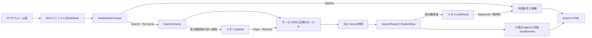

非nullable参照型の暗黙Requiredは抑制されている。DTOのstring・string[]注釈、requiredメンバー、初期化子は受信NULL排除の実行保証ではない。Normalizerのrawは、その関数に届いた文字列である。HTTP原値、MVC変換後のDTO、サービス引数、SQL値を分ける。inputとModelStateによる再表示を、HTTP原文字列の完全な別保存と説明しない。根拠: `sources/Infrastructure/WebHostSetup.cs:16-18`、`sources/Web/Models/StudentSearchPageModel.cs:6-15`、`sources/Web/Controllers/StudentsController.cs:13-22`、`sources/Core/StudentNormalizer.cs:47-57`。

### 画面構成と静的ソース投影

共有Layoutは利用者表示名と業務日をheaderへ置き、mainへSearchビューを配置する。検索画面は、見出しとメッセージ、条件、検索・候補更新、クリア・新規登録、結果状態、表示指定、11列一覧、前後ページの順である。fieldsは2列で、760px以下では1列になる。gridは横スクロール領域、tableは最小幅1050pxで、セルは上寄せと任意位置の折返しを使う。根拠: `sources/Views/Shared/_Layout.cshtml:1-1`、`sources/Views/Students/Search.cshtml:3-8`、`sources/wwwroot/css/site.css:1-1`。

SRCのidは項目識別とJavaScriptの要素検索に使用する。適用CSSは要素・classセレクターで、SRCのidを指定する規則はない。メッセージ領域にはaria-live=politeがあり、role属性はない。エラーはmessage error、通知はmessage infoである。info専用CSSはなく、通知にはmessageの共通規則が適用される。根拠: `sources/Views/Shared/_MessagePanel.cshtml:2-3`、`sources/wwwroot/css/site.css:1-1`、`sources/wwwroot/js/site.js:7-7`。

以下はViewer、未検索、未所属OFFの静的ソース投影である。実画面撮影ではない。候補領域の構造とseedで定義された在籍名称を示し、年度・クラス・学生の実データは設定しない。動的候補の内容・順序は選択候補一覧で定義する。実送信先はdata属性に対応付け、リンクは文書内fragment、ボタンはtype=buttonとする。JavaScriptと偽造防止情報・状態識別情報の実値は含めない。根拠: `sources/Views/Students/Search.cshtml:4-8`、`sources/Views/Shared/_Layout.cshtml:1-1`、`sources/database/002_seed.sql:19-22`。

<!doctype html>
<html lang="ja">
<head>
<meta charset="utf-8">
<meta name="viewport" content="width=device-width,initial-scale=1">
<title>学生管理</title>
<style>
:root{font-family:Meiryo,'Yu Gothic UI',sans-serif;color:#243448;background:#f2f5f9;font-size:14px}*{box-sizing:border-box}body{margin:0}header{background:#153654;color:white;padding:16px 28px;display:flex;justify-content:space-between;gap:20px}main{background:white;max-width:1440px;margin:24px auto;padding:24px}h1{font-size:24px}fieldset{border:1px solid #c8d1dc;padding:18px;margin:12px 0}legend{font-weight:bold}.fields{display:grid;grid-template-columns:1fr 1fr;gap:14px 28px}label{display:flex;flex-direction:column;gap:5px}input,select,textarea,button{font:inherit;padding:8px;border:1px solid #afbece;border-radius:3px}input,select,textarea{max-width:100%;width:100%}.check{display:inline-flex;flex-direction:row;align-items:center;margin-right:12px}.check input{width:auto}.actions{display:flex;gap:10px;align-items:center;flex-wrap:wrap;margin:16px 0}button{background:white;cursor:pointer}.primary{background:#1c5985;color:white}button:disabled{cursor:default;color:#8a98a5;background:#f3f5f8}.message{padding:14px;border:1px solid #b6dccc;background:#edf7f3}.error{background:#fff1f1;border-color:#c66}.warning{background:#fff8eb;padding:12px}.grid{overflow-x:auto}table{border-collapse:collapse;min-width:1050px;width:100%;font-size:12px}th,td{padding:10px 8px;border:1px solid #d4dee8;vertical-align:top;overflow-wrap:anywhere}th{background:#e6eef6}tr:nth-child(even){background:#f8fafc}.pager{display:flex;gap:14px;align-items:center;justify-content:center;margin:18px}small{color:#5f7183}@media(max-width:760px){main{margin:0;padding:15px}.fields{grid-template-columns:1fr}header{flex-direction:column}}
</style>
</head>
<body>
<header><strong>学生管理システム</strong><span>利用者 〈利用者表示名〉　業務日 〈yyyy/MM/dd〉</span></header>
<main>
<h1>学生検索</h1>
<form data-search-form data-source-method="POST" data-source-route="/students/search">
<input type="hidden" name="ContextId"><input type="hidden" name="ContextRevision"><input type="hidden" name="TabId"><input type="hidden" name="PageSize" value="20"><input type="hidden" name="SortKey" value="studentNo"><input type="hidden" name="SortDirection" value="asc">
<fieldset><legend>検索条件</legend><div class="fields">
<label>学籍番号<input id="SRC-001" name="Criteria.StudentNo" maxlength="30"></label>
<label>氏名<input id="SRC-002" name="Criteria.Name" maxlength="16"></label>
<label>氏名カナ<input id="SRC-003" name="Criteria.Kana" maxlength="72"></label>
<label>年度<select id="SRC-004" name="Criteria.SchoolYear"><option value="">すべて</option></select></label>
<label>学年<select id="SRC-005" name="Criteria.GradeCode"><option value="">すべて</option></select></label>
<label>クラス<select id="SRC-006" name="Criteria.ClassId"><option value="">すべて</option></select></label>
<label class="check"><input id="SRC-007" name="Criteria.UnassignedOnly" type="checkbox">未所属のみ</label>
<fieldset><legend>在籍区分</legend><label class="check"><input type="checkbox" name="Criteria.StatusCodes" value="01" checked>在学</label><label class="check"><input type="checkbox" name="Criteria.StatusCodes" value="02" checked>休学</label><label class="check"><input type="checkbox" name="Criteria.StatusCodes" value="03">卒業</label><label class="check"><input type="checkbox" name="Criteria.StatusCodes" value="04">退学</label><small>全解除はすべて</small></fieldset>
<label>都道府県<select id="SRC-009" name="Criteria.PrefectureCode"><option value="">すべて</option></select></label>
<label>電話番号<input id="SRC-010" name="Criteria.PhoneNumber" maxlength="40"></label>
<label>入学日・開始<input id="SRC-011" name="Criteria.AdmissionFrom" type="date"></label>
<label>入学日・終了<input id="SRC-012" name="Criteria.AdmissionTo" type="date"></label>
</div><div class="actions"><button type="button" class="primary" data-source-method="POST" data-source-route="/students/search">検索</button><button type="button" data-source-method="POST" data-source-route="/students/options">候補を更新</button></div></fieldset>
</form>
<div class="actions"><form data-source-method="POST" data-source-route="/students/clear"><input type="hidden" name="ContextId"><input type="hidden" name="ContextRevision"><input type="hidden" name="TabId"><button type="button">クリア</button></form></div>
<p>未検索</p>
<form data-source-method="POST" data-source-route="/students/page">
<input type="hidden" name="ContextId"><input type="hidden" name="ContextRevision"><input type="hidden" name="TabId">
<div class="actions"><label>表示件数<select name="PageSize"><option value="20" selected>20</option><option value="50">50</option><option value="100">100</option></select></label><label>並び順<select name="SortKey"><option value="studentNo" selected>学籍番号</option><option value="name">氏名</option><option value="admissionDate">入学日</option><option value="updatedAt">更新日時</option></select></label><select name="SortDirection" aria-label="並び順方向"><option value="asc" selected>昇順</option><option value="desc">降順</option></select><button type="button" name="Page" value="1" disabled>並び順・件数を反映</button></div>
<div class="grid"><table><thead><tr><th>学籍番号</th><th>氏名</th><th>氏名カナ</th><th>生年月日</th><th>年度／学年</th><th>クラス</th><th>在籍区分</th><th>住所</th><th>本人電話</th><th>更新日時</th><th>操作</th></tr></thead><tbody></tbody></table></div>
<nav class="pager"><button type="button" name="Page" value="0" disabled>前へ</button><span>1 / 1</span><button type="button" name="Page" value="2" disabled>次へ</button></nav>
</form>
</main>
</body>
</html>

Staff・Administratorでは、クリアの隣に新規登録リンクを表示する。Viewerでは表示しない。一覧の行リンクはViewerが「参照」、Staff・Administratorが「編集」である。以下は操作領域の権限差分で、上のViewer状態と同時には適用しない。根拠: `sources/Views/Students/Search.cshtml:6-8`。

<div class="actions"><form data-source-method="POST" data-source-route="/students/clear"><button type="button">クリア</button></form><a href="#editor-entry" data-source-method="GET" data-source-route="/students/new?returnContextId=〈状態ID〉">新規登録</a></div>

| 状態・条件 | 表示と操作 |
| --- | --- |
| unsearched | 「未検索」、空一覧。表示指定反映・前後ページは非活性 |
| found | 件数と検索日時、最大PageSize行を表示。反映は活性、前へはpage>1、次へはpage×PageSize<countの場合だけ活性 |
| empty | 「該当する学生はありません。」、空一覧、ページ操作非活性 |
| tooMany | warning領域に「10,000件を超えました。条件を追加してください。」、空一覧、ページ操作非活性。部分一覧は出さない |
| 局所WebFault再表示 | message errorのvalidation-summary Allと空一覧。HTTP状態は元e.Statusを維持 |
| Options | 今回条件とLastResultを表示し、条件未反映またはクラス解除の通知をmessage infoへ表示 |
| 未所属ONで再描画 | 年度・学年・クラスselectをdisabledにする。在籍選択は維持 |
| 未所属のブラウザー変更だけ | ONで所属3値を空にするが、disabledは変更しない。OFFでも元値を戻さない |

根拠: `sources/Views/Students/Search.cshtml:5-8`、`sources/Views/Shared/_MessagePanel.cshtml:2-3`、`sources/Web/Controllers/StudentsController.cs:14-22`、`sources/wwwroot/js/site.js:7-7`。

参考詳細設計内のHTMLは架空値による設計モックである。現行ビューと異なるメニュー、表示範囲、先頭・最後ページなどを含むため、その配置を現行ソース投影へ追加しない。参考資料中の単独HTML・画像へのリンクも、本書の静的投影とは別の成果物である。根拠: `reference-designs/詳細仕様書/CSharp_ASPNET/01_学生検索画面.md:27-45`。

## 項目一覧

| 項目キー | 論理名・初期状態 | 実コントロール・フォーム名 | DTO→サービスの型 | 検査・正規化 | 検索列・保存列とDB属性 | SQLパラメータ・用途 | 根拠 |
| --- | --- | --- | --- | --- | --- | --- | --- |
| SRC-001 | 学籍番号、空 | input、id=`SRC-001`、`Criteria.StudentNo`、maxlength=30 | `StudentNo:string`→`StudentNo:string?` | NULL・空文字は検索省略。非空はIdentifier。raw・Trim後・NFKC大文字化後15スカラー値以内、先頭英数字、以降英数字・ハイフン | 検索・保存とも`m_student.student_no:varchar(15) NOT NULL`、15バイト。保存もIdentifier | 前方LIKEの`@no:VarChar(31)`。保存`@student_no:VarChar(15)` | `sources/Views/Students/Search.cshtml:5-5`、`sources/Web/Inputs/StudentSearchInput.cs:7-22`、`sources/Core/StudentNormalizer.cs:59-64`、`sources/Core/StudentNormalizer.cs:124-124`、`sources/Core/SqlServerStudentService.cs:31-31`、`sources/Core/SqlServerStudentService.cs:113-140`、`sources/database/001_schema.sql:9-9` |
| SRC-002 | 氏名、空 | input、id=`SRC-002`、`Criteria.Name`、maxlength=16 | `Name:string`→`StudentName:string?` | 任意Textのraw・Trim後8スカラー値。非NULLからNFKC・大文字化・Unicode空白除去のNameKeyを作り、キー160以内 | 検索`name_key:nvarchar(320) NOT NULL`。保存表記`student_name:nvarchar(16) NOT NULL`。容量は320／16 UTF-16コード単位、CHECKは160／8スカラー値 | 部分LIKEの`@name:NVarChar(642)`。保存表記／キーは`NVarChar(16)`／`NVarChar(320)` | `sources/Web/Inputs/StudentSearchInput.cs:8-22`、`sources/Core/StudentNormalizer.cs:47-70`、`sources/Core/StudentNormalizer.cs:125-145`、`sources/Core/SqlServerStudentService.cs:31-32`、`sources/Core/SqlServerStudentService.cs:114-141`、`sources/database/001_schema.sql:10-12`、`sources/database/001_schema.sql:44-46` |
| SRC-003 | 氏名カナ、空 | input、id=`SRC-003`、`Criteria.Kana`、maxlength=72 | `Kana:string`→`StudentNameKana:string?` | NULL・空文字は省略。非空はraw・Trim後36スカラー値、NFKC、ひらがな変換、空白統合、許可カナ検査、結果18以内。検索キーは半角空白除去 | 検索`kana_key`、保存表記`student_name_kana`は双方`nvarchar(36) NOT NULL`。容量36コード単位、CHECK18スカラー値。保存カナは必須 | 部分LIKEの`@kana:NVarChar(74)`。保存表記・キーは双方`NVarChar(36)` | `sources/Web/Inputs/StudentSearchInput.cs:9-22`、`sources/Core/StudentNormalizer.cs:72-85`、`sources/Core/StudentNormalizer.cs:126-145`、`sources/Core/SqlServerStudentService.cs:31-32`、`sources/Core/SqlServerStudentService.cs:116-142`、`sources/database/001_schema.sql:11-13`、`sources/database/001_schema.sql:45-47` |
| SRC-004 | 年度、すべて | select、id=`SRC-004`、`Criteria.SchoolYear`。未所属再描画時disabled | `SchoolYear:int?`→`int?` | 指定時1900～9998、クラス年度の存在を確認。0は未指定へ変換しない | `m_class.school_year:smallint NOT NULL`。学生に年度保存列なし。保守も同範囲 | 検索`@year:SmallInt`、保存`@school_year:SmallInt`、Sizeなし | `sources/Views/Students/Search.cshtml:5-5`、`sources/Web/Inputs/StudentSearchInput.cs:10-20`、`sources/Core/SqlServerStudentService.cs:109-129`、`sources/Core/SqlServerStudentService.cs:143-143`、`sources/Core/MasterMaintenanceService.cs:32-32`、`sources/Core/MasterMaintenanceService.cs:73-74`、`sources/database/001_schema.sql:64-64` |
| SRC-005 | 学年、すべて | select、id=`SRC-005`、`Criteria.GradeCode`。未所属再描画時disabled | `GradeCode:string?`→`string?` | 任意Code。raw・Trim後2スカラー値以内、NFKC後ASCII数字2桁。空はNULL、GRADE存在確認。00は実コード | `m_class.grade_code:varchar(2) NOT NULL`、`grade_category:varchar(24) NOT NULL`。学生に学年列なし。保守は学年必須 | 検索`@grade:VarChar(2)`、保存`@grade_code:VarChar(2)` | `sources/Web/Inputs/StudentSearchInput.cs:11-20`、`sources/Core/StudentNormalizer.cs:113-117`、`sources/Core/SqlServerStudentService.cs:118-125`、`sources/Core/SqlServerStudentService.cs:144-144`、`sources/Core/MasterMaintenanceService.cs:34-34`、`sources/Core/MasterMaintenanceService.cs:73-74`、`sources/database/001_schema.sql:65-66`、`sources/database/002_seed.sql:78-78` |
| SRC-006 | クラス、すべて | select、id=`SRC-006`、`Criteria.ClassId`。未所属再描画時disabled | `ClassId:string?`→IdParser.Optional→`long?` | NULL・空文字は未指定。非空は19コード単位以内、ASCII数字、正のInt64。Trim・NFKCなし。存在と指定年度・正規化学年の一致を確認 | 検索・学生保存`m_student.class_id:bigint NULL`。参照先`m_class.class_id:bigint IDENTITY NOT NULL`、PK。0は未所属にしない | 検索`@class:BigInt`、存在確認`@id:BigInt`、保存`@class_id:BigInt`、Sizeなし | `sources/Web/Inputs/StudentSearchInput.cs:12-20`、`sources/Web/Inputs/StudentSaveInput.cs:57-60`、`sources/Core/SqlServerStudentService.cs:36-36`、`sources/Core/SqlServerStudentService.cs:131-145`、`sources/database/001_schema.sql:28-28`、`sources/database/001_schema.sql:63-80` |
| SRC-007 | 未所属のみ、false | checkbox、id=`SRC-007`、`Criteria.UnassignedOnly` | `UnassignedOnly:bool`→`bool` | trueと年度・非NULL学年・クラスの併指定を学年正規化前に拒否。Searchは自動解除しない。Optionsは所属3値を解除 | `m_student.class_id:bigint NULL`のNULLを検索。専用保存列なし | `s.class_id IS NULL`、パラメータなし | `sources/Views/Students/Search.cshtml:5-5`、`sources/Web/Inputs/StudentSearchInput.cs:13-20`、`sources/Web/Controllers/StudentsController.cs:22-22`、`sources/Core/SqlServerStudentService.cs:110-110`、`sources/Core/SqlServerStudentService.cs:146-146` |
| STATUS-GROUP | 在籍区分、01・02 | 同名checkbox群、`Criteria.StatusCodes`。DOMにid=`SRC-008`はない | `StatusCodes:string[]`→`EnrollmentStatusCodes:string[]` | POSTキー省略は空配列へ補正。最大4件、Ordinal重複なし、01～04のみ。正規化・在籍マスター存在照会なし | `m_student.enrollment_status_code:varchar(2) NOT NULL`、`enrollment_category:varchar(24) NOT NULL` | 非空配列はIN、各`@statusN:VarChar(2)`。空配列は述語省略。保存`@enrollment_status_code:VarChar(2)` | `sources/Views/Students/Search.cshtml:5-5`、`sources/Web/Inputs/StudentSearchInput.cs:14-21`、`sources/Web/Controllers/StudentsController.cs:14-14`、`sources/Web/Controllers/StudentsController.cs:22-22`、`sources/Core/SqlServerStudentService.cs:111-112`、`sources/Core/SqlServerStudentService.cs:151-154`、`sources/database/001_schema.sql:25-26` |
| SRC-009 | 都道府県、すべて | select、id=`SRC-009`、`Criteria.PrefectureCode` | `PrefectureCode:string?`→`string?` | 任意Code。raw・Trim後2スカラー値以内、NFKC後ASCII数字2桁。空はNULL、PREFECTURE存在確認 | `m_student.prefecture_code:varchar(2) NOT NULL`、`prefecture_category:varchar(24) NOT NULL`。保存は都道府県必須 | 検索`@prefecture:VarChar(2)`、保存`@prefecture_code:VarChar(2)`。表示住所の文字列検索ではない | `sources/Web/Inputs/StudentSearchInput.cs:15-21`、`sources/Core/StudentNormalizer.cs:113-117`、`sources/Core/StudentNormalizer.cs:130-130`、`sources/Core/SqlServerStudentService.cs:33-33`、`sources/Core/SqlServerStudentService.cs:119-125`、`sources/Core/SqlServerStudentService.cs:147-147`、`sources/database/001_schema.sql:18-19` |
| SRC-010 | 電話番号、空 | input、id=`SRC-010`、`Criteria.PhoneNumber`、maxlength=40 | `PhoneNumber:string`→`string?` | raw・Trim後20スカラー値、任意空はNULL。NFKC後にUnicode空白、半角ハイフン、U+2010・U+2011・U+2212、丸括弧を除去。国内0始まり10～11桁、国際+と非ゼロ始まり7～15桁 | `phone_number`と`emergency_phone_number`は双方`varchar(16) NULL`。保存もPhone。形式上最大16文字 | 本人電話または緊急電話への完全一致OR、`@phone:VarChar(16)`。保存側双方も`VarChar(16)` | `sources/Web/Inputs/StudentSearchInput.cs:16-21`、`sources/Core/StudentNormalizer.cs:87-93`、`sources/Core/StudentNormalizer.cs:133-141`、`sources/Core/SqlServerStudentService.cs:34-37`、`sources/Core/SqlServerStudentService.cs:148-148`、`sources/database/001_schema.sql:22-32` |
| SRC-011 | 入学日・開始、未設定 | date input、id=`SRC-011`、`Criteria.AdmissionFrom`。maxlengthなし | `AdmissionFrom:string?`→`string?`→ローカル`DateOnly?` | NULL・空文字は下端省略。非空はTrimなし、NFKC後10コード単位、InvariantCultureのyyyy-MM-dd厳密解析、1900-01-01～検索入口業務日。正規化前の個別長上限なし | `m_student.admission_date:date NOT NULL`。検索の任意性と保存の必須性は別 | `s.admission_date>=@from`、`@from:Date`、Sizeなし。DateOnlyを当日0時のDateTimeへ変換 | `sources/Web/Inputs/StudentSearchInput.cs:17-22`、`sources/Core/JapaneseDateService.cs:52-59`、`sources/Core/SqlServerStudentService.cs:67-72`、`sources/Core/SqlServerStudentService.cs:105-122`、`sources/Core/SqlServerStudentService.cs:149-149`、`sources/database/001_schema.sql:24-24` |
| SRC-012 | 入学日・終了、未設定 | date input、id=`SRC-012`、`Criteria.AdmissionTo`。maxlengthなし | `AdmissionTo:string?`→`string?`→ローカル`DateOnly?` | 開始と同じ変換・範囲。片側指定可。両端ありで開始>終了はE-STU-006 | 同じ`admission_date:date NOT NULL`の上端 | `s.admission_date<=@to`、`@to:Date`、Sizeなし。保存`@admission_date:Date` | `sources/Web/Inputs/StudentSearchInput.cs:18-22`、`sources/Core/JapaneseDateService.cs:52-59`、`sources/Core/SqlServerStudentService.cs:35-35`、`sources/Core/SqlServerStudentService.cs:120-122`、`sources/Core/SqlServerStudentService.cs:150-150`、`sources/database/001_schema.sql:24-24` |
| PAGE-SIZE | 表示件数、20 | ページselect `PageSize`、条件フォーム同名hidden | Search引数`int`／`PageRequest.PageSize:int`→条件`int` | 20・50・100のみ | 非DB制御値 | `@size:Int`、Sizeなし | `sources/Views/Students/Search.cshtml:4-8`、`sources/Web/Inputs/StudentSearchInput.cs:27-29`、`sources/Core/SqlServerStudentService.cs:107-107`、`sources/Core/SqlServerStudentService.cs:164-164` |
| SORT-KEY | 並び順、studentNo | select `SortKey`、条件フォーム同名hidden | `string`→`SearchCriteria.SortKey:string` | studentNo・name・admissionDate・updatedAtのみ | 非DB制御値、許可主ソート列を選択 | パラメータで任意DB列を受けず、switchで許可列へ対応付け | `sources/Views/Students/Search.cshtml:4-8`、`sources/Core/SqlServerStudentService.cs:108-108` |
| SORT-DIRECTION | 方向、asc | select `SortDirection`、aria-label=並び順方向、条件フォーム同名hidden | `string`→`SearchCriteria.SortDirection:string` | 小文字asc・descのみ | 非DB制御値 | 検査済み方向をORDER BYへ使用 | `sources/Views/Students/Search.cshtml:4-8`、`sources/Core/SqlServerStudentService.cs:107-107`、`sources/Core/SqlServerStudentService.cs:162-162` |
| ACT-SEARCH | 検索 | 条件フォームsubmit、POST `/students/search` | 今回input→SearchRequest | Page1、成功後だけApplied置換 | 学生・マスター参照、検索メモリ更新 | E02、Q-E・Q-S・Q-L | `sources/Web/Controllers/StudentsController.cs:13-16`、`sources/Infrastructure/WebStudentCoordinator.cs:7-9` |
| ACT-OPTIONS | 候補を更新 | 条件フォームsubmit、formaction=`/students/options` | 今回inputと状態識別 | 候補再描画。学生検索・期待版照合なし | マスター参照、Applied更新なし | E03、Q-L | `sources/Web/Controllers/StudentsController.cs:22-22` |
| ACT-CLEAR | クリア | 独立フォーム、POST `/students/clear` | ContextRequest、TabId | 初期条件・未検索へ戻す | メモリ消去、DB DELETEなし | E05、再描画Q-L | `sources/Web/Controllers/StudentsController.cs:21-21`、`sources/Infrastructure/WebStudentCoordinator.cs:15-15` |
| ACT-PAGE | 表示指定反映・前へ・次へ | button名`Page`、反映1、前後page±1 | `PageRequest.Page:int`→条件`Page:int` | foundだけ活性。表示指定変更時Page1 | Appliedから再検索、未実行Criteria.*は送らない | `@offset:Int`、`@size:Int`。E04の保持Page補正 | `sources/Views/Students/Search.cshtml:8-8`、`sources/Infrastructure/WebStudentCoordinator.cs:11-12` |
| ACT-NEW | 新規登録 | a、GET `/students/new`、returnContextId付き | `returnContextId:string?` | Viewer非表示、入口でも作成権限確認 | 検索条件を登録値へ転記しない | E08 | `sources/Views/Students/Search.cshtml:6-6`、`sources/Infrastructure/WebStudentCoordinator.cs:17-17` |
| ACT-ROW | 編集・参照 | a、GET `/students/{studentId}`、returnContextId付き | route `id:long` | Viewerは参照、他の定義Roleは編集。最新対象を再取得 | `m_student.student_id:bigint NOT NULL`、PK | 詳細`@id:BigInt`、Sizeなし。不在404 | `sources/Views/Students/Search.cshtml:8-8`、`sources/Web/Controllers/StudentsController.cs:24-25`、`sources/Core/SqlServerStudentService.cs:172-181` |

## 選択候補一覧

| 候補キー | 対象・取得元 | 抽出・完全な順序 | キー・表示と保存側属性 | 初期・候補なし | 連動・状態の扱い | 根拠 |
| --- | --- | --- | --- | --- | --- | --- |
| L-YEAR | SRC-004、LookupSet.Classes | 全クラスのSchoolYearを重複排除、年度降順。学年では絞らない | 年度整数を同じ数字で表示。`m_class.school_year:smallint NOT NULL`、保守1900～9998、保存`SmallInt` | 空値「すべて」。候補0件でも先頭選択肢あり | 停止・期間外クラスも生成元。未所属ONのOptionsで解除 | `sources/Views/Students/Search.cshtml:5-5`、`sources/Core/SqlServerStudentService.cs:206-214`、`sources/Core/MasterMaintenanceService.cs:32-32`、`sources/Core/MasterMaintenanceService.cs:73-74`、`sources/database/001_schema.sql:64-64` |
| L-GRADE | SRC-005、CodesのGRADE分類 | SQLのcategory_id、display_order、code_value順を分類内で保持 | CodeValue・CodeName。名称は保守raw・Trim後12スカラー値、`m_code.code_name:nvarchar(24) NOT NULL`、CHECK12、保存`@name:NVarChar(24)` | 空値「すべて」。00は「学年なし」の実コード | 年度では絞らない。停止・期間外でも選択可。不適合クラス解除はOptions | `sources/Views/Students/Search.cshtml:5-5`、`sources/Core/SqlServerStudentService.cs:203-212`、`sources/Core/MasterMaintenanceService.cs:82-82`、`sources/Core/MasterMaintenanceService.cs:113-115`、`sources/database/001_schema.sql:115-128`、`sources/database/002_seed.sql:78-78` |
| L-CLASS | SRC-006、全m_class | school_year DESC、学年コードdisplay_order、クラスdisplay_order、class_code、class_id。Razorで今回年度・学年を抽出 | ClassId。表示は年度＋ClassCode＋ClassName＋停止注記。コードraw・変換後9 ASCII以内、名称raw・Trim後18スカラー値。DBは`varchar(9)`／`nvarchar(36)`、双方NOT NULL、名称CHECK18。保存`VarChar(9)`／`NVarChar(36)` | 空値「すべて」。候補0件でも先頭選択肢あり | Optionsで不適合ID解除。SRCクラスから上位補完なし。停止だけ「（停止）」、期間外・学年名・人数の表示なし。停止・期間外も選択可 | `sources/Views/Students/Search.cshtml:5-5`、`sources/Web/Controllers/StudentsController.cs:22-22`、`sources/Core/SqlServerStudentService.cs:206-214`、`sources/Core/MasterMaintenanceService.cs:33-33`、`sources/Core/MasterMaintenanceService.cs:73-74`、`sources/database/001_schema.sql:67-81` |
| L-STATUS | 在籍checkbox群、ENROLLMENT_STATUS分類 | 分類内display_order、code_value | CodeValue・CodeName。名称の業務上限12スカラー値、DB容量24コード単位、NOT NULL、CHECK12、保存`NVarChar(24)` | 候補に存在する01・02をchecked。候補0件ならcheckboxなし | 全解除・POSTキー省略は空配列。未所属ONでも解除しない。停止・期間外も選択可 | `sources/Views/Students/Search.cshtml:5-5`、`sources/Web/Controllers/StudentsController.cs:14-14`、`sources/Web/Controllers/StudentsController.cs:22-22`、`sources/Core/MasterMaintenanceService.cs:82-82`、`sources/Core/MasterMaintenanceService.cs:113-115`、`sources/database/001_schema.sql:115-128` |
| L-PREFECTURE | SRC-009、PREFECTURE分類 | 分類内display_order、code_value | CodeValue・CodeName。名称の業務上限12スカラー値、DB容量24コード単位、NOT NULL、CHECK12、保存`NVarChar(24)` | 空値「すべて」。候補0件でも先頭選択肢あり | 所属との連動なし。停止・期間外も選択可 | `sources/Views/Students/Search.cshtml:5-5`、`sources/Core/SqlServerStudentService.cs:203-212`、`sources/Core/MasterMaintenanceService.cs:82-82`、`sources/Core/MasterMaintenanceService.cs:113-115`、`sources/database/001_schema.sql:115-128` |
| L-SIZE | PageSize、ビュー固定値 | 20、50、100 | 整数と数字表示、保存列なし | 20 | select変更だけでは条件フォームhiddenへ同期しない。Pageで反映 | `sources/Views/Students/Search.cshtml:4-8`、`sources/wwwroot/js/site.js:2-9` |
| L-SORT | SortKey、ビュー固定値 | studentNo、name、admissionDate、updatedAt | 学籍番号、氏名、入学日、更新日時 | studentNo | Pageで反映し、変更時Page1 | `sources/Views/Students/Search.cshtml:8-8`、`sources/Infrastructure/WebStudentCoordinator.cs:12-12` |
| L-DIRECTION | SortDirection、ビュー固定値 | asc、desc | 昇順、降順 | asc | Pageで反映。大文字等はサービスで拒否 | `sources/Views/Students/Search.cshtml:8-8`、`sources/Core/SqlServerStudentService.cs:107-107` |

## 内部項目一覧

| 内部項目キー | 意味 | 実名・型・保持領域 | 初期・設定元 | 利用・更新条件 | 根拠 |
| --- | --- | --- | --- | --- | --- |
| INT-ID | 検索状態の参照キー | `Entry.Id:string`、フォームContextId、メモリ辞書キー | 32バイト乱数を64桁小文字hexに符号化 | 3フォームと復帰先へ移送、Clearでも維持。実値は掲載しない | `sources/Infrastructure/SearchContextStore.cs:9-12`、`sources/Views/Students/Search.cshtml:4-8` |
| INT-OWNER | 状態所有者 | `Entry.Owner:string`、`CurrentUser.Principal:string`、メモリ | 作成時に現在主体を設定 | GetでNameIdentifier由来の主体と一致要求 | `sources/Infrastructure/RequestIdentity.cs:7-10`、`sources/Infrastructure/SearchContextStore.cs:9-13` |
| INT-SESSION | 認証セッションとの結合 | `Entry.Session:string`、`CurrentUser.SessionId:string`、メモリ | 作成時にlogin_session由来値を設定 | Getで一致要求。Cookieに検索条件を保存しない | `sources/Infrastructure/RequestIdentity.cs:9-10`、`sources/Infrastructure/SearchContextStore.cs:9-13` |
| INT-TAB | 指定画面の識別 | `Entry.Tab:string`、フォームTabId、メモリ | Createで未指定なら採番 | Getは非空指定時だけ比較。Index／Resumeは渡さない | `sources/Infrastructure/SearchContextStore.cs:9-14`、`sources/Web/Controllers/StudentsController.cs:8-22` |
| INT-EXPIRES | 検索状態利用期限 | `Expires:DateTimeOffset`、メモリ | UTC現在+30分 | Useのoperation正常終了時だけ延長。Create時に期限切れを掃除 | `sources/Infrastructure/SearchContextStore.cs:9-14` |
| INT-REVISION | 検索状態の比較版 | `Revision:long`、フォーム・復帰queryのContextRevisionは文字列 | 初期1 | Search・Page・検索済みResume・Clearで+1。Useで現在版のInvariantCulture十進文字列と完全一致比較 | `sources/Infrastructure/SearchContextStore.cs:9-14`、`sources/Infrastructure/WebStudentCoordinator.cs:9-15` |
| INT-GATE | 同一Entry更新の直列化 | `Gate:SemaphoreSlim`、メモリ | 1枠 | ct付き待機、取得後再検査、取得済み区間のfinallyで解放。Optionsは使わない | `sources/Infrastructure/SearchContextStore.cs:9-14`、`sources/Web/Controllers/StudentsController.cs:22-22` |
| INT-INPUT | 今回の未実行条件 | `StudentSearchInput`、画面モデルCriteria、ブラウザー・要求・応答 | 初期DTOまたは今回input | Entryに専用保持領域なし。Search・Optionsの条件欄材料 | `sources/Web/Models/StudentSearchPageModel.cs:6-10`、`sources/Web/Controllers/StudentsController.cs:13-22` |
| INT-APPLIED | 最後に成功した条件・表示指定 | `Applied:SearchCriteria?`、メモリ | 初期NULL | Search・Page成功後の深い複製。Resumeで維持、ClearでNULL | `sources/Infrastructure/WebStudentCoordinator.cs:9-15`、`sources/Infrastructure/SearchContextStore.cs:15-15` |
| INT-RESULT | 最後の成功結果 | `LastResult:SearchResult?`、メモリ | 初期NULL | Search・Page・検索済みResume成功で更新。検索実行の局所失敗では維持、ClearでNULL | `sources/Infrastructure/WebStudentCoordinator.cs:9-15`、`sources/Web/Controllers/StudentsController.cs:14-22` |
| INT-SQL-VALUES | 検査後のSQL検索値 | `no/name/kana/phone/grade/prefecture:string?`、`from/to:DateOnly?`、サービスローカル | 各SearchAsync内で生成 | Appliedの表記を置換しない。NULLなら任意述語を省略 | `sources/Core/SqlServerStudentService.cs:113-150` |
| INT-SERVICE-RESULT | 件数・行・検索時刻・超過判定 | SearchResult、`Count:int`、`Items:IReadOnlyList<StudentRow>`、`SearchedAt:DateTimeOffset`、`LimitExceeded:bool` | 検索処理の戻り値 | 正常・0件・超過はNoChange。Count10001は超過検出値 | `sources/Core/Contracts.cs:57-58`、`sources/Core/SqlServerStudentService.cs:159-170` |
| INT-DATA | HTML描画用の移送材料 | `StudentSearchPageModel.Data:JsonElement` | PresentをWeb既定JSON設定で変換 | HTML描画内部用。HTTP JSON応答にしない | `sources/Web/Models/StudentSearchPageModel.cs:10-15`、`sources/Web/Controllers/StudentsController.cs:39-39` |
| INT-STUDENT-VERSION | 学生更新の比較版 | `StudentRow.RowVersion:long`、編集ExpectedVersionは文字列 | DBの正のbigint、既定1 | 検索Revisionとは別。一覧objectに出さず、編集入口で再取得 | `sources/Core/Contracts.cs:50-54`、`sources/Infrastructure/WebPresentation.cs:20-20`、`sources/Web/Inputs/StudentSaveInput.cs:54-54`、`sources/database/001_schema.sql:42-59` |
| INT-RETURN-VERSION | 編集開始時の検索復帰版 | `ReturnRevision:string?`、編集モデル・Snapshot | Loadで候補・フォーム作成後に現在検索版を採取 | 検索へ戻るリンクとSaved後303へ使用。最新版に補完しない | `sources/Web/Controllers/StudentsController.cs:25-25`、`sources/Web/Controllers/StudentsController.cs:38-38`、`sources/Infrastructure/EditorSnapshotStore.cs:7-9` |
| INT-SNAPSHOT | 編集読込時の制御情報 | SnapshotId、Snapshot、別メモリ辞書 | 原入力を深く複製、主体・セッション・対象・詳細・復帰版、30分期限 | Resetは原入力を利用。保存・削除前に所有・対象を確認。NULLキー境界は検索Getと異なる | `sources/Infrastructure/EditorSnapshotStore.cs:7-11`、`sources/Web/Controllers/StudentsController.cs:25-37` |
| INT-FLASH | 確定結果の一度限り通知 | MessageとExpires、別メモリ辞書 | Saved後に主体・セッション・状態IDをキーとして10分保持 | Takeは削除して取得。期限切れも削除、表示到達とは別 | `sources/Infrastructure/FlashMessageStore.cs:6-9`、`sources/Web/Controllers/StudentsController.cs:11-11`、`sources/Web/Controllers/StudentsController.cs:38-38` |
| INT-CSRF | POST偽造防止情報 | `__RequestVerificationToken`、フォームとMVC検査 | 各フォームで生成 | 認証・認可・状態版・排他の代替ではない。実値は掲載しない | `sources/Views/Students/Search.cshtml:4-8`、`sources/Infrastructure/WebHostSetup.cs:15-16` |

## 項目移送仕様

| 移送キー | 使用先 | 取得列・DB型・NULL | 保存側入力・業務制約・パラメータ | StudentRow→一覧object | 算出・欠損・非表示 | 根拠 |
| --- | --- | --- | --- | --- | --- | --- |
| ROW-ID | 行リンク対象 | `s.student_id:bigint IDENTITY NOT NULL`、PK | DB採番、検索入力なし | `StudentId:long`→studentIdのInvariantCulture十進文字列 | 行番号を使用せず、遷移先で最新対象を再取得 | `sources/database/001_schema.sql:8-8`、`sources/database/001_schema.sql:43-43`、`sources/Core/SqlServerStudentService.cs:77-85`、`sources/Infrastructure/WebPresentation.cs:20-20` |
| ROW-NO | 学籍番号 | `s.student_no:varchar(15) NOT NULL`、15バイト | StudentDraft.StudentNo→Identifier、raw・変換後15以内、保存`VarChar(15)` | `StudentNo:string`→studentNo | 保存番号を表示。検索LIKEパターンは表示しない | `sources/Core/StudentNormalizer.cs:59-64`、`sources/Core/StudentNormalizer.cs:124-124`、`sources/Core/SqlServerStudentService.cs:31-31`、`sources/Core/SqlServerStudentService.cs:294-301`、`sources/database/001_schema.sql:9-9` |
| ROW-NAME | 氏名 | `s.student_name:nvarchar(16) NOT NULL`、容量16コード単位、CHECK8 | StudentDraft.StudentName→必須Text、raw・Trim後8、保存`NVarChar(16)` | `StudentName:string`→studentName | 登録表記を表示。name_keyは非表示 | `sources/Core/StudentNormalizer.cs:125-125`、`sources/Core/SqlServerStudentService.cs:31-31`、`sources/Core/SqlServerStudentService.cs:294-301`、`sources/database/001_schema.sql:10-10`、`sources/database/001_schema.sql:44-44` |
| ROW-KANA | 氏名カナ | `s.student_name_kana:nvarchar(36) NOT NULL`、CHECK18 | 必須Kana、raw36・結果18、保存`NVarChar(36)` | `StudentNameKana:string`→studentNameKana | 保存カナ表記を表示。kana_keyは非表示 | `sources/Core/StudentNormalizer.cs:72-85`、`sources/Core/StudentNormalizer.cs:126-145`、`sources/Core/SqlServerStudentService.cs:31-32`、`sources/database/001_schema.sql:11-13`、`sources/database/001_schema.sql:45-47` |
| ROW-BIRTH | 生年月日 | `s.birth_date:date NOT NULL` | BirthDateInputの和暦検査→`@birth_date:Date`、Sizeなし | `BirthDate:DateOnly`→BirthDateWareki→birthDateWareki | 年1は元年、月日2桁。時差を加えない。内部BirthDateは一覧objectに出さない | `sources/Core/StudentNormalizer.cs:127-127`、`sources/Core/JapaneseDateService.cs:41-50`、`sources/Core/Contracts.cs:50-55`、`sources/database/001_schema.sql:14-14` |
| ROW-YEAR | 年度／学年の年度 | `c.school_year:smallint NOT NULL`、LEFT JOIN結果NULL可 | ClassChange.SchoolYear:int、1900～9998、保存`SmallInt` | `SchoolYear:int?`→schoolYear | 所属クラスの属性。学生に重複保存せず、－の補完なし | `sources/Core/MasterMaintenanceService.cs:32-32`、`sources/Core/MasterMaintenanceService.cs:73-74`、`sources/Core/SqlServerStudentService.cs:79-88`、`sources/database/001_schema.sql:64-64` |
| ROW-GRADE | 年度／学年の学年名 | `g.code_name AS grade_name`、基表`nvarchar(24) NOT NULL`、CHECK12、結合結果NULL可 | CodeChange.CodeName:string→必須Text、raw・Trim後12、保存`@name:NVarChar(24)` | `GradeName:string?`→gradeName | GRADE名称。コード値や－への代替なし | `sources/Core/MasterMaintenanceService.cs:82-82`、`sources/Core/MasterMaintenanceService.cs:113-115`、`sources/Core/SqlServerStudentService.cs:79-88`、`sources/database/001_schema.sql:115-128` |
| ROW-CLASS-CODE | クラスコード | `c.class_code:varchar(9) NOT NULL`、結合結果NULL可 | ClassChange.ClassCode→Identifier、raw・変換後9以内、保存`VarChar(9)` | `ClassCode:string?`→classCode | 学生保存列ではない。欠損補完なし | `sources/Core/MasterMaintenanceService.cs:33-33`、`sources/Core/MasterMaintenanceService.cs:73-74`、`sources/Core/SqlServerStudentService.cs:79-88`、`sources/database/001_schema.sql:67-67` |
| ROW-CLASS-NAME | クラス名 | `c.class_name:nvarchar(36) NOT NULL`、CHECK18、結合結果NULL可 | ClassChange.ClassName→必須Text、raw・Trim後18、保存`NVarChar(36)` | `ClassName:string?`→className | 一覧SQLはクラス状態・期間を取得せず、停止・期間外注記なし | `sources/Core/MasterMaintenanceService.cs:33-33`、`sources/Core/MasterMaintenanceService.cs:73-74`、`sources/Core/SqlServerStudentService.cs:79-90`、`sources/database/001_schema.sql:68-81` |
| ROW-STATUS | 在籍区分名 | `e.code_name AS status_name`、基表`nvarchar(24) NOT NULL`、CHECK12、結合結果NULL可 | CodeChange.CodeName→必須Text12、保存`NVarChar(24)` | `EnrollmentStatusName:string?`→enrollmentName | 分類と値で結合。名称欠落だけで学生を除外せず、補完なし | `sources/Core/MasterMaintenanceService.cs:82-82`、`sources/Core/MasterMaintenanceService.cs:113-115`、`sources/Core/SqlServerStudentService.cs:80-89`、`sources/Infrastructure/WebPresentation.cs:20-20`、`sources/database/001_schema.sql:115-128` |
| ROW-PREFECTURE | 住所の都道府県名 | `p.code_name AS prefecture_name`、基表`nvarchar(24) NOT NULL`、CHECK12、結合結果NULL可 | CodeChange.CodeName→必須Text12、保存`NVarChar(24)` | 名称→`Address:string`→addressDisplay | SQL NULLの場合だけ[不整合]。住所1と区切りなしで連結 | `sources/Core/MasterMaintenanceService.cs:82-82`、`sources/Core/MasterMaintenanceService.cs:113-115`、`sources/Core/SqlServerStudentService.cs:80-90`、`sources/database/001_schema.sql:115-128` |
| ROW-ADDRESS1 | 住所の住所1 | `s.address_line1:nvarchar(90) NOT NULL`、CHECK45 | StudentDraft.AddressLine1→必須Text、raw・Trim後45、保存`NVarChar(90)` | 都道府県名との算出`Address:string`→addressDisplay | 保存可能な`address_line2:nvarchar(90) NULL`は一覧SELECT・表示に含めない | `sources/Core/StudentNormalizer.cs:131-132`、`sources/Core/SqlServerStudentService.cs:34-34`、`sources/Core/SqlServerStudentService.cs:80-85`、`sources/database/001_schema.sql:20-21`、`sources/database/001_schema.sql:48-49` |
| ROW-PHONE | 本人電話 | `s.phone_number:varchar(16) NULL` | StudentDraft.PhoneNumber→Phone、raw20・形式上最大16、保存`VarChar(16)` | `PhoneNumber:string?`→phoneNumber | NULLだけ－。緊急電話に検索一致しても本人電話を表示 | `sources/Core/StudentNormalizer.cs:87-93`、`sources/Core/SqlServerStudentService.cs:34-34`、`sources/Core/SqlServerStudentService.cs:148-148`、`sources/Views/Students/Search.cshtml:8-8`、`sources/database/001_schema.sql:22-22` |
| ROW-ADMISSION | 範囲検索・ソート材料 | `s.admission_date:date NOT NULL` | StudentDraft.AdmissionDate→ParseIso、保存`Date`、Sizeなし | `AdmissionDate:DateOnly` | StudentRowに保持するが一覧objectに出さない | `sources/Core/StudentNormalizer.cs:135-135`、`sources/Core/SqlServerStudentService.cs:35-35`、`sources/Core/SqlServerStudentService.cs:85-85`、`sources/Infrastructure/WebPresentation.cs:20-20`、`sources/database/001_schema.sql:24-24` |
| ROW-UPDATED | 更新日時 | `s.updated_at:datetimeoffset(7) NOT NULL`、UTCオフセット0のCHECK | 保存処理がUTC現在を`@now:DateTimeOffset`で設定、Sizeなし | `UpdatedAt:DateTimeOffset`→updatedAt:string | +09:00のyyyy/MM/dd HH:mm:ss。保存値と表示文字列は別 | `sources/database/001_schema.sql:40-40`、`sources/database/001_schema.sql:57-57`、`sources/Core/SqlServerStudentService.cs:296-300`、`sources/Infrastructure/WebPresentation.cs:7-20` |
| ROW-VERSION | 学生比較版 | `s.row_version:bigint NOT NULL`、DEFAULT1、正値CHECK | 新規1、更新+1、期待版`@version:BigInt` | `RowVersion:long` | 一覧objectに出さず、編集入口で再取得。SQL Serverのrowversion型ではない | `sources/database/001_schema.sql:42-59`、`sources/Core/SqlServerStudentService.cs:296-301`、`sources/Infrastructure/WebPresentation.cs:20-20` |
| VIEW-RESULT | 結果文・一覧・ページ | SearchResultからの非DB算出値 | 保存なし | NULL→unsearched、超過→tooMany、Count0→empty、他→found | 未検索・超過の件数はNULL、正常0件は0。件数・日時本文はfoundだけ | `sources/Infrastructure/WebStudentCoordinator.cs:21-21`、`sources/Views/Students/Search.cshtml:2-8` |
| VIEW-CRITERIA | 条件欄の復元 | メモリApplied | 保存なし | FromでStudentName→Name、StudentNameKana→Kana、ClassId→十進文字列、在籍配列→StatusCodes | 番号・氏名・カナ・電話のNULLは空文字。日付文字列はそのまま。表示指定は別プロパティ | `sources/Web/Controllers/StudentsController.cs:39-40` |

## イベント仕様

### 共通受付と状態利用

ControllerはAuthorize、MVCは自動偽造防止検査を使用する。認証・CSRFによるAction到達前の拒否と、以下のAction内手順を分ける。Cookie認証の失効・アクセス拒否は401／403を設定し、本HTML要求をログインURLへ転送しない。AntiforgeryResultFilterの400 JSON変換は/apiだけであり、/studentsのCSRF拒否へ適用しない。根拠: `sources/Web/Controllers/StudentsController.cs:5-6`、`sources/Infrastructure/WebHostSetup.cs:14-16`、`sources/Infrastructure/AntiforgeryResultFilter.cs:7-8`。

RequestIdentityは認証済み状態、NameIdentifier、login_session、Roleの解析を確認する。主体の空白・64スカラー値超、セッションの空白・64コード単位超、Role解析失敗は401である。検索・候補・ページ・クリアにはStaff限定判定がない。新規登録はViewerを拒否する。根拠: `sources/Infrastructure/RequestIdentity.cs:7-15`、`sources/Infrastructure/WebStudentCoordinator.cs:7-17`。

FormGuardはDTOの公開プロパティと追加制御名から大小文字を区別しない許可集合を作る。未知キー、不正な__Invariant参照先、許可されない同名複数値は400のWebFaultである。複数値を許す例外は、綴りが一致する__Invariantと末尾StatusCodes・UnassignedOnlyである。__Invariantの値検査も綴りが一致するキーに対して行う。この検査は値の型変換・非空必須性の検査ではない。ReadFormAsyncへActionのctを明示するコードはない。根拠: `sources/Web/Controllers/StudentsController.cs:41-41`。

受付設定は要求本文最大65,536バイト、MultipartBodyLengthLimit・ValueLengthLimit各65,536、ValueCountLimit128である。項目の業務上限、ブラウザーmaxlength、SQLパラメータSizeとは別の制約である。根拠: `sources/Infrastructure/WebHostSetup.cs:17-18`。

SearchContextStore.GetはNULLを辞書呼出し前に拒否する。NULL、不在、ExpiresがUTC現在より前ならW-SRC-002付き409、主体・認証セッション不一致、非空指定Tab不一致なら403である。空文字は辞書検索へ進むが、Createが空キーを発行しないため不在経路になる。検索状態IDのTrim・書式・長さ検査はない。Tabの省略・空文字はTab比較を実施しない。根拠: `sources/Infrastructure/SearchContextStore.cs:11-13`。

UseはGet、Gate.WaitAsync(ct)、取得後Get、期待Revision比較、long.MaxValue拒否、operationの順で進む。期待版は現在版のInvariantCulture十進文字列と完全一致させる。NULL・空・先頭ゼロを最新版へ補完しない。operation正常終了後だけ期限を30分延長する。DB await後の所有者・期限・版の再Getはない。根拠: `sources/Infrastructure/SearchContextStore.cs:14-14`。

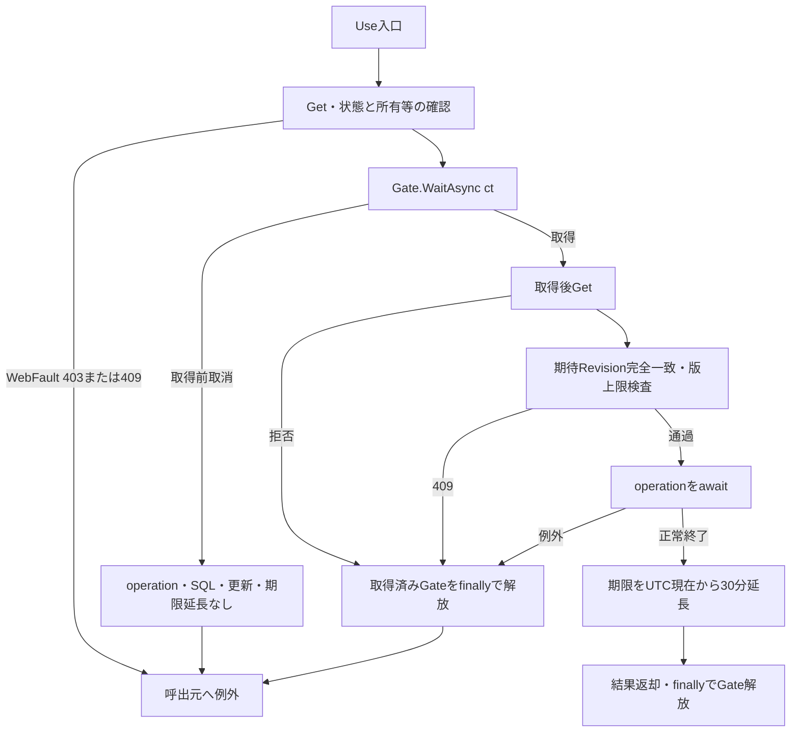

Gate待機は取得後のtry・finallyより前である。取得前取消では、その要求のoperation、SQL、Applied・LastResult・Revision更新、期限延長、Releaseへ進まない。取得済みGateを持つ要求が後続で失敗した場合はfinallyで解放する。Useはoperation途中の変更済み値を自動rollbackしない。根拠: `sources/Infrastructure/SearchContextStore.cs:14-14`。

各イベント図の「共通例外経路」は、応答未開始ならmiddlewareがWebFaultの元Status、その他の例外なら503を設定する経路を表す。/studentsではエラーHTMLと検索画面を開くリンクの返却を試みる。API用JSON、受付番号、入力保持画面を一律に保証しない。応答開始後はこのcatchの対象外であり、要求切断後の書込みや配信完了も保証されない。根拠: `sources/Infrastructure/WebHostSetup.cs:22-25`。

| 操作 | 使用する条件 | 成功後のApplied・LastResult | Revision・期限 |
| --- | --- | --- | --- |
| 初回Index | 初期条件 | 両方NULL | 新規版1、期限30分 |
| Search | 今回input、Page1 | 両方置換 | +1、期限延長 |
| Options | 今回input | 両方維持、LastResultを一覧材料に使用 | 期待版照合・版更新・期限延長なし |
| Page | Appliedの複製 | 表示指定・保持Page補正を含め両方置換 | +1、期限延長 |
| Clear | 初期条件 | 両方NULL | +1、期限延長 |
| 未検索Resume | Appliedなし | 維持 | 版維持、期限延長 |
| 検索済みResume | 元Applied | Applied維持、LastResult置換 | +1、期限延長 |

根拠: `sources/Infrastructure/WebStudentCoordinator.cs:7-15`。

### 共通DB操作

#### 接続・型・取消境界

サービス構築時はEncrypt=Mandatory、TrustServerCertificate=falseを設定する。Openは接続後に現在DBのsnapshot_isolation_state=1を要求し、不成立なら接続を破棄して例外を再送出する。Command helperはSQLタイムアウト30秒だが、接続診断は別のCreateCommand経路である。ParamはSqlDbTypeを明示し、Sizeが0以外の場合だけSizeを設定する。NULLはDBNull、DateOnlyは当日0時のDateTimeにする。根拠: `sources/Core/SqlServerStudentService.cs:39-72`。

検索・候補は読取SNAPSHOTを使い、接続、トランザクション開始、SQL、Reader、NextResult、commitへctを渡す。資源はawait usingで破棄する。検索に書込用sp_getapplockや、明示Rollbackの成否からUnknownを分類する処理はない。根拠: `sources/Core/SqlServerStudentService.cs:123-170`、`sources/Core/SqlServerStudentService.cs:197-216`。

SearchAsyncはtry内のInputValidationExceptionを先に捕捉し、元Errors付きValidationFailedにする。次のArgumentExceptionはArgumentError("Search",e)付きValidationFailedにする。どちらもCount0、Items空、LimitExceeded=falseである。規定形式のエラーコードは引き継ぎ、それ以外のArgumentExceptionはE-STU-002にする。SQL障害、OperationCanceledException、NullReferenceExceptionをこれらの検証結果に変換しない。User確認と入口時刻取得はtry前である。根拠: `sources/Core/SqlServerStudentService.cs:103-106`、`sources/Core/SqlServerStudentService.cs:169-170`、`sources/Core/StudentNormalizer.cs:162-168`。

EnsureSearchはSavedまたはNoChangeだけを認める。他のOutcomeは先頭FieldErrorのField・Code・MessageとOutcome対応HTTP状態を持つWebFaultにする。成功判定前のCount0を正常0件としてAppliedへ保持しない。FieldをCriteria.*へ一律変換する処理はなく、画面はvalidation-summary Allを使用する。根拠: `sources/Infrastructure/WebStudentCoordinator.cs:20-20`、`sources/Infrastructure/WebPresentation.cs:23-23`、`sources/Views/Shared/_MessagePanel.cshtml:2-2`。

#### Q-E 指定マスターの存在・上位整合

検索SNAPSHOT内で、指定された正規化学年、都道府県、年度、クラスを確認する。コード確認は分類表とJOINせず、利用状態・期間も絞らない。未指定対象は照会しない。在籍配列は01～04の許可値検査だけで、マスター存在照会は行わない。根拠: `sources/Core/SqlServerStudentService.cs:111-135`、`sources/Core/SqlServerStudentService.cs:218-222`。

| 対象 | SQL・取得結果 | パラメータ | 拒否条件 |
| --- | --- | --- | --- |
| 学年・都道府県 | `SELECT COUNT_BIG(*) FROM dbo.m_code WHERE category_id=@category AND code_value=@value`、bigint件数 | `@category:VarChar(24)`、GRADE／PREFECTURE。`@value:VarChar(10)` | 件数1以外、E-STU-009 |
| 年度 | `SELECT COUNT_BIG(*) FROM dbo.m_class WHERE school_year=@year`、bigint件数 | `@year:SmallInt`、Sizeなし | 0件、E-STU-014 |
| クラス | `SELECT school_year,grade_code FROM dbo.m_class WHERE class_id=@id`、PK対象最大1行 | `@id:BigInt`、Sizeなし | 行なし、指定年度または正規化学年と不一致、E-STU-014 |

学年確認の不成立で拒否する場合は、短絡評価により後続の都道府県確認へ進まない。各確認は単表参照で、ORDER BY・ページング・書込みはないため個別ER図を省略する。検索では学籍番号の完全一致存在検査や同一人物候補確認を行わない。

#### Q-S 学生件数・一覧

SearchAsyncはUser確認、入口now、日本時間業務日取得をtry前に行う。try内の検査順は、ページ・件数・方向、ソートキー、年度・クラス範囲、未所属排他、在籍配列、学籍番号、氏名キー、カナキー、電話、学年、都道府県、日付両端・逆転である。その後、接続・SNAPSHOT・Q-Eへ進む。未所属の排他は学年正規化前なので、サービス引数が非NULLの空学年文字列でも併指定と判定する。根拠: `sources/Core/SqlServerStudentService.cs:103-135`。

WHEREの必須条件は`s.is_deleted=0`である。次表の指定条件をANDで追加する。電話だけ括弧内OR、在籍だけINとなる。任意の正規化値がNULLなら述語とパラメータを省略する。NULL列だけを検索する条件へ置換しない。根拠: `sources/Core/SqlServerStudentService.cs:137-155`。

| 条件 | SQL述語 | パラメータ値・型・Size |
| --- | --- | --- |
| 学籍番号あり | `s.student_no LIKE @no ESCAPE '!'` | エスケープ済み番号＋末尾%、`VarChar(31)` |
| 氏名キーあり | `s.name_key LIKE @name ESCAPE '!'` | 前後%＋エスケープ済みキー、`NVarChar(642)` |
| カナキーあり | `s.kana_key LIKE @kana ESCAPE '!'` | 前後%＋エスケープ済みキー、`NVarChar(74)` |
| 年度指定 | `c.school_year=@year` | 年度、`SmallInt`、Sizeなし |
| 学年あり | `c.grade_code=@grade` | 正規化学年、`VarChar(2)` |
| クラス指定 | `s.class_id=@class` | ID、`BigInt`、Sizeなし |
| 未所属true | `s.class_id IS NULL` | パラメータなし |
| 都道府県あり | `s.prefecture_code=@prefecture` | 正規化コード、`VarChar(2)` |
| 電話あり | `(s.phone_number=@phone OR s.emergency_phone_number=@phone)` | 正規化電話、`VarChar(16)` |
| 開始日あり | `s.admission_date>=@from` | 開始日を含む、`Date`、Sizeなし |
| 終了日あり | `s.admission_date<=@to` | 終了日を含む、`Date`、Sizeなし |
| 在籍配列非空 | `s.enrollment_status_code IN (@status0,...)` | 配列各値、各`VarChar(2)` |

LIKE特殊文字は!→!!、%→!%、_→!_、[→![の順に置換し、ESCAPE '!'を指定する。Size31・642・74は検索パターンの送信領域であり、入力・保存上限を増やす指定ではない。根拠: `sources/Core/StudentNormalizer.cs:161-161`、`sources/Core/SqlServerStudentService.cs:140-142`。

マスター確認、件数確認、必要な一覧取得は、一回のSearchAsyncの同じSNAPSHOT内で行う。件数SQLは以下の構造で、WHEREへ必須条件と指定された全述語を結合する。

```sql
SELECT COUNT_BIG(*)
FROM (
  SELECT TOP (10001) s.student_id
  FROM dbo.m_student s
  LEFT JOIN dbo.m_class c ON c.class_id=s.class_id
  WHERE /* s.is_deleted=0 AND 上表の指定された全述語 */
) limited;
```

TOPにORDER BYはない。10,000件以下は実件数、10001は超過検出値であり全件数ではない。超過時は一覧SQLを実行せずcommitし、NoChange、Count=10001、Items空、LimitExceeded=trueを返す。根拠: `sources/Core/SqlServerStudentService.cs:155-159`。

上限内の一覧は次の16列を取得する。件数と一覧の双方へ、同じ検索パラメータ集合を型・値・Sizeごと設定する。

```sql
SELECT s.student_id,s.student_no,s.student_name,s.student_name_kana,s.birth_date,
       c.school_year,c.class_code,c.class_name,g.code_name grade_name,e.code_name status_name,
       p.code_name prefecture_name,s.address_line1,s.phone_number,
       s.admission_date,s.updated_at,s.row_version
FROM dbo.m_student s
LEFT JOIN dbo.m_class c ON c.class_id=s.class_id
LEFT JOIN dbo.m_code g ON g.category_id=c.grade_category AND g.code_value=c.grade_code
LEFT JOIN dbo.m_code e ON e.category_id=s.enrollment_category AND e.code_value=s.enrollment_status_code
LEFT JOIN dbo.m_code p ON p.category_id=s.prefecture_category AND p.code_value=s.prefecture_code
WHERE /* s.is_deleted=0 AND 上表の指定された全述語 */
ORDER BY /* 許可主ソート列と検査済みascまたはdesc */,s.student_id ASC
OFFSET @offset ROWS FETCH NEXT @size ROWS ONLY;
```

| SortKey | 主ソート列 | 並び順の意味 |
| --- | --- | --- |
| studentNo | `s.student_no` | 保存番号の文字列順 |
| name | `s.name_key` | 氏名照合値の順 |
| admissionDate | `s.admission_date` | 入学日順 |
| updatedAt | `s.updated_at` | 更新日時順 |

Pageは1以上、PageSizeは20・50・100、方向は小文字asc・desc、キーは上表の4値だけである。同順位は主方向に関係なくstudent_id ASCとする。student_noとname_keyはDDLのBIN2照合で、番号の数値化や氏名表示表記による並べ替えは行わない。根拠: `sources/Core/SqlServerStudentService.cs:107-108`、`sources/Core/SqlServerStudentService.cs:162-164`、`sources/database/001_schema.sql:9-13`。

サービスはlastPage=max(1,(count+PageSize−1)/PageSize)、SQL用page=min(要求Page,lastPage)とする。checked((page−1)×PageSize)を@offset:Int、PageSizeを@size:Intで渡し、Sizeを設定しない。0件でもSQL用pageは1で、最大PageSize行をStudentRowへ読む。commit後にNoChange・実件数・行・LimitExceeded=falseを返す。SearchedAtは入口nowであり、完了時刻ではない。根拠: `sources/Core/SqlServerStudentService.cs:105-105`、`sources/Core/SqlServerStudentService.cs:160-168`。

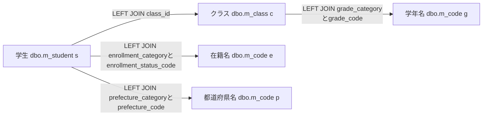

これは検索JOIN図で、g・e・pは同じ物理表の用途別aliasである。件数SQLは学生とクラスの辺だけ、一覧SQLは全辺を使用する。名称JOINに利用状態・期間条件はなく、名称欠落だけでは学生を除外しない。ただし年度・学年のWHEREを指定すると、その所属値を持たない学生は一致しない。根拠: `sources/Core/SqlServerStudentService.cs:82-90`、`sources/Core/SqlServerStudentService.cs:143-146`、`sources/Core/SqlServerStudentService.cs:156-162`。

#### Q-L 検索候補取得

SearchModelは毎回LookupAsync(false,ct)を呼ぶ。検索とは別接続・別SNAPSHOTで、二結果セットをNextResultAsyncで切り替える。両SQLにWHERE、受信条件パラメータ、ページングはない。根拠: `sources/Web/Controllers/StudentsController.cs:39-39`、`sources/Core/SqlServerStudentService.cs:197-216`。

```sql
SELECT c.category_id,c.code_value,c.code_name,c.display_order,
       CONVERT(bit,CASE WHEN c.is_active=1 AND k.is_active=1 THEN 1 ELSE 0 END) is_active,
       c.valid_from,c.valid_to,c.is_protected
FROM dbo.m_code c
JOIN dbo.m_code_category k ON k.category_id=c.category_id
ORDER BY c.category_id,c.display_order,c.code_value;

SELECT c.*,CONVERT(int,0) occupied
FROM dbo.m_class c
LEFT JOIN dbo.m_code g ON g.category_id=c.grade_category AND g.code_value=c.grade_code
ORDER BY c.school_year DESC,g.display_order,c.display_order,c.class_code,c.class_id;
```

第1結果をCodeEntry、第2結果をSchoolClassへ移し、commit後にLookupSetを返す。CodeEntry.IsActiveはコードと分類の状態のANDで、有効期間判定を含まない。Occupied=0は人数集計の省略値で、実人数ゼロではない。検索画面は停止・期間外候補を選択禁止にせず、クラス停止だけを注記する。根拠: `sources/Core/Contracts.cs:61-65`、`sources/Core/SqlServerStudentService.cs:201-216`、`sources/Views/Students/Search.cshtml:5-5`。

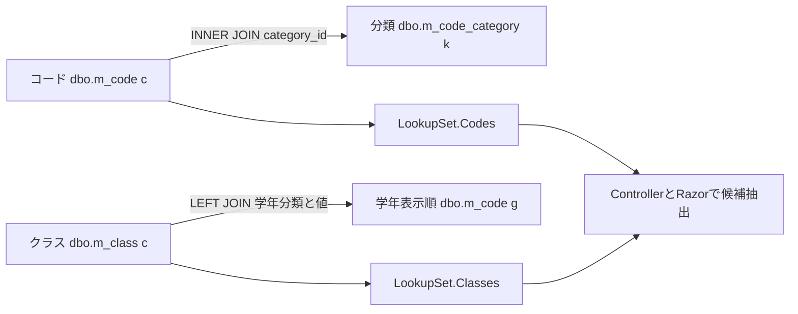

検索候補図には学生人数集計の辺を置かない。検索で選べる値を新規保存可能値と同一視しない。登録側は最新DBの存在、利用状態、期間、所属整合、定員を別に検査する。根拠: `sources/Core/SqlServerStudentService.cs:344-383`。

#### 検索関連の物理FK

以下はDDLの物理FKであり、上の検索・候補JOIN図とは別である。コードのPKと参照は分類＋値の複合キーである。class_idはNULL可なので学生からクラスは0または1親、非NULLのコード参照は子ごとに1親、親から子は0件以上となる。

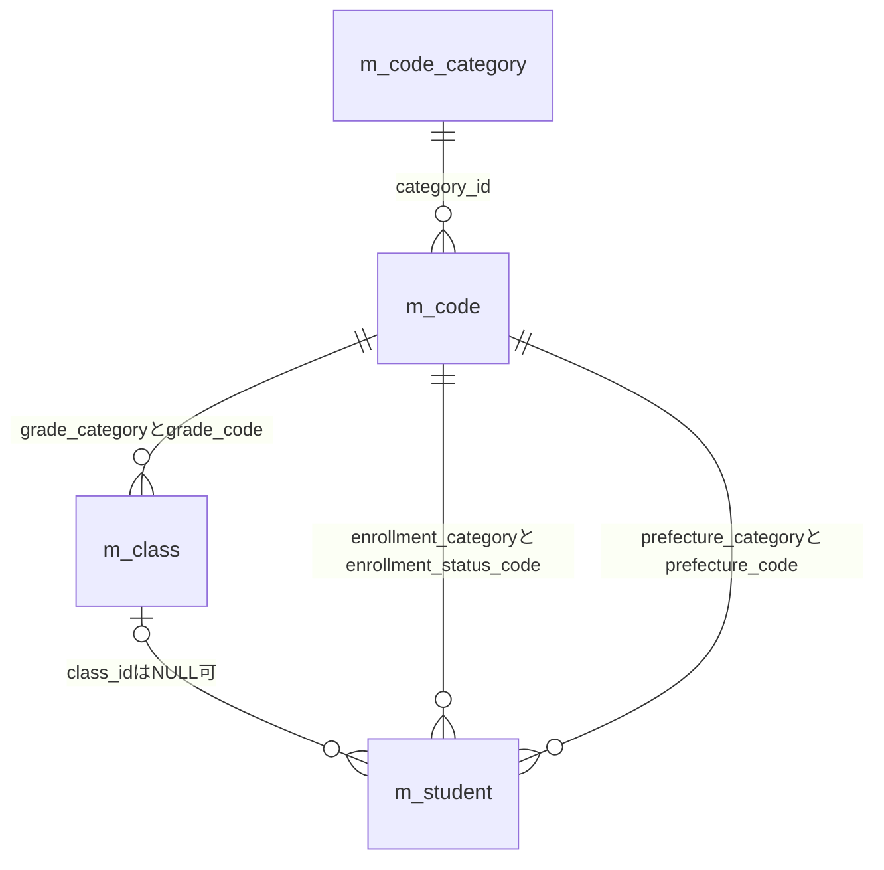

性別・続柄のFKもDDLにあるが、検索一覧の名称JOINには使わない。監査対象キーや検索状態へのFK、削除連動を追加しない。基表NOT NULLとLEFT JOIN後のnullableは別の属性である。根拠: `sources/database/001_schema.sql:15-31`、`sources/database/001_schema.sql:65-66`、`sources/database/001_schema.sql:113-127`、`sources/database/001_schema.sql:189-197`。

### E01 初回表示 — Index

#### 処理概要

contextIdなしのGET /studentsは、新しい未検索状態と候補を作る。学生検索は行わない。contextIdが非空ならE06へ進む。

#### 処理手順

1. identity.Readで認証情報を確認する。
2. contextIdがNULL・空文字ならNewContextでEntryを作る。Applied・LastResultはNULL、Revisionは1、期限は30分とする。
3. Present(entry,null)で未検索、件数・日時NULL、空一覧の表示材料を作る。
4. 初期StudentSearchInputを用意する。文字条件は空、所属・都道府県・日付は未指定、未所属false、在籍01・02とする。表示指定は20・studentNo・ascである。
5. Flash.Takeの戻り値を通知材料とし、SearchModelでQ-L、JsonElement化、利用者・Entry・表示指定の設定を行う。
6. SearchのViewResultを返し、Razorで描画する。

根拠: `sources/Web/Controllers/StudentsController.cs:8-11`、`sources/Web/Controllers/StudentsController.cs:39-39`、`sources/Web/Inputs/StudentSearchInput.cs:7-18`、`sources/Infrastructure/SearchContextStore.cs:9-12`。

#### 条件付き処理フロー

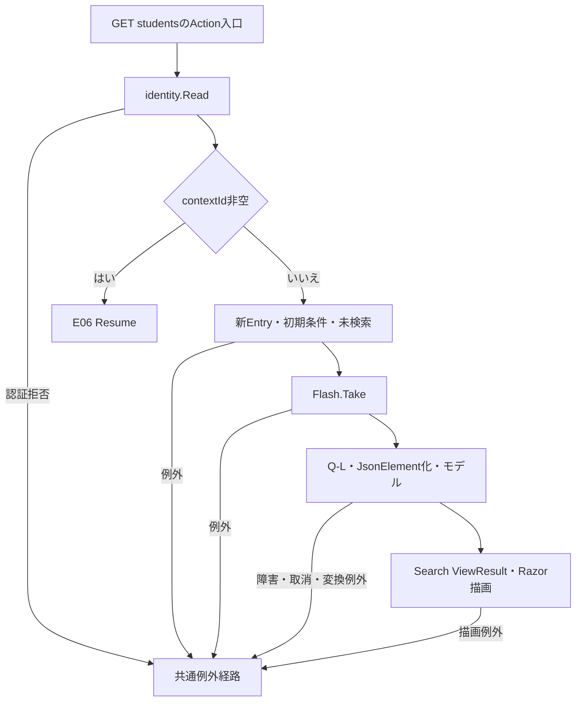

#### SQL・テーブル関連（ER図）

Q-L候補JOIN図を適用する。新EntryはSearchContextStoreのメモリ辞書へ保持するため、状態作成のDB ER図は不要である。

#### DB操作の詳細

候補二結果セットを一つのSNAPSHOTで参照しcommitする。学生件数・一覧・人数集計は実行しない。受信条件パラメータはない。

#### 結果・例外時の扱い

未検索ではページ操作を非活性にする。候補0件でも検索ボタンを禁止する分岐はない。候補取得・変換・描画の局所catchと、失敗時の作成済みEntry取消はない。根拠: `sources/Views/Students/Search.cshtml:5-8`、`sources/Web/Controllers/StudentsController.cs:8-11`。

### E02 検索 — Search

#### 処理概要

今回条件をPage1で検索し、成功確認後にAppliedとLastResultを確定する。正常0件と上限超過もNoChangeの成功経路であり、実行条件を保持する。

#### 処理手順

1. FormGuardで許可項目・重複を検査する。Criteria.StatusCodesキーがなければ空配列にする。
2. 最初のGetで状態の存在・期限・所有者・セッション・非空指定Tabを確認し、Present(entry,null)で失敗再表示用の空一覧材料を作る。ここまでは局所try外である。
3. ModelState不正ならHTTP422とし、Coordinatorを呼ばない。
4. ModelState有効なら局所try内でCoordinator.Searchを呼ぶ。認証確認後、ToCriteriaでクラスIDを解析し、Page1と表示指定を設定する。変換はGate取得前である。
5. Useで状態Get、Gate待機、取得後Get、期待Revision・版上限の検査を行う。
6. SearchAsyncで入力検査・正規化・Q-E・Q-Sを行い、EnsureSearchで成功を確認する。
7. 条件の深い複製をApplied、結果をLastResultへ置き、Revisionを+1にしてPresentを返す。
8. Useのoperation正常終了後に期限を延長し、取得済みGateを解放する。
9. 局所try内WebFaultはe.Statusと項目エラーを保持する。表示材料への代入が完了していなければ空一覧材料を使用する。
10. 局所try外で今回inputと別Q-LからSearchModelを作り、モデルのPageSize・SortKey・SortDirectionへ受信値を設定する。SearchのViewResultを返す。

根拠: `sources/Web/Controllers/StudentsController.cs:13-16`、`sources/Web/Inputs/StudentSearchInput.cs:19-22`、`sources/Infrastructure/WebStudentCoordinator.cs:7-9`、`sources/Infrastructure/SearchContextStore.cs:14-15`。

#### 条件付き処理フロー

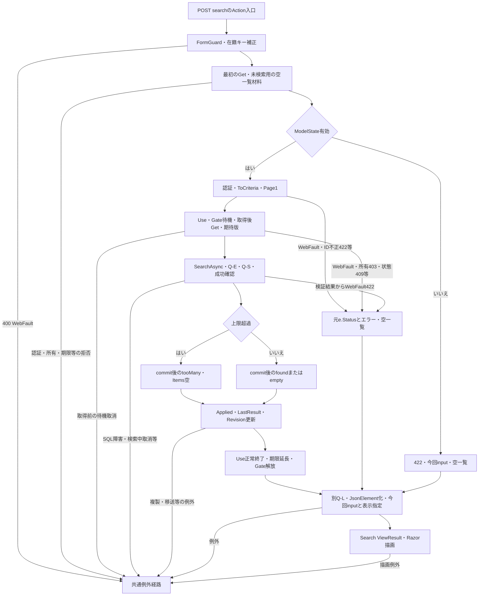

取得前の待機取消はSQL実行前の独立経路である。この枝へGate解放や状態更新を加えない。取得済みUse内の失敗はfinallyでGateを解放するが、正常終了時の期限延長は行わない。根拠: `sources/Infrastructure/SearchContextStore.cs:14-14`。

#### SQL・テーブル関連（ER図）

指定マスター確認にQ-E、件数・一覧にQ-S検索JOIN図、再描画にQ-L候補JOIN図を適用する。物理FKは別図である。

#### DB操作の詳細

Q-EとQ-Sは一回の検索SNAPSHOT、後続Q-Lは別接続・別SNAPSHOTである。検索結果と画面候補全体が同じ時点の情報になる保証はない。学生へのINSERT・UPDATE・DELETEは行わない。根拠: `sources/Core/SqlServerStudentService.cs:123-168`、`sources/Core/SqlServerStudentService.cs:197-216`。

#### 結果・例外時の扱い

ModelState不正、ToCriteriaのID不正、サービスValidationFailedは422に進む。Use内の所有等403、期限・旧版・版上限等409は元Statusを維持する。局所再表示は今回inputとModelState、空一覧を使うが、既存Applied・LastResultは消さない。根拠: `sources/Web/Controllers/StudentsController.cs:14-16`、`sources/Infrastructure/SearchContextStore.cs:13-14`。

最初のFormGuard・Get、後段SearchModel、返却後Razor描画は検索実行の局所catch外である。Gate待機取消、SQL障害、検索中取消はWebFault限定catchを越えて共通経路へ伝播する。

バインド後PageSize=0が届く場合、サービスは拒否してもControllerは再表示モデルへ0を設定する。ビューの総ページ数計算はPageSizeで除算するため、描画時ゼロ除算となり得る。これは渡された値を前提とするソース推論であり、HTTPの全不正入力が422の条件保持HTMLで完結するとは定義しない。根拠: `sources/Web/Controllers/StudentsController.cs:13-16`、`sources/Core/SqlServerStudentService.cs:107-107`、`sources/Views/Students/Search.cshtml:8-8`。

### E03 候補更新 — Options

#### 処理概要

今回条件の候補を再描画し、一覧はLastResultを使用する。学生検索、期待Revision照合、Gate、状態更新、期限延長は行わない。

#### 処理手順

1. Searchと同じFormGuard、在籍キー省略補正、状態Getを行う。
2. 未所属trueなら年度・学年・クラスをNULLにし、対応するCriteria.*のModelStateを除去する。
3. 今回input、Present(entry,entry.LastResult)、Q-LからSearchModelを作る。
4. 「条件を変更しました。検索を押すと一覧に反映します。」を通知に設定する。
5. 非空ClassIdが候補IDの文字列表現と一致し、今回年度・学年にも適合するか確認する。
6. 不適合ならClassIdと該当ModelStateを解除し、通知を「上位条件に合わないクラスを解除しました。」へ置き換える。
7. SearchのViewResultを返す。表示指定はAppliedまたは既定値であり、受信表示指定を明示反映しない。

根拠: `sources/Web/Controllers/StudentsController.cs:22-22`、`sources/Web/Controllers/StudentsController.cs:39-39`。

#### 条件付き処理フロー

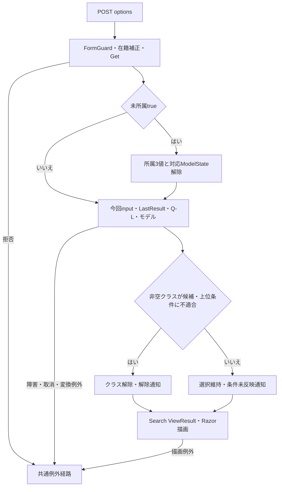

#### SQL・テーブル関連（ER図）

Q-L候補JOIN図を適用する。年度・学年はSQLパラメータではなく、取得後のController・Razorによる比較・抽出に使用する。

#### DB操作の詳細

候補二結果セットのSNAPSHOTだけを実行する。学生件数・一覧・人数集計・DB書込みはない。状態はGetで取得し、Gateを使用しない。

#### 結果・例外時の扱い

ModelState.IsValidで停止せず、ToCriteria・IdParser・学年正規化を通さない。ClassIdの文字列01はSearchで数値1へ解析できても、Optionsでは候補文字列1に一致せず解除され得る。全角学年も正規化前の比較である。根拠: `sources/Web/Controllers/StudentsController.cs:22-22`、`sources/Web/Inputs/StudentSaveInput.cs:60-60`、`sources/Core/StudentNormalizer.cs:113-117`。

LastResultの再提示は今回条件の検索結果ではない。Applied・LastResult・RevisionをGateなしで読むため、一括保護された状態スナップショットでもない。拒否・障害時の入力保持用局所catchはない。根拠: `sources/Web/Controllers/StudentsController.cs:14-22`、`sources/Infrastructure/SearchContextStore.cs:9-14`。

### E04 表示指定変更・ページ移動 — Page

#### 処理概要

Appliedを複製して再検索する。件数・キー・方向のいずれかが変わればPage1、同じなら要求Pageを使用する。未実行の条件フォーム値を混ぜない。

#### 処理手順

1. FormGuardでPageRequestとTabIdを検査し、最初のGetを行う。両処理は局所try外である。
2. try内でCoordinatorが認証を確認し、UseのGate待機、状態再検査、期待Revision照合を行う。
3. Appliedなしなら409「先に検索してください。」とする。
4. Appliedを深く複製し、表示指定変更時はPage1、同じなら要求Pageを設定する。PageSize・SortKey・SortDirectionを要求値へ置く。
5. SearchAsyncとEnsureSearchを実行する。
6. 超過でなく保持予定Pageが返却件数の最終ページを超える場合、一度だけ保持Pageを補正して第2検索と成功確認を行う。
7. 全検索成功後、条件の深い複製と結果をApplied・LastResultへ置き、Revisionを+1にする。Use正常終了で期限を延長しGateを解放する。
8. From(Applied)で条件欄を復元し、別Q-LとSearchModelからViewResultを返す。このモデル作成もtry内である。
9. try内WebFaultはe.Statusとエラーを保持し、Applied由来input、空一覧材料、Q-Lで再構築する。

根拠: `sources/Web/Controllers/StudentsController.cs:18-19`、`sources/Web/Controllers/StudentsController.cs:39-40`、`sources/Infrastructure/WebStudentCoordinator.cs:11-12`、`sources/Infrastructure/SearchContextStore.cs:14-15`。

#### 条件付き処理フロー

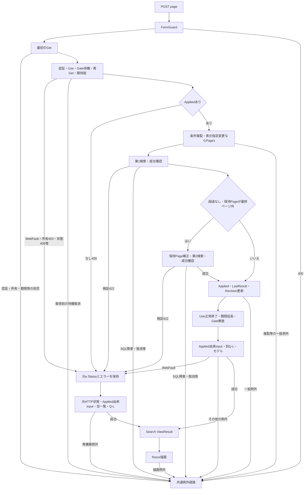

再表示への合流点でHTTP状態を固定しない。所有等403、期限・旧版・版上限・未検索409、サービス検証422はそれぞれe.Statusを引き継ぐ。共通経路もWebFaultなら元状態、その他なら応答未開始時の503である。根拠: `sources/Web/Controllers/StudentsController.cs:19-19`、`sources/Infrastructure/SearchContextStore.cs:13-14`、`sources/Infrastructure/WebPresentation.cs:23-23`。

#### SQL・テーブル関連（ER図）

検索ごとにQ-EとQ-S検索JOIN図、再描画にQ-L候補JOIN図を適用する。型付きパラメータ、上限、許可ソートを再検査する。

#### DB操作の詳細

第1検索でサービスはSQL用pageを最終ページ以内に補正する。Coordinatorが保持Pageも補正する場合、第2検索は別接続・別SNAPSHOTである。2回全体は一つの読取単位ではない。第2検索で件数がさらに減っても保持Page補正を反復しない。根拠: `sources/Infrastructure/WebStudentCoordinator.cs:12-12`、`sources/Core/SqlServerStudentService.cs:123-168`。

#### 結果・例外時の扱い

条件欄はAppliedから作るため、ブラウザーにだけ存在した未実行条件は復元しない。ControllerにModelState不正で停止する分岐はない。表示指定変更時の要求Pageは、サービス検査前に1へ置き換わる。根拠: `sources/Web/Controllers/StudentsController.cs:18-19`、`sources/Infrastructure/WebStudentCoordinator.cs:12-12`。

最初のFormGuard・Getは局所catch外である。成功側SearchModelのWebFaultを捕捉する場合も、既に更新された状態を復元しない。catch内再構築と返却後Razorの例外は同じcatchで再捕捉しない。Gate待機取消とSQL障害・取消は共通経路へ伝播する。

### E05 条件クリア — Clear

#### 処理概要

状態IDを維持し、Applied・LastResultを消して初期条件の未検索画面へ戻す。

#### 処理手順

1. FormGuardでContextRequestとTabIdを検査する。
2. Coordinatorが認証を確認し、Useで状態、Gate、取得後再検査、期待版・版上限を確認する。
3. AppliedとLastResultをNULLへ置き、Revisionを+1にする。
4. Use正常終了で期限を延長し、取得済みGateを解放する。
5. ControllerがModelStateを全消去し、同じEntryを再Getする。
6. 初期input、既定表示指定、Q-Lから未検索モデルを作り、SearchのViewResultを返す。

根拠: `sources/Web/Controllers/StudentsController.cs:21-21`、`sources/Web/Controllers/StudentsController.cs:39-39`、`sources/Infrastructure/WebStudentCoordinator.cs:15-15`。

#### 条件付き処理フロー

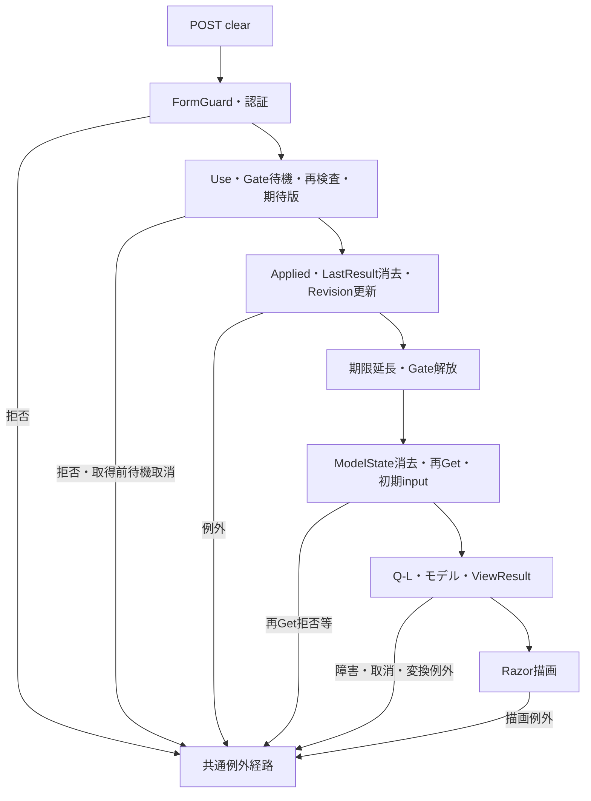

#### SQL・テーブル関連（ER図）

消去対象はメモリEntryであるため、消去自体のDB ER図を省略する。再描画にQ-L候補JOIN図を適用する。

#### DB操作の詳細

クリア自体はメモリ操作で、学生検索、学生DELETE、t_runtime_state DELETEはない。SQLは候補再取得だけである。

#### 結果・例外時の扱い

初期在籍01・02、20件、studentNo、ascへ戻る。状態ID・所有者・Session・Tabは維持する。LastResultも消すため後続Optionsで旧一覧は復活しない。局所catchはなく、消去後の再Get・候補・描画失敗でも消去と版更新を戻さない。根拠: `sources/Web/Inputs/StudentSearchInput.cs:7-18`、`sources/Web/Controllers/StudentsController.cs:21-22`。

### E06 検索画面への復帰 — Resume

#### 処理概要

contextId付きIndexは未検索状態を復元するか、元Appliedで最新DBを再検索する。保存学生が条件外でも条件を変えず、特別に行を追加しない。

#### 処理手順

1. Indexが認証確認後、Tabを渡さず既存EntryをGetする。
2. queryのcontextRevisionをContextRequestへ移す。省略時は空文字であり、現在版で補完しない。
3. Resumeが認証を確認し、UseでGate待機、状態再検査、期待版・版上限を確認する。
4. Appliedなしなら学生検索と版更新をせず未検索を返す。operation正常終了による期限延長は行う。
5. Appliedありなら元条件でSearchAsyncと成功確認を行い、LastResultとRevisionだけを更新する。Appliedは置換しない。
6. Appliedから条件欄を復元し、Flash.Takeで通知を取得・消費する。
7. 別Q-L、モデル作成、ViewResultを経てSearch HTMLを描画する。

根拠: `sources/Web/Controllers/StudentsController.cs:8-11`、`sources/Web/Controllers/StudentsController.cs:39-40`、`sources/Infrastructure/WebStudentCoordinator.cs:14-14`、`sources/Infrastructure/FlashMessageStore.cs:6-9`。

#### 条件付き処理フロー

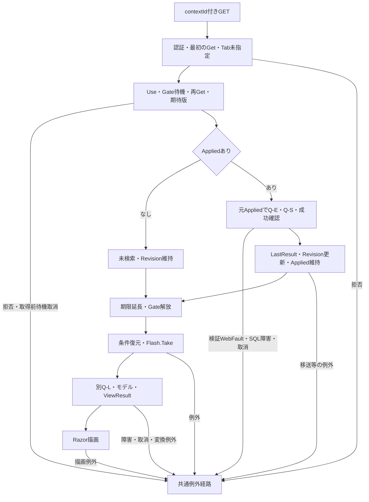

#### SQL・テーブル関連（ER図）

検索済み復帰にQ-E・Q-S検索JOIN図、両状態の再描画にQ-L候補JOIN図を適用する。検索状態と通知は別のメモリ辞書である。

#### DB操作の詳細

検索済みではAppliedを置換せず再検索する。検索SNAPSHOTと候補SNAPSHOTは別である。条件外または論理削除済みの保存学生を追加取得しない。未検索では候補取得だけを行う。

#### 結果・例外時の扱い

期限切れ・旧版は409で、自動初期化しない。Index／ResumeはTabを渡さない。所有・期限・版の拒否はFlash.Take前に起こる。Take後の候補・変換・描画・配信失敗では、通知が消費済みでも画面へ届かない場合がある。入力保持用局所catchはない。根拠: `sources/Infrastructure/SearchContextStore.cs:13-14`、`sources/Web/Controllers/StudentsController.cs:8-11`、`sources/Infrastructure/FlashMessageStore.cs:9-9`。

件数減少時、SQL取得ページと提示ページがずれ得る。サービスはSQL用ローカルpageだけを補正し、SearchCriteria.Pageを書き換えない。ResumeはAppliedを維持し、PresentはApplied.Pageを提示するため、取得行は最終ページでも提示pageが総ページ数を超える場合がある。E04の保持Page補正とは異なる値の移送である。根拠: `sources/Core/SqlServerStudentService.cs:160-164`、`sources/Infrastructure/WebStudentCoordinator.cs:12-14`、`sources/Infrastructure/WebStudentCoordinator.cs:21-21`。

### E07 未所属変更・送信中表示

#### 処理概要

ブラウザー補助は未所属ONで所属値を解除し、submit時に同フォームの一部ボタンを非活性にする。年度・学年変更だけでは候補更新・検索を送信しない。

#### 処理手順

1. 初期読込みとSRC-007のchangeでcheckedを確認する。
2. ONならSRC-004・005・006の値を空にする。OFFでも元値を戻さない。
3. disabledは変更しない。所属selectの非活性はRazor再描画時のUnassignedOnlyで決まる。
4. 上位条件を候補に反映するにはE03、学生一覧に反映するにはE02を実行する。
5. submit時は送信button以外の同フォーム内buttonをdisabledにし、フォームにaria-busy=trueを設定する。

根拠: `sources/wwwroot/js/site.js:4-8`、`sources/Views/Students/Search.cshtml:5-8`。

#### 条件付き処理フロー

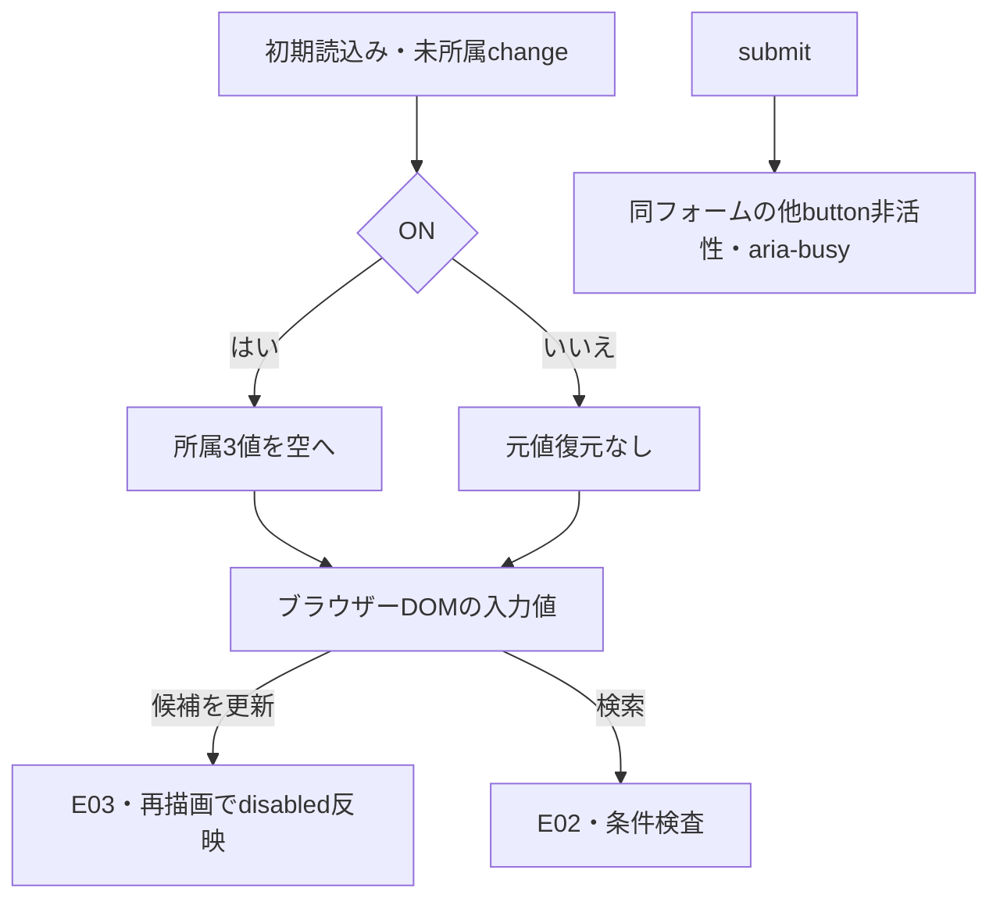

#### SQL・テーブル関連（ER図）

change・submit補助単独はブラウザーDOMを扱うためDB ER図を省略する。POST後はE02・E03の関連を使用する。

#### DB操作の詳細

このJavaScript単独では外部通信、Entry更新、DB操作を行わない。REG-018から年度・学年を補完する処理は登録画面用で、SRCクラスには接続されていない。

#### 結果・例外時の扱い

送信button自身と別フォームは非活性化の対象外であり、画面全体の二重送信禁止ではない。検索には登録用dirty確認、fetch、AbortController、要求連番による旧応答破棄が接続されていない。Entry更新の競合はサーバーGateとRevisionで扱う。根拠: `sources/wwwroot/js/site.js:2-9`、`sources/Infrastructure/SearchContextStore.cs:14-14`。

未所属ONでも在籍01・02を解除しない。提示DDLのck_student_datesが実DBで適用・有効なら、01・02はclass_id非NULLを要求するため、初期在籍と未所属IS NULLの併指定に一致する行はない。これはDDL適用を条件とする推論である。根拠: `sources/Web/Inputs/StudentSearchInput.cs:13-14`、`sources/wwwroot/js/site.js:7-7`、`sources/Core/SqlServerStudentService.cs:146-154`、`sources/database/001_schema.sql:198-198`。

### E08 新規・編集・参照への遷移

<a id="editor-entry"></a>

#### 処理概要

新規・行リンクはreturnContextIdを登録入口へ渡す。既存は学生IDで最新非削除詳細を取得する。検索条件、一覧表示値、一覧の学生版を登録入力へ転記しない。登録全項目・保存の正本責務は計画文書SM-DET-STUDENT-EDITORに対応する。

#### 処理手順

1. Coordinator.Editが認証と復帰状態の所有・セッション・期限を確認する。復帰状態確認にはTabを渡さない。
2. 新規は作成権限を確認する。既存はGetAsyncで詳細を取得し、不在なら404とする。
3. 登録候補を取得し、StudentSaveInput.Fromでフォームを作る。既存ExpectedVersionは再取得した学生RowVersionから設定する。
4. Loadが候補・フォーム作成後に復帰状態を再Getし、現在の検索RevisionをReturnRevisionとして採取する。
5. 主体・セッション・対象ID・詳細・原入力の深い複製・復帰版を30分の編集Snapshotへ保持する。
6. EditのViewResultを返す。Viewerは既存の参照モード、Staff・Administratorは編集モードとなる。

根拠: `sources/Views/Students/Search.cshtml:6-8`、`sources/Infrastructure/WebStudentCoordinator.cs:6-6`、`sources/Infrastructure/WebStudentCoordinator.cs:17-17`、`sources/Web/Controllers/StudentsController.cs:23-25`、`sources/Web/Inputs/StudentSaveInput.cs:44-54`、`sources/Infrastructure/EditorSnapshotStore.cs:7-11`。

#### 条件付き処理フロー

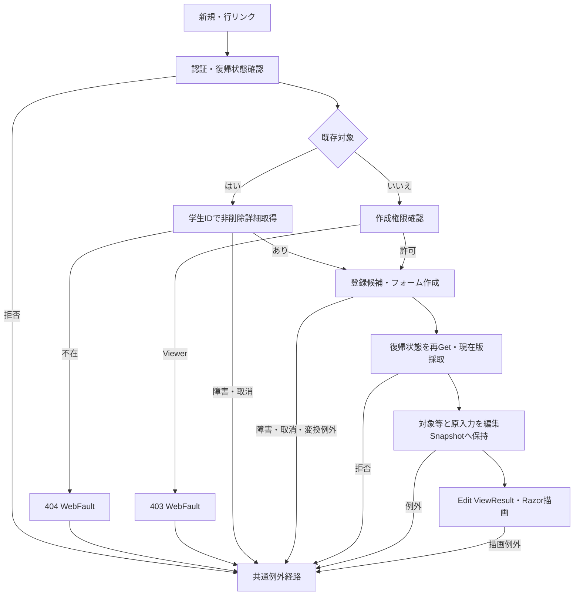

#### SQL・テーブル関連（ER図）

詳細取得はm_student単表なので個別ER図を省略する。登録候補はQ-Lと同じマスターJOINを使うが、LookupAsync既定呼出しは人数を集計する。

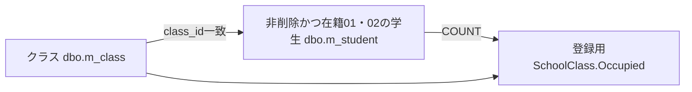

これは候補人数集計の読取関連であり、追加FKや席の予約ではない。根拠: `sources/Core/SqlServerStudentService.cs:196-208`。

#### DB操作の詳細

既存取得は`SELECT * FROM dbo.m_student WHERE student_id=@id AND is_deleted=0`、@id:BigInt、Sizeなしで最大1行を読む。id<=0は接続前に詳細NULLとなる。GetAsyncは明示トランザクションなし、登録候補は別SNAPSHOTである。LoadはDB await後に復帰状態を再確認するため、入口の復帰検査を通っただけでEdit到達を保証しない。根拠: `sources/Core/SqlServerStudentService.cs:172-196`、`sources/Web/Controllers/StudentsController.cs:25-25`。

#### 結果・例外時の扱い

学生期待版と検索復帰版は別の比較情報である。「検索へ戻る」は保存せず、編集開始時ReturnRevisionでE06へ進む。「入力クリア／編集取消」はSnapshot原入力へ戻してEditに留まる。「最新情報を再読込」は既存GETでDB詳細と復帰版を取得し直す。根拠: `sources/Views/Students/Edit.cshtml:16-16`、`sources/Web/Controllers/StudentsController.cs:25-25`、`sources/Web/Controllers/StudentsController.cs:35-35`。

### E09 保存・削除結果からの検索復帰

#### 処理概要

登録側のSavedだけが成功通知と303による検索復帰へ進む。本書は復帰ID・版、Saved／非Savedの結果分岐、通知消費とHTML到達を扱う。登録全入力、重複確認、監査の全詳細はSM-DET-STUDENT-EDITORとSM-COM-TRANSACTION-AUDITの責務に対応する。

#### 処理手順

1. 保存入口はFormGuard、作成・更新権限、Snapshot.Get、復帰状態確認、Snapshot原入力の復帰先との一致確認を順に行う。ModelState有効ならCoordinator.Saveへ進み、無効なら422で登録画面再表示へ進む。
2. 削除入口はFormGuard、認証、Snapshot.Get、復帰先一致を確認し、Coordinator.Deleteで管理者権限、復帰状態、Confirmed、期待学生版を確認してサービスを呼ぶ。
3. サービス結果がSavedならReturnAfterSaveへ進む。復帰IDありならSnapshotのReturnRevisionを使用する。復帰IDなしなら新しい未検索Entryを作り、新しい版を使用する。
4. 主体・セッション・状態IDをキーに成功通知をFlashへ10分保持し、303とcontextId・contextRevision付きLocationを設定してEmptyResultを返す。
5. 後続GETがE06を行い、未検索復元または元条件再検索、条件復元の後にFlash.Takeを行う。
6. 保存非Savedは今回input、既存Snapshot、Result、再取得候補でEditを返す。NoChangeは「変更はありません。」を表示する。
7. 削除非SavedはエラーとOutcome対応HTTP状態を設定後、Loadを再実行する。最新非削除詳細、候補、フォーム、復帰版、新Snapshotを作り直す。

根拠: `sources/Web/Controllers/StudentsController.cs:25-38`、`sources/Infrastructure/WebStudentCoordinator.cs:18-19`、`sources/Infrastructure/FlashMessageStore.cs:6-9`。

#### 条件付き処理フロー

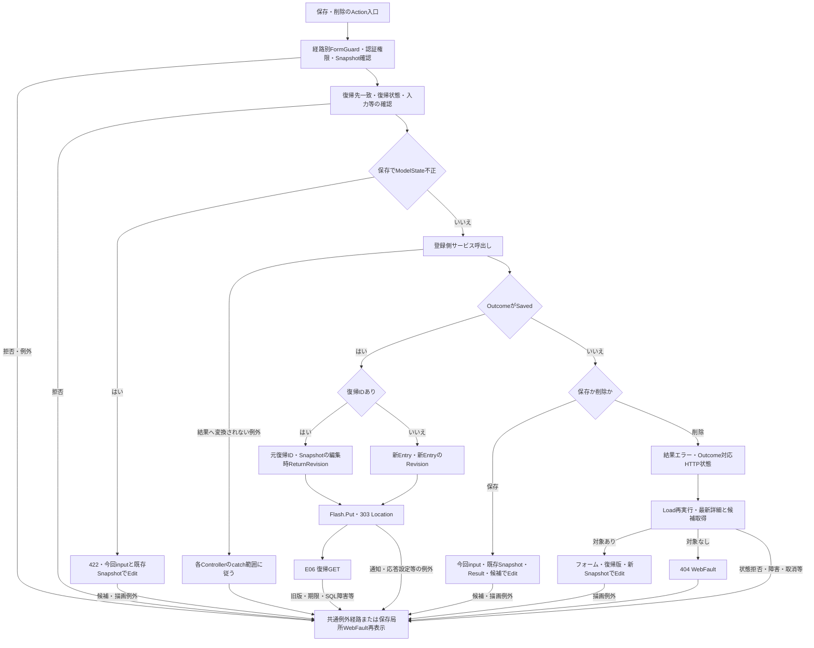

図の入口拒否と保存局所再表示は同じ固定応答ではない。保存のFormGuard、権限、Snapshot、最初の復帰先検査は局所try外である。局所WebFault再表示はModelState有効時のCoordinator.Save呼出し中に限る。削除には同じ局所catchがない。各枝の元Statusと到達範囲はControllerの経路に従う。根拠: `sources/Web/Controllers/StudentsController.cs:28-37`。

#### SQL・テーブル関連（ER図）

復帰検索はE06のQ-E・Q-S・Q-Lを使用する。登録側は学生書込みと監査追記を同じトランザクションで確定する。監査target_keyは学生への物理FKではない。

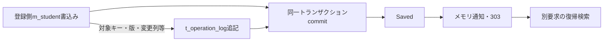

根拠: `sources/Core/SqlServerStudentService.cs:292-315`、`sources/Core/SqlServerStudentService.cs:385-390`、`sources/Core/SqlServerStudentService.cs:409-414`、`sources/database/001_schema.sql:189-195`。

#### DB操作の詳細

Savedは登録側ReadCommitted、トランザクション所有Exclusive書込ゲート、対象・学生期待版の確認、版付き書込み、監査、commit正常終了を経て返る。ゲートは5秒待機、負戻り値を拒否する。既存更新のWHEREはstudent_id=@id、row_version=@version、is_deleted=0で、正規化した更新対象列、更新管理項目、row_versionを変更する。検索ContextId・Revisionは学生更新条件に使用しない。根拠: `sources/Core/SqlServerStudentService.cs:92-101`、`sources/Core/SqlServerStudentService.cs:241-262`、`sources/Core/SqlServerStudentService.cs:292-315`。

論理削除は同じID・期待学生版・非削除条件で、is_deleted、deleted_at、deleted_by、delete_reason、updated_at、updated_by、row_versionを変更し、更新件数1件を要求する。@id・@versionはBigInt、@nowはDateTimeOffset、@actorはNVarChar(128)、@reasonはNVarChar(120)である。削除理由はraw・保存とも60スカラー値を検査する。編集中の業務値は保存しない。根拠: `sources/Core/SqlServerStudentService.cs:392-414`、`sources/Views/Students/Edit.cshtml:17-17`。

保存のcatch順序は、InputValidationException、SQL一意違反2601／2627、DBConcurrencyException、後段のSqlException・InvalidOperationException・OperationCanceledExceptionである。前3経路はそれぞれ検証失敗、学籍番号使用済み、競合へ変換する。Unknown判定は先行catchで処理されなかった例外が後段catchへ到達した場合に限る。削除も先行DBConcurrencyExceptionを競合として処理してから後段catchへ進む。根拠: `sources/Core/SqlServerStudentService.cs:316-323`、`sources/Core/SqlServerStudentService.cs:415-416`。

後段catchではCancellationToken.Noneでrollbackを試み、writeStartedがtrueで、かつcommitAttemptedがtrueまたはrollback失敗ならUnknown、それ以外はSystemErrorとする。接続・トランザクション開始はこの捕捉区間外である。検索にはこのUnknown分類を適用しない。根拠: `sources/Core/SqlServerStudentService.cs:240-243`、`sources/Core/SqlServerStudentService.cs:319-329`、`sources/Core/SqlServerStudentService.cs:399-416`。

#### 結果・例外時の扱い

NoChange、ConfirmationRequired、Conflict、Unknownは成功通知・303へ進まない。Unknownは再送前の検索確認を案内する。303はDB確定後の遷移指示であり、復帰GET、通知表示、HTML配信までの成功ではない。復帰失敗で確定済み書込みを戻す処理はない。根拠: `sources/Web/Controllers/StudentsController.cs:31-38`、`sources/Core/SqlServerStudentService.cs:319-322`、`sources/Core/SqlServerStudentService.cs:416-416`。

削除非Saved後のLoadは保存非Savedの入力保持と異なる。削除ResultをLoadのResultへ移す処理や、投稿削除理由をtextareaへ明示復元する処理はない。Unknownで実際には論理削除済みなら再Loadの非削除取得が404となり得るため、元の結果不明案内付きEditへ必ず戻るとはいえない。根拠: `sources/Web/Controllers/StudentsController.cs:25-25`、`sources/Web/Controllers/StudentsController.cs:37-37`、`sources/Views/Students/Edit.cshtml:17-17`、`sources/Core/SqlServerStudentService.cs:176-179`。

Snapshot.GetはNULLを明示検査する前に辞書TryGetValueへ引数を渡す。NULLキーのライブラリ契約による例外と、不在・期限切れを独自WebFault409にする枝は別である。実際のHTTP省略値がこの呼出しへどう届くかも別のバインド境界であり、検索GetのNULL事前拒否と同じ結果へまとめない。根拠: `sources/Infrastructure/EditorSnapshotStore.cs:10-10`、`sources/Infrastructure/SearchContextStore.cs:13-13`、`sources/Web/Controllers/StudentsController.cs:29-37`。

## 補足説明

### 長さ・空値・日付の解釈

ScalarCountはサロゲート対を1として数え、単独サロゲートをArgumentExceptionで拒否する。TextはNULLを空文字へ置き、raw長、制御文字、Trim、空値・必須性、Trim後長の順に検査する。Trimで短くなる入力もraw超過なら先に拒否する。業務長はUnicodeスカラー値、HTML maxlengthと.NET LengthはUTF-16コード単位、nvarchar容量はUTF-16コード単位、varchar容量はバイト、SQL Sizeはパラメータ領域である。根拠: `sources/Core/StudentNormalizer.cs:37-57`、`sources/Views/Students/Search.cshtml:5-5`、`sources/database/001_schema.sql:9-22`、`sources/Core/SqlServerStudentService.cs:67-72`。

制御文字検査を通る空白だけの非空文字列がサービスへ届いた場合、番号は必須Identifierで拒否、氏名・電話は任意空として省略、カナは任意Kanaから空キーを作ってLIKE '%%'相当になる。番号・カナがサービス入口でNULL・空文字なら省略する。これはサービス引数の分岐であり、HTTP空白の確定動作ではない。根拠: `sources/Core/SqlServerStudentService.cs:113-117`、`sources/Core/SqlServerStudentService.cs:140-142`、`sources/Core/StudentNormalizer.cs:47-93`。

EnrollmentStatusCodesがサービス引数としてNULLならLength参照でNullReferenceExceptionとなり、検証例外catchに入らない。フォームの在籍キー省略はControllerが空配列へ補正するため、このサービス単体NULL経路をフォーム省略の動作へ拡張しない。Criteria全体やその他制御引数の欠落についても、非nullable宣言だけで後段到達値を確定しない。根拠: `sources/Core/SqlServerStudentService.cs:111-112`、`sources/Core/SqlServerStudentService.cs:169-170`、`sources/Web/Controllers/StudentsController.cs:14-14`、`sources/Web/Controllers/StudentsController.cs:22-22`、`sources/Infrastructure/WebHostSetup.cs:16-16`。

入学日両端はネイティブtype=dateで、独自表示フォーマッターやブラウザーロケール固定は宣言されない。ParseIsoは非空値をTrimせずNFKC後10コード単位・yyyy-MM-ddで厳密解析する。正規化前の個別長上限はなく、1900-01-01～検索入口業務日を許す。片側指定可能、両端は開始≦終了で、SQL Dateによる包含比較に使う。再表示はinputまたはFrom(Applied)の日付文字列とModelStateであり、サービスDateOnlyから入力欄へ戻す独自書式処理ではない。根拠: `sources/Views/Students/Search.cshtml:5-5`、`sources/Web/Inputs/StudentSearchInput.cs:17-22`、`sources/Core/JapaneseDateService.cs:52-59`、`sources/Core/SqlServerStudentService.cs:120-122`、`sources/Web/Controllers/StudentsController.cs:40-40`。

「すべて」は条件未設定であり、年度0・クラスID0ではない。学年00は「学年なし」の実コード、未所属はclass_id NULL、在籍空配列は区分条件なしである。NULL在籍だけを検索する意味ではない。根拠: `sources/database/002_seed.sql:78-78`、`sources/Core/SqlServerStudentService.cs:109-110`、`sources/Core/SqlServerStudentService.cs:144-154`。

表示名称は保存元まで追跡する。CLIクラス保守はClassChangeからクラスコード9・クラス名18を検査してVarChar(9)・NVarChar(36)へ保存する。コード保守はCodeChangeから名称12を検査してNVarChar(24)へ保存する。これらの業務上限をDB容量で代用しない。名称基表のNOT NULLとLEFT JOIN結果のNULL可も分ける。根拠: `sources/Core/MasterMaintenanceService.cs:9-10`、`sources/Core/MasterMaintenanceService.cs:32-34`、`sources/Core/MasterMaintenanceService.cs:73-74`、`sources/Core/MasterMaintenanceService.cs:82-82`、`sources/Core/MasterMaintenanceService.cs:113-115`、`sources/database/001_schema.sql:67-81`、`sources/database/001_schema.sql:115-128`。

検索業務日はサービス入口nowを+09:00へ変換して日付上限に使う。検索日時・更新日時は日本時間yyyy/MM/dd HH:mm:ssへ変換する。共有ヘッダーの業務日はWebPresentationが別の現在時刻から取得し、検索入口の変数を共有しない。生年月日はDateOnlyから和暦へ変換し、時差を加えない。根拠: `sources/Core/SqlServerStudentService.cs:44-45`、`sources/Core/SqlServerStudentService.cs:105-105`、`sources/Infrastructure/WebPresentation.cs:5-7`、`sources/Core/JapaneseDateService.cs:41-50`、`sources/Views/Shared/_Layout.cshtml:1-1`。

### 結果・状態・応答の確定境界

Presentは結果NULLをunsearched、LimitExceededをtooMany、Count0をempty、その他をfoundにする。未検索・超過のtotalCountはNULL、正常0件は0である。検索結果があれば検索日時を移すが、ビューが件数・日時本文を表示するのはfoundだけである。10001を総件数として表示しない。根拠: `sources/Infrastructure/WebStudentCoordinator.cs:21-21`、`sources/Views/Students/Search.cshtml:2-8`。

ビューは件数NULLをページ計算用0にし、総ページ数を最低1にする。提示pageはApplied由来なので、空一覧・局所失敗が常に1/1になるとは限らない。本人電話NULLの－と都道府県名称NULLの[不整合]は個別補完であり、所属・在籍名称へ一律適用しない。根拠: `sources/Views/Students/Search.cshtml:2-8`、`sources/Core/SqlServerStudentService.cs:79-81`。

同じEntryのUseはGateと期待Revisionで更新を直列化する。先行成功が版を進めれば、同じ旧版の後続要求を拒否する。これはブラウザーの旧HTML破棄とは別である。OptionsはGateと期待版を使わず、通常フォーム送信と全体HTML応答であり、要求連番で旧応答を破棄する接続はない。根拠: `sources/Infrastructure/SearchContextStore.cs:14-14`、`sources/Web/Controllers/StudentsController.cs:13-22`、`sources/wwwroot/js/site.js:2-9`。

検索状態の更新は後続候補取得、JsonElement化、Razor描画、HTML配信より前に行われ、後段失敗による状態復元はない。Present.itemsはSelectによる遅延移送なので、列挙や和暦変換は後段JSON化で起こり得る。Gate解除後のモデル・ビューにも共有Entryの読取りがあり、DB結果、候補、検索状態、描画全体を一つの排他スナップショットとして扱わない。DB読取commit、状態更新、期限延長、HTML到達は別の境界である。根拠: `sources/Infrastructure/WebStudentCoordinator.cs:9-21`、`sources/Infrastructure/SearchContextStore.cs:14-14`、`sources/Web/Controllers/StudentsController.cs:16-22`、`sources/Web/Controllers/StudentsController.cs:39-39`、`sources/Infrastructure/WebPresentation.cs:20-20`。

### 参考設計の状態・出力契約と現行対応

参考基本設計は単一校の学生基本情報を検索し、新規・編集・参照へ進む目的を定義する。年度・学年は現在または最終所属クラスの属性であり、過去年度別所属履歴の検索ではない。現行も保存class_idから所属属性を取得する。成績、帳票、一覧直接編集、一括更新、削除済み照会は参考設計の対象外であり、本画面の接続ソースにもそれらの入口はない。根拠: `reference-designs/基本設計書/01_学生検索画面.md:14-24`、`sources/Core/SqlServerStudentService.cs:82-90`、`sources/Web/Controllers/StudentsController.cs:8-22`。

次表の設計名は設計資料の契約である。現行の宣言・計算・移送が確認できる値と、設計側だけに存在する値を分ける。資料が具体的な.NET型、算式、個別失敗枝の代入を定めていない場合は、その属性を補作しない。

| 設計名・用途 | 設計側の型・範囲・設定元 | 初期・成功・失敗の設計契約 | 現行の対応 |
| --- | --- | --- | --- |
| TotalCount／検索件数 | 非負整数、最大長欄5、表示元0～10000。OP-COUNT／pageから設定。具体的な.NET整数型は未定義 | 検索成功時設定、未検索・上限超過は未設定。失敗は一覧消去だが個別リセット代入は未定義 | SearchResult.Count:int→Present.totalCount:int?。未検索・超過NULL、正常0件0。foundだけ件数本文を表示 |
| RangeFrom／表示開始位置 | 非負整数、最大長欄5、表示元0～10000。OP-COUNT／pageから設定 | 未検索・超過は未設定、0件は0。1件以上の算式と失敗時の個別代入は未定義 | 宣言・計算・移送・表示がない。一般的なページ算式を実装済みとして追加しない |
| RangeTo／表示終了位置 | 非負整数、最大長欄5、表示元0～10000。OP-COUNT／pageから設定 | 未検索・超過は未設定、0件は0。1件以上の算式と失敗時の個別代入は未定義 | 宣言・計算・移送・表示がない |
| SearchedAt／検索日時 | RequestContext.ExecutedAt、日本時間の西暦日時19文字、DB保存なし | 今回検索の実行日時、未検索では未設定。全失敗枝の代入は未定義 | サービス入口now→SearchResult.SearchedAt→日本時間文字列。RequestContextという型を使用せず、完了時刻ではない |
| StudentListItem.SchoolYear | 任意整数、4桁、1900～9998。m_class.school_year | 表示時設定、未所属は－ | StudentRow.SchoolYear:int?。LEFT JOIN結果を移し、－補完なし |
| StudentListItem.GradeName | string、上限12、GRADE名称 | 表示時設定、未所属は－ | StudentRow.GradeName:string?。名称NULLに一律補完なし |
| StudentListItem.ClassCode／ClassName | string、上限9／18、m_class | 表示時設定、未所属・停止・期間外と名称欠落を区別 | StudentRowのnullable値。現行一覧は状態・期間を取得せず、コード・名だけを移す |
| StudentListItem.BirthDate | DateOnly?、取得時必須、m_student.birth_date | 欠損はデータ不整合、和暦変換に時差を適用しない | StudentRow.BirthDate:DateOnly。DB日付取得と和暦変換を行う。設計nullableをDB NULL許可へ読み替えない |
| IsBusy／UI再入防止 | 真偽、最大長欄1、処理開始終了が設定元 | 初期false。全失敗枝の終了代入は未定義。DB排他とは別 | 対応プロパティなし。submitで他button非活性とaria-busy=trueを設定するだけで、画面全体の再入防止ではない |
| RequestSequence／応答世代 | 非負整数、画面内要求連番。具体型・上限は未定義 | 初期0、非同期要求時採番、旧応答を無視、桁あふれ時は採番継続しない | 宣言・照合・旧応答破棄がない。Entry.Revisionはサーバー状態競合の比較版で、同一の契約ではない |

設計根拠: `reference-designs/詳細仕様書/CSharp_ASPNET/01_学生検索画面.md:100-112`、`reference-designs/詳細仕様書/CSharp_ASPNET/01_学生検索画面.md:135-147`、`reference-designs/詳細仕様書/CSharp_ASPNET/01_学生検索画面.md:244-262`。現行根拠: `sources/Core/Contracts.cs:50-58`、`sources/Infrastructure/WebStudentCoordinator.cs:21-21`、`sources/Core/SqlServerStudentService.cs:79-90`、`sources/Core/SqlServerStudentService.cs:105-105`、`sources/Views/Students/Search.cshtml:2-8`、`sources/wwwroot/js/site.js:2-9`。

### 参考設計の操作意図と実装差

| 主題 | 参考設計の意図 | 現行動作と差 | 根拠 |
| --- | --- | --- | --- |
| 初回・クリア、候補不足 | 初期01・02、20件、学籍番号昇順、未検索。必須マスター不足なら検索不可。「条件を指定して検索してください」 | 初期値は対応するが文言は「未検索」。Entry作成が候補取得より前。候補0件でも検索禁止なし。在籍候補なしのPOSTは空配列補正 | `reference-designs/詳細仕様書/CSharp_ASPNET/01_学生検索画面.md:155-165`、`reference-designs/基本設計書/01_学生検索画面.md:62-63`、`sources/Web/Controllers/StudentsController.cs:8-16`、`sources/Views/Students/Search.cshtml:5-8` |
| 候補連動・通信 | 上位条件で候補再取得、不適合解除、クラス先行選択で上位補完。部分HTMLまたは候補JSON | 明示Optionsで全候補取得後にController・Razorが抽出し、全体HTMLを返す。SRC上位変更の自動送信・上位補完なし | `reference-designs/詳細仕様書/CSharp_ASPNET/01_学生検索画面.md:252-262`、`reference-designs/詳細仕様書/CSharp_ASPNET/01_学生検索画面.md:500-500`、`sources/Web/Controllers/StudentsController.cs:22-22`、`sources/Core/SqlServerStudentService.cs:203-208`、`sources/wwwroot/js/site.js:7-8` |
| 未所属の活性 | ONで所属解除・非活性、OFFでも元値を戻さない | JSは3値解除だけ。disabledはRazor再描画時に適用 | `reference-designs/詳細仕様書/CSharp_ASPNET/01_学生検索画面.md:256-256`、`sources/wwwroot/js/site.js:7-7`、`sources/Views/Students/Search.cshtml:5-5` |
| 入力値の保持と型付け | raw表示用保持、任意rawはstring?、厳密検査後の型付き命令、引数複製 | 年度・boolはMVC型付き値、日付はstring?でサービスへ渡す。ToCriteriaの配列は引継ぎ、Appliedの深い複製は成功後。HTTP原値の完全別保存はない | `reference-designs/詳細仕様書/CSharp_ASPNET/01_学生検索画面.md:558-584`、`reference-designs/詳細仕様書/CSharp_ASPNET/01_学生検索画面.md:590-598`、`sources/Web/Inputs/StudentSearchInput.cs:7-22`、`sources/Infrastructure/WebStudentCoordinator.cs:8-9` |
| 条件変更未実行 | 変更値と最後の結果、未反映通知。ページは最後の実行条件 | 明示Optionsで通知しLastResultを提示。ブラウザー入力変更だけでは通知しない。PageはAppliedを使用 | `reference-designs/基本設計書/01_学生検索画面.md:68-68`、`sources/Web/Controllers/StudentsController.cs:22-22`、`sources/Infrastructure/WebStudentCoordinator.cs:12-12`、`sources/wwwroot/js/site.js:2-9` |
| 入力・システムエラー | 原入力・項目別エラー保持、前回一覧消去。システムエラーは受付番号案内 | Search局所WebFaultは今回input、PageはApplied由来inputで空一覧。LastResultは残る。SQL障害・取消・catch外拒否は共通エラーHTMLで、入力保持・受付番号を一律保証しない | `reference-designs/基本設計書/01_学生検索画面.md:64-69`、`sources/Web/Controllers/StudentsController.cs:14-22`、`sources/Infrastructure/WebHostSetup.cs:23-23` |
| 復帰と期限 | 所有・認証・画面・期限を確認、期限切れ初期化、元条件再検索、確定通知、条件外行は追加しない | 元条件再検索と通知は対応。期限切れは409。Tabは非空指定時だけ比較し、Index／Resumeは渡さない。Resumeの保持Page補正なし | `reference-designs/詳細仕様書/CSharp_ASPNET/01_学生検索画面.md:386-396`、`sources/Infrastructure/SearchContextStore.cs:13-14`、`sources/Infrastructure/WebStudentCoordinator.cs:12-14`、`sources/Web/Controllers/StudentsController.cs:8-11` |
| 状態版と同時要求 | 排他内の期待版照合、省略補完禁止、旧版拒否、同版二要求の双方更新禁止 | Useは厳密版照合とGateを使用。Optionsは受信Revisionを使わずGateなし。DB await後の再Getなし | `reference-designs/詳細仕様書/CSharp_ASPNET/01_学生検索画面.md:604-610`、`sources/Infrastructure/SearchContextStore.cs:13-14`、`sources/Web/Controllers/StudentsController.cs:8-22` |
| ナビゲーション | メニュー、先頭・前・次・最後 | 現行ビューは専用メニューと先頭・最後buttonを持たない。反映・前・次とpage／総ページ数を表示 | `reference-designs/詳細仕様書/CSharp_ASPNET/01_学生検索画面.md:99-114`、`sources/Views/Students/Search.cshtml:6-8` |

### 設計上のデータ操作と現行共通契約

参考設計のOP名は業務契約の識別名であり、現行の実在メソッド名や公開APIではない。本書のQ-E・Q-S・Q-Lは、接続された具体的なSQL処理を説明するための識別である。

| 設計操作 | 設計側の引数・結果・責務 | 現行での具体化 |
| --- | --- | --- |
| OP-CODE | 分類、用途、既存値、業務日から候補を返す。0件を検出し、既定値を先頭へ代替しない | Q-Lが全コードを返し、Razorで分類抽出。候補0件でも検索禁止なし。停止・期間外を検索に使用可能 |
| OP-CLASS | 用途、年度、学年、在籍区分・期間、既存所属、業務日、人数要否から所属候補を返す。人数は予約ではない | LookupAsync(false,ct)は全クラスとOccupied=0を返す。Controller・Razorで年度・学年を抽出。登録既定呼出しだけ人数集計 |
| OP-EXISTS | 検索では指定コード・クラスの存在と上位整合。保存だけ対象・完全学籍番号・期待版・有効性等を確認 | Q-EのCodeExists・年度・クラスSQL。検索には学籍番号一意・重複確認なし |
| OP-COUNT | 正規化済みの同条件で非削除一致集合を最大10001件確認 | Q-SのTOP(10001)派生表COUNT_BIG。上限内は実件数、超過は検出値 |
| OP-PAGE | 件数と同条件・読取整合性、許可ページ・ソートで表示値を返す | Q-Sの同一SNAPSHOT、RowSelect、OFFSET/FETCH。16取得列から11表示列と行IDへ移送 |

設計根拠: `reference-designs/詳細仕様書/CSharp_ASPNET/01_学生検索画面.md:431-488`。現行根拠: `sources/Core/SqlServerStudentService.cs:123-168`、`sources/Core/SqlServerStudentService.cs:197-222`、`sources/Web/Controllers/StudentsController.cs:22-22`、`sources/Web/Controllers/StudentsController.cs:39-39`。

### 開発入力と確認責務

参考詳細設計は、機能詳細、方式別共通仕様、DB定義、方式別・共通開発規約を直接開発入力とし、基本設計を背景理解・承認確認に使用する責務を定める。また、入力→処理値→DB→再表示の往復、Unicode最大長、日付境界、停止候補、最終席競合、旧版、履歴失敗、保存結果不明を実装工程の確認対象としている。参考基本設計は、顧客IT部門が入出力、権限、画面とDBの追跡、競合・障害時結果を確認する役割を定める。これは確認責務の設計であり、承認の存在を意味しない。根拠: `reference-designs/詳細仕様書/CSharp_ASPNET/01_学生検索画面.md:546-550`、`reference-designs/詳細仕様書/CSharp_ASPNET/01_学生検索画面.md:586-598`、`reference-designs/基本設計書/01_学生検索画面.md:487-491`。

| 対象境界 | 本画面の実装工程で確認する具体的内容 | 責務と確認結果の区別 |
| --- | --- | --- |
| HTTP→MVC→ToCriteria | Criteria全体、年度、bool、在籍配列、PageSize、状態ID・版・Tabの省略・空・不正変換。SearchのModelState停止とPage／Optionsの非停止。ClassId独自解析 | Web実装担当が受信値とDTO・ModelState・最終応答を対応付ける。DTO注釈や文書の型照合を実バインド試験に代用しない |
| raw→正規化→SQL・保存容量 | 氏名8とキー160、カナraw36／結果18、電話raw20／形式最大16、サロゲート対・単独サロゲート、Trim前超過、NFKC後値、LIKE特殊文字 | 正規化・DB担当が検索値と保存側再生成を追跡し、ブラウザー長・業務長・DB容量・Sizeを別々に確認する |
| 日付入力→DateOnly→包含検索 | 1900-01-01、業務日、未来日、片側指定、開始終了逆転、NFKC、空白、type=dateの表示。検索入口時刻と共有ヘッダー日付 | Web・共通日付・DB担当が受信表現、変換値、両端包含、再表示を対応付ける。和暦変換へ時差を加えない |
| 候補→選択→検索 | 候補0件、停止・期間外、年度降順と完全順序、上位変更、不適合解除、未所属、学年00、01と1のクラス比較差 | 画面・候補担当が候補集合と選択済み値を分けて確認する。顧客IT部門は表示・操作条件を確認する |
| 件数→一覧・ページ | 0、10000、10001、同順位ID順、4ソート、20／50／100、同一検索SNAPSHOT、一度だけのPage補正、Resume提示ページ | DB・Coordinator担当が件数・行・保持Pageを確認する。別候補SNAPSHOTや第2検索を一つの整合単位にしない |
| 状態Get→Gate→operation | NULLと不在、所有・セッション・Tab、期限、旧Revision、省略版、版上限、同版並行要求、取得前取消、取得後finally | 状態担当が更新と非更新の枝を確認する。サーバー版とブラウザー応答世代を別契約として扱う |
| 検索成功→状態更新→HTML | 状態更新後の候補障害、遅延行変換、JsonElement化、Razor例外、PageSize0、応答開始後・要求切断 | Web・状態担当がDB参照成功、メモリ確定、描画、配信を別に確認する。静的HTML投影は配置資料、アプリ操作試験は実応答の確認 |
| 登録確定→303→Resume→Flash | Savedだけの復帰、編集時ReturnRevision、旧版・期限拒否、通知一度限り、Take後失敗、条件外学生、削除Unknown後404 | 本書は復帰境界を確認対象とする。最終席、監査失敗、先行catchと後段Unknown判定の実装試験は登録・トランザクション担当の責務 |

現行の確認位置: `sources/Web/Controllers/StudentsController.cs:8-41`、`sources/Infrastructure/SearchContextStore.cs:13-15`、`sources/Infrastructure/WebStudentCoordinator.cs:7-21`、`sources/Core/StudentNormalizer.cs:37-93`、`sources/Core/SqlServerStudentService.cs:103-170`、`sources/Core/SqlServerStudentService.cs:316-329`、`sources/Infrastructure/FlashMessageStore.cs:6-9`。

文書上の項目・型・根拠・表構造・図と本文の対応は文書作成の責務、静的投影はソース配置を説明する責務、HTTP・ブラウザー・DB・競合・障害の実挙動は実装試験の責務である。これらの確認結果を相互に代用しない。

### 関連文書の正本責務

以下は提供された文書計画との対応である。他文書は本応答では未生成の計画参照であり、生成済みリンクとして扱わない。本画面に必要な具体条件・結果は本書にも記載する。

| 文書ID | 計画上の相対パス | 正本として担当する責務 | 本書との受渡し・参照状態 |
| --- | --- | --- | --- |
| SM-BAS-STUDENT-SEARCH | `spec/basic/student-search.md` | 論理項目、業務目的、検索状態と利用者操作 | 本書は実コントロール・DTO・SQL・イベント順序へ具体化する。未生成の計画参照 |
| SM-COM-HTTP-SECURITY | `spec/common/http-security-contract.md` | HTTP入口、認証・CSRF、受付検査、Outcomeと応答 | FormGuard、CurrentUser、WebFaultの元Status、HTML経路を使用。本書は局所catch位置を定義。未生成の計画参照 |
| SM-COM-NORMALIZATION-DATE | `spec/common/normalization-date.md` | raw長、Text・Identifier・Kana・Phone・Code、日付・和暦 | inputからサービス検索値、DateOnly、一覧表示へ移す。項目ごとの上限・空値分岐は本書に再掲。未生成の計画参照 |
| SM-COM-LOOKUPS | `spec/common/lookup-contract.md` | LookupSet、候補順序、検索・登録用途と既存値保持 | LookupAsync(false,ct)の結果をController・Razorへ渡す。検索の停止値許可と登録可能性を区別。未生成の計画参照 |
| SM-COM-RUNTIME-STATE | `spec/common/runtime-state.md` | Entry、所有・期限、Gate・Revision、Snapshot、Flashの保持契約 | ContextRequestとTabを渡し、Entryとoperation結果を受ける。本書は各イベントの更新・復帰版を定義。未生成の計画参照 |
| SM-COM-TRANSACTION-AUDIT | `spec/common/transaction-audit.md` | SQL接続、型付きパラメータ、読取SNAPSHOT、書込確定・監査 | SearchResultの読取確定と、SaveResultからの復帰確定境界を使用。未生成の計画参照 |
| SM-DATA-LOGICAL-CONTRACTS | `spec/data/logical-contracts.md` | SearchCriteria、SearchResult、StudentRow、LookupSet等の型・NULL・移送 | 本書はCriteria.*と列・一覧の具体的な対応を定義。未生成の計画参照 |
| SM-BAS-STUDENT-EDITOR | `spec/basic/student-editor.md` | 新規・編集・参照、確認・取消・削除の業務状態 | 行ID・復帰状態IDを渡す操作の業務境界。未生成の計画参照 |
| SM-DET-STUDENT-EDITOR | `spec/detail/student-editor.md` | 登録全入力、Snapshot、保存・重複確認・削除の詳細 | 学生ID、ReturnContextId、編集時ReturnRevision、Saved／非Savedを受け渡す。本書はE08・E09の検索側境界。未生成の計画参照 |
| SM-DET-CLASS-MAINTENANCE | `spec/detail/class-maintenance.md` | ClassChange、クラス属性の検査と型付き保存 | 表示元の年度、クラスコード9、名称18の業務制約を本書へ対応付け。未生成の計画参照 |
| SM-DET-CODE-MAINTENANCE | `spec/detail/code-maintenance.md` | CodeChange、分類付きコードと名称保守 | 学年・在籍・都道府県名称12と保存NVarChar(24)を本書へ対応付け。未生成の計画参照 |
| SM-DB-INDEX | `spec/database/index.md` | 全表索引、物理FK、制約・照合の共通規則 | 本書の検索JOIN・候補JOINとは別に物理関連を参照。未生成の計画参照 |
| SM-DB-M-STUDENT | `spec/database/tables/m_student.md` | 学生各列の物理型・容量・NULL・制約・用途 | 検索条件、16取得列、保存側の値の対応元。未生成の計画参照 |
| SM-DB-M-CLASS | `spec/database/tables/m_class.md` | クラス各列、PK・年度コード一意・学年FK等 | 所属検索、候補、名称・年度の基表属性。未生成の計画参照 |
| SM-DB-M-CODE | `spec/database/tables/m_code.md` | 分類＋値の複合PK、名称・状態・期間の物理属性 | 存在確認、候補、用途別名称JOINの基表。未生成の計画参照 |
| SM-DB-M-CODE-CATEGORY | `spec/database/tables/m_code_category.md` | 分類の物理定義、コード長・追加可否・状態 | 候補で分類状態を参照。検索CodeExistsと名称JOINは分類表を結合しない。未生成の計画参照 |
| SM-DEP-PROCESS | `spec/dependencies/process-dependencies.md` | 呼出し、DI、メモリ・DB・ブラウザーの依存と寿命 | 本書は検索から応答までの接続された範囲を具体化。未生成の計画参照 |
| SM-RPT-DESIGN-IMPLEMENTATION | `spec/reports/design-implementation-differences.md` | 設計意図と実装の全体対応・差分 | 本書の状態・操作・出力契約差を全体報告へ対応付け。未生成の計画参照 |
| SM-RPT-UNRESOLVED | `spec/reports/unresolved-and-analysis-limits.md` | 不足資料、未確認境界、解析範囲と検証実施範囲 | 実バインド、依存実装、配備・実効権限、試験・視覚確認の未確定を記録。未生成の計画参照 |

### 保持領域と未接続部品

本画面の外部入出力はフォーム受信、HTML応答、SQL Server参照である。検索状態はSearchContextStore、編集原入力はEditorSnapshotStore、通知はFlashMessageStoreの別辞書に置く。t_runtime_stateのencrypted_payload等のDDLから、検索状態の永続化・暗号化・消費・プロセス間共有を追加しない。根拠: `sources/Infrastructure/SearchContextStore.cs:9-15`、`sources/Infrastructure/EditorSnapshotStore.cs:7-11`、`sources/Infrastructure/FlashMessageStore.cs:6-9`、`sources/database/001_schema.sql:171-183`。

OptionsRequest、Coordinator.Options、WebPresentation.Lookupsは宣言されるが、接続されたPOST /students/optionsは呼ばない。StrictJsonも収録Controllerから呼ばれず、本フォームのJSON検査ではない。RequestIdentity.TabIdのヘッダー・query取得も検索Actionに接続されていない。POSTはAction引数tabId、Index／ResumeはTab未指定で状態を取得する。宣言済みhelperを公開APIや接続済み機能として説明しない。根拠: `sources/Web/Inputs/StudentSearchInput.cs:31-31`、`sources/Infrastructure/WebStudentCoordinator.cs:16-16`、`sources/Infrastructure/WebPresentation.cs:8-18`、`sources/Infrastructure/StrictJson.cs:4-14`、`sources/Infrastructure/RequestIdentity.cs:12-12`、`sources/Web/Controllers/StudentsController.cs:8-22`。
