<!-- spec-meta: {"schema":"spec-md/1.0","documentId":"SM-DET-STUDENT-EDITOR","version":"6.0","path":"spec/detail/student-editor.md","sheets":[{"heading":"概要","kind":"GRID","sheet":"01_概要"},{"heading":"項目一覧","kind":"LIST","sheet":"02_項目一覧","key":["項目ID"]},{"heading":"項目移送仕様","kind":"LIST","sheet":"03_項目移送","key":["移送ID"]},{"heading":"項目更新仕様","kind":"LIST","sheet":"04_項目更新","key":["更新ID"]},{"heading":"選択候補一覧","kind":"LIST","sheet":"05_選択候補","key":["候補ID"]},{"heading":"内部項目・一時情報","kind":"LIST","sheet":"06_内部項目","key":["内部ID"]},{"heading":"イベント仕様","kind":"GRID","sheet":"07_イベント仕様"},{"heading":"補足説明","kind":"GRID","sheet":"08_補足説明"}]} -->
# 学生登録・編集・参照画面 詳細仕様書

| 文書属性 | 内容 |
| --- | --- |
| 文書ID | SM-DET-STUDENT-EDITOR |
| 正本パス | spec/detail/student-editor.md |
| 版 | 6.0 |
| 対象 | 学生1件の新規登録、編集、参照、同一人物候補確認、論理削除、読込時値への復元、最新再読込、検索復帰 |
| 記述区分 | 現行動作は接続されたソースに基づく。参考設計の意図は明示して区別する |
| 読者 | 業務システムのIT担当者、実装経験5年程度の開発者 |

## 概要

### 対象と保存単位

本画面は、学生の氏名、生年月日、住所、連絡先、在籍区分、現在または最終所属クラスを、同一画面の新規・編集・参照モードで扱う。学生管理番号はDBが採番する内部ID、学籍番号は新規登録時に入力する業務識別値である。既存の学籍番号は変更できない。年度と学年は所属クラスの選択補助・整合確認に使い、学生へ保存する所属値はクラスIDである。根拠: `sources/Views/Students/Edit.cshtml:3-13`、`sources/Web/Inputs/StudentSaveInput.cs:34-54`、`sources/Core/SqlServerStudentService.cs:254-254,294-301`。

実変更の保存単位は学生1件と操作履歴の追記である。備考は学生の業務値、確認・変更理由は監査へ渡す操作理由であり、保存先と変更なし判定の対象が異なる。論理削除には独立したフォームと削除理由を使い、編集中の一般業務値を保存しない。根拠: `sources/Views/Students/Edit.cshtml:13-17`、`sources/Core/SqlServerStudentService.cs:261-262,306-307,409-414`。

参考基本設計は、学生検索画面を呼出元・復帰先とし、成績、学籍番号訂正、削除復元、物理消去、所属履歴一覧、将来異動予約を本機能の対象外とする。これは機能範囲の設計意図であり、個人情報の保管期間や永久保存の承認を意味しない。根拠: `reference-designs/基本設計書/02_学生登録画面.md:14-24,679-687`。

### 画面の入出力と実装責務

公開入口はProgramのMapControllersからStudentsControllerへ接続される。Controllerはフォーム入口検査、HTML表示、結果別の再表示・303復帰を担当する。WebStudentCoordinatorは認証・操作権限・復帰先の確認と要求変換を担当し、登録されたSqlServerStudentServiceが正規化、最新DB値の再検査、排他、学生と監査の書込み、確定結果の分類を行う。根拠: `sources/Program.cs:2-8`、`sources/Infrastructure/WebHostSetup.cs:13-19`、`sources/Infrastructure/WebStudentCoordinator.cs:17-19`。

次表の方向は本画面機能から見た入出力である。画面要求、DB保存、画面表示、一時保持を別の境界として扱う。

| 境界 | 入力・取得する情報 | 出力・変更する情報 | 本画面での責務 |
| --- | --- | --- | --- |
| ブラウザー→フォーム入口 | 保存の`Input.*`、削除DTO、SnapshotId、対象ルートID、CSRF情報 | ModelState、バインド後DTO | 許可名・重複項目を検査し、受信文字列と変換後値を区別する |
| 認証→処理 | 認証主体、認証セッション、Role | 操作可否、監査実行者 | 利用者・権限を業務入力として受けず、サーバー側から取得する |
| 学生DB→読込・保存 | 非削除学生の業務値、期待版、更新情報 | 新規22値、更新21値と管理情報、削除7列 | 読込時値と保存時の最新DB値を区別し、学生1件を監査と確定する |
| マスターDB→候補・保存検査 | クラスの年度・学年・名称・期間・定員、コードの分類・値・名称・利用状態・期間 | 候補表示、選択可否、保存時の検証結果 | 名称を表示し、学生にはコード値・クラスIDを保存する。マスターを更新しない |
| 学生処理→監査DB | 対象、操作、前後版、実変更列名、実行者、理由、確認有無 | 操作履歴1件の追記 | 実変更時に学生と同じトランザクションへ追記する |
| メモリ一時ストア↔画面処理 | 検索Context、編集Original・Detail・復帰版、同一人物確認情報 | 新Snapshot、確認キー、検索結果・版、成功通知 | 所有者・セッション・対象・期限を各ストアの契約で検査する |
| 処理→ブラウザー | Input、Detail、LookupSet、SaveResult、通知 | Edit/Search HTML、エラーHTML、303 Location | 保存結果と画面再表示・配信完了を別に扱う |
| 外部ファイル | 本画面から受けるファイルなし | CSV・帳票・取込の出力なし | 仕様書Markdownやマスター保守CLIの入力を学生画面の業務IOに含めない |

根拠: `sources/Web/Controllers/StudentsController.cs:23-39`、`sources/Core/SqlServerStudentService.cs:172-216,227-323,385-416`、`sources/Infrastructure/EditorSnapshotStore.cs:7-11`。外部ファイルの対象範囲の意図: `reference-designs/詳細仕様書/CSharp_ASPNET/02_学生登録画面.md:47-77`。

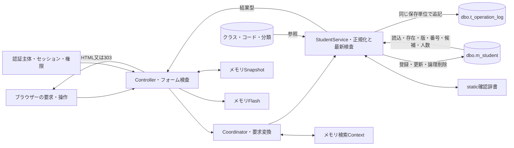

参考詳細設計は画面・提示制御をStudentsController/Edit.cshtml、業務処理を設計名StudentQueryService/StudentCommandServiceへ分担する。現行の業務接続はWebStudentCoordinatorとSqlServerStudentServiceである。設計名を実在するクラス名へ読み替えない。根拠: `reference-designs/詳細仕様書/CSharp_ASPNET/02_学生登録画面.md:16-25`、`sources/Infrastructure/WebHostSetup.cs:13-19`。

| 文書責務 | この画面で具体化する内容 | 分担する契約 |
| --- | --- | --- |
| 本機能の詳細仕様 | コントロール・要求名・実型・DB列の対応、モード、イベント順序、引数、拒否経路、結果、確定境界 | 共通契約を本画面の値と分岐へ対応付ける |
| 基本設計 | 学生情報の業務上の意味、機能範囲、権限、顧客IT部門の確認対象 | 本書の背景と業務判断の意図 |
| HTTP・正規化・候補の共通仕様 | 認証、CSRF、受信制約、変換規則、日付、候補の取得・有効性 | 本書は適用する項目と結果を再掲する |
| 状態・トランザクション・監査の共通仕様 | 所有者・期限・状態版、DB接続、書込ゲート、Rollback、確定結果、監査形式 | 本書は学生期待版と一時版、保存・削除のcatch差を具体化する |
| DB定義 | 全永続列、実DB型、容量、NULL、DEFAULT、PK・FK・CHECK・索引 | DTOのnullableや業務長から物理属性を推測しない |
| 開発規約・配備仕様 | 命名、ビルド、配備、接続・権限設定 | 参考設計が挙げる開発入力の責務。画面の入力検査や保存成功判定を代替しない |

参考設計は、実装者の直接入力として機能詳細、方式別共通仕様、DB定義、方式別・共通開発規約を挙げ、必須・長さ・初期値を機能詳細にも再掲して共通項目制約と一致させる責務を置く。本書は項目移送・イベント・補足説明で、その画面固有の適用内容を説明する。根拠: `reference-designs/詳細仕様書/CSharp_ASPNET/02_学生登録画面.md:79-81,745-747,789-795`。

### モードと入口

StudentIdがNULLなら新規、既存IDがありCanEditがtrueなら編集、falseなら参照となる。CanEditの実条件はRoleがViewerでないことである。参照では業務fieldsetをdisabledにし、既存学籍番号はreadonlyにする。取消・再読込・検索復帰はfieldsetの外に置く。独立した削除フォームは既存Administratorだけに表示する。根拠: `sources/Web/Models/StudentEditPageModel.cs:5-14`、`sources/Views/Students/Edit.cshtml:3-17`。

| 操作 | HTTP入口 | 主な受信情報 | イベント |
| --- | --- | --- | --- |
| 新規表示 | GET `/students/new` | 任意の`returnContextId` | EV-01 |
| 既存編集・参照 | GET `/students/{id:long}` | ルートID、任意の`returnContextId` | EV-02 |
| 新規保存 | POST `/students/create` | `Input.*`、`SnapshotId`、CSRF情報 | EV-04 |
| 更新 | POST `/students/{id:long}/update` | ルートID、`Input.*`、`SnapshotId`、CSRF情報 | EV-04 |
| 入力クリア・編集取消 | POST `/students/reset` | `SnapshotId`、任意の`StudentId`、CSRF情報 | EV-07 |
| 論理削除 | POST `/students/{id:long}/delete` | プレフィックスなしの削除DTO、`SnapshotId`、CSRF情報 | EV-06 |
| 最新再読込 | GET `/students/{id:long}` | 対象ID、`returnContextId` | EV-08 |
| 検索復帰 | GET `/students` | `contextId`、`contextRevision` | EV-09 |

根拠: `sources/Web/Controllers/StudentsController.cs:8-11,23-38`。最新再読込は既存GETの再実行で、専用Reloadルートはない。

Authorize、認証・認可middleware、MVC全体のCSRF検査はController本体に先行する。フォームバインドも本体へ渡るDTOを作る境界である。本書のFormGuard手順は本体へ到達した後の順序を示す。HTMLルートのCSRF拒否へ、`/api`だけに適用するJSON変換filterを持ち込まない。根拠: `sources/Web/Controllers/StudentsController.cs:5-6,26-37`、`sources/Infrastructure/WebHostSetup.cs:14-25`、`sources/Infrastructure/AntiforgeryResultFilter.cs:5-8`。

### 画面配置と非実行の静的投影

共有Layoutは、システム名、認証利用者名、描画時の日本時間業務日をheaderに置き、Edit本文をmainへ描画する。入力は原本順の2列で、備考と確認・変更理由は全幅となる。和暦4入力は横並びで折り返す。mainは最大幅1440px、marginは24px auto、paddingは24pxで、760px以下では1列・margin 0・padding 15pxとなる。根拠: `sources/Views/_ViewStart.cshtml:1-1`、`sources/Views/Shared/_Layout.cshtml:1-1`、`sources/Views/Students/Edit.cshtml:5-13`、`sources/wwwroot/css/site.css:1-1`。

次のHTMLは通常新規の静的投影であり、実画面撮影ではない。角括弧は動的値の位置を示す。候補の実在や件数を補わず、初期値に対応する候補が表示できる場合の配置を表す。送信先・methodはdata属性へ残し、action・formaction・JavaScriptを付けず、ボタンはtype=buttonとする。

<!doctype html>
<html lang="ja">
<head><meta charset="utf-8"><meta name="viewport" content="width=device-width,initial-scale=1"><title>学生管理</title>
<style>
:root{font-family:Meiryo,'Yu Gothic UI',sans-serif;color:#243448;background:#f2f5f9;font-size:14px}*{box-sizing:border-box}body{margin:0}header{background:#153654;color:white;padding:16px 28px;display:flex;justify-content:space-between;gap:20px}main{background:white;max-width:1440px;margin:24px auto;padding:24px}h1{font-size:24px}fieldset{border:1px solid #c8d1dc;padding:18px;margin:12px 0}legend{font-weight:bold}.fields{display:grid;grid-template-columns:1fr 1fr;gap:14px 28px}label{display:flex;flex-direction:column;gap:5px}.full{grid-column:1/-1}input,select,textarea,button{font:inherit;padding:8px;border:1px solid #afbece;border-radius:3px}textarea{min-height:90px}input,select,textarea{max-width:100%;width:100%}.check{display:inline-flex;flex-direction:row;align-items:center;margin-right:12px}.check input{width:auto}.actions{display:flex;gap:10px;align-items:center;flex-wrap:wrap;margin:16px 0}button{background:white;cursor:pointer}.primary{background:#1c5985;color:white}.danger{color:#ae2534;border-color:#b44d59}button:disabled{cursor:default;color:#8a98a5;background:#f3f5f8}.message{padding:14px;border:1px solid #b6dccc;background:#edf7f3}.error{background:#fff1f1;border-color:#c66}.warning{background:#fff8eb;padding:12px}.grid{overflow-x:auto}table{border-collapse:collapse;min-width:1050px;width:100%;font-size:12px}th,td{padding:10px 8px;border:1px solid #d4dee8;vertical-align:top;overflow-wrap:anywhere}th{background:#e6eef6}tr:nth-child(even){background:#f8fafc}.pager{display:flex;gap:14px;align-items:center;justify-content:center;margin:18px}.wareki{display:flex;gap:6px;align-items:center;flex-wrap:wrap}.wareki input{width:65px}.wareki select{width:100px}.dialog{position:fixed;inset:10% 10%;overflow:auto;padding:28px;background:white;border:3px solid #153654;box-shadow:0 0 0 100vmax #0007;z-index:10}.dialog table{min-width:0}small{color:#5f7183}@media(max-width:760px){main{margin:0;padding:15px}.fields{grid-template-columns:1fr}header{flex-direction:column}.dialog{inset:5%}}
</style></head>
<body>
<header><strong>学生管理システム</strong><span>利用者 ［User.Identity.Name］　業務日 ［描画時 yyyy/MM/dd］</span></header>
<main>
<h1>学生登録 ／新規</h1>
<p>学生管理番号 新規　更新日時 －　更新者 －</p>
<form data-source-method="POST" data-source-route="/students/create" data-editor-form>
<input type="hidden" name="__RequestVerificationToken"><input type="hidden" name="SnapshotId"><input type="hidden" name="Input.ExpectedVersion"><input type="hidden" name="Input.ReturnContextId"><input type="hidden" name="Input.DuplicateToken">
<fieldset><legend>学生基本情報</legend><div class="fields">
<label>学籍番号 ※必須<input name="Input.StudentNo" id="REG-002" maxlength="30" required></label>
<label>氏名 ※必須<input name="Input.StudentName" id="REG-003" maxlength="16" required><small>8文字以内</small></label>
<label>氏名カナ ※必須<input name="Input.StudentNameKana" id="REG-004" maxlength="72" required><small>原入力36、正規化後18文字</small></label>
<fieldset class="wareki" id="REG-005"><legend>生年月日 ※必須</legend><select name="Input.BirthDateInput.Era" aria-label="元号" required><option value="">元号</option><option value="REIWA">令和</option><option value="HEISEI">平成</option><option value="SHOWA">昭和</option><option value="TAISHO">大正</option><option value="MEIJI">明治</option></select><input name="Input.BirthDateInput.Year" aria-label="元号年" maxlength="4" required><span>年</span><input name="Input.BirthDateInput.Month" aria-label="月" maxlength="2" required><span>月</span><input name="Input.BirthDateInput.Day" aria-label="日" maxlength="2" required><span>日</span></fieldset>
<label>性別 ※必須<select name="Input.GenderCode" id="REG-006" required><option value="0" selected>［コード0の名称］</option></select></label>
<label>郵便番号 ※必須<input name="Input.PostalCode" id="REG-007" maxlength="20" required></label>
<label>都道府県 ※必須<select name="Input.PrefectureCode" id="REG-008" required><option value="">未選択</option></select></label>
<label>住所1 ※必須<input name="Input.AddressLine1" id="REG-009" maxlength="90" required><small>45文字以内</small></label>
<label>住所2<input name="Input.AddressLine2" id="REG-010" maxlength="90"></label>
<label>本人電話<input name="Input.PhoneNumber" id="REG-011" maxlength="40"><small>原入力20、正規化後16文字</small></label>
<label>本人メール<input name="Input.EmailAddress" id="REG-012" maxlength="120"></label>
<label>入学日 ※必須<input name="Input.AdmissionDate" id="REG-013" type="date" required></label>
<label>在籍区分 ※必須<select name="Input.EnrollmentStatusCode" id="REG-014" required><option value="01" selected>［コード01の名称］</option></select></label>
<label>卒業・退学日<input name="Input.EnrollmentEndDate" id="REG-015" type="date"></label>
<label>年度<select name="Input.SchoolYear" id="REG-016"><option value="">未指定</option><option selected>［読込時学校年度］</option></select></label>
<label>学年<select name="Input.GradeCode" id="REG-017"><option value="">すべて</option></select></label>
<label>クラス<select name="Input.ClassId" id="REG-018"><option value="">未所属</option></select><small>人数 －／定員 制限なし（参考）</small></label>
<label>緊急連絡先氏名<input name="Input.EmergencyContactName" id="REG-020" maxlength="16"></label>
<label>緊急連絡先続柄<select name="Input.RelationshipCode" id="REG-021"><option value="">未選択</option></select></label>
<label>緊急連絡先電話<input name="Input.EmergencyPhoneNumber" id="REG-022" maxlength="40"></label>
<label class="full">備考<textarea name="Input.Remarks" id="REG-023" maxlength="240"></textarea></label>
<label class="full">確認・変更理由<textarea name="Input.OperationReason" id="REG-024" maxlength="120"></textarea></label>
</div><p>本人電話・メール・緊急電話のいずれか1つ以上。緊急連絡先は3項目すべて入力してください。</p>
<div class="actions"><button type="button" class="primary" data-source-operation="submit">登録</button></div>
</fieldset></form>
<div class="actions"><form data-source-method="POST" data-source-route="/students/reset" data-confirm="編集内容を読込時の値へ戻しますか。"><input type="hidden" name="__RequestVerificationToken"><input type="hidden" name="SnapshotId"><input type="hidden" name="StudentId"><button type="button" data-source-operation="submit">入力クリア</button></form><a data-dirty-link href="#ev-09" data-source-route="/students?contextId={Input.ReturnContextId}&amp;contextRevision={ReturnRevision}">検索へ戻る</a></div>
</main></body></html>

h1直後には共有MessagePanelを置く。エラー時はvalidation-summary=Allの`.message.error`、通知時は`.message.info`へ文字列を表示し、どちらもaria-live=politeとする。項目横に個別validation spanを追加する原文はない。根拠: `sources/Views/Students/Edit.cshtml:3-3`、`sources/Views/Shared/_MessagePanel.cshtml:1-3`。

| 状態 | 条件 | 通常新規投影からの差分 |
| --- | --- | --- |
| 既存編集 | StudentIdあり、CanEdit=true | 見出しを編集、学籍番号をreadonly、保存先を対象IDのupdate、保存ボタンを更新、クリアを編集取消にする。更新情報・読込値・最新再読込リンクを表示 |
| 既存参照 | StudentIdあり、Viewer | 見出しを参照とし業務fieldsetをdisabledにする。内部の保存・確認操作も無効。外側の取消・再読込・検索復帰は残る |
| 候補確認 | ConfirmationRequired | 業務項目説明pの後、保存actionsの前へ次の確認sectionを挿入する。元の新規・編集モードを保つ |
| 管理者の既存編集 | StudentIdあり、Administrator | 外側actionsの後へ次の独立削除フォームを追加する |

根拠: `sources/Views/Students/Edit.cshtml:3-17`。以下は状態別の差分部品で、同時に成立する完成画面を表すものではない。

<a data-dirty-link data-confirm="編集内容を破棄して最新情報を読み込みますか。" href="#ev-08" data-source-route="/students/{StudentId}?returnContextId={Input.ReturnContextId}">最新情報を再読込</a>

<section role="dialog" aria-labelledby="duplicate-title" class="warning">
<h2 id="duplicate-title">同一人物候補の確認</h2><p>全 ［CandidateCount］ 件、最大20件表示</p>
<table><thead><tr><th>学籍番号</th><th>氏名</th><th>和暦生年月日</th><th>クラス</th></tr></thead><tbody></tbody></table>
<p>別人と確認した場合は、確認理由を入力して続行してください。</p>
<button type="button" data-cancel-duplicate autofocus>確認取消</button><button type="button" data-source-operation="submit" data-confirm="別人として保存しますか。">別人と確認して続行</button>
</section>

候補ごとにtbodyへStudentNo、StudentName、BirthDateWareki、ClassNameの4セルを置く。role=dialogとclass=warningは別属性であり、`.dialog`の固定配置や`.dialog table`の最小幅解除は適用されない。tableはsection直下にあり、共通CSSのmin-width:1050pxとセル内折返しを受ける。原画面にない`.grid`ラッパーは追加しない。根拠: `sources/Views/Students/Edit.cshtml:14-14`、`sources/wwwroot/css/site.css:1-1`。

<form data-source-method="POST" data-source-route="/students/{StudentId}/delete" data-confirm="対象と理由を確認して論理削除しますか。">
<input type="hidden" name="__RequestVerificationToken"><input type="hidden" name="SnapshotId"><input type="hidden" name="ExpectedVersion"><input type="hidden" name="ReturnContextId"><input type="hidden" name="Confirmed" value="true">
<label>削除理由 ※必須<textarea name="Reason" id="REG-026" maxlength="120" required></textarea></label>
<button type="button" class="danger" data-source-operation="submit">対象を確認して論理削除</button><p>編集中の業務値は保存されません。</p>
</form>

削除フォームは保存フォームの外にあり、保存理由と削除理由を共有しない。根拠: `sources/Views/Students/Edit.cshtml:13-17`。

## 項目一覧

| 項目ID | 論理名 | 実コントロール・要求名 | 初期値・業務条件 | 画面制御 | 根拠 |
| --- | --- | --- | --- | --- | --- |
| REG-001 | 学生管理番号 | 先頭p、`StudentId` | 新規はIDなし | 新規または内部ID。同名DOM idなし | `sources/Views/Students/Edit.cshtml:4-4` |
| REG-002 | 学籍番号 | `input#REG-002`、`Input.StudentNo` | 空、必須 | maxlength30、required、既存readonly | `sources/Views/Students/Edit.cshtml:6-6` |
| REG-003 | 氏名 | `input#REG-003`、`Input.StudentName` | 空、必須 | maxlength16、required、8文字以内の説明 | `sources/Views/Students/Edit.cshtml:6-6` |
| REG-004 | 氏名カナ | `input#REG-004`、`Input.StudentNameKana` | 空、必須 | maxlength72、required、raw36・正規化後18の説明 | `sources/Views/Students/Edit.cshtml:6-6` |
| REG-005 | 生年月日 | `fieldset#REG-005`内の`Input.BirthDateInput.Era/Year/Month/Day` | 新規は4部品とも空、全必須 | 元号select、年・月・日input。年maxlength4、月日各2、全required | `sources/Views/Students/Edit.cshtml:7-7` |
| REG-006 | 性別 | `select#REG-006`、`Input.GenderCode` | 0、必須 | required、空optionなし | `sources/Views/Students/Edit.cshtml:8-8`、`sources/Web/Inputs/StudentSaveInput.cs:13-13` |
| REG-007 | 郵便番号 | `input#REG-007`、`Input.PostalCode` | 空、必須 | maxlength20、required | `sources/Views/Students/Edit.cshtml:9-9` |
| REG-008 | 都道府県 | `select#REG-008`、`Input.PrefectureCode` | 空、必須 | required、空optionは未選択 | `sources/Views/Students/Edit.cshtml:9-9` |
| REG-009 | 住所1 | `input#REG-009`、`Input.AddressLine1` | 空、必須 | maxlength90、required、45文字以内の説明 | `sources/Views/Students/Edit.cshtml:10-10` |
| REG-010 | 住所2 | `input#REG-010`、`Input.AddressLine2` | 未設定、任意 | maxlength90 | `sources/Views/Students/Edit.cshtml:10-10` |
| REG-011 | 本人電話 | `input#REG-011`、`Input.PhoneNumber` | 未設定、最低1連絡手段の対象 | maxlength40、raw20・正規化後16の説明 | `sources/Views/Students/Edit.cshtml:10-10`、`sources/Core/StudentNormalizer.cs:155-155` |
| REG-012 | 本人メール | `input#REG-012`、`Input.EmailAddress` | 未設定、最低1連絡手段の対象 | maxlength120 | `sources/Views/Students/Edit.cshtml:10-10`、`sources/Core/StudentNormalizer.cs:155-155` |
| REG-013 | 入学日 | `input#REG-013`、`Input.AdmissionDate` | 空、必須 | type=date、required、maxlengthなし | `sources/Views/Students/Edit.cshtml:11-11` |
| REG-014 | 在籍区分 | `select#REG-014`、`Input.EnrollmentStatusCode` | 01、必須 | required、空optionなし | `sources/Views/Students/Edit.cshtml:11-11`、`sources/Web/Inputs/StudentSaveInput.cs:21-21` |
| REG-015 | 卒業・退学日 | `input#REG-015`、`Input.EnrollmentEndDate` | 03・04で必須、01・02は未設定 | type=date、required・maxlength指定なし | `sources/Views/Students/Edit.cshtml:11-11`、`sources/Core/StudentNormalizer.cs:153-153` |
| REG-016 | 年度 | `select#REG-016`、`Input.SchoolYear` | 新規は当学校年度、任意 | 空は未指定。所属整合の補助 | `sources/Views/Students/Edit.cshtml:12-12`、`sources/Web/Inputs/StudentSaveInput.cs:53-53` |
| REG-017 | 学年 | `select#REG-017`、`Input.GradeCode` | 未設定、任意 | 空はすべて。所属整合の補助 | `sources/Views/Students/Edit.cshtml:12-12` |
| REG-018 | クラス | `select#REG-018`、`Input.ClassId` | 01・02で必須、03・04で任意 | 空は未所属 | `sources/Views/Students/Edit.cshtml:12-12`、`sources/Core/StudentNormalizer.cs:154-154` |
| REG-019 | 人数・定員 | クラスlabel内small | 未選択時は人数－、定員制限なし | 描画時の参考値。同名DOM idなし | `sources/Views/Students/Edit.cshtml:2-2,12-12` |
| REG-020 | 緊急連絡先氏名 | `input#REG-020`、`Input.EmergencyContactName` | 緊急3項目は全未設定または全設定 | maxlength16 | `sources/Views/Students/Edit.cshtml:13-13`、`sources/Core/StudentNormalizer.cs:156-157` |
| REG-021 | 緊急連絡先続柄 | `select#REG-021`、`Input.RelationshipCode` | 緊急一式の対象 | 空は未選択 | `sources/Views/Students/Edit.cshtml:13-13` |
| REG-022 | 緊急連絡先電話 | `input#REG-022`、`Input.EmergencyPhoneNumber` | 緊急一式・最低1連絡手段の対象 | maxlength40 | `sources/Views/Students/Edit.cshtml:13-13`、`sources/Core/StudentNormalizer.cs:155-157` |
| REG-023 | 備考 | `textarea#REG-023`、`Input.Remarks` | 未設定、任意 | maxlength240、全幅 | `sources/Views/Students/Edit.cshtml:13-13` |
| REG-024 | 確認・変更理由 | `textarea#REG-024`、`Input.OperationReason` | 有効確認続行・終了区分訂正で必須 | maxlength120、全幅、監査用 | `sources/Views/Students/Edit.cshtml:13-13`、`sources/Core/SqlServerStudentService.cs:255-257,286-286` |
| REG-025 | 更新日時・更新者 | 先頭p、`Detail.UpdatedAt/UpdatedBy` | 新規は各－ | 日時は日本時間。同名DOM idなし | `sources/Views/Students/Edit.cshtml:4-4`、`sources/Infrastructure/WebPresentation.cs:7-7` |
| REG-026 | 削除理由 | 別フォームの`textarea#REG-026`、`Reason` | 空、削除時必須 | maxlength120、required | `sources/Views/Students/Edit.cshtml:17-17` |
| REG-027 | 登録・更新 | 保存フォーム内button | Viewer以外 | 新規は登録、既存は更新。参照fieldset内では無効 | `sources/Views/Students/Edit.cshtml:5-5,15-15` |
| REG-028 | 入力クリア・編集取消 | Resetフォーム内button | 有効Snapshotが必要 | 新規・既存で文言変更。読込時値への復元確認 | `sources/Views/Students/Edit.cshtml:16-16` |
| REG-029 | 最新再読込 | `data-dirty-link`付きa | 既存だけ表示 | dirty時に編集破棄確認 | `sources/Views/Students/Edit.cshtml:16-16`、`sources/wwwroot/js/site.js:5-5` |
| REG-030 | 検索へ戻る | `data-dirty-link`付きa | 復帰Contextと読込時検索版 | dirty時に編集破棄確認 | `sources/Views/Students/Edit.cshtml:16-16` |
| REG-031 | 論理削除 | 別フォームのdanger button | 既存Administrator | 対象と理由の確認 | `sources/Views/Students/Edit.cshtml:17-17` |
| REG-032 | 同一人物候補 | warning section直下table | ConfirmationRequired時 | 全件数と最大20件。番号・氏名・和暦生年月日・クラス | `sources/Views/Students/Edit.cshtml:14-14` |
| REG-033 | 別人確認続行 | 確認section内submit button | 有効確認と理由が必要 | 同じ保存フォームを再送信 | `sources/Views/Students/Edit.cshtml:14-14` |
| REG-034 | 確認取消 | `data-cancel-duplicate`付きbutton | 確認領域表示時 | type=button、autofocus、HTTP要求なし | `sources/Views/Students/Edit.cshtml:14-14`、`sources/wwwroot/js/site.js:6-6` |

## 項目移送仕様

| 移送ID | 画面・要求 | DTO→Draft／要求→内部値 | 正規化・業務用途 | 保存・参照列、DB型・NULL | SQLパラメータ・型・Size | 根拠 |
| --- | --- | --- | --- | --- | --- | --- |
| TR-001 | REG-002、`Input.StudentNo` | `StudentNo:string`→同名Draft→`Values[student_no]:string` | raw15、Trim・NFKC・大文字化後15以内。先頭ASCII英数字、以降英数字・ハイフン。更新不変 | `m_student.student_no varchar(15) NOT NULL` | INSERT `@student_no VarChar(15)`、一意確認`@no VarChar(15)` | `sources/Core/StudentNormalizer.cs:59-64,124-124`、`sources/database/001_schema.sql:9-9` |
| TR-002 | REG-003、`Input.StudentName` | `StudentName:string`→同名Draft→`Values[student_name]:string` | 必須単一行Text、raw8・Trim後8。保存表記へNFKCなし | `m_student.student_name nvarchar(16) NOT NULL`、CHECK8スカラー値 | `@student_name NVarChar(16)` | `sources/Core/StudentNormalizer.cs:125-125`、`sources/database/001_schema.sql:10-10,44-44` |
| TR-003 | REG-004、`Input.StudentNameKana` | `StudentNameKana:string`→同名Draft→`Values[student_name_kana]:string` | raw36、NFKC・カタカナ化・空白整理後18以内 | `m_student.student_name_kana nvarchar(36) NOT NULL`、CHECK18 | `@student_name_kana NVarChar(36)` | `sources/Core/StudentNormalizer.cs:72-85,126-126`、`sources/database/001_schema.sql:11-11,45-45` |
| TR-004 | REG-005、`Input.BirthDateInput.Era/Year/Month/Day` | 4つの`string`→Draftの同構造→Parse→`Values[birth_date]:DateOnly` | 元号完全一致、数値部NFKC後の正整数、実在日・元号境界・未来日検査。NULL経路はDATE-01 | `m_student.birth_date date NOT NULL`、元号別列なし | `@birth_date Date`、Size未設定 | `sources/Web/Inputs/StudentSaveInput.cs:12-12,36-36`、`sources/Core/JapaneseDateService.cs:17-39`、`sources/database/001_schema.sql:14-14` |
| TR-005 | REG-006、`Input.GenderCode` | `GenderCode:string`→同名Draft→`Values[gender_code]:string` | raw1、Trim・NFKC後ASCII数字1桁。GENDER検査 | `m_student.gender_code varchar(1) NOT NULL` | `@gender_code VarChar(1)` | `sources/Core/StudentNormalizer.cs:113-117,128-128`、`sources/database/001_schema.sql:16-16` |
| TR-006 | REG-007、`Input.PostalCode` | `PostalCode:string`→同名Draft→`Values[postal_code]:string` | raw10、Trim・NFKC、空白・指定ハイフン除去後7桁。既存復元も7桁 | `m_student.postal_code varchar(7) NOT NULL` | `@postal_code VarChar(7)` | `sources/Core/StudentNormalizer.cs:95-100,129-129`、`sources/Core/SqlServerStudentService.cs:189-189`、`sources/database/001_schema.sql:17-17` |
| TR-007 | REG-008、`Input.PrefectureCode` | `PrefectureCode:string`→同名Draft→`Values[prefecture_code]:string` | raw2、Trim・NFKC後ASCII数字2桁。PREFECTURE検査 | `m_student.prefecture_code varchar(2) NOT NULL` | `@prefecture_code VarChar(2)` | `sources/Core/StudentNormalizer.cs:113-117,130-130`、`sources/database/001_schema.sql:19-19` |
| TR-008 | REG-009、`Input.AddressLine1` | `AddressLine1:string`→同名Draft→`Values[address_line1]:string` | 必須単一行Text、raw45・Trim後45。算出住所の構成値 | `m_student.address_line1 nvarchar(90) NOT NULL`、CHECK45 | `@address_line1 NVarChar(90)` | `sources/Core/StudentNormalizer.cs:131-131`、`sources/database/001_schema.sql:20-20,48-48` |
| TR-009 | REG-010、`Input.AddressLine2` | `AddressLine2:string?`→同名Draft→`Values[address_line2]:stringまたはNULL` | 任意単一行Text、raw45・Trim後45、空はNULL。算出住所には含めない | `m_student.address_line2 nvarchar(90) NULL`、CHECK45 | `@address_line2 NVarChar(90)` | `sources/Core/StudentNormalizer.cs:132-132`、`sources/Core/SqlServerStudentService.cs:80-85`、`sources/database/001_schema.sql:21-21,49-49` |
| TR-010 | REG-011、`Input.PhoneNumber` | `PhoneNumber:string?`→同名Draft→`Values[phone_number]:stringまたはNULL` | raw20、空はNULL。NFKC・空白・指定ハイフン・丸括弧除去後に形式検査、最大16文字 | `m_student.phone_number varchar(16) NULL` | `@phone_number VarChar(16)` | `sources/Core/StudentNormalizer.cs:87-93,133-133`、`sources/database/001_schema.sql:22-22` |
| TR-011 | REG-012、`Input.EmailAddress` | `EmailAddress:string?`→同名Draft→`Values[email_address]:stringまたはNULL` | raw60・Trim後60、空はNULL。NFKCなし。ASCII形式、ドメインだけ小文字化 | `m_student.email_address varchar(60) NULL` | `@email_address VarChar(60)` | `sources/Core/StudentNormalizer.cs:102-111,134-134`、`sources/database/001_schema.sql:23-23` |
| TR-012 | REG-013、`Input.AdmissionDate` | `AdmissionDate:string`→同名Draft→ParseIso→`Values[admission_date]:DateOnly` | NFKC後10コード単位のyyyy-MM-dd。1900年下限、業務日以下、生年月日以上。NULLはDATE-01 | `m_student.admission_date date NOT NULL` | `@admission_date Date`、Size未設定 | `sources/Core/JapaneseDateService.cs:52-59`、`sources/Core/StudentNormalizer.cs:135-151`、`sources/database/001_schema.sql:24-24` |
| TR-013 | REG-014、`Input.EnrollmentStatusCode` | `EnrollmentStatusCode:string`→同名Draft→`Values[enrollment_status_code]:string` | raw2、Trim・NFKC後ASCII数字2桁。01～04とENROLLMENT_STATUS検査 | `m_student.enrollment_status_code varchar(2) NOT NULL` | `@enrollment_status_code VarChar(2)` | `sources/Core/StudentNormalizer.cs:136-154`、`sources/database/001_schema.sql:26-26` |
| TR-014 | REG-015、`Input.EnrollmentEndDate` | `EnrollmentEndDate:string?`→同名Draft→`Values[enrollment_end_date]:DateOnlyまたはNULL` | 引数NULL・空文字だけNULL。それ以外はParseIso。03・04で必須かつ入学日以上、01・02はNULL | `m_student.enrollment_end_date date NULL` | `@enrollment_end_date Date`、Size未設定 | `sources/Core/StudentNormalizer.cs:137-153`、`sources/database/001_schema.sql:27-27` |
| TR-015 | REG-018、`Input.ClassId` | `ClassId:string?`→IdParser.Optional→`Draft.ClassId:long?`→`Values[class_id]` | NULL・空は未所属。非空は19コード単位以内のASCII数字・正のInt64。Trim・NFKCなし、先頭ゼロ許容 | `m_student.class_id bigint NULL`。年度・学年・名称の学生保存列なし | `@class_id BigInt`、Size未設定 | `sources/Web/Inputs/StudentSaveInput.cs:23-23,40-40,57-60`、`sources/database/001_schema.sql:28-28` |
| TR-016 | REG-020、`Input.EmergencyContactName` | `EmergencyContactName:string?`→同名Draft→`Values[emergency_contact_name]` | 任意単一行Text、raw8・Trim後8、空はNULL | `m_student.emergency_contact_name nvarchar(16) NULL`、CHECK8 | `@emergency_contact_name NVarChar(16)` | `sources/Core/StudentNormalizer.cs:139-139`、`sources/database/001_schema.sql:29-29,50-50` |
| TR-017 | REG-021、`Input.RelationshipCode` | `RelationshipCode:string?`→同名Draft→`Values[relationship_code]` | 任意raw2、Trim・NFKC後ASCII数字2桁またはNULL。RELATIONSHIP検査 | `m_student.relationship_code varchar(2) NULL` | `@relationship_code VarChar(2)` | `sources/Core/StudentNormalizer.cs:140-147`、`sources/database/001_schema.sql:31-31` |
| TR-018 | REG-022、`Input.EmergencyPhoneNumber` | `EmergencyPhoneNumber:string?`→同名Draft→`Values[emergency_phone_number]` | TR-010と同じPhone変換。緊急一式と最低1連絡手段の対象 | `m_student.emergency_phone_number varchar(16) NULL` | `@emergency_phone_number VarChar(16)` | `sources/Core/StudentNormalizer.cs:87-93,141-157`、`sources/database/001_schema.sql:32-32` |
| TR-019 | REG-023、`Input.Remarks` | `Remarks:string?`→同名Draft→`Values[remarks]` | 複数行Text、raw120・整形後120、LF統一、空はNULL | `m_student.remarks nvarchar(240) NULL`、CHECK120 | `@remarks NVarChar(240)` | `sources/Core/StudentNormalizer.cs:47-57,142-142`、`sources/database/001_schema.sql:33-33,51-51` |
| TR-020 | REG-016、`Input.SchoolYear` | `SchoolYear:int?`→`SaveRequest.SchoolYear:int?` | 1900～9998。非NULLなら指定クラス実年度と比較。Draft・Valuesへ移さない | 比較先`m_class.school_year smallint NOT NULL`。学生保存列なし | クラス取得`@id BigInt`。年度保存パラメータなし | `sources/Web/Inputs/StudentSaveInput.cs:28-42`、`sources/Core/SqlServerStudentService.cs:236-236,363-371`、`sources/database/001_schema.sql:64-64` |
| TR-021 | REG-017、`Input.GradeCode` | `GradeCode:string?`→`SaveRequest.GradeCode:string?` | 任意raw2、Trim・NFKC後2桁。非NULLならクラス実学年と比較。独立GRADE存在照会なし | 比較先`m_class.grade_code varchar(2) NOT NULL`。学生保存列なし | クラス取得`@id BigInt`。学年保存パラメータなし | `sources/Core/SqlServerStudentService.cs:237-237,344-383`、`sources/database/001_schema.sql:66-66` |
| TR-022 | REG-024、`Input.OperationReason` | `OperationReason:string?`→`SaveRequest.Reason:string?` | 複数行Text、raw60・整形後60、空はNULL。終了区分訂正・有効確認続行で必須。差分・入力ハッシュ対象外 | `t_operation_log.operation_reason nvarchar(120) NULL`、CHECK60 | 監査`@reason NVarChar(120)` | `sources/Web/Inputs/StudentSaveInput.cs:32-42`、`sources/Core/SqlServerStudentService.cs:234-257,286-286,389-389`、`sources/database/001_schema.sql:148-153` |
| TR-023 | REG-026、`Reason` | `StudentDeleteInput.Reason:string`→`DeleteAsync.reason:string` | 必須複数行Text、raw60・整形後60。保存理由とは独立 | `m_student.delete_reason nvarchar(120) NULL`と監査理由。削除時は両方設定 | 削除・監査`@reason NVarChar(120)` | `sources/Web/Inputs/StudentDeleteInput.cs:4-4`、`sources/Core/SqlServerStudentService.cs:396-413`、`sources/database/001_schema.sql:37-37,148-153` |
| TR-024 | 保存`Input.ExpectedVersion`、削除`ExpectedVersion` | 保存`string?`、削除`string`→IdParser.Required→`long` | 更新・削除の投稿版。新規非空期待版は400。Snapshot版・最新版へ差替えない | 比較・WHERE対象`m_student.row_version bigint NOT NULL`、DEFAULT1 | `@version BigInt`、Size未設定 | `sources/Web/Inputs/StudentSaveInput.cs:42-60`、`sources/Infrastructure/WebStudentCoordinator.cs:19-19`、`sources/database/001_schema.sql:42-42` |
| TR-025 | 氏名から生成 | NameKey→`Values[name_key]:string` | NFKC・大文字化・全空白除去、160スカラー値以内。氏名検索・同一人物照合 | `m_student.name_key nvarchar(320) NOT NULL`、CHECK160 | 保存`@name_key NVarChar(320)`、候補`@name NVarChar(320)` | `sources/Core/StudentNormalizer.cs:66-70,144-144`、`sources/database/001_schema.sql:12-12,46-46` |
| TR-026 | カナから生成 | 半角空白除去→`Values[kana_key]:string` | カナ検索・同一人物照合。表示カナと分離 | `m_student.kana_key nvarchar(36) NOT NULL`、CHECK18 | 保存`@kana_key NVarChar(36)`、候補`@kana NVarChar(36)` | `sources/Core/StudentNormalizer.cs:145-145`、`sources/database/001_schema.sql:13-13,47-47` |
| TR-027 | 続柄から生成 | `Values[relationship_category]:stringまたはNULL` | 続柄NULLならNULL、それ以外はRELATIONSHIP。フォーム入力なし | `m_student.relationship_category varchar(24) NULL` | `@relationship_category VarChar(24)` | `sources/Core/StudentNormalizer.cs:147-157`、`sources/database/001_schema.sql:30-30,199-199` |
| TR-028 | REG-001、対象ID | 既存ルート`long`、モデル`StudentId:long?` | 新規NULL。保存対象はルートで決定 | `m_student.student_id bigint IDENTITY(1,1) NOT NULL`、PK | 読取・更新条件`@id BigInt`。INSERT入力なし | `sources/Web/Controllers/StudentsController.cs:23-27`、`sources/database/001_schema.sql:8-8,43-43` |
| TR-029 | REG-019、人数・定員 | `SchoolClass.Occupied:int`、`Capacity:int?`→small | 人数は非削除01・02の集計。席予約ではない | `m_class.capacity int NULL`、非NULL1～9999。人数保存列なし | Lookup入力なし。保存人数検査`@class/@id BigInt` | `sources/Core/Contracts.cs:63-64`、`sources/Core/SqlServerStudentService.cs:201-214,377-380`、`sources/database/001_schema.sql:201-201` |
| TR-030 | REG-025、更新情報 | `StudentDetail.UpdatedAt:DateTimeOffset`、`UpdatedBy:string`→p | 日時は+09:00のyyyy/MM/dd HH:mm:ss。主体は認証情報から設定 | `m_student.updated_at datetimeoffset(7) NOT NULL`、`updated_by nvarchar(128) NOT NULL`。UTC・主体64スカラー値CHECK | `@now DateTimeOffset`、`@actor NVarChar(128)` | `sources/Core/Contracts.cs:59-60`、`sources/Infrastructure/WebPresentation.cs:7-7`、`sources/database/001_schema.sql:40-58` |

## 項目更新仕様

| 更新ID | 操作 | 設定対象・設定値 | 対象条件・取得結果 | 保持値・確定境界 | 根拠 |
| --- | --- | --- | --- | --- | --- |
| UP-001 | 新規業務値INSERT | 正規化19業務値と生成3値 | 入力・マスター・所属・一意性・必要な確認を通過。OUTPUT IDをスカラー取得 | 任意空値はNULL。ID取得だけではSavedにならない | `sources/Core/SqlServerStudentService.cs:292-307` |
| UP-002 | 新規分類・管理値 | GENDER、PREFECTURE、ENROLLMENT_STATUS、is_deleted=0、created_at/by、updated_at/by、row_version=1 | 要求開始UTC・認証主体を使用。IDはIDENTITY | 削除日時・者・理由は指定せずNULL。性別0・在籍01はDTO初期値でDB DEFAULTではない | `sources/Core/SqlServerStudentService.cs:296-300`、`sources/database/001_schema.sql:8-42` |
| UP-003 | 通常UPDATE | 学籍番号以外の18業務値、生成3値、updated_at/by、版+1 | ID・投稿期待版・is_deleted=0。OUTPUT空は競合 | 任意NULLも上書き。学籍番号、必須3分類、作成情報、削除属性を保持 | `sources/Core/SqlServerStudentService.cs:294-305` |
| UP-004 | 緊急一式全消去 | 氏名・続柄分類・続柄値・電話をNULL | 緊急3入力が全未設定、別の連絡手段あり | 分類だけを残さず、差分比較・UPDATE・監査へ渡す | `sources/Core/StudentNormalizer.cs:139-157` |
| UP-005 | 変更なし | 学生DML・監査なし | 正規化22値と最新DB値に差分なし。明示Rollback正常後NoChange | 版・更新日時を増やさない。理由・補助値・一時情報は比較対象外 | `sources/Core/SqlServerStudentService.cs:260-263,325-327` |
| UP-006 | 論理削除UPDATE | is_deleted、deleted_at/by、delete_reason、updated_at/by、row_versionの7列 | ID・期待版・非削除条件、更新件数1を要求 | 業務値・class_id・学籍番号・作成情報を保持。物理DELETEなし | `sources/Core/SqlServerStudentService.cs:409-414` |
| UP-007 | CREATE・UPDATE監査 | 対象、前後版、変更列名JSON、主体、UTC、受付GUID、理由、確認有無 | 学生と同じTxへINSERT | CREATE前版NULL・後版1。UPDATEは実差分と管理3列。個人情報の前後値を複写しない | `sources/Core/SqlServerStudentService.cs:306-307,385-390` |
| UP-008 | DELETE監査 | 削除・管理7列、前版・版+1、削除理由、duplicate_confirmed=false | 論理削除と同じTxへINSERT | 正常Commit後Saved | `sources/Core/SqlServerStudentService.cs:413-414` |
| UP-009 | Web確認状態 | Busyを原子的0→1、正常Commit後に供給キー除去 | 所有・セッション・対象・版・期限・両ハッシュ一致 | 取得済み未完了かつUnknown以外はBusy解除。一般catchのUnknownでは供給キー除去 | `sources/Core/SqlServerStudentService.cs:274-290,313-335` |
| UP-010 | 成功通知 | 保存・削除成功文言をFlashへ設定 | Saved後、303作成前 | 同主体・セッション・Contextの文言を置換。10分保持、Takeで一度だけ取得 | `sources/Web/Controllers/StudentsController.cs:31-38`、`sources/Infrastructure/FlashMessageStore.cs:6-9` |

## 選択候補一覧

| 候補ID | 対象・取得元 | キー・表示名 | 描画時の可否 | 順序 | 初期・保持・連動 | 根拠 |
| --- | --- | --- | --- | --- | --- | --- |
| OPT-ERA | REG-005、View固定option | REIWA/HEISEI/SHOWA/TAISHO/MEIJI、元号名 | 空optionあり。保存時に日付・境界・未来日検査 | 令和、平成、昭和、大正、明治 | 新規未選択。元号変更時の即時検査なし | `sources/Views/Students/Edit.cshtml:7-7`、`sources/Core/JapaneseDateService.cs:9-39` |
| OPT-GENDER | REG-006、GENDER | CodeValue、CodeName | 有効・本日期間内、またはDetailの既存同値。不可値disabled、停止・期間外注記 | display_order、code_value | 初期0、空optionなし。IsProtectedを可否に使わない | `sources/Views/Students/Edit.cshtml:8-8`、`sources/Core/SqlServerStudentService.cs:203-212` |
| OPT-PREFECTURE | REG-008、PREFECTURE | CodeValue、CodeName | 有効・本日期間内、または既存同値。不可値disabled、停止・期間外注記 | display_order、code_value | 初期未選択、空optionあり | `sources/Views/Students/Edit.cshtml:9-9` |
| OPT-STATUS | REG-014、ENROLLMENT_STATUS | CodeValue、CodeName | 有効・本日期間内、または既存同値。不可値disabled、専用注記なし | display_order、code_value | 初期01。初期投入は01在学・02休学・03卒業・04退学 | `sources/Views/Students/Edit.cshtml:11-11`、`sources/database/002_seed.sql:19-22` |
| OPT-YEAR | REG-016、全クラス年度とInput.SchoolYear | 年度数値 | 現在入力年度を加え重複除去 | 年度降順 | 新規は当学校年度、既存は所属年度、未所属既存はNULL。空は未指定 | `sources/Views/Students/Edit.cshtml:12-12`、`sources/Web/Inputs/StudentSaveInput.cs:46-54` |
| OPT-GRADE | REG-017、GRADE | CodeValue、CodeName | 全取得値。有効性・期間によるdisabledなし | display_order、code_value | 初期NULL、空はすべて。00学年なしと未所属NULLを区別 | `sources/Views/Students/Edit.cshtml:12-12`、`sources/database/002_seed.sql:78-84` |
| OPT-CLASS | REG-018、Lookup.Classes | ClassId、年度・学年コード・クラスコード・名称 | 既存ID保持可。それ以外は原入力03/04なら在籍期間重なり、他区分なら有効・本日期間内 | 年度降順、学年表示順、クラス表示順、クラスコード、ID | 全option列挙。年度・学年による再抽出なし。クラス変更で上位同期、非空上位不一致で解除 | `sources/Views/Students/Edit.cshtml:12-12`、`sources/Core/SqlServerStudentService.cs:206-214`、`sources/wwwroot/js/site.js:8-8` |
| OPT-RELATIONSHIP | REG-021、RELATIONSHIP | CodeValue、CodeName | 有効・本日期間内、または既存同値。不可値disabled、専用注記なし | display_order、code_value | 初期NULL、空は未選択。NULL保存なら続柄分類もNULL | `sources/Views/Students/Edit.cshtml:13-13`、`sources/Core/StudentNormalizer.cs:140-147` |

## 内部項目・一時情報

| 内部ID | 名称・要求名 | 実型・保持領域 | 用途 | 照合・期限・状態 | 根拠 |
| --- | --- | --- | --- | --- | --- |
| INT-TARGET | 対象ID | ルート`long`、モデル`long?` | 新規NULL、既存対象はルート。Resetだけ任意文字列を変換 | Snapshot.StudentIdとの一致を要求 | `sources/Web/Controllers/StudentsController.cs:23-37` |
| INT-VERSION | 学生期待版 | 保存`string?`、削除`string`→`long` | DB比較・WHERE条件 | 投稿版を使用。Snapshot版への差替え・追加一致検査なし | `sources/Web/Inputs/StudentSaveInput.cs:42-60`、`sources/Core/SqlServerStudentService.cs:252-252,407-410` |
| INT-CONTEXT | ReturnContextId・検索Context | DTO`string?`、Singleton辞書 | Owner、Session、Tab、Applied、LastResult、Revision、Gate | 独立乱数キー、30分、初版1。GetはNULL・不在・失効409、所有等403。Use成功で期限延長 | `sources/Infrastructure/SearchContextStore.cs:9-15` |
| INT-SNAPSHOT | SnapshotId・読込時値 | Singletonの独立辞書 | Owner、Session、StudentId、Detail、Original、ReturnRevision。OriginalはJSON複製 | 新乱数キー、作成から30分。不在・失効409、所有・対象等403。延長・消費なし。NULL引数は辞書例外の別境界 | `sources/Infrastructure/EditorSnapshotStore.cs:7-11` |
| INT-RETURN-REV | 読込時検索版 | モデル・Snapshotの`string?` | Load読取後にContext.Revisionを十進文字列で採取 | Context省略枝だけNULL、取得成功枝は採取版保持。Resumeで完全一致 | `sources/Web/Controllers/StudentsController.cs:25-25,38-38`、`sources/Infrastructure/SearchContextStore.cs:14-14` |
| INT-CONFIRM | Input.DuplicateToken | `string?`→ConfirmationToken、static辞書 | 所有者、対象、期待版、19業務値ハッシュ、全候補ID・版ハッシュ | 要求開始now+10分、同nowで期限照合。NULLは照合省略、空は非NULLキー。Role・Tab・Snapshot・Contextは照合外 | `sources/Core/SqlServerStudentService.cs:19-29,224-225,274-335` |
| INT-CONFIRM-BUSY | 確認使用中 | Confirmation.Busyの`int` | Interlockedで0→1取得 | 使用中は確認不成立。取得済み未完了・Unknown以外は0へ戻す | `sources/Core/SqlServerStudentService.cs:27-29,278-278,323-323` |
| INT-DELETE-CONFIRM | Confirmed | `StudentDeleteInput.bool` | 専用フォームがtrueを送信 | falseはCoordinatorで422。ブラウザーconfirmとは別検査 | `sources/Views/Students/Edit.cshtml:17-17`、`sources/Infrastructure/WebStudentCoordinator.cs:19-19` |
| INT-FLASH | 成功通知 | Singleton辞書 | 主体・セッション・Contextの組へ文言保存 | 10分、同キー置換。Takeで先に除去し、不在・失効は空 | `sources/Infrastructure/FlashMessageStore.cs:6-9` |
| INT-DIRTY | 入力操作あり | ブラウザー内`bool`、初期false | 保存フォームinputでtrue | 実値差分ではない。元値へ戻しても解除なし。削除理由は監視外 | `sources/wwwroot/js/site.js:2-3` |
| INT-LEAVING | 離脱・送信続行 | ブラウザー内`bool`、初期false | submit確認通過・リンク続行でtrue | beforeunloadへ使用。二重送信拒否には使わない | `sources/wwwroot/js/site.js:2-5` |
| INT-UI-BUSY | 処理中表示 | DOM aria-busy・button.disabled | 送信時に押下以外のbuttonを無効化 | 押下自身の再入拒否、要求連番、旧応答破棄なし。確認Busyとは別 | `sources/wwwroot/js/site.js:4-4` |
| INT-RESULT | 結果・受付番号 | 要求単位SaveResult、GUID文字列 | Outcome、ID・版、Errors、確認キー、件数、表示候補 | Savedは取得ID・新版、NoChangeは要求ID・旧版、確認待ちは対象・旧版・新キー。その他ResultエラーはID・版NULL | `sources/Core/Contracts.cs:68-70`、`sources/Core/SqlServerStudentService.cs:226-226,262-262,290-315` |

## イベント仕様

### 共通の拒否・応答境界

応答未開始時の共通middlewareは、WebFaultのStatusを保持し、それ以外の例外を503として扱う。学生HTMLルートではメッセージをHTMLエスケープして検索リンク付きエラーHTMLを返す。応答開始後はこのcatch条件に入らない。Cookie認証の先行拒否はHTMLルートで401または403を設定し、MVCのCSRF拒否も本体のサービス結果とは別に扱う。根拠: `sources/Infrastructure/WebHostSetup.cs:14-25`。

Snapshot.GetはNULLキーを事前検査しない。NULLが実際にストアへ渡る場合はConcurrentDictionary.TryGetValueのArgumentNullExceptionが独自の不在409より前に生じ得る。非NULLの空文字は辞書検索、不在・失効は409、所有者・セッション・対象相違は403であり、同じ分岐ではない。保存のGetは個別WebFault catchより前、削除・Resetには同じ個別catchがない。そのためNULLキー例外では、保存の原入力再表示、削除非Saved後のLoad、Reset復元へ進まず、応答未開始なら共通503となる。HTTP項目欠落が必ずNULLへバインドされるという保証ではない。根拠: `sources/Infrastructure/EditorSnapshotStore.cs:10-10`、`sources/Web/Controllers/StudentsController.cs:29-37,41-41`、`sources/Infrastructure/WebHostSetup.cs:16-23`。

### EV-01 新規表示

#### 処理概要

GET `/students/new`で初期Input、人数付き候補、読込時Snapshotを作る。学生本体1件のGetAsyncは呼ばない。復帰Contextが非空なら、候補読取の前後で確認する。

#### 処理手順

1. Coordinator.Editがidentity.Readを行い、非空の復帰ContextをCheckReturnで確認する。
2. 新規作成権限を確認し、Viewerを403で拒否する。
3. 人数付きLookupAsyncを取得する。
4. Fromで必須文字値・和暦4部品を空、性別0、在籍01、年度を当学校年度とする。任意値・期待版・理由・確認キーは未設定とする。
5. await Edit完了後、Context省略ならReturnRevisionをNULLとする。非空ならContext.Getを再実行し、そのRevisionの十進文字列を採取する。
6. 決定済みReturnRevisionをモデルと新Snapshotへ渡し、新規Edit Viewを返す。

根拠: `sources/Infrastructure/WebStudentCoordinator.cs:6-6,17-17`、`sources/Web/Inputs/StudentSaveInput.cs:44-54`、`sources/Web/Controllers/StudentsController.cs:23-25`。

#### 条件付き処理フロー

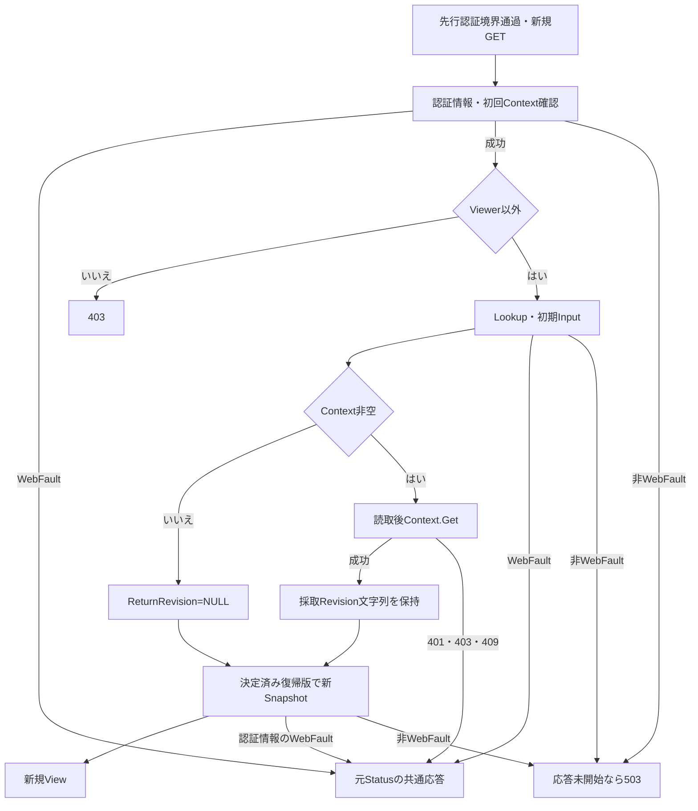

#### SQL・テーブル関連、DB操作の詳細

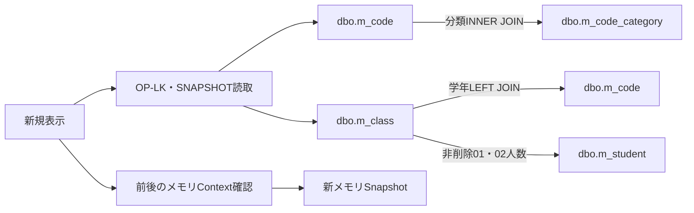

OP-LKは補足説明の2結果集合を全件読む。学生表は参考人数の集計に使うが、学生本体1件の取得・DML・監査追加はない。ContextとSnapshotはメモリに保持し、t_runtime_stateへ保存しない。上図は読取関係、物理FKは補足説明のER図に従う。根拠: `sources/Core/SqlServerStudentService.cs:196-216`、`sources/Infrastructure/EditorSnapshotStore.cs:7-11`。

#### 結果・例外時の扱い

初回Context確認に成功しても、await読取中の失効等により後段Getが409・403となり得る。認証情報不正401もSnapshot/View作成前に拒否する。Getは期限を延長しない。Context取得成功枝の復帰版を、省略枝のNULLへ置き換えない。

Loadには必須初期コード不足やクラス0件の専用警告を設定する処理がない。初期値に対応するoptionの実在をLoad成功だけで保証せず、保存時にコード存在・クラス必須を検査する。根拠: `sources/Web/Controllers/StudentsController.cs:25-25`、`sources/Infrastructure/SearchContextStore.cs:13-14`、`sources/Infrastructure/WebStudentCoordinator.cs:17-17`、`sources/Core/StudentNormalizer.cs:154-154`。

### EV-02 既存編集・参照表示

#### 処理概要

GET `/students/{id:long}`で非削除学生を取得し、DB保存値をInputへ戻す。学生本体の後にLookupを別取得し、復帰Contextを再確認して新Snapshotを作る。Viewerも既存GETから参照できる。

#### 処理手順

1. 認証と任意の復帰Contextを確認する。既存表示では作成・更新権限を要求しない。
2. ルートIDをGetAsyncへ渡し、戻り値NULLなら404・E-STU-103とする。
3. 保存22値、版、生年月日、更新情報からDetailを作る。生年月日は和暦4部品、在籍日付はISO文字列、任意DB NULLはNULLへ戻す。
4. 人数付きLookupを取得し、FromでInputを復元する。期待版は取得版の十進文字列、年度・学年は所属クラスから補う。未所属既存では両補助値をNULLとする。
5. 読取後にContextを再確認し、省略枝だけ復帰版NULL、取得成功枝は採取Revision文字列を保持する。
6. Detail・Original・復帰版を持つ新Snapshotを作り、CanEditに従って編集または参照Viewを返す。

根拠: `sources/Infrastructure/WebStudentCoordinator.cs:17-17`、`sources/Core/SqlServerStudentService.cs:172-216`、`sources/Web/Inputs/StudentSaveInput.cs:44-54`、`sources/Web/Controllers/StudentsController.cs:24-25`。

#### 条件付き処理フロー

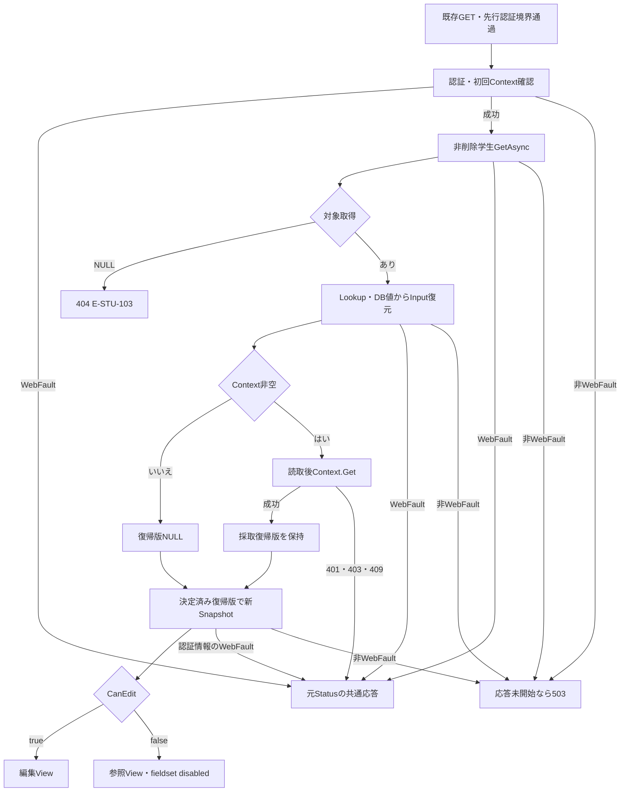

#### SQL・テーブル関連、DB操作の詳細

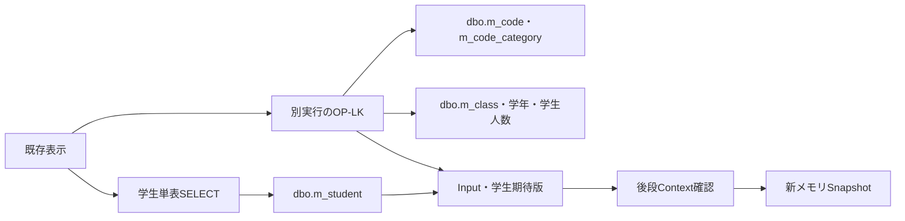

対象SQLは`SELECT * FROM dbo.m_student WHERE student_id=@id AND is_deleted=0`、@idはBigIntでSize未設定である。User確認後、id<=0なら接続せずNULL、0件もNULLとなる。PKにより最大1行を読む。JOIN、ORDER BY、ページング、明示読取Txはない。学生単表の単独ER図は省略し、候補の複数表関連はOP-LKと共通ER図で示す。学生本体とLookupは同じ読取Txではない。根拠: `sources/Core/SqlServerStudentService.cs:172-216`、`sources/database/001_schema.sql:43-43`。

#### 結果・例外時の扱い

不在・削除済み・正でないIDは404となり、新規へ切り替えない。停止・期間外の既存コード・クラスは候補に存在する限り保持条件で表示できる。欠落コードを追加optionで補完する処理はない。

後段Context拒否は読取後・新Snapshot作成前に発生する。成功時は採取した検索復帰版を保持し、学生期待版と混同しない。GetAsyncの接続・読取・日付逆変換等の非WebFaultは通常の入力エラーへ変換されない。根拠: `sources/Infrastructure/WebStudentCoordinator.cs:17-17`、`sources/Views/Students/Edit.cshtml:8-13`、`sources/Web/Controllers/StudentsController.cs:25-25`。

### EV-03 入力補助・送信確認・離脱確認

#### 処理概要

site.jsは描画済みoptionの属性でクラスと年度・学年を同期し、保存フォームのinputをdirtyとして記録する。確認キー消去、送信確認、離脱確認、処理中表示をブラウザー内で行う。

#### 処理手順

1. クラスchange時、選択optionにdata-yearがあれば年度・学年をdata-year・data-gradeへ合わせる。未所属optionでは上位値を消さない。
2. 年度・学年change時、選択クラスがあり、非空の上位値とoption属性が不一致ならクラスを空にしてalertする。
3. 保存フォームinputでdirty=trueとし、Input.DuplicateTokenを空文字にする。理由入力も対象で、候補sectionは残す。
4. dirtyかつleaving=falseのbeforeunloadで確認を要求する。dirtyリンクは破棄確認取消で遷移停止、続行時leaving=trueとする。
5. 全フォームsubmitで押下ボタンのdata-confirmを優先し、なければフォームの確認文を使う。取消なら送信を止める。
6. 続行時はleaving=true、同フォームの押下以外のbuttonをdisabled、フォームをaria-busy=trueとする。

根拠: `sources/wwwroot/js/site.js:2-8`。

#### 条件付き処理フロー

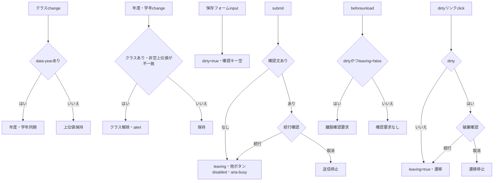

#### SQL・保持領域関連、DB操作の詳細

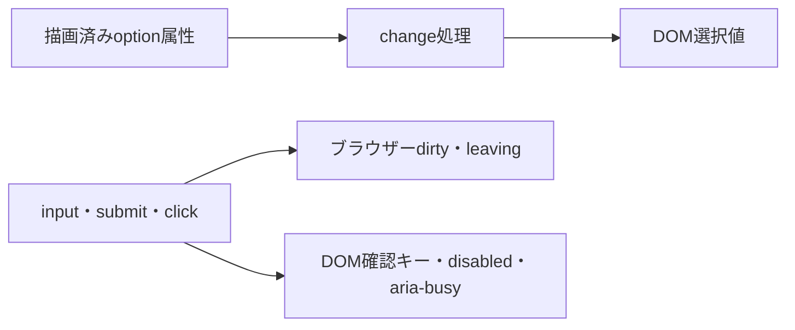

保持領域はDOMとブラウザー内変数であり、SQL・ER図は不要である。編集候補再取得、和暦即時検査、区分・日付変更後の候補可否再計算、人数即時更新はこのJSに接続されていない。学生書込みやサーバー確認消費も行わない。根拠: `sources/wwwroot/js/site.js:2-9`。

#### 結果・例外時の扱い

dirtyは実値差分ではなく入力操作の記録で、元値へ戻しても解除しない。別フォームの削除理由は監視外である。押下ボタン自身の再入拒否、要求連番、旧応答破棄はない。UIのaria-busy、確認辞書Busy、期待版、DBゲートは別の制御である。根拠: `sources/wwwroot/js/site.js:2-5`、`sources/Views/Students/Edit.cshtml:5-17`。

### EV-04 新規登録・更新

#### 処理概要

新規と更新はController.Saveを共用する。入口状態とバインド後DTOを確認し、サービスで正規化する。共通書込ゲート内で最新対象・版・コード・所属・定員・番号・同一人物候補を検査し、学生と監査を同じTxで確定する。

#### 処理手順

1. 本体の最初にFormGuardを実行し、保存DTO項目、和暦4部品、SnapshotId、CSRF項目、許可された__Invariantを検査する。
2. identity.CreateOrUpdate、Snapshot.Get、CheckReturn、投稿ReturnContextIdとSnapshot.Original.ReturnContextIdの一致を順に確認する。この区間は後段WebFault catchより前である。
3. ModelState不正なら422としサービスを呼ばない。有効ならcatch内でCoordinator.Saveを呼び、権限と復帰Contextを再確認する。
4. ToRequestで19業務値をDraftへ移し、ClassIdを任意正のInt64へ変換した後、更新期待版を必須正のInt64へ変換する。新規の非空期待版は400とする。
5. SaveAsyncは受付GUID、User、要求開始UTC時点now、日本時間業務日dayを決め、ViewerならForbiddenを返す。
6. 19項目を宣言順に正規化し、通常の個別エラーを収集する。個別成功後、生成3値と項目間検査を行う。DATE-01の捕捉対象外例外は収集を中断する。
7. 理由、対象ID・期待版の正数と同時設定、年度1900～9998、補助学年形式を検査する。
8. OpenとReadCommitted開始を行う。両処理はDB結果分類tryの外にある。
9. ゲート取得後、更新では対象存在、投稿期待版、学籍番号不変を確認する。旧03・04から異なる区分への訂正にはAdministratorと理由を要求する。
10. 最新DBでコード存在・利用可否、クラス存在、補助値整合、所属期間、新席取得時の定員を確認する。
11. 正規化22値を最新DBと比較する。差分なしは明示Rollback正常終了後NoChange。実変更があり現版がlong.MaxValueならConflictとする。
12. 削除済みを含む全学生から本人を除き、学籍番号一意性を確認する。
13. 全同一人物候補を取得してEV-05の確認を再照合する。有効確認で理由NULLなら422、確認不成立かつ候補ありまたは供給キー非NULLならRollback後に新確認を発行する。
14. INSERTまたはUPDATEを実行し、OUTPUT IDをスカラー取得する。NULL・DBNullならDBConcurrencyExceptionとする。
15. 同じTxへ監査を追加する。Commit直前にcommitAttemptedを立て、正常Commit後に供給確認キーを除去してSavedを返す。
16. ControllerはSavedをFlashと303へ変換する。その他の結果、catch内WebFault、ModelState不正は各Statusを保持し、投稿Input・旧Snapshot・新Lookupで再表示する。

根拠: `sources/Web/Controllers/StudentsController.cs:28-33,41-41`、`sources/Infrastructure/WebStudentCoordinator.cs:18-18`、`sources/Web/Inputs/StudentSaveInput.cs:34-60`、`sources/Core/StudentNormalizer.cs:119-159`、`sources/Core/SqlServerStudentService.cs:227-323,344-390`。

#### 条件付き処理フロー

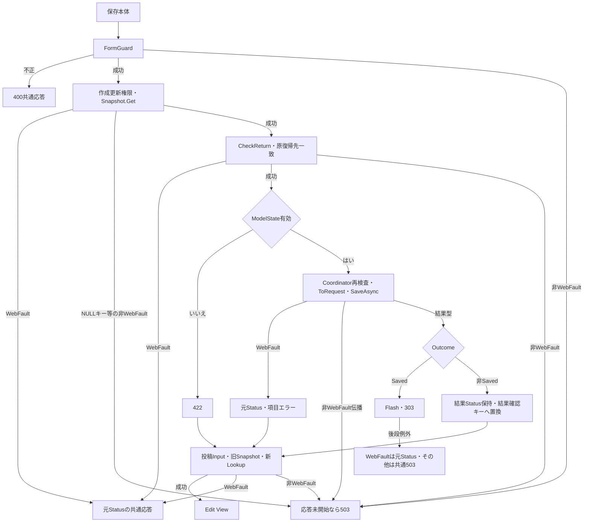

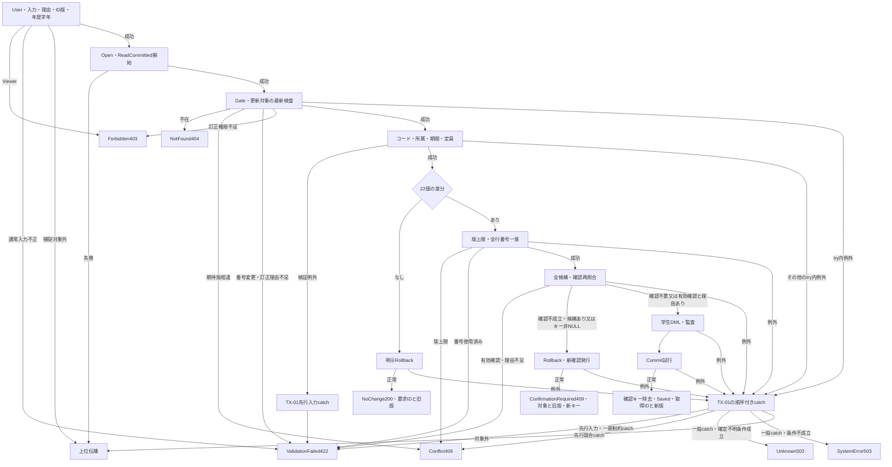

各結果は入口図へOutcomeとStatusを引き継ぐ。NoChange・確認待ち・成功のIDと版を共通NULLへ統合しない。一般catchのUnknown条件を先行422・409catchへ適用しない。根拠: `sources/Core/SqlServerStudentService.cs:226-323`。

#### SQL・テーブル関連

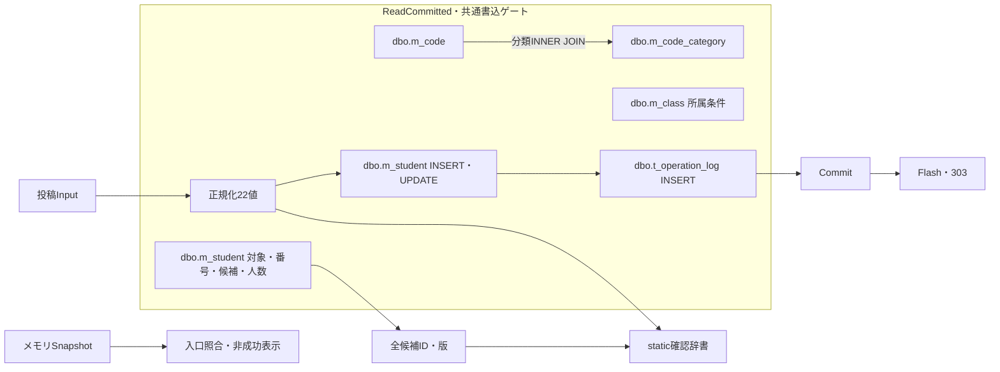

上図は処理上の関連である。監査対象キーやメモリ確認対象から学生への物理FKを示すものではない。

#### DB操作の詳細

更新対象は非削除・ID一致の単表SELECTで最大1行を再取得する。対象なしE-STU-103、版相違E-STU-105、学籍番号変更E-STU-104の順で拒否する。旧03・04から別区分への訂正には03→04も含み、管理者不足はE-COM-002、理由不足はE-STU-106となる。同一区分で住所等を訂正する場合にはこの追加条件を適用しない。根拠: `sources/Core/SqlServerStudentService.cs:246-258`。

コード確認はGENDER、PREFECTURE、ENROLLMENT_STATUS、RELATIONSHIPの順で、NULL続柄は照会しない。SQLは`m_code c JOIN m_code_category k ON k.category_id=c.category_id WHERE c.category_id=@category AND c.code_value=@value`、@category VarChar(24)、@value VarChar(10)で最大1行を読む。ORDER BY・ページングはない。不在は既存同値でもE-STU-009となる。新規・変更値は両is_active、開始日≦day、終了日NULLまたはday≦終了日を要求し、不成立E-STU-011を蓄積する。既存同値では存在確認を残して利用状態・期間だけ免除する。コードエラーもクラス検査後にInputValidationExceptionとして返す。根拠: `sources/Core/SqlServerStudentService.cs:344-383`。

指定クラスは`SELECT school_year,grade_code,valid_from,valid_to,is_active,capacity FROM dbo.m_class WHERE class_id=@id`、@id BigIntで最大1行を読む。不在E-STU-010、非NULL補助年度・学年と実クラス値の不一致E-STU-014を蓄積する。補助学年単独のGRADE存在・有効性照会はない。根拠: `sources/Core/SqlServerStudentService.cs:236-237,363-383`。

| 保存後の状態 | 所属・期間検査 | 定員検査 |
| --- | --- | --- |
| 新規01・02、旧席なしから01・02、別クラスへの異動 | 存在・補助値一致・有効・本日期間内。不成立E-STU-013 | 定員非NULLなら本人除外人数+1を比較 |
| 同クラスの01・02席保持 | 存在・補助値一致。有効性・本日期間を再適用しない | 加算検査なし |
| 新規03・04で所属指定 | 存在・補助値一致、在籍期間とクラス期間の重なり | 席を増やさない |
| 03・04で所属・区分・入学日・終了日を変更 | 期間重なりを再確認。不成立E-STU-108。停止自体は拒否条件でない | 席を増やさない |
| 03・04で所属・区分・在籍日付を保持 | 存在・補助値一致。期間重なりを再検査しない | 席を増やさない |
| 03・04で所属なし | 年度範囲・学年形式は検査するがクラス照会なし | 非適用 |

旧席・新席は「クラスあり、在籍01・02」である。休学も1席を占め、03・04から01・02への復帰は同ClassIdでも新席取得となる。期間重なりは端点を含み、入学日≦クラス終了日かつ学生終了日≧クラス開始日で成立する。根拠: `sources/Core/SqlServerStudentService.cs:357-380`。

新席取得かつ定員非NULLの場合だけ、`SELECT COUNT_BIG(*) FROM dbo.m_student WHERE class_id=@class AND is_deleted=0 AND enrollment_status_code IN ('01','02') AND (@id IS NULL OR student_id<>@id)`を実行する。@class・@idはBigInt、新規@idはDBNullである。人数+1が定員を超えるとE-STU-102。定員NULLは制限なし、非NULLはDDLで1～9999となる。画面の参考人数は保存要求へ受け取らない。根拠: `sources/Core/SqlServerStudentService.cs:377-380`、`sources/database/001_schema.sql:201-201`。

NoChangeはSnapshot.Originalではなく最新DBの22値との比較である。DateOnlyとDB DateTimeは日付として比較する。理由・年度・学年・一時情報は比較対象外で、理由だけの変更では監査を作らない。明示Rollback失敗時は正常NoChangeへ進まない。根拠: `sources/Core/SqlServerStudentService.cs:260-263,325-327`。

番号一意SQLは`SELECT COUNT_BIG(*) FROM dbo.m_student WHERE student_no=@no AND (@id IS NULL OR student_id<>@id)`、@no VarChar(15)、@id BigIntまたはDBNullである。非削除条件を付けず、削除済み学籍番号も再利用できない。DDLのUNIQUEも全行を対象とする。根拠: `sources/Core/SqlServerStudentService.cs:264-266`、`sources/database/001_schema.sql:187-187`。

INSERT・UPDATEの設定列は項目移送・更新仕様に従う。通常UPDATEのWHEREは`student_id=@id AND row_version=@version AND is_deleted=0`で、@id・@version BigInt、@now DateTimeOffset、@actor NVarChar(128)を使う。業務パラメータは@＋列名、型・SizeはColumns定義に従う。両DMLは`OUTPUT INSERTED.student_id INTO @changed`後のSELECTをExecuteScalarで取得し、NULL・DBNullを競合とする。PKにより対象は最大1行である。OUTPUT空の後に再SELECTして不在へ分類し直す処理はない。全UPDATE設定列と監査の実差分列は異なる。根拠: `sources/Core/SqlServerStudentService.cs:30-38,292-318`。

#### 結果・例外時の扱い

| 状態・結果 | HTTP | 表示・確定状態 |
| --- | --- | --- |
| Saved | 303 | 正常Commit後、Flashを置いて検索へ復帰 |
| NoChange | 200 | 同画面で「変更はありません。」。DML・監査・版加算なし |
| ValidationFailed、ModelState不正 | 422 | 再表示到達時は投稿Inputを保持 |
| catch内WebFault | 元Status | 新規非空期待版400、識別値不正422、再検査拒否等を同画面へ反映 |
| Forbidden | 403 | 結果型なら同画面。入口拒否は共通応答 |
| NotFound | 404 | 保存結果型なら投稿Inputを持つ同画面 |
| Conflict | 409 | 版競合・実変更時版上限。期待版を自動更新しない |
| ConfirmationRequired | 409 | 全件数、最大20件、新確認キーを設定 |
| SystemError | 503 | 一般catchで分類した失敗結果を表示 |
| Unknown | 503 | 成否を断定せず、再保存前の検索確認を案内 |
| catch外WebFault | 元Status | 原入力再表示を経ず共通応答 |
| NULL SnapshotId、日付数値部NULL、Open・開始失敗等の非WebFault | 応答未開始なら503 | 共通HTML。通常422再表示とは別経路 |

根拠: `sources/Web/Controllers/StudentsController.cs:29-38`、`sources/Infrastructure/WebPresentation.cs:23-23`、`sources/Core/SqlServerStudentService.cs:238-242,316-323`。

結果が非NULLの場合だけInput.DuplicateTokenを結果キーへ置換し、そのModelStateを除去する。他のModelStateは一律Clearしない。再表示は投稿Input、旧SnapshotのDetail・ID・復帰版、新Lookupを使い、期待版を最新化しない。CheckReturnはNULL・空を省略するが、Snapshot原復帰先との一致比較ではNULLと空文字を区別する。再表示Lookupの失敗は先に得た結果の提示を妨げ得る。根拠: `sources/Web/Controllers/StudentsController.cs:29-33`、`sources/Infrastructure/WebStudentCoordinator.cs:6-6`。

正常CommitとFlash設定・303作成・配信完了は別の境界である。ReturnAfterSaveの後段失敗によって、既に正常Commitした学生変更を取り消す処理はない。根拠: `sources/Core/SqlServerStudentService.cs:313-315`、`sources/Web/Controllers/StudentsController.cs:31-38`。

### EV-05 同一人物候補の確認続行・取消

#### 処理概要

実変更と学籍番号一意性を通過した保存について、生年月日一致かつ氏名キーまたはカナキー一致の非削除・本人以外の学生を候補とする。全候補を確認対象にし、画面表示を最大20件へ制限する。続行は同じ保存POSTを再実行する。

#### 処理手順

1. 学生ID昇順で全候補を取得する。
2. Columns.Keys順で生成3値を除く正規化19業務値を列名付きJSONにし、UTF-8のSHA-256で入力ハッシュを作る。
3. 全候補のStudentId・RowVersionを取得順にJSON化して候補ハッシュを作る。21件目以降も含める。
4. 非NULL供給キーの存在、主体・セッション・対象・期待版・期限・両ハッシュを照合し、Busyを原子的0→1にできた場合だけ有効確認とする。
5. 有効確認で理由NULLならE-STU-107。候補ありまたは供給キー非NULLで確認不成立ならRollback後に新キーを発行する。
6. 全件数と先頭最大20件を表示する。続行POSTはEV-04の入口から全検査を再実行する。
7. 確認取消はDOMキーを空にしてsectionを除去する。入力を保持し、サーバー要求を行わない。
8. 正常Commit後は供給キーを除去する。一般catchでUnknownとなった場合も除去し、取得済み未完了かつUnknown以外ならfinallyでBusyを解除する。

根拠: `sources/Core/SqlServerStudentService.cs:224-225,268-290,313-335`、`sources/Views/Students/Edit.cshtml:14-14`、`sources/wwwroot/js/site.js:3-6`。

#### 条件付き処理フロー

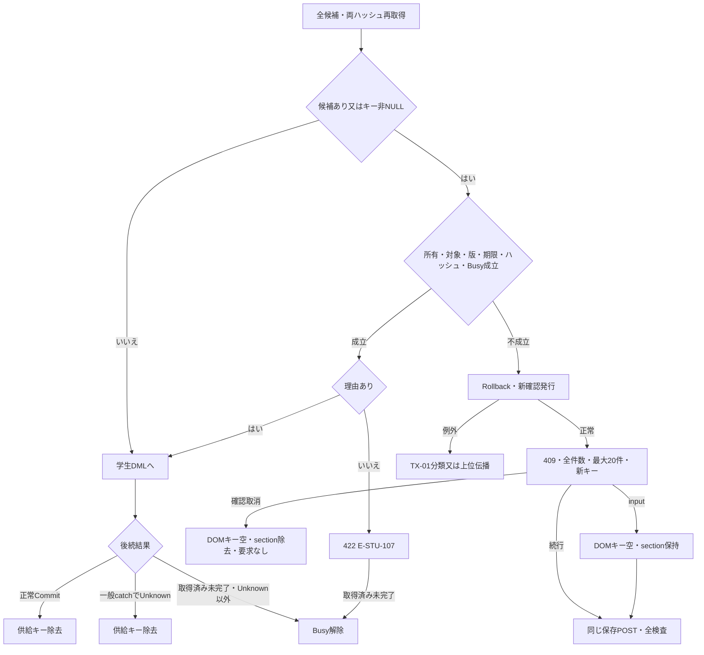

#### SQL・テーブル関連、DB操作の詳細

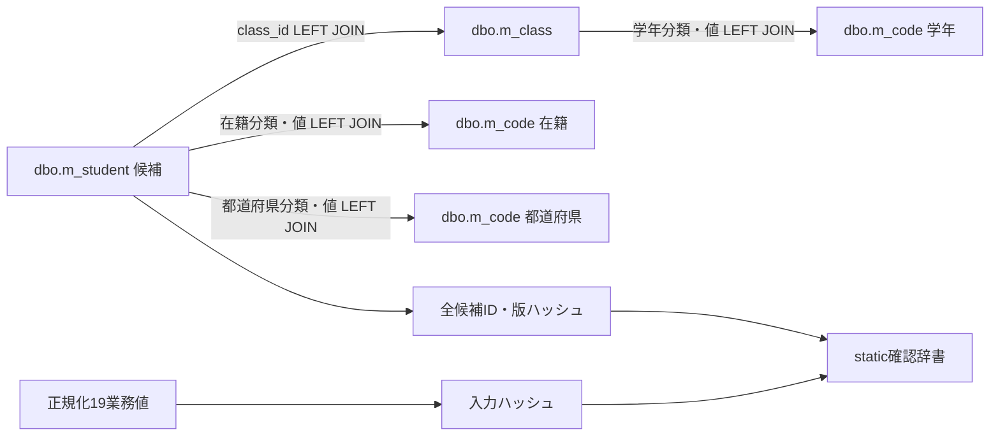

SQLはRowSelectに`WHERE s.is_deleted=0 AND (@id IS NULL OR s.student_id<>@id) AND s.birth_date=@birth AND (s.name_key=@name OR s.kana_key=@kana) ORDER BY s.student_id`を加える。@id BigIntまたはDBNull、@birth Date、@name NVarChar(320)、@kana NVarChar(36)である。TOP・ページング・在籍区分・停止期間による除外はない。保存のReadCommitted内で全件読む。根拠: `sources/Core/SqlServerStudentService.cs:242-242,269-272`。

RowSelectのLEFT JOINはクラスID、クラスの学年分類＋値、学生の在籍分類＋値、学生の都道府県分類＋値である。利用状態・期間条件を付けない。StudentRowはID・番号・氏名・カナ・生年月日・所属年度・学年名・クラスコード名・在籍名・算出住所・本人電話・入学日・更新時点・版を持つ。算出住所は都道府県名称NULLを「[不整合]」へ置換して住所1を連結し、住所2を含めない。HTML候補表は番号・氏名・和暦生年月日・ClassNameだけを出し、NULL ClassNameを「未所属」へ置換しない。根拠: `sources/Core/SqlServerStudentService.cs:77-91`、`sources/Core/Contracts.cs:50-55`、`sources/Views/Students/Edit.cshtml:14-14`。

WebはwebTokens=trueで、発行・照合をstatic辞書で行う。発行時に失効項目を掃除し、新32バイト乱数の64桁hexキーを要求開始now+10分まで保持する。照合も当該要求開始nowを用い、DB読取後に現在時刻を取り直さない。確認待ちにはRollback済みで保存Txを保持しない。根拠: `sources/Infrastructure/WebHostSetup.cs:19-19`、`sources/Core/SqlServerStudentService.cs:229-229,278-290,330-335`。

#### 結果・例外時の扱い

入力ハッシュに理由・年度・学年・復帰先・Snapshotを含めず、確認照合にRole・Tabを含めない。対象版競合とNoChangeは確認照合より前に判定する。

不正な非NULL旧キーは供給なしへ変えないため、候補が0件へ変化しても再確認となり得る。空文字がサービスへ届いた場合も非NULLキーとして扱う。理由入力もDOMキーを消すため、候補確認後に理由を入力すると、候補が残る場合は次のPOSTで新確認を取得し、その後入力を変えず続行する経路になる。ブラウザーのキー消去・取消はサーバー確認の消費ではない。HTTP空値からサービスへの具体的変換は別のバインド境界である。根拠: `sources/Core/SqlServerStudentService.cs:252-290,313-335`、`sources/wwwroot/js/site.js:3-6`。

### EV-06 論理削除

#### 処理概要

既存Administratorが専用フォームで対象と理由を確認し、学生の削除属性・更新管理情報・監査を確定する。編集中Input.*を受けず、DB業務値を保持する。

#### 処理手順

1. ブラウザー確認を通過するとSnapshotId、ExpectedVersion、ReturnContextId、Confirmed=true、Reason、CSRF情報を送る。
2. 本体のFormGuard、identity.Read、Snapshot.Get、原復帰先との一致を順に確認する。
3. Coordinator.DeleteでAdministrator、CheckReturn、Confirmed、正の期待版を順に確認する。false確認は422で止まり、版変換へ進まない。
4. サービスで受付GUID、User、UTC時点を決め、Administrator、必須理由、正のID・版、版がlong.MaxValueでないことを検査する。
5. Open、ReadCommitted開始、Gate取得後、非削除対象の現版を読み、存在と投稿版一致を確認する。
6. 削除・管理7列をUPDATEし、更新件数1を要求する。
7. 同じTxへDELETE監査を追加し、正常Commit後にSavedと版+1を返す。
8. SavedならFlashと303へ進む。非Saved結果ならエラー・Statusを設定してLoadを再実行する。

根拠: `sources/Views/Students/Edit.cshtml:17-17`、`sources/Web/Controllers/StudentsController.cs:37-41`、`sources/Infrastructure/WebStudentCoordinator.cs:19-19`、`sources/Core/SqlServerStudentService.cs:392-416`。

#### 条件付き処理フロー

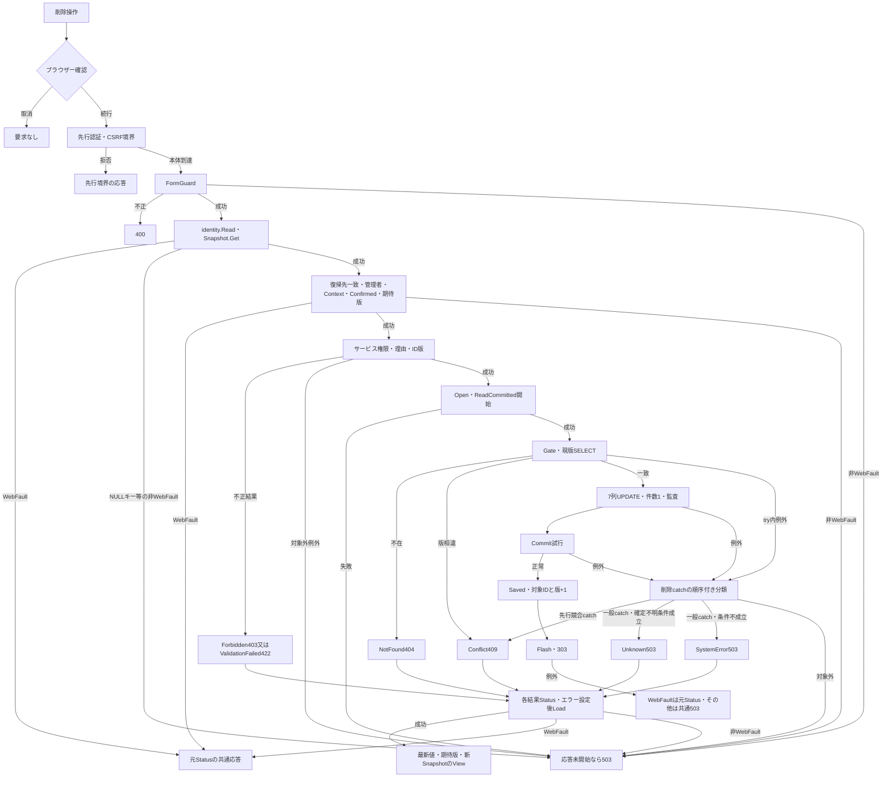

Load内の前後Context確認・復帰版代入はEV-02と同じで、取得成功枝の版をNULLへ置き換えない。

#### SQL・テーブル関連、DB操作の詳細

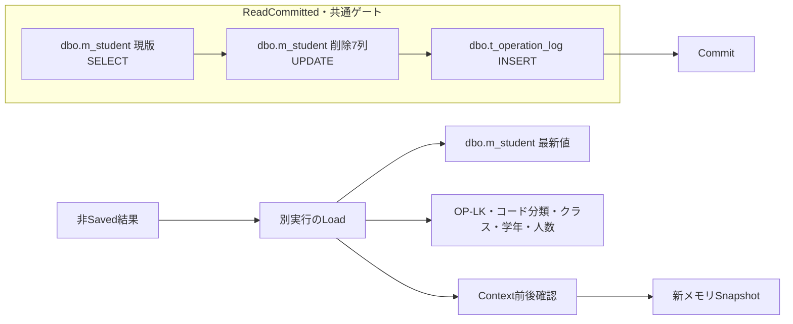

現版SQLは`SELECT row_version FROM dbo.m_student WHERE student_id=@id AND is_deleted=0`、@id BigIntのスカラー取得である。0件はNotFound、版相違はConflictとなる。UPDATEのSETは`is_deleted=1,deleted_at=@now,deleted_by=@actor,delete_reason=@reason,updated_at=@now,updated_by=@actor,row_version=row_version+1`、WHEREは`student_id=@id AND row_version=@version AND is_deleted=0`である。@id・@version BigInt、@now DateTimeOffset、@actor NVarChar(128)、@reason NVarChar(120)を使い、更新件数1を要求する。JOIN・ORDER BY・ページング・物理DELETEはない。学生更新は単表で単独ER図を省略し、監査の記録関係と再Loadの複数表参照を上図で示す。根拠: `sources/Core/SqlServerStudentService.cs:404-414`。

業務値、class_id、学籍番号、作成情報はSETに含めない。監査は削除・管理7列、前版・版+1、削除理由、duplicate_confirmed=falseを記録する。削除後は非削除検索・人数集計から外れるが、全行学籍番号一意性からは外れない。根拠: `sources/Core/SqlServerStudentService.cs:201-201,264-266,409-414`。

#### 結果・例外時の扱い

削除には保存と同じModelState.IsValid分岐・個別WebFault catchがない。入口例外では非Saved後Loadへ進まない。version==long.MaxValueは422で、保存の実変更時版上限409とは異なる。理由検査のcatchはInputValidationExceptionだけで、不正UnicodeのArgumentException等は上位へ伝播する。Open・開始はDB結果分類tryの外である。根拠: `sources/Web/Controllers/StudentsController.cs:37-37`、`sources/Core/SqlServerStudentService.cs:396-416`。

非Saved後Loadが成功すると、最新DB値・期待版・Lookup・新Snapshotを表示し、投稿削除理由や編集中業務値を復元しない。対象が削除済み・不在なら404、前後Context拒否は401・403・409、その他例外は共通応答となり、先のUnknown等を画面提示する前に後段の応答へ変わり得る。根拠: `sources/Web/Controllers/StudentsController.cs:25-25,37-37`、`sources/Infrastructure/WebStudentCoordinator.cs:17-19`。

### EV-07 入力クリア・編集取消

#### 処理概要

POST `/students/reset`でSnapshot.Originalへ戻す。復元元は読込時メモリ値であり、学生本体の最新DB取得ではない。

#### 処理手順

1. ブラウザーで読込時値への復元を確認し、続行ならSnapshotId・StudentIdを送る。
2. 本体の最初にFormGuardを行う。
3. identity.Read後、StudentIdを任意正のInt64へ変換する。
4. Snapshot.Getで期限・所有者・セッション・対象を照合する。
5. ModelState.Clear後、OriginalをJSON複製してInputへ設定する。Detail・SnapshotId・ReturnRevisionは同じSnapshotの値を使う。
6. 人数付きLookupだけを取得し、「入力を読込時の値へ戻しました。」とEdit Viewを返す。

根拠: `sources/Views/Students/Edit.cshtml:16-16`、`sources/Web/Controllers/StudentsController.cs:35-41`、`sources/Infrastructure/EditorSnapshotStore.cs:7-11`。

#### 条件付き処理フロー

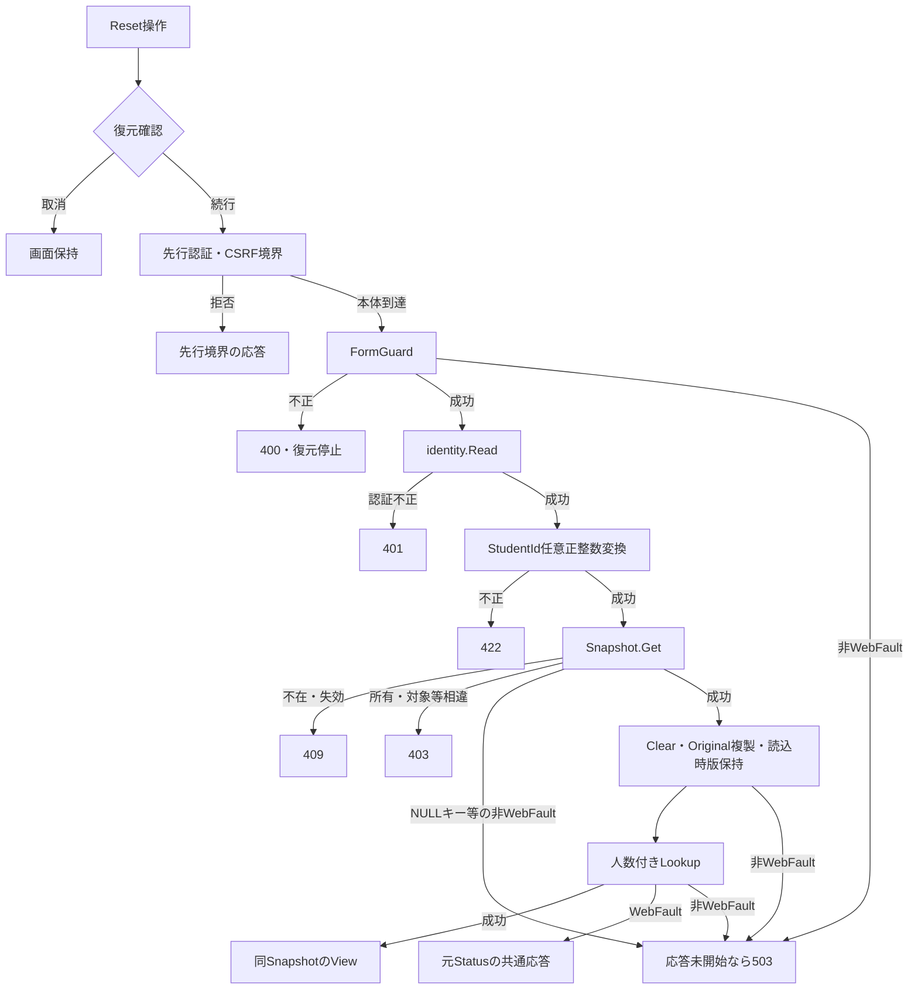

#### SQL・保持領域関連、DB操作の詳細

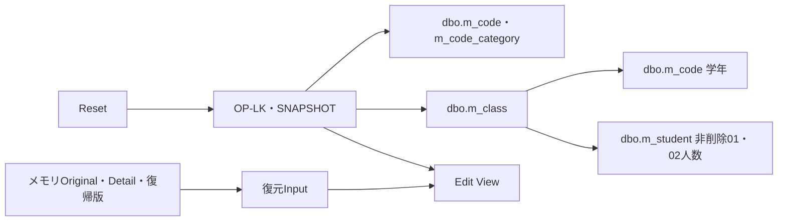

学生GetAsync、学生DML、監査追加は呼ばない。DB操作はOP-LKの候補・人数読取だけであり、物理関連は共通ER図に従う。学生期待版と検索復帰版を読込時値のまま保持する。根拠: `sources/Web/Controllers/StudentsController.cs:35-35`、`sources/Core/SqlServerStudentService.cs:196-216`。

#### 結果・例外時の扱い

FormGuard400はID変換422、Snapshot不在・失効409、所有等相違403より前に止める。NULL SnapshotIdがストアへ届く場合は一般例外の別経路である。FormGuardは項目の存在必須を検査しない。

新規クリアは性別0・在籍01・読込時年度へ戻すため全項目空ではない。既存取消後にDBが変更されていれば次回保存で期待版競合となる。Resetでは復帰Context再検査、Snapshot期限延長・消費を行わない。根拠: `sources/Web/Inputs/StudentSaveInput.cs:44-54`、`sources/Infrastructure/EditorSnapshotStore.cs:10-10`、`sources/Web/Controllers/StudentsController.cs:35-41`。

<a id="ev-08"></a>

### EV-08 最新情報を再読込

#### 処理概要

既存時のリンクで通常GETを再実行し、DB業務値と期待版をともに取り直す。EV-07のメモリOriginal復元とは取得元が異なる。

#### 処理手順

1. dirtyなら編集破棄を確認し、取消なら遷移停止する。
2. 続行またはdirtyでなければ、対象ID・returnContextIdを持つ既存GETへ進む。
3. EV-02の認証・初回Context確認、学生取得、Lookup、Input復元を実行する。
4. 読取後Contextを再確認し、省略なら復帰版NULL、取得成功なら採取版を保持する。
5. 最新業務値・期待版・決定済み復帰版を新Snapshotとモデルへ渡す。

根拠: `sources/Views/Students/Edit.cshtml:16-16`、`sources/wwwroot/js/site.js:5-5`、`sources/Web/Controllers/StudentsController.cs:24-25`。

#### 条件付き処理フロー

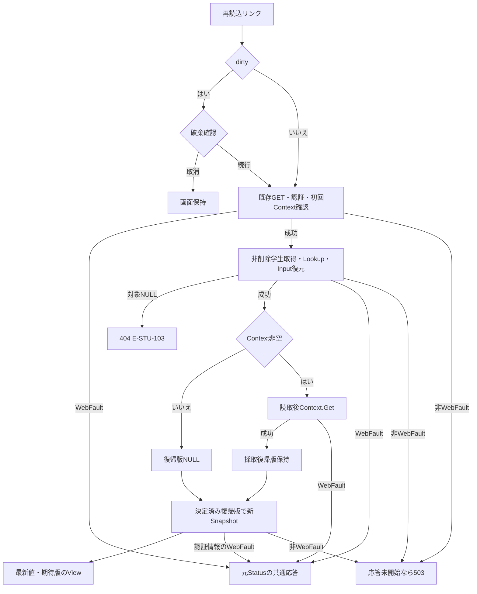

#### SQL・テーブル関連、DB操作の詳細

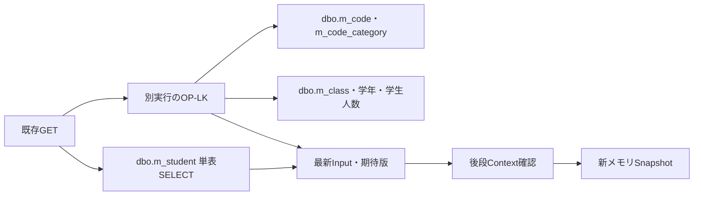

対象SQLはEV-02と同じ`student_id=@id AND is_deleted=0`、@id BigInt、最大1行である。学生単表の単独ER図は省略し、候補の物理関連は共通ER図へ対応する。学生書込みや期待版だけの差替えは行わず、旧Snapshotを明示削除する処理もない。根拠: `sources/Core/SqlServerStudentService.cs:172-216`、`sources/Infrastructure/EditorSnapshotStore.cs:9-11`。

#### 結果・例外時の扱い

初回Context拒否は学生読取前、後段拒否は読取後・新Snapshot前で発生する。対象不在・削除済みは404。成功時は旧編集Inputを引き継がずDB値から作り直し、取得成功した検索復帰版も保持する。根拠: `sources/Infrastructure/WebStudentCoordinator.cs:17-17`、`sources/Web/Controllers/StudentsController.cs:25-25`。

<a id="ev-09"></a>

### EV-09 検索復帰・確定成功後の復帰

#### 処理概要

手動復帰はInput.ReturnContextIdとモデルの読込時ReturnRevisionを使う。保存・削除成功時はSnapshot.ReturnRevisionを使い、Flashを置いて固定内部パスへ303を返す。復帰先では最後に適用されたApplied条件で再検索する。

#### 処理手順

1. 手動リンクではdirty時だけ破棄確認を行う。
2. Saved後、復帰ContextがNULL・空なら新Contextと初期Revisionを作る。既存なら読込時復帰版を使う。
3. Flashへ「保存しました。」または「論理削除しました。」を置き、Context・RevisionをURIエスケープして固定パス`/students?contextId=…&contextRevision=…`へ303 EmptyResultを返す。
4. Indexは認証後、Context未指定なら新未検索状態、指定ありならResumeへ進む。
5. ResumeはContext.Gate待機後にGetを再実行し、所有者・セッション・期限、要求検索版との十進文字列完全一致、版上限を確認する。
6. Appliedなしなら学生検索なし・版維持。Appliedありなら保存済み条件・ページ・件数・ソートでSearchAsyncを実行し、成功結果後だけLastResult更新・Revision+1を行う。Appliedは変更しない。
7. Use成功で期限を30分延長する。Resume後にFlash.Take、その後人数なしLookupを取得しSearch Viewを返す。

根拠: `sources/Views/Students/Edit.cshtml:16-16`、`sources/Web/Controllers/StudentsController.cs:8-11,31-39`、`sources/Infrastructure/WebStudentCoordinator.cs:14-21`、`sources/Infrastructure/SearchContextStore.cs:9-14`。

#### 条件付き処理フロー

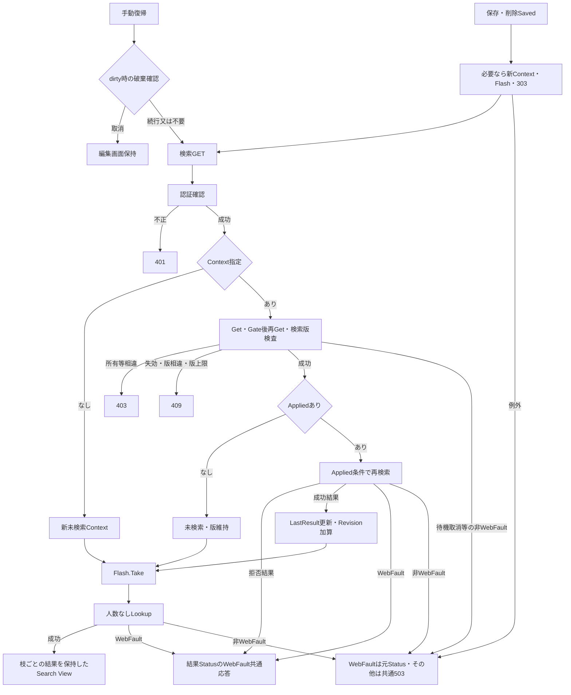

合流後も未検索、上限超過、0件、通常結果を保持し、未表示件数NULLを0へ固定しない。

#### SQL・テーブル関連、DB操作の詳細

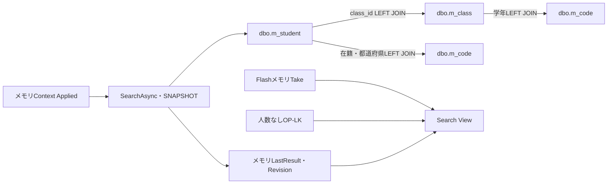

Appliedなしでは学生検索SQLを実行しない。Appliedありでは保存済み条件を再検証する。年度1900～9998、正のクラスID、未所属のみと年度・学年・クラスの排他、在籍配列最大4・重複なし・01～04、日付両端の順序、ページ1以上、20・50・100件、許可ソートを確認する。指定学年・都道府県は分類＋値のコード存在、年度はクラス存在、クラスは存在と上位整合を確認する。停止・期間を存在除外条件には使わない。根拠: `sources/Core/SqlServerStudentService.cs:103-136,218-222`。

| 条件 | 追加する述語・加工 | パラメータ |
| --- | --- | --- |
| 非削除 | 常に`s.is_deleted=0` | なし |
| 学籍番号 | 正規化値をエスケープし末尾%。`s.student_no LIKE @no ESCAPE '!'` | `@no VarChar(31)` |
| 氏名 | name_keyへ変換し前後%。`s.name_key LIKE @name ESCAPE '!'` | `@name NVarChar(642)` |
| カナ | 正規化カナの空白を除き前後%。`s.kana_key LIKE @kana ESCAPE '!'` | `@kana NVarChar(74)` |
| 年度 | `c.school_year=@year` | `@year SmallInt` |
| 学年 | `c.grade_code=@grade` | `@grade VarChar(2)` |
| クラス | `s.class_id=@class` | `@class BigInt` |
| 未所属のみ | trueなら`s.class_id IS NULL` | なし |
| 都道府県 | `s.prefecture_code=@prefecture` | `@prefecture VarChar(2)` |
| 電話 | 本人電話または緊急電話の一致 | `@phone VarChar(16)` |
| 入学日下限・上限 | `s.admission_date>=@from`、`s.admission_date<=@to` | 各`Date` |
| 在籍区分 | 配列非空なら`s.enrollment_status_code IN (@status0,…)` | 各`@statusN VarChar(2)` |

NULL任意条件は述語・パラメータを追加しない。在籍配列0件は区分絞込みなし。電話述語は`(s.phone_number=@phone OR s.emergency_phone_number=@phone)`、LIKEは`!`、`%`、`_`、`[`をエスケープする。根拠: `sources/Core/SqlServerStudentService.cs:137-155`、`sources/Core/StudentNormalizer.cs:161-161`。

SNAPSHOT内の件数SQLは学生とクラスのLEFT JOINへ同じWHEREを適用し、TOP(10001)のCOUNT_BIGを得る。10000件超は一覧空・LimitExceeded=true、提示totalCount=NULLとなる。通常は最終ページ以下へ補正し、RowSelectに同じWHERE、許可されたstudentNo→student_no、name→name_key、admissionDate→admission_date、updatedAt→updated_atの指定方向と学生ID昇順を付ける。OFFSET/FETCHの@offset・@sizeはInt、取得上限は選択した20・50・100件である。正常Commit後に結果を返す。根拠: `sources/Core/SqlServerStudentService.cs:107-108,156-170`。

復帰LookupはincludeOccupancy=falseで人数集計を省き、CONVERT(int,0)を返す。この0は実人数ゼロを意味しない。Context・Flash更新はメモリ操作で、t_runtime_stateへの書込みではない。根拠: `sources/Web/Controllers/StudentsController.cs:39-39`、`sources/Core/SqlServerStudentService.cs:201-208`。

#### 結果・例外時の扱い

編集CheckReturnはTabと検索版を検査しないため、学生保存確定後にもResumeの版相違409が発生し得る。Useは操作成功時だけ期限延長し、操作例外時もGateを解放する。

Flash.TakeはResume後・Lookup前なので、Resume失敗では通知未消費、Lookup失敗では消費済みとなり得る。ResumeはSQLの取得ページ補正をApplied.Pageへ書き戻さず、提示pageはAppliedを使うため、削除後等に取得ページと提示pageが異なる可能性がある。303は任意URLを受けず固定内部パスを使う。後段失敗を既確定学生変更のRollbackと扱わない。根拠: `sources/Infrastructure/WebStudentCoordinator.cs:6-6,14-21`、`sources/Infrastructure/SearchContextStore.cs:13-14`、`sources/Web/Controllers/StudentsController.cs:8-11,38-39`、`sources/Core/SqlServerStudentService.cs:160-164`。

## 補足説明

### 項目の型・長さを読む前提

保存はMVCバインド後のStudentSaveInputを受ける。ToRequestは19業務値をDraftへ移し、ClassIdを文字列からlong?へ変換する。年度・学年・理由・対象ID・期待版・確認キーはSaveRequestの独立属性、復帰ContextとSnapshotIdは学生サービス要求の外にある。NormalizedStudent.Valuesは正規化19値と生成3値の22値である。根拠: `sources/Web/Inputs/StudentSaveInput.cs:9-43`、`sources/Core/Contracts.cs:8-29,66-70`、`sources/Core/StudentNormalizer.cs:119-159`。

raw上限はサービスへ届いた文字列の正規化前Unicodeスカラー値数である。HTML maxlengthはUTF-16コード単位、nvarchar容量もUTF-16コード単位、varchar容量はバイトであり、別の制約である。日付数値部とISO文字列は通常Textを通らずNFKC後のコード単位数で形式検査する。DTO nullable、業務必須、DB NULL可否も別に確認する。根拠: `sources/Core/StudentNormalizer.cs:37-57`、`sources/Core/JapaneseDateService.cs:19-39,52-59`、`sources/database/001_schema.sql:9-33`。

SQL業務パラメータは@＋列名で、Columnsが型・Sizeを指定する。Date・BigInt等のSize=0ではSizeを設定しない。DateOnlyは午前0時のDateTime、NULLはDBNullへ変換する。根拠: `sources/Core/SqlServerStudentService.cs:30-38,67-72,298-301`。

REG番号は項目対応の識別子である。実DOM idはREG-002～018、REG-020～024、REG-026にあり、REG-005は4部品を囲むfieldsetである。管理番号・更新情報・人数・操作ボタン・候補領域へ同名REG idを補わない。根拠: `sources/Views/Students/Edit.cshtml:4-17`。

### 入力・内部値・保存値・表示意図の往復

参考設計の表示形式は、保存形式や現行Viewの加工とは別に定義する。次表は同一項目の往復を並べたもので、参考表示を現行実装の保証へ置き換えない。

| 項目 | 入力表現→内部・保存値 | 参考設計の表示定義 | 現行のDB→画面 | 対応判断・根拠 |
| --- | --- | --- | --- | --- |
| 郵便番号REG-007 | raw文字列10スカラー値以内→区切り除去後ASCII数字7桁→`postal_code varchar(7)` | 3桁－4桁に区切って表示 | 保存7桁をDraft・Inputへそのまま戻す。Viewはmaxlength20のinputへ渡す | 保存値は対応、読込時の区切り表示は差分。`reference-designs/詳細仕様書/CSharp_ASPNET/02_学生登録画面.md:93-93`、`sources/Core/StudentNormalizer.cs:95-100`、`sources/Core/SqlServerStudentService.cs:189-189`、`sources/Views/Students/Edit.cshtml:9-9` |
| 入学日REG-013 | yyyy-MM-dd文字列→ParseIsoのDateOnly→`admission_date date` | 入力yyyy-MM-dd、表示yyyy/MM/dd | DB日付をyyyy-MM-ddへ戻し、type=dateのInput.AdmissionDateへ渡す | ISO移送は対応。Viewにyyyy/MM/ddへの書式化はなく、ネイティブ入力の見え方はブラウザー境界。`reference-designs/詳細仕様書/CSharp_ASPNET/02_学生登録画面.md:99-99`、`sources/Core/JapaneseDateService.cs:52-59`、`sources/Core/SqlServerStudentService.cs:190-190`、`sources/Views/Students/Edit.cshtml:11-11` |
| 卒業・退学日REG-015 | NULL・空文字は未設定。それ以外yyyy-MM-dd→DateOnly→`enrollment_end_date date NULL` | 入力yyyy-MM-dd、表示yyyy/MM/dd。03・04必須、01・02未設定 | DB NULLはNULL、日付はyyyy-MM-ddでtype=dateへ戻す | 区分条件は対応。表示書式は入学日と同じ差分。`reference-designs/詳細仕様書/CSharp_ASPNET/02_学生登録画面.md:101-101`、`sources/Core/StudentNormalizer.cs:137-153`、`sources/Core/SqlServerStudentService.cs:191-191` |
| 生年月日REG-005 | 元号・年・月・日4raw→ParseのDateOnly→`birth_date date` | 内部日付から4入力と和暦表示。元号別列・日付への時差変換なし | EditにはToInputの4部品、候補にはToWarekiを使う。元年は入力1、候補表示元 | 移送責務は対応。設計メソッド名・定義版引数は現行と異なる。`reference-designs/詳細仕様書/CSharp_ASPNET/02_学生登録画面.md:769-776`、`sources/Core/JapaneseDateService.cs:17-50` |
| 性別・都道府県・在籍・続柄 | コード文字列→分類別検査→学生のコード値列 | 分類内の名称を表示し、値を保存 | LookupのCodeNameをoptionに表示、選択値をInputへ渡す | 名称を学生へ複写しない。`reference-designs/詳細仕様書/CSharp_ASPNET/02_学生登録画面.md:92-104`、`sources/Views/Students/Edit.cshtml:8-13` |
| 所属クラス | ID文字列→long?→`class_id`。年度・学年は整合補助 | ID保存、年度・学年・クラスコード・名称表示 | optionは年度・学年コード・クラスコード・名称、値はClassId。既存上位値はLookupから補う | 学年selectの名称とクラスoptionの学年コードを区別。`reference-designs/詳細仕様書/CSharp_ASPNET/02_学生登録画面.md:102-104`、`sources/Views/Students/Edit.cshtml:12-12`、`sources/Web/Inputs/StudentSaveInput.cs:46-54` |
| 更新日時・更新者 | 要求開始UTC・認証主体→管理列 | 西暦日本時間の19文字日時、認証主体64文字 | UpdatedAtを+09:00のyyyy/MM/dd HH:mm:ss、UpdatedByをそのまま表示 | 形式と主体の用途を対応。主体の業務上限とnvarchar容量を区別。`reference-designs/詳細仕様書/CSharp_ASPNET/02_学生登録画面.md:111-111`、`sources/Infrastructure/WebPresentation.cs:7-7`、`sources/database/001_schema.sql:40-58` |

住所1を市区町村・町域・番地、住所2を建物名・部屋番号とするのは参考論理設計の意味付けである。現行保存では両者を独立した45スカラー値の文字列として扱い、住所実在・郵便番号と都道府県の一致を照会する処理は接続されていない。根拠: `reference-designs/基本設計書/テーブル/01_m_student.md:36-39`、`sources/Core/StudentNormalizer.cs:95-100,131-132`、`sources/Core/SqlServerStudentService.cs:344-383`。

### DATE-01 日付入力の層別契約

BirthDateInputはEra・Year・Month・Dayの4stringである。ToRequestは構造全体がNULLなら新しい空構造へ置換するが、内部部品NULLは補完しない。Parseは元号完全一致を先に確認し、年・月・日の順でNFKC後の数値を解析する。通常Textのraw検査やTrimを使わない。根拠: `sources/Core/Contracts.cs:8-8`、`sources/Web/Inputs/StudentSaveInput.cs:36-36`、`sources/Core/JapaneseDateService.cs:19-39`。

| 部品 | HTMLガード | サービス変換 | 当該部品NULLが届く場合 |
| --- | --- | --- | --- |
| Era | select、required、maxlengthなし | 固定5IDと完全一致、Trim・NFKCなし | 元号不正のArgumentExceptionが数値部より先にFieldError化 |
| Year | required、maxlength4 | NFKC後「元」は1、その他4コード単位以内のASCII正整数 | 有効元号ならYear.NormalizeでNullReferenceException |
| Month | required、maxlength2 | NFKC後2コード単位以内のASCII正整数 | 元号・年成功後にMonth.NormalizeでNullReferenceException |
| Day | required、maxlength2 | NFKC後2コード単位以内のASCII正整数 | 元号・年・月成功後にDay.NormalizeでNullReferenceException |

根拠: `sources/Views/Students/Edit.cshtml:7-7`、`sources/Core/JapaneseDateService.cs:19-39`。

| 元号ID | 名称 | 開始日 | 終了日 | 西暦年への加算 |
| --- | --- | --- | --- | --- |
| REIWA | 令和 | 2019-05-01 | DateOnly.MaxValue | 2018 |
| HEISEI | 平成 | 1989-01-08 | 2019-04-30 | 1988 |
| SHOWA | 昭和 | 1926-12-25 | 1989-01-07 | 1925 |
| TAISHO | 大正 | 1912-07-30 | 1926-12-24 | 1911 |
| MEIJI | 明治 | 1900-01-01 | 1912-07-29 | 1867 |

明治の1900年開始は本実装の許容下限である。Parseは実在日、元号期間内、業務日以下、逆変換元号・年の一致を要求する。ToInputは元年1・月日2桁、ToWarekiは元年を元と表示する。日付そのものへ時差変換を行わない。根拠: `sources/Core/JapaneseDateService.cs:9-50`。

ParseIsoはNFKC後10コード単位のyyyy-MM-ddをInvariantCultureで厳密解析し、1900-01-01以上・業務日以下を要求する。AdmissionDate NULLが渡る場合はraw.Normalizeで一般例外となる。終了日はNULL・空文字だけ未設定とし、空白だけなら形式不正である。通常のArgumentExceptionはNormalizer.SetでFieldError化するが、有効元号下の数値部NULLや入学日NULLのNullReferenceExceptionはSet、SaveAsync入力catch、ControllerのWebFault catchの対象外で、収集済みエラーがあっても処理を中断する。根拠: `sources/Core/JapaneseDateService.cs:52-59`、`sources/Core/StudentNormalizer.cs:123-143`、`sources/Core/SqlServerStudentService.cs:232-239`、`sources/Web/Controllers/StudentsController.cs:30-33`。

このNULL説明は後段へ当該値が届いた場合の契約である。required・非nullable注釈をHTTP受信値のNULL排除保証としない。受信欠落・空値・変換失敗からどのDTO値になるかはバインド境界として区別する。

学校年度は4月始まりである。保存業務日は要求開始UTCを+09:00へ変換して求め、Layout業務日と新規初期年度は描画時UTCから別に求める。更新日時の日本時間表示とdate型の日付値は別の変換である。根拠: `sources/Core/JapaneseDateService.cs:61-61`、`sources/Core/SqlServerStudentService.cs:44-45,229-229`、`sources/Infrastructure/WebPresentation.cs:5-7`。

### 正規化と項目間検査

TextはNULLを空文字へ置換し、Trim・改行統一より前にrawスカラー値数を検査する。不正サロゲートはArgumentException、制御文字は入力検証エラーとなる。複数行だけCRLF・CRをLFへ統一し、LF以外の制御文字を拒否する。Trim後空は任意ならNULL、必須ならエラー、最後に整形後上限を検査する。Text自体はNFKCを行わず、後で短くなる入力でもraw超過を先に拒否する。根拠: `sources/Core/StudentNormalizer.cs:37-57`。

カナはNFKC後、ひらがなU+3041～U+3096と反復記号をカタカナへ変換し、内部空白を半角1個へ整理する。許容文字はU+30A1～U+30FA、長音、中点、カタカナ反復記号である。電話・郵便から除くハイフンはASCII、U+2010、U+2011、U+2212で、電話は丸括弧も除く。電話は国内0始まり10～11桁または+と非ゼロ始まり7～15桁であり、記号除去後の空をNULLへ変える分岐はない。根拠: `sources/Core/StudentNormalizer.cs:72-100`。

メールは@1個、非空ASCIIローカル部、先頭末尾の点・連続点の禁止、2個以上のドメインラベル、各1～63文字の英数字・内部ハイフン形式を検査する。ローカル部の大小を保持し、ドメインだけ小文字化する。コードはraw幅のText検査後にNFKCし、指定幅ASCII数字へ限定する。根拠: `sources/Core/StudentNormalizer.cs:102-117`。

Normalizerは19項目を宣言順に処理し、SetのInputValidationException・ArgumentExceptionをFieldErrorへ集約する。個別エラーがあれば生成値・項目間検査へ進まない。成功後、生年月日≦入学日、在籍01～04、01・02の終了日NULL・クラス必須、03・04の終了日必須・入学日以上、最低1連絡手段、緊急3項目の全未設定または全設定を確認する。全消去では続柄分類も含め4保存値がNULLとなる。変換失敗をNULL・ゼロへ代替しない。根拠: `sources/Core/StudentNormalizer.cs:119-168`。

### OP-LK 候補取得と表示名称の保存元

LookupAsyncはUser確認後、SNAPSHOT内で2結果集合を全件取得する。第1集合はm_codeとm_code_categoryをcategory_idでINNER JOINし、分類・値・名称・表示順・期間・保護を読む。両is_active=1の場合だけIsActive=trueで、停止・期間のWHERE除外はない。順序は`c.category_id,c.display_order,c.code_value`である。

第2集合はm_classと学年m_codeを分類＋値でLEFT JOINし、年度降順、学年表示順、クラス表示順、クラスコード、ID順で返す。編集人数は同class_id・非削除・在籍01/02のCOUNT(*)。入力パラメータ、TOP、ページングはなく、コード集合の後にクラス集合を読み、正常Commit後にLookupSetを返す。接続・開始・読取・CommitへCancellationTokenを渡す。根拠: `sources/Core/SqlServerStudentService.cs:196-216`。

候補と保存済み選択値は別領域である。コード描画可否は利用状態・描画日・Detail既存同値で決め、IsProtectedを使わない。学年にはdisabled判定がなく、クラスは年度・学年で絞らず列挙する。原入力03/04の描画期間判定はDateOnly.TryParseを使い、保存時のNFKC後厳密解析とは異なる。根拠: `sources/Views/Students/Edit.cshtml:8-13`。

人数表示対象はClassId.ToString()とInput.ClassIdの文字列一致で探すため、先頭ゼロ付きIDではIdParserを通っても人数－となり得る。未選択時の定員「制限なし」は代替表示で、選択クラスのcapacity=NULL取得とは異なる。根拠: `sources/Views/Students/Edit.cshtml:2-2,12-12`、`sources/Web/Inputs/StudentSaveInput.cs:60-60`。

表示専用名称の上限は、学生画面の表示DTOだけで確定しない。次表の保存側検査を適用する。学生画面はこれら名称を更新せず、値またはIDを使う。

| 表示値 | 保存側入口・業務上限 | DB列・属性 | 保存パラメータ | 根拠 |
| --- | --- | --- | --- | --- |
| コード名称、学年名、在籍名、都道府県名 | CLI code→CodeChange.CodeName:string→SaveCodeAsync。必須単一行Text、raw12・Trim後12 | `m_code.code_name nvarchar(24) NOT NULL`、CHECK12スカラー値 | `@name NVarChar(24)` | `sources/maintenance/Program.cs:11-12`、`sources/Core/MasterMaintenanceService.cs:79-83,113-115`、`sources/database/001_schema.sql:115-128` |
| クラス名称 | CLI class→ClassChange.ClassName:string→SaveClassAsync。必須単一行Text、raw18・Trim後18 | `m_class.class_name nvarchar(36) NOT NULL`、CHECK18 | `@class_name NVarChar(36)` | `sources/Core/MasterMaintenanceService.cs:9-9,30-33,124-130`、`sources/database/001_schema.sql:68-81` |
| クラスコード | ClassChange.ClassCode:string→Identifier、raw9・正規化後9、Trim・NFKC・大文字化・ASCII形式 | `m_class.class_code varchar(9) NOT NULL` | `@class_code VarChar(9)` | `sources/Core/MasterMaintenanceService.cs:33-33,73-74,124-130`、`sources/database/001_schema.sql:67-67` |

名称保存列のNOT NULLとStudentRowのLEFT JOIN名称結果のNULL可能性は別である。クラス年度smallint、学年コードvarchar(2)、期間date、利用状態bit、表示順intはNOT NULL、定員intはNULL可。コード分類varchar(24)＋値varchar(10)は複合PKで、名称・表示順・利用状態・開始日はNOT NULL、終了日dateはNULL可で期限なしを表す。根拠: `sources/Core/Contracts.cs:50-64`、`sources/database/001_schema.sql:64-73,113-127`。

初期投入の性別0は未回答、在籍01～04は在学・休学・卒業・退学、学年00は学年なしで、未設定NULLと異なる。性別0、在籍01～04、都道府県01～47、学年00は保護値で、コード保守は停止・開始日後退・終了日短縮を拒否する。従来終了日NULLに有限日を設定する場合も短縮である。通常UPDATEに分類・値・is_protectedを含めず、名称・表示順・備考を一律禁止するものではない。保護規則と画面選択可否は別判定である。根拠: `sources/database/002_seed.sql:15-84`、`sources/Core/MasterMaintenanceService.cs:105-115`。

### TX-01 接続・排他・取消・確定結果

サービスは接続をEncrypt=Mandatory、TrustServerCertificate=falseにし、Open後に対象DBのsnapshot_isolation_state=1を要求する。通常Commandのタイムアウトは30秒、Open診断Commandは別生成で同helperの明示設定を使わない。接続設定値を本文へ載せず、設定名StudentDbと接続処理の契約を扱う。根拠: `sources/Infrastructure/WebHostSetup.cs:19-19`、`sources/Core/SqlServerStudentService.cs:39-72`。

書込はReadCommitted内でSET XACT_ABORT ON後、資源`test-project1:student-write`、Exclusive、Transaction所有、public、待機5000msでsp_getapplockを取得し、負戻り値を拒否する。学生とマスター保守が同じゲートを使う。Lookup・検索のSNAPSHOTと保存中候補のReadCommittedを区別する。根拠: `sources/Core/SqlServerStudentService.cs:92-101,197-200,241-269`、`sources/Core/MasterMaintenanceService.cs:39-42,88-90`。

接続・開始・SQL・Commitには要求CancellationTokenを渡す。catchからのRollback helperはCancellationToken.Noneで試み、SqlException・InvalidOperationExceptionだけをfalseへ変える。NoChange・確認待ちの明示Rollbackは要求tokenを使う。User取得・Open・Beginは保存・削除の結果分類tryの外である。対象不在等の早期returnはCommitせずTx破棄へ進み、明示Rollback経路とは区別する。根拠: `sources/Core/SqlServerStudentService.cs:229-290,329-329,394-403`。

| 到達するcatch | Rollback・判定 | 結果 |
| --- | --- | --- |
| 保存InputValidationException | Rollback試行。成否をUnknown分類へ反映しない | ValidationFailed422 |
| 保存SqlException番号2601・2627 | Rollback試行。制約名の判別なし | E-STU-101、ValidationFailed422 |
| 保存・削除DBConcurrencyException | Rollback試行。成否をUnknown分類へ反映しない | E-STU-105、Conflict409 |
| 先行catchで処理されなかったSqlException・InvalidOperationException・OperationCanceledException | Rollback結果を取得。書込開始済みで、Commit試行済みまたはRollback不成功なら確定不明 | 条件成立Unknown503、それ以外SystemError503 |
| Open・Begin・catch対象外例外 | 上記結果catchを通らず上位伝播 | WebFaultは元Status、非WebFaultは応答未開始なら共通503 |

根拠: `sources/Core/SqlServerStudentService.cs:316-329,415-416`、`sources/Infrastructure/WebHostSetup.cs:23-23`。

```mermaid
flowchart TD
 E[保存try内例外] --> IV{InputValidationException}
 IV -->|はい| V[Rollback試行・422]
 IV -->|いいえ| SQ{SqlException番号2601又は2627}
 SQ -->|はい| U[Rollback試行・E-STU-101・422]
 SQ -->|いいえ| DC{DBConcurrencyException}
 DC -->|はい| C[Rollback試行・409]
 DC -->|いいえ| G{一般catchの3型}
 G -->|いいえ| P[上位伝播]
 G -->|はい| R[Rollback結果取得]
 R --> W{writeStarted}
 W -->|false| SE[SystemError503]
 W -->|true| CM{commitAttempted}
 CM -->|true| UN[Unknown503]
 CM -->|false| RB{Rollback成功}
 RB -->|true| SE
 RB -->|false| UN
```

削除は入力・2601/2627の先行DB catchを持たず、DBConcurrencyExceptionの409後に一般catchへ進む。writeStartedは学生DML直前、commitAttemptedはCommit直前に設定する。OUTPUT・監査成功だけではSavedとせず、正常Commitの戻り後にSavedを作る。一般catchへ到達したCommit試行後はRollback成功でもUnknownである。この分類を先行422・409catchへ一般化しない。根拠: `sources/Core/SqlServerStudentService.cs:302-323,411-416`。

### 監査と物理関連

監査はtarget_table=m_student、target_key=学生ID十進文字列、CREATE/UPDATE/DELETE、前後版、変更物理列名JSON、認証主体、要求開始UTC、受付GUID、理由、確認有無を記録する。CREATEは前版NULL・後版1と全設定列、UPDATEは実差分＋管理3列、DELETEは削除・管理7列である。個人情報の前後値や復元履歴を複写するものではない。

監査パラメータは@id VarChar(35)、@op VarChar(11)、@before/@after BigInt、@changed NVarChar(Size=-1)、@actor NVarChar(128)、@now DateTimeOffset、@request UniqueIdentifier、@reason NVarChar(120)、@confirmed Bit。before_version・operation_reasonはNULL可、他の挿入対象列はNOT NULL、log_idはIDENTITYである。保存duplicate_confirmedは今回候補件数>0、削除はfalseとなる。監査INSERT件数1の別検査はない。根拠: `sources/Core/SqlServerStudentService.cs:306-307,385-390,413-414`、`sources/database/001_schema.sql:137-153`。

次図はDDLのPK・FKとNULL可否による物理関連である。検索JOIN、監査target_key、確認対象IDの処理関係とは区別する。

```mermaid
erDiagram
 m_code_category ||--o{ m_code : category_id
 m_code ||--o{ m_class : grade_category_grade_code
 m_class o|--o{ m_student : class_id_NULL可
 m_code ||--o{ m_student : gender_category_gender_code
 m_code ||--o{ m_student : prefecture_category_prefecture_code
 m_code ||--o{ m_student : enrollment_category_status_code
 m_code o|--o{ m_student : relationship_category_code_NULL可
```

m_codeは分類＋値、m_classはclass_id、m_studentはstudent_idがPKである。子FKに一意制約はなく、同じ親へ複数子行が対応できる。学生クラス・続柄組はNULL可、必須3コード組・クラス学年組はNOT NULL。監査target_key、確認target_id、実行時状態から学生への物理FKはない。根拠: `sources/database/001_schema.sql:8-43,64-80,113-127,137-199`。

学生DDLはスカラー上限、UTC、正の版、日付・在籍・所属、最低1連絡手段、緊急一式、削除属性整合をCHECKする。コード利用可否、新席定員、同一人物確認、番号不変はサービス側の規則である。row_versionはSQL Serverのrowversion型でなく手動増分bigintである。権限SQLは学生INSERT/UPDATE・監査INSERTを許可し、学生物理DELETE・監査UPDATE/DELETEを拒否する。論理削除のAdministrator限定はアプリで判定する。根拠: `sources/database/001_schema.sql:34-59,196-205`、`sources/database/003_web_permissions.sql:14-22`、`sources/Infrastructure/WebStudentCoordinator.cs:19-19`。

### HTTP受信・認証・接続されない部品

FormGuardはDTO公開プロパティを許可名へ展開し、BirthDateInputだけ4部品名にする。照合はOrdinalIgnoreCaseで、許可外キー、不正な厳密名__Invariantの内容、例外外の同名複数値を400で拒否する。複数値例外は厳密名__Invariantと末尾StatusCodes・UnassignedOnly。大小文字違い__Invariantは許可名照合と厳密名内容検査で扱いが異なる。項目存在必須・業務内容は保証しない。根拠: `sources/Web/Controllers/StudentsController.cs:41-41`。

MVCは非nullable参照型の暗黙requiredを抑止し、ModelStateエラー上限100を設定する。Kestrel本文・Multipart本文は65536バイト、フォームValueLengthLimitは65536、ValueCountLimitは128。これを業務スカラー上限やHTML maxlengthと同一視しない。保存はModelState不正ならサービスを呼ばないが、削除・Resetには同じ分岐がない。欠落・変換失敗後の具体値は後段の条件付き分岐と別に扱う。根拠: `sources/Infrastructure/WebHostSetup.cs:16-18`、`sources/Web/Controllers/StudentsController.cs:30-37`。

RequestIdentityは認証済み状態、NameIdentifier、login_session、Roleを確認する。主体空白・64スカラー値超、セッション空白・64コード単位超、Enum.TryParse失敗は401。Enum.IsDefined検査はなく、認可の実条件はViewerとの差とAdministrator一致である。サービスUserも主体とセッションを検査し、保存・削除の入力catchより前に行う。CookieはSecure、HttpOnly、SameSite Strict、30分・SlidingExpirationである。根拠: `sources/Infrastructure/RequestIdentity.cs:7-16`、`sources/Core/SqlServerStudentService.cs:46-51,229-232,394-396`、`sources/Infrastructure/WebHostSetup.cs:14-16`。

編集公開経路はHTML GETとフォームPOSTである。POST `/students/options`は検索DTOからSearch Viewを返し、Editとsite.jsからは呼ばれない。Coordinator.Options、WebPresentation.Lookups/Save、StrictJson.Readを編集用公開JSON APIとして扱わない。JSON保存helperのNULLクラス名「未所属」加工をHTML候補表へ適用しない。根拠: `sources/Web/Controllers/StudentsController.cs:22-42`、`sources/Infrastructure/WebStudentCoordinator.cs:16-19`、`sources/Infrastructure/WebPresentation.cs:8-30`、`sources/wwwroot/js/site.js:2-9`。

webTokens=falseにはt_confirmationへの別ReadCommitted発行、UPDLOCKによる未消費・所有者・セッション・対象・版・期限・両ハッシュ照合、学生保存と同じTxでのconsumed=1更新・件数1検査がある。現在のWeb登録はtrueでメモリ確認を使う。Context・Snapshot・Flash・Web確認をt_runtime_stateの永続化・暗号化・復元へ置き換えない。根拠: `sources/Infrastructure/WebHostSetup.cs:13-19`、`sources/Core/SqlServerStudentService.cs:279-283,308-342`、`sources/Infrastructure/SearchContextStore.cs:9-14`、`sources/Infrastructure/EditorSnapshotStore.cs:7-11`。

### 参考設計の意図と現行実装差

表示の具体的定義は前掲の往復表に示した。その他の差分を次表へ整理する。設計意図を実行証拠や採用済み変更へ読み替えない。

| 主題 | 参考設計の意図 | 現行動作・差分 | 根拠 |
| --- | --- | --- | --- |
| 初期候補不足 | 必須初期コード不足は保存不可、クラス0件はW-STU-108 | Loadに専用警告なし。保存時にコード存在・01/02クラス必須を検査 | `reference-designs/詳細仕様書/CSharp_ASPNET/02_学生登録画面.md:169-177`、`sources/Infrastructure/WebStudentCoordinator.cs:17-17`、`sources/Core/StudentNormalizer.cs:154-154` |
| 学年候補・検査 | 新規選択を有効値へ限定し、補助学年存在も確認 | ViewはGRADE全値を列挙。保存は形式と指定クラス実学年を確認し、独立GRADE存在照会なし | `reference-designs/詳細仕様書/CSharp_ASPNET/02_学生登録画面.md:103-103,127-127`、`sources/Views/Students/Edit.cshtml:12-12`、`sources/Core/SqlServerStudentService.cs:237-237,344-383` |
| 入力補助 | 和暦検査、年度・学年・区分変更で候補再取得 | 描画済み属性の同期・不一致解除。編集候補再取得・和暦即時検査なし | `reference-designs/詳細仕様書/CSharp_ASPNET/02_学生登録画面.md:266-274`、`sources/wwwroot/js/site.js:2-9` |
| 同じ席の保持 | 席加算をせず既存超過だけでは拒否しない。見直し警告 | 保存検査免除は対応。見直し警告の設定なし | `reference-designs/詳細仕様書/CSharp_ASPNET/02_学生登録画面.md:656-667`、`sources/Core/SqlServerStudentService.cs:357-380` |
| UPDATE空結果 | 存在再確認後に不在・競合を分ける | OUTPUT空をDBConcurrencyExceptionのConflictへ分類。追加存在SELECTなし | `reference-designs/詳細仕様書/CSharp_ASPNET/02_学生登録画面.md:594-603`、`sources/Core/SqlServerStudentService.cs:302-318` |
| 確認不一致 | W-STU-102で再確認 | 新キー・ConfirmationRequiredを返すが専用不一致文言は設定しない | `reference-designs/詳細仕様書/CSharp_ASPNET/02_学生登録画面.md:372-380`、`sources/Core/SqlServerStudentService.cs:274-290`、`sources/Views/Students/Edit.cshtml:14-14` |
| 生年月日共通呼出 | ParseBirthDate/FormatBirthDateへ業務日・元号定義版 | Parse/ToInput/ToWareki、元号定義版引数なし。4raw→DateOnly→dateの責務は保持 | `reference-designs/詳細仕様書/CSharp_ASPNET/02_学生登録画面.md:765-776`、`sources/Core/JapaneseDateService.cs:17-50` |
| 失敗時表示 | raw保持・同Viewという保存要求契約 | 保存は投稿Input・旧Snapshot、削除非SavedはLoadで最新値・版・新Snapshot | `reference-designs/詳細仕様書/CSharp_ASPNET/02_学生登録画面.md:629-637`、`sources/Web/Controllers/StudentsController.cs:28-37` |
| 取消・再読込 | Snapshot復元と最新値・版の一括取得を区別 | ResetはOriginalとLookup、Reloadは通常GETで値・版を取得 | `reference-designs/詳細仕様書/CSharp_ASPNET/02_学生登録画面.md:469-477`、`sources/Web/Controllers/StudentsController.cs:24-35` |
| UI状態 | 要求連番・Busy等を分離し旧応答や再入を制御 | dirty/leaving、他ボタン無効化、aria-busy。押下自身の再入拒否・要求連番・旧応答破棄なし | `reference-designs/詳細仕様書/CSharp_ASPNET/02_学生登録画面.md:778-787`、`sources/wwwroot/js/site.js:2-5` |

### 実装工程と顧客IT部門の確認責務

参考詳細設計は、実装工程に入力→処理値→DB→再表示の往復確認を求め、Unicode最大長、日付境界、停止候補、最終席競合、旧版、履歴失敗、保存結果不明を含める。rawを表示用に保持し、正規化成功後だけ型付き値を保存へ渡すこと、日付変換失敗をNULLへ置換しないこと、保存側で照合値を再生成すること、共通呼出成功と業務保存成功を分けることも確認対象である。根拠: `reference-designs/詳細仕様書/CSharp_ASPNET/02_学生登録画面.md:749-753,791-795`。

次表は設計資料が要求する確認責務を、現行の入出力と異常段階へ対応付ける。担当区分は確認する層を示し、組織の実担当者や合格結果を表すものではない。

| 確認対象 | 実装工程で対応する担当区分 | 確認する値の往復・異常段階 | 本書で判断すべき結果と根拠 |
| --- | --- | --- | --- |
| フォーム受信とバインド | 画面・HTTP実装 | 欠落、空値、重複、未知名、SchoolYear・Confirmed変換失敗をHTTP→DTO→ModelState→後段引数まで追う | FormGuard400、保存ModelState422、削除・Resetの非分岐、Snapshot NULLと非NULL不在の違いを確認。`sources/Web/Controllers/StudentsController.cs:29-41`、`sources/Infrastructure/WebHostSetup.cs:16-18` |
| Unicode・raw上限 | 画面・正規化・DB実装 | HTMLコード単位、rawスカラー、正規化後値、nvarchar容量・CHECK、再表示を往復する | NFKC前raw超過の拒否、補助文字、カナ36→18、任意空NULL、不正Unicodeのcatch差を確認。`sources/Core/StudentNormalizer.cs:37-117`、`sources/database/001_schema.sql:44-54` |
| 和暦・ISO日付 | 画面・日付・サービス実装 | 4raw→DateOnly→date→4入力・和暦、ISO→date→ISOの往復、元号境界・実在日・未来日を確認 | 通常FieldErrorと有効元号下数値部NULL・入学日NULLの一般例外を分ける。郵便・日付の設計表示差も評価対象とする。`sources/Core/JapaneseDateService.cs:17-59`、`sources/Core/StudentNormalizer.cs:123-143` |
| 候補と既存値 | 画面・候補・保存実装 | 取得候補→選択値→保存直前最新DB検査→再表示。停止・期間外既存値、候補0件、上位変更を確認 | 既存同値保持、学年全値列挙、クラス解除、参考人数と定員再計算を混同しない。`sources/Views/Students/Edit.cshtml:8-13`、`sources/Core/SqlServerStudentService.cs:344-383` |
| 版・最終席・確認情報 | サービス・DB・状態実装 | Gate後の対象版・新席人数、全候補ID/版、入力ハッシュ、期限・所有者・Busyを確認 | 旧版409、定員422、確認再発行409、NoChange先行、確認待ちRollbackと続行全検査を確認。`sources/Core/SqlServerStudentService.cs:244-290,357-380` |
| 学生・監査・取消・確定判定 | サービス・DB実装 | DML開始、OUTPUT、監査失敗、要求取消、Commit試行、Rollback失敗、処分時の例外を段階別に確認 | 先行422/409catchと一般catchを分け、一般catchだけでwriteStarted・commitAttempted・RollbackからUnknownを判断する。`sources/Core/SqlServerStudentService.cs:302-329,409-416` |
| 保存後通知・応答 | HTTP・状態・画面実装 | 正常Commit→Saved→Flash→303→Resume→Take→Lookup→Search表示を追う | 学生確定と配信完了を分離。復帰版409、通知未消費・消費済み、後段失敗を確認する。`sources/Web/Controllers/StudentsController.cs:8-11,31-39`、`sources/Infrastructure/FlashMessageStore.cs:6-9` |
| 保存・削除失敗、復元・再読込 | 画面・状態実装 | 投稿Input・旧Snapshotの再表示と、削除後Load・新Snapshot、Reset Original、Reload DB値を比較する | 期待版だけを差替えず、保存再表示Lookup・削除再Loadの後段拒否も確認する。`sources/Web/Controllers/StudentsController.cs:25-37` |

参考資料が挙げる共通T-01～28・DATE-T01～20は実装工程の試験参照である。本書の具体的な値の往復・拒否経路・確定境界を確認対象へ結び付け、試験IDの列挙だけで確認完了としない。

顧客IT部門は、入出力、権限、画面とDBの追跡、競合・障害時の結果を確認する責務を持つ。郵便・日付の設計表示、参照モード、終了区分訂正、論理削除の更新範囲、結果不明時の検索確認も、業務側から評価する対象となる。文書内容の確認、実装試験合格、顧客承認は別の判断である。根拠: `reference-designs/基本設計書/02_学生登録画面.md:685-689`、`reference-designs/詳細仕様書/CSharp_ASPNET/02_学生登録画面.md:751-753`。

### 関連文書の対応

次表は提供文書計画の正確なID・相対パスとの対応である。参照先は本応答では未生成であり、計画掲載を生成済みリンクと扱わない。本書の画面条件・移送・イベント・確定境界は上記本文で具体化している。

| 文書ID | 正本相対パス | 分担する責務 | 本応答の状態 |
| --- | --- | --- | --- |
| SM-BAS-STUDENT-EDITOR | spec/basic/student-editor.md | 業務意味・範囲・モード・権限 | 未生成 |
| SM-DET-STUDENT-SEARCH | spec/detail/student-search.md | 検索入口・条件移送・Resumeの検索仕様 | 未生成 |
| SM-COM-HTTP-SECURITY | spec/common/http-security-contract.md | 認証・CSRF・受信・HTTP応答 | 未生成 |
| SM-COM-NORMALIZATION-DATE | spec/common/normalization-date.md | 文字・長さ・日付共通契約 | 未生成 |
| SM-COM-LOOKUPS | spec/common/lookup-contract.md | 候補取得・利用可否・既存保持 | 未生成 |
| SM-COM-RUNTIME-STATE | spec/common/runtime-state.md | Context・Snapshot・確認・Flash | 未生成 |
| SM-COM-TRANSACTION-AUDIT | spec/common/transaction-audit.md | 接続・排他・取消・確定・監査 | 未生成 |
| SM-DATA-LOGICAL-CONTRACTS | spec/data/logical-contracts.md | DTOと入力・内部・保存・表示の移送 | 未生成 |
| SM-DET-CLASS-MAINTENANCE | spec/detail/class-maintenance.md | クラス名称・期間・定員の保存側 | 未生成 |
| SM-DET-CODE-MAINTENANCE | spec/detail/code-maintenance.md | コード名称・期間・保護の保存側 | 未生成 |
| SM-DB-INDEX | spec/database/index.md | 物理関連・索引・DB共通規則 | 未生成 |
| SM-DB-M-STUDENT | spec/database/tables/m_student.md | 学生全列・物理制約 | 未生成 |
| SM-DB-M-CLASS | spec/database/tables/m_class.md | クラス全列・物理制約 | 未生成 |
| SM-DB-M-CODE-CATEGORY | spec/database/tables/m_code_category.md | コード分類の物理定義 | 未生成 |
| SM-DB-M-CODE | spec/database/tables/m_code.md | コード値・名称の物理定義 | 未生成 |
| SM-DB-T-OPERATION-LOG | spec/database/tables/t_operation_log.md | 監査の物理定義 | 未生成 |
| SM-DB-T-CONFIRMATION | spec/database/tables/t_confirmation.md | 非Web確認保持・消費 | 未生成 |
| SM-DB-T-RUNTIME-STATE | spec/database/tables/t_runtime_state.md | DDLと現行メモリ実装の境界 | 未生成 |
| SM-OPS-DATABASE-DEPLOYMENT | spec/operations/database-deployment.md | 配備・設定・権限定義 | 未生成 |
| SM-DEP-PROCESS | spec/dependencies/process-dependencies.md | 呼出し・依存・保持領域 | 未生成 |
| SM-RPT-DESIGN-IMPLEMENTATION | spec/reports/design-implementation-differences.md | 設計意図と実装差、対応判断 | 未生成 |
| SM-RPT-UNRESOLVED | spec/reports/unresolved-and-analysis-limits.md | 不足資料・未確認境界・実施状況 | 未生成 |
