<!-- spec-meta: {"schema":"spec-md/1.0","documentId":"SM-DET-STUDENT-SEARCH","version":"6.0","path":"spec/detail/student-search.md","sheets":[{"heading":"概要","kind":"GRID","sheet":"01_概要"},{"heading":"項目一覧","kind":"LIST","sheet":"02_項目一覧","key":["項目キー"]},{"heading":"選択候補一覧","kind":"LIST","sheet":"03_選択候補一覧","key":["候補キー"]},{"heading":"内部項目一覧","kind":"LIST","sheet":"04_内部項目一覧","key":["内部項目キー"]},{"heading":"項目移送仕様","kind":"LIST","sheet":"05_項目移送仕様","key":["移送キー"]},{"heading":"イベント仕様","kind":"GRID","sheet":"06_イベント仕様"},{"heading":"補足説明","kind":"GRID","sheet":"07_補足説明"}]} -->
# 学生検索画面 詳細仕様書

| 文書属性 | 内容 |
| --- | --- |
| 文書ID | SM-DET-STUDENT-SEARCH |
| 文書種別 | 詳細仕様書 |
| 版数 | 6.0 |
| 正本パス | spec/detail/student-search.md |
| 対象責務 | 検索条件の受付、候補更新、件数・一覧取得、表示移送、検索状態の更新、登録入口と検索復帰 |
| 記述区分 | 現行動作は接続されたソース、設計意図は参考設計を根拠とする |
| 対象読者 | 業務システムのIT担当者、実装経験5年程度の担当者 |

## 概要

### 機能と責務

学生検索画面は、条件に一致する非削除学生を検索し、基本情報と所属・業務コードの名称を一覧に表示する。利用者は一覧の学生IDから登録画面の編集または参照へ進み、作成権限がある場合は新規登録を開く。検索、候補更新、ページ移動、クリアは学生の業務列を書き換えない。根拠: `sources/Views/Students/Search.cshtml:4-8`、`sources/Web/Controllers/StudentsController.cs:8-25`、`sources/Core/SqlServerStudentService.cs:103-170`。

接続経路はSearchビュー→StudentsController→WebStudentCoordinator→IStudentService→SqlServerStudentServiceである。Controllerはフォーム検査、ModelState、表示モデル、HTTP状態を扱う。Coordinatorは検索状態を利用し、検索結果の成功確認後に条件・結果・状態版を更新する。サービスは検索条件を検査・正規化し、SQL Serverから件数と一覧を取得する。検索状態の保持先はSearchContextStoreのメモリ辞書である。根拠: `sources/Program.cs:2-6`、`sources/Web/Controllers/StudentsController.cs:13-22`、`sources/Infrastructure/WebStudentCoordinator.cs:7-21`、`sources/Infrastructure/SearchContextStore.cs:9-15`。

RequestIdentity、Coordinator、IStudentServiceはScoped、検索・編集・通知ストアはSingletonとして登録される。IStudentServiceにはSqlServerStudentServiceを登録し、StudentDbという接続設定名を使用する。設定が空ならサービス解決時にWebFault503を送出し、設定があればwebTokens=trueで構築する。この登録によって検索から呼ぶ依存実装は特定できる。根拠: `sources/Infrastructure/WebHostSetup.cs:13-19`。

参考基本設計は単一校を対象とし、年度・学年を現在または最終所属クラスの属性として扱う。現行も学生のclass_idから所属属性を取得し、年度別所属履歴を検索する経路はない。参考設計が業務処理に割り当てるStudentQueryServiceは設計名であり、現行のCoordinatorとSqlServerStudentServiceの責務に対応する。根拠: `reference-designs/基本設計書/01_学生検索画面.md:14-24`、`reference-designs/詳細仕様書/CSharp_ASPNET/01_学生検索画面.md:20-25`、`sources/Core/SqlServerStudentService.cs:82-90`。

### 入口と入出力

| 操作 | HTTP入口 | 主な受信材料 | 出力・役割 |
| --- | --- | --- | --- |
| 初回表示 Index | GET `/students`、contextIdなし | 任意query、CancellationToken | 初期条件・候補・未検索のSearch HTML |
| 検索 Search | POST `/students/search` | Criteria.*、ContextId、ContextRevision、TabId、表示指定 | 今回条件をPage1で検索したSearch HTML、または経路別のエラー応答 |
| 候補更新 Options | POST `/students/options` | 検索と同じ条件フォーム | 今回条件・候補・最後の成功一覧を組み合わせたSearch全体HTML |
| ページ Page | POST `/students/page` | PageRequest、TabId | 成功済み条件を使って再取得したSearch HTML |
| クリア Clear | POST `/students/clear` | ContextRequest、TabId | 同じ状態IDの初期条件・未検索HTML |
| 復帰 Resume | GET `/students?contextId=…&contextRevision=…` | 検索状態ID、期待検索版 | 未検索の復元、または元条件による再検索HTML |
| 新規登録 | GET `/students/new?returnContextId=…` | 復帰状態ID | 新規Edit HTML。Viewerは作成権限検査で拒否 |
| 編集・参照 | GET `/students/{id:long}?returnContextId=…` | 学生ID、復帰状態ID | 最新の非削除学生によるEdit HTML |

Resume専用ルートはなく、非空contextId付きIndexがCoordinator.Resumeを呼ぶ。GET `/` は `/students` へ転送する。条件フォーム、クリアフォーム、ページフォームは独立し、ページフォームにはCriteria.*がない。検索と候補更新の結果はHTMLであり、画面モデル内部のJsonElementを公開JSON応答として扱わない。根拠: `sources/Program.cs:7-7`、`sources/Web/Controllers/StudentsController.cs:8-25`、`sources/Web/Controllers/StudentsController.cs:39-40`、`sources/Views/Students/Search.cshtml:4-8`。

### 入力中の条件と最後に成功した条件

HTTPフォームのCriteria.*はMVCによってStudentSearchInputへバインドされる。NameはSearchCriteria.StudentName、KanaはStudentNameKana、StatusCodesはEnrollmentStatusCodesへ移る。年度はint?、未所属はbool、在籍はstring[]として受け、ClassIdだけstring?からIdParserでlong?へ解析する。入学日両端はstring?のままサービスへ渡し、サービス内部でDateOnly?に変換する。根拠: `sources/Web/Inputs/StudentSearchInput.cs:7-22`、`sources/Core/Contracts.cs:31-48`。

入力中の条件はブラウザー、要求input、StudentSearchPageModel.Criteriaに存在する。Entryには入力途中の条件専用領域がない。Appliedは最後に成功したSearchCriteria、LastResultはその検索結果である。SearchとPageはEnsureSearch通過後に条件をJSON往復で深く複製してAppliedへ置く。サービス内部の正規化ローカル値でAppliedの文字列表記を書き換えない。ToCriteriaが在籍配列を引き継ぐ段階と、成功後に条件全体を深く複製する段階は異なる。根拠: `sources/Infrastructure/SearchContextStore.cs:9-15`、`sources/Infrastructure/WebStudentCoordinator.cs:7-15`、`sources/Core/SqlServerStudentService.cs:113-150`。

Optionsは今回inputを条件欄に、LastResultを一覧材料に使う。PageはAppliedの複製、Resumeは元Appliedを検索に使う。検索の局所失敗で空一覧を再表示しても、以前のApplied・LastResultは消さないため、後続Optionsで以前の成功一覧が再提示される場合がある。Clearは両方をNULLへ戻す。根拠: `sources/Web/Controllers/StudentsController.cs:14-22`、`sources/Infrastructure/WebStudentCoordinator.cs:9-15`。

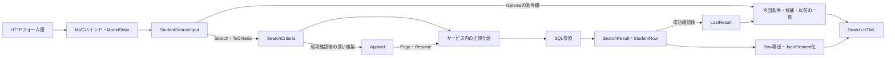

非nullable参照型の暗黙Requiredは抑制されている。DTOのstring・string[]注釈、初期化子、requiredメンバーを受信NULL排除の実行保証にしない。HTTP原値、MVC変換後のDTO、サービス引数、SQL検索値を区別する。inputとModelStateによる再表示は、HTTP原文字列を完全な別領域に保存する設計とは異なる。根拠: `sources/Infrastructure/WebHostSetup.cs:16-18`、`sources/Web/Models/StudentSearchPageModel.cs:6-15`、`sources/Web/Controllers/StudentsController.cs:13-22`。

### 共有候補データと用途別の選択規則

LookupSetはコードとクラスを共通の形で取得するデータであり、選択可能性を統一する契約ではない。検索画面はSearchModel→LookupAsync(false,ct)→Razorの経路を使う。コードは分類で、クラスは今回年度・学年で取得後に抽出し、停止・期間外の値も選択できる。検索には人数集計を要求しない。根拠: `sources/Web/Controllers/StudentsController.cs:39-39`、`sources/Views/Students/Search.cshtml:5-5`、`sources/Core/SqlServerStudentService.cs:196-216`。

登録入口はCoordinator.Edit→LookupAsync(ct)を使う。このオーバーロードはincludeOccupancy=trueで、非削除かつ在籍01・02の同クラス人数を集計する。Editビューはコードの現在有効性または既存同値保持を判定し、クラスは既存所属保持、卒業・退学時の在籍期間重複、通常区分の現在有効性によって選択可否を決める。検索Optionsはこの登録用判定を呼ばない。根拠: `sources/Infrastructure/WebStudentCoordinator.cs:17-17`、`sources/Core/SqlServerStudentService.cs:196-214`、`sources/Views/Students/Edit.cshtml:8-13`。

| 区分 | 呼出経路・取得用途 | 取得後の規則と本書の扱い |
| --- | --- | --- |
| 検索MVC | SearchModel→LookupAsync(false,ct) | 停止・期間外を選択可。年度・学年によるクラス抽出はController・Razor。Occupied=0は集計省略値 |
| 登録MVC | Coordinator.Edit、保存再表示、Reset→LookupAsync(ct) | 人数を集計。Editビューが現在有効性・既存値・在籍期間を判定。本書は検索からの受渡しを記載 |
| 未接続候補helper | OptionsRequest→Coordinator.Options→WebPresentation.Lookups | 用途別selectable・注記・上位抽出の宣言はあるが、収録Controllerの公開ルートから呼ばれない |
| 保存時再検査 | SaveAsync→書込ゲート→CheckRules | 最新DBで存在・変更値の有効性・所属整合・必要時の定員を再検査。候補人数は予約ではない |

未接続Lookupsの登録コード判定は現在有効性だけで、Editビューの既存同値保持と同一ではない。helperの結果を検索MVCや登録MVCの実際の応答として流用しない。根拠: `sources/Infrastructure/WebStudentCoordinator.cs:16-17`、`sources/Infrastructure/WebPresentation.cs:8-18`、`sources/Web/Controllers/StudentsController.cs:22-25`、`sources/Core/SqlServerStudentService.cs:344-383`。

### 現行画面の構成と静的投影

共有Layoutは利用者表示名と日本時間の業務日をheaderへ置き、mainにSearchビューを配置する。検索画面は、見出し・メッセージ、条件、検索・候補更新、クリア・新規登録、結果状態、表示指定、11列一覧、前後ページの順である。fieldsは2列で、760px以下では1列になる。gridは横スクロール領域、表は最小幅1050pxで、セルは上寄せと任意位置折返しを使う。根拠: `sources/Views/_ViewStart.cshtml:1-1`、`sources/Views/Shared/_Layout.cshtml:1-1`、`sources/Views/Students/Search.cshtml:3-8`、`sources/wwwroot/css/site.css:1-1`。

SRCのidは項目識別とJavaScriptの要素検索に使う。適用CSSは要素・classセレクターであり、SRCのidを指定する規則はない。メッセージはaria-live=politeを持ち、role属性はない。エラーにはmessage error、通知にはmessage infoを使う。info専用CSSはなく、通知にはmessageの共通規則が適用される。根拠: `sources/Views/Shared/_MessagePanel.cshtml:2-3`、`sources/wwwroot/css/site.css:1-1`、`sources/wwwroot/js/site.js:7-7`。

次はViewer・未検索・未所属OFFの独立した静的ソース投影である。実画面撮影ではない。利用者・業務日は置換欄とし、年度・クラス・学生の実データを設定しない。在籍名称はseedの定義を示す。元の送信先をdata属性に残し、ボタンはtype=button、遷移は文書内fragmentとする。JavaScript、実アプリへのaction、状態キー・偽造防止情報の実値は含めない。根拠: `sources/Views/Students/Search.cshtml:4-8`、`sources/Views/Shared/_Layout.cshtml:1-1`、`sources/database/002_seed.sql:19-22`。

<!doctype html>
<html lang="ja">
<head><meta charset="utf-8"><meta name="viewport" content="width=device-width,initial-scale=1"><title>学生管理</title>
<style>
:root{font-family:Meiryo,'Yu Gothic UI',sans-serif;color:#243448;background:#f2f5f9;font-size:14px}*{box-sizing:border-box}body{margin:0}header{background:#153654;color:white;padding:16px 28px;display:flex;justify-content:space-between;gap:20px}main{background:white;max-width:1440px;margin:24px auto;padding:24px}h1{font-size:24px}fieldset{border:1px solid #c8d1dc;padding:18px;margin:12px 0}legend{font-weight:bold}.fields{display:grid;grid-template-columns:1fr 1fr;gap:14px 28px}label{display:flex;flex-direction:column;gap:5px}input,select,textarea,button{font:inherit;padding:8px;border:1px solid #afbece;border-radius:3px}input,select,textarea{max-width:100%;width:100%}.check{display:inline-flex;flex-direction:row;align-items:center;margin-right:12px}.check input{width:auto}.actions{display:flex;gap:10px;align-items:center;flex-wrap:wrap;margin:16px 0}button{background:white;cursor:pointer}.primary{background:#1c5985;color:white}button:disabled{cursor:default;color:#8a98a5;background:#f3f5f8}.message{padding:14px;border:1px solid #b6dccc;background:#edf7f3}.error{background:#fff1f1;border-color:#c66}.warning{background:#fff8eb;padding:12px}.grid{overflow-x:auto}table{border-collapse:collapse;min-width:1050px;width:100%;font-size:12px}th,td{padding:10px 8px;border:1px solid #d4dee8;vertical-align:top;overflow-wrap:anywhere}th{background:#e6eef6}tr:nth-child(even){background:#f8fafc}.pager{display:flex;gap:14px;align-items:center;justify-content:center;margin:18px}small{color:#5f7183}@media(max-width:760px){main{margin:0;padding:15px}.fields{grid-template-columns:1fr}header{flex-direction:column}}
</style></head>
<body><header><strong>学生管理システム</strong><span>利用者 〈利用者表示名〉　業務日 〈yyyy/MM/dd〉</span></header><main>
<h1>学生検索</h1>
<form data-search-form data-source-method="POST" data-source-route="/students/search">
<input type="hidden" name="ContextId"><input type="hidden" name="ContextRevision"><input type="hidden" name="TabId"><input type="hidden" name="PageSize" value="20"><input type="hidden" name="SortKey" value="studentNo"><input type="hidden" name="SortDirection" value="asc">
<fieldset><legend>検索条件</legend><div class="fields">
<label>学籍番号<input id="SRC-001" name="Criteria.StudentNo" maxlength="30"></label>
<label>氏名<input id="SRC-002" name="Criteria.Name" maxlength="16"></label>
<label>氏名カナ<input id="SRC-003" name="Criteria.Kana" maxlength="72"></label>
<label>年度<select id="SRC-004" name="Criteria.SchoolYear"><option value="">すべて</option></select></label>
<label>学年<select id="SRC-005" name="Criteria.GradeCode"><option value="">すべて</option></select></label>
<label>クラス<select id="SRC-006" name="Criteria.ClassId"><option value="">すべて</option></select></label>
<label class="check"><input id="SRC-007" name="Criteria.UnassignedOnly" type="checkbox" value="true">未所属のみ</label>
<fieldset><legend>在籍区分</legend><label class="check"><input type="checkbox" name="Criteria.StatusCodes" value="01" checked>在学</label><label class="check"><input type="checkbox" name="Criteria.StatusCodes" value="02" checked>休学</label><label class="check"><input type="checkbox" name="Criteria.StatusCodes" value="03">卒業</label><label class="check"><input type="checkbox" name="Criteria.StatusCodes" value="04">退学</label><small>全解除はすべて</small></fieldset>
<label>都道府県<select id="SRC-009" name="Criteria.PrefectureCode"><option value="">すべて</option></select></label>
<label>電話番号<input id="SRC-010" name="Criteria.PhoneNumber" maxlength="40"></label>
<label>入学日・開始<input id="SRC-011" name="Criteria.AdmissionFrom" type="date"></label>
<label>入学日・終了<input id="SRC-012" name="Criteria.AdmissionTo" type="date"></label>
</div><div class="actions"><button type="button" class="primary" data-source-method="POST" data-source-route="/students/search">検索</button><button type="button" data-source-method="POST" data-source-route="/students/options">候補を更新</button></div></fieldset></form>
<div class="actions"><form data-source-method="POST" data-source-route="/students/clear"><input type="hidden" name="ContextId"><input type="hidden" name="ContextRevision"><input type="hidden" name="TabId"><button type="button">クリア</button></form></div>
<p>未検索</p>
<form data-source-method="POST" data-source-route="/students/page"><input type="hidden" name="ContextId"><input type="hidden" name="ContextRevision"><input type="hidden" name="TabId">
<div class="actions"><label>表示件数<select name="PageSize"><option value="20" selected>20</option><option value="50">50</option><option value="100">100</option></select></label><label>並び順<select name="SortKey"><option value="studentNo" selected>学籍番号</option><option value="name">氏名</option><option value="admissionDate">入学日</option><option value="updatedAt">更新日時</option></select></label><select name="SortDirection" aria-label="並び順方向"><option value="asc" selected>昇順</option><option value="desc">降順</option></select><button type="button" name="Page" value="1" disabled>並び順・件数を反映</button></div>
<div class="grid"><table><thead><tr><th>学籍番号</th><th>氏名</th><th>氏名カナ</th><th>生年月日</th><th>年度／学年</th><th>クラス</th><th>在籍区分</th><th>住所</th><th>本人電話</th><th>更新日時</th><th>操作</th></tr></thead><tbody></tbody></table></div>
<nav class="pager"><button type="button" name="Page" value="0" disabled>前へ</button><span>1 / 1</span><button type="button" name="Page" value="2" disabled>次へ</button></nav></form>
</main></body></html>

Staff・Administratorの操作領域は次の差分となる。これは上のViewer状態と同時に適用する領域ではない。行の操作リンクもViewerの「参照」から「編集」に変わる。根拠: `sources/Views/Students/Search.cshtml:6-8`。

<div class="actions"><form data-source-method="POST" data-source-route="/students/clear"><button type="button">クリア</button></form><a href="#editor-entry" data-source-method="GET" data-source-route="/students/new?returnContextId=〈状態ID〉">新規登録</a></div>

| 状態・条件 | 結果欄と操作 |
| --- | --- |
| unsearched | 「未検索」、空一覧。表示指定反映と前後ページは非活性 |
| empty | 「該当する学生はありません。」、空一覧、ページ操作非活性 |
| tooMany | warning領域に「10,000件を超えました。条件を追加してください。」、空一覧。部分一覧を出さず、ページ操作非活性 |
| found | 件数・検索日時・一覧を表示。反映は活性。前へはpage>1、次へはpage×PageSize<countの場合に活性 |
| 局所WebFault再表示 | validation-summary Allをmessage errorに表示。空一覧、元e.Statusを維持 |
| Options | 今回条件と以前のLastResultを表示。未反映またはクラス解除の通知をmessage infoに表示 |
| 未所属ONの再描画 | 年度・学年・クラスをdisabledにする。在籍選択は維持 |
| 未所属のブラウザー変更 | ONで所属3値を空にする。disabledは変更せず、OFFでも旧値を戻さない |

根拠: `sources/Views/Students/Search.cshtml:5-8`、`sources/Views/Shared/_MessagePanel.cshtml:2-3`、`sources/Web/Controllers/StudentsController.cs:14-22`、`sources/wwwroot/js/site.js:7-7`。

### 参考設計の独立した画面投影

参考詳細設計のHTMLは、架空の管理者・検索完了状態を使った設計見本である。次の投影はその配置を独立して示す。1440px基準の注記、タイトルバー、ホーム／学生検索のribbon、画面名・説明・タグ、完了通知、2列条件、検索／クリアと右側操作、件数・表示範囲・表示指定、11列一覧、先頭／前／次／最後、検索日時・最終実行条件、footerを保持する。画面最小幅は1040px、一覧最小幅は1150pxである。現行投影と混合しない。根拠: `reference-designs/詳細仕様書/CSharp_ASPNET/01_学生検索画面.md:29-45`。

<!doctype html>
<html lang="ja"><head><meta charset="utf-8"><meta name="viewport" content="width=device-width,initial-scale=1"><title>参考設計・学生検索見本</title>
<style>
*{box-sizing:border-box}.spec-screen{font-family:"Noto Sans CJK JP","Yu Gothic UI",Meiryo,sans-serif;color:#243448;background:#f2f5f9;padding:20px;font-size:13px;line-height:1.55;min-width:1040px}.spec-screen .app{max-width:1440px;margin:0 auto;background:#fff;border:1px solid #c8d1dc;box-shadow:0 8px 24px #172b4d15}.spec-screen .titlebar{background:#153654;color:white;padding:12px 22px;display:flex;justify-content:space-between;align-items:center}.spec-screen .titlebar strong{font-size:16px;letter-spacing:.04em}.spec-screen .meta{font-size:11px;opacity:.9}.spec-screen .ribbon{padding:8px 22px;background:#f7f9fc;border-bottom:1px solid #dce3eb;color:#526476;display:flex;justify-content:space-between}.spec-screen .body{padding:22px}.spec-screen .pagehead{display:flex;justify-content:space-between;align-items:flex-start;margin-bottom:16px}.spec-screen h2{font-size:24px;margin:0 0 4px}.spec-screen .sub{color:#617588;font-size:12px}.spec-screen .tag{border:1px solid #93b6d4;background:#eff6fc;color:#19466c;border-radius:4px;padding:4px 10px;font-size:12px}.spec-screen .notice{padding:10px 14px;background:#edf7f3;border:1px solid #b6dccc;border-left:4px solid #31866b;margin-bottom:18px}.spec-screen .section{border:1px solid #d5dee8;margin:0 0 16px;border-radius:5px;overflow:hidden}.spec-screen .sectitle{background:#eef3f8;padding:9px 14px;font-size:14px;font-weight:700;border-bottom:1px solid #d5dee8}.spec-screen .fields{display:grid;grid-template-columns:1fr 1fr;gap:12px 28px;padding:16px}.spec-screen .field{display:grid;grid-template-columns:128px minmax(0,1fr);align-items:start;gap:9px}.spec-screen .label{font-size:13px;font-weight:500;line-height:34px;white-space:nowrap}.spec-screen .input,.spec-screen select{font:inherit;background:#fff;border:1px solid #afbece;border-radius:3px;width:100%;padding:7px 9px;min-height:34px;color:#243448}.spec-screen .faux{border:1px solid #afbece;border-radius:3px;padding:7px 9px;min-height:34px;background:#fff;display:flex;justify-content:space-between;align-items:center}.spec-screen .hint{font-size:11px;color:#657b8c;margin-top:4px}.spec-screen .physical{display:block;color:#75879b;font-family:ui-monospace,Consolas,monospace;font-size:10px;margin-top:3px;line-height:1.25;overflow-wrap:anywhere}.spec-screen .checks{min-height:34px;display:flex;gap:18px;align-items:center;flex-wrap:wrap}.spec-screen .checks label{display:flex;gap:5px;align-items:center;white-space:nowrap;font-weight:400}.spec-screen .actions{display:flex;align-items:center;gap:9px;padding:0 0 18px}.spec-screen button{font:inherit;font-size:13px;background:#fff;border:1px solid #9fadc0;border-radius:4px;padding:8px 17px;white-space:nowrap;color:#2c4158;min-height:35px}.spec-screen button.primary{background:#1c5985;color:#fff;border-color:#1c5985;font-weight:600}.spec-screen button:disabled{color:#95a0ae;background:#f7f8fa;border-color:#dce2e9}.spec-screen .spacer{flex:1}.spec-screen .resultsbar{display:flex;align-items:center;gap:14px;padding:11px 14px;background:#f2f5f9;border:1px solid #d4dee8;border-bottom:0}.spec-screen .resultsbar select{padding:3px 7px;min-height:28px;width:auto}.spec-screen .gridwrap{overflow-x:auto;border:1px solid #d4dee8}.spec-screen table.grid{border-collapse:collapse;width:100%;table-layout:fixed;min-width:1150px;font-size:11px}.spec-screen .grid th{background:#e6eef6;text-align:left;font-weight:600;padding:10px 7px;border-bottom:1px solid #bacbda;border-right:1px solid #ccd9e6;vertical-align:middle}.spec-screen .grid td{padding:12px 7px;border-right:1px solid #e0e6ec;border-bottom:1px solid #e0e6ec;vertical-align:top;overflow-wrap:anywhere}.spec-screen .grid tr:nth-child(even){background:#f8fafc}.spec-screen .grid button{padding:4px 10px;min-height:25px;font-size:11px}.spec-screen .badge{display:inline-block;background:#e3f1eb;color:#2a6b53;padding:2px 7px;border-radius:3px;white-space:nowrap}.spec-screen .badge.leave{background:#fff0d5;color:#8b6317}.spec-screen .pager{display:flex;align-items:center;justify-content:center;gap:8px;padding:14px}.spec-screen .pager button{font-size:12px;padding:5px 13px;min-height:30px}.spec-screen .foot{padding:10px 20px;background:#f6f8fb;border-top:1px solid #dce3eb;font-size:11px;color:#687e92}.spec-screen .demohead{max-width:1440px;margin:0 auto 12px;font-size:12px;color:#5d6f82}
</style></head><body>
<div class="spec-screen web"><div class="demohead">画面設計モック　／　C#／ASP.NET　／　1440px基準　／　実装・実データではありません</div><div class="app">
<div class="titlebar"><strong>学生管理システム</strong><span class="meta">利用者：見本担当者　｜　権限：管理者</span></div>
<div class="ribbon"><span>ホーム　 ›　学生検索</span><span>業務日：2026/10/11　　管理者</span></div>
<div class="body"><div class="pagehead"><div><h2>学生検索</h2><div class="sub">学生の基本情報を確認し、登録・編集画面を開きます。</div></div><span class="tag">SCR-STU-001</span></div>
<div class="notice">検索が完了しました。条件を変更した場合は、もう一度「検索」を押してください。</div>
<section class="section"><div class="sectitle">検索条件</div><div class="fields">
<div class="field" data-control="Criteria.StudentNo" data-field-id="SRC-001"><div class="label">学籍番号</div><div><input aria-label="学籍番号" class="input" data-business-maxlength="15" data-normalized-maxlength="15" maxlength="30" value=""><span class="physical">Criteria.StudentNo</span></div><div class="hint">15文字以内</div></div>
<div class="field" data-control="Criteria.Name" data-field-id="SRC-002"><div class="label">氏名</div><div><input aria-label="氏名" class="input" data-business-maxlength="8" data-normalized-maxlength="160" maxlength="16" value="見本"><span class="physical">Criteria.Name</span></div><div class="hint">入力8文字以内／保存・正規化160文字以内</div></div>
<div class="field" data-control="Criteria.Kana" data-field-id="SRC-003"><div class="label">氏名カナ</div><div><input aria-label="氏名カナ" class="input" data-business-maxlength="36" data-normalized-maxlength="18" maxlength="72" value=""><span class="physical">Criteria.Kana</span></div><div class="hint">入力36文字以内／保存・正規化18文字以内</div></div>
<div class="field" data-control="Criteria.SchoolYear" data-field-id="SRC-004"><div class="label">年度</div><div><div aria-label="年度" class="faux" role="combobox"><span>すべて</span><span>▾</span></div><span class="physical">Criteria.SchoolYear</span></div></div>
<div class="field" data-control="Criteria.GradeCode" data-field-id="SRC-005"><div class="label">学年</div><div><div aria-label="学年" class="faux" role="combobox"><span>すべて</span><span>▾</span></div><span class="physical">Criteria.GradeCode</span></div></div>
<div class="field" data-control="Criteria.ClassId" data-field-id="SRC-006"><div class="label">クラス</div><div><div aria-label="クラス" class="faux" role="combobox"><span>すべて</span><span>▾</span></div><span class="physical">Criteria.ClassId</span></div></div>
<div class="field" data-control="Criteria.UnassignedOnly" data-field-id="SRC-007"><div class="label">未所属のみ</div><div><div class="checks"><label><input type="checkbox"> 未所属の学生のみ</label></div><div class="hint">選択時は年度・学年・クラスを解除</div><span class="physical">Criteria.UnassignedOnly</span></div></div>
<div class="field" data-control="Criteria.StatusCodes" data-field-id="SRC-008"><div class="label">在籍区分</div><div><div class="checks"><label><input checked type="checkbox">在学</label><label><input checked type="checkbox">休学</label><label><input type="checkbox">卒業</label><label><input type="checkbox">退学</label></div><div class="hint">すべて解除した場合は全区分</div><span class="physical">Criteria.StatusCodes</span></div></div>
<div class="field" data-control="Criteria.PrefectureCode" data-field-id="SRC-009"><div class="label">都道府県</div><div><div aria-label="都道府県" class="faux" role="combobox"><span>すべて</span><span>▾</span></div><span class="physical">Criteria.PrefectureCode</span></div></div>
<div class="field" data-control="Criteria.PhoneNumber" data-field-id="SRC-010"><div class="label">電話番号</div><div><input aria-label="電話番号" class="input" data-business-maxlength="20" data-normalized-maxlength="16" maxlength="40" value=""><span class="physical">Criteria.PhoneNumber</span></div><div class="hint">入力20文字以内／保存・正規化16文字以内</div></div>
<div class="field" data-control="Criteria.AdmissionFrom" data-field-id="SRC-011"><div class="label">入学日・開始</div><div><input aria-label="入学日・開始" class="input" data-business-maxlength="10" maxlength="10" value=""><div class="hint">西暦 yyyy-MM-dd</div><span class="physical">Criteria.AdmissionFrom</span></div></div>
<div class="field" data-control="Criteria.AdmissionTo" data-field-id="SRC-012"><div class="label">入学日・終了</div><div><input aria-label="入学日・終了" class="input" data-business-maxlength="10" maxlength="10" value=""><div class="hint">西暦 yyyy-MM-dd</div><span class="physical">Criteria.AdmissionTo</span></div></div>
</div></section>
<div class="actions"><button class="primary" type="button">検索</button><button type="button">クリア</button><span class="spacer"></span><button type="button">新規登録</button><button type="button">メニューへ</button></div>
<div class="resultsbar"><strong>検索結果 2件　1–2件を表示</strong><span class="spacer"></span><label>表示件数 <select><option>20</option><option>50</option><option>100</option></select></label><label>並び順 <select><option>学籍番号</option><option>氏名</option><option>入学日</option><option>更新日時</option></select></label><label><select><option>昇順</option><option>降順</option></select></label></div>
<div class="gridwrap"><table class="grid"><thead><tr><th style="width:91px">学籍番号</th><th style="width:81px">氏名</th><th style="width:94px">氏名カナ</th><th style="width:122px">生年月日</th><th style="width:90px">年度／学年</th><th style="width:103px">クラス</th><th style="width:64px">在籍区分</th><th style="width:159px">住所</th><th style="width:101px">本人電話</th><th style="width:119px">更新日時</th><th style="width:67px">操作</th></tr></thead><tbody>
<tr><td>S2026-0001</td><td>見本 太郎</td><td>ミホン タロウ</td><td>平成20年05月15日</td><td>2026<br>学年なし</td><td>C-A<br>Aクラス</td><td><span class="badge">在学</span></td><td>東京都 見本市<br>見本町1-1</td><td>03-0000-0000</td><td>2026/10/11<br>09:00:00</td><td><button type="button">編集</button></td></tr>
<tr><td>S2026-0002</td><td>見本 花子</td><td>ミホン ハナコ</td><td>平成20年07月20日</td><td>2026<br>学年なし</td><td>C-A<br>Aクラス</td><td><span class="badge leave">休学</span></td><td>千葉県 見本市<br>見本町2-2</td><td>－</td><td>2026/10/11<br>09:10:00</td><td><button type="button">編集</button></td></tr>
</tbody></table></div>
<div class="pager"><button type="button" disabled>先頭</button><button type="button" disabled>前へ</button><strong>1 / 1</strong><button type="button" disabled>次へ</button><button type="button" disabled>最後</button></div>
<div class="sub">検索日時：2026/10/11 10:00:00　｜　最終実行条件：氏名「見本」、在学・休学</div></div>
<div class="foot">設計例の値はすべて架空です。保存・検索・認証・DB接続は動作しません。生年月日以外の日付は西暦です。</div></div></div>
</body></html>

参考見本のfauxはrole=comboboxを持つ表示部品で、現行のselectとは異なる。参考のSRC-008はdata-field-idであり、現行DOMのidではない。参考見本の氏名の「160」は照合値側の上限で、現行の保存表記student_nameの上限8と混同しない。参考のribbon、メニュー、表示範囲、先頭・最後、badge、行操作buttonを現行の稼働部品として追加しない。現行は行操作a、件数・日時の本文、反映・前・次を使う。根拠: `reference-designs/詳細仕様書/CSharp_ASPNET/01_学生検索画面.md:39-40`、`sources/Views/Students/Search.cshtml:5-8`、`sources/Core/StudentNormalizer.cs:125-145`。

## 項目一覧

| 項目キー | 論理名・初期値 | 実コントロール・フォーム名 | 入力DTO→SearchCriteria | 検査・正規化 | 検索／保存列・DB属性 | SQLパラメータ | 根拠 |
| --- | --- | --- | --- | --- | --- | --- | --- |
| SRC-001 | 学籍番号、空 | input、id=`SRC-001`、`Criteria.StudentNo`、maxlength=30 | `StudentNo:string`→`StudentNo:string?` | サービス入口のNULL・空文字は省略。非空はIdentifier。raw・Trim後・NFKC大文字化後15スカラー値以内、先頭英数字、以降英数字・ハイフン | `m_student.student_no:varchar(15) NOT NULL`、15バイト、BIN2。保存もIdentifier15 | 前方LIKE `@no:VarChar(31)`。保存 `@student_no:VarChar(15)` | `sources/Views/Students/Search.cshtml:5-5`、`sources/Web/Inputs/StudentSearchInput.cs:7-22`、`sources/Core/StudentNormalizer.cs:59-64`、`sources/Core/StudentNormalizer.cs:124-124`、`sources/Core/SqlServerStudentService.cs:31-31`、`sources/Core/SqlServerStudentService.cs:113-140`、`sources/database/001_schema.sql:9-9` |
| SRC-002 | 氏名、空 | input、id=`SRC-002`、`Criteria.Name`、maxlength=16 | `Name:string`→`StudentName:string?` | 任意Textのraw・Trim後8。非NULLからNFKC・大文字化・Unicode空白除去のNameKey、キー160以内 | 検索 `name_key:nvarchar(320) NOT NULL`。保存表記 `student_name:nvarchar(16) NOT NULL`。容量は320／16コード単位、CHECKは160／8スカラー値 | 部分LIKE `@name:NVarChar(642)`。保存表記／キー `NVarChar(16)`／`NVarChar(320)` | `sources/Web/Inputs/StudentSearchInput.cs:8-22`、`sources/Core/StudentNormalizer.cs:47-70`、`sources/Core/StudentNormalizer.cs:125-145`、`sources/Core/SqlServerStudentService.cs:31-32`、`sources/Core/SqlServerStudentService.cs:114-141`、`sources/database/001_schema.sql:10-12`、`sources/database/001_schema.sql:44-46` |
| SRC-003 | 氏名カナ、空 | input、id=`SRC-003`、`Criteria.Kana`、maxlength=72 | `Kana:string`→`StudentNameKana:string?` | サービス入口のNULL・空文字は省略。非空はraw・Trim後36、NFKC、ひらがな変換、空白統合、許可カナ検査、結果18以内。キーは半角空白除去 | 検索 `kana_key`、保存表記 `student_name_kana`は双方`nvarchar(36) NOT NULL`。CHECK18。保存カナは必須 | 部分LIKE `@kana:NVarChar(74)`。保存表記・キー双方 `NVarChar(36)` | `sources/Web/Inputs/StudentSearchInput.cs:9-22`、`sources/Core/StudentNormalizer.cs:72-85`、`sources/Core/StudentNormalizer.cs:126-145`、`sources/Core/SqlServerStudentService.cs:31-32`、`sources/Core/SqlServerStudentService.cs:116-142`、`sources/database/001_schema.sql:11-13`、`sources/database/001_schema.sql:45-47` |
| SRC-004 | 年度、すべて | select、id=`SRC-004`、`Criteria.SchoolYear`。未所属再描画時disabled | `SchoolYear:int?`→`int?` | 指定時1900～9998、クラス年度存在確認。0を未指定にしない | `m_class.school_year:smallint NOT NULL`。学生に年度列なし。ClassChangeの保存も同範囲 | `@year:SmallInt`、保存 `@school_year:SmallInt`、Sizeなし | `sources/Views/Students/Search.cshtml:5-5`、`sources/Web/Inputs/StudentSearchInput.cs:10-20`、`sources/Core/SqlServerStudentService.cs:109-143`、`sources/Core/MasterMaintenanceService.cs:32-32`、`sources/Core/MasterMaintenanceService.cs:73-74`、`sources/database/001_schema.sql:64-64` |
| SRC-005 | 学年、すべて | select、id=`SRC-005`、`Criteria.GradeCode`。未所属再描画時disabled | `GradeCode:string?`→`string?` | 任意Code2。raw・Trim後2以内、NFKC後ASCII数字2桁。空はNULL、GRADE存在確認。00は実コード | `m_class.grade_code:varchar(2) NOT NULL`、`grade_category:varchar(24) NOT NULL`。学生に学年列なし | `@grade:VarChar(2)`、クラス保存 `@grade_code:VarChar(2)` | `sources/Web/Inputs/StudentSearchInput.cs:11-20`、`sources/Core/StudentNormalizer.cs:113-117`、`sources/Core/SqlServerStudentService.cs:118-144`、`sources/Core/MasterMaintenanceService.cs:34-34`、`sources/Core/MasterMaintenanceService.cs:73-74`、`sources/database/001_schema.sql:65-66`、`sources/database/002_seed.sql:78-78` |
| SRC-006 | クラス、すべて | select、id=`SRC-006`、`Criteria.ClassId`。未所属再描画時disabled | `ClassId:string?`→IdParser.Optional→`long?` | NULL・空文字は未指定。非空は19コード単位以内のASCII数字、正のInt64。Trim・NFKCなし。存在と指定年度・正規化学年の一致 | 学生検索・保存 `m_student.class_id:bigint NULL`。参照先 `m_class.class_id:bigint IDENTITY NOT NULL`、PK | `@class:BigInt`、存在確認 `@id:BigInt`、保存 `@class_id:BigInt`、Sizeなし | `sources/Web/Inputs/StudentSearchInput.cs:12-20`、`sources/Web/Inputs/StudentSaveInput.cs:57-60`、`sources/Core/SqlServerStudentService.cs:36-36`、`sources/Core/SqlServerStudentService.cs:131-145`、`sources/database/001_schema.sql:28-28`、`sources/database/001_schema.sql:63-80` |
| SRC-007 | 未所属のみ、false | checkbox、id=`SRC-007`、`Criteria.UnassignedOnly` | `UnassignedOnly:bool`→`bool` | trueと年度・非NULL学年・クラスの併指定を学年正規化前に拒否。Optionsは所属3値を解除 | `m_student.class_id IS NULL`。専用保存列なし | パラメータなし | `sources/Views/Students/Search.cshtml:5-5`、`sources/Web/Inputs/StudentSearchInput.cs:13-20`、`sources/Web/Controllers/StudentsController.cs:22-22`、`sources/Core/SqlServerStudentService.cs:110-110`、`sources/Core/SqlServerStudentService.cs:146-146` |
| STATUS-GROUP | 在籍区分、01・02 | 同名checkbox群、`Criteria.StatusCodes`。id=`SRC-008`は存在しない | `StatusCodes:string[]`→`EnrollmentStatusCodes:string[]` | POSTキー省略は空配列。最大4件、Ordinal重複なし、01～04。正規化・在籍マスター存在照会なし | `m_student.enrollment_status_code:varchar(2) NOT NULL`、`enrollment_category:varchar(24) NOT NULL` | 非空はIN、各 `@statusN:VarChar(2)`。空配列は述語省略。保存 `VarChar(2)` | `sources/Views/Students/Search.cshtml:5-5`、`sources/Web/Inputs/StudentSearchInput.cs:14-21`、`sources/Web/Controllers/StudentsController.cs:14-14`、`sources/Web/Controllers/StudentsController.cs:22-22`、`sources/Core/SqlServerStudentService.cs:111-112`、`sources/Core/SqlServerStudentService.cs:151-154`、`sources/database/001_schema.sql:25-26` |
| SRC-009 | 都道府県、すべて | select、id=`SRC-009`、`Criteria.PrefectureCode` | `PrefectureCode:string?`→`string?` | 任意Code2、空はNULL、非NULLはPREFECTURE存在確認 | `m_student.prefecture_code:varchar(2) NOT NULL`、`prefecture_category:varchar(24) NOT NULL`。保存は必須 | `@prefecture:VarChar(2)`、保存 `@prefecture_code:VarChar(2)` | `sources/Web/Inputs/StudentSearchInput.cs:15-21`、`sources/Core/StudentNormalizer.cs:113-117`、`sources/Core/StudentNormalizer.cs:130-130`、`sources/Core/SqlServerStudentService.cs:33-33`、`sources/Core/SqlServerStudentService.cs:119-147`、`sources/database/001_schema.sql:18-19` |
| SRC-010 | 電話番号、空 | input、id=`SRC-010`、`Criteria.PhoneNumber`、maxlength=40 | `PhoneNumber:string`→`string?` | 任意Textのraw・Trim後20。NFKC後にUnicode空白、半角ハイフン、U+2010・U+2011・U+2212、丸括弧を除去。国内0始まり10～11桁、国際+と非ゼロ始まり7～15桁 | 本人 `phone_number`と緊急 `emergency_phone_number`は双方`varchar(16) NULL`。保存もPhone、形式上最大16文字 | 本人または緊急電話への完全一致OR、`@phone:VarChar(16)`。保存も双方 `VarChar(16)` | `sources/Web/Inputs/StudentSearchInput.cs:16-21`、`sources/Core/StudentNormalizer.cs:87-93`、`sources/Core/StudentNormalizer.cs:133-141`、`sources/Core/SqlServerStudentService.cs:34-37`、`sources/Core/SqlServerStudentService.cs:148-148`、`sources/database/001_schema.sql:22-32` |
| SRC-011 | 入学日・開始、未設定 | date input、id=`SRC-011`、`Criteria.AdmissionFrom`、maxlengthなし | `AdmissionFrom:string?`→`string?`→ローカル`DateOnly?` | NULL・空文字は下端省略。非空はTrimせずNFKC後10コード単位、yyyy-MM-dd厳密解析。1900-01-01～検索入口業務日。個別raw上限なし | `m_student.admission_date:date NOT NULL`。保存日付は必須 | `@from:Date`、Sizeなし、下端包含 | `sources/Web/Inputs/StudentSearchInput.cs:17-22`、`sources/Core/JapaneseDateService.cs:52-59`、`sources/Core/SqlServerStudentService.cs:105-122`、`sources/Core/SqlServerStudentService.cs:149-149`、`sources/database/001_schema.sql:24-24` |
| SRC-012 | 入学日・終了、未設定 | date input、id=`SRC-012`、`Criteria.AdmissionTo`、maxlengthなし | `AdmissionTo:string?`→`string?`→ローカル`DateOnly?` | 開始と同じ変換・範囲。片側指定可。開始>終了はE-STU-006 | 同じ`admission_date:date NOT NULL`の上端 | `@to:Date`、Sizeなし、上端包含。保存 `@admission_date:Date` | `sources/Web/Inputs/StudentSearchInput.cs:18-22`、`sources/Core/JapaneseDateService.cs:52-59`、`sources/Core/StudentNormalizer.cs:135-135`、`sources/Core/SqlServerStudentService.cs:35-35`、`sources/Core/SqlServerStudentService.cs:120-150`、`sources/database/001_schema.sql:24-24` |
| PAGE-SIZE | 表示件数、20 | ページselect `PageSize`、条件フォーム同名hidden | Action引数／PageRequestの`int`→条件`int` | 20・50・100だけ | 非DB制御値 | `@size:Int`、Sizeなし | `sources/Views/Students/Search.cshtml:4-8`、`sources/Web/Inputs/StudentSearchInput.cs:27-29`、`sources/Core/SqlServerStudentService.cs:107-107`、`sources/Core/SqlServerStudentService.cs:164-164` |
| SORT-KEY | 並び順、studentNo | select `SortKey`、条件フォーム同名hidden | `string`→`string` | studentNo・name・admissionDate・updatedAtだけ | 許可主ソート列の選択。保存列なし | switchで許可列へ対応、任意列名を受けない | `sources/Views/Students/Search.cshtml:4-8`、`sources/Core/SqlServerStudentService.cs:108-108` |
| SORT-DIRECTION | 方向、asc | select `SortDirection`、aria-label=並び順方向、条件フォーム同名hidden | `string`→`string` | 小文字asc・descだけ | 非DB制御値 | 検査済み方向をORDER BYへ使用 | `sources/Views/Students/Search.cshtml:4-8`、`sources/Core/SqlServerStudentService.cs:107-107`、`sources/Core/SqlServerStudentService.cs:162-162` |
| ACT-SEARCH | 検索 | 条件フォームsubmit、POST `/students/search` | 今回input→SearchRequest | Page1、成功後だけApplied置換 | DB参照と検索メモリ更新 | E02、Q-E・Q-S・Q-L | `sources/Web/Controllers/StudentsController.cs:13-16`、`sources/Infrastructure/WebStudentCoordinator.cs:7-9` |
| ACT-OPTIONS | 候補を更新 | 条件フォームsubmit、formaction=`/students/options` | 今回input・状態識別 | 候補再描画、学生検索なし | マスター参照、Applied更新なし | E03、Q-L | `sources/Web/Controllers/StudentsController.cs:22-22` |
| ACT-CLEAR | クリア | 独立フォーム、POST `/students/clear` | ContextRequest・TabId | 初期条件・未検索へ戻す | メモリ消去、DB DELETEなし | E05、再描画Q-L | `sources/Web/Controllers/StudentsController.cs:21-21`、`sources/Infrastructure/WebStudentCoordinator.cs:15-15` |
| ACT-PAGE | 反映・前へ・次へ | button名`Page`、反映1、前後page±1 | `PageRequest.Page:int`→条件`Page:int` | foundだけ活性。表示指定変更時Page1 | Appliedから再検索 | `@offset:Int`、`@size:Int`。E04 | `sources/Views/Students/Search.cshtml:8-8`、`sources/Infrastructure/WebStudentCoordinator.cs:11-12` |
| ACT-NEW | 新規登録 | a、GET `/students/new`、returnContextId付き | `returnContextId:string?` | Viewer非表示、入口でも権限確認 | 検索条件を登録値へ転記しない | E08 | `sources/Views/Students/Search.cshtml:6-6`、`sources/Infrastructure/WebStudentCoordinator.cs:17-17` |
| ACT-ROW | 編集・参照 | a、GET `/students/{studentId}`、returnContextId付き | route `id:long` | Viewerは参照、他の定義Roleは編集。最新対象再取得 | `m_student.student_id:bigint NOT NULL`、PK | 詳細 `@id:BigInt`、Sizeなし | `sources/Views/Students/Search.cshtml:8-8`、`sources/Web/Controllers/StudentsController.cs:24-25`、`sources/Core/SqlServerStudentService.cs:172-181` |

## 選択候補一覧

| 候補キー | 使用先・取得元 | 抽出・完全な順序 | 選択キー・表示と保存元 | 初期・候補なし | 選択保持・解除 | 根拠 |
| --- | --- | --- | --- | --- | --- | --- |
| L-YEAR | SRC-004、LookupSet.Classes | 全クラスの年度を重複排除、年度降順。学年では絞らない | SchoolYearを同じ数字で表示。`m_class.school_year:smallint NOT NULL`、保守1900～9998、保存SmallInt | 空値「すべて」。0件でも先頭選択肢あり | 停止・期間外も生成元。未所属ONのOptionsで解除 | `sources/Views/Students/Search.cshtml:5-5`、`sources/Core/SqlServerStudentService.cs:206-214`、`sources/Core/MasterMaintenanceService.cs:32-32`、`sources/Core/MasterMaintenanceService.cs:73-74` |
| L-GRADE | SRC-005、CodesのGRADE | 分類内display_order、code_value。SQL順を保持 | CodeValue・CodeName。名称は保守raw・Trim後12、`m_code.code_name:nvarchar(24) NOT NULL`、CHECK12、保存`@name:NVarChar(24)` | 空値「すべて」。00は「学年なし」 | 年度では絞らない。停止・期間外も選択可。不適合クラスはOptionsで解除 | `sources/Views/Students/Search.cshtml:5-5`、`sources/Core/SqlServerStudentService.cs:203-212`、`sources/Core/MasterMaintenanceService.cs:82-82`、`sources/Core/MasterMaintenanceService.cs:113-115`、`sources/database/001_schema.sql:115-128`、`sources/database/002_seed.sql:78-78` |
| L-CLASS | SRC-006、全m_class | school_year DESC、学年コードdisplay_order、クラスdisplay_order、class_code、class_id。Razorで今回年度・学年を抽出 | ClassId。表示は年度・ClassCode・ClassNameと停止注記。コードraw・変換後9、名称raw・Trim後18。`varchar(9)`／`nvarchar(36)`、双方NOT NULL。保存`VarChar(9)`／`NVarChar(36)` | 空値「すべて」。0件でも先頭選択肢あり | 不適合IDはOptionsで解除。SRCクラスから上位補完なし。停止は「（停止）」、期間外・学年名・人数の表示なし | `sources/Views/Students/Search.cshtml:5-5`、`sources/Web/Controllers/StudentsController.cs:22-22`、`sources/Core/SqlServerStudentService.cs:206-214`、`sources/Core/MasterMaintenanceService.cs:33-34`、`sources/Core/MasterMaintenanceService.cs:73-74`、`sources/database/001_schema.sql:67-81` |
| L-STATUS | 在籍checkbox群、ENROLLMENT_STATUS | 分類内display_order、code_value | CodeValue・CodeName。名称上限12、DB容量24コード単位、NOT NULL、CHECK12、保存NVarChar(24) | 候補にある01・02をchecked。0件ならcheckboxなし | 全解除・POSTキー省略は空配列。未所属ONでも解除しない。停止・期間外も選択可 | `sources/Views/Students/Search.cshtml:5-5`、`sources/Web/Controllers/StudentsController.cs:14-14`、`sources/Web/Controllers/StudentsController.cs:22-22`、`sources/Core/MasterMaintenanceService.cs:82-82`、`sources/Core/MasterMaintenanceService.cs:113-115` |
| L-PREFECTURE | SRC-009、PREFECTURE | 分類内display_order、code_value | CodeValue・CodeName。名称上限12、DB容量24コード単位、NOT NULL、CHECK12、保存NVarChar(24) | 空値「すべて」。0件でも先頭選択肢あり | 所属との連動なし。停止・期間外も選択可 | `sources/Views/Students/Search.cshtml:5-5`、`sources/Core/SqlServerStudentService.cs:203-212`、`sources/Core/MasterMaintenanceService.cs:82-82`、`sources/Core/MasterMaintenanceService.cs:113-115` |
| L-SIZE | ページPageSize、ビュー固定値 | 20、50、100 | 整数と数字表示。保存列なし | 20 | select変更だけでは条件フォームhiddenへ同期しない。Pageで反映 | `sources/Views/Students/Search.cshtml:4-8`、`sources/wwwroot/js/site.js:2-9` |
| L-SORT | ページSortKey、ビュー固定値 | studentNo、name、admissionDate、updatedAt | 学籍番号、氏名、入学日、更新日時 | studentNo | Pageで反映し、変更時Page1 | `sources/Views/Students/Search.cshtml:8-8`、`sources/Infrastructure/WebStudentCoordinator.cs:12-12` |
| L-DIRECTION | ページSortDirection、ビュー固定値 | asc、desc | 昇順、降順 | asc | Pageで反映。大文字等はサービスで拒否 | `sources/Views/Students/Search.cshtml:8-8`、`sources/Core/SqlServerStudentService.cs:107-107` |

## 内部項目一覧

| 内部項目キー | 意味・実名・型 | 保持領域・初期値 | 設定・使用・更新条件 | 根拠 |
| --- | --- | --- | --- | --- |
| INT-ID | 検索状態参照キー、`Entry.Id:string`、ContextId | メモリ辞書キー。32バイト乱数を64桁小文字hexへ符号化 | 3フォームと復帰先へ移送。Clearでも維持。実値は掲載しない | `sources/Infrastructure/SearchContextStore.cs:9-12`、`sources/Views/Students/Search.cshtml:4-8` |
| INT-OWNER | 所有者、`Entry.Owner:string` | メモリ、作成時CurrentUser.Principal | GetでNameIdentifier由来の主体との一致要求 | `sources/Infrastructure/RequestIdentity.cs:7-10`、`sources/Infrastructure/SearchContextStore.cs:9-13` |
| INT-SESSION | 認証セッション、`Entry.Session:string` | メモリ、作成時CurrentUser.SessionId | Getでlogin_session由来値との一致要求 | `sources/Infrastructure/RequestIdentity.cs:9-10`、`sources/Infrastructure/SearchContextStore.cs:9-13` |
| INT-TAB | 画面識別、`Entry.Tab:string`、TabId | メモリ、Createで未指定なら採番 | Getは非空指定時だけ比較。Index／Resumeは渡さない | `sources/Infrastructure/SearchContextStore.cs:9-14`、`sources/Web/Controllers/StudentsController.cs:8-22` |
| INT-EXPIRES | 利用期限、`Expires:DateTimeOffset` | メモリ、UTC現在+30分 | Useのoperation正常終了後に延長。Create時に期限切れを掃除 | `sources/Infrastructure/SearchContextStore.cs:9-14` |
| INT-REVISION | 検索状態比較版、`Revision:long`、受信ContextRevisionは文字列 | メモリ、初期1 | Search・Page・検索済みResume・Clearで+1。UseでInvariantCulture十進文字列と完全一致比較 | `sources/Infrastructure/SearchContextStore.cs:9-14`、`sources/Infrastructure/WebStudentCoordinator.cs:9-15` |
| INT-GATE | Entry更新の直列化、`Gate:SemaphoreSlim` | メモリ、1枠 | ct付き待機、取得後再検査、取得済み区間のfinallyで解放。Optionsは不使用 | `sources/Infrastructure/SearchContextStore.cs:9-14`、`sources/Web/Controllers/StudentsController.cs:22-22` |
| INT-INPUT | 今回未実行条件、StudentSearchInput、モデルCriteria | ブラウザー・要求・応答。初期DTOまたは今回input | Entryに専用保持領域なし。Search・Optionsの条件欄材料 | `sources/Web/Models/StudentSearchPageModel.cs:6-10`、`sources/Web/Controllers/StudentsController.cs:13-22` |
| INT-APPLIED | 成功済み条件、`Applied:SearchCriteria?` | メモリ、初期NULL | Search・Page成功後の深い複製。Resumeは維持、ClearでNULL | `sources/Infrastructure/WebStudentCoordinator.cs:9-15`、`sources/Infrastructure/SearchContextStore.cs:15-15` |
| INT-RESULT | 成功済み結果、`LastResult:SearchResult?` | メモリ、初期NULL | Search・Page・検索済みResume成功で更新。局所失敗で維持、ClearでNULL | `sources/Infrastructure/WebStudentCoordinator.cs:9-15`、`sources/Web/Controllers/StudentsController.cs:14-22` |
| INT-SQL | 正規化検索値、`no/name/kana/phone/grade/prefecture:string?`、`from/to:DateOnly?` | SearchAsyncローカル | 各要求で生成。Appliedの文字列は置換しない。NULLなら任意述語省略 | `sources/Core/SqlServerStudentService.cs:113-150` |
| INT-SEARCH-RESULT | SearchResult、Count:int、Items:`IReadOnlyList<StudentRow>`、SearchedAt、LimitExceeded | サービス戻り値 | 正常・0件・超過はNoChange。Count10001は超過検出値。検証失敗Count0は正常0件と別 | `sources/Core/Contracts.cs:57-58`、`sources/Core/SqlServerStudentService.cs:159-170` |
| INT-DATA | HTML描画材料、`StudentSearchPageModel.Data:JsonElement` | PresentをWeb既定JSON設定で変換 | HTML内部用。公開JSON API応答ではない | `sources/Web/Models/StudentSearchPageModel.cs:10-15`、`sources/Web/Controllers/StudentsController.cs:39-39` |
| INT-STUDENT-VERSION | 学生比較版、`StudentRow.RowVersion:long`、ExpectedVersionは文字列 | DBの正bigint、DEFAULT1 | 検索Revisionと別。一覧objectには出さず、編集入口で再取得 | `sources/Core/Contracts.cs:50-54`、`sources/Infrastructure/WebPresentation.cs:20-20`、`sources/Web/Inputs/StudentSaveInput.cs:54-54`、`sources/database/001_schema.sql:42-59` |
| INT-RETURN-VERSION | 編集時検索復帰版、`ReturnRevision:string?` | 編集モデル・Snapshot | LoadでDB詳細・候補・フォーム作成後に現在検索版を採取。戻るリンク・Saved後303に使用 | `sources/Web/Controllers/StudentsController.cs:25-25`、`sources/Web/Controllers/StudentsController.cs:38-38`、`sources/Infrastructure/EditorSnapshotStore.cs:7-9` |
| INT-SNAPSHOT | 編集読込情報、SnapshotId、Snapshot | 別メモリ辞書、30分 | 主体・セッション・対象ID・詳細・原入力複製・復帰版を保持。Resetは原入力を使う | `sources/Infrastructure/EditorSnapshotStore.cs:7-11` |
| INT-FLASH | 確定通知、Message・Expires | 別メモリ辞書、10分 | 主体・セッション・状態ID単位。Takeは削除して取得し、期限切れも消費 | `sources/Infrastructure/FlashMessageStore.cs:6-9`、`sources/Web/Controllers/StudentsController.cs:11-11`、`sources/Web/Controllers/StudentsController.cs:38-38` |
| INT-CSRF | `__RequestVerificationToken` | フォーム・MVC検査 | 各フォームで生成。認可・状態版・排他の代替ではない。実値は掲載しない | `sources/Views/Students/Search.cshtml:4-8`、`sources/Infrastructure/WebHostSetup.cs:15-16` |

## 項目移送仕様

| 移送キー | 表示・使用先 | 取得列・DB型・NULL | 保存元・業務制約・パラメータ | StudentRow→一覧object | 算出・欠損・非表示 | 根拠 |
| --- | --- | --- | --- | --- | --- | --- |
| ROW-ID | 行リンク対象 | `s.student_id:bigint IDENTITY NOT NULL`、PK | DB採番、検索入力なし | `StudentId:long`→studentIdの十進文字列 | 行番号を使わず、遷移先で最新対象再取得 | `sources/database/001_schema.sql:8-43`、`sources/Core/SqlServerStudentService.cs:77-85`、`sources/Infrastructure/WebPresentation.cs:20-20` |
| ROW-NO | 学籍番号 | `s.student_no:varchar(15) NOT NULL` | StudentDraft.StudentNo→Identifier15→VarChar(15) | `StudentNo:string`→studentNo | 保存番号。検索LIKEパターンは表示しない | `sources/Core/StudentNormalizer.cs:59-64`、`sources/Core/StudentNormalizer.cs:124-124`、`sources/Core/SqlServerStudentService.cs:31-31`、`sources/database/001_schema.sql:9-9` |
| ROW-NAME | 氏名 | `s.student_name:nvarchar(16) NOT NULL`、CHECK8 | StudentDraft.StudentName→必須Text、raw・Trim後8→NVarChar(16) | `StudentName:string`→studentName | 登録表記。name_keyは非表示 | `sources/Core/StudentNormalizer.cs:125-125`、`sources/Core/SqlServerStudentService.cs:31-31`、`sources/database/001_schema.sql:10-44` |
| ROW-KANA | 氏名カナ | `s.student_name_kana:nvarchar(36) NOT NULL`、CHECK18 | 必須Kana、raw36・結果18→NVarChar(36) | `StudentNameKana:string`→studentNameKana | 保存カナ表記。kana_keyは非表示 | `sources/Core/StudentNormalizer.cs:72-85`、`sources/Core/StudentNormalizer.cs:126-145`、`sources/database/001_schema.sql:11-47` |
| ROW-BIRTH | 生年月日 | `s.birth_date:date NOT NULL` | 和暦BirthDateInputを検査・変換→`@birth_date:Date` | `BirthDate:DateOnly`→BirthDateWareki→birthDateWareki | 年1は元年、月日2桁。日付に時差を加えない | `sources/Core/StudentNormalizer.cs:127-127`、`sources/Core/JapaneseDateService.cs:41-50`、`sources/Core/Contracts.cs:50-55`、`sources/database/001_schema.sql:14-14` |
| ROW-YEAR | 年度／学年の年度 | `c.school_year:smallint NOT NULL`、結合結果NULL可 | ClassChange.SchoolYear:int、1900～9998→SmallInt | `SchoolYear:int?`→schoolYear | 所属クラスの属性。学生に重複保存せず、－補完なし | `sources/Core/MasterMaintenanceService.cs:32-32`、`sources/Core/MasterMaintenanceService.cs:73-74`、`sources/Core/SqlServerStudentService.cs:79-88`、`sources/database/001_schema.sql:64-64` |
| ROW-GRADE | 学年名 | `g.code_name AS grade_name`、基表`nvarchar(24) NOT NULL`、CHECK12、結合結果NULL可 | CodeChange.CodeName→必須Text、raw・Trim後12→`@name:NVarChar(24)` | `GradeName:string?`→gradeName | GRADE名称。コード値・－への代替なし | `sources/Core/MasterMaintenanceService.cs:82-82`、`sources/Core/MasterMaintenanceService.cs:113-115`、`sources/Core/SqlServerStudentService.cs:79-88`、`sources/database/001_schema.sql:115-128` |
| ROW-CLASS-CODE | クラスコード | `c.class_code:varchar(9) NOT NULL`、結合結果NULL可 | ClassChange.ClassCode→Identifier9→VarChar(9) | `ClassCode:string?`→classCode | 学生保存列ではない。欠損補完なし | `sources/Core/MasterMaintenanceService.cs:33-33`、`sources/Core/MasterMaintenanceService.cs:73-74`、`sources/database/001_schema.sql:67-67` |
| ROW-CLASS-NAME | クラス名 | `c.class_name:nvarchar(36) NOT NULL`、CHECK18、結合結果NULL可 | ClassChange.ClassName→必須Text、raw・Trim後18→NVarChar(36) | `ClassName:string?`→className | 一覧は状態・期間を取得せず、停止・期間外注記なし | `sources/Core/MasterMaintenanceService.cs:33-33`、`sources/Core/MasterMaintenanceService.cs:73-74`、`sources/Core/SqlServerStudentService.cs:79-90`、`sources/database/001_schema.sql:68-81` |
| ROW-STATUS | 在籍区分名 | `e.code_name AS status_name`、基表`nvarchar(24) NOT NULL`、CHECK12、結合結果NULL可 | CodeChange.CodeName→必須Text12→NVarChar(24) | `EnrollmentStatusName:string?`→enrollmentName | 分類＋値で結合。名称欠落だけで学生を除外せず、補完なし | `sources/Core/MasterMaintenanceService.cs:82-82`、`sources/Core/MasterMaintenanceService.cs:113-115`、`sources/Core/SqlServerStudentService.cs:80-89`、`sources/Infrastructure/WebPresentation.cs:20-20` |
| ROW-PREFECTURE | 住所の都道府県名 | `p.code_name AS prefecture_name`、基表`nvarchar(24) NOT NULL`、CHECK12、結合結果NULL可 | CodeChange.CodeName→必須Text12→NVarChar(24) | 名称→`Address:string`→addressDisplay | SQL NULLの場合だけ[不整合]、住所1と区切りなしで連結 | `sources/Core/MasterMaintenanceService.cs:82-82`、`sources/Core/MasterMaintenanceService.cs:113-115`、`sources/Core/SqlServerStudentService.cs:80-90` |
| ROW-ADDRESS1 | 住所の住所1 | `s.address_line1:nvarchar(90) NOT NULL`、CHECK45 | StudentDraft.AddressLine1→必須Text、raw・Trim後45→NVarChar(90) | 都道府県名との算出Address→addressDisplay | 住所2はText45→`nvarchar(90) NULL`として保存可能だが一覧に含めない | `sources/Core/StudentNormalizer.cs:131-132`、`sources/Core/SqlServerStudentService.cs:34-34`、`sources/Core/SqlServerStudentService.cs:80-85`、`sources/database/001_schema.sql:20-49` |
| ROW-PHONE | 本人電話 | `s.phone_number:varchar(16) NULL` | StudentDraft.PhoneNumber→Phone、raw20・形式最大16→VarChar(16) | `PhoneNumber:string?`→phoneNumber | NULLだけ－。緊急電話に検索一致しても本人電話を表示 | `sources/Core/StudentNormalizer.cs:87-93`、`sources/Core/SqlServerStudentService.cs:148-148`、`sources/Views/Students/Search.cshtml:8-8`、`sources/database/001_schema.sql:22-22` |
| ROW-ADMISSION | 範囲検索・ソート | `s.admission_date:date NOT NULL` | StudentDraft.AdmissionDate→ParseIso→Date | `AdmissionDate:DateOnly` | StudentRow内部に保持し、一覧objectへ出さない | `sources/Core/StudentNormalizer.cs:135-135`、`sources/Core/SqlServerStudentService.cs:35-35`、`sources/Core/SqlServerStudentService.cs:85-85`、`sources/Infrastructure/WebPresentation.cs:20-20` |
| ROW-UPDATED | 更新日時 | `s.updated_at:datetimeoffset(7) NOT NULL`、UTC CHECK | 保存時UTC現在→`@now:DateTimeOffset` | `UpdatedAt:DateTimeOffset`→updatedAt:string | +09:00のyyyy/MM/dd HH:mm:ss | `sources/database/001_schema.sql:40-57`、`sources/Core/SqlServerStudentService.cs:296-300`、`sources/Infrastructure/WebPresentation.cs:7-20` |
| ROW-VERSION | 学生比較版 | `s.row_version:bigint NOT NULL`、DEFAULT1、正値CHECK | 新規1、更新+1、期待版`@version:BigInt` | `RowVersion:long` | 一覧objectへ出さず編集入口で再取得。rowversion型ではない | `sources/database/001_schema.sql:42-59`、`sources/Core/SqlServerStudentService.cs:296-301`、`sources/Infrastructure/WebPresentation.cs:20-20` |
| VIEW-RESULT | 結果文・ページ | SearchResultからの非DB算出値 | 保存なし | 結果NULL→unsearched、超過→tooMany、0件→empty、他→found | totalCountは未検索・超過NULL、正常0件0。件数・日時本文はfoundだけ | `sources/Infrastructure/WebStudentCoordinator.cs:21-21`、`sources/Views/Students/Search.cshtml:2-8` |
| VIEW-CRITERIA | 条件欄復元 | メモリApplied | 保存なし | FromでName・Kanaへ戻し、ClassIdを十進文字列化。在籍配列はStatusCodesへ | 番号・氏名・カナ・電話のNULLは空文字。日付文字列はそのまま | `sources/Web/Controllers/StudentsController.cs:39-40` |

## イベント仕様

### 共通受付と状態利用

ControllerのAuthorizeとMVCの自動偽造防止検査によるAction到達前の拒否を、以下のAction内手順と分ける。Cookie認証はSecure・HttpOnly・SameSite=Strict、有効期間30分・SlidingExpirationで、認証失効・アクセス拒否時は401／403を設定する。検索HTML要求はこのイベントからログインURLへ転送しない。AntiforgeryResultFilterの400 JSON変換は/apiだけに適用され、/studentsのCSRF拒否へ拡張しない。根拠: `sources/Web/Controllers/StudentsController.cs:5-6`、`sources/Infrastructure/WebHostSetup.cs:14-16`、`sources/Infrastructure/AntiforgeryResultFilter.cs:5-8`。

RequestIdentityは認証状態とNameIdentifier・login_session・Roleを確認する。主体の空白・64スカラー値超、セッションの空白・64コード単位超、Role解析失敗は401である。検索操作にStaff限定検査はない。CreateOrUpdateはViewerを、AdministratorはAdministrator以外を拒否する。Role解析後にEnum.IsDefinedを行うコードはないため、定義外数値claimsの拒否まで保証しない。根拠: `sources/Infrastructure/RequestIdentity.cs:7-16`。

FormGuardはDTO公開プロパティと追加制御名から大小文字を区別しない許可集合を作る。未知キー、不正な__Invariant参照先、許可されない同名複数値はWebFault400である。複数値を許す例外は厳密な綴りの__Invariantと、末尾StatusCodes・UnassignedOnlyのキーである。__Invariantの値検査も厳密な綴りのキーだけに行う。これはキー・重複検査で、型変換や非空必須の検査ではない。ReadFormAsyncにActionのctを明示するコードはない。根拠: `sources/Web/Controllers/StudentsController.cs:41-41`。

要求本文最大65,536バイト、MultipartBodyLengthLimit・ValueLengthLimit各65,536、ValueCountLimit128を受付設定とする。これらは項目の業務長、HTML maxlength、SQL Sizeとは別の制約である。根拠: `sources/Infrastructure/WebHostSetup.cs:17-18`。

SearchContextStore.GetはNULLを辞書呼出し前に拒否する。不在またはExpiresがUTC現在より前の場合もW-SRC-002付き409とする。空文字は辞書検索に進むが、Createは空キーを発行しない。IDのTrim・書式・長さ検査はない。Owner・Session不一致、非空指定Tab不一致は403で、Tabの省略・空文字ではタブ比較を行わない。Get単独では期待版照合・期限延長・Gate取得を行わない。根拠: `sources/Infrastructure/SearchContextStore.cs:11-14`。

UseはGet→Gate.WaitAsync(ct)→取得後Get→期待Revision完全一致→long.MaxValue拒否→operation awaitの順で進む。期待版は現在版のInvariantCulture十進文字列と比較し、省略・空・先頭ゼロを最新値へ補完しない。operation正常終了後に期限を30分延長し、取得済み区間のfinallyでGateを解放する。DB await後の所有者・期限・版の再Getはない。根拠: `sources/Infrastructure/SearchContextStore.cs:14-14`。

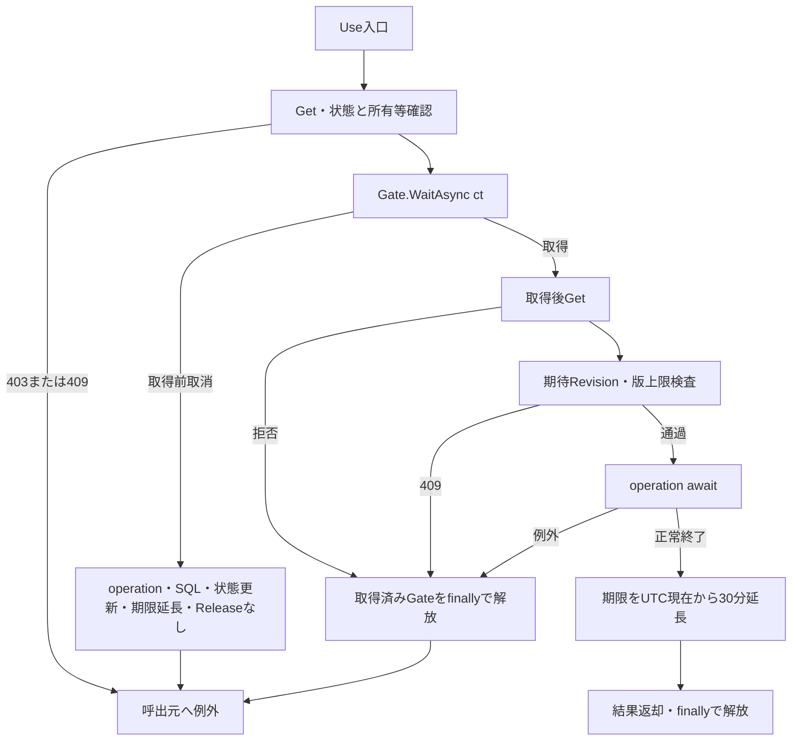

取得前の待機取消は取得後のtry・finallyに入らない。SQL実行済み、期限延長済み、Gate解放済みの経路へまとめない。取得済み要求の失敗ではGateを解放するが、operation途中で既に変えた値をUseが自動rollbackする処理はない。

各図の「共通例外経路」は、応答未開始ならmiddlewareがWebFaultの元Status、その他の例外なら503を設定する経路を表す。/studentsではエラーHTMLと検索画面を開くリンクの返却を試みる。原入力・一覧・受付番号を一律保持しない。応答開始後はこのcatch対象外で、要求切断後の配信完了も保証されない。根拠: `sources/Infrastructure/WebHostSetup.cs:22-25`。

| 操作 | 使用条件 | 成功後の条件・結果 | Revision・期限 |
| --- | --- | --- | --- |
| 初回Index | 初期条件 | Applied・LastResultともNULL | 新規版1・30分 |
| Search | 今回input、Page1 | 両方置換 | +1・期限延長 |
| Options | 今回input | 両方維持、LastResultを一覧材料に使用 | 期待版照合・版更新・期限延長なし |
| Page | Appliedの複製 | 表示指定・保持Page補正を含め両方置換 | +1・期限延長 |
| Clear | 初期条件 | 両方NULL | +1・期限延長 |
| 未検索Resume | Appliedなし | 維持 | 版維持・期限延長 |
| 検索済みResume | 元Applied | Applied維持、LastResult置換 | +1・期限延長 |

根拠: `sources/Infrastructure/WebStudentCoordinator.cs:7-15`。

### 共通DB操作

#### 接続・検証結果・取消

サービスはEncrypt=Mandatory、TrustServerCertificate=falseを設定する。Openは接続後に現在DBのsnapshot_isolation_state=1を要求し、不成立なら接続を破棄して例外を再送出する。Command helperのSQLタイムアウトは30秒で、接続診断は別のCreateCommand経路である。ParamはSqlDbTypeを明示し、Sizeが0以外なら設定する。NULLはDBNull、DateOnlyは当日0時のDateTimeへ移す。根拠: `sources/Core/SqlServerStudentService.cs:39-72`。

検索・候補は読取SNAPSHOTを使い、接続・トランザクション開始・SQL・Reader・NextResult・commitにctを渡す。資源はawait usingで破棄する。検索には書込用sp_getapplock、独自のrollback成否確認、Unknown分類はない。根拠: `sources/Core/SqlServerStudentService.cs:123-170`、`sources/Core/SqlServerStudentService.cs:197-216`。

SearchAsyncはUser確認と入口now・日本時間業務日取得をtry前に行う。try内ではInputValidationExceptionを先に捕捉し、元Errors付きValidationFailedにする。次のArgumentExceptionはArgumentError("Search",e)付きValidationFailedにする。双方Count0・Items空・LimitExceeded=falseで、正常0件ではない。規定形式のエラーコードは引き継ぎ、それ以外はE-STU-002へ変換する。SQL障害、OperationCanceledException、NullReferenceExceptionをこの検証結果へ変換しない。根拠: `sources/Core/SqlServerStudentService.cs:103-106`、`sources/Core/SqlServerStudentService.cs:169-170`、`sources/Core/StudentNormalizer.cs:162-168`。

EnsureSearchはSaved・NoChangeだけを成功とする。他のOutcomeは先頭FieldErrorとOutcome対応HTTP状態を持つWebFaultへ移す。ValidationFailedは422であり、そのCount0を正常0件として保持しない。FieldをCriteria.*へ一律変換する処理はなく、画面はvalidation-summary Allを使用する。根拠: `sources/Infrastructure/WebStudentCoordinator.cs:20-20`、`sources/Infrastructure/WebPresentation.cs:23-23`、`sources/Views/Shared/_MessagePanel.cshtml:2-2`。

#### Q-E 指定マスターの存在・上位整合

検索SNAPSHOT内で指定された学年、都道府県、年度、クラスを確認する。未指定対象は照会しない。コード確認には分類表JOIN、状態・期間条件がない。在籍配列は01～04の許可値検査だけで、マスター存在照会を行わない。根拠: `sources/Core/SqlServerStudentService.cs:111-135`、`sources/Core/SqlServerStudentService.cs:218-222`。

| 対象 | SQL・結果形 | パラメータ | 拒否 |
| --- | --- | --- | --- |
| 学年・都道府県 | `SELECT COUNT_BIG(*) FROM dbo.m_code WHERE category_id=@category AND code_value=@value`、bigint件数 | `@category:VarChar(24)`、GRADE／PREFECTURE。`@value:VarChar(10)` | 件数1以外はE-STU-009 |
| 年度 | `SELECT COUNT_BIG(*) FROM dbo.m_class WHERE school_year=@year`、bigint件数 | `@year:SmallInt`、Sizeなし | 0件はE-STU-014 |
| クラス | `SELECT school_year,grade_code FROM dbo.m_class WHERE class_id=@id`、PK対象最大1行 | `@id:BigInt`、Sizeなし | 不在、指定年度または正規化学年不一致はE-STU-014 |

学年不成立は短絡評価で都道府県確認より先に拒否する。各照会は単表参照で、ORDER BY・ページング・書込みがないため個別ER図を省略する。検索では学籍番号の完全一致存在、一意性、同一人物候補を検査しない。

#### Q-S 学生件数・一覧

サービスの検査順は、ページ・件数・方向、ソートキー、年度・クラス範囲、未所属排他、在籍配列、学籍番号、氏名キー、カナキー、電話、学年、都道府県、日付両端・逆転である。その後に接続・SNAPSHOT・Q-Eへ進む。未所属排他は学年正規化前なので、サービス引数が非NULLの空学年文字列でも併指定と判定する。根拠: `sources/Core/SqlServerStudentService.cs:103-135`。

WHEREは`s.is_deleted=0`を必須とし、次表の指定条件をANDで追加する。電話は括弧内OR、在籍はINである。任意の正規化値がNULLなら述語とパラメータを省略し、NULL列検索へ置換しない。根拠: `sources/Core/SqlServerStudentService.cs:137-155`。

| 条件 | SQL述語 | 値・SqlDbType・Size |
| --- | --- | --- |
| 学籍番号あり | `s.student_no LIKE @no ESCAPE '!'` | エスケープ済み番号＋末尾%、VarChar(31) |
| 氏名キーあり | `s.name_key LIKE @name ESCAPE '!'` | 前後%＋エスケープ済みキー、NVarChar(642) |
| カナキーあり | `s.kana_key LIKE @kana ESCAPE '!'` | 前後%＋エスケープ済みキー、NVarChar(74) |
| 年度指定 | `c.school_year=@year` | 年度、SmallInt、Sizeなし |
| 学年あり | `c.grade_code=@grade` | 正規化学年、VarChar(2) |
| クラス指定 | `s.class_id=@class` | ID、BigInt、Sizeなし |
| 未所属true | `s.class_id IS NULL` | パラメータなし |
| 都道府県あり | `s.prefecture_code=@prefecture` | 正規化コード、VarChar(2) |
| 電話あり | `(s.phone_number=@phone OR s.emergency_phone_number=@phone)` | 正規化電話、VarChar(16) |
| 開始日あり | `s.admission_date>=@from` | 下端包含、Date、Sizeなし |
| 終了日あり | `s.admission_date<=@to` | 上端包含、Date、Sizeなし |
| 在籍配列非空 | `s.enrollment_status_code IN (@status0,...)` | 配列各値、各VarChar(2) |

LIKEは!→!!、%→!%、_→!_、[→![の順でエスケープし、ESCAPE '!'を指定する。Size31・642・74はパターンの送信領域で、入力・保存の業務上限を増やす指定ではない。件数と一覧の両Commandへ同じ検索パラメータ集合の型・値・Sizeを設定する。根拠: `sources/Core/StudentNormalizer.cs:161-161`、`sources/Core/SqlServerStudentService.cs:140-164`。

存在確認、件数、必要な一覧は一回のSearchAsyncの同じSNAPSHOT内で取得する。件数SQLは次の構造で、WHEREには上表の指定された全述語を結合する。

```sql
SELECT COUNT_BIG(*)
FROM (
  SELECT TOP (10001) s.student_id
  FROM dbo.m_student s
  LEFT JOIN dbo.m_class c ON c.class_id=s.class_id
  WHERE /* s.is_deleted=0 AND 指定された全検索述語 */
) limited;
```

TOPにORDER BYはない。10,000件以下は実件数、10001は超過検出値であり全件数ではない。超過時は一覧SQLを実行せずcommitし、NoChange・Count10001・Items空・LimitExceeded=trueを返す。正常0件と超過もEnsureSearchが認める成功経路なので、実行条件を保持する。根拠: `sources/Core/SqlServerStudentService.cs:155-159`、`sources/Infrastructure/WebStudentCoordinator.cs:9-9`、`sources/Infrastructure/WebStudentCoordinator.cs:20-21`。

上限内は次の16列を取得し、StudentRowへ移す。

```sql
SELECT s.student_id,s.student_no,s.student_name,s.student_name_kana,s.birth_date,
       c.school_year,c.class_code,c.class_name,g.code_name grade_name,e.code_name status_name,
       p.code_name prefecture_name,s.address_line1,s.phone_number,
       s.admission_date,s.updated_at,s.row_version
FROM dbo.m_student s
LEFT JOIN dbo.m_class c ON c.class_id=s.class_id
LEFT JOIN dbo.m_code g ON g.category_id=c.grade_category AND g.code_value=c.grade_code
LEFT JOIN dbo.m_code e ON e.category_id=s.enrollment_category AND e.code_value=s.enrollment_status_code
LEFT JOIN dbo.m_code p ON p.category_id=s.prefecture_category AND p.code_value=s.prefecture_code
WHERE /* s.is_deleted=0 AND 指定された全検索述語 */
ORDER BY /* 許可主ソート列 ascまたはdesc */,s.student_id ASC
OFFSET @offset ROWS FETCH NEXT @size ROWS ONLY;
```

| SortKey | 主ソート列 | 順序の意味 |
| --- | --- | --- |
| studentNo | `s.student_no` | 保存番号の文字列順 |
| name | `s.name_key` | 氏名照合値の順 |
| admissionDate | `s.admission_date` | 入学日順 |
| updatedAt | `s.updated_at` | 更新日時順 |

Pageは1以上、PageSizeは20・50・100、方向は小文字asc・desc、キーは4値だけである。同順位は主方向に関係なくstudent_id ASCとする。student_noとname_keyはDDLのBIN2照合であり、番号の数値化や氏名表示表記によるソートは行わない。根拠: `sources/Core/SqlServerStudentService.cs:107-108`、`sources/Core/SqlServerStudentService.cs:162-164`、`sources/database/001_schema.sql:9-13`。

サービスはlastPage=max(1,(count+PageSize−1)/PageSize)、SQL用page=min(要求Page,lastPage)とする。checked((page−1)×PageSize)を@offset:Int、PageSizeを@size:Intとして渡す。0件でもSQL用pageは1で、最大PageSize行を読む。commit後にNoChange・実件数・Items・LimitExceeded=falseを返す。SearchedAtは入口nowで、完了時刻ではない。根拠: `sources/Core/SqlServerStudentService.cs:105-105`、`sources/Core/SqlServerStudentService.cs:160-168`。

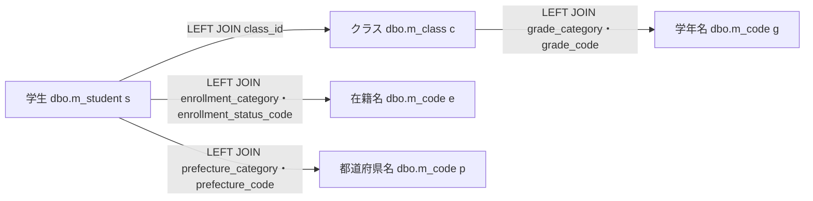

これは検索JOIN図で、g・e・pは同じ物理表の用途別aliasである。件数SQLは学生とクラスの辺だけ、一覧SQLは全辺を使う。名称JOINに状態・期間条件はなく、名称欠落だけでは学生を除外しない。ただし年度・学年WHERE指定時は、その所属値を持たない学生は一致しない。根拠: `sources/Core/SqlServerStudentService.cs:82-90`、`sources/Core/SqlServerStudentService.cs:143-162`。

#### Q-L 候補取得

SearchModelは毎回LookupAsync(false,ct)を呼ぶ。検索結果とは別接続・別SNAPSHOTで、二結果セットをNextResultAsyncで切り替える。両SQLにWHERE、受信条件パラメータ、ページングはない。根拠: `sources/Web/Controllers/StudentsController.cs:39-39`、`sources/Core/SqlServerStudentService.cs:197-216`。

```sql
SELECT c.category_id,c.code_value,c.code_name,c.display_order,
       CONVERT(bit,CASE WHEN c.is_active=1 AND k.is_active=1 THEN 1 ELSE 0 END) is_active,
       c.valid_from,c.valid_to,c.is_protected
FROM dbo.m_code c
JOIN dbo.m_code_category k ON k.category_id=c.category_id
ORDER BY c.category_id,c.display_order,c.code_value;

SELECT c.*,CONVERT(int,0) occupied
FROM dbo.m_class c
LEFT JOIN dbo.m_code g ON g.category_id=c.grade_category AND g.code_value=c.grade_code
ORDER BY c.school_year DESC,g.display_order,c.display_order,c.class_code,c.class_id;
```

第1結果をCodeEntry、第2結果をSchoolClassへ移し、commit後にLookupSetを返す。CodeEntryは分類・値・名称・表示順・状態・コード期間・保護状態を持つ。IsActiveはコードと分類の状態のANDで、期間判定を含まない。SchoolClassはID・年度・学年・コード・名称・期間・定員・人数・状態を持つ。定員はint?でNULLは制限なし、Occupiedはintで、検索の0は人数集計省略値である。根拠: `sources/Core/Contracts.cs:61-65`、`sources/Core/SqlServerStudentService.cs:201-216`、`sources/database/001_schema.sql:69-73`。

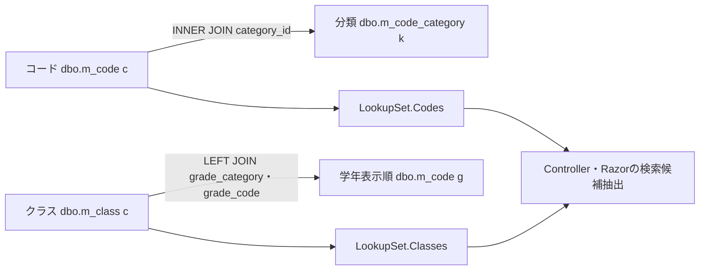

この検索候補図に学生人数集計の辺はない。検索で選べる値を新規保存可能値へ拡張しない。登録候補の人数は参考値で、保存は書込ゲート内の最新DBを使って必要時に本人除外人数+1と定員を比較する。根拠: `sources/Core/SqlServerStudentService.cs:344-383`。

#### 検索関連の物理FK

次はDDLの物理FKであり、検索・候補JOIN図とは別である。コードの識別と参照は分類＋値の複合キーである。学生class_idはNULL可なので学生からクラスは0または1親、NOT NULLの複合コード参照は子ごとに1親、親から子は0件以上となる。年度はクラスの属性で、年度列を参照するFKはない。

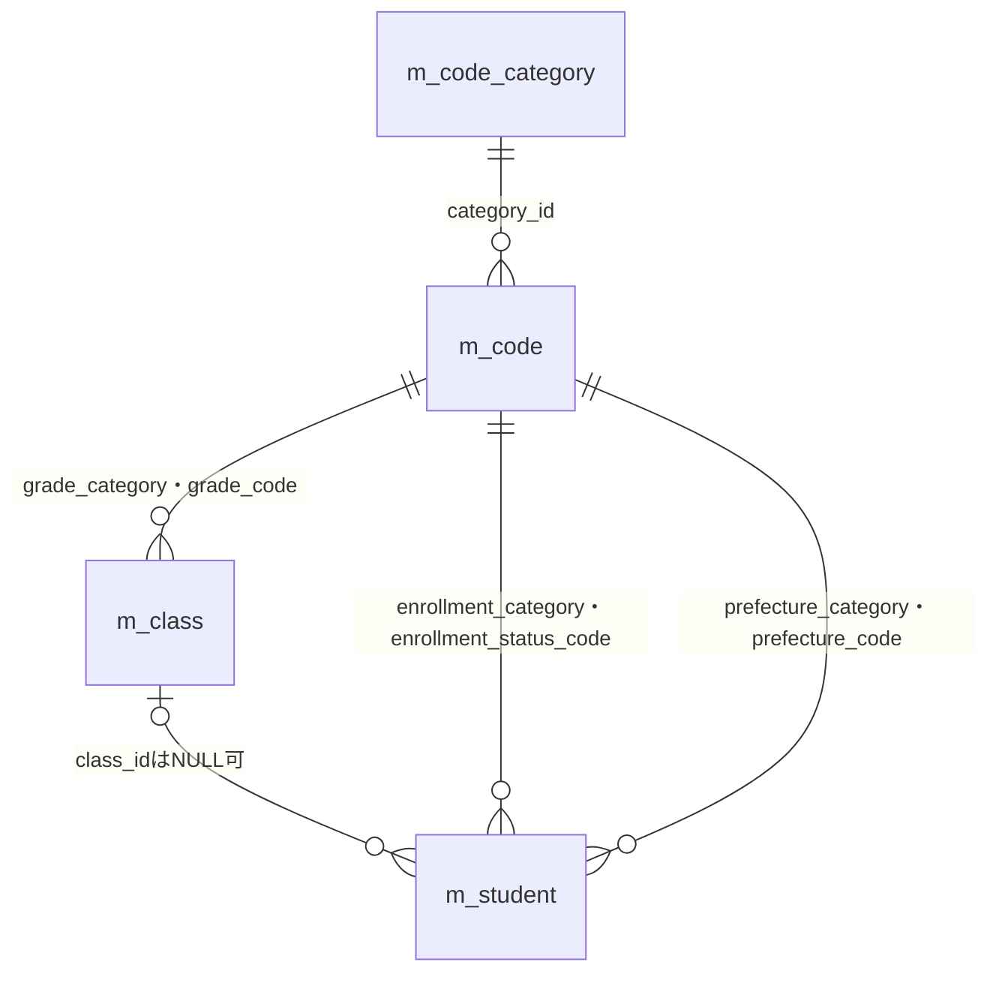

性別・続柄のFKもDDLにあるが、検索一覧の名称JOINには使わない。検索状態キーや監査target_keyへのFK、削除連動を追加しない。基表NOT NULLとLEFT JOIN後のnullableを分ける。根拠: `sources/database/001_schema.sql:15-31`、`sources/database/001_schema.sql:65-66`、`sources/database/001_schema.sql:113-127`、`sources/database/001_schema.sql:189-197`。

### E01 初回表示 — Index

#### 処理概要

contextIdなしのGET /studentsは新しい未検索状態と候補を作り、学生検索を行わない。非空contextIdはE06へ分岐する。

#### 処理手順

1. identity.Readで認証情報を確認する。
2. contextIdがNULL・空文字ならNewContextでEntryを作る。初期版1、期限30分、Applied・LastResultはNULLとする。
3. Present(entry,null)で件数・日時NULL、空一覧の未検索材料を作る。
4. 初期StudentSearchInputを作る。文字条件は空、所属・都道府県・日付は未指定、未所属false、在籍01・02、表示指定20・studentNo・ascとする。
5. Flash.Takeの通知を材料にし、SearchModelでQ-L、JsonElement化、利用者・Entry・表示指定の設定を行う。
6. SearchのViewResultを返し、Razorで描画する。

根拠: `sources/Web/Controllers/StudentsController.cs:8-11`、`sources/Web/Controllers/StudentsController.cs:39-39`、`sources/Web/Inputs/StudentSearchInput.cs:7-18`、`sources/Infrastructure/SearchContextStore.cs:9-12`。

#### 条件付き処理フロー

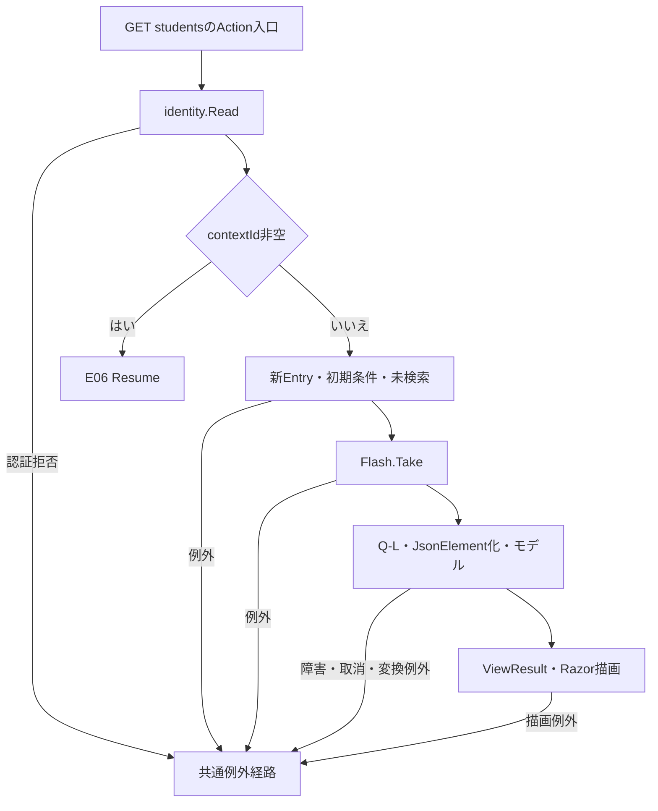

#### SQL・テーブル関連（ER図）

Q-L候補JOIN図を適用する。新Entryはメモリ辞書へ保持するため、状態作成のDB ER図を省略する。

#### DB操作の詳細

候補二結果セットを一つのSNAPSHOTで参照しcommitする。学生件数・一覧・人数集計は実行せず、受信条件パラメータはない。

#### 結果・例外時の扱い

未検索では一覧操作を非活性にする。候補0件でも検索ボタンを禁止する分岐はない。候補・変換・描画の局所catchはなく、作成済みEntryを後段失敗で取り消す処理もない。

### E02 検索 — Search

#### 処理概要

今回条件をPage1で検索し、成功確認後にApplied・LastResult・Revisionを更新する。正常0件と超過も成功条件として保持する。

#### 処理手順

1. FormGuardで許可項目・重複を検査し、Criteria.StatusCodesキーがなければ空配列に補正する。
2. 最初のGetで状態・期限・所有者・セッション・指定Tabを確認し、Present(entry,null)で失敗再表示用の空一覧材料を作る。ここまでは局所try外である。
3. ModelState不正なら422とし、Coordinatorを呼ばない。
4. 有効なら局所try内でCoordinator.Searchを呼ぶ。認証確認後、ToCriteriaでクラスIDを解析し、Page1と受信表示指定を設定する。変換はGate取得前である。
5. UseでGet、Gate待機、取得後Get、期待版・版上限検査を行う。
6. SearchAsyncで入力検査・正規化・Q-E・Q-Sを行い、EnsureSearchで成功確認する。
7. 条件の深い複製をApplied、結果をLastResultへ置き、Revisionを+1にしてPresentを返す。
8. Use正常終了後に期限を延長し、取得済みGateを解放する。
9. 局所try内のWebFaultは元e.Statusとエラーを設定する。data代入が完了していなければ空一覧材料を使用する。
10. try外で今回inputと別Q-LからSearchModelを作り、受信PageSize・SortKey・SortDirectionをモデルへ設定してViewResultを返す。

根拠: `sources/Web/Controllers/StudentsController.cs:13-16`、`sources/Web/Inputs/StudentSearchInput.cs:19-22`、`sources/Infrastructure/WebStudentCoordinator.cs:7-9`、`sources/Infrastructure/SearchContextStore.cs:14-15`。

#### 条件付き処理フロー

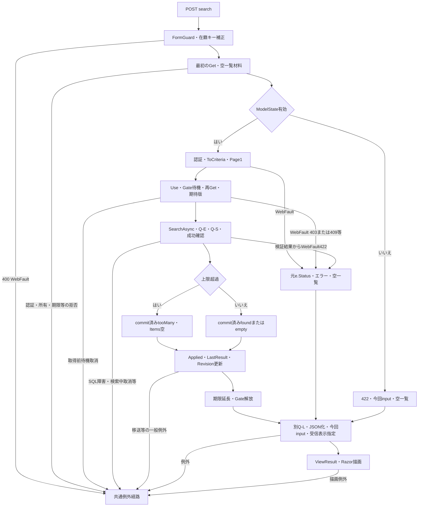

取得前待機取消ではoperation・SQL・状態更新・期限延長・Releaseへ進まない。取得済みUse内の失敗はfinallyでGateを解放し、正常終了時の期限延長は行わない。

#### SQL・テーブル関連（ER図）

指定マスター確認はQ-E、件数・一覧はQ-S検索JOIN図、再表示はQ-L候補JOIN図を適用する。物理FKは別図である。

#### DB操作の詳細

Q-E・Q-Sは一回の検索SNAPSHOT、後続Q-Lは別接続・別SNAPSHOTである。検索結果と候補全体が同じ時点の情報である保証はない。学生へのINSERT・UPDATE・DELETEは行わない。

#### 結果・例外時の扱い

ModelState不正、ToCriteriaのID不正、サービスValidationFailedは422に進む。Use内の所有等403、期限・旧版・版上限等409は元Statusを維持する。局所再表示は今回inputと空一覧を使い、以前のApplied・LastResultを消さない。FormGuard・最初Get、後段SearchModel、返却後Razorは局所catch外である。根拠: `sources/Web/Controllers/StudentsController.cs:14-16`、`sources/Infrastructure/SearchContextStore.cs:13-14`。

バインド後PageSize=0が届いた場合、サービスは拒否するがControllerはモデルへ0を設定する。ビューの総ページ数計算はPageSizeで除算するため、描画時ゼロ除算となり得る。この値が後段へ届く場合のソース上の分岐であり、全不正HTTP入力が422の条件保持HTMLで完結する保証にはしない。根拠: `sources/Web/Controllers/StudentsController.cs:13-16`、`sources/Core/SqlServerStudentService.cs:107-107`、`sources/Views/Students/Search.cshtml:8-8`。

### E03 候補更新 — Options

#### 処理概要

今回条件の候補を再描画し、一覧はLastResultを使用する。学生検索、期待Revision照合、Gate、状態更新、期限延長を行わない。

#### 処理手順

1. Searchと同じFormGuard、在籍キー省略補正、状態Getを行う。
2. 未所属trueなら年度・学年・クラスをNULLにし、対応するCriteria.*のModelStateを除去する。
3. 今回input、Present(entry,entry.LastResult)、Q-LからSearchModelを作る。通知は「条件を変更しました。検索を押すと一覧に反映します。」とする。
4. 非空ClassIdが候補IDの文字列表現と一致し、今回年度・非空学年にも適合するか確認する。
5. 不適合ならClassIdと該当ModelStateを解除し、通知を「上位条件に合わないクラスを解除しました。」へ置き換える。
6. SearchのViewResultを返す。表示指定はAppliedまたは既定値で、受信表示指定を明示反映しない。

根拠: `sources/Web/Controllers/StudentsController.cs:22-22`、`sources/Web/Controllers/StudentsController.cs:39-39`。

#### 条件付き処理フロー

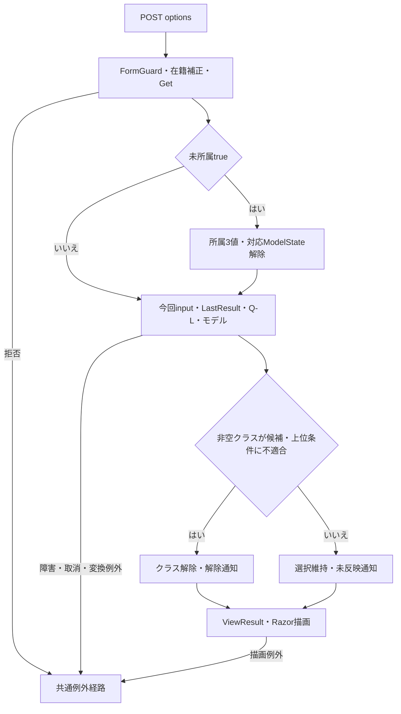

#### SQL・テーブル関連（ER図）

Q-L候補JOIN図を適用する。年度・学年はSQLパラメータではなく、取得後のController・Razorの比較・抽出に使う。

#### DB操作の詳細

候補二結果セットのSNAPSHOTだけを実行する。学生件数・一覧・人数集計・書込みはない。Getで得たEntryをGateなしで読む。

#### 結果・例外時の扱い

ModelState.IsValidで停止せず、ToCriteria・IdParser・学年正規化を通さない。ClassIdが01ならSearchでは数値1へ解析できても、Optionsでは候補文字列1に一致せず解除され得る。全角学年も正規化前の比較となる。根拠: `sources/Web/Controllers/StudentsController.cs:22-22`、`sources/Web/Inputs/StudentSaveInput.cs:60-60`、`sources/Core/StudentNormalizer.cs:113-117`。

LastResultは今回条件の検索結果ではない。Applied・LastResult・Revisionの読取り全体はGateで保護された一括スナップショットではなく、拒否・障害時の入力保持用局所catchもない。

### E04 表示指定変更・ページ移動 — Page

#### 処理概要

Appliedを複製して再検索する。件数・キー・方向のいずれかが変わればPage1、同じなら要求Pageを使用する。未実行の条件フォーム値を混ぜない。

#### 処理手順

1. FormGuardでPageRequestとTabIdを検査し、最初のGetを行う。両処理は局所try外である。
2. try内でCoordinatorが認証を確認し、UseのGate待機、状態再検査、期待Revision照合を行う。
3. Appliedなしなら409「先に検索してください。」とする。
4. Appliedを深く複製し、表示指定変更時はPage1、同じなら要求Pageを設定する。表示指定を要求値へ置く。
5. SearchAsyncとEnsureSearchを実行する。
6. 超過でなく保持予定Pageが返却件数の最終ページ外なら、一度だけ保持Pageを補正し、第2検索と成功確認を行う。
7. 全検索成功後にApplied・LastResultを置換し、Revisionを+1にする。Use正常終了後に期限延長・Gate解放を行う。
8. From(Applied)と別Q-LでSearchModelを作り、ViewResultを返す。このモデル作成もtry内である。
9. try内WebFaultは元e.Statusとエラーを設定し、Applied由来input・空一覧・Q-Lで再構築する。

根拠: `sources/Web/Controllers/StudentsController.cs:18-19`、`sources/Web/Controllers/StudentsController.cs:39-40`、`sources/Infrastructure/WebStudentCoordinator.cs:11-12`。

#### 条件付き処理フロー

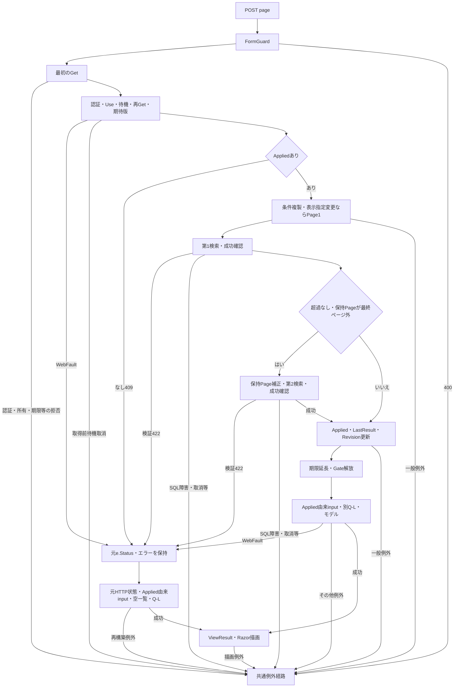

局所再表示への合流点でHTTP状態を固定しない。所有等403、期限・旧版・版上限・未検索409、サービス検証422は各e.Statusを引き継ぐ。根拠: `sources/Infrastructure/SearchContextStore.cs:13-14`、`sources/Infrastructure/WebPresentation.cs:23-23`。

#### SQL・テーブル関連（ER図）

検索ごとにQ-E・Q-S検索JOIN図、再描画にQ-L候補JOIN図を適用する。各検索で型付きパラメータ、上限、許可ソートを再検査する。

#### DB操作の詳細

サービスは第1検索でもSQL用pageを最終ページ以内へ補正する。Coordinatorが保持Pageも補正するときの第2検索は別接続・別SNAPSHOTで、2回全体は一つの読取単位ではない。第2検索でさらに件数が減っても補正を反復しない。根拠: `sources/Infrastructure/WebStudentCoordinator.cs:12-12`、`sources/Core/SqlServerStudentService.cs:123-168`。

#### 結果・例外時の扱い

条件欄はAppliedから作り、ブラウザーだけにある未実行条件は復元しない。ControllerにModelState不正で停止する分岐はない。表示指定変更時の要求Pageはサービス検査前に1へ置き換わる。

成功側SearchModelのWebFaultを捕捉した場合も、既に更新された状態を戻さない。catch内再構築と返却後Razorの例外は同じcatchで再捕捉しない。Gate待機取消、SQL障害、検索中取消は共通経路へ伝播する。

### E05 条件クリア — Clear

#### 処理概要

検索状態IDを維持し、Applied・LastResultを消して初期条件の未検索画面へ戻す。

#### 処理手順

1. FormGuardでContextRequestとTabIdを検査する。
2. Coordinatorが認証を確認し、Useで状態・Gate・取得後再検査・期待版・版上限を確認する。
3. Applied・LastResultをNULLにし、Revisionを+1にする。
4. Use正常終了で期限を延長し、Gateを解放する。
5. ControllerはModelStateを全消去し、同じEntryを再Getする。
6. 初期input・既定表示指定・Q-Lから未検索モデルを作り、ViewResultを返す。

根拠: `sources/Web/Controllers/StudentsController.cs:21-21`、`sources/Infrastructure/WebStudentCoordinator.cs:15-15`。

#### 条件付き処理フロー

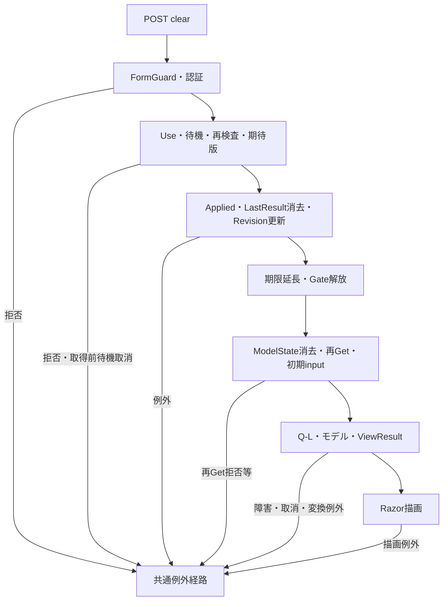

#### SQL・テーブル関連（ER図）

消去対象はメモリEntryなので、消去自体のDB ER図を省略する。再描画にQ-L候補JOIN図を適用する。

#### DB操作の詳細

SQLは候補再取得だけである。学生検索、学生DELETE、t_runtime_state DELETEは行わない。

#### 結果・例外時の扱い

在籍01・02、20件・studentNo・ascへ戻り、ID・Owner・Session・Tabを維持する。LastResultを消すため後続Optionsで旧一覧は復活しない。局所catchはなく、消去後の再Get・候補・描画失敗でも状態消去と版更新を戻さない。根拠: `sources/Web/Inputs/StudentSearchInput.cs:7-18`、`sources/Web/Controllers/StudentsController.cs:21-22`。

### E06 検索画面への復帰 — Resume

#### 処理概要

contextId付きIndexは未検索状態を復元するか、元Appliedで最新DBを再検索する。保存学生が条件外でも条件を変えず、特別な行追加を行わない。

#### 処理手順

1. Indexが認証確認後、Tabを渡さず既存EntryをGetする。
2. queryのcontextRevisionをContextRequestへ移す。省略時は空文字で、現在版へ補完しない。
3. Resumeが認証を確認し、Useで待機・状態再検査・期待版・版上限を確認する。
4. Appliedなしなら学生検索・版更新なしで未検索を返す。正常終了による期限延長は行う。
5. Appliedありなら元条件でSearchAsyncと成功確認を行い、LastResult・Revisionだけを更新する。Appliedは置換しない。
6. 条件欄をAppliedから復元し、Flash.Takeで通知を取得・消費する。
7. 別Q-L、モデル作成、ViewResultを経てSearch HTMLを描画する。

根拠: `sources/Web/Controllers/StudentsController.cs:8-11`、`sources/Infrastructure/WebStudentCoordinator.cs:14-14`、`sources/Infrastructure/FlashMessageStore.cs:6-9`。

#### 条件付き処理フロー

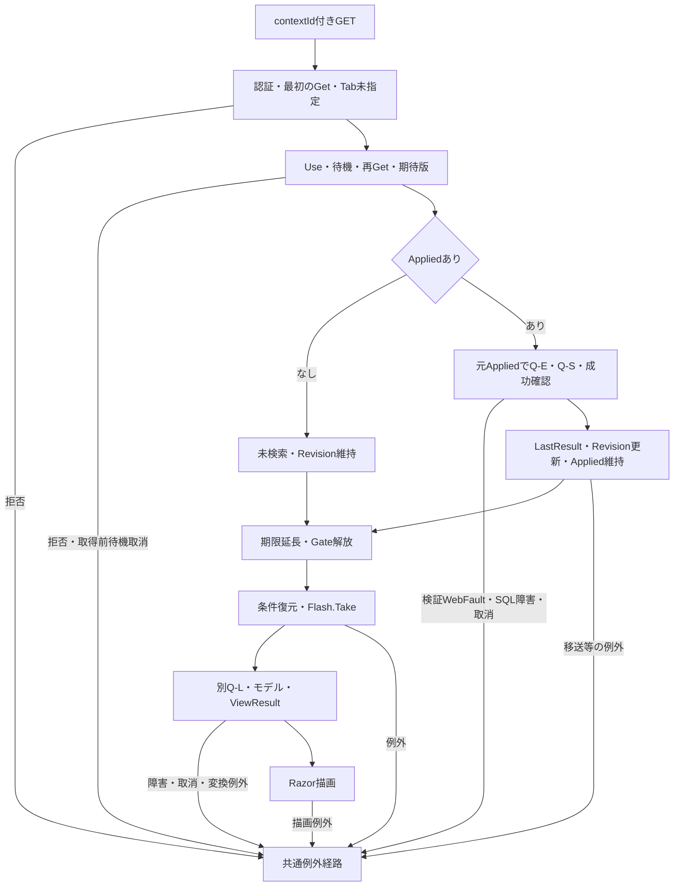

#### SQL・テーブル関連（ER図）

検索済み復帰にQ-E・Q-S検索JOIN図、両状態の再描画にQ-L候補JOIN図を適用する。検索状態と通知は別メモリ辞書である。

#### DB操作の詳細

検索済みでは元Appliedを使い、検索SNAPSHOTと候補SNAPSHOTは別とする。条件外・論理削除済みの保存学生を追加取得しない。未検索では候補取得だけを行う。

#### 結果・例外時の扱い

期限切れ・旧版は409で、自動初期化しない。Index／ResumeはTabを渡さない。状態拒否と再検索失敗はFlash.Take前である。Take後の候補・変換・描画・配信失敗では、通知が消費済みでも利用者へ届かない場合がある。

件数減少時はSQL取得ページと提示ページがずれ得る。サービスはSQL用ローカルpageだけを補正し、SearchCriteria.Pageを書き換えない。ResumeはAppliedを維持し、PresentはApplied.Pageを提示するため、最終ページの行を取得しながら提示pageが総ページ数を超える場合がある。E04の保持Page補正とは異なる。根拠: `sources/Core/SqlServerStudentService.cs:160-164`、`sources/Infrastructure/WebStudentCoordinator.cs:12-14`、`sources/Infrastructure/WebStudentCoordinator.cs:21-21`。

### E07 未所属変更・送信中表示

#### 処理概要

ブラウザー補助は未所属ONで所属値を解除し、submit時に同フォーム内の送信button以外を非活性にする。

#### 処理手順

1. 初期読込みとSRC-007のchangeでcheckedを確認する。
2. ONならSRC-004・005・006を空にする。OFFでも元値を戻さない。
3. disabledは変更しない。所属selectの非活性はRazor再描画時のUnassignedOnlyで決まる。
4. 候補への反映はE03、学生一覧への反映はE02で行う。年度・学年変更だけでは送信しない。
5. submit時は同フォーム内の送信button以外をdisabledにし、aria-busy=trueを設定する。

根拠: `sources/wwwroot/js/site.js:4-8`、`sources/Views/Students/Search.cshtml:5-8`。

#### 条件付き処理フロー

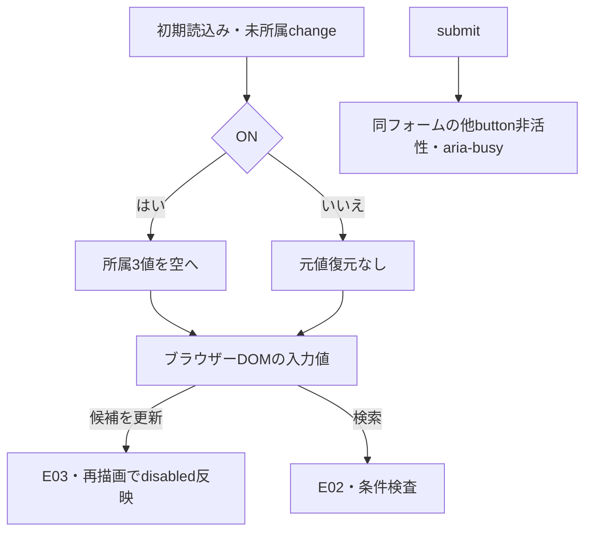

#### SQL・テーブル関連（ER図）

change・submit補助はブラウザーDOMを扱うためDB ER図を省略する。POST後はE02・E03の関連を使用する。

#### DB操作の詳細

JavaScript単独では通信、Entry更新、DB操作を行わない。クラスから年度・学年を補完する処理はREG-018に接続され、SRCクラスには接続されていない。

#### 結果・例外時の扱い

送信button自身と別フォームは非活性化対象外なので、画面全体の二重送信禁止ではない。検索には登録用dirty確認、fetch、AbortController、要求連番による旧応答破棄が接続されていない。サーバー状態競合はGateとRevisionで扱う。根拠: `sources/wwwroot/js/site.js:2-9`、`sources/Infrastructure/SearchContextStore.cs:14-14`。

未所属ONでも在籍01・02は解除しない。提示DDLのck_student_datesが適用・有効なら01・02はclass_id非NULLを要求するため、初期在籍と未所属IS NULLの併指定に一致する学生はない。これはDDL適用を条件とする推論である。根拠: `sources/Web/Inputs/StudentSearchInput.cs:13-14`、`sources/wwwroot/js/site.js:7-7`、`sources/Core/SqlServerStudentService.cs:146-154`、`sources/database/001_schema.sql:198-198`。

### E08 新規・編集・参照への遷移

<a id="editor-entry"></a>

#### 処理概要

新規・行リンクはreturnContextIdを登録入口へ渡す。既存は学生IDで最新非削除詳細を取得し、検索条件・一覧表示値・一覧の学生版を登録入力へ転記しない。

#### 処理手順

1. Coordinator.Editが認証と非空復帰状態の存在・所有・セッション・期限を確認する。Tabは渡さない。
2. 新規なら作成権限を確認する。既存ならGetAsyncで詳細を取得し、不在は404とする。
3. LookupAsync(ct)で人数を含む登録候補を取得し、StudentSaveInput.Fromでフォームを作る。ExpectedVersionは再取得した学生版から設定する。
4. Loadが詳細・候補・フォーム作成後に復帰状態を再Getし、現在の検索RevisionをReturnRevisionとして採取する。
5. 主体・セッション・対象ID・詳細・原入力の深い複製・復帰版を30分のSnapshotへ保持する。
6. EditのViewResultを返す。Viewerは参照、Staff・Administratorは編集モードとなる。

根拠: `sources/Infrastructure/WebStudentCoordinator.cs:6-6`、`sources/Infrastructure/WebStudentCoordinator.cs:17-17`、`sources/Web/Controllers/StudentsController.cs:23-25`、`sources/Web/Inputs/StudentSaveInput.cs:44-54`、`sources/Infrastructure/EditorSnapshotStore.cs:7-11`、`sources/Views/Students/Edit.cshtml:3-6`。

#### 条件付き処理フロー

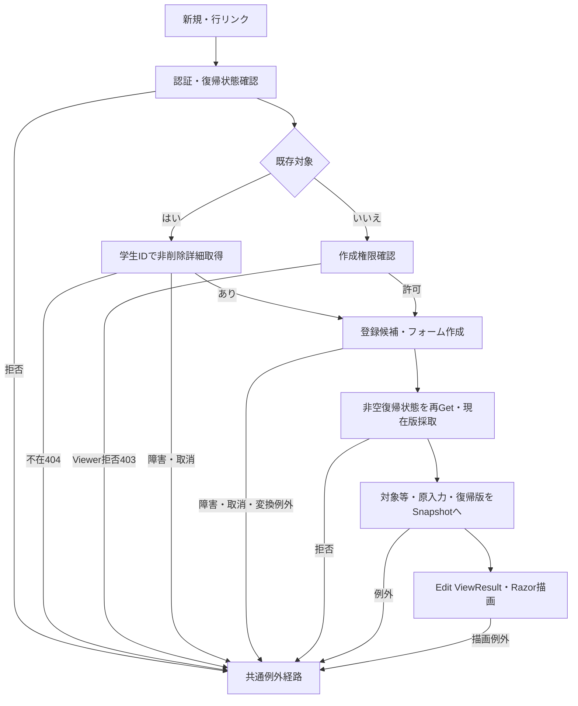

#### SQL・テーブル関連（ER図）

詳細取得はm_student単表なので個別ER図を省略する。登録候補はQ-Lと同じマスターJOINに人数参照を加える。

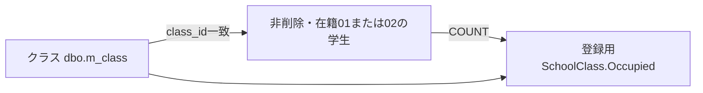

人数参照は読取関連であり、追加FKや席の予約ではない。根拠: `sources/Core/SqlServerStudentService.cs:196-208`。

#### DB操作の詳細

既存SQLは`SELECT * FROM dbo.m_student WHERE student_id=@id AND is_deleted=0`、@id:BigInt、最大1行、明示トランザクションなしである。id<=0は接続前に詳細NULLとなる。登録候補は別SNAPSHOTで、DB await後の復帰状態再確認があるため、入口検査だけでEdit到達を保証しない。根拠: `sources/Core/SqlServerStudentService.cs:172-196`、`sources/Web/Controllers/StudentsController.cs:25-25`。

#### 結果・例外時の扱い

学生ExpectedVersionと検索ReturnRevisionは別である。「検索へ戻る」は保存せず編集時ReturnRevisionでE06へ進む。「入力クリア／編集取消」はSnapshot原入力へ戻してEditに留まる。「最新情報を再読込」はDB詳細・候補・復帰版・Snapshotを取得し直す。根拠: `sources/Views/Students/Edit.cshtml:16-16`、`sources/Web/Controllers/StudentsController.cs:25-25`、`sources/Web/Controllers/StudentsController.cs:35-35`。

Snapshot.GetはNULL事前検査なく辞書TryGetValueへキーを渡す。NULL引数によるライブラリ例外と、不在・期限切れを独自WebFault409へ移す枝は別であり、検索GetのNULL事前拒否とまとめない。HTTP省略値がどの値として届くかはバインド境界に依存する。根拠: `sources/Infrastructure/EditorSnapshotStore.cs:10-10`、`sources/Infrastructure/SearchContextStore.cs:13-13`。

### E09 保存・削除結果からの検索復帰

#### 処理概要

登録側のSavedだけが成功通知と303による検索復帰へ進む。本書は復帰ID・版、結果分岐、DB確定と復帰表示の境界を扱う。

#### 処理手順

1. 保存入口はFormGuard、作成・更新権限、Snapshot.Get、復帰状態確認、Snapshot原入力との復帰先一致確認を局所try前に行う。ModelState有効時だけCoordinator.Saveへ進み、不正なら422のEdit再表示へ進む。
2. 削除入口はFormGuard、認証、Snapshot.Get、復帰先一致を確認し、Coordinator.Deleteで管理者権限、復帰状態、Confirmed、期待学生版を確認してサービスを呼ぶ。
3. サービス結果SavedだけをReturnAfterSaveへ渡す。復帰IDありなら元IDとSnapshotの編集時ReturnRevision、なしなら新EntryのID・Revisionを使う。
4. 主体・セッション・状態ID単位に成功通知を10分保持し、303とcontextId・contextRevision付きLocationを設定してEmptyResultを返す。
5. 後続GETはE06の未検索復元または元条件再検索、条件復元、Flash.Take、候補取得、HTML描画へ進む。
6. 保存非Savedは今回input・元Snapshot・SaveResult・再取得候補でEditを返す。NoChangeは「変更はありません。」を表示する。
7. 削除非SavedはエラーとOutcome対応HTTP状態を設定した後Loadを再実行し、最新非削除詳細・候補・フォーム・復帰版・新Snapshotを作る。

根拠: `sources/Web/Controllers/StudentsController.cs:25-38`、`sources/Infrastructure/WebStudentCoordinator.cs:18-19`、`sources/Infrastructure/FlashMessageStore.cs:6-9`。

#### 条件付き処理フロー

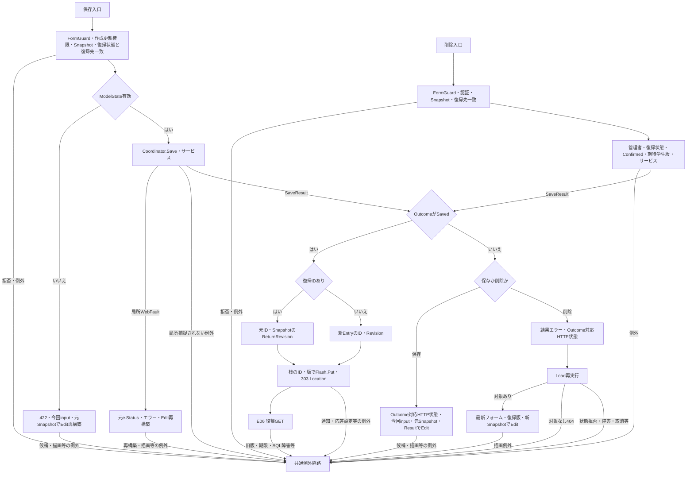

保存の局所WebFault再表示はModelState有効時のCoordinator.Save呼出し中に限る。入口のFormGuard・権限・Snapshot・最初の復帰検査はcatch外で、削除に同じ局所catchはない。復帰IDあり／なしの合流点では各枝のID・版を保持し、共通成功節点に固定NULL版を置かない。

#### SQL・テーブル関連（ER図）

復帰検索はE06のQ-E・Q-S・Q-Lを使用する。登録側は学生書込みと監査追記を同一トランザクションで確定する。監査target_keyは物理FKではない。

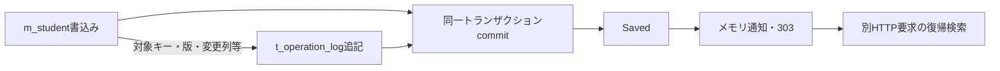

#### DB操作の詳細

保存は正規化・検査後、ReadCommitted内でトランザクション所有Exclusiveアプリケーションロックを取得する。待機上限5秒、負戻り値は拒否する。既存では対象非削除・期待学生版・学籍番号不変・終了区分訂正権限を確認し、CheckRulesでコードと所属を再検査する。変更なしはrollbackしてNoChangeを返し、監査を作らない。検索ContextId・Revisionは学生UPDATE条件に使わない。根拠: `sources/Core/SqlServerStudentService.cs:92-101`、`sources/Core/SqlServerStudentService.cs:227-266`。

同一人物候補がある場合は、確認情報の所有者・セッション・対象ID・期待版・入力ハッシュ・全候補IDと版のハッシュ・10分期限・Busyを照合する。無効または再確認が必要ならrollbackしてConfirmationRequiredを返し、表示は最大20件とする。有効な確認でも理由を要求し、その後の書込み・監査・commitが必要である。確認の成立だけをSavedとしない。現在のWeb分岐は静的メモリ辞書を使い、非Webのt_confirmation照合・消費とは異なる。根拠: `sources/Core/SqlServerStudentService.cs:224-225`、`sources/Core/SqlServerStudentService.cs:268-290`、`sources/Core/SqlServerStudentService.cs:308-342`、`sources/Infrastructure/WebHostSetup.cs:19-19`。

新規INSERTは正規化列、生成分類、非削除、作成・更新情報、版1を設定する。既存UPDATEは学籍番号を除く正規化列、更新情報、版+1を、student_id・期待row_version・is_deleted=0で更新する。型・SizeはColumns辞書を使用し、NULLはDBNullへ移す。OUTPUT対象ID、監査追記、commit正常終了を経てSavedを返す。根拠: `sources/Core/SqlServerStudentService.cs:30-37`、`sources/Core/SqlServerStudentService.cs:292-315`、`sources/Core/SqlServerStudentService.cs:385-390`。

論理削除は同じID・期待学生版・非削除条件で、is_deleted、deleted_at、deleted_by、delete_reason、updated_at、updated_by、row_versionだけを変更する。更新件数1件、監査、commitを要求し、編集中の業務値は保存しない。@id・@versionはBigInt、@nowはDateTimeOffset、@actorはNVarChar(128)、@reasonはNVarChar(120)。理由はraw・保存とも60スカラー値を検査する。根拠: `sources/Core/SqlServerStudentService.cs:392-414`、`sources/Views/Students/Edit.cshtml:17-17`。

保存catchはInputValidationException、SQL2601／2627、DBConcurrencyException、後段のSqlException・InvalidOperationException・OperationCanceledExceptionの順である。前3経路は検証失敗・学籍番号使用済み・競合となり、後段Unknown判定へ含めない。削除も先行DBConcurrencyExceptionをConflictへ移してから後段分類を行う。後段へ到達した場合だけCancellationToken.Noneでrollbackを試み、writeStartedかつcommitAttemptedまたはrollback失敗ならUnknown、それ以外はSystemErrorとする。接続とトランザクション開始はこの捕捉区間外である。根拠: `sources/Core/SqlServerStudentService.cs:240-243`、`sources/Core/SqlServerStudentService.cs:316-329`、`sources/Core/SqlServerStudentService.cs:399-416`。

#### 結果・例外時の扱い

NoChange、ConfirmationRequired、Conflict、Unknownは成功通知・303へ進まない。Unknownでは再送前の検索確認を案内する。303はDB確定後の遷移指示であり、復帰GET、通知表示、HTML配信の成功ではない。復帰失敗で確定済み学生変更を戻す処理はない。

保存非Savedの入力保持と、削除非Savedの再Loadは異なる。削除Resultを新モデルのResultへ移す処理はない。Unknownで実際には論理削除済みなら再Loadの非削除取得が404になり得るため、結果不明案内付きEditへ必ず戻るとはいえない。根拠: `sources/Web/Controllers/StudentsController.cs:31-38`、`sources/Core/SqlServerStudentService.cs:176-179`、`sources/Core/SqlServerStudentService.cs:416-416`。

## 補足説明

### 長さ・空値・表示値の解釈

ScalarCountはサロゲート対を1として数え、単独サロゲートをArgumentExceptionで拒否する。TextはNULL→空文字、raw長、制御文字、Trim、空値・必須性、Trim後長の順で検査する。Trimで短くなる入力もraw超過なら先に拒否する。業務長はUnicodeスカラー値、HTML maxlength・.NET LengthはUTF-16コード単位、nvarchar容量はUTF-16コード単位、varchar容量はバイトである。SQL Sizeはパラメータ領域として別に扱う。根拠: `sources/Core/StudentNormalizer.cs:37-64`、`sources/Views/Students/Search.cshtml:5-5`、`sources/database/001_schema.sql:9-22`、`sources/Core/SqlServerStudentService.cs:67-72`。

制御文字検査を通る空白だけの非空文字列がサービスへ届く場合、番号は必須Identifierで拒否、氏名・電話は任意空として省略、カナは任意Kanaから空キーとなりLIKE '%%'相当になる。番号・カナがサービス入口でNULL・空文字なら省略する。これはサービス引数の分岐で、HTTP空白の確定動作へ拡張しない。根拠: `sources/Core/SqlServerStudentService.cs:113-117`、`sources/Core/SqlServerStudentService.cs:140-142`、`sources/Core/StudentNormalizer.cs:47-93`。

EnrollmentStatusCodesがサービス引数としてNULLならLength参照でNullReferenceExceptionとなり、検証例外catchへ入らない。フォームの在籍キー省略はControllerの空配列補正と区別する。Criteria全体やその他制御値の欠落も、非nullable宣言だけで後段到達値を確定しない。根拠: `sources/Core/SqlServerStudentService.cs:111-112`、`sources/Core/SqlServerStudentService.cs:169-170`、`sources/Web/Controllers/StudentsController.cs:14-14`、`sources/Web/Controllers/StudentsController.cs:22-22`。

入学日両端は現行ではネイティブtype=dateで、独自表示フォーマッターやブラウザーロケール固定はない。参考設計は入力yyyy-MM-dd、表示yyyy/MM/ddを定める。現行再表示はinputまたはFrom(Applied)の日付文字列とModelStateで、サービスDateOnlyから入力欄へ戻す独自整形ではない。片側指定可、両端包含、開始≦終了である。根拠: `sources/Views/Students/Search.cshtml:5-5`、`sources/Core/JapaneseDateService.cs:52-59`、`sources/Web/Controllers/StudentsController.cs:40-40`、`reference-designs/詳細仕様書/CSharp_ASPNET/01_学生検索画面.md:94-95`。

「すべて」は条件未設定で、年度0・クラスID0ではない。学年00は「学年なし」の実コード、未所属はclass_id NULL、在籍空配列は区分条件なしである。NULL在籍だけを検索する意味ではない。根拠: `sources/database/002_seed.sql:78-78`、`sources/Core/SqlServerStudentService.cs:109-154`。

表示名称は保存元まで追跡する。CLIクラス保守はClassChangeからクラスコード9・名称18を検査してVarChar(9)・NVarChar(36)へ保存し、コード保守はCodeChangeから名称12を検査してNVarChar(24)へ保存する。DB容量を業務上限の代用にしない。名称基表のNOT NULLとLEFT JOIN結果のNULL可も別である。根拠: `sources/maintenance/Program.cs:10-13`、`sources/Core/MasterMaintenanceService.cs:32-34`、`sources/Core/MasterMaintenanceService.cs:73-76`、`sources/Core/MasterMaintenanceService.cs:82-82`、`sources/Core/MasterMaintenanceService.cs:113-120`。

検索日付上限は入口nowを+09:00へ変換した業務日を使う。検索・更新日時は日本時間yyyy/MM/dd HH:mm:ssへ移す。共有ヘッダーの業務日はWebPresentationが別の現在時刻から取得し、検索入口の変数を共有しない。生年月日はDateOnlyから和暦へ変換し、時差を加えない。根拠: `sources/Core/SqlServerStudentService.cs:44-45`、`sources/Core/SqlServerStudentService.cs:105-105`、`sources/Infrastructure/WebPresentation.cs:5-7`、`sources/Core/JapaneseDateService.cs:41-50`。

### 読取・状態更新・HTML到達の境界

Presentは結果NULL、超過、正常0件、通常を分ける。未検索・超過のtotalCountはNULL、正常0件は0で、10001を総件数として表示しない。結果があれば検索日時を移すが、ビューの件数・日時本文はfoundだけである。ビューは件数NULLをページ計算用0にし、総ページ数を最低1にする。提示pageはApplied由来なので、空一覧・局所失敗を常に1/1とは説明しない。根拠: `sources/Infrastructure/WebStudentCoordinator.cs:21-21`、`sources/Views/Students/Search.cshtml:2-8`。

本人電話NULLの－と、都道府県名称NULLの[不整合]は個別補完である。年度・学年名・クラス名・在籍名に同じ補完を適用しない。表示住所は都道府県名＋住所1で、住所2を含めない。根拠: `sources/Core/SqlServerStudentService.cs:79-85`、`sources/Views/Students/Search.cshtml:8-8`。

UseはGateと期待Revisionで同一Entry更新を直列化する。先行成功が版を進めれば同じ旧版の後続要求は拒否される。これはブラウザーの旧HTML破棄とは別で、OptionsはGate・期待版を使わず、要求連番による旧応答破棄もない。根拠: `sources/Infrastructure/SearchContextStore.cs:14-14`、`sources/Web/Controllers/StudentsController.cs:22-22`、`sources/wwwroot/js/site.js:2-9`。

検索状態の更新は候補取得、JsonElement化、Razor描画、配信より前で、後段失敗による状態復元はない。Present.itemsはSelectの遅延列挙なので、行表示移送・和暦変換は後段JSON化時に起こり得る。Gate解放後のモデル・ビューも共有Entryを読む。DB読取commit、メモリ更新、期限延長、HTML到達を一つの確定境界へまとめない。根拠: `sources/Infrastructure/WebStudentCoordinator.cs:9-21`、`sources/Infrastructure/SearchContextStore.cs:14-14`、`sources/Web/Controllers/StudentsController.cs:16-22`、`sources/Web/Controllers/StudentsController.cs:39-39`。

### 参考設計の共有値・出力契約

次表の設計名は参考設計の契約であり、現行の実在名とは分ける。資料が定めない具体型・算式・失敗枝代入を一般的な実装から補作しない。

| 設計名 | 設計側の型・範囲・設定源 | 初期・成功・失敗の設計契約 | 現行対応 |
| --- | --- | --- | --- |
| TotalCount | 非負整数、最大長欄5、表示元0～10000。OP-COUNT／page | 成功時設定。未検索・超過は未設定。失敗時の個別代入は未定義 | SearchResult.Count:int→totalCount:int?。未検索・超過NULL、正常0件0 |
| RangeFrom／RangeTo | 非負整数、最大長欄5、表示元0～10000。OP-COUNT／page | 未検索・超過は未設定、0件は0～0。具体.NET型・1件以上の算式・全失敗枝リセットは未定義 | 宣言・計算・移送・表示なし。参考見本の1–2件表示は設計投影だけ |
| SearchedAt | RequestContext.ExecutedAt、DB保存なし、日本時間19文字 | 今回検索日時。未検索は未設定、全失敗枝代入は未定義 | サービス入口now→SearchResult→日本時間文字列。完了時刻ではない |
| StudentListItem.SchoolYear | 任意整数4桁、1900～9998、m_classから設定 | 表示時設定、未所属は－ | StudentRow.SchoolYear:int?、LEFT JOIN結果。－補完なし |
| StudentListItem.GradeName | string12、GRADE名称 | 表示時設定、未所属は－ | StudentRow.GradeName:string?。名称NULLの一律補完なし |
| StudentListItem.ClassCode／ClassName | string9／18、m_class | 未所属・停止・期間外・名称欠落を区別 | nullable値を移送。一覧は状態・期間を取得しない |
| StudentListItem.BirthDate | DateOnly?、取得時必須、m_student | 欠損は不整合、和暦変換に時差なし | StudentRow.BirthDate:DateOnly、基表date NOT NULL。和暦へ移送 |
| IsBusy | 真偽、最大長欄1、処理開始終了が設定源 | 初期false、UI再入防止。全失敗枝終了代入は未定義 | 対応プロパティなし。submitの他button非活性・aria-busy=trueだけ |
| RequestSequence | 非負画面内連番、具体型・上限未定義 | 初期0、非同期要求時採番、旧応答無視、桁あふれ時継続しない | 宣言・照合・旧応答破棄なし。Entry.Revisionとは別契約 |

設計根拠: `reference-designs/詳細仕様書/CSharp_ASPNET/01_学生検索画面.md:100-112`、`reference-designs/詳細仕様書/CSharp_ASPNET/01_学生検索画面.md:133-147`。現行根拠: `sources/Core/Contracts.cs:50-58`、`sources/Infrastructure/WebStudentCoordinator.cs:21-21`、`sources/Core/SqlServerStudentService.cs:79-90`、`sources/Core/SqlServerStudentService.cs:105-105`、`sources/wwwroot/js/site.js:2-9`。

### 操作意図と現行の対応

| 主題 | 参考設計の意図 | 現行動作・差 | 根拠 |
| --- | --- | --- | --- |
| 初期・候補不足 | 候補取得後に状態作成、必須マスター不足なら検索不可、条件案内 | Entry作成が先。文言は「未検索」。候補0件でも検索禁止なし | `reference-designs/詳細仕様書/CSharp_ASPNET/01_学生検索画面.md:155-165`、`sources/Web/Controllers/StudentsController.cs:8-11`、`sources/Views/Students/Search.cshtml:5-7` |
| 候補連動・通信 | 上位変更で候補再取得、不適合解除、クラス先行選択で上位補完、部分HTMLまたはJSON | 明示Optionsで全候補取得後に抽出し、全体HTMLを返す。SRC上位変更自動送信・上位補完なし | `reference-designs/詳細仕様書/CSharp_ASPNET/01_学生検索画面.md:252-262`、`reference-designs/詳細仕様書/CSharp_ASPNET/01_学生検索画面.md:500-506`、`sources/Web/Controllers/StudentsController.cs:22-22`、`sources/wwwroot/js/site.js:7-8` |
| 未所属活性 | ONで所属解除・非活性、OFFで旧値を戻さない | JSは解除だけ。disabledは再描画時に適用 | `reference-designs/詳細仕様書/CSharp_ASPNET/01_学生検索画面.md:256-256`、`sources/wwwroot/js/site.js:7-7`、`sources/Views/Students/Search.cshtml:5-5` |
| rawと型付き命令 | 原入力を表示用保持、厳密検査後に型付け、要求値複製 | 年度・boolはMVC型付き値、日付はstring?でサービスへ移送。ToCriteria配列は引継ぎ、深い複製は成功後 | `reference-designs/詳細仕様書/CSharp_ASPNET/01_学生検索画面.md:558-584`、`sources/Web/Inputs/StudentSearchInput.cs:7-22`、`sources/Infrastructure/WebStudentCoordinator.cs:8-9` |
| 条件変更未実行 | 変更値と最後の結果、未反映通知、ページは実行済み条件 | Optionsで通知しLastResultを表示。ブラウザー変更だけでは通知しない。PageはAppliedを使用 | `reference-designs/基本設計書/01_学生検索画面.md:68-68`、`sources/Web/Controllers/StudentsController.cs:22-22`、`sources/Infrastructure/WebStudentCoordinator.cs:12-12` |
| 入力・システムエラー | 原入力・項目エラー保持、前回一覧消去、システムエラー受付番号 | Search局所WebFaultは今回input、PageはApplied由来inputで空一覧。LastResultは残る。SQL障害・取消・catch外拒否は共通エラーHTML | `reference-designs/基本設計書/01_学生検索画面.md:64-69`、`sources/Web/Controllers/StudentsController.cs:14-22`、`sources/Infrastructure/WebHostSetup.cs:23-23` |
| ページ・復帰 | 実行済み条件、最終有効ページ補正、失効は初期化／通知、条件外行を追加しない | Pageの保持補正は一度。ResumeはSQLローカル補正だけ。失効は409。条件外行追加なし | `reference-designs/詳細仕様書/CSharp_ASPNET/01_学生検索画面.md:299-320`、`reference-designs/詳細仕様書/CSharp_ASPNET/01_学生検索画面.md:386-408`、`sources/Infrastructure/WebStudentCoordinator.cs:12-14` |
| 状態版・画面確認 | 排他内の期待版、省略補完禁止、旧版拒否、同版二要求の双方更新禁止 | UseはGate・厳密版照合。Optionsは版照合なし。Index／ResumeはTab未指定、DB await後再Getなし | `reference-designs/詳細仕様書/CSharp_ASPNET/01_学生検索画面.md:604-610`、`sources/Infrastructure/SearchContextStore.cs:13-14`、`sources/Web/Controllers/StudentsController.cs:8-22` |
| ナビゲーション・結果配置 | メニュー、表示範囲、先頭・前・次・最後 | 現行はクリア・新規リンク、件数日時本文、反映・前・次。参考配置は独立投影で示す | `reference-designs/詳細仕様書/CSharp_ASPNET/01_学生検索画面.md:39-40`、`sources/Views/Students/Search.cshtml:6-8` |

参考OP-CODEは分類・用途・既存値・業務日を受ける候補契約、OP-CLASSは年度・学年・在籍期間・既存所属・人数要否を含む契約である。現行Q-Lは全取得データを返し、画面側の用途別規則へ渡す。参考OP-EXISTSは検索では指定コード・クラス存在と上位整合だけ、OP-COUNTは最大10001件、OP-PAGEは同条件・許可順序の一覧を定める。これらはQ-E・Q-Sの責務に対応する設計識別名で、公開APIや実在メソッド名ではない。根拠: `reference-designs/詳細仕様書/CSharp_ASPNET/01_学生検索画面.md:435-488`、`sources/Core/SqlServerStudentService.cs:123-168`、`sources/Core/SqlServerStudentService.cs:197-222`。

### 開発入力と確認責務

参考詳細設計は、機能詳細、方式別共通仕様、DB定義、方式別・共通開発規約を直接開発入力とし、基本設計を背景理解・承認確認に使用する。入力→処理値→DB→再表示を往復確認し、Unicode最大長、日付境界、停止候補、最終席競合、旧版、履歴失敗、保存結果不明を実装工程で確認する責務を定める。参考基本設計は顧客IT部門に入出力・権限・画面とDBの追跡・競合障害結果の確認を割り当てる。これは工程の責務であり、承認や試験合格の存在を意味しない。根拠: `reference-designs/詳細仕様書/CSharp_ASPNET/01_学生検索画面.md:546-550`、`reference-designs/詳細仕様書/CSharp_ASPNET/01_学生検索画面.md:586-598`、`reference-designs/基本設計書/01_学生検索画面.md:487-491`。

| 境界 | 本機能で確認する内容 | 担当する責務 |
| --- | --- | --- |
| HTTP→MVC→ToCriteria | Criteria全体、年度、bool、在籍配列、PageSize、状態ID・版・Tabの省略・空・変換失敗。SearchとPage／OptionsのModelState分岐差 | Web担当が受信表現・DTO・ModelState・最終応答を対応付ける |
| raw→正規化→SQL・保存列 | 氏名8／キー160、カナ36／18、電話20／16、Unicode・Trim前超過・NFKC・LIKE特殊文字 | 正規化・DB担当が検索値と保存側再生成を確認し、業務長・物理長・Sizeを分ける |
| 日付→包含検索→再表示 | 1900下限、業務日、未来日、片側指定、逆転、空白、type=date表示、和暦変換 | Web・日付・DB担当が入力表現・DateOnly・包含比較・表示値を対応付ける |
| 候補→選択→検索 | 候補0件、停止・期間外、完全順序、上位解除、未所属、学年00、ClassId文字列比較差 | 画面・候補担当が取得データ・選択候補・選択済み値を分ける |
| 件数→一覧→保持Page | 0・10000・10001、同順位ID順、4ソート、3件数、Page一度補正、Resume提示Page | DB・Coordinator担当が検索単位と保持・表示値を照合する |
| Get→Gate→operation | NULLと不在、所有・セッション・Tab、期限、旧版・省略版・版上限、同版並行、取得前取消・取得後finally | 状態担当がSQL実行・状態更新・期限延長・解放の到達枝を確認する |
| 状態更新→HTML | 後続候補障害、遅延行変換、JSON化、PageSize0、描画、応答開始後・要求切断 | Web・状態担当が読取成功、メモリ更新、描画、配信を別に確認する |
| 登録確定→303→Resume→Flash | Savedだけの復帰、編集時検索版、旧版・期限拒否、Take後失敗、条件外学生、削除Unknown後404 | 本書は復帰境界、登録・トランザクション担当は確認情報・定員・監査・catch順序と確定結果を確認する |

文書の表・型・図と本文の照合は文書作成の責務、静的投影は配置説明の責務、HTTP・ブラウザー・DB・競合・障害の実挙動は実装試験の責務であり、それぞれの確認結果を代用しない。

### 関連文書と受渡し

以下は提供計画の正確なID・相対パスとの対応である。他文書は本応答では未生成の計画参照として扱う。本機能に必要な条件・結果は本書に記載し、分冊参照だけに委ねない。

| 文書ID | 計画上の相対パス | 正本責務・本書との受渡し |
| --- | --- | --- |
| SM-BAS-STUDENT-SEARCH | `spec/basic/student-search.md` | 業務目的・論理項目・状態。本書はコントロール・DTO・SQL・イベントへ具体化 |
| SM-COM-HTTP-SECURITY | `spec/common/http-security-contract.md` | 認証・CSRF・FormGuard・HTTP応答。本書は各局所catchと元Statusの到達範囲 |
| SM-COM-NORMALIZATION-DATE | `spec/common/normalization-date.md` | raw長・正規化・DateOnly・和暦。本書は各条件のSQL値と表示への移送 |
| SM-COM-LOOKUPS | `spec/common/lookup-contract.md` | LookupSet・完全順序・用途別選択。本書は検索MVCの抽出・選択保持と登録への境界 |
| SM-COM-RUNTIME-STATE | `spec/common/runtime-state.md` | Entry・Gate・Revision・Snapshot・Flash。本書はイベントごとの更新と復帰版 |
| SM-COM-TRANSACTION-AUDIT | `spec/common/transaction-audit.md` | 接続・型付きSQL・SNAPSHOT・書込確定・監査。本書は検索読取とSavedからの復帰境界 |
| SM-DATA-LOGICAL-CONTRACTS | `spec/data/logical-contracts.md` | SearchCriteria・SearchResult・StudentRow・LookupSetの型・NULL。本書はフォーム・列・一覧の対応 |
| SM-BAS-STUDENT-EDITOR | `spec/basic/student-editor.md` | 新規・編集・参照・取消・削除の業務状態。学生ID・復帰状態IDを受け取る |
| SM-DET-STUDENT-EDITOR | `spec/detail/student-editor.md` | 登録全入力・確認情報・保存削除・Snapshot。本書は学生ID・ReturnContextId・編集時ReturnRevision・Saved／非Savedの境界 |
| SM-DET-CLASS-MAINTENANCE | `spec/detail/class-maintenance.md` | ClassChangeと属性保存。年度、コード9、名称18の保存元制約 |
| SM-DET-CODE-MAINTENANCE | `spec/detail/code-maintenance.md` | CodeChangeと分類付きコード保守。学年・在籍・都道府県名称12の保存元制約 |
| SM-DB-INDEX | `spec/database/index.md` | 全表索引・物理FK・照合共通規則。本書の検索JOIN・候補JOINと区別 |
| SM-DB-M-STUDENT | `spec/database/tables/m_student.md` | 学生物理列・型・NULL・制約。検索条件・16取得列・保存元の対応 |
| SM-DB-M-CLASS | `spec/database/tables/m_class.md` | クラス物理列・PK・学年FK。所属条件・候補・年度・名称の基表 |
| SM-DB-M-CODE | `spec/database/tables/m_code.md` | 分類＋値の複合PK・名称・状態・期間。存在確認・候補・名称JOINの基表 |
| SM-DB-M-CODE-CATEGORY | `spec/database/tables/m_code_category.md` | 分類属性。候補は分類状態を結合し、検索CodeExists・名称JOINは分類表を結合しない |
| SM-DEP-PROCESS | `spec/dependencies/process-dependencies.md` | DI・呼出し・保持領域。本書は接続された検索経路を具体化 |
| SM-RPT-DESIGN-IMPLEMENTATION | `spec/reports/design-implementation-differences.md` | 参考設計意図と実装の全体差分。本書の具体的対応を集約 |
| SM-RPT-UNRESOLVED | `spec/reports/unresolved-and-analysis-limits.md` | 不足資料・バインド境界・配備・実挙動・解析範囲の未確定 |

### 保持領域と未接続部品

本画面の外部入出力はフォーム受信、HTML応答、SQL Server参照である。検索状態、編集原入力、通知はSearchContextStore、EditorSnapshotStore、FlashMessageStoreの別辞書に置く。t_runtime_stateのencrypted_payloadというDDL列名から、検索状態の永続化・暗号化・消費・プロセス間共有を追加しない。根拠: `sources/Infrastructure/SearchContextStore.cs:9-15`、`sources/Infrastructure/EditorSnapshotStore.cs:7-11`、`sources/Infrastructure/FlashMessageStore.cs:6-9`、`sources/database/001_schema.sql:171-183`。

OptionsRequest、Coordinator.Options、WebPresentation.Lookupsは宣言されるが、接続されたPOST /students/optionsは使わない。StrictJson.ReadもControllerのフォーム経路から呼ばれず、JSON検査を本画面の受付検査へ読み替えない。RequestIdentity.TabIdのヘッダー・query取得も検索Actionへ接続されていない。POSTはAction引数tabId、Index／ResumeはTab未指定で状態を取得する。根拠: `sources/Web/Inputs/StudentSearchInput.cs:31-31`、`sources/Infrastructure/WebStudentCoordinator.cs:16-16`、`sources/Infrastructure/WebPresentation.cs:8-18`、`sources/Infrastructure/StrictJson.cs:4-14`、`sources/Infrastructure/RequestIdentity.cs:12-12`、`sources/Web/Controllers/StudentsController.cs:8-22`。
