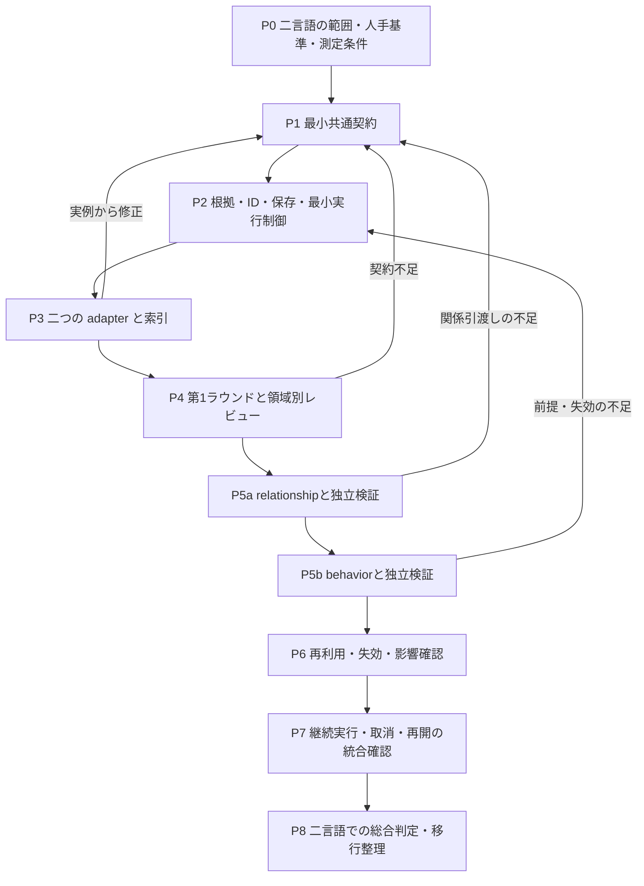

# ContextBase 段階的抽出・検証の実装計画

版：計画 v0.15／2026-10-28。

状態：3Agentを平級の独立package・CLIへ分離し、共通runtimeとportable受渡しで接続する。新配置の独立導入・受渡しの構造・合成検証は通過した。旧互換v2の合格を流用せず、P0～P8全体の正式受入れも示さない。操作は [実装ガイド](ContextBase初期実装.md)を参照する。

§11のevidence実装後、二度のDiscovery実モデル試行は候補作成前に停止した。本版は§12の全体義務内の草稿・統合・独立検証・義務判定・継続をincrementalへ実装した状態を示す。実装範囲は§12.7、操作は[新プロトコル](../../shared/contextbase-runtime/docs/分割調査・独立検証プロトコル.md)を参照する。今回、実案件の再解析や正式成果の更新は行っていない。

## 1. 目的と対象

[ContextBase 段階的抽出・検証設計 v0.17](ContextBase段階的抽出・検証フロー.md)のD01～D12と、利用者が確定した3独立Agentの段階的分担を実装作業へ分解する。対象は、読取り専用ソースからシステム概要・機能・テーブル／データ・共通処理を抽出し、関係構築、動作深化へ進めるContextBaseである。

仕様書の計画・本文・描画・Office 変換、原プログラムや DB の実行、全案件への一括再解析は対象外。現在の `ContextBase`、人手 QA、既存案件ソース、旧出力は本計画の作成では変更しない。

実装時も、固定ツールがソース構造と根拠を管理し、AI が業務候補・調査・意味の整理を担う。独立レビューは原文を直接確認する。共通手順は言語に依存させず、必要時に言語・フレームワーク・SQL 等の adapter を呼ぶ。

## 2. 確定事項と未確定事項

| 決定 | 確定内容 | 主な実装先の工程 |
| --- | --- | --- |
| D01 | 後続調査から言語 adapter を必要時に呼べる | P1、P3、P5 |
| D02 | 固定ツールが構造を抽出し、AI が業務候補をまとめる | P3、P4 |
| D03 | 第1ラウンドは領域ごとに独立レビューしてから深化する | P4、P5 |
| D04 | 全詳細を先取りせず、必要に応じて深化する | P1、P4、P5 |
| D05 | 調査目標を中心とし、よく使う依頼だけテンプレート化する | P1、P5 |
| D06 | 異なる二言語の小範囲で共通手順を検証する | P0、P3～P8 |
| D07 | 業務タスクを機能の主体とし、技術入口は別に関連付ける | P1、P4、P5。[分類境界](../../shared/contextbase-runtime/docs/機能分類境界.md)を参照 |
| D08 | 確認済み部分を返せるが、原目標の未完了を明示する | P1、P2、P4～P8 |
| D09 | 人手照合した小規模基準、機械検査、独立 AI レビューを併用する | P0、P3～P8 |
| D10 | 最小共通契約を先に検証し、基底実装は二 adapter の実例から抽出する | P1、P3、P8 |
| D11 | 構造と検証済み業務事実を、適用条件・依存・失効を確認して再利用する | P1、P2、P6、P8 |
| D12 | 既定の固定総時間・総 token 上限を置かず、実質的進展がある間は継続する | P2、P5、P7、P8 |

異なる2言語の小規模試行で共通フローを確認する方針は維持する。個別の業務試行資産は清掃済みで、次の対象・request・人手基準は改めて選定する。意味解析backend、包括的な互換・失効モデル、実質的進捗の観測と自律制御は残作業。「索引／概要／詳細」の固定三段階は採用していない。

追加決定：3独立Agentはdiscovery／relationship／behaviorの順に成果を引き渡す。独立検証は各層共通の実行能力とし、作者と異なるtask・文脈、候補版の束縛、ホストによる採用を維持する。D01～D12の決定内容は変えず、旧investigationに同居した関係・動作の責務を分ける。

## 3. 独立プロジェクトと実装配置

| 実行単位 | 配置 | 責務 |
| --- | --- | --- |
| discovery-agent | agents/reverses/discovery-agent | contextbase-discovery／contextbase_discovery。取得・目録化だけを実行 |
| relationship-agent | agents/reverses/relationship-agent | contextbase-relationship／contextbase_relationship。関係構築だけを実行 |
| behavior-agent | agents/reverses/behavior-agent | contextbase-behavior／contextbase_behavior。動作深化だけを実行 |
| 共通runtime | agents/reverses/shared/contextbase-runtime/src/contextbase_runtime | snapshot、SourceAccess、ID、store、adapter、前提検証、独立検証、host採用、受渡し |
| 任意互換入口 | agents/reverses/reverse-agent | analysis-pipelineで独立3Agentを連続実行する任意入口。旧extract経路は別途互換保持 |

3Agentのinstall・import・起動はreverse-agentに依存しない。各自source／request／workを持ち、独立した層の抽出後に別task・文脈で原文検証・host採用する。共有コードはreverse配下へ残した実装をimportする形にしない。

### 3.1 Portable受渡しと前提

同一のv2 requestは元goal・全前提グラフを保持する。各Agentは自層義務だけを選び、後続層は前層を自動実行しない。前提不足はneeds-prerequisitesで返す。

exportは全有効記録・全unknown・未閉鎖followup（raw履歴は監査用）をportableに保存する。自層に受入れ済み成果がある場合だけ出力でき、scope部分成果も区別して出せる。出力は新規パスを使い、既存ファイル、入力、store内への書込みは拒否する。

受信側は前層workなしでhandoffを読み、自身の封印ソースでrequest・manifest・内容を照合する。外部passは監査情報として保持し、別task・文脈の独立原文再検証後に前提を有効化する。異なるrequest・ソース範囲への汎用P6再利用へ広げない。

可搬ソース束縛では絶対sourceRootを除き、それ以外のmanifest、相対パス、内容指紋、許可・除外材料を照合する。ソースの絶対配置が違っても、同一request・相対scope・材料の一致が必要である。

明示followupは安定ID followup:<digest> のunknownとして質問・対象義務・内容hashに束縛する。後続の独立検証はunknownChecksで各項目を判定し、原文根拠付きresolvedだけが閉鎖を意味する。acceptedやnon-blockingだけでは閉鎖しない。raw followupは監査履歴に残し、portableな活動中一覧には未閉鎖項目だけを含める。受信側の独立検証でresolvedを確認してから前提を有効化できる。引き継いだfollowupの対象義務が今回の採用予定集合へ入る場合、原文根拠付きresolvedを必須とする。この条件はローカルadoptと外部前提の有効化へ同じgateで適用し、最終behaviorも未閉鎖の本層質問を残したままcompleteにしない。未解決の有効上流と、現在候補が要求する有効上流への補査は採用を阻害する。

### 3.2 実装契約と旧経路

v2のstage／scope／requires、recordのownerRequirementと版固定dependencies、未知の関連先・阻害先・範囲理由を維持する。上流置換・reviseでも未知id・内容・hashを保持し、影響decisionを失効して再検証する。有効上流へのfollowupはpassでも採用を阻害し、将来義務への質問は引渡しに残す。

reverse-agentは希望時だけ使うanalysis-pipelineを提供し、各Agentの公開run／exportでscope別の独立workを連続実行する。先に一つのscopeの3層を進め、次のscopeへ移る。元request全体は切り詰めない。旧extractのrunは別の旧v2互換経路であり、それが通っても独立3プロジェクトの導入・受渡し合格としない。

### 3.3 工程別の状態

| 工程 | 現状 | 残る確認 |
| --- | --- | --- |
| P0 | 旧業務試行を清掃済み | 新しい2言語対象・人手基準・比較条件 |
| P1 | 共通v2契約と平級3プロジェクトの入力契約を具体化 | 合成契約試験は通過。実業務の適用確認 |
| P2 | 共通runtimeへ入力・検証・採用を移し、各workのホストで実行 | 独立導入・受渡し・拒否経路の合成確認は通過。長期実運用 |
| P3 | C#／Java構文adapterを共通runtime化 | 意味束縛、framework／SQL、実業務精度 |
| P4 | 独立discoveryの入口と出力契約 | 実モデル・人手品質受入れ |
| P5a | 独立relationshipと受信前提再検証 | 実業務の関係精度 |
| P5b | 独立behaviorと受信関係再検証 | 実業務の動作精度 |
| P6 | 同一request・manifest／内容でのportable移送に限定 | 一般的なcross-session増分再利用 |
| P7 | 本層run、阻害停止、共通cancel／resume／revise | 長期運用、自動補査修復、即時kill |
| P8 | 新配置の合成試験・構造確認は通過 | 実モデル・人手・性能の総合受入れ |

## 4. 工程と依存関係

P0～P8 は開発・検証の順序であり、運用時の三つの理解段階と、横断的な独立検証・最終受入れとは別である。

### P0：試行範囲、基準と比較条件を固定する

**作業**

- 異なる二言語について、小さなファイル間機能を一つずつ選ぶ。業務タスク、入口、共通処理、データまたは状態変更を追える範囲を候補とする。同じ業務の実装であることは必須ではないが、比較する調査目標の種類と深さを対応させる。
- projectId、実際の取得ソース、内容 hash、設定、外部依存の取得可否、対象と対象外を保存する。案件選定前に既存 input を一括で再解析しない。
- ソースから独立に期待事項を作り、人手で照合する。正しい定義・引用・関係、重要分岐、データ／状態変化、誤ってつないではいけない関係、未解析のまま残す事例を含める。生成結果をそのまま正解にしない。
- 解析器の小さな正常／負例 fixture と、実ソースの業務照合基準を分ける。
- 品質項目、計測範囲、環境・モデル条件、冷間／再利用時の条件を固定する。過去の四時間の文書 batch は異なる仕事量なので直接の速度基準にしない。

**完了条件**：二つの試行範囲が固定され、合否判定に使う期待事項は人手による原文照合を完了している。未照合の事項は未確認の基準候補として分離し、合否の根拠に使わない。言語、プロジェクトまたは必要材料が未確定なら、その選定を未完了として保持する。

既存方式の比較計測は解析範囲を揃えられる場合に実施する。文書生成まで進む既存 CLI をそのまま起動して比較せず、分離できない範囲は参考記録または未計測とする。

### P1：最小共通契約を定める

**主／子／共通の新discovery契約**

新discoveryモードはホスト固定のcatalogPolicy=contextbase-catalog/1を用いる。record.kindのfunction／operation／common／unclassifiedを主機能／子操作／共通／保留に対応させ、typed classificationの必須項目と参照条件を[機能分類境界](../../shared/contextbase-runtime/docs/機能分類境界.md)の§8へ集約する。その他の分類はclassification=nullとし、旧成果へnullを自動追加してhashを変えない。

裸Sessionの旧v2タスク互換は維持するが、新分類規則を通過した証明とはしない。新独立Agentは合法なcatalogPolicyのあるhandoffだけを受信し、旧handoffはD再抽出が必要である。意味参照は同scope・存在・適切なkindを検査し、入口共有を許す。参照先変更は跨owner失効へ反映する一方、意味参照を無条件に版依存DAGへ追加して循環を作らない。

独立検証は主・子・共通・保留の全対象recordのkey・内容版に一致するclassificationChecksと、元要求の全scopeに対するscopeChecksを返す。scopeChecksはentry／data等の非意味分類を含む全viewを確認し、レコード0件のscopeやsupport／material／dependencyへ誤って除外した業務候補も調べ、過分割・過統合の双方を確認する。全検査passに加え、件数または今回必要な被覆へ影響する保留がないことをホスト採用条件とする。保留は実在unknownへ結び付け、作者の自評だけで通過させない。

**作業**

- 調査目標の対象、質問、期待する情報、範囲、必要な検証を記録する。自然言語依頼から明確な部分を具体化し、実質的な曖昧さを未知として保持する。定型依頼はこの契約を作る補助とする。
- 共通契約の request、役割ごとの候補差分・finding・追加調査要求を物理 schema にする。基準版、作業ID、根拠、依存、作者・検証者、出力権限を表し、正本更新を各役割の権限に含めない。
- 抽出を担当する3層と、抽出／独立検証の実行種別を別軸にする。検証対象層、候補内容版、根拠版、元義務を束縛し、同じ作者の同一文脈を独立検証へ転用しない。
- relationshipの目録前提とbehaviorの関係前提を、同領域・対象・適用条件の義務で表す。非該当にも根拠を付け、他領域の通過を代用できない契約にする。
- 業務機能と技術入口を別の安定 ID で扱い、関係付ける。テーブル／ビュー／ORM 実体／DTO／メモリ／外部対象の区分を保持する。
- 根拠、構造、関係、業務事実、能力、調査項目、レビューと結果状態の最小レコードを決める。宣言／推定／未知、関係の解決方法、レビュー有効性を一つの完了フラグに畳み込まない。
- adapter の操作ごとの対応・部分対応・不可用・失敗を区別する。範囲、原位置、診断、候補を返し、未知を正常な空結果に置換しない。
- 部分結果には原目標、達成済みの範囲、未達事項、根拠版、レビュー範囲を含める。原目標の完了状態を結果一覧の有無と分離する。
- 既存 schema と新 schema の識別、明示変換、互換エラーを定める。全言語の詳細項目や全メソッドを先に固定しない。
- 旧investigationの義務は質問と成果を確認して新しい担当層へ明示割当てする。旧reviewの検査範囲を保持し、新たな関係前提やbehavior義務の合格へ自動昇格させない。

**完了条件**：P0 の二言語の例を同じ契約で表せる。未解決候補、混在言語、異なる呼出条件、部分返却を表現できる。P3／P4 の実例で改訂する前提が明確である。

### P2：根拠・保存基盤と最小の実行制御を用意する

**作業**

- snapshot と source-view の整合性、構造索引から原文への位置対応、根拠の発行／参照を接続する。入力プログラム、ビルド task、案件別 plugin を実行しない。
- 共通 ID、内容版、調査目標と項目、未解決、候補事実、独立レビューを保存し、候補と受入済み版を区別する。
- 役割の個別依頼と目標からの振分けを接続する。作業領域へ提出した候補を、版・競合・依存・根拠の照合後に各workのホストだけが採用する。採用と範囲受入れを別の操作・記録として扱う。
- 新3層の前提判定をホストへ集約し、候補だけ存在する状態と検証・採用済み状態を区別する。上流の修訂が依存する下流成果と検証を失効させ、前提不足の層を再開しない。
- v2 schema・CLI・保存版を接続する。旧request／sessionや --role は明示拒否とし、新v2要求を作る。旧investigationの推測分割はしない。
- AI の最初の試行前から取消、技術障害、checkpoint 保存、再開時の入力／目標／規則照合を扱う。失敗前の有効な成果を保持する。
- 取得、解析、モデル、統合、検査の工程別イベントと時間を記録する。単なる活動回数と、根拠付き理解・調査義務の進展を区別する。
- 最小の継続 controller に固定総時間／総 token の既定上限を入れない。P7 で長期継続、待機、取消、無進展の統合挙動を仕上げる。

**完了条件**：入力不変、根拠改ざん拒否、部分状態の保存、取消／故障後の回復、異なる入力・目標への誤再開拒否が契約試験で確認できる。完了を自己申告しただけでは受入記録を作れない。

### P3：二言語の adapter を小さく実装して契約を検証する

**作業**

- 二つの対象言語について、P0 の範囲に必要な語法・定義・作用域・導入・呼出し候補と診断を提供する。任意のシンボル／範囲を後から追加調査できるようにする。
- Tree-sitter 等の構文 backend と、利用可能な意味解析 backend の役割を区別する。SDK／プロジェクト依存が取得できない場合の能力低下を明示する。原入力の build や任意 task を実行して補完しない。
- framework、SQL 方言、ORM、解析 backend を組合せ可能にする。言語×framework×DB の子クラスを増やさない。
- 言語間の接続、埋込み script、SQL 等がある場合は元ファイル位置と接続理由を保持する。名称一致だけで同一 ID にしない。
- 二 adapter の実例から契約を調整し、安定した共通実装だけを必要に応じて base に抽出する。共通 protocol だけで足りる場合は継承を強制しない。

**完了条件**：同じ共通 interface の試験が両 adapter を通り、P0 の位置・定義・誤連結防止・未知の基準を満たす。意味解析の `resolved` が唯一の実行時 target を証明するとは扱わない。

### P4：第1ラウンドの取得・業務候補・領域別レビューを接続する

**粒度の追加受入基準（今回未実行）**

取得sourceと集計scopeを分け、主機能だけの件数と未確認を別掲する。主の独立目的・成果、子の文脈上の主帰属、共通の使用関係・共有責務を説明する。過分割と過統合を両方点検し、入口形態・actor role・CRUD名だけで決めず、理由と反例を残す。正本の例示を最終答えや予定件数へ固定しない。

**作業**

- 入力固定、棚卸し、アダプターによる解析・索引取得、概要／機能／データ／共通候補を一つのラウンドとして動かす。
- discovery-agentに共有の取得・adapter能力を接続し、共通の独立検証を作者とは別task・文脈で実行する。snapshotやID管理を役割ごとに複製しない。
- 固定ツールの構造と原文を AI に提供し、業務タスクの候補と入口の対応を作る。内部メソッド数を機能数に置換しない。
- 共通 module が領域別の独立原文レビューを実行し、入口漏れ、誤分類、重複、DTO と表の混同等を検査する。レビュー対象は作者の候補一覧だけに閉じない。
- 通過した領域・対象は次の調査に渡せるが、他領域や重要未知を完了扱いにしない。全倉一括完了の同期障壁を作らない。

**完了条件**：二言語で四種の一覧、根拠、領域 coverage、未解決と独立レビューが得られる。対象が見つからない場合は、根拠付きの対象なしと未確認を区別し、存在しない表や共通処理を補わない。候補漏れを仕込んだ試験で、作者が待ち行列を閉じてもレビューが不足を検出する。

### P5a：relationship-agentと関係層の検証を実装する

**作業**

- 該当領域の検証済み目録と原文から、機能・入口・処理・呼出し・データ・共通依存を結ぶ。関係判断に必要な条件・引数・設定も調べる。
- 始点・終点または候補集合、方向、条件、適用範囲、導出方法、根拠、未解決を保存する。同名やAST呼出点だけで意味的束縛を確定しない。
- 共通adapterへ必要な定義・参照・framework・SQL等を追加照会し、新対象はdiscoveryへ返す。必要関係が非該当の範囲も根拠付きで扱う。
- 共通検証が原文・登録点・逆利用・未調査領域から誤結合と漏れを確認する。作者が修訂した内容版で再検証し、ホストが該当関係を採用する。
- behaviorへ、当該質問に必要な関係義務と採用版、根拠、能力制約、阻害する未知を渡す。全倉の関係完了を同期条件にしない。

**完了条件**：二言語の対象に同じ関係契約を適用でき、必要な関係だけを根拠付きで引き渡せる。前提不足、別領域の合格、未解決の動的対象、同名誤結合を確認済みへ変換しない。関係までの要求はbehaviorを起動せずに返せる。

### P5b：behavior-agentと動作層の検証を実装する

**作業**

- 今回必要なrelationship義務の有効な採用版を前提にする。値、条件、分岐、状態、順序、異常、副作用、トランザクションを目標に必要な範囲で追う。
- 共通処理の動作と、呼出元ごとの実引数、省略・既定値、権限、状態、結果の違いを区別する。後続層からもadapterと原文を追加取得する。
- 新対象はdiscovery、未確認・誤った関係はrelationshipへ戻す。関係修訂で影響する動作候補と旧検証を失効させ、根拠・内容版を再照合する。
- 共通検証が原文と元の質問から反例・重要分岐・値や状態の欠落を確認する。findingと処置を結び、指摘の閉鎖だけで受入れを作らない。
- 部分返却と限定範囲の受入れを扱い、必要な義務・阻害する未知が残れば元目標を未完了として返す。全対象を一定の情報量まで一律深化しない。

**完了条件**：同一手順で二言語の動作義務を検証し、当該関係の未検証状態からの実行、他領域の通過の代用、上流修訂後の旧レビュー利用、義務削除による完了を拒否できる。確認できる結論と未達義務を同時に返せる。

### P6：再利用・失効と契約変更を接続する

**前提**：今回、[共通契約](../AGENT.md)・運用規則と [旧文書経路の契約](legacy/README.md) を分離する。旧 CLI の fresh-analysis と checkpoint の挙動は維持する。新経路の D11 は、以下の依存照合・失効・再開と契約試験を実装してから有効化する。契約分離の文書化だけで P6 を完了としない。

**作業**

- 構文の再利用 key と、解決済み関係／業務事実／レビューの再利用条件を分ける。根拠 source、範囲、規則・設定、人手による採用、依存と適用条件を照合する。
- 新しい呼出し元、追加ファイル、依存定義や設定の変更、対象範囲の変更による影響を扱う。直接読んだファイルが不変という理由だけで意味の再利用を許可しない。
- 新規分析／再利用を別々に記録し、再利用した旧レビューを新目標の全体受入に流用しない。
- 影響した事実とレビューを失効させ、関連する調査へ戻す。依存範囲が証明できなければ再検査を広げる。
- 旧 checkpoint の復元と、新しい調査への内容再利用を区別する。復元によって以前の権限や完了状態を無条件に復活させない。

**完了条件**：有効な再利用、適用条件不一致の拒否、新規呼出し元／設定変更の再調査、QA 保持、旧 ID／alias 保持の試験を通る。受入済み事実でも新たな反証で再調査できる。

### P7：継続実行、無進展停止、取消と再開を統合検証する

**作業**

- 固定総予算を持たず、目標が未達で実質的進展がある間、調査を継続する。関連する新根拠、事実・関係の修正、候補や重要未知の絞込み、finding の実質的処置を進展として記録する。
- 読取り数、モデル呼出し数、revision／job ID の増加、待ち行列の開閉だけで継続しない。同条件の同一候補には既存レビューを戻し、変化のない反復を検出する。
- 子調査の待機は実際の結果イベントを待ち、モデルによる空の polling を進展に数えない。長いが正当な調査と停止状態を区別し、判定の根拠を残す。
- 取消、実際のツール障害、入力束縛失効、無進展では保存して停止する。実行環境の制約に到達した場合も未完了として保持する。
- 個別モデル／ツール応答 timeout、memory 等の資源保護を総時間予算と区別する。外部から明示された期限がある場合は別の実行条件として伝播し、子処理で毎回延長しない。
- 再開時に原目標、source、契約、権限と根拠を確認する。待機・中断の記録は業務正本と分け、失敗を合格に変換しない。

**完了条件**：進展する長いシナリオが固定ラウンド数や既定総予算だけで終了しない。反復だけのシナリオは停止し、取消／timeout／再開の主原因と成果が保持される。現行の単文書 `max_rounds` や既定 deadline を新経路へそのまま継承しない。

### P8：二言語の総合判定、計測と互換整理を行う

**作業**

- P0 の基準に対して、各言語で同じ種類の目標を処理する。対応の差は能力表に残し、二言語を一つの精度値へ無条件に合算しない。
- 正確性、必要事項の被覆、未解析、技術故障を別々に判定する。既存の期待値や過去レポートの合格を新実装の結果として流用しない。
- 冷間取得、関係調査、深化、統合、レビュー、再利用時の工程時間、実際のモデル呼出し／用量を記録する。待機や並列作業の合計と壁時計時間を区別する。
- 既存の文書経路と新 ContextBase 経路の入口を明示する。旧データは明示移行で扱い、既存成果物を自動で置換しない。
- 共通契約と base の妥当性を再点検する。言語変更で共通調査・検証を複製する必要があれば、その原因を修正する。

**完了条件**：対象範囲の必須基準・負例・独立レビューを通過し、未実施・未対応を明示した受入記録がある。重要な義務が欠ける場合は部分成果とし、元目標は未完了。速度改善は同条件の実測がある範囲だけ述べる。

## 5. 検証項目と判定

| ID | 主な試験 | 期待する挙動 |
| --- | --- | --- |
| T01 | 根拠／入力の hash・範囲・版の改変 | 受入・再利用・復元を拒否し、失効理由を保持する |
| T02 | 同名、オーバーロード、別 scope、動的 target | 正しい候補を区別し、確定できないものを未知として返す |
| T03 | 新入口や対象ファイルを候補から脱落させる | 独立した範囲確認で不足を検出する |
| T04 | DTO、SQL alias、ORM と物理表の混同 | 証拠の種類と対象を区別し、存在しない定義や制約を確定しない |
| T05 | 業務タスクと画面／API の多対多対応 | 技術入口の件数を機能数とせず、安定した別 ID で対応する |
| T06 | 条件・異常分岐・呼出元の差分の削除 | 基準または独立レビューで意味上の不足を検出する |
| T07 | 非対応、解析失敗、超限、正常な無一致 | 結果の状態を区別し、不存在／全範囲完了にしない |
| T08 | 一部だけ確認済みの結果返却 | 既知の内容と未達義務、原目標未完了を同時に取得できる |
| T09 | 既知事実の再利用、新規呼出し元、設定・範囲変更 | 適用性を再確認し、必要な事実・レビューを失効させる |
| T10 | 取消・故障・外部制限・入力変化後の再開 | 有効成果を保存し、無効な束縛のまま継続しない |
| T11 | 長い実質的進展と、同候補・同読取りの反復 | 前者は継続し、後者は無進展として停止する |
| T12 | 人手 QA、旧 ID、旧経路と旧結果 | 内容を保護し、再利用・移行・新分析を混同しない |
| T13 | 役割からの正本更新、受入状態の自己変更 | 作業領域への候補・指摘提出に限定し、共通制御以外の採用を拒否する |
| T14 | 同じ基準版に対する競合候補、関係と動作の往復 | 競合を黙って上書きせず、不足する調査へ戻して根拠と版を再確認する |
| T15 | 初期目録だけの要求、有効な既存目録を持つ要求 | 必要な層と調査だけを選び、毎回全件3層へ直列投入しない |
| T16 | 同一稿の作者による合格、候補修訂後の旧レビュー | 独立性と内容・根拠版を照合し、新版を未検証のまま受入れない |
| T17 | 目録のみ検証済みで、必要関係が未検証のbehavior依頼 | 関係層の前提不足として拒否し、具体的な補査義務を返す |
| T18 | 領域Aの関係合格を領域Bのbehavior前提へ使用 | 対象・範囲・内容版が一致しなければ解禁しない |
| T19 | behaviorで誤関係を発見し、relationship成果を修訂 | 影響する動作・旧検証を失効させ、修訂版で再検証する |
| T20 | 抽出層の名前だけ変えて作者の同一文脈を検証へ流用 | 共通検証の別task・文脈・作者/対象束縛を満たさなければ採用しない |
| T21 | 目録だけ・関係だけの要求、適用可能な既存前層成果 | 不要な下層や全倉同期を要求せず、確認済み範囲と依存を記録する |
| T22 | 旧v1候補・session・旧 --role の利用 | 自動変換を拒否し、明示したv2要求で新規作成する |
| T23 | 上流置換・reviseでrecord所有者を失効し、作者が旧unknownを省略 | 未知のid・内容・hashを保持し、影響する旧decisionを失効して独立再判定する |
| T24 | supported候補から有効な上流義務／未採用の将来義務へfollowup | 前者はpassでも採用を阻止して明示reviseを待ち、後者はhandoffQuestionsで後続へ渡す |
| T25 | reverse-agent未導入の環境で各package／CLIを起動 | runtimeと当該Agentだけでinstall・import・単独実行できる |
| T26 | 後続Agentへ前提handoffなしで要求 | 前層を自動起動せずneeds-prerequisitesを返す |
| T27 | 前層workを参照できない環境へportable移送 | 同一request・ソースを受信側で再検証し、外部passだけでは有効化しない |
| T28 | 異なるrequest／manifest、改変handoff、出力上書き | 不一致を拒否し、受入れ済み自層成果だけを新規安全出力へexportする |

T17～T22の前提拒否、scope不一致、下流失効、独立文脈、局所進行、旧契約拒否は合成回帰の対象とする。三層runのCLI統合では6つの独立contextと3回の採用を確認した。これを実案件の業務品質や全工程完了へ外挿しない。

必須とした正例・負例は個別に判定する。適用する重要基準の欠落や誤った確定を速度の得点で相殺しない。未知は万能な免責ではなく、原目標の必要事項なら未完了の理由となる。仕様書生成や実アプリ試験の結果はこの静的検証に含めない。

## 6. 成果物と配置

実装段階の論理成果物は、試行範囲・人手照合基準、最小 schema と adapter 契約、入力／証拠台帳、構造・関係索引、業務候補、調査項目・事実、独立レビュー、再利用／失効記録、部分／受入結果、性能計測である。

正式な設計・契約と回帰fixtureは本Agent内の文書・ソース／testsに置く。中間候補・試行は対象方式の.tmp/、採用後の最終検査記録はbuild/の固定先へ更新する。方式を持たない共通作業だけAgentまたはprojectの.tmp/・build/を使う。人手QAや正式なContextBase正本は中間キャッシュとして削除しない。

共通配置はagents/reverses/shared/contextbase-runtime/src/contextbase_runtimeのcontracts、sources、storage、adapters、controller、agent、handoff、cli等。schemaはcontextbase-analysis/2、各独立packageは自層実装と公開CLIを持つ。構文backendはtree-sitter 0.25.2固定。Graph DB、型の意味束縛、フレームワーク／SQLの専用能力、深い継承は導入していない。

## 7. 前改訂までの実装確認記録

入力：設計v0.8、計画v0.6、D01～D12、3Agentをreverse-agentの制御下から独立させる利用者の確認、新配置の実装方針。

出力：設計v0.9、本計画v0.7、独立3プロジェクトの契約・運用文書、[実装ガイド v3.0](ContextBase初期実装.md)、reverseの任意互換案内。

新配置の構造試験・合成provider経路は通過した。旧互換経路の過去の合格は監査情報だけで、新独立導入の合格へ転用しない。実モデル業務品質、人手P0／P8、一般的なP6再利用、長期運用、自動補査修復、即時kill、性能比較は未完了。

2026-10-26に指定された2プロジェクトの試行複製・設定・結果は清掃済み。元工程・汎用実装・合成テストを保持し、旧workを再開・復元しない。次の業務試行は新scope／request／workを定める。原プログラム・SQL・DB・build、仕様書生成は実行していない。

前改訂の確定検証は全535件（成功526・skip9・失敗0）。独立公開経路とclean環境26件、互換analysis／pipeline117件、旧AI非rendering392件を区別した。renderingは環境制約で未通過・対象外。詳細は [実装ガイドの検証範囲](ContextBase初期実装.md)を参照し、実モデル業務精度・人手受入れへ外挿しない。

## 8. 前改訂の分類実装と確認作業

入力は計画v0.8・設計v0.10と分類境界の確認、出力は本計画v0.9・設計v0.11・実装ガイドv3.3・Agent契約である。D01～D12は変更しない。

分類正本の基準を新discovery抽出prompt、typed schema、独立検証、ホスト採用gateへ接続する。旧互換経路を新規則の合格と混同しない。新規回帰では分類型、参照のscopeとkind、未確認とunknownの結合、全scope検証、過分割・過統合、非業務分類への誤除外、採用拒否を確認する。本改訂の構造・合成回帰192件は成功190・skip2・失敗0で確認した。内訳と検証範囲は実装ガイドへ集約する。

利用者が承認した実行はdiscovery単独である。既定ASP.NETのsource・request・固定出力を維持し、新work .tmp/contextbase/csharp_aspnet-classified-v2で原文から再調査する。旧結果は新結果が実際に採用されるまで保持し、採用後だけ固定contextbase.jsonを原子的に更新する。比較用原稿は旧workまたは.tmpへ置き、正式archiveを増設しない。relationship／behaviorの実行や作業領域作成、原プログラム・SQL・DB・build実行は行わない。

初回Dの独立検証は伝送上限・原文読取り環境障害により成立しなかった。重複viewの伝送投影を修正し、新workで再実行した。修正後の全回帰を確認した。新workの候補70レコードは独立検証を実施したが、未解決事項により未採用である。詳細は実装ガイドを参照する。以前の構造回帰合格を代用しない。既存の人手指摘は新成果を確認して処置を記録する。人手P0／P8、汎用P6、長期運用、性能評価は引き続き未完了である。

## 9. 前改訂の構文事実利用と文脈整理

入力は計画v0.9・設計v0.11と、構文索引・call・入口をモデルが実際に利用する利用者の指示。出力は本計画v0.10・設計v0.12・実装ガイドv3.4と[ソース事実索引契約](../../shared/contextbase-runtime/docs/ソース事実索引.md)である。

1. snapshot・抽出器実装／grammar版に束縛した全fact索引を作り、inventory・hash／範囲・caller包含・entry宣言をモデル前に機械検査する。非対応・partialも台帳へ残す。
2. query／validate-indexをモデルなしで公開し、既存index形状を保持する。検索の限界とtruncatedを明示する。
3. 全索引の簡潔な表と単一sourceTextを作者・検証者へ渡し、重複numberedText／structureを除く。全recordのfactUsageをホストで検査し、factUsageCheck=passを追加採用gateへ接続する。
4. 新規回帰で不正ID・原文範囲外・空利用の回避・不足台帳・索引版不一致・検証unknown／fail採用拒否、文脈重複除去を確認する。その後、許可されたDだけを新workで実行し、候補・独立検証・採用と人手結果を分離する。

修正後の構造・合成回帰は確認済みだが、新実Dは69候補の独立検証を完了し、fact利用はpass・catalogは要追加調査で未採用で、前改訂192件と70候補未採用を合格証拠へ流用しない。型束縛や配備時到達性、汎用P6、長期性能、人手P0／P8は未完了を維持する。

## 10. 前改訂の証拠一括検査とcompact

設計v0.13・本計画v0.11・実装ガイドv3.5と[短縮伝送契約](../../shared/contextbase-runtime/docs/短縮伝送と証拠一括検査.md)を対応させる。前改訂の220件・69候補未採用は履歴とし、本改訂の合格へ流用しない。

1. sourcesの証拠検査をoperation首尾の完全snapshot確認とバッチ内ファイル単位read／hashへ整理する。contracts／catalog／followupの重複検査を集約し、フィールド・path・hash・型・行範囲と改変検知は維持する。operation間のキャッシュは導入しない。
2. contextbase-wire/1を--compactで明示利用する。task束縛alias、厳密raw schema、精確canonical展開、両hashとmaterialization／provenance、採用時再展開を接続する。外部portable形状は変更しない。
3. 異task・過時alias、binding／内容改変、証拠範囲不正、作者・独立検証の公開D経路を回帰で確認する。全原文保持と目録深度の簡潔な説明を両立させる。
4. fresh work .tmp/contextbase/csharp_aspnet-compact-repairでDのrepairのみ実行する。実行時間、fact利用検査、catalog採用、人手受入れを別々に記録する。

repair追加後の回帰は確認済みで、実repairは全体機械・独立検証を完了したがcatalog未解決で未採用。Cの原文のオンデマンド調査ループは未実装である。局所replayの応答サイズ・検査時間は制御基準としてのみ扱い、全体高速化を先取りしない。

**追加：拒否草稿の明示repair**

fresh D workへ同じsnapshot／request／indexの失敗rawを未信頼seedとして取り込み、指定recordをモデルが全置換する。key／kind／owner、coverage、未知、他recordを保護し、追加削除・scope変更はunresolvedへ戻す。元usage保持はfactUsage=nullで表し、ホストは業務推測で補正しない。raw patch／seed／combinedを固定し、全体機械検査・独立verifyと採用時再生照合を追加する。旧受入れの継承や自動無限回復は行わない。最終回帰は確認済みで、実repairは全体機械・独立検証を完了したがcatalog未解決で未採用で、新規抽出と差分回復の時間を分ける。

## 11. 前段の改善計画と実装範囲（次の着手順は§12）

### 11.1 既存工程への追加

[設計§17](ContextBase段階的抽出・検証フロー.md)に従い、既存3Agentと共有runtimeを改善する。D01～D12、独立CLI、source-only、受信側の独立原文確認、host採用、原目標・未知の保持を継承する。完全なコードグラフを先に作る別計画へ置き換えない。

以下のA～FはP0～P8の残作業の着手順であり、新Agentではない。共通取証と検証契約を成立させてからD／R／Bを接続する。取証の試作だけを現行の通常採用経路へ投入しない。

Fは最終の総合判定である。比較するgoal・scope・人手品質基準・現行方式の基線は既存P0としてC～Eの領域分解・静的規則・質問別深化を進める前に固定し、改善後の結果を見てから選び直さない。今回の共通取証接続は独立に構造・模擬providerで検査する。

| 順序 | 既存工程 | 変更対象 | 完了条件 |
| --- | --- | --- | --- |
| A | P1／P2／P3 | SourceAccess・facts・provider間の取証Interfaceと小さな接続試作 | hostが検査した検索／読取り要求から封印原文と索引を返し、取得失敗・権限拒否・切詰めを記録できる。shell操作説明だけでは完了にしない |
| B | P1／P2／P6 | 局所task・前提有効化・独立レビュー・統合採用の版付き契約 | 全goal・scope・保持record・未知を維持し、検証集合と根拠／record版を束縛する。task分割で義務全体を誤採用しない。局所採用方式はA＋B成立後だけ有効化する |
| C | P3／P4 | discoveryの全体地図、4種類の目録、領域task | 全体の未調査を可視化し、主／子／共通の分類を保持して必要原文から独立確認する。全メソッドの動作解釈は要求しない |
| D | P3／P5a | relationshipの対象別調査と必要な静的規則 | 選定機能の入口・実装・データ・共通を方向／条件付きで結び、候補・確定・未解決を区別する。前提の重複全文を文脈へ置かない |
| E | P5b | behaviorの質問別調査 | 検証済みの必要関係から、値・条件・状態・例外等の指定質問へ根拠付きで答える。全対象の詳細を先取りしない |
| F | P0／P7／P8 | 品質・失敗回復・二言語共通性・性能 | 同じ要求／品質基準で静的処理とモデル呼出しを分けて計測し、人手基準、独立起動、漏れ・誤結合・失効を確認する |

### 11.2 A：共通取証の接続

既存queryと原文取得を小さなInterfaceにまとめ、hostが最初の対象別根拠を準備する。不足時は具体的な追加要求をモデルから受け、hostが権限とsnapshotを検査して返す。要求／応答をtask・context・snapshot・索引版・条件・page・範囲・hashへ束縛する。

権限外path、変更した原文、不正範囲、未対応能力、応答切詰め、取得不能を区別する。原文を変更せず、文脈に根拠を重複配置しない。取得記録は対象workの.tmpへ置き、正式出力のファイル数を増やさない。

モデル起動前に取証経路と単操作入力容量を確認し、system指示・schema等の余裕を確保する。上限時はページ化又は単位分割へ戻す。新しい根拠・解決・反証が得られない反復は保存して止める。モデル変更を前提にしない。

### 11.3 B：検証契約と採用

作業単位のID、対象record、必要前提、元義務との対応、取得根拠、レビュー対象、未被覆、未知と失効を明示する。作業単位は要求scopeの変更ではない。保持する完全viewと各独立レビューの対象版をhostが照合し、必要被覆と跨単位の整合を満たした義務だけ採用する。

portableは正確な直接前層SHAと全source束縛を維持する。選択前提だけを有効化する場合も、残りは未有効化の声明として保持する。外部passを権限へ変換せず、既存辺だけから依存閉包を完全としない。入口・構成・逆利用・未対応材料から調査を拡張できるようにする。

作者と検証者の文脈・取得記録を分け、検証者自身が全許可原文から漏れ・反証を探せるようにする。全unknown／followupのid・内容hash・影響判定を残し、局所taskの外という理由だけで阻害を消さない。

現行full-view、classificationChecks／scopeChecks、factUsage、採用時再生に代わる検査を版付きで定義・実装してから有効化する。新設計を現行schemaへ暗黙追加せず、必要なschema変更と互換条件を確定する。旧workの指紋を書き換えず新workを使い、旧検証を新方式の合格へ流用しない。一般的なcross-snapshot再利用は含めない。

### 11.4 C～E：各Agentの接続

discoveryは構成・登録・入口・データ候補の地図を作り、領域と主／子／共通を候補化する。全体地図と領域別原文確認を併用し、定義未取得・未分類を隠さない。取得と目録化を利用者向けの二工程へ戻さない。

relationshipは必要な宣言・参照・登録・SQL対象を索引とAdapterで追う。静的規則は実際に不足する接続に限り、規則・版・条件・根拠を保存する。同名一致・登録形状・SQL名の出現を業務関係の確定へ昇格させず、AIが業務上の意味と曖昧さを調べる。

behaviorは選定対象の質問と必要関係から、条件・値・状態・結果・異常を確認する。経路の再執筆を深化とせず、共通動作を参照しながら呼出側の違いを調べる。

各Agentは相手を自動起動せず、前提不足と補査を返す。言語固有の追加取得は共通Interfaceから必要時に行い、言語×framework×DBのAgent子クラスを増殖させない。二つの実装で共有性が確認できた実装だけをBaseへ抽出する。

### 11.5 F：受入れと測定

| 観点 | 必須確認 |
| --- | --- |
| 分類 | 入口数への置換、主／子／共通の混同、目録漏れ |
| 検索と被覆 | 切詰め、未対応、未取得、作者が選ばなかった登録点、跨単位参照 |
| 関係と動作 | 同名別対象、条件登録、設定差、未解決call、呼出側の変種 |
| 検証と採用 | 別文脈・対象版・取得根拠・未知の影響・統合被覆を欠く採用の拒否 |
| 独立性 | reverse-agentなしで各Agentを導入・起動・受領・検証できること |
| 故障 | 取得不能、入力上限、形式違反、取消しを成功や意味的欠陥へ読み替えないこと |
| 性能 | 同じgoal・scope・品質条件で取得・索引・文脈・前提検証・抽出・独立検証・採用を別計測すること |

二言語方針は維持するが、削除済み試行を復元せず、次の第二言語の対象・人手基準は実行前に選定する。本版では現在のC#結果の再解析、第二言語の解析、behaviorの起動は行わない。性能目標値は比較条件と実測基準を定めてから設定し、モデル呼出し時間を純推論時間と表示しない。

### 11.6 第1段階の実装範囲

Aの取証Interfaceとモデル往復を実装し、Bはcontextbase-evidence-dialog/1とcontextbase-complete-view-review/1で完全viewを維持する互換経路を追加した。C～Eは各独立Agentへの取証接続とR／Bの前提重複除去までである。[ホスト取証プロトコル](../../shared/contextbase-runtime/docs/ホスト取証プロトコル.md)に操作と制限をまとめる。

選択前提有効化、局所レビューの合成・部分採用、完全な領域task分解、新たな静的意味規則、cross-snapshot再利用は未実装である。新モードDの実測では、全体目録を一度に返す調査単位と有界取証の不整合により候補化前で停止した。同一task内の未採用な構造化草稿・残課題を保存し、保持窓を超える材料から最終候補へ収束できる回帰を先に設計する。現workingNotesをhostが推測してrecordsへ変換しない。Fの業務品質・二言語比較・人手受入れは未完了で、取証台帳と模擬試験を代用にしない。

## 12. 全工程を閉じる実装順と残作業

### 12.1 方針と互換性

[設計§18](ContextBase段階的抽出・検証フロー.md)を次の実装方針とする。Aider、Joern、Understand-Anythingの[参考実装調査](ContextBase調査フローの参考実装.md)から、索引による根拠選択、解析表現の層分離、batch成果保存を取り入れる。依存製品の導入、完全CPGの再実装、graph修復の業務正本への転用は計画しない。

共有runtime内で「調査→草稿→統合→独立検証→義務判定→復旧」を一巡できるようにし、各独立Agentへ接続する。新しい親Agentや汎用workflow基盤を作る作業には広げない。公開CLI・設定profile・固定出力の使い方を維持し、必要な内部契約だけ版を付ける。二実装で共通性が確認できる前にBase継承を増やさない。

現行のquery／readと入力固定を利用するが、新草稿・合成provenance・検証集合は旧dialog／complete-view-reviewへ暗黙追加しない。対応する新モード・schema・fingerprint・旧モードとの拒否条件を確定する。既存workや旧passを自動移行しない。

### 12.2 検証可能な変更単位

下表はP0～P8と§11のA～Fを細分化した着手順である。運用時のAgentや理解段階を増設するものではない。抽出の分割だけ実装して全量検証へ戻す中途半端な状態を、新しい既定経路にしない。

| 順序 | 対応工程 | 作業 | この変更単位の完了条件 |
| --- | --- | --- | --- |
| 1 | P0／P1、B・F | 小型基準と状態・証明契約を先に固定 | 原義務・単位・草稿・候補・検証・採用の区別と、既存gateの担当対応表を作る。人手照合済み事項と未照合の基準候補を分ける |
| 2 | P2／P4、B・C | 型付き草稿、チェックポイント、統合器 | 窓より大きい材料を複数単位で調べても成果が残り、モデル提出から完全canonicalへ決定的に組み立てられる。全文再出力を要求しない |
| 3 | P2／P7、B・F | 独立レビューの分割とhostの義務判定・復旧 | 固定候補への局所レビューと全体漏れ検査を保存・再開し、全不変条件を照合して採用／拒否できる。旧passの形式流用をしない |
| 4 | P3／P4／P8、C・F | Discoveryと一括起動へ閉じた経路を接続 | 分類・共有対象・未対応・未知を含む合成経路が通る。条件成立後だけ指定C#をD単独で測り、spec-reverse/discovery-agentへ結果を返して人手レビューへ渡す |
| 5 | P3／P5a／P5b、D・E | R／Bの固有成果と検証義務を同じ機構へ接続 | Rは型付き接続、Bは質問別回答を保存・検証し、Dの再執筆を避ける。独立起動、前提拒否、補査・失効を合成確認する。実解析の実行許可とは別に扱う |
| 6 | P1／P6／P8、B・F | D03の領域子集交接と二言語の総合評価 | 元全体goalを保持した部分受入れ・共有identity・前提閉包・受信再検証を版付きで接続する。第二言語の小範囲・人手基準を選定して共通性を確認する |

順序1～3は、保存操作だけの試作で終えず、小さな一つの基準で全工程を貫通させる。順序4の実モデル実行はその後であり、今回の文書見直しでは第三回の試行を開始しない。順序5のコード接続と、R／Bの実案件起動は区別する。

### 12.3 状態と統合の実装責務

共有側は、basis固定、原文／fact取得、草稿の保存と再生、参照・競合検出、完全候補の組立、検証集合照合、採用の整合保存を担う。Agent側は質問の作り方、当層のtyped成果、意味判断、必要検査を持つ。language／framework／SQLの追加解析はAdapterの内側に置く。

内部状態は少なくとも、未着手、調査中、草稿あり、修訂待ち、前提待ち、候補固定、検証中、採用済み、停止、失効を区別する。これは単一の増え続けるstatus列を要求するものではなく、調査・成果・受入れの軸を分離する。各遷移で元義務・snapshot・単位revision・実行世代を照合する。

モデル提出欄、由来task、供給済み原文、統合修訂の履歴を結び、hostは意味を補完しない。idempotencyは単位／revision／返却IDの再送から確認する。共有対象や親子境界の修訂時に未変更草稿を保持できることと、古いレビューを新候補へ持ち越すことは別に検査する。

最初のレビュー実装は、一つの固定完全候補に束縛した検証集合とその途中再開を対象とする。候補変更後の全体検査を失効させ、旧局所receiptの別viewへの流用は未有効とする。依存不変に基づく局所レビュー再利用やcross-snapshot再利用は、必要な契約・負例を確認するまで拡張しない。

### 12.4 第三回の実解析前に通すケース

以下は今後の実装に対する検査要件で、今回実行して合格した試験ではない。

| ケース | 確認する結果 |
| --- | --- |
| 合計材料が一度の作業窓を超える | 草稿と残質問が保存され、逐出・再取得で理解成果が失われない。最終候補と検証集約に全量モデル出力を要求しない |
| 複数単位から同じ共通・表を参照 | 唯一identityへ結び、同名別対象を勝手に統合しない。未確定のconsumerを仮値で埋めない |
| 後から主／子の境界を修訂 | 明示修訂で完全候補を新版にし、影響検査と旧レビューの失効を行う。後勝ちで隠さない |
| 作者planに実入口がない | 検証者が元inventory・登録・逆利用から漏れを指摘する。全unit完了でも全体採用を拒否する |
| unknown、未着手、将来層への質問 | 三つを混同せず、全unknownのID・hash・阻害影響を保持し、必要補査を未処置のまま採用しない |
| 双方向呼出・意味関係の循環 | 業務edgeに表せる一方、版依存DAGと作業待ちに無条件で複写しない |
| 作者と検証者の証拠 | 独立task・文脈と各自の原文取得を確認し、作者の窓・合格宣言で検証を代用しない |
| 旧候補の局所passを別候補へ混入 | view・対象版・規則・検証集合の不一致を拒否する。分類・scope・fact利用・未知の検査欠落でも拒否する |
| 各保存境界で中断、同一返却を再送 | 同basisで欠けた単位・検証だけ再開し、二重採用・旧返却混入を起こさない |
| source・規則・上流handoffの変更 | 旧basisのresume／passを拒否する。新workと再検査を要求し、増分再利用を実装済みとしない |
| 読取りだけ進む、又は新原文なしで草稿を修正 | 取得・成果・指摘処置を分けて観測し、再読による空転と根拠付き修訂を区別する |
| provider故障、壊れたJSON、意味指摘 | 故障／形式／意味を区別し、失敗単位と残状態を保存。scope縮小、無限再実行、自動合格をしない |
| 公開直前・直後の中断 | 本体と検証の版を整合保存し、最新失敗と旧正式版の表示を分ける |
| 全体catalogの内部単位だけ完了 | acceptedRequirementsとRの正式前提を更新しない。領域レビュー済み草稿と元義務未完了を返す |

小型の正式fixtureと人手照合基準はGit管理し、実行コピー・ログ・provider返答は.tmpへ置く。fixtureの合格を実業務の正解へ外挿しない。静的索引のfixtureでは語法・位置・call／entryを、業務基準ではログイン、単純メニュー、主／子／共通、データ種別等を別に評価する。

### 12.5 Discoveryの再試行と計測

順序1～3とDiscovery接続の必要検査を通過したら、承認済みsource／request／profile／出力を維持した新workでDだけ実行する。新しい採用が成立するまでは旧正式版を保持し、README／reviewには最新試行の達成範囲・未達・停止理由を書く。R／Bのworkやモデル実行をついでに作らない。

| 測定 | 内容 |
| --- | --- |
| 静的側 | 取得・inventory、構文索引、導出規則、機械検査、検索・読取り、組立・再生の所要時間 |
| モデル側 | 草稿形成、局所レビュー、全体レビュー、前提再検証の各壁時計時間と呼出数 |
| 再送と成果 | 入力・cache・出力用量、原文再送量、草稿revision、重複再読、未処置質問・指摘 |
| 正しさ | 分類・入口・データ・共通の漏れ／誤統合、人手確認、未知の影響、最終採否 |

現在の二度の失敗時間を、前のfull方式の完了時間と比べて高速化とは呼ばない。比較する入力・goal・scope・品質・モデル条件を固定し、成功した採用までの時間と途中失敗時間を区別する。途中の有効草稿・再開可能性も個別に報告する。

### 12.6 段階的に残す項目

D03の領域別深化は取り消さない。最初の一巡は現行の全体義務で受入れまで閉じるため、内部単位の局所passからRを解禁する機能は含めない。後続の子集契約は元goal、共有record、same-scope制約、owner、受渡し、受信再検証の変更点を明示して実装する。

型・名前の包括的意味束縛、全言語framework／SQL解析、深い全プログラムdataflow、一般的なcross-snapshot再利用、候補を跨ぐ局所レビューの最小失効、任意の上流自動配車、即時子プロセスkillは、この一巡と混ぜず残作業として扱う。必要性が実例で示された能力を順に追加する。

本版の出力は設計v0.17、計画v0.15、incrementalのコード・回帰・運用文書である。選択C#のprofileはincrementalと新workを明示し、共通の既定fullを変更しない。現projectのContextBase、入力ソース、QAは本改訂で変更していない。実モデル実行・品質受入れ・速度改善の実績は追加していない。

### 12.7 今回の実装範囲

| 順序 | 実装・確認したこと | 残作業 |
| --- | --- | --- |
| 1 | 合成fixture、元義務内のplan／draft／closure／review-set、失敗と継続の契約 | 人手原文照合済みの実業務基準、第二言語の対象選定 |
| 2 | 草稿のCAS修訂・明示削除、未知保持、同一性衝突拒否、完全候補の決定的組立と再生 | 実モデルでの調査単位・質問品質と収束 |
| 3 | 全record・分類・unknownの局所検査、元義務・scopeの独立全体検査、合成実行の由来と採用gate、同候補の検証再開 | 新候補への局所pass再利用、最小失効、実案件の検証品質 |
| 4 | Discovery接続、profile／CLI／ワンクリックのモード選択、同入力の継続・新入力拒否・明示fresh | 指定C#の新モード実測と人手レビュー |
| 5 | 独立R／Bとportable受信原文再検証へ同じ分割機構を接続した合成経路 | R専用の型付き関係拡張、B固有事実の型拡張、実案件解析と精度 |
| 6 | 原全体義務の保持と、内部unitからRを誤解禁しない拒否 | D03の領域子集正式交接、一般的なcross-snapshot再利用、二言語総合判定 |

拒否された草稿・古いrecord版を返すreviewは診断として保存し、検査済みの継続traceへ入れない。次の同単位呼出しへ有界のエラー索引とページ化した旧回答を渡す。完全候補で初めて判明した機械的断引用等は、元義務内のrepair単位としてモデルが明示修訂し、同じ機械問題で構造的進展がなければ停止する。

新モードの既存work移行は行わない。ワンクリックは同basisのactive／stopped／cancelledを継続でき、完了済みなら再推論せず再公開する。source・request・規則が変われば旧checkpointを保持して拒否し、利用者が明示した--fresh又は新workで開始する。所有束縛・公開ロック・原子的更新は維持する。

今回の試験は合成入力・模擬providerに限定する。最終件数は実装ガイド§8.2に集約し、途中の個別実行や過去の件数を重複加算しない。実案件の正式成果や過去のevidence試行失敗を新モードの合格へ読み替えない。
