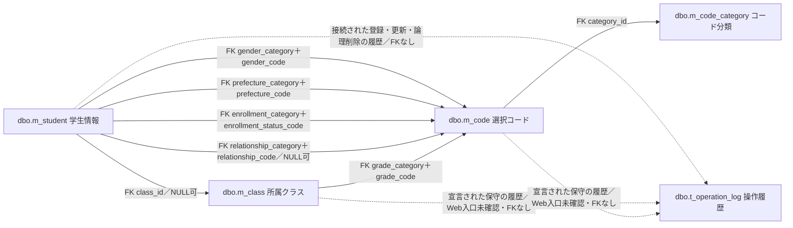
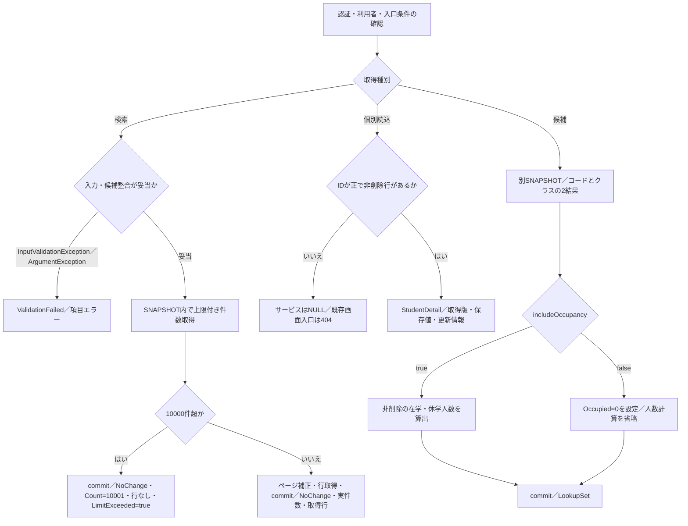
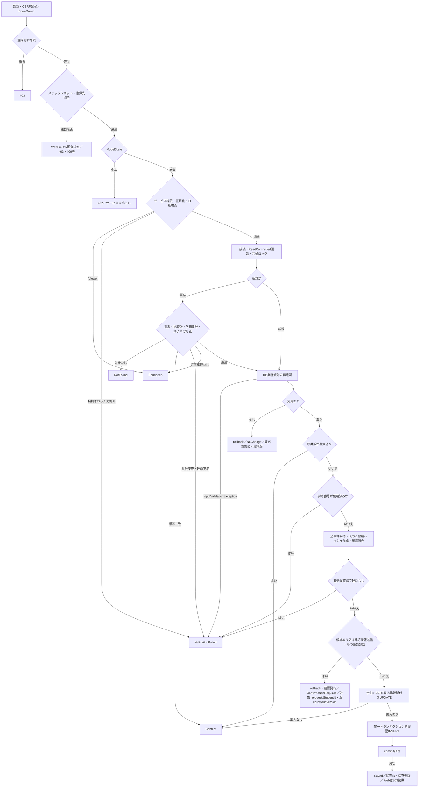
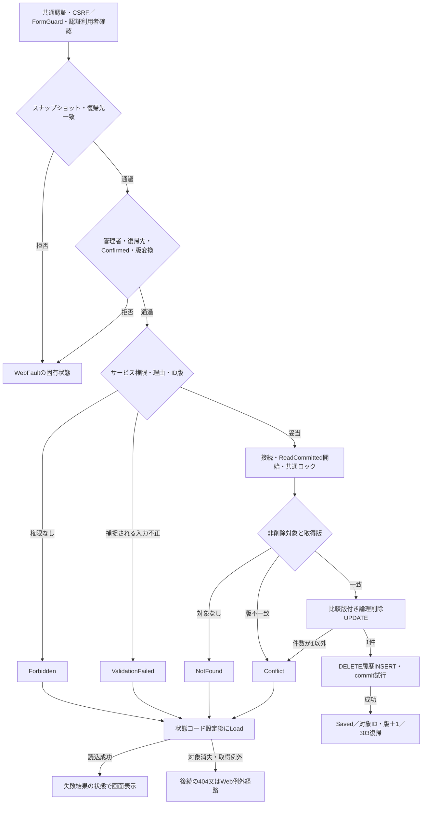
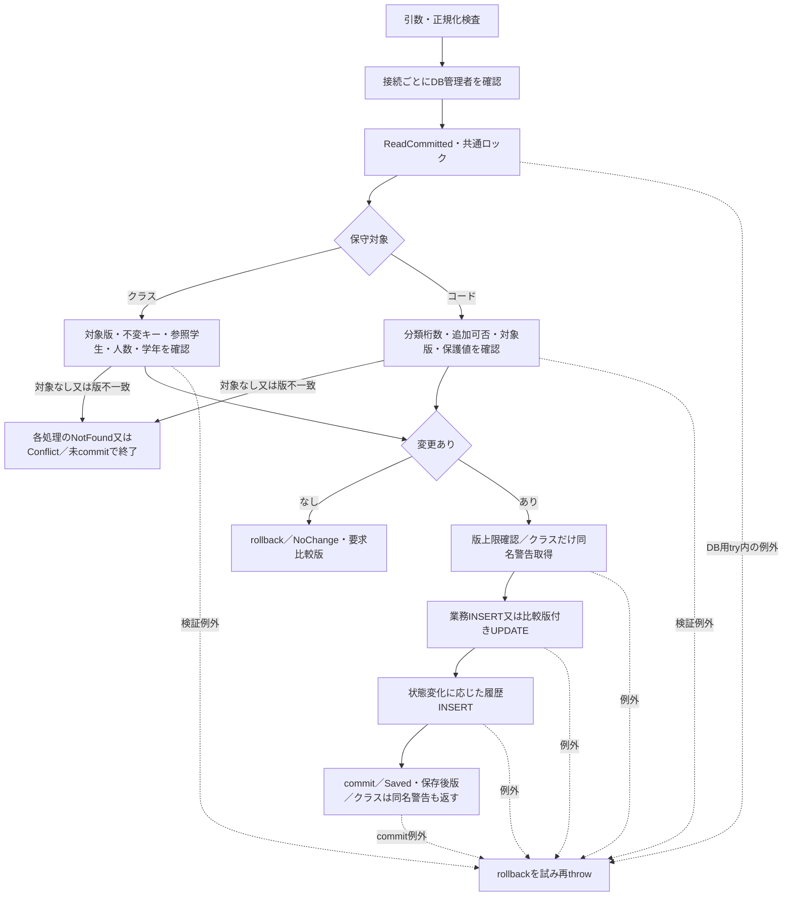
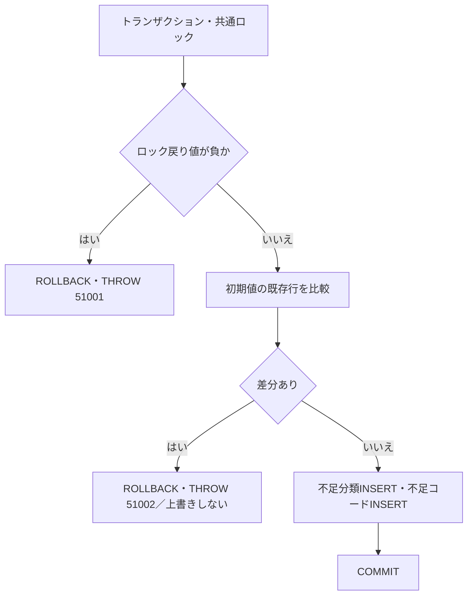

<!-- spec-meta: {"schema":"spec-md/1.0","documentId":"CSHARP_ASPNET-BAS-STU-03","version":"1.0","path":"基本設計書/03_テーブル仕様書.md","sheets":[{"heading":"概要","kind":"GRID","sheet":"概要"},{"heading":"項目一覧","kind":"LIST","sheet":"テーブル索引","key":["No"]},{"heading":"イベント仕様","kind":"GRID","sheet":"データ操作"},{"heading":"補足説明","kind":"GRID","sheet":"横断契約"}]} -->
# 学生管理 テーブル索引・データ関連仕様

| 文書属性 | 内容 |
| --- | --- |
| 文書ID | CSHARP_ASPNET-BAS-STU-03 |
| 文書種別 | table-index／基本設計書 |
| バージョン | 1.0 |
| 文書パス | 基本設計書/03_テーブル仕様書.md |
| 対象 | 学生情報、所属クラス、コード分類、選択コード、操作履歴の5表 |
| 記述区分 | ソースで観測した実装とDDLの宣言。未接続の保守処理は宣言契約として区別する。 |

## 概要

本書は、学生の登録・検索・所属管理で扱う情報を5表の責務に分け、保存先、参照関係、更新主体、整合条件を説明する。学生情報は学生自身の業務値と比較版を保持し、所属クラスと選択コードは選択キー・表示名称・利用条件を提供する。コード分類はコードの用途と桁数・追加可否を定め、操作履歴は業務更新の対象・版・変更列名・実行者・理由を記録する。各表の全列定義は「項目一覧」の個別定義へ対応させる。

学生Webの接続経路は、`Program`によるControllerのマッピング、`WebHostSetup`による`IStudentService`の登録、`StudentsController`と`WebStudentCoordinator`を経由した`SqlServerStudentService`の呼出しである。クラス・コードを書き込む`MasterMaintenanceService`は宣言されているが、このWeb登録・ルートから呼び出す接続は確認できない。保守メソッドの存在を、利用可能な保守画面や公開APIの存在として扱わない。根拠：`sources/Program.cs:3-7`、`sources/Infrastructure/WebHostSetup.cs:12-19`、`sources/Web/Controllers/StudentsController.cs:5-39`、`sources/Core/MasterMaintenanceService.cs:30-121`。

### テーブルの参照関係

実線はDDLで宣言された外部キーを示す。点線は履歴追記時に対象表名と対象キーを文字列で記録する対応であり、外部キーではない。図には宣言されていない多重度を付けない。

7本のFKは参照値の存在を支える。学生の性別・都道府県・在籍区分とクラスの学年は、分類列を固定して用途の異なる同一コード値を区別する。学生の続柄は、緊急連絡先未設定時に分類・コードともNULLとなる。FKだけではコードやクラスの有効状態、利用期間、クラス定員を判定できず、保存サービスが別に確認する。根拠：`sources/database/001_schema.sql:189-199`、`sources/Core/SqlServerStudentService.cs:344-383`。

### 検索JOINと保存列の違い

検索と同一人物候補の共通取得SQLは、学生からクラス、クラスの学年コード、学生の在籍コード、都道府県コードへ`LEFT JOIN`する。学年名・在籍名称・都道府県名は`m_code.code_name`のSQL別名であり、学生表に名称を複製保存する構造ではない。結合には有効状態や期間の条件を付けていないため、停止コードの名称も結合対象となる。

`StudentRow`の年度・学年名・クラスコード・クラス名・在籍名称は結合結果としてNULLを受け得る。一方、参照先の`m_class.class_name`と`m_code.code_name`はNOT NULLである。表示DTOのnullable属性を参照先保存列のNULL属性へ移さない。住所表示は都道府県名と住所1の連結で、都道府県名がNULLなら「[不整合]」を使う。この結果形には住所2を含めない。根拠：`sources/Core/Contracts.cs:50-55`、`sources/Core/SqlServerStudentService.cs:77-90`、`sources/database/001_schema.sql:68-68`、`sources/database/001_schema.sql:115-115`。

## 項目一覧

| No | 論理名 | 物理名・列数 | 業務上の用途 | 読取り主体 | 書込み主体 | 個別定義・生成状態 | 根拠 |
| --- | --- | --- | --- | --- | --- | --- | --- |
| 1 | 学生情報 | `dbo.m_student`／35列 | 学生識別、氏名と照合キー、生年月日、住所・連絡先、入学・在籍・所属、緊急連絡先、備考、論理削除、作成更新情報、比較版を保持する。 | 接続された学生サービスの検索・個別読込・重複候補・人数計算。宣言されたクラス保守の参照学生・所属人数確認。 | 接続された学生サービスのINSERT、比較版付きUPDATE、論理削除UPDATE。 | ID：CSHARP_ASPNET-BAS-STU-03-M_STUDENT kind：table-definition [基本設計書/テーブル/01_m_student.md](テーブル/01_m_student.md) 未生成 | `sources/database/001_schema.sql:7-59` `sources/Core/SqlServerStudentService.cs:137-181`、`:269-315`、`:392-416` `sources/Core/MasterMaintenanceService.cs:53-57` |
| 2 | 所属クラスマスター | `dbo.m_class`／17列 | 年度・学年、クラスコード・名称、期間、定員、表示順、有効状態、備考、作成更新情報、比較版を保持する。人数は保存列ではない。 | 学生サービスの候補・名称結合・年度学年整合・期間・定員確認。宣言されたクラス保守の既存行・同名確認。 | 宣言された`SaveClassAsync`のINSERT・比較版付きUPDATE。Webからの保守入口は未確認。 | ID：CSHARP_ASPNET-BAS-STU-03-M_CLASS kind：table-definition [基本設計書/テーブル/02_m_class.md](テーブル/02_m_class.md) 未生成 | `sources/database/001_schema.sql:62-87` `sources/Core/SqlServerStudentService.cs:196-216`、`:357-383` `sources/Core/MasterMaintenanceService.cs:30-77` |
| 3 | コード分類マスター | `dbo.m_code_category`／11列 | 分類ID・名称、コード桁数、通常追加可否、有効状態、備考、作成更新情報、比較版を保持する。 | 候補取得・学生保存・クラス保守の分類有効状態確認。コード保守の桁数・追加可否取得。 | 初期投入SQLの不足行INSERT。マスター保守サービスに分類保存メソッドはない。 | ID：CSHARP_ASPNET-BAS-STU-03-M_CODE_CATEGORY kind：table-definition [基本設計書/テーブル/03_m_code_category.md](テーブル/03_m_code_category.md) 未生成 | `sources/database/001_schema.sql:90-109` `sources/database/002_seed.sql:88-89` `sources/Core/SqlServerStudentService.cs:203-212`、`:347-354` `sources/Core/MasterMaintenanceService.cs:59-63`、`:91-104` |
| 4 | 選択コードマスター | `dbo.m_code`／14列 | 分類とコード値を組にして名称、表示順、有効状態、期間、保護状態、備考、作成更新情報、比較版を保持する。 | 学生・クラス候補、検索条件の存在確認、名称結合、保存時の利用可否確認。 | 初期投入SQLの不足行INSERT。宣言された`SaveCodeAsync`のINSERT・比較版付きUPDATE。Webからの保守入口は未確認。 | ID：CSHARP_ASPNET-BAS-STU-03-M_CODE kind：table-definition [基本設計書/テーブル/04_m_code.md](テーブル/04_m_code.md) 未生成 | `sources/database/001_schema.sql:112-134` `sources/database/002_seed.sql:90-91` `sources/Core/SqlServerStudentService.cs:82-90`、`:196-222` `sources/Core/MasterMaintenanceService.cs:79-121` |
| 5 | 操作履歴 | `dbo.t_operation_log`／12列 | 対象表・対象キー、操作種別、前後版、変更列名JSON、実行者、UTC日時、相関ID、理由、重複確認有無を記録する。 | 接続されたアプリケーション内に履歴照会処理は確認できない。 | 学生保存・論理削除の`Audit`と、宣言されたクラス・コード保守の`Log`によるINSERT。更新・物理削除処理は確認できない。 | ID：CSHARP_ASPNET-BAS-STU-03-T_OPERATION_LOG kind：table-definition [基本設計書/テーブル/05_t_operation_log.md](テーブル/05_t_operation_log.md) 未生成 | `sources/database/001_schema.sql:137-153` `sources/Core/SqlServerStudentService.cs:385-390` `sources/Core/MasterMaintenanceService.cs:132-135` |

## イベント仕様

### 検索・個別読込・選択候補の取得

#### 処理概要

検索画面は学生情報を条件とページで取得し、登録・編集画面は対象学生と選択候補を取得する。検索、個別読込、候補取得は別のサービス呼出しであり、一連の画面読込全体を一つのSNAPSHOTとして扱わない。検索と候補取得はそれぞれSNAPSHOTトランザクションを使い、個別読込には明示トランザクションがない。根拠：`sources/Core/SqlServerStudentService.cs:103-216`、`sources/Infrastructure/WebStudentCoordinator.cs:17-17`。

#### 処理手順

1. Webの認証と利用者確認を行う。既存学生の読込では復帰先検索状態を確認し、新規画面では登録権限も確認する。
2. 検索はページ・件数・並び順、年度・クラス、未所属との組合せ、在籍区分の重複や許可値を検査し、文字列・電話・日付を正規化する。
3. 検索用SNAPSHOT内で学年・都道府県コードの存在、年度候補、指定クラスと任意の年度・学年の一致を確認する。この存在確認には有効状態・期間の条件を付けない。
4. 同じ検索述語で最大10001行の件数を取得する。10000件を超えた場合はページ行を取得せず、`Count=10001`、`LimitExceeded=true`を返す。
5. 通常検索では要求ページを最終ページ以内へ補正し、指定順と`student_id ASC`でページを取得してcommitする。0件でも検索成功結果となる。
6. 個別読込は正の学生IDを用い、非削除学生だけを取得する。保存済み日付を画面用の和暦成分・西暦文字列へ戻し、保存版と更新情報を`StudentDetail`へ返す。
7. 候補取得は別のSNAPSHOT内でコード、クラスの2結果を読む。編集用では所属人数を算出し、検索用では人数計算を省いて`Occupied=0`を設定する。
8. 編集画面は取得した学生の`class_id`に一致するクラス候補から年度・学年を復元し、入力のコピーと読込情報を編集スナップショットへ保持する。

根拠：`sources/Web/Controllers/StudentsController.cs:8-25`、`:39-39`、`sources/Core/SqlServerStudentService.cs:107-216`、`sources/Web/Inputs/StudentSaveInput.cs:44-54`。

#### 処理フロー

DB接続・SQL・取消等の未処理例外は、この図の入力不正結果へまとめない。入口で生じるWebFaultも固有の状態を保持する。

#### SQL・テーブル関連（ER図）

概要の関連図に従って4業務表を読む。検索件数SQLは学生とクラスの結合、行一覧はさらに学年・在籍・都道府県名称のLEFT JOINを使用する。コード候補はコード分類とのINNER JOINであり、両表の有効状態を合成する。クラス候補の学年コードLEFT JOINは並び順に使う。根拠：`sources/Core/SqlServerStudentService.cs:82-90`、`:156-162`、`:203-208`。

#### DB操作の詳細

検索は常に` s.is_deleted=0 `を適用し、指定された条件をANDで追加する。LIKEの特殊文字`!`、`%`、`_`、`[`は`!`でエスケープする。

| 検索対象 | 述語・加工 | SQLパラメータ |
| --- | --- | --- |
| 学籍番号 | 正規化番号の前方一致。保存表示値`student_no`を検索する。 | `@no`：VarChar、Size=31。末尾にワイルドカードを追加する。 |
| 氏名 | 入力を氏名照合キーへ加工し、`name_key`の部分一致。 | `@name`：NVarChar、Size=642。前後にワイルドカードを追加する。 |
| カナ | 正規化カナから空白を除き、`kana_key`の部分一致。 | `@kana`：NVarChar、Size=74。前後にワイルドカードを追加する。 |
| 年度・学年 | 結合先の`c.school_year=@year`、`c.grade_code=@grade`。 | `@year`：SmallInt、`@grade`：VarChar、Size=2。 |
| クラス・未所属 | 指定時は` s.class_id=@class `。未所属指定時は` s.class_id IS NULL `。年度・学年・クラスとの同時指定は拒否する。 | `@class`：BigInt。未所属条件にパラメータはない。 |
| 都道府県 | `s.prefecture_code=@prefecture`。 | `@prefecture`：VarChar、Size=2。 |
| 電話 | 本人電話または緊急電話が正規化番号に完全一致する。 | `@phone`：VarChar、Size=16。 |
| 入学日範囲 | 開始以上、終了以下。指定した側だけ条件を追加する。 | `@from`、`@to`：Date。 |
| 在籍区分 | 指定値のIN条件。全解除時はIN条件を追加しない。 | `@status0`等：VarChar、Size=2。 |
| ページ | OFFSET/FETCH。ページサイズ20・50・100。 | `@offset`、`@size`：Int。 |

並び順は学籍番号、氏名照合キー、入学日、更新日時の許可された列と昇順・降順から選び、同値時は学生ID昇順とする。件数SQLの10001は上限超過を示す値で、10000件を超える実総件数ではない。根拠：`sources/Core/SqlServerStudentService.cs:107-170`、`sources/Core/StudentNormalizer.cs:161-161`。

個別読込は`student_id=@id AND is_deleted=0`で、`@id`はBigIntである。候補コードは分類ID、表示順、コード値の順に並べ、停止・期間外をWHEREで除外しない。クラスは年度降順、学年表示順、クラス表示順、クラスコード、クラスIDの順に並べる。登録用人数は非削除かつ在学01・休学02の学生COUNTである。検索用の0は実人数を計測した値ではない。SQL実行・読取・結果切替・commitには取消トークンを渡す。根拠：`sources/Core/SqlServerStudentService.cs:172-216`。

#### 結果・例外時の扱い

検索は通常結果と上限超過を`Outcome.NoChange`で返し、`LimitExceeded`と件数・行配列で区別する。入力検証例外とArgumentExceptionは`ValidationFailed`へ変換する。個別読込の対象なしはNULLとなり、既存学生画面の入口では404へ変換する。検索や候補のDB例外を空結果・0件へ変換する実装ではない。未処理例外のWeb応答は、応答開始前に限りmiddlewareがWebFaultの状態または503を設定する。根拠：`sources/Core/SqlServerStudentService.cs:159-181`、`sources/Infrastructure/WebStudentCoordinator.cs:17-20`、`sources/Infrastructure/WebHostSetup.cs:22-24`。

### 学生の登録・更新

#### 処理概要

登録・更新は正規化した学生情報を書き込み、同じトランザクションで履歴を追記する。既存学生では読込時の比較版を要求し、DB再読込後とUPDATEのWHEREの両方で競合を確認する。学籍番号は新規登録時に保存し、既存更新では変更できない。

実入口はPOST `/students/create`とPOST `/students/{id}/update`である。フォーム値は`Input`接頭辞の`StudentSaveInput`へバインドされ、`ToRequest`で`StudentDraft`と`SaveRequest`へ移される。根拠：`sources/Web/Controllers/StudentsController.cs:26-33`、`sources/Web/Inputs/StudentSaveInput.cs:34-43`。

#### 処理手順

1. 認証・CSRFの共通設定を通過した要求について、アクション内ではFormGuard、登録更新権限、編集スナップショット取得、復帰先検索状態の確認、読込時復帰先との一致、ModelStateの順に検査する。
2. サービス入口で利用者、受付Guid、UTC時刻と日本時間の業務日を取得し、Viewerを拒否する。学生情報と任意理由を正規化し、対象ID・比較版の正数性と同時設定、年度範囲、学年コードを検査する。
3. DB接続後にReadCommittedトランザクションを開始し、共通保存ロックを取得する。
4. 既存更新では非削除学生を再読込する。対象なしはNotFound、版不一致はConflict、学籍番号変更はValidationFailedとする。保存済み区分が卒業03・退学04で区分を変える場合は管理者と理由を要求する。
5. DBから用途別コード、クラス、年度・学年の整合、期間、定員を再確認する。既存の同じコードは停止・期間外でも保持できるが、存在確認は行う。新しく席を使う在学・休学学生にはクラスの有効状態・業務日期間・定員を検査する。
6. 正規化値に変更がなければ明示rollbackしてNoChangeを返す。変更があり、取得版がInt64最大ならConflictとする。
7. 学籍番号の使用済み検査を行う。削除行も対象にし、自分以外の同番号があれば拒否する。
8. 非削除、自分以外、同一生年月日、氏名照合キーまたはカナ照合キー一致の全候補を取得し、正規化入力と全候補のID・版からハッシュを作る。
9. 確認情報が送信された場合は所有者・セッション・対象ID・比較版・期限・両ハッシュ・Busyを照合する。有効な確認で続行する場合は理由を必須とする。候補がある、または確認情報が送信され、照合が無効ならrollback後に確認情報を発行してConfirmationRequiredを返す。
10. 新規は学生行をINSERTして採番IDを取得する。既存は比較版付きUPDATEを行い、版を1加算する。書込み結果がNULLまたはDBNullならDBConcurrencyExceptionとする。
11. CREATEまたはUPDATEの履歴を同じトランザクションへ追加し、commitを試みる。commit成功後にSaved、学生ID、保存後版を返す。

根拠：`sources/Infrastructure/WebHostSetup.cs:14-18`、`sources/Web/Controllers/StudentsController.cs:28-33`、`sources/Core/SqlServerStudentService.cs:227-315`、`:344-390`。

#### 処理フロー

図の各拒否結果は、その結果を返す経路の値を保持する。NoChangeとConfirmationRequiredは既存更新時の取得版を返し、新規時だけ対象ID・取得版がNULLになる。SQL等の例外は後述するcatch順序に従い、図の競合・入力不正を一律Unknownへ変更しない。接続・トランザクション開始や未捕捉例外は別のWeb例外経路となる。

#### SQL・テーブル関連（ER図）

概要の関連図の5表を利用する。学生への書込みと操作履歴への追記が確定単位であり、クラス・コード・分類は保存可否の検査に読む。画面に表示した候補や人数は参考値で、共通ロック取得後のDB再確認に代わらない。

#### DB操作の詳細

| 操作 | 対象・述語・設定 | パラメータと結果 |
| --- | --- | --- |
| 既存再読込 | `dbo.m_student`の`student_id=@id AND is_deleted=0`。取得版と比較版を照合する。 | `@id`：BigInt。保存対象列を以前値として保持する。 |
| 学籍番号重複 | `student_no=@no`かつ対象ID未設定または自分以外。削除状態で絞らない。 | `@no`：VarChar、15。`@id`：BigInt、NULL可。COUNT_BIGが0超なら拒否する。 |
| 同一人物候補 | 非削除、自分以外、`birth_date=@birth`、`name_key=@name`または`kana_key=@kana`。学生ID順。固定TOPはない。 | `@birth`：Date、`@name`：NVarChar、320、`@kana`：NVarChar、36、`@id`：BigInt。全件数と先頭最大20件を応答する。 |
| コード再確認 | コードと分類をJOINし、分類ID・コード値で1行を読む。新規・変更値は双方の有効状態と業務日の期間を確認する。 | `@category`：VarChar、24。`@value`：VarChar、10。不存在はE-STU-009、利用不可はE-STU-011。 |
| クラス再確認 | クラスIDで年度・学年・期間・有効状態・定員を読む。任意指定された年度・学年との一致を検査する。 | `@id`：BigInt。不在はE-STU-010、上位不一致はE-STU-014。 |
| 定員確認 | 指定クラス、非削除、在学01・休学02、自分以外のCOUNT_BIGに1を加える。新しく席を使う場合で定員がNULLでないときだけ行う。 | `@class`、`@id`：BigInt。超過はE-STU-102。 |
| 新規INSERT | 正規化保存列、固定分類、非削除状態、作成更新日時・利用者、版1を明示設定する。 | 保存列の型・Sizeは補足説明に示す。`@now`：DateTimeOffset、`@actor`：NVarChar、128。OUTPUTで学生IDを取得する。 |
| 既存UPDATE | 学籍番号をSETから外し、他の保存対象列、更新日時・利用者、版加算を設定する。WHEREは学生ID・比較版・非削除。 | `@id`、`@version`：BigInt。OUTPUTで学生IDを取得する。 |
| 履歴INSERT | 対象表を`m_student`として前後版、変更列名、実行者、理由等を追記する。 | 補足説明の履歴対応に従う。履歴追加後もcommit成功を待つ。 |

卒業・退学で所属・区分・入学日・終了日が変わる場合は、在籍期間とクラス期間の重なりを検査する。在学・休学で同じクラスの席を既に使っていた学生には、新規所属の期間・定員検査を適用しない。定員NULLは上限制限なしを表し、定員0とは異なる。根拠：`sources/Core/SqlServerStudentService.cs:245-307`、`:347-383`。

#### 結果・例外時の扱い

DB処理内のcatchは次の順序である。

| 順序 | 捕捉対象 | 処理とサービス結果 |
| --- | --- | --- |
| 1 | InputValidationException | rollbackを試み、ValidationFailedと項目エラーを返す。 |
| 2 | SqlExceptionの番号2601・2627 | rollbackを試み、学籍番号使用済みのValidationFailed、E-STU-101を返す。 |
| 3 | DBConcurrencyException | rollbackを試み、Conflict、E-STU-105を返す。 |
| 4 | 上記以外で、SqlException・InvalidOperationException・OperationCanceledException | rollbackを試み、書込み開始済みで、commit試行済みまたはrollback失敗の場合にUnknown、それ以外はSystemErrorを返す。 |

Unknownの条件は第4catchに到達した場合だけ適用する。先行catchの捕捉対象を含む全例外へ一般化しない。rollback helperは取消なしで実行し、SQL例外とInvalidOperationExceptionを失敗値へ変換する。接続OpenとBeginTransactionはDB処理用tryの外にある。根拠：`sources/Core/SqlServerStudentService.cs:240-243`、`:316-329`。

無変更と確認要求は明示rollbackする。対象なし・版不一致等の一部早期returnには明示rollback呼出しがなく、未commitのトランザクションを`await using`の破棄対象とする。すべての拒否経路で同じrollback呼出しを行う説明にはしない。

WebはSavedで一回限り通知を置き303で検索へ戻す。NoChangeは200、入力不正は422、権限拒否は403、対象なしは404、競合・確認要求は409、SystemError・Unknownは503へ対応する。ただし失敗・確認時の再描画では候補DB取得が続くため、その取得例外によって最終応答が変わり得る。根拠：`sources/Web/Controllers/StudentsController.cs:30-38`、`sources/Infrastructure/WebPresentation.cs:23-23`。

### 学生の論理削除

#### 処理概要

論理削除は学生行を残したまま削除状態と削除情報を設定し、通常の検索・個別読込・人数計算から除外する。編集中の氏名・住所等は保存しない。実入口はPOST `/students/{id}/delete`であり、管理者だけが利用できる。根拠：`sources/Views/Students/Edit.cshtml:17-17`、`sources/Web/Controllers/StudentsController.cs:37-38`。

#### 処理手順

1. 共通認証・CSRF設定の後、FormGuard、認証利用者確認、編集スナップショット取得、読込時復帰先との一致を確認する。
2. Coordinatorで管理者、復帰先検索状態、Confirmed、比較版文字列から正のInt64への変換を順に確認する。
3. サービスで管理者を再確認し、必須削除理由を原入力・正規化後とも60スカラー以内へ整える。IDと版を正数とし、版がInt64最大なら拒否する。
4. ReadCommitted開始と共通ロック取得後、非削除学生の版を再取得する。対象なしと版不一致を分けて返す。
5. 学生ID・比較版・非削除をWHEREにしたUPDATEで、削除状態、削除日時・利用者・理由、更新日時・利用者、版加算だけを設定する。更新件数1を要求する。
6. 同じトランザクションでDELETE履歴を追記し、commit成功後にSaved、対象ID、版＋1を返す。
7. Webは成功時に通知と303復帰を行う。サービスが失敗結果を返した場合は状態コードを設定した後、Loadで学生・候補を再取得する。

根拠：`sources/Web/Controllers/StudentsController.cs:37-38`、`sources/Infrastructure/WebStudentCoordinator.cs:19-19`、`sources/Core/SqlServerStudentService.cs:392-416`。

#### 処理フロー

SQL等の後段catchから返るSystemError・Unknownも、Webでは状態コード設定後のLoadへ進む。図中の入力・競合結果へまとめず、後述の条件で区別する。

#### SQL・テーブル関連（ER図）

書込み対象は`m_student`と`t_operation_log`である。両表は概要の点線に示す対象表名・対象キーの対応で関連し、履歴側に学生へのFKはない。クラス・コード・分類の書込みは行わない。

#### DB操作の詳細

再読込は`student_id=@id AND is_deleted=0`の版を取得する。UPDATEも同条件に`row_version=@version`を加え、`is_deleted=1`、`deleted_at`、`deleted_by`、`delete_reason`、`updated_at`、`updated_by`、`row_version=row_version+1`を設定する。`@id`と`@version`はBigInt、`@now`はDateTimeOffset、`@actor`はNVarChar・128、`@reason`はNVarChar・120である。

履歴の変更列名はこの7列で、前版は比較版、後版は版＋1、理由は学生の削除理由と同じ正規化値、重複確認有無はfalseとする。学生の物理DELETEではなく、学籍番号の一意制約は削除後も残る。根拠：`sources/Core/SqlServerStudentService.cs:404-414`、`sources/database/001_schema.sql:187-187`。

#### 結果・例外時の扱い

DBConcurrencyExceptionはrollbackを試みてConflictを返す。その後のSQL・InvalidOperation・取消例外を捕捉するcatchでは、書込み開始済みで、commit試行済みまたはrollback失敗ならUnknown、それ以外はSystemErrorとする。接続・BeginTransactionはこのtryの外である。理由検査はInputValidationExceptionだけをサービス結果へ変換するため、不正Unicode等のArgumentExceptionを同じ入力結果へ変換する保証はない。根拠：`sources/Core/SqlServerStudentService.cs:396-416`。

失敗結果の後に再取得した学生が消失していれば404となり、DB取得が失敗すればWeb例外経路となる。サービス結果の状態をそのまま最終HTTP応答と断定しない。根拠：`sources/Web/Controllers/StudentsController.cs:25-25`、`:37-37`、`sources/Infrastructure/WebStudentCoordinator.cs:17-17`。

### クラス・コード保守の宣言契約

#### 処理概要

`SaveClassAsync`と`SaveCodeAsync`は、候補・名称表示に使われるマスターの追加・更新と履歴追記を定義する。接続ごとにDB認証の`ORIGINAL_LOGIN()`と`IS_ROLEMEMBER('student_admin')`を取得し、管理者所属が1でない接続を拒否する。学生Webの利用者Claimによる判定とは別である。根拠：`sources/Core/MasterMaintenanceService.cs:17-28`。これらのメソッドのWeb呼出入口は確認できない。

#### 処理手順

1. クラスは年度1900〜9998、定員NULLまたは1〜9999、非負表示順、IDと比較版の組を検査する。コード9文字、名称18スカラー、学年2桁、備考120スカラーへ正規化し、開始・終了を年度内に収める。
2. コードは許可された5分類、任意比較版の正数性、非負表示順を検査する。名称12スカラー、備考120スカラー、開始日と任意終了日を検査する。
3. DB管理者判定後にReadCommittedを開始し、学生更新と共通の保存ロックを取得する。
4. クラス更新は既存行と比較版を確認し、年度・クラスコード変更を拒否する。削除学生を含む参照学生がいれば学年変更を拒否する。非削除の在学・休学人数がいれば停止・現在期間外化を拒否し、人数未満の定員も拒否する。
5. クラスの学年はコード・分類のJOINで存在確認する。新規または学年変更時だけ双方の有効状態と現在期間を検査する。
6. コードは分類の桁数・通常追加可否を取得し、固定桁数字へ正規化して既存行を読む。比較版付き要求で対象なしならNotFound、既存版との不一致ならConflict、新規で通常追加不可なら例外とする。保護値の停止、開始日の後ろ倒し、無期限から有限期限への変更、既存終了日より前への短縮を拒否する。
7. 両処理とも無変更は明示rollbackしてNoChangeとする。変更があり比較版がInt64最大なら例外とする。クラスは同年度・同学年・同名の別行を確認し、保存結果の警告にする。
8. 比較版付き業務書込みと履歴追記を行い、commit成功後にSavedと保存後版を返す。DB処理用try内の例外はrollbackを試みて再throwする。

根拠：`sources/Core/MasterMaintenanceService.cs:30-121`。

#### 処理フロー

入口の引数検査・DB管理者判定・トランザクション開始の例外は、DB用try内のrollback経路とは区別する。クラスの同名警告はコード保存結果には設定しない。

#### SQL・テーブル関連（ER図）

クラス保守はクラス・学生・学年コード・分類・履歴を利用し、コード保守はコード・分類・履歴を利用する。関連は概要のFKと履歴の文字列対応に従う。分類表の保存処理と、クラス・コードの物理削除処理はない。

#### DB操作の詳細

クラスの参照確認は`m_student WHERE class_id=@id`から全参照件数と非削除の在学・休学人数を得る。同名確認は年度・学年・名称一致かつ自分以外で、名称の一意制約ではない。クラス更新のWHEREはクラスIDと比較版であり、年度・コードは事前に変更を拒否するがUPDATEの保存対象には含む。新規では`grade_category='GRADE'`、作成更新情報、版1を設定し、採番IDをOUTPUTで取得する。

コード更新のWHEREは分類ID・コード値・比較版で、名称・表示順・有効状態・期間・備考・更新情報・版を変更する。新規は`is_protected=0`と版1を明示する。更新SQLには保護状態の変更を含めない。分類取得SQLは桁数と追加可否を読むもので、分類有効状態をコード保守の入口条件にする検査はない。

クラス名称のパラメータはNVarChar・36、コード名称はNVarChar・24、備考はNVarChar・240、実行者はNVarChar・128である。その他のパラメータは保存列に対応するSmallInt、VarChar、Date、Int、Bit、BigIntを指定する。根拠：`sources/Core/MasterMaintenanceService.cs:53-75`、`:91-119`、`:124-135`。

#### 結果・例外時の扱い

クラスはSaved時に同名警告の有無を返す。コードは既存行に比較版未設定の要求を出した場合も版不一致のConflictとなる。通常追加を許可した分類でも、既存キーへの無条件上書きは行わない。

保守のcatchは例外を再throwし、学生サービスのUnknown・SystemError分類を返さない。commit試行中の例外でも、返却されたSavedやrollback成功を推測しない。根拠：`sources/Core/MasterMaintenanceService.cs:48-77`、`:102-121`。

### 初期分類・コードの投入SQL

#### 処理概要

初期投入SQLは5分類と70コードを定義し、既存初期値の差分を拒否して不足行だけを追加する。学生・クラスの初期行を作るINSERTはない。根拠：`sources/database/002_seed.sql:8-91`。

#### 処理手順

1. XACT_ABORTを有効にしてトランザクションを開始し、共通保存ロックを取得する。
2. UTC日時とDB認証実行者を取得し、5分類・70コードの初期値をSQL内の表変数へ用意する。
3. 既存初期分類の名称・桁数・追加可否・有効状態を比較する。既存初期コードは名称・表示順・保護状態・有効状態・開始日・終了日を比較する。
4. 差分があればrollbackして51002を送出し、上書きしない。
5. 差分がなければ不存在の分類を追加し、続いて不存在の分類・コード値の組を追加する。
6. 有効状態1、備考NULL、UTC作成更新日時、DB認証実行者、版1を明示設定してcommitする。

根拠：`sources/database/002_seed.sql:2-13`、`:85-92`。

#### 処理フロー

#### SQL・テーブル関連（ER図）

投入対象は`m_code_category`と`m_code`で、コードから分類へのFKに従い分類を先に追加する。業務表や操作履歴へのINSERTはない。

#### DB操作の詳細

分類はGENDER＝性別・1桁・通常追加不可、ENROLLMENT_STATUS＝在籍区分・2桁・追加不可、PREFECTURE＝都道府県・2桁・追加不可、RELATIONSHIP＝緊急連絡先続柄・2桁・追加可、GRADE＝学年・2桁・追加可である。コード内訳は性別4、在籍4、都道府県47、続柄8、学年7である。

性別0は未回答、在籍01・02・03・04は在学・休学・卒業・退学、学年00は学年なしを表す。保護値は性別0、在籍4値、都道府県全値、学年00である。コードの開始日は1900-01-01、終了日はNULLとし、保護状態と表示順は初期定義値を設定する。不存在判定は分類ID、または分類IDとコード値の組で行う。根拠：`sources/database/002_seed.sql:8-91`。

#### 結果・例外時の扱い

ロック失敗は51001、既存初期値との差分は51002として明示rollbackする。不足行だけを追加するため、一致した既存行の版・作成更新情報を更新する処理ではない。その他の失敗に学生サービスのSaveResultを返すcatchはなく、SQLのトランザクションとXACT_ABORTの宣言に従う。

## 補足説明

### 入力・内部値・保存先・表示値の対応

画面の`asp-for="Input.…"`に対応する要求DTOを、`ToRequest`が学生業務値と制御値へ分ける。下表のDB属性はDDLから、言語型はDTOから確認したものであり、一方から他方を推測したものではない。

| 論理項目 | 実コントロール・要求DTO | 内部値・正規化 | 保存先とDB型・NULL | 検索・表示での使用 |
| --- | --- | --- | --- | --- |
| 学籍番号 | REG-002、input、`Input.StudentNo`：`string` | Trim、NFKC、大文字化。先頭英数字、以後英数字・ハイフン。 | `student_no`：varchar(15)、NOT NULL。 | 前方一致、一覧表示、一意性確認。既存更新は変更不可。 |
| 氏名 | REG-003、input、`Input.StudentName`：`string` | 表示保存値はTrim。照合キーはNFKC・大文字化・全空白除去。 | `student_name`：nvarchar(16)、NOT NULL。`name_key`：nvarchar(320)、NOT NULL。 | 氏名を表示し、検索・同一人物候補は照合キーを使う。 |
| 氏名カナ | REG-004、input、`Input.StudentNameKana`：`string` | NFKC、ひらがなからカタカナへの変換、空白集約。照合キーでは空白を除去する。 | `student_name_kana`、`kana_key`：nvarchar(36)、NOT NULL。 | 表示カナと検索・候補用キーを分ける。 |
| 生年月日 | REG-005、元号select・年月日input。`BirthDateInput`の各成分：`string` | 元号境界・年月日・業務日以前を検査し`DateOnly`へ変換。 | `birth_date`：date、NOT NULL。 | 同一人物候補の同日条件。和暦表示は保存日から生成する。 |
| 性別 | REG-006、select、`Input.GenderCode`：`string` | Trim・NFKC、1桁数字。 | `gender_code`：varchar(1)、NOT NULL。分類は`GENDER`を新規時に固定設定。 | GENDER候補の値と名称。 |
| 郵便番号 | REG-007、input、`Input.PostalCode`：`string` | NFKC、空白・指定ハイフン類除去、7桁数字。 | `postal_code`：varchar(7)、NOT NULL。 | 個別読込の入力復元。 |
| 都道府県 | REG-008、select、`Input.PrefectureCode`：`string` | Trim・NFKC、2桁数字。 | `prefecture_code`：varchar(2)、NOT NULL。分類は`PREFECTURE`を固定設定。 | 都道府県条件、コード名称とのJOIN、住所表示。 |
| 住所1・住所2 | REG-009・010、input、`AddressLine1`：`string`、`AddressLine2`：`string?` | Trim。住所1は必須、住所2の空入力はNULL。 | 各nvarchar(90)。住所1はNOT NULL、住所2はNULL可。 | 一覧住所には都道府県名と住所1を使用。住所2は一覧結果形に含まない。 |
| 本人電話・緊急電話 | REG-011・022、input、各`string?` | NFKC、空白・指定ハイフン類・括弧除去。国内又は国際番号形式を確認。 | `phone_number`、`emergency_phone_number`：varchar(16)、NULL可。 | 電話検索は両列のORによる完全一致。一覧結果は本人電話だけを含む。 |
| 本人メール | REG-012、input、`Input.EmailAddress`：`string?` | Trim、形式確認、ドメインだけ小文字化。 | `email_address`：varchar(60)、NULL可。 | 連絡先の少なくとも一つ必須という検査に使用。 |
| 入学日・終了日 | REG-013・015、date input。入学日：`string`、終了日：`string?` | NFKC後のyyyy-MM-ddを`DateOnly`へ変換。終了日未設定はNULL。 | `admission_date`：date、NOT NULL。`enrollment_end_date`：date、NULL可。 | 入学日の範囲検索、在籍区分と終了日の整合、クラス期間との重なり。 |
| 在籍区分 | REG-014、select、`Input.EnrollmentStatusCode`：`string` | Trim・NFKC、2桁数字。 | `enrollment_status_code`：varchar(2)、NOT NULL。分類は`ENROLLMENT_STATUS`を固定設定。 | 区分検索、名称表示、席を使う01・02の判定、終了日条件。 |
| 年度・学年 | REG-016・017、select。`SchoolYear`：`int?`、`GradeCode`：`string?` | `SaveRequest`へ渡し、選択クラスとの整合を確認する。 | 学生表に独立列はない。参照元はクラスの`school_year`：smallint、`grade_code`：varchar(2)、ともにNOT NULL。 | 上位選択・検索条件。既存入力はclass_idに一致するクラスから復元。 |
| 所属クラス | REG-018、select、`Input.ClassId`：`string?` | NULL・空文字は未所属。それ以外は19文字以内の数字から正の`long`へ変換し、Draftでは`long?`。 | `class_id`：bigint、NULL可。 | 学生の選択・保存キー、クラス名称・年度・学年の取得、人数計算。 |
| 緊急連絡先氏名・続柄 | REG-020、input、氏名：`string?`。REG-021、select、続柄：`string?` | 氏名はTrim、続柄は2桁数字。続柄ありなら分類`RELATIONSHIP`を生成、なしなら分類もNULL。 | 氏名nvarchar(16)、続柄varchar(2)、分類varchar(24)。各NULL可。 | 緊急電話を含む全設定・全未設定の整合。RELATIONSHIP候補を使用。 |
| 備考 | REG-023、textarea、`Input.Remarks`：`string?` | 改行をLFへ統一しTrim。空入力はNULL。 | `remarks`：nvarchar(240)、NULL可。 | 個別読込と保存。 |
| 確認・変更理由 | REG-024、textarea、`Input.OperationReason`：`string?` | `SaveRequest.Reason`へ渡し、複数行Textとして正規化。 | `t_operation_log.operation_reason`：nvarchar(120)、NULL可。学生の通常保存列ではない。 | 終了区分訂正、重複確認続行の理由。 |
| 削除理由 | REG-026、textarea、`Reason` | 必須の複数行Textとして正規化。 | `m_student.delete_reason`と履歴`operation_reason`：nvarchar(120)、NULL可の列だが削除時必須。 | 削除情報とDELETE履歴の両方へ保存する。 |

根拠：`sources/Views/Students/Edit.cshtml:5-17`、`sources/Web/Inputs/StudentSaveInput.cs:9-60`、`sources/Core/Contracts.cs:8-29`、`:66-70`、`sources/Core/StudentNormalizer.cs:47-158`、`sources/Core/JapaneseDateService.cs:17-59`、`sources/database/001_schema.sql:9-37`、`sources/Core/SqlServerStudentService.cs:183-194`、`:233-234`、`:294-301`、`:409-413`。

クラス選択値の年度・学年をJavaScriptが上位選択へ反映し、上位条件と不一致になればクラスを解除する。人数と定員は参考表示で、学生表の保存列ではない。学年名称・クラス名称・コード名称は候補の表示値であり、選択済キーと区別する。根拠：`sources/Views/Students/Edit.cshtml:12-12`、`sources/wwwroot/js/site.js:8-8`。

### 文字上限と格納容量

サービスはサロゲートペアを1Unicodeスカラーとして数え、不正な単独サロゲートをArgumentExceptionとする。Textは原入力上限、制御文字、改行処理、Trim、正規化後上限の順に検査する。ブラウザーのmaxlengthはUTF-16コード単位の制約であり、スカラー上限とは別に扱う。`nvarchar(n)`のnもUTF-16の格納単位で、n個の任意Unicode文字を意味しない。

| 値 | サービスの原入力→正規化後上限 | DB型・容量 | 保存SQLパラメータ型・Size | ブラウザーmaxlength |
| --- | --- | --- | --- | --- |
| 学籍番号 | 15→15スカラー、許可されたASCII形式 | varchar(15) | VarChar・15 | 30 |
| 氏名／氏名照合キー | 氏名8→8。生成した照合キーは160スカラー以内。 | nvarchar(16)／nvarchar(320) | NVarChar・16／320 | 氏名16。照合キー入力なし。 |
| カナ／カナ照合キー | 36→18スカラー。キーは正規化カナの空白除去値。 | 各nvarchar(36) | 各NVarChar・36 | カナ72。キー入力なし。 |
| 郵便番号 | 原入力10スカラー、保存値7桁 | varchar(7) | VarChar・7 | 20 |
| 住所1・住所2 | 各45→45スカラー | 各nvarchar(90) | 各NVarChar・90 | 各90 |
| 本人電話・緊急電話 | 原入力20スカラー、保存形式は最大16文字 | 各varchar(16) | 各VarChar・16 | 各40 |
| 本人メール | 60→60スカラー、許可形式はASCII | varchar(60) | VarChar・60 | 120 |
| 緊急連絡先氏名 | 8→8スカラー | nvarchar(16) | NVarChar・16 | 16 |
| 備考 | 120→120スカラー | nvarchar(240) | NVarChar・240 | 240 |
| 確認・変更理由／削除理由 | 各60→60スカラー | nvarchar(120) | NVarChar・120 | 各120 |
| クラスコード／名称 | 宣言保守でコード9→9、名称18→18スカラー | varchar(9)／nvarchar(36) | VarChar・9／NVarChar・36 | 保守画面未接続のため画面上限を定義しない。 |
| コード名称 | 宣言保守で12→12スカラー | nvarchar(24)、NOT NULL | NVarChar・24 | 保守画面未接続のため画面上限を定義しない。 |
| 分類名称 | 通常保存処理の上限は未確認。DDL CHECKは12スカラー。 | nvarchar(24)、NOT NULL | 通常保存パラメータなし | 分類編集画面は確認できない。 |

根拠：`sources/Core/StudentNormalizer.cs:37-117`、`:124-142`、`sources/Core/SqlServerStudentService.cs:30-37`、`sources/Core/MasterMaintenanceService.cs:32-35`、`:73-73`、`:82-83`、`:115-115`、`sources/Views/Students/Edit.cshtml:6-17`、`sources/database/001_schema.sql:9-58`、`:65-108`、`:113-153`。

DDLの名称・住所・備考・理由等のCHECKは、SC照合順序で末尾記号を加えたLENから1を引き、末尾空白も含めたスカラー上限を設ける。識別値・コード・照合キーには`Latin1_General_100_BIN2`、名称・説明・実行者等には`Latin1_General_100_CS_AS_SC`を使用する。氏名表示値と照合キーには異なる加工・照合順序が適用される。DB容量から未確認の業務上限を逆算しない。

### 共通制約と状態別必須

| 対象 | 制約と業務上の意味 | 根拠 |
| --- | --- | --- |
| 主キー | 学生ID、クラスID、履歴IDはbigint IDENTITY(1,1)のPK。分類は分類ID、コードは分類ID・コード値の複合PK。 | `sources/database/001_schema.sql:8-43`、`:63-80`、`:91-102`、`:113-127`、`:138-150` |
| 学籍番号一意性 | `student_no`の一意制約は削除行を含む。論理削除後も同番号を再使用できない。 | `sources/database/001_schema.sql:187-187`、`sources/Core/SqlServerStudentService.cs:264-266` |
| クラス一意性 | 一意キーは年度・クラスコード。同年度・同学年・同名は保守の警告で、クラス名称の一意制約ではない。 | `sources/database/001_schema.sql:188-188`、`sources/Core/MasterMaintenanceService.cs:69-76` |
| 分類固定 | 学生の性別・都道府県・在籍分類を固定し、クラスの学年分類をGRADEとする。緊急連絡先設定時の続柄分類はRELATIONSHIP。 | `sources/database/001_schema.sql:196-199` |
| 学生日付 | 生年月日・入学日は1900年以降で、生年月日≦入学日。サービスは学生の日付を業務日以前に制限するが、DDL CHECKには業務日上限がない。 | `sources/database/001_schema.sql:198-198`、`sources/Core/JapaneseDateService.cs:17-29`、`:52-59` |
| 在学・休学 | 区分01・02は終了日NULLかつクラス必須。NULL可能なclass_id列でも、この状態では必須になる。 | `sources/database/001_schema.sql:198-198`、`sources/Core/StudentNormalizer.cs:152-154` |
| 卒業・退学 | 区分03・04は終了日必須かつ入学日以降。所属クラスを設定し関係項目を変更する場合、保存サービスが在籍期間との重なりも確認する。 | `sources/database/001_schema.sql:198-198`、`sources/Core/SqlServerStudentService.cs:372-374` |
| 連絡先 | 本人電話・メール・緊急電話の少なくとも一つを必要とする。緊急氏名・続柄分類・続柄コード・緊急電話は全NULL又は全設定。 | `sources/database/001_schema.sql:199-199`、`sources/Core/StudentNormalizer.cs:155-157` |
| 論理削除 | 非削除では削除日時・利用者・理由を全NULL、削除済みでは全設定にする。 | `sources/database/001_schema.sql:200-200` |
| クラスの容量・期間 | 年度1900〜9998、開始≦終了、当年度4月1日〜翌年3月31日内。定員NULL又は1〜9999、表示順は非負。定員NULLは上限制限なし。 | `sources/database/001_schema.sql:201-201`、`sources/Core/SqlServerStudentService.cs:377-380` |
| コード桁数・期間 | 分類の桁数は1〜10。コードは空でない数字列、開始1900年以降、終了NULL又は開始以降、表示順非負。分類別桁数の照合は保守サービスが行い、DDLには分類表との桁数照合CHECKがない。 | `sources/database/001_schema.sql:202-203`、`sources/Core/MasterMaintenanceService.cs:91-96` |
| 履歴形式 | 操作はCREATE・UPDATE・DELETE・DISABLE・ENABLE。変更列名は有効JSONかつ先頭が配列開始記号であることをCHECKする。全要素が実在列名かどうかはDDLで検査しない。 | `sources/database/001_schema.sql:204-205` |

### DEFAULT・採番・処理設定値

IDENTITYによるID採番、DDLのDEFAULT、処理による明示設定は別の契約である。

| 設定対象 | DDLのDEFAULT | 処理が設定する値 |
| --- | --- | --- |
| 学生の削除状態 | 0 | 新規INSERTで0、論理削除で1を明示する。 |
| 4業務表の比較版 | 1 | 学生・クラス・コードの新規とseedで1を明示する。更新処理は1加算する。分類の通常更新処理はない。 |
| クラス・コードの表示順 | 0 | 保守要求値又はseedの初期定義値を明示する。 |
| クラス・分類・コードの有効状態 | 1 | 保守要求値又はseedの1を明示する。 |
| 履歴の重複確認有無 | 0 | 学生保存では候補件数0超、削除・保守ではfalseを明示する。 |
| 作成更新日時・利用者 | DEFAULTなし | 学生はWeb利用者とUTC時刻、保守・seedはDB認証実行者とUTC時刻を設定する。 |

根拠：`sources/database/001_schema.sql:34-42`、`:72-79`、`:95-101`、`:116-149`、`sources/Core/SqlServerStudentService.cs:294-307`、`sources/Core/MasterMaintenanceService.cs:113-135`、`sources/database/002_seed.sql:88-91`。

業務表の作成更新日時、学生削除日時、履歴実行日時は`datetimeoffset(7)`で、DDLはUTCオフセット0を要求する。学生サービスはTimeProviderのUTC時刻、保守はDateTimeOffset.UtcNow、seedはSYSUTCDATETIMEをUTCオフセット付きにした値を使う。表示時は日本時間へ変換して`yyyy/MM/dd HH:mm:ss`とする。比較版`row_version`は正のbigintで、SQL Serverの自動rowversion型ではない。履歴の前版はNULL可、後版はNOT NULLだが、履歴版自体に正数CHECKはない。根拠：`sources/database/001_schema.sql:35-59`、`:75-109`、`:122-153`、`sources/Core/SqlServerStudentService.cs:44-45`、`:292-307`、`sources/Core/MasterMaintenanceService.cs:40-40`、`sources/database/002_seed.sql:7-7`、`sources/Infrastructure/WebPresentation.cs:5-7`。

### 排他・取消・索引

学生保存・削除、宣言されたマスター保守、初期投入SQLは、資源`test-project1:student-write`のExclusiveアプリケーションロックをトランザクション所有で取得する。待機は5000ミリ秒で、負の戻り値は51001となる。学生・保守が使うGateはXACT_ABORTを有効にする。比較版はこのロックと併用し、ロック規約を使わない外部更新を排除できるとの保証は付けない。根拠：`sources/Core/SqlServerStudentService.cs:92-101`、`sources/Core/MasterMaintenanceService.cs:39-42`、`:88-90`、`sources/database/002_seed.sql:3-6`。

学生接続は暗号化必須・証明書信頼省略なしに構築し、Open時にSNAPSHOT有効状態を確認する。通常コマンドのタイムアウトは30秒である。ParamはSQL型とSizeを指定し、DateOnlyを午前0時のDateTimeへ変換し、NULLをDBNull.Valueへ渡す。読取・書込み・commitには要求の取消トークンを渡すが、例外処理用rollback helperはCancellationToken.Noneを使う。根拠：`sources/Core/SqlServerStudentService.cs:39-72`、`:329-329`。

| 索引名 | キーと抽出条件 | 使用する業務値 |
| --- | --- | --- |
| ix_student_birth | birth_date、非削除行 | 同一人物候補の生年月日条件。 |
| ix_student_class_status | class_id・enrollment_status_code、非削除行 | 所属条件、在学・休学人数。 |
| ix_student_admission | admission_date、非削除行 | 入学日範囲・並び順。 |
| ix_student_updated | updated_at、非削除行 | 更新日時の並び順。 |
| ix_student_phone | phone_number、非削除行 | 本人電話一致。 |
| ix_student_emergency_phone | emergency_phone_number、非削除行 | 緊急電話一致。 |
| ix_operation_target | target_table・target_key・executed_at | 履歴対象と実行日時。接続された履歴照会処理の存在を意味しない。 |

これらはDDLに宣言された索引と処理が使う値の対応である。根拠：`sources/database/001_schema.sql:206-212`、`sources/Core/SqlServerStudentService.cs:137-164`、`:269-271`、`:378-380`。

### 操作履歴への対応

履歴は変更列名の配列をJSONで保存し、変更前後の個人情報値を記録する実装ではない。学生新規は保存列と固定分類・状態・作成更新情報・版、学生更新は差分列と更新情報・版、削除は削除関連7列を記録する。保守のLogは保守値辞書から抽出した変更列名を記録し、学生Auditと同じ列名集合へ補完する処理ではない。

| 書込み主体 | 対象表・対象キー | 操作と版 | 実行者・理由・重複確認 |
| --- | --- | --- | --- |
| 学生登録・更新 | `m_student`、学生IDの十進文字列 | CREATE又はUPDATE。新規前版NULL、更新前版は取得版、後版は保存後版。 | Web利用者Principal、UTC時刻、受付Guid。任意理由又は必須化された理由。重複確認は保存時候補件数0超で設定。 |
| 学生論理削除 | `m_student`、学生IDの十進文字列 | DELETE、前版は比較版、後版は版＋1。 | Web利用者Principal、UTC時刻、受付Guid。削除理由、重複確認false。 |
| 宣言されたクラス保守 | `m_class`、クラスIDの十進文字列 | 新規CREATE。同じ有効状態はUPDATE、無効→有効はENABLE、有効→無効はDISABLE。 | DB認証実行者、UTC時刻、新規Guid。理由NULL、重複確認false。 |
| 宣言されたコード保守 | `m_code`、分類ID＋「:」＋コード値 | クラス保守と同じ操作判定。新規前版NULL、更新前版は要求比較版、後版は保存後版。 | DB認証実行者、UTC時刻、新規Guid。理由NULL、重複確認false。 |

対象表名はVarChar・21、対象キーはVarChar・35、操作種別はVarChar・11、前後版はBigInt、変更列名JSONはNVarChar・Size=-1、実行者はNVarChar・128、日時はDateTimeOffset、相関IDはUniqueIdentifier、理由はNVarChar・120、重複確認有無はBitで渡す。対象表・キーは業務表へのFKではない。根拠：`sources/Core/SqlServerStudentService.cs:306-307`、`:385-389`、`:413-413`、`sources/Core/MasterMaintenanceService.cs:74-75`、`:118-119`、`:132-135`、`sources/Core/AuditOperation.cs:6-7`、`sources/database/001_schema.sql:139-149`。

### Web権限とDB権限

Webは認証ClaimsからViewer・Staff・Administratorを取得する。Viewerの登録更新と管理者以外の削除をWeb入口・学生サービスの双方で拒否する。DB接続のロール所属はこのClaimとは独立している。

| DBロール | GRANT | DENY | 継承・利用関係 |
| --- | --- | --- | --- |
| student_viewer | 学生・クラス・分類・コードのSELECT | このSQLに明示DENYなし | student_staffをメンバーに含む。 |
| student_staff | 学生INSERT・UPDATE、履歴INSERT | 学生DELETE、履歴UPDATE・DELETE | student_viewerの権限を継承し、student_adminをメンバーに含む。 |
| student_admin | クラス・コードINSERT・UPDATE | クラス・コードDELETE、分類INSERT・UPDATE・DELETE | student_staffの権限を継承。宣言保守は接続ごとにこの所属を検査する。 |

この権限SQLには履歴SELECT、確認表・実行状態表のDML許可がない。分類の初期投入と通常Web用権限を分け、管理者Claimが分類を自由に編集できるとは扱わない。根拠：`sources/Infrastructure/RequestIdentity.cs:7-16`、`sources/Core/SqlServerStudentService.cs:229-230`、`:394-395`、`sources/database/003_web_permissions.sql:8-24`、`sources/Core/MasterMaintenanceService.cs:23-26`。

### 補助DDLと接続された保持領域

| 保持領域 | 保持内容・検査 | 接続と業務上の位置付け | 根拠 |
| --- | --- | --- | --- |
| dbo.t_confirmation | tokenのuniqueidentifier PK、principal、セッションGuid、任意対象ID・版、入力・候補のbinary(32)ハッシュ、UTC期限、消費状態。 | DB確認分岐の保存先。WebはwebTokens=trueで、この分岐を選ばない。5表の個別定義索引へ追加しない。 | `sources/database/001_schema.sql:156-168`、`sources/Infrastructure/WebHostSetup.cs:19-19` |
| 学生サービスのWebConfirmations | 所有者・セッション・対象ID・版・両ハッシュ・期限・Busyをstatic ConcurrentDictionaryに保持。 | 接続されたWeb確認の保持先。入口取得時刻nowを基準に10分。有効性照合とBusyの原子的取得を行う。 | `sources/Core/SqlServerStudentService.cs:19-29`、`:229-229`、`:276-278`、`:330-335` |
| EditorSnapshotStore | 所有者・セッション・対象ID、読込Detail、元入力のJSONコピー、30分期限、復帰版。 | Singletonのメモリ辞書。resetは元入力へ戻し候補だけ再取得する。最新再読込は学生DBを再取得する。 | `sources/Infrastructure/EditorSnapshotStore.cs:7-11`、`sources/Infrastructure/WebHostSetup.cs:13-13`、`sources/Web/Controllers/StudentsController.cs:25-35` |
| SearchContextStore | 所有者・セッション・タブ、30分期限、検索状態版、適用条件、最終結果、SemaphoreSlim。 | メモリ辞書。待機前と待機後に所有者・期限等を確認し、要求版を照合する。DB比較版とは別。 | `sources/Infrastructure/SearchContextStore.cs:9-15` |
| FlashMessageStore | 利用者・セッション・検索状態IDを組にしたキーと10分の通知。 | メモリ辞書。TakeのTryRemoveで一回取り出す。保存・削除後の303復帰通知に使用。 | `sources/Infrastructure/FlashMessageStore.cs:6-9`、`sources/Web/Controllers/StudentsController.cs:38-38` |
| dbo.t_runtime_state | state_idのvarchar(64) PK、所有者、セッション、種別、varbinary(max)ペイロード、UTC期限、正のbigint版、消費状態。 | DDL宣言はあるが、上記ストアからの読書き接続は確認できない。暗号化・復号・消費を稼働処理として定義しない。 | `sources/database/001_schema.sql:171-184`、`sources/Infrastructure/EditorSnapshotStore.cs:7-11`、`sources/Infrastructure/SearchContextStore.cs:9-15`、`sources/Infrastructure/FlashMessageStore.cs:6-9` |

Web確認はcommit成功後に除去し、保存の最後のcatchでUnknownとなった場合も除去する。取得した確認があり、成功でもUnknownでもない終了はfinallyでBusyを解放する。期限照合直前に現在時刻を取り直す処理ではない。画面上の確認取消・入力変更はhiddenの確認値を空にする操作で、DB確認行の消費更新ではない。根拠：`sources/Core/SqlServerStudentService.cs:313-335`、`sources/wwwroot/js/site.js:3-6`。

未選択のDB確認分岐では、所有者・セッション・対象ID・版・期限・未消費を条件にUPDLOCKでハッシュを読む。確認発行は業務トランザクションrollback後の別トランザクションINSERT、消費は業務更新と同じトランザクションのUPDATEである。この宣言契約をWeb確認の永続化へ置き換えない。根拠：`sources/Core/SqlServerStudentService.cs:279-284`、`:308-311`、`:337-342`。

検索状態は検索・ページ・クリア、および適用検索条件のある再開で版を加算する。適用条件がない再開は未検索表示を返し、版を加算しない。Useを通った正常操作では期限を延長する。根拠：`sources/Infrastructure/WebStudentCoordinator.cs:7-15`、`sources/Infrastructure/SearchContextStore.cs:14-14`。

### 受信・変換と例外の境界

非nullable参照型への暗黙Requiredは抑止されており、DTOの`string`宣言やブラウザーrequiredは受信NULLを排除する実行保証ではない。ToRequestはBirthDateInput全体のNULLを新しい入力へ補完するが、内部Year・Month・DayのNULLは補完しない。これらのNormalizeや入学日のNormalizeでNULL参照例外が生じ得る経路は、TextがNULLを空文字にして必須エラーへ進む経路とは異なる。正規化のSetと保存前catchが捕捉するInputValidationException・ArgumentExceptionへ、NULL参照例外を含めない。根拠：`sources/Infrastructure/WebHostSetup.cs:16-16`、`sources/Web/Inputs/StudentSaveInput.cs:34-43`、`sources/Core/StudentNormalizer.cs:47-55`、`:119-143`、`sources/Core/JapaneseDateService.cs:19-24`、`:52-59`、`sources/Core/SqlServerStudentService.cs:232-239`。

編集SnapshotIdも、NULL・空文字・不在キーを同じ拒否結果へまとめない。EditorSnapshotStore.GetはNULLの明示検査より先にConcurrentDictionary.TryGetValueを呼ぶ。NULLキーが到達した場合のライブラリ例外経路と、空文字・不在キー・期限切れを独自WebFaultの409とする経路、所有者・セッション・対象不一致を403とする経路を区別する。検索状態Getには先行するNULL検査がある。根拠：`sources/Infrastructure/EditorSnapshotStore.cs:10-10`、`sources/Infrastructure/SearchContextStore.cs:13-14`。

### 配備検証SQLが確認する契約

権限SQLと検証SQLは対象DB名を`contextbase_test_project1_mvc`に限定する。検証SQLはExpressメジャー17、SNAPSHOT有効、dbo配下の7表と列数、FK・CHECKの有効かつ信頼状態、FK数7、続柄のNULL属性・FK・CHECK、分類数5、初期70コードキーの存在、明示GRANT・DENYとロール継承を検査する。コード総件数を70に固定する条件はなく、末尾SELECTで現在件数を返す。

末尾のPASSはこれらの条件を通過した場合に返すSQLの宣言である。検査対象はDBローカルの明示権限で、Windowsグループ・サーバー権限を含む実効権限とは区別される。根拠：`sources/database/003_web_permissions.sql:5-7`、`sources/database/004_verify_deployment.sql:3-25`、`:26-99`、`:100-134`。

### 関連文書

以下は提示された文書計画との対応であり、リンク先は未生成である。

| 文書ID・kind | 正式パスと本書からの相対リンク | 本書との対応 | 生成状態 |
| --- | --- | --- | --- |
| CSHARP_ASPNET-BAS-STU-02／basic-design | [基本設計書/02_学生登録画面.md](02_学生登録画面.md) | 登録・編集・参照の項目とイベントを、本書の保存先・状態別制約へ対応させる。 | 未生成 |
| CSHARP_ASPNET-BAS-STU-04／code-design | [基本設計書/04_コード設計書.md](04_コード設計書.md) | 分類別コード、候補、初期定義、クラス・コード保守の宣言契約を対応させる。 | 未生成 |
| CSHARP_ASPNET-DET-CSharp_ASPNET-SCR-STU-002／detailed-specification | [詳細仕様書/CSharp_ASPNET/02_学生登録画面.md](../詳細仕様書/CSharp_ASPNET/02_学生登録画面.md) | 実コントロール、受信と変換、サービス引数、SQL、確認・検索・編集状態、最終応答の詳細を対応させる。 | 未生成 |
