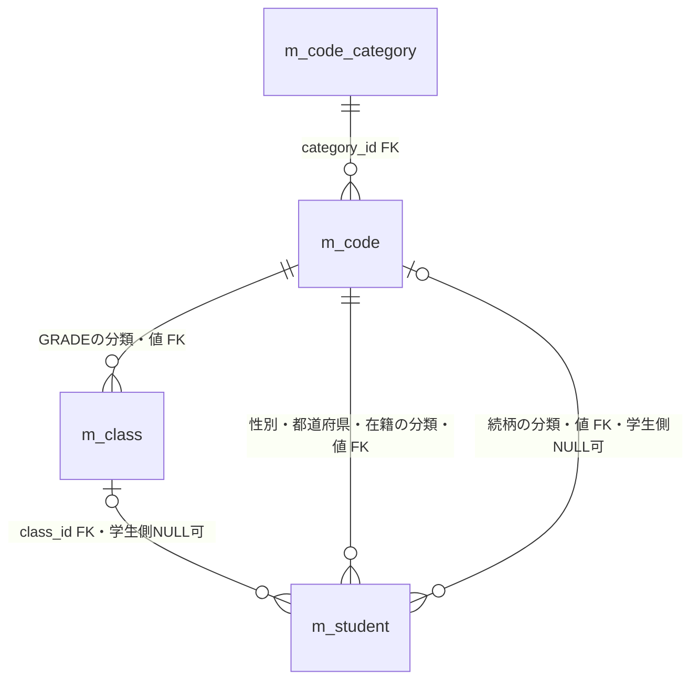
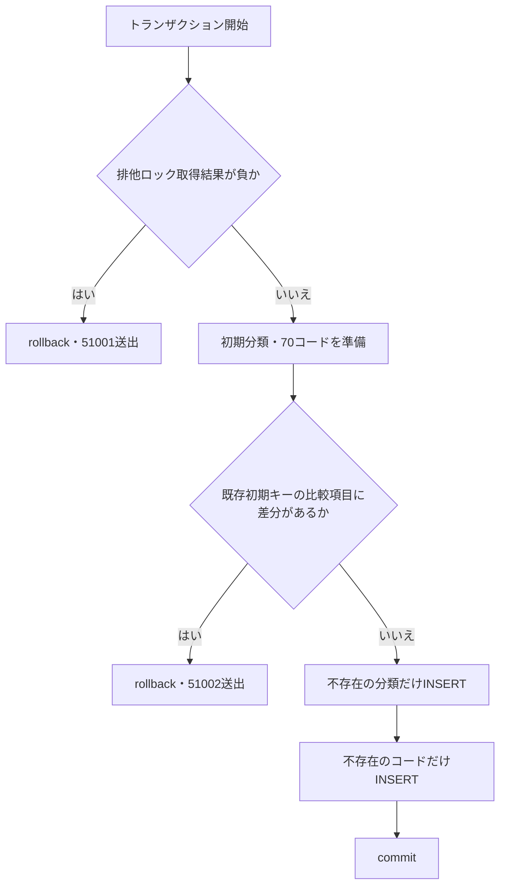
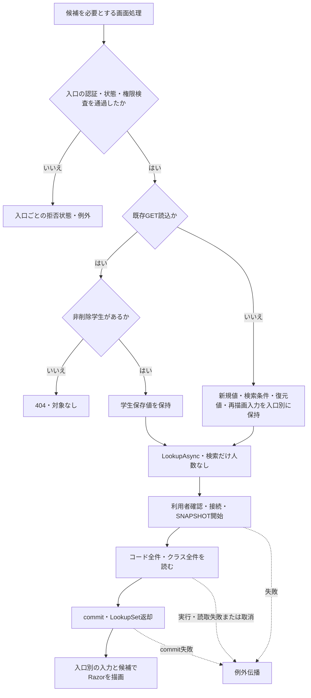
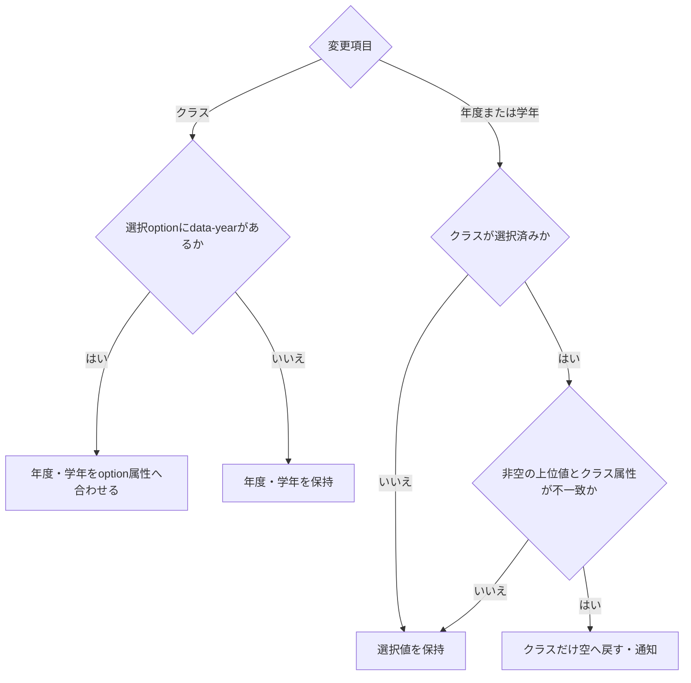
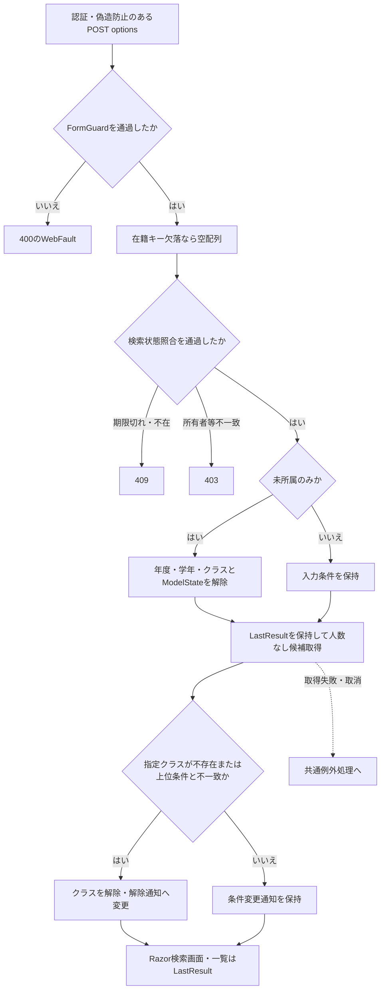
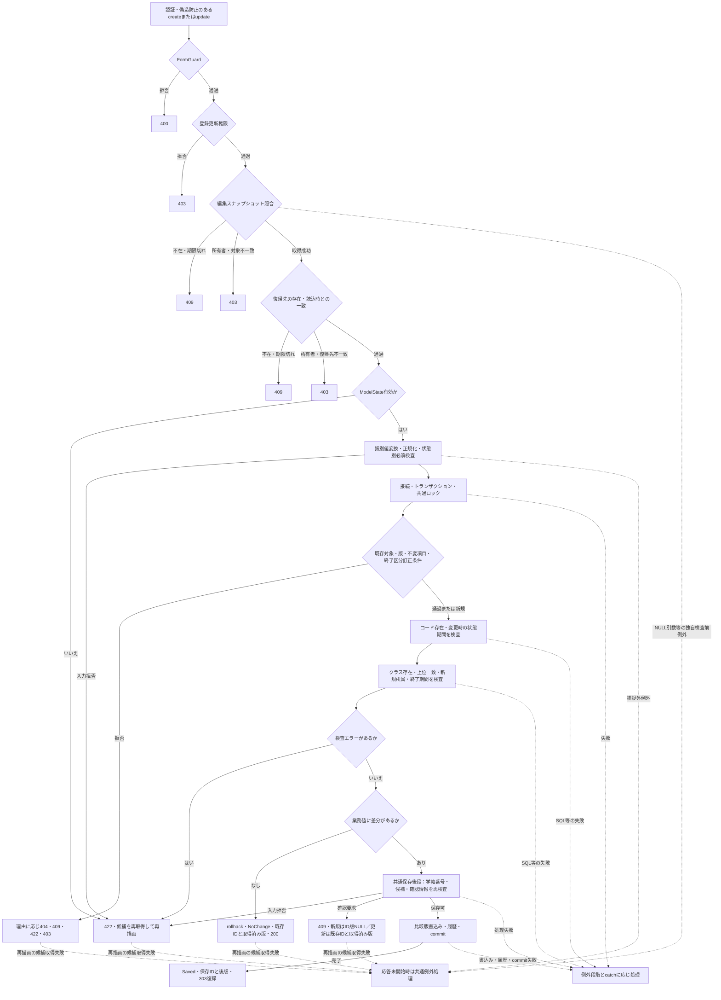
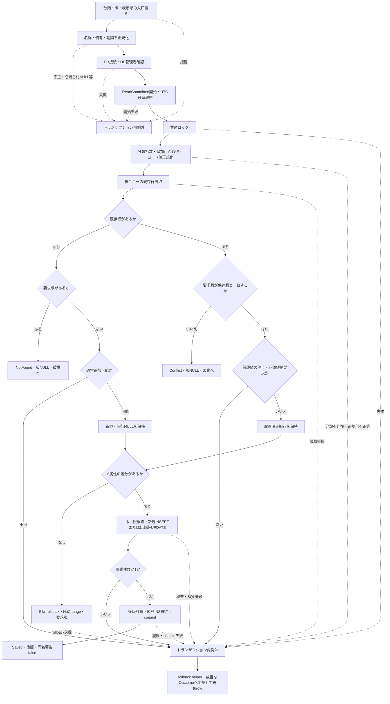
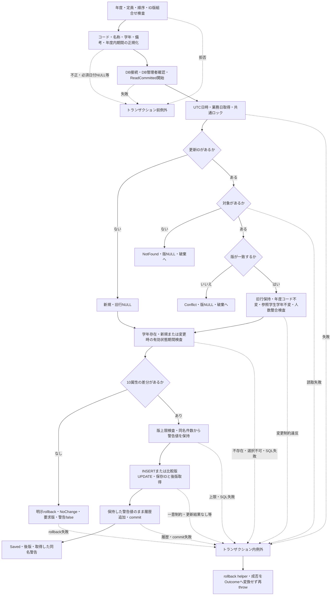

<!-- spec-meta: {"schema":"spec-md/1.0","documentId":"CSHARP_ASPNET-BAS-STU-04","version":"1.0","path":"基本設計書/04_コード設計書.md","sheets":[{"heading":"概要","kind":"GRID","sheet":"概要"},{"heading":"項目一覧","kind":"LIST","sheet":"項目一覧","key":["項目ID"]},{"heading":"初期コード一覧","kind":"LIST","sheet":"初期コード一覧","key":["分類ID","コード値"]},{"heading":"イベント仕様","kind":"GRID","sheet":"イベント仕様"},{"heading":"補足説明","kind":"GRID","sheet":"補足説明"}]} -->
# 学生管理 コード分類・候補・保守契約設計書

文書ID：CSHARP_ASPNET-BAS-STU-04  
文書種別：code-design／基本設計書  
版：1.0  
文書パス：基本設計書/04_コード設計書.md

## 概要

本書は、学生の属性と所属を選ぶためのコード分類、初期コード、候補取得、選択値の保持・再検査、および候補の保存元を変更する保守サービスの契約を定義する。コードの識別子は分類IDとコード値の組合せであり、画面には名称を表示する。名称を変更しても、学生・クラスに保存された参照キーは変わらない。クラスはコード表の一分類ではなく、年度・学年・期間・定員を持つ別マスターである。根拠：`sources/database/001_schema.sql:62-134`、`sources/Core/Contracts.cs:61-67`。

学生Web画面は、`IStudentService`に登録された`SqlServerStudentService`から候補を取得する。`MasterMaintenanceService`のコード・クラス保存メソッドは別に宣言されているが、確認できるWeb登録・ルートにはその呼出しがない。本書の保守イベントはこのサービスを直接呼び出した場合の契約であり、保守画面、公開HTTP API、CLI操作手順を定義するものではない。根拠：`sources/Core/Contracts.cs:71-78`、`sources/Infrastructure/WebHostSetup.cs:12-19`、`sources/Web/Controllers/StudentsController.cs:5-41`、`sources/Core/MasterMaintenanceService.cs:9-15,30-30,79-79`。

### 分類の定義

| 分類ID | 分類名称 | コード桁数 | 初期件数 | 通常追加 | 初期保護値 | 主な用途 |
| --- | --- | --- | --- | --- | --- | --- |
| `GENDER` | 性別 | 1桁 | 4件 | 不可 | `0` | 学生の性別選択・保存 |
| `ENROLLMENT_STATUS` | 在籍区分 | 2桁 | 4件 | 不可 | `01`、`02`、`03`、`04` | 在籍選択・検索、所属必須・終了日・人数の判定 |
| `PREFECTURE` | 都道府県 | 2桁 | 47件 | 不可 | `01`～`47` | 住所の都道府県選択・保存・検索・名称表示 |
| `RELATIONSHIP` | 緊急連絡先続柄 | 2桁 | 8件 | 可 | なし | 緊急連絡先の続柄選択・保存 |
| `GRADE` | 学年 | 2桁 | 7件 | 可 | `00` | クラスの学年保存、学生の所属選択補助・検索・名称表示 |

初期件数は合計70件である。「通常追加」は不存在のコードキーを追加する場合の制約であり、既存コードの属性更新可否とは別である。保護値でも名称・表示順・備考の変更は保護検査だけでは拒否されない。根拠：`sources/database/002_seed.sql:8-84`、`sources/Core/MasterMaintenanceService.cs:102-113`。

### 候補と保存データの関係

コード候補の`CodeEntry`は、分類ID、値、名称、表示順、有効状態、開始日、任意の終了日、保護状態を運ぶ。有効状態はコードと分類の双方が有効である場合だけ真になる。分類名称、分類別桁数、追加可否、備考、版はこのDTOに含まれない。画面の「性別」「学年」等のラベルはRazorに記述された文字列である。根拠：`sources/Core/Contracts.cs:61-65`、`sources/Core/SqlServerStudentService.cs:203-214`、`sources/Views/Students/Edit.cshtml:8-13`。

クラス候補の`SchoolClass`は、`long`のクラスID、`int`の年度、学年コード、クラスコード・名称、開始日・終了日、任意の定員、算出人数、有効状態を運ぶ。人数はクラス表の保存列ではない。通常取得では非削除の在学・休学学生を数え、検索用取得では集計せず0を設定する。根拠：`sources/Core/Contracts.cs:63-65`、`sources/Core/SqlServerStudentService.cs:196-214`。

### データの関連

図の線はDDLに宣言されたFKを表す。学生の性別・都道府県・在籍分類はそれぞれ固定値、クラスの学年分類は`GRADE`に制約される。続柄分類は緊急連絡先の組合せ制約によって、コードがある場合に`RELATIONSHIP`となる。FKは参照先の存在を制約するものであり、現在有効、期間内、定員内であることまで保証しない。根拠：`sources/database/001_schema.sql:189-199`。

候補・検索SQLのJOINは、このFKとは別の読取り操作である。検索のクラス・学年・在籍・都道府県はLEFT JOIN、コード候補の分類はINNER JOIN、クラス候補の学年は表示順を読むLEFT JOINである。操作履歴の対象表名・対象キーには業務表へのFKを描かない。根拠：`sources/Core/SqlServerStudentService.cs:82-90,203-208`、`sources/database/001_schema.sql:137-153`。

## 項目一覧

| 項目ID | 論理項目・用途 | 実コントロール・受信値 | サービスへ渡す値・正規化 | 保存元・DB属性 | SQL対応 | 表示・検索への使用 | 根拠 |
| --- | --- | --- | --- | --- | --- | --- | --- |
| REG-006 | 性別 | requiredな`select`、`Input.GenderCode`：`string` | `StudentDraft.GenderCode`：`string`。原入力1スカラー以内、Trim・NFKC後にASCII数字1桁 | `m_student.gender_code varchar(1) NOT NULL`。`gender_category varchar(24) NOT NULL`はINSERTで`GENDER`固定 | 保存`@gender_code VarChar(1)`。存在・利用可否照会は分類`VarChar(24)`、値`VarChar(10)` | 選択表示は`m_code.code_name`。専用の性別検索条件・検索結果名称列はない | `sources/Views/Students/Edit.cshtml:8-8`、`sources/Web/Inputs/StudentSaveInput.cs:13-13,34-42`、`sources/Core/StudentNormalizer.cs:128-128`、`sources/Core/SqlServerStudentService.cs:30-37,82-90,294-301,347-350`、`sources/database/001_schema.sql:15-16` |
| REG-008 | 住所の都道府県 | requiredな`select`、空値「未選択」、`Input.PrefectureCode`：`string` | `StudentDraft.PrefectureCode`：`string`。原入力2スカラー以内、Trim・NFKC後にASCII数字2桁 | `m_student.prefecture_code varchar(2) NOT NULL`。分類列`varchar(24) NOT NULL`は`PREFECTURE`固定 | 保存`@prefecture_code VarChar(2)` | 候補名称。検索SRC-009は任意の`Criteria.PrefectureCode string?`を正規化し、`s.prefecture_code=@prefecture VarChar(2)`。住所表示の先頭名称はJOIN別名`prefecture_name` | `sources/Views/Students/Edit.cshtml:9-9`、`sources/Views/Students/Search.cshtml:5-5`、`sources/Core/StudentNormalizer.cs:130-130`、`sources/Core/SqlServerStudentService.cs:33-33,77-90,119-119,147-147,296-299`、`sources/database/001_schema.sql:18-19` |
| REG-014 | 在籍区分 | requiredな`select`、`Input.EnrollmentStatusCode`：`string` | `StudentDraft.EnrollmentStatusCode`：`string`。2桁コード正規化後、`01`～`04`に限定 | `m_student.enrollment_status_code varchar(2) NOT NULL`。分類列`varchar(24) NOT NULL`は`ENROLLMENT_STATUS`固定 | 保存`@enrollment_status_code VarChar(2)`。検索配列は各値を`@statusN VarChar(2)`としてIN条件へ渡す | `Criteria.StatusCodes string[]`による複数検索。JOIN名称は`status_name`、表示投影は`enrollmentName`。所属・終了日・人数は名称ではなくコード値で判定 | `sources/Views/Students/Edit.cshtml:11-11`、`sources/Web/Inputs/StudentSearchInput.cs:14-21`、`sources/Core/StudentNormalizer.cs:136-136,152-154`、`sources/Core/SqlServerStudentService.cs:35-35,82-90,151-154,296-299`、`sources/database/001_schema.sql:25-26` |
| REG-021 | 緊急連絡先続柄 | `select`、空値「未選択」、`Input.RelationshipCode`：`string?` | `StudentDraft.RelationshipCode`：`string?`。任意2桁コード。NULL・空文字・空白だけはNULL。コードがあれば分類を`RELATIONSHIP`へ導出 | `m_student.relationship_code varchar(2) NULL`、`relationship_category varchar(24) NULL` | `@relationship_code VarChar(2)`、`@relationship_category VarChar(24)`。NULLは`DBNull` | 名称は候補表示。専用検索条件なし。正規化後の緊急連絡先氏名・続柄・電話は3件すべて設定またはすべてNULL | `sources/Views/Students/Edit.cshtml:13-13`、`sources/Web/Inputs/StudentSaveInput.cs:24-26,40-41`、`sources/Core/StudentNormalizer.cs:113-117,139-157`、`sources/Core/SqlServerStudentService.cs:37-37,67-72`、`sources/database/001_schema.sql:29-32,195-199` |
| REG-016 | 所属年度の選択補助 | `select`、空値「未指定」、`Input.SchoolYear`：`int?` | `SaveRequest.SchoolYear int?`。設定時は1900～9998。選択クラスとの一致を検査 | 学生表には年度を保存しない。保存元は`m_class.school_year smallint NOT NULL` | クラス保守`@school_year SmallInt`。検索SRC-004は`c.school_year=@year SmallInt` | 登録候補は全クラス年度と入力年度の和集合を重複除去して降順。検索候補は全クラス年度だけを重複除去して降順 | `sources/Views/Students/Edit.cshtml:12-12`、`sources/Views/Students/Search.cshtml:5-5`、`sources/Core/Contracts.cs:66-67`、`sources/Core/SqlServerStudentService.cs:143-143,236-236,371-371`、`sources/Core/MasterMaintenanceService.cs:73-73,127-128`、`sources/database/001_schema.sql:64-64` |
| REG-017 | 所属学年の選択補助 | `select`、空値「すべて」、`Input.GradeCode`：`string?` | `SaveRequest.GradeCode string?`。任意2桁正規化後、選択クラスと一致を検査 | 学生表には学年を保存しない。保存元は`m_class.grade_code varchar(2) NOT NULL`、`grade_category varchar(24) NOT NULL`は`GRADE` | クラス保守`@grade_code VarChar(2)`。検索SRC-005は`c.grade_code=@grade VarChar(2)` | GRADE全件を名称表示。空値と保存コード`00`「学年なし」は別。検索結果の`grade_name`はコード名称のJOIN別名 | `sources/Views/Students/Edit.cshtml:12-12`、`sources/Views/Students/Search.cshtml:5-5`、`sources/Core/SqlServerStudentService.cs:84-88,118-125,144-144,237-237,371-371`、`sources/Core/MasterMaintenanceService.cs:127-129`、`sources/database/001_schema.sql:65-66` |
| REG-018 | 所属クラス | `select`、空値「未所属」、`Input.ClassId`：`string?` | `IdParser.Optional`でNULL・空文字をNULL、それ以外を正の`long`へ変換。`StudentDraft.ClassId long?` | 学生の参照キーは`m_student.class_id bigint NULL`。候補の保存元は`m_class.class_id bigint IDENTITY(1,1) NOT NULL` | 保存`@class_id BigInt`。検索SRC-006は`s.class_id=@class BigInt` | 登録表示は年度・学年コード・クラスコード・名称、検索表示は年度・クラスコード・名称。参考人数・定員を別表示 | `sources/Views/Students/Edit.cshtml:12-12`、`sources/Views/Students/Search.cshtml:5-5`、`sources/Web/Inputs/StudentSaveInput.cs:40-42,57-60`、`sources/Core/SqlServerStudentService.cs:36-36,145-145,201-214`、`sources/database/001_schema.sql:28-28,63-63` |
| REG-015 | 卒業・退学日 | `type=date`、`Input.EnrollmentEndDate`：`string?` | `StudentDraft.EnrollmentEndDate string?`から任意の`DateOnly`へ。01・02ではNULL、03・04では入学日以降の日付必須 | `m_student.enrollment_end_date date NULL`。列のNULL可否と区分別必須を分ける | 保存`@enrollment_end_date Date`。終了状態のクラス期間照合に使用 | クラス候補の選択可能性と保存時の在籍期間重なりを判定する。候補名や分類値ではない | `sources/Views/Students/Edit.cshtml:11-12`、`sources/Core/StudentNormalizer.cs:137-137,148-154`、`sources/Core/SqlServerStudentService.cs:36-36,372-374`、`sources/database/001_schema.sql:27-27,198-198` |

## 初期コード一覧

| 分類ID | コード値 | 表示名称 | 桁数 | 表示順 | 保護 | 根拠 |
| --- | --- | --- | --- | --- | --- | --- |
| GENDER | `0` | 未回答 | 1 | 0 | あり | `sources/database/002_seed.sql:15-15` |
| GENDER | `1` | 男性 | 1 | 10 | なし | `sources/database/002_seed.sql:16-16` |
| GENDER | `2` | 女性 | 1 | 20 | なし | `sources/database/002_seed.sql:17-17` |
| GENDER | `9` | その他 | 1 | 90 | なし | `sources/database/002_seed.sql:18-18` |
| ENROLLMENT_STATUS | `01` | 在学 | 2 | 10 | あり | `sources/database/002_seed.sql:19-19` |
| ENROLLMENT_STATUS | `02` | 休学 | 2 | 20 | あり | `sources/database/002_seed.sql:20-20` |
| ENROLLMENT_STATUS | `03` | 卒業 | 2 | 30 | あり | `sources/database/002_seed.sql:21-21` |
| ENROLLMENT_STATUS | `04` | 退学 | 2 | 40 | あり | `sources/database/002_seed.sql:22-22` |
| PREFECTURE | `01` | 北海道 | 2 | 10 | あり | `sources/database/002_seed.sql:23-23` |
| PREFECTURE | `02` | 青森県 | 2 | 20 | あり | `sources/database/002_seed.sql:24-24` |
| PREFECTURE | `03` | 岩手県 | 2 | 30 | あり | `sources/database/002_seed.sql:25-25` |
| PREFECTURE | `04` | 宮城県 | 2 | 40 | あり | `sources/database/002_seed.sql:26-26` |
| PREFECTURE | `05` | 秋田県 | 2 | 50 | あり | `sources/database/002_seed.sql:27-27` |
| PREFECTURE | `06` | 山形県 | 2 | 60 | あり | `sources/database/002_seed.sql:28-28` |
| PREFECTURE | `07` | 福島県 | 2 | 70 | あり | `sources/database/002_seed.sql:29-29` |
| PREFECTURE | `08` | 茨城県 | 2 | 80 | あり | `sources/database/002_seed.sql:30-30` |
| PREFECTURE | `09` | 栃木県 | 2 | 90 | あり | `sources/database/002_seed.sql:31-31` |
| PREFECTURE | `10` | 群馬県 | 2 | 100 | あり | `sources/database/002_seed.sql:32-32` |
| PREFECTURE | `11` | 埼玉県 | 2 | 110 | あり | `sources/database/002_seed.sql:33-33` |
| PREFECTURE | `12` | 千葉県 | 2 | 120 | あり | `sources/database/002_seed.sql:34-34` |
| PREFECTURE | `13` | 東京都 | 2 | 130 | あり | `sources/database/002_seed.sql:35-35` |
| PREFECTURE | `14` | 神奈川県 | 2 | 140 | あり | `sources/database/002_seed.sql:36-36` |
| PREFECTURE | `15` | 新潟県 | 2 | 150 | あり | `sources/database/002_seed.sql:37-37` |
| PREFECTURE | `16` | 富山県 | 2 | 160 | あり | `sources/database/002_seed.sql:38-38` |
| PREFECTURE | `17` | 石川県 | 2 | 170 | あり | `sources/database/002_seed.sql:39-39` |
| PREFECTURE | `18` | 福井県 | 2 | 180 | あり | `sources/database/002_seed.sql:40-40` |
| PREFECTURE | `19` | 山梨県 | 2 | 190 | あり | `sources/database/002_seed.sql:41-41` |
| PREFECTURE | `20` | 長野県 | 2 | 200 | あり | `sources/database/002_seed.sql:42-42` |
| PREFECTURE | `21` | 岐阜県 | 2 | 210 | あり | `sources/database/002_seed.sql:43-43` |
| PREFECTURE | `22` | 静岡県 | 2 | 220 | あり | `sources/database/002_seed.sql:44-44` |
| PREFECTURE | `23` | 愛知県 | 2 | 230 | あり | `sources/database/002_seed.sql:45-45` |
| PREFECTURE | `24` | 三重県 | 2 | 240 | あり | `sources/database/002_seed.sql:46-46` |
| PREFECTURE | `25` | 滋賀県 | 2 | 250 | あり | `sources/database/002_seed.sql:47-47` |
| PREFECTURE | `26` | 京都府 | 2 | 260 | あり | `sources/database/002_seed.sql:48-48` |
| PREFECTURE | `27` | 大阪府 | 2 | 270 | あり | `sources/database/002_seed.sql:49-49` |
| PREFECTURE | `28` | 兵庫県 | 2 | 280 | あり | `sources/database/002_seed.sql:50-50` |
| PREFECTURE | `29` | 奈良県 | 2 | 290 | あり | `sources/database/002_seed.sql:51-51` |
| PREFECTURE | `30` | 和歌山県 | 2 | 300 | あり | `sources/database/002_seed.sql:52-52` |
| PREFECTURE | `31` | 鳥取県 | 2 | 310 | あり | `sources/database/002_seed.sql:53-53` |
| PREFECTURE | `32` | 島根県 | 2 | 320 | あり | `sources/database/002_seed.sql:54-54` |
| PREFECTURE | `33` | 岡山県 | 2 | 330 | あり | `sources/database/002_seed.sql:55-55` |
| PREFECTURE | `34` | 広島県 | 2 | 340 | あり | `sources/database/002_seed.sql:56-56` |
| PREFECTURE | `35` | 山口県 | 2 | 350 | あり | `sources/database/002_seed.sql:57-57` |
| PREFECTURE | `36` | 徳島県 | 2 | 360 | あり | `sources/database/002_seed.sql:58-58` |
| PREFECTURE | `37` | 香川県 | 2 | 370 | あり | `sources/database/002_seed.sql:59-59` |
| PREFECTURE | `38` | 愛媛県 | 2 | 380 | あり | `sources/database/002_seed.sql:60-60` |
| PREFECTURE | `39` | 高知県 | 2 | 390 | あり | `sources/database/002_seed.sql:61-61` |
| PREFECTURE | `40` | 福岡県 | 2 | 400 | あり | `sources/database/002_seed.sql:62-62` |
| PREFECTURE | `41` | 佐賀県 | 2 | 410 | あり | `sources/database/002_seed.sql:63-63` |
| PREFECTURE | `42` | 長崎県 | 2 | 420 | あり | `sources/database/002_seed.sql:64-64` |
| PREFECTURE | `43` | 熊本県 | 2 | 430 | あり | `sources/database/002_seed.sql:65-65` |
| PREFECTURE | `44` | 大分県 | 2 | 440 | あり | `sources/database/002_seed.sql:66-66` |
| PREFECTURE | `45` | 宮崎県 | 2 | 450 | あり | `sources/database/002_seed.sql:67-67` |
| PREFECTURE | `46` | 鹿児島県 | 2 | 460 | あり | `sources/database/002_seed.sql:68-68` |
| PREFECTURE | `47` | 沖縄県 | 2 | 470 | あり | `sources/database/002_seed.sql:69-69` |
| RELATIONSHIP | `01` | 父 | 2 | 10 | なし | `sources/database/002_seed.sql:70-70` |
| RELATIONSHIP | `02` | 母 | 2 | 20 | なし | `sources/database/002_seed.sql:71-71` |
| RELATIONSHIP | `03` | 祖父 | 2 | 30 | なし | `sources/database/002_seed.sql:72-72` |
| RELATIONSHIP | `04` | 祖母 | 2 | 40 | なし | `sources/database/002_seed.sql:73-73` |
| RELATIONSHIP | `05` | 兄弟姉妹 | 2 | 50 | なし | `sources/database/002_seed.sql:74-74` |
| RELATIONSHIP | `06` | 配偶者 | 2 | 60 | なし | `sources/database/002_seed.sql:75-75` |
| RELATIONSHIP | `07` | 後見人 | 2 | 70 | なし | `sources/database/002_seed.sql:76-76` |
| RELATIONSHIP | `99` | その他 | 2 | 990 | なし | `sources/database/002_seed.sql:77-77` |
| GRADE | `00` | 学年なし | 2 | 0 | あり | `sources/database/002_seed.sql:78-78` |
| GRADE | `01` | 1年 | 2 | 10 | なし | `sources/database/002_seed.sql:79-79` |
| GRADE | `02` | 2年 | 2 | 20 | なし | `sources/database/002_seed.sql:80-80` |
| GRADE | `03` | 3年 | 2 | 30 | なし | `sources/database/002_seed.sql:81-81` |
| GRADE | `04` | 4年 | 2 | 40 | なし | `sources/database/002_seed.sql:82-82` |
| GRADE | `05` | 5年 | 2 | 50 | なし | `sources/database/002_seed.sql:83-83` |
| GRADE | `06` | 6年 | 2 | 60 | なし | `sources/database/002_seed.sql:84-84` |

## イベント仕様

### EV-CODE-01 初期分類・コードの不足分投入

#### 処理概要

`database/002_seed.sql`は、指定された初期分類・コードと既存行の整合を確認し、不足キーだけを追加するSQL契約である。既存初期値の差分を自動修正する処理ではない。学生・クラスの初期データや操作履歴は追加しない。根拠：`sources/database/002_seed.sql:1-93`。

#### 処理手順

1. `XACT_ABORT ON`を設定してトランザクションを開始する。共通資源`test-project1:student-write`の排他アプリケーションロックを、Transaction所有、待機5000ms、DB principal `public`で要求する。取得結果が負ならrollbackし、51001「保存用ロック取得失敗」を送出する。
2. UTC日時を`@now datetimeoffset(7)`、DB認証実行者`ORIGINAL_LOGIN()`を`@actor nvarchar(128)`に保持し、5分類と70コードをテーブル変数へ設定する。
3. 初期分類と同じキーの既存行について、名称・桁数・通常追加可否・有効状態を比較する。初期コードと同じ複合キーの既存行について、名称・表示順・保護状態・有効状態・開始日・終了日を比較する。
4. いずれかに差分があればrollbackし、51002「初期コードに差分があります。既存値を上書きせず確認してください。」を送出する。差分がなければ不存在の分類を先に、不存在のコードを後に追加する。
5. 追加行の有効状態を1、備考をNULL、作成・更新日時と利用者を手順2の値、版を1に設定する。コード開始日は1900-01-01、終了日はNULLとし、初期一覧の保護状態を設定してcommitする。

根拠：`sources/database/002_seed.sql:2-14,85-92`。

#### 処理フロー

#### SQL・テーブル関連（ER図）

概要の「データの関連」のうち、`m_code_category`から`m_code`へのFKを使用する。分類を先に追加して参照先を確保する。学生・クラス・履歴はこのイベントの書込み対象に含まれない。

#### DB操作の詳細

| 操作 | 対象・条件 | 比較・設定内容 |
| --- | --- | --- |
| 分類差分判定 | テーブル変数と`dbo.m_code_category`を`category_id`でJOIN | `category_name`、`code_length`、`allow_add`の不一致、または`is_active<>1` |
| コード差分判定 | テーブル変数と`dbo.m_code`を分類ID・コード値でJOIN | `code_name`、`display_order`、`is_protected`の不一致、`is_active<>1`、開始日が1900-01-01以外、終了日が非NULL |
| 分類追加 | 同じ`category_id`がNOT EXISTSの行 | 初期分類属性と有効状態・監査情報・版を明示設定 |
| コード追加 | 同じ分類ID・コード値がNOT EXISTSの行 | 初期コード属性、無期限の期間、監査情報・版を明示設定 |

備考・日時・利用者・版は差分判定に含まれない。初期一覧にない追加コードを削除するSQLも、既存行のUPDATEもない。値はSQL内のテーブル変数から渡され、外部入力パラメータ、ページング、取得順序、取消トークンは定義されていない。根拠：`sources/database/002_seed.sql:8-14,85-93`。

#### 結果・例外時の扱い

明示された拒否経路はロック取得失敗の51001と、既存初期値差分の51002である。整合している場合は不足行だけを追加してcommitする。コード保守で初期名称や表示順等を変更した後にこのSQLを再実行すると、比較対象の差分を拒否し、元の値へ戻さない。SQL例外全般の専用catchや利用者向け応答はこのバッチに定義されていない。根拠：`sources/database/002_seed.sql:2-6,85-93`。

### EV-CODE-02 候補取得と登録・検索画面への引渡し

#### 処理概要

候補取得は、コードの全候補とクラスの全候補を同じSNAPSHOTトランザクションで読む。取得段階では停止・期間外を除外せず、用途別の表示・選択条件をRazorと保存サービスが適用する。登録・編集・参照、reset、保存非成功時の再描画は人数付き候補、検索画面は人数なし候補を使用する。根拠：`sources/Core/SqlServerStudentService.cs:196-216`、`sources/Web/Controllers/StudentsController.cs:23-35,39-39`。

#### 処理手順

1. 新規GET `/students/new`、既存GET `/students/{id}`は`Load`から`coordinator.Edit`へ進む。利用者確認、指定がある場合の復帰先検索状態確認、新規の場合の登録更新権限確認の順で検査する。既存の場合は非削除学生を取得し、対象がなければ404とする。
2. `LookupAsync()`は`LookupAsync(true)`へ進む。検索モデルは`LookupAsync(false)`を呼ぶ。サービスは利用者情報を確認し、接続を開いてSNAPSHOT設定を確認し、SNAPSHOTトランザクションを開始する。
3. 一つのSQLコマンドでコードとクラスの二つの結果セットを取得する。コード全件を`CodeEntry`、続くクラス全件を`SchoolClass`に変換し、commit後に`LookupSet`を返す。
4. 新規の入力は性別`0`、在籍`01`、都道府県空文字、続柄・クラス・学年NULL、入学日空文字とする。年度は日本時間業務日の1～3月なら前年、4～12月なら当年とする。既存入力は保存値を引き継ぎ、同じクラス候補があればその年度・学年を補助項目へ設定する。
5. GET読込は入力と学生詳細を編集スナップショットへ保持する。resetではフォーム検査、利用者確認、学生ID変換、スナップショット照合を行い、読込時入力のコピーへ戻してModelStateをクリアし、候補だけを再取得する。最新再読込のGETは学生も再取得する。

根拠：`sources/Infrastructure/WebStudentCoordinator.cs:6-6,17-17`、`sources/Core/SqlServerStudentService.cs:46-63,172-181,196-216`、`sources/Core/Contracts.cs:15-27`、`sources/Web/Inputs/StudentSaveInput.cs:44-54`、`sources/Infrastructure/WebPresentation.cs:5-6`、`sources/Web/Controllers/StudentsController.cs:25-25,35-35`、`sources/Infrastructure/EditorSnapshotStore.cs:7-11`。

#### 処理フロー

#### SQL・テーブル関連（ER図）

概要の関連図の4業務表を読み取る。コード候補は`m_code`と`m_code_category`のINNER JOIN、クラス候補は`m_class`と学年コードのLEFT JOINである。人数付きの場合だけ、各クラスを参照する`m_student`を相関サブクエリで数える。名称・人数の取得は参照であり、マスター更新・学生更新・履歴追加は行わない。

#### DB操作の詳細

| 結果セット | 抽出・JOIN・算出 | 順序・結果形 |
| --- | --- | --- |
| コード | `m_code c JOIN m_code_category k ON k.category_id=c.category_id`。WHEREによる分類・状態・期間の除外なし。両方の`is_active=1`を合成有効状態へ変換 | `category_id`、`display_order`、`code_value`昇順。分類ID・値・名称・順序・合成有効状態・期間・保護状態 |
| クラス | `m_class c LEFT JOIN m_code g ON g.category_id=c.grade_category AND g.code_value=c.grade_code`。クラス・学年の状態・期間による除外なし | 年度降順、学年表示順・クラス表示順・クラスコード・クラスID昇順。クラス属性と算出人数 |
| 人数付き算出 | 同じクラスID、`is_deleted=0`、`enrollment_status_code IN ('01','02')`の学生を`COUNT(*)` | `Occupied int`として返す |
| 人数なし算出 | 学生人数を読まず`CONVERT(int,0)` | 検索用の0は未集計を表す |

SQLパラメータ、ページング、件数上限はない。共通コマンドのタイムアウトは30秒で、接続、トランザクション開始、SQL実行、各結果の読取り、commitへ`CancellationToken`を渡す。根拠：`sources/Core/SqlServerStudentService.cs:53-72,196-216`。

#### 結果・例外時の扱い

登録画面では、性別・都道府県・在籍・続柄の全候補を表示し、「合成有効状態が真、開始日≦業務日、終了日なしまたは業務日≦終了日」の候補を新たに選べる。読込時詳細と同じコードは停止・期間外でも選択可能にする。性別・都道府県の停止注記は選択不可時だけであるため、保持可能な既存停止値には注記が付かない。在籍・続柄には停止注記がない。学年はGRADE全件を表示し、この状態・期間検査を行わない。根拠：`sources/Views/Students/Edit.cshtml:2-2,8-13`。

登録のクラス候補は年度・学年で絞らず全件を列挙する。読込時と同じクラスは常に選択可能にする。それ以外は入力在籍区分が03・04なら、入学日・終了日を画面側の`DateOnly.TryParse`で読め、クラス期間と重なることを要求する。その他の区分ならクラス有効状態と現在日内期間を要求する。停止・期間外注記は保持可能な既存クラスにも付く。人数・定員は描画時の参考値で、選択候補不在時も定員表示が「制限なし」となるため、その表示だけでDBのNULL定員を確定しない。根拠：`sources/Views/Students/Edit.cshtml:12-12`。

検索画面はGRADE・在籍・都道府県を状態・期間で除外しない。クラスは指定年度・学年で絞り、停止注記を付けるが、停止・期間外を理由にdisabledにはしない。未所属のみの場合は年度・学年・クラスをdisabledにする。在籍の全解除は全区分を意味する。根拠：`sources/Views/Students/Search.cshtml:5-5`。

候補取得自身には例外をOutcomeへ変換するcatchがない。SNAPSHOT設定が無効なら`InvalidOperationException`を送出する。接続されたWeb経路では、応答未開始時の共通middlewareが`WebFault`の状態を引き継ぎ、その他の例外を503のエラー画面へ変換する。応答開始後の同じ変換は保証されない。保存結果の再描画でも候補取得失敗により元の画面応答が完成しない場合がある。根拠：`sources/Core/SqlServerStudentService.cs:53-63,196-216`、`sources/Infrastructure/WebHostSetup.cs:22-24`、`sources/Web/Controllers/StudentsController.cs:33-33`。

### EV-CODE-03 登録画面の所属項目連動

#### 処理概要

クラスを選ぶと年度・学年をそのクラスへ合わせ、年度・学年を変更すると不整合な選択クラスだけを解除する。これはブラウザー内の選択補助であり、候補再取得や学生保存を実行しない。根拠：`sources/wwwroot/js/site.js:8-8`。

#### 処理手順

1. `REG-018`のchangeで選択optionを読む。`data-year`がある場合は`REG-016`へ年度、`REG-017`へ`data-grade`の学年コードを代入する。
2. 年度または学年のchangeで、クラスが選択されている場合だけ現在optionの属性と照合する。
3. 非空の年度がクラス年度と異なる、または非空の学年がクラス学年と異なる場合にクラスを空へ戻し、「年度・学年に合わないクラスを解除しました。」と通知する。
4. 上位項目を空へしただけの場合はクラスを解除しない。クラスを「未所属」へしただけでも年度・学年を解除しない。

根拠：`sources/Views/Students/Edit.cshtml:12-12`、`sources/wwwroot/js/site.js:8-8`。

#### 処理フロー

#### SQL・テーブル関連（ER図）

DB操作はない。使用するのは、候補取得済みのクラスからRazorがoptionへ出力した`data-year`・`data-grade`と、DOM上の三つのselectである。保存元の関連は概要の`m_class`・GRADEコード・学生FKに対応するが、このイベントはFK照会を行わない。

#### DB操作の詳細

保持領域はブラウザーDOMである。JavaScriptは上位条件に合う候補の再取得やoption一覧の作り直しを行わない。値の最終整合は学生保存時にDBを読み直して検査する。共有レイアウトは`site.js`をdeferで読み込む。根拠：`sources/wwwroot/js/site.js:8-8`、`sources/Views/Shared/_Layout.cshtml:1-1`、`sources/Core/SqlServerStudentService.cs:363-383`。

#### 結果・例外時の扱い

結果はDOM値の代入・解除と通知だけで、HTTP応答や保存版は生成しない。参照モードは外側fieldsetがdisabledとなるため、通常の利用者操作による変更対象ではない。イベント処理には独自catchがなく、ブラウザー上の成立条件をサービスの入力保証として扱わない。根拠：`sources/Views/Students/Edit.cshtml:5-5`、`sources/Web/Models/StudentEditPageModel.cs:14-14`、`sources/wwwroot/js/site.js:8-8`。

### EV-CODE-04 検索画面の候補更新

#### 処理概要

「候補を更新」はフォームPOST `/students/options`で、現在の検索入力に合う選択肢を再描画する。一覧には検索状態の`LastResult`を引き継ぎ、変更条件による`SearchAsync`を呼ばない。接続されていないJSON候補helperとは別のRazor用入口である。根拠：`sources/Views/Students/Search.cshtml:4-5`、`sources/Web/Controllers/StudentsController.cs:22-22,39-39`。

#### 処理手順

1. controllerの認証と共通の偽造防止設定を前提に、`Criteria`接頭辞の`StudentSearchInput`と検索状態ID・版・タブID等を受ける。アクション内では最初に`FormGuard`で許可項目・重複項目を検査する。
2. 在籍チェックのキー自体が送られていなければ`StatusCodes=[]`にする。続いて検索状態を利用者・セッション・タブ・期限で照合する。
3. 未所属のみなら、年度・学年・クラスをNULLにし、対応するModelStateも解除する。ブラウザーの未所属changeも三つのDOM値を空へするが、disabledの画面状態はRazor側の条件による。
4. 既存`LastResult`を表示用データへ投影し、`LookupAsync(false)`で候補を取得する。基本通知を「条件を変更しました。検索を押すと一覧に反映します。」とする。
5. 指定クラスが候補にない、または設定済み年度・学年と一致しなければ、クラスと対応ModelStateを解除し、通知を「上位条件に合わないクラスを解除しました。」へ置き換える。
6. 検索画面を返す。この入口には`ModelState.IsValid`による実行分岐、`ContextRevision`比較、`contexts.Use`の待機後再検査がない。

根拠：`sources/Infrastructure/WebHostSetup.cs:14-18`、`sources/Web/Controllers/StudentsController.cs:22-22,39-41`、`sources/Infrastructure/SearchContextStore.cs:13-14`、`sources/wwwroot/js/site.js:7-7`。

#### 処理フロー

認証・偽造防止によるアクション到達前の拒否は、アクション内の400・403・409とは別段階である。

#### SQL・テーブル関連（ER図）

候補のDB関連・JOINはEV-CODE-02と概要の関連図を使用する。`m_code_category`・`m_code`・`m_class`を候補として読み、人数なし取得では学生人数を集計しない。取得済み一覧はDB再検索ではなく、メモリの検索状態から受け取る。

#### DB操作の詳細

このイベント固有の検索・更新SQLはない。候補SQLの順序・全件取得・タイムアウト・取消境界はEV-CODE-02に従う。クラス解除は取得後の`Any`によるメモリ照合であり、ID文字列と、非NULL年度・非空学年が一致する候補の存在を確認する。入力条件を検索状態の適用済み条件へ確定する処理はない。根拠：`sources/Web/Controllers/StudentsController.cs:22-22,39-39`、`sources/Core/SqlServerStudentService.cs:196-216`。

#### 結果・例外時の扱い

正常経路は候補と現在入力を再描画し、一覧と取得済み一覧名称を保持する。0件一覧であっても候補を取得し、条件変更通知を返す。候補更新だけでは新しい名称や条件を一覧へ適用しない。

検索状態の`Get`が拒否した場合はそのWebFaultの403または409を引き継ぐ。フォーム拒否は400、その他の例外は応答未開始なら共通middlewareの503となる。受信値の型変換失敗やNULLの実際のバインド結果を、この入口にないModelState分岐で補完したものとして説明しない。根拠：`sources/Infrastructure/SearchContextStore.cs:13-13`、`sources/Web/Controllers/StudentsController.cs:22-22,41-41`、`sources/Infrastructure/WebHostSetup.cs:16-16,22-24`。

### EV-CODE-05 学生保存時のコード・所属再確認

#### 処理概要

学生保存は、画面に提示した候補の取得時点に依存せず、共通排他ロックの後にコードとクラスを読み直す。既存の同じ値の保持、新たな値への変更、新たな在学・休学所属、卒業・退学の期間照合を別条件で判定する。本イベントはコード・所属契約に必要な入口・検査・結果を示し、学生保存全体の詳細は関連する登録画面文書へ対応させる。根拠：`sources/Core/SqlServerStudentService.cs:227-323,344-383`。

#### 処理手順

1. POST create・updateは`Bind(Prefix="Input")`で受ける。アクション内では`FormGuard`、登録更新権限、編集スナップショット、復帰先の存在と読込時復帰先との一致、ModelStateの順に確認する。ModelStateが有効な場合だけサービスへ進む。
2. `ToRequest`はクラスID文字列を任意の正のInt64、既存版文字列を必須の正のInt64へ変換する。年度はバインド後の`int?`、学年は`string?`を渡す。生年月日入力全体のNULLは補完するが内部文字列は補完しない。
3. サービスは利用者と要求入口のUTC時刻から日本時間業務日を取得し、Viewerを拒否する。学生入力、理由、ID・版の組合せ、年度範囲、任意学年コードを正規化・検査する。在籍01・02はクラス必須かつ終了日なし、03・04は入学日以降の終了日必須とする。
4. 接続・ReadCommitted開始後、共通ロックを取得する。既存学生は非削除行を再取得し、対象・版・学籍番号不変を確認する。旧在籍03・04から別区分へ変える場合は管理者と変更理由を要求する。
5. 性別・都道府県・在籍・設定済み続柄について、用途別分類と値でコード・分類をJOINして存在を確認する。新規または値変更時だけ、両表の有効状態と業務日内期間を要求する。同じ既存値でも存在は必要だが、状態・期間検査を省略する。
6. クラス指定時は存在と、設定済み年度・学年との一致を必ず確認する。新状態が01・02で、旧状態が人数対象でないか別クラスへ移る場合だけ、クラス有効状態・業務日内期間を検査する。定員ありなら自分を除く非削除01・02人数に1を加えて定員と比較する。
7. 新状態が03・04で、新規・クラス変更・区分変更・入学日変更・終了日変更のいずれかがある場合だけ、学生在籍期間とクラス期間の重なりを要求する。この経路では現在のクラス有効状態を要求しない。全エラーを`InputValidationException`へまとめる。
8. 再検査後に差分判定し、無変更はrollback後に既存ID・取得済み版を返す。変更ありは学籍番号重複、同一人物候補・確認情報・理由を検査し、確認要求または書込みへ進む。書込みと履歴を同じトランザクションで行い、commit後だけSavedを返す。

根拠：`sources/Web/Controllers/StudentsController.cs:26-33,41-41`、`sources/Web/Inputs/StudentSaveInput.cs:34-43,57-60`、`sources/Core/StudentNormalizer.cs:119-158`、`sources/Core/SqlServerStudentService.cs:227-315,344-383`。

#### 処理フロー

図の拒否理由とHTTP状態は各検査・結果に対応する。認証・偽造防止のアクション前拒否、接続・開始のtry外例外、トランザクション内catchは別段階である。

#### SQL・テーブル関連（ER図）

概要の関連図全体に従い、コード・分類、クラス、学生を読む。学生を書き換えた場合だけ操作履歴を同じトランザクションへ追加する。コード・クラスマスターの属性更新はこのイベントで行わない。GRADEは学生保存では上位選択とクラス属性の一致に使われ、学年コードの有効状態・期間を直接確認するコード照会には含まれない。根拠：`sources/Core/SqlServerStudentService.cs:237-237,294-307,347-374`。

#### DB操作の詳細

| 検査・操作 | 述語・JOIN | パラメータ・結果 |
| --- | --- | --- |
| 既存学生再取得 | `student_id=@id AND is_deleted=0` | `@id BigInt`。比較版を読み、学籍番号不変と旧終了区分訂正条件を確認 |
| 用途別コード照会 | コードと分類を分類IDでJOINし、`c.category_id=@category AND c.code_value=@value` | `@category VarChar(24)`、`@value VarChar(10)`。不存在E-STU-009、変更時の停止・期間外E-STU-011 |
| クラス再取得 | `class_id=@id` | `@id BigInt`。年度・学年・期間・有効状態・定員。不存在E-STU-010、上位不一致E-STU-014、新規所属不可E-STU-013、終了期間非重複E-STU-108 |
| 新規所属人数 | 同じクラス、非削除、在籍01・02、自分以外 | `@class BigInt`、`@id BigInt`。`COUNT_BIG(*)+1`が定員を超えるとE-STU-102 |
| 学生更新 | `student_id=@id AND row_version=@version AND is_deleted=0` | コード・所属パラメータは項目一覧の型・サイズ。更新情報と版加算を設定。新規INSERTは固定分類・版1等を設定 |

各検査SQLにページングはない。再検査の業務日は要求入口で取得した値であり、ロック待機・DB読取り後に取り直さない。画面の`DateOnly.TryParse`によるクラス選択判定とは別に、サービスは正規化した日付で検査する。根拠：`sources/Core/SqlServerStudentService.cs:229-229,247-260,296-303,344-383`。

#### 結果・例外時の扱い

旧状態も01・02で同じクラスを継続する場合は、新規所属の状態・期間・定員検査を省略する。年度・学年との一致は保持時にも検査する。03・04の同じ既存クラス・区分・入学日・終了日を保持する場合は、期間重なりの再検査も省略する。コードとクラスで保持条件が異なるため、画面の「選択可能」を保存成功の保証にしない。根拠：`sources/Core/SqlServerStudentService.cs:347-380`。

トランザクション内catchは次の順序であり、先行catchの例外を後段のUnknown判定へ含めない。

| 到達するcatch | 結果 |
| --- | --- |
| `InputValidationException` | rollback helper後、ValidationFailed。再検査で蓄積した項目エラーを返す |
| SQL 2601・2627 | rollback helper後、学籍番号使用済みのValidationFailed |
| `DBConcurrencyException` | rollback helper後、Conflict |
| 上記以外のSQL・`InvalidOperationException`・取消例外 | このcatchだけが`writeStarted`かつ「commit試行済み、またはrollback不成立」でUnknown、それ以外をSystemErrorとする |

Savedは303で検索へ復帰する。NoChangeは200、ValidationFailedは422、Forbiddenは403、NotFoundは404、Conflict・ConfirmationRequiredは409、SystemError・Unknownは503である。確認要求は新規ならID・版NULL、更新なら要求ID・取得済み版を保持する。再描画の候補取得に失敗するとこれらの画面返却が完成しない。根拠：`sources/Core/SqlServerStudentService.cs:288-323`、`sources/Web/Controllers/StudentsController.cs:30-38`、`sources/Infrastructure/WebPresentation.cs:23-23`。

暗黙Requiredは抑止されている。HTML required・非nullable注釈はNULL排除の保証ではない。`EditorSnapshotStore.Get`はNULLトークンを明示拒否せずコレクションへ渡すため、NULL引数を空文字・不在キーの独自409と同一視しない。接続・トランザクション開始は保存用tryの外で、捕捉外例外は接続された共通middlewareの到達条件に従う。根拠：`sources/Infrastructure/WebHostSetup.cs:16-16,22-24`、`sources/Infrastructure/EditorSnapshotStore.cs:10-10`、`sources/Core/SqlServerStudentService.cs:232-243`。

### EV-CODE-06 コード属性の追加・更新契約

#### 処理概要

`SaveCodeAsync(CodeChange raw, CancellationToken ct)`は、分類・コード値をキーにコード属性を追加または更新する。追加可否は分類属性、更新の競合は比較版、保護値の変更可否は旧保護状態と新状態・期間で判定する。分類そのものの保存、キー変更、物理削除は行わない。根拠：`sources/Core/MasterMaintenanceService.cs:10-11,79-121`。

#### 処理手順

1. 分類IDを5分類に限定し、設定済み`ExpectedVersion long?`が正、`DisplayOrder int`が非負であることを確認する。違反はE-MST-003付き`ArgumentException`とする。
2. `CodeName string`を原入力・保存後とも12スカラー以内の必須名称へ、`Remarks string?`を原入力・保存後とも120スカラー以内の任意複数行へ正規化する。開始日は必須、終了日はNULLまたは空文字なら無期限とし、終了日が開始日より前ならE-MST-004で拒否する。日付はNFKC後の固定ISO形式・1900-01-01以降で、未来日は拒否しない。
3. DB接続を開き、`ORIGINAL_LOGIN()`と`IS_ROLEMEMBER('student_admin')`を取得する。ロール判定が1以外・NULL・行なしなら権限例外とする。実行者を必須64スカラー以内へ正規化し、ReadCommittedを開始してUTC日時を取得する。
4. 共通ロック後、分類IDで桁数と通常追加可否を取得する。分類がなければE-MST-001。分類の有効状態は検査しない。取得した桁数でコード値を必須数字コードへ正規化する。
5. 複合キーで既存行を読む。行なし・要求版ありならNotFound／版NULL。行あり・要求版不一致ならConflict／版NULLで、要求版NULLの既存キー追加も競合となる。行なし・要求版NULLが追加経路で、追加不可分類ならE-MST-003。
6. 既存保護値は、新有効状態false、開始日を後へ移す、無期限から有限終了日へ変える、既存終了日を前へ短縮する要求をE-MST-003で拒否する。この検査は無変更判定より前に行う。
7. 名称・表示順・有効状態・開始日・終了日・備考の6項目を比較する。差分なしは明示rollback後にNoChange／要求版を返す。差分ありで要求版がInt64最大なら拒否する。
8. 新規は保護状態0・版1を固定し、更新は複合キーと比較版付きWHEREで6属性・更新情報・版加算を設定する。影響件数が1でなければ`DBConcurrencyException`を送出する。
9. 後版を`(ExpectedVersion ?? 0)+1`とし、同じトランザクションへ履歴を追加する。commit完了後にSaved／後版／「コードを保存しました。」を返す。

根拠：`sources/Core/MasterMaintenanceService.cs:17-28,79-121`、`sources/Core/StudentNormalizer.cs:37-57,113-117`、`sources/Core/JapaneseDateService.cs:52-59`。

#### 処理フロー

NotFound・Conflictには明示`RollbackAsync`がなく、`await using`によるトランザクション破棄へ進む。Savedの後版をこれらの枝へ代入しない。

#### SQL・テーブル関連（ER図）

概要の関連図の`m_code_category`と`m_code`を使用する。分類は読取りのみ、コードはINSERTまたはUPDATEである。履歴は対象表名`m_code`とキー文字列`分類ID:コード値`による追記であり、コード表へのFKではない。参照学生・クラスを数えて更新を拒否する処理は、このコード保守にはない。根拠：`sources/Core/MasterMaintenanceService.cs:92-119,132-135`。

#### DB操作の詳細

| 処理 | SQL契約 |
| --- | --- |
| 分類取得 | `WHERE category_id=@category`、`@category VarChar(24)`。`code_length smallint`と`allow_add bit`を読む |
| 既存取得 | `WHERE category_id=@category AND code_value=@value`、値は`VarChar(10)`。全列を旧行として保持 |
| INSERT | キー、6業務属性、`is_protected=0`、作成・更新情報、`row_version=1`を明示設定 |
| UPDATE | 6業務属性・更新情報・版加算。WHEREは分類ID・コード値・`row_version=@version`。キー・保護状態・作成情報は変更しない |
| 履歴 | 対象表・キー、操作種別、前後版、変更列名配列、実行者・UTC日時、新GUIDを追加。理由NULL、重複確認0 |

| パラメータ | 型・サイズ | 保存先・意味 |
| --- | --- | --- |
| `@category` | `VarChar(24)` | `category_id` |
| `@value` | `VarChar(10)` | `code_value`。分類桁数の検査結果であり、DB容量10とは別 |
| `@name` | `NVarChar(24)` | `code_name nvarchar(24) NOT NULL`、業務上限12スカラー |
| `@order` | `Int` | 非負の`display_order` |
| `@active` | `Bit` | `is_active` |
| `@from`、`@to` | `Date` | 開始必須・終了NULL可。`DateOnly`を午前0時の`DateTime`へ変換 |
| `@remarks` | `NVarChar(240)` | `remarks nvarchar(240) NULL`、上限120スカラー |
| `@now` | `DateTimeOffset` | 作成・更新日時。DBは`datetimeoffset(7)`、UTC制約あり |
| `@actor` | `NVarChar(128)` | DB認証実行者。上限64スカラー |
| `@version` | `BigInt` | 更新時だけの比較版 |

NULLは共通`Param`で`DBNull`にする。SELECTにはORDER BY・ページングがなく、PKの対象行を読む。共通コマンドは30秒、DB非同期呼出しへ`ct`を渡し、catch内のrollback helperは取消なしで試行する。根拠：`sources/Core/MasterMaintenanceService.cs:92-121,132-135`、`sources/Core/SqlServerStudentService.cs:65-72,92-101,329-329`、`sources/database/001_schema.sql:112-134,189-189,203-203`。

#### 結果・例外時の扱い

名称・順序・備考変更、開始日を前へ広げる、終了日を後へ延ばす、終了日をNULLに戻す変更は、保護値検査では拒否されない。旧保護値が既に停止していても、新状態falseを要求すると無変更判定より前に拒否される。通常追加可否falseの分類でも、対象が存在し版が一致すれば属性更新へ進める。根拠：`sources/Core/MasterMaintenanceService.cs:102-112`。

NotFound・Conflictは版NULL、NoChangeは要求版、Savedは計算後版を返し、`SameNameWarning`はいずれも既定falseである。トランザクション内の例外は無条件catchでrollback helper後に再throwし、一意制約違反や更新件数不一致をMaintenanceResultへ変換しない。commit例外からSavedは返らず、DBの確定状態もこの戻り値では判断できない。入口正規化・接続・開始はこのcatchの外である。保守呼出し元が未接続であるため、学生WebのHTTP状態規則をこの契約へ適用しない。根拠：`sources/Core/MasterMaintenanceService.cs:11-11,81-121`。

### EV-CODE-07 クラス候補の保存元追加・更新契約

#### 処理概要

`SaveClassAsync(ClassChange raw, CancellationToken ct)`は、年度・学年・クラスコード・名称・期間・定員等を保存する。更新時は参照学生の存在と現在所属人数を別に数え、属性変更の可否を判定する。同名は警告、年度とクラスコードの重複はDB一意制約による保存拒否である。根拠：`sources/Core/MasterMaintenanceService.cs:9-11,30-77`、`sources/database/001_schema.sql:188-188`。

#### 処理手順

1. 年度1900～9998、定員NULLまたは1～9999、非負表示順、正のID・版を確認する。`ClassId long?`と`ExpectedVersion long?`は両方NULLの新規、または両方設定済みの更新でなければならない。
2. クラスコードを原入力9スカラー以内、Trim・NFKC・大文字化後も9以内にし、先頭ASCII英数字、残りASCII英数字またはハイフンに限定する。名称を必須18スカラー、学年を必須2桁コード、備考を任意120スカラーへ正規化する。
3. 開始日・終了日を必須ISO日付へ変換し、開始≦終了かつ当年度4月1日～翌年3月31日内を要求する。保守日付では未来日を禁止しない。
4. DB接続で管理者ロールと実行者を確認し、ReadCommittedを開始する。その直後のUTC日時から日本時間業務日を決め、共通ロックを取得する。
5. 更新はIDで旧行を読む。不在ならNotFound／版NULL、版不一致ならConflict／版NULLを返す。取得成功後に年度・正規化済みクラスコードの変更を拒否する。
6. 同じクラスIDを参照する全学生を数え、1件以上なら学年変更を拒否する。この全参照数は削除済み・終了状態も含む。別に非削除01・02の所属人数を数え、人数ありで停止または新期間が業務日を含まない要求を拒否する。定員ありで所属人数を下回る要求も拒否する。
7. GRADEコードと分類をJOINし、学年の存在を必ず確認する。新規または学年変更時だけ、両表の有効状態と業務日内期間を要求する。既存の同じ学年は停止・期間外でも保持できる。
8. 10業務属性の差分を判定する。無変更は明示rollback後にNoChange／要求版。変更ありで版がInt64最大なら拒否する。同年度・同学年・同名称の自分以外のクラスがあれば同名警告を保持する。
9. 新規INSERTまたはID・比較版付きUPDATEで保存し、OUTPUTから保存IDを取得する。結果がnullなら`DBConcurrencyException`を送出する。取得IDと計算後版で履歴を追加し、commit完了後にSaved／後版／同名警告を返す。

根拠：`sources/Core/MasterMaintenanceService.cs:17-77,124-135`、`sources/Core/StudentNormalizer.cs:47-64,113-117`、`sources/Core/JapaneseDateService.cs:52-59`。

#### 処理フロー

旧行を保持するのは取得成功枝だけであり、新規枝へ旧行属性を代入しない。Savedの同名警告は手順8で取得した値を引き継ぐ。

#### SQL・テーブル関連（ER図）

概要の関連図のGRADEコード・分類、クラス、参照学生を使用する。コード・分類と学生は読取り、クラスはINSERTまたはUPDATE、履歴は追記である。履歴キーは取得したクラスIDの十進文字列であり、クラス表へのFKではない。根拠：`sources/Core/MasterMaintenanceService.cs:45-75,132-135`。

#### DB操作の詳細

| 処理 | 条件・設定・結果 |
| --- | --- |
| 旧クラス取得 | `WHERE class_id=@id BigInt`。全列と版を読む |
| 参照・所属集計 | `m_student WHERE class_id=@id`。`COUNT_BIG(*)`で全参照、CASEのbigint合計で非削除01・02所属人数。ORDER BY・ページングなし |
| 学年照会 | コードと分類をJOINし、`c.category_id='GRADE' AND c.code_value=@grade VarChar(2)`。存在・必要時の状態期間を検査 |
| 同名警告 | 同じ`school_year`・`grade_code`・`class_name`、自分以外。`@year SmallInt`、`@grade VarChar(2)`、`@name NVarChar(36)`、任意`@id BigInt`。有効状態の除外なし |
| INSERT | 10属性、`grade_category='GRADE'`、作成更新情報、版1を設定。`OUTPUT INSERTED.class_id`をテーブル変数経由で取得 |
| UPDATE | 10属性・更新情報・版加算。`WHERE class_id=@id AND row_version=@version`。一致行のIDをOUTPUT |
| 一意制約 | `(school_year,class_code)`。同名称・学年の警告条件とは異なる |

10属性は`school_year`、`grade_code`、`class_code`、`class_name`、`valid_from`、`valid_to`、`capacity`、`display_order`、`is_active`、`remarks`である。差分判定ではDateOnlyとDBのDateTime、年度のintとDBのshortを対応させて比較する。更新SQLは差分のある列だけでなく10属性を設定するが、履歴の変更列名配列は業務差分のある列だけである。根拠：`sources/Core/MasterMaintenanceService.cs:65-74,123-130`。

| 保存パラメータ | 型・サイズ | DB属性・入力制約 |
| --- | --- | --- |
| `@school_year` | `SmallInt` | `school_year smallint NOT NULL`、1900～9998 |
| `@grade_code` | `VarChar(2)` | `grade_code varchar(2) NOT NULL`、GRADE参照 |
| `@class_code` | `VarChar(9)` | `class_code varchar(9) NOT NULL`、正規化後ASCII最大9文字 |
| `@class_name` | `NVarChar(36)` | `class_name nvarchar(36) NOT NULL`、必須18スカラー |
| `@valid_from`、`@valid_to` | `Date` | 両列NOT NULL。年度内期間 |
| `@capacity` | `Int` | `capacity int NULL`、NULLは上限制限なし、設定時1～9999 |
| `@display_order` | `Int` | `display_order int NOT NULL`、非負 |
| `@is_active` | `Bit` | `is_active bit NOT NULL` |
| `@remarks` | `NVarChar(240)` | `remarks nvarchar(240) NULL`、120スカラー |
| `@now`、`@actor` | `DateTimeOffset`、`NVarChar(128)` | UTC作成更新日時、64スカラー以内のDB認証実行者 |
| `@id`、`@version` | `BigInt` | 更新対象ID・比較版 |

共通コマンド・NULL・日付変換・取消境界はEV-CODE-06と同じである。年度・期間・定員・順序のDB CHECKは、接続された保守処理での入力検査とは別に宣言されている。根拠：`sources/Core/MasterMaintenanceService.cs:73-73,124-130`、`sources/database/001_schema.sql:62-87,188-188,190-190,197-197,201-201`。

#### 結果・例外時の扱い

全参照数がある場合の学年変更禁止と、現在所属人数による停止・期間・定員制約は別である。現在所属人数が0なら、この人数検査だけでは停止や現在日外の期間を拒否しない。既存年度・クラスコードは人数にかかわらず変更不可である。根拠：`sources/Core/MasterMaintenanceService.cs:52-64`。

同名警告は保存を中断しない。Savedは後版と取得済み警告を返すが、`MaintenanceResult`は保存クラスIDを返さない。IDは内部の保存結果と履歴キーへ使用する。NoChange・NotFound・Conflictの警告は既定falseで、同名照会前に返る。NotFound・Conflictは明示rollbackなしの破棄経路、NoChangeは明示rollback完了後の結果である。根拠：`sources/Core/MasterMaintenanceService.cs:11-11,48-49,67-76,124-130`。

一意制約違反、保存結果なし、履歴失敗、commit失敗には専用Outcome変換がない。トランザクション内catchはrollback helper後に再throwする。commit例外後の確定照会・再送判断・警告の表示確認は、このサービスの実装範囲では定義されていない。根拠：`sources/Core/MasterMaintenanceService.cs:74-77`、`sources/Core/SqlServerStudentService.cs:329-329`。

## 補足説明

### 正規化、業務上限、DB容量

コード正規化は、まずTrim前のUnicodeスカラー数を桁数以内に検査し、制御文字を拒否する。必須入力のNULL・空文字・空白だけは入力エラー、任意入力ではNULLとなる。その後NFKCを適用し、UTF-16のLengthが指定桁数と完全一致し、全文字がASCII数字であることを要求する。全角数字は変換できるが、原入力上限を超える前後空白はTrimで救済されない。根拠：`sources/Core/StudentNormalizer.cs:37-57,113-117`。

| 名称・属性 | 処理の原入力上限 | 正規化後の上限 | SQLパラメータ | DB容量・NULL |
| --- | --- | --- | --- | --- |
| コード名称 | 12スカラー | 12スカラー、必須、Trim | `NVarChar(24)` | `nvarchar(24) NOT NULL`、DDLにも12スカラーCHECK |
| クラス名称 | 18スカラー | 18スカラー、必須、Trim | `NVarChar(36)` | `nvarchar(36) NOT NULL`、DDLにも18スカラーCHECK |
| クラスコード | 9スカラー | NFKC・大文字化後ASCII最大9文字 | `VarChar(9)` | `varchar(9) NOT NULL` |
| マスター備考 | 120スカラー | 120スカラー、任意、改行LF統一・Trim | `NVarChar(240)` | `nvarchar(240) NULL`、DDLにも120スカラーCHECK |
| 分類名称 | 保存メソッドなし | DDL上限12スカラー | 通常保守パラメータなし | `nvarchar(24) NOT NULL` |

スカラー上限は不正なサロゲートを拒否したUnicode文字の計数である。nvarcharの24・36・240はUTF-16コード単位の容量で、業務上限やブラウザーmaxlengthへ読み替えない。名称保存元には`Latin1_General_100_CS_AS_SC`、コードキーには`Latin1_General_100_BIN2`の照合順序が宣言されている。根拠：`sources/Core/StudentNormalizer.cs:37-57`、`sources/Core/MasterMaintenanceService.cs:33-35,73-73,82-83,115-115`、`sources/database/001_schema.sql:65-86,91-104,113-129`。

ISO日付変換はTextを通さず`raw.Normalize`を直接呼ぶ。必須日付へNULLが渡れば形式検査の`ArgumentException`より前の例外経路となる。コード終了日のNULL・空文字だけは呼出し側で無期限へ変換し、空白だけを無期限とは扱わない。根拠：`sources/Core/JapaneseDateService.cs:52-59`、`sources/Core/MasterMaintenanceService.cs:36-37,84-86`。

### 検索と登録の選択契約

検索サービスの在籍配列は最大4件、重複なし、値01～04を要求する。空配列ならIN条件を付けない。学年・都道府県は任意2桁正規化後にコード存在を確認するが、分類・コードの有効状態や期間は検査しない。年度はクラス表への存在、クラス指定時は存在と指定年度・学年への一致を確認する。未所属のみと非NULLの年度・学年・クラスの同時指定は拒否する。対象学生は常に非削除である。根拠：`sources/Core/SqlServerStudentService.cs:109-154,218-222`。

検索クリアは適用済み条件・一覧をメモリから解除し、新しい`StudentSearchInput`の在籍01・02へ戻す。全解除の空配列とは異なる。resetは読込時選択キーと最新候補を組み合わせるため、保守後には元のキーに新名称・新状態が表示される場合がある。根拠：`sources/Infrastructure/WebStudentCoordinator.cs:15-15`、`sources/Web/Controllers/StudentsController.cs:21-21,35-35`、`sources/Web/Inputs/StudentSearchInput.cs:14-14`。

### 保守変更の影響

| 変更対象 | 次回候補取得・表示への影響 | 保存・検索への影響 |
| --- | --- | --- |
| コード名称 | 同じキーの候補名称が現在値になる | 検索JOINの学年・在籍・都道府県名称が現在値になる。コード値による在籍判定は変わらない |
| クラス名称 | 同じIDの候補名称が現在値になる | 再取得した検索結果のクラス名称が変わる。学生の保存IDは変わらない |
| コード表示順 | 分類内順序が変わる | GRADEの表示順はクラス候補の学年順にも作用する。検索一覧の指定ソートとは別 |
| クラス表示順 | 年度・学年側の並びの中でクラス順序が変わる | 保存キー・定員・学生検索ソートを変更する属性ではない |
| コードまたは分類の有効状態・コード期間 | 合成有効状態と登録時の新規選択条件に反映 | 新規・変更コードを再検査。同じ既存コードの保持と検索用途は別条件 |
| クラス有効状態・期間・定員 | 登録候補の状態表示・選択条件・参考定員に反映 | 新たな01・02所属、既存継続、03・04期間照合を別条件で検査 |
| GRADE有効状態・期間 | 学年候補は全件表示。クラス候補の有効状態は学年状態と合成しない | クラス新規・学年変更時の保守検査に使用。学生保存は選択クラスの学年との一致を確認 |
| 分類名称 | 候補DTOに含まれず、Razor固定ラベルへ自動反映する経路なし | 分類保存メソッドなし |
| 分類の桁数・追加可否 | 候補DTOに含まれない | 宣言されたコード保守で使用。学生側の用途別固定桁数を自動変更する処理なし |

根拠：`sources/Core/Contracts.cs:61-67`、`sources/Core/SqlServerStudentService.cs:82-90,128-154,203-214,347-380`、`sources/Core/MasterMaintenanceService.cs:59-64,91-104`、`sources/Views/Students/Edit.cshtml:8-13`。

検索の`grade_name`・`status_name`・`prefecture_name`は`code_name`のSQL別名である。LEFT JOIN結果はNULL可能だが、参照先の名称列はNOT NULLである。住所は都道府県名称がNULLなら「[不整合]」を先頭にし、住所1を連結する。候補更新は取得済みLastResultを保持するため、一覧名称の更新は通常検索や適用済み条件の再開によるDB再取得と区別する。根拠：`sources/Core/SqlServerStudentService.cs:77-90`、`sources/Web/Controllers/StudentsController.cs:22-22`、`sources/Infrastructure/WebStudentCoordinator.cs:9-14`、`sources/database/001_schema.sql:115-115`。

### 共通排他、監査、失敗境界

学生保存、宣言されたマスター保守、初期投入は同じアプリケーションロック資源を使用する。サービスのGateは`XACT_ABORT ON`、Exclusive、Transaction所有、待機5000msで、負の取得結果をSQL 51001にする。マスター保守はDB管理者確認後のReadCommittedで対象を再取得し、比較版付きUPDATEと履歴追加を同じトランザクションへ入れる。根拠：`sources/Core/SqlServerStudentService.cs:92-101,241-252`、`sources/Core/MasterMaintenanceService.cs:38-49,87-103`、`sources/database/002_seed.sql:2-6`。

| 旧有効状態 | 新有効状態 | マスター履歴操作 |
| --- | --- | --- |
| 旧行なし | trueまたはfalse | CREATE |
| true | true | UPDATE |
| false | false | UPDATE |
| false | true | ENABLE |
| true | false | DISABLE |

停止済み非保護コードの名称変更はUPDATEとなる。履歴は前後の名称値ではなく変更列名JSONを記録し、対象表、対象キー、前後版、DB実行者、UTC日時、相関GUIDを保存する。マスター履歴の理由はNULL、重複確認は0に固定する。履歴パラメータは対象表`VarChar(21)`、キー`VarChar(35)`、操作`VarChar(11)`、前後版`BigInt`、変更列JSON`NVarChar(-1)`、実行者`NVarChar(128)`、日時`DateTimeOffset`、GUID`UniqueIdentifier`である。根拠：`sources/Core/AuditOperation.cs:6-7`、`sources/Core/MasterMaintenanceService.cs:75-75,119-119,132-135`、`sources/database/001_schema.sql:137-153,204-205`。

rollback helperは`CancellationToken.None`で試行し、SQL例外・InvalidOperationExceptionをfalseへ変換する。マスター保守は戻り値を確認せず再throwへ進むため、rollback失敗をUnknown等のOutcomeへ分類しない。helperが扱わない例外やリソース破棄の失敗まで含め、元例外が常にそのまま再throwされるとは保証しない。根拠：`sources/Core/SqlServerStudentService.cs:329-329`、`sources/Core/MasterMaintenanceService.cs:77-77,121-121`。

学生サービスの業務日は要求入口の時刻、クラス保守の業務日は接続・開始後かつロック待機前の時刻、画面の業務日は描画時の`BusinessDate`から決める。ロックや読取り後の再取得はないため、日付境界をまたぐ処理でこれらを同一取得時点として扱わない。根拠：`sources/Core/SqlServerStudentService.cs:44-45,229-229`、`sources/Core/MasterMaintenanceService.cs:38-42`、`sources/Infrastructure/WebPresentation.cs:5-6`。

### 権限と接続の責務

WebのViewerは参照、Staff・Administratorは登録更新、Administratorは終了区分訂正等の権限判定に使われる。保守サービスは各呼出しのDB認証接続に対して`IS_ROLEMEMBER('student_admin')`を確認する。Web利用者RoleとDB接続ロールは別契約であり、表示用`maintain`権限の存在から保守ルートの存在を推測しない。根拠：`sources/Infrastructure/RequestIdentity.cs:7-16`、`sources/Core/MasterMaintenanceService.cs:17-28`、`sources/Core/SqlServerStudentService.cs:230-230,255-257`。

DB権限SQLはviewerに4業務表のSELECTを許可し、staffをviewer、adminをstaffのメンバーにする。adminにクラス・コードのINSERT・UPDATEを許可しDELETEを拒否する。分類のINSERT・UPDATE・DELETEはadminにも拒否する。履歴INSERTはstaffに許可しUPDATE・DELETEを拒否する。分類初期投入を通常分類保守と同一機能にはしない。根拠：`sources/database/003_web_permissions.sql:8-24`。

Webは接続設定名`StudentDb`を取得し、未設定なら503のWebFaultを送出する。`IStudentService`は`SqlServerStudentService`へ登録され、`webTokens=true`を指定する。Web・Coreの対象はnet10.0、CoreのSqlClient参照は6.1.3である。これらは依存・構成の宣言であり、実接続・実配備の成功条件を代替しない。根拠：`sources/Infrastructure/WebHostSetup.cs:19-19`、`sources/StudentManagement.Web.csproj:1-5`、`sources/Core/StudentManagement.Core.csproj:3-8`、`sources/Program.cs:3-7`。

### 宣言helperと実画面の区別

`WebStudentCoordinator.Options`から`WebPresentation.Lookups`へ進むhelperは、用途をsearch・registerに限定する。検索コードはすべてselectable、登録コードは現在有効・期間内だけで、Razorの既存同一コード保持条件を持たない。クラスは年度・学年で先に絞り、検索用途・同一既存クラス・区分別条件からselectableを計算し、学年名称も付ける。このhelperの条件を接続されたRazorの選択条件へ移さない。根拠：`sources/Infrastructure/WebStudentCoordinator.cs:16-16`、`sources/Infrastructure/WebPresentation.cs:8-18`、`sources/Views/Students/Edit.cshtml:8-13`。

確認したルートはフォームとRazorへ接続され、JSON候補helper、StrictJson、JSON保存結果helperを公開APIとして呼んでいない。一方、検索結果の`WebPresentation.Row`とJSON表示データへの変換はRazor検索で使われるため、JSON関連処理全体を未接続とは扱わない。根拠：`sources/Web/Controllers/StudentsController.cs:22-41`、`sources/Infrastructure/WebStudentCoordinator.cs:21-21`、`sources/Infrastructure/WebPresentation.cs:20-20,30-30`、`sources/Web/Models/StudentSearchPageModel.cs:15-15`。

### 関連文書との対応

次の8件は提供計画上の関連文書であり、本ジョブではリンク先未生成として扱う。生成済みリンクを設けず、正確なID・kind・相対パスで責務を対応させる。本書の選択条件・再検査・保守確定境界は、参照先の生成を待たず本文で定義している。

| 文書ID | kind | 計画上の相対パス | 本書との対応 |
| --- | --- | --- | --- |
| CSHARP_ASPNET-BAS-STU-02 | basic-design | `基本設計書/02_学生登録画面.md` | コード・クラスの選択項目、画面モード、初期値、停止値保持、画面投影 |
| CSHARP_ASPNET-BAS-STU-03 | table-index | `基本設計書/03_テーブル仕様書.md` | 5業務表の用途、保存値と名称、FKと検索JOINの区別 |
| CSHARP_ASPNET-BAS-STU-03-M_STUDENT | table-definition | `基本設計書/テーブル/01_m_student.md` | 用途別固定分類、保存コード、所属ID、在籍・連絡先CHECK |
| CSHARP_ASPNET-BAS-STU-03-M_CLASS | table-definition | `基本設計書/テーブル/02_m_class.md` | クラス候補の保存元、年度・学年・名称・期間・定員・一意制約 |
| CSHARP_ASPNET-BAS-STU-03-M_CODE_CATEGORY | table-definition | `基本設計書/テーブル/03_m_code_category.md` | 分類ID、桁数、追加可否、有効状態、通常保存入口の境界 |
| CSHARP_ASPNET-BAS-STU-03-M_CODE | table-definition | `基本設計書/テーブル/04_m_code.md` | 初期コード、複合キー、名称、期間、保護状態、コード保存契約 |
| CSHARP_ASPNET-BAS-STU-03-T_OPERATION_LOG | table-definition | `基本設計書/テーブル/05_t_operation_log.md` | 操作種別、対象キー、前後版、変更列JSON、同一トランザクション |
| CSHARP_ASPNET-DET-CSharp_ASPNET-SCR-STU-002 | detailed-specification | `詳細仕様書/CSharp_ASPNET/02_学生登録画面.md` | コントロール・DTO・型、フォームとバインド境界、SQL、保存後段・HTTP応答 |
