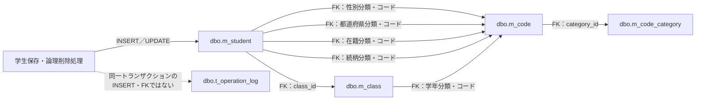

<!-- spec-meta: {"schema":"spec-md/1.1","documentId":"CSHARP_ASPNET-BAS-STU-03-M_STUDENT","version":"1.0","path":"基本設計書/テーブル/01_m_student.md","layout":"TABLE","sheets":[{"sheet":"m_student"}],"sections":[{"heading":"テーブルヘッダー","kind":"HEADER"},{"heading":"項目詳細","kind":"LIST","key":["No"]}],"columns":["No","論理名","物理名","PK","NOT NULL","タイプ","長さ","初期値","説明"]} -->
# 学生情報テーブル定義（dbo.m_student）

文書ID：CSHARP_ASPNET-BAS-STU-03-M_STUDENT　文書種別：table-definition　版：1.0　出力先：基本設計書/テーブル/01_m_student.md

## テーブルヘッダー

| 属性 | 定義・条件 |
| --- | --- |
| 論理名・物理名 | 学生情報／`dbo.m_student`。学生の識別、氏名、生年月日、連絡先、入学・在籍・所属、緊急連絡先、備考と、作成・更新・論理削除の管理情報を35列で保持する。新規登録はINSERT、変更と論理削除はUPDATEを行う。根拠：`sources/database/001_schema.sql:7-59`、`sources/Core/SqlServerStudentService.cs:294-315,409-414`。 |
| 項目詳細の根拠表記 | D＝`sources/database/001_schema.sql`、N＝`sources/Core/StudentNormalizer.cs`、S＝`sources/Core/SqlServerStudentService.cs`、E＝`sources/Views/Students/Edit.cshtml`、I＝`sources/Web/Inputs/StudentSaveInput.cs`、C＝`sources/Core/Contracts.cs`、J＝`sources/Core/JapaneseDateService.cs`、P＝`sources/Infrastructure/WebPresentation.cs`。例えばD:9-9は当該ファイルの開始行9・終了行9を指す。複数範囲はそれぞれ別の根拠である。 |
| 主キー・採番・一意性 | `pk_m_student`は`student_id`の主キーで、`IDENTITY(1,1)`が番号を発行する。`uq_student_no`は`student_no`の無条件UNIQUEであり、論理削除後も番号を再利用できない。保存前の検査も`student_no=@no AND (@id IS NULL OR student_id<>@id)`で、削除行を除外しない。使用済みはValidationFailed／E-STU-101となる。根拠：D:8-8,43-43,187-187、S:264-266,317-317。 |
| 型・容量・初期値の読み方 | `varchar(n)`の容量はnバイト、`nvarchar(n)`の容量はn個のUTF-16コード単位である。業務上限はサービスのUnicodeスカラー数であり、正しいサロゲートペアは1、不正なペアはArgumentExceptionとなる。ブラウザーのmaxlengthはUTF-16コード単位による別の上限である。DDLのSC照合順序によるLEN式は末尾に`#`を加えて末尾空白を計数する。初期値欄はDBのDEFAULTだけを示し、空欄はDEFAULT宣言なし、長さ欄の空欄は文字容量非適用を示す。IDENTITY、DTO初期値、SQLが設定する値は説明欄で分ける。根拠：D:8-59、N:37-57、E:6-13。 |
| 照合順序 | 項目詳細の「照合B」は`Latin1_General_100_BIN2`、「照合S」は`Latin1_General_100_CS_AS_SC`を表す。学籍番号・照合キー・コード・電話・メールはB、表示用氏名・カナ・住所・備考・理由・利用者名はSを使用する。非文字列列に照合順序はない。IDENTITYは学生管理番号のみである。根拠：D:8-42。 |
| 画面から保存値への移送 | 登録・更新フォームは`Input`接頭辞でStudentSaveInputへバインドし、ToRequestがStudentDraftを作成する。同名の業務プロパティはそのまま引き渡し、ClassIdを`string?`から`long?`へ変換する。サービスは正規化結果を`Dictionary<string, object?>`へ列名で保持する。各文字項目の原入力上限はTrimやNFKCで短くなる前に適用する。Textを使う任意項目はNULL・空・空白だけをNULLへ、必須項目は空値を検証エラーへ変える。単行項目は制御文字を拒否し、備考・理由だけはCRLF／CRをLFへ統一してLFを許す。根拠：I:34-42、C:9-29、N:47-57,119-147、`sources/Web/Controllers/StudentsController.cs:26-33`。 |
| SQLパラメータへの移送 | 正規化列は`@列名`へ、S:30-37のColumnsに定義されたSqlDbTypeとSizeで渡す。DateOnlyは午前0時のDateTime、NULLはDBNull.Valueへ変換する。Date・BigInt・DateTimeOffsetではSizeを設定しない。固定分類3列と論理削除フラグ・初期版はSQLリテラルで設定する。根拠：S:30-37,67-72,294-301,409-410。 |
| 学生表に保存しない入力・制御情報 | 年度REG-016の`Input.SchoolYear:int?`、学年REG-017の`Input.GradeCode:string?`は選択補助と所属整合検査に使い、学生表にはclass_idを保存する。REG-024の確認・変更理由はSaveRequest.Reasonから操作履歴のoperation_reasonへ渡る。ExpectedVersionは保存する版そのものの指定ではなく現在版との比較値である。SnapshotId、復帰先ID・復帰版、DuplicateTokenは学生列ではない。編集スナップショットと検索状態はサーバーメモリで保持し、入力クリア・編集取消は読込時コピーを復元する。根拠：I:28-43,46-54、C:66-70、S:234-237,301-307、`sources/Infrastructure/EditorSnapshotStore.cs:7-11`、`sources/Web/Controllers/StudentsController.cs:25-35`。 |
| 日付・在籍の条件 | `ck_student_dates`は生年月日と入学日を1900年1月1日以降、生年月日≦入学日とする。在学01・休学02はclass_id必須かつ終了日NULL、卒業03・退学04は入学日以降の終了日必須でclass_idはNULLを許す。サービスも4値に限定し、日付を保存開始時の日本時間業務日以前に制限する。この動的上限はDDLの条件にはない。既存の卒業・退学から別の在籍コードへ訂正する場合は管理者権限と確認・変更理由が必要となる。根拠：D:198-198、N:127-137,151-154、J:10-39,52-59、S:229-229,255-257。 |
| 連絡先・緊急連絡先の条件 | `ck_student_contact`とサービスは本人電話・本人メール・緊急電話の少なくとも1項目を要求する。緊急連絡先は氏名・続柄・電話を全部未設定、又は全部設定する。DBでは導出した続柄分類も含めて4列全NULL、又は4列全NOT NULLで分類RELATIONSHIPとする。DDLの組合せ検査はNULLの有無を検査し、電話・メール形式や空文字除去はサービスが行う。根拠：D:199-199、N:87-117,147-157。 |
| 宣言された外部キー | `fk_student_class`：class_id→m_class.class_id。`fk_student_gender`：gender_category・gender_code→m_code.category_id・code_value。`fk_student_prefecture`：prefecture_category・prefecture_code→同じ複合キー。`fk_student_enrollment`：enrollment_category・enrollment_status_code→同じ複合キー。`fk_student_relationship`：relationship_category・relationship_code→同じ複合キー。`ck_student_category`は性別・都道府県・在籍の分類をそれぞれGENDER・PREFECTURE・ENROLLMENT_STATUSに固定する。続柄分類は連絡先CHECKで固定する。監査利用者列と操作履歴の対象キーへのFKは宣言されていない。根拠：D:137-153,191-200。 |
| 選択コードの存在・利用可否 | 保存は共通ロック取得後、性別・都道府県・在籍・入力済み続柄をm_codeとm_code_categoryのJOINで再確認する。入力値は常に存在を要求する。新規又はコード変更時だけ、分類とコード双方の有効状態、開始日≦業務日、終了日NULL又は業務日≦終了日を要求する。同じ既存コードは停止・期間外でも保持できる。検査用SQLは分類`@category VarChar(24)`・値`@value VarChar(10)`を使い、保存列の1桁・2桁とは別の共通サイズである。FKは存在の制約であり、この利用可否検査を代替しない。根拠：S:244-260,347-355、D:192-195。 |
| 所属クラスの再検査 | class_id指定時はm_classを再読取し、存在と指定年度・学年の一致を確認する。在学・休学として新たに席を取得する場合はクラス有効かつ業務日が利用期間内でなければならない。同じクラスの席を保持する変更にはこの新規所属検査を再適用しない。卒業・退学は新規又は所属・在籍・入学日・終了日が変わる場合、学生の在籍期間とクラス期間の重なりを要求する。新たな席は、対象自身を除く非削除の在学・休学人数に1を加えた数を定員以下とする。定員NULLは上限制限を行わない。根拠：S:357-383、D:69-71。 |
| 候補のキー・表示・保持 | コードは分類・表示順・値、クラスは年度降順・学年コード表示順・クラス表示順・クラスコード・ID順でSNAPSHOT取得する。コード候補の有効状態は分類とコード双方から算出する。登録の通常コード選択は現在利用可能な値又は既存の同じ値を認める。クラス候補は既存同一IDを保持し、それ以外は在学・休学なら有効期間内、卒業・退学なら入力在籍期間との重なりを判定する。定員は画面候補を無効化せず保存で検査する。クラスを選ぶと年度・学年へ反映し、上位項目変更で不一致となればクラス選択を解除する。検索は停止クラスも候補に含める。根拠：S:196-216、E:8-13、`sources/Views/Students/Search.cshtml:5-5`、`sources/wwwroot/js/site.js:8-8`。 |
| 名称の保存元・上限 | クラス名はm_class.class_name：NOT NULL、nvarchar(36)、DDLと宣言されたSaveClassAsyncの原入力・Trim後上限18スカラー、保存パラメータNVarChar(36)。性別・在籍・都道府県・続柄・学年名はm_code.code_name：NOT NULL、nvarchar(24)、DDLとSaveCodeAsyncの原入力・Trim後上限12スカラー、保存パラメータNVarChar(24)。学生表には名称を複写しない。保守メソッドの宣言と保存契約は存在するが、収録Webの登録・コントローラーからの呼出しは確認できない。根拠：D:68-81,115-128、`sources/Core/MasterMaintenanceService.cs:33-35,73-77,82-83,113-121`、`sources/Infrastructure/WebHostSetup.cs:12-19`、`sources/Web/Controllers/StudentsController.cs:5-42`。 |
| 詳細取得・一覧表示 | 既存画面は非削除行を`student_id=@id`で取得し、StudentDetailに入力用StudentDraft、管理番号、比較版、更新日時・更新者を返す。対象なしは画面入口で404／E-STU-103となる。検索・同一人物候補は学生の識別・氏名・カナ・生年月日・本人電話・入学日・更新日時・版に、クラス、学年、在籍、都道府県のLEFT JOIN名称を付加する。JOIN名称はNULLになり得るが参照先保存列はNOT NULLである。住所表示は都道府県名（NULLなら「[不整合]」）＋住所1であり、郵便番号・住所2を含めない。作成情報と削除情報は詳細DTOの表示対象に含まれない。根拠：S:77-90,172-194、C:50-60、`sources/Infrastructure/WebStudentCoordinator.cs:17-17`。 |
| 検索述語・検索パラメータ | 基本条件は`s.is_deleted=0`で、指定条件をAND追加する。学籍番号は前方一致`@no VarChar(31)`、氏名キーは部分一致`@name NVarChar(642)`、カナキーは部分一致`@kana NVarChar(74)`。LIKEの!・%・_・[をエスケープし`ESCAPE '!'`を付ける。年度はクラス表school_yearと`@year SmallInt`、学年はgrade_codeと`@grade VarChar(2)`、所属は学生class_idと`@class BigInt`、未所属はclass_id IS NULL、都道府県は`@prefecture VarChar(2)`で一致させる。電話は本人電話又は緊急電話と`@phone VarChar(16)`の一致、入学日は`@from Date`以上・`@to Date`以下とする。在籍は`@statusN VarChar(2)`のIN条件で、選択0件では在籍述語を追加しない。根拠：N:161-161、S:113-122,137-155。 |
| 検索順・件数・ページング | 検索サービスはページ1以上、表示件数20・50・100、昇順・降順、学籍番号・name_key・入学日・更新日時のソートを受け付ける。未所属と年度・学年・クラスの併用を拒否し、在籍は4値以内かつ重複なし、年度1900～9998、class_idは正数を要求する。SNAPSHOT内で指定コード、年度候補、クラスと上位条件の一致を確認する。COUNT_BIGはTOP(10001)を対象にし、10000超ではOutcome=NoChange、LimitExceeded=true、空明細を返す。通常は最終ページ内に補正し、指定ソートの後にstudent_id ASCを加え、`@offset Int`・`@size Int`でOFFSET／FETCHする。0件は空明細である。根拠：S:103-170。 |
| 索引 | 全て非削除行のフィルター`WHERE is_deleted=0`付き。`ix_student_birth(birth_date)`は同一人物候補の生年月日照合に、`ix_student_class_status(class_id,enrollment_status_code)`は所属・在籍条件と人数集計に対応する。`ix_student_admission(admission_date)`、`ix_student_updated(updated_at)`、`ix_student_phone(phone_number)`、`ix_student_emergency_phone(emergency_phone_number)`は入学日・更新日時・各電話の取得条件に対応する。根拠：D:206-211、S:108-108,145-150,269-271,378-380。 |
| 保存・削除の入口と権限 | 学生フォームの実入口はPOST `/students/create`、`/students/{id:long}/update`、`/students/{id:long}/delete`。認証・CSRFのフレームワーク境界の後、保存アクションはFormGuard、保存権限、編集スナップショット、復帰先存在・所有者と読込時復帰先の一致、ModelState、要求変換、サービスの順に進む。削除はFormGuard、認証確認、スナップショット、読込時復帰先一致の後、coordinatorで管理者・復帰先・Confirmed・比較版変換を確認する。サービスもViewer保存と管理者以外の削除を拒否する。削除フォームは制御情報と理由だけを送り、編集中の学生業務値を保存しない。根拠：E:5-5,17-17、S:229-239,394-398、`sources/Web/Controllers/StudentsController.cs:5-5,26-41`、`sources/Infrastructure/WebStudentCoordinator.cs:18-19`、`sources/Infrastructure/WebHostSetup.cs:14-16`。 |
| 受信値と保存検査の境界 | stringの非nullable宣言とブラウザーrequiredは受信NULL排除の保証にはならない。Web設定は暗黙Requiredを抑止し、FormGuardは許可項目・同名重複を検査するが欠落を一括拒否しない。ToRequestはBirthDateInput全体のNULLを補完するが内部文字列を補完しない。正しい元号で年・月・日がNULL、又は入学日がNULLなら文字列処理でNULL参照例外となり得る。正規化が捕捉するInputValidationException・ArgumentExceptionとは別経路である。SnapshotIdも学生列ではなく、NULLなら独自検査より先の辞書呼出しで引数例外となり得る。非NULLの不在キー・期限切れは409、取得後の所有者・セッション・対象不一致は403となる。根拠：I:34-42、J:19-24,52-55、N:123-137、S:232-239、`sources/Infrastructure/WebHostSetup.cs:16-16`、`sources/Infrastructure/EditorSnapshotStore.cs:10-10`、`sources/Web/Controllers/StudentsController.cs:29-30,41-41`。 |
| 排他・日時・利用者 | 保存・削除はReadCommittedトランザクションでSET XACT_ABORT ONを設定し、`test-project1:student-write`へのTransaction所有Exclusiveアプリケーションロックを取得する。待機上限5000ms、負の取得結果はSQLエラー51001となる。通常SQLコマンドは30秒、非同期DB呼出しへCancellationTokenを渡す。Openはsnapshot_isolation_state=1を確認する。日時nowは処理開始時のUTCで一度取得し、ロック待機後も書込みと履歴に同じ値を使う。利用者はCurrentUser.Principalであり、64スカラーのText検査結果ではなく元のPrincipalを保存する。表示は日本時間へ変換する。根拠：S:44-72,92-101,229-229,240-244,300-307,394-410、P:7-7。 |
| 保存対象と変更確定 | 1. 入力正規化後、共通ロック下で既存非削除行を再取得し、対象なしNotFound、版不一致Conflict、学籍番号変更ValidationFailed、終了区分訂正の権限・理由不足をそれぞれ拒否する。 2. コード・クラスを再検査し、正規化値と既存値を比較する。実変更0件は明示rollbackしてNoChangeと対象ID・取得版を返し、履歴も版加算も行わない。変更があり版がInt64最大値ならConflictとなる。 3. 学籍番号の使用済みと同一人物候補を確認する。確認が必要なら書込み前にrollbackする。 4. 新規は正規化列、固定分類3列、非削除状態、作成更新日時・利用者、版1をINSERTしてOUTPUTからIDを取得する。既存はstudent_no以外の全正規化列と更新情報を設定し、版を1加算する。WHEREは`student_id=@id AND row_version=@version AND is_deleted=0`。UPDATE設定列には値が変わらない正規化列も含まれる。OUTPUTがNULL／DBNullならDBConcurrencyExceptionとなる。 5. 同じトランザクションで履歴をINSERTし、commit成功後にSaved、学生ID、保存版を返す。根拠：S:245-315,325-327。 |
| 同一人物候補・確認の保存境界 | 候補条件は非削除・対象自身以外・生年月日完全一致・氏名キー又はカナキー完全一致で、student_id順に全件読み、画面には全候補件数と最大20件を渡す。候補は確認対象である。候補あり又は確認参照値指定時に確認が成立しなければrollback後に確認情報を発行する。ConfirmationRequiredのID・版は、新規では両方NULL、既存では要求ID・取得済み版を引き継ぐ。Web登録はwebTokens=trueで、確認は静的メモリに所有者・セッション・対象・比較版・入力と候補版のハッシュ・10分期限・Busyを保持する。照合には保存開始時nowを使い、成立時は理由を必須とする。成功commit後は確認情報を除去する。finallyでは取得済み確認情報があり、completed=falseかつunknown=falseの場合にBusyを解放する。t_confirmationのDB経路はwebTokens=falseの分岐である。根拠：S:19-29,224-225,269-290,308-323,330-342、E:14-14、`sources/Infrastructure/WebHostSetup.cs:19-19`。 |
| 論理削除と削除整合 | `ck_student_deleted`は通常行で削除日時・削除者・削除理由を全NULL、削除行では全NOT NULLとする。削除サービスは管理者、必須理由、正のID・版と版上限を検査する。共通ロック後に非削除行の現在版を再取得し、対象なしNotFound・版不一致Conflictに分ける。比較版付きWHEREでis_deleted=1、削除日時・削除者・削除理由、更新日時・更新者、版加算の7列だけを更新する。更新件数1以外はDBConcurrencyException。同じトランザクションにDELETE履歴を追加し、commit成功後にSaved、対象ID、版+1を返す。氏名・住所・在籍等の値と作成情報は保持する。根拠：D:200-200、S:392-415。 |
| 履歴・理由の保存先 | t_operation_logには対象表`m_student`、学生IDの十進文字列、CREATE／UPDATE／DELETE、前後版、変更列名配列JSON、実行者・UTC日時・相関ID・理由・重複確認有無を追記する。新規の前版はNULL、後版は1。既存履歴は実変更列に更新日時・更新者・版を加え、削除履歴は7更新列を記録する。変更前後の個人情報値を記録する処理ではない。確認・変更理由は履歴だけ、削除理由は学生表delete_reasonと履歴operation_reasonの双方へ保存する。理由の原入力・保存値上限は60スカラー、パラメータNVarChar(120)。duplicate_confirmedは保存時候補件数が0より大きい場合に真となり、確認参照値だけでは真にならない。根拠：S:233-234,306-307,385-390,396-413、D:137-153,204-205、E:13-13,17-17。 |
| rollback・例外の順序 | 保存のDB処理catchはInputValidationException→SQL 2601／2627→DBConcurrencyException→残るSqlException・InvalidOperationException・OperationCanceledExceptionの順である。先行3catchはrollbackを試み、順にValidationFailed、学籍番号使用済みValidationFailed、Conflictを返す。後段catchへ到達した場合だけ、書込み開始済み、かつcommit試行済み又はrollback失敗ならUnknown、それ以外はSystemErrorとする。削除はDBConcurrencyExceptionを先にConflictへ変換し、残る同3種例外のcatchで同じUnknown条件を使う。rollbackはCancellationToken.Noneで行いSQL例外・InvalidOperationExceptionではfalseを返す。無変更・確認要求は明示rollback、対象なし等の早期returnはcommitせずトランザクション破棄へ進む。接続・BeginTransactionはDB処理try外で、捕捉対象外の例外もSaveResult変換を通らない。削除理由のtryはInputValidationExceptionだけを捕捉し、不正UnicodeのArgumentExceptionは別経路となる。根拠：S:240-266,286-290,316-329,396-416。 |
| サービス結果と最終応答 | Savedは画面コントローラーが検索復帰の303へ変換する。保存のNoChangeは200、ValidationFailedは422、Forbiddenは403、NotFoundは404、Conflict・ConfirmationRequiredは409、SystemError・Unknownは503で再描画する。失敗時の保存候補再取得、削除のLoad、成功後の復帰処理でも後続例外が生じ得る。削除は非Savedの状態を設定してからLoadするため、対象消失404又は読込失敗で応答が変わり得る。middlewareはResponse.HasStarted=falseの場合だけWebFaultの状態又は一般例外503へ変換する。DBのcommit完了とHTTP応答到達は別の境界である。根拠：`sources/Web/Controllers/StudentsController.cs:30-38`、P:23-23、`sources/Infrastructure/WebHostSetup.cs:22-24`。 |
| DB権限の宣言 | student_viewerは学生等のSELECT、student_staffは学生INSERT・UPDATEと履歴INSERTを許可する。学生DELETEと履歴UPDATE・DELETEは拒否する。staffはviewer、adminはstaffを継承する。WebのViewer／Staff／Administratorによる操作制御とは別に、DBロールへのGRANT・DENYとして定義される。根拠：`sources/database/003_web_permissions.sql:8-17`、S:230-230,395-395、E:5-6,17-17。 |
| 関連画面文書 | CSHARP_ASPNET-BAS-STU-02：`基本設計書/02_学生登録画面.md`（当文書から`../02_学生登録画面.md`）。項目と操作の業務説明に対応する。 CSHARP_ASPNET-DET-CSharp_ASPNET-SCR-STU-002：`詳細仕様書/CSharp_ASPNET/02_学生登録画面.md`（`../../詳細仕様書/CSharp_ASPNET/02_学生登録画面.md`）。コントロール・要求変換・SQL・応答の詳細に対応する。参照先の生成状態は未確認のためリンクは未生成。 |
| 関連横断文書 | CSHARP_ASPNET-BAS-STU-03：`基本設計書/03_テーブル仕様書.md`（`../03_テーブル仕様書.md`）。表索引とデータ関連に対応する。 CSHARP_ASPNET-BAS-STU-04：`基本設計書/04_コード設計書.md`（`../04_コード設計書.md`）。用途別コード、候補、保守契約に対応する。参照先の生成状態は未確認のためリンクは未生成。 |
| 関連個別テーブル文書 | CSHARP_ASPNET-BAS-STU-03-M_CLASS：`基本設計書/テーブル/02_m_class.md`（`02_m_class.md`）。所属先の年度・学年・期間・定員・名称に対応する。 CSHARP_ASPNET-BAS-STU-03-M_CODE_CATEGORY：`基本設計書/テーブル/03_m_code_category.md`（`03_m_code_category.md`）。分類と候補の分類有効状態に対応する。 CSHARP_ASPNET-BAS-STU-03-M_CODE：`基本設計書/テーブル/04_m_code.md`（`04_m_code.md`）。用途別参照キー、表示名称、コード期間・状態に対応する。 CSHARP_ASPNET-BAS-STU-03-T_OPERATION_LOG：`基本設計書/テーブル/05_t_operation_log.md`（`05_t_operation_log.md`）。変更版・変更列名・理由の保存先に対応する。参照先の生成状態は未確認のためリンクは未生成。 |
| 未確定事項 | 認証主体とDBロールの運用上の対応、マスター保守の実行入口、履歴の保管期限・照会運用は未確定である。これらは列のDDL属性や学生保存経路から補完しない。 |

次の関連図は宣言FKと履歴追記の処理関係を分けて示す。検索の名称取得は前記LEFT JOINに従い、図のFKをJOIN結果のNOT NULL保証として扱わない。根拠：D:189-195、S:82-90,385-390。

## 項目詳細

| No | 論理名 | 物理名 | PK | NOT NULL | タイプ | 長さ | 初期値 | 説明 |
| --- | --- | --- | --- | --- | --- | --- | --- | --- |
| 1 | 学生管理番号 | student_id | 〇 | 〇 | `bigint` |  |  | DBが`IDENTITY(1,1)`で採番する内部キー。新規INSERTのOUTPUTから`long`へ取得し、画面ヘッダー表示、詳細取得・更新・削除の対象とする。学籍番号とは別の値。SQL`@id BigInt`。根拠：D:8-8,43-43、E:4-4、S:176-177,296-304,409-410。 |
| 2 | 学籍番号 | student_no |  | 〇 | `varchar(15)` | 15バイト |  | REG-002のinput→`Input.StudentNo:string`→StudentDraft.StudentNo→正規化`string`。required、maxlength30、既存はreadonly。原入力15スカラー、Trim・NFKC・大文字化後も15以下で先頭英数字、以降英数字又はハイフン。`@student_no VarChar(15)`、照合B。一意性は削除行を含む。既存更新では変更を拒否しSET対象外。SRC-001は正規化後の前方一致、一覧・候補に表示。根拠：D:9-9,187-187、E:6-6、I:9-9,35-35、N:59-64、S:140-140,254-254,264-266,294-301。 |
| 3 | 氏名 | student_name |  | 〇 | `nvarchar(16)` | 16 UTF-16コード単位 |  | REG-003のinput→`Input.StudentName:string`→StudentDraft.StudentName。required、maxlength16。原入力8・Trim後8スカラー、DDL上限8。保存値にはNFKC・大文字化を行わない。`@student_name NVarChar(16)`、照合S。編集・一覧・候補の表示値であり、SRC-002検索と候補比較はname_keyを使う。根拠：D:10-10,44-44、E:6-6、I:10-10,35-35、N:125-125,144-144、S:77-85,114-115,141-141,269-271,294-299。 |
| 4 | 氏名カナ | student_name_kana |  | 〇 | `nvarchar(36)` | 36 UTF-16コード単位 |  | REG-004のinput→`Input.StudentNameKana:string`→StudentDraft.StudentNameKana。required、maxlength72。原入力36スカラー、Trim・NFKC・ひらがなからカタカナ変換・空白連続の単一半角空白化後18スカラー。許可範囲はカタカナU+30A1～U+30FA、長音・中点・反復記号。DDL上限18。`@student_name_kana NVarChar(36)`、照合S。表示用の空白は保持し、検索SRC-003と候補比較はkana_keyへ移す。根拠：D:11-11,45-45、E:6-6、I:11-11,35-35、N:72-85,126-126,145-145、S:31-31,116-116,142-142,269-271,294-299。 |
| 5 | 氏名照合キー | name_key |  | 〇 | `nvarchar(320)` | 320 UTF-16コード単位 |  | 独立した画面入力なし。保存氏名からNFKC・大文字化・全Unicode空白除去で導出する`string`。生成後上限160スカラー、DDL上限160。`@name_key NVarChar(320)`、照合B。氏名検索はキーの部分一致、氏名順は本列でソート。同一生年月日の候補では`@name NVarChar(320)`との完全一致を使う。根拠：D:12-12,46-46、N:66-70,144-144、S:32-32,108-108,141-141,269-271,294-299。 |
| 6 | カナ照合キー | kana_key |  | 〇 | `nvarchar(36)` | 36 UTF-16コード単位 |  | 独立入力なし。正規化カナから半角空白を除去する`string`。元の保存カナが18スカラー以下で、DDLも18以下を要求する。`@kana_key NVarChar(36)`、照合B。カナ検索は部分一致、同一生年月日の候補は`@kana NVarChar(36)`との完全一致。表示にはstudent_name_kanaを使う。根拠：D:13-13,47-47、N:84-84,145-145、S:32-32,116-116,142-142,269-271,294-299。 |
| 7 | 生年月日 | birth_date |  | 〇 | `date` |  |  | REG-005の元号select・年/月/日input→Input.BirthDateInput／StudentDraft.BirthDateInput。構成値は`string`、すべてrequired、年maxlength4・月日2。元号IDはREIWA・HEISEI・SHOWA・TAISHO・MEIJI。年・月・日はNFKC後に検査し、元は1、その他は正整数で年最大4桁・月日2桁。独立した原入力スカラー上限はない。元号境界・実在日付・1900年以降・業務日以前・逆変換一致から`DateOnly`へ変換する。`@birth_date Date`。DBは西暦、編集は元号入力、一覧・候補は和暦表示。候補生年月日は完全一致。根拠：D:14-14,198-198、E:7-7、C:8-14、J:10-50、N:127-127、S:32-32,188-188,269-271。 |
| 8 | 性別分類 | gender_category |  | 〇 | `varchar(24)` | 24バイト |  | 画面・要求DTOに入力なし。新規SQLリテラル`GENDER`を設定し、通常UPDATEで再設定しない。CHECKで固定し、gender_codeとの複合FKを構成する。個別パラメータなし、照合B。固定処理値はDB DEFAULTではない。根拠：D:15-15,192-192,196-196、S:294-299、I:9-33。 |
| 9 | 性別コード | gender_code |  | 〇 | `varchar(1)` | 1バイト |  | REG-006のrequired select→`Input.GenderCode:string`→StudentDraft.GenderCode。maxlengthなし。原入力1スカラー、Trim・NFKC後に半角数字1桁を要求しGENDER候補を選択する。DTO初期値0は初期コードの未回答で、DB DEFAULTではない。`@gender_code VarChar(1)`、照合B。詳細編集に戻し、保存時に存在と変更時の利用可否を検査する。現在の学生検索条件には含まれない。根拠：D:16-16,192-192、E:8-8、I:13-13,36-36、N:113-117,128-128、S:33-33,189-189,347-355、`sources/database/002_seed.sql:15-18`。 |
| 10 | 郵便番号 | postal_code |  | 〇 | `varchar(7)` | 7バイト |  | REG-007のrequired input→`Input.PostalCode:string`→StudentDraft.PostalCode、maxlength20。原入力10スカラー、Trim・NFKC後にUnicode空白とハイフンU+002D・U+2010・U+2011・U+2212を除き半角数字7桁で保存する。`@postal_code VarChar(7)`、照合B。詳細編集へ戻す。現在の検索条件・一覧住所生成には使用しない。根拠：D:17-17、E:9-9、I:14-14,36-36、N:95-100,129-129、S:33-33,77-90,189-189。 |
| 11 | 都道府県分類 | prefecture_category |  | 〇 | `varchar(24)` | 24バイト |  | 画面入力なし。新規SQLリテラル`PREFECTURE`を設定し、CHECKで固定する。prefecture_codeとの複合FKと都道府県名称JOINに使用する。個別パラメータなし、照合B。通常UPDATE対象外。根拠：D:18-18,193-193,196-196、S:90-90,294-299。 |
| 12 | 都道府県コード | prefecture_code |  | 〇 | `varchar(2)` | 2バイト |  | REG-008のrequired select→`Input.PrefectureCode:string`→StudentDraft.PrefectureCode。空候補は未選択、maxlengthなし。原入力2スカラー、Trim・NFKC後は半角数字2桁、PREFECTURE分類を参照する。`@prefecture_code VarChar(2)`、照合B。SRC-009検索は`@prefecture VarChar(2)`との一致。住所表示用名称はm_codeから得て、本列には名称を保存しない。根拠：D:19-19,193-193、E:9-9、I:15-15,37-37、N:113-117,130-130、S:33-33,80-90,147-147,347-355。 |
| 13 | 住所1 | address_line1 |  | 〇 | `nvarchar(90)` | 90 UTF-16コード単位 |  | REG-009のrequired input→`Input.AddressLine1:string`→StudentDraft.AddressLine1、maxlength90。原入力45・Trim後45スカラー、DDL上限45。`@address_line1 NVarChar(90)`、照合S。詳細編集と、都道府県名称を前に連結する一覧住所表示に使用する。独立した住所検索述語はない。根拠：D:20-20,48-48、E:10-10、I:16-16,37-37、N:131-131、S:34-34,80-85,137-155,189-189。 |
| 14 | 住所2 | address_line2 |  |  | `nvarchar(90)` | 90 UTF-16コード単位 |  | REG-010の任意input→`Input.AddressLine2:string?`→StudentDraft.AddressLine2、maxlength90。原入力45・Trim後45スカラー、空値はNULL、DDL上限45。`@address_line2 NVarChar(90)`、照合S。詳細編集へ戻すが、現在の検索一覧住所には連結しない。根拠：D:21-21,49-49、E:10-10、I:17-17,37-37、N:132-132、S:34-34,80-85,189-189。 |
| 15 | 本人電話 | phone_number |  |  | `varchar(16)` | 16バイト |  | REG-011の任意input→`Input.PhoneNumber:string?`→StudentDraft.PhoneNumber、maxlength40。原入力20スカラー。Trim・NFKC後にUnicode空白、郵便番号と同じ4種ハイフン、半角括弧を除去する。国内は0で始まる10～11桁、国際は+と0以外で始まる7～15桁で、保存最大16文字。空値NULL。`@phone_number VarChar(16)`、照合B。一覧に表示し、SRC-010電話検索は本人又は緊急電話の完全一致。単独NULL可だが連絡先組合せ条件がある。根拠：D:22-22,199-199、E:10-10、I:18-18,38-38、N:87-93,133-133,155-155、S:34-34,80-85,148-148。 |
| 16 | 本人メール | email_address |  |  | `varchar(60)` | 60バイト |  | REG-012の任意input→`Input.EmailAddress:string?`→StudentDraft.EmailAddress、maxlength120。原入力・Trim後60スカラー。単一@、ASCIIローカル部と複数ラベルのドメイン形式を検査し、ドメインだけ小文字化する。NFKCを行わず、空値NULL。`@email_address VarChar(60)`、照合B。詳細編集・連絡先組合せに使用し、現在の検索条件・一覧表示には含めない。根拠：D:23-23,199-199、E:10-10、I:19-19,38-38、N:102-111,134-134,155-155、S:35-35,77-90,137-155,190-190。 |
| 17 | 入学日 | admission_date |  | 〇 | `date` |  |  | REG-013のrequired date input→`Input.AdmissionDate:string`→StudentDraft.AdmissionDate。maxlength・原入力スカラー上限なし。TrimせずNFKC後10コード単位のyyyy-MM-ddを解析し、1900年以降・業務日以前・生年月日以降の`DateOnly`を保存する。`@admission_date Date`。詳細では西暦文字列へ戻す。SRC-011／012は包括範囲、入学日順ソートとクラス在籍期間整合に使う。一覧DTOへ取得するが現行一覧の独立表示列にはない。根拠：D:24-24,198-198、E:11-11、I:20-20,38-38、J:52-59、N:135-135,151-151、S:35-35,108-108,149-150,190-190,372-374、`sources/Views/Students/Search.cshtml:5-8`。 |
| 18 | 在籍分類 | enrollment_category |  | 〇 | `varchar(24)` | 24バイト |  | 画面入力なし。新規SQLリテラル`ENROLLMENT_STATUS`を設定し、CHECKで固定する。在籍区分との複合FKと在籍名称JOINに使用する。個別パラメータなし、照合B。通常UPDATEで再設定しない。根拠：D:25-25,194-194,196-196、S:89-89,294-299。 |
| 19 | 在籍区分 | enrollment_status_code |  | 〇 | `varchar(2)` | 2バイト |  | REG-014のrequired select→`Input.EnrollmentStatusCode:string`→StudentDraft.EnrollmentStatusCode。maxlengthなし、DTO初期値01。原入力2スカラー、Trim・NFKC後に半角数字2桁で、01在学・02休学・03卒業・04退学に限定する。`@enrollment_status_code VarChar(2)`、照合B。所属必須・終了日・席人数・終了訂正権限を決める。検索は選択値ごとの`@statusN VarChar(2)`、表示名称はm_codeから取得する。根拠：D:26-26,194-194,198-198、E:11-11、I:21-21,39-39、N:136-136,152-154、S:35-35,89-89,151-153,255-257,360-380、`sources/database/002_seed.sql:19-22`。 |
| 20 | 卒業・退学日 | enrollment_end_date |  |  | `date` |  |  | REG-015の任意date input→`Input.EnrollmentEndDate:string?`→StudentDraft.EnrollmentEndDate。required・maxlength・原入力スカラー上限なし。NULL・空文字はNULL、それ以外はTrimせずNFKC後10コード単位の西暦日付を`DateOnly`へ変換する。空白だけは未設定と同一にはならない。在学・休学はNULL、卒業・退学は入学日以降かつ業務日以前の値を必須とする。`@enrollment_end_date Date`。詳細復元とクラス期間の重なりに使用する。根拠：D:27-27,198-198、E:11-11、I:22-22,39-39、J:52-59、N:137-137,153-153、S:36-36,191-191,372-374。 |
| 21 | 所属クラスID | class_id |  |  | `bigint` |  |  | REG-018のselect→`Input.ClassId:string?`→IdParser→StudentDraft.ClassId:`long?`。空候補は未所属、maxlengthなし。NULL・空文字はNULL、その他は半角十進数字19文字以内で正のInt64へ変換し、0・負数・非数字・範囲超過を拒否する。`@class_id BigInt`。在学・休学は条件付き必須。m_classを参照し、REG-016年度・REG-017学年は候補補助と整合検査に使う。SRC-006所属、SRC-007未所属、クラス名称JOIN、席人数集計のキー。根拠：D:28-28,191-191,198-198、E:12-12、I:23-29,40-42,57-60、C:25-25、S:36-36,87-87,145-146,201-208,357-383。 |
| 22 | 緊急連絡先氏名 | emergency_contact_name |  |  | `nvarchar(16)` | 16 UTF-16コード単位 |  | REG-020の任意input→`Input.EmergencyContactName:string?`→StudentDraft.EmergencyContactName、maxlength16。原入力8・Trim後8スカラー、空値NULL、DDL上限8。`@emergency_contact_name NVarChar(16)`、照合S。詳細編集と緊急3項目の組合せに使用し、他2項目設定時は条件付き必須。独立検索条件はない。根拠：D:29-29,50-50,199-199、E:13-13、I:24-24,40-40、N:139-139,156-157、S:36-36,192-192。 |
| 23 | 続柄分類 | relationship_category |  |  | `varchar(24)` | 24バイト |  | 独立画面入力・要求プロパティなし。正規化relationship_codeがNULLならNULL、設定ありなら`RELATIONSHIP`を内部で導出する。`@relationship_category VarChar(24)`、照合B。続柄コードとの複合FKと緊急連絡先CHECKに使用する。他の固定分類3列とは異なり通常UPDATEにも設定する。根拠：D:30-30,195-195,199-199、N:147-147、S:37-37,294-299。 |
| 24 | 緊急連絡先続柄 | relationship_code |  |  | `varchar(2)` | 2バイト |  | REG-021の任意select→`Input.RelationshipCode:string?`→StudentDraft.RelationshipCode。空候補は未選択、maxlengthなし。原入力2スカラー、Trim・NFKC後に半角数字2桁、空値NULL。RELATIONSHIP候補からコードを保存し名称はm_code.code_nameを表示する。`@relationship_code VarChar(2)`、照合B。緊急氏名・電話設定時は条件付き必須。根拠：D:31-31,195-195,199-199、E:13-13、I:25-25,41-41、N:113-117,140-147,156-157、S:37-37,347-355。 |
| 25 | 緊急連絡先電話 | emergency_phone_number |  |  | `varchar(16)` | 16バイト |  | REG-022の任意input→`Input.EmergencyPhoneNumber:string?`→StudentDraft.EmergencyPhoneNumber、maxlength40。本人電話と同じ正規化で原入力20スカラー、国内10～11桁又は+付き国際7～15桁、保存最大16文字、空値NULL。`@emergency_phone_number VarChar(16)`、照合B。最低1連絡先と緊急3項目の条件、SRC-010の本人電話とのOR一致に使う。一覧には本番号を直接表示しない。根拠：D:32-32,199-199、E:13-13、I:26-26,41-41、N:87-93,141-141,155-157、S:37-37,77-85,148-148。 |
| 26 | 備考 | remarks |  |  | `nvarchar(240)` | 240 UTF-16コード単位 |  | REG-023の任意textarea→`Input.Remarks:string?`→StudentDraft.Remarks、maxlength240。改行統一前の原入力120スカラーを検査し、CRLF・CRをLFへ統一、LF以外の制御文字を拒否、Trim後120スカラー以下とする。空値NULL、DDL上限120。`@remarks NVarChar(240)`、照合S。学生の補足情報として詳細復元する。確認・変更理由とは別の保存項目。根拠：D:33-33,51-51、E:13-13、I:27-27,41-41、N:47-57,142-142、S:37-37,192-192。 |
| 27 | 論理削除フラグ | is_deleted |  | 〇 | `bit` |  | 0 | DEFAULT制約`df_m_student_is_deleted`は0。新規SQLも0を明示し、管理者の論理削除で1を設定する。個別パラメータ・画面業務入力なし。通常検索・詳細・候補・人数・更新・削除の対象は0だが、学籍番号一意性は1の行も含む。根拠：D:34-34,187-187,200-211、S:137-137,176-176,201-201,264-269,296-297,378-378,409-409。 |
| 28 | 削除日時 | deleted_at |  |  | `datetimeoffset(7)` |  |  | 小数秒精度7。通常行はNULL、論理削除時に削除開始時UTC nowを`@now DateTimeOffset`から設定する。DDLはオフセット0を要求し、is_deleted=1では必須。削除記録用で、現在の編集ヘッダー表示には含まれない。根拠：D:35-35,52-52,200-200、S:44-44,394-394,409-410、E:4-4。 |
| 29 | 削除者 | deleted_by |  |  | `nvarchar(128)` | 128 UTF-16コード単位 |  | 通常行NULL、論理削除時はCurrentUser.Principalを`@actor NVarChar(128)`から設定する。画面から利用者名を受信しない。認証主体の原入力・Trim後検査上限とDDL上限は64スカラーだが、保存には元のPrincipalを使う。照合S。is_deleted=1では必須。根拠：D:36-36,53-53,200-200、S:46-51,394-394,409-410。 |
| 30 | 削除理由 | delete_reason |  |  | `nvarchar(120)` | 120 UTF-16コード単位 |  | REG-026のrequired textarea `name=Reason`→StudentDeleteInput.Reason:`string`→DeleteAsyncのreason。maxlength120。原入力60スカラーを先に検査し、改行統一・制御文字検査・Trim後60スカラーと必須性を確認する。DDL上限60。`@reason NVarChar(120)`、照合S。通常行NULL、削除行必須。同じ理由をt_operation_log.operation_reasonにも保存する。根拠：D:37-37,54-54,200-200、E:17-17、`sources/Web/Inputs/StudentDeleteInput.cs:4-4`、N:47-57、S:396-397,409-413。 |
| 31 | 作成日時 | created_at |  | 〇 | `datetimeoffset(7)` |  |  | 小数秒精度7。新規時に保存開始時UTC nowを`@now DateTimeOffset`から明示設定し、DDLはオフセット0を要求する。既存更新・論理削除では保持する。現在の詳細DTO・編集ヘッダーの表示対象ではない。根拠：D:38-38,55-55、S:229-229,296-300,409-409、C:59-60、E:4-4。 |
| 32 | 作成者 | created_by |  | 〇 | `nvarchar(128)` | 128 UTF-16コード単位 |  | 新規時にCurrentUser.Principalを`@actor NVarChar(128)`から設定し、更新・削除では保持する。認証主体の原入力・Trim後検査は64スカラー・必須、DDL上限64。検査でTrimした戻り値は採用せず元のPrincipalを保存する。照合S。学生業務入力ではない。根拠：D:39-39,56-56、S:46-51,296-300,409-410。 |
| 33 | 更新日時 | updated_at |  | 〇 | `datetimeoffset(7)` |  |  | 小数秒精度7。新規・変更・論理削除時に各処理開始時UTC nowを`@now DateTimeOffset`から設定する。DDLはオフセット0を要求する。無変更では保持。詳細ヘッダー・一覧で日本時間yyyy/MM/dd HH:mm:ssへ変換し、更新日時順と非削除索引に使う。根拠：D:40-40,57-57,209-209、S:81-81,108-108,181-181,262-262,296-300,394-410、E:4-4、P:7-7。 |
| 34 | 更新者 | updated_by |  | 〇 | `nvarchar(128)` | 128 UTF-16コード単位 |  | 新規・変更・論理削除時にCurrentUser.Principalを`@actor NVarChar(128)`から設定する。原入力・Trim後検査及びDDL上限64スカラー、保存値は元のPrincipal。照合S。無変更では保持し、StudentDetail.UpdatedByから編集ヘッダーへ表示する。学生業務入力ではない。根拠：D:41-41,58-58、S:46-51,180-194,262-262,296-300,409-410、E:4-4。 |
| 35 | 更新管理番号 | row_version |  | 〇 | `bigint` |  | 1 | DEFAULT制約`df_m_student_row_version`は1、CHECKは正数。SQL Serverのrowversion型とは別の`long`比較版。新規SQLも1を明示し、変更・削除は現在版を再読取した上で比較版付きWHEREと1加算を行う。無変更は加算しない。非表示Input.ExpectedVersion:`string?`は既存要求で正のInt64へ変換し`@version BigInt`として比較する。版上限は変更保存Conflict、削除は事前ValidationFailed。詳細・検索DTO・候補版ハッシュ・履歴の前後版に使用する。根拠：D:42-42,59-59、E:5-5,17-17、I:30-43,57-60、S:225-225,251-263,292-315,398-414。 |
