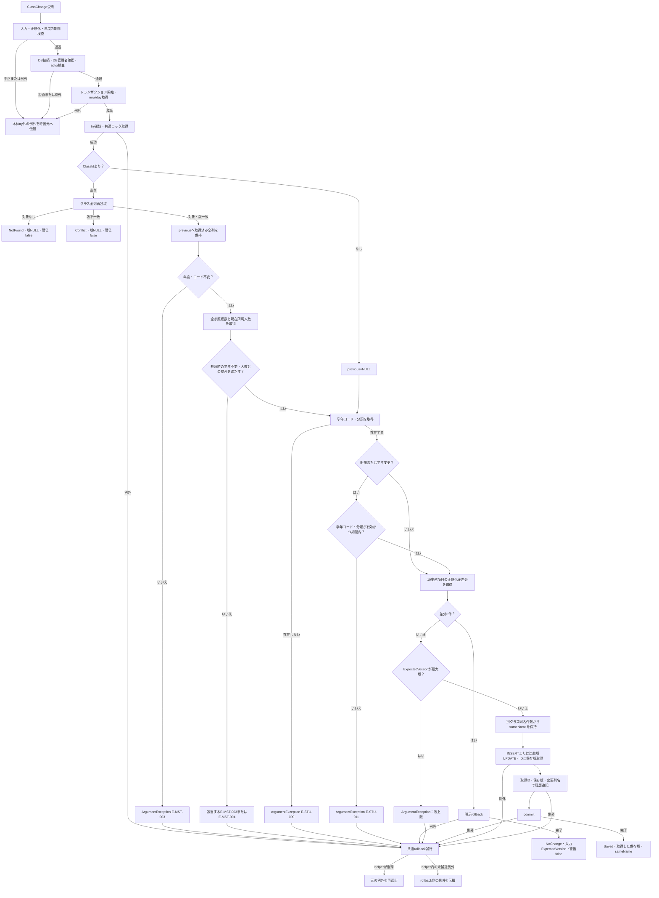
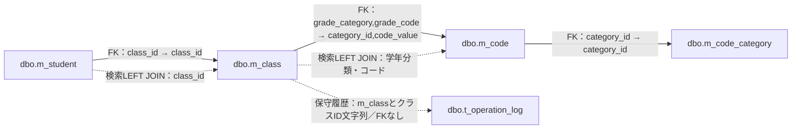
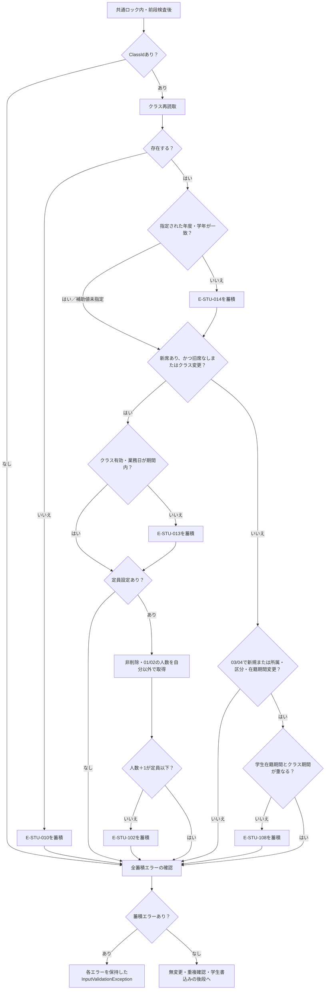

<!-- spec-meta: {"schema":"spec-md/1.1","documentId":"CSHARP_ASPNET-BAS-STU-03-M_CLASS","version":"1.0","path":"基本設計書/テーブル/02_m_class.md","layout":"TABLE","sheets":[{"sheet":"m_class"}],"sections":[{"heading":"テーブルヘッダー","kind":"HEADER"},{"heading":"項目詳細","kind":"LIST","key":["No"]}],"columns":["No","論理名","物理名","PK","NOT NULL","タイプ","長さ","初期値","説明"]} -->
# 所属クラスマスターテーブル定義（dbo.m_class）
文書ID：CSHARP_ASPNET-BAS-STU-03-M_CLASS  
種別：table-definition／基本設計書・テーブル定義  
版：1.0  
文書パス：基本設計書/テーブル/02_m_class.md  
対象シート：m_class

## テーブルヘッダー

| 属性 | 定義・条件・根拠 |
| --- | --- |
| 論理名・物理名 | 所属クラスマスター／`dbo.m_class`。年度、学年、クラスの識別・表示情報、利用期間、定員、表示順、有効状態を保持する。17列のうちNULL可能なのは`capacity`と`remarks`である。論理削除列はなく、停止は`is_active=0`で表す。根拠：`sources/database/001_schema.sql:62-87`。 |
| 主キー・採番 | `pk_m_class`：`class_id`の単独主キー。`IDENTITY(1,1)`による採番であり、DEFAULTとは別の属性である。新規保守は採番値をSQLのOUTPUTから取得し、履歴の対象キーへ渡す。根拠：`sources/database/001_schema.sql:63-80`、`sources/Core/MasterMaintenanceService.cs:124-130`。 |
| 一意条件 | `uq_class_year_code`：`school_year,class_code`の組合せを一意とする。学年コードはこのキーに含まれないため、同じ年度・クラスコードを学年別に重複登録する構造ではない。同名警告は別のサービス検査である。根拠：`sources/database/001_schema.sql:188-188`、`sources/Core/MasterMaintenanceService.cs:70-76`。 |
| 外部キー・固定分類 | `fk_class_grade`：`grade_category,grade_code`から`dbo.m_code(category_id,code_value)`を参照する。`ck_class_category`は`grade_category='GRADE'`を要求する。学生側の`fk_student_class`は`dbo.m_student.class_id`から本表の主キーを参照する。FKは参照先の存在を保証する制約であり、有効状態、期間、定員、画面の年度・学年との一致はサービスが検査する。根拠：`sources/database/001_schema.sql:190-197`、`sources/Core/SqlServerStudentService.cs:363-380`。 |
| 年度・期間・定員・表示順 | `ck_class_limits`は年度1900〜9998、開始日≦終了日、開始日≧年度の4月1日、終了日≦翌年3月31日、定員NULLまたは1〜9999、表示順0以上を要求する。開始日・終了日はともにNOT NULLで、期間の両端を含めて利用可否を判定する。NULL定員は上限制限なしを意味し、0は保存可能な定員値ではない。根拠：`sources/database/001_schema.sql:69-72`、`sources/database/001_schema.sql:201-201`、`sources/Core/SqlServerStudentService.cs:373-380`。 |
| 文字列の容量と上限 | クラス名称は`nvarchar(36)`の容量に加えて18 Unicodeスカラー、備考は`nvarchar(240)`に加えて120スカラー、作成者・更新者は各`nvarchar(128)`に加えて64スカラーをCHECKで制限する。スカラーCHECKは末尾へ`#`を付けたLEN式により末尾空白も計数する。保守サービスにも原入力と正規化後の上限がある。`nvarchar`の容量はUTF-16コード単位であり、スカラー上限とは別である。クラスコードは`varchar(9)`の9バイト容量を持ち、サービスがASCII英数字・ハイフンの1〜9文字へ正規化する。この英数字形式を独立して強制するクラスコードCHECKはない。根拠：`sources/database/001_schema.sql:65-86`、`sources/Core/MasterMaintenanceService.cs:33-35`、`sources/Core/StudentNormalizer.cs:37-64`。 |
| 照合順序 | `grade_category`、`grade_code`、`class_code`は`Latin1_General_100_BIN2`。`class_name`、`remarks`、`created_by`、`updated_by`は`Latin1_General_100_CS_AS_SC`。同名照会の比較には保存列の照合順序が適用される。名称の正規化処理はTrimと制御文字検査であり、クラス名称へのNFKC変換や大文字化は行わない。根拠：`sources/database/001_schema.sql:65-78`、`sources/Core/MasterMaintenanceService.cs:33-35`、`sources/Core/MasterMaintenanceService.cs:70-71`、`sources/Core/StudentNormalizer.cs:47-57`。 |
| UTC・比較版 | 作成日時・更新日時にはUTCオフセット0のCHECK、`row_version`には正数CHECKがある。比較版はSQL Serverの`rowversion`型ではなく、処理が加算する`bigint`である。根拠：`sources/database/001_schema.sql:75-87`、`sources/Core/MasterMaintenanceService.cs:127-130`。 |
| DEFAULTと処理設定値 | DEFAULTは`display_order=0`、`is_active=1`、`row_version=1`の3列に宣言される。保守のINSERTはこれらも明示設定する。固定分類`GRADE`、UTC日時、実行者も処理が設定する値であり、DDLのDEFAULTではない。根拠：`sources/database/001_schema.sql:72-79`、`sources/Core/MasterMaintenanceService.cs:65-73`、`sources/Core/MasterMaintenanceService.cs:127-128`。 |
| 索引との関係 | 本表のキー宣言は主キーと年度・クラスコードの一意制約である。学生側には非削除行を対象とする`ix_student_class_status(class_id,enrollment_status_code)`が宣言される。ただし、クラス保守の参照総数は削除済み学生も対象にする。根拠：`sources/database/001_schema.sql:80-80`、`sources/database/001_schema.sql:188-188`、`sources/database/001_schema.sql:207-207`、`sources/Core/MasterMaintenanceService.cs:53-55`。 |
| 接続された参照と保守宣言 | 学生Web構成は`IStudentService`を`SqlServerStudentService`へ登録し、学生画面の読込・検索・保存から本表の参照へ到達する。`SaveClassAsync`はpublicメソッドとして宣言されるが、確認した構成には`MasterMaintenanceService`の登録や保守アクションがない。以下の保守説明はこのメソッドの保存契約である。根拠：`sources/Program.cs:3-6`、`sources/Infrastructure/WebHostSetup.cs:12-19`、`sources/Web/Controllers/StudentsController.cs:22-33`、`sources/Infrastructure/WebStudentCoordinator.cs:17-18`、`sources/Core/MasterMaintenanceService.cs:15-30`。 |
| DBロールの宣言 | 権限SQLは`student_viewer`へ本表のSELECTを許可し、`student_staff`をviewer、`student_admin`をstaffのメンバーにする。adminには本表のINSERT・UPDATEを許可し、DELETEを拒否する。履歴INSERTはstaffへ許可し、履歴UPDATE・DELETEを拒否する。保守サービス自身もDB接続の`student_admin`所属を確認する。Web利用者の権限とDBロールは別の契約である。根拠：`sources/database/003_web_permissions.sql:8-21`、`sources/Core/MasterMaintenanceService.cs:23-27`。 |
| 実装上の区別・未確定事項 | 人数は本表の保存列ではなく学生行からの算出値である。学生の所属保存キーは`class_id`で、年度・学年は選択補助と整合検査に使う。クラス候補DTOは本表の備考、作成更新情報、比較版を含まない。保守入口の受信形式・入力コントロール・呼出元の例外処理・確定結果照会契約は未確定である。根拠：`sources/Core/Contracts.cs:63-67`、`sources/Core/SqlServerStudentService.cs:196-214`、`sources/Web/Inputs/StudentSaveInput.cs:23-42`、`sources/Infrastructure/WebHostSetup.cs:12-19`。 |
| 関連文書：学生画面 | `CSHARP_ASPNET-BAS-STU-02`／`基本設計書/02_学生登録画面.md`：所属選択、表示、既存値保持の基本設計。`CSHARP_ASPNET-DET-CSharp_ASPNET-SCR-STU-002`／`詳細仕様書/CSharp_ASPNET/02_学生登録画面.md`：フォーム変換、サービス引数、保存結果・例外の詳細。提示計画との対応であり、本応答では未生成、既存の生成状態も未確認のためリンク化しない。 |
| 関連文書：索引・コード | `CSHARP_ASPNET-BAS-STU-03`／`基本設計書/03_テーブル仕様書.md`：表の用途とFK・JOINの関連。`CSHARP_ASPNET-BAS-STU-04`／`基本設計書/04_コード設計書.md`：学年候補とマスター保守契約。提示計画との対応であり、本応答では未生成、既存の生成状態も未確認のためリンク化しない。 |
| 関連文書：個別表 | `CSHARP_ASPNET-BAS-STU-03-M_STUDENT`／`基本設計書/テーブル/01_m_student.md`：所属キーと人数集計対象。`CSHARP_ASPNET-BAS-STU-03-M_CODE_CATEGORY`／`基本設計書/テーブル/03_m_code_category.md`：学年分類の属性。`CSHARP_ASPNET-BAS-STU-03-M_CODE`／`基本設計書/テーブル/04_m_code.md`：学年コード・名称の保存元。`CSHARP_ASPNET-BAS-STU-03-T_OPERATION_LOG`／`基本設計書/テーブル/05_t_operation_log.md`：クラス保守履歴。提示計画との対応であり、本応答では未生成、既存の生成状態も未確認のためリンク化しない。 |

### 参照値と候補の用途

学生の所属は`m_student.class_id`で保存する。登録画面の`REG-018`は`Input.ClassId`に対応するselectで、option値はクラス管理番号の十進文字列である。表示文言には年度、学年コード、クラスコード、クラス名称を並べる。`REG-016`の年度と`REG-017`の学年は所属選択の補助値であり、学生表へ独立した年度・学年列として保存しない。参照者ではこれらを含む基本情報fieldsetがdisabledになる。根拠：`sources/Views/Students/Edit.cshtml:5-12`、`sources/Web/Models/StudentEditPageModel.cs:14-14`、`sources/Web/Inputs/StudentSaveInput.cs:23-42`、`sources/Core/SqlServerStudentService.cs:294-301`。

通常の`LookupAsync`は認証情報を確認して接続し、SNAPSHOTトランザクション内でコード候補とクラス候補を二つの結果セットとして取得する。クラスは`m_class c`から学年コード`m_code g`へ分類とコード値でLEFT JOINし、年度降順、学年の表示順、クラスの表示順、クラスコード、クラスIDの順に並べる。有効状態・期間によるWHERE、ページング、件数上限はない。読取後にcommitし、`LookupSet.Classes`として返す。根拠：`sources/Core/SqlServerStudentService.cs:196-216`。

通常取得の`SchoolClass.Occupied`は、同じクラスIDを持つ非削除学生のうち、在籍区分01（在学）・02（休学）の行数である。登録画面はこの人数を定員と並べて参考表示する。検索画面の`LookupAsync(false)`では人数を取得せず、算出列へ0を設定するため、その0を実人数として解釈しない。また、登録画面で選択クラスを取得できない場合は人数を「－」、定員欄を「制限なし」と表示する。この表示だけから特定のクラスの定員がNULLであるとは確定できない。根拠：`sources/Core/SqlServerStudentService.cs:196-214`、`sources/Infrastructure/WebStudentCoordinator.cs:17-17`、`sources/Web/Controllers/StudentsController.cs:39-39`、`sources/Views/Students/Edit.cshtml:12-12`、`sources/database/002_seed.sql:19-22`。

新規学生ではクラスと学年は未設定で、年度だけを日本時間の業務日から求めた年度で初期化する。既存学生では保存済みクラスIDに対応する候補から年度と学年を取得し、候補が見つからなければ年度・学年をNULLとする。年度候補は取得したクラス年度と現在入力の年度を合成し、重複を除いて降順にする。クラス候補が0件ならクラスselectには「未所属」の選択肢だけが残り、在学・休学の所属必須検査は保存時に適用される。根拠：`sources/Web/Inputs/StudentSaveInput.cs:44-54`、`sources/Infrastructure/WebPresentation.cs:5-6`、`sources/Views/Students/Edit.cshtml:12-12`、`sources/Core/StudentNormalizer.cs:154-154`。

登録画面は読込時の既存所属と同じクラスを、停止・期間外でも選択可能にする。それ以外の候補は、在籍区分03・04では画面の入学日・終了日を解釈できてクラス期間と重なる場合、通常状態ではクラスが有効で業務日が期間内の場合に選択可能とする。選択不可のoptionにはdisabledを付ける。注記は停止を優先し、それ以外で現在期間外なら「期間外」とする。定員はoptionの活性条件に含まれず、保存時に検査する。根拠：`sources/Views/Students/Edit.cshtml:2-12`、`sources/Core/SqlServerStudentService.cs:377-380`。

クラス選択を変更すると、JavaScriptはoptionの`data-year`と`data-grade`を年度・学年へ反映する。年度または学年の非空の指定値が現在クラスと一致しなくなった場合は、クラス選択を空にして解除メッセージを表示する。上位値を空にするだけでは解除しない。この処理は候補の絞込み、optionのdisabled再計算、参考人数の再描画を行わない。入力クリア・編集取消はサーバーメモリの読込時入力へ復元し、候補は再取得する。最新情報再読込は学生行も取得し直す。根拠：`sources/wwwroot/js/site.js:8-8`、`sources/Web/Controllers/StudentsController.cs:25-35`、`sources/Views/Students/Edit.cshtml:16-16`。

学年selectの候補はGRADE分類のコードであり、有効状態・期間によるdisabled条件を持たない。クラス候補の`IsActive`はクラス自身の値で、学年コードの有効状態を合成しない。学生保存のコード利用検査もGRADEを対象に含めない。学年コードの停止をクラス停止と同じ所属禁止条件として扱わず、クラス保守の新規・学年変更時の学年検査と区別する。根拠：`sources/Views/Students/Edit.cshtml:12-12`、`sources/Core/SqlServerStudentService.cs:203-214`、`sources/Core/SqlServerStudentService.cs:347-355`、`sources/Core/MasterMaintenanceService.cs:59-63`。

検索画面では`SRC-004`の年度、`SRC-005`の学年、`SRC-006`のクラスを検索条件として使う。クラス候補は現在の年度・学年条件に合うものを表示し、停止クラスも選択できる。未所属のみの指定では所属条件コントロールをdisabledにし、JavaScriptが値を空にする。候補更新POSTは三つの値をNULLへ戻し、上位条件に合わない選択クラスも解除する。根拠：`sources/Views/Students/Search.cshtml:5-5`、`sources/wwwroot/js/site.js:7-7`、`sources/Web/Controllers/StudentsController.cs:22-22`。

検索サービスは指定した学年の存在、年度を持つクラスの存在、指定クラスと年度・学年の一致をSNAPSHOT内で確認する。所属関係の述語は`c.school_year=@year`（SmallInt）、`c.grade_code=@grade`（VarChar、Size=2）、`s.class_id=@class`（BigInt）で、未所属指定は` s.class_id IS NULL`となる。停止・期間外を除外する条件は付けない。学生側の非削除条件に、指定された学籍番号前方一致、氏名・カナ照合キー部分一致、都道府県、本人または緊急電話の一致、入学日の上下限、在籍区分のIN条件をANDする。件数取得は最大10001件で打ち切り、10000件超では一覧を返さない。上限以内なら指定された学生の並び順と学生ID昇順を組み合わせ、Int型の`@offset`・`@size`によるOFFSET/FETCHでページを取得する。根拠：`sources/Core/SqlServerStudentService.cs:103-168`。

検索結果の年度・クラスコード・クラス名称はクラスの現行保存値、学年名称は`m_code.code_name`の別名`grade_name`である。学生からクラス、クラスから学年コードをLEFT JOINするため、結果DTOではこれらがNULL可能となる。参照先のクラス保存列と学年名称保存列はNOT NULLである。学年名称は`nvarchar(24)`の容量、12スカラーCHECK、宣言されたコード保守の原入力・保存後各12スカラー上限を持ち、保存パラメータはNVarChar、Size=24である。根拠：`sources/Core/SqlServerStudentService.cs:77-91`、`sources/Core/Contracts.cs:50-53`、`sources/database/001_schema.sql:115-128`、`sources/Core/MasterMaintenanceService.cs:82-82`、`sources/Core/MasterMaintenanceService.cs:113-115`。

### クラス保守保存（SaveClassAsyncの宣言契約）

#### 処理概要

`ClassChange`を受け取り、クラスの新規登録または比較版付き更新を行う。既存クラスでは年度とクラスコードを固定し、学生の参照・現在所属状況と変更内容を照合する。変更があればクラス更新と操作履歴追記を同じトランザクションへ含める。戻り値は`MaintenanceResult`で、結果、版、メッセージ、同名警告を持ち、クラスIDの返却項目はない。根拠：`sources/Core/MasterMaintenanceService.cs:9-11`、`sources/Core/MasterMaintenanceService.cs:30-77`。

#### 処理手順

1. 年度1900〜9998、定員NULLまたは1〜9999、表示順非負、設定されたID・版の正数を検査する。IDと版は新規時に双方NULL、更新時に双方設定済みでなければならない。違反は`ArgumentException`の`E-MST-004`とする。
2. クラスコード、名称、学年コード、備考を正規化する。期間文字列はNFKC変換後の厳密な`yyyy-MM-dd`から`DateOnly`へ変換し、1900-01-01以降、開始≦終了、年度4月1日〜翌年3月31日内を確認する。保守の日付変換は過去日限定を適用しない。
3. DBを開き、`ORIGINAL_LOGIN()`と`IS_ROLEMEMBER('student_admin')`を取得する。管理者ロール値が1でなければ`UnauthorizedAccessException`を送出する。認証されたDB実行者を必須・原入力64スカラー・Trim後64スカラーで検査する。入力検査はこのDB権限確認より先に行う。
4. READ COMMITTEDトランザクションを開始し、UTCの`now`と日本時間の`day`を取得する。共通ロック`test-project1:student-write`をExclusive、Transaction所有、待機5000msで取得し、負の取得結果はSQL例外とする。`day`はロック待機後に取り直さない。
5. 更新では`class_id=@id`で全列を再取得する。対象なしは`NotFound`、版不一致は`Conflict`を返す。読取・版照合が成功した枝だけが既存値を`previous`に保持する。その後、年度・正規化済みクラスコードの変更を`E-MST-003`で拒否する。
6. 更新では同じクラスIDを参照する学生全体の総数と、非削除・在学・休学の現在人数を取得する。参照総数が1以上なら学年変更を拒否する。現在人数が1以上なら停止、現在業務日を含まない期間への変更を拒否し、設定定員が現在人数を下回る場合も拒否する。参照総数は削除済み・卒業・退学の学生も含む。期間検査は個別学生の入学日・終了日との照合ではない。
7. GRADEコードと分類をJOINして学年の存在を確認する。不在は`E-STU-009`。新規または学年変更ではコード・分類双方が有効で、現在業務日がコード期間内であることを要求し、違反は`E-STU-011`。コード終了日がNULLなら上限日比較を省略する。既存の同じ学年を保持する場合は存在確認を行い、有効状態・期間検査は省略する。
8. 正規化後の10業務項目を既存値と比較する。日付の`DateOnly`対DBの`DateTime`、年度のint対smallintは意味を合わせて比較する。差分がなければ明示rollback後に`NoChange`と入力比較版を返す。差分がある枝でだけ版の`long.MaxValue`を拒否する。
9. 同じ年度・学年コード・名称を持つ別クラスの件数を取得し、1件以上なら同名警告を保持する。停止・期間条件は付けず、更新では自分のIDを除外する。警告は保存拒否の条件にしない。
10. 新規INSERTまたは比較版UPDATEを実行し、取得したクラスIDと保存版で履歴を追記する。commit完了後に`Saved`、保存版、取得済みの同名警告を返す。

根拠：`sources/Core/MasterMaintenanceService.cs:17-77`、`sources/Core/MasterMaintenanceService.cs:123-135`、`sources/Core/StudentNormalizer.cs:37-64`、`sources/Core/StudentNormalizer.cs:113-117`、`sources/Core/JapaneseDateService.cs:52-59`、`sources/Core/SqlServerStudentService.cs:92-101`。

#### 処理フロー

図の読取・比較・同名照会など、try内の各処理で発生する例外も共通rollback試行へ進む。`NotFound`と`Conflict`は明示rollbackを呼ばず、return後のトランザクション破棄へ進む。新規枝の`previous=NULL`、更新成功枝の取得済み値、各結果の返却版を別々に保持する。根拠：`sources/Core/MasterMaintenanceService.cs:38-77`、`sources/Core/SqlServerStudentService.cs:329-329`。

#### SQL・テーブル関連（ER図）

以下はFKと処理上の関連を分けた図である。実線は宣言されたFK、点線は検索のLEFT JOINまたは履歴設定の関連を示す。履歴の対象キーにクラス表へのFKはない。多重度は図へ追加しない。

保守はクラスを読み書きし、学生を変更制限のために読み、学年コード・分類を検査のために読み、履歴へINSERTする。根拠：`sources/database/001_schema.sql:189-191`、`sources/Core/SqlServerStudentService.cs:86-88`、`sources/Core/MasterMaintenanceService.cs:45-75`、`sources/Core/MasterMaintenanceService.cs:132-135`。

#### DB操作の詳細

既存クラスの取得は`SELECT * FROM dbo.m_class WHERE class_id=@id`で、`@id`はBigIntである。学生参照照会は`WHERE class_id=@id`により全参照を`COUNT_BIG(*)`で数え、非削除かつ在籍区分01・02の人数をbigintへ変換したCASEのSUMで数える。0行のSUMはCOALESCEで0にする。いずれもページング・ORDER BYはない。根拠：`sources/Core/MasterMaintenanceService.cs:45-57`。

学年照会は`m_code`と`m_code_category`を分類IDでJOINし、コード側の分類`GRADE`と`code_value=@grade`で絞る。`@grade`はVarChar、Size=2。同名照会の全条件は年度一致、学年コード一致、名称一致、かつ新規または自分以外である。パラメータは`@year`がSmallInt、`@grade`がVarChar(2)、`@name`がNVarChar(36)、`@id`がBigIntで、新規のIDはDBNullとなる。根拠：`sources/Core/MasterMaintenanceService.cs:59-71`、`sources/Core/SqlServerStudentService.cs:67-72`。

保存対象の10業務列は`school_year`、`grade_code`、`class_code`、`class_name`、`valid_from`、`valid_to`、`capacity`、`display_order`、`is_active`、`remarks`である。各列と同名のSQLパラメータを使い、型・サイズは項目詳細のとおりとする。新規INSERTはこの10列に固定分類`GRADE`、作成・更新日時、作成・更新者、版1を加える。更新は10列すべてと更新情報を設定し、版を1加算する。WHEREは`class_id=@id AND row_version=@version`で、両パラメータはBigInt。固定分類と作成情報は変更しない。根拠：`sources/Core/MasterMaintenanceService.cs:65-74`、`sources/Core/MasterMaintenanceService.cs:124-130`。

INSERT・UPDATEは`OUTPUT INSERTED.class_id`をSQL内の`@saved`テーブル変数へ格納し、そのIDを取得する。戻り値がNULLなら`DBConcurrencyException`とする。保存版は新規1、更新は入力比較版＋1として計算する。読取時の版照合に加え、UPDATE自体にも比較版条件を置く。根拠：`sources/Core/MasterMaintenanceService.cs:127-130`。

履歴には対象表`m_class`、対象キーとしてクラスIDの十進文字列、前版、新版、10業務項目から求めた変更列名配列のJSONを設定する。固定分類、作成更新情報、版を変更列名へ自動追加する処理はない。実行者とUTC日時はクラス保存と同じ値、相関IDは新しいGuid、理由はNULL、重複確認有無は0である。同名警告が真でも、この重複確認有無を真に変更しない。操作種別は新規CREATE、有効状態不変UPDATE、停止から有効ENABLE、有効から停止DISABLEとなる。根拠：`sources/Core/MasterMaintenanceService.cs:65-76`、`sources/Core/MasterMaintenanceService.cs:132-135`、`sources/Core/AuditOperation.cs:6-7`。

Command helperを用いるSQLのタイムアウトは30秒である。接続、トランザクション開始、ロック、読取、保存、履歴、commitには呼出元の取消トークンを渡す。共通rollback helperは取消トークンを使わず、`CancellationToken.None`で実行する。保守の接続は独自のDB管理者確認を行い、学生サービスのSNAPSHOT設定診断は呼ばない。根拠：`sources/Core/SqlServerStudentService.cs:53-72`、`sources/Core/SqlServerStudentService.cs:92-101`、`sources/Core/SqlServerStudentService.cs:329-329`、`sources/Core/MasterMaintenanceService.cs:17-77`。

#### 結果・例外時の扱い

通常の返却は、対象なしの`NotFound`と版不一致の`Conflict`では版NULL・同名警告false、明示rollbackを完了した無変更では`NoChange`・入力比較版・警告false、commitを完了した保存では`Saved`・保存版・取得済み同名警告となる。無変更は同名照会、書込み、履歴追記へ進まず、入力比較版が最大版でもこの枝へ到達できる。根拠：`sources/Core/MasterMaintenanceService.cs:48-49`、`sources/Core/MasterMaintenanceService.cs:65-76`。

入力正規化、期間検査、DB接続・管理者確認、トランザクション開始は本体tryより前にある。その段階の例外は`MaintenanceResult`へ変換しない。文字列型の非nullable注釈も実行時のNULL排除を保証せず、期間文字列がNULLなら`ParseIso`の`raw.Normalize`呼出しで例外となり得る。根拠：`sources/Core/MasterMaintenanceService.cs:9-9`、`sources/Core/MasterMaintenanceService.cs:32-41`、`sources/Core/JapaneseDateService.cs:52-59`。

本体try内のcatchは一つで、共通rollback helperをawaitしてから元の例外を再送出する。helperはSQL・InvalidOperation例外をfalseとして返すが、保守側はその成否を結果分類に使わない。helperが復帰すれば元の例外を再送出し、helper内で別の未捕捉例外が発生すればその例外が伝播する。一意制約違反、書込み時競合、履歴失敗、commit失敗を個別の返却結果へ変換する処理や、学生保存の`Unknown`判定はこの保守メソッドにない。commit例外だけから確定状態を断定する契約もない。根拠：`sources/Core/MasterMaintenanceService.cs:74-77`、`sources/Core/SqlServerStudentService.cs:329-329`。

### 学生保存時の所属検査（CheckRules内のクラス責務）

#### 処理概要

学生保存は共通ロック取得後、既存学生と学生版などを確認してからクラスを読み直し、指定クラスの存在、選択補助値との一致、新たな所属の可否、定員、終了区分の期間重複を検査する。この段階はクラス表の読取りであり、クラスの定員や人数を更新しない。根拠：`sources/Core/SqlServerStudentService.cs:241-263`、`sources/Core/SqlServerStudentService.cs:357-383`。

#### 処理手順

1. バインド後の`StudentSaveInput.ClassId`（`string?`）を`IdParser.Optional`で`StudentDraft.ClassId`（`long?`）へ変換する。NULL・空文字は未所属のNULLとなる。それ以外は19文字以内のASCII数字かつ正のInt64でなければWebFault 422となり、空白、符号、ゼロ、範囲外は受け付けない。年度は`int?`、学年は`string?`として`SaveRequest`へ渡す。HTTP受信値そのものと、このバインド後の値を区別する。
2. サービスの前段正規化は非正のクラスIDを拒否し、在学01・休学02のNULL所属を`E-STU-012`で拒否する。年度の設定値は1900〜9998、任意学年コードは原入力・Trim後各2スカラー以内とし、NFKC後のASCII数字2文字へ正規化する。NULLの補助値は未指定として保持する。
3. クラスIDがある場合だけ、`class_id=@id`で年度、学年、開始日、終了日、有効状態、定員を再取得する。不在は`E-STU-010`。設定された年度または正規化済み学年が一致しない場合は`E-STU-014`を蓄積する。未指定の補助値は対応する比較を省略する。
4. 旧所属があり旧区分が01・02なら旧席、新所属があり新区分が01・02なら新席とする。新席で、旧席がないかクラスIDを変更した場合に、クラス有効状態と現在業務日の期間内を要求する。違反は`E-STU-013`。同じ席の保持や同じクラスでの在学・休学相互変更ではこの検査を省略する。
5. 新たな席の取得かつ定員設定ありの場合、同じクラスの非削除・01・02の人数を更新対象学生を除いて再集計する。人数＋1が定員を超えれば`E-STU-102`を蓄積する。NULL定員または同じ席の保持では人数上限比較を行わない。
6. 新区分が03（卒業）・04（退学）で、新規、クラス変更、区分変更、入学日変更、終了日変更のいずれかがある場合に、学生在籍期間とクラス期間の重複を検査する。学生入学日がクラス終了日より後、または学生終了日がクラス開始日より前なら`E-STU-108`。境界日一致は重複に含む。この区分では現在の有効状態・業務日・定員による新たな席の検査を行わない。
7. 他のコード検査を含む蓄積エラーがあれば`InputValidationException`とする。エラーがなければ、無変更比較、学籍番号重複、同一人物候補と確認、学生書込みの後段へ進む。保存時の業務日はサービス入口の時刻から求めた値であり、DB待機後の再取得は行わない。

根拠：`sources/Web/Inputs/StudentSaveInput.cs:23-42`、`sources/Web/Inputs/StudentSaveInput.cs:57-60`、`sources/Core/StudentNormalizer.cs:113-117`、`sources/Core/StudentNormalizer.cs:138-158`、`sources/Core/SqlServerStudentService.cs:227-263`、`sources/Core/SqlServerStudentService.cs:344-383`、`sources/database/002_seed.sql:19-22`。

#### 処理フロー

図は、前段正規化・学生再読取を通過した後の所属検査部分を示す。前段で在学・休学のNULL所属は拒否される。図のエラー蓄積は他のコード検査のエラーと同じ一覧へ加える。

存在するクラスで上位不一致や利用不可を検出しても、該当する後続検査を続け、複数の理由を蓄積する。図は各理由を一つの固定エラーへ置き換えない。根拠：`sources/Core/SqlServerStudentService.cs:362-383`。

#### SQL・テーブル関連（ER図）

クラス・学生・学年コードの関連は上掲の関連図による。所属検査のクラス読取と、候補・検索のLEFT JOINは用途が異なる。FKによる存在保証に加えて、保存時に期間・有効状態・定員を再検査する。学生保存・削除とクラス保守は同じアプリケーションロックを使用する。根拠：`sources/database/001_schema.sql:190-191`、`sources/Core/SqlServerStudentService.cs:92-101`、`sources/Core/SqlServerStudentService.cs:244-244`、`sources/Core/SqlServerStudentService.cs:363-380`、`sources/Core/SqlServerStudentService.cs:403-403`、`sources/Core/MasterMaintenanceService.cs:42-42`。

#### DB操作の詳細

クラス読取の取得列は`school_year,grade_code,valid_from,valid_to,is_active,capacity`、WHEREは`class_id=@id`のみで、`@id`はBigIntである。人数照会は`class_id=@class AND is_deleted=0 AND enrollment_status_code IN ('01','02') AND (@id IS NULL OR student_id<>@id)`の全条件で`COUNT_BIG(*)`を取得する。`@class`と`@id`はBigInt、新規の学生IDはDBNullである。これらの読取にはORDER BY・ページングを設けない。根拠：`sources/Core/SqlServerStudentService.cs:363-380`。

学生書込みへ到達すると、所属値は`@class_id`（BigInt）として`m_student.class_id`へ保存する。未所属NULLはDBNullへ変換する。更新WHEREは学生ID・比較版・非削除条件で、学生履歴を同じトランザクションへ追記してcommitする。クラスの保存列を更新するSQLはなく、所属・在籍区分変更後の人数は次回集計が学生状態を反映する。根拠：`sources/Core/SqlServerStudentService.cs:36-36`、`sources/Core/SqlServerStudentService.cs:67-72`、`sources/Core/SqlServerStudentService.cs:294-315`。

学生の論理削除は`class_id`を保持したまま`is_deleted`、削除・更新情報、学生版を更新し、履歴を追記してcommitする。確定した削除行は通常人数集計から除外されるが、クラス保守の全参照総数には引き続き含まれる。根拠：`sources/Core/SqlServerStudentService.cs:201-201`、`sources/Core/SqlServerStudentService.cs:392-416`、`sources/Core/MasterMaintenanceService.cs:53-55`。

#### 結果・例外時の扱い

所属検査の`InputValidationException`は学生保存の先頭catchがrollback試行後に`ValidationFailed`として返す。後続catchの順序はSQL 2601・2627の`ValidationFailed`、`DBConcurrencyException`の`Conflict`、残るSQL・InvalidOperation・取消例外の分類である。最後のcatchへ到達した場合に限り、書込み開始済みかつcommit試行済み、またはrollback失敗なら`Unknown`とする。先行catchの例外へこの規則を拡張しない。各catchの結果返却はrollback helperが復帰した場合の経路である。根拠：`sources/Core/SqlServerStudentService.cs:316-329`。

クラス検査後にも、無変更、学籍番号重複、同一人物確認要求などの分岐がある。確認要求では新規の学生ID・前版はNULL、既存更新では要求学生IDと取得済み前版を保持する。Webの通常結果表示は`ValidationFailed`を422、`Conflict`・`ConfirmationRequired`を409、`NotFound`を404、`Forbidden`を403、`NoChange`を200、`SystemError`・`Unknown`を503へ対応させ、`Saved`では303で検索へ戻る。再描画の候補再取得が失敗すれば、その結果表示を完了できない場合もある。根拠：`sources/Core/SqlServerStudentService.cs:260-290`、`sources/Infrastructure/WebPresentation.cs:23-23`、`sources/Web/Controllers/StudentsController.cs:30-39`。

学生サービスの接続・トランザクション開始は保存本体try外で、常に保存結果へ変換される契約ではない。接続されたmiddlewareは応答開始前の未処理例外を捕捉し、WebFaultならその状態、その他は503とする。クラス保守にはこの学生保存結果の分類を適用しない。根拠：`sources/Core/SqlServerStudentService.cs:241-243`、`sources/Infrastructure/WebHostSetup.cs:22-24`、`sources/Core/MasterMaintenanceService.cs:77-77`。

## 項目詳細

| No | 論理名 | 物理名 | PK | NOT NULL | タイプ | 長さ | 初期値 | 説明 |
| --- | --- | --- | --- | --- | --- | --- | --- | --- |
| 1 | クラス管理番号 | class_id | 〇 | 〇 | `bigint` |  |  | `IDENTITY(1,1)`で採番する所属キー。保守入力`ClassChange.ClassId`は`long?`で、新規NULL、更新時は正数。更新の`@id`はBigInt。候補DTOの`SchoolClass.ClassId`は`long`。登録画面REG-018の値はバインド後`string?`から正のInt64へ変換し、学生の`class_id`（`bigint NULL`）へ保存する。保守の採番IDは履歴へ渡すが、MaintenanceResultにはID項目がない。根拠：`sources/database/001_schema.sql:28-28`、`sources/database/001_schema.sql:63-80`、`sources/Core/MasterMaintenanceService.cs:9-11`、`sources/Core/MasterMaintenanceService.cs:74-75`、`sources/Core/Contracts.cs:63-64`、`sources/Web/Inputs/StudentSaveInput.cs:40-40`、`sources/Web/Inputs/StudentSaveInput.cs:60-60`。 |
| 2 | 年度 | school_year |  | 〇 | `smallint` |  |  | 保守入力`SchoolYear`は`int`。サービス・CHECKの範囲は1900〜9998。保存`@school_year`と検索・同名照会の`@year`はSmallInt。年度内期間とクラスコードとの一意キーを構成し、候補の年度降順、検索条件、REG-016の選択補助に使う。既存保守では変更禁止。学生表へ年度を複写保存しない。根拠：`sources/database/001_schema.sql:64-64`、`sources/database/001_schema.sql:188-201`、`sources/Core/MasterMaintenanceService.cs:9-9`、`sources/Core/MasterMaintenanceService.cs:32-37`、`sources/Core/MasterMaintenanceService.cs:52-52`、`sources/Core/MasterMaintenanceService.cs:71-73`、`sources/Core/SqlServerStudentService.cs:143-143`。 |
| 3 | 学年分類 | grade_category |  | 〇 | `varchar(24)` | 24バイト |  | 学年コードの用途を固定する分類。BIN2照合。CHECKで`GRADE`固定とし、学年コードとの複合FKを構成する。フォーム・ClassChangeの入力項目にはなく、保守INSERTのSQLが`GRADE`を設定する。更新対象外。候補・検索の学年コードJOINに使う。根拠：`sources/database/001_schema.sql:65-65`、`sources/database/001_schema.sql:190-197`、`sources/Core/MasterMaintenanceService.cs:9-9`、`sources/Core/MasterMaintenanceService.cs:127-128`、`sources/Core/SqlServerStudentService.cs:87-88`。 |
| 4 | 学年コード | grade_code |  | 〇 | `varchar(2)` | 2バイト |  | 保守入力`GradeCode`は`string`。原入力とTrim後を各2スカラー以内で検査し、NFKC後にASCII数字ちょうど2文字を要求する。保存`@grade_code`、保守照会・検索の`@grade`はVarChar、Size=2。BIN2照合。GRADEコードを参照し、候補DTO、学年補助選択、所属整合、名称JOINに使う。参照学生があるクラスの保守では変更禁止。新規・変更時だけ学年の有効状態・期間を検査する。根拠：`sources/database/001_schema.sql:66-66`、`sources/Core/MasterMaintenanceService.cs:34-34`、`sources/Core/MasterMaintenanceService.cs:55-63`、`sources/Core/MasterMaintenanceService.cs:71-73`、`sources/Core/StudentNormalizer.cs:47-57`、`sources/Core/StudentNormalizer.cs:113-117`。 |
| 5 | クラスコード | class_code |  | 〇 | `varchar(9)` | 9バイト |  | 保守入力`ClassCode`は`string`。原入力・Trim後各9スカラー以内とし、NFKC・大文字化後も9スカラー以内、先頭英数字、以降英数字またはハイフンを要求する。保存値はASCIIの1〜9文字。保存`@class_code`はVarChar、Size=9。BIN2照合。年度と一意キーを構成し、既存保守では変更禁止。候補の表示・順序と検索結果表示に使い、学生の所属キーには使わない。根拠：`sources/database/001_schema.sql:67-67`、`sources/database/001_schema.sql:188-188`、`sources/Core/MasterMaintenanceService.cs:33-33`、`sources/Core/MasterMaintenanceService.cs:52-52`、`sources/Core/MasterMaintenanceService.cs:73-73`、`sources/Core/StudentNormalizer.cs:59-64`、`sources/Views/Students/Edit.cshtml:12-12`。 |
| 6 | クラス名称 | class_name |  | 〇 | `nvarchar(36)` | 36 UTF-16コード単位 |  | 保守入力`ClassName`は`string`。原入力18スカラー、Trim後18スカラーが上限で、必須・制御文字禁止。名称へのNFKC・大文字化は行わない。SC照合のCHECKも末尾空白を含む18スカラー上限を要求する。保存`@class_name`と同名照会`@name`はNVarChar、Size=36。候補、検索・同一人物候補の結合表示、同じ年度・学年内の同名警告に使う。同名は一意制約ではない。根拠：`sources/database/001_schema.sql:68-81`、`sources/Core/MasterMaintenanceService.cs:33-33`、`sources/Core/MasterMaintenanceService.cs:70-73`、`sources/Core/StudentNormalizer.cs:47-57`、`sources/Core/SqlServerStudentService.cs:83-88`、`sources/Core/SqlServerStudentService.cs:269-272`。 |
| 7 | 利用開始日 | valid_from |  | 〇 | `date` |  |  | 保守入力`ValidFrom`は`string`、変換後は`DateOnly`。NFKC後の厳密な`yyyy-MM-dd`を要求する。1900-01-01以降、年度4月1日以降、終了日以下。保守では未来日を一律禁止しない。保存`@valid_from`はDateで、Paramが午前0時のDateTimeへ変換する。候補利用可否、現在所属との整合、新たな所属、卒業・退学時の在籍期間重複に使う。開始日を含む。根拠：`sources/database/001_schema.sql:69-69`、`sources/database/001_schema.sql:201-201`、`sources/Core/MasterMaintenanceService.cs:36-37`、`sources/Core/MasterMaintenanceService.cs:73-73`、`sources/Core/JapaneseDateService.cs:52-59`、`sources/Core/SqlServerStudentService.cs:67-72`、`sources/Core/SqlServerStudentService.cs:369-374`。 |
| 8 | 利用終了日 | valid_to |  | 〇 | `date` |  |  | 保守入力`ValidTo`は`string`、変換後・候補DTOは非nullableの`DateOnly`。開始日と同じ形式で変換し、開始日以上かつ年度翌年3月31日以下を要求する。期限なしのNULLは許可しない。保存`@valid_to`はDate。利用可否・期間重複は終了日を含む。学年コード側のNULL可能な終了日とは別属性である。根拠：`sources/database/001_schema.sql:70-70`、`sources/database/001_schema.sql:201-201`、`sources/Core/MasterMaintenanceService.cs:36-37`、`sources/Core/MasterMaintenanceService.cs:73-73`、`sources/Core/Contracts.cs:63-64`、`sources/Core/SqlServerStudentService.cs:373-374`。 |
| 9 | 定員 | capacity |  |  | `int` |  |  | 保守入力・候補DTOとも`int?`。設定値はサービス・CHECKが1〜9999を要求し、NULLは上限制限なし。0は無制限値として扱わない。保存`@capacity`はInt、NULLはDBNull。保守で現在人数を下回る設定を拒否し、新たな学生所属では自分を除く人数＋1と比較する。同じ席の保持では再人数検査を行わない。人数そのものの保存列ではない。根拠：`sources/database/001_schema.sql:71-71`、`sources/database/001_schema.sql:201-201`、`sources/Core/MasterMaintenanceService.cs:32-32`、`sources/Core/MasterMaintenanceService.cs:57-57`、`sources/Core/MasterMaintenanceService.cs:73-73`、`sources/Core/SqlServerStudentService.cs:377-380`。 |
| 10 | 表示順 | display_order |  | 〇 | `int` |  | 0 | `df_m_class_display_order`のDEFAULT。保守入力`DisplayOrder`は`int`、サービス・CHECKとも非負を要求する。保存`@display_order`はIntで値を明示する。クラス候補では年度・学年表示順に続く並び順へ使う。SchoolClassに表示順項目はなく、SQLの列挙順を引き継ぐ。根拠：`sources/database/001_schema.sql:72-72`、`sources/database/001_schema.sql:201-201`、`sources/Core/MasterMaintenanceService.cs:9-9`、`sources/Core/MasterMaintenanceService.cs:32-32`、`sources/Core/MasterMaintenanceService.cs:73-73`、`sources/Core/SqlServerStudentService.cs:206-214`。 |
| 11 | 有効状態 | is_active |  | 〇 | `bit` |  | 1 | `df_m_class_is_active`のDEFAULT。保守入力・候補DTOは`bool`、保存`@is_active`はBitで明示設定する。停止行も候補SQLが取得し、画面の注記・活性と新たな所属の許可判定に使う。既存の同じ所属は停止でも保持できる。現在所属人数があるクラスの保守停止は拒否する。保守履歴のENABLE・DISABLE等は前後状態から決める。根拠：`sources/database/001_schema.sql:73-73`、`sources/Core/MasterMaintenanceService.cs:57-57`、`sources/Core/MasterMaintenanceService.cs:73-75`、`sources/Core/AuditOperation.cs:6-7`、`sources/Views/Students/Edit.cshtml:12-12`、`sources/Core/SqlServerStudentService.cs:373-373`。 |
| 12 | クラス備考 | remarks |  |  | `nvarchar(240)` | 240 UTF-16コード単位 |  | 保守入力`Remarks`は`string?`。改行変換前の原入力120スカラーを検査し、CRLF・CRをLFへ統一、LF以外の制御文字を拒否してTrim後120スカラー以内とする。NULL・空・空白だけはNULLとなる。SC照合のCHECKも120スカラー上限。保存`@remarks`はNVarChar、Size=240。クラス保守の補足情報で、クラス候補DTOには含めない。学生自身の備考とは別列。根拠：`sources/database/001_schema.sql:74-82`、`sources/Core/MasterMaintenanceService.cs:35-35`、`sources/Core/MasterMaintenanceService.cs:65-73`、`sources/Core/StudentNormalizer.cs:47-57`、`sources/Core/Contracts.cs:29-29`、`sources/Core/Contracts.cs:63-64`。 |
| 13 | 作成日時 | created_at |  | 〇 | `datetimeoffset(7)` |  |  | クラス新規作成のUTC日時。オフセット0のCHECKを持つ。保守がトランザクション開始後に取得した`DateTimeOffset.UtcNow`を`@now`（DateTimeOffset）で設定し、新規更新日時にも同じ値を使う。更新では作成日時を変更せず、候補DTOには含めない。根拠：`sources/database/001_schema.sql:75-83`、`sources/Core/MasterMaintenanceService.cs:40-40`、`sources/Core/MasterMaintenanceService.cs:127-128`、`sources/Core/Contracts.cs:63-64`。 |
| 14 | 作成者 | created_by |  | 〇 | `nvarchar(128)` | 128 UTF-16コード単位 |  | SC照合。CHECKは64スカラー上限。新規保守ではDBの`ORIGINAL_LOGIN()`を必須・原入力64スカラー・Trim後64スカラーで検査したactorを保存する。`@actor`はNVarChar、Size=128。Web画面の利用者名を直接設定する契約ではない。更新では変更しない。根拠：`sources/database/001_schema.sql:76-84`、`sources/Core/MasterMaintenanceService.cs:23-27`、`sources/Core/MasterMaintenanceService.cs:127-128`。 |
| 15 | 更新日時 | updated_at |  | 〇 | `datetimeoffset(7)` |  |  | UTCオフセット0のCHECKを持つ。新規では作成日時と同じ値、変更のある保守更新では取得した`now`を`@now`（DateTimeOffset）で設定する。無変更では更新しない。学生検索結果の更新日時は学生行の値であり、この列を表示するものではない。根拠：`sources/database/001_schema.sql:77-85`、`sources/Core/MasterMaintenanceService.cs:40-40`、`sources/Core/MasterMaintenanceService.cs:67-67`、`sources/Core/MasterMaintenanceService.cs:127-128`、`sources/Core/SqlServerStudentService.cs:83-85`。 |
| 16 | 更新者 | updated_by |  | 〇 | `nvarchar(128)` | 128 UTF-16コード単位 |  | SC照合、CHECKは64スカラー上限。新規と変更のある更新で、作成者と同じDB認証由来のactorを`@actor`（NVarChar、Size=128）で設定する。無変更では変更しない。学生画面の更新者表示は学生詳細の更新者である。根拠：`sources/database/001_schema.sql:78-86`、`sources/Core/MasterMaintenanceService.cs:23-27`、`sources/Core/MasterMaintenanceService.cs:67-67`、`sources/Core/MasterMaintenanceService.cs:127-128`、`sources/Views/Students/Edit.cshtml:4-4`。 |
| 17 | 比較版 | row_version |  | 〇 | `bigint` |  | 1 | `df_m_class_row_version`のDEFAULTと正数CHECKを持つ整数版。保守入力`ExpectedVersion`は`long?`で、新規NULL、更新時は正数。更新前に読取版と照合し、UPDATEの`@version`（BigInt）でも比較する。新規SQLは1を明示設定し、更新SQLは1加算する。差分ありの場合は最大版を拒否する。候補DTOには含めず、学生保存の比較版は学生行の版である。根拠：`sources/database/001_schema.sql:79-87`、`sources/Core/MasterMaintenanceService.cs:32-32`、`sources/Core/MasterMaintenanceService.cs:49-49`、`sources/Core/MasterMaintenanceService.cs:67-68`、`sources/Core/MasterMaintenanceService.cs:127-130`、`sources/Core/Contracts.cs:63-67`、`sources/Web/Inputs/StudentSaveInput.cs:54-54`。 |
