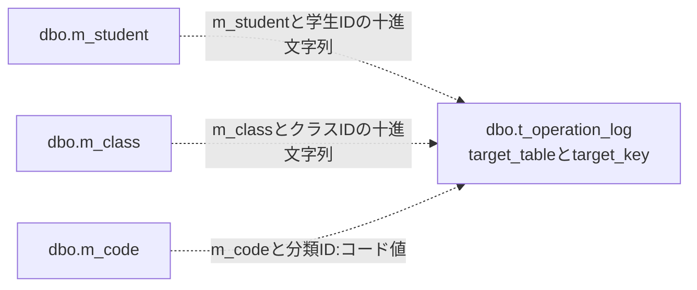

<!-- spec-meta: {"schema":"spec-md/1.1","documentId":"CSHARP_ASPNET-BAS-STU-03-T_OPERATION_LOG","version":"1.0","path":"基本設計書/テーブル/05_t_operation_log.md","layout":"TABLE","sheets":[{"sheet":"t_operation_log"}],"sections":[{"heading":"テーブルヘッダー","kind":"HEADER"},{"heading":"項目詳細","kind":"LIST","key":["No"]}],"columns":["No","論理名","物理名","PK","NOT NULL","タイプ","長さ","初期値","説明"]} -->
# 操作履歴テーブル定義（dbo.t_operation_log）
文書ID：`CSHARP_ASPNET-BAS-STU-03-T_OPERATION_LOG`　種別：`table-definition`　版：`1.0`　文書パス：`基本設計書/テーブル/05_t_operation_log.md`　シート：`t_operation_log`

## テーブルヘッダー

| 項目 | 定義 |
| --- | --- |
| 論理名・物理名 | 操作履歴／`dbo.t_operation_log`。学生の登録・更新・論理削除、および宣言されたクラス・コード保守で、対象、操作、前後版、変更列名、実行者、時刻、理由等を一行へ記録する。業務行そのものや変更前後の値を複製する表ではない。根拠：`sources/database/001_schema.sql:137-154`、`sources/Core/SqlServerStudentService.cs:385-390`、`sources/Core/MasterMaintenanceService.cs:132-136`。 |
| 主キー・採番 | `pk_t_operation_log`は`log_id`単独のPK。`IDENTITY(1,1)`が採番し、履歴INSERTはこの列を指定しない。履歴IDを学生ID等へ流用せず、INSERT後に履歴IDを取得する処理もない。根拠：`sources/database/001_schema.sql:138-150`、`sources/Core/SqlServerStudentService.cs:387-390`、`sources/Core/MasterMaintenanceService.cs:134-135`。 |
| NULL・既定値 | 12列中、NULL可能なのは`before_version`と`operation_reason`。DEFAULTは`df_t_operation_log_duplicate_confirmed`の`0`のみ。学生・保守の履歴INSERTはいずれも重複確認有無を明示設定する。IDENTITY、DEFAULT、処理設定値は別の属性である。根拠：`sources/database/001_schema.sql:138-153`、`sources/Core/SqlServerStudentService.cs:387-389`、`sources/Core/MasterMaintenanceService.cs:134-135`。 |
| 文字列の照合順序・長さ | `target_table`、`target_key`、`operation_type`は`Latin1_General_100_BIN2`。`changed_columns`、`executed_by`、`operation_reason`は`Latin1_General_100_CS_AS_SC`。`varchar(n)`の容量はバイト、`nvarchar(n)`の容量はUTF-16コード単位であり、処理・CHECKのUnicodeスカラー上限とは区別する。根拠：`sources/database/001_schema.sql:139-153`。 |
| CHECK制約 | `ck_audit_operation`は`CREATE`、`UPDATE`、`DELETE`、`DISABLE`、`ENABLE`だけを許可する。`ck_audit_json`は`ISJSON(changed_columns)=1`かつ左側空白除去後の先頭が`[`であることを確認するが、要素の型や実在する列名までは検査しない。`ck_t_operation_log_executed_by_scalar`は64スカラー以内、`ck_t_operation_log_operation_reason_scalar`はNULLまたは60スカラー以内を要求する。両文字数式は末尾に`#`を付けて数える。`ck_t_operation_log_executed_at_utc`は時差0を要求する。前後版の正数性・連続性、相関IDの一意性を検査する制約はない。根拠：`sources/database/001_schema.sql:137-154`、`sources/database/001_schema.sql:204-205`。 |
| 索引・対象との関係 | `ix_operation_target`のキー順は`target_table`、`target_key`、`executed_at`。対象表名と文字列キーによる記録上の対応であり、対象業務表へのFKや削除連鎖は定義されていない。索引の宣言は履歴照会SQLのORDER BYや取得件数を定義しない。根拠：`sources/database/001_schema.sql:187-205`、`sources/database/001_schema.sql:212-212`。 |
| 接続された追記入口 | `Program`がコントローラーを公開し、Web構成は`IStudentService`へ`SqlServerStudentService`を`webTokens:true`で登録する。認証対象の`POST /students/create`、`POST /students/{id:long}/update`、`POST /students/{id:long}/delete`がCoordinator経由で保存・削除へ到達する。`MasterMaintenanceService`の登録・呼出ルートはこの構成に存在しないため、以下の保守履歴は宣言されたサービス契約として扱う。根拠：`sources/Program.cs:3-6`、`sources/Infrastructure/WebHostSetup.cs:12-20`、`sources/Web/Controllers/StudentsController.cs:5-6`、`sources/Web/Controllers/StudentsController.cs:26-37`、`sources/Infrastructure/WebStudentCoordinator.cs:18-19`。 |
| 理由の画面入力と引数 | 確認・変更理由は`REG-024`のtextarea、`asp-for=Input.OperationReason`、`maxlength=120`で、requiredはない。参照者ではこの項目を含むfieldsetがdisabled。`Input`プレフィックスで受ける`StudentSaveInput.OperationReason`（`string?`）は`SaveRequest.Reason`（`string?`）へ渡され、`StudentDraft`の保存値に入らない。削除理由は既存学生かつ管理者に表示する別フォームの`REG-026`、`name=Reason`、`maxlength=120`、required。`StudentDeleteInput.Reason`は初期値空文字の`string`で、`DeleteAsync`の`string reason`へ渡る。根拠：`sources/Views/Students/Edit.cshtml:5-17`、`sources/Web/Inputs/StudentSaveInput.cs:30-42`、`sources/Web/Inputs/StudentDeleteInput.cs:4-4`、`sources/Core/Contracts.cs:66-78`、`sources/Web/Models/StudentEditPageModel.cs:14-14`。 |
| 理由の正規化・三つの上限 | サービスは保存理由を任意、削除理由を必須として、どちらも`Text`のraw上限60・保存上限60、複数行可で検査する。NULLを空文字へ補完し、まず原入力をUnicodeスカラーで数える。次にCRLF・CRをLFへ統一し、LF以外の制御文字を拒否してTrimする。空になれば任意理由はNULL、必須理由は入力検証例外となり、非空値を再度60スカラーで検査する。したがって空白等を除くと60以内になる原入力も、最初の上限超過では拒否する。画面maxlengthの120 UTF-16コード単位、処理前後各60スカラー、DBの`nvarchar(120)`容量と60スカラーCHECKを別々に適用する。根拠：`sources/Core/StudentNormalizer.cs:37-58`、`sources/Core/SqlServerStudentService.cs:234-234`、`sources/Core/SqlServerStudentService.cs:396-397`、`sources/database/001_schema.sql:148-153`。 |
| 理由が必須になる保存 | 通常保存は正規化後の理由NULLを許す。既存の在籍区分`03`または`04`を別値へ訂正する場合は管理者権限と理由を要求し、権限不足は`Forbidden`、理由不足は`ValidationFailed`（`E-STU-106`）。有効な重複確認情報を使用する場合も理由必須で、欠落は`ValidationFailed`（`E-STU-107`）。理由の検査は学生値の差分判定より前に行う。理由だけを変えても、その前の検査を通過して学生値の差分が0なら`NoChange`となり、履歴行は増えない。根拠：`sources/Core/SqlServerStudentService.cs:232-262`、`sources/Core/SqlServerStudentService.cs:286-286`。 |
| サービス前の拒否境界 | 保存はFormGuard、変更権限、編集スナップショット、復帰先の照合、ModelStateを経てサービスへ到達する。許可外・同名重複は400、権限・所有者等の不一致は403、不在・期限切れの保持情報は409、ModelState不正は422で拒否され、履歴追記へ進まない。非nullableへの暗黙Requiredは抑止され、FormGuardも必須キーの存在を一括保証しない。削除理由のrequiredやstring宣言だけで受信NULL排除を保証せず、サービスに届いた理由は上記Textで検査する。スナップショットのNULLキーは明示検査前に辞書へ渡るため、空文字・不在キーの409と同一視しない。根拠：`sources/Infrastructure/WebHostSetup.cs:14-18`、`sources/Web/Controllers/StudentsController.cs:28-33`、`sources/Web/Controllers/StudentsController.cs:41-41`、`sources/Infrastructure/EditorSnapshotStore.cs:10-10`。 |
| 学生保存の追記条件と順序 | 1. サービスで利用者、学生値、理由、対象IDと比較版の組合せ、年度・学年を検査する。 2. ReadCommittedトランザクションと共通ロックの後、更新対象の非削除行・版を再読取りする。対象なしは`NotFound`、版不一致・版上限は`Conflict`、学籍番号変更は`ValidationFailed`。終了区分訂正を確認し、コード・クラスの存在、変更時の利用期間・有効状態、所属と定員を再検査する。 3. 差分なしは明示rollbackして`NoChange`。学籍番号の重複は削除行も含めて検査し、使用済みなら`ValidationFailed`。同一人物候補と確認情報を照合する。 4. 新規は業務行をINSERTして学生IDを取得し、更新は`student_id=@id AND row_version=@version AND is_deleted=0`でUPDATEする。OUTPUTがNULLまたはDBNullなら`DBConcurrencyException`となり、履歴へ進まない。 5. 対象学生IDの十進文字列、操作種別、前後版、変更列名等を履歴へINSERTし、その成功後にcommitする。`Saved`は保存ID・後版・受付番号を返す。根拠：`sources/Core/SqlServerStudentService.cs:227-315`、`sources/Core/SqlServerStudentService.cs:344-383`。 |
| 同一人物候補・確認と履歴フラグ | 候補は非削除学生から更新対象自身を除き、同一生年月日かつ氏名照合キーまたはカナ照合キー一致で、学生ID順に全件取得する。全候補件数を判定に使い、画面返却だけ最大20件にする。候補がある、または確認情報が送られたのに確認が無効なら、rollback後に確認情報を発行して`ConfirmationRequired`を返し、履歴追記はない。戻り値は新規なら対象ID・前版NULL、更新なら要求対象ID・取得済み前版を保持する。履歴フラグは書込み時の`candidates.Count>0`なので、有効な確認情報があっても候補0件なら偽。接続Webの確認情報はメモリに保持し、成功後に削除する。DBの`t_confirmation`を使用する分岐はこのWeb構成では選択されない。根拠：`sources/Core/SqlServerStudentService.cs:268-290`、`sources/Core/SqlServerStudentService.cs:307-342`、`sources/Infrastructure/WebHostSetup.cs:19-19`。 |
| 学生CREATEの変更列名 | 新規では22業務列、`student_no`、`student_name`、`student_name_kana`、`name_key`、`kana_key`、`birth_date`、`gender_code`、`postal_code`、`prefecture_code`、`address_line1`、`address_line2`、`phone_number`、`email_address`、`admission_date`、`enrollment_status_code`、`enrollment_end_date`、`class_id`、`emergency_contact_name`、`relationship_category`、`relationship_code`、`emergency_phone_number`、`remarks`に、`gender_category`、`prefecture_category`、`enrollment_category`、`is_deleted`、`created_at`、`created_by`、`updated_at`、`updated_by`、`row_version`を加えた31列名を記録する。NULL設定の列も新規保存列として含む。根拠：`sources/Core/StudentNormalizer.cs:124-147`、`sources/Core/SqlServerStudentService.cs:294-307`。 |
| 学生UPDATEの変更列名 | 正規化済み学生値とDB再読取り値を比較して変わった列名に、`updated_at`、`updated_by`、`row_version`を加える。DateOnlyとDBのDateTimeは日付として比較する。UPDATEが業務列をまとめてSETしても、すべてを変更列名として記録するわけではない。確認・変更理由はこの差分に含まれず、学生表にも保存しない。根拠：`sources/Core/SqlServerStudentService.cs:253-262`、`sources/Core/SqlServerStudentService.cs:294-307`、`sources/Core/SqlServerStudentService.cs:325-327`。 |
| 学生DELETEの追記条件と順序 | 1. 削除入口はFormGuard、認証情報、スナップショット、復帰先と読込時値の一致を確認し、Coordinatorが管理者、復帰先、Confirmed、正のInt64比較版を順に検査する。Confirmed不足・版変換不正は422で拒否する。このアクションにModelState不正を分岐する処理はない。 2. サービスも管理者を再確認し、理由を必須正規化した後、ID・版の正数性と版が`long.MaxValue`でないことを検査する。 3. ReadCommittedトランザクションと共通ロックの後、`student_id=@id AND is_deleted=0`の版を再読取りし、対象なしは`NotFound`、版不一致は`Conflict`。 4. `student_id=@id AND row_version=@version AND is_deleted=0`で論理削除し、更新件数が1以外なら`DBConcurrencyException`。1件なら`DELETE`履歴を追加し、commit後に`Saved`と後版を返す。編集中の業務値は保存しない。根拠：`sources/Web/Controllers/StudentsController.cs:37-37`、`sources/Infrastructure/WebStudentCoordinator.cs:19-19`、`sources/Web/Inputs/StudentSaveInput.cs:57-60`、`sources/Core/SqlServerStudentService.cs:392-414`。 |
| 学生DELETEの設定値 | 論理削除は`is_deleted=1`、削除日時・削除者・削除理由、更新日時・更新者、`row_version+1`を設定する。履歴の変更列名は`is_deleted`、`deleted_at`、`deleted_by`、`delete_reason`、`updated_at`、`updated_by`、`row_version`の7列。理由は学生表の`delete_reason`と履歴の`operation_reason`へ同じ正規化値を設定し、実行者・時刻・受付番号も両処理で共用する。重複確認有無は偽。操作種別DELETEは物理削除ではない。根拠：`sources/Core/SqlServerStudentService.cs:409-414`、`sources/database/001_schema.sql:200-200`。 |
| 宣言されたクラス保守履歴 | DB管理者確認、共通ロック、対象・ExpectedVersionと業務整合検査を通過した変更を記録する。無変更は明示rollbackして`NoChange`。クラス保存後、対象表`m_class`、保存ClassIdの十進文字列、前版ExpectedVersion、後版保存Versionを渡す。差分対象は`school_year`、`grade_code`、`class_code`、`class_name`、`valid_from`、`valid_to`、`capacity`、`display_order`、`is_active`、`remarks`の10列。新規は全10列、更新は実差分のみで、分類列・作成更新情報・版は配列へ追加しない。同名警告は重複確認有無へ転記しない。根拠：`sources/Core/MasterMaintenanceService.cs:30-77`、`sources/Core/MasterMaintenanceService.cs:124-135`。 |
| 宣言されたコード保守履歴 | 分類の桁数・追加可否、正規化コード値、既存行・版、保護値の変更制限を確認した変更を記録する。無変更は明示rollbackして`NoChange`。対象表は`m_code`、キーは`CategoryId + ":" + 正規化コード値`、前版はExpectedVersion、後版は`(ExpectedVersionまたは0)+1`。差分対象は`code_name`、`display_order`、`is_active`、`valid_from`、`valid_to`、`remarks`の6列。新規は全6列、更新は実差分のみで、キー列・保護状態・作成更新情報・版は配列へ追加しない。根拠：`sources/Core/MasterMaintenanceService.cs:79-121`。 |
| 保守の操作種別 | 既存の有効状態がなければ`CREATE`、前後同じなら`UPDATE`、変化して変更後が有効なら`ENABLE`、無効なら`DISABLE`。停止済み行の名称だけの変更はUPDATEとなる。有効状態と名称等の同時変更でも操作種別は状態変化で選び、変更列名には複数の差分を残す。学生は新規CREATE、既存UPDATE、論理削除DELETEを設定し、在籍区分をENABLE・DISABLEへ置き換えない。根拠：`sources/Core/AuditOperation.cs:6-7`、`sources/Core/MasterMaintenanceService.cs:75-75`、`sources/Core/MasterMaintenanceService.cs:119-119`、`sources/Core/SqlServerStudentService.cs:307-307`、`sources/Core/SqlServerStudentService.cs:413-413`。 |
| 履歴INSERTの共通契約 | 学生の`Audit`と保守の`Log`は11列をINSERTし、log_idはDB採番へ任せる。学生は対象表をSQLリテラル、理由・重複確認有無をパラメータで設定する。保守は対象表をパラメータ、理由をNULL、重複確認有無を0で設定する。WHERE・JOIN・ORDER BY・ページング・履歴結果の取得はなく、`ExecuteNonQueryAsync`の完了を待つ。共通ParamはC#のNULLを`DBNull.Value`へ変換する。列ごとのSQL型・サイズは項目詳細に示す。根拠：`sources/Core/SqlServerStudentService.cs:67-72`、`sources/Core/SqlServerStudentService.cs:385-390`、`sources/Core/MasterMaintenanceService.cs:132-136`。 |
| 排他・トランザクション・取消 | 四つの保存・削除処理は、`test-project1:student-write`へTransaction所有のExclusiveアプリケーションロックを要求する。待機上限5000ミリ秒、取得結果が負ならSQL例外、`SET XACT_ABORT ON`を指定する。業務書込みと履歴INSERTは同じSqlConnection・SqlTransactionで実行し、履歴INSERT成功後にcommitする。共通SQLコマンドのタイムアウトは30秒。DB読書き・履歴INSERT・commitには要求のCancellationTokenを渡す。無変更・確認要求は書込み前の経路である。根拠：`sources/Core/SqlServerStudentService.cs:65-66`、`sources/Core/SqlServerStudentService.cs:92-101`、`sources/Core/SqlServerStudentService.cs:240-315`、`sources/Core/SqlServerStudentService.cs:399-414`、`sources/Core/MasterMaintenanceService.cs:74-77`、`sources/Core/MasterMaintenanceService.cs:118-121`。 |
| 学生保存の先行catch | トランザクション内のcatch順は、InputValidationException、SQL番号2601/2627、DBConcurrencyException、残るSQL・InvalidOperation・取消例外。先行三経路はrollback helperが復帰すると、それぞれ項目エラー付き`ValidationFailed`、`E-STU-101`の`ValidationFailed`、`E-STU-105`の`Conflict`を返す。2601/2627は履歴INSERTも含むtry全体に適用され、発生元の表を照合せず学籍番号使用済みへ分類する。これらを後段catchの結果不明条件へ含めない。根拠：`sources/Core/SqlServerStudentService.cs:316-323`。 |
| 学生の履歴失敗・commit失敗 | 保存の最後のcatch、削除のDBConcurrencyException catchより後のcatchへ到達したSQL・InvalidOperation・取消例外では、rollbackを試みる。書込み開始済みで、commit試行済みまたはrollback不成功なら`Unknown`、それ以外なら`SystemError`。両方のコードは`E-COM-004`。履歴INSERT中の対象例外はcommit未試行なので、rollback成功ならSystemError、不成功ならUnknownとなる。commit中の対象例外はrollback成否にかかわらずUnknown。Unknownは検索による結果確認を案内する分類であり、保存済み・未保存のいずれかを断定しない。削除のDBConcurrencyExceptionは先にrollbackを試みConflictへ分類する。rollback helperはCancellationToken.Noneを使い、SQL・InvalidOperation例外は偽を返し、それ以外の例外を捕捉しない。根拠：`sources/Core/SqlServerStudentService.cs:302-323`、`sources/Core/SqlServerStudentService.cs:329-329`、`sources/Core/SqlServerStudentService.cs:411-416`。 |
| 個別catch外・保守の失敗 | 学生の`User()`、接続Open、BeginTransactionはトランザクション内tryより前にあり、失敗を上記Unknown判定へ拡張しない。保存の正規化はInputValidationExceptionとArgumentExceptionを結果へ変換するが、削除理由の正規化はInputValidationExceptionだけを捕捉する。不正サロゲートでScalarCountが投げるArgumentExceptionは削除のこのcatchを通らない。保守は業務書込み、履歴INSERT、commitの順に進み、try内の例外ではrollback helperの成否を判定せず再throwする。保守にはUnknown/SystemErrorへの結果変換がなく、commit例外を未保存確定と扱わない。根拠：`sources/Core/StudentNormalizer.cs:37-58`、`sources/Core/SqlServerStudentService.cs:229-243`、`sources/Core/SqlServerStudentService.cs:394-402`、`sources/Core/MasterMaintenanceService.cs:32-41`、`sources/Core/MasterMaintenanceService.cs:74-77`、`sources/Core/MasterMaintenanceService.cs:81-89`、`sources/Core/MasterMaintenanceService.cs:118-121`。 |
| 確定後のWeb応答 | 学生のSavedはcommit後に通知をメモリへ登録し、303で検索へ復帰する。他の結果はNoChange＝200、ValidationFailed＝422、Forbidden＝403、NotFound＝404、Conflict・ConfirmationRequired＝409、SystemError・Unknown＝503へ対応する。保存の編集画面再描画では候補再取得があり、削除の非Savedでは状態設定後にLoadで学生・候補を再取得する。再取得で対象が消失すれば404、例外ならmiddlewareへ移るため、元の状態コードを常に維持する保証ではない。middlewareは応答未開始の場合だけWebFaultの状態または一般例外の503を返す。commit後の通知・応答失敗は業務更新と履歴のrollbackを意味しない。根拠：`sources/Web/Controllers/StudentsController.cs:25-38`、`sources/Infrastructure/WebStudentCoordinator.cs:17-17`、`sources/Infrastructure/WebPresentation.cs:23-23`、`sources/Infrastructure/WebHostSetup.cs:22-24`。 |
| DB権限の宣言 | `student_staff`に履歴INSERTをGRANTし、UPDATE・DELETEをDENYする。`student_admin`はstudent_staffのメンバーとしてこれを継承する。student_viewer向けSELECTは四つの業務表で、このSQLに履歴SELECTのGRANTはない。これはDBロールの定義であり、Web利用者のViewer・Staff・Administratorと接続主体のDBロールは別である。根拠：`sources/database/003_web_permissions.sql:8-24`、`sources/Infrastructure/RequestIdentity.cs:7-16`。 |
| 履歴照会・保管運用の未確定事項 | このサービス構成には履歴照会の入口・SQL、保管期限、定期削除・アーカイブの実装を確認できない。INSERTと対象索引の宣言から、照会機能や削除運用を補わない。保守サービスの実呼出し入口と、そこでの例外応答も未確定である。根拠：`sources/Core/SqlServerStudentService.cs:385-390`、`sources/Core/MasterMaintenanceService.cs:132-136`、`sources/Infrastructure/WebHostSetup.cs:12-20`、`sources/Web/Controllers/StudentsController.cs:5-42`、`sources/database/001_schema.sql:212-212`。 |
| 関連文書の対応 | 以下は提示計画の文書対応であり、参照先本文の生成状態は未確認のためリンク化しない。 `CSHARP_ASPNET-BAS-STU-02`／`basic-design`／`基本設計書/02_学生登録画面.md`：理由入力と学生保存・削除の業務操作。 `CSHARP_ASPNET-BAS-STU-03`／`table-index`／`基本設計書/03_テーブル仕様書.md`：五表の索引と関連。 `CSHARP_ASPNET-BAS-STU-04`／`code-design`／`基本設計書/04_コード設計書.md`：クラス・コード保守の契約。 `CSHARP_ASPNET-BAS-STU-03-M_STUDENT`／`table-definition`／`基本設計書/テーブル/01_m_student.md`：学生の対象ID、版、論理削除列。 `CSHARP_ASPNET-BAS-STU-03-M_CLASS`／`table-definition`／`基本設計書/テーブル/02_m_class.md`：クラス保守の対象IDと有効状態。 `CSHARP_ASPNET-BAS-STU-03-M_CODE_CATEGORY`／`table-definition`／`基本設計書/テーブル/03_m_code_category.md`：コード保守が参照する桁数・追加可否。 `CSHARP_ASPNET-BAS-STU-03-M_CODE`／`table-definition`／`基本設計書/テーブル/04_m_code.md`：分類IDとコード値による保守対象。 `CSHARP_ASPNET-DET-CSharp_ASPNET-SCR-STU-002`／`detailed-specification`／`詳細仕様書/CSharp_ASPNET/02_学生登録画面.md`：受信値・保持情報、正規化、SQL、例外、最終応答の詳細。 |

次の点線は表名と文字列キーによる記録上の対応を示す。FKや多重度の宣言ではなく、クラス・コード側の追記は上記の未接続保守サービスの契約に対応する。根拠：`sources/database/001_schema.sql:187-205`、`sources/Core/SqlServerStudentService.cs:387-389`、`sources/Core/MasterMaintenanceService.cs:75-75`、`sources/Core/MasterMaintenanceService.cs:119-119`。

## 項目詳細

| No | 論理名 | 物理名 | PK | NOT NULL | タイプ | 長さ | 初期値 | 説明 |
| --- | --- | --- | --- | --- | --- | --- | --- | --- |
| 1 | 履歴ID | log_id | 〇 | 〇 | `bigint` |  |  | 履歴行固有の識別値。`IDENTITY(1,1)`で採番し、DEFAULTではない。学生・保守のINSERTはこの列を省略する。根拠：`sources/database/001_schema.sql:138-150`、`sources/Core/SqlServerStudentService.cs:387-390`、`sources/Core/MasterMaintenanceService.cs:134-135`。 |
| 2 | 対象表名 | target_table |  | 〇 | `varchar(21)` | 21バイト |  | 操作対象の表を識別する。学生はSQLリテラル`m_student`、保守は`m_class`または`m_code`を設定し、値にdbo接頭辞は付けない。保守の`string table`は`@table`＝`SqlDbType.VarChar`、Size=21。対象表名の許可値CHECKやFKは定義されていない。根拠：`sources/database/001_schema.sql:139-139`、`sources/Core/SqlServerStudentService.cs:387-387`、`sources/Core/MasterMaintenanceService.cs:75-75`、`sources/Core/MasterMaintenanceService.cs:119-135`。 |
| 3 | 対象キー | target_key |  | 〇 | `varchar(35)` | 35バイト |  | 対象表名と組み合わせて行を指す汎用文字列。学生の`long id`とクラスの保存IDはInvariantCultureの十進文字列、コードは分類ID・コロン・正規化コード値を連結する。学生履歴の`@id`と保守履歴の`@key`はともに`SqlDbType.VarChar`、Size=35であり、業務UPDATEのBigInt型IDパラメータとは別。根拠：`sources/database/001_schema.sql:140-140`、`sources/Core/SqlServerStudentService.cs:388-388`、`sources/Core/MasterMaintenanceService.cs:75-75`、`sources/Core/MasterMaintenanceService.cs:119-135`。 |
| 4 | 操作種別 | operation_type |  | 〇 | `varchar(11)` | 11バイト |  | 実行した操作を表す。学生はCREATE・UPDATE・DELETE、保守は前後の有効状態に応じCREATE・UPDATE・ENABLE・DISABLEを設定する。CHECKはこの五値だけを許可する。両処理の`string operation`は`@op`＝`SqlDbType.VarChar`、Size=11。根拠：`sources/database/001_schema.sql:141-141`、`sources/database/001_schema.sql:205-205`、`sources/Core/SqlServerStudentService.cs:307-307`、`sources/Core/SqlServerStudentService.cs:388-388`、`sources/Core/SqlServerStudentService.cs:413-413`、`sources/Core/AuditOperation.cs:6-7`、`sources/Core/MasterMaintenanceService.cs:135-135`。 |
| 5 | 変更前版 | before_version |  |  | `bigint` |  |  | 操作直前の業務行の更新管理番号。新規は前版が存在しないためNULLとし、0を代用しない。学生更新はロック後に読み取り比較版と一致した`previousVersion`、削除はDB再読取りで一致を確認した`version`、保守は照合済みExpectedVersion。履歴引数は`long? before`、`@before`＝`SqlDbType.BigInt`で、NULLはDBNull.Valueへ変換する。根拠：`sources/database/001_schema.sql:142-142`、`sources/Core/SqlServerStudentService.cs:67-72`、`sources/Core/SqlServerStudentService.cs:245-252`、`sources/Core/SqlServerStudentService.cs:307-307`、`sources/Core/SqlServerStudentService.cs:404-413`、`sources/Core/MasterMaintenanceService.cs:75-75`、`sources/Core/MasterMaintenanceService.cs:119-119`。 |
| 6 | 変更後版 | after_version |  | 〇 | `bigint` |  |  | 保存後の業務行の更新管理番号。新規は1、学生更新は取得した前版+1、削除はversion+1、保守はExpectedVersionがNULLなら1、それ以外はExpectedVersion+1。履歴引数は`long after`、`@after`＝`SqlDbType.BigInt`。SQL Serverのrowversion型ではなく、前後版の関係は処理が設定する。根拠：`sources/database/001_schema.sql:143-153`、`sources/Core/SqlServerStudentService.cs:292-307`、`sources/Core/SqlServerStudentService.cs:388-388`、`sources/Core/SqlServerStudentService.cs:413-414`、`sources/Core/MasterMaintenanceService.cs:118-119`、`sources/Core/MasterMaintenanceService.cs:130-135`。 |
| 7 | 変更列名JSON | changed_columns |  | 〇 | `nvarchar(max)` | max（固定nなし） |  | 変更列名の`string[] changed`をJsonSerializer.SerializeしたJSON配列。学生・保守での列範囲はテーブルヘッダーの各変更列名定義に従う。氏名・住所・電話等の変更前後値を格納する実装ではない。`@changed`＝`SqlDbType.NVarChar`、Size=-1。固定の要素数上限は宣言されず、JSON・配列先頭のCHECKは列名文字列の正当性まで保証しない。根拠：`sources/database/001_schema.sql:144-144`、`sources/database/001_schema.sql:204-204`、`sources/Core/SqlServerStudentService.cs:385-390`、`sources/Core/MasterMaintenanceService.cs:132-135`。 |
| 8 | 実行者 | executed_by |  | 〇 | `nvarchar(128)` | 128 UTF-16コード単位 |  | 業務更新の実行主体。学生は認証情報のNameIdentifierから作る`CurrentUser.Principal`を保存する。サービスは必須・raw/saved各64スカラーでText検査するが、戻り値を代入しないため、Trim済み値に置き換える処理ではない。保守は接続ごとにORIGINAL_LOGIN()とstudent_admin所属を確認し、DB認証名をTextで正規化した戻り値を使用する。`string actor`から`@actor`＝`SqlDbType.NVarChar`、Size=128。DBにも64スカラーCHECKがある。根拠：`sources/database/001_schema.sql:145-151`、`sources/Infrastructure/RequestIdentity.cs:7-15`、`sources/Core/SqlServerStudentService.cs:46-51`、`sources/Core/SqlServerStudentService.cs:307-307`、`sources/Core/SqlServerStudentService.cs:389-389`、`sources/Core/MasterMaintenanceService.cs:23-27`、`sources/Core/MasterMaintenanceService.cs:135-135`。 |
| 9 | UTC実行日時 | executed_at |  | 〇 | `datetimeoffset(7)` |  |  | 履歴に付けるUTC時刻。小数秒精度7、CHECKはTZOFFSET=0。学生はサービス開始時のTimeProvider.GetUtcNow()、クラス保守はトランザクション開始後、コード保守は開始直後のDateTimeOffset.UtcNowを採取する。業務行と履歴へ同じ`DateTimeOffset now`を渡し、`@now`＝`SqlDbType.DateTimeOffset`で設定する。DB既定値やcommit完了時刻ではない。根拠：`sources/database/001_schema.sql:146-152`、`sources/Core/SqlServerStudentService.cs:44-44`、`sources/Core/SqlServerStudentService.cs:229-229`、`sources/Core/SqlServerStudentService.cs:389-394`、`sources/Core/MasterMaintenanceService.cs:39-40`、`sources/Core/MasterMaintenanceService.cs:88-88`、`sources/Core/MasterMaintenanceService.cs:135-135`。 |
| 10 | 相関ID | correlation_id |  | 〇 | `uniqueidentifier` |  |  | 学生保存・削除の開始時にGuid.NewGuid().ToString()で作る受付番号RequestIdと同じ値をGuid.Parseし、履歴の`Guid requestId`として保存する。`@request`＝`SqlDbType.UniqueIdentifier`。保守は履歴INSERT時に別途Guid.NewGuid()を生成し、MaintenanceResultに返却項目はない。HTTPヘッダー、SnapshotId、ExpectedVersion、DuplicateTokenからの転用ではなく、一意制約もない。根拠：`sources/database/001_schema.sql:147-150`、`sources/Core/SqlServerStudentService.cs:229-229`、`sources/Core/SqlServerStudentService.cs:307-315`、`sources/Core/SqlServerStudentService.cs:389-414`、`sources/Core/MasterMaintenanceService.cs:11-11`、`sources/Core/MasterMaintenanceService.cs:135-135`。 |
| 11 | 操作理由 | operation_reason |  |  | `nvarchar(120)` | 120 UTF-16コード単位 |  | 学生保存の確認・変更理由または削除理由の正規化結果。保存の任意空値はNULL、条件付き必須・削除必須はテーブルヘッダーの条件に従う。`string? reason`から`@reason`＝`SqlDbType.NVarChar`、Size=120へ設定する。処理前後各60スカラーとDBのNULLまたは60スカラーCHECKを適用する。保守はSQLで明示NULL。自由記述の理由文自体は保存されるため、変更列名が値を含まないことだけで履歴全体に個人情報がないとは判断しない。根拠：`sources/database/001_schema.sql:148-153`、`sources/Core/SqlServerStudentService.cs:234-234`、`sources/Core/SqlServerStudentService.cs:385-389`、`sources/Core/SqlServerStudentService.cs:396-413`、`sources/Core/MasterMaintenanceService.cs:134-135`。 |
| 12 | 重複確認有無 | duplicate_confirmed |  | 〇 | `bit` |  | 0 | 学生保存では保存時の同一人物候補が1件以上なら真、0件なら偽。確認情報の存在・有効性だけを真の条件にしない。`bool confirmed`を`@confirmed`＝`SqlDbType.Bit`へ設定する。学生削除はfalse、保守はSQLリテラル0を明示設定する。初期値欄の0はDEFAULT宣言であり、これらのINSERTはDEFAULTに依存しない。根拠：`sources/database/001_schema.sql:149-149`、`sources/Core/SqlServerStudentService.cs:307-307`、`sources/Core/SqlServerStudentService.cs:389-389`、`sources/Core/SqlServerStudentService.cs:413-413`、`sources/Core/MasterMaintenanceService.cs:134-135`。 |
