<!-- spec-meta: {"schema":"spec-md/1.0","documentId":"CSHARP_ASPNET-DET-CSharp_ASPNET-SCR-STU-002","version":"1.0","path":"詳細仕様書/CSharp_ASPNET/02_学生登録画面.md","sheets":[{"heading":"概要","kind":"GRID","sheet":"概要"},{"heading":"項目一覧","kind":"LIST","sheet":"項目一覧","key":["項目ID"]},{"heading":"イベント仕様","kind":"GRID","sheet":"イベント仕様"},{"heading":"補足説明","kind":"GRID","sheet":"補足説明"}]} -->
# 学生登録・編集・参照画面 詳細仕様書

| 文書属性 | 内容 |
| --- | --- |
| 文書ID | CSHARP_ASPNET-DET-CSharp_ASPNET-SCR-STU-002 |
| 種別 | detailed-specification |
| 版 | 1.0 |
| 正本path | 詳細仕様書/CSharp_ASPNET/02_学生登録画面.md |
| 対応基本設計 | CSHARP_ASPNET-BAS-STU-02／基本設計書/02_学生登録画面.md |

## 概要

本画面は、学生の基本情報、住所・連絡先、入学・在籍情報、所属クラスを新規登録し、既存学生を編集または参照する。学生管理番号はDBが採番する内部識別値であり、入力する学籍番号とは異なる。既存学生の学籍番号は画面でreadonlyとなり、保存サービスでも変更を拒否する。論理削除は独立したフォームで行い、その時点で編集中の業務値を保存しない。根拠：`sources/Views/Students/Edit.cshtml:3-17`、`sources/Core/SqlServerStudentService.cs:245-257`、`sources/database/001_schema.sql:7-9`。

`StudentsController`は認証を要求するHTML画面の入口である。保存フォームは`Input.`接頭辞で`StudentSaveInput`へバインドし、削除フォームは接頭辞なしで`StudentDeleteInput`へバインドする。復元フォームはDTOの業務値を送らず、編集メモリの参照キーと対象IDを送る。根拠：`sources/Web/Controllers/StudentsController.cs:5-6`、`sources/Web/Controllers/StudentsController.cs:23-38`。

| 操作 | HTTP・入口 | 受信値と呼出し | 主な返却先 |
| --- | --- | --- | --- |
| 新規表示 | GET `/students/new` → `New` → `Load` | `returnContextId: string?`、対象IDはNULL → `coordinator.Edit` | Editビュー |
| 編集・参照・最新再読込 | GET `/students/{id:long}` → `Edit` → `Load` | ルート変換後の`id: long`、`returnContextId: string?` → `coordinator.Edit` | Editビュー |
| 登録 | POST `/students/create` → `Create` → `Save` | `[Bind(Prefix="Input")] StudentSaveInput`、`snapshotId: string` → `coordinator.Save(null, input, ct)` | Edit再表示または303復帰 |
| 更新 | POST `/students/{id:long}/update` → `Update` → `Save` | ルートID、同じInput接頭辞、SnapshotId → `coordinator.Save(id, input, ct)` | Edit再表示または303復帰 |
| 入力クリア・編集取消 | POST `/students/reset` → `Reset` | `snapshotId: string`、`studentId: string?` | 読込時値によるEdit再表示 |
| 論理削除 | POST `/students/{id:long}/delete` → `Delete` | `StudentDeleteInput`、SnapshotId → `coordinator.Delete` | 再読込したEditまたは303復帰 |
| 検索へ戻る | GET `/students` → `Index` | `contextId: string?`、`contextRevision: string?` → 指定状態があれば`Resume` | Searchビュー |

実装登録は`Program`の`WebHostSetup.Add`、`WebHostSetup.Use`、`MapControllers`で接続される。`IStudentService`には`SqlServerStudentService`を`webTokens:true`で登録する。この画面の確認情報はプロセスメモリを参照する構成である。接続文字列の設定が空白なら登録時に503の`WebFault`を投げる。根拠：`sources/Program.cs:3-7`、`sources/Infrastructure/WebHostSetup.cs:13-19`。

`StudentEditPageModel`は、対象ID、送信・再表示用の`Input`、読込時の`Detail`、候補`Lookups`、利用者、サービス結果、SnapshotId、検索復帰版を別々に持つ。`ToRequest`は業務値を`StudentDraft`へ移し、対象ID・比較版・年度・学年・確認キー・理由を`SaveRequest`の別引数にする。`GetAsync`は`StudentDetail?`、`LookupAsync`は`LookupSet`、保存・削除は`SaveResult`を返す。`SaveResult`にはOutcome、学生ID・版、項目エラー、確認キー、候補件数・候補、受付番号がある。根拠：`sources/Web/Models/StudentEditPageModel.cs:5-14`、`sources/Web/Inputs/StudentSaveInput.cs:34-42`、`sources/Core/Contracts.cs:59-78`。

参照者は`CanEdit=false`となり、業務fieldset全体がdisabledになる。StaffとAdministratorは新規登録・更新を行えるが、既存の卒業・退学区分を別区分へ訂正する処理にはAdministratorと理由が必要である。削除フォームは既存学生かつAdministratorのときだけ出力する。画面の活性制御に加え、アクションとサービスが権限を検査する。根拠：`sources/Web/Models/StudentEditPageModel.cs:14-14`、`sources/Infrastructure/RequestIdentity.cs:13-15`、`sources/Views/Students/Edit.cshtml:5-17`、`sources/Core/SqlServerStudentService.cs:230-257`。

項目一覧の`Input.X`は保存フォームの受信名と`StudentSaveInput.X`を表す。通常の業務プロパティは同名の`StudentDraft.X`へ移送する。表の「原入力→保存値」の数値はサービスのUnicodeスカラー上限であり、HTMLのmaxlengthとは別である。`nvarchar(n)`はUTF-16の容量、`varchar(n)`はDBのバイト容量である。ASCIIへ限定される学籍番号・電話・コード等では保存値の文字数とバイト数が対応する。SQLのNULLは`DBNull.Value`へ、`DateOnly`は午前0時の`DateTime`へ変換して渡す。根拠：`sources/Core/StudentNormalizer.cs:37-57`、`sources/Core/SqlServerStudentService.cs:67-72`。

### 画面の静的投影

以下は既存学生をAdministratorが編集し、重複確認が表示された場合の非実行投影である。波括弧内はモデルまたは候補の差込位置であり、実在学生や取得済み候補を表さない。動的候補は反復するoption・行の形で示す。実画面の撮影ではない。送信先はdata属性へ置き、ボタンはすべてtype=button、遷移先は文書内fragmentにしている。

共有Layoutのheader・mainと、Editビューのfieldset、二列領域、和暦入力、候補表、独立操作フォームを一体で示す。候補領域は`role="dialog"`と`class="warning"`を持つため、`.dialog`の固定配置・オーバーレイ・表幅解除は適用されない。専用の`.grid`ラッパーもなく、候補表には共通の最小幅1050pxが適用される。根拠：`sources/Views/Shared/_Layout.cshtml:1-1`、`sources/Views/Students/Edit.cshtml:5-17`、`sources/wwwroot/css/site.css:1-1`。

<!doctype html>
<html lang="ja">
<head>
<meta charset="utf-8">
<meta name="viewport" content="width=device-width,initial-scale=1">
<title>学生管理</title>

</head>
<body>
<header><strong>学生管理システム</strong>利用者 {User.Identity.Name}　業務日 {yyyy/MM/dd}</header>
<main>
<h1>学生登録 ／編集</h1>
<!-- _MessagePanelの出力位置。この確認要求状態ではMessageと項目エラーが空なら出力なし。 -->

学生管理番号 {StudentId}　更新日時 {UTC+9の更新日時}　更新者 {UpdatedBy}

<form method="post" data-source-action="/students/{id}/update" data-editor-form>
<input type="hidden" name="__RequestVerificationToken" value="">
<input type="hidden" name="SnapshotId" value="{SnapshotId}">
<input type="hidden" name="Input.ExpectedVersion" value="{比較版}">
<input type="hidden" name="Input.ReturnContextId" value="{復帰先}">
<input type="hidden" name="Input.DuplicateToken" value="{確認キー}">
<fieldset><legend>学生基本情報</legend>

<label>学籍番号 ※必須<input name="Input.StudentNo" id="REG-002" maxlength="30" readonly required value="{student_no}"></label>
<label>氏名 ※必須<input name="Input.StudentName" id="REG-003" maxlength="16" required value="{student_name}"><small>8文字以内</small></label>
<label>氏名カナ ※必須<input name="Input.StudentNameKana" id="REG-004" maxlength="72" required value="{student_name_kana}"><small>原入力36、正規化後18文字</small></label>
<fieldset class="wareki" id="REG-005"><legend>生年月日 ※必須</legend><select name="Input.BirthDateInput.Era" aria-label="元号" required><option value="">元号</option><option value="REIWA">令和</option><option value="HEISEI">平成</option><option value="SHOWA">昭和</option><option value="TAISHO">大正</option><option value="MEIJI">明治</option></select><input name="Input.BirthDateInput.Year" aria-label="元号年" maxlength="4" required value="{年}">年<input name="Input.BirthDateInput.Month" aria-label="月" maxlength="2" required value="{月}">月<input name="Input.BirthDateInput.Day" aria-label="日" maxlength="2" required value="{日}">日</fieldset>
<label>性別 ※必須<select name="Input.GenderCode" id="REG-006" required><option value="{code_value}">{GENDERのcode_name}</option></select></label>
<label>郵便番号 ※必須<input name="Input.PostalCode" id="REG-007" maxlength="20" required value="{postal_code}"></label>
<label>都道府県 ※必須<select name="Input.PrefectureCode" id="REG-008" required><option value="">未選択</option><option value="{code_value}">{PREFECTUREのcode_name}</option></select></label>
<label>住所1 ※必須<input name="Input.AddressLine1" id="REG-009" maxlength="90" required value="{address_line1}"><small>45文字以内</small></label>
<label>住所2<input name="Input.AddressLine2" id="REG-010" maxlength="90" value="{address_line2}"></label>
<label>本人電話<input name="Input.PhoneNumber" id="REG-011" maxlength="40" value="{phone_number}"><small>原入力20、正規化後16文字</small></label>
<label>本人メール<input name="Input.EmailAddress" id="REG-012" maxlength="120" value="{email_address}"></label>
<label>入学日 ※必須<input name="Input.AdmissionDate" id="REG-013" type="date" required></label>
<label>在籍区分 ※必須<select name="Input.EnrollmentStatusCode" id="REG-014" required><option value="{code_value}">{ENROLLMENT_STATUSのcode_name}</option></select></label>
<label>卒業・退学日<input name="Input.EnrollmentEndDate" id="REG-015" type="date"></label>
<label>年度<select name="Input.SchoolYear" id="REG-016"><option value="">未指定</option><option value="{school_year}">{school_year}</option></select></label>
<label>学年<select name="Input.GradeCode" id="REG-017"><option value="">すべて</option><option value="{code_value}">{GRADEのcode_name}</option></select></label>
<label>クラス<select name="Input.ClassId" id="REG-018"><option value="">未所属</option><option value="{class_id}" data-year="{school_year}" data-grade="{grade_code}">{school_year} {grade_code} {class_code} {class_name} {停止・期間外注記}</option></select><small>人数 {Occupied}／定員 {Capacity、NULLなら制限なし}（参考）</small></label>
<label>緊急連絡先氏名<input name="Input.EmergencyContactName" id="REG-020" maxlength="16" value="{emergency_contact_name}"></label>
<label>緊急連絡先続柄<select name="Input.RelationshipCode" id="REG-021"><option value="">未選択</option><option value="{code_value}">{RELATIONSHIPのcode_name}</option></select></label>
<label>緊急連絡先電話<input name="Input.EmergencyPhoneNumber" id="REG-022" maxlength="40" value="{emergency_phone_number}"></label>
<label class="full">備考<textarea name="Input.Remarks" id="REG-023" maxlength="240">{remarks}</textarea></label>
<label class="full">確認・変更理由<textarea name="Input.OperationReason" id="REG-024" maxlength="120">{OperationReason}</textarea></label>

本人電話・メール・緊急電話のいずれか1つ以上。緊急連絡先は3項目すべて入力してください。

<section role="dialog" aria-labelledby="duplicate-title" class="warning"><h2 id="duplicate-title">同一人物候補の確認</h2>
全 {CandidateCount} 件、最大20件表示
<table><thead><tr><th>学籍番号</th><th>氏名</th><th>和暦生年月日</th><th>クラス</th></tr></thead><tbody><tr><td>{StudentNo}</td><td>{StudentName}</td><td>{BirthDateWareki}</td><td>{ClassName}</td></tr></tbody></table>
別人と確認した場合は、確認理由を入力して続行してください。
<button type="button" data-cancel-duplicate autofocus>確認取消</button><button type="button" data-confirm="別人として保存しますか。">別人と確認して続行</button></section>

<button type="button" class="primary">更新</button>
</fieldset></form>

<form method="post" data-source-action="/students/reset" data-confirm="編集内容を読込時の値へ戻しますか。"><input type="hidden" name="__RequestVerificationToken" value=""><input type="hidden" name="SnapshotId" value="{SnapshotId}"><input type="hidden" name="StudentId" value="{StudentId}"><button type="button">編集取消</button></form><a data-dirty-link data-confirm="編集内容を破棄して最新情報を読み込みますか。" href="#イベント仕様" data-source-href="/students/{id}?returnContextId={復帰先}">最新情報を再読込</a><a data-dirty-link href="#イベント仕様" data-source-href="/students?contextId={復帰先}&amp;contextRevision={復帰版}">検索へ戻る</a>

<form method="post" data-source-action="/students/{id}/delete" data-confirm="対象と理由を確認して論理削除しますか。"><input type="hidden" name="__RequestVerificationToken" value=""><input type="hidden" name="SnapshotId" value="{SnapshotId}"><input type="hidden" name="ExpectedVersion" value="{比較版}"><input type="hidden" name="ReturnContextId" value="{復帰先}"><input type="hidden" name="Confirmed" value="true"><label>削除理由 ※必須<textarea name="Reason" id="REG-026" maxlength="120" required></textarea></label><button type="button" class="danger">対象を確認して論理削除</button>
編集中の業務値は保存されません。
</form>
</main>
</body>
</html>

実画面でtypeを明示していないinputの生成type、asp-forから生成するid・選択値はTagHelperの出力に委ねられる。上の投影はnameの対応を示し、生年月日成分やhiddenへ独自のidを追加していない。状態ごとの出力差は次のとおりである。根拠：`sources/Views/Students/Edit.cshtml:3-17`、`sources/Views/_ViewImports.cshtml:1-3`。

| 状態 | 本体・操作の差分 | メッセージ・候補領域 |
| --- | --- | --- |
| 新規 | 見出しは「学生登録 ／新規」、管理番号は「新規」、更新情報は「－」。学籍番号readonlyなし。送信先create、主ボタン登録、復元ボタン入力クリア。最新再読込・削除フォームなし | 性別0、在籍01、現在業務年度を初期値とし、クラスは自動選択しない |
| 既存Staff | 見出しは編集、学籍番号readonly、更新・編集取消・最新再読込を表示。削除フォームなし | Detailを基準に停止済みの同じ選択値を保持できる |
| 既存Viewer | 見出しは参照、業務fieldsetにdisabledを付ける。fieldset内の保存・確認操作も無効。fieldset外の復元・リンクは残る。削除フォームなし | hidden制御項目は業務fieldsetの外にある |
| 既存Administrator | 編集状態に加えて独立した論理削除フォームを表示 | 削除理由のrequiredは削除フォームにだけ適用 |
| 確認要求 | 保存結果がConfirmationRequiredのとき、業務fieldset内に候補sectionを出力 | 全件数と最大20行。ClassNameがNULLの場合の「未所属」補完はこのRazor表にはない |
| 項目エラー | `_MessagePanel`が`class="message error"`、`aria-live="polite"`のdivへModelStateの全エラーを表示 | 個別のasp-validation-forは配置されていない |
| 通知あり | 非空Messageを`class="message info"`のdivへ表示 | `.info`専用CSSはなく、共通`.message`が適用される |

メッセージの条件は` sources/Views/Shared/_MessagePanel.cshtml:2-3`、クラスによる装飾は` sources/wwwroot/css/site.css:1-1`に対応する。

## 項目一覧

| 項目ID | 項目・業務上の役割 | 実コントロール・受信名 | DTO・内部型 | 正規化・制約 | 保存・検索・SQL対応 | 根拠 |
| --- | --- | --- | --- | --- | --- | --- |
| DISP-STUDENT | 学生管理番号。学籍番号と異なる内部キー | p表示、原文のREG idなし | `StudentEditPageModel.StudentId: long?`、Detailでは`long` | 新規表示は「新規」。GETのIDはルート変換後`long`、取得サービスは非正数を対象なしとして扱う | `m_student.student_id bigint IDENTITY(1,1) NOT NULL`、PK。取得・更新・削除条件の`@id BigInt` | `sources/Views/Students/Edit.cshtml:4-4`、`sources/Core/SqlServerStudentService.cs:172-181`、`sources/database/001_schema.sql:8-8` |
| DISP-UPDATE | 更新日時・更新者。読込時情報の表示 | p表示、REG idなし | `Detail.UpdatedAt: DateTimeOffset`、`UpdatedBy: string` | 日時をUTC+9の`yyyy/MM/dd HH:mm:ss`へ表示。新規は「－」 | `updated_at datetimeoffset(7) NOT NULL`、`updated_by nvarchar(128) NOT NULL`。サービス設定の`@now DateTimeOffset`、`@actor NVarChar(128)` | `sources/Views/Students/Edit.cshtml:4-4`、`sources/Infrastructure/WebPresentation.cs:7-7`、`sources/database/001_schema.sql:40-42` |
| REG-002 | 学籍番号。新規時に入力する一意番号 | input、`Input.StudentNo`、required、maxlength30、既存readonly | DTO・Draftとも`string` → 正規化`string` | 原入力15→保存15スカラー。単行Text後NFKC・大文字化、先頭英数字、以降英数字・ハイフン | `student_no varchar(15) NOT NULL`、BIN2。`@student_no VarChar(15)`、更新SETから除外。削除行を含め一意。検索は前方一致の`@no VarChar(31)` | `sources/Views/Students/Edit.cshtml:6-6`、`sources/Core/StudentNormalizer.cs:59-64`、`sources/Core/SqlServerStudentService.cs:140-140`、`sources/Core/SqlServerStudentService.cs:254-301`、`sources/database/001_schema.sql:9-9`、`sources/database/001_schema.sql:187-187` |
| REG-003 | 氏名の表示値と同一人物・検索用照合値 | input、`Input.StudentName`、required、maxlength16、説明8文字以内 | DTO・Draftとも`string` → 表示値`string`、別途照合キー`string` | 表示値は原入力8→保存8、Trim、制御文字禁止。内部空白・文字幅を保持。照合キーはNFKC・大文字化・Unicode空白除去、160スカラー以内 | `student_name nvarchar(16) NOT NULL`、`@student_name NVarChar(16)`。`name_key nvarchar(320) NOT NULL`、`@name_key NVarChar(320)`。検索はname_key部分一致、`@name NVarChar(642)` | `sources/Views/Students/Edit.cshtml:6-6`、`sources/Core/StudentNormalizer.cs:47-70`、`sources/Core/StudentNormalizer.cs:125-145`、`sources/Core/SqlServerStudentService.cs:31-32`、`sources/Core/SqlServerStudentService.cs:141-141`、`sources/database/001_schema.sql:10-12` |
| REG-004 | 氏名カナと空白を除いた照合値 | input、`Input.StudentNameKana`、required、maxlength72 | DTO・Draftとも`string` → 保存カナ・照合キー`string` | 原入力36、NFKC・対応ひらがなのカタカナ化。内部空白を半角1個へ集約、末尾空白は残さない。許可カナ・長音・中点・繰返し文字、保存18スカラー。kana_keyは半角空白除去 | `student_name_kana nvarchar(36) NOT NULL`、`@student_name_kana NVarChar(36)`。`kana_key nvarchar(36) NOT NULL`、`@kana_key NVarChar(36)`。検索はkana_key部分一致、`@kana NVarChar(74)` | `sources/Views/Students/Edit.cshtml:6-6`、`sources/Core/StudentNormalizer.cs:72-85`、`sources/Core/StudentNormalizer.cs:126-145`、`sources/Core/SqlServerStudentService.cs:31-32`、`sources/Core/SqlServerStudentService.cs:142-142`、`sources/database/001_schema.sql:11-13` |
| REG-005 | 和暦生年月日。四成分から一日付を作る | idはfieldset。`Input.BirthDateInput.Era` select、Year・Month・Day inputはrequired。maxlengthは年4、月日2。成分独自idの明示なし | DTO・Draftは`BirthDateInput`、成分は各`string` → `DateOnly` | 元号ID完全一致、年・月日をNFKC、正のASCII数字。年「元」は1。実在日・元号期間・業務日以下を検査し逆変換照合。Trimしない | `birth_date date NOT NULL`、`@birth_date Date`。同一人物候補では`@birth Date`。四成分は独立保存しない | `sources/Views/Students/Edit.cshtml:7-7`、`sources/Core/Contracts.cs:8-14`、`sources/Core/JapaneseDateService.cs:17-38`、`sources/Core/SqlServerStudentService.cs:32-32`、`sources/database/001_schema.sql:14-14` |
| REG-006 | 性別の選択コード | select、`Input.GenderCode`、required。GENDER候補 | DTO・Draftとも`string` → `string` | 初期0。原入力1、Trim・NFKC後ASCII数字1桁。保存時に存在・利用可否を再検査 | `gender_code varchar(1) NOT NULL`、`@gender_code VarChar(1)`。新規SQLが`gender_category varchar(24) NOT NULL`へGENDERを設定。名称はm_codeから表示 | `sources/Views/Students/Edit.cshtml:8-8`、`sources/Core/StudentNormalizer.cs:113-128`、`sources/Core/SqlServerStudentService.cs:33-33`、`sources/Core/SqlServerStudentService.cs:296-296`、`sources/database/001_schema.sql:15-16` |
| REG-007 | 郵便番号 | input、`Input.PostalCode`、required、maxlength20 | DTO・Draftとも`string` → `string` | 原入力10。Trim・NFKC後、Unicode空白と指定4種のハイフンを除去しASCII数字7桁 | `postal_code varchar(7) NOT NULL`、`@postal_code VarChar(7)` | `sources/Views/Students/Edit.cshtml:9-9`、`sources/Core/StudentNormalizer.cs:95-100`、`sources/Core/SqlServerStudentService.cs:33-33`、`sources/database/001_schema.sql:17-17` |
| REG-008 | 都道府県の選択コード | select、`Input.PrefectureCode`、required、空候補「未選択」 | DTO・Draftとも`string` → `string` | 原入力2、Trim・NFKC後ASCII数字2桁必須。PREFECTURE候補 | `prefecture_code varchar(2) NOT NULL`、`@prefecture_code VarChar(2)`。固定分類PREFECTUREは新規SQL設定。検索一致`@prefecture VarChar(2)`。名称はm_code由来 | `sources/Views/Students/Edit.cshtml:9-9`、`sources/Core/StudentNormalizer.cs:113-130`、`sources/Core/SqlServerStudentService.cs:33-33`、`sources/Core/SqlServerStudentService.cs:147-147`、`sources/database/001_schema.sql:18-19` |
| REG-009 | 住所1。住所表示の本体 | input、`Input.AddressLine1`、required、maxlength90 | DTO・Draftとも`string` → `string` | 原入力45→保存45、単行Text。NFKCなし | `address_line1 nvarchar(90) NOT NULL`、`@address_line1 NVarChar(90)`。検索・候補の住所表示は都道府県名称との連結 | `sources/Views/Students/Edit.cshtml:10-10`、`sources/Core/StudentNormalizer.cs:131-131`、`sources/Core/SqlServerStudentService.cs:34-34`、`sources/Core/SqlServerStudentService.cs:80-80`、`sources/database/001_schema.sql:20-20` |
| REG-010 | 住所2。追加住所情報 | input、`Input.AddressLine2`、任意、maxlength90 | DTO・Draftとも`string?` → `string?` | 原入力45→保存45、単行Text、空値NULL | `address_line2 nvarchar(90) NULL`、`@address_line2 NVarChar(90)`。検索・同一人物候補の住所表示には含めない | `sources/Views/Students/Edit.cshtml:10-10`、`sources/Core/StudentNormalizer.cs:132-132`、`sources/Core/SqlServerStudentService.cs:34-34`、`sources/Core/SqlServerStudentService.cs:80-85`、`sources/database/001_schema.sql:21-21` |
| REG-011 | 本人電話 | input、`Input.PhoneNumber`、任意、maxlength40 | DTO・Draftとも`string?` → `string?` | 原入力20、空値NULL。NFKC後、空白・指定ハイフン・丸括弧を除去。国内0始まり10〜11桁、または国際形式で最大16文字 | `phone_number varchar(16) NULL`、`@phone_number VarChar(16)`。電話検索は本人・緊急電話のOR一致、`@phone VarChar(16)`。一覧電話表示は本人電話だけ | `sources/Views/Students/Edit.cshtml:10-10`、`sources/Core/StudentNormalizer.cs:87-93`、`sources/Core/SqlServerStudentService.cs:34-34`、`sources/Core/SqlServerStudentService.cs:148-148`、`sources/database/001_schema.sql:22-22` |
| REG-012 | 本人メール | input、`Input.EmailAddress`、任意、maxlength120 | DTO・Draftとも`string?` → `string?` | 原入力60→保存60、Trim、空値NULL、NFKCなし。ASCIIローカル部・ドメイン形式検査、ローカル部の大小文字保持、ドメインだけ小文字化 | `email_address varchar(60) NULL`、`@email_address VarChar(60)`。本人電話・緊急電話と合わせ一つ以上必要 | `sources/Views/Students/Edit.cshtml:10-10`、`sources/Core/StudentNormalizer.cs:102-111`、`sources/Core/StudentNormalizer.cs:155-155`、`sources/Core/SqlServerStudentService.cs:35-35`、`sources/database/001_schema.sql:23-23` |
| REG-013 | 入学日 | input type=date、`Input.AdmissionDate`、required、maxlength宣言なし | DTO・Draftとも`string` → `DateOnly` | NFKC後10コード単位の厳密`yyyy-MM-dd`。1900-01-01以上・業務日以下、生年月日以上 | `admission_date date NOT NULL`、`@admission_date Date`。検索範囲は`@from Date`以上、`@to Date`以下 | `sources/Views/Students/Edit.cshtml:11-11`、`sources/Core/JapaneseDateService.cs:52-59`、`sources/Core/StudentNormalizer.cs:135-151`、`sources/Core/SqlServerStudentService.cs:35-35`、`sources/Core/SqlServerStudentService.cs:149-150`、`sources/database/001_schema.sql:24-24` |
| REG-014 | 在籍区分。終了日・所属・人数の判定値 | select、`Input.EnrollmentStatusCode`、required | DTO・Draftとも`string` → `string` | 初期01。原入力2、Trim・NFKC後2桁、01在学・02休学・03卒業・04退学に限定 | `enrollment_status_code varchar(2) NOT NULL`、`@enrollment_status_code VarChar(2)`。固定分類ENROLLMENT_STATUSは新規SQL設定。検索IN、人数は01・02。名称はm_code由来 | `sources/Views/Students/Edit.cshtml:11-11`、`sources/Core/StudentNormalizer.cs:136-154`、`sources/Core/SqlServerStudentService.cs:35-35`、`sources/database/001_schema.sql:25-26`、`sources/database/002_seed.sql:19-22` |
| REG-015 | 卒業・退学日 | input type=date、`Input.EnrollmentEndDate`、任意、maxlength宣言なし | DTO・Draftとも`string?` → `DateOnly?` | NULL・空文字は未設定。他は入学日と同じ日付変換。01・02は未設定、03・04は入学日以上の終了日必須 | `enrollment_end_date date NULL`、`@enrollment_end_date Date`。DBのNULL許可と状態別必須を区別 | `sources/Views/Students/Edit.cshtml:11-11`、`sources/Core/StudentNormalizer.cs:137-153`、`sources/Core/SqlServerStudentService.cs:36-36`、`sources/database/001_schema.sql:27-27`、`sources/database/001_schema.sql:198-198` |
| REG-016 | 年度。クラス選択補助・整合確認 | select、`Input.SchoolYear`、任意、空候補「未指定」 | DTO・SaveRequestは`int?`。Draftへ移送しない | バインド後整数を1900〜9998で検査。候補は全クラス年度と現在入力年度の和集合、重複除去・降順 | 学生表へ保存しない。クラスの`school_year smallint NOT NULL`と一致確認。クラス読取の`@id BigInt`で得た年度と比較。検索は`@year SmallInt` | `sources/Views/Students/Edit.cshtml:12-12`、`sources/Web/Inputs/StudentSaveInput.cs:28-42`、`sources/Core/SqlServerStudentService.cs:236-236`、`sources/Core/SqlServerStudentService.cs:363-371`、`sources/database/001_schema.sql:64-64` |
| REG-017 | 学年。クラス選択補助・整合確認 | select、`Input.GradeCode`、任意、空候補「すべて」 | DTO・SaveRequestは`string?`、Draftにはない | 原入力2、Trim・NFKC後2桁またはNULL。画面はGRADE候補を停止・期間でdisabledにしない | 学生表へ保存しない。`m_class.grade_code varchar(2) NOT NULL`との一致確認。独立した学年存在検査は学生保存にない。検索は`@grade VarChar(2)` | `sources/Views/Students/Edit.cshtml:12-12`、`sources/Core/SqlServerStudentService.cs:237-237`、`sources/Core/SqlServerStudentService.cs:363-371`、`sources/database/001_schema.sql:66-66` |
| REG-018 | 所属クラスの保存キー | select、`Input.ClassId`、任意、空候補「未所属」、optionにdata-year・data-grade | DTOは`string?` → IdParser → Draftの`long?` | 空は未設定、指定時は正のInt64。01・02では業務必須。年度・学年・存在・期間・新規所属定員を再確認 | `class_id bigint NULL`、`@class_id BigInt`。表示文字列は年度・学年コード・クラスコード・名称で構成し保存しない。検索一致`@class BigInt` | `sources/Views/Students/Edit.cshtml:12-12`、`sources/Web/Inputs/StudentSaveInput.cs:23-40`、`sources/Core/StudentNormalizer.cs:138-154`、`sources/Core/SqlServerStudentService.cs:357-383`、`sources/database/001_schema.sql:28-28` |
| DISP-OCCUPANCY | 選択中クラスの人数・定員参考表示 | REG-018のlabel内small、独立REG idなし | `SchoolClass.Occupied: int`、`Capacity: int?` | 初期モデルの選択クラスから表示。NULL定員は「制限なし」。クラス変更時に表示を更新するJSなし | 人数は非削除・01/02学生のCOUNT算出値。定員は`m_class.capacity int NULL`。保存時は別途COUNT_BIGで再検査 | `sources/Views/Students/Edit.cshtml:2-2`、`sources/Views/Students/Edit.cshtml:12-12`、`sources/Core/SqlServerStudentService.cs:201-214`、`sources/wwwroot/js/site.js:8-8`、`sources/database/001_schema.sql:71-71` |
| REG-020 | 緊急連絡先氏名 | input、`Input.EmergencyContactName`、任意、maxlength16 | DTO・Draftとも`string?` → `string?` | 原入力8→保存8、単行Text、空値NULL。続柄・緊急電話と0個または3個入力 | `emergency_contact_name nvarchar(16) NULL`、`@emergency_contact_name NVarChar(16)` | `sources/Views/Students/Edit.cshtml:13-13`、`sources/Core/StudentNormalizer.cs:139-157`、`sources/Core/SqlServerStudentService.cs:36-36`、`sources/database/001_schema.sql:29-29` |
| REG-021 | 緊急連絡先続柄 | select、`Input.RelationshipCode`、任意、空候補「未選択」 | DTO・Draftとも`string?` → コード・派生分類`string?` | 原入力2、Trim・NFKC後2桁またはNULL。値ありなら分類RELATIONSHIPを生成 | `relationship_code varchar(2) NULL`、`@relationship_code VarChar(2)`。`relationship_category varchar(24) NULL`、`@relationship_category VarChar(24)`。分類はクライアント入力でない | `sources/Views/Students/Edit.cshtml:13-13`、`sources/Core/StudentNormalizer.cs:140-147`、`sources/Core/SqlServerStudentService.cs:37-37`、`sources/database/001_schema.sql:30-31` |
| REG-022 | 緊急連絡先電話 | input、`Input.EmergencyPhoneNumber`、任意、maxlength40 | DTO・Draftとも`string?` → `string?` | 本人電話と同じ原入力20・形式変換。空値NULL。氏名・続柄と一組 | `emergency_phone_number varchar(16) NULL`、`@emergency_phone_number VarChar(16)`。本人電話とOR一致検索、一覧の本人電話列には表示しない | `sources/Views/Students/Edit.cshtml:13-13`、`sources/Core/StudentNormalizer.cs:87-93`、`sources/Core/StudentNormalizer.cs:141-157`、`sources/Core/SqlServerStudentService.cs:37-37`、`sources/Core/SqlServerStudentService.cs:148-148`、`sources/database/001_schema.sql:32-32` |
| REG-023 | 備考 | textarea、`Input.Remarks`、任意、maxlength240、label.full | DTO・Draftとも`string?` → `string?` | 原入力120→保存120。原入力計数後CRLF・CRをLFへ統一、LF以外の制御文字禁止、全体Trim、空値NULL | `remarks nvarchar(240) NULL`、`@remarks NVarChar(240)` | `sources/Views/Students/Edit.cshtml:13-13`、`sources/Core/StudentNormalizer.cs:47-57`、`sources/Core/StudentNormalizer.cs:142-142`、`sources/Core/SqlServerStudentService.cs:37-37`、`sources/database/001_schema.sql:33-33` |
| REG-024 | 確認・変更理由。保存の監査理由 | textarea、`Input.OperationReason`、任意、maxlength120、label.full | DTOは`string?` → `SaveRequest.Reason: string?`、Draftにはない | 原入力60→保存60の複数行Text。終了区分訂正・有効確認での続行では必須 | 学生業務列へ保存しない。`t_operation_log.operation_reason nvarchar(120) NULL`、`@reason NVarChar(120)`。理由だけの変更は履歴にならない | `sources/Views/Students/Edit.cshtml:13-13`、`sources/Web/Inputs/StudentSaveInput.cs:32-42`、`sources/Core/SqlServerStudentService.cs:234-262`、`sources/Core/SqlServerStudentService.cs:286-286`、`sources/Core/SqlServerStudentService.cs:389-389`、`sources/database/001_schema.sql:148-148` |
| REG-026 | 削除理由。独立フォームの必須理由 | textarea、`Reason`、required、maxlength120。既存Administratorだけ出力 | `StudentDeleteInput.Reason: string`、初期空 → サービス引数`string` | 必須の複数行Text、原入力60→保存60。編集中の業務値とは別送信 | `m_student.delete_reason nvarchar(120) NULL`と履歴operation_reasonへ保存、双方`@reason NVarChar(120)`。削除状態のCHECKで非NULL要求 | `sources/Views/Students/Edit.cshtml:17-17`、`sources/Web/Inputs/StudentDeleteInput.cs:4-4`、`sources/Core/SqlServerStudentService.cs:396-413`、`sources/database/001_schema.sql:37-37`、`sources/database/001_schema.sql:200-200` |
| CTRL-SNAPSHOT | 読込時編集状態の参照キー | 各POSTフォームのhidden `SnapshotId`、独自idなし | DTO外のアクション引数`string` | メモリ辞書のキー存在・期限・所有者・セッション・対象IDを照合。NULLキーと不在キーの経路は別 | EditorSnapshotStoreに保持。DB列・SQLパラメータなし | `sources/Views/Students/Edit.cshtml:5-17`、`sources/Infrastructure/EditorSnapshotStore.cs:7-11` |
| CTRL-VERSION | 更新・削除の比較版 | 保存hidden `Input.ExpectedVersion`、削除hidden `ExpectedVersion` | 保存DTO`string?`、削除DTO`string` → 必須`long` → SaveRequestは`long?` | 更新・削除は正のInt64必須。新規は非空指定を400で拒否。サービスでも組合せ・正数、変更時の版上限を検査 | `row_version bigint NOT NULL`、正数CHECK。更新・削除WHEREの`@version BigInt`。SQL Serverのrowversion型ではなく数値加算 | `sources/Web/Inputs/StudentSaveInput.cs:42-60`、`sources/Web/Inputs/StudentDeleteInput.cs:4-4`、`sources/Core/SqlServerStudentService.cs:235-263`、`sources/database/001_schema.sql:42-59` |
| CTRL-RETURN | 復帰検索状態の参照キー | 保存hidden `Input.ReturnContextId`、削除hidden `ReturnContextId` | 各DTOの`string?`。Draftにはない | 非空なら検索メモリを照合。保存・削除では読込時文字列とも一致を要求。NULLと空文字はこの一致比較で同じとは限らない | SearchContextStore参照。学生DB列・SQLパラメータなし | `sources/Views/Students/Edit.cshtml:5-17`、`sources/Web/Controllers/StudentsController.cs:29-38`、`sources/Infrastructure/WebStudentCoordinator.cs:6-6` |
| CTRL-RETURN-REV | 編集読込後に取得した検索状態版 | 送信DTOのhiddenにはない。検索へ戻るリンクと303 Locationに使用 | `StudentEditPageModel.ReturnRevision: string?`、Snapshotにも保持 | 指定復帰先をEditのawait後に再Getし、現在Revisionを十進文字列化。復帰時に一致照合 | SearchContextStoreの`Revision: long`。学生DB列・SQLパラメータなし | `sources/Web/Controllers/StudentsController.cs:25-25`、`sources/Web/Controllers/StudentsController.cs:38-38`、`sources/Infrastructure/SearchContextStore.cs:14-14` |
| CTRL-DUPLICATE | 重複確認情報の参照キー | 保存hidden `Input.DuplicateToken` | DTO`string?` → `SaveRequest.ConfirmationToken: string?` | 所有者・セッション・対象・版・期限・両ハッシュ・Busyを照合。非NULLの空文字も再発行判定対象 | 接続されたWeb構成ではstaticメモリ。学生列に保存しない | `sources/Views/Students/Edit.cshtml:5-5`、`sources/Core/SqlServerStudentService.cs:19-29`、`sources/Core/SqlServerStudentService.cs:274-290` |
| CTRL-RESET-ID | 復元する編集状態の対象ID | resetフォームhidden `StudentId` | アクション`string?` → `long?` | IdParser.Optionalで未設定または正のInt64へ変換しSnapshotの対象と照合 | resetは学生DB値を取得しない。DB書込みなし | `sources/Views/Students/Edit.cshtml:16-16`、`sources/Web/Controllers/StudentsController.cs:35-35` |
| CTRL-DELETE-CONFIRM | 削除確認の送信値 | 削除hidden `Confirmed`、値true | DTOの`bool` | coordinatorがfalseを422、REG-026のWebFaultにする。ブラウザー確認とは別検査 | DB列・SQLパラメータなし | `sources/Views/Students/Edit.cshtml:17-17`、`sources/Infrastructure/WebStudentCoordinator.cs:19-19` |
| CTRL-CSRF | フォーム偽造防止情報 | 各POSTのAntiForgeryToken出力 | MVCのCSRF検査対象。業務DTO外 | FormGuardは項目名を許可する。内容検証は全体登録のAutoValidateAntiforgeryTokenAttribute | 学生DB列・SQLパラメータなし | `sources/Views/Students/Edit.cshtml:5-17`、`sources/Infrastructure/WebHostSetup.cs:15-16`、`sources/Web/Controllers/StudentsController.cs:41-41` |
| DISP-CANDIDATES | 同一人物候補の確認表示 | role=dialog、class=warningのsection、四列表。専用REG idなし | `SaveResult.CandidateCount: int`、`Candidates: IReadOnlyList<StudentRow>?` | 全候補件数と最大20行を分ける。学籍番号・氏名・和暦生年月日・クラス名称を表示 | 非削除学生の生年月日と氏名キーまたはカナキー一致。名称LEFT JOIN、ID・版はハッシュに使用 | `sources/Views/Students/Edit.cshtml:14-14`、`sources/Core/Contracts.cs:50-70`、`sources/Core/SqlServerStudentService.cs:269-290` |

## イベント仕様

### 新規・既存学生の読込／最新情報の再読込

#### 処理概要

GET newまたは既存IDを入口に、復帰検索状態を確認し、入力モデルと候補を構築する。既存学生は非削除行だけを取得する。最新情報の再読込は既存GETを再実行するため、読込時コピーへの復元とは異なる。根拠：`sources/Web/Controllers/StudentsController.cs:23-25`、`sources/Infrastructure/WebStudentCoordinator.cs:17-17`。

#### 処理手順

1. `coordinator.Edit`が認証を確認する。復帰先が非空なら検索状態の存在・期限・所有者・セッションを確認する。
2. 新規では更新権限を確認してDetailをNULLとする。既存では`GetAsync(id, ct)`を呼び、対象なしなら404、E-STU-103のWebFaultを投げる。非正数IDもGetAsyncがNULLを返す。
3. `LookupAsync(ct)`で人数付きコード・クラス候補を取得する。学生取得と候補取得は別のDB読込であり、一つの同時点取得ではない。
4. 新規はStudentDraftの既定値からInputを作る。性別0、在籍01、必須文字列と生年月日成分は空、任意値・クラス・学年・比較版は未設定、年度だけ現在業務年度とする。候補があってもクラスを自動選択しない。
5. 既存は取得値をInputへ戻す。生年月日は和暦成分、入学日・終了日は西暦文字列、ClassIdと版はInvariantCultureの十進文字列とする。所属クラスが候補にあればその年度・学年を入れ、見つからなければ両者を未設定とする。
6. ControllerはEditのawait後、指定復帰先をもう一度Getして、その時点のRevisionを保持する。待機中の期限切れや所有状態の不正はここでも拒否される。
7. Detail、OriginalのJSON複製、利用者・セッション・対象、復帰版を30分の固定期限でSnapshotへ保持し、Editビューを返す。

根拠：`sources/Infrastructure/WebStudentCoordinator.cs:17-17`、`sources/Web/Controllers/StudentsController.cs:25-25`、`sources/Web/Inputs/StudentSaveInput.cs:44-54`、`sources/Infrastructure/EditorSnapshotStore.cs:7-11`。

#### 処理フロー

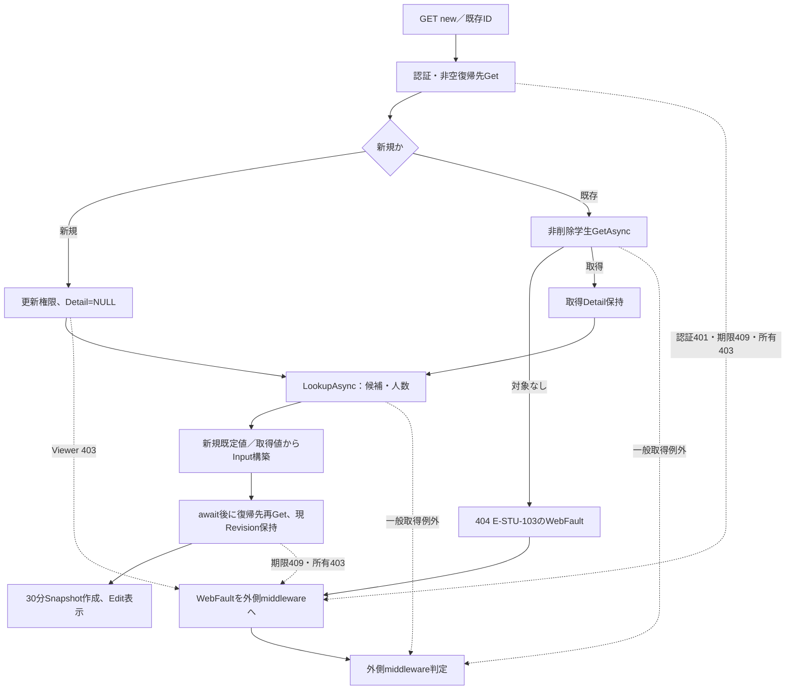

#### SQL・テーブル関連（ER図）

学生詳細取得はm_student単表である。候補取得はコード分類とコードの結合、クラスと学年コードの結合、学生の人数集計を伴うため、次の関連を使用する。矢印はこの読込の用途を示し、FKの多重度を表していない。

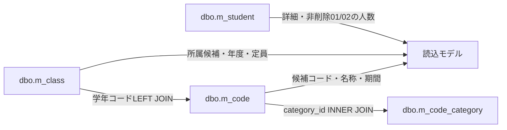

根拠：`sources/Core/SqlServerStudentService.cs:172-216`。

#### DB操作の詳細

詳細取得SQLは`SELECT * FROM dbo.m_student WHERE student_id=@id AND is_deleted=0`で、`@id BigInt`を使う。一行をStudentDetailへ変換し、取得できなければNULLを返す。業務値はColumnsの各列から読み、更新日時・更新者・数値版を別途保持する。根拠：`sources/Core/SqlServerStudentService.cs:172-194`。

候補はSNAPSHOTトランザクション内の二結果で取得する。コードはm_codeとm_code_categoryをcategory_idでINNER JOINし、コード・分類双方のis_activeが1のときだけDTOのIsActiveを真にする。WHEREによる停止・期間外の除外は行わず、category_id、display_order、code_valueの順に全候補を読む。クラスは全m_classを読み、学年コードを分類・値でLEFT JOINし、school_year降順、学年display_order、クラスdisplay_order、class_code、class_idの順に並べる。人数はclass_id一致、is_deleted=0、在籍区分01・02のCOUNTであり、保存列ではない。このSQLには利用者入力パラメータやページングがない。二結果を全て読んでcommitし、LookupSetを返す。根拠：`sources/Core/SqlServerStudentService.cs:196-216`。

画面のコード候補は取得順のまま用途別に抽出する。性別・都道府県・在籍・続柄は「双方有効で現在業務日が期間内」または「読込Detailの同じコード」で選択可能とする。性別・都道府県だけ選択不可候補へ「停止・期間外」を付ける。学年は有効状態・期間によるdisabledを付けない。年度は候補年度と現在入力年度の和集合を降順にする。根拠：`sources/Views/Students/Edit.cshtml:8-13`。

クラスは年度・学年で絞り込まず全件を出力する。読込時クラスは保持できる。他の通常選択は有効かつ現在業務日が期間内、卒業・退学の選択は入力入学日〜終了日とクラス期間の重なりを使う。後者の重なり条件にはIsActiveを含めない。画面の日付判定はDateOnly.TryParseによる表示条件であり、保存時の厳密日付検査とは別である。根拠：`sources/Views/Students/Edit.cshtml:12-12`。

#### 結果・例外時の扱い

読込成功時は通常200でEditを表示する。認証・権限・復帰状態・対象なしはWebFaultの固有状態を持つ。GETには局所catchがなく、応答未開始なら外側middlewareが固有状態とHTMLメッセージを返し、一般例外なら503を返す。学生を取得できても、候補取得、復帰状態の再Get、Snapshot作成またはビュー出力まで成功する保証にはならない。根拠：`sources/Web/Controllers/StudentsController.cs:23-25`、`sources/Infrastructure/WebHostSetup.cs:22-24`。

### 入力クリア・編集取消

#### 処理概要

独立したresetフォームから読込時のInputへ戻す。新規でも性別・在籍区分・年度の初期値を復元するため、全項目の空欄化ではない。既存では読込時の業務値へ戻し、最新DB値へ置き換えない。根拠：`sources/Views/Students/Edit.cshtml:16-16`、`sources/Web/Controllers/StudentsController.cs:35-35`。

#### 処理手順

1. FormGuardはSnapshotId、StudentId、CSRF項目、書式メタ情報だけを許可する。
2. 認証を確認し、StudentIdをIdParser.Optionalで未設定または正のInt64へ変換する。
3. SnapshotをGetし、キー、期限、所有者、セッション、対象IDを照合する。
4. ModelStateをClearし、Snapshot.OriginalをJSON複製する。保存済みDetail、SnapshotId、ReturnRevisionは引き継ぐ。
5. 候補だけをLookupAsyncで再取得し、「入力を読込時の値へ戻しました。」を表示する。学生GetAsync、復帰検索状態の再Get、新Snapshot作成は行わない。

根拠：`sources/Web/Controllers/StudentsController.cs:35-41`、`sources/Infrastructure/EditorSnapshotStore.cs:7-11`。

#### 処理フロー

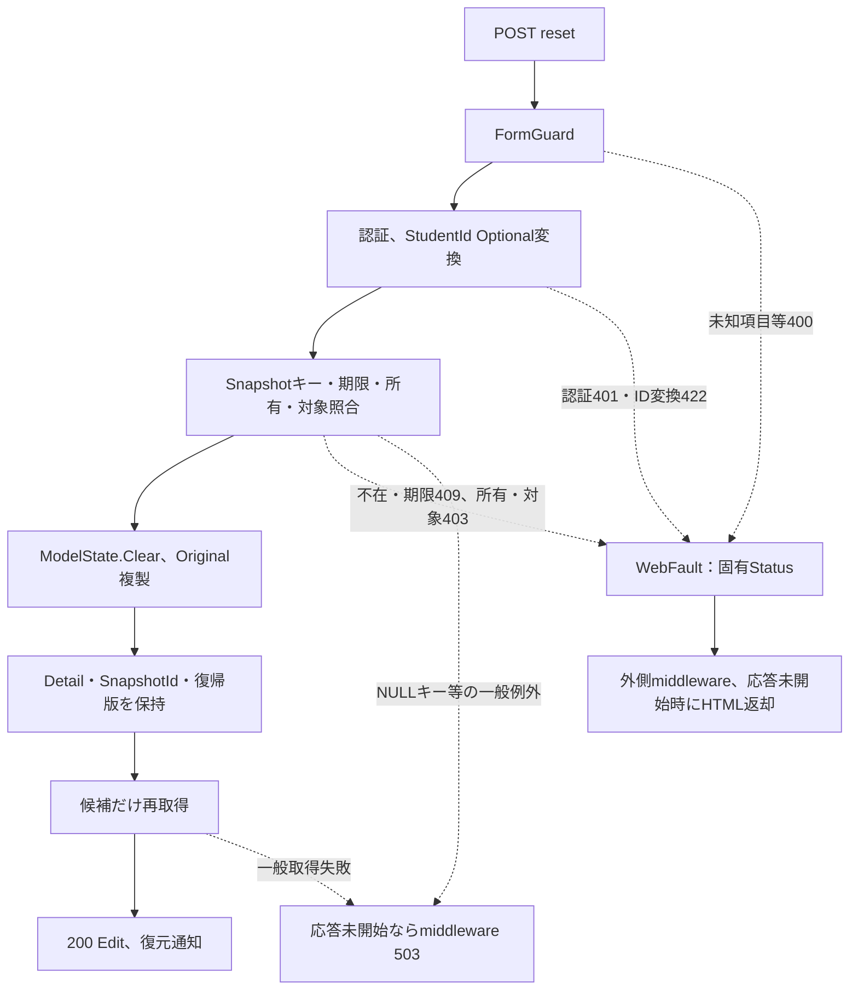

#### SQL・テーブル関連（ER図）

業務値の復元先はEditorSnapshotStoreのOriginalでありDBではない。候補再取得だけがm_code、m_code_category、m_class、人数集計のm_studentを参照する。

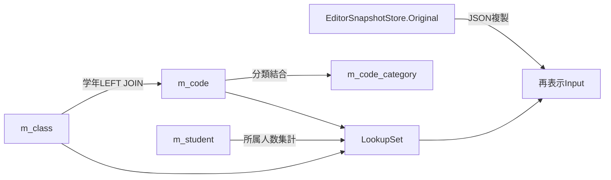

根拠：`sources/Web/Controllers/StudentsController.cs:35-35`、`sources/Core/SqlServerStudentService.cs:196-216`。

#### DB操作の詳細

候補SQL・結果順・人数条件は読込イベントと同じである。学生UPDATE・DELETEや履歴INSERTは実行しない。候補の変更は再表示へ反映されるが、Originalの業務値と読込DetailはSnapshotの値を維持する。Snapshotの30分期限を延長する処理もない。根拠：`sources/Web/Controllers/StudentsController.cs:35-35`、`sources/Infrastructure/EditorSnapshotStore.cs:9-11`。

#### 結果・例外時の扱い

復元成功は200である。フォーム拒否400、認証401、識別値変換422、Snapshot不在・期限409、所有・対象不一致403を区別する。Snapshot照合後の候補取得が失敗すれば通常の復元画面へ到達しない。resetには局所catchがなく、一般例外は応答未開始の場合に外側middlewareの503となる。SnapshotIdのNULLキーは独自409へ到達する前の例外経路を持つ。根拠：`sources/Web/Controllers/StudentsController.cs:35-41`、`sources/Infrastructure/EditorSnapshotStore.cs:10-10`、`sources/Infrastructure/WebHostSetup.cs:23-24`。

### 登録・更新・重複確認後の続行

#### 処理概要

登録、更新、「別人と確認して続行」は同じ保存フォームとSaveアクションを使う。確認後の続行でも学生入力、現行DB値、コード・クラス、学籍番号、同一人物候補を再検査する。確認キーだけで保存を許可する処理ではない。根拠：`sources/Views/Students/Edit.cshtml:5-15`、`sources/Core/SqlServerStudentService.cs:227-315`。

#### 処理手順

1. フレームワークの認証・CSRF等を通ってアクション本体へ到達した後、FormGuard、更新権限、Snapshot取得、非空復帰先の検索状態Get、読込時復帰先との文字列一致をこの順で確認する。この初期検査は局所WebFault catchの外にある。
2. ModelStateが不正なら422を設定してサービスを呼ばない。有効なら局所try内でcoordinator.Saveを呼ぶ。同coordinatorは権限と復帰先を再確認してToRequestを実行する。ClassIdをOptional、更新比較版をRequiredで変換する。新規の非空比較版は400で拒否する。
3. SaveAsyncは受付番号GUID、認証利用者、開始時UTCのnow、UTC+9業務日を取得する。ViewerならForbiddenを返す。User取得は初期検証tryより前である。
4. 学生項目を正規化し、理由を任意・複数行60スカラーで正規化する。対象IDと比較版の正数、双方NULLまたは双方設定という組合せ、年度1900〜9998、任意学年2桁を検査する。InputValidationExceptionは項目エラー、ArgumentExceptionはSaveに対する変換エラーとしてValidationFailedを返す。
5. 接続を開き、接続先のSNAPSHOT許可状態を検査してReadCommittedトランザクションを開始する。OpenとBeginTransactionは後続のDB処理tryの外にある。
6. DB処理try内で共通Gateを取得する。更新では非削除の対象を再取得し、比較版、学籍番号不変、終了区分訂正の権限・理由を順に確認する。対象なしはNotFound、版不一致はConflict、番号変更はValidationFailed、終了区分訂正の権限不足はForbidden、理由不足はValidationFailedとなる。
7. CheckRulesで性別・都道府県・在籍・続柄の存在と利用可否を再検査し、指定クラスの存在・年度学年一致・必要な期間・定員を検査する。収集したエラーはInputValidationExceptionにする。
8. 正規化済み全業務列を現行値と比較する。DateOnlyとDBのDateTimeは日付として比較する。変更列0なら明示rollbackしてNoChangeと対象ID・取得版を返す。理由だけの変更は書込み・履歴にならない。
9. 変更がある更新では取得版long.MaxValueをConflictで拒否する。その後、削除済み行も含む学籍番号重複を検査し、使用済みならE-STU-101のValidationFailedとする。
10. 非削除・更新対象以外・同一生年月日・氏名キーまたはカナキー一致の候補を全件取得する。正規化入力と全候補ID・版のハッシュを作る。
11. 非NULL確認キーがあれば、Web確認メモリのキー存在、主体・セッション、対象ID・比較版、Expires>開始時now、両ハッシュ、Busyの0→1取得を照合する。有効確認で理由がNULLならE-STU-107のValidationFailedとする。
12. 候補がある、または非NULL確認キーを送った状態で確認が無効なら、業務トランザクションを明示rollbackして確認を発行する。ConfirmationRequiredは新規ならID・版NULL、更新なら要求IDと今回取得版を返す。CandidateCountは全件、Candidatesは最大20件とする。
13. 確認不要または有効確認であれば、INSERTまたは比較版付きUPDATEを実行する。実行直前にwriteStarted=trueとし、OUTPUTのIDを取得できなければDBConcurrencyExceptionを投げる。
14. 同一トランザクションで操作履歴をINSERTする。新規はCREATE、更新はUPDATE、前後版・変更列名JSON・主体・開始時UTC日時・受付番号・理由を記録する。duplicate_confirmedは今回の候補件数>0で設定する。
15. commitAttempted=trueとしてcommitをawaitする。成功後completed=trueとし、送信確認キーをメモリから除去してSavedと保存ID・保存版を返す。
16. Controllerは返却項目エラーのFieldを加工せずModelStateへ追加する。Savedなら通知を保存し303で検索へ戻す。その他はOutcome別HTTP状態を設定し、Input.DuplicateTokenを返却キーへ置換して、そのキーのModelStateだけ除去する。
17. Saved以外は候補を再取得し、入力値、読込時Snapshot.Detail、同じSnapshotId・復帰版でEditを再表示する。局所WebFaultやModelState不正でresultがNULLのときは確認キー置換を行わない。

根拠：`sources/Web/Controllers/StudentsController.cs:28-33`、`sources/Infrastructure/WebStudentCoordinator.cs:18-18`、`sources/Web/Inputs/StudentSaveInput.cs:34-60`、`sources/Core/SqlServerStudentService.cs:227-315`、`sources/Core/SqlServerStudentService.cs:344-390`。

#### 処理フロー

Web層の検査と再表示の到達範囲は次のとおりである。

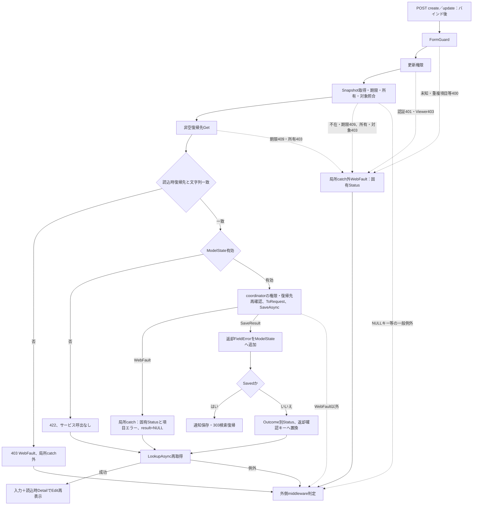

サービスの通常分岐では取得済み版を更新枝に保持し、新規枝のNULLと区別する。

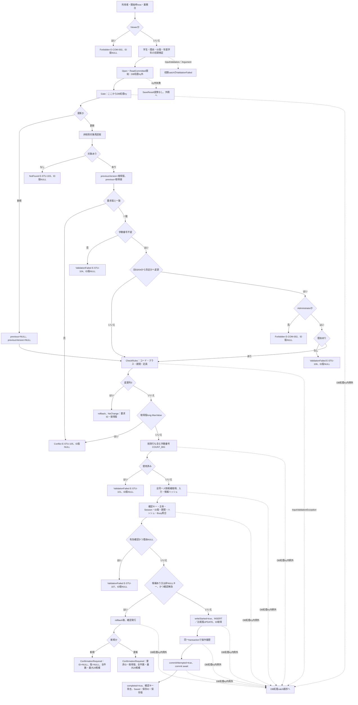

DB処理tryの例外は、次の順で分類する。明示rollbackの失敗もその位置から例外経路へ進む。NoChangeや確認発行前のrollbackには要求のctを渡し、失敗処理のRollback helperにはCancellationToken.Noneを渡す。

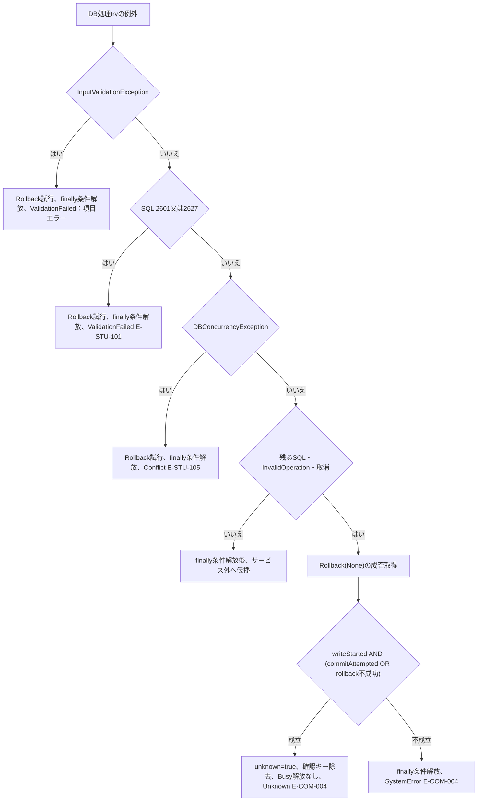

「finally条件解放」は、claimedあり、completed=false、unknown=falseのときだけBusyを0へ戻す。先行三catchはrollbackのbool結果でUnknownへ変更しない。初期検証tryはInputValidationException、次にArgumentExceptionをValidationFailedへ変換し、それ以外はDB処理tryへ入る前に伝播する。根拠：`sources/Core/SqlServerStudentService.cs:232-243`、`sources/Core/SqlServerStudentService.cs:316-329`。

#### SQL・テーブル関連（ER図）

保存は学生を更新し、クラス・用途別コード・分類を検査し、同一トランザクションで操作履歴を追記する。図のFKはDDLの宣言であり、候補表示のLEFT JOINとは区別する。操作履歴の対象識別値には業務表へのFKがない。

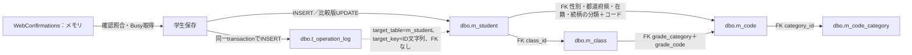

根拠：`sources/database/001_schema.sql:137-153`、`sources/database/001_schema.sql:189-199`、`sources/Core/SqlServerStudentService.cs:274-315`。

#### DB操作の詳細

接続はEncrypt Mandatory、TrustServerCertificate=falseを設定する。Openは`sys.databases WHERE database_id=DB_ID()`のsnapshot_isolation_stateが1かを検査し、不成立ならInvalidOperationExceptionを投げ、失敗時に接続をDisposeして再throwする。Command helper経由の業務SQLはCommandTimeout=30秒である。診断コマンドはCreateCommandで生成され、原文に明示Timeout設定はない。根拠：`sources/Core/SqlServerStudentService.cs:39-66`。

GateはSET XACT_ABORT ONの後、`sp_getapplock`でResource=`test-project1:student-write`、Exclusive、LockOwner=Transaction、LockTimeout=5000、DbPrincipal=publicを指定する。負の戻り値はSQLエラー51001にする。同じGateを使う保守処理とseedも同じResourceを取得する。この方式は当該ロックを取得する処理同士の排他である。根拠：`sources/Core/SqlServerStudentService.cs:92-101`、`sources/Core/MasterMaintenanceService.cs:42-42`、`sources/Core/MasterMaintenanceService.cs:90-90`、`sources/database/002_seed.sql:4-6`。

| SQL用途 | 全条件・結合・順序と結果 | パラメータ | 操作上の意味 |
| --- | --- | --- | --- |
| 更新対象再取得 | m_student、`student_id=@id AND is_deleted=0`。全列一行、ORDER BYなし | `@id BigInt` | Gate取得後の業務値・比較版を得る。行なし、版相違、番号変更、終了区分訂正を順に判定 |
| 保存コード確認 | m_code c JOIN m_code_category k ON category_id一致。`c.category_id=@category AND c.code_value=@value`。双方有効状態・valid_from・valid_to、一行 | `@category VarChar(24)`、`@value VarChar(10)` | 性別、都道府県、在籍、続柄を順に検査。NULL続柄は省略。存在なしE-STU-009。新規・変更値だけ双方有効かつ業務日期間内を要求、違反E-STU-011 |
| クラス確認 | m_class、`class_id=@id`。school_year、grade_code、期間、is_active、capacity、一行 | `@id BigInt` | 存在なしE-STU-010、指定年度・学年不一致E-STU-014。存在と利用条件を分ける |
| 新規座席の定員確認 | m_student、`class_id=@class AND is_deleted=0 AND enrollment_status_code IN ('01','02') AND (@id IS NULL OR student_id<>@id)`、COUNT_BIG、一値 | `@class BigInt`、`@id BigInt` | 更新対象を除いた人数＋1が定員を超えればE-STU-102。NULL定員はこの検査なし |
| 学籍番号重複 | m_student、`student_no=@no AND (@id IS NULL OR student_id<>@id)`、COUNT_BIG、一値。is_deleted条件なし | `@no VarChar(15)`、`@id BigInt` | 削除済み番号も使用済み。0件で続行、1件以上E-STU-101 |
| 同一人物候補 | RowSelectの名称LEFT JOINに、`s.is_deleted=0 AND (@id IS NULL OR s.student_id<>@id) AND s.birth_date=@birth AND (s.name_key=@name OR s.kana_key=@kana)`。`ORDER BY s.student_id` | `@id BigInt`、`@birth Date`、`@name NVarChar(320)`、`@kana NVarChar(36)` | SQL上限・ページングなしで全候補を読む。件数・全候補ハッシュ・最大20件表示を分ける |
| 新規学生INSERT | 正規化全列と固定分類・削除状態・作成更新情報・版を設定。OUTPUT INSERTED.student_idを表変数に入れて取得 | 項目一覧の業務列型・Size、`@now DateTimeOffset`、`@actor NVarChar(128)` | IDENTITY採番。分類GENDER・PREFECTURE・ENROLLMENT_STATUS、is_deleted=0、row_version=1を明示設定 |
| 学生UPDATE | student_no以外の正規化全列とupdated_at・updated_by、row_version+1。`WHERE student_id=@id AND row_version=@version AND is_deleted=0`。OUTPUTのIDを取得 | 業務列型・Size、`@id BigInt`、`@version BigInt`、`@now DateTimeOffset`、`@actor NVarChar(128)` | 変更列だけのSETではない。変更列一覧は監査用に別計算。OUTPUTがNULL・DBNullならDBConcurrencyException |
| 履歴INSERT | t_operation_logの11非IDENTITY列へINSERT。target_table固定m_student、CREATEまたはUPDATE。読取条件なし | `@id VarChar(35)`、`@op VarChar(11)`、`@before/@after BigInt`、`@changed NVarChar(MAX)`、`@actor NVarChar(128)`、`@now DateTimeOffset`、`@request UniqueIdentifier`、`@reason NVarChar(120)`、`@confirmed Bit` | 学生書込みと同じtransaction。新規前版NULL。変更前後の個人情報値は保存せず、変更列名配列を保存 |

SQL根拠：`sources/Core/SqlServerStudentService.cs:245-272`、`sources/Core/SqlServerStudentService.cs:294-307`、`sources/Core/SqlServerStudentService.cs:344-390`。項目別SqlDbType・Sizeは`sources/Core/SqlServerStudentService.cs:30-37`に対応する。

RowSelectは学生を起点に、クラスをclass_id、学年コードをクラスのgrade_category＋grade_code、在籍名称を学生のenrollment_category＋enrollment_status_code、都道府県名称をprefecture_category＋prefecture_codeでLEFT JOINする。StudentRowは学生ID・数値版、番号・氏名・カナ・生年月日、年度・学年名称・クラスコード・名称、在籍名称、住所、本人電話、入学日、更新日時を持つ。住所は都道府県名称と住所1の連結で、名称欠落は「[不整合]」、住所2は含めない。根拠：`sources/Core/SqlServerStudentService.cs:77-90`。

クラスの座席使用状態は「クラスあり、区分01または02」である。新たに座席を使う場合、または別クラスへ移る場合だけ、有効状態と開始時業務日の期間内を要求し、E-STU-013や定員超過を検査する。同じクラスで旧・新とも座席使用なら、新規所属の期間・有効状態・定員検査を行わない。卒業・退学は、新規またはクラス・区分・入学日・終了日変更時に在籍期間とクラス期間の重なりを検査し、不成立はE-STU-108にする。根拠：`sources/Core/SqlServerStudentService.cs:357-383`。

確認入力ハッシュはColumnsの列順で正規化値をJSON化し、UTF-8のSHA-256を取る。name_key、kana_key、relationship_categoryは除外する。年度・学年・理由はこの入力ハッシュに含まず、対象ID・比較版は確認情報の別属性で照合する。候補ハッシュは全候補の学生ID・row_versionの組を取得順にJSON化する。理由を追加して続行しても、業務検査と候補取得は毎回行う。根拠：`sources/Core/SqlServerStudentService.cs:224-225`、`sources/Core/SqlServerStudentService.cs:269-286`。

Web確認情報はstatic ConcurrentDictionaryで保持し、照合に成功した一要求だけがInterlocked.CompareExchangeでBusyを0から1へ変える。照合・期限除去・発行期限に使うnowはSaveAsync開始時に取得した値であり、Gate待機やDB読取の後に再取得しない。発行時はExpires<=nowの古い確認を除去し、ランダム32バイトを64桁小文字16進文字列の参照キーにし、now+10分の期限を設定する。空文字でも非NULLの送信キーは再発行条件へ入り、候補0件の確認要求も生じ得る。根拠：`sources/Core/SqlServerStudentService.cs:19-29`、`sources/Core/SqlServerStudentService.cs:229-229`、`sources/Core/SqlServerStudentService.cs:276-290`、`sources/Core/SqlServerStudentService.cs:330-335`。

新規履歴の変更列名には全業務列、固定分類、削除状態、作成更新管理列、版を含める。更新履歴は実際に値が変わった業務列とupdated_at・updated_by・row_versionを含める。開始時UTCのnowと認証主体を学生管理列・履歴に共通設定する。DDL既定値があるis_deleted・row_versionも学生INSERTでは明示設定する。根拠：`sources/Core/SqlServerStudentService.cs:294-307`、`sources/database/001_schema.sql:34-59`。

取消トークンは接続、トランザクション開始、Gate、SQL実行・読取、明示rollback、commitへ渡す。早期拒否の一部は明示rollbackを呼ばず、await usingのトランザクション破棄へ進む。失敗catch内のRollback helperは取消されないトークンを使い、SqlException・InvalidOperationExceptionをfalseへ変換する。根拠：`sources/Core/SqlServerStudentService.cs:53-63`、`sources/Core/SqlServerStudentService.cs:241-329`。

#### 結果・例外時の扱い

| 保存結果 | HTTP・画面処理 | ID・版・確認情報 |
| --- | --- | --- |
| Saved | Controllerは303、通知「保存しました。」、Locationで検索へ復帰 | 保存ID、版1または取得版+1。成功後確認キー除去 |
| NoChange | 200、入力と読込Detailを再表示、Message「変更はありません。」 | 要求対象IDと取得版。書込み・履歴なし |
| ValidationFailed | 422、FieldErrorをModelStateへ追加して再表示 | 初期catch、DB入力catch、番号重複等の失敗結果はID・版NULL |
| Forbidden | 403で再表示。ただしWeb層の初期拒否は局所catch外 | サービスResultはID・版NULL |
| NotFound | 404で入力と読込Detailを再表示 | ResultはID・版NULL。保存失敗時に学生の最新Getは行わない |
| Conflict | 409で再表示。再読込により最新情報を取得できる | ResultはID・版NULL |
| ConfirmationRequired | 409、返却確認キーをhiddenへ設定、候補sectionを表示 | 新規ID・版NULL。更新は要求ID・今回取得版。全件数・最大20候補 |
| SystemError | 503で再表示し、サービスの失敗メッセージを表示 | ResultはID・版NULL。最後のcatchで結果不明式が不成立 |
| Unknown | 503、再保存前に検索で結果確認するメッセージを表示 | ResultはID・版NULL。送信確認キー除去。保存確定を表す状態ではない |

根拠：`sources/Infrastructure/WebPresentation.cs:23-23`、`sources/Web/Controllers/StudentsController.cs:30-33`、`sources/Core/SqlServerStudentService.cs:226-323`。

DB処理catchは入力検証、SQL2601/2627、DBConcurrencyException、残るSQL・InvalidOperation・取消の順に到達する。SQL2601/2627は原因の細分類をせず、番号使用済みE-STU-101として返す。先行三catchはRollbackのbool結果をUnknown判定に使わない。最後のcatchに到達した場合だけ、`writeStarted AND (commitAttempted OR rollback不成功)`を計算する。書込み前、または書込み開始後でもcommit未試行かつrollback成功ならSystemError、書込み開始後にcommit試行済みまたはrollback不成功ならUnknownである。根拠：`sources/Core/SqlServerStudentService.cs:316-329`。

確認をclaimedとして取得した後の理由不足や通常失敗は、completed=false・unknown=falseならfinallyでBusyを0へ戻す。成功時はキー除去、Unknown時はキー除去とBusy解放抑止になる。捕捉対象外例外もDB処理tryから出る際にはfinallyを通るが、SaveResultへは変換しない。根拠：`sources/Core/SqlServerStudentService.cs:278-286`、`sources/Core/SqlServerStudentService.cs:313-323`。

Open・BeginTransaction、認証主体取得、NULL参照等の捕捉対象外例外、外側のawait using破棄、再表示用Lookupの失敗は、常に上表のサービス結果へ変換されるわけではない。Controllerの局所catchはcoordinator.SaveからのWebFaultだけを扱う。候補取得が失敗すれば、設定済みHTTP状態によるEdit再表示へ到達せず、応答未開始なら外側middlewareがWebFault固有状態または一般例外503を返す。応答開始後は同middlewareのcatch条件を満たさない。根拠：`sources/Web/Controllers/StudentsController.cs:29-33`、`sources/Infrastructure/WebHostSetup.cs:23-24`。

### 重複確認取消

#### 処理概要

確認取消ボタンはブラウザー内で確認キーと候補表示を解除する。保存フォームの業務入力は保持する。サーバー確認情報の削除要求は送らない。根拠：`sources/Views/Students/Edit.cshtml:14-14`、`sources/wwwroot/js/site.js:6-6`。

#### 処理手順

1. data-cancel-duplicate付きボタンのclickを受ける。
2. 編集フォーム内のInput.DuplicateTokenがあれば値を空文字にする。
3. aria-labelledby=duplicate-titleの候補sectionがあればDOMから除去する。
4. 後の保存では通常の保存検査を再実行する。空文字がサービスへ非NULLとして渡る場合は確認再発行の対象になる。実際の受信バインド値はWeb境界で区別する。

根拠：`sources/wwwroot/js/site.js:6-6`、`sources/Core/SqlServerStudentService.cs:276-290`。

#### 処理フロー

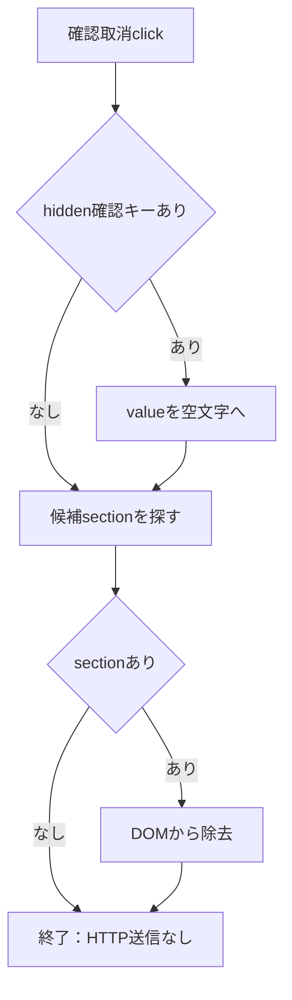

#### SQL・テーブル関連（ER図）

DB非使用である。操作対象はブラウザーDOMのhiddenとsectionだけで、EditorSnapshotStoreやWebConfirmationsを更新しない。DB表間関係がないためER図は省略する。根拠：`sources/wwwroot/js/site.js:6-6`。

#### DB操作の詳細

SQLはない。サーバー側確認情報はその場で消費・削除されず、保存成功・Unknown時の除去や後の発行時期限掃除とは別の操作である。根拠：`sources/wwwroot/js/site.js:6-6`、`sources/Core/SqlServerStudentService.cs:313-335`。

#### 結果・例外時の扱い

HTTP状態やSaveResultは返さない。キーやsectionが見つからない場合は該当操作を省く。確認領域は消えるが、業務値は保存されず、保存済みを示す通知も発生しない。根拠：`sources/wwwroot/js/site.js:6-6`。

### 所属クラス・年度・学年の連動

#### 処理概要

クラスを選ぶとoptionの年度・学年を上位選択へ反映する。年度・学年を変更して選択クラスと合わなくなった場合はクラスを解除する。候補のDB再取得や人数参考表示の更新は行わない。根拠：`sources/Views/Students/Edit.cshtml:12-12`、`sources/wwwroot/js/site.js:8-8`。

#### 処理手順

1. REG-018のchangeで選択optionを取得する。data-yearがあればREG-016へ年度、REG-017へdata-gradeを代入する。
2. REG-016またはREG-017のchangeでは、クラスに選択値がある場合だけ対応optionを読む。
3. 非空の年度がdata-yearと異なる、または非空の学年がdata-gradeと異なるとき、クラス値を空にして「年度・学年に合わないクラスを解除しました。」とalertする。
4. 上位値が空のときは、その上位項目だけを理由にクラスを解除しない。空クラスの選択時も、年度・学年を空にする代入は行わない。

根拠：`sources/wwwroot/js/site.js:8-8`。

#### 処理フロー

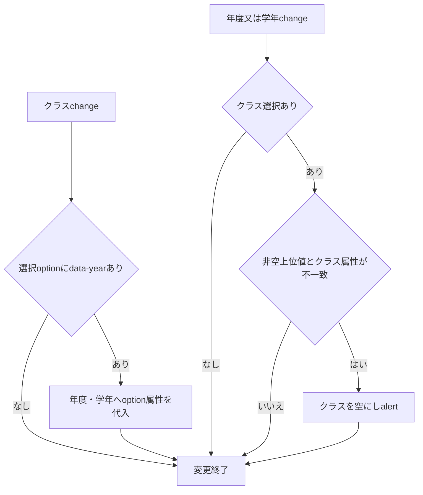

#### SQL・テーブル関連（ER図）

DB非使用である。操作対象はREG-016・017・018のDOM値と、候補取得時に付いたdata属性である。表間の読取は候補取得イベントで完了しているため、このchange処理のER図は省略する。根拠：`sources/Views/Students/Edit.cshtml:12-12`、`sources/wwwroot/js/site.js:8-8`。

#### DB操作の詳細

SQL、HTTP候補取得、人数・定員再計算はない。保存するclass_idと補助の年度・学年は後のSaveRequestに送られ、DBから再取得したクラス値との整合を検査する。候補全件の出力自体を上位条件で絞るJavaScriptでもない。根拠：`sources/wwwroot/js/site.js:8-8`、`sources/Web/Inputs/StudentSaveInput.cs:40-42`、`sources/Core/SqlServerStudentService.cs:363-380`。

#### 結果・例外時の扱い

解除時は画面alertだけで、HTTP結果やサーバー項目エラーを返さない。表示上保持できる値でも、保存時に存在・整合・必要な利用条件を満たさなければ拒否される。年度・学年・クラスの操作とdirty管理は別のイベントリスナーである。根拠：`sources/wwwroot/js/site.js:3-8`、`sources/Core/SqlServerStudentService.cs:344-383`。

### 未保存変更の通知と画面離脱

#### 処理概要

編集フォームの入力変更をdirtyとして保持し、未保存の画面離脱を確認する。フォーム送信時には指定確認文を表示し、続行した同フォームの他ボタンを無効化する。これらはブラウザー内の状態制御であり、保存成功を判定しない。根拠：`sources/wwwroot/js/site.js:2-5`。

#### 処理手順

1. 編集フォームのinputイベントでdirty=trueとし、確認キーがあれば空にする。業務入力を変えた時点で、以前の確認キーを画面から解除する。
2. beforeunloadではdirty=trueかつleaving=falseのときpreventDefaultとreturnValueを設定する。
3. data-dirty-linkのclickではdirtyのときだけ、リンクのdata-confirmまたは既定の未保存破棄文で確認する。取消なら遷移を止め、続行またはdirtyなしならleaving=trueとする。
4. 各フォームのsubmitでは、送信ボタンのdata-confirmを優先し、なければフォームのdata-confirmを使う。確認取消なら送信を止める。
5. 送信続行時にleaving=true、同フォーム内の送信ボタン以外のbuttonをdisabled、フォームをaria-busy=trueにする。他の独立フォーム全体を無効化する処理ではない。

根拠：`sources/wwwroot/js/site.js:2-5`、`sources/Views/Students/Edit.cshtml:14-17`。

#### 処理フロー

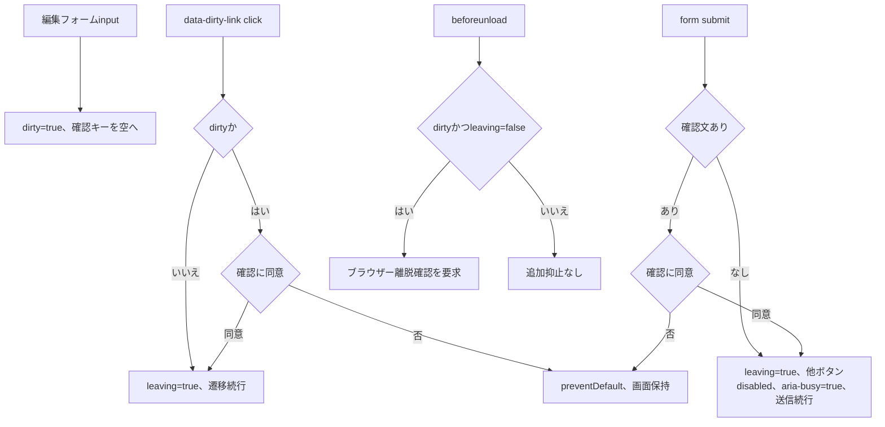

#### SQL・テーブル関連（ER図）

DB非使用である。dirty・leavingはsite.jsのクロージャ内変数、確認キー・disabled・aria-busyはDOM状態である。DBやサーバーセッションへ記録しないためER図は省略する。根拠：`sources/wwwroot/js/site.js:2-5`。

#### DB操作の詳細

このイベント自身にSQLはない。submitの続行後に各HTTP入口へ進むが、送信を始めたこととDB更新が確定したことは別である。ブラウザー確認はCSRF、権限、Snapshot、ModelState、比較版等のサーバー検査を代替しない。根拠：`sources/wwwroot/js/site.js:4-5`、`sources/Web/Controllers/StudentsController.cs:28-37`。

#### 結果・例外時の扱い

確認取消は送信・遷移を止めるだけでHTTP応答を作らない。dirtyの判定はinputイベントに基づく実装であり、すべてのプログラム代入がinputイベントを発火したものとして扱わない。保存結果はサーバー応答を再表示した画面で判定する。根拠：`sources/wwwroot/js/site.js:3-8`。

### 論理削除

#### 処理概要

Administratorが対象と理由を確認し、比較版付きで学生を論理削除する。学生行は物理DELETEせず、削除管理列と更新管理列・版を更新して履歴を追記する。削除フォームには学生の編集中業務値が含まれない。根拠：`sources/Views/Students/Edit.cshtml:17-17`、`sources/Core/SqlServerStudentService.cs:392-416`。

#### 処理手順

1. FormGuardが削除DTOのExpectedVersion、Reason、Confirmed、ReturnContextIdとSnapshotId・CSRF等を検査する。認証、対象ID付きSnapshot取得、読込時復帰先との文字列一致を順に確認する。
2. coordinator.DeleteがAdministrator、非空復帰先、Confirmedを確認する。Confirmed=falseはREG-026に対する422 WebFaultとする。その後、ExpectedVersionをRequiredで正のInt64へ変換する。
3. DeleteAsyncは受付番号、利用者、開始時nowを取得し、Administrator以外ならForbiddenを返す。
4. 理由を必須・複数行・原入力60→保存60スカラーで正規化する。ここではInputValidationExceptionだけをValidationFailedへ変換する。続いてID・版の非正数、版long.MaxValueをValidationFailedで拒否する。
5. OpenとReadCommitted開始を行う。この二つはDB処理tryの外にある。
6. try内でGateを取得し、対象ID・非削除条件でrow_versionを再取得する。対象なしはNotFound、要求版と不一致はConflictで返す。
7. 対象ID・要求版・非削除条件付きUPDATEで削除管理列、更新管理列、版+1を設定する。直前にwriteStarted=true、更新件数が1以外ならDBConcurrencyExceptionを投げる。
8. 同じtransactionでDELETEの履歴を追加する。前後版、7管理列の変更名、主体・now・受付番号・理由、duplicate_confirmed=falseを記録する。
9. commitAttempted=trueとしてcommitをawaitし、Savedと対象ID・版+1を返す。
10. ControllerはSavedなら303復帰する。それ以外は項目エラーをModelStateへ追加し、Outcome別状態を設定した後にLoadを呼び直す。再読込で最新学生・候補・復帰状態を確認し、新Snapshotを作る。

根拠：`sources/Web/Controllers/StudentsController.cs:37-38`、`sources/Infrastructure/WebStudentCoordinator.cs:19-19`、`sources/Core/SqlServerStudentService.cs:392-416`。

#### 処理フロー

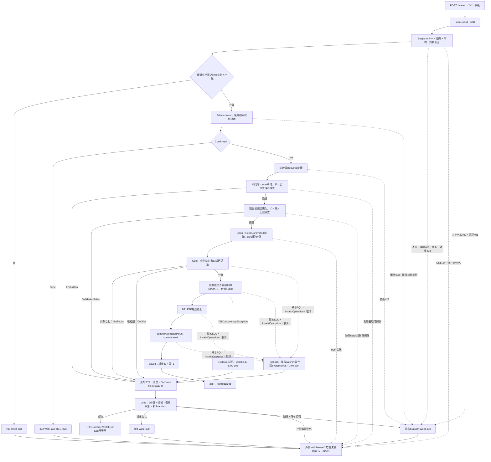

DBConcurrencyExceptionは先行catchでConflictになる。後段catchだけが`writeStarted AND (commitAttempted OR rollback不成功)`でUnknownまたはSystemErrorを選ぶ。図の「条件別」は固定した一状態へ合流する意味ではない。捕捉対象外のDB処理例外も外側へ伝播する。根拠：`sources/Core/SqlServerStudentService.cs:415-416`。

#### SQL・テーブル関連（ER図）

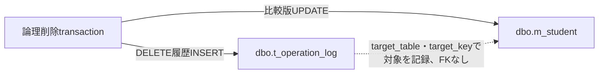

削除の業務書込みは二表である。失敗後Loadの候補取得では、読込イベントのクラス・コード・分類も参照する。根拠：`sources/Core/SqlServerStudentService.cs:403-414`、`sources/Web/Controllers/StudentsController.cs:37-37`。

#### DB操作の詳細

対象再読取は`SELECT row_version FROM dbo.m_student WHERE student_id=@id AND is_deleted=0`、`@id BigInt`で一値を得る。行なしはNotFound、版不一致はConflictであり、これらの早期返却に明示rollbackはない。根拠：`sources/Core/SqlServerStudentService.cs:403-408`。

UPDATEのWHEREは`student_id=@id AND row_version=@version AND is_deleted=0`である。SETはis_deleted=1、deleted_at=@now、deleted_by=@actor、delete_reason=@reason、updated_at=@now、updated_by=@actor、row_version=row_version+1の7列で、学生氏名等の業務列は設定しない。パラメータは`@id/@version BigInt`、`@now DateTimeOffset`、`@actor NVarChar(128)`、`@reason NVarChar(120)`である。削除理由列自体はNULL許可だが、DDLの削除状態CHECKは削除日時・利用者・理由をすべて非NULLとする。根拠：`sources/Core/SqlServerStudentService.cs:409-411`、`sources/database/001_schema.sql:34-42`、`sources/database/001_schema.sql:200-200`。

履歴は保存イベントと同じAuditを使用し、target_table=m_student、対象IDの十進target_key、operation_type=DELETE、before_version=要求版、after_version=要求版+1、変更列名は上記7列、operation_reason=正規化理由、duplicate_confirmed=falseをINSERTする。パラメータ型・サイズも保存イベントの履歴契約と同じである。commit完了後にSavedを返す。SQL読取・更新・履歴・commitにctを渡し、失敗Rollback helperだけはNoneを使う。根拠：`sources/Core/SqlServerStudentService.cs:385-390`、`sources/Core/SqlServerStudentService.cs:413-416`。

#### 結果・例外時の扱い

削除アクションにはModelState.IsValidによる一括拒否も局所WebFault catchもない。受信bool・文字列の変換状態と、Confirmed・比較版・理由の独自検査は区別する。スナップショットや権限、比較版変換のWebFaultは外側middlewareへ進む。理由正規化の初期catchはInputValidationExceptionだけなので、不正UnicodeのArgumentException等はValidationFailedへ変換しない。根拠：`sources/Web/Controllers/StudentsController.cs:37-37`、`sources/Infrastructure/WebStudentCoordinator.cs:19-19`、`sources/Core/SqlServerStudentService.cs:396-398`。

DBConcurrencyExceptionのcatchはRollbackを試みてConflict E-STU-105を返し、rollback成否でUnknownへ変更しない。後段の残るSqlException・InvalidOperationException・OperationCanceledExceptionに限り、保存と同じ結果不明式を使う。削除にはSQL2601/2627専用catchがない。根拠：`sources/Core/SqlServerStudentService.cs:415-416`。

Saved以外は、サービス結果のHTTP状態を設定した後にLoadを行う。Load成功ならその状態で再表示するが、対象がなくなれば404、復帰検索状態の期限なら409、所有等の不正なら固有WebFault状態、一般取得失敗なら応答未開始時に503となり得る。削除結果の状態を最終応答へ固定しない。Loadは新しいDBモデルを作る一方、この経路ではModelStateをClearしていない。根拠：`sources/Web/Controllers/StudentsController.cs:25-25`、`sources/Web/Controllers/StudentsController.cs:37-37`、`sources/Infrastructure/WebHostSetup.cs:23-24`。

### 検索画面への復帰

#### 処理概要

保存・削除成功後の303と「検索へ戻る」リンクは、検索状態の参照キーと版で一覧へ戻る。学生保存の確定と検索状態の再開は別処理であり、保存後に検索復帰が拒否されても保存を取り消さない。根拠：`sources/Web/Controllers/StudentsController.cs:8-11`、`sources/Web/Controllers/StudentsController.cs:38-38`、`sources/Views/Students/Edit.cshtml:16-16`。

#### 処理手順

1. 保存・削除のSavedではReturnAfterSaveを呼ぶ。復帰先がNULL・空文字なら新検索状態を作り、そのIDと版を使用する。指定済みならSnapshotに保持した復帰版を使用する。
2. 主体・セッション・検索IDの複合キーで「保存しました。」または「論理削除しました。」を10分のFlashMessageへ保存し、HTTP303とURLエスケープしたcontextId・contextRevisionのLocationを返す。
3. GET Indexは認証を確認する。contextIdがなければ新状態を作り、指定があれば状態をGetしてResumeへ渡す。
4. ResumeはSearchContextStore.Useを使う。初回Get後にSemaphoreSlimをawaitし、待機後にGetを再実行して期限・所有・指定Tabを再検査する。要求版と現在版の文字列一致、版long.MaxValueでないことを確認する。この復帰呼出しのTab引数はNULLである。
5. 適用条件がなければ再検索せずunsearchedを返す。条件があれば同じSearchCriteriaでSearchAsyncを実行し、受け入れ可能な結果ならLastResultを更新してRevisionを1加算する。Useはoperation成功後に検索状態期限を現在UTC+30分へ延長する。
6. FlashMessageをTakeで一回だけ取り出し、検索用人数なしLookupとSearchモデルを構築する。結果0件はempty、上限超過はtooMany、それ以外はfoundとして表示する。

根拠：`sources/Web/Controllers/StudentsController.cs:8-11`、`sources/Web/Controllers/StudentsController.cs:38-39`、`sources/Infrastructure/WebStudentCoordinator.cs:14-21`、`sources/Infrastructure/SearchContextStore.cs:9-14`、`sources/Infrastructure/FlashMessageStore.cs:7-9`。

#### 処理フロー

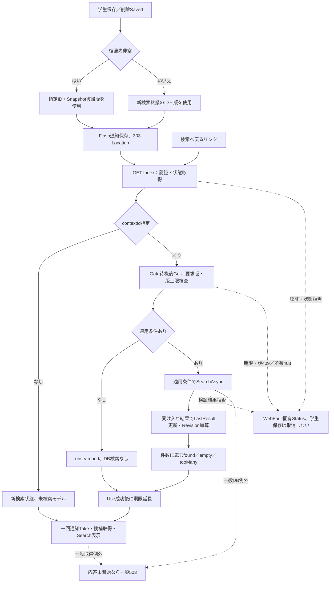

#### SQL・テーブル関連（ER図）

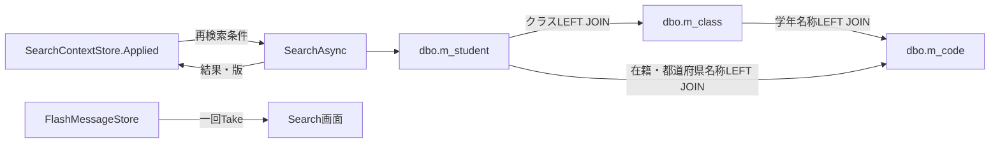

表示候補を得るLookup(false)はさらにm_code_categoryを参照する。保存・削除のtransactionからこの再検索transactionへ引き継ぐ接続はない。根拠：`sources/Core/SqlServerStudentService.cs:82-90`、`sources/Core/SqlServerStudentService.cs:123-168`、`sources/Web/Controllers/StudentsController.cs:39-39`。

#### DB操作の詳細

再検索はSNAPSHOTを使用する。検索条件は非削除を必須にし、指定された条件だけをANDで追加する。学籍番号は正規化値の前方一致、氏名・カナは照合キー部分一致、年度・学年はクラス列、クラス・都道府県は学生列の一致、未所属はclass_id IS NULL、電話は本人または緊急電話の一致、入学日は両端を含む範囲、在籍は指定値のINである。在籍指定0件ならIN条件を追加しない。LIKEの`!`、`%`、`_`、`[`はエスケープし、ESCAPE '!'を付ける。根拠：`sources/Core/SqlServerStudentService.cs:137-155`、`sources/Core/StudentNormalizer.cs:161-161`。

パラメータは`@no VarChar(31)`、`@name NVarChar(642)`、`@kana NVarChar(74)`、`@year SmallInt`、`@grade/@prefecture/@statusN VarChar(2)`、`@class BigInt`、`@phone VarChar(16)`、`@from/@to Date`である。検索前には学年・都道府県のコード存在をcategory_id＋code_valueのCOUNT_BIG=1で確認するが、停止・期間条件はこの存在確認に含めない。年度指定はm_classのschool_year一致件数、クラス指定はclass_id取得と指定年度・学年一致を検査する。存在確認パラメータは`@category VarChar(24)`、`@value VarChar(10)`、年度は`@year SmallInt`、クラスは`@id BigInt`である。根拠：`sources/Core/SqlServerStudentService.cs:125-153`、`sources/Core/SqlServerStudentService.cs:218-222`。

件数SQLはm_studentとm_classのLEFT JOINに同じWHEREを付け、TOP(10001)の学生IDをCOUNT_BIGする。10000超なら一覧SQLを実行せず、NoChange・LimitExceeded=true・空Itemsを返す。このCountは最大10001で、超過時の全実件数ではない。通常は最後のページを算出し、要求ページをその範囲へ丸める。RowSelectに同じWHEREを付け、許可されたstudent_no、name_key、admission_date、updated_atのいずれかをasc/descで並べ、同値はstudent_id ASCとする。`@offset Int`と`@size Int`でOFFSET/FETCHし、sizeは20・50・100に限定する。結果をStudentRowへ読み、commitする。根拠：`sources/Core/SqlServerStudentService.cs:107-108`、`sources/Core/SqlServerStudentService.cs:156-168`。

復帰画面のLookup(false)は候補の人数を`CONVERT(int,0)`へ置き換える。これは人数を実測したゼロではない。候補取得のコード・クラス順は読込イベントと同じである。根拠：`sources/Core/SqlServerStudentService.cs:196-216`、`sources/Web/Controllers/StudentsController.cs:39-39`。

#### 結果・例外時の扱い

検索状態の版が編集読込後に変更されていれば409となる。保存済み学生をrollbackする処理はない。未検索状態は一覧検索なし、0件は「該当する学生はありません。」、上限超過は条件追加を求める表示になる。検索の入力検証結果はEnsureSearchがWebFaultへ変換する。一般DB例外や候補取得例外は応答未開始なら外側middlewareへ進む。根拠：`sources/Infrastructure/WebStudentCoordinator.cs:14-21`、`sources/Infrastructure/SearchContextStore.cs:14-14`、`sources/Views/Students/Search.cshtml:7-7`。

FlashMessage.Takeは期限判定と同時にTryRemoveするため一度限りである。通知取得後にSearchModelの候補取得が失敗しても、同じ通知を再取得する処理はない。検索状態の再検査はSemaphore待機後に行うが、operation内の各DB await後に繰り返す構造ではない。根拠：`sources/Web/Controllers/StudentsController.cs:11-11`、`sources/Infrastructure/FlashMessageStore.cs:9-9`、`sources/Infrastructure/SearchContextStore.cs:14-14`。

## 補足説明

### 正規化と入力境界

共通TextはNULLを空文字へ補完して原入力スカラーを数え、複数行の場合はCRLF・CRをLFへ統一し、制御文字を検査してTrimする。空値は任意ならNULL、必須ならE-STU-001とする。その後に保存値スカラー上限を検査する。単行Textは改行やタブも制御文字として拒否し、複数行TextはLFだけを許可する。CRLFは統一前の原入力では2スカラーであり、統一後の長さだけで原入力上限を判断しない。一般Text自身はNFKCしない。根拠：`sources/Core/StudentNormalizer.cs:37-57`。

ScalarCountは正しいUTF-16サロゲート対を1スカラーと数え、不正な単独サロゲートをArgumentExceptionにする。氏名表示値、住所、緊急氏名、備考、理由はTextの値を使う。学籍番号、カナ、郵便番号、電話、コード、日付はそれぞれ追加変換を持つ。ブラウザーmaxlength、サービスの原入力上限、正規化後上限、識別番号のString.Length、DB容量を同一の上限へまとめない。根拠：`sources/Core/StudentNormalizer.cs:37-117`、`sources/Web/Inputs/StudentSaveInput.cs:60-60`。

郵便・電話で除去するハイフンはASCIIハイフン、U+2010、U+2011、U+2212であり、電話だけ丸括弧も除去する。国際電話はプラス、1〜9の先頭数字、その後6〜14桁の数字からなる。メールは@が一つ、ASCII許可ローカル部、先頭・末尾ドットと連続ドットの禁止、二つ以上のドメインラベル、各ラベル1〜63文字の英数字・内部ハイフンを検査する。ローカル部の個別上限64もあるが、メール全体の原入力・保存値上限60が先に適用される。根拠：`sources/Core/StudentNormalizer.cs:87-111`。

和暦の対応期間は令和2019-05-01以降、平成1989-01-08〜2019-04-30、昭和1926-12-25〜1989-01-07、大正1912-07-30〜1926-12-24、明治1900-01-01〜1912-07-29である。OS元号一覧へは委ねない。表示では年1を「元」、月日を2桁にする。西暦はNFKC後の厳密形式で、学生日付は1900-01-01以上・業務日以下を要求する。サービスの業務日は開始時nowから、画面の業務日はWebPresentationの現在UTCから、それぞれUTC+9で算出する。根拠：`sources/Core/JapaneseDateService.cs:9-59`、`sources/Core/SqlServerStudentService.cs:44-45`、`sources/Infrastructure/WebPresentation.cs:5-7`。

単体項目エラーがなければ照合キーと続柄分類を生成して項目間検査へ進む。生年月日≦入学日、01・02は終了日なし・クラス必須、03・04は入学日以上の終了日必須、本人電話・メール・緊急電話の一つ以上、緊急氏名・続柄・電話は0個または3個を要求する。これらはInputValidationExceptionへ収集し、DDLにも日付・所属・連絡先整合CHECKがある。根拠：`sources/Core/StudentNormalizer.cs:143-158`、`sources/database/001_schema.sql:198-199`。

MVCは非nullable参照型の暗黙Requiredを抑止している。C#のstring宣言、プロパティ初期値、HTMLのrequiredだけから、後段へNULLが届かない実行保証を置かない。ToRequestはBirthDateInput全体がNULLの場合だけnewで補完する。内部Year・Month・Dayは補完しない。有効元号でNULL成分をNormalizeする経路、AdmissionDateのNULLをNormalizeする経路はNullReferenceExceptionとなり得る。EraがNULLなら元号不一致のArgumentExceptionへ進む。Normalizerの項目収集はInputValidationExceptionとArgumentExceptionだけで、NullReferenceExceptionは収集しない。根拠：`sources/Infrastructure/WebHostSetup.cs:16-16`、`sources/Web/Inputs/StudentSaveInput.cs:36-36`、`sources/Core/JapaneseDateService.cs:19-24`、`sources/Core/JapaneseDateService.cs:52-54`、`sources/Core/StudentNormalizer.cs:123-137`。

IdParserはNULL・空文字をOptionalの未設定へ変換する。それ以外は19コード単位以内、ASCII数字のみ、Int64範囲内、正数を要求し、TrimやNFKCはしない。空白、符号、全角数字、ゼロ、範囲超過は422である。ルートのlong変換は同パーサーを通らない。SnapshotIdはこのIDパーサーで変換せず、辞書キーとして使う。根拠：`sources/Web/Inputs/StudentSaveInput.cs:57-60`、`sources/Web/Controllers/StudentsController.cs:24-37`。

EditorSnapshotStore.GetはtokenのNULL検査を置かず、TryGetValueへ直接渡す。非NULLの空文字・不在キーは取得失敗として409、取得後の期限切れも409、所有者・セッション・対象不一致は403である。NULLが渡った場合は辞書のNULLキー契約に基づくArgumentNullExceptionが独自検査より先に生じ得る。これらのGetは保存・reset・削除の局所catch外であり、NULL例外をWebFault409と同じ経路へまとめない。根拠：`sources/Infrastructure/EditorSnapshotStore.cs:10-10`、`sources/Web/Controllers/StudentsController.cs:29-37`。

### フォーム・認証・保持情報の契約

FormGuardの許可名集合はOrdinalIgnoreCaseで作り、保存DTOのプロパティにInput.を付け、BirthDateInputだけ四成分へ展開する。CSRF項目と__Invariantを許可し、未知項目、書式メタ情報の不正参照、許容例外以外の同名複数値を400にする。値の必須性・業務形式はここで検査しない。__Invariantの特別検査は原文のキー文字列比較に従う。根拠：`sources/Web/Controllers/StudentsController.cs:41-41`。

Cookie認証はSecure・HttpOnly・SameSite Strict、有効期間30分、SlidingExpirationを設定する。未認証は401、アクセス拒否は403で、学生画面をログイン画面へredirectする独自処理ではない。MVCにAutoValidateAntiforgeryTokenAttributeを全体登録し、/apiだけAntiforgeryValidationFailedResultを独自JSON400へ変更する。/studentsは同filterによるJSON書換えの対象ではない。要求本文等の設定はKestrel 65536、multipart 65536、フォーム値長65536、値数128、モデルエラー数100であり、項目別スカラー上限とは別である。根拠：`sources/Infrastructure/WebHostSetup.cs:14-18`、`sources/Infrastructure/AntiforgeryResultFilter.cs:7-8`。

RequestIdentityは認証済み主体のNameIdentifier、login_session、Role claimを読む。主体・セッションの空白、主体64スカラー超、セッション64コード単位超、RoleのEnum.TryParse失敗を401にする。RoleにEnum.IsDefinedを追加する実装はなく、列挙型の宣言だけから受信Roleを三つの名前に限定した保証は置かない。共有ヘッダーの利用者名はUser.Identity.Name、監査主体はNameIdentifier由来Principalであり、別の取得項目である。根拠：`sources/Infrastructure/RequestIdentity.cs:7-15`、`sources/Views/Shared/_Layout.cshtml:1-1`、`sources/Core/SqlServerStudentService.cs:307-307`。

| 保持領域 | 保持内容・寿命 | 照合・更新・消費 |
| --- | --- | --- |
| EditorSnapshotStore | Owner、Session、StudentId、Detail、Original複製、ReturnRevision。作成時UTC+30分固定 | Getで不在・期限・所有・対象を検査。取得後のDB awaitをまたいだ再Get、保存・復元時の延長、保存成功時の除去はない |
| SearchContextStore | Owner、Session、Tab、適用条件、最後の結果、正のRevision、Gate。初期30分 | GetとGate待機後の再Get、版照合。operation成功後に期限延長。各DB await後の反復検査ではない |
| FlashMessageStore | 主体・セッション・検索IDの複合キー、通知、UTC+10分 | TakeのTryRemoveで一回限り。期限切れでも取得時に除去 |
| WebConfirmations | CurrentUser、対象ID・比較版、入力・候補ハッシュ、期限、Busy。static、開始時now+10分 | Expires>開始時nowと全属性照合。Busy取得、通常失敗時の条件解放、成功・Unknownでキー除去、発行時期限掃除 |

根拠：`sources/Infrastructure/EditorSnapshotStore.cs:7-11`、`sources/Infrastructure/SearchContextStore.cs:9-15`、`sources/Infrastructure/FlashMessageStore.cs:6-9`、`sources/Core/SqlServerStudentService.cs:19-29`、`sources/Core/SqlServerStudentService.cs:278-335`。前三ストアはSingleton登録であり、確認情報は別のstaticメモリである。根拠：`sources/Infrastructure/WebHostSetup.cs:13-13`。

編集・検索のGetはExpiresが現在時刻より小さい場合に期限切れとする。一方、確認照合はExpires>開始時nowを要求し、確認発行時掃除はExpires<=nowを除去する。同じ「期限」の語で比較演算と時刻取得位置を一律にしない。根拠：`sources/Infrastructure/EditorSnapshotStore.cs:10-10`、`sources/Infrastructure/SearchContextStore.cs:13-14`、`sources/Core/SqlServerStudentService.cs:278-278`、`sources/Core/SqlServerStudentService.cs:333-335`。

### 表示名称の保存元と宣言処理の境界

クラス候補・同一人物候補のClassNameはm_class.class_nameであり、DBはnvarchar(36) NOT NULL、18スカラーCHECKを持つ。宣言されたSaveClassAsyncも原入力・保存値18スカラーを検査し、NVarChar(36)で保存する。クラスコードは業務上限9、varchar(9)、年度との組合せで一意となる。候補の人数はクラス列ではなく学生集計で、NULL定員は上限なしである。根拠：`sources/Core/MasterMaintenanceService.cs:32-37`、`sources/Core/MasterMaintenanceService.cs:70-73`、`sources/database/001_schema.sql:62-87`、`sources/database/001_schema.sql:188-201`。

コード候補と学年・在籍・都道府県の結合名称はm_code.code_nameであり、nvarchar(24) NOT NULL、12スカラーCHECKを持つ。SaveCodeAsyncの宣言も原入力・保存値12スカラー、NVarChar(24)で保存する。StudentRowのClassNameやGradeName等のnullableはLEFT JOIN結果を受けるためで、参照先名称列のNULL許可を表していない。根拠：`sources/Core/MasterMaintenanceService.cs:82-83`、`sources/Core/MasterMaintenanceService.cs:113-115`、`sources/database/001_schema.sql:112-128`、`sources/Core/Contracts.cs:50-53`、`sources/Core/SqlServerStudentService.cs:82-90`。

Web登録からMasterMaintenanceServiceへの呼出しは接続されていない。名称上限の説明はその保存元の宣言契約であり、本画面に保守操作を追加するものではない。初期seedは性別0「未回答」、在籍01〜04等を定義し、既存初期値との差分があれば上書きせず中断する。学生・クラスの初期行を作らない。根拠：`sources/Infrastructure/WebHostSetup.cs:12-19`、`sources/Web/Controllers/StudentsController.cs:5-41`、`sources/database/002_seed.sql:15-22`、`sources/database/002_seed.sql:85-91`。

`webTokens=false`のサービス宣言にはt_confirmationを使う分岐がある。UPDLOCK付き確認読取でtoken、principal、session_id、対象ID・比較版のNULL同士または一致、expires_at>@now、consumed=0を条件にし、両binary(32)ハッシュを照合する。発行は別ReadCommittedでINSERT・commit、保存時消費はtokenかつconsumed=0のUPDATEを1行要求する。token・sessionはUniqueIdentifier、actorはNVarChar(128)、ID・版はBigInt、now・期限はDateTimeOffset、ハッシュはBinary(32)である。このWeb画面の登録はtrueを選ぶため、同表を本画面の確認保存先へ置き換えない。根拠：`sources/Core/SqlServerStudentService.cs:279-283`、`sources/Core/SqlServerStudentService.cs:308-311`、`sources/Core/SqlServerStudentService.cs:337-342`、`sources/Infrastructure/WebHostSetup.cs:19-19`。

StrictJson.Read、WebPresentation.Lookups・Save、WebStudentCoordinator.Optionsは宣言があるが、この画面の呼出し経路に接続されていない。実際のPOST /students/optionsは検索フォームのHTML再表示で、上記Options helperを呼ばない。JSONの厳密契約、JSON結果helperのClassName NULL時「未所属」補完をRazor画面へ適用しない。WebはCoreをProjectReferenceで参照し、maintenance配下を直接Compile対象から除外する。根拠：`sources/Infrastructure/StrictJson.cs:4-14`、`sources/Infrastructure/WebPresentation.cs:8-18`、`sources/Infrastructure/WebPresentation.cs:30-30`、`sources/Infrastructure/WebStudentCoordinator.cs:16-16`、`sources/Web/Controllers/StudentsController.cs:22-22`、`sources/StudentManagement.Web.csproj:3-5`。

t_runtime_stateには暗号化payload等のDDLがあるが、この画面の編集・検索・通知ストアには同表への読書き接続がない。Web用DB権限SQLはviewerの参照、staffの学生INSERT・UPDATEと履歴INSERT、adminのクラス・コードINSERT・UPDATEを宣言し、学生物理DELETE、履歴UPDATE・DELETE、分類変更等をDENYする。アプリのRole検査とDBロール権限は別契約である。根拠：`sources/database/001_schema.sql:171-184`、`sources/Infrastructure/WebHostSetup.cs:13-19`、`sources/database/003_web_permissions.sql:8-24`。

### 関連文書の対応

次表は提供計画のID・kind・pathを保持した文書対応である。関連本文は本応答では未生成であり、本書の項目とイベントは原ソースのREG idと実入口で対応させている。

| 文書ID | kind | 計画path | 本書との対応・状態 |
| --- | --- | --- | --- |
| CSHARP_ASPNET-BAS-STU-02 | basic-design | [基本設計書/02_学生登録画面.md（未生成）](../../基本設計書/02_学生登録画面.md) | 同じREG項目、登録・更新・復元・参照・削除の業務説明。本文間照合は未実施 |
| CSHARP_ASPNET-BAS-STU-03 | table-index | [基本設計書/03_テーブル仕様書.md（未生成）](../../基本設計書/03_テーブル仕様書.md) | 五表の索引・FK・表示JOIN・保持領域の境界 |
| CSHARP_ASPNET-BAS-STU-04 | code-design | [基本設計書/04_コード設計書.md（未生成）](../../基本設計書/04_コード設計書.md) | 分類、候補順、既存保持、初期値と宣言保守契約 |
| CSHARP_ASPNET-BAS-STU-03-M_STUDENT | table-definition | [基本設計書/テーブル/01_m_student.md（未生成）](../../基本設計書/テーブル/01_m_student.md) | 学生業務値・照合キー・比較版・削除管理情報 |
| CSHARP_ASPNET-BAS-STU-03-M_CLASS | table-definition | [基本設計書/テーブル/02_m_class.md（未生成）](../../基本設計書/テーブル/02_m_class.md) | 選択キー、年度・学年・名称・期間・定員の参照元 |
| CSHARP_ASPNET-BAS-STU-03-M_CODE_CATEGORY | table-definition | [基本設計書/テーブル/03_m_code_category.md（未生成）](../../基本設計書/テーブル/03_m_code_category.md) | コード分類と候補有効状態の参照元 |
| CSHARP_ASPNET-BAS-STU-03-M_CODE | table-definition | [基本設計書/テーブル/04_m_code.md（未生成）](../../基本設計書/テーブル/04_m_code.md) | 選択コード・名称・表示順・有効期間 |
| CSHARP_ASPNET-BAS-STU-03-T_OPERATION_LOG | table-definition | [基本設計書/テーブル/05_t_operation_log.md（未生成）](../../基本設計書/テーブル/05_t_operation_log.md) | 保存・削除の前後版、変更列名、理由、実行情報 |
| CSHARP_ASPNET-DET-CSharp_ASPNET-SCR-STU-002 | detailed-specification | 詳細仕様書/CSharp_ASPNET/02_学生登録画面.md | 本書。実コントロールから受信・内部値・DB・戻り値までの対応 |
