<!-- spec-meta: {"schema":"spec-md/1.0","documentId":"CSHARP_ASPNET-BAS-STU-04","version":"1.1","path":"基本設計書/04_コード設計書.md","sheets":[{"heading":"概要","kind":"GRID","sheet":"概要"},{"heading":"項目一覧","kind":"LIST","sheet":"項目一覧","key":["No"]},{"heading":"初期コード一覧","kind":"LIST","sheet":"初期コード一覧","key":["分類ID","コード値"]},{"heading":"イベント仕様","kind":"GRID","sheet":"イベント仕様"},{"heading":"補足説明","kind":"GRID","sheet":"補足説明"}]} -->
# 学生管理 コード分類・候補・保守契約設計書

文書ID：CSHARP_ASPNET-BAS-STU-04  
文書種別：code-design／基本設計書  
版：1.1  
文書パス：基本設計書/04_コード設計書.md

## 概要

本書は、学生の属性と所属を選択するコード分類、初期コード、候補の取得・表示・選択、および候補の保存元を変更する保守サービスの契約を説明する。コードは分類IDとコード値の組合せで識別し、名称は表示に使用する。名称を変更しても学生やクラスの参照キーは変わらない。所属クラスはコードの一分類ではなく、年度、学年、利用期間、定員を持つ別マスターである。根拠：`sources/database/001_schema.sql:62-134`、`sources/Core/Contracts.cs:61-67`。

学生Web画面の候補取得は、`IStudentService`に登録された`SqlServerStudentService`へ接続されている。コード・クラスを保存する`MasterMaintenanceService`は別に宣言されているが、確認したサービス登録と学生controllerにはその呼出しがない。本書の保守イベントは当該メソッドを呼び出した場合の実装契約であり、利用可能な保守画面や公開HTTP APIを表すものではない。コメントにはCLIの記述があるが、呼出入口の存在はそのコメントから確定しない。根拠：`sources/Core/MasterMaintenanceService.cs:9-15`、`sources/Core/Contracts.cs:71-78`、`sources/Infrastructure/WebHostSetup.cs:12-19`、`sources/Web/Controllers/StudentsController.cs:5-41`。

### コード分類

| 分類ID | 分類名称 | コード桁数 | 初期件数 | 通常追加 | 初期保護値 | 業務上の使用先 |
| --- | --- | --- | --- | --- | --- | --- |
| `GENDER` | 性別 | 1桁 | 4件 | 不可 | `0` | 学生の性別選択・保存 |
| `ENROLLMENT_STATUS` | 在籍区分 | 2桁 | 4件 | 不可 | `01`、`02`、`03`、`04` | 在籍選択・検索・名称表示、所属必須、終了日、所属人数の判定 |
| `PREFECTURE` | 都道府県 | 2桁 | 47件 | 不可 | `01`～`47` | 住所の都道府県選択・保存・検索、住所表示の先頭名称 |
| `RELATIONSHIP` | 緊急連絡先続柄 | 2桁 | 8件 | 可 | なし | 緊急連絡先の続柄選択・保存 |
| `GRADE` | 学年 | 2桁 | 7件 | 可 | `00` | クラスの学年保存、所属選択の補助、検索、学年名称表示 |

初期コードは合計70件である。通常追加可否は、コードキーが存在せず比較版も指定されていない追加要求に適用する。既存コードは、通常追加不可の分類でも比較版等の検査を通過すれば属性を更新できる。保護値は停止と期間短縮を制限するが、名称・表示順・備考の変更を一律に禁止する属性ではない。根拠：`sources/database/002_seed.sql:8-84`、`sources/Core/MasterMaintenanceService.cs:102-113`。

### 候補として渡す情報

`CodeEntry`は、分類ID・コード値・名称・表示順・合成有効状態・開始日・任意の終了日・保護状態を渡す。合成有効状態は、コードと分類の両方が有効な場合だけ真となる。分類名称、分類別桁数、通常追加可否、備考、版は候補DTOに含まれない。画面の「性別」「学年」等のラベルはRazorに直接記述されている。根拠：`sources/Core/Contracts.cs:61-65`、`sources/Core/SqlServerStudentService.cs:203-214`、`sources/Views/Students/Edit.cshtml:8-13`。

`SchoolClass`は、クラスID、年度、学年コード、クラスコード・名称、開始日・終了日、任意の定員、算出人数、有効状態を渡す。人数はクラス表の保存列ではない。登録等の人数付き取得は非削除の在学・休学学生を数える。検索用取得は集計せず0を設定するため、この0は実在人数がゼロであることを示さない。根拠：`sources/Core/Contracts.cs:63-65`、`sources/Core/SqlServerStudentService.cs:196-214`。

### 保存データの関連

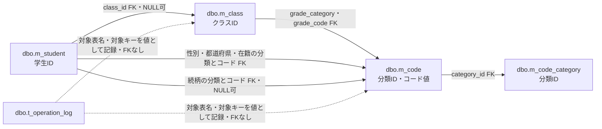

実線はDDLに宣言されたFKを示す。学生の性別・都道府県・在籍分類は、それぞれ`GENDER`・`PREFECTURE`・`ENROLLMENT_STATUS`に固定される。クラスの学年分類は`GRADE`に固定される。続柄は緊急連絡先の組合せCHECKにより、設定時に分類を`RELATIONSHIP`とする。FKは参照先の存在を制約し、有効状態、利用期間、定員を保証するものではない。根拠：`sources/database/001_schema.sql:189-199`。

候補・検索で使用するJOINはFKとは別の読取り処理である。コード候補は分類表へのINNER JOIN、クラス候補は学年コードへのLEFT JOINを使用する。検索結果はクラス・学年・在籍・都道府県をLEFT JOINして名称を読む。操作履歴の対象キーには業務表へのFKがない。根拠：`sources/Core/SqlServerStudentService.cs:82-90`、`sources/Core/SqlServerStudentService.cs:203-208`、`sources/database/001_schema.sql:137-153`。

## 項目一覧

| No | グループ | 項目名 | 種類 | 入出力 | DB連携項目 | 候補取得元 | 必須 | 形式・桁 | 説明 |
| --- | --- | --- | --- | --- | --- | --- | --- | --- | --- |
| REG-006 | 学生属性 | 性別 | `select` | I／O | `m_student.gender_code`、固定分類`gender_category` | `m_code`と`m_code_category`の`GENDER` | 必須 | `Input.GenderCode string`。原入力上限1スカラー、正規化後ASCII数字1桁 | 初期値は`0`。名称を表示しコードを送る。既存同一値の保持条件はEV-CODE-02、保存検査はEV-CODE-05。根拠：`sources/Views/Students/Edit.cshtml:8-8`、`sources/Web/Inputs/StudentSaveInput.cs:13-13` |
| REG-008 | 住所 | 都道府県 | `select` | I／O | `m_student.prefecture_code`、固定分類`prefecture_category` | 同JOINの`PREFECTURE` | 必須 | `Input.PrefectureCode string`。原入力上限2スカラー、正規化後ASCII数字2桁 | 空値は「未選択」。新規初期値は空文字。住所表示には候補の保存元名称を別途JOINする。根拠：`sources/Views/Students/Edit.cshtml:9-9`、`sources/Web/Inputs/StudentSaveInput.cs:15-15` |
| REG-013 | 在籍情報 | 入学日 | 日付入力 | I／O | `m_student.admission_date` | ‐ | 必須 | `Input.AdmissionDate string`から`DateOnly`。NFKC後`yyyy-MM-dd` | 新規初期値は空文字。終了日との前後関係と、終了状態のクラス期間照合に使用する。根拠：`sources/Views/Students/Edit.cshtml:11-12`、`sources/Core/StudentNormalizer.cs:135-154` |
| REG-014 | 在籍情報 | 在籍区分 | `select` | I／O | `m_student.enrollment_status_code`、固定分類`enrollment_category` | 同JOINの`ENROLLMENT_STATUS` | 必須 | `Input.EnrollmentStatusCode string`。原入力上限2スカラー、正規化後`01`～`04` | 初期値は`01`。所属・終了日・人数は名称ではなくコード値で判定する。根拠：`sources/Views/Students/Edit.cshtml:11-11`、`sources/Core/StudentNormalizer.cs:152-154` |
| REG-015 | 在籍情報 | 卒業・退学日 | 日付入力 | I／O | `m_student.enrollment_end_date` | ‐ | `03`・`04`で必須、`01`・`02`では設定不可 | `Input.EnrollmentEndDate string?`から`DateOnly?` | 列はNULL可。終了状態では入学日以降の日付を要求する。根拠：`sources/Views/Students/Edit.cshtml:11-11`、`sources/database/001_schema.sql:27-28`、`sources/database/001_schema.sql:198-198` |
| REG-016 | 所属選択補助 | 年度 | `select` | I／O | 学生表への保存なし。候補保存元は`m_class.school_year` | 全クラス年度と入力年度の和集合、重複除去、降順 | 任意 | `Input.SchoolYear int?`、サービス指定時1900～9998 | 空値は「未指定」。指定時は選択クラスとの一致を検査する。根拠：`sources/Views/Students/Edit.cshtml:12-12`、`sources/Core/SqlServerStudentService.cs:236-237`、`sources/Core/SqlServerStudentService.cs:371-371` |
| REG-017 | 所属選択補助 | 学年 | `select` | I／O | 学生表への保存なし。候補保存元は`m_class.grade_code` | 同JOINの`GRADE`全件 | 任意 | `Input.GradeCode string?`。原入力上限2スカラー、設定時ASCII数字2桁 | 空値「すべて」と保存コード`00`「学年なし」は別。画面は有効状態・期間で選択を制限しない。根拠：`sources/Views/Students/Edit.cshtml:12-12`、`sources/Core/SqlServerStudentService.cs:237-237` |
| REG-018 | 所属 | クラス | `select` | I／O | `m_student.class_id` | `m_class`全件。学年コードJOINは候補順序に使用 | `01`・`02`で必須 | `Input.ClassId string?`を正の`long?`へ変換 | 空値は「未所属」。表示は年度・学年コード・クラスコード・名称。上位項目連動はEV-CODE-03。根拠：`sources/Views/Students/Edit.cshtml:12-12`、`sources/Web/Inputs/StudentSaveInput.cs:40-42`、`sources/Web/Inputs/StudentSaveInput.cs:57-60` |
| REG-018-REF | 所属参考情報 | 人数・定員 | 参考表示 | O | 人数は算出値、定員は`m_class.capacity` | 選択IDと一致するクラス候補 | ‐ | `Occupied int`、`Capacity int?` | 一致候補なしは人数「－」、定員「制限なし」。この表示だけではDB定員NULLを確定できない。根拠：`sources/Views/Students/Edit.cshtml:12-12` |
| REG-021 | 緊急連絡先 | 続柄 | `select` | I／O | `m_student.relationship_code`、導出分類`relationship_category` | 同JOINの`RELATIONSHIP` | 緊急連絡先設定時に必須 | `Input.RelationshipCode string?`。設定時ASCII数字2桁 | 空値は「未選択」。正規化後の氏名・続柄・電話をすべて設定するか、すべてNULLにする。根拠：`sources/Views/Students/Edit.cshtml:13-13`、`sources/Core/StudentNormalizer.cs:147-157` |
| SRC-004 | 検索条件 | 年度 | `select` | I／O | 検索列`m_class.school_year` | 全クラス年度、重複除去、降順 | 任意 | `Criteria.SchoolYear int?`、設定時1900～9998 | 空値は「すべて」。未所属のみではdisabled。根拠：`sources/Views/Students/Search.cshtml:5-5`、`sources/Web/Inputs/StudentSearchInput.cs:10-10` |
| SRC-005 | 検索条件 | 学年 | `select` | I／O | 検索列`m_class.grade_code` | `GRADE`全件 | 任意 | `Criteria.GradeCode string?`、設定時ASCII数字2桁 | 有効状態・期間で除外しない。未所属のみではdisabled。根拠：`sources/Views/Students/Search.cshtml:5-5`、`sources/Web/Inputs/StudentSearchInput.cs:11-11` |
| SRC-006 | 検索条件 | クラス | `select` | I／O | 検索列`m_student.class_id` | 指定年度・学年と一致するクラス候補 | 任意 | `Criteria.ClassId string?`を正の`long?`へ変換 | 表示は年度・クラスコード・名称。停止注記を付けるが停止・期間外でdisabledにしない。根拠：`sources/Views/Students/Search.cshtml:5-5`、`sources/Web/Inputs/StudentSearchInput.cs:20-20` |
| SRC-007 | 検索条件 | 未所属のみ | チェックボックス | I／O | `m_student.class_id IS NULL` | ‐ | 任意 | `Criteria.UnassignedOnly bool` | 候補更新時は年度・学年・クラスを解除する。根拠：`sources/Views/Students/Search.cshtml:5-5`、`sources/Web/Controllers/StudentsController.cs:22-22` |
| SEARCH-STATUS | 検索条件 | 在籍区分 | 複数チェックボックス | I／O | 検索列`m_student.enrollment_status_code` | `ENROLLMENT_STATUS`全件 | 任意 | 実nameは`Criteria.StatusCodes`、型は`string[]`。最大4件、重複なし、`01`～`04` | 初期値は`01`・`02`。全解除は全区分。原文の各チェックボックスに個別id指定はない。根拠：`sources/Views/Students/Search.cshtml:5-5`、`sources/Core/SqlServerStudentService.cs:111-112` |
| SRC-009 | 検索条件 | 都道府県 | `select` | I／O | 検索列`m_student.prefecture_code` | `PREFECTURE`全件 | 任意 | `Criteria.PrefectureCode string?`、設定時ASCII数字2桁 | 空値は「すべて」。有効状態・期間で除外しない。根拠：`sources/Views/Students/Search.cshtml:5-5`、`sources/Web/Inputs/StudentSearchInput.cs:15-15` |

## 初期コード一覧

| 分類ID | コード値 | 表示名称 | 桁数 | 表示順 | 保護 | 根拠 |
| --- | --- | --- | --- | --- | --- | --- |
| GENDER | `0` | 未回答 | 1 | 0 | あり | `sources/database/002_seed.sql:15-15` |
| GENDER | `1` | 男性 | 1 | 10 | なし | `sources/database/002_seed.sql:16-16` |
| GENDER | `2` | 女性 | 1 | 20 | なし | `sources/database/002_seed.sql:17-17` |
| GENDER | `9` | その他 | 1 | 90 | なし | `sources/database/002_seed.sql:18-18` |
| ENROLLMENT_STATUS | `01` | 在学 | 2 | 10 | あり | `sources/database/002_seed.sql:19-19` |
| ENROLLMENT_STATUS | `02` | 休学 | 2 | 20 | あり | `sources/database/002_seed.sql:20-20` |
| ENROLLMENT_STATUS | `03` | 卒業 | 2 | 30 | あり | `sources/database/002_seed.sql:21-21` |
| ENROLLMENT_STATUS | `04` | 退学 | 2 | 40 | あり | `sources/database/002_seed.sql:22-22` |
| PREFECTURE | `01` | 北海道 | 2 | 10 | あり | `sources/database/002_seed.sql:23-23` |
| PREFECTURE | `02` | 青森県 | 2 | 20 | あり | `sources/database/002_seed.sql:24-24` |
| PREFECTURE | `03` | 岩手県 | 2 | 30 | あり | `sources/database/002_seed.sql:25-25` |
| PREFECTURE | `04` | 宮城県 | 2 | 40 | あり | `sources/database/002_seed.sql:26-26` |
| PREFECTURE | `05` | 秋田県 | 2 | 50 | あり | `sources/database/002_seed.sql:27-27` |
| PREFECTURE | `06` | 山形県 | 2 | 60 | あり | `sources/database/002_seed.sql:28-28` |
| PREFECTURE | `07` | 福島県 | 2 | 70 | あり | `sources/database/002_seed.sql:29-29` |
| PREFECTURE | `08` | 茨城県 | 2 | 80 | あり | `sources/database/002_seed.sql:30-30` |
| PREFECTURE | `09` | 栃木県 | 2 | 90 | あり | `sources/database/002_seed.sql:31-31` |
| PREFECTURE | `10` | 群馬県 | 2 | 100 | あり | `sources/database/002_seed.sql:32-32` |
| PREFECTURE | `11` | 埼玉県 | 2 | 110 | あり | `sources/database/002_seed.sql:33-33` |
| PREFECTURE | `12` | 千葉県 | 2 | 120 | あり | `sources/database/002_seed.sql:34-34` |
| PREFECTURE | `13` | 東京都 | 2 | 130 | あり | `sources/database/002_seed.sql:35-35` |
| PREFECTURE | `14` | 神奈川県 | 2 | 140 | あり | `sources/database/002_seed.sql:36-36` |
| PREFECTURE | `15` | 新潟県 | 2 | 150 | あり | `sources/database/002_seed.sql:37-37` |
| PREFECTURE | `16` | 富山県 | 2 | 160 | あり | `sources/database/002_seed.sql:38-38` |
| PREFECTURE | `17` | 石川県 | 2 | 170 | あり | `sources/database/002_seed.sql:39-39` |
| PREFECTURE | `18` | 福井県 | 2 | 180 | あり | `sources/database/002_seed.sql:40-40` |
| PREFECTURE | `19` | 山梨県 | 2 | 190 | あり | `sources/database/002_seed.sql:41-41` |
| PREFECTURE | `20` | 長野県 | 2 | 200 | あり | `sources/database/002_seed.sql:42-42` |
| PREFECTURE | `21` | 岐阜県 | 2 | 210 | あり | `sources/database/002_seed.sql:43-43` |
| PREFECTURE | `22` | 静岡県 | 2 | 220 | あり | `sources/database/002_seed.sql:44-44` |
| PREFECTURE | `23` | 愛知県 | 2 | 230 | あり | `sources/database/002_seed.sql:45-45` |
| PREFECTURE | `24` | 三重県 | 2 | 240 | あり | `sources/database/002_seed.sql:46-46` |
| PREFECTURE | `25` | 滋賀県 | 2 | 250 | あり | `sources/database/002_seed.sql:47-47` |
| PREFECTURE | `26` | 京都府 | 2 | 260 | あり | `sources/database/002_seed.sql:48-48` |
| PREFECTURE | `27` | 大阪府 | 2 | 270 | あり | `sources/database/002_seed.sql:49-49` |
| PREFECTURE | `28` | 兵庫県 | 2 | 280 | あり | `sources/database/002_seed.sql:50-50` |
| PREFECTURE | `29` | 奈良県 | 2 | 290 | あり | `sources/database/002_seed.sql:51-51` |
| PREFECTURE | `30` | 和歌山県 | 2 | 300 | あり | `sources/database/002_seed.sql:52-52` |
| PREFECTURE | `31` | 鳥取県 | 2 | 310 | あり | `sources/database/002_seed.sql:53-53` |
| PREFECTURE | `32` | 島根県 | 2 | 320 | あり | `sources/database/002_seed.sql:54-54` |
| PREFECTURE | `33` | 岡山県 | 2 | 330 | あり | `sources/database/002_seed.sql:55-55` |
| PREFECTURE | `34` | 広島県 | 2 | 340 | あり | `sources/database/002_seed.sql:56-56` |
| PREFECTURE | `35` | 山口県 | 2 | 350 | あり | `sources/database/002_seed.sql:57-57` |
| PREFECTURE | `36` | 徳島県 | 2 | 360 | あり | `sources/database/002_seed.sql:58-58` |
| PREFECTURE | `37` | 香川県 | 2 | 370 | あり | `sources/database/002_seed.sql:59-59` |
| PREFECTURE | `38` | 愛媛県 | 2 | 380 | あり | `sources/database/002_seed.sql:60-60` |
| PREFECTURE | `39` | 高知県 | 2 | 390 | あり | `sources/database/002_seed.sql:61-61` |
| PREFECTURE | `40` | 福岡県 | 2 | 400 | あり | `sources/database/002_seed.sql:62-62` |
| PREFECTURE | `41` | 佐賀県 | 2 | 410 | あり | `sources/database/002_seed.sql:63-63` |
| PREFECTURE | `42` | 長崎県 | 2 | 420 | あり | `sources/database/002_seed.sql:64-64` |
| PREFECTURE | `43` | 熊本県 | 2 | 430 | あり | `sources/database/002_seed.sql:65-65` |
| PREFECTURE | `44` | 大分県 | 2 | 440 | あり | `sources/database/002_seed.sql:66-66` |
| PREFECTURE | `45` | 宮崎県 | 2 | 450 | あり | `sources/database/002_seed.sql:67-67` |
| PREFECTURE | `46` | 鹿児島県 | 2 | 460 | あり | `sources/database/002_seed.sql:68-68` |
| PREFECTURE | `47` | 沖縄県 | 2 | 470 | あり | `sources/database/002_seed.sql:69-69` |
| RELATIONSHIP | `01` | 父 | 2 | 10 | なし | `sources/database/002_seed.sql:70-70` |
| RELATIONSHIP | `02` | 母 | 2 | 20 | なし | `sources/database/002_seed.sql:71-71` |
| RELATIONSHIP | `03` | 祖父 | 2 | 30 | なし | `sources/database/002_seed.sql:72-72` |
| RELATIONSHIP | `04` | 祖母 | 2 | 40 | なし | `sources/database/002_seed.sql:73-73` |
| RELATIONSHIP | `05` | 兄弟姉妹 | 2 | 50 | なし | `sources/database/002_seed.sql:74-74` |
| RELATIONSHIP | `06` | 配偶者 | 2 | 60 | なし | `sources/database/002_seed.sql:75-75` |
| RELATIONSHIP | `07` | 後見人 | 2 | 70 | なし | `sources/database/002_seed.sql:76-76` |
| RELATIONSHIP | `99` | その他 | 2 | 990 | なし | `sources/database/002_seed.sql:77-77` |
| GRADE | `00` | 学年なし | 2 | 0 | あり | `sources/database/002_seed.sql:78-78` |
| GRADE | `01` | 1年 | 2 | 10 | なし | `sources/database/002_seed.sql:79-79` |
| GRADE | `02` | 2年 | 2 | 20 | なし | `sources/database/002_seed.sql:80-80` |
| GRADE | `03` | 3年 | 2 | 30 | なし | `sources/database/002_seed.sql:81-81` |
| GRADE | `04` | 4年 | 2 | 40 | なし | `sources/database/002_seed.sql:82-82` |
| GRADE | `05` | 5年 | 2 | 50 | なし | `sources/database/002_seed.sql:83-83` |
| GRADE | `06` | 6年 | 2 | 60 | なし | `sources/database/002_seed.sql:84-84` |

## イベント仕様

### EV-CODE-01 初期分類・コードの不足分投入

#### 処理概要

`database/002_seed.sql`は、初期分類・コードと既存行の整合を確認し、不足キーだけを追加する。学生・クラスの初期データと操作履歴は追加しない。既存初期値に差分がある場合は、上書きせずバッチを中断する。根拠：`sources/database/002_seed.sql:1-93`。

#### 処理手順

1. `XACT_ABORT ON`を設定し、トランザクションを開始する。
2. 共通資源`test-project1:student-write`に対し、Exclusive、Transaction所有、待機5000ms、DB principal `public`でアプリケーションロックを要求する。戻り値が負ならrollbackし、51001「保存用ロック取得失敗」を送出する。
3. UTC日時を`@now datetimeoffset(7)`、`ORIGINAL_LOGIN()`を`@actor nvarchar(128)`に保持し、5分類と70コードをテーブル変数へ設定する。
4. 初期キーに一致する既存分類・コードの指定属性を比較する。差分があればrollbackし、51002「初期コードに差分があります。既存値を上書きせず確認してください。」を送出する。
5. 不存在の分類を先に、不存在のコードを後にINSERTする。有効状態1、備考NULL、作成・更新日時と利用者、版1を明示設定する。コード期間は1900-01-01開始・終了NULLとし、初期一覧の保護状態を設定してcommitする。

根拠：`sources/database/002_seed.sql:2-14`、`sources/database/002_seed.sql:85-92`。

#### 処理フロー

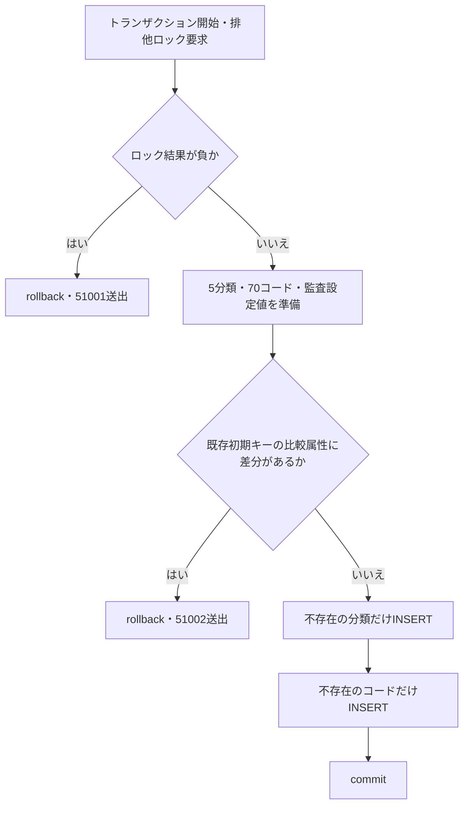

#### SQL・テーブル関連（ER図）

概要の関連図の`m_code_category`と`m_code`を使用する。コードのFK参照先を確保するため分類を先に追加する。このイベントでは学生・クラス・操作履歴を書き込まない。

#### DB操作の詳細

| 操作 | JOIN・対象条件 | 比較または設定 |
| --- | --- | --- |
| 分類差分判定 | 初期分類と`m_code_category`を`category_id`でJOIN | 名称・桁数・追加可否の不一致、または有効状態が1以外 |
| コード差分判定 | 初期コードと`m_code`を分類ID・コード値でJOIN | 名称・表示順・保護状態の不一致、有効状態が1以外、開始日が1900-01-01以外、終了日が非NULL |
| 分類追加 | 同じ分類IDが`NOT EXISTS` | 初期属性と手順5の設定値 |
| コード追加 | 同じ分類ID・コード値が`NOT EXISTS` | 初期属性、無期限の期間と手順5の設定値 |

備考、日時、利用者、版は差分比較の対象に含まれない。初期一覧にない追加コードの削除、既存行のUPDATEは行わない。外部入力パラメータ、ページング、結果のORDER BY、取消トークンは定義されていない。根拠：`sources/database/002_seed.sql:8-14`、`sources/database/002_seed.sql:85-93`。

#### 結果・例外時の扱い

明示拒否はロック取得失敗の51001と既存差分の51002である。整合している場合は不足行だけを追加してcommitする。初期コードの名称や表示順等を保守で変更した後の再実行は、その差分を拒否し、初期値へ戻さない。その他のSQL例外を利用者向け結果へ変換するcatchは、このバッチにない。根拠：`sources/database/002_seed.sql:2-6`、`sources/database/002_seed.sql:85-93`。

### EV-CODE-02 候補取得と登録・検索画面への引渡し

#### 処理概要

候補取得は、コードとクラスを同じSNAPSHOTトランザクションで全件読む。SQL取得では停止・期間外を除外せず、用途別の選択条件を画面と保存処理が適用する。登録GET、reset、保存非成功時の再表示は人数付き候補を使用し、検索画面は人数なし候補を使用する。根拠：`sources/Core/SqlServerStudentService.cs:196-216`、`sources/Web/Controllers/StudentsController.cs:23-39`。

#### 処理手順

1. 登録GETは新規`/students/new`または既存`/students/{id}`から`Load`、`coordinator.Edit`へ進む。利用者確認、指定された復帰先検索状態の確認、新規の場合の登録更新権限確認を順に行う。既存の場合は非削除学生を取得し、不存在なら404のWebFaultとする。
2. `LookupAsync()`は人数付きの`LookupAsync(true)`へ進む。検索モデルは`LookupAsync(false)`を呼ぶ。サービスは利用者情報を確認し、接続を開き、SNAPSHOT設定を確認してSNAPSHOTトランザクションを開始する。
3. 一つのSQLコマンドからコード、クラスの順に二つの結果セットを読む。全件を候補DTOへ変換し、commit完了後に`LookupSet`を返す。
4. GETの入力を構築する。新規は性別`0`、在籍`01`、都道府県・入学日空文字、続柄・クラス・学年NULLとする。年度は日本時間業務日の1～3月なら前年、4～12月なら当年とする。既存は保存値を引き継ぎ、同じクラス候補があればその年度・学年を設定する。
5. `coordinator.Edit`のawait完了後、`Load`は復帰先が非空の場合に`contexts.Get`をもう一度呼ぶ。学生・候補の取得中に期限や所有者の条件が成立しなくなれば、ここで409または403のWebFaultとなり、画面作成へ進まない。取得できた現在の`Revision`を十進文字列の`ReturnRevision`として保持する。復帰先なしの場合だけNULLとする。
6. 入力、取得済み学生詳細、復帰版を編集スナップショットへ保持し、学生編集モデルを返す。この取得後再確認はGETの`Load`にある処理であり、resetや保存結果の候補再取得へ一律に適用しない。

根拠：`sources/Infrastructure/WebStudentCoordinator.cs:6-6`、`sources/Infrastructure/WebStudentCoordinator.cs:17-17`、`sources/Web/Controllers/StudentsController.cs:23-25`、`sources/Core/SqlServerStudentService.cs:53-63`、`sources/Core/SqlServerStudentService.cs:172-216`、`sources/Web/Inputs/StudentSaveInput.cs:44-54`、`sources/Infrastructure/SearchContextStore.cs:13-13`、`sources/Infrastructure/EditorSnapshotStore.cs:7-11`。

#### 処理フロー

サブフロー2-1は候補取得サービスの共通部分である。出口の`LookupSet`をGET、検索、reset、保存結果再表示の呼出元へ返す。

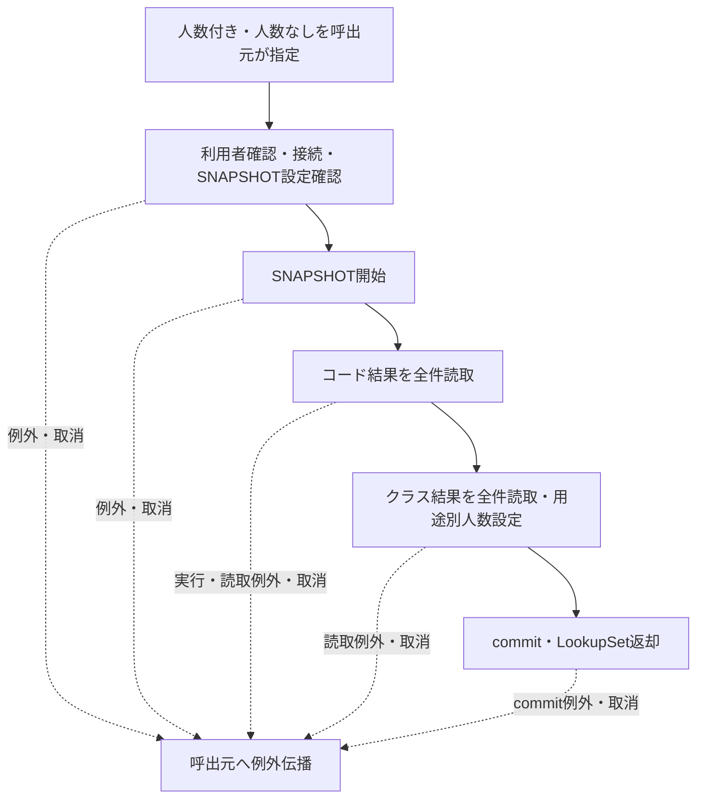

サブフロー2-2はGET専用である。新規と既存の詳細・入力を保持したまま候補を取得し、その後の復帰先再確認で得た版を画面とスナップショットへ渡す。

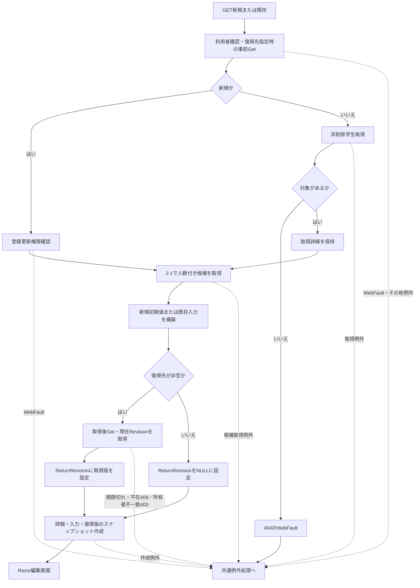

#### SQL・テーブル関連（ER図）

概要の関連図の分類・コード・クラスと、人数付き取得時の学生を読む。コード候補は分類へのINNER JOIN、クラス候補は学年表示順を読むLEFT JOIN、人数は学生表の相関サブクエリである。GETの学生取得は別の読取りであり、学生読込みと候補取得全体を一つのSNAPSHOTにまとめる実装ではない。

#### DB操作の詳細

| 結果・操作 | 全抽出条件・JOIN・算出 | 順序・結果 |
| --- | --- | --- |
| コード候補 | `m_code c JOIN m_code_category k ON k.category_id=c.category_id`。WHEREによる除外なし。両方の`is_active=1`を合成 | 分類ID、表示順、コード値の昇順。コードDTOの8属性 |
| クラス候補 | `m_class c LEFT JOIN m_code g ON g.category_id=c.grade_category AND g.code_value=c.grade_code`。WHEREによる除外なし | 年度降順、学年表示順、クラス表示順、クラスコード、クラスIDの昇順 |
| 人数付き | 同じクラスID、`is_deleted=0`、在籍`01`・`02`を`COUNT(*)` | `Occupied int` |
| 人数なし | 学生を集計せず`CONVERT(int,0)` | 未集計を示す0 |
| GET既存学生 | `student_id=@id AND is_deleted=0` | `@id BigInt`。不存在はNULL、存在時は詳細・版・更新情報 |

候補SQLにはパラメータ、ページング、件数上限がない。共通`Command`のタイムアウトは30秒である。接続、トランザクション開始、SQL実行、読取り、結果セット切替、commitへ`CancellationToken`を渡す。根拠：`sources/Core/SqlServerStudentService.cs:65-72`、`sources/Core/SqlServerStudentService.cs:172-181`、`sources/Core/SqlServerStudentService.cs:196-216`。

#### 結果・例外時の扱い

登録の性別・都道府県・在籍・続柄は全候補を表示し、合成有効状態が真、開始日≦描画時業務日、終了日なしまたは業務日≦終了日の場合に新たに選べる。読込時詳細の同じコードは停止・期間外でも保持できる。性別・都道府県の停止・期間外注記は選択不可の場合だけ付くため、保持できる既存停止値には付かない。在籍・続柄にはこの注記がない。学年はGRADE全件を表示し、同じ状態・期間判定を行わない。根拠：`sources/Views/Students/Edit.cshtml:2-2`、`sources/Views/Students/Edit.cshtml:8-13`。

登録クラスは年度・学年で絞らず全件を表示する。既存同一クラスは保持可能とする。それ以外は入力区分が03・04なら画面の`DateOnly.TryParse`で入学日・終了日を読め、クラス期間と重なることを要求する。その他の区分ならクラスの有効状態と描画時業務日内期間を要求する。停止・期間外注記は、保持可能な既存クラスにも付く。定員・人数は参考表示で、保存時は別途再検査する。根拠：`sources/Views/Students/Edit.cshtml:12-12`。

検索は学年・在籍・都道府県を状態・期間で除外しない。クラスは指定年度・学年で絞り、停止注記を付けるが停止・期間外を理由にdisabledとしない。未所属のみでは年度・学年・クラスをdisabledにする。根拠：`sources/Views/Students/Search.cshtml:5-5`。

候補取得にはOutcomeへ変換するcatchがない。SNAPSHOT設定が無効なら`InvalidOperationException`となる。GET取得後の復帰先再確認のWebFaultも、`Load`では捕捉せず共通middlewareへ伝播する。応答未開始ならWebFaultの状態を引き継ぎ、その他は503のエラー画面とする。応答開始後の変換は保証されない。根拠：`sources/Core/SqlServerStudentService.cs:53-63`、`sources/Web/Controllers/StudentsController.cs:25-25`、`sources/Infrastructure/WebHostSetup.cs:22-24`。

### EV-CODE-03 登録画面の所属項目連動

#### 処理概要

クラス選択に合わせて年度・学年を設定し、上位項目変更時は不整合なクラス選択を解除する。ブラウザー内の選択補助であり、候補取得や学生保存を呼び出さない。根拠：`sources/wwwroot/js/site.js:8-8`。

#### 処理手順

1. クラス`REG-018`のchangeで選択optionを読む。
2. optionに`data-year`があれば、年度`REG-016`をその値、学年`REG-017`を`data-grade`へ設定する。
3. 年度・学年のchangeでは、クラス選択がある場合だけoption属性と照合する。非空の年度または学年が不一致なら、クラスだけを空へ戻し「年度・学年に合わないクラスを解除しました。」と通知する。
4. 年度・学年を空へしただけではクラスを解除しない。クラスを「未所属」へしただけでも年度・学年を解除しない。

根拠：`sources/Views/Students/Edit.cshtml:12-12`、`sources/wwwroot/js/site.js:8-8`。

#### 処理フロー

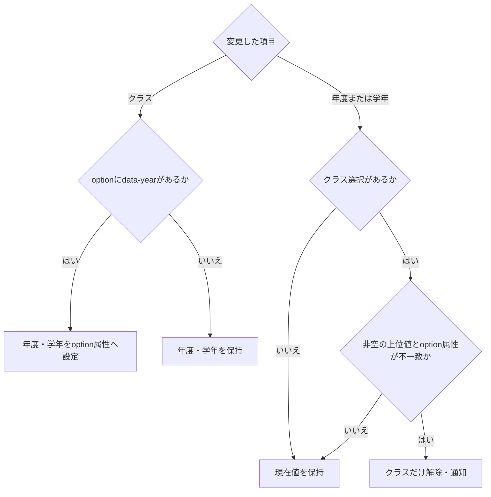

#### SQL・テーブル関連（ER図）

DB操作はない。概要のクラス・学年の関連から取得済みの年度・学年を、Razorがoptionのdata属性へ出力している。このイベントはFKやマスター状態を照会しない。

#### DB操作の詳細

保持領域はブラウザーDOM上の三つのselectとoption属性である。JavaScriptは候補一覧を作り直さず、選択値だけを変更する。共有レイアウトは`site.js`をdeferで読み込む。保存値の最終整合はEV-CODE-05で検査する。根拠：`sources/Views/Shared/_Layout.cshtml:1-1`、`sources/wwwroot/js/site.js:8-8`、`sources/Core/SqlServerStudentService.cs:363-383`。

#### 結果・例外時の扱い

結果はDOMの値変更と通知で、HTTP応答や保存版を作らない。参照モードでは外側fieldsetがdisabledとなり、通常操作による変更対象ではない。独自catchはなく、この連動処理をサーバー入力の整合保証にはしない。根拠：`sources/Views/Students/Edit.cshtml:5-5`、`sources/Web/Models/StudentEditPageModel.cs:14-14`、`sources/wwwroot/js/site.js:8-8`。

### EV-CODE-04 検索画面の候補更新

#### 処理概要

「候補を更新」はフォームPOST `/students/options`へ接続され、現在入力に合う候補を再表示する。一覧は検索状態の`LastResult`を保持し、変更条件で`SearchAsync`を実行しない。未接続のJSON候補helperとは別のRazor用処理である。根拠：`sources/Views/Students/Search.cshtml:4-5`、`sources/Web/Controllers/StudentsController.cs:22-22`。

#### 処理手順

1. controllerの認証・偽造防止設定を前提に、`Criteria`接頭辞の検索入力、検索状態ID・版・タブID等を受ける。アクション内では最初に`FormGuard`で許可項目、重複項目、書式メタ情報を確認する。
2. フォームに`Criteria.StatusCodes`キーがなければ空配列を設定する。その後、検索状態を利用者・セッション・指定タブ・期限で照合する。
3. 未所属のみなら年度・学年・クラスをNULLにし、対応するModelStateを解除する。
4. `LastResult`を表示用データへ投影し、`LookupAsync(false)`で人数なし候補を取得する。「条件を変更しました。検索を押すと一覧に反映します。」を通知に設定する。
5. 指定クラスが候補に存在しない、または非NULL年度・非空学年と一致しなければ、クラスと対応ModelStateを解除する。通知を「上位条件に合わないクラスを解除しました。」へ置き換える。
6. 検索画面を返す。このアクションは`ModelState.IsValid`、受信`ContextRevision`の比較、`contexts.Use`による待機後再検査を行わない。候補取得のawait後にも検索状態を再確認しない。

根拠：`sources/Web/Controllers/StudentsController.cs:22-22`、`sources/Web/Controllers/StudentsController.cs:39-41`、`sources/Infrastructure/SearchContextStore.cs:13-14`、`sources/Infrastructure/WebHostSetup.cs:14-18`。

#### 処理フロー

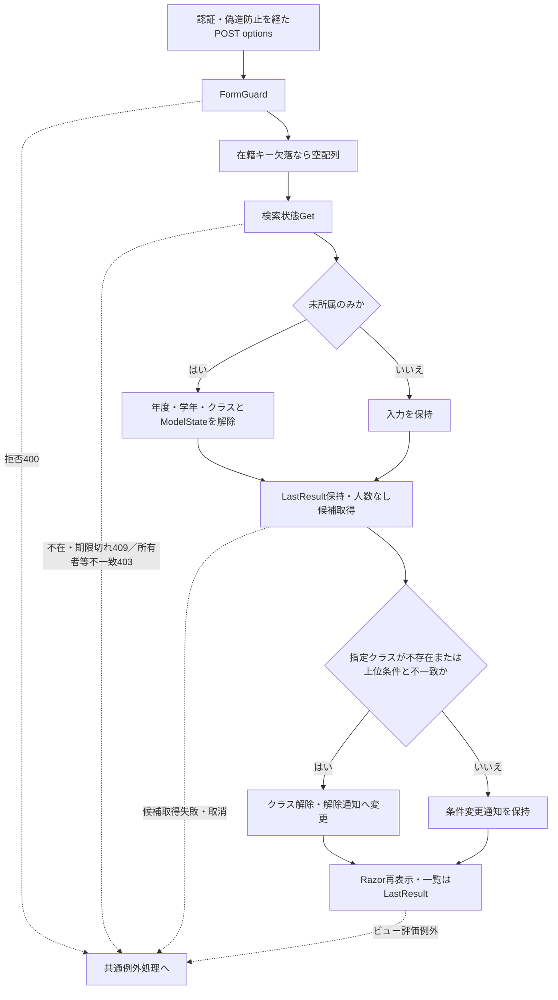

アクション到達前の認証・偽造防止による拒否と、上図のアクション内拒否は別段階である。

#### SQL・テーブル関連（ER図）

EV-CODE-02の候補関連を使用し、分類・コード・クラスを読む。人数なし取得では学生人数を集計しない。一覧はDB再検索ではなくメモリの検索状態から受け取る。

#### DB操作の詳細

固有の検索・更新SQLはない。候補SQLの全件取得・順序・取消境界はEV-CODE-02に従う。取得後のクラス照合は、IDの文字列表現と指定年度・学年に一致する候補があるかをメモリの`Any`で確認する。適用済み検索条件や検索状態版を更新する処理はない。受信した表示件数・ソート値も、このアクションでは新しい検索条件として確定しない。根拠：`sources/Web/Controllers/StudentsController.cs:22-22`、`sources/Web/Controllers/StudentsController.cs:39-39`。

#### 結果・例外時の扱い

正常時は候補と現在入力を再表示し、取得済み一覧を保持する。一覧0件の場合も候補を取得する。候補更新だけでは、保守で変更された名称や変更条件を既存一覧へ反映しない。

フォーム拒否は400、検索状態拒否は403または409のWebFaultとして伝播する。その他の失敗は応答未開始なら共通middlewareの503となる。入力不正後の再表示も例外の終端ではない。例えば、在籍キーが存在する経路には`StatusCodes`のNULL補完がなく、ビューは`StatusCodes.Contains`を直接使用する。NULLがそこへ届く場合は再表示中の例外経路となる。実際の受信・変換結果を、この入口に存在しないModelState分岐で補ったものとして説明しない。根拠：`sources/Web/Controllers/StudentsController.cs:22-22`、`sources/Views/Students/Search.cshtml:5-5`、`sources/Infrastructure/WebHostSetup.cs:16-16`、`sources/Infrastructure/WebHostSetup.cs:22-24`。

### EV-CODE-05 学生保存時のコード・所属再確認

#### 処理概要

学生保存は、画面候補の取得時点に依存せず、共通排他ロック後にコードとクラスを読み直す。同じ既存コード、既存所属の継続、新たな在学・休学所属、卒業・退学の期間照合を異なる条件で判定する。本イベントでは、候補契約に必要な入口、再検査、保存後段と確定応答の境界を示す。根拠：`sources/Core/SqlServerStudentService.cs:227-323`、`sources/Core/SqlServerStudentService.cs:344-383`。

#### 処理手順

1. POST create・updateは`Bind(Prefix="Input")`の`StudentSaveInput`を受ける。アクション内では`FormGuard`、登録更新権限、編集スナップショット、復帰先の存在、読込時復帰先との一致の順に検査する。この部分はcontrollerのWebFault捕捉用tryより前にある。
2. ModelState不正ならサービスを呼ばず422を設定する。有効なら捕捉用try内で`coordinator.Save`を呼び、呼出先でも登録更新権限と復帰先を再確認する。この位置のWebFaultはcontrollerが捕捉し、その状態を引き継いで項目エラーを追加する。
3. `ToRequest`はまずクラスIDを変換し、既存なら版を正のInt64へ変換する。新規なら`EnsureNewVersion`を呼び、`ExpectedVersion`がNULLまたは空文字の場合だけNULLを返す。新規の版が非空なら400のWebFaultとなり、学生サービスへ到達しない。空白だけの版も非空として拒否する。クラスID・既存版の形式不正は422のWebFaultである。これらはcontrollerが捕捉し、候補再取得後に入力を保持して再表示する。
4. サービスは利用者、要求入口のUTC時刻、日本時間業務日を取得し、Viewerを拒否する。学生入力、理由、IDと版の組合せ、年度範囲、任意学年コードを検査・正規化する。在籍01・02はクラス必須かつ終了日なし、03・04は入学日以降の終了日必須とする。生年月日≦入学日、連絡先の存在、緊急連絡先3項目の組合せも検査する。
5. 接続を開いてReadCommittedを開始する。保存用tryに入って共通ロックを取得する。既存学生は非削除行を再取得し、対象、比較版、学籍番号不変を確認する。旧区分03・04から別区分へ訂正する場合は、管理者権限と正規化後の変更理由を要求する。
6. 性別・都道府県・在籍・設定済み続柄を用途別分類と値でコード・分類JOINへ照会する。同じ既存値でも存在は必要である。新規またはコード変更時だけ、両表の有効状態と業務日内期間を要求する。NULLの任意続柄は照会を省略する。
7. クラス指定時は存在と、設定済み年度・学年との一致を確認する。新状態が01・02で、旧状態が人数対象でないか別クラスへ移る場合だけ、クラスの有効状態・業務日内期間を要求する。定員ありなら、自分を除く非削除01・02人数に1を加えて定員と比較する。
8. 新状態が03・04で、新規、クラス変更、区分変更、入学日変更、終了日変更のいずれかがある場合だけ、学生在籍期間とクラス期間の重なりを要求する。この経路は現在のクラス有効状態を要求しない。再検査エラーは蓄積後に`InputValidationException`を送出する。
9. 再検査後に差分を判定する。無変更は明示rollback後、既存ID・取得済み版でNoChangeを返す。差分ありの場合だけ、取得済み学生版がInt64最大でないか確認する。最大ならE-STU-105のConflictを返し、学籍番号・同一人物候補検査へ進まない。
10. 学籍番号の重複を確認し、同一生年月日かつ氏名照合キーまたはカナ照合キーが一致する非削除の他学生を取得する。全候補で確認情報を照合し、表示は最大20件とする。Web構成ではメモリ確認情報の所有者、セッション、対象ID、要求版、期限、入力ハッシュ、候補ID・版ハッシュ、Busyを確認する。確認有効なら理由を必須とする。候補あり、または確認情報指定ありで確認無効なら、rollback後に確認情報を発行してConfirmationRequiredを返す。
11. 保存可能ならINSERTまたは比較版付きUPDATEと履歴追記を同じトランザクションで行う。commit完了後にSavedを返す。controllerはSavedを303の検索復帰へ変換する。その他の結果や捕捉したWebFaultは候補を再取得して再表示する。

根拠：`sources/Web/Controllers/StudentsController.cs:26-33`、`sources/Web/Inputs/StudentSaveInput.cs:34-43`、`sources/Web/Inputs/StudentSaveInput.cs:57-60`、`sources/Infrastructure/WebStudentCoordinator.cs:18-18`、`sources/Core/StudentNormalizer.cs:119-158`、`sources/Core/SqlServerStudentService.cs:227-323`、`sources/Core/SqlServerStudentService.cs:344-383`。

#### 処理フロー

サブフロー5-1はWeb入口である。400の新規版拒否、422の識別値拒否、サービス結果、捕捉外例外を分ける。識別値の評価順はクラスID、次いで新規・既存に応じた版検査である。

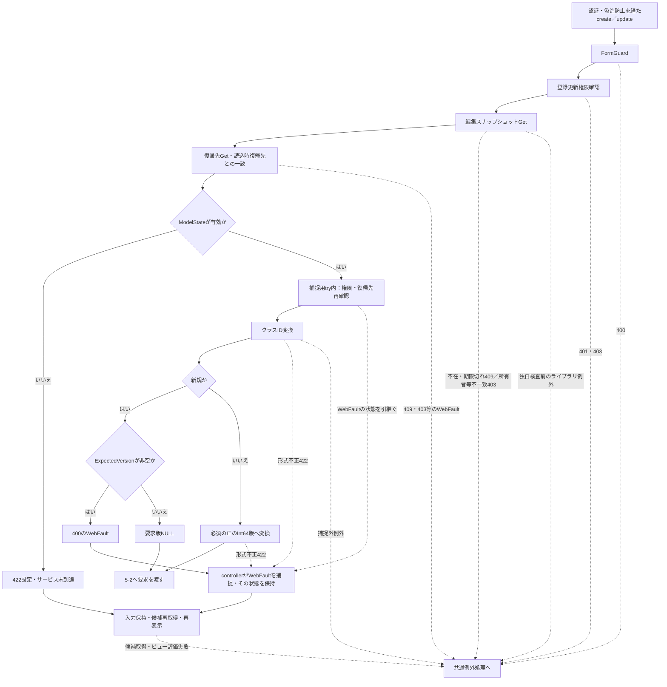

サブフロー5-2はサービスの入力検査とDB再検査である。新規枝では旧行・旧版をNULLのまま保持し、取得に成功した既存枝では取得値を保持する。

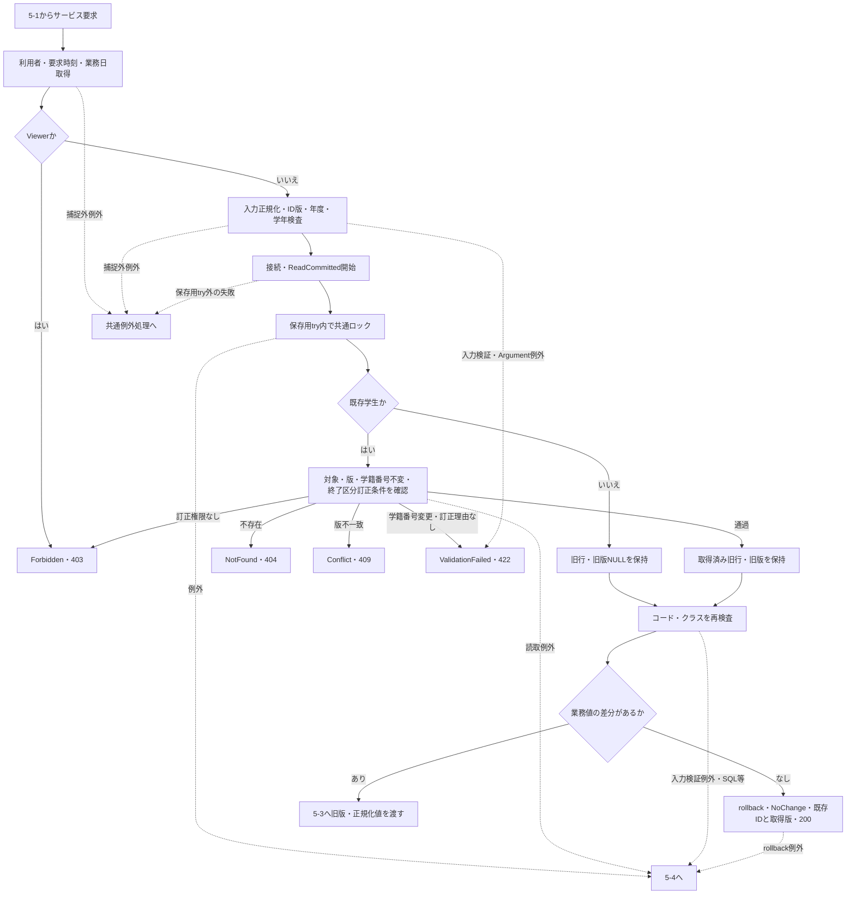

サブフロー5-3は差分ありの場合だけ実行する。確認要求の返却値は新規と更新で異なり、更新の取得済み版をNULLへ置き換えない。

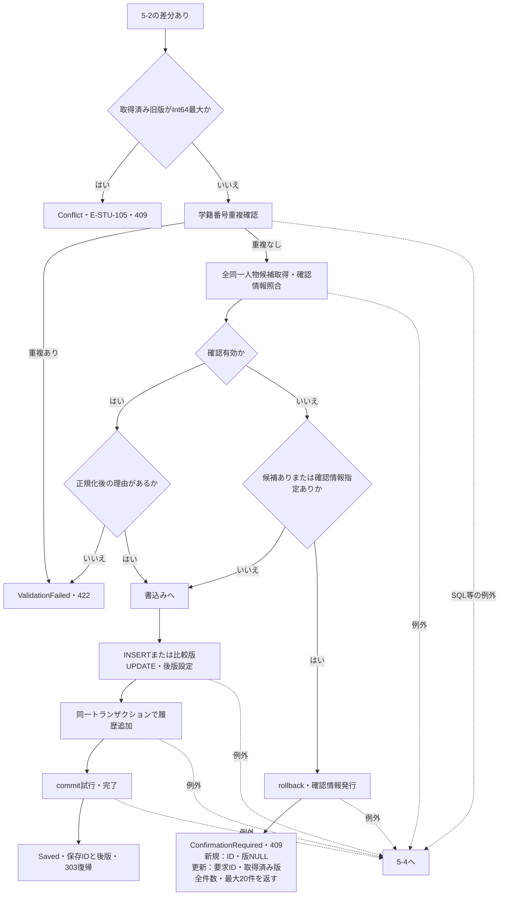

サブフロー5-4は保存用try内のcatch順を示す。先行catchの例外は、最後のcatchのUnknown判定へ含めない。

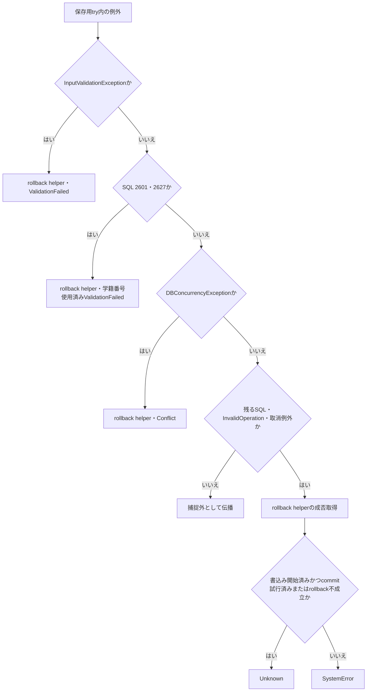

図5-2～5-4の非Saved結果は、controllerで結果に対応する状態を設定し、候補再取得後に再表示する。表示完成前の例外は共通middlewareへ伝播する。図の結果節点は同じHTTP状態でも理由と返却情報を保持する。

#### SQL・テーブル関連（ER図）

概要の関連図に従い、分類・コード・クラス・学生を読む。学生を書き込む場合だけ履歴を同じトランザクションへ追記する。コード・クラスの属性更新は行わない。GRADE入力はクラスとの一致検査に使い、学生保存の用途別コード照会では学年コードの有効状態・期間を直接確認しない。接続されたWeb確認情報はメモリ保持であり、`t_confirmation`への操作は`webTokens=false`の別分岐である。根拠：`sources/Core/SqlServerStudentService.cs:237-237`、`sources/Core/SqlServerStudentService.cs:276-342`、`sources/Core/SqlServerStudentService.cs:347-374`、`sources/Infrastructure/WebHostSetup.cs:19-19`。

#### DB操作の詳細

| 検査・操作 | 全条件・JOIN | パラメータ・結果 |
| --- | --- | --- |
| 既存学生 | `student_id=@id AND is_deleted=0` | `@id BigInt`。旧業務値・版を取得 |
| 用途別コード | 分類IDでコード・分類をJOINし、`c.category_id=@category AND c.code_value=@value` | `@category VarChar(24)`、`@value VarChar(10)`。不存在E-STU-009、変更時の停止・期間外E-STU-011 |
| クラス | `class_id=@id` | `@id BigInt`。不存在E-STU-010、上位不一致E-STU-014、新規所属不可E-STU-013、終了期間非重複E-STU-108 |
| 所属人数 | 同じクラス、非削除、区分01・02、自分以外 | `@class BigInt`、`@id BigInt`。`COUNT_BIG(*)+1`が定員超過ならE-STU-102 |
| 学籍番号重複 | 同じ番号、自分以外。論理削除行も対象 | `@no VarChar(15)`、`@id BigInt`。E-STU-101 |
| 同一人物候補 | 非削除、自分以外、同一生年月日、氏名キーまたはカナキー一致 | `@id BigInt`、`@birth Date`、`@name NVarChar(320)`、`@kana NVarChar(36)`。学生ID昇順、全件取得 |
| 学生INSERT | 正規化済み業務列、固定分類、非削除、作成更新情報、版1 | IDをOUTPUT経由で取得 |
| 学生UPDATE | `student_id=@id AND row_version=@version AND is_deleted=0` | 学籍番号以外の業務列、更新情報、版加算。IDをOUTPUT経由で取得 |
| 履歴 | 対象`m_student`、保存IDの十進文字列、前後版、変更列JSON等 | CREATEまたはUPDATE。入力理由と候補件数に基づく重複確認有無を保存 |

コード・所属・日付の保存パラメータは補足説明の対応表に従う。更新の制御値は`@id`・`@version BigInt`、実行者は`@actor NVarChar(128)`、日時は`@now DateTimeOffset`である。書込み結果がNULLまたは`DBNull`なら`DBConcurrencyException`となる。共通コマンドは30秒で、非同期DB操作へ取消トークンを渡す。根拠：`sources/Core/SqlServerStudentService.cs:65-72`、`sources/Core/SqlServerStudentService.cs:247-307`、`sources/Core/SqlServerStudentService.cs:344-389`。

Web確認情報の期限は要求入口の`now`から10分後で、照合も同じ`now`と比較する。DB読取り後に現在時刻を取り直す処理ではない。確認情報は所有者・セッション・対象ID・版・入力・候補集合に結び付き、Busyの原子的取得を要求する。成功時は削除し、未完了かつUnknownでない場合は取得済みBusyを解放する。根拠：`sources/Core/SqlServerStudentService.cs:19-29`、`sources/Core/SqlServerStudentService.cs:224-229`、`sources/Core/SqlServerStudentService.cs:274-323`、`sources/Core/SqlServerStudentService.cs:330-335`。

#### 結果・例外時の扱い

同じ既存コードは存在を確認したうえで、有効状態・期間を再検査せず保持できる。旧状態も01・02で同じクラスを継続する場合は、新規所属の状態・期間・定員検査を省略するが、指定年度・学年との一致は検査する。03・04の同じ既存クラス・区分・入学日・終了日を保持する場合は、期間重なりも再検査しない。画面の選択可能条件と保存条件は同一ではない。根拠：`sources/Core/SqlServerStudentService.cs:347-380`。

| 結果・拒否 | HTTP状態・画面処理 | ID・版等の扱い |
| --- | --- | --- |
| 新規の非空版 | 400、controllerがWebFaultを捕捉して再表示 | サービス未到達。入力版を自動解除しない |
| 識別値不正・ModelState不正 | 422、再表示 | サービス未到達の経路とサービス検証経路を分ける |
| NoChange | 200、再表示 | 要求学生ID・取得済み旧版を返す |
| 差分ありの旧版上限 | 409、Conflictとして再表示 | E-STU-105。`Result` helperのID・版はNULL |
| ConfirmationRequired | 409、候補と確認情報を再表示 | 新規はID・版NULL、更新は要求ID・取得済み版。全件数と最大20件 |
| Saved | 303、検索復帰と一回限り通知 | 保存ID・後版はサービス結果に保持 |
| ValidationFailed | 422、項目エラーを再表示 | 検証エラーを返す |
| Forbidden／NotFound／Conflict | 403／404／409、結果に従い再表示 | 理由を固定の一種類へまとめない |
| SystemError／Unknown | 503、結果に従い再表示 | Unknownでは再保存前の検索確認を求める |

無変更は版上限検査より先に返る。したがって、既存版がInt64最大でも無変更の経路までConflictとしない。根拠：`sources/Core/SqlServerStudentService.cs:261-266`、`sources/Web/Inputs/StudentSaveInput.cs:42-43`、`sources/Web/Controllers/StudentsController.cs:30-38`、`sources/Infrastructure/WebPresentation.cs:23-23`。

保存用catchは、入力検証、一意性SQL、DB競合、残るSQL・InvalidOperation・取消の順である。最後のcatchに到達した場合だけ、`writeStarted`が真、かつ`commitAttempted`が真またはrollback不成立ならUnknownとする。先行catchは、それぞれValidationFailedまたはConflictを返し、rollback成否を同じUnknown規則へ拡張しない。接続・BeginTransactionは保存用try外であり、捕捉外例外はSaveResultを返さず伝播する。根拠：`sources/Core/SqlServerStudentService.cs:240-243`、`sources/Core/SqlServerStudentService.cs:316-329`。

非成功時の再表示は入力とスナップショットの詳細を保持し、候補だけを再取得する。新規版400も同じ経路だが、422へ読み替えない。controllerはWebFault捕捉時にその状態を設定し、結果がNULLならOutcomeによる状態の上書きを行わない。候補取得やビュー評価が失敗すると、元の再表示は完成しない。応答未開始の共通middlewareはWebFaultの状態を引き継ぎ、その他を503へ変換する。根拠：`sources/Web/Controllers/StudentsController.cs:30-33`、`sources/Infrastructure/WebHostSetup.cs:22-24`。

HTML requiredと非nullable注釈は、受信NULLの排除保証ではない。暗黙Requiredは抑止されている。`BirthDateInput`全体は`ToRequest`で補完するが、内部文字列は補完しない。日付処理等の捕捉外例外も入力拒否422へ一律にまとめない。`EditorSnapshotStore.Get`はNULLキーを明示検査せず`TryGetValue`へ渡すため、NULL引数の経路と、空文字・不在キーを独自409にする経路を区別する。根拠：`sources/Infrastructure/WebHostSetup.cs:16-16`、`sources/Web/Inputs/StudentSaveInput.cs:34-43`、`sources/Infrastructure/EditorSnapshotStore.cs:10-10`、`sources/Core/StudentNormalizer.cs:123-143`。

### EV-CODE-06 コード属性の追加・更新契約

#### 処理概要

`SaveCodeAsync(CodeChange raw, CancellationToken ct)`は、分類ID・コード値をキーとしてコード属性を追加または更新する。追加判断に分類の桁数・通常追加可否、更新判断に比較版と旧保護状態を使用する。分類保存、キー変更、物理削除は行わない。根拠：`sources/Core/MasterMaintenanceService.cs:10-11`、`sources/Core/MasterMaintenanceService.cs:79-121`。

#### 処理手順

1. 分類を5分類に限定し、設定済み比較版が正、表示順が非負であることを確認する。違反はE-MST-003付き`ArgumentException`となる。
2. 必須名称を原入力・保存後とも12スカラー以内、任意備考を120スカラー以内へ正規化する。開始日を必須ISO日付、終了日をNULLまたは空文字なら無期限とする。終了日が開始日より前ならE-MST-004で拒否する。
3. DB接続を開き、`ORIGINAL_LOGIN()`と`IS_ROLEMEMBER('student_admin')`を読む。ロールが1でない、NULL、行なしの場合は権限例外となる。実行者を必須64スカラー以内へ正規化し、ReadCommittedを開始してUTC日時を保持する。
4. 共通ロック後、分類IDで`code_length`と`allow_add`を読む。分類なしはE-MST-001の例外とする。分類の有効状態は検査しない。取得した桁数でコード値を必須数字コードへ正規化する。
5. 複合キーで既存全列を読む。行なし・要求版ありはNotFound／版NULL。行あり・要求版不一致はConflict／版NULLで、要求版NULLの既存キー追加も競合となる。行なし・要求版NULLだけが追加で、追加不可分類ならE-MST-003を送出する。
6. 旧行が保護値なら、新状態false、開始日を後へ移す、無期限から有限終了へ変える、既存終了日を前へ短縮する要求を拒否する。この検査は無変更判定より前に行う。
7. 名称・表示順・有効状態・開始日・終了日・備考の6属性を比較する。無変更は明示rollback後にNoChange／要求版を返す。差分ありで要求版がInt64最大なら例外とする。
8. 新規は保護0・版1を設定し、更新は複合キー・比較版付きWHEREで6属性、更新情報、版加算を設定する。影響件数が1以外なら`DBConcurrencyException`となる。
9. 後版を`(ExpectedVersion ?? 0)+1`とし、同じトランザクションへ履歴を追加する。commit完了後だけSaved／後版／「コードを保存しました。」を返す。

根拠：`sources/Core/MasterMaintenanceService.cs:17-28`、`sources/Core/MasterMaintenanceService.cs:79-121`。

#### 処理フロー

サブフロー6-1は保存対象の確定までを示す。旧行は既存取得成功枝だけで保持し、新規枝ではNULLのまま6-2へ渡す。

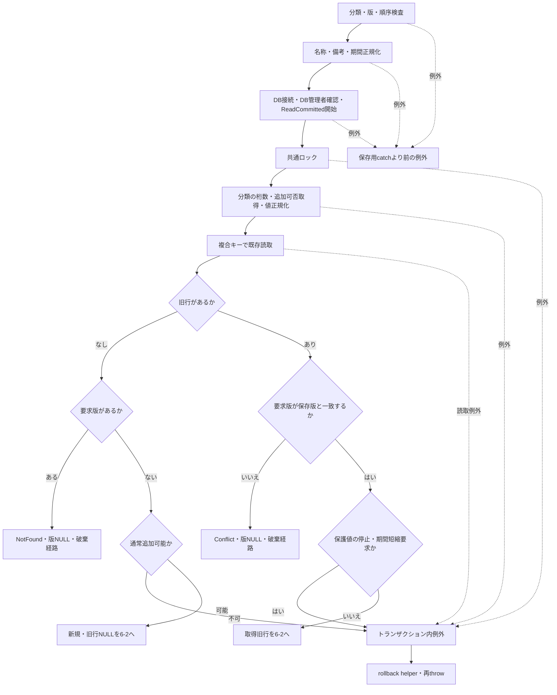

サブフロー6-2は業務差分、書込み、確定結果を示す。NotFound・Conflict枝には明示rollbackを追加しない。

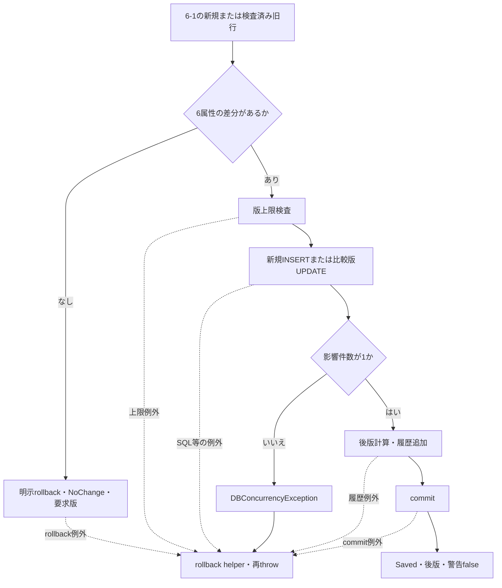

#### SQL・テーブル関連（ER図）

概要の分類・コード関連を使用する。分類は読取りのみ、コードはINSERTまたはUPDATE、履歴は追記である。履歴キーは`分類ID:コード値`という文字列でありFKではない。コード保守には、参照学生・クラスの件数を数える変更拒否処理はない。根拠：`sources/Core/MasterMaintenanceService.cs:92-119`、`sources/Core/MasterMaintenanceService.cs:132-135`。

#### DB操作の詳細

| 操作 | 全述語・設定 |
| --- | --- |
| 分類取得 | `WHERE category_id=@category`。桁数と追加可否を取得 |
| 既存取得 | `WHERE category_id=@category AND code_value=@value`。全列を旧行として取得 |
| INSERT | キー、6業務属性、保護0、作成更新情報、版1を明示設定 |
| UPDATE | 6業務属性、更新情報、版加算。WHEREは分類ID・コード値・比較版。キー・保護状態・作成情報は変更しない |
| 履歴 | 対象`m_code`、複合キー文字列、前後版、変更列JSON等。理由NULL、重複確認0 |

| パラメータ | 型・サイズ | 保存先・制約 |
| --- | --- | --- |
| `@category` | `VarChar(24)` | 分類ID、NOT NULL |
| `@value` | `VarChar(10)` | コード値、NOT NULL。分類別桁数とDB容量10は別 |
| `@name` | `NVarChar(24)` | `code_name nvarchar(24) NOT NULL`、12スカラー上限 |
| `@order` | `Int` | 非負の表示順 |
| `@active` | `Bit` | 有効状態 |
| `@from`・`@to` | `Date` | 開始NOT NULL、終了NULL可 |
| `@remarks` | `NVarChar(240)` | 備考NULL可、120スカラー上限 |
| `@now` | `DateTimeOffset` | UTCの作成更新日時、DBは`datetimeoffset(7)` |
| `@actor` | `NVarChar(128)` | DB認証実行者、64スカラー上限 |
| `@version` | `BigInt` | 更新の比較版 |

SELECTにORDER BY・ページングはない。共通パラメータ処理はNULLを`DBNull`、`DateOnly`を午前0時の`DateTime`へ変換する。共通コマンドは30秒で非同期DB操作へ`ct`を渡す。例外時rollback helperは取消なしで試行する。根拠：`sources/Core/MasterMaintenanceService.cs:92-121`、`sources/Core/SqlServerStudentService.cs:65-72`、`sources/Core/SqlServerStudentService.cs:329-329`、`sources/database/001_schema.sql:112-134`。

#### 結果・例外時の扱い

保護値でも開始日を前へ広げる、終了日を後へ延ばす、終了日をNULLへ戻す、名称・表示順・備考を変える要求は、この保護検査では拒否されない。旧保護値が既に停止している場合も、新状態falseを要求すると無変更判定より先に拒否される。通常追加不可は既存属性更新の拒否条件ではない。根拠：`sources/Core/MasterMaintenanceService.cs:102-112`。

NotFound・Conflictは版NULL、NoChangeは要求版、Savedは後版を返し、同名警告はいずれも既定falseとなる。NotFound・Conflictの早期returnは明示rollbackなしで`await using`の破棄へ進む。トランザクション内は無条件catchでrollback helper後に再throwし、一意性違反や件数不一致をMaintenanceResultへ変換しない。入口正規化、Open、BeginTransactionはこのcatchの外にある。根拠：`sources/Core/MasterMaintenanceService.cs:11-11`、`sources/Core/MasterMaintenanceService.cs:81-121`。

commit例外からSavedは返らず、DBの確定状態をこの戻り値だけで判断できない。呼出元が確認できないため、学生WebのHTTP状態規則や結果不明時の画面操作をこの保守契約へ適用しない。rollback helperが扱わない例外や破棄失敗まで含め、元例外の再throwを一律に保証しない。根拠：`sources/Core/MasterMaintenanceService.cs:120-121`、`sources/Core/SqlServerStudentService.cs:329-329`。

### EV-CODE-07 クラス候補の保存元追加・更新契約

#### 処理概要

`SaveClassAsync(ClassChange raw, CancellationToken ct)`は、クラス候補の年度・学年・コード・名称・期間・定員等を保存する。参照学生の全件数と現在所属人数を分け、変更可能な属性を判断する。同名称は警告であり、年度・クラスコードの重複はDB一意制約による保存拒否となる。根拠：`sources/Core/MasterMaintenanceService.cs:9-11`、`sources/Core/MasterMaintenanceService.cs:30-77`、`sources/database/001_schema.sql:188-188`。

#### 処理手順

1. 年度1900～9998、定員NULLまたは1～9999、非負表示順、設定済みID・版が正であることを確認する。IDと版は両方NULLの新規、または両方設定済みの更新に限定する。
2. コードを原入力9スカラー以内、Trim・NFKC・大文字化後も9以内にし、先頭ASCII英数字、以降ASCII英数字またはハイフンに限定する。名称を必須18スカラー、学年を必須2桁数字、備考を任意120スカラーへ正規化する。
3. 開始・終了を必須ISO日付へ変換し、開始≦終了かつ当年度4月1日～翌年3月31日内を要求する。保守日付は未来日を禁止しない。
4. EV-CODE-06と同じDB管理者・実行者確認を行い、ReadCommittedを開始する。直後のUTC日時から日本時間業務日を取得して共通ロックを要求する。
5. 更新はIDで旧行を読む。不在ならNotFound／版NULL、版不一致ならConflict／版NULLを返す。取得成功後、年度・正規化済みクラスコードの変更を拒否する。
6. 同じクラスを参照する全学生を数え、1件以上なら学年変更を拒否する。この数は削除済み・終了状態も含む。別に非削除01・02人数を集計し、人数ありで停止または業務日を含まない新期間を拒否する。定員ありで人数を下回る要求も拒否する。
7. GRADEコード・分類JOINで学年の存在を必ず確認する。新規または学年変更時だけ、両表の有効状態と業務日内期間を要求する。既存同一学年は停止・期間外でも保持できる。
8. 10業務属性を比較する。無変更は明示rollback後にNoChange／要求版。差分ありの版上限を検査し、その後、同年度・同学年・同名称の自分以外の行があるかを照会して同名警告を保持する。停止値も警告対象に含む。
9. 新規INSERTまたはID・比較版付きUPDATEで保存し、OUTPUT経由で保存IDを得る。SQL結果がnullなら`DBConcurrencyException`とする。保存IDと後版で履歴を追加し、commit完了後にSaved／後版／取得済み同名警告を返す。

根拠：`sources/Core/MasterMaintenanceService.cs:17-77`、`sources/Core/MasterMaintenanceService.cs:124-135`、`sources/Core/StudentNormalizer.cs:59-64`。

#### 処理フロー

サブフロー7-1は旧行の確定と変更制約を示す。旧行を保持するのは対象と版の検査に成功した枝だけである。

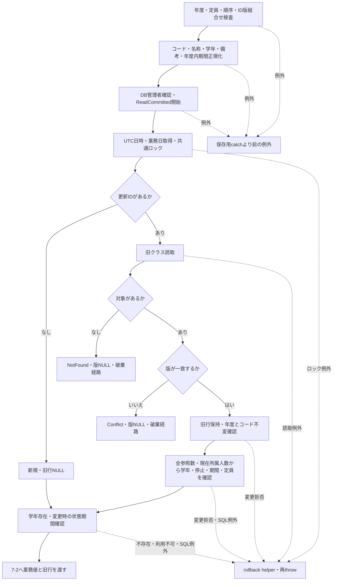

サブフロー7-2は差分と警告を引き継いで確定する。成功枝に一律の警告falseを置かず、照会結果を保持する。

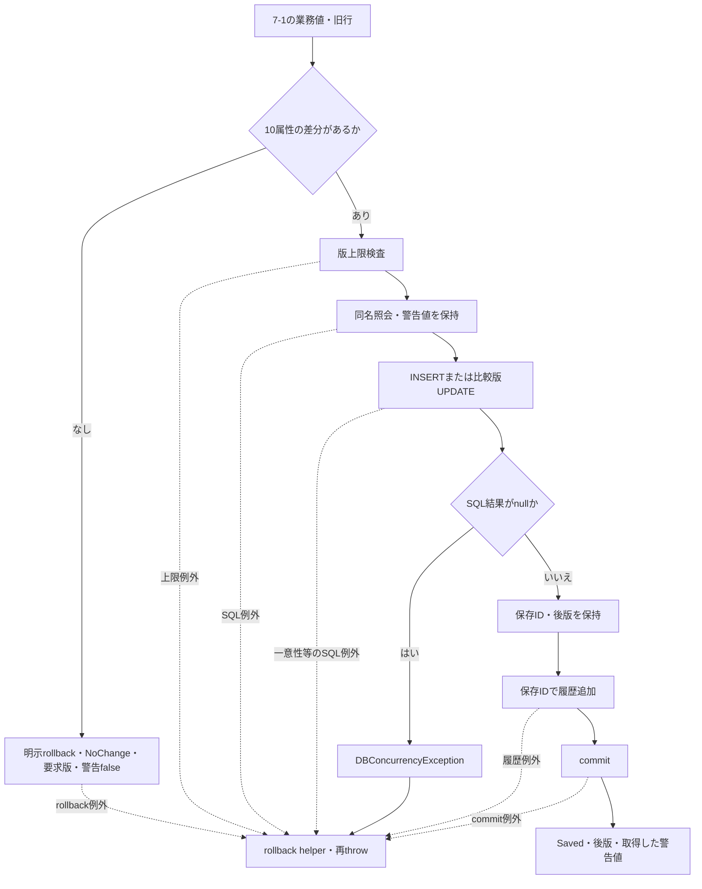

#### SQL・テーブル関連（ER図）

概要の学年コード・分類、クラス、学生参照関連を使用する。学年と学生は読取り、クラスは追加または更新、履歴は追記である。履歴キーは保存IDの十進文字列でありクラスへのFKではない。根拠：`sources/Core/MasterMaintenanceService.cs:45-75`、`sources/Core/MasterMaintenanceService.cs:132-135`。

#### DB操作の詳細

| 操作 | 全条件・設定・結果 |
| --- | --- |
| 旧クラス | `WHERE class_id=@id`、`@id BigInt`。全列と版 |
| 参照集計 | `m_student WHERE class_id=@id`。全参照は`COUNT_BIG(*)`、現在所属は非削除01・02をCASEでbigint合計しNULL合計を0へ補完 |
| 学年照会 | コード・分類を分類IDでJOINし、`c.category_id='GRADE' AND c.code_value=@grade`、`@grade VarChar(2)` |
| 同名警告 | `school_year=@year AND grade_code=@grade AND class_name=@name AND (@id IS NULL OR class_id<>@id)`。状態・期間による除外なし |
| INSERT | 10業務属性、`grade_category='GRADE'`、作成更新情報、版1。OUTPUTをテーブル変数に入れIDをSELECT |
| UPDATE | 10業務属性、更新情報、版加算。`WHERE class_id=@id AND row_version=@version`。OUTPUTからIDを取得 |
| 一意制約 | `(school_year,class_code)`。同名警告の年度・学年・名称条件とは別 |

10属性は年度、学年コード、クラスコード、クラス名称、開始日、終了日、定員、表示順、有効状態、備考である。差分比較ではDateOnlyとDBのDateTime、年度のintとDBのshortを対応させる。UPDATEは10属性を設定するが、履歴の変更列配列は業務差分がある列だけである。根拠：`sources/Core/MasterMaintenanceService.cs:65-74`、`sources/Core/MasterMaintenanceService.cs:123-130`。

| 保存パラメータ | 型・サイズ | DB属性・業務制約 |
| --- | --- | --- |
| `@school_year` | `SmallInt` | `smallint NOT NULL`、1900～9998 |
| `@grade_code` | `VarChar(2)` | `varchar(2) NOT NULL`、GRADE参照 |
| `@class_code` | `VarChar(9)` | `varchar(9) NOT NULL`、正規化後ASCII最大9文字 |
| `@class_name` | `NVarChar(36)` | `nvarchar(36) NOT NULL`、18スカラー上限 |
| `@valid_from`・`@valid_to` | `Date` | 両列NOT NULL、年度内期間 |
| `@capacity` | `Int` | `int NULL`、NULLは上限制限なし、設定時1～9999 |
| `@display_order` | `Int` | `int NOT NULL`、非負 |
| `@is_active` | `Bit` | `bit NOT NULL` |
| `@remarks` | `NVarChar(240)` | `nvarchar(240) NULL`、120スカラー上限 |
| `@now`・`@actor` | `DateTimeOffset`・`NVarChar(128)` | UTC作成更新日時、64スカラー以内のDB認証実行者 |
| `@id`・`@version` | `BigInt` | 更新対象ID・比較版 |

同名照会のパラメータは`@year SmallInt`、`@grade VarChar(2)`、`@name NVarChar(36)`、`@id BigInt`である。SELECTにORDER BY・ページングはなく、集計値またはPK対象を取得する。共通NULL・日付変換、30秒タイムアウト、取消境界はEV-CODE-06と同じである。DDLの年度・期間・定員・表示順CHECKと、保守処理の検査は別に存在する。根拠：`sources/Core/MasterMaintenanceService.cs:70-73`、`sources/Core/MasterMaintenanceService.cs:124-130`、`sources/database/001_schema.sql:62-87`、`sources/database/001_schema.sql:188-201`。

#### 結果・例外時の扱い

全参照数による学年変更禁止と、現在所属人数による停止・期間・定員制約は別である。所属人数0なら人数検査だけでは停止や現在日外の期間を拒否しない。年度・クラスコードは人数に関係なく変更不可である。根拠：`sources/Core/MasterMaintenanceService.cs:52-64`。

同名警告は保存を中断しない。Savedは後版と取得済み警告を返すが、`MaintenanceResult`は保存クラスIDを返さない。IDは内部の保存結果と履歴キーに使用する。NoChange・NotFound・Conflictは同名照会より先に返り、警告は既定falseである。NotFound・Conflictは明示rollbackなしの破棄経路、NoChangeは明示rollback完了後の戻り値である。根拠：`sources/Core/MasterMaintenanceService.cs:11-11`、`sources/Core/MasterMaintenanceService.cs:48-49`、`sources/Core/MasterMaintenanceService.cs:67-76`。

一意性違反、保存結果なし、履歴失敗、commit失敗は専用Outcomeへ変換せず、トランザクション内catchでrollback helper後に再throwする。commit例外後の確定確認、再送判断、警告の表示・確認手順はこのサービスに実装されていない。根拠：`sources/Core/MasterMaintenanceService.cs:74-77`、`sources/Core/SqlServerStudentService.cs:329-329`。

## 補足説明

### 入力・保存値・検索値の対応

画面入力、バインド後の型、サービス引数、保存値を分ける。年度・学年は`SaveRequest`の補助条件、クラスIDは`StudentDraft`の保存参照値である。学生表へ年度・学年を複写する処理ではない。コードの分類列は利用者入力ではなく、INSERTの固定値または正規化時の導出値である。根拠：`sources/Web/Inputs/StudentSaveInput.cs:34-42`、`sources/Core/Contracts.cs:66-67`、`sources/Core/StudentNormalizer.cs:147-147`、`sources/Core/SqlServerStudentService.cs:294-301`。

| 対象 | サービス側の値・正規化 | DB型・NULL | 保存パラメータ・設定 |
| --- | --- | --- | --- |
| 性別 | `StudentDraft.GenderCode string`、必須1桁Code | `gender_code varchar(1) NOT NULL`、`gender_category varchar(24) NOT NULL` | `@gender_code VarChar(1)`、分類`GENDER`固定 |
| 都道府県 | `StudentDraft.PrefectureCode string`、必須2桁Code | `prefecture_code varchar(2) NOT NULL`、分類列NOT NULL | `@prefecture_code VarChar(2)`、分類`PREFECTURE`固定 |
| 在籍 | `StudentDraft.EnrollmentStatusCode string`、2桁Code後に01～04限定 | `enrollment_status_code varchar(2) NOT NULL`、分類列NOT NULL | `@enrollment_status_code VarChar(2)`、分類`ENROLLMENT_STATUS`固定 |
| 続柄 | `StudentDraft.RelationshipCode string?`、任意2桁Code。未設定はNULL | `relationship_code varchar(2) NULL`、分類`varchar(24) NULL` | `@relationship_code VarChar(2)`、`@relationship_category VarChar(24)`。コードありなら`RELATIONSHIP`、なければNULL |
| 年度補助 | `SaveRequest.SchoolYear int?`、指定時範囲とクラス一致 | 学生保存列なし。保存元`m_class.school_year smallint NOT NULL` | 学生保存パラメータなし。クラス保守は`@school_year SmallInt` |
| 学年補助 | `SaveRequest.GradeCode string?`、任意2桁Codeとクラス一致 | 学生保存列なし。保存元`grade_code varchar(2) NOT NULL`、分類`varchar(24) NOT NULL` | クラス保守`@grade_code VarChar(2)`、分類`GRADE`固定 |
| クラス | `Input.ClassId string?`を正の`StudentDraft.ClassId long?`へ変換 | 学生`class_id bigint NULL`、保存元クラスIDは`bigint IDENTITY(1,1) NOT NULL` | 学生`@class_id BigInt` |
| 入学・終了日 | string／string?から`DateOnly`／`DateOnly?`。1900-01-01以降、業務日以前 | `admission_date date NOT NULL`、`enrollment_end_date date NULL` | `@admission_date`・`@enrollment_end_date Date` |

根拠：`sources/Core/StudentNormalizer.cs:128-158`、`sources/Core/SqlServerStudentService.cs:30-37`、`sources/Core/SqlServerStudentService.cs:294-301`、`sources/database/001_schema.sql:15-32`、`sources/database/001_schema.sql:63-70`。

`IdParser.Optional`はNULL・空文字をNULLにし、それ以外は長さ19以内、ASCII数字のみ、正のInt64に限定する。TrimやNFKCは行わない。必須版はOptionalの結果がNULLなら422とする。新規版の非空400はこの識別値変換とは別の検査である。根拠：`sources/Web/Inputs/StudentSaveInput.cs:42-43`、`sources/Web/Inputs/StudentSaveInput.cs:57-60`。

検索の年度は`c.school_year=@year SmallInt`、学年は`c.grade_code=@grade VarChar(2)`、クラスは`s.class_id=@class BigInt`、都道府県は`s.prefecture_code=@prefecture VarChar(2)`に対応する。在籍配列は各値を`@statusN VarChar(2)`でIN条件へ渡し、空配列ならIN条件を付けない。未所属のみは`s.class_id IS NULL`とする。学年・都道府県はコード存在を検査するが、有効状態・期間は検査しない。年度存在とクラスの上位条件一致も確認する。対象学生は常に非削除である。根拠：`sources/Web/Inputs/StudentSearchInput.cs:19-22`、`sources/Core/SqlServerStudentService.cs:109-154`、`sources/Core/SqlServerStudentService.cs:218-222`。

性別・続柄に専用検索条件はない。学年・在籍・都道府県の表示名称は`code_name`のSQL別名であり、独立保存列ではない。クラス・コードのLEFT JOIN結果はNULL可能だが、名称保存元はNOT NULLである。都道府県名称がNULLなら住所表示の先頭を「[不整合]」とし、住所1を連結する。根拠：`sources/Core/Contracts.cs:31-52`、`sources/Core/SqlServerStudentService.cs:77-90`、`sources/database/001_schema.sql:68-68`、`sources/database/001_schema.sql:115-115`。

### 正規化、業務上限、DB容量

CodeはTrim前の原入力スカラー数を指定桁数以内に検査し、制御文字を拒否する。必須のNULL・空文字・空白だけは入力エラー、任意ならNULLとなる。Trim後にNFKCを適用し、UTF-16のLengthが指定桁数と一致し、全文字がASCII数字であることを要求する。全角数字は変換されるが、原入力上限を超える前後空白はTrimで救済されない。選択コントロールにはmaxlength指定がなく、サービスの桁数検査とは別である。根拠：`sources/Core/StudentNormalizer.cs:37-57`、`sources/Core/StudentNormalizer.cs:113-117`、`sources/Views/Students/Edit.cshtml:8-13`。

| 属性 | 原入力上限 | 正規化後の上限・加工 | SQLパラメータ | DB容量・NULL |
| --- | --- | --- | --- | --- |
| コード名称 | 12スカラー | Trim、必須、12スカラー。名称にNFKCは適用しない | `NVarChar(24)` | `nvarchar(24) NOT NULL`、DDLにも12スカラーCHECK |
| クラス名称 | 18スカラー | Trim、必須、18スカラー。名称にNFKCは適用しない | `NVarChar(36)` | `nvarchar(36) NOT NULL`、DDLにも18スカラーCHECK |
| クラスコード | 9スカラー | Trim・NFKC・大文字化、ASCII最大9文字 | `VarChar(9)` | `varchar(9) NOT NULL` |
| マスター備考 | 120スカラー | 改行LF統一・Trim、任意120スカラー | `NVarChar(240)` | `nvarchar(240) NULL`、DDLにも120スカラーCHECK |
| 分類名称 | 通常保存メソッドなし | DDL上限12スカラー | 通常保守パラメータなし | `nvarchar(24) NOT NULL` |

スカラー数は不正なサロゲートを拒否したUnicode文字の計数である。nvarcharの24・36・240はUTF-16コード単位の容量であり、業務上限やブラウザーmaxlengthと同じ制約ではない。名称保存元の照合順序は`Latin1_General_100_CS_AS_SC`、コードキーは`Latin1_General_100_BIN2`である。根拠：`sources/Core/StudentNormalizer.cs:37-64`、`sources/Core/MasterMaintenanceService.cs:33-35`、`sources/Core/MasterMaintenanceService.cs:82-83`、`sources/database/001_schema.sql:65-86`、`sources/database/001_schema.sql:91-129`。

マスターISO日付はNFKC後の10コード単位・固定`yyyy-MM-dd`・1900-01-01以降を要求し、未来日を禁止しない。`ParseIso`はTextを通さず`raw.Normalize`を直接呼ぶため、必須日付にNULLが渡る場合は形式検証のArgumentExceptionより前の例外経路となる。コード終了日のNULL・空文字だけは呼出側が無期限へ変換し、空白だけは無期限にしない。根拠：`sources/Core/JapaneseDateService.cs:52-59`、`sources/Core/MasterMaintenanceService.cs:36-37`、`sources/Core/MasterMaintenanceService.cs:84-86`。

分類桁数のDDL範囲は1～10である。コード値には非空・ASCII数字等のCHECKがあるが、分類表の桁数との一致を検査するCHECKはない。その一致は宣言されたコード保守の分類取得後検査であり、学生側は用途別の固定1桁・2桁検査を使用する。根拠：`sources/database/001_schema.sql:202-203`、`sources/Core/MasterMaintenanceService.cs:91-96`、`sources/Core/StudentNormalizer.cs:128-140`。

### 状態保持と保守変更の影響

resetは読込時入力のコピーへ戻してModelStateをクリアし、候補だけを再取得する。入力キーと最新候補名称・状態を組み合わせる場合がある。最新再読込のGETは学生も再取得し、取得後の復帰先再確認を経て新しいスナップショットを作る。編集スナップショットは利用者・セッション・対象ID・詳細・入力・期限・復帰版をメモリに保持し、期限は作成から30分である。resetにGET取得後再確認を付け足さない。根拠：`sources/Web/Controllers/StudentsController.cs:25-25`、`sources/Web/Controllers/StudentsController.cs:35-35`、`sources/Infrastructure/EditorSnapshotStore.cs:7-11`。

検索クリアはメモリの適用済み条件・一覧を解除し、新しい入力の在籍01・02へ戻る。在籍の全解除による空配列とは異なる。通常検索・再開等の`contexts.Use`は待機後に期限・所有者を再確認し版を照合するが、候補更新や編集スナップショット取得は同じ待機機構を使用しない。根拠：`sources/Infrastructure/WebStudentCoordinator.cs:9-15`、`sources/Infrastructure/SearchContextStore.cs:13-14`、`sources/Web/Controllers/StudentsController.cs:21-22`、`sources/Web/Inputs/StudentSearchInput.cs:14-14`。

| 変更対象 | 次回候補・表示への影響 | 保存・検索への影響 |
| --- | --- | --- |
| コード名称 | 同じキーに現在名称を表示 | 検索の学年・在籍・都道府県JOIN名称が変わる。数値コードによる状態判定は変わらない |
| クラス名称 | 同じIDに現在名称を表示 | DB再取得した検索名称が変わる。学生の参照IDは変わらない |
| コード表示順 | 分類内候補順が変わる | GRADEの順序はクラス候補の学年順にも作用する |
| クラス表示順 | 年度・学年順の中のクラス順が変わる | 学生検索の指定ソートとは別 |
| コード・分類の有効状態、コード期間 | 合成有効状態と新規選択可否に反映 | 新規・変更コードは再検査。同じ既存値の保持、検索用途は別条件 |
| クラス状態・期間・定員 | 選択可否、注記、参考定員に反映 | 新たな01・02所属、既存継続、03・04期間照合を別条件で検査 |
| GRADE状態・期間 | 学年選択は全件。クラス有効状態とは合成しない | クラス新規・学年変更の保守検査に使用。学生保存は上位一致を確認 |
| 分類名称 | 候補DTOに含まずRazor固定ラベルへ自動反映する経路なし | 通常分類保存メソッドなし |
| 分類桁数・追加可否 | 候補DTOに含まれない | コード保守に使用。学生側固定桁数を自動変更する処理なし |

検索候補更新は取得済み`LastResult`を保持するため、候補名称の変更と一覧名称の変更は別の取得時点になる。通常検索または検索再開によるDB再取得で、一覧名称に現在値を読み込む。根拠：`sources/Core/SqlServerStudentService.cs:82-90`、`sources/Core/SqlServerStudentService.cs:203-214`、`sources/Core/SqlServerStudentService.cs:347-380`、`sources/Core/MasterMaintenanceService.cs:59-64`、`sources/Core/MasterMaintenanceService.cs:91-104`、`sources/Infrastructure/WebStudentCoordinator.cs:9-14`、`sources/Web/Controllers/StudentsController.cs:22-22`。

### 共通排他・監査・確定境界

学生保存、マスター保守、初期投入は同じアプリケーションロック資源を使用する。サービスのGateは`XACT_ABORT ON`、Exclusive、Transaction所有、待機5000ms、DB principal `public`で、負の取得結果をSQL 51001とする。マスター保守はロック後に旧行・比較版を確認し、更新と履歴を同じトランザクションへ入れる。根拠：`sources/Core/SqlServerStudentService.cs:92-101`、`sources/Core/MasterMaintenanceService.cs:38-49`、`sources/Core/MasterMaintenanceService.cs:87-103`、`sources/database/002_seed.sql:2-6`。

| 旧有効状態 | 新有効状態 | 保守履歴の操作 |
| --- | --- | --- |
| 旧行なし | trueまたはfalse | CREATE |
| true | true | UPDATE |
| false | false | UPDATE |
| false | true | ENABLE |
| true | false | DISABLE |

履歴は対象表・対象キー、前後版、変更列名のJSON配列、DB認証実行者、UTC日時、新規GUIDの相関IDを記録する。変更前後の名称値をJSONへ保存しない。理由はNULL、重複確認は0に固定する。パラメータは対象表`VarChar(21)`、キー`VarChar(35)`、操作`VarChar(11)`、前後版`BigInt`、変更列JSON`NVarChar(-1)`、実行者`NVarChar(128)`、日時`DateTimeOffset`、相関ID`UniqueIdentifier`である。根拠：`sources/Core/AuditOperation.cs:6-7`、`sources/Core/MasterMaintenanceService.cs:75-75`、`sources/Core/MasterMaintenanceService.cs:119-119`、`sources/Core/MasterMaintenanceService.cs:132-135`。

rollback helperは`CancellationToken.None`で試行し、SQL例外・InvalidOperationExceptionをfalseへ変換する。マスター保守は戻り値を確認せず再throwするため、rollback失敗をUnknown等のOutcomeへ分類しない。学生保存の最後のcatchだけが、その成否をUnknown判定に使用する。根拠：`sources/Core/SqlServerStudentService.cs:319-329`、`sources/Core/MasterMaintenanceService.cs:77-77`、`sources/Core/MasterMaintenanceService.cs:121-121`。

業務日の取得時点も異なる。学生保存は要求入口、クラス保守は接続・開始後かつロック待機前、画面候補判定は描画時の時刻から日本時間日付を求める。ロック・DB読取り後に日付を取り直す処理はない。根拠：`sources/Core/SqlServerStudentService.cs:44-45`、`sources/Core/SqlServerStudentService.cs:229-229`、`sources/Core/MasterMaintenanceService.cs:38-42`、`sources/Infrastructure/WebPresentation.cs:5-6`。

DDLの表示順0、有効状態1、版1等のDEFAULTと、保存処理の明示設定値は区別する。保守は表示順・有効状態を要求値で設定し、新規版1を明示する。初期投入は有効状態1・版1等を明示する。これらの処理はDEFAULT省略によって値を得る契約ではない。根拠：`sources/database/001_schema.sql:72-79`、`sources/database/001_schema.sql:95-101`、`sources/database/001_schema.sql:116-126`、`sources/database/002_seed.sql:88-91`、`sources/Core/MasterMaintenanceService.cs:113-115`、`sources/Core/MasterMaintenanceService.cs:127-129`。

### 権限・接続・宣言helperの境界

WebのViewerは参照、Staff・Administratorは登録更新、Administratorは終了区分訂正等の判定に使用する。保守はDB認証接続の`student_admin`所属を各呼出しで確認する。表示用`maintain`権限から保守ルートの存在やDB接続ロールを推測しない。保守接続は暗号化をMandatoryとし、`TrustServerCertificate=false`を設定する。根拠：`sources/Infrastructure/RequestIdentity.cs:7-16`、`sources/Core/MasterMaintenanceService.cs:17-28`、`sources/Core/SqlServerStudentService.cs:255-257`。

権限SQLはviewerに学生・クラス・分類・コードのSELECTを許可し、staffをviewer、adminをstaffのメンバーにする。adminにクラス・コードのINSERT・UPDATEを許可してDELETEを拒否する。分類表のINSERT・UPDATE・DELETEはadminにも拒否する。履歴INSERTはstaffに許可し、UPDATE・DELETEを拒否する。分類初期投入と通常コード保守は別契約である。根拠：`sources/database/003_web_permissions.sql:8-24`。

Web構成は接続設定名`StudentDb`を取得し、未設定なら503のWebFaultとする。`IStudentService`は`SqlServerStudentService`へ登録され、Web確認情報をメモリに保持する`webTokens=true`を指定する。Web・Coreの対象はnet10.0、CoreのSqlClient参照は6.1.3である。登録・依存の宣言と、受信バインドやDB実行の境界は区別する。根拠：`sources/Infrastructure/WebHostSetup.cs:19-19`、`sources/StudentManagement.Web.csproj:1-5`、`sources/Core/StudentManagement.Core.csproj:3-8`、`sources/Program.cs:3-7`。

宣言された`WebStudentCoordinator.Options`と`WebPresentation.Lookups`は、用途search・registerを扱う別の候補投影である。登録コードにRazorの既存同一コード保持条件がなく、クラスを年度・学年で先に絞る等の相違がある。確認した学生ルートはこの経路を呼ばないため、その条件を実Razorへ移さない。`StrictJson`やJSON保存結果helperも学生フォームの公開JSON APIとして扱わない。一方、検索結果の`WebPresentation.Row`はRazor用表示データの生成に使われ、JSON関連処理すべてが未接続という説明も適切でない。根拠：`sources/Infrastructure/WebStudentCoordinator.cs:16-21`、`sources/Infrastructure/WebPresentation.cs:8-20`、`sources/Infrastructure/WebPresentation.cs:30-30`、`sources/Web/Controllers/StudentsController.cs:22-41`。

### 関連文書との対応

次の8件は提供された計画上の関連文書であり、リンク先は本ジョブでは未生成として扱う。本書の候補条件、保存再検査、保守契約は本文に保持し、分冊の生成を前提に省略しない。

| 文書ID | kind | 計画上の相対パス | 本書との対応 |
| --- | --- | --- | --- |
| CSHARP_ASPNET-BAS-STU-02 | basic-design | `基本設計書/02_学生登録画面.md` | 登録・編集・参照の画面構成、候補項目、初期状態、静的画面投影 |
| CSHARP_ASPNET-BAS-STU-03 | table-index | `基本設計書/03_テーブル仕様書.md` | 保存値・表示名称、5表の用途、FKと検索JOIN |
| CSHARP_ASPNET-BAS-STU-03-M_STUDENT | table-definition | `基本設計書/テーブル/01_m_student.md` | 用途別固定分類、保存コード、所属ID、状態別CHECK |
| CSHARP_ASPNET-BAS-STU-03-M_CLASS | table-definition | `基本設計書/テーブル/02_m_class.md` | クラス候補保存元、年度・学年・名称・期間・定員・一意制約 |
| CSHARP_ASPNET-BAS-STU-03-M_CODE_CATEGORY | table-definition | `基本設計書/テーブル/03_m_code_category.md` | 分類ID、桁数、追加可否、有効状態、通常編集入口の境界 |
| CSHARP_ASPNET-BAS-STU-03-M_CODE | table-definition | `基本設計書/テーブル/04_m_code.md` | 初期値、複合キー、名称、期間、保護状態、保存契約 |
| CSHARP_ASPNET-BAS-STU-03-T_OPERATION_LOG | table-definition | `基本設計書/テーブル/05_t_operation_log.md` | 操作種別、対象キー、前後版、変更列JSON、同一トランザクション |
| CSHARP_ASPNET-DET-CSharp_ASPNET-SCR-STU-002 | detailed-specification | `詳細仕様書/CSharp_ASPNET/02_学生登録画面.md` | 実コントロール、DTO・型、バインド境界、正規化、SQL、保存結果・HTTP応答 |
