<!-- spec-meta: {"schema":"spec-md/1.0","documentId":"CSHARP_ASPNET-DET-CSharp_ASPNET-SCR-STU-002","version":"1.0","path":"詳細仕様書/CSharp_ASPNET/02_学生登録画面.md","sheets":[{"heading":"概要","kind":"GRID","sheet":"概要"},{"heading":"項目一覧","kind":"LIST","sheet":"項目一覧","key":["No"]},{"heading":"イベント仕様","kind":"GRID","sheet":"イベント仕様"},{"heading":"補足説明","kind":"GRID","sheet":"補足説明"}]} -->
# 学生登録・編集・参照画面 詳細仕様書

| 文書属性 | 内容 |
| --- | --- |
| 文書ID | CSHARP_ASPNET-DET-CSharp_ASPNET-SCR-STU-002 |
| 種別 | detailed-specification |
| 版 | 1.0 |
| 正本path | 詳細仕様書/CSharp_ASPNET/02_学生登録画面.md |
| 対応基本設計 | CSHARP_ASPNET-BAS-STU-02／基本設計書/02_学生登録画面.md |

## 概要

本画面は、学生の基本情報、住所・連絡先、入学・在籍情報、所属クラスを新規登録し、既存学生を編集または参照する。学生管理番号はDBが採番する内部キーであり、利用者が入力する学籍番号とは異なる。既存学生の学籍番号は画面でreadonlyとなり、保存サービスも番号変更を拒否する。論理削除は独立したフォームで行い、編集中の業務値を保存しない。根拠：`sources/Views/Students/Edit.cshtml:3-17`、`sources/Core/SqlServerStudentService.cs:245-257`、`sources/database/001_schema.sql:7-9`。

認証を要求する`StudentsController`がHTML画面の入口となる。登録・更新は`Input.`接頭辞で`StudentSaveInput`へバインドし、削除は接頭辞なしで`StudentDeleteInput`へバインドする。復元フォームは業務入力を送らず、SnapshotIdと対象StudentIdを送る。以下の受信型はフレームワークによるバインド・変換後の型であり、生のフォーム値をそのまま表すものではない。根拠：`sources/Web/Controllers/StudentsController.cs:5-6`、`sources/Web/Controllers/StudentsController.cs:23-38`。

| 操作 | HTTP・実入口 | バインド後の値と呼出し | 主な返却先 |
| --- | --- | --- | --- |
| 新規表示 | GET `/students/new` → New → Load | `returnContextId: string?`、対象IDはNULL → `coordinator.Edit` | Editビュー |
| 編集・参照・最新再読込 | GET `/students/{id:long}` → Edit → Load | ルート変換後の`id: long`、`returnContextId: string?` → `coordinator.Edit` | Editビュー |
| 登録 | POST `/students/create` → Create → Save | `[Bind(Prefix="Input")] StudentSaveInput`、`snapshotId: string` → `coordinator.Save(null,input,ct)` | Edit再表示または303復帰 |
| 更新 | POST `/students/{id:long}/update` → Update → Save | ルートID、同じInput接頭辞、SnapshotId → `coordinator.Save(id,input,ct)` | Edit再表示または303復帰 |
| 入力クリア・編集取消 | POST `/students/reset` → Reset | `snapshotId: string`、`studentId: string?` | 読込時値によるEdit再表示 |
| 論理削除 | POST `/students/{id:long}/delete` → Delete | `StudentDeleteInput`、SnapshotId → `coordinator.Delete` | 再読込したEditまたは303復帰 |
| 検索へ戻る | GET `/students` → Index | `contextId: string?`、`contextRevision: string?`。指定状態があればResume | Searchビュー |

`Program`は`WebHostSetup.Add`で依存実装を登録し、Build後に`WebHostSetup.Use`、`MapControllers`を呼ぶ。`IStudentService`にはScopedの生成ファクトリーを登録し、そのファクトリーが`SqlServerStudentService`を`webTokens:true`で生成する。このため本画面の重複確認情報はプロセスメモリ分岐を使用する。`StudentDb`接続設定の空白検査はAddScopedへの登録時ではなく、サービス生成時に実行されるファクトリー内部にある。不足時は503のWebFaultを投げる。根拠：`sources/Program.cs:3-7`、`sources/Infrastructure/WebHostSetup.cs:12-19`。

`StudentEditPageModel`は、対象ID、送信・再表示用Input、読込時Detail、候補Lookups、利用者、保存結果、SnapshotId、検索復帰版を分けて持つ。`ToRequest`は学生業務値を`StudentDraft`へ移し、対象ID・比較版・年度・学年・確認キー・理由を`SaveRequest`の別引数にする。`GetAsync`は`StudentDetail?`、`LookupAsync`は`LookupSet`、保存・削除は`SaveResult`を返す。SaveResultにはOutcome、学生ID・版、項目エラー、確認キー、全候補件数・表示候補、受付番号がある。根拠：`sources/Web/Models/StudentEditPageModel.cs:5-14`、`sources/Web/Inputs/StudentSaveInput.cs:34-42`、`sources/Core/Contracts.cs:59-78`。

Viewerでは`CanEdit=false`となり、業務fieldset全体がdisabledになる。StaffとAdministratorは登録・更新できるが、既存の卒業・退学区分を別区分へ訂正する場合はAdministratorと理由を要求する。論理削除フォームは既存学生かつAdministratorの場合だけ出力する。これらの表示条件に加え、Web層とサービスが権限を検査する。根拠：`sources/Web/Models/StudentEditPageModel.cs:14-14`、`sources/Infrastructure/RequestIdentity.cs:13-15`、`sources/Views/Students/Edit.cshtml:5-17`、`sources/Core/SqlServerStudentService.cs:230-257`。

項目一覧の`Input.X`は保存フォームの受信名と`StudentSaveInput.X`を表す。通常の業務項目は同名のStudentDraftプロパティへ移送する。表の「原入力→保存値」はサービスが検査するUnicodeスカラー数であり、HTMLのmaxlengthとは別である。`nvarchar(n)`はUTF-16コード単位の容量、`varchar(n)`はDBのバイト容量である。ASCIIに限定される保存値では文字数とバイト数が対応する。SQLパラメータにはNULLを`DBNull.Value`、DateOnlyを午前0時のDateTimeへ変換して渡す。根拠：`sources/Core/StudentNormalizer.cs:37-57`、`sources/Core/SqlServerStudentService.cs:67-72`。

No欄のREG番号は原ビューの明示idを保持する。DISP・CTRLから始まる値は、原文にREG idがない表示・制御項目を本書内で区別する整理キーである。実DOMのidを追加した意味ではない。

### 画面の静的投影

次のHTMLは、既存学生をAdministratorが編集し、同一人物候補の確認を表示した状態の非実行投影である。波括弧はモデルまたは取得候補の差込位置を表し、実在学生・実在候補の例ではない。候補optionは、有効な別候補、読込時値として保持できる候補、選択できない別候補の出力形を示す。各分類にこの組合せの実データが存在することを意味しない。反復時の順序は取得順を維持する。

主投影のクラスは通常区分の状態とし、卒業・退学時の差分を後続の置換断片で示す。候補optionのdisabledは実際に属性を付ける形で示し、選択可能なoptionでは属性を省略している。selectedはその投影状態で選択済みの値にだけ付ける。元の送信先はdata属性へ、遷移先は文書内fragmentへ移し、すべてのボタンをtype=buttonとしている。JavaScriptや実アプリへのHTTP接続は含めない。

共有Layoutのheader・mainとEditビューのfieldset、二列領域、和暦入力、確認候補表、独立操作フォームを一体で示す。候補sectionのroleはdialog、classはwarningであるため、`.dialog`の固定配置、背景オーバーレイ、表幅解除は適用されない。原ビューには候補表を包む`.grid`もなく、共通tableの最小幅1050pxが適用される。根拠：`sources/Views/Shared/_Layout.cshtml:1-1`、`sources/Views/Students/Edit.cshtml:5-17`、`sources/wwwroot/css/site.css:1-1`。

<!doctype html>
<html lang="ja">
<head>
<meta charset="utf-8">
<meta name="viewport" content="width=device-width,initial-scale=1">
<title>学生管理</title>

</head>
<body>
<header><strong>学生管理システム</strong>利用者 {User.Identity.Name}　業務日 {yyyy/MM/dd}</header>
<main>
<h1>学生登録 ／編集</h1>
<!-- _MessagePanelの位置。Messageと項目エラーが空なら出力しない。 -->

学生管理番号 {StudentId}　更新日時 {UTC+9の更新日時}　更新者 {UpdatedBy}

<form method="post" data-source-action="/students/{id}/update" data-editor-form>
<input type="hidden" name="__RequestVerificationToken" value="">
<input type="hidden" name="SnapshotId" value="{SnapshotId}">
<input type="hidden" name="Input.ExpectedVersion" value="{比較版}">
<input type="hidden" name="Input.ReturnContextId" value="{復帰先}">
<input type="hidden" name="Input.DuplicateToken" value="{確認キー}">
<fieldset><legend>学生基本情報</legend>

<label>学籍番号 ※必須<input name="Input.StudentNo" id="REG-002" maxlength="30" readonly required value="{student_no}"></label>
<label>氏名 ※必須<input name="Input.StudentName" id="REG-003" maxlength="16" required value="{student_name}"><small>8文字以内</small></label>
<label>氏名カナ ※必須<input name="Input.StudentNameKana" id="REG-004" maxlength="72" required value="{student_name_kana}"><small>原入力36、正規化後18文字</small></label>
<fieldset class="wareki" id="REG-005"><legend>生年月日 ※必須</legend><select name="Input.BirthDateInput.Era" aria-label="元号" required><option value="">元号</option><option value="REIWA">令和</option><option value="HEISEI">平成</option><option value="SHOWA">昭和</option><option value="TAISHO">大正</option><option value="MEIJI">明治</option></select><input name="Input.BirthDateInput.Year" aria-label="元号年" maxlength="4" required value="{年}">年<input name="Input.BirthDateInput.Month" aria-label="月" maxlength="2" required value="{月}">月<input name="Input.BirthDateInput.Day" aria-label="日" maxlength="2" required value="{日}">日</fieldset>
<label>性別 ※必須<select name="Input.GenderCode" id="REG-006" required><option value="{GENDER:有効な別候補のcode_value}">{code_name}</option><option value="{GENDER:読込時値のcode_value}" selected>{code_name}</option><option value="{GENDER:停止・期間外の別候補code_value}" disabled>{code_name} （停止・期間外）</option></select></label>
<label>郵便番号 ※必須<input name="Input.PostalCode" id="REG-007" maxlength="20" required value="{postal_code}"></label>
<label>都道府県 ※必須<select name="Input.PrefectureCode" id="REG-008" required><option value="">未選択</option><option value="{PREFECTURE:有効な別候補code_value}">{code_name}</option><option value="{PREFECTURE:読込時値のcode_value}" selected>{code_name}</option><option value="{PREFECTURE:停止・期間外の別候補code_value}" disabled>{code_name} （停止・期間外）</option></select></label>
<label>住所1 ※必須<input name="Input.AddressLine1" id="REG-009" maxlength="90" required value="{address_line1}"><small>45文字以内</small></label>
<label>住所2<input name="Input.AddressLine2" id="REG-010" maxlength="90" value="{address_line2}"></label>
<label>本人電話<input name="Input.PhoneNumber" id="REG-011" maxlength="40" value="{phone_number}"><small>原入力20、正規化後16文字</small></label>
<label>本人メール<input name="Input.EmailAddress" id="REG-012" maxlength="120" value="{email_address}"></label>
<label>入学日 ※必須<input name="Input.AdmissionDate" id="REG-013" type="date" required></label>
<label>在籍区分 ※必須<select name="Input.EnrollmentStatusCode" id="REG-014" required><option value="{ENROLLMENT_STATUS:有効な別候補code_value}">{code_name}</option><option value="{ENROLLMENT_STATUS:読込時値01}" selected>{code_name}</option><option value="{ENROLLMENT_STATUS:停止・期間外の別候補code_value}" disabled>{code_name}</option></select></label>
<label>卒業・退学日<input name="Input.EnrollmentEndDate" id="REG-015" type="date"></label>
<label>年度<select name="Input.SchoolYear" id="REG-016"><option value="">未指定</option><option value="{選択年度}" selected>{school_year}</option><option value="{別年度}">{school_year}</option></select></label>
<label>学年<select name="Input.GradeCode" id="REG-017"><option value="">すべて</option><option value="{選択学年code_value}" selected>{code_name}</option><option value="{停止・期間外を含む別学年code_value}">{code_name}</option></select></label>
<label>クラス<select name="Input.ClassId" id="REG-018"><option value="">未所属</option><option value="{有効・業務日期間内の別class_id}" data-year="{school_year}" data-grade="{grade_code}">{school_year} {grade_code} {class_code} {class_name}</option><option value="{読込時の停止class_id}" data-year="{school_year}" data-grade="{grade_code}" selected>{school_year} {grade_code} {class_code} {class_name} （停止）</option><option value="{停止中の別class_id}" data-year="{school_year}" data-grade="{grade_code}" disabled>{school_year} {grade_code} {class_code} {class_name} （停止）</option><option value="{有効だが業務日期間外の別class_id}" data-year="{school_year}" data-grade="{grade_code}" disabled>{school_year} {grade_code} {class_code} {class_name} （期間外）</option></select><small>人数 {Occupied}／定員 {Capacity、NULLなら制限なし}（参考）</small></label>
<label>緊急連絡先氏名<input name="Input.EmergencyContactName" id="REG-020" maxlength="16" value="{emergency_contact_name}"></label>
<label>緊急連絡先続柄<select name="Input.RelationshipCode" id="REG-021"><option value="">未選択</option><option value="{RELATIONSHIP:有効な別候補code_value}">{code_name}</option><option value="{RELATIONSHIP:読込時値のcode_value}" selected>{code_name}</option><option value="{RELATIONSHIP:停止・期間外の別候補code_value}" disabled>{code_name}</option></select></label>
<label>緊急連絡先電話<input name="Input.EmergencyPhoneNumber" id="REG-022" maxlength="40" value="{emergency_phone_number}"></label>
<label class="full">備考<textarea name="Input.Remarks" id="REG-023" maxlength="240">{remarks}</textarea></label>
<label class="full">確認・変更理由<textarea name="Input.OperationReason" id="REG-024" maxlength="120">{OperationReason}</textarea></label>

本人電話・メール・緊急電話のいずれか1つ以上。緊急連絡先は3項目すべて入力してください。

<section role="dialog" aria-labelledby="duplicate-title" class="warning"><h2 id="duplicate-title">同一人物候補の確認</h2>
全 {CandidateCount} 件、最大20件表示
<table><thead><tr><th>学籍番号</th><th>氏名</th><th>和暦生年月日</th><th>クラス</th></tr></thead><tbody><tr><td>{StudentNo}</td><td>{StudentName}</td><td>{BirthDateWareki}</td><td>{ClassName}</td></tr></tbody></table>
別人と確認した場合は、確認理由を入力して続行してください。
<button type="button" data-cancel-duplicate autofocus>確認取消</button><button type="button" data-confirm="別人として保存しますか。">別人と確認して続行</button></section>

<button type="button" class="primary">更新</button>
</fieldset></form>

<form method="post" data-source-action="/students/reset" data-confirm="編集内容を読込時の値へ戻しますか。"><input type="hidden" name="__RequestVerificationToken" value=""><input type="hidden" name="SnapshotId" value="{SnapshotId}"><input type="hidden" name="StudentId" value="{StudentId}"><button type="button">編集取消</button></form><a data-dirty-link data-confirm="編集内容を破棄して最新情報を読み込みますか。" href="#イベント仕様" data-source-href="/students/{id}?returnContextId={復帰先}">最新情報を再読込</a><a data-dirty-link href="#イベント仕様" data-source-href="/students?contextId={復帰先}&amp;contextRevision={復帰版}">検索へ戻る</a>

<form method="post" data-source-action="/students/{id}/delete" data-confirm="対象と理由を確認して論理削除しますか。"><input type="hidden" name="__RequestVerificationToken" value=""><input type="hidden" name="SnapshotId" value="{SnapshotId}"><input type="hidden" name="ExpectedVersion" value="{比較版}"><input type="hidden" name="ReturnContextId" value="{復帰先}"><input type="hidden" name="Confirmed" value="true"><label>削除理由 ※必須<textarea name="Reason" id="REG-026" maxlength="120" required></textarea></label><button type="button" class="danger">対象を確認して論理削除</button>
編集中の業務値は保存されません。
</form>
</main>
</body>
</html>

主投影の学籍番号readonlyと業務fieldsetの活性は、既存Administratorの状態に対応する。生年月日の元号選択はモデル値に一致するoptionへselectedを付ける出力となるが、上の差込状態では元号を固定していない。日付inputの表示値もモデル差込対象である。実画面でtypeを明示していないinputの生成type、asp-forから生成するid・選択値はTagHelperに委ねられる。生年月日の各成分やhiddenに独自idは追加していない。根拠：`sources/Views/Students/Edit.cshtml:5-13`、`sources/Views/_ViewImports.cshtml:1-3`。

次の断片は、入力在籍区分が03または04で、入学日・終了日を表示判定で解析できた場合のREG-018置換状態である。通常区分の主投影と同時に同じコントロールへ適用するものではない。停止中でも在籍期間と重なる別クラスはdisabledを付けず、重ならない別クラスはdisabledを付ける。読込時クラスは重なりの成否にかかわらず保持する。注記は、停止なら「停止」、停止していなくても現在業務日のactive条件を満たさなければ「期間外」となる。

<select name="Input.ClassId" id="REG-018" data-projection-state="入力在籍区分03または04">
<option value="">未所属</option>
<option value="{読込時の停止class_id}" data-year="{school_year}" data-grade="{grade_code}" selected>{school_year} {grade_code} {class_code} {class_name} （停止）</option>
<option value="{停止中だが在籍期間と重なる別class_id}" data-year="{school_year}" data-grade="{grade_code}">{school_year} {grade_code} {class_code} {class_name} （停止）</option>
<option value="{現在業務日期間外だが在籍期間と重なる別class_id}" data-year="{school_year}" data-grade="{grade_code}">{school_year} {grade_code} {class_code} {class_name} （期間外）</option>
<option value="{現在有効だが在籍期間と重ならない別class_id}" data-year="{school_year}" data-grade="{grade_code}" disabled>{school_year} {grade_code} {class_code} {class_name}</option>
<option value="{停止中で在籍期間とも重ならない別class_id}" data-year="{school_year}" data-grade="{grade_code}" disabled>{school_year} {grade_code} {class_code} {class_name} （停止）</option>
</select>

日付の解析に失敗した終了区分状態ではoverlap=falseとなり、読込時クラス以外はdisabledとなる。選択可否は`keep`または「終了区分ならoverlap、それ以外ならactive」である。overlapは、入学日・終了日をDateOnly.TryParseでき、クラス開始日≦終了日かつ入学日≦クラス終了日を満たす条件であり、IsActiveを含まない。根拠：`sources/Views/Students/Edit.cshtml:12-12`。

| 状態・候補形 | HTML属性・表示差分 | 判定の対象 |
| --- | --- | --- |
| 新規 | 見出しは「学生登録 ／新規」。管理番号は「新規」、更新情報は「－」。学籍番号のreadonlyを省略。送信先create、主ボタン登録、復元ボタン入力クリア。最新再読込・削除フォームなし | 性別0、在籍01、現在業務年度を初期値にする。クラスの自動選択なし |
| 既存Staff | 学籍番号readonly、業務fieldsetのdisabledなし。更新・編集取消・最新再読込あり。削除フォームなし | 読込Detailを保持の基準にする |
| 既存Viewer | 見出しは参照。業務fieldsetへdisabledを付ける。内部の保存・確認操作も無効 | hidden制御項目とfieldset外の復元・リンクは残る |
| 既存Administrator | Staffの編集状態に独立した削除フォームを追加 | 削除理由のrequiredは削除フォームだけに適用 |
| 有効・期間内のコード候補 | optionのdisabledを省略 | コード・分類双方有効、開始日≦画面業務日、終了日NULLまたは業務日≦終了日 |
| 停止・期間外の読込時コード | optionのdisabledを省略。Inputがその値ならselected | 保持判定は`Detail.Draft`の同じ用途のコード。性別・都道府県もこの場合は停止・期間外注記なし |
| 停止・期間外の別コード | optionへdisabledを付ける | 性別・都道府県は「停止・期間外」を付記。在籍・続柄には同注記なし |
| 学年候補 | 有効状態・期間によるdisabledなし | GRADE分類の取得候補をそのまま出力 |
| 通常区分の別クラス | active成立時はdisabledなし、不成立時はdisabled | IsActiveかつ現在業務日がクラス期間内。読込時クラスは別途保持 |
| 卒業・退学の別クラス | overlap成立時はdisabledなし、不成立時はdisabled | 在籍期間とクラス期間の重なり。停止中でも重なれば選択可能 |
| 確認要求 | ConfirmationRequiredの場合だけsectionを出力 | 全件数と最大20行。ClassNameのNULLを「未所属」へ補完しない |
| 項目エラー | `_MessagePanel`が`class="message error"`、`aria-live="polite"`で全エラーを表示 | 個別のasp-validation-forなし |
| 通知あり | 非空Messageを`class="message info"`で表示 | `.info`専用CSSはなく`.message`を適用 |

根拠：`sources/Views/Students/Edit.cshtml:3-17`、`sources/Views/Shared/_MessagePanel.cshtml:2-3`、`sources/wwwroot/css/site.css:1-1`。候補0件の場合も空候補の有無は原ビューどおりであり、性別・在籍には空optionを追加しない。年度・学年・クラスの候補は以下の読込イベントで取得元と順序を説明する。

## 項目一覧

| No | グループ | 項目名 | 種類 | 入出力 | DB連携項目 | 候補取得元 | 必須 | 形式・桁 | 説明 |
| --- | --- | --- | --- | --- | --- | --- | --- | --- | --- |
| DISP-STUDENT | 管理表示 | 学生管理番号 | p表示、明示REG idなし | O | `m_student.student_id bigint IDENTITY(1,1) NOT NULL`、PK。取得・更新・削除の`@id BigInt` | ‐ | ‐ | `StudentEditPageModel.StudentId: long?`、Detailでは`long` | 学籍番号とは異なる内部キー。新規は「新規」。ルートIDは変換後`long`、GetAsyncは非正数を対象なしとして扱う。根拠：`sources/Views/Students/Edit.cshtml:4-4`、`sources/Core/SqlServerStudentService.cs:172-181`、`sources/database/001_schema.sql:8-8` |
| DISP-UPDATE | 管理表示 | 更新日時・更新者 | p表示、明示REG idなし | O | `updated_at datetimeoffset(7) NOT NULL`、`updated_by nvarchar(128) NOT NULL`。`@now DateTimeOffset`、`@actor NVarChar(128)` | ‐ | ‐ | `Detail.UpdatedAt: DateTimeOffset`、`UpdatedBy: string`。UTC+9の`yyyy/MM/dd HH:mm:ss` | 読込時情報。新規は「－」。サービスが開始時UTCと認証主体を設定する。根拠：`sources/Views/Students/Edit.cshtml:4-4`、`sources/Infrastructure/WebPresentation.cs:7-7`、`sources/database/001_schema.sql:40-42` |
| REG-002 | 学生基本情報 | 学籍番号 | input、`id=REG-002`、`name=Input.StudentNo`。既存readonly | I／O | `student_no varchar(15) NOT NULL`、BIN2。`@student_no VarChar(15)`。検索前方一致の`@no VarChar(31)` | ‐ | 必須、required | DTO・Draftとも`string`。maxlength30。原入力15→保存15スカラー | Trim・制御文字検査後NFKC・大文字化。先頭英数字、以降英数字・ハイフン。論理削除行も含め一意。更新は一致を検査しSET対象から除く。根拠：`sources/Views/Students/Edit.cshtml:6-6`、`sources/Core/StudentNormalizer.cs:59-64`、`sources/Core/SqlServerStudentService.cs:140-140`、`sources/Core/SqlServerStudentService.cs:254-301`、`sources/database/001_schema.sql:9-9`、`sources/database/001_schema.sql:187-187` |
| REG-003 | 学生基本情報 | 氏名 | input、`id=REG-003`、`name=Input.StudentName` | I／O | `student_name nvarchar(16) NOT NULL`、`@student_name NVarChar(16)`。派生`name_key nvarchar(320) NOT NULL`、`@name_key NVarChar(320)`。検索`@name NVarChar(642)` | ‐ | 必須、required | DTO・Draftとも`string`。maxlength16、表示説明8文字以内。原入力8→表示保存8、照合キー160スカラー以内 | 表示値はTrim・制御文字検査を行い、内部空白・文字幅を保持。照合キーだけNFKC・大文字化・Unicode空白除去。検索はキー部分一致、同一人物候補はキー完全一致。根拠：`sources/Views/Students/Edit.cshtml:6-6`、`sources/Core/StudentNormalizer.cs:47-70`、`sources/Core/StudentNormalizer.cs:125-145`、`sources/Core/SqlServerStudentService.cs:31-32`、`sources/Core/SqlServerStudentService.cs:141-141`、`sources/database/001_schema.sql:10-12` |
| REG-004 | 学生基本情報 | 氏名カナ | input、`id=REG-004`、`name=Input.StudentNameKana` | I／O | `student_name_kana nvarchar(36) NOT NULL`、`@student_name_kana NVarChar(36)`。派生`kana_key nvarchar(36) NOT NULL`、`@kana_key NVarChar(36)`。検索`@kana NVarChar(74)` | ‐ | 必須、required | DTO・Draftとも`string`。maxlength72。原入力36→保存18スカラー | NFKC、対応ひらがなのカタカナ化、内部空白を半角1個へ集約。先頭・末尾に空白を残さず、許可カナ・長音・中点・繰返し文字に限定。kana_keyは保存カナの半角空白除去値。根拠：`sources/Views/Students/Edit.cshtml:6-6`、`sources/Core/StudentNormalizer.cs:72-85`、`sources/Core/StudentNormalizer.cs:126-145`、`sources/Core/SqlServerStudentService.cs:31-32`、`sources/Core/SqlServerStudentService.cs:142-142`、`sources/database/001_schema.sql:11-13` |
| REG-005 | 学生基本情報 | 和暦生年月日 | `id=REG-005`のfieldset。`Input.BirthDateInput.Era` select、Year・Month・Day input。成分の独自id明示なし | I／O | 四成分から`birth_date date NOT NULL`へ変換。`@birth_date Date`、候補比較`@birth Date` | 原ビュー固定元号：REIWA、HEISEI、SHOWA、TAISHO、MEIJI | 四成分required、サービスでも必須変換 | DTO・Draftは`BirthDateInput`、成分各`string`→`DateOnly`。maxlength年4、月日2 | 元号ID完全一致。年・月日はNFKC後の正のASCII数字、年「元」は1。Trimしない。実在日・元号期間・業務日以下・逆変換を確認。独立した元号列は保存しない。根拠：`sources/Views/Students/Edit.cshtml:7-7`、`sources/Core/Contracts.cs:8-14`、`sources/Core/JapaneseDateService.cs:17-38`、`sources/Core/SqlServerStudentService.cs:32-32`、`sources/database/001_schema.sql:14-14` |
| REG-006 | 学生基本情報 | 性別 | select、`id=REG-006`、`name=Input.GenderCode`。optionの条件付きdisabled | I／O | `gender_code varchar(1) NOT NULL`、`@gender_code VarChar(1)`。新規SQLが`gender_category varchar(24) NOT NULL`へGENDERを設定 | LookupSet.CodesのGENDER。キー`code_value`、名称`code_name` | 必須、required | DTO・Draftとも`string`。初期0。原入力1、Trim・NFKC後ASCII数字1桁 | 有効期間内または読込時同値を選択可能とする。停止・期間外の別値はdisabledと注記。名称は学生表へ保存しない。根拠：`sources/Views/Students/Edit.cshtml:8-8`、`sources/Core/StudentNormalizer.cs:113-128`、`sources/Core/SqlServerStudentService.cs:33-33`、`sources/Core/SqlServerStudentService.cs:296-296`、`sources/database/001_schema.sql:15-16` |
| REG-007 | 住所・連絡先 | 郵便番号 | input、`id=REG-007`、`name=Input.PostalCode` | I／O | `postal_code varchar(7) NOT NULL`、`@postal_code VarChar(7)` | ‐ | 必須、required | DTO・Draftとも`string`。maxlength20、原入力10、保存ASCII数字7桁 | Trim・NFKC後、Unicode空白と指定4種のハイフンを除去。ブラウザー上限・原入力上限・保存形式を分ける。根拠：`sources/Views/Students/Edit.cshtml:9-9`、`sources/Core/StudentNormalizer.cs:95-100`、`sources/Core/SqlServerStudentService.cs:33-33`、`sources/database/001_schema.sql:17-17` |
| REG-008 | 住所・連絡先 | 都道府県 | select、`id=REG-008`、`name=Input.PrefectureCode`、空候補「未選択」、条件付きdisabled | I／O | `prefecture_code varchar(2) NOT NULL`、`@prefecture_code VarChar(2)`。固定分類PREFECTURE。検索一致`@prefecture VarChar(2)` | LookupSet.CodesのPREFECTURE。キー`code_value`、名称`code_name` | 必須、required | DTO・Draftとも`string`。原入力2、Trim・NFKC後ASCII数字2桁 | 既存同値を保持できる。選択不可の別候補は停止・期間外注記。検索表示のprefecture_nameはm_code由来であり保存列ではない。根拠：`sources/Views/Students/Edit.cshtml:9-9`、`sources/Core/StudentNormalizer.cs:113-130`、`sources/Core/SqlServerStudentService.cs:33-33`、`sources/Core/SqlServerStudentService.cs:147-147`、`sources/database/001_schema.sql:18-19` |
| REG-009 | 住所・連絡先 | 住所1 | input、`id=REG-009`、`name=Input.AddressLine1` | I／O | `address_line1 nvarchar(90) NOT NULL`、`@address_line1 NVarChar(90)` | ‐ | 必須、required | DTO・Draftとも`string`。maxlength90、原入力45→保存45スカラー | 単行Text、NFKCなし。検索・候補の住所表示は都道府県名称と住所1を連結し、名称欠落時は「[不整合]」。根拠：`sources/Views/Students/Edit.cshtml:10-10`、`sources/Core/StudentNormalizer.cs:131-131`、`sources/Core/SqlServerStudentService.cs:34-34`、`sources/Core/SqlServerStudentService.cs:80-80`、`sources/database/001_schema.sql:20-20` |
| REG-010 | 住所・連絡先 | 住所2 | input、`id=REG-010`、`name=Input.AddressLine2` | I／O | `address_line2 nvarchar(90) NULL`、`@address_line2 NVarChar(90)` | ‐ | 任意 | DTO・Draftとも`string?`。maxlength90、原入力45→保存45スカラー | 単行Text、空値NULL。検索・同一人物候補の住所表示には含めない。根拠：`sources/Views/Students/Edit.cshtml:10-10`、`sources/Core/StudentNormalizer.cs:132-132`、`sources/Core/SqlServerStudentService.cs:34-34`、`sources/Core/SqlServerStudentService.cs:80-85`、`sources/database/001_schema.sql:21-21` |
| REG-011 | 住所・連絡先 | 本人電話 | input、`id=REG-011`、`name=Input.PhoneNumber` | I／O | `phone_number varchar(16) NULL`、`@phone_number VarChar(16)`。本人・緊急電話OR一致検索`@phone VarChar(16)` | ‐ | 単独任意。本人電話・メール・緊急電話の一つ以上必要 | DTO・Draftとも`string?`。maxlength40、原入力20、保存最大16文字 | 空値NULL。NFKC後に空白・指定ハイフン・丸括弧を除去。国内0始まり10〜11桁または国際形式。検索一覧の電話表示は本人電話だけ。根拠：`sources/Views/Students/Edit.cshtml:10-10`、`sources/Core/StudentNormalizer.cs:87-93`、`sources/Core/SqlServerStudentService.cs:34-34`、`sources/Core/SqlServerStudentService.cs:148-148`、`sources/database/001_schema.sql:22-22` |
| REG-012 | 住所・連絡先 | 本人メール | input、`id=REG-012`、`name=Input.EmailAddress` | I／O | `email_address varchar(60) NULL`、`@email_address VarChar(60)` | ‐ | 単独任意。連絡先組合せ条件あり | DTO・Draftとも`string?`。maxlength120、原入力60→保存60スカラー | Trim、空値NULL、NFKCなし。ASCII形式を検査し、ローカル部の大小文字を保持、ドメインだけ小文字化。根拠：`sources/Views/Students/Edit.cshtml:10-10`、`sources/Core/StudentNormalizer.cs:102-111`、`sources/Core/StudentNormalizer.cs:155-155`、`sources/Core/SqlServerStudentService.cs:35-35`、`sources/database/001_schema.sql:23-23` |
| REG-013 | 入学・在籍 | 入学日 | input type=date、`id=REG-013`、`name=Input.AdmissionDate` | I／O | `admission_date date NOT NULL`、`@admission_date Date`。検索下限`@from Date`、上限`@to Date` | ‐ | 必須、required | DTO・Draftとも`string`→`DateOnly`。maxlength宣言なし。NFKC後10コード単位の厳密`yyyy-MM-dd` | 1900-01-01以上、業務日以下、生年月日以上。同日を許容。ブラウザー表示形式と受信文字列は別。根拠：`sources/Views/Students/Edit.cshtml:11-11`、`sources/Core/JapaneseDateService.cs:52-59`、`sources/Core/StudentNormalizer.cs:135-151`、`sources/Core/SqlServerStudentService.cs:35-35`、`sources/Core/SqlServerStudentService.cs:149-150`、`sources/database/001_schema.sql:24-24` |
| REG-014 | 入学・在籍 | 在籍区分 | select、`id=REG-014`、`name=Input.EnrollmentStatusCode`、条件付きdisabled | I／O | `enrollment_status_code varchar(2) NOT NULL`、`@enrollment_status_code VarChar(2)`。固定分類ENROLLMENT_STATUS | LookupSet.CodesのENROLLMENT_STATUS。キー`code_value`、名称`code_name` | 必須、required | DTO・Draftとも`string`、初期01。原入力2、Trim・NFKC後2桁。01在学、02休学、03卒業、04退学 | 終了日・所属必須・人数・終了区分訂正・検索INに使用。既存同値を保持できる。停止・期間外の別候補はdisabledだが注記なし。status_nameは名称別名。根拠：`sources/Views/Students/Edit.cshtml:11-11`、`sources/Core/StudentNormalizer.cs:136-154`、`sources/Core/SqlServerStudentService.cs:35-35`、`sources/database/001_schema.sql:25-26`、`sources/database/002_seed.sql:19-22` |
| REG-015 | 入学・在籍 | 卒業・退学日 | input type=date、`id=REG-015`、`name=Input.EnrollmentEndDate` | I／O | `enrollment_end_date date NULL`、`@enrollment_end_date Date` | ‐ | 01・02は未設定、03・04は必須。HTML requiredなし | DTO・Draftとも`string?`→`DateOnly?`。maxlength宣言なし | NULL・空文字は未設定。他は入学日と同じ変換・範囲。終了日は入学日以上で同日可。DB NULL許可と条件付き必須を分ける。根拠：`sources/Views/Students/Edit.cshtml:11-11`、`sources/Core/StudentNormalizer.cs:137-153`、`sources/Core/SqlServerStudentService.cs:36-36`、`sources/database/001_schema.sql:27-27`、`sources/database/001_schema.sql:198-198` |
| REG-016 | 所属選択補助 | 年度 | select、`id=REG-016`、`name=Input.SchoolYear`、空候補「未指定」 | I／O | 学生保存列なし。`m_class.school_year smallint NOT NULL`と整合確認。検索`@year SmallInt` | 全クラス年度と現在Input年度の和集合、重複除去・降順 | 任意 | DTO・SaveRequestは`int?`、Draftにはない。バインド後1900〜9998 | 新規は4月開始の現在業務年度。既存クラスから年度を戻す。学生表へ年度を重複保存しない。根拠：`sources/Views/Students/Edit.cshtml:12-12`、`sources/Web/Inputs/StudentSaveInput.cs:28-54`、`sources/Core/SqlServerStudentService.cs:236-236`、`sources/Core/SqlServerStudentService.cs:363-371`、`sources/database/001_schema.sql:64-64` |
| REG-017 | 所属選択補助 | 学年 | select、`id=REG-017`、`name=Input.GradeCode`、空候補「すべて」 | I／O | 学生保存列なし。`m_class.grade_code varchar(2) NOT NULL`との整合確認。検索`@grade VarChar(2)` | LookupSet.CodesのGRADE。キー`code_value`、名称`code_name`、取得順 | 任意 | DTO・SaveRequestは`string?`、Draftにはない。原入力2、Trim・NFKC後2桁またはNULL | 原ビューは有効状態・期間によるdisabledを付けない。学生保存には独立した学年存在検査なし。根拠：`sources/Views/Students/Edit.cshtml:12-12`、`sources/Core/SqlServerStudentService.cs:237-237`、`sources/Core/SqlServerStudentService.cs:363-371`、`sources/database/001_schema.sql:66-66` |
| REG-018 | 所属 | クラス | select、`id=REG-018`、`name=Input.ClassId`、空候補「未所属」。optionにdata-year・data-grade、条件付きdisabled | I／O | `class_id bigint NULL`、`@class_id BigInt`。検索一致`@class BigInt` | LookupSet.Classesの全件。キーclass_id、表示は年度・学年コード・クラスコード・クラス名称 | 01・02は業務必須。HTML requiredなし | DTO`string?`→IdParser→Draft`long?`。空は未設定、指定は正のInt64 | 学生に保存するのはclass_id。年度・学年・表示文字列は別。読込時クラス保持、通常はactive、03・04はoverlapを表示条件に使う。保存時は存在・整合・必要な期間・定員を再検査。根拠：`sources/Views/Students/Edit.cshtml:12-12`、`sources/Web/Inputs/StudentSaveInput.cs:23-40`、`sources/Core/StudentNormalizer.cs:138-154`、`sources/Core/SqlServerStudentService.cs:357-383`、`sources/database/001_schema.sql:28-28` |
| DISP-OCCUPANCY | 所属参考表示 | 人数・定員 | REG-018のlabel内small、独立REG idなし | O | 人数は非削除01・02学生のCOUNT算出値。定員は`m_class.capacity int NULL` | 読込時Lookups.Classesの選択クラス | ‐ | `SchoolClass.Occupied: int`、`Capacity: int?` | クラス不一致・未選択なら人数「－」、NULL定員等は「制限なし」。クラスchangeで表示を更新するJSなし。保存時は別途COUNT_BIGで検査。根拠：`sources/Views/Students/Edit.cshtml:2-2`、`sources/Views/Students/Edit.cshtml:12-12`、`sources/Core/SqlServerStudentService.cs:201-214`、`sources/wwwroot/js/site.js:8-8`、`sources/database/001_schema.sql:71-71` |
| REG-020 | 緊急連絡先 | 緊急連絡先氏名 | input、`id=REG-020`、`name=Input.EmergencyContactName` | I／O | `emergency_contact_name nvarchar(16) NULL`、`@emergency_contact_name NVarChar(16)` | ‐ | 緊急3項目を全部未設定または全部設定 | DTO・Draftとも`string?`。maxlength16、原入力8→保存8スカラー | 単行Text、空値NULL。氏名・続柄・緊急電話の組合せを検査する。根拠：`sources/Views/Students/Edit.cshtml:13-13`、`sources/Core/StudentNormalizer.cs:139-157`、`sources/Core/SqlServerStudentService.cs:36-36`、`sources/database/001_schema.sql:29-29` |
| REG-021 | 緊急連絡先 | 緊急連絡先続柄 | select、`id=REG-021`、`name=Input.RelationshipCode`、空候補「未選択」、条件付きdisabled | I／O | `relationship_code varchar(2) NULL`、`@relationship_code VarChar(2)`。派生`relationship_category varchar(24) NULL`、`@relationship_category VarChar(24)` | LookupSet.CodesのRELATIONSHIP。キーcode_value、名称code_name | 緊急3項目の組合せ条件。HTML requiredなし | DTO・Draftとも`string?`。原入力2、Trim・NFKC後2桁またはNULL | 値ありなら分類RELATIONSHIP、NULLなら分類もNULL。分類は受信しない。既存同値保持、選択不可の別候補はdisabled、注記なし。根拠：`sources/Views/Students/Edit.cshtml:13-13`、`sources/Core/StudentNormalizer.cs:140-147`、`sources/Core/SqlServerStudentService.cs:37-37`、`sources/database/001_schema.sql:30-31` |
| REG-022 | 緊急連絡先 | 緊急連絡先電話 | input、`id=REG-022`、`name=Input.EmergencyPhoneNumber` | I／O | `emergency_phone_number varchar(16) NULL`、`@emergency_phone_number VarChar(16)`。本人電話とOR一致検索 | ‐ | 緊急3項目の組合せ条件、連絡先一つ以上の対象 | DTO・Draftとも`string?`。maxlength40、原入力20、保存最大16文字 | 本人電話と同じ正規化・形式。空値NULL。一覧の本人電話欄には表示しない。根拠：`sources/Views/Students/Edit.cshtml:13-13`、`sources/Core/StudentNormalizer.cs:87-93`、`sources/Core/StudentNormalizer.cs:141-157`、`sources/Core/SqlServerStudentService.cs:37-37`、`sources/Core/SqlServerStudentService.cs:148-148`、`sources/database/001_schema.sql:32-32` |
| REG-023 | 補足入力 | 備考 | textarea、`id=REG-023`、`name=Input.Remarks`、label.full | I／O | `remarks nvarchar(240) NULL`、`@remarks NVarChar(240)` | ‐ | 任意 | DTO・Draftとも`string?`。maxlength240、原入力120→保存120スカラー | 原入力計数後にCRLF・CRをLFへ統一、LF以外の制御文字禁止、全体Trim、空値NULL。根拠：`sources/Views/Students/Edit.cshtml:13-13`、`sources/Core/StudentNormalizer.cs:47-57`、`sources/Core/StudentNormalizer.cs:142-142`、`sources/Core/SqlServerStudentService.cs:37-37`、`sources/database/001_schema.sql:33-33` |
| REG-024 | 確認・監査 | 確認・変更理由 | textarea、`id=REG-024`、`name=Input.OperationReason`、label.full | I／O | 学生業務列なし。`t_operation_log.operation_reason nvarchar(120) NULL`、`@reason NVarChar(120)` | ‐ | 通常任意。終了区分訂正・有効確認による続行は必須 | DTO`string?`→`SaveRequest.Reason: string?`。Draftにはない。maxlength120、原入力60→保存60スカラー | 複数行Text。理由だけの変更はNoChangeで、履歴を追加しない。根拠：`sources/Views/Students/Edit.cshtml:13-13`、`sources/Web/Inputs/StudentSaveInput.cs:32-42`、`sources/Core/SqlServerStudentService.cs:234-262`、`sources/Core/SqlServerStudentService.cs:286-286`、`sources/Core/SqlServerStudentService.cs:389-389`、`sources/database/001_schema.sql:148-148` |
| REG-026 | 削除 | 削除理由 | 独立フォームtextarea、`id=REG-026`、`name=Reason`。既存Administratorだけ出力 | I | `m_student.delete_reason nvarchar(120) NULL`と履歴operation_reason。双方`@reason NVarChar(120)` | ‐ | 必須、required。削除状態CHECKでも非NULL | `StudentDeleteInput.Reason: string`、初期空→サービス`string`。maxlength120、原入力60→保存60スカラー | 必須の複数行Text。学生の編集中業務値と別送信。削除失敗後はDBからLoadし、この理由を再表示モデルに移送する処理はない。根拠：`sources/Views/Students/Edit.cshtml:17-17`、`sources/Web/Inputs/StudentDeleteInput.cs:4-4`、`sources/Web/Controllers/StudentsController.cs:37-37`、`sources/Core/SqlServerStudentService.cs:396-413`、`sources/database/001_schema.sql:37-37`、`sources/database/001_schema.sql:200-200` |
| CTRL-SNAPSHOT | 非表示制御 | 編集状態参照キー | 各POSTのhidden `SnapshotId`、独自id明示なし | I／O | EditorSnapshotStore。DB列・SQLパラメータなし | 読込時Createが生成 | POST時に照合。NULL排除の受信保証は未確認 | DTO外のアクション引数`string` | 不在・期限409、所有者・セッション・対象不一致403。NULLは辞書呼出しの先行例外を持ち、空文字・不在キーと同一に扱わない。根拠：`sources/Views/Students/Edit.cshtml:5-17`、`sources/Infrastructure/EditorSnapshotStore.cs:7-11` |
| CTRL-VERSION | 非表示制御 | 比較版 | 保存hidden `Input.ExpectedVersion`、削除hidden `ExpectedVersion` | I／O | `row_version bigint NOT NULL`、正数CHECK。更新・削除WHEREの`@version BigInt` | 読込Detail.RowVersion | 更新・削除は必須、新規は非空指定禁止 | 保存DTO`string?`、削除DTO`string`→正の`long`、SaveRequestでは`long?` | SQL Serverのrowversion型ではなく数値加算版。新規の非空値400、変換不正422、サービスでも組合せ・版上限を検査。根拠：`sources/Web/Inputs/StudentSaveInput.cs:42-60`、`sources/Web/Inputs/StudentDeleteInput.cs:4-4`、`sources/Core/SqlServerStudentService.cs:235-263`、`sources/database/001_schema.sql:42-59` |
| CTRL-RETURN | 非表示制御 | 復帰検索状態キー | 保存hidden `Input.ReturnContextId`、削除hidden `ReturnContextId` | I／O | SearchContextStore。学生列・SQLパラメータなし | GETのreturnContextIdをInputへ保持 | 任意、指定時は所有・期限と読込時文字列一致を要求 | 各DTO`string?`、Draftにはない | CheckReturnはNULL・空文字で検査を省くが、読込時値との文字列比較はNULLと空文字を同じにしない。根拠：`sources/Views/Students/Edit.cshtml:5-17`、`sources/Web/Controllers/StudentsController.cs:29-38`、`sources/Infrastructure/WebStudentCoordinator.cs:6-6` |
| CTRL-RETURN-REV | 復帰制御 | 検索状態版 | 送信DTOのhiddenなし。戻るリンクと303 Locationに使用 | O | SearchContextStore.Revision。学生列・SQLパラメータなし | Editのawait後に復帰先を再Get | 指定復帰状態の再開時に版一致を要求 | モデル・Snapshotは`string?`、ストアは`long` | 編集読込後の現在版を十進文字列で保持。保存版とは別。根拠：`sources/Web/Controllers/StudentsController.cs:25-25`、`sources/Web/Controllers/StudentsController.cs:38-38`、`sources/Infrastructure/SearchContextStore.cs:14-14` |
| CTRL-DUPLICATE | 非表示制御 | 重複確認キー | 保存hidden `Input.DuplicateToken` | I／O | 接続されたWeb構成はstatic WebConfirmations。学生保存列なし | 保存結果ConfirmationToken | 確認続行時に全属性を照合 | DTO`string?`→SaveRequest.ConfirmationToken | 主体・セッション・対象・版・期限・両ハッシュ・Busyを照合。非NULLの空文字も再発行条件の対象。根拠：`sources/Views/Students/Edit.cshtml:5-5`、`sources/Core/SqlServerStudentService.cs:19-29`、`sources/Core/SqlServerStudentService.cs:274-290` |
| CTRL-RESET-ID | 非表示制御 | 復元対象ID | reset hidden `StudentId` | I／O | Snapshot対象照合。resetに学生DB取得なし | 画面StudentId | 新規は未設定、既存は対象一致 | アクション`string?`→IdParser.Optional→`long?` | 未設定または正のInt64。根拠：`sources/Views/Students/Edit.cshtml:16-16`、`sources/Web/Controllers/StudentsController.cs:35-35` |
| CTRL-DELETE-CONFIRM | 非表示制御 | 削除確認値 | 削除hidden `Confirmed`、値true | I | DB列・SQLパラメータなし | 原ビュー固定値true | coordinatorはtrueを要求 | `StudentDeleteInput.Confirmed: bool` | falseはREG-026の422 WebFault。ブラウザー確認ダイアログとは別検査。根拠：`sources/Views/Students/Edit.cshtml:17-17`、`sources/Infrastructure/WebStudentCoordinator.cs:19-19` |
| CTRL-CSRF | フォーム制御 | CSRF情報 | 各POSTのAntiForgeryToken出力、業務DTO外 | I／O | DB列・SQLパラメータなし | MVC Antiforgery | フレームワークのCSRF検査対象 | FormGuardが許可する`__RequestVerificationToken` | 内容検証は全体登録AutoValidateAntiforgeryTokenAttribute。FormGuardの許可名検査とは別。根拠：`sources/Views/Students/Edit.cshtml:5-17`、`sources/Infrastructure/WebHostSetup.cs:15-16`、`sources/Web/Controllers/StudentsController.cs:41-41` |
| DISP-CANDIDATES | 重複確認表示 | 同一人物候補 | role=dialog、class=warningのsection、四列表、明示REG idなし | O | 非削除学生のbirth_dateとname_keyまたはkana_key。名称はLEFT JOIN、ID・版はハッシュ用 | SaveResult.Candidates、全件数CandidateCount | ‐ | `CandidateCount: int`、`Candidates: IReadOnlyList<StudentRow>?`。表示最大20件 | 学籍番号・氏名・和暦生年月日・クラス名称を表示。確認要求時だけ出力し、NULL ClassNameの補完なし。根拠：`sources/Views/Students/Edit.cshtml:14-14`、`sources/Core/Contracts.cs:50-70`、`sources/Core/SqlServerStudentService.cs:269-290` |

## イベント仕様

### 新規・既存学生の読込／最新情報の再読込

#### 処理概要

GET newまたは既存IDを入口に、復帰検索状態、対象、候補を確認して入力モデルを構築する。既存学生は非削除行だけを取得する。最新情報の再読込は既存GETを再実行する操作であり、読込時コピーへ戻すresetとは異なる。根拠：`sources/Web/Controllers/StudentsController.cs:23-25`、`sources/Infrastructure/WebStudentCoordinator.cs:17-17`。

#### 処理手順

1. coordinator.Editが認証を確認し、復帰先が非空なら検索状態の存在・期限・所有者・セッションをGetで確認する。
2. 新規では更新権限を確認し、Detail=NULLとする。既存ではGetAsyncを呼び、対象なしなら404、E-STU-103のWebFaultを投げる。GetAsyncは非正数IDをNULLで返す。
3. LookupAsyncで人数付きコード・クラス候補を取得する。学生取得と候補取得は別のDB読込で、一つの同時点取得ではない。
4. 新規はStudentDraftの既定値からInputを作る。性別0、在籍01、必須文字列と生年月日成分は空、任意項目・クラス・学年・比較版は未設定とし、年度だけ現在業務年度を設定する。候補があってもクラスを自動選択しない。
5. 既存はDB取得値をInputへ戻す。生年月日は和暦成分、入学日・終了日は西暦文字列、ClassId・版はInvariantCultureの十進文字列とする。所属クラスが候補にあれば年度・学年を設定し、見つからなければ両者を未設定にする。
6. ControllerはEditのawait後、非空の復帰先をもう一度Getして現在Revisionを取得する。待機中の期限切れや所有状態の不正もこの再Getで拒否される。
7. Detail、OriginalのJSON複製、主体・セッション・対象ID、復帰版を30分固定期限のSnapshotに保持し、Editビューを返す。

根拠：`sources/Infrastructure/WebStudentCoordinator.cs:17-17`、`sources/Web/Controllers/StudentsController.cs:25-25`、`sources/Web/Inputs/StudentSaveInput.cs:44-54`、`sources/Infrastructure/EditorSnapshotStore.cs:7-11`。

#### 処理フロー

図のMWは補足説明の「外側例外応答フロー」への出口であり、WebFaultのStatusまたは一般例外という区別を引き継ぐ。

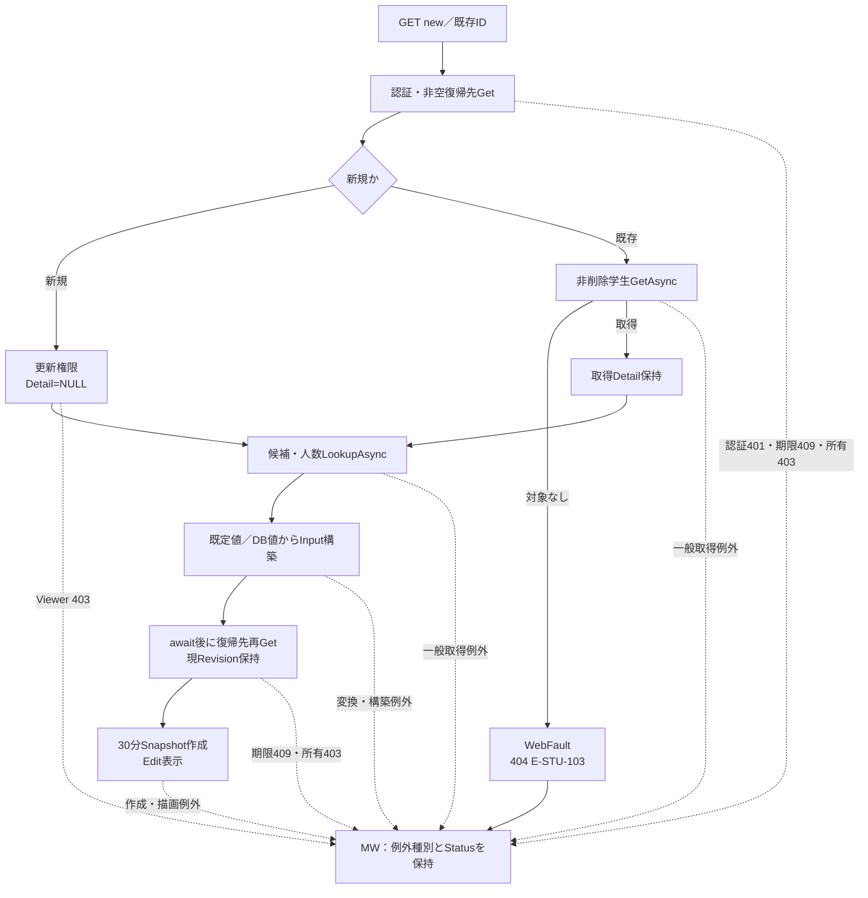

#### SQL・テーブル関連（ER図）

学生詳細取得はm_student単表のため、そのSQL単独のER図は省略する。候補取得では分類・コード・クラス・人数集計の学生を参照する。次図は読込用途の関連であり、FKの多重度を表さない。

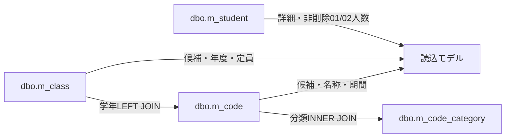

根拠：`sources/Core/SqlServerStudentService.cs:172-216`。

#### DB操作の詳細

詳細取得は`SELECT * FROM dbo.m_student WHERE student_id=@id AND is_deleted=0`で、`@id BigInt`を使用する。ORDER BY・ページングはなく、取得した一行の業務値、更新日時・更新者・数値版をStudentDetailへ変換する。行なしはNULLを返す。根拠：`sources/Core/SqlServerStudentService.cs:172-194`。

候補取得はSNAPSHOTトランザクションで二つの結果を読む。コードはm_codeとm_code_categoryをcategory_idでINNER JOINし、両方is_active=1の場合だけDTOのIsActiveを真にする。停止・期間外をWHEREで除外せず、category_id、display_order、code_value順に全候補を取得する。

クラスは全m_classを読み、学年コードをgrade_category＋grade_codeでLEFT JOINする。順序はschool_year降順、学年display_order、クラスdisplay_order、class_code、class_idである。Occupiedはclass_id一致、is_deleted=0、在籍区分01・02の学生COUNTで、保存列ではない。入力パラメータやページングはなく、二結果を全て読んでcommitする。根拠：`sources/Core/SqlServerStudentService.cs:196-216`。

性別・都道府県・在籍・続柄は分類別に取得順のまま出力し、双方有効・画面業務日期間内、または読込Detailと同じコードを選択可能にする。性別・都道府県だけ、選択不可候補へ「停止・期間外」を付ける。学年にはこのdisabled条件を付けない。年度は全クラス年度と現在Input年度を重複除去して降順にする。根拠：`sources/Views/Students/Edit.cshtml:8-13`。

クラスは年度・学年で絞り込まず全件を出力する。読込時クラスは保持でき、通常区分の別クラスは有効・現在業務日期間内を要求する。卒業・退学では入力入学日〜終了日とクラス期間の重なりを使い、IsActiveを条件に含めない。表示判定の日付解析はDateOnly.TryParseであり、保存時の厳密日付検査とは別である。根拠：`sources/Views/Students/Edit.cshtml:12-12`。

#### 結果・例外時の扱い

読込成功は通常200でEditを表示する。認証・権限・復帰状態・対象なしは固有StatusのWebFaultとなる。GETに局所catchはないため、外側middlewareに到達し応答未開始ならWebFaultのStatus・メッセージを保持し、一般例外だけ503のHTML応答となる。応答開始後は同middlewareのcatch対象外である。学生取得の成功だけで、候補、復帰先再Get、Snapshot作成、ビュー描画までの成功を保証しない。根拠：`sources/Web/Controllers/StudentsController.cs:23-25`、`sources/Infrastructure/WebHostSetup.cs:23-24`。

### 入力クリア・編集取消

#### 処理概要

POST resetで読込時Inputへ戻す。新規でも性別・在籍区分・年度を復元するため全項目の空欄化ではない。既存ではSnapshotのOriginalへ戻し、学生の最新DB値を再取得しない。根拠：`sources/Views/Students/Edit.cshtml:16-16`、`sources/Web/Controllers/StudentsController.cs:35-35`。

#### 処理手順

1. FormGuardでSnapshotId、StudentId、CSRF項目、書式メタ情報だけを許可する。
2. 認証を確認し、StudentIdをIdParser.Optionalで未設定または正のInt64へ変換する。
3. SnapshotをGetし、キー・期限・所有者・セッション・対象IDを照合する。
4. ModelStateをClearし、Snapshot.OriginalをJSON複製する。保存済みDetail、同じSnapshotId、ReturnRevisionを引き継ぐ。
5. 候補だけをLookupAsyncで再取得し、「入力を読込時の値へ戻しました。」を表示する。学生GetAsync、復帰検索状態の再Get、新Snapshot作成は行わない。

根拠：`sources/Web/Controllers/StudentsController.cs:35-41`、`sources/Infrastructure/EditorSnapshotStore.cs:7-11`。

#### 処理フロー

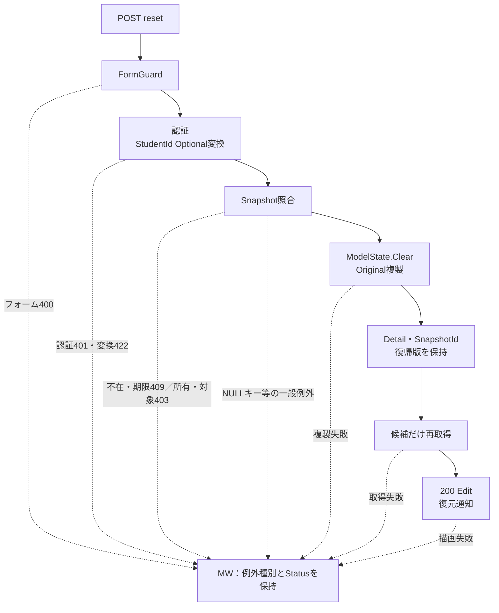

#### SQL・テーブル関連（ER図）

業務値の復元元はEditorSnapshotStore.Originalである。DB参照は候補取得だけであり、学生の保存行を再取得する処理ではない。

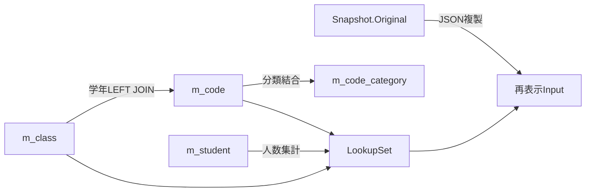

根拠：`sources/Web/Controllers/StudentsController.cs:35-35`、`sources/Core/SqlServerStudentService.cs:196-216`。

#### DB操作の詳細

候補のSQL・順序・人数条件・SNAPSHOT・commitは読込イベントと同じである。学生UPDATE、DELETE、履歴INSERTはない。変更された候補は再表示へ反映されるが、Originalの業務値とDetailはSnapshotの値を維持する。30分のSnapshot期限を延長する処理もない。根拠：`sources/Web/Controllers/StudentsController.cs:35-35`、`sources/Infrastructure/EditorSnapshotStore.cs:9-11`。

#### 結果・例外時の扱い

成功は200。フォーム400、認証401、ID変換422、Snapshot不在・期限409、所有・対象不一致403を区別する。NULLキーが後段へ届く場合は独自409より前の辞書例外経路である。resetに局所catchはなく、候補取得・複製・描画の失敗もMWへ進む。応答未開始ならWebFaultの固有Status、一般例外なら503となる。根拠：`sources/Web/Controllers/StudentsController.cs:35-41`、`sources/Infrastructure/EditorSnapshotStore.cs:10-10`、`sources/Infrastructure/WebHostSetup.cs:23-24`。

### 登録・更新・重複確認後の続行

#### 処理概要

登録、更新、「別人と確認して続行」は同じ保存フォームとSaveアクションを使う。続行時も入力、現行DB値、コード・クラス、学籍番号、同一人物候補を再検査する。確認キーだけを根拠に保存を許可しない。根拠：`sources/Views/Students/Edit.cshtml:5-15`、`sources/Core/SqlServerStudentService.cs:227-315`。

#### 処理手順

1. フレームワークの認証・CSRF等を通ってアクション本体へ到達した後、FormGuard、更新権限、Snapshot取得、非空復帰先の検索状態Get、読込時復帰先との文字列一致をこの順に確認する。これらは局所WebFault catchの外にある。
2. ModelState不正なら422を設定し、サービスを呼ばない。有効なら局所try内でcoordinator.Saveを呼ぶ。coordinatorは権限・復帰先を再確認し、ToRequestを実行する。ClassIdはOptional、更新比較版はRequiredで変換し、新規の非空比較版は400で拒否する。
3. SaveAsyncは受付番号GUID、利用者、開始時UTCのnow、UTC+9業務日を取得する。ViewerはForbiddenとなる。User取得は初期検証tryより前にある。
4. 学生項目、任意・複数行60スカラーの理由、対象ID・版の正数とNULL組合せ、年度1900〜9998、任意学年2桁を検査する。ID・版は双方NULLまたは双方設定を要求する。InputValidationExceptionは項目エラー、ArgumentExceptionはSave対象の変換エラーとしてValidationFailedを返す。
5. 接続を開き、SNAPSHOT許可状態を診断してReadCommittedトランザクションを開始する。OpenとBeginTransactionは後続DB処理tryの外にある。
6. DB処理tryで共通Gateを取得する。更新では非削除対象を再取得し、比較版、学籍番号不変、終了区分訂正の管理者権限・理由を順に確認する。対象なしはNotFound、版不一致はConflict、番号変更はValidationFailed、権限不足はForbidden、訂正理由不足はValidationFailedで返す。
7. CheckRulesで性別・都道府県・在籍・続柄の存在と必要な利用条件を再検査する。指定クラスの存在・指定年度学年一致を確認し、新規座席使用時の有効状態・期間・定員、終了区分の必要な期間重複を検査する。収集エラーはInputValidationExceptionにする。
8. 正規化済み全業務列を現行値と比較する。DateOnlyとDBのDateTimeは日付として比較する。変更列0なら明示rollbackし、NoChangeと対象ID・取得版を返す。理由だけの変更は学生書込み・履歴にならない。
9. 変更がある更新で取得版がlong.MaxValueならConflictとする。その後、削除済みも含めた学籍番号重複を検査し、使用済みならE-STU-101のValidationFailedとなる。
10. 非削除、更新対象以外、同一生年月日、氏名キーまたはカナキー一致の候補を全件取得し、正規化入力と全候補ID・版のハッシュを作る。
11. 非NULL確認キーがあれば、キー存在、主体・セッション、対象ID・比較版、Expires>開始時now、両ハッシュ、Busyの0→1取得を全て照合する。有効確認でも理由がNULLならE-STU-107のValidationFailedとなる。
12. 候補あり、または非NULL確認キー送信がある状態で確認無効なら、業務トランザクションを明示rollbackして確認を発行する。ConfirmationRequiredは、新規ではID・版NULL、更新では要求ID・今回取得版を返す。CandidateCountは全件、Candidatesは最大20件である。
13. 確認不要または有効確認なら、INSERTまたは比較版付きUPDATEを行う。実行直前にwriteStarted=trueとし、OUTPUTのIDを取得できなければDBConcurrencyExceptionを投げる。
14. 同じトランザクションで履歴をINSERTする。新規CREATE・更新UPDATE、前後版、変更列名JSON、主体、開始時UTC、受付番号、理由を記録する。duplicate_confirmedは今回候補件数>0で設定する。
15. commitAttempted=trueとしてcommitをawaitする。成功後completed=trueとし、送信確認キーをメモリから除去してSavedと保存ID・保存版を返す。
16. ControllerはFieldError.Fieldを加工せずModelStateへ追加する。Savedなら通知保存・303復帰。他結果はOutcome別HTTP状態を設定し、Input.DuplicateTokenを返却キーへ置換してそのModelStateだけを除去する。
17. Saved以外は候補を再取得し、入力値、Snapshotの読込時Detail、同じSnapshotId・復帰版でEditを再表示する。ModelState不正や局所WebFaultでresult=NULLの場合は確認キー置換をしない。

根拠：`sources/Web/Controllers/StudentsController.cs:28-33`、`sources/Infrastructure/WebStudentCoordinator.cs:18-18`、`sources/Web/Inputs/StudentSaveInput.cs:34-60`、`sources/Core/SqlServerStudentService.cs:227-315`、`sources/Core/SqlServerStudentService.cs:344-390`。

#### 処理フロー

大きい保存処理を次の番号付きサブフローへ分ける。各図の拒否結果は手順と後述の結果表に対応し、異なる結果・版を共通の固定値へ置き換えない。

| サブフロー | 入口・出口 | 引き継ぐ値・状態 |
| --- | --- | --- |
| 1 Web検査と再表示 | POSTのバインド後→サービス結果、再表示、303、MW | Input、Snapshot.Detail、SnapshotId、ReturnRevision、ModelState、結果別Status |
| 2 サービス初期検証・現行値 | SaveAsync入口→3、早期Result、例外 | 正規化student、reason、request、開始時now・day、requestId、user、previous・previousVersion |
| 3 業務再検査・確認 | 2の通過→4、NoChange、ConfirmationRequired、失敗 | 新規はprevious・previousVersion=NULL、更新は取得業務値・取得版。全候補・両ハッシュ・claimed |
| 4 書込み・確定 | 確認通過→Savedまたは5 | writeStarted、commitAttempted、completed、unknown、保存ID・版、claimed |
| 5 catch・finally | DB処理try内の例外→結果またはMW | 先行catchの分類、最後のcatchだけのUnknown判定、条件付きBusy解放 |

**1. Web検査と再表示**

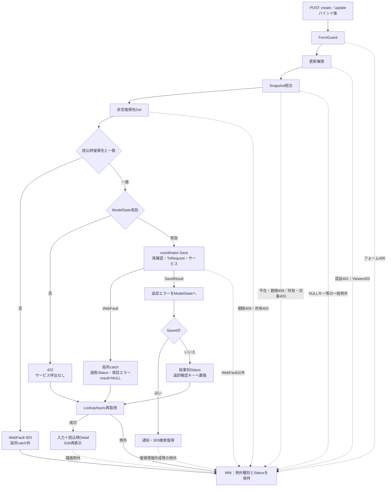

**2. サービス初期検証・現行値**

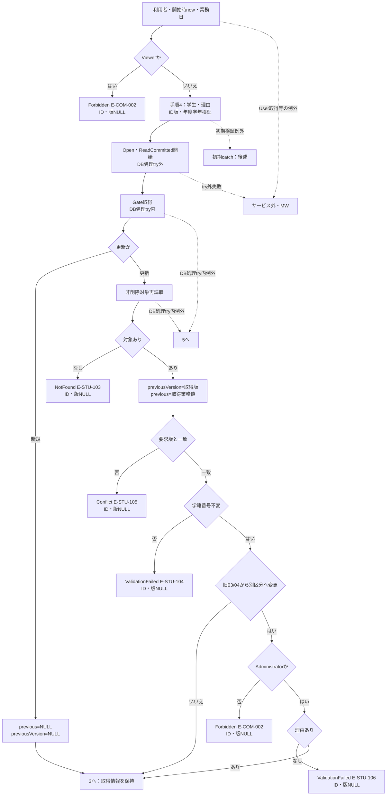

初期catchはInputValidationException、次にArgumentExceptionをValidationFailedへ変換し、ID・版NULLで返す。それ以外は伝播する。図の3への合流は、取得済み情報を保持する条件付き合流であり、更新枝のpreviousVersionをNULLへ置換しない。

**3. 業務再検査・確認**

CheckRulesの条件・拒否は直後の対応表を含めて読む。

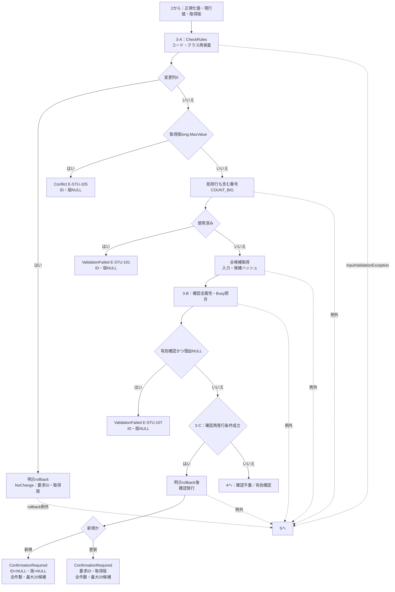

| 番号 | 条件・順序 | 拒否または引継ぎ |
| --- | --- | --- |
| 3-A1 コード | GENDER、PREFECTURE、ENROLLMENT_STATUS、RELATIONSHIPの順。NULL続柄は省略。各コードを分類JOIN付きで取得 | 不存在E-STU-009。新規・変更値は双方有効・開始時業務日期間内を要求し、不成立E-STU-011。同じ既存値は存在だけ確認 |
| 3-A2 クラス存在・整合 | クラス指定時にDBから年度・学年・期間・有効状態・定員を取得 | 不存在E-STU-010、指定年度または学年不一致E-STU-014 |
| 3-A3 新規座席 | 新区分01・02かつクラスありで、旧座席なしまたは旧クラスと異なる場合 | 無効または開始時業務日期間外E-STU-013。定員非NULLなら対象除外人数＋1を検査し、超過E-STU-102 |
| 3-A4 終了区分期間 | 新区分03・04で、新規、クラス・区分・入学日・終了日のいずれかが変更された場合 | 入学日がクラス終了日より後、または終了日がクラス開始日より前ならE-STU-108。境界同日は重なりあり |
| 3-A5 検査終端 | 収集エラーの有無 | エラーありはInputValidationException→5。なしは変更列比較へ |
| 3-B 確認照合 | 非NULLキー、辞書存在、Principal・SessionId、対象ID・要求版、Expires>開始時now、両ハッシュ一致、Busyの0→1取得 | 全成立でclaimedを保持しconfirmationValid=true。一つでも不成立なら無効確認 |
| 3-C 再発行条件 | 「候補件数>0または送信確認キーが非NULL」かつ「確認無効」 | 成立時はrollback後に発行。新規と更新で返却ID・版を分ける。非成立なら4へ |

**4. 書込み・確定**

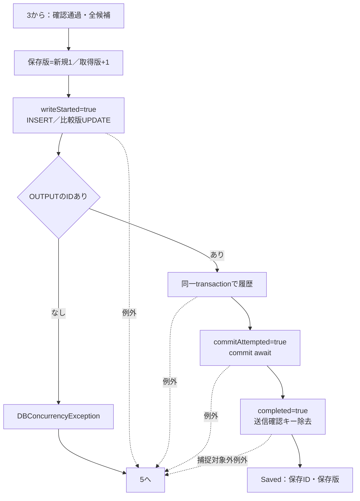

新規の前版はNULL、更新の前版は取得済み版を履歴へ渡す。commit後の成功Resultも、外側の破棄・Controller・通信までの成功を保証するものではない。

**5. catch・finally**

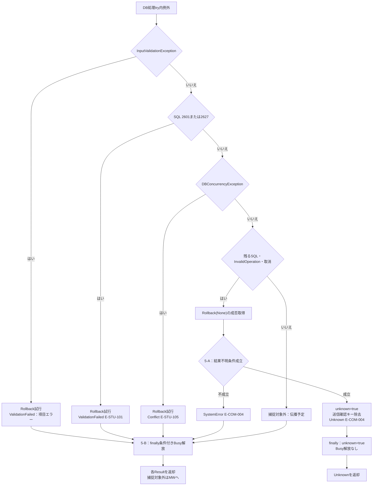

5-Aの完全な条件は、最後のcatchへ到達した場合の`writeStarted && (commitAttempted || !rolledBack)`である。先行三catchはrollbackのbool結果を使ってUnknownへ変更しない。5-Bはclaimedあり、completed=false、unknown=falseの場合だけBusyを0へ戻す。捕捉対象外例外もfinallyを通るが、Resultへ変換しない。Rollback helper自身の捕捉対象外例外が生じた場合も、意図したResult返却を保証しない。根拠：`sources/Core/SqlServerStudentService.cs:232-243`、`sources/Core/SqlServerStudentService.cs:316-329`。

#### SQL・テーブル関連（ER図）

保存は学生を書き、クラス・コード・分類を検査し、操作履歴を同一トランザクションで追記する。以下のFKはDDL宣言である。名称取得のLEFT JOINと区別し、操作履歴の対象キーをFKと扱わない。

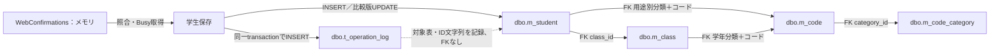

根拠：`sources/database/001_schema.sql:137-153`、`sources/database/001_schema.sql:189-199`、`sources/Core/SqlServerStudentService.cs:274-315`。

#### DB操作の詳細

接続文字列にはEncrypt Mandatory、TrustServerCertificate=falseを設定する。Openは接続後、`sys.databases WHERE database_id=DB_ID()`からsnapshot_isolation_stateを取得し、1でなければInvalidOperationExceptionを投げる。失敗時は接続をDisposeして再throwする。Command helperを使う業務SQLはCommandTimeout=30秒。診断コマンドはCreateCommandで生成し、明示Timeout設定はない。根拠：`sources/Core/SqlServerStudentService.cs:39-66`。

GateはSET XACT_ABORT ONの後、`sp_getapplock`でResource=`test-project1:student-write`、Exclusive、LockOwner=Transaction、LockTimeout=5000、DbPrincipal=publicを指定する。負の戻り値はSQLエラー51001となる。クラス・コード保守とseedも同じResourceを取得するため、このロックを使う実装同士の書込みを直列化する。根拠：`sources/Core/SqlServerStudentService.cs:92-101`、`sources/Core/MasterMaintenanceService.cs:42-42`、`sources/Core/MasterMaintenanceService.cs:90-90`、`sources/database/002_seed.sql:4-6`。

| SQL用途 | 全条件・結合・順序・結果形 | パラメータ型・サイズ | 操作上の意味 |
| --- | --- | --- | --- |
| 更新対象再取得 | m_student、`student_id=@id AND is_deleted=0`。全列一行、ORDER BY・ページングなし | `@id BigInt` | Gate後に現行業務値・版を取得し、対象、版、番号、終了区分訂正を順に判定 |
| 保存コード確認 | m_code c JOIN m_code_category k ON category_id一致。`c.category_id=@category AND c.code_value=@value`。双方is_active、valid_from、valid_toの一行 | `@category VarChar(24)`、`@value VarChar(10)` | NULL続柄省略。不存在E-STU-009。新規・変更値だけ双方有効・開始時業務日期間内を要求しE-STU-011 |
| クラス確認 | m_class、`class_id=@id`。school_year、grade_code、valid_from、valid_to、is_active、capacityの一行 | `@id BigInt` | 不存在E-STU-010、指定年度・学年不一致E-STU-014。必要な期間条件と存在を分ける |
| 新規座席の定員確認 | m_student、`class_id=@class AND is_deleted=0 AND enrollment_status_code IN ('01','02') AND (@id IS NULL OR student_id<>@id)`。COUNT_BIGの一値 | `@class BigInt`、`@id BigInt` | 新規座席使用時だけ対象除外人数＋1を比較。NULL定員は検査なし、超過E-STU-102 |
| 学籍番号重複 | m_student、`student_no=@no AND (@id IS NULL OR student_id<>@id)`。COUNT_BIGの一値。is_deleted条件なし | `@no VarChar(15)`、`@id BigInt` | 削除済みも使用済み。0件で続行、1件以上E-STU-101 |
| 同一人物候補 | RowSelectの名称LEFT JOINに` s.is_deleted=0 AND (@id IS NULL OR s.student_id<>@id) AND s.birth_date=@birth AND (s.name_key=@name OR s.kana_key=@kana)`。`ORDER BY s.student_id` | `@id BigInt`、`@birth Date`、`@name NVarChar(320)`、`@kana NVarChar(36)` | SQL上限・ページングなし。全行を取得し、全件数・全候補ハッシュ・最大20件表示を分ける |
| 学生INSERT | 正規化全列、固定分類、削除状態、作成更新情報、版を設定。OUTPUT INSERTED.student_idを表変数へ入れてSELECT | 項目一覧の業務列型・Size、`@now DateTimeOffset`、`@actor NVarChar(128)` | IDENTITY採番。GENDER・PREFECTURE・ENROLLMENT_STATUS、is_deleted=0、row_version=1を明示設定 |
| 学生UPDATE | student_no以外の正規化全列、updated_at・updated_by、row_version+1。`WHERE student_id=@id AND row_version=@version AND is_deleted=0`。OUTPUTのID | 業務列型・Size、`@id BigInt`、`@version BigInt`、`@now DateTimeOffset`、`@actor NVarChar(128)` | 変更列だけをSETする方式ではない。OUTPUTがNULL・DBNullならDBConcurrencyException |
| 操作履歴INSERT | t_operation_logの11非IDENTITY列へINSERT。target_table固定m_student、CREATEまたはUPDATE。読取条件なし | `@id VarChar(35)`、`@op VarChar(11)`、`@before/@after BigInt`、`@changed NVarChar(MAX)`、`@actor NVarChar(128)`、`@now DateTimeOffset`、`@request UniqueIdentifier`、`@reason NVarChar(120)`、`@confirmed Bit` | 学生書込みと同じtransaction。新規前版NULL。変更列名配列を保存し、個人情報の前後値は保存しない |

根拠：`sources/Core/SqlServerStudentService.cs:245-272`、`sources/Core/SqlServerStudentService.cs:294-307`、`sources/Core/SqlServerStudentService.cs:344-390`。業務列のSqlDbType・Sizeは`sources/Core/SqlServerStudentService.cs:30-37`、DB属性は`sources/database/001_schema.sql:7-59`に対応する。

RowSelectは学生を起点に、クラスをclass_id、学年名称をクラスgrade_category＋grade_code、在籍名称を学生enrollment_category＋enrollment_status_code、都道府県名称をprefecture_category＋prefecture_codeでLEFT JOINする。StudentRowはID・数値版、番号・氏名・カナ・生年月日、年度・学年名称・クラスコード・名称、在籍名称、住所、本人電話、入学日、更新日時を持つ。住所表示は都道府県名称と住所1の連結で、名称欠落は「[不整合]」、住所2は含めない。根拠：`sources/Core/SqlServerStudentService.cs:77-90`。

座席使用状態はクラスありかつ区分01・02である。同じクラスで旧・新とも座席使用なら、新規所属の有効状態・期間・定員検査を行わない。終了区分では必要な変更がある場合に在籍期間とクラス期間の重なりを検査する。クラス有効期間のDB列はdate NOT NULL、定員はint NULLであり、FKの存在保証とは別の業務検査である。根拠：`sources/Core/SqlServerStudentService.cs:357-383`、`sources/database/001_schema.sql:69-71`、`sources/database/001_schema.sql:191-191`。

入力ハッシュはColumnsの列順で正規化値をJSON化し、UTF-8のSHA-256を取る。name_key、kana_key、relationship_categoryは除外する。年度・学年・理由もこの入力ハッシュには含めず、対象ID・要求版は確認情報の別属性で照合する。候補ハッシュは表示20件ではなく全候補の学生ID・版の組を取得順にJSON化したSHA-256である。根拠：`sources/Core/SqlServerStudentService.cs:224-225`、`sources/Core/SqlServerStudentService.cs:269-286`。

接続された確認情報はstatic ConcurrentDictionaryに保持する。照合成功時、Interlocked.CompareExchangeでBusyを0から1にできた一要求だけがclaimedを保持する。照合、期限掃除、発行期限に使うnowはSaveAsync開始時の値であり、Gate待機・DB読取の後に取り直さない。発行はExpires<=nowの確認を除去し、ランダム32バイトを64桁の小文字16進参照キーにしてnow+10分の期限を設定する。空文字も非NULLなら無効確認の再発行条件に入り、候補0件でもConfirmationRequiredになり得る。根拠：`sources/Core/SqlServerStudentService.cs:19-29`、`sources/Core/SqlServerStudentService.cs:229-229`、`sources/Core/SqlServerStudentService.cs:276-290`、`sources/Core/SqlServerStudentService.cs:330-335`。

新規履歴の変更列名は全業務列、固定分類、is_deleted、作成更新管理列、版を含む。更新履歴は実際に値が変わった業務列とupdated_at・updated_by・row_versionを含む。開始時UTCと認証主体を学生管理列・履歴へ共通設定する。DDLのDEFAULTがあるis_deleted・row_versionも学生INSERTでは明示設定する。根拠：`sources/Core/SqlServerStudentService.cs:294-307`、`sources/database/001_schema.sql:34-59`。

CancellationTokenは接続、トランザクション開始、Gate、SQL実行・読取、明示rollback、commitへ渡す。NoChangeと確認発行前のrollbackには要求ct、失敗catchのRollback helperにはCancellationToken.Noneを渡す。早期拒否の一部は明示rollbackなしでawait usingの破棄へ進む。Rollback helperはSqlException・InvalidOperationExceptionをfalseへ変換する。根拠：`sources/Core/SqlServerStudentService.cs:53-63`、`sources/Core/SqlServerStudentService.cs:241-329`。

#### 結果・例外時の扱い

| 結果 | HTTP・画面処理 | ID・版・確認情報 |
| --- | --- | --- |
| Saved | Controllerは303、通知「保存しました。」、Locationで検索復帰 | 保存ID、版1または取得版+1。送信確認キー除去 |
| NoChange | 200、入力と読込Detailを再表示、通知「変更はありません。」 | 要求ID・取得版。書込み・履歴なし |
| ValidationFailed | 422、FieldErrorをModelStateへ追加 | 初期catch、DB入力catch、番号重複等はID・版NULL |
| Forbidden | サービス結果は403で再表示。Web初期拒否は局所catch外 | サービス失敗ResultはID・版NULL |
| NotFound | 404、入力と読込Detailを再表示 | ID・版NULL。保存失敗では学生の最新Getを行わない |
| Conflict | 409で再表示、最新再読込でDB値を取得できる | ID・版NULL |
| ConfirmationRequired | 409、返却キーをhiddenへ設定し候補sectionを表示 | 新規ID・版NULL、更新は要求ID・今回取得版。全件数・最大20候補 |
| SystemError | 503、サービス失敗メッセージを再表示 | ID・版NULL。最後のcatchの結果不明条件が不成立 |
| Unknown | 503、再保存前に検索で結果確認するメッセージ | ID・版NULL、送信キー除去。保存確定を示す結果ではない |

根拠：`sources/Infrastructure/WebPresentation.cs:23-23`、`sources/Web/Controllers/StudentsController.cs:30-33`、`sources/Core/SqlServerStudentService.cs:226-323`。

DB処理catchは入力検証、SQL2601/2627、DBConcurrencyException、残るSQL・InvalidOperation・取消の順である。SQL2601/2627は原因を細分せずE-STU-101にする。最後のcatchに到達した場合だけ、書込み開始かつ「commit試行済みまたはrollback不成功」をUnknownとする。書込み前、または書込み開始後でもcommit未試行かつrollback成功ならSystemErrorである。根拠：`sources/Core/SqlServerStudentService.cs:316-329`。

claimed取得後の理由不足、先行catch、通常失敗は、completed=false・unknown=falseならfinallyでBusyを0へ戻す。成功・Unknownはキーを除去し、UnknownはBusy解放を抑止する。捕捉対象外例外もfinallyを通るがSaveResultには変換しない。根拠：`sources/Core/SqlServerStudentService.cs:278-286`、`sources/Core/SqlServerStudentService.cs:313-323`。

認証主体取得、Open・BeginTransaction、NULL参照など捕捉対象外例外、外側await using破棄は、上表のサービス結果になるとは限らない。Controllerの局所catchはcoordinator.SaveからのWebFaultだけである。再表示用Lookupやビュー描画が失敗すれば、設定した結果StatusでのEdit返却へ到達しない。応答未開始ならMWでWebFault固有Statusまたは一般503、応答開始後は当middlewareのcatch対象外となる。根拠：`sources/Web/Controllers/StudentsController.cs:29-33`、`sources/Infrastructure/WebHostSetup.cs:23-24`。

入力拒否後もInputとModelStateを再表示へ残す。Editの先頭はInput、Lookups、Classesを参照し、クラス候補の表示判定で入学日・終了日をDateOnly.TryParseする。解析失敗はoverlap=falseとなるが、未補完のBirthDateInput成分を扱うTagHelperや、候補行のBirthDateWarekiを評価する描画まで成功した保証にはならない。BirthDateWarekiはJapaneseDateService.ToWarekiを呼ぶため、表示対象日付が対応範囲外なら変換例外となる。描画時の一般例外も応答開始状態に応じてMWの捕捉範囲が変わる。根拠：`sources/Views/Students/Edit.cshtml:2-14`、`sources/Core/Contracts.cs:50-55`、`sources/Core/JapaneseDateService.cs:41-50`、`sources/Infrastructure/WebHostSetup.cs:23-24`。

### 重複確認取消

#### 処理概要

確認取消はブラウザー内で確認キーと候補表示を解除し、業務入力を保持する。サーバー確認情報の削除要求は送らない。根拠：`sources/Views/Students/Edit.cshtml:14-14`、`sources/wwwroot/js/site.js:6-6`。

#### 処理手順

1. data-cancel-duplicateのclickを受ける。
2. 編集フォーム内にInput.DuplicateTokenがあればvalueを空文字にする。
3. aria-labelledby=duplicate-titleのsectionがあればDOMから除去する。
4. 次の保存では通常の検査を再実行する。空文字が非NULLとしてサービスへ届く場合は確認再発行の対象になるが、生フォームからの実バインド値とは分けて扱う。

根拠：`sources/wwwroot/js/site.js:6-6`、`sources/Core/SqlServerStudentService.cs:276-290`。

#### 処理フロー

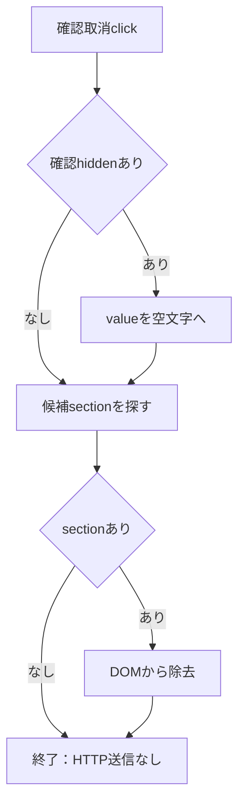

#### SQL・テーブル関連（ER図）

DB非使用。保持領域はブラウザーDOMのhidden・sectionであり、EditorSnapshotStore、WebConfirmations、DB表を更新しない。表間関係がないためER図は省略する。根拠：`sources/wwwroot/js/site.js:6-6`。

#### DB操作の詳細

SQLはない。サーバー確認情報はその場で削除・消費されず、後の保存成功・Unknown時の除去や発行時期限掃除とは別の操作である。根拠：`sources/wwwroot/js/site.js:6-6`、`sources/Core/SqlServerStudentService.cs:313-335`。

#### 結果・例外時の扱い

HTTP状態・SaveResultは返さない。キーまたはsectionがなければ該当操作を省く。業務値は保存されず、保存済み通知も作らない。根拠：`sources/wwwroot/js/site.js:6-6`。

### 所属クラス・年度・学年の連動

#### 処理概要

クラスを選ぶとoptionの年度・学年を上位項目へ反映する。年度・学年変更で選択クラスと合わなくなるとクラスを解除する。候補のDB再取得や人数参考表示の更新は行わない。根拠：`sources/Views/Students/Edit.cshtml:12-12`、`sources/wwwroot/js/site.js:8-8`。

#### 処理手順

1. REG-018のchangeで選択optionを取得し、data-yearがあればREG-016へ年度、REG-017へdata-gradeを代入する。
2. REG-016・017のchangeでは、クラス選択値がある場合だけoptionを読む。
3. 非空年度がdata-yearと異なる、または非空学年がdata-gradeと異なる場合、クラス値を空にし「年度・学年に合わないクラスを解除しました。」とalertする。
4. 上位値が空ならその項目だけを理由に解除しない。空クラス選択時も年度・学年を空へ戻す代入は行わない。

根拠：`sources/wwwroot/js/site.js:8-8`。

#### 処理フロー

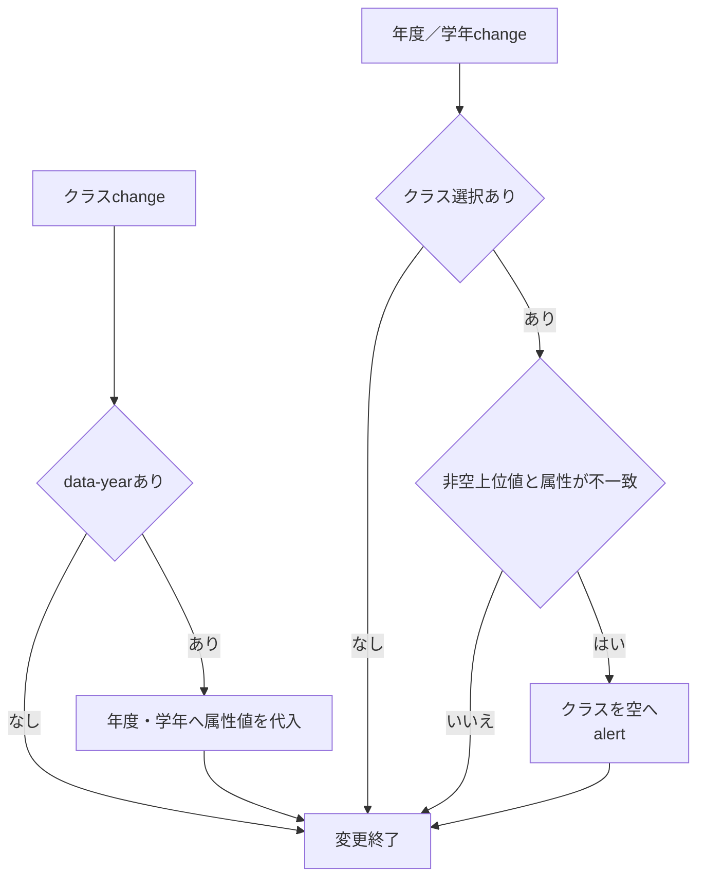

#### SQL・テーブル関連（ER図）

DB非使用。REG-016・017・018のDOM値と、読込候補に付いたdata属性を扱う。表間読取は候補取得で完了しているため、このchangeのER図は省略する。根拠：`sources/Views/Students/Edit.cshtml:12-12`、`sources/wwwroot/js/site.js:8-8`。

#### DB操作の詳細

SQL、HTTP候補取得、人数・定員再計算はない。後の保存ではclass_idと補助年度・学年を送信し、DBから再取得したクラスとの整合を検査する。このJSは候補option全件を上位条件で絞り込む処理でもない。根拠：`sources/wwwroot/js/site.js:8-8`、`sources/Web/Inputs/StudentSaveInput.cs:40-42`、`sources/Core/SqlServerStudentService.cs:363-380`。

#### 結果・例外時の扱い

解除時は画面alertだけで、HTTP結果・項目エラーは返さない。表示上保持できる値も保存時の条件で拒否され得る。連動処理のプログラム代入がdirty管理のinputイベントを発火したものとは扱わない。原コードはyear・gradeの存在を各代入直前に検査せず、画面に対応コントロールがある構成で使う。根拠：`sources/wwwroot/js/site.js:3-8`、`sources/Views/Students/Edit.cshtml:12-12`、`sources/Core/SqlServerStudentService.cs:344-383`。

### 未保存変更の通知と画面離脱

#### 処理概要

編集フォームの入力変更をdirtyとして保持し、未保存での離脱を確認する。フォーム送信では指定確認文を表示し、続行時に同フォームの他ボタンを無効化する。これらはブラウザー状態制御であり、保存成功の判定ではない。根拠：`sources/wwwroot/js/site.js:2-5`。

#### 処理手順

1. 編集フォームのinputでdirty=trueとし、確認キーがあれば空にする。
2. beforeunloadでdirty=trueかつleaving=falseならpreventDefaultとreturnValueを設定する。
3. data-dirty-linkのclickはdirtyの場合だけ、リンクdata-confirmまたは既定の未保存破棄文で確認する。取消は遷移停止、続行またはdirtyなしはleaving=trueとなる。
4. 各フォームsubmitは送信ボタンdata-confirmを優先し、なければフォームdata-confirmを使う。確認取消なら送信を止める。
5. 続行時はleaving=true、同フォーム内の送信ボタン以外のbuttonをdisabled、フォームをaria-busy=trueにする。他の独立フォームを一括無効化しない。

根拠：`sources/wwwroot/js/site.js:2-5`、`sources/Views/Students/Edit.cshtml:14-17`。

#### 処理フロー

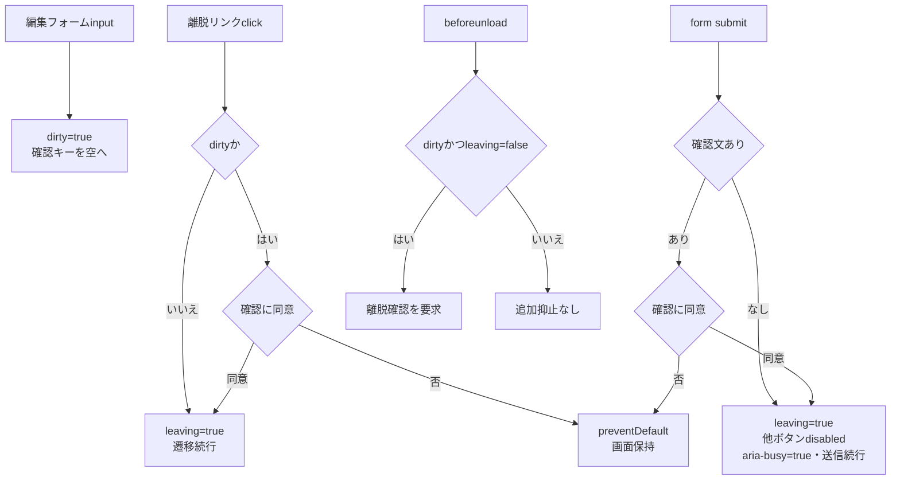

#### SQL・テーブル関連（ER図）

DB非使用。dirty・leavingはJSクロージャ内変数、確認キー・disabled・aria-busyはDOM状態である。サーバーセッション・DBへ記録しないためER図は省略する。根拠：`sources/wwwroot/js/site.js:2-5`。

#### DB操作の詳細

このイベントにSQLはない。submit続行後に各HTTP入口へ進むが、送信開始とDB更新確定は別である。ブラウザー確認はCSRF、権限、Snapshot、ModelState、比較版等の検査を代替しない。根拠：`sources/wwwroot/js/site.js:4-5`、`sources/Web/Controllers/StudentsController.cs:28-37`。

#### 結果・例外時の扱い

確認取消は送信・遷移を止めるだけでHTTP応答を作らない。dirtyはinputイベントに基づき、すべてのプログラム代入を変更検知した保証はない。保存結果はサーバー応答側で判定する。根拠：`sources/wwwroot/js/site.js:3-8`。

### 論理削除

#### 処理概要

Administratorが対象と理由を確認し、比較版付きで論理削除する。学生行を物理DELETEせず、削除管理列・更新管理列・版を更新して履歴を追記する。独立フォームに編集中業務値は含まれない。根拠：`sources/Views/Students/Edit.cshtml:17-17`、`sources/Core/SqlServerStudentService.cs:392-416`。

#### 処理手順

1. FormGuardで削除DTOのExpectedVersion、Reason、Confirmed、ReturnContextIdとSnapshotId・CSRF等を検査する。続いて認証、対象ID付きSnapshot、読込時復帰先との文字列一致を確認する。
2. coordinator.DeleteがAdministrator、非空復帰先、Confirmedをこの順に確認する。Confirmed=falseはREG-026の422 WebFault。その後ExpectedVersionをRequiredで正のInt64へ変換する。
3. DeleteAsyncは受付番号、利用者、開始時nowを取得し、Administrator以外をForbiddenで返す。
4. 理由を必須・複数行・原入力60→保存60スカラーで正規化する。初期catchはInputValidationExceptionだけをValidationFailedへ変換する。続いてID・版の非正数、版long.MaxValueをValidationFailedで拒否する。
5. OpenとReadCommitted開始を行う。両者はDB処理tryの外にある。
6. try内でGateを取得し、対象ID・非削除条件で版を再読取する。対象なしはNotFound、要求版不一致はConflictとなる。
7. 対象ID・要求版・非削除条件のUPDATEで7管理列を変更する。実行直前writeStarted=true、件数1以外はDBConcurrencyExceptionとなる。
8. 同じtransactionでDELETE履歴を追記し、前後版、7管理列の変更名、主体・now・受付番号・理由、duplicate_confirmed=falseを記録する。
9. commitAttempted=trueとしてcommitをawaitし、Savedと対象ID・版+1を返す。
10. ControllerはSavedなら通知・303復帰。他結果はエラーをModelStateへ追加し、Outcome別Statusを設定した後Loadを呼び直す。最新学生・候補・復帰状態を確認し、新Snapshotを作る。

根拠：`sources/Web/Controllers/StudentsController.cs:37-38`、`sources/Infrastructure/WebStudentCoordinator.cs:19-19`、`sources/Core/SqlServerStudentService.cs:392-416`。

#### 処理フロー

削除を三つのサブフローに分ける。MWへ出る枝は例外種別と固有Statusを保持し、一般例外503へ一律合流させない。

**1. Web検査とサービス初期検証**

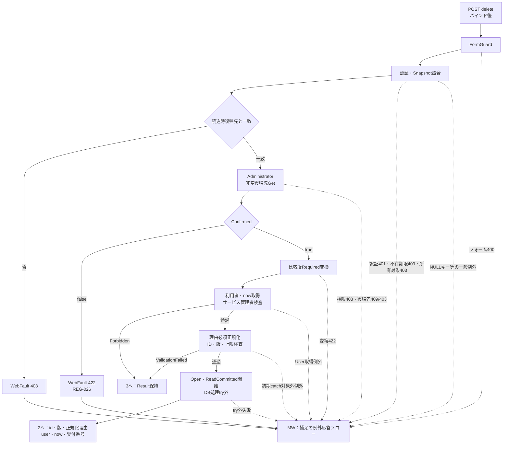

**2. DB更新とcatch**

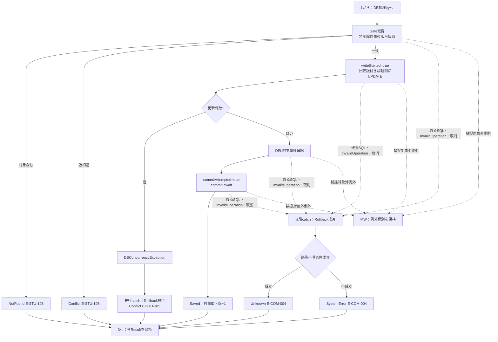

後段catchの結果不明条件は`writeStarted && (commitAttempted || !rolledBack)`である。DBConcurrencyExceptionの先行catchはrollback成否でUnknownへ変更しない。削除にはSQL2601/2627専用catchがない。Rollback helperの捕捉対象外例外、try外の破棄例外もMWへの経路を持つ。根拠：`sources/Core/SqlServerStudentService.cs:329-329`、`sources/Core/SqlServerStudentService.cs:399-416`。

**3. 結果反映・再読込・最終応答**

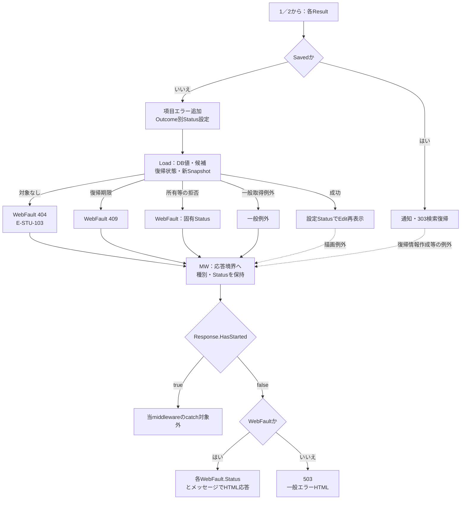

この図のWFは固定Statusではなく、404・409・403等の流入枝の値を保持する。Load前に設定した削除結果Statusも、Loadまたは描画の例外が生じた場合は最終Statusを固定しない。根拠：`sources/Web/Controllers/StudentsController.cs:25-25`、`sources/Web/Controllers/StudentsController.cs:37-38`、`sources/Infrastructure/WebHostSetup.cs:23-24`。

#### SQL・テーブル関連（ER図）

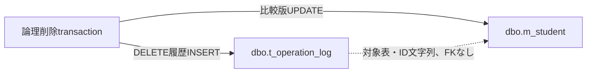

業務書込みは学生・履歴の二表である。失敗後Loadの候補取得では読込イベントのクラス・コード・分類も参照する。根拠：`sources/Core/SqlServerStudentService.cs:403-414`、`sources/Web/Controllers/StudentsController.cs:37-37`。

#### DB操作の詳細

対象版の再読取は`SELECT row_version FROM dbo.m_student WHERE student_id=@id AND is_deleted=0`、`@id BigInt`で一値を得る。行なしはNotFound、版不一致はConflict。この早期返却には明示rollbackがない。根拠：`sources/Core/SqlServerStudentService.cs:403-408`。

UPDATEのWHEREは`student_id=@id AND row_version=@version AND is_deleted=0`。SETはis_deleted=1、deleted_at=@now、deleted_by=@actor、delete_reason=@reason、updated_at=@now、updated_by=@actor、row_version=row_version+1の7列で、氏名等の業務列は変更しない。型・サイズは`@id/@version BigInt`、`@now DateTimeOffset`、`@actor NVarChar(128)`、`@reason NVarChar(120)`。delete_reason列はNULL可能だが、削除状態CHECKは削除日時・利用者・理由の非NULLを要求する。根拠：`sources/Core/SqlServerStudentService.cs:409-411`、`sources/database/001_schema.sql:34-42`、`sources/database/001_schema.sql:200-200`。

履歴は保存と同じAuditを使い、target_table=m_student、対象IDの十進target_key、DELETE、before_version=要求版、after_version=要求版+1、変更列名は7管理列、operation_reason=正規化理由、duplicate_confirmed=falseをINSERTする。パラメータ型・サイズは保存イベントの履歴SQLと同じである。SQL読取・更新・履歴・commitへct、失敗Rollback helperへNoneを渡す。根拠：`sources/Core/SqlServerStudentService.cs:385-390`、`sources/Core/SqlServerStudentService.cs:413-416`。

#### 結果・例外時の扱い

削除アクションにはModelState.IsValidによる一括拒否も局所WebFault catchもない。bool・文字列のバインド状態と、Confirmed・比較版・理由の独自検査は分ける。Snapshot・権限・比較版変換のWebFaultはMWへ進む。理由正規化の初期catchはInputValidationExceptionだけであり、不正UnicodeのArgumentException等はValidationFailedへ変換しない。根拠：`sources/Web/Controllers/StudentsController.cs:37-37`、`sources/Infrastructure/WebStudentCoordinator.cs:19-19`、`sources/Core/SqlServerStudentService.cs:396-398`。

先行DBConcurrencyException catchはConflict E-STU-105を返す。後段の残るSQL・InvalidOperation・取消に限り、結果不明条件からUnknownまたはSystemErrorを返す。Unknownの文言は「削除結果を確認できません。検索で確認してください。」であり、削除確定を意味しない。根拠：`sources/Core/SqlServerStudentService.cs:415-416`。

Saved以外のHTTP対応は保存結果表と同じだが、その後にLoadする点が異なる。Load成功なら結果別Statusで最新DBモデルを表示する。対象消失なら404、復帰期限なら409、所有等は固有WebFault、一般取得・描画失敗なら応答未開始時に503となり得る。再読込で新モデルを作る一方、この経路はModelStateをClearせず、送信時試行値とモデル値のTagHelper上の優先関係を実行保証しない。根拠：`sources/Web/Controllers/StudentsController.cs:25-25`、`sources/Web/Controllers/StudentsController.cs:37-37`、`sources/Infrastructure/WebHostSetup.cs:23-24`。

### 検索画面への復帰

#### 処理概要

保存・削除成功の303と「検索へ戻る」リンクは、検索状態の参照キー・版を使って一覧へ戻る。学生保存の確定と検索状態再開は別処理であり、復帰拒否が保存済みtransactionを取り消すことはない。根拠：`sources/Web/Controllers/StudentsController.cs:8-11`、`sources/Web/Controllers/StudentsController.cs:38-38`、`sources/Views/Students/Edit.cshtml:16-16`。

#### 処理手順

1. SavedではReturnAfterSaveを呼ぶ。復帰先がNULL・空文字なら新検索状態を作り、そのID・版を使う。指定済みならSnapshot.ReturnRevisionを使う。
2. 主体・セッション・検索IDの複合キーで「保存しました。」または「論理削除しました。」を10分Flashへ保存し、303とURLエスケープしたcontextId・contextRevisionのLocationを返す。
3. GET Indexは認証を確認し、contextIdがなければ新状態、指定があればGetしてResumeへ渡す。
4. ResumeはSearchContextStore.Useを使う。初回Get後にSemaphoreSlimをawaitし、待機後に再Getして期限・所有・指定Tabを再検査する。要求版の文字列一致と版long.MaxValueでないことを確認する。この呼出しのTabはNULLである。
5. 適用条件なしなら再検索せずunsearchedを返す。条件ありなら同じSearchCriteriaでSearchAsyncを呼び、受け入れ可能な結果ならLastResultを更新しRevisionを1加算する。Useのoperation成功後に検索状態期限を現在UTC+30分へ延長する。
6. FlashをTakeで一度だけ取得し、人数なしLookupとSearchモデルを構築する。0件はempty、上限超過はtooMany、それ以外はfoundとして表示する。

根拠：`sources/Web/Controllers/StudentsController.cs:8-11`、`sources/Web/Controllers/StudentsController.cs:38-39`、`sources/Infrastructure/WebStudentCoordinator.cs:14-21`、`sources/Infrastructure/SearchContextStore.cs:9-14`、`sources/Infrastructure/FlashMessageStore.cs:7-9`。

#### 処理フロー

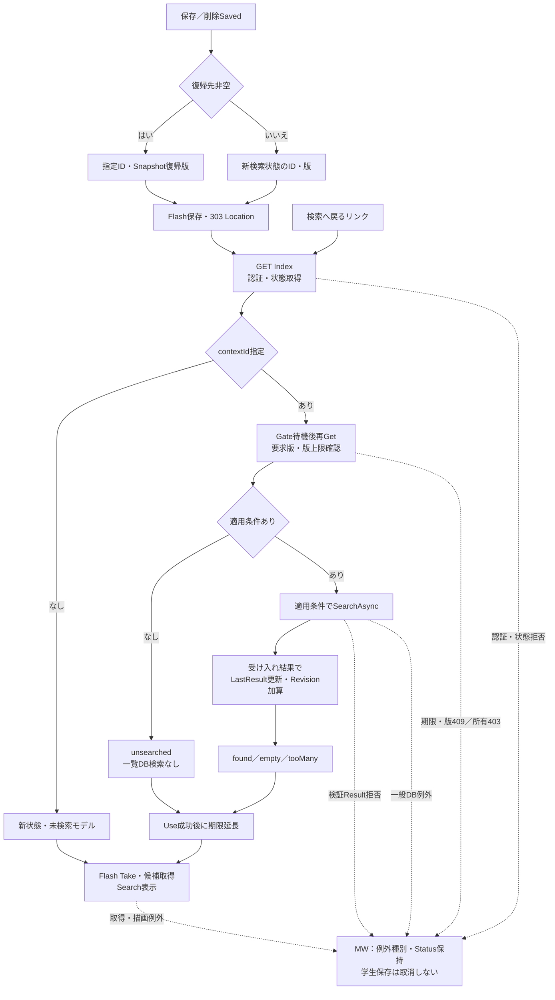

#### SQL・テーブル関連（ER図）

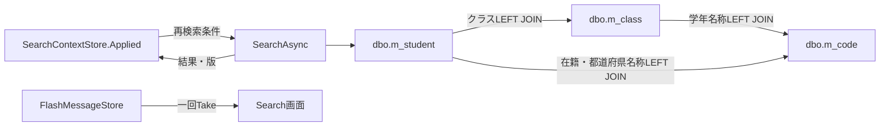

人数なしLookupはさらにm_code_categoryを参照する。学生保存transactionから復帰検索transactionへ接続を引き継がない。根拠：`sources/Core/SqlServerStudentService.cs:82-90`、`sources/Core/SqlServerStudentService.cs:123-168`、`sources/Web/Controllers/StudentsController.cs:39-39`。

#### DB操作の詳細

復帰再検索はSNAPSHOTを使用し、適用済み条件を再正規化・検査する。ページ1以上、size20・50・100、sortDirectionはasc・desc、sortKeyはstudentNo・name・admissionDate・updatedAtに限定する。年度1900〜9998、クラス正数、未所属と年度・学年・クラスの同時指定禁止、在籍区分は01〜04・最大4件・重複なしを要求する。学籍番号・氏名・カナ・電話・コード・日付は各正規化契約を使い、入学日範囲の逆転を拒否する。根拠：`sources/Core/SqlServerStudentService.cs:103-122`。

SQL前のコード存在確認は、GRADE・PREFECTUREについてm_codeのcategory_id＋code_valueのCOUNT_BIG=1を使う。停止・期間は存在確認に含めない。年度指定はm_class.school_year一致件数>0、クラス指定はclass_id取得と指定年度・学年一致を要求する。パラメータは`@category VarChar(24)`、`@value VarChar(10)`、`@year SmallInt`、`@id BigInt`。根拠：`sources/Core/SqlServerStudentService.cs:125-135`、`sources/Core/SqlServerStudentService.cs:218-222`。

| 追加検索条件 | SQL述語 | パラメータ・加工 |
| --- | --- | --- |
| 常時 | `s.is_deleted=0` | なし |
| 学籍番号 | `s.student_no LIKE @no ESCAPE '!'` | 正規化値の末尾に%を付ける。`@no VarChar(31)` |
| 氏名 | `s.name_key LIKE @name ESCAPE '!'` | 照合キーの前後に%。`@name NVarChar(642)` |
| カナ | `s.kana_key LIKE @kana ESCAPE '!'` | 正規化カナから空白除去、前後に%。`@kana NVarChar(74)` |
| 年度・学年 | `c.school_year=@year`、`c.grade_code=@grade` | `@year SmallInt`、`@grade VarChar(2)` |
| クラス・未所属 | `s.class_id=@class`、未所属時` s.class_id IS NULL` | `@class BigInt`。未所属はパラメータなし |
| 都道府県 | `s.prefecture_code=@prefecture` | `@prefecture VarChar(2)` |
| 電話 | `(s.phone_number=@phone OR s.emergency_phone_number=@phone)` | 正規化した同じ値、`@phone VarChar(16)` |
| 入学日範囲 | `s.admission_date>=@from`、`s.admission_date<=@to` | 両端を含む。`@from/@to Date` |
| 在籍区分 | `s.enrollment_status_code IN (@status0,...)` | 指定件数に応じ各`@statusN VarChar(2)`。0件ならIN条件なし |

指定された条件だけをAND追加する。LIKEの`!`、`%`、`_`、`[`はEscapeLikeでエスケープする。根拠：`sources/Core/SqlServerStudentService.cs:137-155`、`sources/Core/StudentNormalizer.cs:161-161`。

件数SQLはm_studentとm_classのLEFT JOINに同じWHEREを付け、TOP(10001)の学生IDをCOUNT_BIGする。10000超なら一覧SQLを行わず、commitしてNoChange、LimitExceeded=true、空Itemsを返す。このCountは最大10001で、全実件数ではない。通常は最終ページを算出し要求ページを丸め、RowSelectに同じWHEREを付けて許可列・asc/desc、同値時student_id ASCで並べる。`@offset Int`、`@size Int`のOFFSET/FETCHで20・50・100件を取得し、StudentRowへ変換してcommitする。根拠：`sources/Core/SqlServerStudentService.cs:156-168`。

復帰画面のLookup(false)はOccupiedを`CONVERT(int,0)`へ置き換える。この0は所属人数の実測値ではない。コード・クラスの取得順は登録読込と同じである。根拠：`sources/Core/SqlServerStudentService.cs:196-216`、`sources/Web/Controllers/StudentsController.cs:39-39`。

#### 結果・例外時の扱い

編集読込後に検索状態版が変更されていれば409となる。学生保存をrollbackする処理はない。未検索は「未検索」、0件は「該当する学生はありません。」、上限超過は条件追加を求める。検索の入力検証ResultはEnsureSearchがWebFaultへ変換し、一般DB例外や候補取得例外はMWへ進む。根拠：`sources/Infrastructure/WebStudentCoordinator.cs:14-21`、`sources/Infrastructure/SearchContextStore.cs:14-14`、`sources/Views/Students/Search.cshtml:7-7`。

Flash.Takeは期限判定とTryRemoveを組み合わせるため一度限りである。通知取得後に候補取得・描画が失敗しても同じ通知を再取得しない。検索状態の再GetはGate待機後に行い、operation中の各DB await後に反復する構造ではない。根拠：`sources/Web/Controllers/StudentsController.cs:11-11`、`sources/Infrastructure/FlashMessageStore.cs:9-9`、`sources/Infrastructure/SearchContextStore.cs:14-14`。

SearchビューはJSON化されたDataのプロパティ取得・型変換とページ数算術を行う。Resumeの通常経路はサービスで受け入れた適用条件を使うが、ビュー到達だけで描画成功を保証しない。Data参照・型変換・算術等の二次例外が生じた場合も、応答未開始ならMWの固有Status／一般503、開始後はcatch対象外という境界を持つ。根拠：`sources/Web/Models/StudentSearchPageModel.cs:10-15`、`sources/Views/Students/Search.cshtml:2-8`、`sources/Infrastructure/WebHostSetup.cs:23-24`。

## 補足説明

### 正規化と受信境界

共通TextはNULLを空文字へ補完し、原入力スカラー上限、改行処理、制御文字検査、Trim、空値の必須判定、保存値スカラー上限の順で処理する。任意空値はNULL、必須空値はE-STU-001である。単行Textは改行・タブを含む制御文字を拒否し、複数行TextはCRLF・CRをLFへ統一してLFだけを許す。CRLFは統一前に2スカラーとして数える。Text自体はNFKCしない。根拠：`sources/Core/StudentNormalizer.cs:47-57`。

ScalarCountは正しいUTF-16サロゲート対を1スカラーと数え、不正な単独サロゲートをArgumentExceptionにする。氏名表示値、住所、緊急氏名、備考、理由はTextを使い、学籍番号・カナ・郵便・電話・コード・日付は項目別変換を追加する。HTML maxlength、原入力スカラー、正規化後スカラー、識別番号のString.Length、DB容量を同じ上限へまとめない。根拠：`sources/Core/StudentNormalizer.cs:37-117`、`sources/Web/Inputs/StudentSaveInput.cs:60-60`。

カナはNFKC後、U+3041〜U+3096とU+309D・U+309Eを対応カタカナへ変換する。保存許可範囲はU+30A1〜U+30FA、長音U+30FC、中点U+30FB、繰返しU+30FD・U+30FEである。内部Unicode空白は半角1個へまとめ、保存値18スカラーに空白も含める。氏名照合キーは表示値をNFKC・大文字化・Unicode空白除去して作り、保存氏名自体の文字幅や内部空白とは分ける。根拠：`sources/Core/StudentNormalizer.cs:66-85`。

郵便・電話で除去するハイフンはASCIIハイフン、U+2010、U+2011、U+2212で、電話だけ丸括弧も除去する。国際電話はプラス、1〜9の先頭数字、続く6〜14桁からなる。メールは@一つ、ASCII許可ローカル部、先頭末尾ドット・連続ドット禁止、二つ以上のドメインラベル、各ラベル1〜63文字の英数字と内部ハイフンを検査する。ローカル部の個別上限64があっても、全体の原入力・保存上限60が先に適用される。根拠：`sources/Core/StudentNormalizer.cs:87-111`。

和暦期間は令和2019-05-01以降、平成1989-01-08〜2019-04-30、昭和1926-12-25〜1989-01-07、大正1912-07-30〜1926-12-24、明治1900-01-01〜1912-07-29で、OS元号一覧へ委ねない。元号ID完全一致、NFKC後の正の年・月・日、年「元」を1として実在日・元号境界・業務日以下・逆変換を確認する。表示年1は「元」、月日2桁。西暦はNFKC後の厳密yyyy-MM-dd、1900-01-01以上・学生日付は業務日以下を要求する。未来日を拒否する一方、業務日当日は許容する。根拠：`sources/Core/JapaneseDateService.cs:9-59`。

サービス業務日は開始時nowをUTC+9へ変換して求める。画面業務日はWebPresentationの現在UTCから求めるため、取得時点が異なる。業務年度は4月開始で、1〜3月は前年を年度にする。根拠：`sources/Core/SqlServerStudentService.cs:44-45`、`sources/Infrastructure/WebPresentation.cs:5-7`、`sources/Web/Inputs/StudentSaveInput.cs:53-53`。

単体項目の変換エラーがなければ照合キーと続柄分類を生成し、項目間検査へ進む。生年月日≦入学日、01・02は終了日なし・クラス必須、03・04は入学日以上の終了日必須、連絡先一つ以上、緊急3項目は0個または3個を要求する。これらはInputValidationExceptionへ収集し、DBにも日付・所属・連絡先CHECKを宣言する。根拠：`sources/Core/StudentNormalizer.cs:143-158`、`sources/database/001_schema.sql:198-199`。

MVCは非nullable参照型の暗黙Requiredを抑止している。C#のstring注釈・初期値・ブラウザーrequiredだけでNULL受信を排除した保証を置かない。ToRequestはBirthDateInput全体がNULLの場合だけnewで補完し、内部Year・Month・Dayは補完しない。有効元号でNULL成分のNormalizeへ進む場合、AdmissionDateのNULLをNormalizeする場合はNullReferenceExceptionとなり得る。EraのNULLは元号不一致のArgumentExceptionへ進む。Normalizerの項目収集とSaveAsync初期catchはInputValidationException・ArgumentExceptionだけを扱い、NullReferenceExceptionは収集しない。根拠：`sources/Infrastructure/WebHostSetup.cs:16-16`、`sources/Web/Inputs/StudentSaveInput.cs:34-42`、`sources/Core/JapaneseDateService.cs:19-24`、`sources/Core/JapaneseDateService.cs:52-54`、`sources/Core/StudentNormalizer.cs:123-137`、`sources/Core/SqlServerStudentService.cs:232-239`。

IdParser.OptionalはNULL・空文字を未設定にする。それ以外は19コード単位以内、ASCII数字のみ、Int64変換可能、正数を要求し、Trim・NFKCはしない。空白・符号・全角数字・ゼロ・範囲超過は422、Requiredは未設定も422とする。ルートlong変換は同パーサーを通らない。SnapshotIdは数値変換せず辞書キーへ渡す。根拠：`sources/Web/Inputs/StudentSaveInput.cs:57-60`、`sources/Web/Controllers/StudentsController.cs:24-37`。

EditorSnapshotStore.GetはtokenをNULL検査せずTryGetValueへ渡す。空文字・非NULL不在キーは独自409、期限切れも409、所有者・セッション・対象不一致は403。バインド後NULLが届く場合は辞書NULLキー契約に基づくArgumentNullExceptionが独自409検査より先に生じ得る。保存・reset・削除のGetは局所catch外であり、これをWebFault409へまとめない。生の欠落・空文字がどの値へバインドされるかは別の受信境界である。根拠：`sources/Infrastructure/EditorSnapshotStore.cs:10-10`、`sources/Web/Controllers/StudentsController.cs:29-37`。

### フォーム・認証・HTTP設定

FormGuardの許可名集合はOrdinalIgnoreCaseで作り、保存DTOにはInput.を付け、BirthDateInputだけ四成分へ展開する。CSRF項目と__Invariantを許可し、未知項目、不正な書式参照、許容例外以外の同名複数値を400にする。値の必須性・内容は検査しない。__Invariantの特別分岐は原文のキー文字列比較に従う。同名複数値の例外は__Invariant、末尾StatusCodes、末尾UnassignedOnlyに対する条件であり、登録画面の業務検証とは分ける。根拠：`sources/Web/Controllers/StudentsController.cs:41-41`。

| 設定対象 | 原ソースの具体値・条件 | 本画面への対応 |
| --- | --- | --- |
| 認証方式・Cookie名 | CookieAuthenticationDefaults.AuthenticationScheme、`__Host-StudentManagement` | `[Authorize]`に接続された認証登録 |
| 認証Cookie保護 | SecurePolicy=Always、HttpOnly=true、SameSite=Strict | ソース登録値。Cookie配布・実稼働結果を示さない |
| 認証期限 | ExpireTimeSpan=30分、SlidingExpiration=true | アプリ内Snapshot等の期限とは別設定 |
| 認証拒否 | 未認証401、アクセス拒否403。パスが`/api`から始まる場合だけ独自JSONを書き、それ以外はTask.CompletedTask | `/students`ではこのイベントによるログイン画面redirect・独自JSON書込みなし |
| CSRFヘッダー・Cookie | HeaderName=`RequestVerificationToken`、Cookie名=`__Host-StudentManagement-CSRF` | フォームトークンとフレームワーク検査へ対応 |
| CSRF Cookie保護 | SecurePolicy=Always、HttpOnly=true、SameSite=Strict | 認証Cookieとは別Cookieの設定 |
| MVC全体検査 | AutoValidateAntiforgeryTokenAttribute、AntiforgeryResultFilter | `/api`のAntiforgeryValidationFailedResultだけ独自JSON400へ変更。学生HTML画面には同書換えを適用しない |
| バインド・検証設定 | SuppressImplicitRequiredAttributeForNonNullableReferenceTypes=true、MaxModelValidationErrors=100 | 非nullable注釈だけで受信NULL排除を保証しない |
| フォーム・本文上限 | MultipartBodyLengthLimit=65536、ValueLengthLimit=65536、ValueCountLimit=128、Kestrel MaxRequestBodySize=65536 | 項目別スカラー上限・HTML maxlengthとは別設定 |
| 共通応答ヘッダー | Cache-Control=`no-store`、X-Content-Type-Options=`nosniff`、Referrer-Policy=`no-referrer` | 共通middlewareがnextの前に設定 |
| CSP | `default-src 'self'; script-src 'self'; style-src 'self'; img-src 'self'; frame-ancestors 'none'; base-uri 'self'; form-action 'self'` | 原アプリの応答設定。文書内の非実行投影は実アプリ接続を持たない |
| middleware登録順 | 共通ヘッダー・例外処理→UseHttpsRedirection→UseStaticFiles→UseRouting→UseAuthentication→UseAuthorization | ProgramがUse呼出後にMapControllersを登録する |

根拠：`sources/Infrastructure/WebHostSetup.cs:14-25`、`sources/Infrastructure/AntiforgeryResultFilter.cs:7-8`、`sources/Program.cs:3-7`。設定宣言と実際の認証経路・配備状態は区別する。

RequestIdentityはNameIdentifier、login_session、Role claimを取得し、主体・セッションの空白、主体64スカラー超、セッション64コード単位超、RoleのEnum.TryParse失敗を401にする。Enum.IsDefinedを追加する処理はなく、Roleの宣言だけから受信値が三つの名前へ限定される保証は置かない。共有ヘッダーの利用者名はUser.Identity.Name、監査主体はNameIdentifier由来Principalである。サービスUserはPrincipalをTextで再検査し、Web構成では非空SessionIdを要求する。根拠：`sources/Infrastructure/RequestIdentity.cs:7-15`、`sources/Views/Shared/_Layout.cshtml:1-1`、`sources/Core/SqlServerStudentService.cs:46-51`。

### 保持情報と外側例外応答

| 保持領域 | 内容・期限 | 照合・更新・消費 |
| --- | --- | --- |
| EditorSnapshotStore | Owner、Session、対象ID、Detail、OriginalのJSON複製、ReturnRevision。作成時UTC+30分固定 | Getで不在・期限・所有・対象確認。取得後のDB awaitをまたいだ再Get、保存・resetでの延長、保存成功時除去なし |
| SearchContextStore | Owner、Session、Tab、適用条件、最後の結果、正のRevision、SemaphoreSlim。初期30分 | Get、Gate待機後再Get、要求版照合、版上限確認。operation成功後に現在UTC+30分へ延長 |
| FlashMessageStore | 主体・セッション・検索IDの複合キー、通知、UTC+10分 | TakeがTryRemove。期限切れでも取得時に除去する一回限り通知 |
| WebConfirmations | CurrentUser、対象ID・要求版、両ハッシュ、期限、Busy。static、開始時now+10分 | Expires>開始時now、全属性・Busy照合。通常失敗の条件付き解放、成功・Unknown時除去、発行時期限掃除 |

根拠：`sources/Infrastructure/EditorSnapshotStore.cs:7-11`、`sources/Infrastructure/SearchContextStore.cs:9-15`、`sources/Infrastructure/FlashMessageStore.cs:6-9`、`sources/Core/SqlServerStudentService.cs:19-29`、`sources/Core/SqlServerStudentService.cs:278-335`。前三ストアはSingleton、確認情報は別のstaticメモリである。根拠：`sources/Infrastructure/WebHostSetup.cs:13-13`。

Snapshot・検索GetはExpiresが現在時刻より小さい場合に期限切れとする。確認照合はExpires>開始時now、発行時掃除はExpires<=now。FlashはExpires>=現在時刻なら通知を返す。期限比較演算と時刻取得位置を一律にしない。根拠：`sources/Infrastructure/EditorSnapshotStore.cs:10-10`、`sources/Infrastructure/SearchContextStore.cs:13-14`、`sources/Infrastructure/FlashMessageStore.cs:9-9`、`sources/Core/SqlServerStudentService.cs:278-335`。

各図のMWは以下の共通境界に対応する。middlewareはnextから伝播した例外をResponse.HasStarted=falseの場合だけ捕捉する。WebFaultならそのStatus・メッセージを保持し、その他なら503と一般文言を使う。学生画面はHTMLで、メッセージをHtmlEncodeし、検索画面へのリンクを出力する。応答開始済みの例外をこのcatchへ拡張しない。

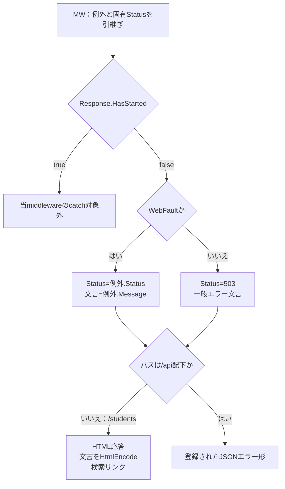

`/api`ではStatus401・403・409・422をそれぞれunauthenticated・forbidden・conflict・validationFailedへ、それ以外をsystemErrorへ対応させる。一般例外の場合だけretry=trueを渡す。これは共通middlewareの分岐であり、本画面に公開JSON APIを追加する説明ではない。根拠：`sources/Infrastructure/WebHostSetup.cs:22-24`。

### 表示名称の保存元と宣言処理の境界

クラス候補・同一人物候補のClassNameはm_class.class_nameで、DBはnvarchar(36) NOT NULL、18スカラーCHECKを持つ。宣言されたSaveClassAsyncも原入力・保存値18スカラー、NVarChar(36)で保存する。クラスコードはIdentifierの9文字上限、varchar(9)、パラメータVarChar(9)で、年度との組合せが一意となる。人数は学生集計、定員NULLは上限なしである。根拠：`sources/Core/MasterMaintenanceService.cs:32-37`、`sources/Core/MasterMaintenanceService.cs:70-73`、`sources/database/001_schema.sql:62-87`、`sources/database/001_schema.sql:188-201`。

コード候補と学年・在籍・都道府県の結合名称はm_code.code_nameで、nvarchar(24) NOT NULL、12スカラーCHECKを持つ。SaveCodeAsyncの宣言も原入力・保存値12スカラー、NVarChar(24)で保存する。StudentRowのClassName・GradeName等のnullableはLEFT JOIN結果を受けるためで、参照先名称列のNULL許可を意味しない。Razor確認表はNULL ClassNameへ「未所属」を補わない。根拠：`sources/Core/MasterMaintenanceService.cs:82-83`、`sources/Core/MasterMaintenanceService.cs:113-115`、`sources/database/001_schema.sql:112-128`、`sources/Core/Contracts.cs:50-53`、`sources/Core/SqlServerStudentService.cs:82-90`、`sources/Views/Students/Edit.cshtml:14-14`。

Webの登録・ルートからMasterMaintenanceServiceへの呼出しは接続されていない。名称上限は参照先の宣言保存契約であり、本画面の保守操作ではない。seedは性別0「未回答」、在籍01〜04等を定義し、既存初期値との差分があれば上書きせず中断し、不足行を追加する。学生・クラス初期行は作らない。根拠：`sources/Infrastructure/WebHostSetup.cs:12-19`、`sources/Web/Controllers/StudentsController.cs:5-41`、`sources/database/002_seed.sql:15-22`、`sources/database/002_seed.sql:85-91`。

`webTokens=false`にはt_confirmation使用分岐が宣言されている。UPDLOCK付き読取はtoken、principal、session_id、対象ID・要求版のNULL同士または一致、expires_at>@now、consumed=0を全条件とし、両binary(32)ハッシュを照合する。token・sessionはUniqueIdentifier、actorはNVarChar(128)、ID・版はBigInt、nowはDateTimeOffset。発行は別ReadCommittedでpayload・candidateハッシュBinary(32)、expires DateTimeOffset等をINSERTしてcommitし、保存時消費はtokenかつconsumed=0のUPDATEが1行であることを要求する。現在Web登録はtrueで、この表を本画面の確認保持先へ置換しない。根拠：`sources/Core/SqlServerStudentService.cs:279-283`、`sources/Core/SqlServerStudentService.cs:308-311`、`sources/Core/SqlServerStudentService.cs:337-342`、`sources/Infrastructure/WebHostSetup.cs:19-19`。

StrictJson.Read、WebPresentation.Lookups・Save、WebStudentCoordinator.Optionsは宣言されているが、学生画面の実入口から呼ばれない。実際のPOST `/students/options`は検索フォームのHTML再表示でOptions helperを呼ばない。StrictJsonのJSON重複名禁止・大小文字区別・深さ16・64KiB契約、JSON保存helperの応答形やClassName NULL時「未所属」補完をRazorへ適用しない。WebはCoreをProjectReferenceで参照し、maintenance配下を直接Compileから除外する。根拠：`sources/Infrastructure/StrictJson.cs:4-14`、`sources/Infrastructure/WebPresentation.cs:8-18`、`sources/Infrastructure/WebPresentation.cs:30-30`、`sources/Infrastructure/WebStudentCoordinator.cs:16-16`、`sources/Web/Controllers/StudentsController.cs:22-22`、`sources/StudentManagement.Web.csproj:3-5`。

t_runtime_stateには暗号化payload等のDDLがあるが、追跡した編集・検索・通知ストアから同表への読書き接続はない。Web用DB権限SQLはviewerの学生・クラス・分類・コードSELECT、staffの学生INSERT・UPDATEと履歴INSERT、adminのクラス・コードINSERT・UPDATEを宣言する。学生物理DELETE、履歴UPDATE・DELETE、分類変更等をDENYする。アプリRole検査とDBロール権限宣言は別契約であり、実適用結果を表さない。根拠：`sources/database/001_schema.sql:171-184`、`sources/Infrastructure/WebHostSetup.cs:13-19`、`sources/database/003_web_permissions.sql:8-24`。

### 関連文書の対応

次表は提供計画の全9文書についてID・kind・pathを一度ずつ対応させる。本書以外の本文は本応答では未生成で、既存生成状態は未確認である。本書は原ソースのREG idと実イベントで基本設計へ対応させ、未生成参照によって必要条件を省略しない。

| 文書ID | kind | 計画path | 本書との対応・本応答での状態 |
| --- | --- | --- | --- |
| CSHARP_ASPNET-BAS-STU-02 | basic-design | [基本設計書/02_学生登録画面.md（未生成）](../../基本設計書/02_学生登録画面.md) | 同じREG項目、登録・更新・復元・参照・削除の業務説明。本文間照合は未実施 |
| CSHARP_ASPNET-BAS-STU-03 | table-index | [基本設計書/03_テーブル仕様書.md（未生成）](../../基本設計書/03_テーブル仕様書.md) | 五表の索引、FK、表示JOIN、保持領域の境界 |
| CSHARP_ASPNET-BAS-STU-04 | code-design | [基本設計書/04_コード設計書.md（未生成）](../../基本設計書/04_コード設計書.md) | 分類、候補順、既存保持、初期値、宣言保守契約 |
| CSHARP_ASPNET-BAS-STU-03-M_STUDENT | table-definition | [基本設計書/テーブル/01_m_student.md（未生成）](../../基本設計書/テーブル/01_m_student.md) | 業務値、照合キー、比較版、削除管理情報の保存先 |
| CSHARP_ASPNET-BAS-STU-03-M_CLASS | table-definition | [基本設計書/テーブル/02_m_class.md（未生成）](../../基本設計書/テーブル/02_m_class.md) | 選択キー、年度・学年、名称、期間、定員の参照元 |
| CSHARP_ASPNET-BAS-STU-03-M_CODE_CATEGORY | table-definition | [基本設計書/テーブル/03_m_code_category.md（未生成）](../../基本設計書/テーブル/03_m_code_category.md) | コード分類と候補有効状態の参照元 |
| CSHARP_ASPNET-BAS-STU-03-M_CODE | table-definition | [基本設計書/テーブル/04_m_code.md（未生成）](../../基本設計書/テーブル/04_m_code.md) | 選択コード、名称、表示順、有効期間 |
| CSHARP_ASPNET-BAS-STU-03-T_OPERATION_LOG | table-definition | [基本設計書/テーブル/05_t_operation_log.md（未生成）](../../基本設計書/テーブル/05_t_operation_log.md) | 保存・削除の前後版、変更列名、理由、実行情報 |
| CSHARP_ASPNET-DET-CSharp_ASPNET-SCR-STU-002 | detailed-specification | 詳細仕様書/CSharp_ASPNET/02_学生登録画面.md | 本書。実コントロール、受信・内部値、DB、結果・応答境界を対応 |
