<!-- spec-meta: {"schema":"spec-md/1.0","documentId":"CSHARP_ASPNET-DET-CSharp_ASPNET-SCR-STU-002","version":"1.1","path":"詳細仕様書/CSharp_ASPNET/02_学生登録画面.md","sheets":[{"heading":"概要","kind":"GRID","sheet":"概要"},{"heading":"項目一覧","kind":"LIST","sheet":"項目一覧","key":["No"]},{"heading":"イベント仕様","kind":"GRID","sheet":"イベント仕様"},{"heading":"補足説明","kind":"GRID","sheet":"補足説明"}]} -->
# 学生登録・編集・参照画面 詳細仕様書

| 文書属性 | 内容 |
| --- | --- |
| 文書ID | CSHARP_ASPNET-DET-CSharp_ASPNET-SCR-STU-002 |
| 種別 | detailed-specification |
| 版 | 1.1 |
| 正本path | 詳細仕様書/CSharp_ASPNET/02_学生登録画面.md |
| 対応基本設計 | CSHARP_ASPNET-BAS-STU-02／基本設計書/02_学生登録画面.md |
| 対象 | 学生の新規登録、編集、参照、読込時への復元、重複確認、論理削除、検索への復帰 |

## 概要

本画面は学生の基本情報、住所・連絡先、入学・在籍情報、所属クラス、緊急連絡先を登録・編集する。学生管理番号はDB採番の内部キーであり、入力する学籍番号とは異なる。既存学生の学籍番号は画面でreadonlyとなり、保存サービスでも変更を拒否する。論理削除は独立したフォームで行い、編集中の業務値を保存しない。根拠：`sources/Views/Students/Edit.cshtml:3-17`、`sources/Core/SqlServerStudentService.cs:245-257`、`sources/database/001_schema.sql:8-9`。

### 入口と層の対応

`StudentsController`は`[Authorize,Route("students")]`を持つHTML画面の入口である。表の引数型はMVCのバインド・変換後の型であり、生のHTTPフォーム文字列とは分けて扱う。登録・更新には`Input.`接頭辞、削除には接頭辞なしのDTOを使う。根拠：`sources/Web/Controllers/StudentsController.cs:5-6`、`sources/Web/Controllers/StudentsController.cs:23-38`。

| 操作 | HTTP・実入口 | 受信値と呼出し | 返却 |
| --- | --- | --- | --- |
| 新規表示 | GET `/students/new` → New → Load | `returnContextId: string?`、対象IDはNULL → `coordinator.Edit` | Editビュー |
| 既存表示・最新再読込 | GET `/students/{id:long}` → Edit → Load | ルート変換後の`id: long`、`returnContextId: string?` | Editビュー |
| 登録 | POST `/students/create` → Create → Save | `[Bind(Prefix="Input")] StudentSaveInput`、`snapshotId: string` → `coordinator.Save(null,input,ct)` | Edit再表示または303 |
| 更新・確認続行 | POST `/students/{id:long}/update` → Update → Save | ルートID、同じ保存DTO・SnapshotId → `coordinator.Save(id,input,ct)` | Edit再表示または303 |
| 入力クリア・編集取消 | POST `/students/reset` → Reset | `snapshotId: string`、`studentId: string?` | 読込時入力によるEdit再表示 |
| 論理削除 | POST `/students/{id:long}/delete` → Delete | `StudentDeleteInput`、SnapshotId → `coordinator.Delete` | 再読込したEditまたは303 |
| 検索へ戻る | GET `/students` → Index | `contextId: string?`、`contextRevision: string?` → 指定状態があればResume | Searchビュー |

`Program`は`WebHostSetup.Add`、Build、`WebHostSetup.Use`、`MapControllers`の順に構成する。`IStudentService`はScopedの生成ファクトリーで`SqlServerStudentService`へ接続し、`webTokens:true`を指定する。本画面の重複確認保持先はプロセスメモリである。`StudentDb`設定の空白検査は登録時ではなく、このファクトリーがサービスを生成する時点にあり、不足時は503のWebFaultとなる。WebプロジェクトはCoreをProjectReferenceで参照し、Coreソースとmaintenance配下をWebの直接Compile対象から除外する。根拠：`sources/Program.cs:3-7`、`sources/Infrastructure/WebHostSetup.cs:12-19`、`sources/StudentManagement.Web.csproj:3-5`。

`StudentEditPageModel`は対象ID、送信・再表示用Input、読込時Detail、候補Lookups、利用者、保存結果、SnapshotId、検索復帰版を別々に持つ。`StudentSaveInput.ToRequest`は業務項目を`StudentDraft`へ移し、対象ID・比較版・年度・学年・確認キー・理由を`SaveRequest`の別引数へ渡す。`GetAsync`は`StudentDetail?`、`LookupAsync`は`LookupSet`、保存・削除は`SaveResult`を返す。`SaveResult`にはOutcome、学生ID・版、項目エラー、確認キー、全候補件数、表示候補、受付番号が含まれる。根拠：`sources/Web/Models/StudentEditPageModel.cs:5-14`、`sources/Web/Inputs/StudentSaveInput.cs:34-42`、`sources/Core/Contracts.cs:59-78`。

### 権限と表示状態

Viewerは`CanEdit=false`で、保存フォームの業務fieldset全体がdisabledになる。StaffとAdministratorは登録・更新できる。既存の卒業・退学区分を別区分へ訂正する保存にはAdministratorと理由が必要である。削除フォームは既存学生かつAdministratorにだけ出力する。画面属性に加えてWeb層・サービス層も権限を検査する。RoleはEnum.TryParseで解析され、Enum.IsDefinedによる値の限定は行われないため、宣言された三名称だけで受信claimの全範囲を保証しない。根拠：`sources/Infrastructure/RequestIdentity.cs:7-16`、`sources/Web/Models/StudentEditPageModel.cs:14-14`、`sources/Views/Students/Edit.cshtml:5-17`、`sources/Core/SqlServerStudentService.cs:230-257`。

| 状態 | 表示・操作条件 | 値の扱い |
| --- | --- | --- |
| 新規 | 見出し「学生登録 ／新規」、学籍番号readonlyなし、登録・入力クリア。最新再読込・削除なし | 性別0、在籍01、現在業務年度。クラス自動選択なし |
| 既存Staff | 編集、学籍番号readonly、更新・編集取消・最新再読込 | 読込Detailを候補保持の基準にする |
| 既存Viewer | 参照、業務fieldset disabled | fieldset外のhidden、復元フォーム、戻るリンクは残る |
| 既存Administrator | 編集に独立した論理削除フォームを追加 | 削除理由は保存フォームの理由とは別入力 |
| 確認要求 | ConfirmationRequiredのときだけ候補sectionを出力 | 全件数と最大20行を表示 |
| 入力エラー | 全ModelStateエラーを共有MessagePanelに表示 | 個別asp-validation-forはない |
| 通知 | 非空Messageを`message info`で表示 | `.info`専用CSSはなく、`.message`を適用 |

根拠：`sources/Views/Students/Edit.cshtml:3-17`、`sources/Views/Shared/_MessagePanel.cshtml:2-3`、`sources/wwwroot/css/site.css:1-1`。

### 画面の静的投影

以下は、既存学生をAdministratorが編集し、同一人物候補を確認する状態の非実行HTMLである。波括弧は取得値・候補の差込位置であり、実在する学生や候補の値ではない。主投影は在籍区分01・02など通常区分のクラス選択を表す。卒業・退学時の選択条件とその他のモード差は後続の表で示す。

共有Layoutのheader・main、二列のfields、和暦fieldset、候補表、操作フォームを原DOMに合わせて置く。候補sectionは`role="dialog"`、`class="warning"`であり、`.dialog`の固定配置・オーバーレイ・表幅解除は適用されない。候補表の外側には`.grid`ラッパーがなく、共通tableの最小幅1050pxが適用される。送信先・元のリンク先はdata属性に残し、action・formaction・実アプリURLへのhref・JavaScriptは付けない。ボタンはすべてtype=buttonとする。根拠：`sources/Views/Shared/_Layout.cshtml:1-1`、`sources/Views/Students/Edit.cshtml:5-17`、`sources/wwwroot/css/site.css:1-1`。

<!doctype html>
<html lang="ja">
<head>
<meta charset="utf-8">
<meta name="viewport" content="width=device-width,initial-scale=1">
<title>学生管理</title>
<style>
:root{font-family:Meiryo,'Yu Gothic UI',sans-serif;color:#243448;background:#f2f5f9;font-size:14px}*{box-sizing:border-box}body{margin:0}header{background:#153654;color:white;padding:16px 28px;display:flex;justify-content:space-between;gap:20px}main{background:white;max-width:1440px;margin:24px auto;padding:24px}h1{font-size:24px}fieldset{border:1px solid #c8d1dc;padding:18px;margin:12px 0}legend{font-weight:bold}.fields{display:grid;grid-template-columns:1fr 1fr;gap:14px 28px}label{display:flex;flex-direction:column;gap:5px}.full{grid-column:1/-1}input,select,textarea,button{font:inherit;padding:8px;border:1px solid #afbece;border-radius:3px}textarea{min-height:90px}input,select,textarea{max-width:100%;width:100%}.check{display:inline-flex;flex-direction:row;align-items:center;margin-right:12px}.check input{width:auto}.actions{display:flex;gap:10px;align-items:center;flex-wrap:wrap;margin:16px 0}button{background:white;cursor:pointer}.primary{background:#1c5985;color:white}.danger{color:#ae2534;border-color:#b44d59}button:disabled{cursor:default;color:#8a98a5;background:#f3f5f8}.message{padding:14px;border:1px solid #b6dccc;background:#edf7f3}.error{background:#fff1f1;border-color:#c66}.warning{background:#fff8eb;padding:12px}.grid{overflow-x:auto}table{border-collapse:collapse;min-width:1050px;width:100%;font-size:12px}th,td{padding:10px 8px;border:1px solid #d4dee8;vertical-align:top;overflow-wrap:anywhere}th{background:#e6eef6}tr:nth-child(even){background:#f8fafc}.pager{display:flex;gap:14px;align-items:center;justify-content:center;margin:18px}.wareki{display:flex;gap:6px;align-items:center;flex-wrap:wrap}.wareki input{width:65px}.wareki select{width:100px}.dialog{position:fixed;inset:10% 10%;overflow:auto;padding:28px;background:white;border:3px solid #153654;box-shadow:0 0 0 100vmax #0007;z-index:10}.dialog table{min-width:0}small{color:#5f7183}@media(max-width:760px){main{margin:0;padding:15px}.fields{grid-template-columns:1fr}header{flex-direction:column}.dialog{inset:5%}}
</style>
</head>
<body>
<header><strong>学生管理システム</strong><span>利用者 {User.Identity.Name}　業務日 {yyyy/MM/dd}</span></header>
<main>
<h1>学生登録 ／編集</h1>
<!-- この位置に_MessagePanel。エラー・Messageが空なら要素を出力しない。 -->
<p>学生管理番号 {StudentId}　更新日時 {UTC+9の更新日時}　更新者 {UpdatedBy}</p>
<form method="post" data-source-action="/students/{id}/update" data-editor-form>
<input type="hidden" name="__RequestVerificationToken" value="">
<input type="hidden" name="SnapshotId" value="{SnapshotId}">
<input type="hidden" name="Input.ExpectedVersion" value="{比較版}">
<input type="hidden" name="Input.ReturnContextId" value="{復帰検索状態}">
<input type="hidden" name="Input.DuplicateToken" value="{確認参照キー}">
<fieldset><legend>学生基本情報</legend><div class="fields">
<label>学籍番号 ※必須<input name="Input.StudentNo" id="REG-002" maxlength="30" readonly required value="{student_no}"></label>
<label>氏名 ※必須<input name="Input.StudentName" id="REG-003" maxlength="16" required value="{student_name}"><small>8文字以内</small></label>
<label>氏名カナ ※必須<input name="Input.StudentNameKana" id="REG-004" maxlength="72" required value="{student_name_kana}"><small>原入力36、正規化後18文字</small></label>
<fieldset class="wareki" id="REG-005"><legend>生年月日 ※必須</legend><select name="Input.BirthDateInput.Era" aria-label="元号" required><option value="">元号</option><option value="REIWA">令和</option><option value="HEISEI">平成</option><option value="SHOWA">昭和</option><option value="TAISHO">大正</option><option value="MEIJI">明治</option></select><input name="Input.BirthDateInput.Year" aria-label="元号年" maxlength="4" required value="{年}"><span>年</span><input name="Input.BirthDateInput.Month" aria-label="月" maxlength="2" required value="{月}"><span>月</span><input name="Input.BirthDateInput.Day" aria-label="日" maxlength="2" required value="{日}"><span>日</span></fieldset>
<label>性別 ※必須<select name="Input.GenderCode" id="REG-006" required><option value="{GENDERの選択値}" selected>{code_name}</option><option value="{選択不可の別性別}" disabled>{code_name} （停止・期間外）</option></select></label>
<label>郵便番号 ※必須<input name="Input.PostalCode" id="REG-007" maxlength="20" required value="{postal_code}"></label>
<label>都道府県 ※必須<select name="Input.PrefectureCode" id="REG-008" required><option value="">未選択</option><option value="{PREFECTUREの選択値}" selected>{code_name}</option><option value="{選択不可の別都道府県}" disabled>{code_name} （停止・期間外）</option></select></label>
<label>住所1 ※必須<input name="Input.AddressLine1" id="REG-009" maxlength="90" required value="{address_line1}"><small>45文字以内</small></label>
<label>住所2<input name="Input.AddressLine2" id="REG-010" maxlength="90" value="{address_line2}"></label>
<label>本人電話<input name="Input.PhoneNumber" id="REG-011" maxlength="40" value="{phone_number}"><small>原入力20、正規化後16文字</small></label>
<label>本人メール<input name="Input.EmailAddress" id="REG-012" maxlength="120" value="{email_address}"></label>
<label>入学日 ※必須<input name="Input.AdmissionDate" id="REG-013" type="date" required></label>
<label>在籍区分 ※必須<select name="Input.EnrollmentStatusCode" id="REG-014" required><option value="{通常区分の選択値}" selected>{code_name}</option><option value="{選択不可の別在籍区分}" disabled>{code_name}</option></select></label>
<label>卒業・退学日<input name="Input.EnrollmentEndDate" id="REG-015" type="date"></label>
<label>年度<select name="Input.SchoolYear" id="REG-016"><option value="">未指定</option><option value="{選択年度}" selected>{school_year}</option></select></label>
<label>学年<select name="Input.GradeCode" id="REG-017"><option value="">すべて</option><option value="{選択学年}" selected>{code_name}</option><option value="{別学年}">{code_name}</option></select></label>
<label>クラス<select name="Input.ClassId" id="REG-018"><option value="">未所属</option><option value="{読込時class_id}" data-year="{school_year}" data-grade="{grade_code}" selected>{school_year} {grade_code} {class_code} {class_name}</option><option value="{通常選択可能な別class_id}" data-year="{school_year}" data-grade="{grade_code}">{school_year} {grade_code} {class_code} {class_name}</option><option value="{停止中の別class_id}" data-year="{school_year}" data-grade="{grade_code}" disabled>{school_year} {grade_code} {class_code} {class_name} （停止）</option><option value="{期間外の別class_id}" data-year="{school_year}" data-grade="{grade_code}" disabled>{school_year} {grade_code} {class_code} {class_name} （期間外）</option></select><small>人数 {Occupied}／定員 {Capacity、NULLなら制限なし}（参考）</small></label>
<label>緊急連絡先氏名<input name="Input.EmergencyContactName" id="REG-020" maxlength="16" value="{emergency_contact_name}"></label>
<label>緊急連絡先続柄<select name="Input.RelationshipCode" id="REG-021"><option value="">未選択</option><option value="{RELATIONSHIPの選択値}" selected>{code_name}</option><option value="{選択不可の別続柄}" disabled>{code_name}</option></select></label>
<label>緊急連絡先電話<input name="Input.EmergencyPhoneNumber" id="REG-022" maxlength="40" value="{emergency_phone_number}"></label>
<label class="full">備考<textarea name="Input.Remarks" id="REG-023" maxlength="240">{remarks}</textarea></label>
<label class="full">確認・変更理由<textarea name="Input.OperationReason" id="REG-024" maxlength="120">{OperationReason}</textarea></label>
</div><p>本人電話・メール・緊急電話のいずれか1つ以上。緊急連絡先は3項目すべて入力してください。</p>
<section role="dialog" aria-labelledby="duplicate-title" class="warning"><h2 id="duplicate-title">同一人物候補の確認</h2><p>全 {CandidateCount} 件、最大20件表示</p><table><thead><tr><th>学籍番号</th><th>氏名</th><th>和暦生年月日</th><th>クラス</th></tr></thead><tbody><tr><td>{StudentNo}</td><td>{StudentName}</td><td>{BirthDateWareki}</td><td>{ClassName}</td></tr></tbody></table><p>別人と確認した場合は、確認理由を入力して続行してください。</p><button type="button" data-cancel-duplicate autofocus>確認取消</button><button type="button" data-confirm="別人として保存しますか。">別人と確認して続行</button></section>
<div class="actions"><button type="button" class="primary">更新</button></div></fieldset></form>
<div class="actions"><form method="post" data-source-action="/students/reset" data-confirm="編集内容を読込時の値へ戻しますか。"><input type="hidden" name="__RequestVerificationToken" value=""><input type="hidden" name="SnapshotId" value="{SnapshotId}"><input type="hidden" name="StudentId" value="{StudentId}"><button type="button">編集取消</button></form><a data-dirty-link data-confirm="編集内容を破棄して最新情報を読み込みますか。" href="#イベント仕様" data-source-href="/students/{id}?returnContextId={復帰先}">最新情報を再読込</a><a data-dirty-link href="#イベント仕様" data-source-href="/students?contextId={復帰先}&amp;contextRevision={復帰版}">検索へ戻る</a></div>
<form method="post" data-source-action="/students/{id}/delete" data-confirm="対象と理由を確認して論理削除しますか。"><input type="hidden" name="__RequestVerificationToken" value=""><input type="hidden" name="SnapshotId" value="{SnapshotId}"><input type="hidden" name="ExpectedVersion" value="{比較版}"><input type="hidden" name="ReturnContextId" value="{復帰先}"><input type="hidden" name="Confirmed" value="true"><label>削除理由 ※必須<textarea name="Reason" id="REG-026" maxlength="120" required></textarea></label><button type="button" class="danger">対象を確認して論理削除</button><p>編集中の業務値は保存されません。</p></form>
</main>
</body>
</html>

候補optionは出力形の例示であり、各分類に例示した組合せの実データが存在することを意味しない。実際には後述の取得順で全候補を反復する。生年月日の元号selected、日付inputのvalue、asp-forが生成するid・input typeはモデルとTagHelperの出力対象であり、上の差込表示では固定していない。原文に独自idがないhidden・和暦各成分へREG idを追加していない。根拠：`sources/Views/Students/Edit.cshtml:5-13`、`sources/Views/_ViewImports.cshtml:1-3`。

| 投影の差分 | 属性・表示の変更条件 |
| --- | --- |
| 新規 | 学籍番号readonlyを省略。送信先はcreate、主ボタンは登録、復元は入力クリア。管理番号は新規、更新情報は－。最新再読込・削除フォームを出力しない |
| Viewer | 業務fieldsetへdisabledを付ける。内部の保存・確認続行も無効。fieldset外の復元・リンクは残る |
| Staff | 削除フォームを出力しない |
| 確認情報なし | 候補section全体を出力しない |
| 読込時の停止コード | 有効条件にかかわらず当該optionのdisabledを省略。保持比較はDetail.Draftの値 |
| 読込時の停止クラス | disabledを省略し、停止注記を付ける |
| 卒業・退学の別クラス | 入力入学日・終了日を解析でき、クラス期間と重なればdisabledを省略。IsActiveは選択条件に含めない |
| 卒業・退学で日付解析失敗 | overlap=falseとなり、読込時クラス以外へdisabledを付ける |
| クラスの注記 | 停止なら停止。停止でなく現在業務日のactive条件を満たさなければ期間外。注記と選択可否は別判定 |
| エラー・通知 | 原位置に`message error`の全エラー表示、非空通知に`message info`。双方aria-live=polite |

根拠：`sources/Views/Students/Edit.cshtml:3-17`、`sources/Views/Shared/_MessagePanel.cshtml:2-3`。終了区分の重なりはクラス開始日≦終了日、入学日≦クラス終了日で判定する。boolean属性は成立時だけ属性を付け、非成立時は省略する。

### 項目対応の読み方

項目一覧の`Input.X`は保存フォームのnameと`StudentSaveInput.X`を示す。通常の業務項目は同名の`StudentDraft.X`へ移送する。年度・学年・理由・比較版・確認キー・復帰先は例外として個別に記載する。表中の原入力・保存値上限はサービスのUnicodeスカラー数であり、HTML maxlengthやUTF-16コード単位によるDB容量とは別である。`nvarchar(n)`はnコード単位、`varchar(n)`はnバイトの容量で、ASCIIへ限定された保存値では文字数とバイト数が対応する。SQLにはDateOnlyを午前0時のDateTimeへ変換し、NULLをDBNull.Valueとして渡す。根拠：`sources/Core/StudentNormalizer.cs:37-57`、`sources/Core/SqlServerStudentService.cs:67-72`。

REG番号は原ビューの明示idを保持する。DISP・CTRL・OPは、明示REG idがない表示・制御・操作を区別する本書の整理キーであり、実DOMのidを追加したものではない。

## 項目一覧

| No | グループ | 項目名 | 種類 | 入出力 | DB連携項目 | 候補取得元 | 必須 | 形式・桁 | 説明 |
| --- | --- | --- | --- | --- | --- | --- | --- | --- | --- |
| DISP-STUDENT | 管理表示 | 学生管理番号 | p表示、明示idなし | O | `m_student.student_id bigint IDENTITY NOT NULL`、PK。取得・更新・削除の`@id BigInt` | ‐ | ‐ | モデル`long?`、Detail`long` | 新規は「新規」。学籍番号と別の内部キー。GetAsyncは非正数を対象なしとして扱う。根拠：`sources/Views/Students/Edit.cshtml:4-4`、`sources/Core/SqlServerStudentService.cs:172-181`、`sources/database/001_schema.sql:8-8` |
| DISP-UPDATE | 管理表示 | 更新日時・更新者 | p表示、明示idなし | O | `updated_at datetimeoffset(7) NOT NULL`、`updated_by nvarchar(128) NOT NULL`。`@now DateTimeOffset`、`@actor NVarChar(128)` | ‐ | ‐ | Detailは`DateTimeOffset`・`string`。UTC+9、`yyyy/MM/dd HH:mm:ss` | 読込時情報。新規は－。表示利用者名と監査主体は別。根拠：`sources/Views/Students/Edit.cshtml:4-4`、`sources/Infrastructure/WebPresentation.cs:7-7`、`sources/database/001_schema.sql:40-42` |
| REG-002 | 基本情報 | 学籍番号 | input、`id=REG-002`、`name=Input.StudentNo`、既存readonly | I／O | `student_no varchar(15) NOT NULL`、BIN2、`@student_no VarChar(15)`。検索`@no VarChar(31)` | ‐ | 必須、required | DTO・Draft`string`、maxlength30、原入力15・保存15スカラー | Trim・制御文字検査後NFKC・大文字化。先頭英数字、以後英数字・ハイフン。更新SETから除外。削除済み番号も一意。根拠：`sources/Core/StudentNormalizer.cs:59-64`、`sources/Core/SqlServerStudentService.cs:254-266`、`sources/database/001_schema.sql:9-9`、`sources/database/001_schema.sql:187-187` |
| REG-003 | 基本情報 | 氏名 | input、`id=REG-003`、`name=Input.StudentName` | I／O | `student_name nvarchar(16) NOT NULL`、`@student_name NVarChar(16)`。派生`name_key nvarchar(320) NOT NULL`、`@name_key NVarChar(320)`。検索`@name NVarChar(642)` | ‐ | 必須、required | DTO・Draft`string`、maxlength16、原入力・表示保存8スカラー、キー160スカラー | 表示値はTrimし内部空白・文字幅を保持。照合キーだけNFKC・大文字化・Unicode空白除去。根拠：`sources/Views/Students/Edit.cshtml:6-6`、`sources/Core/StudentNormalizer.cs:47-70`、`sources/Core/StudentNormalizer.cs:125-145`、`sources/database/001_schema.sql:10-12` |
| REG-004 | 基本情報 | 氏名カナ | input、`id=REG-004`、`name=Input.StudentNameKana` | I／O | `student_name_kana nvarchar(36) NOT NULL`、`@student_name_kana NVarChar(36)`。派生`kana_key nvarchar(36) NOT NULL`、`@kana_key NVarChar(36)`。検索`@kana NVarChar(74)` | ‐ | 必須、required | DTO・Draft`string`、maxlength72、原入力36・保存18スカラー | NFKC、対応ひらがなをカタカナ化、内部空白を半角1個へ集約。キーは保存カナから半角空白を除く。根拠：`sources/Views/Students/Edit.cshtml:6-6`、`sources/Core/StudentNormalizer.cs:72-85`、`sources/Core/StudentNormalizer.cs:126-145`、`sources/database/001_schema.sql:11-13` |
| REG-005 | 基本情報 | 和暦生年月日 | fieldset `id=REG-005`、Era select、Year・Month・Day input。nameは`Input.BirthDateInput.各成分` | I／O | 四成分→`birth_date date NOT NULL`、`@birth_date Date`、候補比較`@birth Date` | 固定元号REIWA・HEISEI・SHOWA・TAISHO・MEIJI | 四成分required、変換必須 | DTO・Draft`BirthDateInput`、成分`string`→`DateOnly`。maxlength年4、月日2 | 元号完全一致、NFKC後の正数、年「元」は1。実在日・元号期間・業務日以下・逆変換を確認。根拠：`sources/Views/Students/Edit.cshtml:7-7`、`sources/Core/JapaneseDateService.cs:17-38`、`sources/database/001_schema.sql:14-14` |
| REG-006 | 基本情報 | 性別 | select、`id=REG-006`、`name=Input.GenderCode`、option条件付きdisabled | I／O | `gender_code varchar(1) NOT NULL`、`@gender_code VarChar(1)`。固定`gender_category varchar(24) NOT NULL`へGENDER | LookupSet.CodesのGENDER。キーcode_value、名称code_name | 必須、required | DTO・Draft`string`、初期0、原入力1、Trim・NFKC後ASCII数字1桁 | 有効期間内または読込時同値を選択可能。名称は学生表に保存しない。根拠：`sources/Views/Students/Edit.cshtml:8-8`、`sources/Core/StudentNormalizer.cs:113-128`、`sources/Core/SqlServerStudentService.cs:33-33`、`sources/database/001_schema.sql:15-16` |
| REG-007 | 住所・連絡先 | 郵便番号 | input、`id=REG-007`、`name=Input.PostalCode` | I／O | `postal_code varchar(7) NOT NULL`、`@postal_code VarChar(7)` | ‐ | 必須、required | DTO・Draft`string`、maxlength20、原入力10スカラー、保存7桁 | NFKC後、Unicode空白と指定ハイフン4種を除去。根拠：`sources/Views/Students/Edit.cshtml:9-9`、`sources/Core/StudentNormalizer.cs:95-100`、`sources/database/001_schema.sql:17-17` |
| REG-008 | 住所・連絡先 | 都道府県 | select、`id=REG-008`、`name=Input.PrefectureCode`、空候補未選択 | I／O | `prefecture_code varchar(2) NOT NULL`、`@prefecture_code VarChar(2)`。固定分類PREFECTURE。検索`@prefecture VarChar(2)` | LookupSet.CodesのPREFECTURE。キーcode_value、名称code_name | 必須、required | DTO・Draft`string`、原入力2、Trim・NFKC後ASCII数字2桁 | 名称は結合表示。学生にはコードを保存。既存同値を保持できる。根拠：`sources/Views/Students/Edit.cshtml:9-9`、`sources/Core/StudentNormalizer.cs:113-130`、`sources/Core/SqlServerStudentService.cs:33-33`、`sources/database/001_schema.sql:18-19` |
| REG-009 | 住所・連絡先 | 住所1 | input、`id=REG-009`、`name=Input.AddressLine1` | I／O | `address_line1 nvarchar(90) NOT NULL`、`@address_line1 NVarChar(90)` | ‐ | 必須、required | DTO・Draft`string`、maxlength90、原入力・保存45スカラー | 単行Text、NFKCなし。住所表示は都道府県名称と住所1を連結。根拠：`sources/Views/Students/Edit.cshtml:10-10`、`sources/Core/StudentNormalizer.cs:131-131`、`sources/Core/SqlServerStudentService.cs:80-80`、`sources/database/001_schema.sql:20-20` |
| REG-010 | 住所・連絡先 | 住所2 | input、`id=REG-010`、`name=Input.AddressLine2` | I／O | `address_line2 nvarchar(90) NULL`、`@address_line2 NVarChar(90)` | ‐ | 任意 | DTO・Draft`string?`、maxlength90、原入力・保存45スカラー | 単行Text、空値NULL。検索・候補の住所表示には含めない。根拠：`sources/Views/Students/Edit.cshtml:10-10`、`sources/Core/StudentNormalizer.cs:132-132`、`sources/database/001_schema.sql:21-21` |
| REG-011 | 住所・連絡先 | 本人電話 | input、`id=REG-011`、`name=Input.PhoneNumber` | I／O | `phone_number varchar(16) NULL`、`@phone_number VarChar(16)`。検索`@phone VarChar(16)` | ‐ | 単独任意、連絡先組合せ条件あり | DTO・Draft`string?`、maxlength40、原入力20スカラー、保存最大16文字 | 空値NULL。NFKC後空白・指定ハイフン・丸括弧除去。検索は本人・緊急電話のOR一致。根拠：`sources/Views/Students/Edit.cshtml:10-10`、`sources/Core/StudentNormalizer.cs:87-93`、`sources/Core/SqlServerStudentService.cs:148-148`、`sources/database/001_schema.sql:22-22` |
| REG-012 | 住所・連絡先 | 本人メール | input、`id=REG-012`、`name=Input.EmailAddress` | I／O | `email_address varchar(60) NULL`、`@email_address VarChar(60)` | ‐ | 単独任意、連絡先組合せ条件あり | DTO・Draft`string?`、maxlength120、原入力・保存60スカラー | Trim、空値NULL、NFKCなし。ASCII形式を確認しドメインだけ小文字化。根拠：`sources/Views/Students/Edit.cshtml:10-10`、`sources/Core/StudentNormalizer.cs:102-111`、`sources/database/001_schema.sql:23-23` |
| REG-013 | 入学・在籍 | 入学日 | input type=date、`id=REG-013`、`name=Input.AdmissionDate` | I／O | `admission_date date NOT NULL`、`@admission_date Date`。検索`@from/@to Date` | ‐ | 必須、required | DTO・Draft`string`→`DateOnly`、maxlengthなし、NFKC後10コード単位の`yyyy-MM-dd` | 1900-01-01以上・業務日以下・生年月日以上。同日可。根拠：`sources/Views/Students/Edit.cshtml:11-11`、`sources/Core/JapaneseDateService.cs:52-59`、`sources/Core/StudentNormalizer.cs:151-151`、`sources/database/001_schema.sql:24-24` |
| REG-014 | 入学・在籍 | 在籍区分 | select、`id=REG-014`、`name=Input.EnrollmentStatusCode` | I／O | `enrollment_status_code varchar(2) NOT NULL`、`@enrollment_status_code VarChar(2)`。固定分類ENROLLMENT_STATUS | LookupSet.CodesのENROLLMENT_STATUS。キーcode_value、名称code_name | 必須、required | DTO・Draft`string`、初期01、原入力2・正規化後2桁。01在学、02休学、03卒業、04退学 | 終了日・所属・人数・訂正権限・検索IN判定に使用。根拠：`sources/Views/Students/Edit.cshtml:11-11`、`sources/Core/StudentNormalizer.cs:136-154`、`sources/database/001_schema.sql:25-26`、`sources/database/002_seed.sql:19-22` |
| REG-015 | 入学・在籍 | 卒業・退学日 | input type=date、`id=REG-015`、`name=Input.EnrollmentEndDate` | I／O | `enrollment_end_date date NULL`、`@enrollment_end_date Date` | ‐ | 01・02は未設定、03・04は必須。HTML requiredなし | DTO・Draft`string?`→`DateOnly?`、maxlengthなし | NULL・空文字は未設定。他は入学日と同じ日付変換。終了日≧入学日。根拠：`sources/Views/Students/Edit.cshtml:11-11`、`sources/Core/StudentNormalizer.cs:137-153`、`sources/database/001_schema.sql:27-27`、`sources/database/001_schema.sql:198-198` |
| REG-016 | 所属選択補助 | 年度 | select、`id=REG-016`、`name=Input.SchoolYear`、空候補未指定 | I／O | 学生保存列なし。`m_class.school_year smallint NOT NULL`との整合。検索`@year SmallInt` | 全クラス年度とInput年度の和集合、重複除去・降順 | 任意 | DTO・SaveRequest`int?`、Draftなし、1900〜9998 | 新規は4月開始の業務年度。既存は候補の所属クラス由来。根拠：`sources/Views/Students/Edit.cshtml:12-12`、`sources/Web/Inputs/StudentSaveInput.cs:28-54`、`sources/Core/SqlServerStudentService.cs:236-236`、`sources/database/001_schema.sql:64-64` |
| REG-017 | 所属選択補助 | 学年 | select、`id=REG-017`、`name=Input.GradeCode`、空候補すべて | I／O | 学生保存列なし。`m_class.grade_code varchar(2) NOT NULL`との整合。検索`@grade VarChar(2)` | LookupSet.CodesのGRADE、取得順 | 任意 | DTO・SaveRequest`string?`、Draftなし、原入力2・正規化後2桁またはNULL | 画面では停止・期間外のdisabledなし。保存時の独立した学年存在検査はない。根拠：`sources/Views/Students/Edit.cshtml:12-12`、`sources/Core/SqlServerStudentService.cs:237-237`、`sources/Core/SqlServerStudentService.cs:363-371`、`sources/database/001_schema.sql:66-66` |
| REG-018 | 所属 | クラス | select、`id=REG-018`、`name=Input.ClassId`、空候補未所属、data-year・data-grade | I／O | `class_id bigint NULL`、`@class_id BigInt`。検索`@class BigInt` | LookupSet.Classes全件。キーclass_id、表示は年度・学年コード・クラスコード・名称 | 01・02で業務必須。HTML requiredなし | DTO`string?`→IdParser→Draft`long?`、未設定または正のInt64 | 読込時値を保持。通常はactive、03・04は期間重複を画面条件に使う。DBで存在・整合・必要な期間・定員を再検査。根拠：`sources/Views/Students/Edit.cshtml:12-12`、`sources/Web/Inputs/StudentSaveInput.cs:40-40`、`sources/Core/SqlServerStudentService.cs:357-383`、`sources/database/001_schema.sql:28-28` |
| DISP-OCCUPANCY | 所属参考表示 | 人数・定員 | REG-018のlabel内small、明示idなし | O | 人数は非削除01・02学生のCOUNT。定員`m_class.capacity int NULL` | 読込Lookupsの選択クラス | ‐ | `Occupied: int`、`Capacity: int?` | クラスなしは人数－。NULL定員は制限なし。クラスchangeで表示を更新するJSなし。根拠：`sources/Views/Students/Edit.cshtml:2-2`、`sources/Views/Students/Edit.cshtml:12-12`、`sources/Core/SqlServerStudentService.cs:201-214`、`sources/wwwroot/js/site.js:8-8` |
| REG-020 | 緊急連絡先 | 緊急連絡先氏名 | input、`id=REG-020`、`name=Input.EmergencyContactName` | I／O | `emergency_contact_name nvarchar(16) NULL`、`@emergency_contact_name NVarChar(16)` | ‐ | 緊急3項目すべて未設定またはすべて設定 | DTO・Draft`string?`、maxlength16、原入力・保存8スカラー | 単行Text、空値NULL。根拠：`sources/Views/Students/Edit.cshtml:13-13`、`sources/Core/StudentNormalizer.cs:139-157`、`sources/database/001_schema.sql:29-29` |
| REG-021 | 緊急連絡先 | 緊急連絡先続柄 | select、`id=REG-021`、`name=Input.RelationshipCode`、空候補未選択 | I／O | `relationship_code varchar(2) NULL`、`@relationship_code VarChar(2)`。派生`relationship_category varchar(24) NULL`、`@relationship_category VarChar(24)` | LookupSet.CodesのRELATIONSHIP、キーcode_value、名称code_name | 緊急3項目の組合せ。HTML requiredなし | DTO・Draft`string?`、原入力2・正規化後2桁またはNULL | 続柄ありなら分類RELATIONSHIP、なしなら分類もNULL。分類は受信しない。根拠：`sources/Views/Students/Edit.cshtml:13-13`、`sources/Core/StudentNormalizer.cs:140-147`、`sources/database/001_schema.sql:30-31` |
| REG-022 | 緊急連絡先 | 緊急連絡先電話 | input、`id=REG-022`、`name=Input.EmergencyPhoneNumber` | I／O | `emergency_phone_number varchar(16) NULL`、`@emergency_phone_number VarChar(16)`。電話検索OR一致 | ‐ | 緊急3項目・連絡先組合せの対象 | DTO・Draft`string?`、maxlength40、原入力20スカラー、保存最大16文字 | 本人電話と同じ正規化。検索一覧の本人電話欄へは表示しない。根拠：`sources/Views/Students/Edit.cshtml:13-13`、`sources/Core/StudentNormalizer.cs:87-93`、`sources/Core/StudentNormalizer.cs:141-157`、`sources/database/001_schema.sql:32-32` |
| REG-023 | 補足 | 備考 | textarea、`id=REG-023`、`name=Input.Remarks`、label.full | I／O | `remarks nvarchar(240) NULL`、`@remarks NVarChar(240)` | ‐ | 任意 | DTO・Draft`string?`、maxlength240、原入力・保存120スカラー | 原入力計数後CRLF・CRをLF化。LF以外の制御文字拒否、全体Trim、空値NULL。根拠：`sources/Views/Students/Edit.cshtml:13-13`、`sources/Core/StudentNormalizer.cs:47-57`、`sources/Core/StudentNormalizer.cs:142-142`、`sources/database/001_schema.sql:33-33` |
| REG-024 | 確認・監査 | 確認・変更理由 | textarea、`id=REG-024`、`name=Input.OperationReason`、label.full | I／O | 学生業務列なし。`t_operation_log.operation_reason nvarchar(120) NULL`、`@reason NVarChar(120)` | ‐ | 通常任意。終了区分訂正・有効確認続行は必須 | DTO`string?`→SaveRequest.Reason、Draftなし。maxlength120、原入力・保存60スカラー | 複数行Text。理由だけの変更はNoChangeで履歴なし。根拠：`sources/Web/Inputs/StudentSaveInput.cs:32-42`、`sources/Core/SqlServerStudentService.cs:234-262`、`sources/Core/SqlServerStudentService.cs:286-286`、`sources/database/001_schema.sql:148-153` |
| REG-026 | 削除 | 削除理由 | 独立フォームtextarea、`id=REG-026`、`name=Reason` | I | `m_student.delete_reason nvarchar(120) NULL`と履歴理由。双方`@reason NVarChar(120)` | ‐ | 必須、required。削除状態CHECKで非NULL | DeleteDTO`string`初期空→サービス`string`。maxlength120、原入力・保存60スカラー | 必須の複数行Text。失敗後のLoadへ理由を移送する処理なし。根拠：`sources/Views/Students/Edit.cshtml:17-17`、`sources/Web/Inputs/StudentDeleteInput.cs:4-4`、`sources/Core/SqlServerStudentService.cs:396-413`、`sources/database/001_schema.sql:200-200` |
| CTRL-SNAPSHOT | 非表示制御 | 編集状態参照キー | 各POSTのhidden `SnapshotId`、明示idなし | I／O | EditorSnapshotStore、DB列なし | 読込時Create | POSTで照合。受信NULL排除は未確定 | アクション引数`string`、数値変換なし | 非NULL不在・期限409、所有・対象403。NULL到達時は辞書先行例外の境界。根拠：`sources/Infrastructure/EditorSnapshotStore.cs:7-11`、`sources/Web/Controllers/StudentsController.cs:29-37` |
| CTRL-VERSION | 非表示制御 | 比較版 | hidden `Input.ExpectedVersion`、削除は`ExpectedVersion` | I／O | `row_version bigint NOT NULL`、正数CHECK。WHEREの`@version BigInt` | 読込Detail.RowVersion | 更新・削除必須、新規の非空指定禁止 | 保存DTO`string?`、削除DTO`string`→正の`long`。SaveRequest`long?` | SQL Server rowversion型ではなく数値加算版。変換不正422、新規非空400。根拠：`sources/Web/Inputs/StudentSaveInput.cs:42-60`、`sources/Core/SqlServerStudentService.cs:235-263`、`sources/database/001_schema.sql:42-59` |
| CTRL-RETURN | 非表示制御 | 復帰検索状態キー | hidden `Input.ReturnContextId`、削除は`ReturnContextId` | I／O | SearchContextStore、学生列なし | GET returnContextId | 任意。指定時は所有・期限・読込時値一致 | 各DTO`string?`、Draftなし | CheckReturnはNULL・空文字で省略するが文字列一致では両者を同一化しない。根拠：`sources/Infrastructure/WebStudentCoordinator.cs:6-6`、`sources/Web/Controllers/StudentsController.cs:29-38` |
| CTRL-RETURN-REV | 復帰制御 | 検索状態版 | DTOのhiddenなし、戻るリンク・303 Locationに使用 | O | SearchContextStore.Revision | Editのawait後に復帰先再Get | 指定状態再開で版一致 | モデル・Snapshot`string?`、ストア`long` | 学生比較版とは別。編集開始後に検索状態が更新されれば復帰409。根拠：`sources/Web/Controllers/StudentsController.cs:25-25`、`sources/Infrastructure/SearchContextStore.cs:14-14` |
| CTRL-DUPLICATE | 非表示制御 | 重複確認キー | hidden `Input.DuplicateToken` | I／O | 接続Webはstatic WebConfirmations、学生列なし | SaveResult.ConfirmationToken | 確認続行時に全属性照合 | DTO`string?`→SaveRequest.ConfirmationToken | 主体・セッション・対象・版・期限・両ハッシュ・Busy照合。根拠：`sources/Core/SqlServerStudentService.cs:19-29`、`sources/Core/SqlServerStudentService.cs:274-290` |
| CTRL-RESET-ID | 非表示制御 | 復元対象ID | reset hidden `StudentId` | I／O | Snapshot対象照合、学生DB取得なし | 画面StudentId | 新規未設定、既存対象一致 | アクション`string?`→IdParser.Optional→`long?` | 空または正のInt64。根拠：`sources/Views/Students/Edit.cshtml:16-16`、`sources/Web/Controllers/StudentsController.cs:35-35` |
| CTRL-DELETE-CONFIRM | 非表示制御 | 削除確認値 | hidden `Confirmed`、値true | I | DB列なし | 原ビュー固定値 | coordinatorでtrue必須 | DeleteDTO`bool` | falseはREG-026の422 WebFault。ブラウザー確認とは別。根拠：`sources/Views/Students/Edit.cshtml:17-17`、`sources/Infrastructure/WebStudentCoordinator.cs:19-19` |
| CTRL-CSRF | フォーム制御 | CSRF情報 | 各POSTのAntiForgeryToken、DTO外 | I／O | DB列なし | MVC Antiforgery | 全体CSRF検査対象 | FormGuard許可名`__RequestVerificationToken` | トークン内容検証と許可名検査は別。根拠：`sources/Views/Students/Edit.cshtml:5-17`、`sources/Infrastructure/WebHostSetup.cs:15-16` |
| DISP-CANDIDATES | 確認表示 | 同一人物候補 | role=dialog・class=warningのsection、四列表 | O | 非削除学生のbirth_date・name_key・kana_key、名称LEFT JOIN | SaveResult.Candidates | ‐ | 全件数`int`、候補`IReadOnlyList<StudentRow>?`、表示最大20件 | 学籍番号・氏名・和暦生年月日・クラス名称。NULL ClassNameの補完なし。根拠：`sources/Views/Students/Edit.cshtml:14-14`、`sources/Core/Contracts.cs:50-70`、`sources/Core/SqlServerStudentService.cs:269-290` |
| OP-SAVE | 保存操作 | 登録・更新 | 保存フォーム内submit button、class=primary、明示idなし | I | 保存イベントの学生・履歴 | ‐ | ‐ | 新規は登録、既存は更新 | Viewerは業務fieldset内でdisabled。根拠：`sources/Views/Students/Edit.cshtml:5-15` |
| OP-CONFIRM | 確認操作 | 別人と確認して続行 | 候補section内submit button、data-confirm | I | 同じ保存イベント | ‐ | 有効確認時の理由必須 | 確認文「別人として保存しますか。」 | 専用APIはなく同じ保存フォームを送信。根拠：`sources/Views/Students/Edit.cshtml:14-14` |
| OP-CANCEL-CONFIRM | 確認操作 | 確認取消 | type=button、data-cancel-duplicate、autofocus | I | DB操作なし、DOMだけ | ‐ | ‐ | 確認要求時だけ表示 | hiddenを空にしsectionを除去。根拠：`sources/Views/Students/Edit.cshtml:14-14`、`sources/wwwroot/js/site.js:6-6` |
| OP-RESET | 復元操作 | 入力クリア・編集取消 | fieldset外の独立POSTフォームとbutton | I | Snapshot.Original、候補DB参照 | ‐ | Snapshot照合 | 新規は入力クリア、既存は編集取消 | 学生最新DB値の取得ではない。根拠：`sources/Views/Students/Edit.cshtml:16-16`、`sources/Web/Controllers/StudentsController.cs:35-35` |
| OP-RELOAD | 再読込操作 | 最新情報を再読込 | 既存時のa、data-dirty-link・data-confirm | I | 学生・候補再取得 | ‐ | ‐ | GET既存IDと復帰先 | 新Snapshotを作る。根拠：`sources/Views/Students/Edit.cshtml:16-16`、`sources/Web/Controllers/StudentsController.cs:25-25` |
| OP-RETURN | 復帰操作 | 検索へ戻る | a、data-dirty-link | I | SearchContextStoreと復帰再検索 | ‐ | 指定検索状態の版照合 | contextId・contextRevision付きGET | 編集値を保存する操作ではない。根拠：`sources/Views/Students/Edit.cshtml:16-16`、`sources/Web/Controllers/StudentsController.cs:8-11` |
| OP-DELETE | 削除操作 | 対象を確認して論理削除 | 独立フォームbutton、class=danger、フォームdata-confirm | I | 論理削除イベントの学生・履歴 | ‐ | 管理者・Confirmed・理由・版 | 既存Administratorだけ表示 | 業務編集フォームを送らない。根拠：`sources/Views/Students/Edit.cshtml:17-17`、`sources/Web/Controllers/StudentsController.cs:37-37` |

## イベント仕様

### 新規・既存学生の読込／最新情報の再読込

#### 処理概要

GET newまたは既存IDを受け、復帰検索状態、対象学生、候補を確認して入力モデルと編集Snapshotを作る。最新情報の再読込は既存GETの再実行であり、Snapshotへの復元とは別である。根拠：`sources/Web/Controllers/StudentsController.cs:23-25`、`sources/Infrastructure/WebStudentCoordinator.cs:17-17`。

#### 処理手順

1. coordinator.Editで認証を確認し、復帰先が非空なら検索状態の存在・期限・所有者・セッションをGetで検査する。
2. 新規なら更新権限を確認してDetail=NULLとする。既存ならGetAsyncで非削除学生を取得し、対象なしは404・E-STU-103のWebFaultとする。
3. LookupAsyncで人数付きコード・クラス候補を取得する。学生取得と候補取得は別DB読込であり、一つの同時点取得ではない。
4. 新規はStudentDraftの既定値からInputを作る。性別0、在籍01、必須文字列と和暦成分は空、任意項目・クラス・学年・比較版は未設定とする。年度だけ現在業務年度を設定し、クラスを自動選択しない。
5. 既存はDB値からInputを作る。生年月日は和暦成分、入学日・終了日は西暦文字列、クラスID・版はInvariantCultureの十進文字列とする。所属クラスが候補にあれば年度・学年を戻し、候補に見つからなければ両者を未設定にする。
6. ControllerはEditのawait後、非空復帰先を再Getして現在Revisionを文字列で保持する。待機中の期限切れ・所有不正もこの位置で拒否する。
7. 主体・セッション・対象ID、Detail、InputのJSON複製、復帰版を30分固定期限のSnapshotへ保持し、Editを返す。

根拠：`sources/Infrastructure/WebStudentCoordinator.cs:17-17`、`sources/Web/Inputs/StudentSaveInput.cs:44-54`、`sources/Web/Controllers/StudentsController.cs:25-25`、`sources/Infrastructure/EditorSnapshotStore.cs:7-11`。

#### 処理フロー

各図のMWは補足説明の外側例外応答へ進む出口である。WebFaultのStatusと一般例外の区別を保持する。

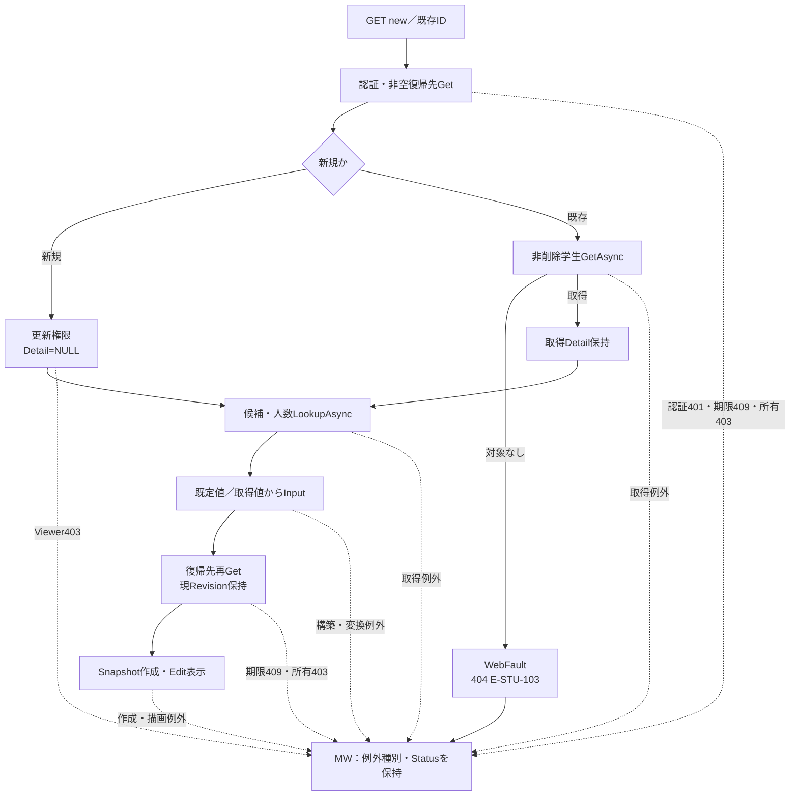

#### SQL・テーブル関連（ER図）

詳細取得単独はm_student一表のためER図を省略する。候補取得の関連は次のとおりで、読込用途を示しFK多重度を表さない。

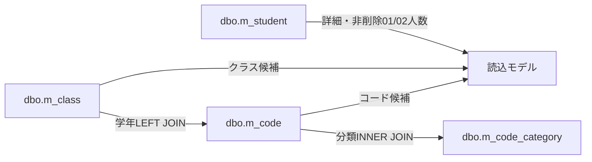

根拠：`sources/Core/SqlServerStudentService.cs:172-216`。

#### DB操作の詳細

詳細は`SELECT * FROM dbo.m_student WHERE student_id=@id AND is_deleted=0`で一行を読む。`@id BigInt`を使い、ORDER BY・ページングはない。非正数IDはSQL前にNULL、行なしもNULLで返す。業務値と版・更新情報をStudentDetailへ変換し、DBの生年月日を和暦入力へ戻す。根拠：`sources/Core/SqlServerStudentService.cs:172-194`。

候補はSNAPSHOTトランザクションで二結果を取得する。コードはm_codeとm_code_categoryをcategory_idでINNER JOINし、双方is_active=1のときだけDTOのIsActiveを真にする。停止・期間外をWHEREで除外せず、category_id、display_order、code_value順で全件読む。

クラスは全m_classを取得し、grade_category＋grade_codeでm_codeへLEFT JOINする。順序はschool_year降順、学年display_order、クラスdisplay_order、class_code、class_idである。Occupiedはclass_id一致、is_deleted=0、在籍01・02の学生COUNT。入力パラメータ・ページングはなく、二結果を読み終えてcommitする。根拠：`sources/Core/SqlServerStudentService.cs:196-216`。

コードselectは分類ごとに取得順を維持し、双方有効かつ画面業務日期間内、またはDetail.Draftと同じ値を選択可能にする。性別・都道府県だけ、選択不可の別候補に停止・期間外注記を付ける。在籍・続柄には同注記がない。学年は有効状態・期間によるdisabledを付けない。性別・在籍には空optionを追加せず、その他の空候補は原ビューの文言を使う。候補0件を理由に新たな既定値を作る処理はない。根拠：`sources/Views/Students/Edit.cshtml:8-13`。

クラス候補は上位年度・学年で絞り込まず全件出力する。読込時クラスは保持し、通常区分の別クラスは有効・画面業務日期間内を要求する。03・04の別クラスは入力在籍期間との重なりで判定し、IsActiveを含めない。日付の表示判定はDateOnly.TryParseで、保存時の厳密解析とは異なる。人数・定員は読込モデルの参考表示であり、保存可否は後段DB検査で決める。根拠：`sources/Views/Students/Edit.cshtml:2-12`、`sources/Core/SqlServerStudentService.cs:357-383`。

#### 結果・例外時の扱い

成功は通常200でEditを表示する。認証401、権限403、復帰状態不在・期限409、所有403、対象なし404を区別する。GETに局所catchはなく、取得・変換・Snapshot作成・描画の例外はMWへ伝播する。応答未開始ならWebFaultの固有Status、一般例外なら503となる。応答開始後は当middlewareのcatch対象外である。学生取得の成功だけで後続の表示成功を保証しない。根拠：`sources/Web/Controllers/StudentsController.cs:23-25`、`sources/Infrastructure/WebHostSetup.cs:23-24`。

### 入力クリア・編集取消

#### 処理概要

POST resetで読込時Inputへ戻す。新規の性別・在籍・年度も復元するため、全項目の空欄化ではない。既存ではOriginalのコピーへ戻り、学生最新DB値を取得しない。根拠：`sources/Views/Students/Edit.cshtml:16-16`、`sources/Web/Controllers/StudentsController.cs:35-35`。

#### 処理手順

1. FormGuardでSnapshotId、StudentId、CSRF項目、書式メタ情報だけを許可する。
2. 認証を確認し、StudentIdをOptionalで未設定または正のInt64へ変換する。
3. Snapshotのキー・期限・所有者・セッション・対象IDを照合する。
4. ModelStateをClearし、Snapshot.OriginalをJSON複製する。保存済みDetail、同じSnapshotId、ReturnRevisionを引き継ぐ。
5. 候補だけをLookupAsyncで再取得し、復元通知とともにEditを返す。学生Get、復帰先再Get、新Snapshot作成、期限延長は行わない。

根拠：`sources/Web/Controllers/StudentsController.cs:35-41`、`sources/Infrastructure/EditorSnapshotStore.cs:9-11`。

#### 処理フロー

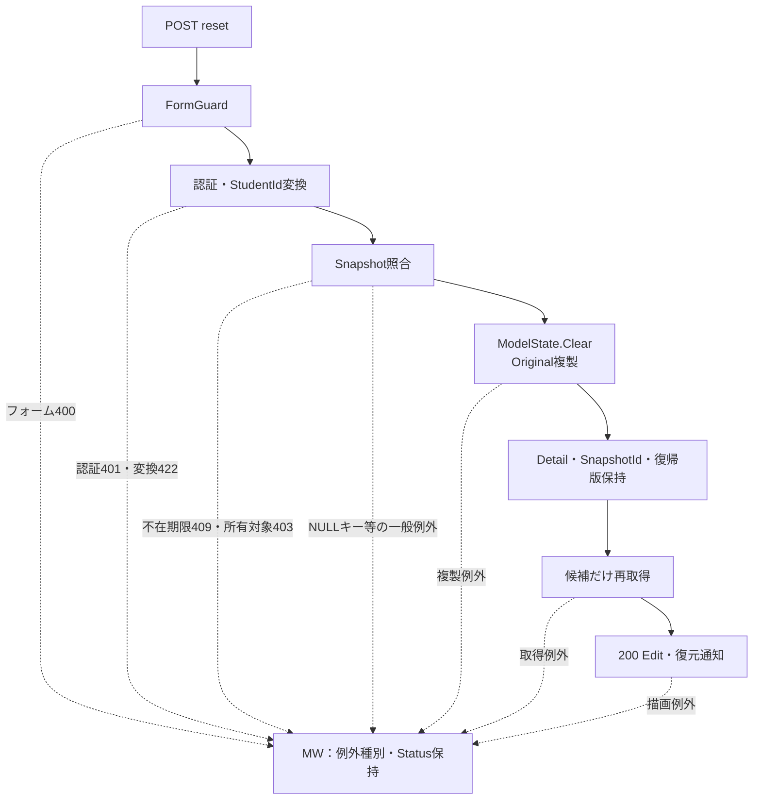

#### SQL・テーブル関連（ER図）

復元元はEditorSnapshotStore.Originalで、DBは候補・人数取得に使う。

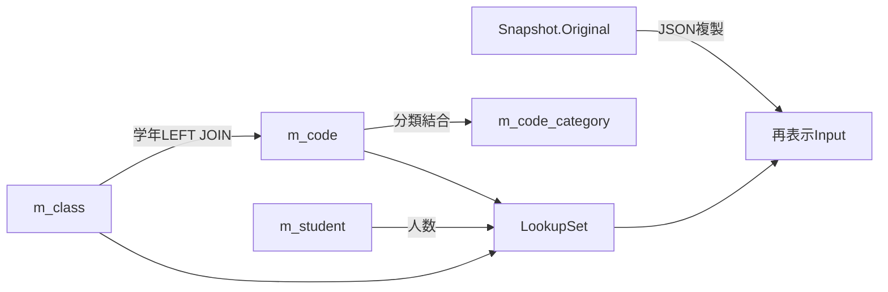

根拠：`sources/Web/Controllers/StudentsController.cs:35-35`、`sources/Core/SqlServerStudentService.cs:196-216`。

#### DB操作の詳細

候補SQL、順序、人数条件、SNAPSHOTとcommitは読込イベントと同じである。学生UPDATE・DELETE・履歴INSERTはない。候補の変更は再表示へ反映するが、OriginalとDetailはSnapshotの読込時値を維持する。根拠：`sources/Web/Controllers/StudentsController.cs:35-35`。

#### 結果・例外時の扱い

成功は200で「入力を読込時の値へ戻しました。」を表示する。フォーム400、認証401、ID変換422、Snapshot不在・期限409、所有・対象403を区別する。NULLキーが届く場合は独自409より前の辞書例外経路である。局所catchがないため複製・候補取得・描画失敗もMWへ進み、固有Statusまたは応答未開始時の一般503となる。根拠：`sources/Web/Controllers/StudentsController.cs:35-41`、`sources/Infrastructure/EditorSnapshotStore.cs:10-10`、`sources/Infrastructure/WebHostSetup.cs:23-24`。

### 登録・更新・重複確認後の続行

#### 処理概要

登録、更新、別人確認後の続行は同じ保存フォームを使う。続行時も業務入力、現行行、コード・クラス、学籍番号、全同一人物候補を検査する。確認キーだけで保存を許可する処理ではない。根拠：`sources/Views/Students/Edit.cshtml:5-15`、`sources/Core/SqlServerStudentService.cs:227-315`。

#### 処理手順

1. フレームワークの認証・CSRF等を通って本体に到達した後、FormGuard、更新権限、Snapshot取得、非空復帰先Get、読込時復帰先との文字列一致を順に確認する。この範囲は局所WebFault catchの外である。
2. ModelState不正は422としサービスを呼ばない。有効なら局所tryでcoordinator.Saveを呼び、権限・復帰先を再確認してToRequestを実行する。ClassIdはOptional、更新比較版はRequiredで変換する。新規の非空比較版は400で拒否する。
3. SaveAsyncは受付番号GUID、利用者、開始時UTCのnow、UTC+9業務日を取得する。ViewerはForbidden。User取得は初期検証tryの前である。
4. 学生正規化、任意の複数行理由60スカラー、対象ID・版の正数とNULL組合せ、年度1900〜9998、任意学年2桁を検査する。ID・版は双方NULLまたは双方設定を要求する。InputValidationException、次にArgumentExceptionをValidationFailedへ変換する。
5. Openで接続・SNAPSHOT設定診断を行い、ReadCommittedを開始する。両操作はDB処理tryの外にある。
6. try内で共通Gateを取得する。更新では非削除対象を再取得し、対象なしをNotFoundにする。取得版をpreviousVersionへ代入し、要求版と異なればConflictを返す。版が一致した場合だけpreviousの業務値辞書を構築する。その後、学籍番号不変、旧03・04から別区分への訂正権限、訂正理由の順に確認する。
7. CheckRulesで用途別コードの存在と必要な利用条件、指定クラスの存在・年度学年一致、必要な有効期間・期間重複・定員をDB値で再検査する。収集エラーはInputValidationExceptionとする。
8. 正規化済み業務列を現行値と比較する。DateOnlyとDB DateTimeは日付として比較する。変更列0なら要求ctでrollbackし、NoChangeと要求ID・取得版を返す。理由だけの変更では学生更新・履歴追記をしない。
9. 変更ありで取得版がlong.MaxValueならConflict。その後、論理削除行も含む学籍番号重複を確認し、使用済みならE-STU-101のValidationFailedとする。
10. 非削除、更新対象以外、同一生年月日、氏名キーまたはカナキー一致の全候補を学生ID順で取得する。正規化入力と全候補ID・版のハッシュを作る。
11. 非NULL確認キーがあれば、存在、主体・セッション、対象ID・要求版、Expires>開始時now、両ハッシュ、Busyの0→1取得を照合する。有効確認でも理由がNULLならE-STU-107のValidationFailedとする。
12. 「候補ありまたは非NULL確認キー送信」かつ「確認無効」ならrollback後に確認を発行する。新規の返却ID・版はNULL、更新は要求ID・今回取得版を保持する。件数は全件、表示候補は最大20件。
13. 確認不要または有効確認ならINSERT／比較版付きUPDATEを行う。実行直前にwriteStarted=trueとし、OUTPUTの学生IDが得られなければDBConcurrencyExceptionとする。
14. 同じtransactionで履歴をINSERTする。CREATE／UPDATE、前後版、変更列名JSON、主体、開始時now、受付番号、理由を記録する。duplicate_confirmedは今回候補件数>0で設定する。
15. commitAttempted=trueとしてcommitをawaitする。成功後completed=true、送信確認キーをメモリから除去し、Savedと保存ID・保存版を返す。
16. Controllerは返却FieldError.Fieldを加工せずModelStateへ追加する。Savedは通知と303。他結果はOutcome別Statusを設定し、DuplicateTokenを返却キーへ置換してそのModelStateだけ除去する。
17. Saved以外は候補を再取得し、Input、読込時Snapshot.Detail、同じSnapshotId・復帰版でEditを再表示する。ModelState不正または局所WebFaultでresult=NULLの場合は確認キーを置換しない。

根拠：`sources/Web/Controllers/StudentsController.cs:28-33`、`sources/Infrastructure/WebStudentCoordinator.cs:18-18`、`sources/Web/Inputs/StudentSaveInput.cs:34-60`、`sources/Core/SqlServerStudentService.cs:227-315`、`sources/Core/SqlServerStudentService.cs:344-390`。

#### 処理フロー

保存を五つのサブフローに分ける。番号は上記手順と対応し、結果別Status、取得済み版、例外種別を引き継ぐ。

| サブフロー | 入口・出口 | 引き継ぐ値・状態 |
| --- | --- | --- |
| 1 Web検査・再表示 | POST→サービス、303、Edit、MW | Input、Snapshot、ModelState、結果別Status |
| 2 初期検証・現行値 | SaveAsync→3、早期Result、例外 | 正規化値、理由、要求、now・day、利用者、受付番号。更新は版一致後にprevious構築 |
| 3 再検査・確認 | 2→4、NoChange、確認要求、失敗 | 新規previous・版NULL、更新取得業務値・版、全候補、ハッシュ、claimed |
| 4 書込み・確定 | 3→Saved、5 | writeStarted、commitAttempted、completed、保存ID・版 |
| 5 catch・finally | DB処理例外→各結果または伝播 | catch分類、後段だけのunknown、条件付きBusy解放 |

**1. Web検査・再表示**

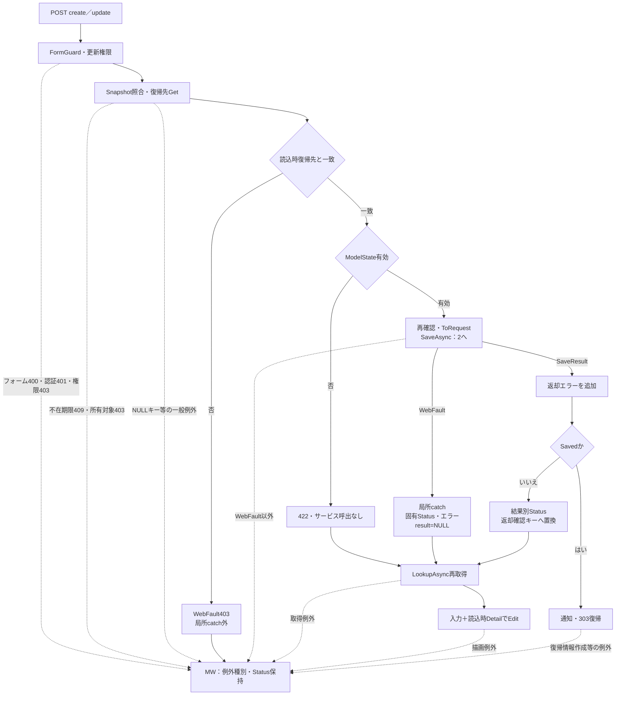

**2. 初期検証・現行値**

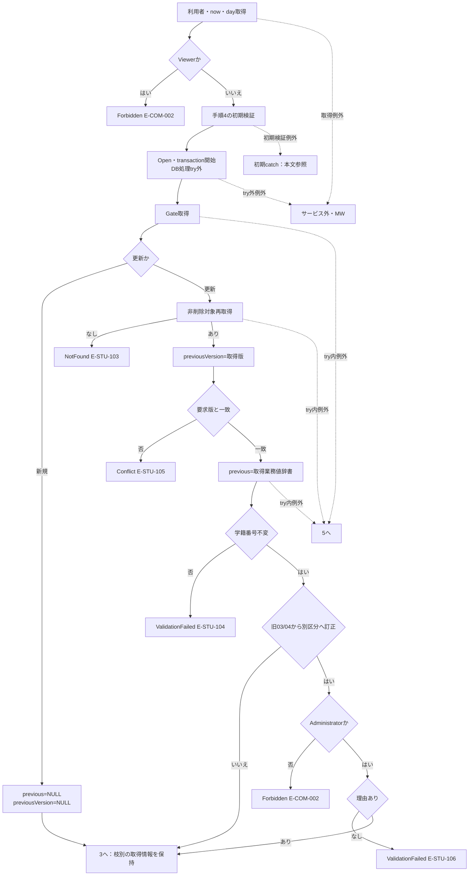

初期catchはInputValidationException、ArgumentExceptionの順にValidationFailedへ変換し、ID・版NULLで返す。それ以外は伝播する。図の版一致枝だけがpreviousを構築する。早期失敗Result helperのID・版はNULLであり、取得版がローカル変数にあることから返却版ありとは扱わない。根拠：`sources/Core/SqlServerStudentService.cs:226-259`。

**3. 業務再検査・確認**

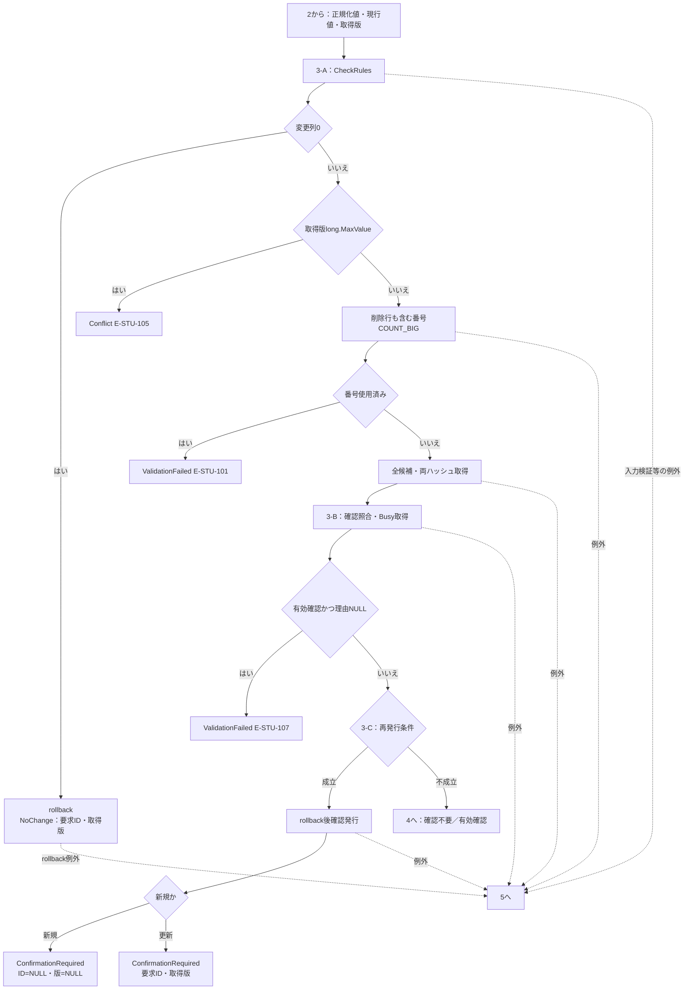

CN・CUはそれぞれ全候補件数、最大20件、発行キーを返す。合流で更新の取得版を新規のNULLへ置換しない。

| 判定番号 | 完全な条件・検査順 | 拒否・引継ぎ |
| --- | --- | --- |
| 3-A1 | GENDER、PREFECTURE、ENROLLMENT_STATUS、RELATIONSHIPを分類JOIN付きで取得。NULL続柄は省略 | 不存在E-STU-009。新規・変更値だけ双方有効・開始時業務日期間内を要求し、不成立E-STU-011。同じ既存値も存在は検査 |
| 3-A2 | クラス指定時、存在、指定年度・学年一致を検査 | 不存在E-STU-010、不一致E-STU-014 |
| 3-A3 | 新区分01・02、クラスあり、旧座席なしまたは別クラスへの移動 | 有効・開始時業務日期間内でなければE-STU-013。非NULL定員に対象除外人数＋1が超過すればE-STU-102 |
| 3-A4 | 新区分03・04で、新規またはクラス・区分・入学日・終了日が変更 | 入学日がクラス終了日より後、または終了日がクラス開始日より前ならE-STU-108。境界同日は重なりあり |
| 3-A終端 | 収集エラーあり | InputValidationException→5。なしなら変更列判定 |
| 3-B | 非NULLキーの存在、主体・セッション、対象ID・要求版、Expires>開始時now、両ハッシュ一致、Busyの0→1取得 | 全成立でclaimedとconfirmationValid=true。いずれか不成立なら無効確認 |
| 3-C | 候補件数>0または送信キーが非NULL、かつ確認無効 | 成立ならrollback・再発行。不成立なら書込み |

根拠：`sources/Core/SqlServerStudentService.cs:260-290`、`sources/Core/SqlServerStudentService.cs:344-383`。

**4. 書込み・確定**

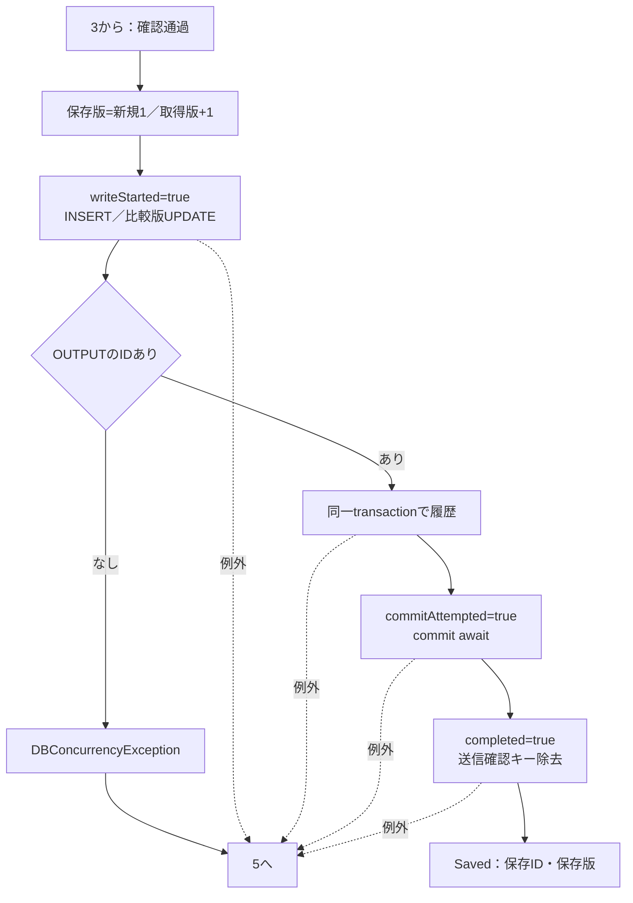

履歴前版は新規NULL、更新取得版である。commit成功後のSaved生成と、外側破棄・Controller・通信の成功は別の境界を持つ。根拠：`sources/Core/SqlServerStudentService.cs:292-315`。

**5. catch・finally**

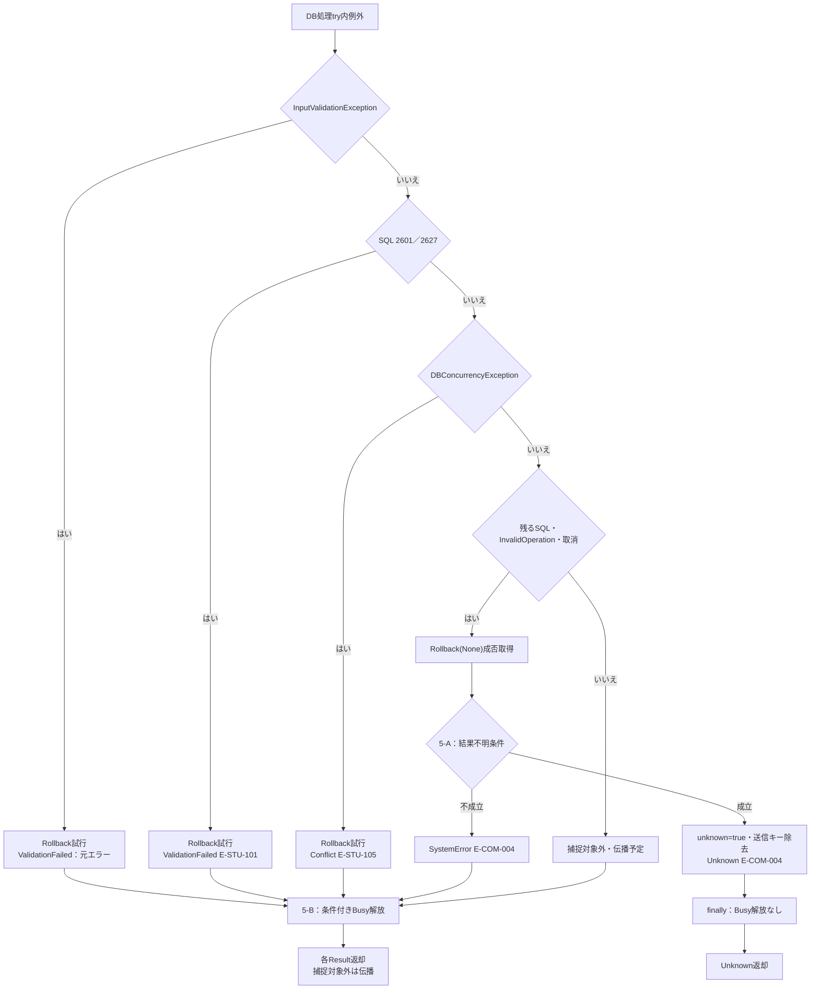

5-Aは最後のcatchへ到達した場合だけの`writeStarted && (commitAttempted || !rolledBack)`である。先行三catchはrollbackのboolをUnknown判定に使わない。5-Bはclaimedあり、completed=false、unknown=falseの場合にBusyを0へ戻す。catch対象外もfinallyを通るがResultに変換しない。Rollback helper自身に捕捉対象外例外があれば意図したResult返却へ到達しない。根拠：`sources/Core/SqlServerStudentService.cs:316-329`。

#### SQL・テーブル関連（ER図）

保存は学生を更新し、クラス・コード・分類を検査し、履歴を同一transactionで追記する。次図のFKはDDL宣言で、名称LEFT JOINと区別する。

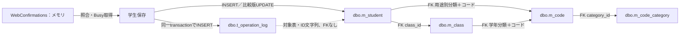

根拠：`sources/database/001_schema.sql:189-199`、`sources/Core/SqlServerStudentService.cs:274-315`、`sources/Core/SqlServerStudentService.cs:385-390`。

#### DB操作の詳細

接続はEncrypt Mandatory、TrustServerCertificate=falseを設定する。Openは接続後、`sys.databases WHERE database_id=DB_ID()`からsnapshot_isolation_stateを取得し、1以外をInvalidOperationExceptionとする。失敗時は接続をDisposeして再throwする。Command helperのTimeoutは30秒だが、診断コマンドはCreateCommandで生成し明示Timeoutがない。根拠：`sources/Core/SqlServerStudentService.cs:39-66`。

GateはSET XACT_ABORT ONの後、sp_getapplockにResource=`test-project1:student-write`、Exclusive、LockOwner=Transaction、LockTimeout=5000、DbPrincipal=publicを指定する。負の戻り値はSQLエラー51001。同じResourceを使うクラス・コード保守とseedとの書込みを直列化するが、このロックを使わない任意SQLまでの排他保証ではない。根拠：`sources/Core/SqlServerStudentService.cs:92-101`、`sources/Core/MasterMaintenanceService.cs:42-42`、`sources/Core/MasterMaintenanceService.cs:90-90`、`sources/database/002_seed.sql:4-6`。

業務列のSQLパラメータは項目一覧に示した`@物理列名`とColumns辞書のSqlDbType・Sizeを使う。列宣言のNULL許可と状態別必須は別制約である。Unicode表示列はCS_AS_SC、識別値・照合キー・コード等はBIN2の宣言であり、氏名表示値と照合キーの照合方法を同一化しない。根拠：`sources/Core/SqlServerStudentService.cs:30-37`、`sources/Core/SqlServerStudentService.cs:299-301`、`sources/database/001_schema.sql:9-33`。

| SQL用途 | 全述語・結合・順序・結果形 | パラメータ型・サイズ | 動作 |
| --- | --- | --- | --- |
| 更新対象 | m_student、`student_id=@id AND is_deleted=0`、全列一行。ORDER BY・ページングなし | `@id BigInt` | Gate後に現行行と版を読む。版一致後に業務辞書を構築 |
| コード確認 | m_code c JOIN m_code_category k ON category_id一致、`c.category_id=@category AND c.code_value=@value`。双方is_active、valid_from、valid_toの一行 | `@category VarChar(24)`、`@value VarChar(10)` | NULL続柄省略。存在と新規・変更時の利用可否を分ける |
| クラス確認 | m_class、`class_id=@id`。年度・学年・期間・有効状態・定員の一行 | `@id BigInt` | 存在・指定上位値整合・必要な期間を検査 |
| 定員 | m_student、`class_id=@class AND is_deleted=0 AND enrollment_status_code IN ('01','02') AND (@id IS NULL OR student_id<>@id)`、COUNT_BIG一値 | `@class/@id BigInt` | 新規座席使用時だけ人数＋1を比較。NULL定員なら検査なし |
| 学籍番号重複 | m_student、`student_no=@no AND (@id IS NULL OR student_id<>@id)`、COUNT_BIG一値。is_deleted条件なし | `@no VarChar(15)`、`@id BigInt` | 削除済みも使用済み。1件以上を拒否 |
| 同一人物候補 | RowSelectのLEFT JOINに` s.is_deleted=0 AND (@id IS NULL OR s.student_id<>@id) AND s.birth_date=@birth AND (s.name_key=@name OR s.kana_key=@kana)`、`ORDER BY s.student_id` | `@id BigInt`、`@birth Date`、`@name NVarChar(320)`、`@kana NVarChar(36)` | SQL上限・ページングなし。全行を取得し全件数・ハッシュ・20件表示へ使う |
| 学生INSERT | 正規化全列、固定分類、削除状態、作成更新情報、版をINSERT。OUTPUTのIDを表変数経由でSELECT | 各業務列型・Size、`@now DateTimeOffset`、`@actor NVarChar(128)` | IDENTITY採番。GENDER・PREFECTURE・ENROLLMENT_STATUS、is_deleted=0、row_version=1を明示 |
| 学生UPDATE | student_no以外の正規化全列、updated_at・updated_by、row_version+1。`WHERE student_id=@id AND row_version=@version AND is_deleted=0`。OUTPUTのID | 各業務列型・Size、`@id/@version BigInt`、`@now DateTimeOffset`、`@actor NVarChar(128)` | 実変更列だけをSETする方式ではない。IDなしはDBConcurrencyException |
| 履歴INSERT | t_operation_logの非IDENTITY11列へINSERT。target_table固定m_student、CREATE／UPDATE、前後版・変更列名等 | `@id VarChar(35)`、`@op VarChar(11)`、`@before/@after BigInt`、`@changed NVarChar(MAX)`、`@actor NVarChar(128)`、`@now DateTimeOffset`、`@request UniqueIdentifier`、`@reason NVarChar(120)`、`@confirmed Bit` | 学生書込みと同じtransaction。新規前版NULL、個人情報の前後値は保存しない |

根拠：`sources/Core/SqlServerStudentService.cs:245-272`、`sources/Core/SqlServerStudentService.cs:294-307`、`sources/Core/SqlServerStudentService.cs:344-390`。

RowSelectは学生を起点に、クラスをclass_id、学年名称をクラスgrade_category＋grade_code、在籍名称を学生enrollment_category＋enrollment_status_code、都道府県名称をprefecture_category＋prefecture_codeでLEFT JOINする。StudentRowはID・版、番号・氏名・カナ・生年月日、年度・学年名称・クラスコード・名称、在籍名称、住所、本人電話、入学日、更新日時を持つ。住所は都道府県名称と住所1の連結で、名称欠落時は「[不整合]」、住所2は含めない。根拠：`sources/Core/SqlServerStudentService.cs:77-90`。

座席使用はクラスありかつ01・02である。同じクラスで旧・新とも座席使用なら、新規所属の有効状態・期間・定員検査をしない。終了区分の必要な変更時には期間重複を検査する。クラス期間はdate NOT NULL、定員はint NULLで、FKの存在保証とは別の業務条件である。根拠：`sources/Core/SqlServerStudentService.cs:357-383`、`sources/database/001_schema.sql:69-71`、`sources/database/001_schema.sql:191-191`。

入力ハッシュはColumnsの列順で正規化値をJSON化しUTF-8のSHA-256を取る。name_key、kana_key、relationship_categoryを除外し、年度・学年・理由も含めない。対象ID・要求版は確認情報の別属性で照合する。候補ハッシュは表示20件ではなく、全候補のID・版を取得順でJSON化したSHA-256である。根拠：`sources/Core/SqlServerStudentService.cs:224-225`、`sources/Core/SqlServerStudentService.cs:269-286`。

Web確認情報はstatic ConcurrentDictionaryに保持する。全属性照合後、Interlocked.CompareExchangeでBusyを0から1へ変更できた一要求がclaimedを取得する。照合・期限掃除・発行期限に使うnowはSaveAsync開始時の値で、Gate待機・DB読取後に取り直さない。発行はExpires<=nowを除去し、ランダム32バイトの64桁小文字16進参照キーにnow+10分の期限を付ける。空文字も非NULLなら再発行条件に含まれ、候補0件でもConfirmationRequiredとなり得る。根拠：`sources/Core/SqlServerStudentService.cs:19-29`、`sources/Core/SqlServerStudentService.cs:229-229`、`sources/Core/SqlServerStudentService.cs:276-290`、`sources/Core/SqlServerStudentService.cs:330-335`。

新規履歴の変更列名には全業務列、固定分類、is_deleted、作成更新管理列、版を含む。更新履歴は実際に変化した業務列とupdated_at・updated_by・row_versionである。学生と履歴に開始時UTC・認証主体を設定する。DDL DEFAULTのis_deleted・row_versionもINSERTでは明示設定する。根拠：`sources/Core/SqlServerStudentService.cs:294-307`、`sources/database/001_schema.sql:34-59`。

接続・transaction開始・Gate・SQL実行読取・明示rollback・commitには要求ctを渡す。NoChangeと確認発行前のrollbackも要求ctである。失敗catchのRollback helperはNoneを使い、SqlException・InvalidOperationExceptionだけをfalseにする。早期returnの一部は明示rollbackなしでawait usingの破棄へ進む。根拠：`sources/Core/SqlServerStudentService.cs:53-63`、`sources/Core/SqlServerStudentService.cs:241-329`。

#### 結果・例外時の扱い

| 結果 | HTTP・画面処理 | 返却・状態 |
| --- | --- | --- |
| Saved | 303、保存通知、検索へLocation | 保存ID、新規版1／取得版+1。送信確認キー除去 |
| NoChange | 200、「変更はありません。」で再表示 | 要求ID・取得版。学生書込み・履歴なし |
| ValidationFailed | 422、FieldErrorをModelStateへ追加 | 初期catch、DB入力catch、番号重複等のID・版はNULL |
| Forbidden | サービスResultは403で再表示 | 失敗ResultのID・版NULL。Web初期拒否は局所catch外 |
| NotFound | 404、入力と読込Detailで再表示 | ID・版NULL。保存失敗では学生最新Getを行わない |
| Conflict | 409、最新再読込でDB値を取得可能 | ID・版NULL |
| ConfirmationRequired | 409、確認キーと候補sectionを出力 | 新規ID・版NULL、更新要求ID・取得版。全件数・最大20候補 |
| SystemError | 503、失敗メッセージを再表示 | 後段catchの結果不明条件が不成立。ID・版NULL |
| Unknown | 503、再保存前に検索確認する文言 | 送信確認キー除去、ID・版NULL。DB確定の実証ではない |

根拠：`sources/Web/Controllers/StudentsController.cs:30-33`、`sources/Infrastructure/WebPresentation.cs:23-23`、`sources/Core/SqlServerStudentService.cs:226-323`。

catchは入力検証、SQL2601/2627、DBConcurrencyException、残るSQL・InvalidOperation・取消の順である。SQL2601/2627は原因を細分せずE-STU-101へ対応する。最後のcatchだけが、書込み開始かつcommit試行済みまたはrollback不成功をUnknownにする。書込み前、または書込み後でもcommit未試行かつrollback成功ならSystemErrorである。先行catchへこの判定を一般化しない。根拠：`sources/Core/SqlServerStudentService.cs:316-329`。

claimed取得後の理由不足、先行catch、通常失敗は、未完了かつunknown=falseならfinallyでBusyを0へ戻す。成功・Unknownはキー除去、UnknownはBusy解放を抑止する。捕捉対象外はfinallyを通って伝播する。User、Open、BeginTransaction、NULL参照、外側破棄等は表のSaveResultになるとは限らない。Controllerの局所catchはcoordinator.SaveからのWebFaultだけである。根拠：`sources/Core/SqlServerStudentService.cs:229-243`、`sources/Core/SqlServerStudentService.cs:278-329`、`sources/Web/Controllers/StudentsController.cs:30-30`。

結果Statusを設定した後でもLookup・描画失敗によりEdit返却へ到達しない。入力拒否時は不正InputとModelStateを残し、ビューでInput・Lookups・Classesを参照する。クラス期間の日付解析失敗はoverlap=falseとなるが、NULL成分を含むTagHelper参照や候補のBirthDateWareki評価まで成功した保証ではない。BirthDateWarekiはToWarekiを呼び、対応日付範囲外なら変換例外を持つ。二次例外も応答未開始ならMW、開始後は当catch対象外となる。根拠：`sources/Views/Students/Edit.cshtml:2-14`、`sources/Core/Contracts.cs:50-55`、`sources/Core/JapaneseDateService.cs:41-50`、`sources/Infrastructure/WebHostSetup.cs:23-24`。

### 重複確認取消

#### 処理概要

ブラウザー内の確認キーと候補表示を解除し、業務入力を保持する。サーバーへの確認情報削除要求は送らない。根拠：`sources/wwwroot/js/site.js:6-6`。

#### 処理手順

1. data-cancel-duplicateのclickを受ける。
2. 編集フォームのInput.DuplicateTokenがあればvalueを空文字にする。
3. aria-labelledby=duplicate-titleのsectionがあれば除去する。
4. 次回保存は通常の検査を再実行する。空文字が非NULLでサービスへ届けば再発行条件に含まれるが、生フォームからのバインド結果とは分ける。

根拠：`sources/wwwroot/js/site.js:6-6`、`sources/Core/SqlServerStudentService.cs:276-290`。

#### 処理フロー

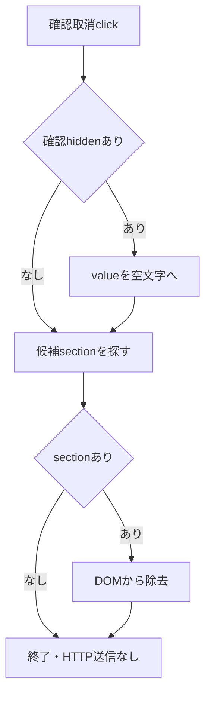

#### SQL・テーブル関連（ER図）

DB非使用。保持領域はブラウザーDOMのhidden・sectionである。サーバーメモリ・DB表を更新せず、表間関係がないためER図を省略する。根拠：`sources/wwwroot/js/site.js:6-6`。

#### DB操作の詳細

SQLはない。サーバー確認情報はその場で削除・消費されず、後の保存成功・Unknown時除去、発行時の期限掃除とは別操作である。根拠：`sources/Core/SqlServerStudentService.cs:313-335`。

#### 結果・例外時の扱い

HTTP状態・SaveResultは返さない。キーやsectionがなければ当該操作を省く。業務値は保存されず、保存通知も作らない。根拠：`sources/wwwroot/js/site.js:6-6`。

### 所属クラス・年度・学年の連動

#### 処理概要

クラス選択値から年度・学年を設定し、上位値が選択クラスと合わなくなるとクラスを解除する。候補のDB再取得や人数表示更新は行わない。根拠：`sources/wwwroot/js/site.js:8-8`。

#### 処理手順

1. REG-018のchangeで選択optionを取得し、data-yearがあれば年度へその値、学年へdata-gradeを代入する。
2. 年度・学年changeではクラス選択値がある場合だけ選択optionを調べる。
3. 非空年度とdata-year、または非空学年とdata-gradeが不一致ならクラスを空にし、解除通知をalertする。
4. 上位項目が空なら、その項目だけを理由に解除しない。空クラス選択時にも年度・学年を空へ戻す代入はない。

根拠：`sources/wwwroot/js/site.js:8-8`。

#### 処理フロー

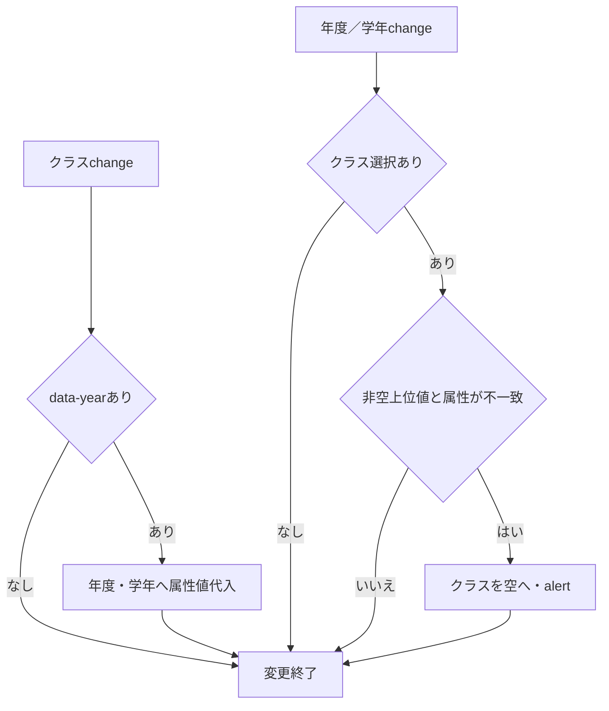

#### SQL・テーブル関連（ER図）

DB非使用。REG-016・017・018のDOM値と読込optionのdata属性を扱う。候補の表間読取は読込時に完了しているため、このchangeのER図を省略する。根拠：`sources/Views/Students/Edit.cshtml:12-12`、`sources/wwwroot/js/site.js:8-8`。

#### DB操作の詳細

SQL・HTTP候補取得・人数再計算はない。候補全件を上位条件で絞り込む処理でもない。後の保存でclass_idと補助年度・学年を送信し、DB再取得クラスとの整合を検査する。根拠：`sources/Web/Inputs/StudentSaveInput.cs:40-42`、`sources/Core/SqlServerStudentService.cs:363-380`。

#### 結果・例外時の扱い

解除はalertだけで、HTTP結果や項目エラーを返さない。原コードは代入先year・gradeを各代入直前に検査せず、当画面に両コントロールがある構成で使用する。プログラム代入をdirty管理のinputイベント発火と同一化しない。表示で保持できる値も保存時の必要条件で拒否され得る。根拠：`sources/wwwroot/js/site.js:3-8`、`sources/Core/SqlServerStudentService.cs:344-383`。

### 未保存変更の通知と画面離脱

#### 処理概要

編集フォームのinput変更をdirtyとして保持し、未保存離脱・指定フォーム送信を確認する。送信開始時のボタン無効化は保存成功の判定ではない。根拠：`sources/wwwroot/js/site.js:2-5`。

#### 処理手順

1. 編集フォームのinputイベントでdirty=trueとし、確認キーを空にする。業務項目だけに限定する条件はなく、確認・変更理由の入力もこの対象になる。
2. beforeunloadでdirty=trueかつleaving=falseならpreventDefaultとreturnValueを設定する。
3. data-dirty-linkのclickはdirty時だけリンクdata-confirmまたは既定文で確認する。取消なら遷移停止、続行またはdirtyなしならleaving=trueとする。
4. 各フォームsubmitは送信ボタンdata-confirmを優先し、なければフォームdata-confirmを使う。取消なら送信停止。
5. 続行時はleaving=true、同フォーム内の送信ボタン以外のbuttonをdisabled、フォームをaria-busy=trueにする。他の独立フォームを一括無効化しない。

根拠：`sources/wwwroot/js/site.js:2-5`、`sources/Views/Students/Edit.cshtml:13-17`。

#### 処理フロー

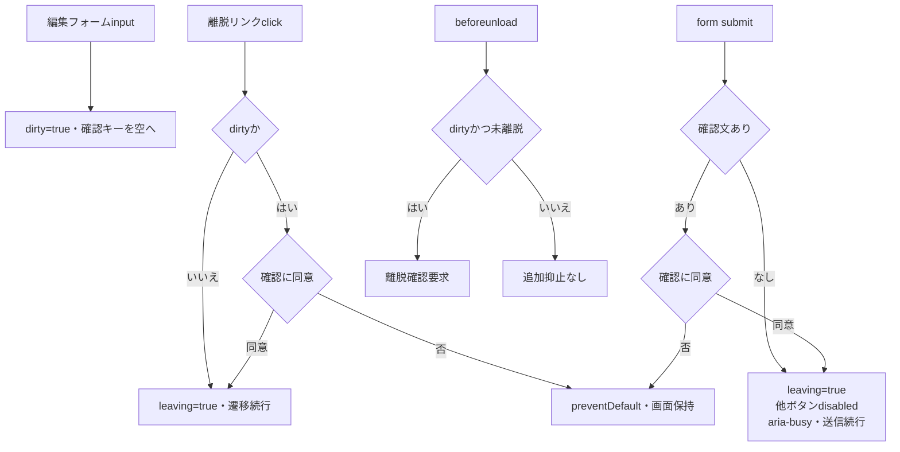

#### SQL・テーブル関連（ER図）

DB非使用。dirty・leavingはJSクロージャ内、確認キー・disabled・aria-busyはDOM状態である。サーバー保持領域や表へ記録しないためER図を省略する。根拠：`sources/wwwroot/js/site.js:2-5`。

#### DB操作の詳細

SQLはない。submit続行後に各HTTP入口へ進み、CSRF・権限・Snapshot・比較版等を別途検査する。ブラウザー確認はこれらを代替しない。根拠：`sources/Web/Controllers/StudentsController.cs:28-37`。

#### 結果・例外時の扱い

取消は送信・遷移を止めるだけで、HTTP応答は作らない。理由入力で確認キーが空になるため、確認画面で理由を追記した後も古いキーによる有効確認が保証されず、次の保存が確認再発行へ進む場合がある。空文字がサービスへ届くかNULLへ変換されるかはMVC境界であり、サービスの両分岐を画面入力へ一律適用しない。dirtyはinputイベントに基づき、全プログラム代入の検知を保証しない。根拠：`sources/wwwroot/js/site.js:3-8`、`sources/Core/SqlServerStudentService.cs:276-290`。

### 論理削除

#### 処理概要

Administratorが対象・理由を確認し、比較版付きで論理削除する。学生の物理DELETEではなく削除管理列・更新管理列・版を更新し、履歴を追記する。編集中の業務値は別フォームにあり送信しない。根拠：`sources/Views/Students/Edit.cshtml:17-17`、`sources/Core/SqlServerStudentService.cs:392-416`。

#### 処理手順

1. FormGuardで削除DTOとSnapshotId・CSRF等を検査し、認証、対象ID付きSnapshot、読込時復帰先との文字列一致を確認する。
2. coordinator.DeleteがAdministrator、非空復帰先、Confirmedを順に確認する。falseはREG-026の422 WebFault。その後、比較版をRequiredで正のInt64へ変換する。
3. DeleteAsyncで受付番号・利用者・開始時nowを取得し、Administrator以外をForbiddenにする。
4. 必須・複数行・原入力と保存値60スカラーで理由を正規化する。初期catchはInputValidationExceptionだけ。その後ID・版の非正数、版long.MaxValueをValidationFailedで拒否する。
5. OpenとReadCommitted開始を行う。両者はDB処理tryの外である。
6. try内でGate後、対象ID・非削除条件の版を再取得する。対象なしはNotFound、版不一致はConflict。
7. 対象ID・要求版・非削除条件のUPDATEで7管理列を変更する。直前にwriteStarted=trueとし、更新件数1以外はDBConcurrencyException。
8. 同じtransactionでDELETE履歴を追記し、前後版、7列の変更名、主体、now、受付番号、理由、duplicate_confirmed=falseを記録する。
9. commitAttempted=trueとしてcommitをawaitし、Savedと対象ID・版+1を返す。
10. ControllerはSavedなら通知・303。他結果はエラー追加とOutcome別Status設定後にLoadを呼び、最新学生・候補・復帰状態を確認して新Snapshotを作る。

根拠：`sources/Web/Controllers/StudentsController.cs:37-38`、`sources/Infrastructure/WebStudentCoordinator.cs:19-19`、`sources/Core/SqlServerStudentService.cs:392-416`。

#### 処理フロー

**1. Web検査・サービス初期検証**

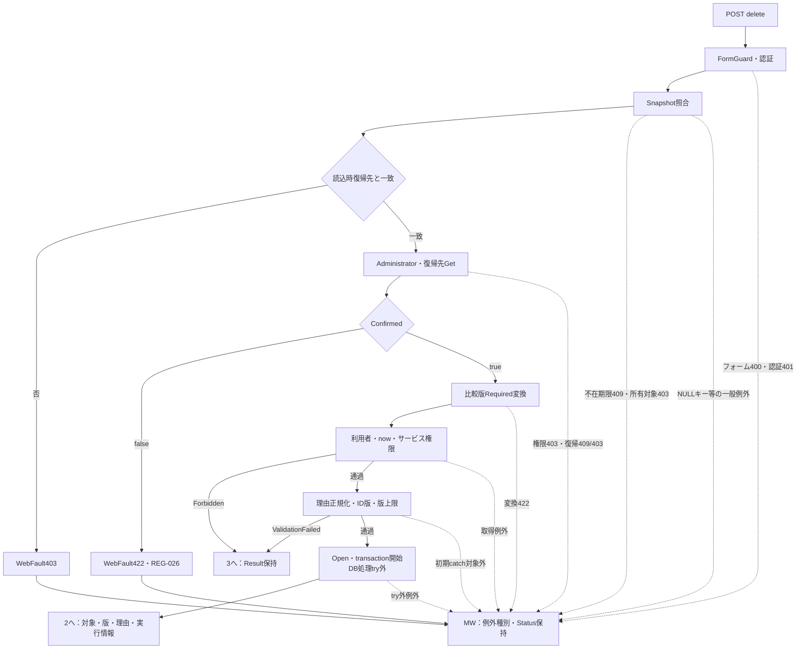

**2. DB更新・catch**

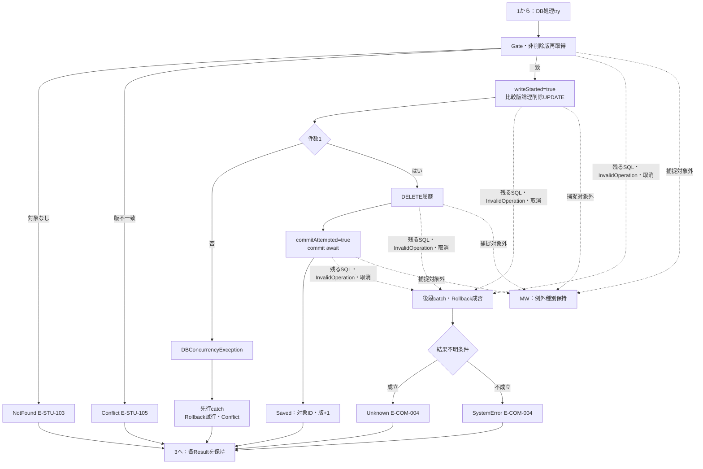

後段の結果不明条件は`writeStarted && (commitAttempted || !rolledBack)`。先行DBConcurrencyException catchはrollback成否でUnknownへ変更しない。削除にはSQL2601/2627専用catchがない。Rollback helper・外側破棄の捕捉対象外例外も伝播経路を持つ。根拠：`sources/Core/SqlServerStudentService.cs:329-329`、`sources/Core/SqlServerStudentService.cs:399-416`。

**3. 結果反映・再読込・最終応答**

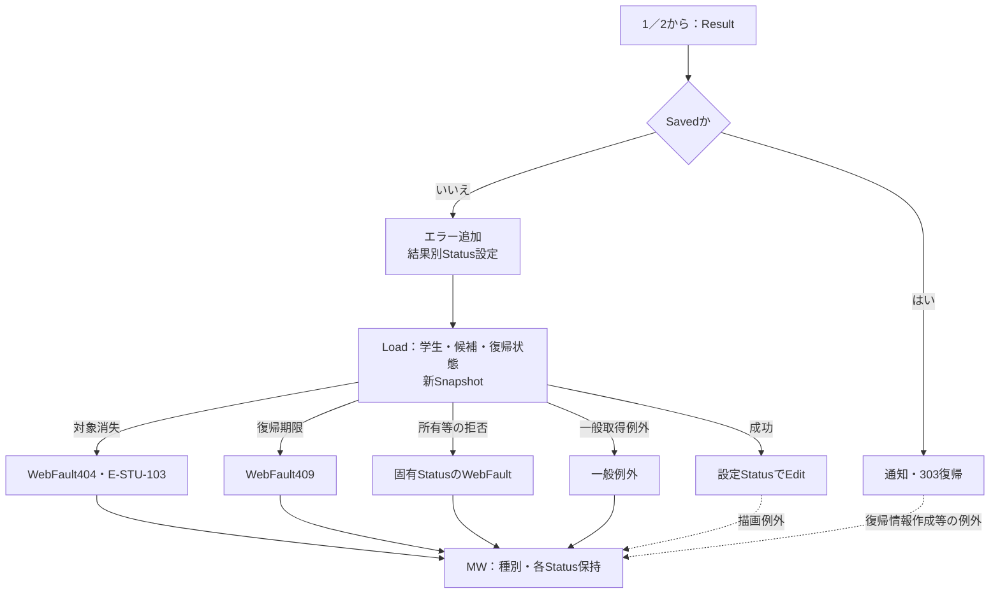

MWでは流入枝の404・409・403等を保持し、一般例外だけを応答未開始時の503へ対応させる。Load前に設定したStatusをすべての最終応答へ固定しない。根拠：`sources/Web/Controllers/StudentsController.cs:25-25`、`sources/Web/Controllers/StudentsController.cs:37-38`、`sources/Infrastructure/WebHostSetup.cs:23-24`。

#### SQL・テーブル関連（ER図）

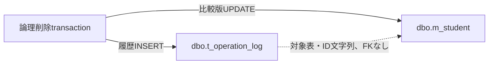

書込みは学生・履歴の二表。失敗後Loadでは読込イベントのクラス・コード・分類も参照する。根拠：`sources/Core/SqlServerStudentService.cs:403-414`、`sources/Web/Controllers/StudentsController.cs:37-37`。

#### DB操作の詳細

再取得は`SELECT row_version FROM dbo.m_student WHERE student_id=@id AND is_deleted=0`、`@id BigInt`で一値を読む。行なしはNotFound、版不一致はConflictで、この早期returnに明示rollbackはない。

UPDATEのWHEREは`student_id=@id AND row_version=@version AND is_deleted=0`。SETはis_deleted=1、deleted_at=@now、deleted_by=@actor、delete_reason=@reason、updated_at=@now、updated_by=@actor、row_version=row_version+1の7列で、氏名等を変更しない。型・Sizeは`@id/@version BigInt`、`@now DateTimeOffset`、`@actor NVarChar(128)`、`@reason NVarChar(120)`。削除理由列はNULL可能だが、削除状態CHECKは削除日時・利用者・理由の非NULLを要求する。根拠：`sources/Core/SqlServerStudentService.cs:403-411`、`sources/database/001_schema.sql:34-42`、`sources/database/001_schema.sql:200-200`。

履歴は保存と同じAuditを使い、target_table=m_student、十進対象ID、DELETE、before_version=要求版、after_version=版+1、上記7列の名前、理由、duplicate_confirmed=falseをINSERTする。パラメータ型・Sizeは保存の履歴SQLと同じ。読取・UPDATE・履歴・commitに要求ct、失敗RollbackにNoneを渡す。根拠：`sources/Core/SqlServerStudentService.cs:385-390`、`sources/Core/SqlServerStudentService.cs:413-416`。

#### 結果・例外時の扱い

削除アクションにはModelState.IsValidの一括拒否も局所WebFault catchもない。bool・文字列のバインド状態とConfirmed・版・理由の独自検査を分ける。Snapshot・権限・比較版変換のWebFaultはMWへ進む。理由の初期catchはInputValidationExceptionだけで、不正Unicode等のArgumentExceptionをValidationFailedへ変換しない。根拠：`sources/Web/Controllers/StudentsController.cs:37-37`、`sources/Infrastructure/WebStudentCoordinator.cs:19-19`、`sources/Core/SqlServerStudentService.cs:396-398`。

先行catchはConflict、後段の残るSQL・InvalidOperation・取消だけがUnknown／SystemErrorを選ぶ。Unknown文言は「削除結果を確認できません。検索で確認してください。」であり、削除確定を示さない。Savedは303、その他のHTTP対応は保存結果表と同じだが、直後にLoadする点が異なる。根拠：`sources/Core/SqlServerStudentService.cs:415-416`、`sources/Web/Controllers/StudentsController.cs:37-38`。

Load成功なら最新モデルで結果別Statusを返す。対象消失404、復帰期限409、所有等の固有WebFault、取得・描画一般例外の503へ再分岐し得る。ModelStateはClearされず、送信時試行値と新モデル値のTagHelper上の優先関係はフレームワーク境界として残る。削除理由は再モデルへ移送せず、原textareaもasp-forを使わない。根拠：`sources/Web/Controllers/StudentsController.cs:25-25`、`sources/Web/Controllers/StudentsController.cs:37-37`、`sources/Views/Students/Edit.cshtml:17-17`、`sources/Infrastructure/WebHostSetup.cs:23-24`。

### 検索画面への復帰

#### 処理概要

保存・削除成功の303と検索へ戻るリンクは、検索状態キー・版で一覧を再開する。学生保存確定と検索状態再開は別処理であり、復帰拒否が保存transactionを取り消す処理はない。根拠：`sources/Web/Controllers/StudentsController.cs:8-11`、`sources/Web/Controllers/StudentsController.cs:38-38`。

#### 処理手順

1. SavedでReturnAfterSaveを呼ぶ。復帰先がNULL・空なら新検索状態を作り、そのID・版を使う。指定済みならSnapshot.ReturnRevisionを使う。
2. 主体・セッション・検索IDの複合キーで保存／削除通知を10分Flashへ保持し、303とURLエスケープしたcontextId・contextRevisionのLocationを返す。
3. Indexは認証を確認し、contextIdなしなら新状態、指定ありならGetしてResumeを呼ぶ。contextRevision欠落は空文字として渡す。
4. ResumeのSearchContextStore.Useは初回Get、SemaphoreSlim待機、待機後再Get、要求版の文字列一致、版long.MaxValueでないことを順に確認する。再Getは期限・所有者・指定Tabを再検査する。この入口のTabはNULLである。
5. Appliedなしなら再検索せずunsearchedを返す。Appliedありなら同じSearchCriteriaをSearchAsyncへ渡す。受け入れ可能なResultならLastResultを置換しRevisionを1加算するが、Applied.Pageは補正しない。
6. SearchAsyncはSQL取得用のローカルpageを最終ページ以内へ丸める。SearchResultはCount・Items等を返し、補正ページのプロパティを持たない。したがってこの補正は保持条件へ戻らない。
7. PresentはpageをApplied.Pageから返す。取得Itemsは補正済みSQLページ、表示ページは保持値という別の値になる。件数減少時もこの対応を維持する。
8. Useのoperation成功後、検索状態期限を現在UTC+30分へ延長する。Flashを一度だけTakeし、人数なしLookup、Searchモデルを構築する。画面の分類はunsearched・empty・tooMany・foundである。

根拠：`sources/Web/Controllers/StudentsController.cs:8-11`、`sources/Web/Controllers/StudentsController.cs:38-39`、`sources/Infrastructure/WebStudentCoordinator.cs:14-21`、`sources/Infrastructure/SearchContextStore.cs:13-14`、`sources/Core/SqlServerStudentService.cs:160-168`、`sources/Core/Contracts.cs:57-58`。

#### 処理フロー

復帰を状態再開と検索値の返却へ分ける。

**1. 303・検索状態再開**

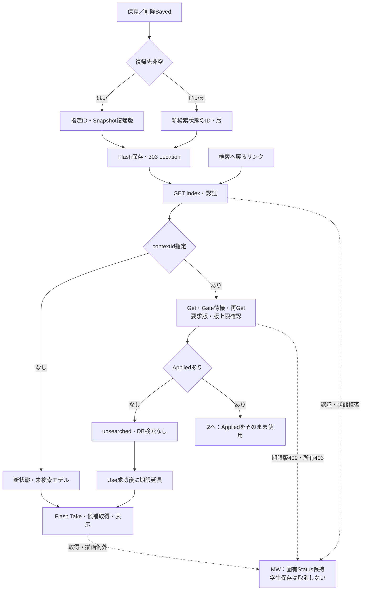

**2. SQLページと表示ページの対応**

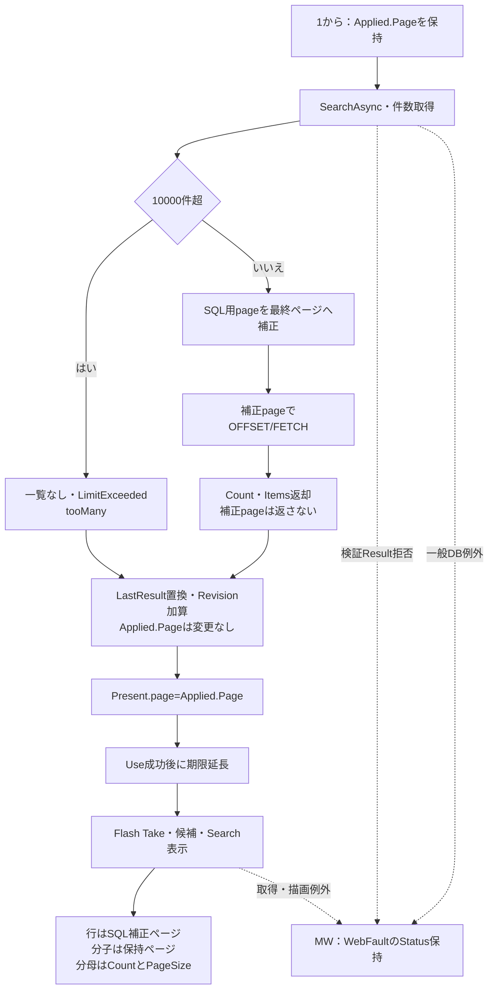

EはtooManyでもLastResult・Revisionを更新し、Applied.Pageを保持する。Rで取得ページを返さないことと、PREで保持値を返すことを別節点にする。根拠：`sources/Core/SqlServerStudentService.cs:159-168`、`sources/Infrastructure/WebStudentCoordinator.cs:14-21`。

#### SQL・テーブル関連（ER図）

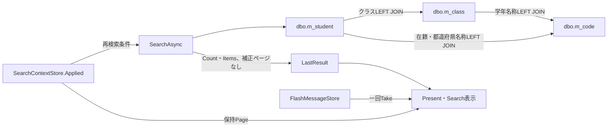

人数なしLookupはさらにm_code_categoryを参照する。学生保存transactionの接続を復帰検索へ引き継がない。根拠：`sources/Core/SqlServerStudentService.cs:82-90`、`sources/Core/SqlServerStudentService.cs:123-168`、`sources/Web/Controllers/StudentsController.cs:39-39`。

#### DB操作の詳細

適用条件を再正規化し、ページ1以上、size20・50・100、方向asc・desc、sortKeyはstudentNo・name・admissionDate・updatedAtに限定する。年度1900〜9998、クラス正数、未所属と年度・学年・クラスの同時指定禁止、在籍区分01〜04・最大4件・重複なしを要求する。日付範囲逆転も拒否する。SearchAsyncのcatchはInputValidationException、ArgumentExceptionをValidationFailedにし、一般SQL・取消等を同Resultへ変換しない。根拠：`sources/Core/SqlServerStudentService.cs:103-122`、`sources/Core/SqlServerStudentService.cs:169-170`。

SNAPSHOT内の候補存在確認はGRADE・PREFECTUREのm_codeをcategory_id＋code_valueでCOUNT_BIG=1とする。停止・期間は条件に含めない。年度はm_class.school_year一致件数>0、クラスはclass_id取得と指定年度・学年一致を要求する。`@category VarChar(24)`、`@value VarChar(10)`、`@year SmallInt`、`@id BigInt`を使用する。根拠：`sources/Core/SqlServerStudentService.cs:125-135`、`sources/Core/SqlServerStudentService.cs:218-222`。

| 条件 | SQL述語 | パラメータ・加工 |
| --- | --- | --- |
| 常時 | `s.is_deleted=0` | なし |
| 学籍番号 | `s.student_no LIKE @no ESCAPE '!'` | 正規化・エスケープ後に末尾%。`@no VarChar(31)` |
| 氏名 | `s.name_key LIKE @name ESCAPE '!'` | 照合キーの前後%。`@name NVarChar(642)` |
| カナ | `s.kana_key LIKE @kana ESCAPE '!'` | 正規化カナの空白除去後、前後%。`@kana NVarChar(74)` |
| 年度 | `c.school_year=@year` | `@year SmallInt` |
| 学年 | `c.grade_code=@grade` | `@grade VarChar(2)` |
| クラス | `s.class_id=@class` | `@class BigInt` |
| 未所属 | `s.class_id IS NULL` | パラメータなし |
| 都道府県 | `s.prefecture_code=@prefecture` | `@prefecture VarChar(2)` |
| 電話 | `(s.phone_number=@phone OR s.emergency_phone_number=@phone)` | 正規化同一値、`@phone VarChar(16)` |
| 入学日下限 | `s.admission_date>=@from` | `@from Date`、端点を含む |
| 入学日上限 | `s.admission_date<=@to` | `@to Date`、端点を含む |
| 在籍区分 | `s.enrollment_status_code IN (@status0,...)` | 指定数に応じ各`@statusN VarChar(2)`。0件なら条件なし |

指定された条件だけをAND追加する。LIKEの`!`、`%`、`_`、`[`はEscapeLikeでエスケープする。名称JOIN・StudentRowの結果形は保存イベントのRowSelectと同じである。根拠：`sources/Core/SqlServerStudentService.cs:137-155`、`sources/Core/StudentNormalizer.cs:161-161`。

件数SQLはm_studentとm_classをclass_idでLEFT JOINし、同じWHEREを付けたTOP(10001)の学生IDをCOUNT_BIGする。10000超なら一覧SQLを行わずcommitし、Count=10001、LimitExceeded=true、空Itemsを返す。このCountは全実件数ではない。通常は最終ページを最低1として計算し、SQL用ローカルpageを要求Pageと最終ページの小さい方にする。RowSelectへ同WHEREを付け、許可列とasc／desc、同値時student_id ASCで並べ、`@offset Int`・`@size Int`のOFFSET/FETCHで取得してcommitする。根拠：`sources/Core/SqlServerStudentService.cs:156-168`。

SQL取得ページは保持条件にもSearchResultにも書き戻されない。ResumeはLastResultとRevisionだけを更新し、PresentはApplied.Pageをpageとして返す。たとえば保持Page=2、PageSize=20で結果が20件へ減ると、SQLはpage=1・offset=0で1ページ目の20行を取り、表示は「2 / 1」となる。これはソースから導く現行経路の例で、試験結果ではない。Pageアクションのcoordinator.Pageには保持条件を補正して再検索する別処理があるが、Resumeはその処理を呼ばない。根拠：`sources/Core/SqlServerStudentService.cs:160-168`、`sources/Core/Contracts.cs:57-58`、`sources/Infrastructure/WebStudentCoordinator.cs:12-14`、`sources/Infrastructure/WebStudentCoordinator.cs:21-21`、`sources/Views/Students/Search.cshtml:8-8`。

Lookup(false)はOccupiedをCONVERT(int,0)へ置き換える。この0は人数の実測値ではない。コード・クラスの取得順は登録読込と同じである。根拠：`sources/Core/SqlServerStudentService.cs:196-216`、`sources/Web/Controllers/StudentsController.cs:39-39`。

#### 結果・例外時の扱い

検索状態版が編集開始後に変われば409となるが、学生保存をrollbackしない。Appliedなしは未検索、Count=0はempty、上限超過はtooMany、それ以外はfoundである。検証ResultはEnsureSearchがWebFaultへ変換し、一般DB・候補取得例外はMWへ進む。根拠：`sources/Infrastructure/WebStudentCoordinator.cs:14-21`、`sources/Views/Students/Search.cshtml:7-7`。

件数減少時の表示ページは保持Pageであり、取得行のページと一致する保証がない。前述の20件例では「2 / 1」、前へボタンはPage=1で活性、次へはdisabledとなる。0件の場合も保持Pageを補正せず分母最低1を表示するが、outcome=emptyのため両移動ボタンはdisabledになる。根拠：`sources/Infrastructure/WebStudentCoordinator.cs:21-21`、`sources/Views/Students/Search.cshtml:8-8`。

Flash.TakeはTryRemove後に期限を判定する一回限りの通知である。取得後に候補取得・描画が失敗しても同じ通知を再取得しない。検索状態の再GetはGate待機後に行い、DB awaitごとに反復する構造ではない。根拠：`sources/Web/Controllers/StudentsController.cs:11-11`、`sources/Infrastructure/FlashMessageStore.cs:7-9`、`sources/Infrastructure/SearchContextStore.cs:14-14`。

SearchビューはDataのプロパティ取得・型変換とページ数算術を行う。サービスResultの受入れ後も、JSON化、候補取得、ビュー参照・算術の成功まで保証しない。二次例外は応答未開始ならWebFault固有Status／一般503、開始後は当middlewareのcatch対象外という境界を持つ。根拠：`sources/Web/Models/StudentSearchPageModel.cs:10-15`、`sources/Views/Students/Search.cshtml:2-8`、`sources/Infrastructure/WebHostSetup.cs:23-24`。

## 補足説明

### 正規化・日付・NULLの契約

共通TextはNULLを空文字へ補完し、原入力スカラー上限、改行処理、制御文字検査、Trim、空値必須判定、保存値スカラー上限の順で処理する。任意空値はNULL、必須空値はE-STU-001。単行は改行・タブを含む制御文字を拒否する。複数行はCRLF・CRをLFに統一しLFだけを許す。CRLFは統一前に2スカラーとして数える。Text自体はNFKCしない。ScalarCountは正しいサロゲート対を1と数え、不正な単独サロゲートをArgumentExceptionにする。根拠：`sources/Core/StudentNormalizer.cs:37-57`。

氏名表示値は内部空白・文字幅を保持し、照合キーだけNFKC・大文字化・Unicode空白除去を行う。カナはNFKC後、U+3041〜U+3096とU+309D・U+309Eを対応カタカナへ変換する。保存許可はU+30A1〜U+30FA、U+30FC・U+30FB・U+30FD・U+30FE。内部Unicode空白は半角1個にまとめ、先頭・末尾へ残さない。保存18スカラーには空白も含める。根拠：`sources/Core/StudentNormalizer.cs:66-85`。

電話・郵便で除去するハイフンはASCIIハイフン、U+2010、U+2011、U+2212で、電話だけ丸括弧も除去する。電話は国内0始まり10〜11桁、またはプラス・1〜9の先頭数字・続く6〜14桁の国際形式である。メールは@一つ、ASCII許可ローカル部、先頭末尾ドット・連続ドット禁止、二つ以上のドメインラベル、各1〜63文字の英数字と内部ハイフンを検査する。ローカル部は大小文字を保持しドメインを小文字化する。個別ローカル部上限64より前に全体60スカラー上限が適用される。根拠：`sources/Core/StudentNormalizer.cs:87-111`。

| 元号ID | 表示名 | 実装の対応期間 |
| --- | --- | --- |
| REIWA | 令和 | 2019-05-01〜DateOnly.MaxValue |
| HEISEI | 平成 | 1989-01-08〜2019-04-30 |
| SHOWA | 昭和 | 1926-12-25〜1989-01-07 |
| TAISHO | 大正 | 1912-07-30〜1926-12-24 |
| MEIJI | 明治 | 1900-01-01〜1912-07-29 |

和暦はOS元号一覧へ委ねず上表を使う。元号ID完全一致、NFKC後の正数年・月・日、年「元」は1とし、Trimは行わない。年4、月日2コード単位の数値上限はNFKC後に検査する。実在日、元号期間、業務日以下、逆変換した元号・年を確認する。表示は元年と2桁月日。西暦はNFKC後の厳密yyyy-MM-dd、1900-01-01以上、学生日付は業務日以下を要求する。根拠：`sources/Core/JapaneseDateService.cs:9-59`。

サービス業務日はSaveAsync開始時nowをUTC+9へ変換して求める。画面業務日はWebPresentationの現在UTC由来で、取得時点が異なる。年度は4月開始、1〜3月は前年である。コード・クラス期間もサービスは開始時dayをDB待機後に使用する。根拠：`sources/Core/SqlServerStudentService.cs:44-45`、`sources/Core/SqlServerStudentService.cs:229-229`、`sources/Infrastructure/WebPresentation.cs:5-7`。

単体変換エラーがなければname_key・kana_key・relationship_categoryを生成し、項目間検査へ進む。生年月日≦入学日、在籍01〜04、01・02は終了日なし・クラス必須、03・04は入学日以上の終了日必須、本人電話・メール・緊急電話の一つ以上、緊急3項目は0個または3個を要求する。DBにも日付・所属・連絡先CHECKがあるが、未来日・期間・定員などサービス検査の全内容をDB CHECKへ一般化しない。根拠：`sources/Core/StudentNormalizer.cs:143-158`、`sources/database/001_schema.sql:198-199`。

MVCは非nullable参照型の暗黙Requiredを抑止する。C# string注釈・初期値・ブラウザーrequiredだけで受信NULLを排除した保証を置かない。ToRequestはBirthDateInput全体NULLだけをnewで補完し、内部Year・Month・Dayは補完しない。Era NULLは元号不一致のArgumentExceptionへ進む。有効元号でNULL成分のNormalizeに到達する場合、またはAdmissionDate NULLのParseIsoではNullReferenceExceptionとなり得る。Normalizerの項目収集とSaveAsync初期catchはInputValidationException・ArgumentExceptionだけで、NULL参照は収集しない。生の欠落・空値からこのバインド後値へ至る境界は区別する。根拠：`sources/Infrastructure/WebHostSetup.cs:16-16`、`sources/Web/Inputs/StudentSaveInput.cs:34-42`、`sources/Core/JapaneseDateService.cs:19-24`、`sources/Core/JapaneseDateService.cs:52-54`、`sources/Core/StudentNormalizer.cs:123-137`、`sources/Core/SqlServerStudentService.cs:232-239`。

IdParser.OptionalはNULL・空文字を未設定にする。それ以外は19コード単位以内、ASCII数字のみ、Int64へ変換可能、正数を要求する。Trim・NFKCはせず、空白・符号・全角数字・ゼロ・範囲超過は422、Requiredは未設定も422である。ルートlong変換はこのパーサーを通らない。根拠：`sources/Web/Inputs/StudentSaveInput.cs:57-60`、`sources/Web/Controllers/StudentsController.cs:24-37`。

SnapshotIdは数値変換せずTryGetValueへ渡し、明示NULL検査がない。非NULLの空文字・不在キーは独自409、期限も409、所有者・セッション・対象不一致は403。バインド後NULLが届く場合は辞書NULLキー契約によるArgumentNullExceptionが独自検査より前に生じ得る。保存・reset・削除のGetは局所catch外で、これをWebFault409へまとめない。依存辞書の実装・受信時の発生確認と、呼出し元の検査欠如は別の境界である。根拠：`sources/Infrastructure/EditorSnapshotStore.cs:10-10`、`sources/Web/Controllers/StudentsController.cs:29-37`。

### フォーム・認証・HTTP設定

FormGuardはOrdinalIgnoreCaseの許可名集合を作り、保存DTOへInput.を付け、BirthDateInputだけ四成分へ展開する。CSRF項目と__Invariantを許可し、未知項目、不正な書式参照、許容例外以外の同名複数値を400にする。値の必須性や内容は検査しない。__Invariantの特別分岐自体は原文のキー文字列比較に従う。同名複数値の例外は__Invariant、末尾StatusCodes、末尾UnassignedOnlyに対する条件である。根拠：`sources/Web/Controllers/StudentsController.cs:41-41`。

| 設定対象 | 登録値・条件 | 学生画面への対応 |
| --- | --- | --- |
| 認証 | CookieAuthenticationDefaults.AuthenticationScheme、Cookie名`__Host-StudentManagement` | Authorizeへ接続 |
| 認証Cookie | Secure Always、HttpOnly、SameSite Strict、30分、SlidingExpiration | Snapshot等とは別期限 |
| 認証拒否 | 未認証401・拒否403。`/api`だけ独自JSONを書き、それ以外はTask.CompletedTask | `/students`ではこのイベントのログイン画面redirect・独自JSONなし |
| CSRF | HeaderName=`RequestVerificationToken`、Cookie名`__Host-StudentManagement-CSRF`、Secure Always・HttpOnly・Strict | 各POSTのトークンと全体検査 |
| MVC | AutoValidateAntiforgeryTokenAttribute、AntiforgeryResultFilter、暗黙Required抑止、検証エラー最大100 | `/api`のCSRF失敗だけ独自JSON400へ書換え。学生HTML結果は同filterで書換えない |
| フォーム上限 | MultipartBodyLengthLimit=65536、ValueLengthLimit=65536、ValueCountLimit=128 | 項目別スカラー上限と別設定 |
| 本文上限 | Kestrel MaxRequestBodySize=65536 | モデル・サービス検査とは別段階 |
| 応答ヘッダー | no-store、nosniff、no-referrer | 共通middlewareがnext前に設定 |
| CSP | `default-src 'self'; script-src 'self'; style-src 'self'; img-src 'self'; frame-ancestors 'none'; base-uri 'self'; form-action 'self'` | 原アプリの応答設定 |
| middleware順 | ヘッダー・例外処理、HTTPS redirect、静的ファイル、Routing、Authentication、Authorization | ProgramでUse後にMapControllers |

根拠：`sources/Infrastructure/WebHostSetup.cs:14-25`、`sources/Infrastructure/AntiforgeryResultFilter.cs:7-8`、`sources/Program.cs:3-7`。これらのフレームワーク設定とアクション本体のFormGuard・独自権限検査を区別し、未収録のフィルター内部から細かな実行順を補わない。

RequestIdentityは認証済み主体からNameIdentifier、login_session、Roleを読む。主体・セッションの空白、主体64スカラー超、セッション64コード単位超、Enum.TryParse失敗は401。共有headerの利用者名はUser.Identity.Name、監査主体はNameIdentifierである。サービスUserはPrincipalをTextで再検査し、Webでは非空SessionIdを要求する。根拠：`sources/Infrastructure/RequestIdentity.cs:7-15`、`sources/Views/Shared/_Layout.cshtml:1-1`、`sources/Core/SqlServerStudentService.cs:46-51`。

### 保持領域と外側例外応答

| 保持領域 | 内容・期限 | 照合・更新・消費 |
| --- | --- | --- |
| EditorSnapshotStore | Owner・Session・対象ID・Detail・Original複製・ReturnRevision。作成UTC+30分固定 | Getで不在・期限・所有・対象。DB await後の再Get、保存・reset時延長、成功時除去なし |
| SearchContextStore | Owner・Session・Tab・Applied・LastResult・正のRevision・SemaphoreSlim。初期30分 | Gate待機後再Get、要求版・上限照合。operation成功後に現在UTC+30分へ延長 |
| FlashMessageStore | 主体・セッション・検索IDの複合キー、通知、UTC+10分 | TakeでTryRemoveし、期限切れでも取得時に除去 |
| WebConfirmations | CurrentUser・対象ID・要求版・両ハッシュ・Expires・Busy。開始時now+10分 | 全属性・Busy照合、通常失敗で条件付き解放、成功・Unknownで除去、発行時期限掃除 |

根拠：`sources/Infrastructure/EditorSnapshotStore.cs:7-11`、`sources/Infrastructure/SearchContextStore.cs:9-15`、`sources/Infrastructure/FlashMessageStore.cs:6-9`、`sources/Core/SqlServerStudentService.cs:19-29`、`sources/Core/SqlServerStudentService.cs:278-335`。前三ストアはSingleton、確認情報は別のstaticメモリである。根拠：`sources/Infrastructure/WebHostSetup.cs:13-13`。

Snapshot・検索GetはExpires<現在時刻で期限切れ、確認はExpires>開始時nowで有効、掃除はExpires<=now、FlashはExpires>=現在時刻で通知を返す。比較演算と取得時刻を一律にしない。Snapshotは最初のGet後、保存DB待機中に再照合する構造ではない。根拠：`sources/Infrastructure/EditorSnapshotStore.cs:10-10`、`sources/Infrastructure/SearchContextStore.cs:13-14`、`sources/Infrastructure/FlashMessageStore.cs:9-9`、`sources/Core/SqlServerStudentService.cs:278-335`。

MWはnextから伝播した例外をResponse.HasStarted=falseの場合だけ捕捉する。WebFaultはそのStatus・文言を保持し、その他は503と一般文言を使う。学生画面では文言をHtmlEncodeし、検索画面へのリンクを持つHTMLを返す。catch内の応答書込み自体や、応答開始済みの例外まで捕捉保証を拡張しない。

```mermaid
flowchart TD
 A["MW：例外・固有Statusを引継ぎ"] --> S{"Response.HasStarted"}
 S -->|true| O["当middlewareのcatch対象外"]
 S -->|false| K{"WebFaultか"}
 K -->|はい| W["Status=例外.Status<br/>文言=例外.Message"]
 K -->|いいえ| G["Status=503・一般文言"]
 W --> P{"api配下か"}
 G --> P
 P -->|いいえ：students| H["HtmlEncodeしたHTML<br/>検索画面リンク"]
 P -->|はい| J["共通JSONエラー分岐"]
```

`/api`分岐は401・403・409・422をunauthenticated・forbidden・conflict・validationFailedへ、その他をsystemErrorへ対応させ、一般例外だけretry=trueにする。これは共通middlewareの宣言であり、学生画面に公開JSON APIを追加する仕様ではない。根拠：`sources/Infrastructure/WebHostSetup.cs:22-24`。

### 表示名称の保存元と未接続処理

クラス名称はm_class.class_nameのnvarchar(36) NOT NULL、18スカラーCHECKである。宣言されたSaveClassAsyncも原入力・保存18スカラー、NVarChar(36)を使用する。クラスコードはIdentifierの9文字、varchar(9)、VarChar(9)、年度との複合一意。年度smallint、学年varchar(2)、期間date NOT NULL、定員int NULLを候補と保存時検査に使う。定員NULLは上限制限なし、人数は学生の集計で保存列ではない。根拠：`sources/Core/MasterMaintenanceService.cs:32-37`、`sources/Core/MasterMaintenanceService.cs:73-73`、`sources/database/001_schema.sql:62-87`、`sources/database/001_schema.sql:188-201`。

コード名称はm_code.code_nameのnvarchar(24) NOT NULL、12スカラーCHECKで、SaveCodeAsyncも原入力・保存12スカラー、NVarChar(24)を使用する。コード値はvarchar(10)のDB容量と分類別桁数を分ける。用途別の性別・在籍・都道府県・続柄・学年候補と、grade_name・status_name・prefecture_name等のSQL別名は同じ保存名称の利用先である。LEFT JOIN結果のstring?は参照先列のNULL許可を意味しない。Razor候補表はNULL ClassNameを未所属に補完しない。根拠：`sources/Core/MasterMaintenanceService.cs:82-83`、`sources/Core/MasterMaintenanceService.cs:115-115`、`sources/database/001_schema.sql:112-134`、`sources/Core/Contracts.cs:50-53`、`sources/Core/SqlServerStudentService.cs:82-90`、`sources/Views/Students/Edit.cshtml:14-14`。

MasterMaintenanceServiceは名称保存契約を宣言するが、WebのDI・ルートから保守呼出しへ接続されていない。学生画面の操作として保守機能を説明しない。seedは性別0未回答、在籍01〜04等を定義し、既存初期値との差分で上書きせず中断し、不足行を追加する。学生・クラス初期行は作らない。根拠：`sources/Infrastructure/WebHostSetup.cs:12-19`、`sources/Web/Controllers/StudentsController.cs:5-41`、`sources/database/002_seed.sql:15-22`、`sources/database/002_seed.sql:85-91`。

webTokens=falseにはt_confirmation分岐がある。UPDLOCK付き読取はtoken、principal、session_id、対象ID・要求版のNULL同士または一致、expires_at>@now、consumed=0を全条件にし、両binary(32)ハッシュを照合する。token・sessionはUniqueIdentifier、actor NVarChar(128)、ID・版BigInt、now DateTimeOffset。発行は別ReadCommittedでハッシュBinary(32)・期限DateTimeOffset等をINSERTしてcommitし、保存時の消費はtokenかつconsumed=0のUPDATEが1行であることを要求する。現在のWeb登録はtrueで、このDB保持先へ置換しない。根拠：`sources/Core/SqlServerStudentService.cs:279-283`、`sources/Core/SqlServerStudentService.cs:308-311`、`sources/Core/SqlServerStudentService.cs:337-342`、`sources/Infrastructure/WebHostSetup.cs:19-19`。

StrictJson.Read、WebPresentation.Lookups・Save、WebStudentCoordinator.Optionsは宣言helperで、当画面の実入口から呼ばれない。実POST `/students/options`は検索フォームのHTML再表示でOptions helperを呼ばない。JSONの重複名禁止・大小文字区別・深さ16・64KiB、JSON保存応答形、ClassName NULL時の未所属補完をRazorへ適用しない。根拠：`sources/Infrastructure/StrictJson.cs:4-14`、`sources/Infrastructure/WebPresentation.cs:8-18`、`sources/Infrastructure/WebPresentation.cs:30-30`、`sources/Infrastructure/WebStudentCoordinator.cs:16-16`、`sources/Web/Controllers/StudentsController.cs:22-22`。

t_runtime_stateには暗号化payload等のDDLがあるが、編集・検索・通知ストアからの読書き接続はない。Web用権限SQLはviewerの学生・クラス・分類・コードSELECT、staffの学生INSERT・UPDATEと履歴INSERT、adminのクラス・コードINSERT・UPDATEを宣言し、学生物理DELETE、履歴UPDATE・DELETE、分類変更等をDENYする。アプリRole検査とDBロール権限宣言は別であり、DDLやGRANTから実接続利用者への適用結果を導かない。根拠：`sources/database/001_schema.sql:171-184`、`sources/Infrastructure/WebHostSetup.cs:13-19`、`sources/database/003_web_permissions.sql:8-24`。

### 関連文書の対応

以下は提供計画のID・kind・相対pathを保持した対応である。本書以外は本応答で未生成、既存生成状態は未確認。基本設計とは原REG項目・実イベントで対応し、本書の必要条件を未生成文書へ委ねない。

| 文書ID | kind | 計画path | 本書との対応・状態 |
| --- | --- | --- | --- |
| CSHARP_ASPNET-BAS-STU-02 | basic-design | [基本設計書/02_学生登録画面.md（未生成）](../../基本設計書/02_学生登録画面.md) | REG項目、登録・編集・参照・復元・確認・削除の業務説明。本文間照合は未実施 |
| CSHARP_ASPNET-BAS-STU-03 | table-index | [基本設計書/03_テーブル仕様書.md（未生成）](../../基本設計書/03_テーブル仕様書.md) | 五表の用途、FK、表示JOIN、保持境界 |
| CSHARP_ASPNET-BAS-STU-04 | code-design | [基本設計書/04_コード設計書.md（未生成）](../../基本設計書/04_コード設計書.md) | 分類、候補順、既存保持、初期値、宣言保守 |
| CSHARP_ASPNET-BAS-STU-03-M_STUDENT | table-definition | [基本設計書/テーブル/01_m_student.md（未生成）](../../基本設計書/テーブル/01_m_student.md) | 業務値、照合キー、比較版、削除管理列 |
| CSHARP_ASPNET-BAS-STU-03-M_CLASS | table-definition | [基本設計書/テーブル/02_m_class.md（未生成）](../../基本設計書/テーブル/02_m_class.md) | 選択キー、年度・学年、名称、期間、定員 |
| CSHARP_ASPNET-BAS-STU-03-M_CODE_CATEGORY | table-definition | [基本設計書/テーブル/03_m_code_category.md（未生成）](../../基本設計書/テーブル/03_m_code_category.md) | 分類、有効状態、分類別桁数・追加可否 |
| CSHARP_ASPNET-BAS-STU-03-M_CODE | table-definition | [基本設計書/テーブル/04_m_code.md（未生成）](../../基本設計書/テーブル/04_m_code.md) | 選択コード、表示名称、順序、有効期間 |
| CSHARP_ASPNET-BAS-STU-03-T_OPERATION_LOG | table-definition | [基本設計書/テーブル/05_t_operation_log.md（未生成）](../../基本設計書/テーブル/05_t_operation_log.md) | 前後版、変更列名、理由、実行情報 |
| CSHARP_ASPNET-DET-CSharp_ASPNET-SCR-STU-002 | detailed-specification | 詳細仕様書/CSharp_ASPNET/02_学生登録画面.md | 本書。実コントロール、受信・内部値、DB、結果・応答境界 |
