<!-- spec-meta: {"schema":"spec-md/1.0","documentId":"CSHARP_ASPNET-BAS-STU-01","version":"1.2","path":"基本設計書/01_学生検索画面.md","sheets":[{"heading":"概要","kind":"GRID","sheet":"概要"},{"heading":"項目一覧","kind":"LIST","sheet":"項目一覧","key":["No"]},{"heading":"イベント仕様","kind":"GRID","sheet":"イベント仕様"},{"heading":"補足説明","kind":"GRID","sheet":"補足説明"}]} -->
# 学生検索画面 基本設計書

| 文書属性 | 内容 |
| --- | --- |
| 文書ID | CSHARP_ASPNET-BAS-STU-01 |
| 種別 | basic-design／基本設計書 |
| 版 | 1.2 |
| 正本の相対パス | 基本設計書/01_学生検索画面.md |
| 対象責務 | 学生の条件検索、検索候補の連動、一覧・ページ操作、検索状態の保持、登録・編集・参照との往復 |
| 記述基準 | ソースで観測した実装。DDLの宣言、初期投入SQLの定義、コメントの意図を区別する。 |
| 根拠表記 | 原ソースのPOSIX相対パス、開始行、終了行。indexed原文に付された行番号に対応する。 |
| 対応文書 | CSHARP_ASPNET-DET-CSharp_ASPNET-SCR-STU-001／detailed-specification／`詳細仕様書/CSharp_ASPNET/01_学生検索画面.md`。計画時点では未生成。本書の検索項目・一覧項目・制御項目と各イベントを、実コントロール、要求型、呼出入口、SQLへ対応させる文書である。 |

## 概要

### 1.1 目的と利用者

学生検索画面は、論理削除されていない学生を条件で絞り込み、氏名、生年月日、所属、在籍区分、住所、本人電話、更新日時を一覧で確認する画面である。検索には常に `s.is_deleted=0` を適用する。電話条件は本人電話または緊急連絡先電話との一致を調べるが、一覧の電話列には本人電話だけを表示する。［根拠：Views/Students/Search.cshtml:5-8、Core/SqlServerStudentService.cs:77-90・137-153］

宣言された役割はViewer、Staff、Administratorである。Viewerの行リンクは「参照」、その他の役割では「編集」と表示し、同じ学生読込入口へ遷移する。Viewerには新規登録リンクを表示しない。登録・更新はサーバー側でもViewerを拒否し、論理削除はAdministratorだけに許可する。既存学生を参照するViewerには、遷移先の編集fieldsetを無効化して表示する。［根拠：Core/Contracts.cs:4-6、Views/Students/Search.cshtml:6-8、Infrastructure/RequestIdentity.cs:13-16、Web/Models/StudentEditPageModel.cs:14-14、Views/Students/Edit.cshtml:5-5］

### 1.2 画面と処理の受渡し

共有ヘッダーには「学生管理システム」、利用者名、業務日を表示する。利用者名は `User.Identity.Name`、業務日は現在時刻をUTCオフセット+9へ変換した日付である。表示する利用者名と、検索状態の所有者照合に使う認証主体は別の値である。本文は、画面名、検証メッセージ・通知、検索条件、検索・候補更新、クリア・新規登録、結果説明、表示件数・並び順、11列の一覧、ページ操作の順に配置する。［根拠：Views/Shared/_Layout.cshtml:1-1、Views/Shared/_MessagePanel.cshtml:2-3、Views/Students/Search.cshtml:3-8、Infrastructure/WebPresentation.cs:5-7、Infrastructure/RequestIdentity.cs:8-10］

ブラウザーのフォーム値はMVCでバインド・変換された後、コントローラーへ渡る。検索では `StudentSearchInput` を `SearchCriteria` に移送し、サービスが検査・正規化した局所値をSQLパラメータにする。結果は `StudentRow` から表示用オブジェクト、画面モデル内の `JsonElement` を経てRazorに表示される。このJSON変換は画面内部の受渡しであり、検索フォームの成功応答はRazor画面である。［根拠：Web/Controllers/StudentsController.cs:13-22・39-40、Web/Inputs/StudentSearchInput.cs:19-22、Core/SqlServerStudentService.cs:77-90、Infrastructure/WebPresentation.cs:20-20、Web/Models/StudentSearchPageModel.cs:15-15］

入力中の条件、適用済み条件、直近結果は分けて扱う。候補更新は入力中の条件と候補を再表示し、適用済み条件と一覧を更新しない。検索とページ変更が成功したときに条件・結果をメモリへ反映する。登録画面から検索へ戻ると、保持した条件で一覧を取り直す。保持条件は入力由来のコピーであり、正規化済みのSQL検索キーそのものではない。［根拠：Web/Controllers/StudentsController.cs:22-22、Infrastructure/WebStudentCoordinator.cs:7-15、Core/SqlServerStudentService.cs:113-153］

### 1.3 静的画面投影

次のHTMLは、Viewer以外の利用者が初期条件で検索し、通常結果の1ページ目に次ページが存在する状態を表す。角括弧は動的値の差込み位置であり、実際の学生・利用者・件数ではない。在籍区分01～04はseedの定義に対応する表示枠で、実画面は取得したDB候補の値と名称を列挙する。これは実画面の撮影ではない。

共有レイアウトと検索画面に適用されるCSSを一体で投影する。検索条件は `.fields` による2列配置で、幅760px以下では1列になる。一覧の `.grid` は横スクロールし、表の最小幅は1050px、セルは任意位置で折り返す。操作領域の `.actions` は折返し可能なflex配置である。元のrouteとHTTP methodは非実行のdata属性に記録し、アプリへのリンクは文書内fragment、ボタンは `type=button` にする。JavaScriptや外部CSSへの接続は持たない。［根拠：Views/_ViewStart.cshtml:1-1、Views/_ViewImports.cshtml:1-3、Views/Shared/_Layout.cshtml:1-1、Views/Students/Search.cshtml:3-8、wwwroot/css/site.css:1-1］

<!doctype html>
<html lang="ja">
<head>
<meta charset="utf-8">
<meta name="viewport" content="width=device-width,initial-scale=1">
<title>学生管理</title>
<style>
:root{font-family:Meiryo,'Yu Gothic UI',sans-serif;color:#243448;background:#f2f5f9;font-size:14px}*{box-sizing:border-box}body{margin:0}header{background:#153654;color:white;padding:16px 28px;display:flex;justify-content:space-between;gap:20px}main{background:white;max-width:1440px;margin:24px auto;padding:24px}h1{font-size:24px}fieldset{border:1px solid #c8d1dc;padding:18px;margin:12px 0}legend{font-weight:bold}.fields{display:grid;grid-template-columns:1fr 1fr;gap:14px 28px}label{display:flex;flex-direction:column;gap:5px}.full{grid-column:1/-1}input,select,textarea,button{font:inherit;padding:8px;border:1px solid #afbece;border-radius:3px}textarea{min-height:90px}input,select,textarea{max-width:100%;width:100%}.check{display:inline-flex;flex-direction:row;align-items:center;margin-right:12px}.check input{width:auto}.actions{display:flex;gap:10px;align-items:center;flex-wrap:wrap;margin:16px 0}button{background:white;cursor:pointer}.primary{background:#1c5985;color:white}.danger{color:#ae2534;border-color:#b44d59}button:disabled{cursor:default;color:#8a98a5;background:#f3f5f8}.message{padding:14px;border:1px solid #b6dccc;background:#edf7f3}.error{background:#fff1f1;border-color:#c66}.warning{background:#fff8eb;padding:12px}.grid{overflow-x:auto}table{border-collapse:collapse;min-width:1050px;width:100%;font-size:12px}th,td{padding:10px 8px;border:1px solid #d4dee8;vertical-align:top;overflow-wrap:anywhere}th{background:#e6eef6}tr:nth-child(even){background:#f8fafc}.pager{display:flex;gap:14px;align-items:center;justify-content:center;margin:18px}small{color:#5f7183}@media(max-width:760px){main{margin:0;padding:15px}.fields{grid-template-columns:1fr}header{flex-direction:column}}
</style>
</head>
<body>
<header><strong>学生管理システム</strong><span>利用者 ［利用者名］　業務日 ［yyyy/MM/dd］</span></header>
<main>
<h1>学生検索</h1>
<form data-search-form data-http-method="POST" data-source-route="/students/search">
<input type="hidden" name="ContextId" value="［検索状態ID］">
<input type="hidden" name="ContextRevision" value="［検索状態版］">
<input type="hidden" name="TabId" value="［画面識別値］">
<input type="hidden" name="PageSize" value="20">
<input type="hidden" name="SortKey" value="studentNo">
<input type="hidden" name="SortDirection" value="asc">
<input type="hidden" name="__RequestVerificationToken" value="">
<fieldset><legend>検索条件</legend><div class="fields">
<label>学籍番号<input name="Criteria.StudentNo" id="SRC-001" maxlength="30" value=""></label>
<label>氏名<input name="Criteria.Name" id="SRC-002" maxlength="16" value=""></label>
<label>氏名カナ<input name="Criteria.Kana" id="SRC-003" maxlength="72" value=""></label>
<label>年度<select name="Criteria.SchoolYear" id="SRC-004"><option value="" selected>すべて</option><option value="［候補年度］">［候補年度］</option></select></label>
<label>学年<select name="Criteria.GradeCode" id="SRC-005"><option value="" selected>すべて</option><option value="［学年コード］">［DB学年名］</option></select></label>
<label>クラス<select name="Criteria.ClassId" id="SRC-006"><option value="" selected>すべて</option><option value="［クラスID］">［年度］ ［クラスコード］ ［クラス名称］</option></select></label>
<label class="check"><input type="checkbox" name="Criteria.UnassignedOnly" id="SRC-007" value="true">未所属のみ</label>
<fieldset><legend>在籍区分</legend>
<label class="check"><input type="checkbox" name="Criteria.StatusCodes" value="01" checked>［01のDB名称］</label>
<label class="check"><input type="checkbox" name="Criteria.StatusCodes" value="02" checked>［02のDB名称］</label>
<label class="check"><input type="checkbox" name="Criteria.StatusCodes" value="03">［03のDB名称］</label>
<label class="check"><input type="checkbox" name="Criteria.StatusCodes" value="04">［04のDB名称］</label>
<small>全解除はすべて</small></fieldset>
<label>都道府県<select name="Criteria.PrefectureCode" id="SRC-009"><option value="" selected>すべて</option><option value="［都道府県コード］">［DB都道府県名］</option></select></label>
<label>電話番号<input name="Criteria.PhoneNumber" id="SRC-010" maxlength="40" value=""></label>
<label>入学日・開始<input name="Criteria.AdmissionFrom" id="SRC-011" type="date" value=""></label>
<label>入学日・終了<input name="Criteria.AdmissionTo" id="SRC-012" type="date" value=""></label>
</div><div class="actions"><button type="button" class="primary" data-http-method="POST" data-source-route="/students/search">検索</button><button type="button" data-http-method="POST" data-source-route="/students/options">候補を更新</button></div></fieldset>
</form>
<div class="actions"><form data-http-method="POST" data-source-route="/students/clear"><input type="hidden" name="__RequestVerificationToken" value=""><input type="hidden" name="ContextId" value="［検索状態ID］"><input type="hidden" name="ContextRevision" value="［検索状態版］"><input type="hidden" name="TabId" value="［画面識別値］"><button type="button">クリア</button></form><a href="#event-open" data-http-method="GET" data-source-route="/students/new?returnContextId={ContextId}">新規登録</a></div>
<p>検索結果 ［総件数］ 件　［検索日時］</p>
<form data-http-method="POST" data-source-route="/students/page">
<input type="hidden" name="__RequestVerificationToken" value=""><input type="hidden" name="ContextId" value="［検索状態ID］"><input type="hidden" name="ContextRevision" value="［検索状態版］"><input type="hidden" name="TabId" value="［画面識別値］">
<div class="actions"><label>表示件数<select name="PageSize"><option value="20" selected>20</option><option value="50">50</option><option value="100">100</option></select></label><label>並び順<select name="SortKey"><option value="studentNo" selected>学籍番号</option><option value="name">氏名</option><option value="admissionDate">入学日</option><option value="updatedAt">更新日時</option></select></label><select name="SortDirection" aria-label="並び順方向"><option value="asc" selected>昇順</option><option value="desc">降順</option></select><button type="button" name="Page" value="1">並び順・件数を反映</button></div>
<div class="grid"><table><thead><tr><th>学籍番号</th><th>氏名</th><th>氏名カナ</th><th>生年月日</th><th>年度／学年</th><th>クラス</th><th>在籍区分</th><th>住所</th><th>本人電話</th><th>更新日時</th><th>操作</th></tr></thead><tbody><tr><td>［学籍番号］</td><td>［氏名］</td><td>［氏名カナ］</td><td>［和暦生年月日］</td><td>［年度］ ［学年名］</td><td>［クラスコード］ ［クラス名］</td><td>［在籍区分名］</td><td>［都道府県名＋住所1］</td><td>［本人電話］</td><td>［更新日時］</td><td><a href="#event-open" data-http-method="GET" data-source-route="/students/{studentId}?returnContextId={ContextId}">編集</a></td></tr></tbody></table></div>
<nav class="pager"><button type="button" name="Page" value="0" disabled>前へ</button><span>1 / ［最終ページ］</span><button type="button" name="Page" value="2">次へ</button></nav>
</form>
</main>
</body>
</html>

互いに異なる状態は、上の投影へ同時に重ねず、次の差分として表す。［根拠：Views/Students/Search.cshtml:5-8、Views/Shared/_MessagePanel.cshtml:2-3、wwwroot/js/site.js:7-7］

| 状態・役割 | 投影の差分 |
| --- | --- |
| Viewer | 新規登録リンクを取り除き、各行の「編集」を「参照」にする。学生読込routeは同じ。 |
| 初期表示・クリア後 | 結果説明は「未検索」、tbodyは空、ページは1 / 1。反映・前へ・次へをdisabledにする。在籍01・02、未所属false、その他未指定。 |
| 未所属trueの再描画 | SRC-007をchecked、SRC-004・005・006をdisabledにする。候補更新では所属3値を解除する。チェック変更のJavaScriptは値のクリアだけで、その場ではdisabledを切り替えない。 |
| 成功0件 | 「該当する学生はありません。」を表示し、tbodyを空にする。反映・前後をdisabledにし、件数・検索日時の数値表示は行わない。 |
| 10,000件超過 | warningクラスの段落で「10,000件を超えました。条件を追加してください。」を表示する。tbodyは空、反映・前後はdisabled。件数・検索日時は表示しない。 |
| 通常結果のページ境界 | 前へはpageが1以下ならdisabled。次へはpage×表示件数が総件数以上ならdisabled。反映は有効。 |
| 通常通知あり | h1直後に `<div class="message info" aria-live="polite">［通知］</div>` を置く。info単独のCSS規則はない。 |
| 検証エラーあり | h1直後に `<div class="message error" aria-live="polite">［All検証サマリー］</div>` を置く。通常通知もある場合はその後ろに置く。 |
| 停止クラス候補 | 年度・クラスコード・名称の後ろへ「（停止）」を追加する。期間外の注記はなく、一覧クラス列にも停止注記を追加しない。 |

### 1.4 結果状態と表示上の境界

検索成功の結果と検証失敗を区別する。内部件数10001は上限判定の打切り値であり、実総件数ではない。未検索・0件・上限超過でも、表示件数・並び順・方向のselect自体は無効化しない。［根拠：Core/SqlServerStudentService.cs:156-170、Infrastructure/WebStudentCoordinator.cs:20-21、Views/Students/Search.cshtml:7-8］

| 表示状態 | 表示データ | 結果説明 | 反映・ページ操作 |
| --- | --- | --- | --- |
| unsearched | totalCount=NULL、items空、searchedAt=NULL | 未検索 | 反映・前後とも無効 |
| empty | totalCount=0、items空、searchedAtあり | 該当する学生はありません。 | 反映・前後とも無効 |
| found | totalCount=検索件数、itemsはページ分、searchedAtあり | 件数と検索日時 | 反映は有効。前後はページ境界による。 |
| tooMany | totalCount=NULL、items空、searchedAtあり | 条件追加の警告 | 反映・前後とも無効。時刻は画面に表示しない。 |

ページ分母は最低1とし、ビュー内で件数NULLを0に置き換えて計算する。検索失敗の再表示では過去の適用済みページが残る場合があるため、「未検索」の文言はメモリ状態を初期化したことまで意味しない。［根拠：Views/Students/Search.cshtml:2-2・8-8、Web/Controllers/StudentsController.cs:14-16、Infrastructure/WebStudentCoordinator.cs:21-21］

## 項目一覧

| No | グループ | 項目名 | 種類 | 入出力 | DB連携項目 | 候補取得元 | 必須 | 形式・桁 | 説明 |
| --- | --- | --- | --- | --- | --- | --- | --- | --- | --- |
| 1 | 共有ヘッダー | 利用者名 | 表示／`User.Identity.Name` | O | なし | 認証情報 | ‐ | 表示側に桁検査なし | ログイン利用者の表示名。状態所有者の認証主体とは別。根拠：Views/Shared/_Layout.cshtml:1-1、Infrastructure/RequestIdentity.cs:8-10。 |
| 2 | 共有ヘッダー | 業務日 | 表示／`DateOnly` | O | なし | 現在時刻の+9日付 | ‐ | yyyy/MM/dd | ヘッダー表示と日付検査の基準となる日付。根拠：Views/Shared/_Layout.cshtml:1-1、Infrastructure/WebPresentation.cs:5-7。 |
| 3 | 検索条件 | 学籍番号 | `input SRC-001`／`Criteria.StudentNo:string` | I／O | 学生の学籍番号 `m_student.student_no` | なし | 任意 | maxlength=30。原入力・Trim後・正規化後各15スカラー以内 | 学籍番号の前方一致。NFKC・英大文字化後、先頭英数字、以降英数字・ハイフン。NULL・空文字は条件なし、空白だけの非空値は検証エラー。根拠：Views/Students/Search.cshtml:5-5、Web/Inputs/StudentSearchInput.cs:7-22、Core/StudentNormalizer.cs:47-64。 |
| 4 | 検索条件 | 氏名 | `input SRC-002`／`Criteria.Name:string` | I／O | 学生の氏名照合値 `m_student.name_key`。表示・保存氏名は `student_name` | なし | 任意 | maxlength=16。原入力・Trim後各8スカラー、照合キー160スカラー以内 | NFKC・英大文字化・全Unicode空白除去によるキーの部分一致。NULL・空白のみは条件なし。根拠：Views/Students/Search.cshtml:5-5、Core/StudentNormalizer.cs:47-70・125-145。 |
| 5 | 検索条件 | 氏名カナ | `input SRC-003`／`Criteria.Kana:string` | I／O | 学生のカナ照合値 `m_student.kana_key`。表示・保存カナは `student_name_kana` | なし | 任意 | maxlength=72。原入力36スカラー、正規化後は空白込み18スカラー以内 | ひらがなをカタカナへ変換し、単語間空白を単一半角空白にする。検索キーは半角空白を除き部分一致。NULL・空文字は条件なし、空白だけの非空値は空キーのLIKEとなる。根拠：Views/Students/Search.cshtml:5-5、Core/StudentNormalizer.cs:72-85・126-145。 |
| 6 | 検索条件 | 年度 | `select SRC-004`／`Criteria.SchoolYear:int?` | I／O | 所属クラスの年度 `m_class.school_year` | 全クラスの年度を重複除去・降順 | 任意 | 指定時1900～9998、DB年度候補の存在が必要 | 初期「すべて」。所属年度で絞る。学生保存ではクラス整合用の補助値で、学生の年度列へ保存しない。未所属の再描画時はdisabled。根拠：Views/Students/Search.cshtml:5-5、Core/SqlServerStudentService.cs:109-135・363-374。 |
| 7 | 検索条件 | 学年 | `select SRC-005`／`Criteria.GradeCode:string?` | I／O | 所属クラスの学年コード `m_class.grade_code` | `m_code` のGRADE分類 | 任意 | 原入力・Trim後各2スカラー以内。NFKC後は半角数字2桁 | 初期「すべて」。値はコード、名称はDB候補。空白のみは条件なし。指定コードの存在を確認する。未所属の再描画時はdisabled。根拠：Views/Students/Search.cshtml:5-5、Core/StudentNormalizer.cs:113-117、Core/SqlServerStudentService.cs:118-135。 |
| 8 | 検索条件 | クラス | `select SRC-006`／`Criteria.ClassId:string?` → `long?` | I／O | 学生の所属キー `m_student.class_id`。参照先 `m_class.class_id` | 受信年度・学年に合うクラス | 任意 | 空値は未指定。非空は19コード単位以内の半角数字、正の64bit整数 | 候補表示は年度・クラスコード・名称。検索時に存在・上位条件整合を確認する。候補更新で不一致選択を解除する。未所属の再描画時はdisabled。根拠：Views/Students/Search.cshtml:5-5、Web/Inputs/StudentSearchInput.cs:20-20、Web/Inputs/StudentSaveInput.cs:57-60。 |
| 9 | 検索条件 | 未所属のみ | `checkbox SRC-007`／`Criteria.UnassignedOnly:bool` | I／O | 抽出対象は `m_student.class_id`。このチェック値の保存列はない | なし | 任意 | 初期false | trueならクラスキーNULLの学生だけを抽出する。年度・学年・クラスの非NULL値との同時指定を拒否する。候補更新では所属3値を解除する。根拠：Views/Students/Search.cshtml:5-5、Web/Controllers/StudentsController.cs:22-22、Core/SqlServerStudentService.cs:110-110・146-146。 |
| 10 | 検索条件 | 在籍区分 | 候補別checkbox／`Criteria.StatusCodes:string[]` | I／O | 学生の在籍区分 `m_student.enrollment_status_code` | `m_code` のENROLLMENT_STATUS分類 | 任意 | 最大4値、重複なし、01～04 | 初期01・02。seedでは在学・休学、画面名はDB名称。全解除は条件なし。原ビューに個別DOM IDはない。欠落キーは入口で空配列にするが、NULL配列のサービス到達は別経路。根拠：Views/Students/Search.cshtml:5-5、Web/Controllers/StudentsController.cs:14-14・22-22、Core/SqlServerStudentService.cs:111-112、database/002_seed.sql:19-22。 |
| 11 | 検索条件 | 都道府県 | `select SRC-009`／`Criteria.PrefectureCode:string?` | I／O | 学生の都道府県コード `m_student.prefecture_code` | `m_code` のPREFECTURE分類 | 任意 | 原入力・Trim後各2スカラー以内。NFKC後は半角数字2桁 | 初期「すべて」。分類内のコード存在を確認して一致検索する。空白のみは条件なし。根拠：Views/Students/Search.cshtml:5-5、Core/StudentNormalizer.cs:113-117、Core/SqlServerStudentService.cs:119-125。 |
| 12 | 検索条件 | 電話番号 | `input SRC-010`／`Criteria.PhoneNumber:string` | I／O | 本人電話 `m_student.phone_number`、緊急電話 `emergency_phone_number` | なし | 任意 | maxlength=40。原入力20スカラー以内。国内0開始10～11桁、国際+と非0開始7～15桁 | 空白・指定ハイフン・丸括弧を除去して、本人または緊急電話へ完全一致する。一覧表示は本人電話だけ。根拠：Views/Students/Search.cshtml:5-8、Core/StudentNormalizer.cs:87-94、Core/SqlServerStudentService.cs:117-117・148-148。 |
| 13 | 検索条件 | 入学日・開始 | `date input SRC-011`／`Criteria.AdmissionFrom:string?` → `DateOnly?` | I／O | 学生の入学日 `m_student.admission_date` | なし | 任意 | NFKC後yyyy-MM-ddの10文字。1900-01-01～業務日 | NULL・空文字は下限なし。前後空白はTrimしない。指定日を含む下限。両端指定時は開始≤終了。根拠：Views/Students/Search.cshtml:5-5、Core/JapaneseDateService.cs:52-59、Core/SqlServerStudentService.cs:120-122・149-149。 |
| 14 | 検索条件 | 入学日・終了 | `date input SRC-012`／`Criteria.AdmissionTo:string?` → `DateOnly?` | I／O | 学生の入学日 `m_student.admission_date` | なし | 任意 | 開始日と同じ解析・範囲 | NULL・空文字は上限なし。指定日を含む上限であり、別の終了日列へ保存する値ではない。根拠：Views/Students/Search.cshtml:5-5、Core/JapaneseDateService.cs:52-59、Core/SqlServerStudentService.cs:121-122・150-150。 |
| 15 | 一覧操作 | 表示件数 | `select PageSize:int`。検索フォームには同名hidden | I／O | DB保存なし。取得件数 `@size` | 固定値20・50・100 | 許可値が必要 | 初期20 | 変更の反映時は先頭ページへ移動する。select変更だけでは別フォームのhiddenを更新しない。根拠：Views/Students/Search.cshtml:4-4・8-8、Infrastructure/WebStudentCoordinator.cs:12-12。 |
| 16 | 一覧操作 | 並び順 | `select SortKey:string`。検索フォームには同名hidden | I／O | 学籍番号・氏名キー・入学日・更新日時 | 固定4種類 | 許可値が必要 | studentNo、name、admissionDate、updatedAt | 初期は学籍番号。氏名順は表示氏名でなくname_key。どの順序にもstudent_id昇順を後置する。根拠：Views/Students/Search.cshtml:4-4・8-8、Core/SqlServerStudentService.cs:108-108・162-162。 |
| 17 | 一覧操作 | 並び順方向 | `select SortDirection:string`。aria-labelは並び順方向 | I／O | DB保存なし。ORDER BY方向に使用 | asc・desc | 許可値が必要 | 初期asc | 昇順・降順を選ぶ。方向変更の反映時は先頭ページへ移動する。根拠：Views/Students/Search.cshtml:8-8、Infrastructure/WebStudentCoordinator.cs:12-12、Core/SqlServerStudentService.cs:107-107。 |
| 18 | 一覧操作 | ページ | ボタン送信値 `Page:int` とページ表示 | I／O | DB保存なし。取得位置 `@offset` | 適用済み条件・結果件数 | 操作時1以上 | 初期1。反映は1、前後は表示page±1 | found以外は反映・前後を無効化する。通常ページ操作と復帰では保持ページ補正が異なる。根拠：Views/Students/Search.cshtml:8-8、Infrastructure/WebStudentCoordinator.cs:12-14。 |
| 19 | 一覧 | 学籍番号 | 第1列／`StudentRow.StudentNo:string` | O | `m_student.student_no` | なし | ‐ | 保存側15スカラー以内 | 保存済み学籍番号を表示する。根拠：Views/Students/Search.cshtml:8-8、Core/SqlServerStudentService.cs:78-78。 |
| 20 | 一覧 | 氏名 | 第2列／`StudentName:string` | O | `m_student.student_name` | なし | ‐ | 保存側8スカラー以内 | 氏名キーではなく表示氏名を表示する。根拠：Views/Students/Search.cshtml:8-8、Core/StudentNormalizer.cs:125-125。 |
| 21 | 一覧 | 氏名カナ | 第3列／`StudentNameKana:string` | O | `m_student.student_name_kana` | なし | ‐ | 保存側空白込み18スカラー以内 | 空白除去キーではなく正規化済み表示カナを表示する。根拠：Views/Students/Search.cshtml:8-8、Core/StudentNormalizer.cs:126-126・145-145。 |
| 22 | 一覧 | 生年月日 | 第4列／`BirthDate:DateOnly` → `BirthDateWareki:string` | O | `m_student.birth_date` | 元号境界の実装定義 | ‐ | 元号名＋元号年＋年MM月DD日。1年は元 | 明治・大正・昭和・平成・令和の実装境界で和暦表示する。明治の実装下限は1900-01-01。検索条件には使用しない。根拠：Core/JapaneseDateService.cs:10-16・41-50。 |
| 23 | 一覧 | 年度／学年 | 第5列／`SchoolYear:int?`、`GradeName:string?` | O | `m_class.school_year`、GRADEの `m_code.code_name` | なし | ‐ | 年度と学年名を併記 | 未所属またはLEFT JOIN不成立でNULLになり得る。名称保存列のNOT NULLとは別。根拠：Views/Students/Search.cshtml:8-8、Core/SqlServerStudentService.cs:79-89。 |
| 24 | 一覧 | クラス | 第6列／`ClassCode:string?`、`ClassName:string?` | O | `m_class.class_code`、`class_name` | なし | ‐ | 保守側コード9・名称18スカラー以内 | コードと名称を併記する。一覧には停止注記を付けない。結合結果はNULL可能。根拠：Views/Students/Search.cshtml:8-8、Core/MasterMaintenanceService.cs:33-33。 |
| 25 | 一覧 | 在籍区分 | 第7列／`EnrollmentStatusName:string?` → `enrollmentName` | O | ENROLLMENT_STATUSの `m_code.code_name` | なし | ‐ | 保守側名称12スカラー以内 | 学生の在籍コードをDB名称へ置き換えて表示する。根拠：Core/SqlServerStudentService.cs:80-89、Infrastructure/WebPresentation.cs:20-20、Core/MasterMaintenanceService.cs:82-82。 |
| 26 | 一覧 | 住所 | 第8列／`Address:string` → `addressDisplay` | O | PREFECTUREの `m_code.code_name` と `m_student.address_line1` | なし | ‐ | コード名称12、住所1は保存側45スカラー以内 | 都道府県名と住所1を直接連結する。名称NULLなら先頭に「[不整合]」。住所2は取得・表示しない。根拠：Core/SqlServerStudentService.cs:80-90、Core/StudentNormalizer.cs:131-132。 |
| 27 | 一覧 | 本人電話 | 第9列／`PhoneNumber:string?` | O | `m_student.phone_number` | なし | ‐ | 保存値最大16文字 | NULLだけを「－」に置換する。緊急電話で一致した学生にも本人電話を表示する。根拠：Views/Students/Search.cshtml:8-8、Core/SqlServerStudentService.cs:80-80・148-148。 |
| 28 | 一覧 | 更新日時 | 第10列／`UpdatedAt:DateTimeOffset` → 表示文字列 | O | `m_student.updated_at` | なし | ‐ | +9へ変換、yyyy/MM/dd HH:mm:ss | 学生の最終更新日時。検索実施日時とは別。保存・削除で更新する。根拠：Infrastructure/WebPresentation.cs:7-7・20-20、Core/SqlServerStudentService.cs:297-301・409-410。 |
| 29 | 一覧 | 操作 | 第11列のリンク／`StudentId:long` → 10進文字列 | I | `m_student.student_id` | なし | 選択行のID | Viewerは参照、その他は編集 | 学生IDと復帰先検索状態IDを渡す。検索行に読み込むRowVersionは画面に表示しない。根拠：Views/Students/Search.cshtml:8-8、Infrastructure/WebPresentation.cs:20-20、Core/Contracts.cs:50-53。 |
| 30 | 制御情報 | 検索状態ID | hidden `ContextId:string` | I／O | なし。メモリ辞書のキー | 新規検索状態 | POSTの状態取得に必要 | 生成値は小文字16進64文字 | 学生IDとは別。POSTのNULL・空・不在・失効は409。GETのNULL・空は新規作成へ進む。根拠：Infrastructure/SearchContextStore.cs:9-14、Web/Controllers/StudentsController.cs:9-10。 |
| 31 | 制御情報 | 検索状態版 | hidden `ContextRevision:string`／内部 `Revision:long` | I／O | なし。学生のrow_versionとは別 | メモリ検索状態 | Useを通る操作で一致が必要 | 初期1、現在版のInvariantCulture文字列と直接比較 | 古い画面からの操作を409で拒否する。版上限も409。候補更新では受信版を比較しない。根拠：Infrastructure/SearchContextStore.cs:14-14、Web/Controllers/StudentsController.cs:22-22。 |
| 32 | 制御情報 | 画面識別値 | hidden `TabId:string` | I／O | なし | メモリ検索状態 | 非空時だけ照合 | 未指定作成時は小文字16進64文字 | 保存Tabとの非空受信値不一致は403。NULL・空では照合を省略する。GET復帰・復帰先確認では渡さない。根拠：Infrastructure/SearchContextStore.cs:11-14、Web/Controllers/StudentsController.cs:9-22。 |
| 33 | 制御情報 | CSRF検証情報 | 各POSTフォームの検証トークン | I／O | なし | Antiforgery | フレームワーク検証対象 | 業務値ではない | 拒否は通常の入力エラー再表示と別経路。学生フォームは/api用JSON変換の対象外。根拠：Views/Students/Search.cshtml:4-8、Infrastructure/WebHostSetup.cs:15-16、Infrastructure/AntiforgeryResultFilter.cs:7-8。 |
| 34 | 結果説明 | 件数・検索日時・状態 | 段落／`totalCount:int?`、`searchedAt:string?` | O | 件数は学生検索の算出値。検索日時の保存列はない | SearchResultとPresent | ‐ | unsearched・empty・found・tooMany | 件数・時刻はfoundで表示。上限超過の内部10001を実総件数として表示しない。根拠：Views/Students/Search.cshtml:7-7、Infrastructure/WebStudentCoordinator.cs:21-21。 |
| 35 | 情報表示 | 検証メッセージ・通知 | All検証サマリー、message領域 | O | なし | ModelState、候補更新通知、FlashMessageStore | ‐ | aria-live=polite | 検証エラーの後に通常通知を表示する。保存・削除通知は期限付きの一回取得。根拠：Views/Shared/_MessagePanel.cshtml:2-3、Infrastructure/FlashMessageStore.cs:7-9。 |
| 36 | 条件操作 | 検索 | 検索フォームのprimaryボタン | I | 学生・クラス・コードを参照 | なし | ‐ | POST /students/search | 入力中条件を先頭ページへ適用する。根拠：Views/Students/Search.cshtml:4-5、Web/Inputs/StudentSearchInput.cs:19-22。 |
| 37 | 条件操作 | 候補を更新 | 検索フォームの別送信先ボタン | I | クラス・コード・コード分類を参照 | なし | ‐ | POST /students/options | 候補と不一致選択を更新する。適用済み検索条件・一覧は更新しない。根拠：Views/Students/Search.cshtml:5-5、Web/Controllers/StudentsController.cs:22-22。 |
| 38 | 条件操作 | クリア | 独立フォームのボタン | I | 学生DB更新なし | なし | ‐ | POST /students/clear | 状態ID・Tabを維持し、適用済み条件・結果を解除して初期条件へ戻す。根拠：Views/Students/Search.cshtml:6-6、Infrastructure/WebStudentCoordinator.cs:15-15。 |
| 39 | 画面遷移 | 新規登録 | 役割別リンク | I | このリンクではDB更新しない | なし | ‐ | GET /students/new、returnContextId | Viewerには表示しない。読込時に登録権限と復帰先状態を確認する。根拠：Views/Students/Search.cshtml:6-6、Infrastructure/WebStudentCoordinator.cs:17-17。 |

## イベント仕様

ProgramがWeb設定とmiddleware設定の後にコントローラーを接続し、`IStudentService` は `SqlServerStudentService` に登録される。コントローラー全体にAuthorizeがある。MVCの認証・CSRF検査・モデルバインド／検証と、アクション内の検査は別段階である。以下の番号付き手順はアクション到達後のソース順序を示す。共通の状態利用条件と最終例外応答は4.4・4.5に定義する。［根拠：Program.cs:2-8、Infrastructure/WebHostSetup.cs:13-19・25-25、Web/Controllers/StudentsController.cs:5-6］

| 操作 | 接続されたHTTP入口 | 主な受渡し |
| --- | --- | --- |
| 初期表示・検索復帰 | GET `/students` | contextId、contextRevision |
| 検索 | POST `/students/search` | Criteria、ContextId、ContextRevision、TabId、PageSize、SortKey、SortDirection |
| 候補更新 | POST `/students/options` | 検索フォームと同じ項目 |
| ページ・並び順・件数変更 | POST `/students/page` | PageRequest、TabId。未適用の検索条件フォームは送らない。 |
| クリア | POST `/students/clear` | ContextId、ContextRevision、TabId |
| 新規登録へ | GET `/students/new` | returnContextId |
| 編集・参照へ | GET `/students/{id:long}` | 学生ID、returnContextId |
| 遷移先の保存 | POST `/students/create`、POST `/students/{id:long}/update` | Input、SnapshotId |
| 遷移先の論理削除 | POST `/students/{id:long}/delete` | 削除要求、SnapshotId |

［根拠：Web/Controllers/StudentsController.cs:8-27・37-38］

分割した図のSR、SV、DLで始まる記号は、サブフロー間の続き位置を示す文書内の識別子であり、フォーム項目や実装変数ではない。各接続表に、続き位置と引き継ぐ値・状態を示す。外側例外経路へ渡す場合は、元の例外と応答開始状態を引き継ぎ、4.5の条件で最終応答を決める。

### 3.1 初期表示

#### 処理概要

contextIdがNULLまたは空文字のGETは、新しい検索状態と初期入力を作り、学生検索を行わずに候補を表示する。［根拠：Web/Controllers/StudentsController.cs:8-11］

#### 処理手順

1. 認証情報を確認する。
2. 所有者・認証セッション・Tabを持つ検索状態をメモリへ作る。版は1、期限は作成から30分、Applied・LastResultはNULLとする。
3. `Present(entry,null)` で未検索データを作る。
4. 在籍01・02、未所属false、その他未指定の初期入力を用意する。ページ1、表示件数20、学籍番号昇順となる。
5. 現在利用者・認証セッション・検索状態IDに対応する通知を一回取得する。
6. 検索用候補を読み、共有レイアウトでSearch画面を表示する。

［根拠：Web/Controllers/StudentsController.cs:8-11・39-39、Web/Inputs/StudentSearchInput.cs:7-22、Infrastructure/SearchContextStore.cs:9-12、Infrastructure/WebStudentCoordinator.cs:21-21］

#### 処理フロー

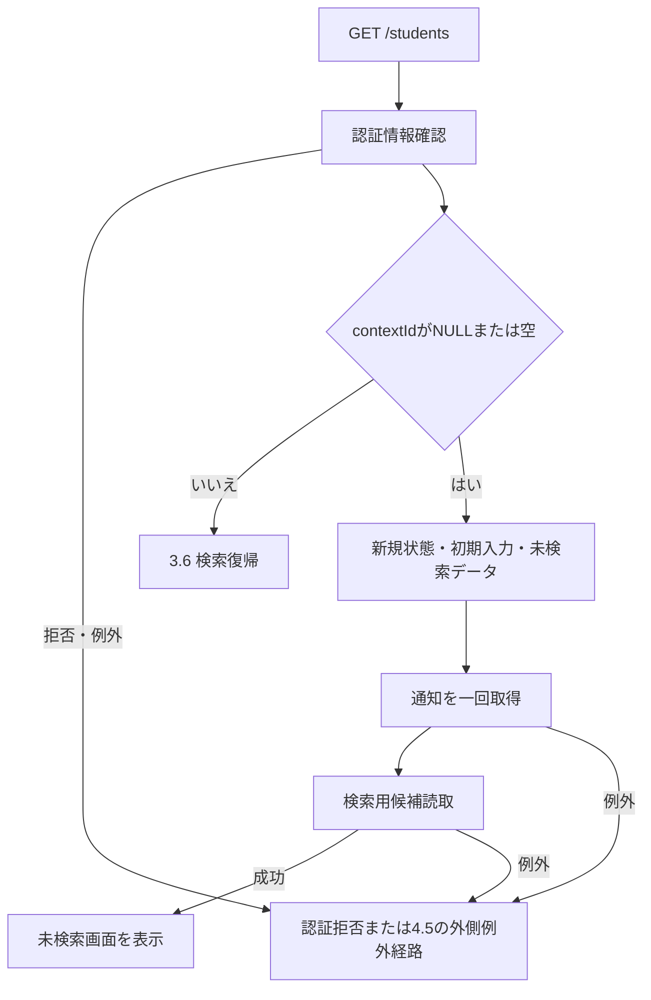

#### SQL・テーブル関連（ER図）

候補の `m_code`、`m_code_category`、`m_class` を参照する。関係は4.1のER図、結果セットと順序は4.2による。学生の件数判定・一覧取得は行わない。

#### DB操作の詳細

`LookupAsync(false)` がSnapshotトランザクションでコード・クラスの2結果セットを読む。検索用なので所属人数を集計せず0を設定し、読取成功後にcommitする。検索状態の作成はメモリ操作であり、DBへのINSERTではない。［根拠：Core/SqlServerStudentService.cs:197-216、Infrastructure/SearchContextStore.cs:10-12］

#### 結果・例外時の扱い

正常時は未検索画面となる。アクションに個別catchはない。候補読取や表示が失敗しても作成済み状態を取り消す処理はなく、外側例外経路へ進む。通知取得後の表示失敗では、通知が消費済みとなり得る。［根拠：Web/Controllers/StudentsController.cs:8-11、Infrastructure/FlashMessageStore.cs:9-9］

### 3.2 検索

#### 処理概要

入力中の条件を検査し、先頭ページを検索する。通常結果・成功0件・上限超過は保持対象となる。検証失敗の空一覧は成功0件に変換しない。［根拠：Web/Inputs/StudentSearchInput.cs:19-22、Infrastructure/WebStudentCoordinator.cs:7-9・20-21］

#### 処理手順

1. FormGuardで許可項目、重複値、書式メタ情報を確認する。在籍区分キーが欠落していれば空配列へ補正する。
2. 現在利用者と受信TabIdを使って検索状態を取得し、失敗時用に未検索表示データを作る。この取得は個別catchの外にある。
3. ModelStateが不正なら422とし、Coordinatorを呼ばない。
4. 有効ならCoordinatorが認証を再確認し、DTOを検索引数へ移送する。ClassIdを正のlongへ変換する位置はUseより前であり、ページは1とする。
5. Useで状態取得、排他待機、待機後の状態再確認、版一致、版上限を確認する。
6. サービスはページ・表示件数・方向、並び順キー、年度範囲・クラスID、未所属との同時指定、在籍区分の数・重複・値を順に確認する。未所属の判定は学年コードの空白正規化より前である。
7. 学籍番号・氏名・カナ・電話・学年・都道府県を正規化する。入学日の両端を解析し、両方指定されていれば開始≤終了を確認する。
8. DB接続・Snapshot開始後、学年・都道府県コード、年度、クラスの存在と上位条件整合を確認する。検索条件の停止・期間外は拒否しない。
9. 件数上限を判定し、10,000件以下ならページ分を読む。読取のcommit後に検索結果を返す。
10. EnsureSearchが成功を確認してから、条件コピーをApplied、結果をLastResultへ設定し、Revisionを1加算する。Useが正常に戻ると期限を30分延長し、排他を解放する。
11. 候補を再読取りして表示する。検索入口では受信PageSize・SortKey・SortDirectionを画面モデルへ残す。

［根拠：Web/Controllers/StudentsController.cs:13-16・39-39、Web/Inputs/StudentSearchInput.cs:19-22、Infrastructure/WebStudentCoordinator.cs:7-9、Infrastructure/SearchContextStore.cs:14-14、Core/SqlServerStudentService.cs:103-170］

#### 処理フロー

入口の確認をサブフロー1、Coordinatorと状態利用の確認を2、サービス結果と状態反映を3、画面作成を4、Coordinator内の例外と排他解放を5に分ける。正常経路は1→2→3→4である。ModelState不正は1→4、個別catch対象のWebFaultは2または3→5→4へ進む。入口の拒否と画面作成時の例外は、5の個別catchへ合流しない。

| 接続記号 | 接続先 | 引き継ぐ値・状態 |
| --- | --- | --- |
| SR-A | 3.2-1 → 3.2-2 | 入力条件、制御要求、受信件数・並び順、取得したEntry、準備済み未検索データ。Gateは未取得。 |
| SR-B | 3.2-2 → 3.2-3 | 変換後SearchCriteria、Entry、取得済みGate。状態・版の確認を通過している。 |
| SR-C | 3.2-3 → 3.2-4 | 結果別の表示データ、反映後Entry、入力条件と受信件数・並び順。期限延長とGate解放は完了している。 |
| SR-D | 3.2-1または3.2-5 → 3.2-4 | 準備済み未検索データ、入力条件、Entry、ModelStateエラー、設定済みHTTP状態。422または捕捉したWebFaultのStatusを保持する。 |
| SR-X | 3.2-2または3.2-3 → 3.2-5 | 元の例外、Gate取得済みかどうか、Entryと準備済み未検索データ。状態変更が済んだ場合も取り消さない。 |

**サブフロー1（3.2-1）：入口確認とModelState判定**

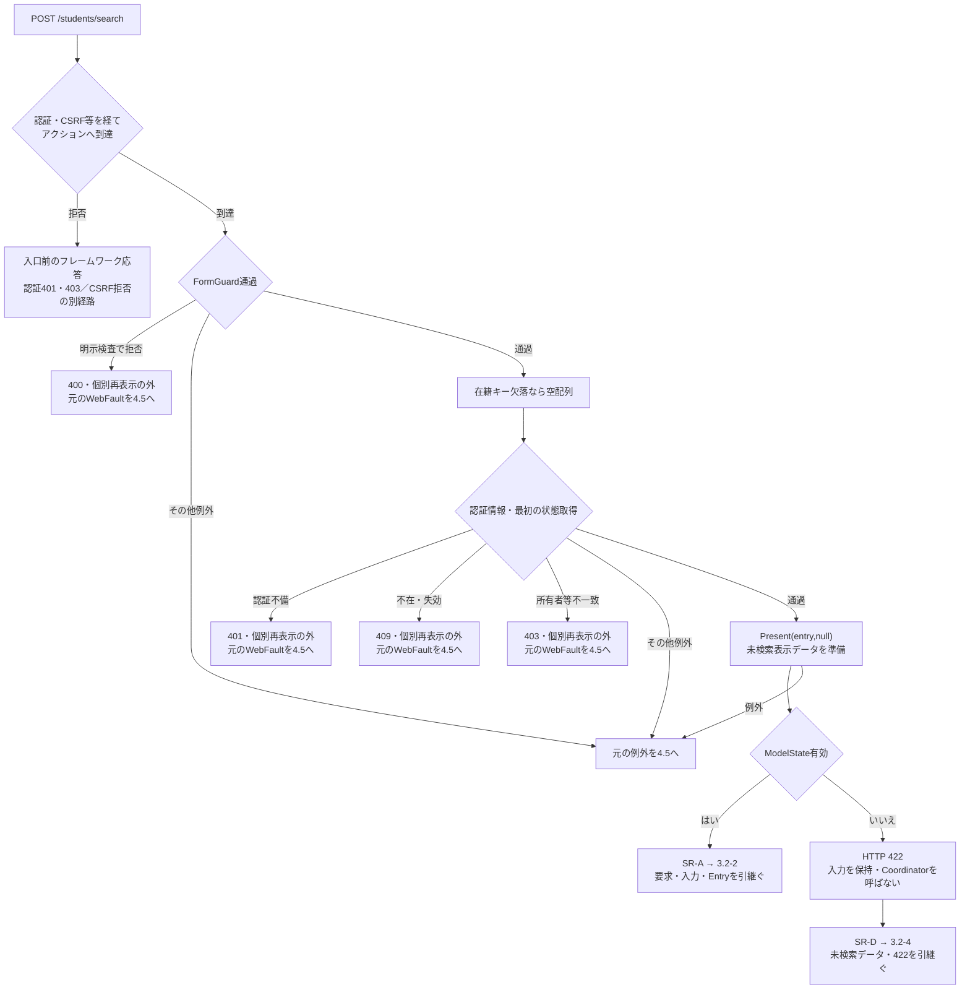

**サブフロー2（3.2-2）：引数変換、排他待機、待機後の再確認**

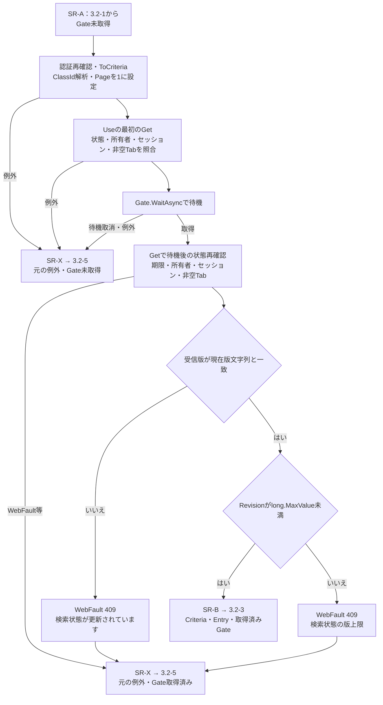

**サブフロー3（3.2-3）：検索結果の判定とメモリ反映**

サービス内の検査・正規化・DB存在確認・件数判定・一覧読取は手順6～9およびDB操作の詳細に対応する。検証結果を返す経路と、検証catchの対象外で例外を伝える経路を分ける。

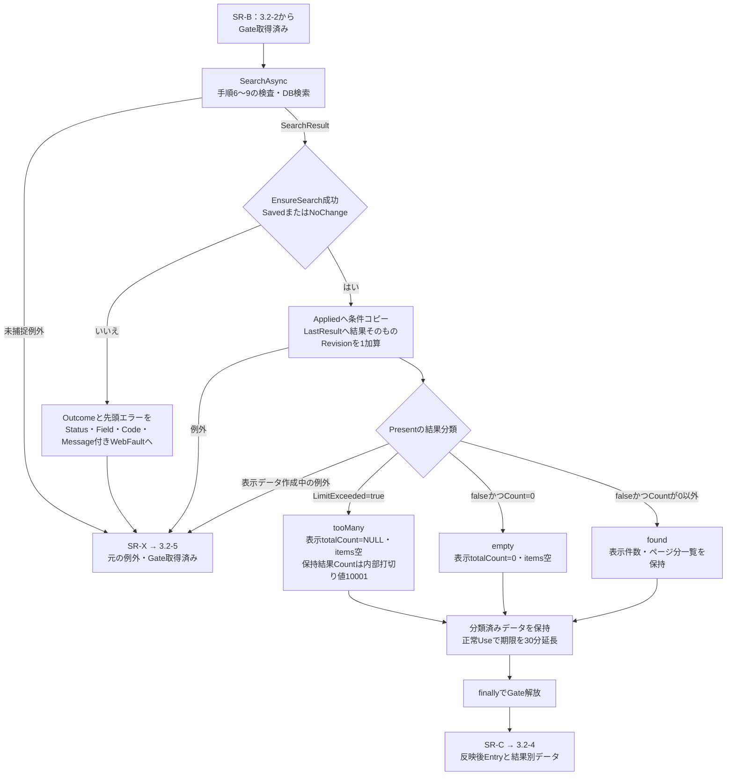

合流点Fは期限だけを更新する。上限超過のNULL件数を、成功0件や通常結果へ上書きしない。各枝の検索日時と一覧も、分類済みデータとして引き継ぐ。

**サブフロー4（3.2-4）：成功表示と検証再表示**

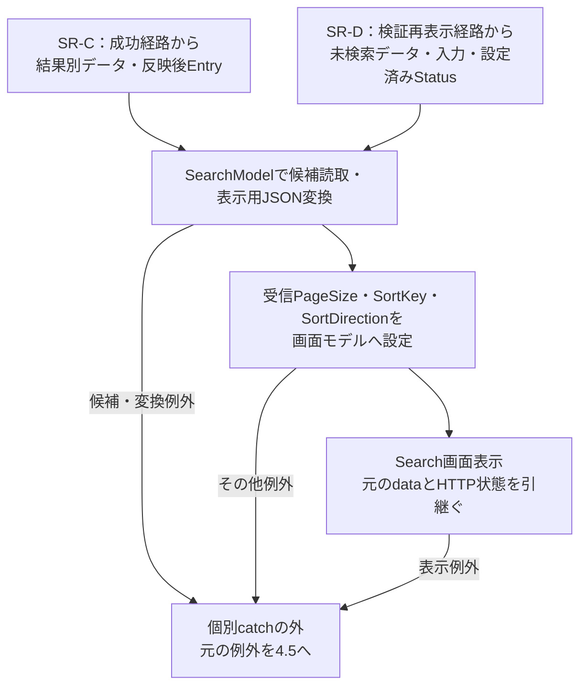

SR-Dでは以前のApplied・LastResultを削除しない。SR-Cで候補読取や表示が失敗しても、反映済みの条件・結果・版を取り消さない。

**サブフロー5（3.2-5）：Coordinator内の例外、Gate解放、個別catch**

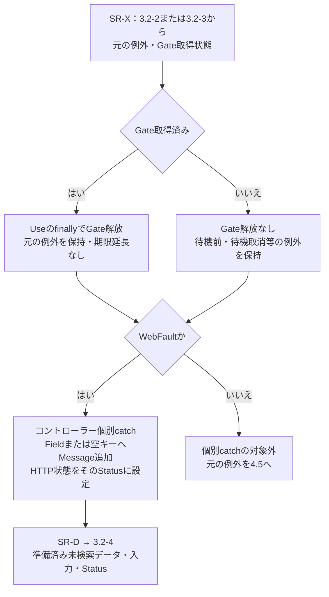

排他取得後の例外ではfinallyがGateを解放する。解放は応答を固定する節点ではなく、元の例外を引き継ぐ。個別catchへ届くWebFaultは、識別値の422、状態・版に関する403・409、認証の401等をそれぞれ保持する。［根拠：Infrastructure/SearchContextStore.cs:14-14、Web/Inputs/StudentSaveInput.cs:59-60、Web/Controllers/StudentsController.cs:15-15］

#### SQL・テーブル関連（ER図）

件数SQLは学生をクラスへLEFT JOINする。一覧SQLには学年・在籍区分・都道府県コードへのLEFT JOINを追加する。これは4.1のDDLのFK宣言と別の検索処理である。［根拠：Core/SqlServerStudentService.cs:82-90・156-162］

#### DB操作の詳細

全条件をANDで結合し、未指定条件は追加しない。電話だけは本人・緊急電話のORを一つの括弧内に置く。

| 条件 | SQL比較・加工 | SQLパラメータ |
| --- | --- | --- |
| 常時 | `s.is_deleted=0` | なし |
| 学籍番号あり | `s.student_no LIKE @no ESCAPE '!'`。加工値の末尾に% | `@no:VarChar(31)` |
| 氏名キーあり | `s.name_key LIKE @name ESCAPE '!'`。前後に% | `@name:NVarChar(642)` |
| カナキーあり | `s.kana_key LIKE @kana ESCAPE '!'`。前後に% | `@kana:NVarChar(74)` |
| 年度あり | `c.school_year=@year` | `@year:SmallInt` |
| 学年あり | `c.grade_code=@grade` | `@grade:VarChar(2)` |
| クラスあり | `s.class_id=@class` | `@class:BigInt` |
| 未所属true | `s.class_id IS NULL` | なし |
| 都道府県あり | `s.prefecture_code=@prefecture` | `@prefecture:VarChar(2)` |
| 電話あり | `(s.phone_number=@phone OR s.emergency_phone_number=@phone)` | `@phone:VarChar(16)` |
| 開始日あり | `s.admission_date>=@from` | `@from:Date` |
| 終了日あり | `s.admission_date<=@to` | `@to:Date` |
| 在籍配列が非空 | `s.enrollment_status_code IN (...)` | 各 `@statusN:VarChar(2)` |

LIKE値内の `!`、`%`、`_`、`[` をEscapeLikeでエスケープする。パラメータhelperはNULLをDBNull.Valueへ、DateOnlyを同日の午前0時のDateTimeへ変換する。未指定条件の省略と、DB列のNULL一致は異なる。［根拠：Core/SqlServerStudentService.cs:67-73・137-155、Core/StudentNormalizer.cs:161-161］

コードの存在確認は分類・値のCOUNT_BIG=1を要求し、`@category:VarChar(24)` と `@value:VarChar(10)` を使う。年度は `m_class.school_year=@year` のCOUNT_BIG>0、クラスは `class_id=@id`、`@id:BigInt` で取得した年度・学年との一致を要求する。［根拠：Core/SqlServerStudentService.cs:125-135・218-222］

件数は全検索条件を満たす学生IDのTOP(10001)をCOUNT_BIGする。10001なら一覧SQLを実行せずcommitし、NoChange・空一覧・LimitExceeded=trueを返す。10,000以下では最終ページを最低1とし、内部の取得ページを最終ページ以下へ補正する。許可した列・方向と `student_id ASC` のORDER BY、OFFSET/FETCH、`@offset:Int`・`@size:Int` で最大PageSize行を取得する。commit後の結果はNoChange、検索件数、StudentRow一覧、検索開始時刻、LimitExceeded=false、空Errorsである。［根拠：Core/SqlServerStudentService.cs:156-168］

存在確認・件数判定・一覧取得は一つのSnapshotトランザクションで行い、DB更新はしない。候補の再読取は別のSnapshot読取である。接続・取消・未commit時の扱いは4.5による。

#### 結果・例外時の扱い

サービスのtry内ではInputValidationExceptionを先に捕捉し、ErrorsをValidationFailedへ引き継ぐ。続くArgumentExceptionはArgumentErrorでFieldErrorへ変換し、規定形式の先頭コードを保持する。それ以外のメッセージはE-STU-002へ変換する。この結果のCount=0・Items空は検証失敗であり、EnsureSearchがWebFaultへ移す。User確認はtry前で、DB・取消・NULL参照等をこの検証結果へ一般化しない。［根拠：Core/SqlServerStudentService.cs:105-106・169-170、Core/StudentNormalizer.cs:162-168、Infrastructure/WebStudentCoordinator.cs:20-20］

ModelState不正またはCoordinator内のWebFaultでは、入力を残して未検索表示にする。Applied・LastResultを削除する処理はない。Presentが作るページ等は過去のApplied由来であり、画面モデルに残した受信件数・並び順と一致するとは限らない。［根拠：Web/Controllers/StudentsController.cs:14-16、Infrastructure/WebStudentCoordinator.cs:21-21］

FormGuardと最初の状態取得の拒否は個別catchの外である。成功後の候補読取・表示変換もそのcatchの外であり、更新済み条件・結果・版を取り消さない。外側middlewareが応答を作れる範囲は4.5による。［根拠：Web/Controllers/StudentsController.cs:14-16・39-39］

### 3.3 候補更新・所属条件の連動

#### 処理概要

年度・学年に合わせてクラス候補を表示し、上位条件に合わないクラス選択を解除する。入力中の条件を一覧へ適用する操作ではない。［根拠：Web/Controllers/StudentsController.cs:22-22］

#### 処理手順

1. FormGuardを行い、在籍区分キー欠落を空配列へ補正する。
2. 現在利用者・認証セッション・非空Tabを照合して状態を取得する。
3. 未所属trueなら年度・学年・クラスをNULLへ変更し、対応するModelState値を解除する。
4. LastResultから表示データを作り、検索用候補を読む。
5. 非空のクラス選択が受信年度・学年に合う候補に存在するか確認する。候補IDの文字列表現で比較し、IdParserによる数値化はしない。
6. 不一致ならClassIdとそのModelState値を解除する。
7. 入力中条件と既存一覧を再表示する。通常は「条件を変更しました。検索を押すと一覧に反映します。」、クラス解除時は「上位条件に合わないクラスを解除しました。」と通知する。

［根拠：Web/Controllers/StudentsController.cs:22-22・39-39］

#### 処理フロー

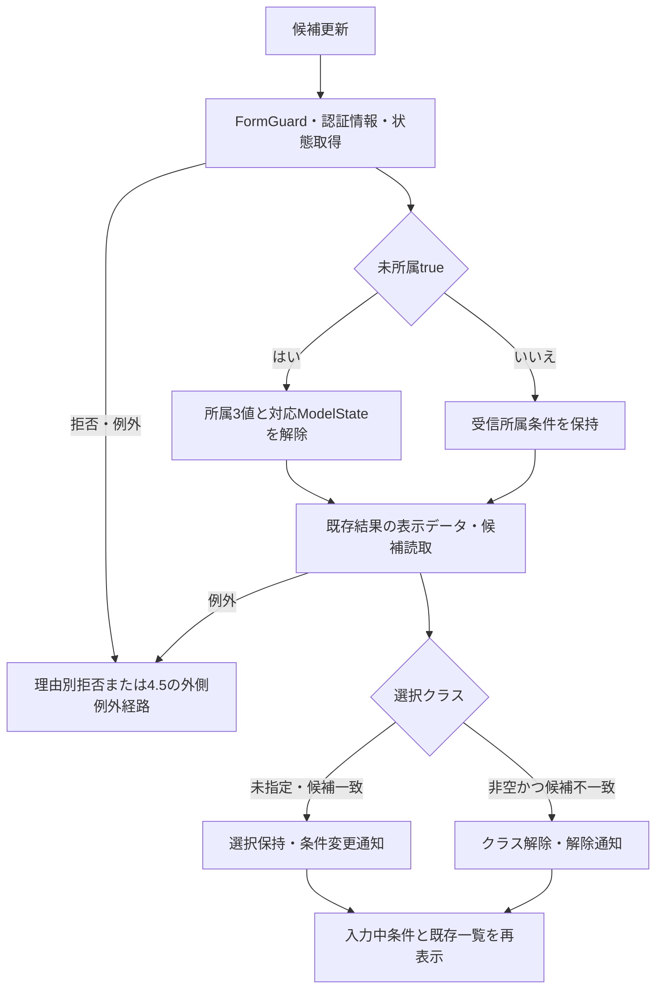

#### SQL・テーブル関連（ER図）

4.1・4.2の候補関連を参照する。学生検索SQLは行わない。停止・期間外の候補も検索用には除外しない。

#### DB操作の詳細

`LookupAsync(false)` で全候補を読み、コントローラーとビューが年度・学年でクラスを絞る。候補SQLには年度・学年の抽出パラメータがない。Applied・LastResult・Revisionを更新せず、Useも通らないため、受信版比較・Gateによる直列化・期限延長は行わない。ただし最初のGetによる期限・所有者等の検査は行う。［根拠：Core/SqlServerStudentService.cs:197-216、Web/Controllers/StudentsController.cs:22-22、Views/Students/Search.cshtml:5-5］

#### 結果・例外時の扱い

ModelState.IsValidによる実行抑止はない。受信件数・並び順は許可されるが、SearchModelは適用済み値または初期値を設定する。個別catchはなく、状態取得・候補読取・表示の失敗は外側へ進む。［根拠：Web/Controllers/StudentsController.cs:22-22・39-39］

ブラウザー側は未所属のチェック変更時と初期処理で、チェック済みなら所属3コントロールのvalueを空にする。disabled切替・自動候補更新・自動検索はしない。disabledはサーバー再描画時のビューが設定する。編集画面REG-016～018向けの年度・学年変更時の即時クラス解除は、検索画面SRC-004～006に適用されていない。［根拠：wwwroot/js/site.js:7-8、Views/Students/Search.cshtml:5-5］

### 3.4 ページ・並び順・表示件数の変更

#### 処理概要

適用済み条件で再検索する。未適用の検索入力は使わない。表示件数・並び順キー・方向の変更時は先頭ページ、それ以外は要求ページを使う。［根拠：Infrastructure/WebStudentCoordinator.cs:11-12、Views/Students/Search.cshtml:8-8］

#### 処理手順

1. FormGuard後、現在利用者と受信TabIdで状態を取得する。この取得は個別catchの外にある。
2. Coordinatorで認証とUseの排他・待機後状態・版検査を行う。
3. AppliedがNULLなら409「先に検索してください。」とする。
4. Appliedをコピーし、要求件数・キー・方向を設定する。いずれかが変更された場合はPage=1、それ以外は要求Pageとする。
5. SearchAsyncを呼び、EnsureSearchで成否を確認する。
6. 上限超過でなく、条件Pageが最終ページを超えていれば、条件Pageを最終ページへ補正して再検索する。最終ページは最低1で、成功0件もこの判定に含む。
7. 最終検索の成功後、条件コピーをApplied、結果をLastResultへ設定し、Revisionを1加算する。
8. 正常Useで期限を延長し排他を解放する。保持条件から入力を復元し、候補を読んで表示する。

［根拠：Web/Controllers/StudentsController.cs:18-19、Infrastructure/WebStudentCoordinator.cs:11-12］

#### 処理フロー

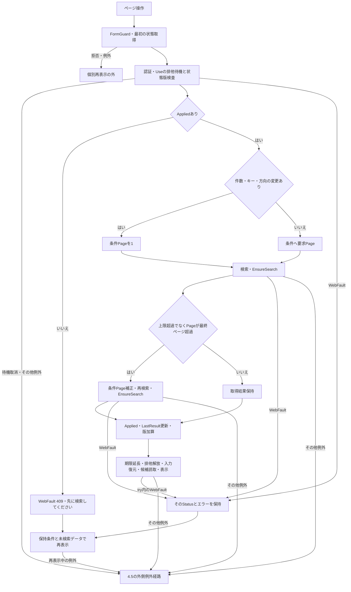

#### SQL・テーブル関連（ER図）

学生検索の対象・JOINは3.2、関連図は4.1による。表示候補には4.2の参照を追加する。

#### DB操作の詳細

通常はSearchAsyncを1回、最終ページ超過の補正時はもう1回呼ぶ。各呼出しは独立したSnapshot読取で、2回目の結果を最終結果として保持する。DB更新は行わず、成功後の更新先はメモリ状態である。［根拠：Infrastructure/WebStudentCoordinator.cs:12-12、Core/SqlServerStudentService.cs:123-168］

#### 結果・例外時の扱い

この入口にはModelState.IsValidによる抑止がない。サービス引数の検査をMVCの変換成功保証へ広げない。個別catchはCoordinatorと、try内の入力復元・SearchModel作成を含む。WebFaultのStatusを保持し、保持条件と未検索データで再表示する。catch内の再表示が失敗すると外側へ進む。成功後の表示失敗でも更新済み状態を取り消さない。［根拠：Web/Controllers/StudentsController.cs:19-19］

### 3.5 クリア

#### 処理概要

状態IDとTabを維持し、適用済み条件と直近結果を解除して初期入力へ戻す。学生の削除ではない。［根拠：Infrastructure/WebStudentCoordinator.cs:15-15］

#### 処理手順

1. FormGuardと認証確認を行う。
2. Useで状態取得、排他待機、待機後再確認、版一致・版上限を検査する。
3. Applied・LastResultをNULL、Revisionを1加算し、未検索データを返す。
4. 正常Useで期限を延長し、取得済み排他を解放する。
5. ModelStateをクリアして検索状態を再取得する。
6. 初期入力と再読取候補で表示する。在籍01・02、20件、学籍番号昇順、ページ1へ戻す。

［根拠：Web/Controllers/StudentsController.cs:21-21・39-39、Infrastructure/WebStudentCoordinator.cs:15-15、Infrastructure/SearchContextStore.cs:14-14、Web/Inputs/StudentSearchInput.cs:7-22］

#### 処理フロー

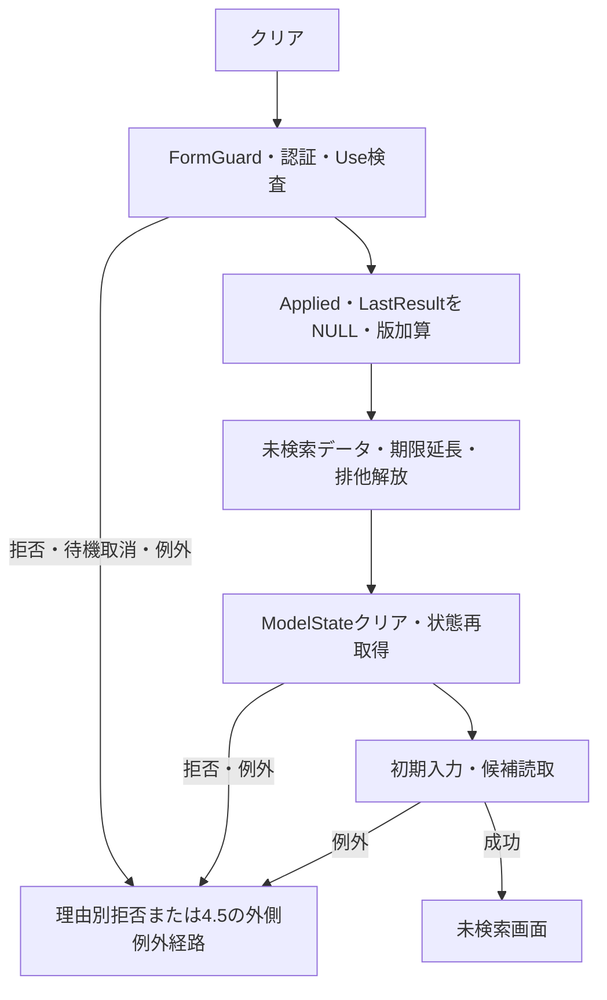

#### SQL・テーブル関連（ER図）

学生検索は行わず、4.1・4.2の候補関連だけを使う。解除対象はメモリの条件・結果であり、DBのFKや学生表を変更しない。

#### DB操作の詳細

候補のSnapshot読取だけを行う。条件・結果のNULL設定と版加算は候補読取より先に完了する。［根拠：Web/Controllers/StudentsController.cs:21-21・39-39］

#### 結果・例外時の扱い

ModelState成功条件と個別catchはない。状態・版拒否、待機取消、候補・表示失敗は外側へ進む。クリア後の再取得・表示が失敗しても条件・結果を復元しない。［根拠：Web/Controllers/StudentsController.cs:21-21］

### 3.6 検索復帰

#### 処理概要

非空contextIdを伴うGETは、保持条件で一覧を取り直す。編集フォームの未保存値から検索条件を作らない。［根拠：Web/Controllers/StudentsController.cs:8-11、Infrastructure/WebStudentCoordinator.cs:14-14］

#### 処理手順

1. 認証確認後、復帰先状態を取得する。このGETではTabを渡さない。
2. 受信contextRevision、NULLなら空文字を使ってResumeを呼ぶ。
3. Useで排他待機、待機後状態再確認、版一致・版上限を確認する。
4. AppliedがNULLなら未検索データを返し、版は加算しない。正常Useによる期限延長は行う。
5. Appliedがあれば保持条件で検索し、EnsureSearch成功後にLastResultを更新して版を1加算する。Appliedは差し替えない。
6. 排他解放後、保持条件から入力を復元し、通知を一回取得する。
7. 候補を読んで結果を表示する。

［根拠：Web/Controllers/StudentsController.cs:8-11・40-40、Infrastructure/WebStudentCoordinator.cs:14-14、Infrastructure/FlashMessageStore.cs:9-9］

#### 処理フロー

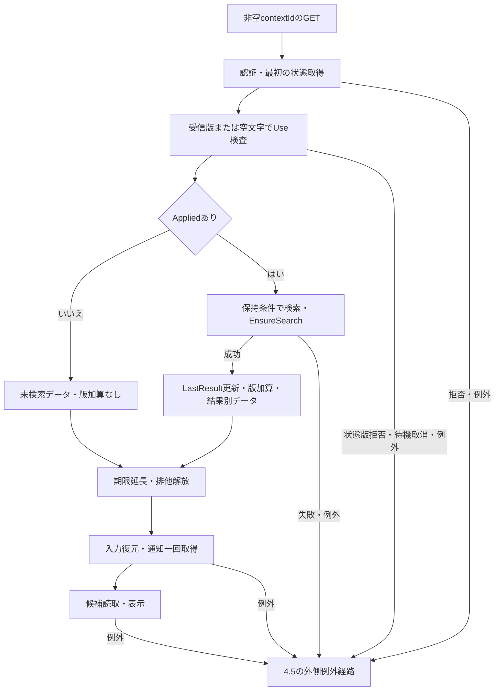

#### SQL・テーブル関連（ER図）

Appliedなしの場合は候補読取だけ、Appliedありの場合は3.2の学生検索と候補読取を行う。関係は4.1の図による。

#### DB操作の詳細

保持したPage・PageSize・並び順をそのままサービスへ渡す。サービスは取得ページを内部補正するが、ResumeはApplied.Pageを修正しない。SearchResultにも補正ページがないため、件数減少後には取得一覧が最終ページでも、画面のページ表示が古い値のままとなる可能性がある。通常ページ操作の保持ページ補正と同じ保証はない。［根拠：Infrastructure/WebStudentCoordinator.cs:12-14・21-21、Core/SqlServerStudentService.cs:160-168、Core/Contracts.cs:57-58］

#### 結果・例外時の扱い

GET内に個別catchはない。版不一致・失効・再検索失敗では通知取得前に外側へ進む。通知はTakeで削除する一回取得であり、その後の候補・表示失敗では通知を消費したまま画面に出せない場合がある。［根拠：Web/Controllers/StudentsController.cs:8-11、Infrastructure/FlashMessageStore.cs:8-9］

<a id="event-open"></a>

### 3.7 登録・編集・参照への遷移と戻る操作

#### 処理概要

新規登録と行リンクは検索状態IDをreturnContextIdとして渡す。検索状態版はリンクに含めず、遷移先の読込みで現在版を取得する。「検索へ戻る」はこの読込時版を使う。［根拠：Views/Students/Search.cshtml:6-8、Web/Controllers/StudentsController.cs:23-25、Views/Students/Edit.cshtml:16-16］

#### 処理手順

1. 遷移先で認証と、非空復帰先の所有者・セッション・期限を確認する。新規の場合は登録権限も確認する。
2. 既存学生は学生ID・非削除条件で読む。不在なら404、E-STU-103とする。
3. 編集用候補を読み、明細と候補から入力を作る。編集用候補は所属人数も集計する。
4. 候補await後、非空の復帰先を再取得して現在版をReturnRevisionへ設定する。復帰先なしの枝だけReturnRevisionをNULLとする。
5. 所有者・認証セッション・対象ID・読込明細・入力コピー・ReturnRevisionを、30分期限の編集スナップショットへ保存してEdit画面を表示する。
6. 「検索へ戻る」は復帰ID・読込時版をGETへ渡す。dirty状態の破棄確認を取り消した場合は画面に留まる。

［根拠：Infrastructure/WebStudentCoordinator.cs:6-6・17-17、Web/Controllers/StudentsController.cs:23-25、Infrastructure/EditorSnapshotStore.cs:7-10、Views/Students/Edit.cshtml:16-16、wwwroot/js/site.js:2-5］

#### 処理フロー

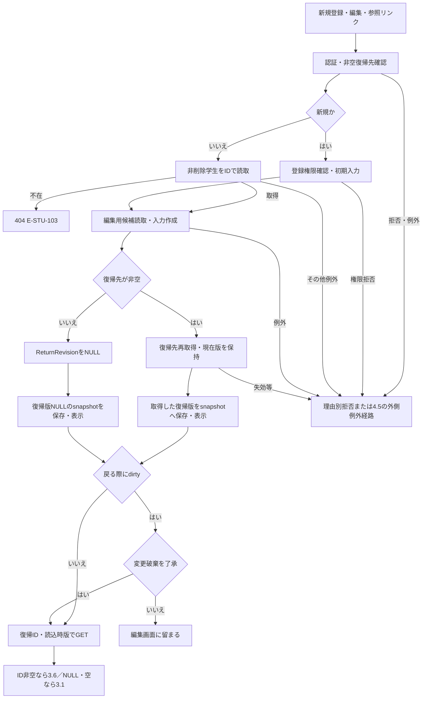

復帰版を取得した枝へNULLを代入しない。復帰先ありの取得版と、復帰先なしのNULLを別々に保持する。

#### SQL・テーブル関連（ER図）

学生単体読取と4.1・4.2の候補関連を使う。検索状態・編集スナップショットとの結び付きはメモリ参照であり、DBのFKではない。

#### DB操作の詳細

既存学生は `SELECT * FROM dbo.m_student WHERE student_id=@id AND is_deleted=0`、`@id:BigInt` で最大1行を読む。GetAsyncは正でないIDならNULLを返す。単体読取に明示トランザクションはない。候補は別のSnapshotトランザクションで読み、編集用では非削除かつ在籍01・02のクラス所属人数を集計する。［根拠：Core/SqlServerStudentService.cs:172-181・196-216］

#### 結果・例外時の扱い

初回の復帰先確認だけでは表示成功を保証しない。候補await後の状態再取得で失効等を再び拒否する。Viewerも既存学生を読めるが、編集操作は画面とサーバーの双方で制限する。［根拠：Web/Controllers/StudentsController.cs:25-25、Infrastructure/RequestIdentity.cs:14-15、Views/Students/Edit.cshtml:5-5］

編集フォームのinputイベントはdirtyを立て、同一人物確認情報を空にする。dirtyな戻る・再読込リンクは破棄確認を行い、取消なら遷移を止める。beforeunloadもdirtyかつ離脱確定前に警告する。「入力クリア／編集取消」のPOSTは読込時入力へ戻す別操作で、検索状態をクリアしない。［根拠：wwwroot/js/site.js:2-5、Views/Students/Edit.cshtml:16-16、Web/Controllers/StudentsController.cs:35-35］

### 3.8 保存結果から検索への復帰

#### 処理概要

遷移先の保存がSavedとなった場合だけ通知を格納し、検索GETへ303を返す。本節は保存の確定条件と検索への影響を扱う。登録画面の全項目仕様は対象としない。［根拠：Web/Controllers/StudentsController.cs:28-38］

#### 処理手順

1. FormGuard、登録・更新権限、スナップショットの所有者・セッション・対象IDを確認する。
2. 復帰先を確認し、受信ReturnContextIdとスナップショットの読込時ReturnContextIdの一致を確認する。ここまでの拒否は保存入口の個別catchの外にある。
3. ModelState不正は422で編集再表示する。有効ならCoordinatorで権限・復帰先を再確認し、入力を保存要求へ変換する。
4. サービスで正規化、理由、IDと比較版の組、年度・学年を検査する。接続・ReadCommitted開始後、学生書込用の排他アプリケーションロックを取得する。
5. 既存対象を非削除条件で再読取りする。不在はNotFound、比較版不一致はConflictを直ちに返す。学籍番号変更を拒否し、終了区分訂正には管理者権限と理由を要求する。
6. ロック取得後にコード・クラスをDBから再確認する。新規・変更コードにはコードと分類の有効状態・業務日内の期間を要求する。同じ既存停止値は存在確認後に保持できる。クラスは年度・学年整合、新たな在学・休学所属の停止・期間・定員、卒業・退学の変更期間とクラス期間の重なりを確認する。定員は本人を除く非削除・在籍01・02の人数を再集計する。
7. 変更なしなら明示rollbackしてNoChangeを返す。変更ありでは版上限、削除行も含む学籍番号重複、非削除の同一人物候補を確認する。確認が必要ならConfirmationRequiredを返し、成功復帰へ進まない。
8. 新規は正規化列、固定分類、作成・更新情報、削除フラグ0、行版1をINSERTする。更新は学籍番号を設定対象から外し、学生ID・比較版・非削除のWHEREで更新情報と行版を含め更新する。取得IDがなければ競合例外とする。
9. 同じトランザクションへ監査を書き、commit成功後にSaved、取得学生ID、保存後版を返す。
10. Savedの場合、復帰先が非空なら既存IDとスナップショットのReturnRevisionを使う。復帰先なしなら新しい検索状態とその版を作る。「保存しました。」を格納し、303と検索GETのLocationを返す。
11. 後続GETは非空の検索状態IDを受けるため3.6を通る。Appliedがあれば再検索し、新規作成した状態のAppliedがNULLなら版確認後に未検索表示する。通常の「検索へ戻る」で復帰IDがNULL・空なら3.1へ進む経路とは異なる。

［根拠：Web/Controllers/StudentsController.cs:29-38、Infrastructure/WebStudentCoordinator.cs:14-14・18-18、Core/SqlServerStudentService.cs:227-323・344-383］

#### 処理フロー

保存は六つのサブフローで示す。正常な書込みは1→2→3→4→6、トランザクション内で捕捉する例外は2・3・4→5→6へ進む。保存結果を返す早期終了は、その結果をSV-Rとして6へ渡す。ModelState不正とコントローラーの個別catchは、SaveResultがないSV-Vとして6へ渡す。

| 接続記号 | 接続先 | 引き継ぐ値・状態 |
| --- | --- | --- |
| SV-A | 3.8-1 → 3.8-2 | 保存要求、正規化済み学生値、理由、利用者・時刻・受付識別情報、開始済みReadCommittedトランザクション。writeStarted=false、commitAttempted=false。 |
| SV-B | 3.8-2 → 3.8-3 | SV-Aの値とロック取得後の確認結果。新規ではprevious・previousVersionがNULL、既存では取得済み行と読込版を保持する。変更あり。 |
| SV-C | 3.8-3 → 3.8-4 | 書込み可能な要求・正規化値・既存行／読込版・同一人物確認結果・トランザクション。新規IDと保存後版は4で確定する。 |
| SV-X | 3.8-2・3・4 → 3.8-5 | トランザクション内で生じた元の例外、トランザクション、発生時点のwriteStarted・commitAttempted。先行catchと一般catchを順序どおりに判定する。 |
| SV-R | 3.8-1・2・3・4・5 → 3.8-6 | その枝が返したSaveResult。Outcome、ID、版、Errors、確認情報・候補、受付識別情報を保持し、共通節点でID・版を固定しない。 |
| SV-V | 3.8-1 → 3.8-6 | result=NULL、入力、スナップショット、ModelStateエラー、設定済みHTTP状態。ModelState不正の422または個別catchのWebFault.Status。 |

サブフロー2～4の「トランザクション内」枠からSV-Xへ向かう線は、その枠内のロック、読取、検査、rollback、書込み、監査、commit等で生じた例外を示す。返却結果と例外は別の出口である。接続・トランザクション開始の例外は、これらの枠に入る前に生じる。

**サブフロー1（3.8-1）：入口照合、入力検査、トランザクション開始**

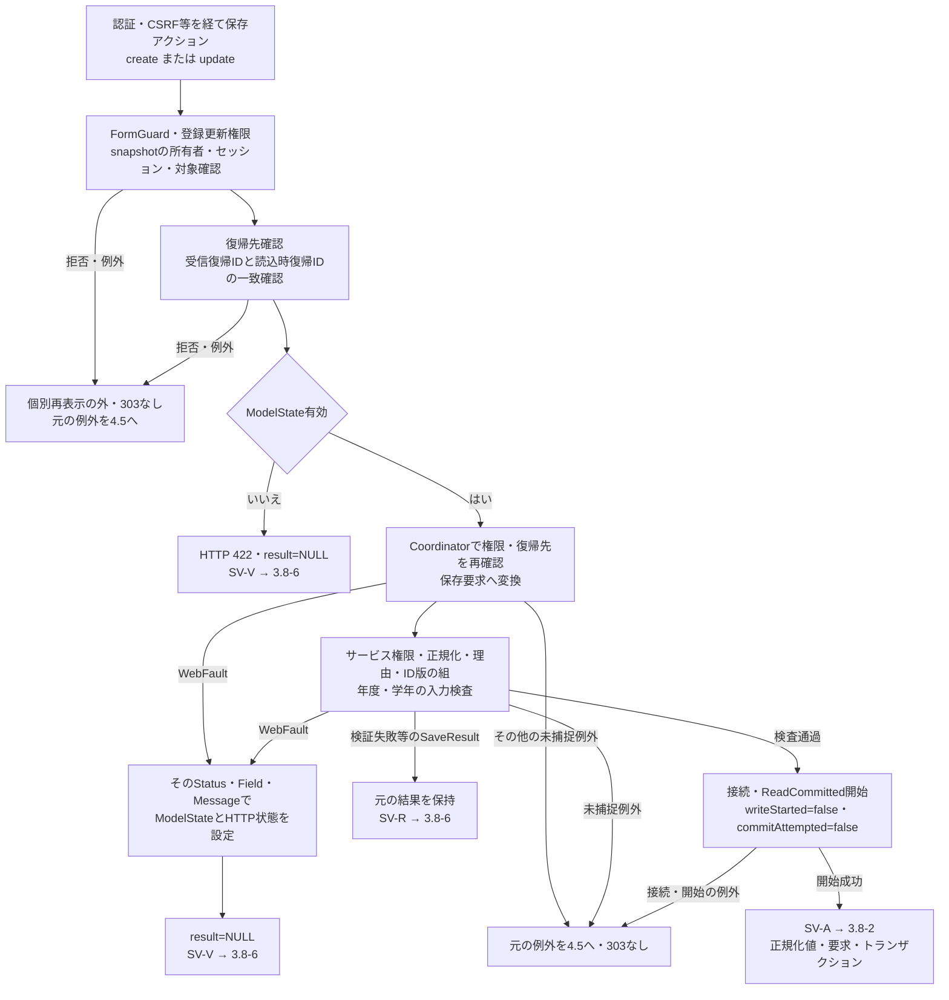

入口前の認証・CSRF拒否はアクションへ到達せず、フレームワークの拒否経路で終わる。サービスの正規化段階はInputValidationExceptionを先に、続いてArgumentExceptionをValidationFailedへ変換する。接続・開始の失敗を、トランザクション内の一般catchによるUnknown／SystemErrorへ移さない。

**サブフロー2（3.8-2）：ロック取得、対象・比較版、保存ルールの再確認**

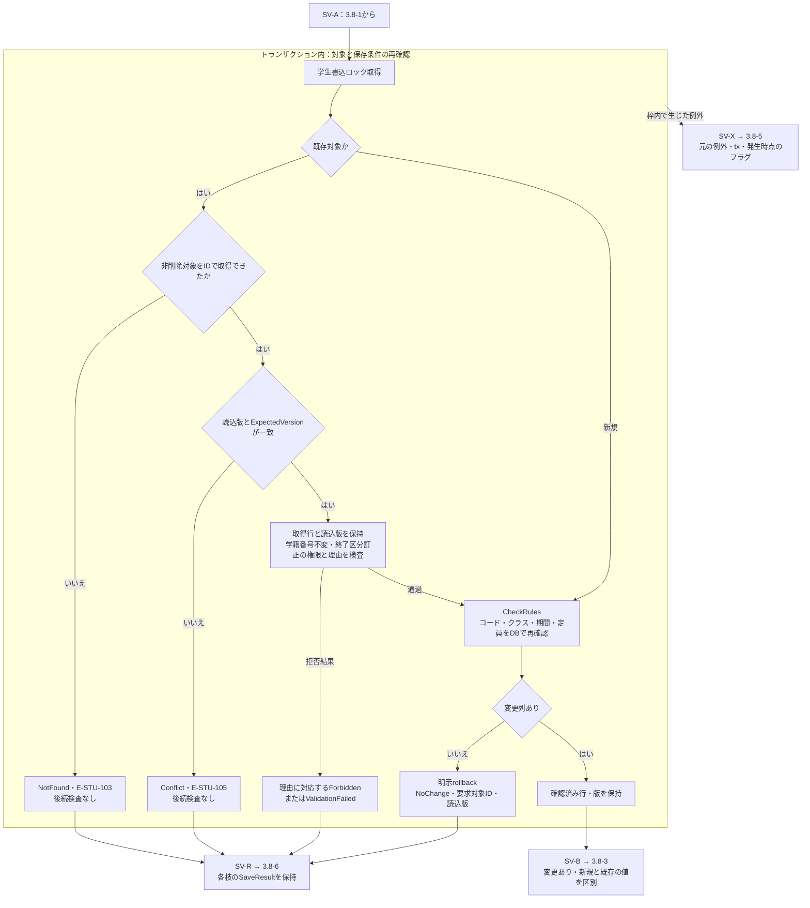

新規の枝は読込版を取得しない。既存取得成功の枝はpreviousとpreviousVersionを保持して次図へ渡す。NoChangeは明示rollback後の対象ID・読込版を持つ結果であり、NotFound・Conflict等のResult helperが返すNULLのID・版と混同しない。

**サブフロー3（3.8-3）：版上限、学籍番号重複、同一人物確認**

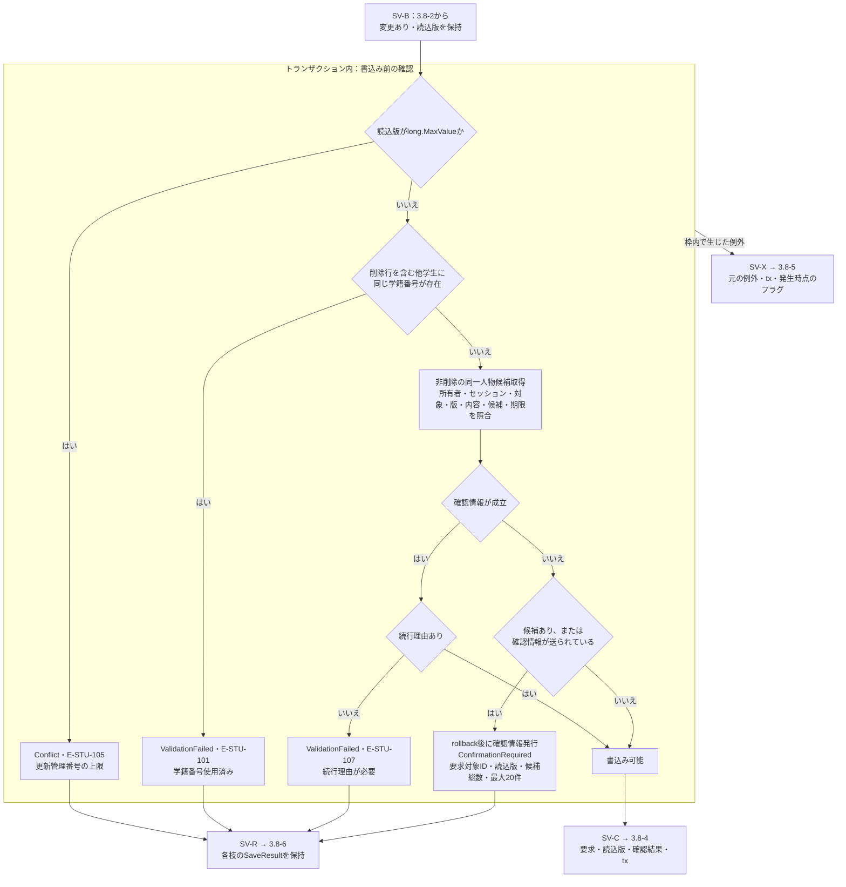

書込み可能の合流点では、新規の未取得IDやNULL読込版を既存の取得済み値へ適用しない。確認要求の結果は、対象ID・読込版と確認情報・候補をそのままSV-Rへ渡す。

**サブフロー4（3.8-4）：INSERT／比較版UPDATE、監査、commit**

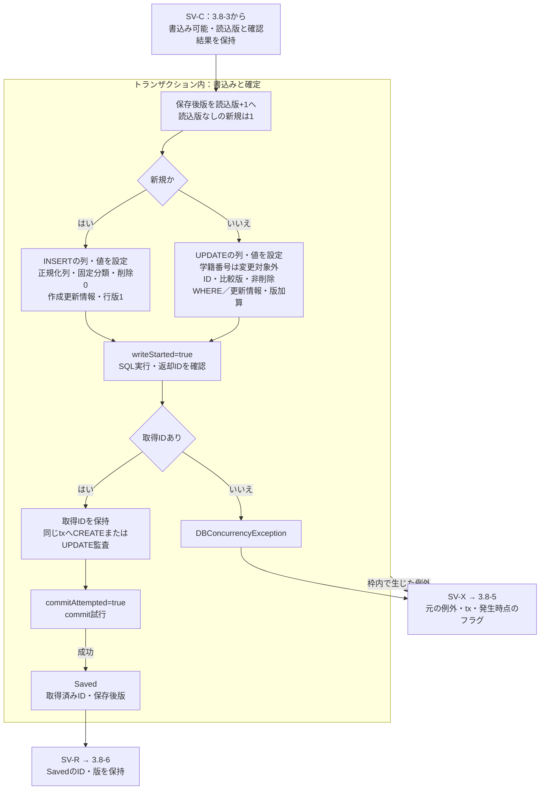

SQL実行前にwriteStartedをtrue、commit呼出前にcommitAttemptedをtrueにする。両フラグは、例外が生じた時点の値でサブフロー5へ渡す。Savedの合流点で取得IDや保存後版をNULLへ置き換えない。

**サブフロー5（3.8-5）：catchの順序と確定状態の分類**

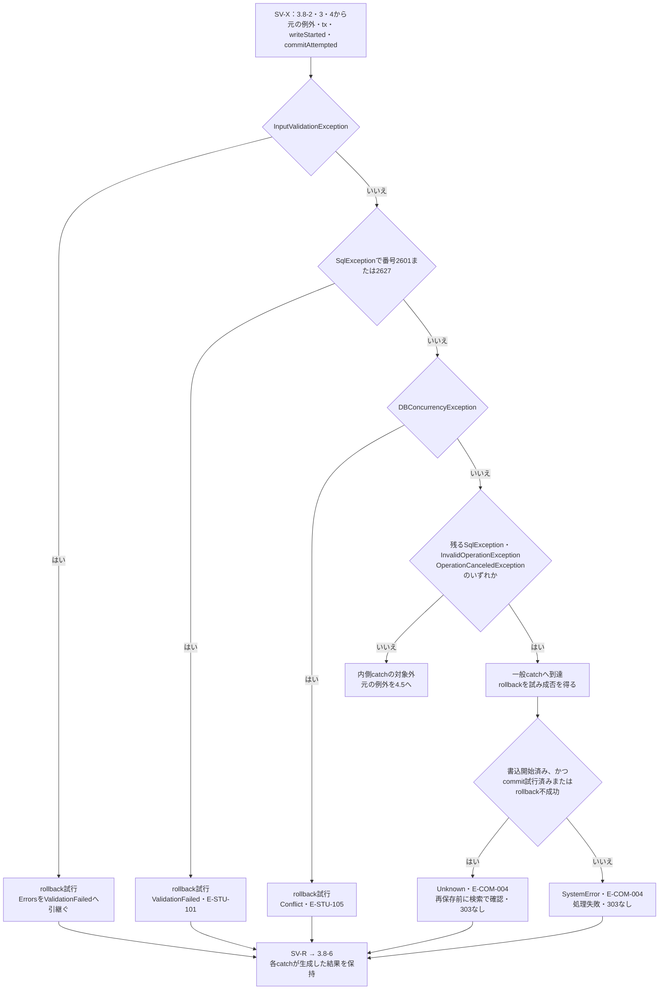

一般catchの条件は「書込開始済み、かつ（commit試行済み、またはrollback不成功）」である。書込未開始ならrollback不成功でもSystemErrorとなる。この条件は最後の一般catchへ到達した場合だけに適用し、先行catchの例外を含めない。［根拠：Core/SqlServerStudentService.cs:316-323］

**サブフロー6（3.8-6）：編集再表示、通知、303、後続GET**

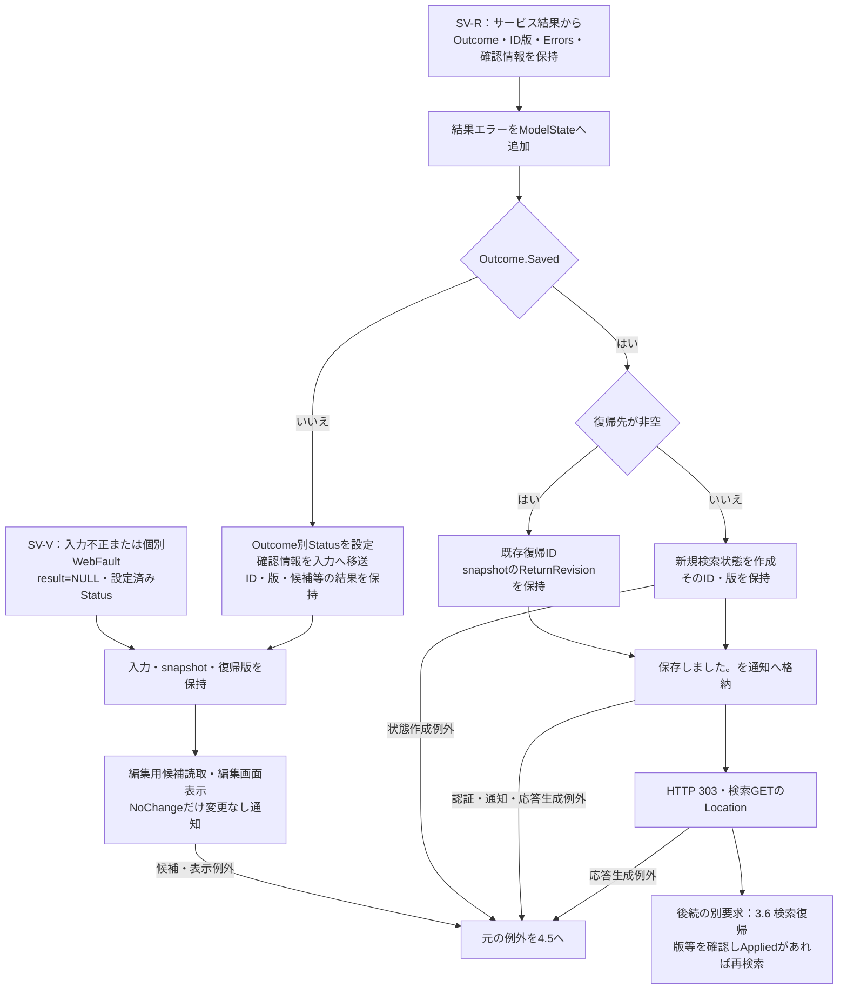

SV-Vの合流点は設定済みStatusを維持し、固定の422へ置き換えない。SV-Rの非Savedは結果表に従う200・422・403・404・409・503であり、成功303へ進まない。Savedの復帰先ありでは取得済みReturnRevision、復帰先なしでは新規状態の版を引き継ぐ。後続GETの成功・拒否・例外は3.6の各出口へ接続する。

#### SQL・テーブル関連（ER図）

保存時の参照関係は4.1の学生・クラス・コードに対応する。監査は対象表名・対象キーを記録するが、学生とのFKを追加しない。

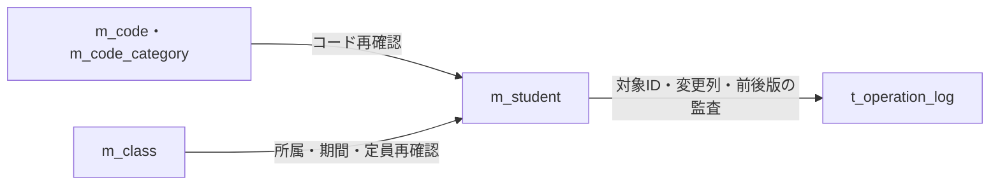

これは処理上の参照・書込み関係であり、FKの多重度図ではない。［根拠：Core/SqlServerStudentService.cs:344-390］

#### DB操作の詳細

書込ロックはトランザクション所有のExclusiveなアプリケーションロックで、待機5000ms、取得結果が負ならSQL例外とする。既存再読取のWHEREは学生ID・非削除、更新WHEREには比較版を追加する。保存パラメータはColumns定義を使い、実施者は `@actor:NVarChar(128)`、処理開始時刻は `@now:DateTimeOffset`、学生ID・比較版はBigIntである。［根拠：Core/SqlServerStudentService.cs:30-37・92-101・246-260・294-305］

同一人物候補は本人を除く非削除行について、生年月日一致かつ氏名キーまたはカナキー一致で取得する。確認情報は所有者・認証セッション・対象ID・比較版・入力内容・候補IDと版・期限を照合する。Web設定ではメモリの確認情報を使い、確認成立後の続行には理由が必要となる。確認不足ではrollback後に確認情報を発行し、候補総数と最大20件を返す。これは検索の条件・結果や通知とは別の一時情報である。［根拠：Infrastructure/WebHostSetup.cs:19-19、Core/SqlServerStudentService.cs:268-290・330-335］

監査にはCREATEまたはUPDATE、対象ID、変更列JSON、変更前後版、実施者・時刻、理由、重複確認有無、受付識別情報を同じトランザクションへINSERTする。Savedは新規で取得ID・版1、更新で取得ID・読込版+1を保持する。NoChangeとConfirmationRequiredは要求対象ID・読込版を保持する。検証等のResult helperによる結果はID・版がNULLであり、異なる枝の値を一律NULLへまとめない。［根拠：Core/SqlServerStudentService.cs:226-226・262-262・287-315・385-390］

#### 結果・例外時の扱い

正規化段階ではInputValidationException、続くArgumentExceptionをValidationFailedへ変換する。トランザクション内のcatchは次の順序を保つ。

| 順序 | 捕捉対象 | 結果 |
| --- | --- | --- |
| 1 | InputValidationException | rollbackを試み、ErrorsをValidationFailedへ引き継ぐ。 |
| 2 | 番号2601・2627のSqlException | rollbackを試み、学籍番号使用済みのValidationFailedを返す。 |
| 3 | DBConcurrencyException | rollbackを試み、Conflictを返す。 |
| 4 | 残るSqlException・InvalidOperationException・OperationCanceledException | rollback結果と書込開始・commit試行からUnknownまたはSystemErrorを返す。 |

一般catchだけが、書込開始済み、かつ（commit試行済み、またはrollback不成功）をUnknownとする。接続・トランザクション開始はこのtryの前であり、その失敗を同じSaveResultに変換する保証はない。早期NotFound・Conflict等には明示rollbackがなく、資源破棄へ進む。Rollback helperは取消トークンなしでrollbackを試み、SQL例外・実行状態例外なら不成功を返す。［根拠：Core/SqlServerStudentService.cs:232-244・250-263・316-329］

| 保存結果 | 編集画面の応答状態 | 検索への成功復帰 |
| --- | --- | --- |
| Saved | ReturnAfterSaveによる303 | 通知とLocationを設定する。 |
| NoChange | 200、変更なしの通知 | 行わない。 |
| ValidationFailed・Forbidden・NotFound | それぞれ422・403・404 | 行わない。 |
| Conflict・ConfirmationRequired | 409 | 行わない。 |
| SystemError・Unknown | 503 | 行わない。Unknownは再保存前の検索確認を促す。 |

Coordinator内WebFaultはそのStatusを保持して編集再表示する。候補・表示の後続失敗は外側経路となる。［根拠：Web/Controllers/StudentsController.cs:30-33、Infrastructure/WebPresentation.cs:23-23］

DBのSaved、303発行、検索復帰、通知表示は別の到達段階である。保存前には復帰先を確認するが、DB完了後の期限再確認や最新版への差替えはない。別操作が検索版を進めていればSavedでも後続GETが409となり得る。通知格納時にも現在認証情報を取得するため、DB確定だけで303・通知表示まで保証しない。［根拠：Infrastructure/WebStudentCoordinator.cs:18-18、Web/Controllers/StudentsController.cs:31-38、Infrastructure/SearchContextStore.cs:14-14］

### 3.9 論理削除結果から検索への復帰

#### 処理概要

Administratorが既存学生を論理削除し、Savedの場合だけ通知と303で検索へ戻る。削除フォームは編集中の業務値を保存しない。［根拠：Views/Students/Edit.cshtml:17-17、Web/Controllers/StudentsController.cs:37-38］

#### 処理手順

1. FormGuard、認証、スナップショットの所有者・セッション・対象ID、受信復帰IDと読込時復帰IDの一致を確認する。
2. Coordinatorで管理者権限、非空復帰先、Confirmedを確認する。未確認は422とし、ExpectedVersionを正のlongへ変換する。この入口にModelState.IsValidによる抑止はない。
3. サービスで削除権限、必須理由の原入力・Trim後各60スカラー、正の学生ID・版、版上限を確認する。
4. 接続・ReadCommitted開始後、学生書込ロックを取得する。
5. 非削除対象の版を再読取りする。不在はNotFound、版不一致はConflictを直ちに返し、UPDATEへ進まない。
6. 学生ID・比較版・非削除のWHEREで、削除フラグ、削除日時・削除者・理由、更新日時・更新者、行版を更新する。1行でなければ競合例外とする。
7. DELETE監査を同じトランザクションへ書き、commit成功後にSaved・対象ID・版+1を返す。
8. Savedなら既存復帰IDとスナップショットのReturnRevision、または新規状態IDとその版を使い、「論理削除しました。」を格納して303を返す。
9. 非Savedなら結果のエラー・Statusを設定し、対象を再読み込む。後続検索GETでは非削除条件により削除済み学生を一覧から除く。

［根拠：Web/Controllers/StudentsController.cs:37-38、Infrastructure/WebStudentCoordinator.cs:19-19、Core/SqlServerStudentService.cs:392-416］

#### 処理フロー

論理削除は五つのサブフローで示す。正常書込みは1→2→3→5、トランザクション内の例外は2・3→4→5である。非Savedの結果は、初期検査・対象再確認・catchのどこから返っても、その結果をDL-Rとして5へ渡す。削除入口には保存と同じWebFaultの個別再表示catchがない。

| 接続記号 | 接続先 | 引き継ぐ値・状態 |
| --- | --- | --- |
| DL-A | 3.9-1 → 3.9-2 | 学生ID、正の比較版、正規化済み理由、利用者・時刻・受付識別情報、開始済みReadCommittedトランザクション。writeStarted=false、commitAttempted=false。 |
| DL-B | 3.9-2 → 3.9-3 | DL-Aの値と取得済み書込ロック。非削除対象の存在と比較版一致を確認済み。 |
| DL-X | 3.9-2または3.9-3 → 3.9-4 | 元の例外、トランザクション、発生時点のwriteStarted・commitAttempted。先行DBConcurrencyException catchを先に判定する。 |
| DL-R | 3.9-1・2・3・4 → 3.9-5 | その枝が返したSaveResult。Outcome、ID、版、Errors、受付識別情報をそのまま保持する。Savedの対象ID・版+1を他の枝のNULLで上書きしない。 |

**サブフロー1（3.9-1）：入口照合、管理者・確認・理由、接続開始**

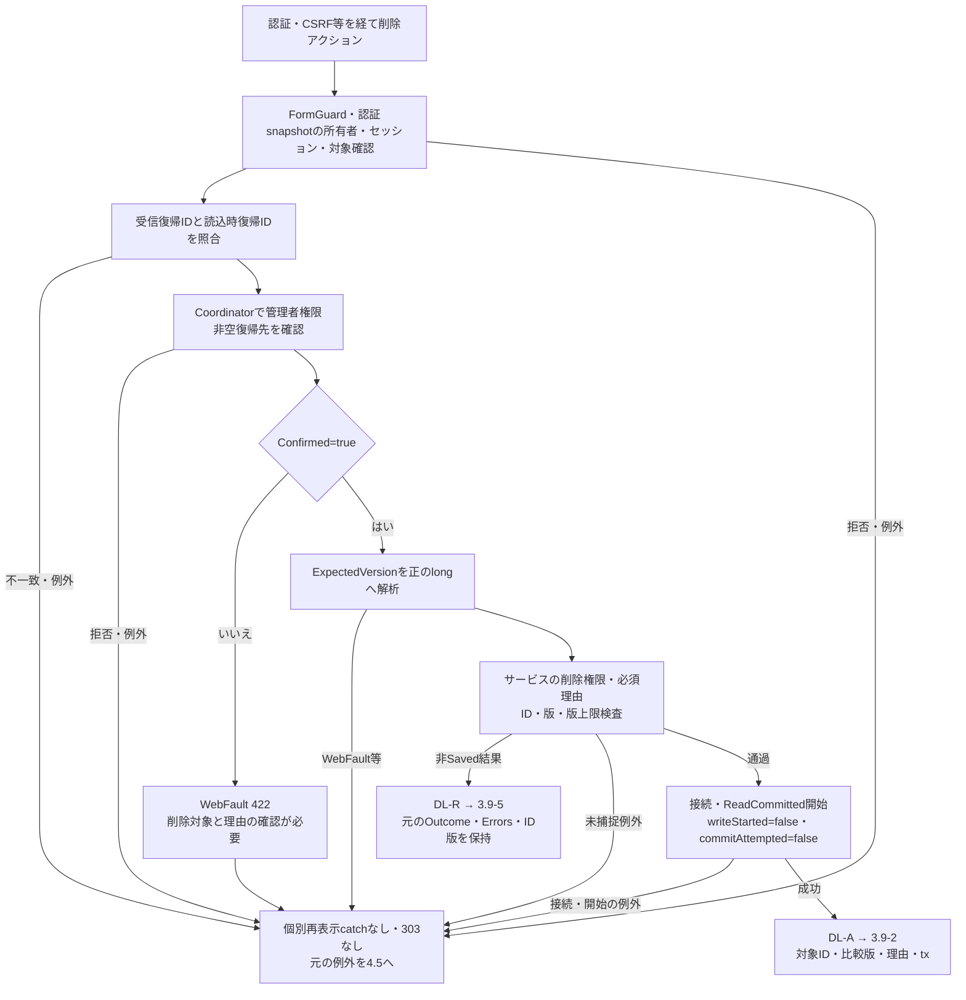

入口前の認証・CSRF拒否はアクションへ到達せず、フレームワークの拒否経路で終わる。サービスの理由検査ではInputValidationExceptionをValidationFailedへ変換するが、ArgumentExceptionを同じ結果へ変換するcatchはない。ModelStateの成功判定による抑止も置かない。

**サブフロー2（3.9-2）：ロック取得と非削除対象・比較版の再確認**

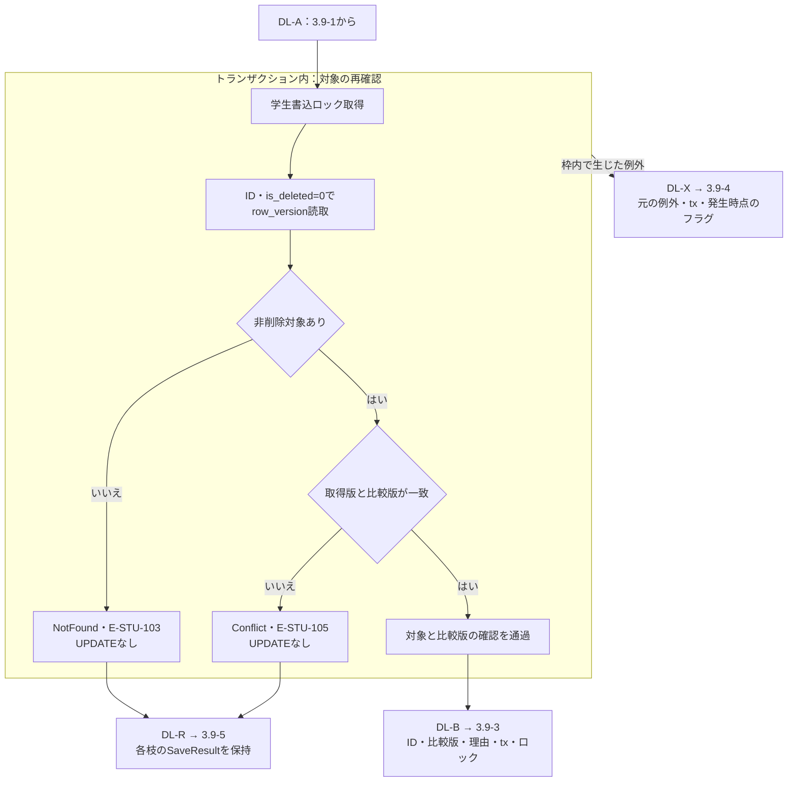

不在と版不一致は異なる結果・理由のままDL-Rへ渡す。対象を取得した枝の版は、書込み時の比較版WHEREにも使う。

**サブフロー3（3.9-3）：比較版UPDATE、監査、commit**

```mermaid
flowchart TD
  A["DL-B：3.9-2から<br/>非削除対象あり・比較版一致"] --> B
  subgraph TX["トランザクション内：論理削除と確定"]
    B["ID・比較版・非削除WHEREのUPDATE<br/>削除フラグ・削除情報・更新情報・版加算"] --> C["パラメータ設定後writeStarted=true<br/>UPDATE実行"]
    C --> D{"更新行数が1"}
    D -->|いいえ| E["DBConcurrencyException"]
    D -->|はい| F["同じtxへDELETE監査"]
    F --> G["commitAttempted=true<br/>commit試行"]
    G -->|成功| S["Saved<br/>対象ID・比較版+1"]
  end
  E --> X["DL-X → 3.9-4<br/>元の例外・tx・発生時点のフラグ"]
  TX -->|枠内で生じた例外| X
  S --> R["DL-R → 3.9-5<br/>Savedの対象ID・版+1を保持"]
```

writeStartedはSQL実行前、commitAttemptedはcommit呼出前にtrueになる。成功結果と、発生時点のフラグを伴う例外を別々に渡す。

**サブフロー4（3.9-4）：競合catchと一般catch**

```mermaid
flowchart TD
  A["DL-X：3.9-2または3.9-3から<br/>元の例外・tx・writeStarted・commitAttempted"] --> B{"DBConcurrencyException"}
  B -->|はい| C["先行catchでrollback試行<br/>Conflict・E-STU-105"]
  B -->|いいえ| D{"SqlException・InvalidOperationException<br/>OperationCanceledExceptionのいずれか"}
  D -->|いいえ| O["内側catchの対象外<br/>元の例外を4.5へ"]
  D -->|はい| E["一般catchへ到達<br/>rollbackを試み成否を得る"]
  E --> F{"書込開始済み、かつ<br/>commit試行済みまたはrollback不成功"}
  F -->|はい| U["Unknown・E-COM-004<br/>削除結果は検索で確認・303なし"]
  F -->|いいえ| S["SystemError・E-COM-004<br/>削除処理失敗・303なし"]
  C --> R["DL-R → 3.9-5<br/>各catchが生成した結果を保持"]
  U --> R
  S --> R
```

一般catchの条件は保存と同じく「書込開始済み、かつ（commit試行済み、またはrollback不成功）」である。先行catchのDBConcurrencyExceptionにこの一般catch判定を適用しない。［根拠：Core/SqlServerStudentService.cs:415-416］

**サブフロー5（3.9-5）：結果別の再読込、通知、303、後続GET**

```mermaid
flowchart TD
  A["DL-R：各サービス結果から<br/>Outcome・ID版・Errorsを保持"] --> B{"Outcome.Saved"}
  B -->|いいえ| C["結果エラーをModelStateへ追加<br/>Outcome別Statusを設定・303なし"]
  C --> D["Loadで対象を再読込<br/>3.7の認証・復帰先・学生・候補確認"]
  D -->|対象不在| N["Loadの404・E-STU-103へ<br/>初めの結果Statusを固定しない"]
  D -->|読込成功| E["編集画面を再表示"]
  D -->|その他例外| O["元の例外を4.5へ"]
  B -->|はい| F{"復帰先が非空"}
  F -->|はい| F1["既存復帰ID<br/>snapshotのReturnRevisionを保持"]
  F -->|いいえ| F2["新規検索状態を作成<br/>そのID・版を保持"]
  F1 --> G["論理削除しました。を通知へ格納"]
  F2 --> G
  G --> H["HTTP 303・検索GETのLocation"]
  H --> I["後続の別要求：3.6 検索復帰<br/>版等を確認しAppliedがあれば再検索"]
  F2 -->|状態作成例外| O
  G -->|認証・通知・応答生成例外| O
  H -->|応答生成例外| O
  E -->|表示例外| O
```

非Savedは結果に応じたStatusを設定してから再読込へ進む。Loadの対象不在や別の拒否・例外により、最終応答はその後段の経路へ移る。Savedの復帰先ありではスナップショットの復帰版、復帰先なしでは新規検索状態の版を維持する。後続GETの成功・拒否・例外は3.6の各出口へ接続する。

#### SQL・テーブル関連（ER図）

UPDATE対象は `m_student`、監査INSERT対象は `t_operation_log` である。3.8の処理関連図に対応し、クラス・コードは更新・削除しない。

#### DB操作の詳細

再確認は `SELECT row_version FROM dbo.m_student WHERE student_id=@id AND is_deleted=0`。UPDATEのWHEREには `row_version=@version` を追加する。設定列はis_deleted=1、deleted_at、deleted_by、delete_reason、updated_at、updated_by、row_version+1である。ID・版はBigInt、時刻はDateTimeOffset、実施者はNVarChar(128)、理由はNVarChar(120)。1行更新と監査後のcommit成功がSavedの条件となる。［根拠：Core/SqlServerStudentService.cs:403-414］

監査はDELETE、対象キー、前後版、削除・更新の変更列、実施者・時刻、理由、受付識別情報を記録する。理由の業務上限60スカラー、保存パラメータ・DB容量120は別の制約である。［根拠：Core/SqlServerStudentService.cs:385-390・396-413、database/001_schema.sql:35-37・54-54］

#### 結果・例外時の扱い

DBConcurrencyExceptionを先にConflictへ変換する。後続のSqlException・InvalidOperationException・OperationCanceledExceptionだけをrollback結果と書込・commitフラグでUnknown／SystemErrorに分ける。接続・開始はこのcatch外である。理由検査ではInputValidationExceptionをValidationFailedへ変換するが、不正Unicode等のArgumentExceptionを同じ結果にするcatchはない。［根拠：Core/SqlServerStudentService.cs:396-402・415-416、Core/StudentNormalizer.cs:37-57］

削除入口に保存と同じWebFaultの個別catchはない。非Savedでは成功303を返さず、結果Statusを設定してLoadする。その再読込みで不在なら404へ進むため、最終応答が最初の結果Statusを保つとは限らない。復帰版の差替え・DB完了後の期限再確認がないこと、通知の一回取得は3.8・3.6と同じである。［根拠：Web/Controllers/StudentsController.cs:25-25・37-38］

## 補足説明

### 4.1 入力・検索・保存列とデータの関係

検索は表示値と照合値を区別する。学籍番号は保存値へ前方一致し、氏名・カナは保存時にも作られる照合キーへ部分一致する。年度・学年はクラス側の列へ比較し、学生の所属保存値はclass_idである。入学日期間の両端は一つのadmission_dateを絞る値で、保存する期間列ではない。検索引数の文字列はnullableを含むが、列のNULL属性はDDLから確認する。［根拠：Web/Inputs/StudentSearchInput.cs:19-22、Core/Contracts.cs:31-48、Core/StudentNormalizer.cs:124-145、Core/SqlServerStudentService.cs:137-153・294-305］

| 対応項目 | 保存・参照列 | DDLの型・NULL | 保存側の設定・用途 |
| --- | --- | --- | --- |
| 学籍番号 | `m_student.student_no` | varchar(15) NOT NULL | Identifierによる保存値、VarChar(15)。削除行を含むUNIQUE。 |
| 氏名と検索キー | `student_name`、`name_key` | nvarchar(16)、nvarchar(320)、ともにNOT NULL | 表示氏名とNFKC・英大文字化・空白除去キーを分離。NVarChar(16)・(320)、DDLスカラーCHECK8・160。 |
| カナと検索キー | `student_name_kana`、`kana_key` | ともにnvarchar(36) NOT NULL | 正規化表示カナと半角空白除去キーを分離。NVarChar(36)、DDLスカラーCHECK各18。 |
| 所属年度・学年 | `m_class.school_year`、`grade_code` | smallint、varchar(2)、ともにNOT NULL | 検索・候補連動に使用。学生保存では選択クラスの整合確認用。 |
| クラス選択 | `m_student.class_id`、参照先 `m_class.class_id` | 学生はbigint NULL、クラスはbigint IDENTITY NOT NULLのPK | 学生の任意所属キー。保存パラメータBigInt。 |
| 学年・在籍区分・都道府県の名称 | `m_code.code_name` | nvarchar(24) NOT NULL | 分類・値で参照する名称。保守上限・保存パラメータは4.2による。検索JOIN結果はNULL可能。 |
| 在籍区分 | `m_student.enrollment_status_code` | varchar(2) NOT NULL | 保存では単一必須コード、VarChar(2)。検索では選択配列のIN条件。 |
| 都道府県 | `m_student.prefecture_code` | varchar(2) NOT NULL | 保存では必須コード、VarChar(2)。住所表示用名称はコード参照。 |
| 住所 | `m_student.address_line1`、`address_line2` | nvarchar(90) NOT NULL、nvarchar(90) NULL | 原入力・Trim後各45スカラー。NVarChar(90)。一覧は住所1だけを取得する。 |
| 本人・緊急電話 | `phone_number`、`emergency_phone_number` | ともにvarchar(16) NULL | Phone正規化値、VarChar(16)。検索は両列、一覧は本人列。 |
| 生年月日・入学日 | `birth_date`、`admission_date` | ともにdate NOT NULL | Dateパラメータ。生年月日は和暦表示、入学日は期間検索・順序に使用。 |
| 更新日時・学生行版 | `updated_at`、`row_version` | datetimeoffset(7)、bigint、ともにNOT NULL | 保存・削除で処理時刻・版を更新する。行版は比較用で、検索状態版とは別。 |
| 学生ID・削除状態 | `student_id`、`is_deleted` | bigint IDENTITY NOT NULLのPK、bit NOT NULL DEFAULT 0 | IDは行操作の対象。通常検索は削除状態0のみ。保存INSERTも0を設定し、論理削除で1へ変更する。 |

［根拠：database/001_schema.sql:7-59・62-81・112-128・187-187、Core/StudentNormalizer.cs:124-145、Core/SqlServerStudentService.cs:30-37・77-90・294-305・409-410］

次図はDDLが宣言する検索関連FKを示す。学生のclass_idはNULL可能で、学生側に一意制約がないため、一つのクラスを複数学生が参照できる。都道府県・在籍区分・学年は分類とコード値の組で参照する。検索のLEFT JOINによる名称NULLと、参照先列のNOT NULLは区別する。［根拠：database/001_schema.sql:28-43・62-80・189-197］

```mermaid
erDiagram
  m_code_category ||--o{ m_code : "分類IDのFK"
  m_code ||--o{ m_class : "GRADE分類・学年コードのFK"
  m_class o|--o{ m_student : "任意class_id所属のFK"
  m_code ||--o{ m_student : "PREFECTURE分類・都道府県コードのFK"
  m_code ||--o{ m_student : "ENROLLMENT_STATUS分類・在籍コードのFK"
```

クラスは年度・クラスコードの複合UNIQUEを持つ。school_yearは1900～9998、valid_from・valid_toはdate NOT NULLで年度内の利用期間、capacityはint NULLでNULLまたは1～9999、display_orderはint NOT NULL DEFAULT 0で非負、is_activeはbit NOT NULL DEFAULT 1である。期間・停止状態・定員は保存判定にも使うが、検索候補の除外条件ではない。クラスコードはvarchar(9)、名称はnvarchar(36)、ともにNOT NULLである。［根拠：database/001_schema.sql:62-87・188-188・201-201、Core/SqlServerStudentService.cs:201-214・363-380］

コード表はcategory_id varchar(24)とcode_value varchar(10)のNOT NULL複合PKを持つ。名称はnvarchar(24) NOT NULL、表示順はint NOT NULL DEFAULT 0、有効状態はbit NOT NULL DEFAULT 1、有効開始日はdate NOT NULL、終了日はdate NULL、保護値はbit NOT NULLである。表示順は候補順序、有効状態・期間は新規変更値の保存判定、保護値は保守時の停止・期間短縮制限に使う。［根拠：database/001_schema.sql:112-134、Core/SqlServerStudentService.cs:203-212・347-355、Core/MasterMaintenanceService.cs:105-109］

コード分類表はcategory_id varchar(24) NOT NULLのPK、分類名nvarchar(24) NOT NULL、コード幅smallint NOT NULL、追加許可bit NOT NULL、有効状態bit NOT NULL DEFAULT 1を持つ。検索候補は分類表と結合し、分類キーで使用先を限定する。保守はコード幅と追加許可を読むが、分類名称を更新する入口は確認できない。分類名のDDLの12スカラーCHECKを、入力側の業務上限確認に代用しない。［根拠：database/001_schema.sql:90-109、Core/SqlServerStudentService.cs:203-205、Core/MasterMaintenanceService.cs:91-104］

学生の分類は都道府県PREFECTURE、在籍区分ENROLLMENT_STATUS、クラス学年はGRADEにCHECKで限定する。学生には生年月日・入学日・終了日・所属と在籍区分、連絡先の組、削除情報の組のCHECKがある。非削除行用の索引は生年月日、所属・在籍区分、入学日、更新日時、本人電話、緊急電話に宣言される。照合キー等はBIN2、表示文字列はSC対応の照合順序を指定する。これらはDDL宣言であり、サービスの検索述語や実DB適用結果とは別である。［根拠：database/001_schema.sql:9-13・196-211］

### 4.2 候補と表示名称の制約

検索用の `LookupAsync(false)` はコードとクラスの2結果セットを返す。コードはコード分類と内部結合し、分類ID・値・名称・表示順・有効期間・保護値を読む。IsActiveはコードと分類の両方が有効な場合だけtrueになる。クラスは学年コードへLEFT JOINし、年度・学年・コード・名称・期間・定員・人数・有効状態を返す。両SQLに停止・期間外を除外するWHEREはない。［根拠：Core/Contracts.cs:61-65、Core/SqlServerStudentService.cs:197-216］

| 候補 | キーと表示 | 順序・初期値・連動 |
| --- | --- | --- |
| 年度 | 全クラスのschool_year | 重複除去・降順。初期「すべて」で、現在年度は自動選択しない。 |
| 学年 | GRADEのcode_value・code_name | コード取得順は分類ID、表示順、コード値。初期「すべて」。 |
| 在籍区分 | ENROLLMENT_STATUSのcode_value・code_name | 初期01・02。seedは01在学、02休学、03卒業、04退学。画面名はDB候補に従う。全解除は条件なし。 |
| 都道府県 | PREFECTUREのcode_value・code_name | コード取得順を保持。初期「すべて」。 |
| クラス | class_id・年度／クラスコード／名称 | 年度降順、学年コード表示順、クラス表示順、クラスコード、ID。画面で受信年度・学年に一致する候補を抽出し、候補更新で不一致選択を解除する。 |
| 停止・期間外 | コード・クラスの有効状態と期間 | 検索では除外しない。コードには注記なし。クラスは停止だけを注記する。 |
| 所属人数 | SchoolClass.Occupied | 検索用falseは集計せず0を設定し、検索画面にも表示しない。編集用trueだけ非削除・在籍01・02の人数を集計する。 |

［根拠：Views/Students/Search.cshtml:5-5、Core/SqlServerStudentService.cs:201-214、database/002_seed.sql:19-22］

候補は抽出パラメータなしで読み、正常読取後にcommitする。学生検索のSnapshotとは別の読取である。取得できた検索候補を、新規に学生へ保存できる値と同一視しない。保存時には3.8のDB再確認がある。

| 名称・コード | 保守実装の業務検査 | 保存パラメータとDDL |
| --- | --- | --- |
| コード名称 | 原入力・Trim後各12 Unicodeスカラー以内の必須値 | `@name:NVarChar(24)`、code_name nvarchar(24) NOT NULL、12スカラーCHECK |
| クラス名称 | 原入力・Trim後各18スカラー以内の必須値 | 保存NVarChar(36)、class_name nvarchar(36) NOT NULL、18スカラーCHECK |
| クラスコード | 原入力・Trim後・正規化後各9スカラー以内、英数字・ハイフン形式 | 保存VarChar(9)、class_code varchar(9) NOT NULL |

［根拠：Core/MasterMaintenanceService.cs:30-37・73-76・79-85・113-120、Core/StudentNormalizer.cs:47-64、database/001_schema.sql:67-81・112-128］

この表はMasterMaintenanceService内に存在する保存制約を示す。検索WebのDI・ルートから保守入口への接続は確認できない。表示DTOのnullable属性や名称SQLの別名だけで、名称の業務上限・保存列属性を決めない。［根拠：Infrastructure/WebHostSetup.cs:13-19、Web/Controllers/StudentsController.cs:5-42］

### 4.3 表示値と正規化・受信境界

生年月日はDateOnlyから、実装内の元号境界を使って和暦に変換する。明治は1900-01-01～1912-07-29、大正は1912-07-30～1926-12-24、昭和は1926-12-25～1989-01-07、平成は1989-01-08～2019-04-30、令和は2019-05-01以後である。表示は元号名・元号年・「年」・2桁月日を組み合わせ、1年は「元」とする。範囲外での表示変換例外を正常値に置き換える処理はない。［根拠：Core/JapaneseDateService.cs:10-16・41-50］

住所は都道府県名と住所1を直接連結し、都道府県名NULLなら「[不整合]」を先頭に置く。住所2は一覧SQLに取得しない。年度・名称のNULLはLEFT JOIN結果として保持し、本人電話だけはNULLを「－」にする。更新日時・検索日時は+9へ変換して `yyyy/MM/dd HH:mm:ss` で表示する。学生IDはlongを10進文字列へ変換して行リンクに使い、行版は表示用Rowオブジェクトへ出さない。［根拠：Core/SqlServerStudentService.cs:77-90、Infrastructure/WebPresentation.cs:7-7・20-20、Views/Students/Search.cshtml:8-8］

サービスの文字数はUnicodeスカラー数であり、サロゲートペアを1として数え、不正サロゲートはArgumentExceptionにする。TextはNULLを空文字に置き、原入力上限、制御文字禁止、Trim、必須・空値、加工後上限の順で検査する。ブラウザーmaxlength、原入力上限、正規化後上限、照合キー上限、nvarcharの宣言容量、DDLのスカラーCHECKは独立した制約である。nvarchar(n)の容量はUTF-16の2バイト単位で、スカラー数そのものではない。氏名maxlength=16はサービスの8スカラー上限を拡張しない。［根拠：Core/StudentNormalizer.cs:37-70、Views/Students/Search.cshtml:5-5、database/001_schema.sql:10-13・44-47］

電話はTrim・NFKC後、全空白、半角ハイフン、U+2010・U+2011・U+2212、丸括弧を除去する。カナはNFKC、ひらがなのカタカナ化、単語間空白の単一化を行い、カタカナ・長音・中点・繰返し記号の許可範囲を検査する。入力が空白だけでも、学籍番号、氏名、カナは同じ結果にはならない。各項目の条件なし・エラー・空LIKEの違いは項目一覧に示したとおりである。［根拠：Core/StudentNormalizer.cs:59-94、Core/SqlServerStudentService.cs:113-117］

MVCは非nullable参照型からの暗黙Requiredを抑止している。検索だけはModelStateの成功を実行条件とし、page・options・clearには同じ条件がない。FormGuardは許可外キー、不正な__Invariant内容、例外項目以外の同名複数値を400で拒否するが、許可項目の存在をすべて必須化しない。StatusCodes・UnassignedOnlyの複数値は許可する。NULL在籍配列がサービスへ届けばLength参照で例外となり、入口の欠落キー補正や空配列の条件なしとは別経路である。［根拠：Infrastructure/WebHostSetup.cs:16-18、Web/Controllers/StudentsController.cs:13-22・41-41、Core/SqlServerStudentService.cs:111-112］

RequestIdentityは認証済み、非空白の主体64スカラー以内、非空白の認証セッション64コード単位以内、Role変換成功を要求し、不備を401にする。変換後のEnum.IsDefined検査はなく、権限制御はViewer・Administratorとの比較である。検索POSTは受信TabIdを使い、ヘッダー・query用のRequestIdentity.TabIdを自動使用しない。HTTP受信値、MVC変換後の値、識別値解析後のサービス引数を区別し、初期値・非nullable注釈・ブラウザー属性を受信成功保証にしない。［根拠：Infrastructure/RequestIdentity.cs:7-16、Web/Controllers/StudentsController.cs:13-22、Web/Inputs/StudentSaveInput.cs:57-60］

### 4.4 メモリ保持・排他・版・期限

| 保持領域 | 内容と業務上の用途 | 利用条件・更新 |
| --- | --- | --- |
| SearchContextStore | SingletonのConcurrentDictionary。状態ID、Owner、Session、Tab、Expires、Revision、Applied、LastResult、SemaphoreSlimを保持する。 | 初期版1、期限30分。正常Useで30分延長。検索・ページ・Appliedあり復帰・クリアで版加算。候補更新は版比較・期限延長なし。 |
| EditorSnapshotStore | 所有者・セッション・対象学生ID・読込明細・入力コピー・ReturnRevisionを保持する辞書。 | 作成から30分。空・不在・失効は独自409、所有者等・対象相違は403。NULLキーの明示検査はない。 |
| FlashMessageStore | 主体・認証セッション・ContextIdの組をキーに通知を保持する辞書。 | 期限10分。Takeで削除し、期限内なら一回返す。取得後の表示失敗で再格納しない。 |
| t_runtime_state | DDLには状態ID、所有者、認証セッション、種別、encrypted_payload、期限、版、消費値をNOT NULLで宣言する。 | 確認した上記実装からこの表への読書きは接続されていない。列名から現行の暗号化保存・永続化・消費更新を追加しない。 |

［根拠：Infrastructure/WebHostSetup.cs:13-13、Infrastructure/SearchContextStore.cs:9-15、Infrastructure/EditorSnapshotStore.cs:7-11、Infrastructure/FlashMessageStore.cs:6-9、database/001_schema.sql:171-184］

検索状態GetはNULLを明示的に拒否し、空・不在・期限が現在より過去の状態もW-SRC-002の409にする。所有者・セッション不一致、非空Tab不一致は403である。NULL・空Tabでは画面照合を省略する。Useは排他待機後にもGetを実行し、受信版と現在版のInvariantCulture文字列を直接比較する。版不一致とlong.MaxValueは409となる。［根拠：Infrastructure/SearchContextStore.cs:13-14］

```mermaid
flowchart TD
  A[Use開始] --> B[状態取得]
  B -->|NULL・空・不在・失効| X[409]
  B -->|所有者・セッション・非空Tab不一致| Y[403]
  B --> C[Gate取得待機]
  C -->|取消| Z[取消例外を上位へ]
  C -->|取得| D[Getで状態再確認]
  D -->|拒否| E[理由別403または409]
  D --> F{受信版一致・版上限未到達}
  F -->|いいえ| G[409]
  F -->|はい| H[イベント固有処理]
  H -->|正常| I[期限を現在から30分延長]
  H -->|例外| J[元の例外を保持]
  E --> R[finallyで取得済みGate解放]
  G --> R
  I --> R
  J --> R
```

待機取消はtryへ入る前に生じる。取得後の解放は結果・例外を引き継ぎ、固定の応答へ変換しない。DB await後にはGetを再実行しないため、待機後の確認を処理完了時の期限確認へ拡張しない。候補更新はGateを通らず、候補読取中に別要求が状態を更新する場合の一貫した表示スナップショットを保証する処理はない。［根拠：Infrastructure/SearchContextStore.cs:14-14、Web/Controllers/StudentsController.cs:22-22・39-39］

編集スナップショットGetは、検索状態Getと異なりNULLを明示検査する前に辞書へ渡す構造である。空・不在キーの独自409と、NULLキーで独自検査より前に生じ得るライブラリ例外を同一視しない。保存・削除は取得した読込時復帰IDと受信復帰IDも照合する。［根拠：Infrastructure/EditorSnapshotStore.cs:10-10、Web/Controllers/StudentsController.cs:29-29・37-37］

検索状態のコメントは単一ノードで条件をサーバー保持する意図を述べ、実装はメモリ辞書である。検索状態版、学生行版、編集スナップショット、同一人物確認情報、通知は用途と期限が異なる。検索画面の往復に使う状態保持をDB永続化の実装として説明しない。［根拠：Infrastructure/SearchContextStore.cs:6-15、Core/SqlServerStudentService.cs:278-278・330-335］

### 4.5 接続・取消・最終応答と未接続処理

サービスは接続文字列へEncrypt=Mandatory、TrustServerCertificate=falseを設定する。Open後に対象DBのsnapshot_isolation_state=1を確認し、不成立はInvalidOperationExceptionとする。Command helperによる検索・候補SQLのタイムアウトは30秒で、直接生成する診断コマンドはこのhelperの明示設定対象ではない。取消トークンは接続、トランザクション開始、SQL実行・読取、commitへ渡す。検索・候補読取には明示rollbackやDB例外の一般catchがなく、未commitの資源はawait usingの破棄経路へ進む。［根拠：Core/SqlServerStudentService.cs:39-73・123-170・199-216］

検索・ページの個別catchはWebFaultのField、NULLなら空キーへModelStateエラーを追加し、Statusを引き継ぐ。FieldへCriteria接頭辞を付加しない。候補更新・クリア・GET復帰・削除には同じ個別catchがない。外側middlewareは応答未開始の場合だけ例外を捕捉し、WebFaultならそのStatus・Message、それ以外なら503と「処理結果を確認できません。検索で確認してください。」のHTMLを返す。応答開始後の例外をこのHTMLへ置き換える契約ではない。［根拠：Web/Controllers/StudentsController.cs:15-22・37-37、Infrastructure/WebHostSetup.cs:23-24］

認証の401・403、CSRFのフレームワーク拒否、画面内の検証再表示、外側例外HTMLは別経路である。AntiforgeryResultFilterのJSON変換は/apiに限られ、学生フォームに適用しない。［根拠：Infrastructure/WebHostSetup.cs:14-16、Infrastructure/AntiforgeryResultFilter.cs:7-8］

StrictJson.ReadとWebStudentCoordinator.Optionsには実装があるが、学生フォームの接続入口は呼ばない。POST /students/optionsはSearchModelを直接作る。そのためJSON本文検査、未接続候補helperのselectable・occupancy等を、この画面の公開JSON APIや候補制御に転記しない。［根拠：Infrastructure/StrictJson.cs:6-14、Infrastructure/WebStudentCoordinator.cs:16-16、Infrastructure/WebPresentation.cs:8-18、Web/Controllers/StudentsController.cs:13-22］

全フォーム共通JavaScriptは確認取消時に送信を止め、送信時は押したボタン以外の同フォーム内ボタンを無効化し、aria-busy=trueにする。別フォーム間の排他ではない。検索状態更新の直列化はUseが担当し、候補更新はそこを通らない。［根拠：wwwroot/js/site.js:4-4、Views/Students/Search.cshtml:4-8、Infrastructure/SearchContextStore.cs:14-14、Web/Controllers/StudentsController.cs:22-22］
