<!-- spec-meta
{
  "schema": "spec-md/1.0",
  "documentId": "CSHARP_ASPNET-DET-CSharp_ASPNET-SCR-STU-001",
  "version": "1.0",
  "path": "詳細仕様書/CSharp_ASPNET/01_学生検索画面.md",
  "sheets": [
    {"heading":"概要","kind":"GRID","sheet":"概要"},
    {"heading":"項目一覧","kind":"LIST","sheet":"項目一覧","key":["項目キー"]},
    {"heading":"イベント仕様","kind":"GRID","sheet":"イベント仕様"},
    {"heading":"補足説明","kind":"GRID","sheet":"補足説明"}
  ]
}
-->

# 学生検索画面 詳細仕様書

| 文書属性 | 内容 |
| --- | --- |
| 文書ID | CSHARP_ASPNET-DET-CSharp_ASPNET-SCR-STU-001 |
| 文書種別 | detailed-specification |
| 版 | 1.0 |
| 文書パス | 詳細仕様書/CSharp_ASPNET/01_学生検索画面.md |
| 対象 | 学生検索のMVC画面、検索状態、候補・一覧読取、登録・編集・参照からの検索復帰 |
| 記述区分 | ソースから観測した実装。コメントにある意図は実行処理と区別して記載する |
| 関連文書 | CSHARP_ASPNET-BAS-STU-01／基本設計書/01_学生検索画面.md。提供計画では未生成。項目は同じ論理名、イベントは初期表示・検索・候補更新・ページ変更・クリア・検索復帰で対応する |
| 根拠表記 | `sources/`内のファイルと開始行–終了行を示す。行番号付きの`indexed/`を読んだ箇所も対応する原ソース位置で表記する |

## 概要

### 目的と責務

学生検索画面は、論理削除されていない学生を条件で絞り込み、氏名、所属、在籍区分、住所、本人電話などを一覧で確認する。検索による学生DBの更新は行わない。検索成功後は、適用した条件と検索結果をサーバーメモリへ保持し、ページ移動や登録・編集画面からの復帰に再利用する。検索中の条件入力、適用済み条件、保持結果、今回の画面表示データは別の値である。

根拠：`sources/Core/SqlServerStudentService.cs:137–168`、`sources/Infrastructure/WebStudentCoordinator.cs:7–15`、`sources/Web/Controllers/StudentsController.cs:14–22`。

Viewerは一覧から学生を参照する。それ以外の役割では操作リンクを「編集」とし、新規登録リンクも表示する。新規読込と保存は画面表示とは別にサーバーでもViewerを拒否し、論理削除はAdministratorを要求する。役割値は`Enum.TryParse<Role>`で取得され、追加の`Enum.IsDefined`検査はないため、実装上の判定条件は「Viewerとの一致」「Administratorとの一致」として読む。

根拠：`sources/Views/Students/Search.cshtml:6–8`、`sources/Infrastructure/RequestIdentity.cs:8–16`、`sources/Infrastructure/WebStudentCoordinator.cs:17–19`。

### 起動と実装接続

`Program`はbuilder作成後に`WebHostSetup.Add`を呼び、Build後に`WebHostSetup.Use`、`MapControllers`を呼ぶ。`/`は`/students`へ誘導する。MVCは`AddControllersWithViews`で登録され、`StudentsController`には`Authorize`と`Route("students")`が付く。

`RequestIdentity`、`WebStudentCoordinator`、`IStudentService`は要求単位のScopedである。検索状態、編集スナップショット、通知のストアはSingletonであり、要求間でメモリを共有する。`IStudentService`は`SqlServerStudentService`へ接続され、接続文字列名は`StudentDb`、認証利用者取得関数は`RequestIdentity.CurrentUser`、`webTokens`はtrueである。接続設定が未設定または空白なら、サービス解決時にWebFault 503となる。

WebとCoreの対象は`net10.0`で、WebはCoreをProjectReferenceする。Coreは`Microsoft.Data.SqlClient` 6.1.3を参照する。

根拠：`sources/Program.cs:2–8`、`sources/Infrastructure/WebHostSetup.cs:12–19`、`sources/Web/Controllers/StudentsController.cs:5–6`、`sources/StudentManagement.Web.csproj:1–5`、`sources/Core/StudentManagement.Core.csproj:1–9`。

| 入口 | 呼出先と受信値 | 画面上のきっかけ・結果 |
| --- | --- | --- |
| GET `/students` | `Index(contextId, contextRevision, ct)` | contextId未指定・空なら初期表示。非空なら検索復帰 |
| POST `/students/search` | `Search`。`Criteria`接頭辞のStudentSearchInput、ContextId、ContextRevision、TabId、PageSize、SortKey、SortDirection | 「検索」。新しい条件を先頭ページへ適用 |
| POST `/students/options` | コントローラーの`Options`。検索と同じフォーム値 | 「候補を更新」。クラス候補と編集中の条件を再描画 |
| POST `/students/page` | `Page(PageRequest, tabId, ct)` | 件数・並び順反映、前へ、次へ。Appliedを再利用 |
| POST `/students/clear` | `Clear(ContextRequest, tabId, ct)` | 「クリア」。適用条件と保持結果を解除 |
| GET `/students/new` | `New(returnContextId, ct)`→`Load` | 新規登録へ移動。Viewerは拒否 |
| GET `/students/{id:long}` | `Edit(id, returnContextId, ct)`→`Load` | Viewerは参照、その他は編集 |

根拠：`sources/Web/Controllers/StudentsController.cs:8–25`、`sources/Views/Students/Search.cshtml:4–8`。

これらはMVCフォームの入口である。`StudentSearchPageModel.Data`のJsonElementはビュー内部の表示用データであり、公開JSON APIの応答ではない。`StrictJson.Read`と`WebStudentCoordinator.Options`には実装宣言があるが、検索画面の接続入口からの呼出しはない。POST `/students/options`はコントローラー内で処理する。未接続helperの`selectable`や期間外注記を、検索Razorの選択可否へ適用しない。

根拠：`sources/Web/Controllers/StudentsController.cs:13–22`、`sources/Web/Models/StudentSearchPageModel.cs:10–15`、`sources/Infrastructure/StrictJson.cs:6–14`、`sources/Infrastructure/WebStudentCoordinator.cs:16–16`、`sources/Infrastructure/WebPresentation.cs:8–18`。

### 静的画面投影

以下は、Viewerの初期・未検索状態を表した非実行HTMLである。実画面撮影ではない。共有Layoutと検索ビューのDOM構造、使用するCSSセレクター、項目順序を合わせている。実利用者名、業務日、状態識別値、DB候補は角括弧のプレースホルダーで表す。在籍区分の名称だけは初期投入SQLの表示見本を用い、実画面では取得時のDB名称を表示する。年度・学年・クラス・都道府県のプレースホルダーoptionは、候補の繰返し位置を示す。

送信先はdata属性へ移し、すべてのボタンをtype=buttonとしている。formのaction、buttonのformaction、アプリへ接続するhref、JavaScriptイベントは設けていない。

根拠：`sources/Views/_ViewStart.cshtml:1–1`、`sources/Views/_ViewImports.cshtml:1–3`、`sources/Views/Shared/_Layout.cshtml:1–1`、`sources/Views/Shared/_MessagePanel.cshtml:2–3`、`sources/Views/Students/Search.cshtml:3–8`、`sources/wwwroot/css/site.css:1–1`、`sources/database/002_seed.sql:19–22`。

<!doctype html>
<html lang="ja">
<head>
<meta charset="utf-8">
<meta name="viewport" content="width=device-width,initial-scale=1">
<title>学生管理</title>
<style>
:root{font-family:Meiryo,'Yu Gothic UI',sans-serif;color:#243448;background:#f2f5f9;font-size:14px}*{box-sizing:border-box}body{margin:0}header{background:#153654;color:white;padding:16px 28px;display:flex;justify-content:space-between;gap:20px}main{background:white;max-width:1440px;margin:24px auto;padding:24px}h1{font-size:24px}fieldset{border:1px solid #c8d1dc;padding:18px;margin:12px 0}legend{font-weight:bold}.fields{display:grid;grid-template-columns:1fr 1fr;gap:14px 28px}label{display:flex;flex-direction:column;gap:5px}input,select,textarea,button{font:inherit;padding:8px;border:1px solid #afbece;border-radius:3px}input,select,textarea{max-width:100%;width:100%}.check{display:inline-flex;flex-direction:row;align-items:center;margin-right:12px}.check input{width:auto}.actions{display:flex;gap:10px;align-items:center;flex-wrap:wrap;margin:16px 0}button{background:white;cursor:pointer}.primary{background:#1c5985;color:white}button:disabled{cursor:default;color:#8a98a5;background:#f3f5f8}.message{padding:14px;border:1px solid #b6dccc;background:#edf7f3}.error{background:#fff1f1;border-color:#c66}.warning{background:#fff8eb;padding:12px}.grid{overflow-x:auto}table{border-collapse:collapse;min-width:1050px;width:100%;font-size:12px}th,td{padding:10px 8px;border:1px solid #d4dee8;vertical-align:top;overflow-wrap:anywhere}th{background:#e6eef6}tr:nth-child(even){background:#f8fafc}.pager{display:flex;gap:14px;align-items:center;justify-content:center;margin:18px}small{color:#5f7183}@media(max-width:760px){main{margin:0;padding:15px}.fields{grid-template-columns:1fr}header{flex-direction:column}}
</style>
</head>
<body>
<header><strong>学生管理システム</strong><span>利用者 ［User.Identity.Name］　業務日 ［日本時間 yyyy/MM/dd］</span></header>
<main>
<h1>学生検索</h1>
<form data-http-method="POST" data-source-action="/students/search" data-search-form>
<input type="hidden" name="ContextId" value="［Entry.Id］">
<input type="hidden" name="ContextRevision" value="1">
<input type="hidden" name="TabId" value="［Entry.Tab］">
<input type="hidden" name="PageSize" value="20">
<input type="hidden" name="SortKey" value="studentNo">
<input type="hidden" name="SortDirection" value="asc">
<input type="hidden" name="__RequestVerificationToken" value="［CSRF情報の配置位置］">
<fieldset><legend>検索条件</legend>
<div class="fields">
<label>学籍番号<input name="Criteria.StudentNo" id="SRC-001" maxlength="30" value=""></label>
<label>氏名<input name="Criteria.Name" id="SRC-002" maxlength="16" value=""></label>
<label>氏名カナ<input name="Criteria.Kana" id="SRC-003" maxlength="72" value=""></label>
<label>年度<select name="Criteria.SchoolYear" id="SRC-004"><option value="" selected>すべて</option><option value="［SchoolYear］">［クラスから取得する年度］</option></select></label>
<label>学年<select name="Criteria.GradeCode" id="SRC-005"><option value="" selected>すべて</option><option value="［CodeValue］">［GRADEのCodeName］</option></select></label>
<label>クラス<select name="Criteria.ClassId" id="SRC-006"><option value="" selected>すべて</option><option value="［ClassId］">［年度］ ［ClassCode］ ［ClassName］［停止時は（停止）］</option></select></label>
<label class="check"><input type="checkbox" name="Criteria.UnassignedOnly" id="SRC-007" value="true">未所属のみ</label>
<fieldset><legend>在籍区分</legend>
<label class="check"><input type="checkbox" name="Criteria.StatusCodes" value="01" checked>在学</label>
<label class="check"><input type="checkbox" name="Criteria.StatusCodes" value="02" checked>休学</label>
<label class="check"><input type="checkbox" name="Criteria.StatusCodes" value="03">卒業</label>
<label class="check"><input type="checkbox" name="Criteria.StatusCodes" value="04">退学</label>
<small>全解除はすべて</small>
</fieldset>
<label>都道府県<select name="Criteria.PrefectureCode" id="SRC-009"><option value="" selected>すべて</option><option value="［CodeValue］">［PREFECTUREのCodeName］</option></select></label>
<label>電話番号<input name="Criteria.PhoneNumber" id="SRC-010" maxlength="40" value=""></label>
<label>入学日・開始<input name="Criteria.AdmissionFrom" id="SRC-011" type="date"></label>
<label>入学日・終了<input name="Criteria.AdmissionTo" id="SRC-012" type="date"></label>
</div>
<div class="actions"><button type="button" class="primary" data-source-action="/students/search">検索</button><button type="button" data-source-formaction="/students/options">候補を更新</button></div>
</fieldset>
</form>
<div class="actions"><form data-http-method="POST" data-source-action="/students/clear"><input type="hidden" name="__RequestVerificationToken" value="［CSRF情報の配置位置］"><input type="hidden" name="ContextId" value="［Entry.Id］"><input type="hidden" name="ContextRevision" value="1"><input type="hidden" name="TabId" value="［Entry.Tab］"><button type="button">クリア</button></form></div>
<p>未検索</p>
<form data-http-method="POST" data-source-action="/students/page">
<input type="hidden" name="__RequestVerificationToken" value="［CSRF情報の配置位置］"><input type="hidden" name="ContextId" value="［Entry.Id］"><input type="hidden" name="ContextRevision" value="1"><input type="hidden" name="TabId" value="［Entry.Tab］">
<div class="actions"><label>表示件数<select name="PageSize"><option value="20" selected>20</option><option value="50">50</option><option value="100">100</option></select></label><label>並び順<select name="SortKey"><option value="studentNo" selected>学籍番号</option><option value="name">氏名</option><option value="admissionDate">入学日</option><option value="updatedAt">更新日時</option></select></label><select name="SortDirection" aria-label="並び順方向"><option value="asc" selected>昇順</option><option value="desc">降順</option></select><button type="button" name="Page" value="1" disabled>並び順・件数を反映</button></div>
<div class="grid"><table><thead><tr><th>学籍番号</th><th>氏名</th><th>氏名カナ</th><th>生年月日</th><th>年度／学年</th><th>クラス</th><th>在籍区分</th><th>住所</th><th>本人電話</th><th>更新日時</th><th>操作</th></tr></thead><tbody></tbody></table></div>
<nav class="pager"><button type="button" name="Page" value="0" disabled>前へ</button><span>1 / 1</span><button type="button" name="Page" value="2" disabled>次へ</button></nav>
</form>
</main>
</body>
</html>

投影の`.fields`は2列であり、760px以下で1列になる。共有headerも同じ幅条件で縦並びになる。`.actions`は折返しを許可し、`.grid`は一覧の横スクロールを受け持つ。表の最小幅は1050px、セルの折返しは`overflow-wrap:anywhere`である。これらはclassセレクターであり、SRCのidやRoleの値をCSSクラスとして扱わない。

| 状態・権限 | 投影からの差分 |
| --- | --- |
| Viewer以外 | クリアフォームと同じ`.actions`内に「新規登録」リンクを表示。文書投影では`href="#登録編集との境界"`、原routeはdata属性に`/students/new?returnContextId=…`として記録する |
| 一覧行あり | tbodyに11列の行を反復。操作リンクの文言はViewerなら「参照」、その他なら「編集」。原routeは`/students/{studentId}?returnContextId=…` |
| 未所属trueで再描画 | SRC-004、SRC-005、SRC-006へdisabledを付ける。候補更新では3値もNULLにする |
| 検証エラーあり | h1直後のMessagePanelに、`class="message error"`、`aria-live="polite"`のAll検証サマリーを表示 |
| Messageあり | MessagePanelに、`class="message info"`、`aria-live="polite"`で通知本文を表示 |
| found | 件数と検索時刻を表示。「並び順・件数を反映」は有効。前後ボタンはページ境界で制御 |
| empty | 「該当する学生はありません。」。一覧操作の3ボタンはdisabled |
| tooMany | `.warning`の「10,000件を超えました。条件を追加してください。」。空一覧、一覧操作の3ボタンはdisabled |
| unsearched | 「未検索」。空一覧、一覧操作の3ボタンはdisabled |

根拠：`sources/Views/Students/Search.cshtml:5–8`、`sources/Views/Shared/_MessagePanel.cshtml:2–3`、`sources/wwwroot/css/site.css:1–1`。

実画面のJavaScriptはフォーム送信時に送信ボタン以外のbuttonをdisabledにし、フォームへ`aria-busy=true`を設定する。検索用fetchや年度・学年変更時の自動候補取得は行わない。SRC-007のチェック時と初期実行時は所属3項目のvalueを空にするが、disabled属性は変更しない。チェック解除時も即時有効化しないため、再描画時のRazorによる有効・無効と区別する。REG-016〜018の即時連動は編集画面用である。

根拠：`sources/wwwroot/js/site.js:4–8`、`sources/Views/Students/Search.cshtml:5–5`。

## 項目一覧

| 項目キー | 論理項目・基本設計対応 | 実コントロール・送信名 | 要求値から内部値への対応 | 正規化・制約 | 検索／保存・DB属性 | SQLパラメータ | 初期・表示・根拠 |
| --- | --- | --- | --- | --- | --- | --- | --- |
| SRC-001 | 学籍番号 | input、`asp-for="Criteria.StudentNo"`、id=SRC-001、name=`Criteria.StudentNo` | `StudentSearchInput.StudentNo:string`→`SearchCriteria.StudentNo:string?` | maxlength=30コード単位。非空入力は原入力15スカラー、制御文字拒否、trim、NFKC、英字大文字化、正規化後15スカラー。先頭英数字、以後英数字・ハイフン。NULL・空文字は条件なし、空白だけの非空入力は必須エラー | `m_student.student_no varchar(15) NOT NULL`、BIN2。前方一致。保存もIdentifier、更新では変更不可。削除行を含むUNIQUE | 検索`@no VarChar/31`＝エスケープ値＋`%`。保存`@student_no VarChar/15` | 初期空。基本：学籍番号。根拠：`sources/Views/Students/Search.cshtml:5–5`、`sources/Web/Inputs/StudentSearchInput.cs:7–22`、`sources/Core/StudentNormalizer.cs:37–64,124–124`、`sources/Core/SqlServerStudentService.cs:113–113,140–140,254–254,294–305`、`sources/database/001_schema.sql:9–9,187–187` |
| SRC-002 | 氏名 | input、`asp-for="Criteria.Name"`、id=SRC-002、name=`Criteria.Name` | `Name:string`→`StudentName:string?` | maxlength=16コード単位。原入力とtrim後各8スカラー、制御文字拒否。NULL・空白は条件なし。検索キーはNFKC・大文字化・全Unicode空白除去、160スカラー以内 | 表示・保存`student_name nvarchar(16) NOT NULL`、8スカラーCHECK。検索・氏名ソート`name_key nvarchar(320) NOT NULL`、BIN2、160スカラーCHECK。表示氏名自体へNFKCは適用しない | 検索`@name NVarChar/642`＝`%`＋エスケープ済みキー＋`%`。保存`@student_name NVarChar/16`、`@name_key NVarChar/320` | 初期空。基本：氏名。根拠：`sources/Core/StudentNormalizer.cs:47–70,125–145`、`sources/Core/SqlServerStudentService.cs:30–32,114–115,141–141`、`sources/database/001_schema.sql:10–13,44–47`、`sources/Views/Students/Search.cshtml:5–5` |
| SRC-003 | 氏名カナ | input、`asp-for="Criteria.Kana"`、id=SRC-003、name=`Criteria.Kana` | `Kana:string`→`StudentNameKana:string?` | maxlength=72コード単位。原入力36スカラー、制御文字拒否、trim、NFKC。所定ひらがなをカタカナへ変換し、語間空白を半角1個へ整理。正規化表示値は空白込み18スカラー。検索キーは半角空白除去 | 保存`student_name_kana`、検索・保存`kana_key`はともに`nvarchar(36) NOT NULL`、各18スカラーCHECK。kana_keyはBIN2。部分一致 | 検索`@kana NVarChar/74`＝`%`＋エスケープ済みキー＋`%`。保存は両列`NVarChar/36` | 初期空。NULL・空文字は条件なし。空白だけの非空入力は空キーとなり`LIKE '%%'`相当を追加。基本：氏名カナ。根拠：`sources/Core/StudentNormalizer.cs:72–85,126–145`、`sources/Core/SqlServerStudentService.cs:116–116,142–142`、`sources/database/001_schema.sql:11–13,45–47`、`sources/Views/Students/Search.cshtml:5–5` |
| SRC-004 | 年度 | select、`asp-for="Criteria.SchoolYear"`、id=SRC-004、name=`Criteria.SchoolYear` | `int?`→`SearchCriteria.SchoolYear:int?` | 指定時1900〜9998。DBに当該年度のクラスが1件以上必要。候補は全クラスの年度を重複除去し降順 | 検索`m_class.school_year smallint NOT NULL`。学生保存はclass_idで、年度は保存時の整合確認引数。学生の独立保存列ではない | 検索・年度存在確認`@year SmallInt`、サイズ指定なし | 初期未指定、空option「すべて」。未所属で再描画するとdisabled。基本：年度。根拠：`sources/Views/Students/Search.cshtml:5–5`、`sources/Core/SqlServerStudentService.cs:109–109,126–129,143–143,363–371`、`sources/database/001_schema.sql:64–64` |
| SRC-005 | 学年 | select、`asp-for="Criteria.GradeCode"`、id=SRC-005、name=`Criteria.GradeCode` | `string?`→`SearchCriteria.GradeCode:string?` | 任意コード。原入力・trim後2スカラー、NFKC後数字2コード単位。GRADE分類に存在すること。停止・期間外は検索で拒否しない | 検索`m_class.grade_code varchar(2) NOT NULL`。分類列`grade_category varchar(24) NOT NULL`はGRADE。学生へはclass_idを保存 | 検索`@grade VarChar/2`。存在確認`@category VarChar/24`、`@value VarChar/10` | 初期未指定、「すべて」。候補キーCodeValue、名称CodeName。未所属で再描画するとdisabled。基本：学年。根拠：`sources/Views/Students/Search.cshtml:5–5`、`sources/Core/StudentNormalizer.cs:113–117`、`sources/Core/SqlServerStudentService.cs:118–125,144–144,218–222`、`sources/database/001_schema.sql:65–66,197–197` |
| SRC-006 | クラス | select、`asp-for="Criteria.ClassId"`、id=SRC-006、name=`Criteria.ClassId` | `string?`→`IdParser.Optional`→`SearchCriteria.ClassId:long?` | NULL・空文字は未指定。非空は19コード単位以内、ASCII数字のみ、正のInt64。変換不正はWebFault 422。サービスは存在と指定年度・学年との一致を確認 | 検索・保存`m_student.class_id bigint NULL`。FK参照先`m_class.class_id bigint IDENTITY NOT NULL`／PK。クラス名称等は参照先から取得 | 検索`@class BigInt`、存在確認`@id BigInt`、保存`@class_id BigInt`。サイズ指定なし | 初期未指定、「すべて」。表示は年度・ClassCode・ClassName・停止注記。基本：クラス。根拠：`sources/Web/Inputs/StudentSearchInput.cs:12–22`、`sources/Web/Inputs/StudentSaveInput.cs:40–42,57–60`、`sources/Core/SqlServerStudentService.cs:131–145,363–371`、`sources/database/001_schema.sql:28–28,63–63,191–191`、`sources/Views/Students/Search.cshtml:5–5` |
| SRC-007 | 未所属のみ | checkbox、`asp-for="Criteria.UnassignedOnly"`、id=SRC-007、name=`Criteria.UnassignedOnly` | `bool`→`SearchCriteria.UnassignedOnly:bool` | trueと年度・学年・クラスの非NULL指定を併用するとE-SRC-001。学年正規化前の検査なのでサービス引数の空文字も非NULL指定に含む | 非DB項目。true時に`m_student.class_id IS NULL`を追加。専用の保存列なし | なし | 初期false。JSはチェック時に所属値を空へする。候補更新は3値をNULLにして再描画。基本：未所属。根拠：`sources/Core/SqlServerStudentService.cs:109–110,146–146`、`sources/Web/Controllers/StudentsController.cs:22–22`、`sources/wwwroot/js/site.js:7–7`、`sources/Views/Students/Search.cshtml:5–5` |
| STATUS-CODES | 在籍区分 | 候補ごとのcheckbox、name=`Criteria.StatusCodes`、value=CodeValue。個別id・asp-forは原ビューにない | `StatusCodes:string[]`→`EnrollmentStatusCodes:string[]` | 長さ4以下、Ordinalで重複なし、各値01・02・03・04。配列NULLの独自ガードなし。検索・候補更新はフォームキー欠落時に空配列を設定 | 検索・保存`m_student.enrollment_status_code varchar(2) NOT NULL`。分類`enrollment_category varchar(24) NOT NULL`＝ENROLLMENT_STATUS。空配列なら区分述語なし | 検索`@status0`以降、各`VarChar/2`。保存`@enrollment_status_code VarChar/2` | 初期01・02。全解除は全区分。名称はDB候補。seedでは01=在学、02=休学、03=卒業、04=退学。基本：在籍区分。根拠：`sources/Views/Students/Search.cshtml:5–5`、`sources/Web/Inputs/StudentSearchInput.cs:14–21`、`sources/Web/Controllers/StudentsController.cs:14–14,22–22`、`sources/Core/SqlServerStudentService.cs:111–112,151–153`、`sources/Core/StudentNormalizer.cs:136–153`、`sources/database/001_schema.sql:25–26`、`sources/database/002_seed.sql:19–22` |
| SRC-009 | 都道府県 | select、`asp-for="Criteria.PrefectureCode"`、id=SRC-009、name=`Criteria.PrefectureCode` | `string?`→`SearchCriteria.PrefectureCode:string?` | 任意コード。原入力・trim後2スカラー、NFKC後数字2コード単位。空白は条件なし。PREFECTURE分類で存在確認 | 検索・保存`m_student.prefecture_code varchar(2) NOT NULL`。分類`prefecture_category varchar(24) NOT NULL`＝PREFECTURE。コード完全一致 | 検索`@prefecture VarChar/2`、存在確認`@category VarChar/24`・`@value VarChar/10`。保存`@prefecture_code VarChar/2` | 初期未指定、「すべて」。表示名はCodeName。基本：都道府県。根拠：`sources/Core/StudentNormalizer.cs:113–130`、`sources/Core/SqlServerStudentService.cs:119–125,147–147,296–300`、`sources/database/001_schema.sql:18–19`、`sources/Views/Students/Search.cshtml:5–5` |
| SRC-010 | 電話番号 | input、`asp-for="Criteria.PhoneNumber"`、id=SRC-010、name=`Criteria.PhoneNumber` | `string`→`SearchCriteria.PhoneNumber:string?` | maxlength=40コード単位。原入力・trim後20スカラー、制御文字拒否、NFKC。空白・所定ハイフン・丸括弧を除去。0始まり10〜11桁、または＋と非ゼロ始まり7〜15桁。NULL・空白は条件なし、除去記号だけは形式エラー | 本人`phone_number`または緊急`emergency_phone_number`への完全一致。両列`varchar(16) NULL`。保存も同じPhone。最大16ASCII文字の保存形と原入力上限20は別 | 検索`@phone VarChar/16`。保存`@phone_number`・`@emergency_phone_number`は各`VarChar/16` | 初期空。一覧表示は本人電話だけ。基本：電話番号。根拠：`sources/Core/StudentNormalizer.cs:87–94,133–141`、`sources/Core/SqlServerStudentService.cs:34–37,117–117,148–148`、`sources/database/001_schema.sql:22–32`、`sources/Views/Students/Search.cshtml:5–8` |
| SRC-011 | 入学日・開始 | input type=date、`asp-for="Criteria.AdmissionFrom"`、id=SRC-011、name=`Criteria.AdmissionFrom` | `string?`→`SearchCriteria.AdmissionFrom:string?`→`DateOnly? from` | NULL・空文字は片側条件なし。非空はNFKC後10コード単位、yyyy-MM-dd完全一致。trimなし。1900-01-01〜検索開始時の日本時間業務日。開始が終了より後ならE-STU-006 | `m_student.admission_date date NOT NULL`を開始以上で検索。保存の入学日もParseIsoを使用 | `@from Date`、サイズなし。DateOnlyを00:00のDateTimeへ変換 | 初期未指定。基本：入学日期間の開始。根拠：`sources/Core/JapaneseDateService.cs:52–59`、`sources/Core/SqlServerStudentService.cs:67–72,120–122,149–149`、`sources/Core/StudentNormalizer.cs:135–135`、`sources/database/001_schema.sql:24–24`、`sources/Views/Students/Search.cshtml:5–5` |
| SRC-012 | 入学日・終了 | input type=date、`asp-for="Criteria.AdmissionTo"`、id=SRC-012、name=`Criteria.AdmissionTo` | `string?`→`SearchCriteria.AdmissionTo:string?`→`DateOnly? to` | 開始と同じ形式・範囲検査。終了だけの指定も可能。両端指定時は開始以下にならないこと | `m_student.admission_date date NOT NULL`を終了以下で検索。卒業・退学日列とは別 | `@to Date`、サイズなし | 初期未指定。基本：入学日期間の終了。根拠：`sources/Core/JapaneseDateService.cs:52–59`、`sources/Core/SqlServerStudentService.cs:120–122,150–150`、`sources/Views/Students/Search.cshtml:5–5` |
| CTL-CONTEXT | 検索状態識別 | 各POSTのhidden、name=ContextId | アクションの`string`または`ContextRequest.ContextId:string`→辞書キー | 数値化・trimなし。GetはNULLを辞書呼出し前に409。空文字・不在・期限切れも409だが判定段階は別 | 非DB。SearchContextStore.Entry.Id。生成は乱数32バイトの小文字16進文字列 | なし | 新規Entryごとに生成。基本：検索状態保持。根拠：`sources/Views/Students/Search.cshtml:4–8`、`sources/Web/Inputs/StudentSearchInput.cs:25–29`、`sources/Infrastructure/SearchContextStore.cs:9–14` |
| CTL-REVISION | 検索状態の版 | 各POSTのhidden、name=ContextRevision | `string`→Entry.RevisionのInvariantCulture文字列と比較 | Useで文字列完全一致。NULL・空・先頭ゼロ等を数値同値へ変換しない。long.MaxValueで409。候補更新では比較しない | 非DB。Entry.Revisionは`long`、初期1 | なし | 検索・page・clear・条件ありResumeの正常処理で＋1。根拠：`sources/Infrastructure/SearchContextStore.cs:9–14`、`sources/Infrastructure/WebStudentCoordinator.cs:9–15`、`sources/Web/Controllers/StudentsController.cs:22–22` |
| CTL-TAB | 画面識別 | 各POSTのhidden、name=TabId | アクションの`string tabId`→Get／Useの`string? tab` | 非NULL・非空ならEntry.Tabと照合。不一致403。NULL・空ならTab照合を省略。要求注釈だけでNULL排除しない | 非DB。Entry.Tab。新規作成で未指定・空ならトークン生成 | なし | GET復帰はTabを渡さない。RequestIdentity.TabIdのヘッダー取得helperとは別経路。根拠：`sources/Views/Students/Search.cshtml:4–8`、`sources/Infrastructure/SearchContextStore.cs:9–14`、`sources/Infrastructure/RequestIdentity.cs:12–12`、`sources/Web/Controllers/StudentsController.cs:8–22` |
| CTL-SIZE | 表示件数 | 検索フォームhidden／一覧select、name=PageSize。個別idなし | アクション`int`またはPageRequest.PageSize→SearchCriteria.PageSize | 許可20・50・100。新検索は受信値、候補更新はAppliedまたは既定値をモデルへ設定 | 非DB。FETCH件数と最終ページ計算に使用 | `@size Int`、サイズなし | 初期20。変更時はPage=1。基本：表示件数。根拠：`sources/Views/Students/Search.cshtml:4–8`、`sources/Web/Inputs/StudentSearchInput.cs:22–29`、`sources/Infrastructure/WebStudentCoordinator.cs:12–12`、`sources/Core/SqlServerStudentService.cs:107–107,160–164` |
| CTL-SORT-KEY | 並び順の項目 | 検索hidden／一覧select、name=SortKey。個別idなし | `string`→SearchCriteria.SortKey | studentNo、name、admissionDate、updatedAtだけを許可。SQL列名へswitch変換 | 非DB。順にstudent_no、name_key、admission_date、updated_atをORDER BY | 値パラメータではなく許可済みSQL列へ対応 | 初期studentNo。変更時Page=1。基本：並び順。根拠：`sources/Views/Students/Search.cshtml:4–8`、`sources/Core/SqlServerStudentService.cs:108–108,162–162` |
| CTL-SORT-DIRECTION | 並び順の方向 | 検索hidden／一覧select、name=SortDirection、aria-label=並び順方向。個別idなし | `string`→SearchCriteria.SortDirection | asc・descだけを許可。全並び順で同順位はstudent_id ASC | 非DB。許可済み方向をORDER BYへ組み込む | なし | 初期asc。変更時Page=1。根拠：`sources/Views/Students/Search.cshtml:4–8`、`sources/Core/SqlServerStudentService.cs:107–108,162–162` |
| CTL-PAGE | ページ番号・ページ表示 | 一覧button、name=Page、value=1または前後番号。nav.pager内span | PageRequest.Page:`int`→SearchCriteria.Page | 1以上。新検索は1固定。件数・並び変更時も1。サービスのSQL用ページを最終ページ以下へ補正 | 非DB。Applied.PageとSQL用pageは別。pageイベントは条件Pageも補正し再検索、Resumeは同じ補正なし | `@offset Int`＝checked((SQL用page−1)×PageSize) | 初期1／1。前へはfoundかつpage>1、次へはfoundかつpage×PageSize<countで有効。根拠：`sources/Views/Students/Search.cshtml:8–8`、`sources/Infrastructure/WebStudentCoordinator.cs:12–14`、`sources/Core/SqlServerStudentService.cs:160–164` |
| OUT-NO | 一覧・学籍番号 | td、`row.studentNo` | StudentRow.StudentNo:`string`→WebPresentation.Row→JsonElement | 検索入力ではなくDB保存値の表示 | `student_no varchar(15) NOT NULL` | 一覧SELECT、追加パラメータなし | 基本：一覧の学籍番号。根拠：`sources/Core/SqlServerStudentService.cs:77–90`、`sources/Infrastructure/WebPresentation.cs:20–20`、`sources/Views/Students/Search.cshtml:8–8` |
| OUT-NAME | 一覧・氏名 | td、`row.studentName` | StudentRow.StudentName:`string`→表示 | 照合キーではなく表示氏名 | `student_name nvarchar(16) NOT NULL`、保存上限8スカラー | 一覧SELECT | 基本：一覧の氏名。根拠：`sources/Core/SqlServerStudentService.cs:77–90`、`sources/Core/StudentNormalizer.cs:125–125`、`sources/Views/Students/Search.cshtml:8–8` |
| OUT-KANA | 一覧・氏名カナ | td、`row.studentNameKana` | StudentRow.StudentNameKana:`string`→表示 | 空白除去キーではなく正規化表示値 | `student_name_kana nvarchar(36) NOT NULL`、18スカラーCHECK | 一覧SELECT | 基本：一覧の氏名カナ。根拠：`sources/Core/SqlServerStudentService.cs:77–90`、`sources/Core/StudentNormalizer.cs:126–145`、`sources/Views/Students/Search.cshtml:8–8` |
| OUT-BIRTH | 一覧・生年月日 | td、`row.birthDateWareki` | StudentRow.BirthDate:`DateOnly`→BirthDateWareki:`string` | 元年を「元」、月日2桁の和暦へ変換 | `birth_date date NOT NULL`。保存入力はBirthDateInput、ParseでDateOnly化 | 保存`@birth_date Date` | 基本：一覧の生年月日。根拠：`sources/Core/JapaneseDateService.cs:9–15,41–50`、`sources/Core/StudentNormalizer.cs:127–127`、`sources/database/001_schema.sql:14–14`、`sources/Views/Students/Search.cshtml:8–8` |
| OUT-GRADE | 一覧・年度／学年 | 同じtdに`row.schoolYear`と`row.gradeName` | StudentRow.SchoolYear:`int?`、GradeName:`string?`。年度はJsonElementを直接出力 | 任意所属のLEFT JOIN結果。NULL用の名称補完なし。年度のNULL表示を本人電話と同じ「－」にはしない | `m_class.school_year smallint NOT NULL`、GRADEの`m_code.code_name nvarchar(24) NOT NULL`。保存列NOT NULLと結合結果NULLは別 | 一覧SELECT。コード名称保存`@name NVarChar/24` | コード名称は保守実装で原入力・trim後各12スカラー。基本：一覧の所属。根拠：`sources/Core/SqlServerStudentService.cs:79–90`、`sources/Core/MasterMaintenanceService.cs:82–82,113–120`、`sources/Views/Students/Search.cshtml:8–8` |
| OUT-CLASS | 一覧・クラス | 同じtdに`row.classCode`と`row.className` | StudentRow.ClassCode、ClassName:`string?` | LEFT JOIN結果。名称NULLへ代替名を設定しない | `m_class.class_code varchar(9) NOT NULL`、`class_name nvarchar(36) NOT NULL`。保守上限はコード9、名称18スカラー | 保守`@class_code VarChar/9`、`@class_name NVarChar/36` | 基本：一覧のクラス。根拠：`sources/Core/SqlServerStudentService.cs:79–90`、`sources/Core/MasterMaintenanceService.cs:33–33,73–76,124–130`、`sources/database/001_schema.sql:67–81`、`sources/Views/Students/Search.cshtml:8–8` |
| OUT-STATUS | 一覧・在籍区分 | td、`row.enrollmentName` | StudentRow.EnrollmentStatusName:`string?`→enrollmentName | 分類・値のLEFT JOIN名称。固定名称への置換なし | ENROLLMENT_STATUSの`m_code.code_name nvarchar(24) NOT NULL`、保守上限12スカラー。結合結果はNULL可能 | コード名称保存`@name NVarChar/24` | 基本：一覧の在籍区分。根拠：`sources/Core/SqlServerStudentService.cs:80–90`、`sources/Infrastructure/WebPresentation.cs:20–20`、`sources/Core/MasterMaintenanceService.cs:82–82,115–120`、`sources/Views/Students/Search.cshtml:8–8` |
| OUT-ADDRESS | 一覧・住所 | td、`row.addressDisplay` | 都道府県CodeName＋address_line1→StudentRow.Address:`string`→addressDisplay | 区切りを追加せず直接連結。都道府県名NULLは`[不整合]`。住所2は一覧に使用しない | PREFECTUREの`code_name nvarchar(24) NOT NULL`、`address_line1 nvarchar(90) NOT NULL`。住所1保存上限45スカラー。`address_line2 nvarchar(90) NULL`は保存対象のみ | 保存`@address_line1`・`@address_line2 NVarChar/90`。名称保守`@name NVarChar/24` | 基本：一覧の住所。根拠：`sources/Core/SqlServerStudentService.cs:80–90,34–34`、`sources/Core/StudentNormalizer.cs:131–132`、`sources/database/001_schema.sql:18–21,48–49`、`sources/Views/Students/Search.cshtml:8–8` |
| OUT-PHONE | 一覧・本人電話 | td、`row.phoneNumber` | StudentRow.PhoneNumber:`string?`→表示 | NULLは「－」。検索が緊急電話に一致しても表示対象は本人電話 | `phone_number varchar(16) NULL` | 一覧SELECT | 基本：一覧の本人電話。根拠：`sources/Core/SqlServerStudentService.cs:80–90,148–148`、`sources/Views/Students/Search.cshtml:8–8` |
| OUT-UPDATED | 一覧・更新日時 | td、`row.updatedAt` | StudentRow.UpdatedAt:`DateTimeOffset`→日本時間の文字列 | UTC+9、yyyy/MM/dd HH:mm:ss | `updated_at datetimeoffset(7) NOT NULL`、UTCオフセット0のCHECK。保存時に設定 | 保存`@now DateTimeOffset`、サイズなし | 基本：一覧の更新日時。根拠：`sources/Infrastructure/WebPresentation.cs:7–7,20–20`、`sources/Core/SqlServerStudentService.cs:81–85,296–300`、`sources/database/001_schema.sql:40–40,57–57`、`sources/Views/Students/Search.cshtml:8–8` |
| OUT-OPERATION | 一覧・操作 | td内a。原href=`/students/{studentId}?returnContextId=…` | StudentRow.StudentId:`long`→InvariantCulture十進文字列 | Viewerは参照、それ以外は編集。リンクには復帰版を付けない | `student_id bigint IDENTITY NOT NULL`／PK。`row_version bigint NOT NULL DEFAULT 1`はStudentRowにあるがこの一覧表示オブジェクトへ出さない | 読込`@id BigInt`。更新・削除比較`@version BigInt` | 基本：学生情報への遷移。根拠：`sources/Infrastructure/WebPresentation.cs:20–20`、`sources/Views/Students/Search.cshtml:8–8`、`sources/Core/SqlServerStudentService.cs:172–181`、`sources/database/001_schema.sql:8–8,42–43` |
| OUT-RESULT | 検索状態・件数・検索時刻 | 一覧フォーム前のp。超過時class=warning | SearchResult→Presentのoutcome、totalCount、searchedAt | resultなしunsearched、LimitExceededならtooMany、Count=0ならempty、その他found。未検索・超過のtotalCountはNULL | DB列なし。Countは件数読取結果、SearchedAtは検索開始時刻 | 件数SELECT。検索時刻にSQLパラメータなし | 未検索・0件・通常・上限超過を別表示。時刻は日本時間。基本：結果表示。根拠：`sources/Infrastructure/WebStudentCoordinator.cs:21–21`、`sources/Infrastructure/WebPresentation.cs:7–7`、`sources/Views/Students/Search.cshtml:2–8`、`sources/Core/SqlServerStudentService.cs:105–105,156–168` |

## イベント仕様

### 共通入口・フォーム検査

HTTPのフォーム値、MVCがバインドした引数、SearchCriteriaへ移送した値、サービスの正規化値は別の段階である。アクションはMVCの認証・認可、POSTのCSRF検査、バインドを経た引数とModelStateを受け取る。非nullable参照型の暗黙Required生成は抑止されており、`string`や`string[]`の型注釈だけで受信NULLを排除しない。

要求本文のKestrel上限は65536、FormOptionsのMultipartBodyLengthLimitとValueLengthLimitは65536、ValueCountLimitは128、MVC検証エラー上限は100である。これらの要求・フォーム制約を各項目の業務上限や正規化後上限へ換算しない。検索はModelStateを停止条件に使うが、page・options・clearは同じ条件を設けていない。

根拠：`sources/Infrastructure/WebHostSetup.cs:15–18`、`sources/Web/Controllers/StudentsController.cs:13–22`。

各POSTアクションの最初の処理は`await FormGuard`である。検索・候補更新はStudentSearchInputのプロパティへ`Criteria.`を付けた名前と、ContextId、ContextRevision、TabId、PageSize、SortKey、SortDirectionを許可する。pageはPageRequestのプロパティとTabId、clearはContextRequestのプロパティとTabIdを許可する。全フォームで`__RequestVerificationToken`と`__Invariant`も許可する。

許可名は大文字小文字を区別せず照合する。未知項目、不正な`__Invariant`値、例外対象以外の同名複数値はWebFault 400で拒否する。複数値を許すのは`__Invariant`、末尾がStatusCodes、末尾がUnassignedOnlyの項目である。`__Invariant`専用判定のキー比較は完全一致であり、許可名照合とは比較方法が異なる。FormGuardは許可項目の欠落を必須エラーにしない。

根拠：`sources/Web/Controllers/StudentsController.cs:13–22,41–41`、`sources/Web/Inputs/StudentSearchInput.cs:7–29`。

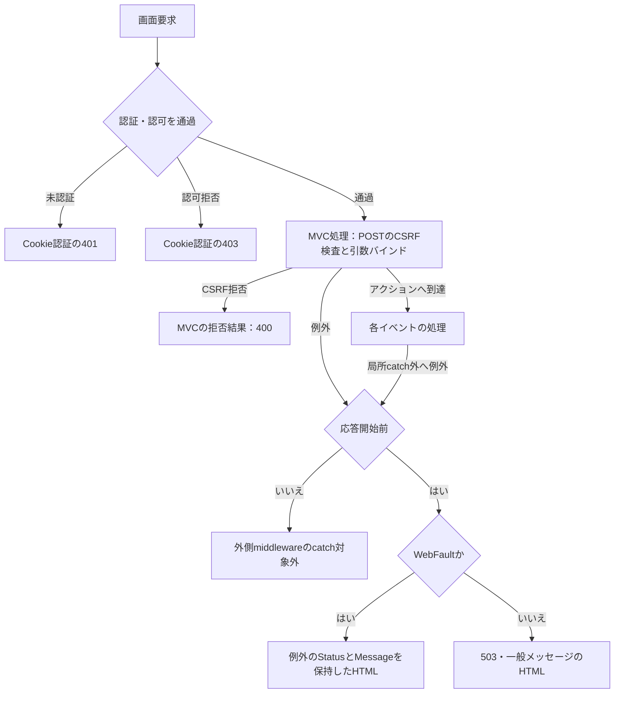

Cookie認証の401・403では、`/students`用の独自JSONを書かない。CSRF拒否もアクションのFormGuardや局所catchへは進まず、`AntiforgeryValidationFailedResult`のMVC経路となる。独自JSON化は`/api`配下だけである。CSRFとバインドのフレームワーク内部の詳細順序を、アクション内の検査順序と同一視しない。

外側middlewareはno-store、nosniff、no-referrer、CSPを設定して後続処理をawaitする。応答開始前のExceptionだけを捕捉し、WebFaultならそのStatusとMessage、それ以外なら503と一般メッセージでエラーHTMLを返す。エラーHTMLには「検索画面を開く」リンクがある。取消も、別の応答が開始されていなければこの一般例外経路へ到達し得る。

根拠：`sources/Infrastructure/WebHostSetup.cs:14–16,21–25`、`sources/Infrastructure/AntiforgeryResultFilter.cs:7–8`。

### 認証利用者と検索状態の契約

`CurrentUser`は認証済みPrincipalからNameIdentifier、login_session、Roleを取得する。未認証、識別値・セッションの空白、識別値64Unicodeスカラー超、セッション64コード単位超、Roleの解析失敗はWebFault 401である。サービスは認証主体を必須Textとして原入力・trim後64スカラー以内で再検査し、セッションが空ならUnauthorizedAccessExceptionを投げる。接続されたWeb実装ではwebTokens=trueのため、GUID形式検査は適用しない。

検索アクションが照合に使うTabはフォーム引数である。`RequestIdentity.TabId`に宣言されたヘッダー／クエリー取得はこの受渡しへ接続していない。

根拠：`sources/Infrastructure/RequestIdentity.cs:6–16`、`sources/Infrastructure/WebHostSetup.cs:19–19`、`sources/Core/SqlServerStudentService.cs:46–51`、`sources/Web/Controllers/StudentsController.cs:13–22`。

| Entry属性 | 型・初期値 | 利用目的 |
| --- | --- | --- |
| Id | string、乱数32バイトの小文字16進文字列 | 検索状態の辞書キー、画面間引継ぎ |
| Owner／Session | string、作成利用者のPrincipal／SessionId | 他利用者・別認証セッションからの利用を拒否 |
| Tab | string。作成引数がNULL・空ならトークン生成 | 非空Tabが渡された要求の画面照合 |
| Expires | DateTimeOffset、UTC作成時刻＋30分 | 検索状態の期限 |
| Revision | long、1 | Useで受信文字列と照合。成功イベントの版管理 |
| Applied | SearchCriteria?、NULL | 適用済みの検索条件。画面で編集中の条件とは別 |
| LastResult | SearchResult?、NULL | 前回の成功検索結果。画面に常に表示されるとは限らない |
| Gate | SemaphoreSlim(1,1) | 同じEntryをUseする処理の排他 |

Createは辞書中の期限切れEntryを除去してから、新しいEntryを登録する。条件のコピーはJSON serialize／deserializeによるメモリコピーであり、DB保存ではない。Getはキーを加工しない。ContextIdのNULLは辞書呼出し前に拒否し、空文字・未知キーは検索不成立、期限切れは期限比較によって、いずれも409／W-SRC-002とする。期限は`Expires < 現在UTC`で判定する。所有者・セッション不一致、非空Tabの不一致は403である。

根拠：`sources/Infrastructure/SearchContextStore.cs:9–15`。

Useの処理手順は次のとおりである。

1. ContextId、利用者、TabをGetで確認する。
2. Gateを取消トークン付きで待つ。この待機中の取消はtry／finallyへ入る前に起こり得る。
3. Gate取得後に再度Getし、期限、辞書内の存在、所有者、セッション、Tabを再確認する。
4. ContextRevisionと`Revision.ToString(InvariantCulture)`を文字列完全一致で比較する。不一致は409であり、数値変換による同値判定は行わない。
5. Revisionがlong.MaxValueなら409で拒否する。
6. イベント固有のoperationをawaitする。
7. operationが正常終了した場合だけ期限を現在UTC＋30分へ延長する。
8. Gate取得後にtryへ入った経路はfinallyでReleaseする。

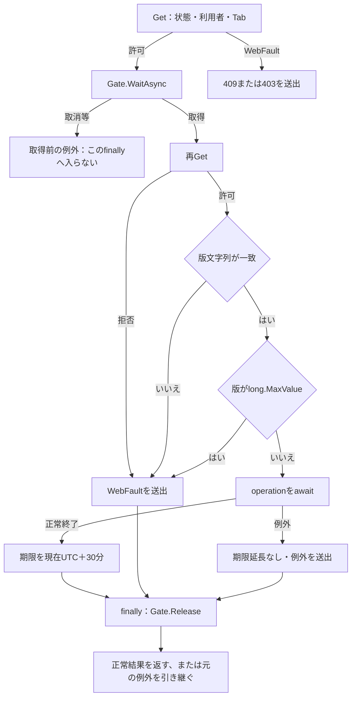

再GetはGate取得直後であり、サービスDB読取のawait後から状態更新直前までに追加のGetはない。候補更新はUseを通らないため、Gate、版比較、期限延長、候補読取後の再Getを行わない。

根拠：`sources/Infrastructure/SearchContextStore.cs:13–14`、`sources/Infrastructure/WebStudentCoordinator.cs:7–15`、`sources/Web/Controllers/StudentsController.cs:22–22`。

### 共通DB読取：候補

SearchModelは`LookupAsync(false, ct)`を呼ぶ。サービスは利用者確認、接続確認、Snapshotトランザクション開始を行い、1コマンドの2結果セットをCodeEntryとSchoolClassへ格納してcommitする。

```sql
SELECT c.category_id,c.code_value,c.code_name,c.display_order,
       CONVERT(bit,CASE WHEN c.is_active=1 AND k.is_active=1 THEN 1 ELSE 0 END) is_active,
       c.valid_from,c.valid_to,c.is_protected
FROM dbo.m_code c
JOIN dbo.m_code_category k ON k.category_id=c.category_id
ORDER BY c.category_id,c.display_order,c.code_value;

SELECT c.*, CONVERT(int,0) occupied
FROM dbo.m_class c
LEFT JOIN dbo.m_code g
  ON g.category_id=c.grade_category AND g.code_value=c.grade_code
ORDER BY c.school_year DESC,g.display_order,c.display_order,c.class_code,c.class_id;
```

第1結果にはコード分類、値、表示名、表示順、有効状態、開始日、NULL可能な終了日、保護フラグが入る。有効状態はコードと分類の両方のis_activeが1であることを合成するが、抽出用WHEREではない。第2結果はクラスの年度・学年・コード・名称・期間・定員・停止情報を持つ。false指定のoccupiedは0固定であり、所属人数の集計結果ではない。検索ビューは人数と定員を表示しない。

検索候補のSQLには停止・期間外を除く述語がない。年度は全クラスのSchoolYearを重複除去して降順、学年・区分・都道府県は分類別にCodeValue／CodeNameを使用する。クラス候補は画面条件の年度・学年で絞り、上位条件未指定ならその条件では絞らない。停止クラスには「（停止）」を付けるが、期間外注記、停止コードのdisabled、候補helperのselectableは検索Razorに適用しない。

候補読取には値パラメータ、ページング、件数上限がない。読取・NextResult・commitへ取消トークンを渡す。LookupAsync内には取消やDB例外を結果DTOへ変換するcatchがない。テーブル関係は補足説明の関係図を参照し、この読取ではm_codeとm_code_categoryのINNER JOIN、m_classと学年コードのLEFT JOINを使う。

根拠：`sources/Core/SqlServerStudentService.cs:197–216`、`sources/Core/Contracts.cs:61–65`、`sources/Web/Controllers/StudentsController.cs:39–39`、`sources/Views/Students/Search.cshtml:5–5`。

### 共通DB読取：学生検索

#### 検査と読取の順序

SearchAsyncは、tryの前にサービス利用者を確認し、検索開始時刻nowと、その日本時間の業務日dayを取得する。以降の入力・DB確認は次の順序である。

1. Pageが1以上、PageSizeが20・50・100、SortDirectionがasc・descであることを確認する。SortKeyを許可されたSQL列へ変換する。不正値はE-COM-003である。
2. 年度が1900〜9998、ClassIdが指定時に正値であることを確認する。未所属と年度・非NULL学年・クラスの併用をE-SRC-001で拒否する。
3. 在籍区分配列の長さ、Ordinal重複、01〜04の許可値を確認する。不正はE-STU-009である。NULL配列をこの検査結果へ変換するガードはなく、Length参照の例外は別経路になる。
4. 学籍番号、氏名とNameKey、カナと空白除去キー、電話、学年、都道府県を順に正規化する。各項目の原入力上限と正規化結果は項目一覧のとおりである。
5. 入学日の開始・終了をParseIsoし、両方指定時の順序を確認する。開始が終了より後ならE-STU-006となる。
6. 接続を開き、Snapshotトランザクションを開始する。指定学年と都道府県は、分類と値の一致件数が1であることをCodeExistsで確認する。不存在はE-STU-009である。ここでは停止・分類停止・有効期間を拒否条件にしない。在籍区分は固定許可値検査であり、CodeExistsを呼ばない。
7. 指定年度のクラス件数が0ならE-STU-014とする。指定クラスが存在しない、または指定年度・正規化学年と不一致ならE-STU-014とする。
8. 全検索述語をANDで組み立て、上限判定の件数を取得する。10,000件超過なら一覧を読まずcommitして超過結果を返す。
9. 通常件数ならSQL用ページを最終ページ以下へ補正し、並び順とOFFSET／FETCHで一覧を読む。commit後にNoChangeのSearchResultを返す。

根拠：`sources/Core/SqlServerStudentService.cs:103–170,218–222`、`sources/Core/JapaneseDateService.cs:52–59`。

#### 全検索述語とパラメータ

WHEREの基礎は常に`s.is_deleted=0`である。値がNULLならその条件とパラメータを追加しない。在籍区分は空配列なら追加しない。LIKEでは`!`、`%`、`_`、`[`を`!`でエスケープしてから検索用の`%`を付ける。

| 条件 | 追加述語 | パラメータ・型／サイズ | 値 |
| --- | --- | --- | --- |
| 学籍番号 | `s.student_no LIKE @no ESCAPE '!'` | `@no VarChar/31` | エスケープ済み正規化番号＋`%` |
| 氏名 | `s.name_key LIKE @name ESCAPE '!'` | `@name NVarChar/642` | `%`＋エスケープ済みNameKey＋`%` |
| 氏名カナ | `s.kana_key LIKE @kana ESCAPE '!'` | `@kana NVarChar/74` | `%`＋エスケープ済み空白除去カナ＋`%` |
| 年度 | `c.school_year=@year` | `@year SmallInt`、サイズなし | 指定年度 |
| 学年 | `c.grade_code=@grade` | `@grade VarChar/2` | 正規化学年 |
| クラス | `s.class_id=@class` | `@class BigInt`、サイズなし | 正のクラスID |
| 未所属 | `s.class_id IS NULL` | なし | trueの場合だけ追加 |
| 都道府県 | `s.prefecture_code=@prefecture` | `@prefecture VarChar/2` | 正規化コード |
| 電話番号 | `(s.phone_number=@phone OR s.emergency_phone_number=@phone)` | `@phone VarChar/16` | 正規化電話 |
| 入学日・開始 | `s.admission_date>=@from` | `@from Date`、サイズなし | DateOnly→00:00のDateTime |
| 入学日・終了 | `s.admission_date<=@to` | `@to Date`、サイズなし | DateOnly→00:00のDateTime |
| 在籍区分 | `s.enrollment_status_code IN (@status0,...)` | 各`@statusN VarChar/2` | 受け取った許可値 |

存在確認は、コードについて`m_code WHERE category_id=@category AND code_value=@value`のCOUNT_BIGが1、年度について`m_class WHERE school_year=@year`のCOUNT_BIGが正、クラスについて`m_class WHERE class_id=@id`の先頭読取があることを確認する。コードパラメータは`@category VarChar/24`、`@value VarChar/10`、年度は`@year SmallInt`、クラスは`@id BigInt`である。

Paramはサイズが0ならSizeを設定しない。NULLを渡す用途ではDBNull.Valueへ変換するが、検索条件のNULLはそもそもパラメータ作成を省く。DateOnlyはDateTimeへ変換する。

根拠：`sources/Core/SqlServerStudentService.cs:67–73,125–164,218–222`、`sources/Core/StudentNormalizer.cs:161–161`。

件数読取は次の形であり、適用するWHEREは上表の全条件を共有する。

```sql
SELECT COUNT_BIG(*)
FROM (
  SELECT TOP (10001) s.student_id
  FROM dbo.m_student s
  LEFT JOIN dbo.m_class c ON c.class_id=s.class_id
  /* WHERE：is_deleted=0と指定条件のAND */
) limited;
```

一覧SELECTはstudent_id、学籍番号、表示氏名、表示カナ、生年月日、所属年度、クラスコード・名称、学年名、区分名、都道府県名、住所1、本人電話、入学日、更新日時、比較版を取得する。学生からクラスへLEFT JOINし、学年・区分・都道府県はそれぞれ分類列と値でm_codeへLEFT JOINする。コードの値だけで分類を跨いで結合しない。

```sql
FROM dbo.m_student s
LEFT JOIN dbo.m_class c ON c.class_id=s.class_id
LEFT JOIN dbo.m_code g
  ON g.category_id=c.grade_category AND g.code_value=c.grade_code
LEFT JOIN dbo.m_code e
  ON e.category_id=s.enrollment_category AND e.code_value=s.enrollment_status_code
LEFT JOIN dbo.m_code p
  ON p.category_id=s.prefecture_category AND p.code_value=s.prefecture_code
/* 同じWHERE */
/* ORDER BY：許可列＋許可方向、s.student_id ASC */
OFFSET @offset ROWS FETCH NEXT @size ROWS ONLY;
```

| SortKey | 主順序のSQL列 | 意味 |
| --- | --- | --- |
| studentNo | `s.student_no` | 保存された学籍番号 |
| name | `s.name_key` | 表示氏名ではなく照合キー |
| admissionDate | `s.admission_date` | 入学日 |
| updatedAt | `s.updated_at` | 最終更新時刻 |

主順序の方向はascまたはdesc、同順位は常にstudent_id ASCである。`@offset`と`@size`はIntで、最大PageSize件を読む。SQL用pageは`Min(要求Page, 最終Page)`、最終Pageは最低1である。この内部補正はSearchCriteria.Pageを書き換えない。

根拠：`sources/Core/SqlServerStudentService.cs:77–90,108–108,156–168`。

#### 接続、確定、取消

接続文字列はSqlConnectionStringBuilderで再構成し、Encrypt=Mandatory、TrustServerCertificate=falseとする。OpenAsync後に現在DBのsnapshot_isolation_stateを読み、1以外ならInvalidOperationExceptionを投げる。Open内で失敗すると接続をDisposeして再送出する。Command helperで作る検索・候補コマンドのタイムアウトは30秒である。診断コマンドはCreateCommandで作り、原文に明示的なタイムアウト設定はない。

検索はSnapshotトランザクションで件数と一覧を読む。件数が10,000を超えた場合、CountはTOP(10001)で得た10001、Itemsは空、LimitExceededはtrueとなる。真の総件数は取得しない。通常結果も超過結果も、commit完了後にOutcome.NoChangeを返す。検索では学生更新、監査INSERT、保存用アプリケーションロックを行わない。

取消トークンは接続、診断、トランザクション開始、DB実行、読取、commitへ渡す。検索には明示Rollback helperの呼出しがない。未commitトランザクションはawait usingの破棄境界へ進み、破棄時の実行はSqlClientに属する。

根拠：`sources/Core/SqlServerStudentService.cs:39–73,123–170,197–216`。

#### サービス結果と例外

SearchAsyncのcatch順序はInputValidationException、次にArgumentExceptionである。先行catchはFieldErrorの項目・コード・メッセージを保持する。次のcatchはArgumentError("Search", e)を使い、E-STU・DATE・COM・SRC・MSTの3桁コード形式なら保持し、その他はE-STU-002へ変換する。両方ともValidationFailed、Count=0、空Itemsを返す。このCount=0は入力失敗用の値であり、条件に該当する学生が0人だった結果とは別である。

try外のUser確認、捕捉対象外の例外、取消、通常のDB例外はこの2catchで検索結果化しない。NULL区分配列のLength参照も独自入力検証にはならない。EnsureSearchはSavedまたはNoChangeだけを通し、その他は先頭FieldErrorとOutcome対応Statusを用いてWebFaultへ変換する。ValidationFailedなら422である。

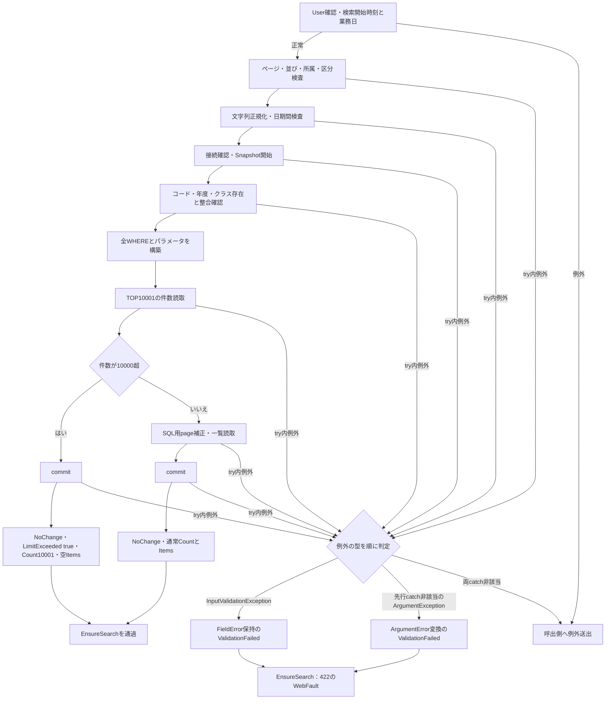

根拠：`sources/Core/SqlServerStudentService.cs:103–170`、`sources/Core/StudentNormalizer.cs:7–9,162–168`、`sources/Infrastructure/WebStudentCoordinator.cs:20–20`、`sources/Infrastructure/WebPresentation.cs:23–23`。

### 初期表示：GET /students

#### 処理概要

新しい検索Entryと初期入力を作り、候補を読んで未検索画面を返す。学生検索SQLは実行しない。非空contextIdがある場合は、後述の検索復帰へ分岐する。

#### 処理手順

1. 共通入口を通過し、identity.Readで利用者を確認する。
2. contextIdがNULLまたは空ならNewContextを呼ぶ。Entryは版1、期限30分、AppliedとLastResultはNULLである。
3. Present(entry, null)で未検索データを作り、新しいStudentSearchInputを用意する。在籍区分01・02、PageSize20、studentNo昇順、ページ1が初期値である。
4. FlashMessageStore.Takeを利用者・セッション・Entry.Idの組で呼ぶ。
5. SearchModelでLookupAsync(false)をawaitし、利用者、Entry、初期入力、通知、JsonElement表示データをモデルへ設定する。
6. Searchビューを返す。

#### 条件付き処理フロー

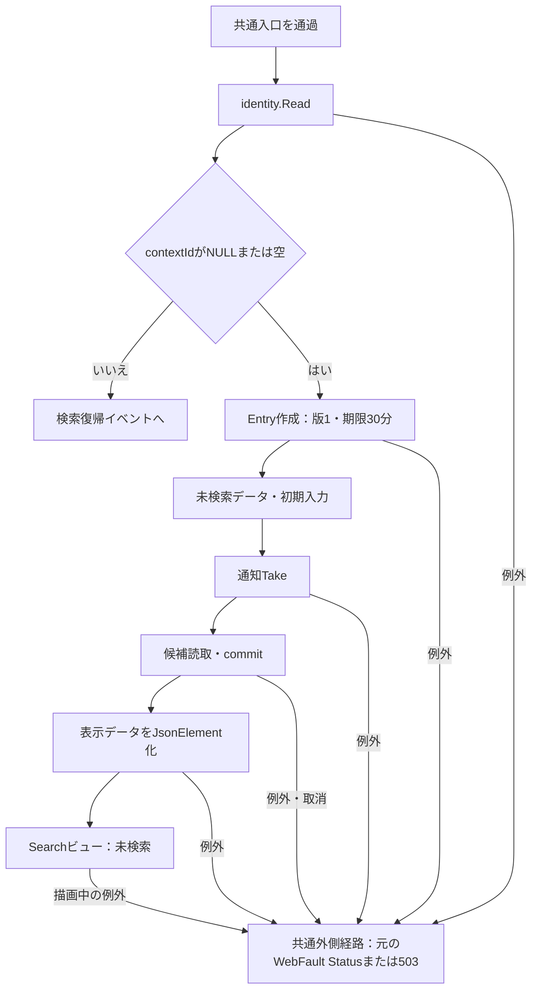

#### SQL・テーブル関連／DB操作

共通候補読取のm_code、m_code_category、m_classを参照する。関係図は補足説明に示す。候補は2結果セットで、WHERE、パラメータ、ページングを持たない。学生一覧の検索、DB更新、保存用ロックは行わない。Entryと通知はメモリストアである。

#### 結果・例外

このアクションには局所catchがない。利用者、状態作成、候補、表示変換、描画の失敗は共通外側経路に従う。TakeはSearchModelの引数評価で候補読取より先に行うため、後続表示が失敗しても通知が取り出し済みになる場合がある。

根拠：`sources/Web/Controllers/StudentsController.cs:8–11,39–39`、`sources/Web/Inputs/StudentSearchInput.cs:7–22`、`sources/Infrastructure/SearchContextStore.cs:9–12`、`sources/Infrastructure/FlashMessageStore.cs:7–9`。

### 検索：POST /students/search

#### 処理概要

受信した画面条件を新しい適用条件として先頭ページから検索する。正常な0件、通常結果、上限超過はいずれも検索成功側の状態反映へ進む。

#### 処理手順

1. 共通入口の後、FormGuardをawaitする。Criteria.StatusCodesのフォームキーがなければ、DTOの初期01・02を空配列へ置き換える。
2. CurrentUserを確認し、ContextId・TabでGetする。このGetは局所catchの外である。
3. 再表示用dataをPresent(entry, null)にする。
4. ModelStateが不正ならStatusを422にし、coordinatorとサービスを呼ばない。
5. 有効なら局所try内でcoordinator.Searchを呼ぶ。identity.Read、ToCriteriaの移送、ClassIdのIdParser変換を行う。Pageは1固定で、件数・並びはアクション引数を渡す。
6. Useで状態取得、Gate待機後の再Get、版比較、版上限を確認し、SearchAsyncを実行する。
7. EnsureSearchを通過した後だけ、移送した条件をコピーしてAppliedへ設定し、LastResultを設定し、Revisionを1増やす。サービスで生成した正規化キーを条件へ逆移送する処理はない。
8. Use正常終了で期限を延長し、Gateを解放する。
9. SearchModelで候補を別のSnapshotトランザクションから読み、dataをJsonElement化する。モデルのPageSize・SortKey・SortDirectionを受信値で設定し、Searchビューを返す。

#### 条件付き処理フロー

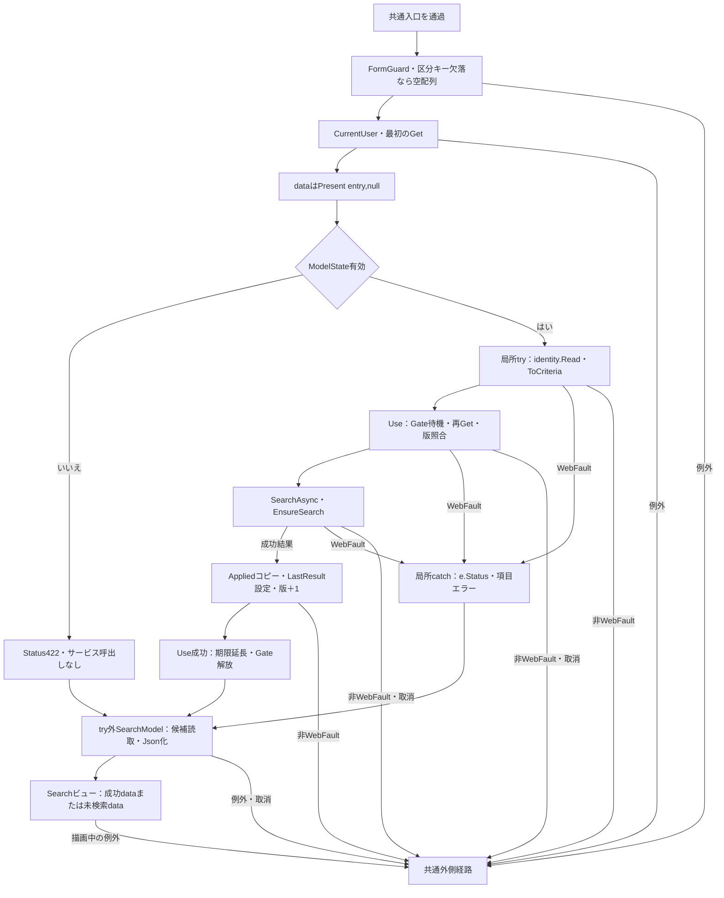

#### SQL・テーブル関連／DB操作

共通学生検索のm_student、m_class、分類別m_codeを参照し、表示準備で別途共通候補読取を行う。FKと検索JOINの対応は補足説明の関係図に示す。検索件数・一覧のSnapshotと候補のSnapshotは別であり、両者を一つの読取時点としない。DB更新はない。正常結果の確定後にApplied・LastResult・Revisionをメモリへ反映する。

#### 結果・例外

ModelState不正はサービス未呼出しの422である。coordinator.SearchからのWebFaultは局所catchで項目エラーへ加え、e.Statusを保持して未検索一覧を再表示する。サービス入力検証の422、Useの409・403、識別値変換の422などを一つのStatusへ固定しない。FormGuard、最初のGet、成功・失敗双方のSearchModel、Razor描画はこの局所catchの外である。

サービス検証失敗では既存Applied、LastResult、版を更新しないが、画面dataはPresent(entry, null)なので保持結果は表示しない。逆に、正常な状態更新と期限延長の後で候補読取・Json化・描画に失敗した場合、画面応答の失敗によってメモリ更新を戻す処理はない。

根拠：`sources/Web/Controllers/StudentsController.cs:13–16,39–39`、`sources/Web/Inputs/StudentSearchInput.cs:19–22`、`sources/Infrastructure/WebStudentCoordinator.cs:7–9,20–21`、`sources/Infrastructure/SearchContextStore.cs:14–14`。

### 候補更新：POST /students/options

#### 処理概要

編集中の年度・学年に合わせてクラス候補を再描画する。AppliedとLastResultは更新せず、既存LastResultを一覧に表示する。受信ContextRevisionは比較しない。

#### 処理手順

1. 共通入口の後、FormGuardをawaitし、区分キー欠落を空配列へ補正する。
2. CurrentUserとContextId・TabでGetする。
3. UnassignedOnlyがtrueならSchoolYear、GradeCode、ClassIdをNULLにし、対応するCriteriaのModelStateをRemoveする。
4. Present(entry, entry.LastResult)と受信入力DTOをSearchModelへ渡し、候補を取得して表示データを作る。通常通知は「条件を変更しました。検索を押すと一覧に反映します。」である。
5. ClassIdが非空なら、文字列IDと指定年度・学年に一致するクラスが取得候補にあるか確認する。ない場合はClassIdをNULLにし、そのModelStateをRemoveする。通知を「上位条件に合わないクラスを解除しました。」へ変更する。
6. Searchビューを返す。Razorは編集中の上位条件でクラス候補を絞り、未所属なら所属3selectをdisabledにする。

#### 条件付き処理フロー

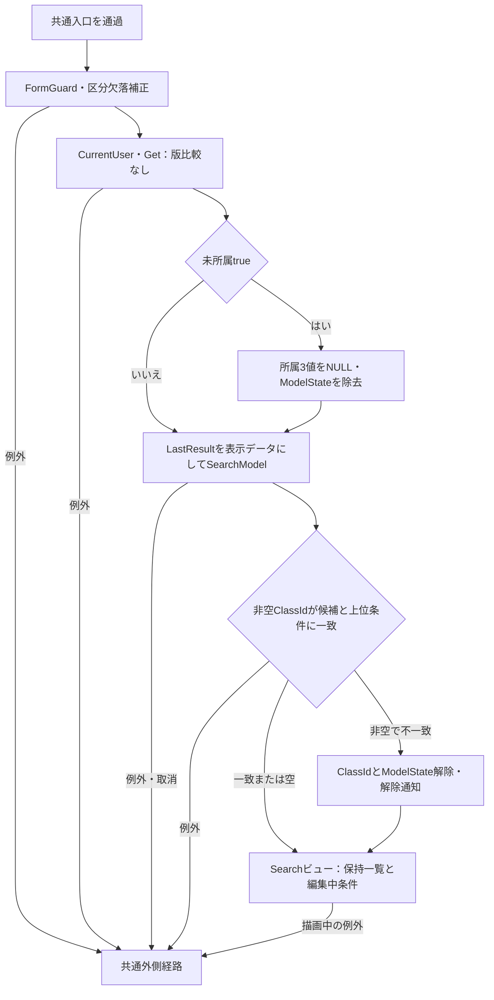

#### SQL・テーブル関連／DB操作

共通候補読取だけを行い、m_code、m_code_category、m_classを参照する。学生一覧の再検索や更新は行わない。LastResultの表示行はメモリ上の既存結果から取得する。検索SQLのLEFT JOIN名称と、この要求で読んだ最新候補は異なる読取結果である。

#### 結果・例外

このアクションはModelState.IsValid、ToCriteria、IdParser、SearchAsync、Useを呼ばない。Gate、受信版比較、版増分、期限延長、候補await後の状態再確認もない。PageSize・SortKey・SortDirectionのモデル値はAppliedまたは既定値を使い、受信した引数を検索イベントのように設定し直さない。

局所catchはなく、状態拒否、候補読取、表示変換、描画の例外は共通外側経路へ進む。NULLのStatusCodesが入力DTOに到達した場合、RazorのContainsは独自検証結果ではない。受信値からその状態に至るバインド条件は別の境界である。

根拠：`sources/Web/Controllers/StudentsController.cs:22–22,39–39`、`sources/Infrastructure/WebStudentCoordinator.cs:21–21`、`sources/Views/Students/Search.cshtml:5–5`、`sources/Core/SqlServerStudentService.cs:197–216`。

### ページ・並び順変更：POST /students/page

#### 処理概要

Appliedを再利用して検索する。検索条件フォームで編集中の値は送受信対象にしない。件数、並び項目、方向のいずれかが変われば先頭ページへ戻る。

#### 処理手順

1. 共通入口の後、FormGuardをawaitし、CurrentUserとContextId・TabでGetする。このGetは局所tryの外である。
2. try内でcoordinator.Pageを呼び、identity.ReadとUseの排他・再確認・版比較を行う。
3. AppliedがNULLならWebFault 409「先に検索してください。」で拒否する。
4. Appliedをコピーする。件数・キー・方向のどれかが受信値と異なるならPage=1、同じなら受信Pageを設定し、受信した新しい件数と並びを設定する。
5. SearchAsyncとEnsureSearchを行う。
6. LimitExceededがfalseで条件Pageが取得件数の最終ページを超えた場合、条件Pageも最終ページへ補正して、SearchAsyncとEnsureSearchをもう一度行う。再検索は別のサービス呼出しである。
7. 成功した条件をAppliedへコピーし、LastResultを設定し、Revisionを1増やす。Useの正常終了で期限延長・Gate解放を行う。
8. 同じ局所try内で、From(Applied)による入力復元、SearchModelの候補取得・Json化を行い、ビューを返す。
9. WebFaultを捕捉した場合はe.Statusと項目エラーを設定し、From(Appliedまたは既定条件)とPresent(entry, null)を使って、catch内のSearchModelで未検索一覧を再表示する。

#### 条件付き処理フロー

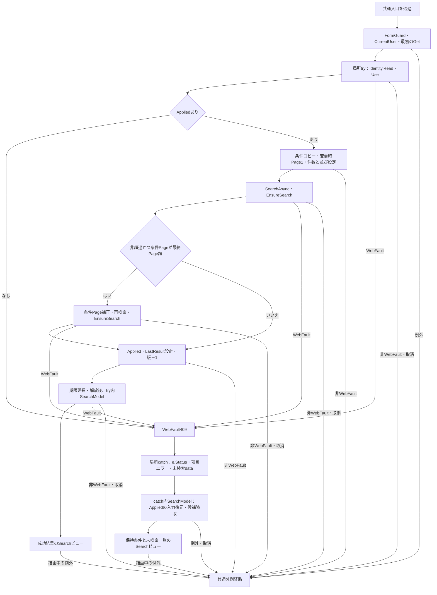

#### SQL・テーブル関連／DB操作

共通学生検索と共通候補読取を使う。検索対象とJOINはm_student、m_class、分類別m_codeで、補足説明の関係図に対応する。最終ページ補正による再検索は、1回目とは別のSnapshotトランザクションで行う。最大表示件数は20・50・100。DB更新はなく、全検索・再検査成功後にメモリへ反映する。

#### 結果・例外

ModelState.IsValidを処理停止条件にしないため、バインドエラーの存在だけでサービス呼出しを停止する実装ではない。サービスへ届いた値は共通検索検査を受ける。最初のGetとFormGuardはcatch外、coordinator.Pageと成功側SearchModelのWebFaultはcatch内、catch内で再度行うSearchModelの例外は外側へ送出される。Viewを返した後のRazor描画はアクションの局所catchへ含めない。

入力失敗等では既存の保持条件・結果を成功更新しないが、再表示にはPresent(entry, null)を使う。成功後のSearchModelがWebFaultを投げた場合は、すでに更新されたAppliedを用いながら未検索一覧を表示する場合がある。失敗時の画面状態から、メモリが必ず更新前であるとは判断しない。

根拠：`sources/Web/Controllers/StudentsController.cs:18–19,39–40`、`sources/Infrastructure/WebStudentCoordinator.cs:11–12`、`sources/Core/SqlServerStudentService.cs:159–170`。

### クリア：POST /students/clear

#### 処理概要

現在のEntryを維持したまま、適用条件と検索結果を解除する。検索識別値やTabを新規発行する処理ではない。

#### 処理手順

1. 共通入口の後、FormGuardをawaitする。
2. coordinator.Clearでidentity.Readを行い、Useで状態・Tab、Gate取得後の再確認、版比較、版上限を確認する。
3. AppliedとLastResultをNULLにし、Revisionを1増やす。Present(entry, null)で未検索dataを生成する。
4. Use正常終了で期限を30分延長し、Gateを解放する。
5. ModelState.Clearを行い、CurrentUser、ContextId、Tabで再度Getする。
6. 新しいStudentSearchInputを使い、候補取得とJson化を行ってSearchビューを返す。在籍区分01・02、20件、学籍番号昇順、ページ1へ戻る。

#### 条件付き処理フロー

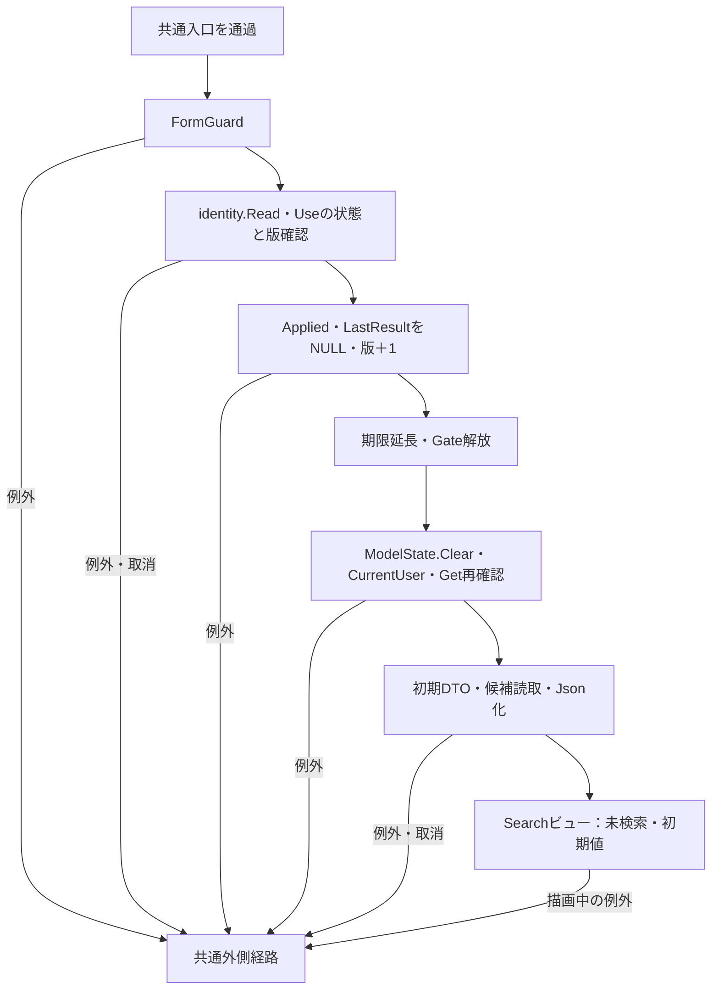

#### SQL・テーブル関連／DB操作

状態解除はSearchContextStoreのメモリ操作であり、DBの検索条件行を削除しない。学生検索SQL・DB更新は行わないが、再表示には共通候補読取のm_code、m_code_category、m_classを使う。参照関係は補足説明の関係図に対応する。

#### 結果・例外

ModelState.IsValidの判定と局所catchはない。状態拒否、Gate待機の取消、解除後の再Get、候補・表示変換・描画の失敗は共通外側経路となる。解除後の再表示失敗によって、Applied・LastResult・版を解除前へ戻す処理はない。

根拠：`sources/Web/Controllers/StudentsController.cs:21–21,39–39`、`sources/Infrastructure/WebStudentCoordinator.cs:15–15`、`sources/Infrastructure/SearchContextStore.cs:14–14`、`sources/Web/Inputs/StudentSearchInput.cs:7–22`。

### 検索復帰：GET /students?contextId=…&contextRevision=…

#### 処理概要

非空contextId付きGETは、保持結果の単純再表示ではなく、Appliedによる再検索入口である。新規登録・編集・参照の「検索へ戻る」と、保存・論理削除成功後の303がこの入口へ接続する。

#### 処理手順

1. 共通入口とidentity.Readを通過し、ContextIdでGetする。Tabは渡さない。
2. ContextRequestへEntry.Idと受信contextRevisionを設定する。受信版がNULLなら空文字を設定する。
3. coordinator.Resumeでidentity.ReadとUseのGate待機後再確認、版文字列比較、版上限を行う。
4. AppliedがNULLならPresent(entry, null)を返す。Revisionは増やさないが、Useの正常終了による期限延長は行う。
5. Appliedがあるなら、その条件をSearchAsyncへ渡し、EnsureSearchを通過した後にLastResultを更新し、Revisionを1増やす。Appliedをコピーし直したり、そのPageを最終ページへ補正したりはしない。
6. Useの期限延長・Gate解放後、From(Applied)または新しいStudentSearchInputで入力を用意する。
7. 通知Take、候補取得、Json化を行い、Searchビューを返す。

#### 条件付き処理フロー

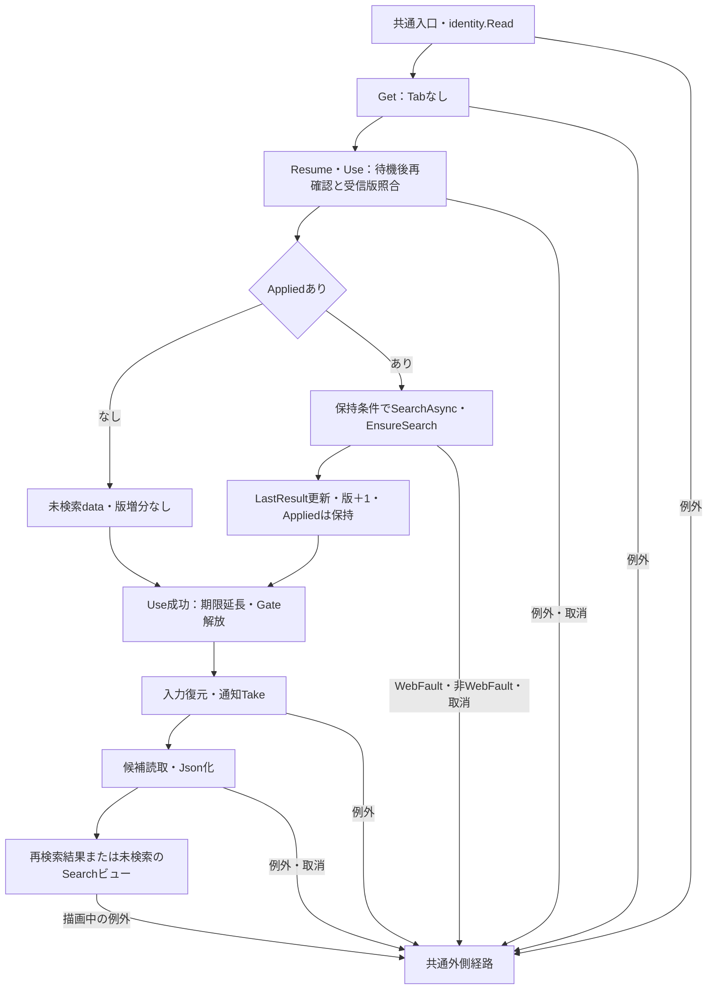

#### SQL・テーブル関連／DB操作

Appliedありでは共通学生検索の件数・一覧を再読取し、その後に別の共通候補読取を行う。Appliedなしでは候補だけを読む。DB更新はなく、LastResultとRevisionがメモリの更新対象である。テーブル関連は補足説明の関係図に対応する。

#### 結果・例外

局所catchはない。版未指定・古い版、期限切れは409、所有者・セッション不一致は403で拒否される。Tab照合の省略は利用者照合や版照合の省略ではない。新規状態への303復帰はAppliedがNULLなので学生再検索を行わない。

ResumeではサービスがSQL用ページだけを内部補正する。件数減少等でApplied.Pageが最終ページを超えている場合、取得ページとPresentが返すページが異なる可能性を残す。pageイベントの条件補正・再検索をResumeにもあるものとして扱わない。

Takeは状態・版照合と必要な再検索の後である。復帰拒否や再検索失敗では通知をまだ取り出さず、Take後の候補・描画失敗では一回取得済みになり得る。

根拠：`sources/Web/Controllers/StudentsController.cs:8–11,39–40`、`sources/Infrastructure/WebStudentCoordinator.cs:14–14`、`sources/Infrastructure/SearchContextStore.cs:13–14`、`sources/Core/SqlServerStudentService.cs:160–168`、`sources/Infrastructure/FlashMessageStore.cs:9–9`。

### 登録編集との境界

#### 遷移・読込・戻る

検索の新規リンクと一覧リンクはreturnContextIdだけを渡し、クリック時点のRevisionをURLへ付けない。Loadはcoordinator.Editで利用者と非空復帰ContextIdを確認する。新規ならCreateOrUpdate権限を確認し、既存ならGetAsyncで非削除学生を取得する。正でないIDや対象不在はサービスのNULL結果となり、画面側で404／E-STU-103へ変換する。読込SQLは`student_id=@id AND is_deleted=0`、`@id BigInt`である。

続いて候補を読み、Loadは復帰ContextIdをもう一度Getする。この後段の再取得で確認できたRevisionをReturnRevisionへ格納する。編集スナップショットには所有者、セッション、対象ID、Detail、Original入力コピー、30分期限、ReturnRevisionを保持する。新規・参照でもスナップショットを作る。Viewerの編集ビューではCanEdit=falseとなり、入力fieldsetをdisabledにする。

「検索へ戻る」はReturnContextIdと読込時ReturnRevisionを渡す。編集JavaScriptは入力変更をdirtyとして未保存変更の破棄確認を行うが、確認ダイアログをDB確定や業務承認と扱わない。

根拠：`sources/Views/Students/Search.cshtml:6–8`、`sources/Web/Controllers/StudentsController.cs:23–25`、`sources/Infrastructure/WebStudentCoordinator.cs:6–6,17–17`、`sources/Core/SqlServerStudentService.cs:172–194`、`sources/Infrastructure/EditorSnapshotStore.cs:7–11`、`sources/Web/Models/StudentEditPageModel.cs:13–14`、`sources/Views/Students/Edit.cshtml:5–5,16–16`、`sources/wwwroot/js/site.js:2–5`。

#### 保存・削除入口の復帰先確認

保存の前段は、FormGuard、CreateOrUpdate権限、snapshotIdと利用者・対象IDの照合、非空ReturnContextIdのGet、Original.ReturnContextIdとの一致、ModelState、SaveRequest変換の順である。受信値が非nullableであることをSnapshotIdの必須保証に使わない。

削除の前段は、FormGuard、identity.Read、スナップショット照合、Originalとの復帰先一致、coordinator.DeleteのAdministrator確認、非空復帰先Get、Confirmed検査、ExpectedVersionのIdParser変換の順である。保存と削除の確認順序は同じではない。

Snapshot.Getは空文字・不在・期限切れを独自409、所有者・セッション・対象不一致を403とする。一方、tokenのNULLを明示検査せずConcurrentDictionary.TryGetValueへ渡す。NULLが届いた場合の標準ライブラリ契約上のArgumentNullExceptionを、独自409とまとめない。ReturnContextIdはCheckReturnではNULLと空文字のどちらも検査省略だが、Originalとの文字列比較では区別する。

根拠：`sources/Web/Controllers/StudentsController.cs:28–37`、`sources/Infrastructure/EditorSnapshotStore.cs:10–10`、`sources/Infrastructure/WebStudentCoordinator.cs:6–6,18–19`、`sources/Web/Inputs/StudentSaveInput.cs:34–43,57–60`。

#### DB確定と成功復帰

保存は入力正規化後にReadCommittedトランザクションと保存用ロックを取得する。既存学生を非削除条件で再読取し、不在、比較版、変更不可の学籍番号、終了区分変更の権限・理由を確認する。コード・クラスのDB再確認、学籍番号重複、同一人物候補・確認情報の判定を行ってから書き込む。このため入口検査の通過だけではSavedを保証しない。

学生更新は`student_id=@id AND row_version=@version AND is_deleted=0`をWHEREとし、正規化値、updated_at、updated_by、row_version＋1を設定する。student_noは更新列から除く。戻りIDがNULLまたはDBNullならDBConcurrencyExceptionである。監査INSERT後にcommitを試み、完了後だけSavedを返す。保存用ロックはトランザクション所有のExclusiveアプリケーションロック、待機上限5000msで、検索のSemaphoreSlimとは別である。

削除は理由を必須の複数行Textとして原入力・trim後各60スカラーで検査し、正の学生ID・比較版と版上限を確認する。ReadCommittedと同じ保存用ロックの後に対象版を再読取する。UPDATEは同じID・比較版・非削除WHEREで、is_deleted=1、deleted_at、deleted_by、delete_reason、updated_at、updated_by、row_version＋1を設定する。パラメータはID・版BigInt、時刻DateTimeOffset、実行者NVarChar/128、理由NVarChar/120である。更新件数が1以外ならDBConcurrencyExceptionとし、監査INSERTとcommit完了後だけSavedを返す。

根拠：`sources/Core/SqlServerStudentService.cs:92–101,227–263,264–315,344–383,392–414`。

| 処理 | catch順序 | 結果と復帰 |
| --- | --- | --- |
| 保存・書込みtry | InputValidationException→SQL重複2601/2627→DBConcurrencyException→残るSqlException・InvalidOperationException・OperationCanceledException | 先行catchはそれぞれValidationFailed、ValidationFailed、Conflict。後段catchへ到達した場合だけ、writeStartedかつ「commitAttemptedまたはrollback失敗」ならUnknown、それ以外SystemError |
| 削除・書込みtry | DBConcurrencyException→残るSqlException・InvalidOperationException・OperationCanceledException | 先行catchはConflict。後段catchだけが同じ条件でUnknown／SystemErrorを分ける |
| 両処理の接続・トランザクション開始 | 書込みtryの前 | その失敗を上記の保存結果DTOへ一般化しない |
| rollback | CancellationToken.NoneでRollbackAsync | SqlExceptionまたはInvalidOperationExceptionはfalse。他の例外まで成功・falseへ固定しない |

先行catchが処理した例外を後段Unknown判定へ含めない。NoChange、ValidationFailed、ConfirmationRequired、Conflict、Unknown等はSaved用の303復帰へ進まない。保存は結果別Statusで編集を再表示し、削除の非Saved結果はStatusとエラーを設定してLoadを再実行する。後続Loadで対象不在404や復帰状態失効が発生し得る。

根拠：`sources/Core/SqlServerStudentService.cs:316–329,415–416`、`sources/Web/Controllers/StudentsController.cs:29–33,37–37`、`sources/Infrastructure/WebPresentation.cs:23–29`。

#### 303応答・通知・復帰版

保存・削除のOutcomeがSavedの場合だけReturnAfterSaveへ進む。既存復帰先ではSnapshot.ReturnRevisionを使い、最新Revisionへ置き換えない。復帰ContextIdがNULL・空の場合は新しいEntryを作り、その版を使用する。

FlashMessageStoreは利用者・認証セッション・ContextIdの組をキーに、保存なら「保存しました。」、削除なら「論理削除しました。」を10分保持する。応答は303、Locationは`/students?contextId=…&contextRevision=…`、本文はEmptyResultである。復帰GETは状態・版を検査し、Appliedがあれば再検索してから通知をTakeする。TakeはTryRemoveによる一回取得であり、取得時点で期限内の場合だけ本文を返す。

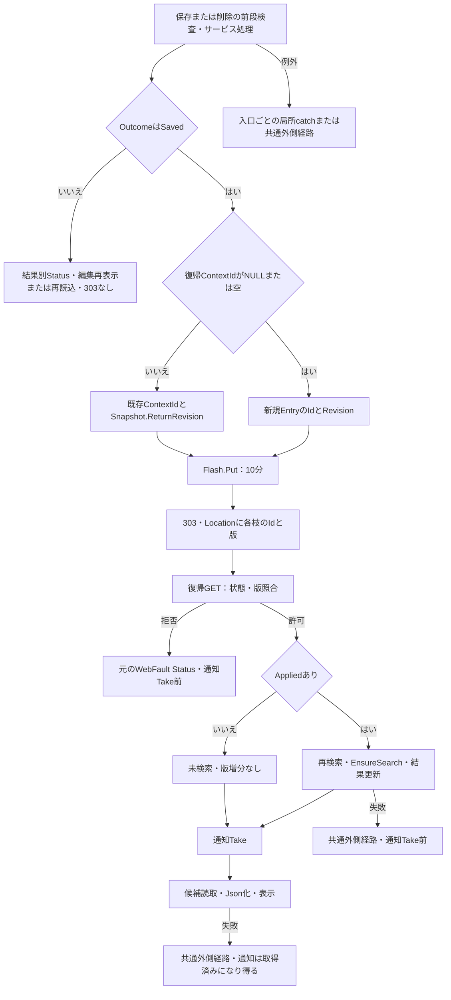

既存復帰先と新規復帰先で使用版が異なるため、合流点で一律に新規版や最新版を代入しない。編集読込後に検索状態が更新されると、学生DB保存が成功していても復帰GETは409となり得る。「検索へ戻る」も同じ読込時版を使うが、保存通知のPutは伴わない。

この節は検索へ戻れる条件と確定境界を説明する。登録・編集画面の全項目や重複確認操作全体を検索機能の仕様へ拡張しない。

根拠：`sources/Web/Controllers/StudentsController.cs:25–25,31–38,8–11`、`sources/Infrastructure/FlashMessageStore.cs:7–9`、`sources/Infrastructure/WebStudentCoordinator.cs:14–14`、`sources/Views/Students/Edit.cshtml:16–17`。

## 補足説明

### 表示データと保持結果

一覧はSQL読取からStudentRowを作り、WebPresentation.Rowの表示オブジェクトを経て、Web既定のプロパティ名規則でJsonElementへ変換し、Razorが各propertyを読む。StudentRowにあるAdmissionDateとRowVersionは検索・遷移関連の取得値だが、検索一覧の表示オブジェクトへは出さない。

StudentIdはInvariantCultureの十進文字列、生年月日は所定の元号境界を使う和暦、更新日時と検索開始時刻は日本時間のyyyy/MM/dd HH:mm:ssである。和暦変換の対象外日付等は表示変換で例外になり得る。氏名、カナ、学年名、クラス名、区分名のNULLを一律に「－」へ置換する実装ではない。本人電話だけはRazorでNULLを「－」にする。年度はJsonElementを直接出力し、独自NULL補完を行わない。

住所はLEFT JOINの都道府県名と住所1の直接連結である。都道府県名がNULLなら`[不整合]`を補い、住所2を使わない。学年名・クラス名・区分名等は結合先保存列がNOT NULLであってもLEFT JOIN結果ではNULL可能である。

根拠：`sources/Core/SqlServerStudentService.cs:74–90`、`sources/Core/Contracts.cs:50–58`、`sources/Core/JapaneseDateService.cs:9–15,41–50`、`sources/Infrastructure/WebPresentation.cs:7–7,20–20`、`sources/Web/Models/StudentSearchPageModel.cs:15–15`、`sources/Views/Students/Search.cshtml:8–8`。

| Presentの入力・条件 | outcome | totalCount | items・時刻 | 保持状態との関係 |
| --- | --- | --- | --- | --- |
| resultがNULL | unsearched | NULL | 空items、searchedAt=NULL | Applied・LastResultが存在していてもこの表示にできる |
| LimitExceeded=true | tooMany | NULL | 空items、検索開始時刻あり | サービスCount10001を画面総件数として表示しない |
| 通常結果、Count=0 | empty | 0 | 空items、検索開始時刻あり | 成功した0件検索であり、入力失敗用Count=0とは別 |
| 通常結果、Count>0 | found | Count | 最大PageSize件、検索開始時刻あり | 正常検索一覧 |

Presentのpage・pageSize・sortはAppliedまたは既定SearchCriteriaから取得する。検索・pageの正常処理はAppliedとLastResultを更新する。候補更新は既存LastResultを使う。検索失敗とpageのWebFault再表示はPresent(entry, null)を使うため、保持結果の有無と表示結果の有無は一致しない。

PresentのitemsはSelect(WebPresentation.Row)による遅延列挙である。SearchModelは候補をawaitした後にJsonElement化し、その際に行表示変換が実行される。検索状態更新やUseの期限延長が済んでから表示変換に失敗する境界を持つ。

根拠：`sources/Infrastructure/WebStudentCoordinator.cs:7–15,21–21`、`sources/Web/Controllers/StudentsController.cs:14–22,39–39`、`sources/Web/Models/StudentSearchPageModel.cs:15–15`。

### 正規化値・業務上限・DB容量

文字数の検査はStudentNormalizer.ScalarCountで行い、サロゲート対を1スカラーとして数える。不正なサロゲート列はArgumentExceptionである。maxlengthのコード単位、サービスのUnicodeスカラー上限、nvarcharのUTF-16格納容量、varcharの格納容量を同じ制約にしない。

氏名の表示値はtrim後のTextであり、NameKeyだけにNFKC・大文字化・空白除去を行う。カナはNFKCと所定のひらがな変換を行った18スカラー以内の表示値を保存し、kana_keyには半角空白除去値を保存する。許可カナはU+30A1〜U+30FA、長音U+30FC、中点U+30FB、繰返しU+30FD・U+30FEである。ひらがな変換対象はU+3041〜U+3096とU+309D・U+309Eである。

電話はNFKC後にUnicode空白、ASCIIハイフン、U+2010、U+2011、U+2212、丸括弧を除去する。画面の入力用電話、2列へ照合する正規化値、本人電話だけの一覧表示は別の責務である。

根拠：`sources/Core/StudentNormalizer.cs:37–94,119–145`、`sources/Core/SqlServerStudentService.cs:30–37,113–153`。

表示名称の上限は参照先の保存実装から確認する。SaveCodeAsyncはCodeNameを原入力・trim後各12スカラー、必須、制御文字なしで検査し、m_code.code_nameへNVarChar/24で保存する。SaveClassAsyncはClassNameを各18スカラーで検査し、class_nameへNVarChar/36で保存する。ClassCodeはIdentifierの9スカラーでVarChar/9へ保存する。両名称のDB列はNOT NULLで、対応するスカラーCHECKを持つ。

これらの保守メソッドには保存・監査・commitの実装があるが、確認したWeb登録・ルートからの保守入口は接続されていない。この画面では表示元属性を説明する依存実装として扱う。

根拠：`sources/Core/MasterMaintenanceService.cs:30–37,73–76,79–85,113–130`、`sources/database/001_schema.sql:67–81,112–128`、`sources/Infrastructure/WebHostSetup.cs:12–19`。

### 検索関連テーブルの属性と意味

以下は本画面の入力、候補、検索、表示、復帰比較に関係する列である。項目一覧に示した学生の表示・検索列に加え、分類・候補制御の列を対応付ける。検索はこれらを更新しない。

| テーブル・列 | 実DB型・容量・NULL／既定 | 本画面・依存保存での用途 |
| --- | --- | --- |
| m_student.student_id | bigint IDENTITY(1,1)、NOT NULL、PK | 一覧の遷移キー。保存・削除の対象識別 |
| m_student.student_no | varchar(15)、NOT NULL、BIN2、UNIQUE | 前方一致、一覧、学籍番号順。保存正規化値。削除後も番号の一意性対象 |
| m_student.student_name／student_name_kana | nvarchar(16)／nvarchar(36)、NOT NULL、CS_AS_SC | 表示氏名・カナ。保存側上限8／18スカラー |
| m_student.name_key／kana_key | nvarchar(320)／nvarchar(36)、NOT NULL、BIN2 | 氏名・カナ部分一致。name_keyは氏名順にも使用。保存側で生成 |
| m_student.birth_date | date、NOT NULL | 和暦生年月日の元値。保存時に生年月日入力を変換 |
| m_student.prefecture_category／prefecture_code | varchar(24)／varchar(2)、NOT NULL、BIN2 | 都道府県の分類別FK・表示名JOIN。保存分類はPREFECTURE、検索入力はコード |
| m_student.address_line1／address_line2 | nvarchar(90)、前者NOT NULL、後者NULL | 住所1だけを都道府県名と一覧表示。両列は保存対象、各45スカラーCHECK |
| m_student.phone_number／emergency_phone_number | varchar(16)、NULL、BIN2 | 両列を電話検索。一覧は前者のみ。保存はPhone正規化 |
| m_student.admission_date | date、NOT NULL | 両端含む入学日期間検索、入学日順。StudentRowには取得するが一覧列なし |
| m_student.enrollment_category／enrollment_status_code | varchar(24)／varchar(2)、NOT NULL、BIN2 | 分類別FK・区分名称JOIN・IN検索。保存分類はENROLLMENT_STATUS |
| m_student.class_id | bigint、NULL、FK | 任意所属、クラス一致、未所属判定。学生の年度・学年は所属先から得る |
| m_student.is_deleted | bit、NOT NULL、DEFAULT 0 | 全検索・読込の除外条件。論理削除で1を設定 |
| m_student.updated_at | datetimeoffset(7)、NOT NULL、UTCオフセット0のCHECK | 更新日時表示・並び順。保存・削除時刻を設定 |
| m_student.row_version | bigint、NOT NULL、DEFAULT 1、正値CHECK | 保存・削除比較版。SQLで＋1。検索状態Revisionとは別 |
| m_class.class_id | bigint IDENTITY(1,1)、NOT NULL、PK | クラス候補キー、学生FK参照先 |
| m_class.school_year | smallint、NOT NULL | 年度候補、年度検索、候補降順。1900〜9998 |
| m_class.grade_category／grade_code | varchar(24)／varchar(2)、NOT NULL、BIN2 | 分類GRADEのFK、学年検索・名称JOIN |
| m_class.class_code／class_name | varchar(9)／nvarchar(36)、NOT NULL | 候補と一覧のクラス表示。保守上限9／18スカラー |
| m_class.valid_from／valid_to | date、NOT NULL | SchoolClassに期間を格納。検索候補の除外条件にはしない。保存依存処理の所属期間確認に使用 |
| m_class.capacity | int、NULL | 定員。候補DTOには格納するが検索画面では表示・人数計算しない。保存依存処理は新たな在学・休学所属の定員確認に使用 |
| m_class.display_order | int、NOT NULL、DEFAULT 0 | 年度・学年順の後の候補順序。非負CHECK |
| m_class.is_active | bit、NOT NULL、DEFAULT 1 | 候補の停止注記。検索除外には使わない |
| m_code.category_id／code_value | varchar(24)／varchar(10)、NOT NULL、BIN2、複合PK | 分類別候補キー、名称JOIN、コード存在検査。画面の学年・区分・都道府県は幅2 |
| m_code.code_name | nvarchar(24)、NOT NULL、12スカラーCHECK | 候補・一覧・住所の名称。保守原入力・trim後上限も12スカラー |
| m_code.display_order | int、NOT NULL、DEFAULT 0 | コード候補順、クラスの学年順。非負CHECK |
| m_code.is_active | bit、NOT NULL、DEFAULT 1 | 分類有効状態との合成。検索候補を削除する述語ではない |
| m_code.valid_from／valid_to | date、前者NOT NULL、後者NULL | 候補DTOの有効期間。検索条件存在確認では期間拒否しない |
| m_code.is_protected | bit、NOT NULL、DEFAULTなし | 候補DTOに格納する保守保護情報。検索の独立入力・表示操作ではない |
| m_code_category.category_id | varchar(24)、NOT NULL、BIN2、PK | コード分類の識別、m_codeのFK参照先、候補INNER JOIN |
| m_code_category.is_active | bit、NOT NULL、DEFAULT 1 | コード候補is_activeの合成 |
| m_code_category.category_name | nvarchar(24)、NOT NULL、12スカラーCHECK | 分類名称の宣言。学生検索の独立表示項目にはしない |
| m_code_category.code_length | smallint、NOT NULL、1〜10のCHECK | 保守保存が読む分類別コード幅。DBのcode_value容量10とは別 |
| m_code_category.allow_add | bit、NOT NULL、DEFAULTなし | 保守保存が読む追加可否。検索の候補選択制御へ転用しない |

根拠：`sources/database/001_schema.sql:7–134,187–203`、`sources/Core/SqlServerStudentService.cs:30–37,77–90,137–164,197–222,294–307,363–380`、`sources/Core/MasterMaintenanceService.cs:92–107`。

### FKと読取JOINの関係

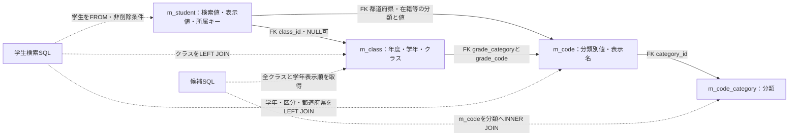

実線はDDLのFK、点線は読取SQLの参照関係である。学生class_idのNULL可否と、検索SQLがLEFT JOINであることを別に記録する。学生には性別、都道府県、在籍区分、続柄の分類・値FKもあり、検索一覧で名称を読むのは学年・在籍区分・都道府県である。図に示していない表示機能や保存機能をFKの存在から推定しない。

student_noは削除行を含む一意値、クラスはschool_yearとclass_codeの組が一意である。分類CHECKは学生のGENDER・PREFECTURE・ENROLLMENT_STATUS、クラスのGRADEを固定する。日付・所属CHECKは在学・休学で終了日NULLかつクラス必須、卒業・退学で終了日必須かつ入学日以降を要求する。したがって、DDLが適用されたデータについては「class_idがNULL可能」と「すべての在籍区分で未所属が許される」は同義ではない。

クラス期間は年度の4月1日〜翌年3月31日内、定員はNULLまたは1〜9999、表示順は非負である。コード値は非空数字、期間順序と非負表示順を要求する。学生の連絡先組合せ、論理削除情報、UTC時刻、正の比較版にもCHECKがある。

非削除学生を対象にbirth_date、class_idとenrollment_status_code、admission_date、updated_at、phone_number、emergency_phone_numberの索引が宣言される。氏名順はname_keyのORDER BYであり、これらの索引宣言だけで検索実行計画や性能を確定しない。

根拠：`sources/database/001_schema.sql:187–211`、`sources/Core/SqlServerStudentService.cs:82–90,156–164,203–208`。

### 状態表・DB権限との境界

検索状態はSingletonのConcurrentDictionary、編集情報と通知もそれぞれのメモリ辞書に保持する。DDLのt_runtime_stateにはstate_id、owner_id、login_session_id、state_kind、encrypted_payload、expires_at、revision、consumedがあるが、この検索ストアから同表へ保存・読込・暗号化・消費する実装は接続されていない。列名からメモリ状態の暗号化保存を説明しない。

権限SQLはstudent_viewerへ学生・クラス・分類・コードのSELECTを付与し、student_staff、student_adminへ段階的に継承する。staffには学生INSERT／UPDATEと監査INSERTを許可し、学生物理DELETEを拒否する。adminにはクラス・コードのINSERT／UPDATEを許可する。これらはDBロールへの権限定義であり、WebのRole判定とは別である。実際の接続利用者や適用済み権限を、このSQLの存在だけで確定しない。

根拠：`sources/Infrastructure/SearchContextStore.cs:9–15`、`sources/Infrastructure/EditorSnapshotStore.cs:7–11`、`sources/Infrastructure/FlashMessageStore.cs:6–9`、`sources/database/001_schema.sql:171–184`、`sources/database/003_web_permissions.sql:8–25`、`sources/Infrastructure/WebHostSetup.cs:19–19`。
