<!-- spec-meta: {"schema":"spec-md/1.0","documentId":"CSHARP_ASPNET-DET-CSharp_ASPNET-SCR-STU-001","version":"1.3","path":"詳細仕様書/CSharp_ASPNET/01_学生検索画面.md","sheets":[{"heading":"概要","kind":"GRID","sheet":"概要"},{"heading":"項目一覧","kind":"LIST","sheet":"項目一覧","key":["No"]},{"heading":"イベント仕様","kind":"GRID","sheet":"イベント仕様"},{"heading":"補足説明","kind":"GRID","sheet":"補足説明"}]} -->

# 学生検索画面 詳細仕様書

| 文書属性 | 内容 |
| --- | --- |
| 文書ID | CSHARP_ASPNET-DET-CSharp_ASPNET-SCR-STU-001 |
| 種別・版 | detailed-specification／1.3 |
| 文書パス | 詳細仕様書/CSharp_ASPNET/01_学生検索画面.md |
| 対象責務 | 学生検索のMVC画面、候補・一覧読取、検索状態の保持、登録・編集・参照からの検索復帰 |
| 関連文書 | [学生検索画面 基本設計書](../../基本設計書/01_学生検索画面.md)：CSHARP_ASPNET-BAS-STU-01、kind=basic-design、path=基本設計書/01_学生検索画面.md。計画上の文書であり、生成状態は未確認 |
| 対応・根拠 | 基本設計と同じ論理項目名・イベント名で対応する。Noは本書内の連番、SRC番号は原ビューのDOM IDである。根拠は`sources/相対パス:開始行-終了行`で表記する |

## 概要

### 機能と接続

学生検索は、論理削除されていない学生を条件で絞り込み、所属、在籍区分、住所、本人電話等を確認する画面である。本画面は学生DBを更新せず、成功した検索条件と結果をサーバーメモリへ保持する。入力欄の編集中条件、適用済み条件Applied、保持結果LastResult、今回の表示dataは別の値として扱う。

Viewerの一覧操作は「参照」、その他の役割では「編集」となる。新規登録リンクはViewer以外に表示し、新規読込・保存はサーバーでもViewerを拒否する。基本設計の検索条件・一覧項目に対し、本書では実コントロール、要求型、加工値、検索列、表示値を対応させる。

根拠：`sources/Views/Students/Search.cshtml:4-8`、`sources/Core/SqlServerStudentService.cs:137-168`、`sources/Infrastructure/WebStudentCoordinator.cs:7-18`。

Programはbuilder生成、WebHostSetup.Add、Build、WebHostSetup.Use、MapControllersの順で構成し、ルート`/`を`/students`へ誘導する。AddControllersWithViewsと、Authorize・Route("students")付きStudentsControllerが本画面の接続入口である。RequestIdentityとWebStudentCoordinatorはScoped、検索・編集スナップショット・通知のストアはSingletonである。

IStudentServiceはSqlServerStudentServiceへ登録される。接続文字列名StudentDb、要求のCurrentUser取得関数、webTokens=trueを渡す。接続文字列が未設定・空白ならサービス解決時にWebFault 503となる。WebはCoreを参照し、双方の対象はnet10.0、CoreはMicrosoft.Data.SqlClient 6.1.3を参照する。

根拠：`sources/Program.cs:2-8`、`sources/Infrastructure/WebHostSetup.cs:12-19`、`sources/Web/Controllers/StudentsController.cs:5-6`、`sources/StudentManagement.Web.csproj:1-5`、`sources/Core/StudentManagement.Core.csproj:1-9`。

| HTTP入口 | 受信・呼出し | 基本設計とのイベント対応 |
| --- | --- | --- |
| GET `/students` | Index(contextId, contextRevision, ct)。両識別値は`string?` | contextIdがNULL・空なら初期表示、非空なら検索復帰 |
| POST `/students/search` | Search。`[Bind(Prefix="Criteria")]`、状態識別・版・Tab、件数・並び | 検索 |
| POST `/students/options` | コントローラーOptions。検索と同じフォーム引数 | 候補更新 |
| POST `/students/page` | Page(PageRequest, tabId, ct) | ページ・並び順変更 |
| POST `/students/clear` | Clear(ContextRequest, tabId, ct) | クリア |
| GET `/students/new` | New(returnContextId, ct)→Load(NULL, …) | 新規登録への遷移 |
| GET `/students/{id:long}` | Edit(id, returnContextId, ct)→Load(id, …) | 編集・参照への遷移 |

根拠：`sources/Web/Controllers/StudentsController.cs:8-25`、`sources/Views/Students/Search.cshtml:4-8`。

これらはMVCフォームとHTML表示の入口である。StudentSearchPageModel.DataのJsonElementはビュー内部の表示データであり、公開JSON応答ではない。StrictJson.ReadとWebStudentCoordinator.Optionsは宣言されたhelperだが、上記入口からの呼出しは確認できない。POST optionsはコントローラーが直接処理する。未接続helperのselectableや期間外注記は、検索Razorの選択制御には適用しない。

根拠：`sources/Web/Controllers/StudentsController.cs:13-22`、`sources/Web/Controllers/StudentsController.cs:39-39`、`sources/Web/Models/StudentSearchPageModel.cs:10-15`、`sources/Infrastructure/StrictJson.cs:6-14`、`sources/Infrastructure/WebStudentCoordinator.cs:16-16`、`sources/Infrastructure/WebPresentation.cs:8-18`。

項目一覧のIは画面から処理への入力、Oは処理から画面への出力、I／Oは初期値・復元値の表示と入力の両方を表す。検索入力のDB連携欄は検索先を示し、保存側の列・パラメータは加工の対応確認として併記する。本画面からそれらを保存するという意味ではない。DTOの共通移送根拠は`StudentSearchInput.ToCriteria`と`SearchCriteria`の宣言である。

根拠：`sources/Web/Inputs/StudentSearchInput.cs:7-29`、`sources/Core/Contracts.cs:31-58`。

### 静的画面設計

以下はViewerの初期・未検索状態の静的投影であり、実画面撮影ではない。Layoutのheader・mainとビューのfieldset・fields・actions・grid・pagerを一体で示す。利用者名、業務日、識別値、可変候補はプレースホルダーである。在籍区分の表示見本はseedの名称であり、実画面の名称は取得時のDB値を使う。送信先は非実行data属性へ移し、全ボタンをtype=buttonとする。

根拠：`sources/Views/_ViewStart.cshtml:1-1`、`sources/Views/_ViewImports.cshtml:1-3`、`sources/Views/Shared/_Layout.cshtml:1-1`、`sources/Views/Shared/_MessagePanel.cshtml:2-3`、`sources/Views/Students/Search.cshtml:3-8`、`sources/wwwroot/css/site.css:1-1`、`sources/database/002_seed.sql:19-22`。

<!doctype html>
<html lang="ja">
<head>
<meta charset="utf-8">
<meta name="viewport" content="width=device-width,initial-scale=1">
<title>学生管理</title>
<style>
:root{font-family:Meiryo,'Yu Gothic UI',sans-serif;color:#243448;background:#f2f5f9;font-size:14px}*{box-sizing:border-box}body{margin:0}header{background:#153654;color:white;padding:16px 28px;display:flex;justify-content:space-between;gap:20px}main{background:white;max-width:1440px;margin:24px auto;padding:24px}h1{font-size:24px}fieldset{border:1px solid #c8d1dc;padding:18px;margin:12px 0}legend{font-weight:bold}.fields{display:grid;grid-template-columns:1fr 1fr;gap:14px 28px}label{display:flex;flex-direction:column;gap:5px}input,select,textarea,button{font:inherit;padding:8px;border:1px solid #afbece;border-radius:3px}input,select,textarea{max-width:100%;width:100%}.check{display:inline-flex;flex-direction:row;align-items:center;margin-right:12px}.check input{width:auto}.actions{display:flex;gap:10px;align-items:center;flex-wrap:wrap;margin:16px 0}button{background:white;cursor:pointer}.primary{background:#1c5985;color:white}button:disabled{cursor:default;color:#8a98a5;background:#f3f5f8}.message{padding:14px;border:1px solid #b6dccc;background:#edf7f3}.error{background:#fff1f1;border-color:#c66}.warning{background:#fff8eb;padding:12px}.grid{overflow-x:auto}table{border-collapse:collapse;min-width:1050px;width:100%;font-size:12px}th,td{padding:10px 8px;border:1px solid #d4dee8;vertical-align:top;overflow-wrap:anywhere}th{background:#e6eef6}tr:nth-child(even){background:#f8fafc}.pager{display:flex;gap:14px;align-items:center;justify-content:center;margin:18px}small{color:#5f7183}@media(max-width:760px){main{margin:0;padding:15px}.fields{grid-template-columns:1fr}header{flex-direction:column}}
</style>
</head>
<body>
<header><strong>学生管理システム</strong><span>利用者 ［User.Identity.Name］　業務日 ［日本時間 yyyy/MM/dd］</span></header>
<main>
<h1>学生検索</h1>
<form data-http-method="POST" data-source-action="/students/search" data-search-form>
<input type="hidden" name="ContextId" value="［Entry.Id］"><input type="hidden" name="ContextRevision" value="1"><input type="hidden" name="TabId" value="［Entry.Tab］"><input type="hidden" name="PageSize" value="20"><input type="hidden" name="SortKey" value="studentNo"><input type="hidden" name="SortDirection" value="asc"><input type="hidden" name="__RequestVerificationToken" value="［CSRF情報配置位置］">
<fieldset><legend>検索条件</legend><div class="fields">
<label>学籍番号<input name="Criteria.StudentNo" id="SRC-001" maxlength="30" value=""></label>
<label>氏名<input name="Criteria.Name" id="SRC-002" maxlength="16" value=""></label>
<label>氏名カナ<input name="Criteria.Kana" id="SRC-003" maxlength="72" value=""></label>
<label>年度<select name="Criteria.SchoolYear" id="SRC-004"><option value="" selected>すべて</option><option value="［SchoolYear］">［年度候補］</option></select></label>
<label>学年<select name="Criteria.GradeCode" id="SRC-005"><option value="" selected>すべて</option><option value="［CodeValue］">［GRADEのCodeName］</option></select></label>
<label>クラス<select name="Criteria.ClassId" id="SRC-006"><option value="" selected>すべて</option><option value="［ClassId］">［年度］ ［ClassCode］ ［ClassName］［停止時は（停止）］</option></select></label>
<label class="check"><input type="checkbox" name="Criteria.UnassignedOnly" id="SRC-007" value="true">未所属のみ</label>
<fieldset><legend>在籍区分</legend>
<label class="check"><input type="checkbox" name="Criteria.StatusCodes" value="01" checked>在学</label>
<label class="check"><input type="checkbox" name="Criteria.StatusCodes" value="02" checked>休学</label>
<label class="check"><input type="checkbox" name="Criteria.StatusCodes" value="03">卒業</label>
<label class="check"><input type="checkbox" name="Criteria.StatusCodes" value="04">退学</label>
<small>全解除はすべて</small></fieldset>
<label>都道府県<select name="Criteria.PrefectureCode" id="SRC-009"><option value="" selected>すべて</option><option value="［CodeValue］">［PREFECTUREのCodeName］</option></select></label>
<label>電話番号<input name="Criteria.PhoneNumber" id="SRC-010" maxlength="40" value=""></label>
<label>入学日・開始<input name="Criteria.AdmissionFrom" id="SRC-011" type="date"></label>
<label>入学日・終了<input name="Criteria.AdmissionTo" id="SRC-012" type="date"></label>
</div><div class="actions"><button type="button" class="primary">検索</button><button type="button" data-source-formaction="/students/options">候補を更新</button></div></fieldset></form>
<div class="actions"><form data-http-method="POST" data-source-action="/students/clear"><input type="hidden" name="__RequestVerificationToken" value="［CSRF情報配置位置］"><input type="hidden" name="ContextId" value="［Entry.Id］"><input type="hidden" name="ContextRevision" value="1"><input type="hidden" name="TabId" value="［Entry.Tab］"><button type="button">クリア</button></form></div>
<p>未検索</p>
<form data-http-method="POST" data-source-action="/students/page">
<input type="hidden" name="__RequestVerificationToken" value="［CSRF情報配置位置］"><input type="hidden" name="ContextId" value="［Entry.Id］"><input type="hidden" name="ContextRevision" value="1"><input type="hidden" name="TabId" value="［Entry.Tab］">
<div class="actions"><label>表示件数<select name="PageSize"><option value="20" selected>20</option><option value="50">50</option><option value="100">100</option></select></label><label>並び順<select name="SortKey"><option value="studentNo" selected>学籍番号</option><option value="name">氏名</option><option value="admissionDate">入学日</option><option value="updatedAt">更新日時</option></select></label><select name="SortDirection" aria-label="並び順方向"><option value="asc" selected>昇順</option><option value="desc">降順</option></select><button type="button" name="Page" value="1" disabled>並び順・件数を反映</button></div>
<div class="grid"><table><thead><tr><th>学籍番号</th><th>氏名</th><th>氏名カナ</th><th>生年月日</th><th>年度／学年</th><th>クラス</th><th>在籍区分</th><th>住所</th><th>本人電話</th><th>更新日時</th><th>操作</th></tr></thead><tbody></tbody></table></div>
<nav class="pager"><button type="button" name="Page" value="0" disabled>前へ</button><span>1 / 1</span><button type="button" name="Page" value="2" disabled>次へ</button></nav></form>
</main>
</body>
</html>

.fieldsは2列、760px以下では1列になり、同じ条件でheaderも縦並びになる。actionsは折返し、gridは横スクロール、tableは最小幅1050px、セルはoverflow-wrap:anywhereを適用する。これらはclass・要素セレクターであり、SRCのid、認証Role、HTMLのrole属性とは別である。静的投影の並び順初期選択はstudentNoであり、SortKeyのoptionではstudentNoだけにselected属性を付けている。入学日のoptionにselected属性はない。

根拠：`sources/Views/Students/Search.cshtml:8-8`、`sources/Web/Models/StudentSearchPageModel.cs:12-14`、`sources/wwwroot/css/site.css:1-1`。

| 状態・権限 | 原画面の表示条件・静的投影への対応 |
| --- | --- |
| Viewer以外 | クリアと同じactions内に「新規登録」を置く。非実行表現は`<a href="#登録編集からの復帰境界" data-source-route="/students/new?returnContextId=［Entry.Id］">新規登録</a>` |
| 一覧行あり | 11列を反復する。操作はViewerなら「参照」、その他は「編集」。静的リンクのhrefは文書fragment、data-source-routeは`/students/{studentId}?returnContextId=…` |
| 未所属trueの再描画 | SRC-004・005・006をdisabledにする |
| 検証エラー／通知あり | h1直後にmessage error／message infoを表示し、aria-live=politeを設定する。前者はAll検証サマリー |
| found | 件数・検索時刻を表示する。件数・並び反映を有効化し、前後ボタンはページ境界で制御する |
| empty | 「該当する学生はありません。」。一覧操作3ボタンを無効化する |
| tooMany | warningで「10,000件を超えました。条件を追加してください。」。空一覧、一覧操作3ボタンを無効化する |
| unsearched | 「未検索」。空一覧、一覧操作3ボタンを無効化する |

実JavaScriptはフォーム送信時に送信ボタン以外のbuttonを無効化し、aria-busy=trueを付ける。未所属のチェック変更時と初期実行時は、チェックされていれば所属3項目のvalueを空にするがdisabledは変更しない。年度・学年変更時の自動候補取得や検索クラス解除はない。「候補を更新」のPOST後にサーバーが整合を確認する。REG-016～018の即時連動は編集画面用である。

根拠：`sources/Views/Students/Search.cshtml:5-8`、`sources/Views/Shared/_MessagePanel.cshtml:2-3`、`sources/wwwroot/css/site.css:1-1`、`sources/wwwroot/js/site.js:4-8`。

## 項目一覧

| No | グループ | 項目名 | 種類 | 入出力 | DB連携項目 | 候補取得元 | 必須 | 形式・桁 | 説明 |
| --- | --- | --- | --- | --- | --- | --- | --- | --- | --- |
| 01 | 検索条件 | 学籍番号 | テキストinput | I／O | 検索・表示・保存参照：`m_student.student_no varchar(15) NOT NULL`、BIN2、UNIQUE | なし | 任意 | maxlength=30コード単位。原入力・trim後・NFKC大文字化後は各15スカラー以内 | id=SRC-001、`asp-for="Criteria.StudentNo"`、送信名`Criteria.StudentNo`。要求`StudentNo:string`→`SearchCriteria.StudentNo:string?`。NULL・空は条件なし、空白だけは必須エラー。制御文字を拒否し、正規化後は先頭英数字、以後英数字またはハイフン。前方一致は`@no VarChar/31`。保存もIdentifierを使い`@student_no VarChar/15`、更新時は変更不可。根拠：`sources/Views/Students/Search.cshtml:5-5`、`sources/Core/StudentNormalizer.cs:59-64`、`sources/Core/StudentNormalizer.cs:124-124`、`sources/Core/SqlServerStudentService.cs:113-113`、`sources/Core/SqlServerStudentService.cs:140-140`、`sources/Core/SqlServerStudentService.cs:254-254`、`sources/database/001_schema.sql:9-9`、`sources/database/001_schema.sql:187-187` |
| 02 | 検索条件 | 氏名 | テキストinput | I／O | 表示・保存参照：`m_student.student_name nvarchar(16) NOT NULL`。検索・氏名順：`name_key nvarchar(320) NOT NULL`、BIN2 | なし | 任意 | maxlength=16コード単位。原入力・trim後各8スカラー。照合キー160スカラー以内 | id=SRC-002、`asp-for="Criteria.Name"`、同名送信。要求`Name:string`→`StudentName:string?`。NULL・空白は条件なし。制御文字を拒否し、表示氏名はtrimのみ。NameKeyはNFKC・大文字化・全Unicode空白除去を行う。部分一致`@name NVarChar/642`。保存は同じ氏名・キー生成で`@student_name NVarChar/16`、`@name_key NVarChar/320`。DDLのスカラーCHECKは8・160。根拠：`sources/Core/StudentNormalizer.cs:47-70`、`sources/Core/StudentNormalizer.cs:125-145`、`sources/Core/SqlServerStudentService.cs:30-32`、`sources/Core/SqlServerStudentService.cs:114-115`、`sources/Core/SqlServerStudentService.cs:141-141`、`sources/database/001_schema.sql:10-13`、`sources/database/001_schema.sql:44-47` |
| 03 | 検索条件 | 氏名カナ | テキストinput | I／O | 表示・保存参照：`m_student.student_name_kana`。検索・保存参照：`kana_key`。各`nvarchar(36) NOT NULL`、後者BIN2 | なし | 任意 | maxlength=72コード単位。原入力・trim後各36スカラー、正規化表示値18スカラー以内 | id=SRC-003、`asp-for="Criteria.Kana"`、同名送信。要求`Kana:string`→`StudentNameKana:string?`。制御文字拒否、NFKC、所定ひらがなのカタカナ化、語間空白の半角1個化を行い、検索キーは半角空白を除去する。NULL・空は条件なし、空白だけの非空入力は空キーのLIKE条件を追加する。検索`@kana NVarChar/74`、保存両列`NVarChar/36`。DDLは各18スカラーCHECK。根拠：`sources/Core/StudentNormalizer.cs:72-85`、`sources/Core/StudentNormalizer.cs:126-145`、`sources/Core/SqlServerStudentService.cs:116-116`、`sources/Core/SqlServerStudentService.cs:142-142`、`sources/database/001_schema.sql:11-13`、`sources/database/001_schema.sql:45-47` |
| 04 | 検索条件 | 年度 | select | I／O | 検索：`m_class.school_year smallint NOT NULL`。学生保存値は`m_student.class_id`で、年度の学生独立列なし | 全クラスのSchoolYearをDistinct・降順。「すべて」は空値 | 任意 | 要求・内部`int?`。指定時1900～9998 | id=SRC-004、`asp-for="Criteria.SchoolYear"`、同名送信。初期未指定。指定年度のクラス存在を確認する。検索・年度存在確認`@year SmallInt`、サイズ指定なし。保存側では所属クラスとの整合確認引数。未所属trueの再描画時disabled。根拠：`sources/Views/Students/Search.cshtml:5-5`、`sources/Core/SqlServerStudentService.cs:109-109`、`sources/Core/SqlServerStudentService.cs:126-129`、`sources/Core/SqlServerStudentService.cs:143-143`、`sources/Core/SqlServerStudentService.cs:363-371`、`sources/database/001_schema.sql:64-64` |
| 05 | 検索条件 | 学年 | select | I／O | 検索：`m_class.grade_code varchar(2) NOT NULL`。参照分類`grade_category varchar(24) NOT NULL`＝GRADE。学生保存はclass_id | `m_code`のGRADE、キーCodeValue・表示CodeName。「すべて」は空値 | 任意 | 要求・内部`string?`。原入力・trim後2スカラー以内、NFKC後ASCII数字2コード単位 | id=SRC-005、`asp-for="Criteria.GradeCode"`、同名送信。初期未指定。GRADE内の存在確認を行い、停止・期間外を検索では拒否しない。検索`@grade VarChar/2`、存在確認の分類24・値10。未所属再描画時disabled。根拠：`sources/Core/StudentNormalizer.cs:113-117`、`sources/Core/SqlServerStudentService.cs:118-125`、`sources/Core/SqlServerStudentService.cs:144-144`、`sources/Core/SqlServerStudentService.cs:218-222`、`sources/database/001_schema.sql:65-66`、`sources/database/001_schema.sql:197-197` |
| 06 | 検索条件 | クラス | select | I／O | 検索・保存参照：`m_student.class_id bigint NULL`。候補キー：`m_class.class_id bigint IDENTITY NOT NULL`、PK | 取得クラスを編集中年度・学年で絞る。キーClassId、表示は年度・ClassCode・ClassName・停止注記 | 任意 | 要求`ClassId:string?`→IdParser.Optional→`long?`。非空は19コード単位以内・ASCII数字・正のInt64 | id=SRC-006、`asp-for="Criteria.ClassId"`、同名送信。NULL・空は未指定、変換不正はWebFault 422。存在と指定年度・正規化学年との一致を確認する。検索`@class BigInt`、存在確認`@id BigInt`、保存`@class_id BigInt`、いずれもサイズ指定なし。初期空、未所属再描画時disabled。根拠：`sources/Web/Inputs/StudentSearchInput.cs:19-22`、`sources/Web/Inputs/StudentSaveInput.cs:40-42`、`sources/Web/Inputs/StudentSaveInput.cs:57-60`、`sources/Core/SqlServerStudentService.cs:131-145`、`sources/database/001_schema.sql:28-28`、`sources/database/001_schema.sql:63-63`、`sources/database/001_schema.sql:191-191` |
| 07 | 検索条件 | 未所属のみ | checkbox | I／O | 非DB入力。trueの検索先は`m_student.class_id IS NULL`。専用保存列なし | true／false | 任意 | 要求・内部`bool`、初期false | id=SRC-007、`asp-for="Criteria.UnassignedOnly"`、同名送信。trueと年度・非NULL学年・クラスの併用はE-SRC-001。検査は学年正規化前なのでサービス引数の空文字も併用指定となる。JSは所属値を空にし、候補更新は3値をNULLへ変更する。SQLパラメータなし。根拠：`sources/Views/Students/Search.cshtml:5-5`、`sources/wwwroot/js/site.js:7-7`、`sources/Web/Controllers/StudentsController.cs:22-22`、`sources/Core/SqlServerStudentService.cs:109-110`、`sources/Core/SqlServerStudentService.cs:146-146` |
| 08 | 検索条件 | 在籍区分 | 候補別checkbox群 | I／O | 検索・保存参照：`m_student.enrollment_status_code varchar(2) NOT NULL`。分類`enrollment_category varchar(24) NOT NULL`＝ENROLLMENT_STATUS | `m_code`のENROLLMENT_STATUS、キーCodeValue・表示CodeName | 任意、全解除可能 | 要求`StatusCodes:string[]`→`EnrollmentStatusCodes:string[]`。4件以下、Ordinal重複なし、01～04のみ | name=`Criteria.StatusCodes`、value=CodeValue。原ビューに個別DOM ID・asp-forなし。初期01・02。検索・候補更新はフォームキー欠落を空配列へ補正する。空配列は区分条件なし、非空は各`@statusN VarChar/2`。保存も幅2コード・区分検査、`VarChar/2`。seed名称は在学・休学・卒業・退学だが表示はDB候補。配列NULLの独自ガードなし。根拠：`sources/Views/Students/Search.cshtml:5-5`、`sources/Web/Controllers/StudentsController.cs:14-14`、`sources/Web/Controllers/StudentsController.cs:22-22`、`sources/Core/SqlServerStudentService.cs:111-112`、`sources/Core/SqlServerStudentService.cs:151-153`、`sources/Core/StudentNormalizer.cs:136-153`、`sources/database/001_schema.sql:25-26`、`sources/database/002_seed.sql:19-22` |
| 09 | 検索条件 | 都道府県 | select | I／O | 検索・保存参照：`m_student.prefecture_code varchar(2) NOT NULL`。分類`prefecture_category varchar(24) NOT NULL`＝PREFECTURE | `m_code`のPREFECTURE、キーCodeValue・表示CodeName。「すべて」は空値 | 任意 | 要求・内部`string?`。原入力・trim後2スカラー以内、NFKC後ASCII数字2コード単位 | id=SRC-009、`asp-for="Criteria.PrefectureCode"`、同名送信。初期未指定、空白は条件なし。分類内の存在確認後に完全一致検索する。検索`@prefecture VarChar/2`、保存は必須コードで`@prefecture_code VarChar/2`。存在確認は分類24・値10。一覧名称は分類と値のLEFT JOIN結果。根拠：`sources/Core/StudentNormalizer.cs:113-130`、`sources/Core/SqlServerStudentService.cs:119-125`、`sources/Core/SqlServerStudentService.cs:147-147`、`sources/Core/SqlServerStudentService.cs:296-300`、`sources/database/001_schema.sql:18-19` |
| 10 | 検索条件 | 電話番号 | テキストinput | I／O | 完全一致検索：`m_student.phone_number`または`emergency_phone_number`。両列`varchar(16) NULL` | なし | 任意 | maxlength=40コード単位。原入力・trim後20スカラー以内。正規化後は国内0始まり10～11桁、国際＋と非ゼロ始まり7～15桁 | id=SRC-010、`asp-for="Criteria.PhoneNumber"`、同名送信。要求`string`→内部`string?`。NFKC後にUnicode空白・所定ハイフン・丸括弧を除去する。NULL・空白は条件なし、除去記号だけは形式エラー。検索`@phone VarChar/16`、保存両電話もPhone・`VarChar/16`。一覧は本人電話のみ。根拠：`sources/Core/StudentNormalizer.cs:87-94`、`sources/Core/StudentNormalizer.cs:133-141`、`sources/Core/SqlServerStudentService.cs:34-37`、`sources/Core/SqlServerStudentService.cs:117-117`、`sources/Core/SqlServerStudentService.cs:148-148`、`sources/database/001_schema.sql:22-32` |
| 11 | 検索条件 | 入学日・開始 | date input | I／O | `m_student.admission_date date NOT NULL`へ開始以上 | なし | 任意 | 要求・内部`string?`→`DateOnly? from`。NFKC後10コード単位、yyyy-MM-dd完全一致 | id=SRC-011、`asp-for="Criteria.AdmissionFrom"`、同名送信。NULL・空は開始条件なし。trimせず、1900-01-01～検索開始時の日本時間業務日を許可する。開始＞終了は拒否。検索`@from Date`、サイズなし、00:00のDateTimeへ変換。保存入学日もParseIso。根拠：`sources/Core/JapaneseDateService.cs:52-59`、`sources/Core/SqlServerStudentService.cs:67-72`、`sources/Core/SqlServerStudentService.cs:120-122`、`sources/Core/SqlServerStudentService.cs:149-149`、`sources/Core/StudentNormalizer.cs:135-135`、`sources/database/001_schema.sql:24-24` |
| 12 | 検索条件 | 入学日・終了 | date input | I／O | `m_student.admission_date date NOT NULL`へ終了以下 | なし | 任意 | 要求・内部`string?`→`DateOnly? to`。形式・範囲は開始と同じ | id=SRC-012、`asp-for="Criteria.AdmissionTo"`、同名送信。NULL・空は終了条件なし。終了のみ指定可能、両端指定は開始≦終了。同日指定も許可し、両端を含む。順序不正はE-STU-006。検索`@to Date`、サイズなし。卒業・退学日列とは別。根拠：`sources/Views/Students/Search.cshtml:5-5`、`sources/Core/JapaneseDateService.cs:52-59`、`sources/Core/SqlServerStudentService.cs:120-122`、`sources/Core/SqlServerStudentService.cs:150-150` |
| 13 | 検索制御 | 検索状態識別 | 各POSTのhidden | I／O | 非DB。SearchContextStore.Entry.Id、メモリ辞書キー | 新規Entryの生成値 | 状態操作に必要、受信必須の暗黙保証なし | name=ContextId。アクションまたはContextRequestの`string`。生成値は乱数32バイトの小文字16進文字列 | trim・数値化なし。GetはNULLを辞書呼出し前に409、空・不在・期限切れも409で拒否する。ContextRequest初期値は空文字。SQLパラメータなし。根拠：`sources/Views/Students/Search.cshtml:4-8`、`sources/Web/Inputs/StudentSearchInput.cs:25-29`、`sources/Infrastructure/SearchContextStore.cs:9-14` |
| 14 | 検索制御 | 検索状態の版 | 各POSTのhidden | I／O | 非DB。Entry.Revision:`long` | Entryの現在版 | Useでは一致が必要、候補更新は比較なし | name=ContextRevision、要求`string`。初期版1、InvariantCulture文字列で比較 | 数値化せず完全一致し、先頭ゼロ付き値を同じ版としない。不一致・long.MaxValueは409。検索・page・clear・条件ありResume成功で＋1。SQLパラメータなし。根拠：`sources/Infrastructure/SearchContextStore.cs:9-14`、`sources/Infrastructure/WebStudentCoordinator.cs:9-15`、`sources/Web/Controllers/StudentsController.cs:22-22` |
| 15 | 検索制御 | 画面識別 | 各POSTのhidden | I／O | 非DB。Entry.Tab:`string` | 新規作成時のTabまたは生成値 | 非空の場合だけ照合 | name=TabId。アクション`string tabId`→Get／Useの`string? tab` | NULL・空なら照合省略、非空の不一致は403。新規作成で未指定・空なら乱数生成。GET復帰では渡さない。RequestIdentity.TabIdのヘッダー取得helperとは別経路。SQLパラメータなし。根拠：`sources/Infrastructure/SearchContextStore.cs:9-14`、`sources/Infrastructure/RequestIdentity.cs:12-12`、`sources/Web/Controllers/StudentsController.cs:8-22` |
| 16 | 一覧制御 | 表示件数 | 検索hidden／一覧select | I／O | 非DB。SearchCriteria.PageSizeをFETCH件数に使用 | ビュー固定値20・50・100 | サービスでは許可値が必要 | name=PageSize、個別idなし。要求`int`、初期20 | 変更時は先頭ページ。検索は受信値を使い、候補更新モデルはAppliedまたは既定値を使う。SQL`@size Int`、サイズ指定なし。業務項目としてDB保存しない。根拠：`sources/Web/Inputs/StudentSearchInput.cs:22-29`、`sources/Views/Students/Search.cshtml:4-8`、`sources/Core/SqlServerStudentService.cs:107-107`、`sources/Core/SqlServerStudentService.cs:160-164` |
| 17 | 一覧制御 | 並び順項目 | 検索hidden／一覧select | I／O | ORDER BY参照：`m_student.student_no`、`name_key`、`admission_date`、`updated_at`。指定自体は非DB | ビュー固定キーstudentNo・name・admissionDate・updatedAt | サービスでは許可値が必要 | name=SortKey、個別idなし。要求`string`、初期studentNo | 許可キーを順に4列へ変換する。変更時Page=1。値パラメータとしてSQLへ渡さず、許可列だけを組み立てる。根拠：`sources/Views/Students/Search.cshtml:8-8`、`sources/Core/SqlServerStudentService.cs:108-108`、`sources/Core/SqlServerStudentService.cs:162-162` |
| 18 | 一覧制御 | 並び順方向 | 検索hidden／一覧select | I／O | 非DB。ORDER BY方向を制御 | asc＝昇順、desc＝降順 | サービスでは許可値が必要 | name=SortDirection、aria-label=並び順方向。要求`string`、初期asc | asc・descのみ許可する。変更時Page=1。同順位は方向によらずstudent_id ASC。SQLパラメータなし。根拠：`sources/Views/Students/Search.cshtml:8-8`、`sources/Core/SqlServerStudentService.cs:107-108`、`sources/Core/SqlServerStudentService.cs:162-162` |
| 19 | 一覧制御 | ページ番号・ページ表示 | Page送信button／pagerのspan | I／O | 非DB。Applied.PageとSQL用page | 反映=1、前へ=現在−1、次へ=現在＋1 | サービスでは1以上が必要 | PageRequest.Page:`int`、初期1。未検索表示1／1 | サービスはSQL用ページだけ最終ページ以下へ補正する。pageイベントは条件Pageも補正して再検索し、Resumeは補正しない。`@offset Int`＝checked((SQL用page−1)×PageSize)。found以外とページ境界でボタンdisabled。根拠：`sources/Infrastructure/WebStudentCoordinator.cs:12-14`、`sources/Core/SqlServerStudentService.cs:160-164`、`sources/Views/Students/Search.cshtml:8-8` |
| 20 | 一覧 | 学籍番号 | td | O | `m_student.student_no varchar(15) NOT NULL` | 検索結果StudentRow | 表示のみ | StudentRow.StudentNo:`string`→row.studentNo | 保存値を表示し、検索入力値とは別。RowSelectからWebPresentation.Row、JsonElementを経由する。根拠：`sources/Core/SqlServerStudentService.cs:77-90`、`sources/Infrastructure/WebPresentation.cs:20-20`、`sources/Views/Students/Search.cshtml:8-8` |
| 21 | 一覧 | 氏名 | td | O | `m_student.student_name nvarchar(16) NOT NULL`、8スカラーCHECK | 検索結果StudentRow | 表示のみ | StudentName:`string`→row.studentName | trimした表示氏名を出し、name_keyは表示しない。保存業務上限8スカラー、保存`@student_name NVarChar/16`。根拠：`sources/Core/StudentNormalizer.cs:125-125`、`sources/Core/SqlServerStudentService.cs:31-31`、`sources/Core/SqlServerStudentService.cs:77-90`、`sources/database/001_schema.sql:10-10`、`sources/database/001_schema.sql:44-44` |
| 22 | 一覧 | 氏名カナ | td | O | `m_student.student_name_kana nvarchar(36) NOT NULL`、18スカラーCHECK | 検索結果StudentRow | 表示のみ | StudentNameKana:`string`→row.studentNameKana | 正規化表示値を出し、空白除去キーとは区別する。保存`NVarChar/36`。根拠：`sources/Core/StudentNormalizer.cs:126-145`、`sources/Core/SqlServerStudentService.cs:77-90`、`sources/database/001_schema.sql:11-11`、`sources/database/001_schema.sql:45-45` |
| 23 | 一覧 | 生年月日 | td | O | `m_student.birth_date date NOT NULL` | 検索結果StudentRow | 表示のみ | BirthDate:`DateOnly`→BirthDateWareki:`string` | 元年を「元」、月日を2桁の和暦で表示する。保存入力はBirthDateInputから変換し、`@birth_date Date`を使う。根拠：`sources/Core/JapaneseDateService.cs:9-15`、`sources/Core/JapaneseDateService.cs:41-50`、`sources/Core/StudentNormalizer.cs:127-127`、`sources/Core/SqlServerStudentService.cs:32-32`、`sources/database/001_schema.sql:14-14` |
| 24 | 一覧 | 年度／学年 | 同一td内の2表示値 | O | `m_class.school_year smallint NOT NULL`、GRADEの`m_code.code_name nvarchar(24) NOT NULL` | 学生所属からクラス・GRADEへLEFT JOIN | 表示のみ | SchoolYear:`int?`、GradeName:`string?`。名称保守上限12スカラー | 任意所属の結合結果でNULL可能。年度はJsonElementを直接出力し、学年名称にNULL補完なし。名称保存は原入力・trim後各12スカラー、`@name NVarChar/24`。根拠：`sources/Core/SqlServerStudentService.cs:79-90`、`sources/Core/MasterMaintenanceService.cs:82-82`、`sources/Core/MasterMaintenanceService.cs:113-120`、`sources/Views/Students/Search.cshtml:8-8`、`sources/database/001_schema.sql:64-64`、`sources/database/001_schema.sql:115-128` |
| 25 | 一覧 | クラス | 同一td内の2表示値 | O | `m_class.class_code varchar(9) NOT NULL`、`class_name nvarchar(36) NOT NULL` | 学生class_idからm_classへLEFT JOIN | 表示のみ | ClassCode・ClassName:`string?`。保守上限はコード9・名称18スカラー | 保存列NOT NULLでも結合結果NULLはあり得る。コード保存はIdentifier、名称は原入力・trim後各18スカラー。保存`@class_code VarChar/9`、`@class_name NVarChar/36`。根拠：`sources/Core/MasterMaintenanceService.cs:33-33`、`sources/Core/MasterMaintenanceService.cs:73-76`、`sources/Core/MasterMaintenanceService.cs:124-130`、`sources/database/001_schema.sql:67-81`、`sources/Core/SqlServerStudentService.cs:79-90` |
| 26 | 一覧 | 在籍区分 | td | O | ENROLLMENT_STATUSの`m_code.code_name nvarchar(24) NOT NULL` | 学生の分類・区分値からm_codeへLEFT JOIN | 表示のみ | EnrollmentStatusName:`string?`→row.enrollmentName、名称保守上限12スカラー | 固定名称置換・NULL補完なし。名称保存`@name NVarChar/24`、DDLにも12スカラーCHECK。根拠：`sources/Core/SqlServerStudentService.cs:80-90`、`sources/Infrastructure/WebPresentation.cs:20-20`、`sources/Core/MasterMaintenanceService.cs:82-82`、`sources/Core/MasterMaintenanceService.cs:115-120`、`sources/database/001_schema.sql:115-128` |
| 27 | 一覧 | 住所 | td | O | PREFECTUREの`m_code.code_name nvarchar(24) NOT NULL`＋`m_student.address_line1 nvarchar(90) NOT NULL` | 都道府県名称のLEFT JOINと学生住所1 | 表示のみ | Address:`string`→row.addressDisplay。住所保存各45スカラー、名称12スカラー | 名称と住所1を区切りなしで連結する。名称NULLは[不整合]。`address_line2 nvarchar(90) NULL`は保存に含むが一覧非使用。住所保存各`NVarChar/90`、名称`@name NVarChar/24`。根拠：`sources/Core/SqlServerStudentService.cs:34-34`、`sources/Core/SqlServerStudentService.cs:80-90`、`sources/Core/StudentNormalizer.cs:131-132`、`sources/Core/MasterMaintenanceService.cs:82-82`、`sources/database/001_schema.sql:20-21`、`sources/database/001_schema.sql:48-49` |
| 28 | 一覧 | 本人電話 | td | O | `m_student.phone_number varchar(16) NULL` | 検索結果StudentRow | 表示のみ | PhoneNumber:`string?` | NULLだけ「－」。緊急電話で検索一致した行でも表示は本人電話。根拠：`sources/Core/SqlServerStudentService.cs:80-90`、`sources/Core/SqlServerStudentService.cs:148-148`、`sources/Views/Students/Search.cshtml:8-8`、`sources/database/001_schema.sql:22-22` |
| 29 | 一覧 | 更新日時 | td | O | `m_student.updated_at datetimeoffset(7) NOT NULL`、UTCオフセット0のCHECK | 検索結果StudentRow | 表示のみ | UpdatedAt:`DateTimeOffset`→日本時間yyyy/MM/dd HH:mm:ss | 保存・論理削除で設定される時刻。表示変換はWebPresentation.Time、保存`@now DateTimeOffset`。根拠：`sources/Infrastructure/WebPresentation.cs:7-7`、`sources/Infrastructure/WebPresentation.cs:20-20`、`sources/Core/SqlServerStudentService.cs:296-300`、`sources/database/001_schema.sql:40-40`、`sources/database/001_schema.sql:57-57` |
| 30 | 一覧 | 操作 | td内a | I／O | 遷移対象`m_student.student_id bigint IDENTITY NOT NULL`、PK。編集比較版`row_version bigint NOT NULL DEFAULT 1`は一覧表示対象外 | 検索結果のStudentId、操作名称は利用者Role | 対象行の識別値を使用 | StudentId:`long`→InvariantCulture十進文字列 | Viewerは参照、その他は編集。route=`/students/{studentId}?returnContextId=…`、リンクに復帰版を付けない。読込`@id BigInt`、保存・削除比較`@version BigInt`。根拠：`sources/Infrastructure/WebPresentation.cs:20-20`、`sources/Views/Students/Search.cshtml:8-8`、`sources/Core/SqlServerStudentService.cs:172-177`、`sources/database/001_schema.sql:8-8`、`sources/database/001_schema.sql:42-43` |
| 31 | 一覧状態 | 結果状態・件数・検索時刻 | p／warning | O | 非DB表示値。件数SELECTの結果とサービス開始時刻 | SearchResult→Present→JsonElement | 表示のみ | unsearched・tooMany・empty・found。未検索・超過のtotalCountはNULL | 結果なしは未検索、超過は空一覧、通常0件はempty、それ以外found。時刻は日本時間表示。内部Count10001を総件数として出さない。根拠：`sources/Infrastructure/WebStudentCoordinator.cs:21-21`、`sources/Core/SqlServerStudentService.cs:105-105`、`sources/Core/SqlServerStudentService.cs:156-168`、`sources/Views/Students/Search.cshtml:2-8` |
| 32 | 検索操作 | 検索 | button、class=primary | I | 直接対応列なし。条件に応じて学生検索SQLを呼ぶ | なし | ‐ | 原画面type=submit、検索条件フォームの既定送信先 | POST `/students/search`。先頭ページから検索する。根拠：`sources/Views/Students/Search.cshtml:4-5`、`sources/Web/Controllers/StudentsController.cs:13-16` |
| 33 | 検索操作 | 候補を更新 | button | I | 候補用m_code・m_code_category・m_classを読取 | LookupAsync(false) | ‐ | 原画面type=submit、formaction=`/students/options` | 編集中条件に合わせ候補を再描画する。検索の適用・学生再検索は行わない。根拠：`sources/Views/Students/Search.cshtml:5-5`、`sources/Web/Controllers/StudentsController.cs:22-22` |
| 34 | 検索操作 | クリア | 独立form内button | I | 状態解除は非DB、再表示候補のみDB読取 | 新しいStudentSearchInputと候補 | ‐ | POST `/students/clear` | 同じEntryのApplied・LastResultを解除し、初期条件へ戻す。根拠：`sources/Views/Students/Search.cshtml:6-6`、`sources/Web/Controllers/StudentsController.cs:21-21`、`sources/Infrastructure/WebStudentCoordinator.cs:15-15` |
| 35 | 画面遷移 | 新規登録 | a | I | 遷移時に学生DB更新なし | Viewer以外に表示 | ‐ | GET `/students/new?returnContextId=…` | 現検索状態のIdだけを渡す。新規読込はサーバーでもViewerを拒否する。根拠：`sources/Views/Students/Search.cshtml:6-6`、`sources/Web/Controllers/StudentsController.cs:23-25`、`sources/Infrastructure/WebStudentCoordinator.cs:17-17` |
| 36 | 共有ヘッダー | 利用者名 | span内表示 | O | 非DB。認証PrincipalのIdentity.Name | 共有LayoutのUser.Identity | 表示のみ | `User.Identity?.Name` | 状態所有者のNameIdentifierとは取得プロパティが異なる。画面には利用者名を表示する。根拠：`sources/Views/Shared/_Layout.cshtml:1-1`、`sources/Infrastructure/RequestIdentity.cs:8-10` |
| 37 | 共有ヘッダー | 業務日 | span内表示 | O | 非DB。UTC現在時刻から算出 | WebPresentation.BusinessDate | 表示のみ | `DateOnly`、日本時間yyyy/MM/dd | 一覧検索のサービス業務日は検索開始時刻から別に求める。根拠：`sources/Views/Shared/_Layout.cshtml:1-1`、`sources/Infrastructure/WebPresentation.cs:5-5`、`sources/Core/SqlServerStudentService.cs:44-45`、`sources/Core/SqlServerStudentService.cs:105-105` |
| 38 | メッセージ | 検証エラー | div、class=message error | O | 非DB。MVC ModelState | バインド検証、局所catch、結果FieldError | 表示のみ | asp-validation-summary=All、aria-live=polite | ErrorCount>0の場合にh1直後へ表示する。局所catch外の失敗はこの領域での再表示を保証しない。根拠：`sources/Views/Shared/_MessagePanel.cshtml:2-2`、`sources/Web/Controllers/StudentsController.cs:15-19` |
| 39 | メッセージ | 通知 | div、class=message info | O | 非DB。PageModel.Message、FlashMessageStoreのメモリ | 候補更新の通知、GET時のFlash.Take | 表示のみ | 非NULL・非空時だけ表示、aria-live=polite | 保存・論理削除のSaved後通知は10分保持、一回取得。候補更新通知は今回モデルに設定する。根拠：`sources/Views/Shared/_MessagePanel.cshtml:3-3`、`sources/Web/Controllers/StudentsController.cs:11-11`、`sources/Web/Controllers/StudentsController.cs:22-22`、`sources/Infrastructure/FlashMessageStore.cs:7-9` |
| 40 | フォーム制御 | CSRF情報 | AntiForgeryTokenの配置領域 | I／O | 非DB。ASP.NET Core Antiforgery | 各POSTフォームのHtml.AntiForgeryToken | POSTの検証対象 | フォーム許可名`__RequestVerificationToken`。項目業務長の指定なし | AutoValidateAntiforgeryTokenAttributeで検査する。/studentsの拒否は/api用JSON変換対象外。TagHelper等の生成内部は本書の独自DTO処理とは区別する。根拠：`sources/Views/Students/Search.cshtml:4-8`、`sources/Infrastructure/WebHostSetup.cs:15-16`、`sources/Infrastructure/AntiforgeryResultFilter.cs:7-8`、`sources/Web/Controllers/StudentsController.cs:41-41` |

## イベント仕様

### 初期表示（GET /students）

#### 処理概要

contextIdがNULL・空の要求では新しい検索状態と候補を用意し、未検索画面を表示する。非空なら検索復帰へ進む。本イベントでは学生一覧を検索しない。

#### 処理手順

1. 補足説明「共通入口と認証」の認証・認可、MVCバインド境界を通過し、identity.Readで認証情報を確認する。
2. contextIdがNULL・空ならNewContextでEntryを作る。初期版1、期限30分、Applied・LastResult未設定である。非空なら検索復帰の手順へ進む。
3. Present(entry, null)と新しいStudentSearchInputを用意する。初期区分は01・02、所属条件未指定、表示20件、学籍番号昇順、ページ1である。
4. 利用者・セッション・Entry.Idをキーに通知Takeを行う。
5. SearchModelでLookupAsync(false)をawaitし、表示dataをJsonElement化してSearchビューを返す。

根拠：`sources/Web/Controllers/StudentsController.cs:8-11`、`sources/Web/Controllers/StudentsController.cs:39-39`、`sources/Web/Inputs/StudentSearchInput.cs:7-22`、`sources/Infrastructure/SearchContextStore.cs:9-12`。

#### 処理フロー

①は入口と初期状態の作成、②は通知取得と表示である。接続位置I-表示には新規Entry、未検索data、初期入力DTOを渡す。非空contextIdの枝は本イベント②へ合流せず、「検索復帰」①のR-入口へ進む。図中の外側例外経路は補足説明の共通入口②へ元の例外を渡し、そのStatusまたは一般503を判定する。

**① 入口確認と初期状態作成**

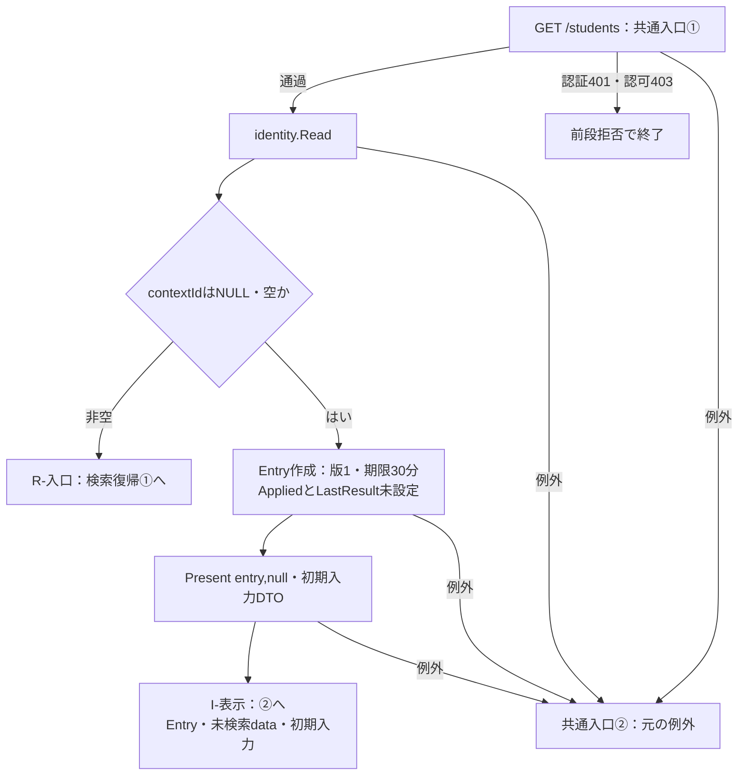

**② 通知取得・候補読取・表示**

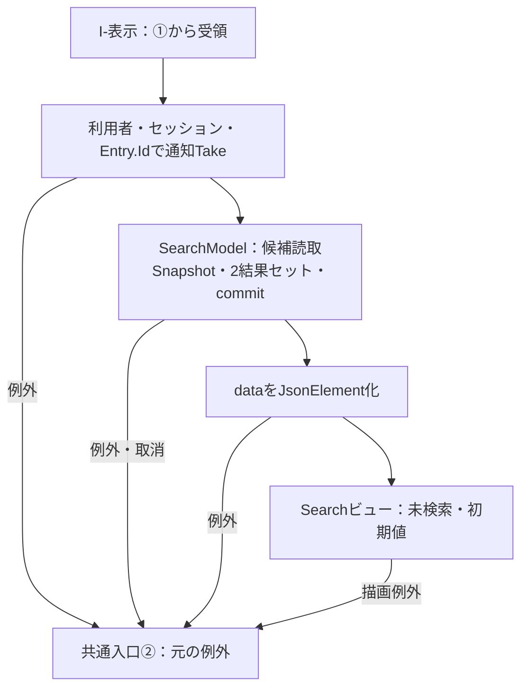

#### SQL・テーブル関連（ER図）

候補用のm_code、m_code_category、m_classと学年コードの関連を使う。補足説明「テーブル関連」の候補SQL側の点線が該当する。検索Entryと通知はそれぞれのメモリ辞書に保持する。

#### DB操作の詳細

補足説明「候補読取」の2結果セットをSnapshotトランザクションで読みcommitする。WHERE・値パラメータ・ページングはなく、学生一覧検索とDB更新は行わない。

#### 結果・例外時の扱い

局所catchはない。認証、状態作成、通知取得、候補、Json化、描画の失敗は共通外側例外経路に従う。Takeは候補読取より先なので、後続表示の失敗時には通知が取り出し済みになり得る。

根拠：`sources/Web/Controllers/StudentsController.cs:8-11`、`sources/Web/Controllers/StudentsController.cs:39-39`、`sources/Core/SqlServerStudentService.cs:197-216`、`sources/Infrastructure/FlashMessageStore.cs:7-9`。

### 検索（POST /students/search）

#### 処理概要

受信した条件を先頭ページから検索し、成功時にApplied・LastResult・検索版を更新する。正常な0件と10,000件超過も成功側の状態更新対象である。

#### 処理手順

1. 共通入口の認証・認可、POSTのCSRF検査とMVCバインド境界を通過した後、アクション内の最初にFormGuardをawaitする。Criteria.StatusCodesキーがなければ入力DTOへ空配列を設定する。
2. CurrentUserとContextId・TabでGetする。再表示dataはPresent(entry, null)とする。この段階は局所catch外である。
3. ModelStateが不正なら応答422とし、coordinator・サービスを呼ばない。
4. 有効なら局所tryでcoordinator.Searchを呼ぶ。identity.Readの後、ToCriteriaで項目を移送し、ClassIdをIdParser.Optionalでlong?へ変換する。Pageは1、件数・並びは受信値である。
5. UseのGet、Gate待機、待機後Get、文字列版比較、版上限検査を通過してSearchAsyncを実行する。
6. EnsureSearchを通過した場合だけ、条件をコピーしてApplied、結果をLastResultへ設定し、Revisionを＋1する。サービス内の正規化値を条件へ戻す処理はない。
7. Useの正常終了で期限を延長し、finallyでGateを解放する。
8. try外のSearchModelで候補取得・Json化を行う。モデルの件数・並びを受信値へ設定し、Searchビューを返す。

根拠：`sources/Web/Controllers/StudentsController.cs:13-16`、`sources/Web/Controllers/StudentsController.cs:39-39`、`sources/Web/Inputs/StudentSearchInput.cs:19-22`、`sources/Infrastructure/WebStudentCoordinator.cs:7-9`、`sources/Infrastructure/WebStudentCoordinator.cs:20-21`。

#### 処理フロー

①のS-実行は②へ要求・Entry・入力DTO・初期dataを渡す。①のModelState不正枝と②の成功・WebFault捕捉枝は、S-表示で③へ接続する。S-表示は各枝のdata、現在のHTTP Status、ModelStateを引き継ぐ。成功枝だけがcoordinatorから返ったdataを使い、不正・捕捉枝では初期の未検索dataを使う。

Useの取得後再確認と解放は補足説明「検索状態の保持契約」②・③に対応する。②でGateを取得した後の例外も、Useのfinallyを通ってから局所catchまたは外側経路へ送出される。

**① フォーム確認・状態取得・ModelState判定**

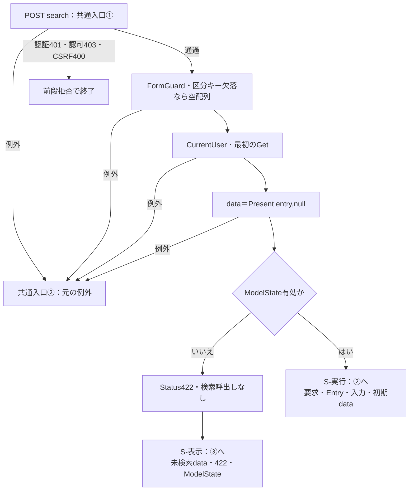

**② 検索実行・メモリ反映・局所catch**

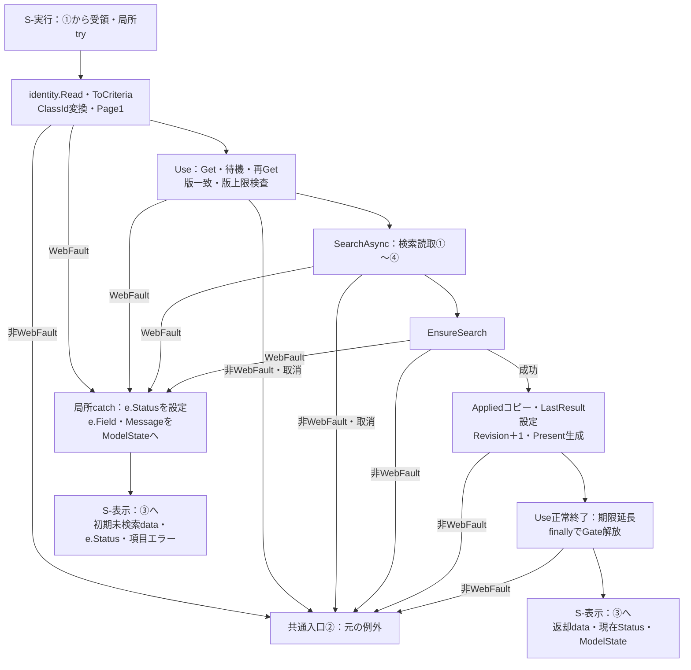

**③ 候補読取と画面返却**

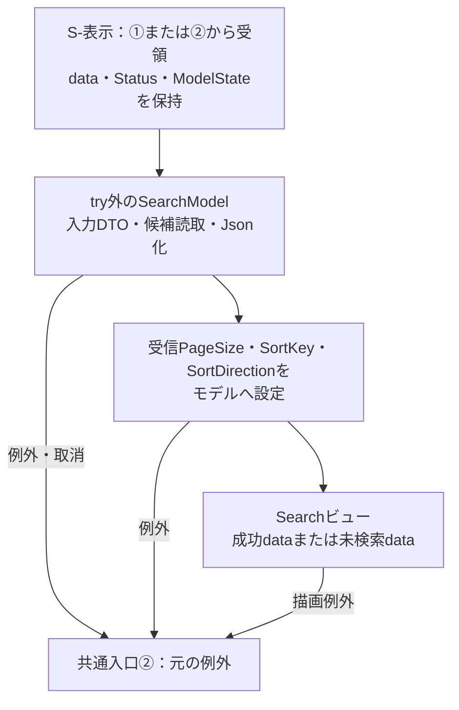

#### SQL・テーブル関連（ER図）

m_student、m_class、学年・区分・都道府県のm_codeを検索し、再表示にm_code_categoryを含む候補読取も行う。補足説明「テーブル関連」の検索SQLと候補SQL両側に対応する。FKとLEFT JOINを区別する。

#### DB操作の詳細

補足説明「学生検索読取」の検査・存在確認、全述語、TOP(10001)、ORDER BY、OFFSET／FETCHを適用する。検索のSnapshotと表示候補のSnapshotは別トランザクションである。DB更新はなく、検索commit後のメモリ反映対象はApplied・LastResult・Revisionである。

#### 結果・例外時の扱い

coordinator.SearchのWebFaultだけを局所catchし、e.Statusを保持して項目エラーを追加する。サービス入力失敗の422、状態版の409、所有者・Tab不一致の403、ID変換の422を固定コードへまとめない。FormGuard、最初のGet、候補取得・Json化、ビュー描画はcatch外である。

検索検証失敗では保持条件・結果・版を成功更新しないが、表示はPresent(entry, null)なので既存結果を出さない。反対に、メモリ更新後の候補・表示失敗でその更新を戻す処理はない。

根拠：`sources/Web/Controllers/StudentsController.cs:14-16`、`sources/Infrastructure/SearchContextStore.cs:14-14`、`sources/Core/SqlServerStudentService.cs:169-170`。

### 候補更新（POST /students/options）

#### 処理概要

編集中の所属条件に合う候補を再描画する。一覧は既存LastResultを表示し、検索の再適用は行わない。

#### 処理手順

1. 共通入口を通過した後、FormGuardと区分キー欠落の空配列補正を行い、CurrentUser・ContextId・TabでGetする。
2. 未所属trueなら年度・学年・クラスをNULLにし、それぞれのCriteriaキーをModelStateからRemoveする。
3. 入力DTOとPresent(entry, entry.LastResult)をSearchModelへ渡す。候補を読んで「条件を変更しました。検索を押すと一覧に反映します。」を設定する。
4. 非空ClassIdについて、取得候補のID文字列と年度・学年条件が一致するクラスを確認する。不一致ならClassIdとそのModelStateを解除し、「上位条件に合わないクラスを解除しました。」へ変更する。ここではIdParserや学年のNFKC正規化を呼ばず、受信DTO値と候補値を直接照合する。
5. Razorで上位条件によるクラス候補絞込み、未所属時の3select無効化を行い、Searchビューを返す。

根拠：`sources/Web/Controllers/StudentsController.cs:22-22`、`sources/Web/Controllers/StudentsController.cs:39-39`、`sources/Views/Students/Search.cshtml:5-5`。

#### 処理フロー

①から②への接続O-候補には、Entryと所属解除後または受信時の入力DTO、現在のModelStateを渡す。②の表示dataはLastResultから作り、今回の編集中条件をAppliedへ移さない。全工程に局所catchはなく、例外は元のまま共通入口②へ進む。

**① フォーム・状態確認と未所属時の解除**

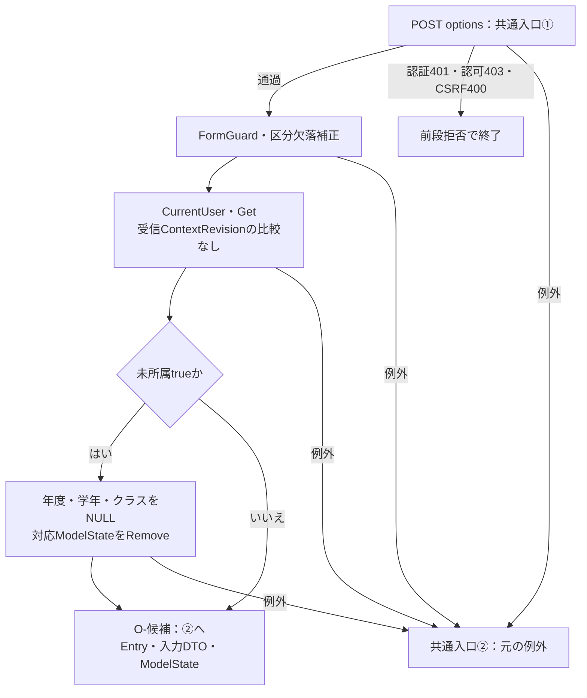

**② 候補読取・選択保持判定・表示**

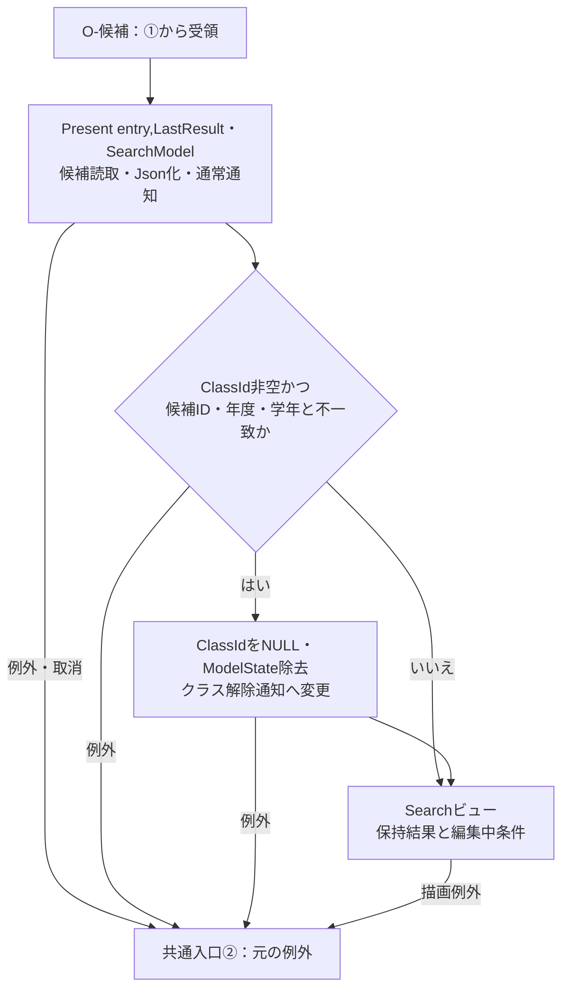

#### SQL・テーブル関連（ER図）

補足説明「テーブル関連」の候補SQL側に対応し、m_code、m_code_category、m_classを参照する。一覧の学生行はメモリのLastResultから取得する。

#### DB操作の詳細

LookupAsync(false)の2結果セットを読みcommitする。学生の再検索・更新はない。年度・学年未指定はその条件ではクラスを絞らず、停止・期間外の候補も除外しない。選択保持・解除はDB更新ではなく、今回の入力DTOとModelStateの変更である。

#### 結果・例外時の扱い

受信ContextRevisionは比較しない。ModelState.IsValid、ToCriteria、IdParser、SearchAsync、Useを呼ばず、Gate・版増分・期限延長・候補await後のGetもない。件数・並びのモデル値はAppliedまたは既定値であり、受信引数へ設定し直さない。

局所catchはない。NULLのStatusCodesがDTOへ届けばRazorのContainsで一般例外となり得るが、受信値からその状態へ至るバインド条件は独立した境界である。候補・表示変換・描画失敗も共通外側経路へ進む。

根拠：`sources/Web/Controllers/StudentsController.cs:22-22`、`sources/Web/Controllers/StudentsController.cs:39-39`、`sources/Infrastructure/WebStudentCoordinator.cs:21-21`、`sources/Views/Students/Search.cshtml:5-5`。

### ページ・並び順変更（POST /students/page）

#### 処理概要

Appliedを再利用して一覧を読み直す。検索条件フォームで編集中の値は受信しない。件数・並び項目・方向のどれかが変われば先頭ページへ戻る。

#### 処理手順

1. 共通入口を通過した後、FormGuard、CurrentUser、ContextId・TabのGetを行う。このGetは局所try外である。
2. try内のcoordinator.Pageでidentity.ReadとUseの排他・待機後再確認・版照合を行う。AppliedがNULLなら409「先に検索してください。」を送出する。
3. Appliedをコピーする。件数・キー・方向が変わればPage=1、それ以外は受信Pageを設定し、受信件数・並びを移す。
4. SearchAsyncとEnsureSearchを実行する。上限超過でなく、条件Pageが取得件数の最終ページを超える場合は条件Pageも最終ページに変更し、再度SearchAsyncとEnsureSearchを行う。
5. 全検索が成功したらAppliedコピー・LastResult・Revision＋1を反映する。Useは期限延長後にGateを解放する。
6. 同じtry内でFrom(Applied)による入力復元、SearchModelの候補取得・Json化、View返却を行う。
7. try内のWebFaultならe.Statusと項目エラーを設定する。catch内でFrom(Appliedまたは既定条件)とPresent(entry, null)を使い、候補を再取得して未検索一覧を返す。

根拠：`sources/Web/Controllers/StudentsController.cs:18-19`、`sources/Web/Controllers/StudentsController.cs:39-40`、`sources/Infrastructure/WebStudentCoordinator.cs:11-12`。

#### 処理フロー

①のP-検索は、取得済みEntry、コピーした条件、取得中のGateを②へ渡す。②のP-成功はUseの正常終了と解放を終えてから、成功dataと更新済みEntryを③へ渡す。P-捕捉には送出されたWebFaultのStatus・Field・Messageをそのまま渡す。Use内の失敗はfinallyによる解放後に③のcatchへ到達する。

③では成功側SearchModelだけが局所try内である。catch内の再表示は同じcatchに再捕捉されず、そこでのWebFaultを含む例外は外側経路へ進む。

**① 入口確認・適用条件の準備**

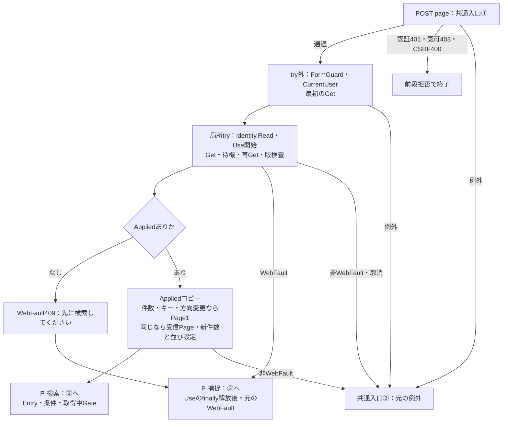

**② 再検索・ページ補正・状態反映**

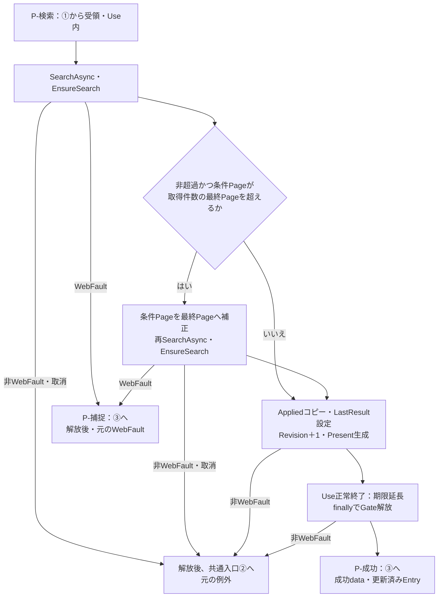

**③ 成功表示とWebFault再表示**

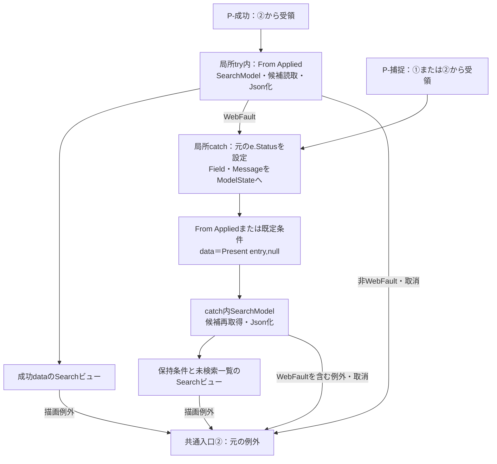

#### SQL・テーブル関連（ER図）

補足説明「テーブル関連」の検索・候補両側を使う。学生、クラス、分類別コードのJOINで一覧を読み、候補取得ではコード分類も参照する。

#### DB操作の詳細

補足説明「学生検索読取」の全条件を再使用する。最終ページ補正時の2回目検索は別のSnapshotトランザクションであり、その後の候補読取とも別である。DB更新はなく、成功後に検索Entryを更新する。

#### 結果・例外時の扱い

ModelState.IsValidを停止条件としない。バインド済み値をサービスが検査するが、変換失敗の原HTTP値がそのまま検査される保証ではない。局所catchはcoordinator.Pageと成功側SearchModelのWebFaultを扱い、元のStatusを保持する。Appliedなしの409を、検証の422や他のWebFaultへ適用しない。

最初のGet、FormGuard、catch内の再表示失敗、View返却後の描画は局所catch外である。成功後SearchModelのWebFaultを捕捉した場合には、更新済みAppliedを使いながら未検索表示となる。表示失敗からメモリが必ず更新前と判断しない。

根拠：`sources/Web/Controllers/StudentsController.cs:18-19`、`sources/Infrastructure/WebStudentCoordinator.cs:12-20`、`sources/Infrastructure/WebPresentation.cs:23-23`。

### クリア（POST /students/clear）

#### 処理概要

現在のEntryの適用条件と保持結果を解除し、初期入力へ戻す。Entry.IdとTabは維持する。

#### 処理手順

1. 共通入口を通過した後、FormGuardをawaitする。
2. coordinator.Clearでidentity.Read、Useの状態・Tab確認、待機後再確認、版照合・上限検査を行う。
3. AppliedとLastResultをNULL、Revisionを＋1としてPresent(entry, null)を作る。
4. Use正常終了で期限延長・Gate解放を行う。
5. ModelState.Clear後にCurrentUser・ContextId・Tabで再Getする。
6. 新しいStudentSearchInputと候補取得・Json化により、01・02、20件、学籍番号昇順、ページ1の未検索画面を返す。

根拠：`sources/Web/Controllers/StudentsController.cs:21-21`、`sources/Web/Controllers/StudentsController.cs:39-39`、`sources/Infrastructure/WebStudentCoordinator.cs:15-15`。

#### 処理フロー

①で解除が正常終了した後、C-表示として未検索dataと要求識別値を②へ渡す。②の再Getは解除後の別の検査であり、失敗しても①の解除や版増分を戻さない。両図に局所catchはない。

**① 状態確認と解除**

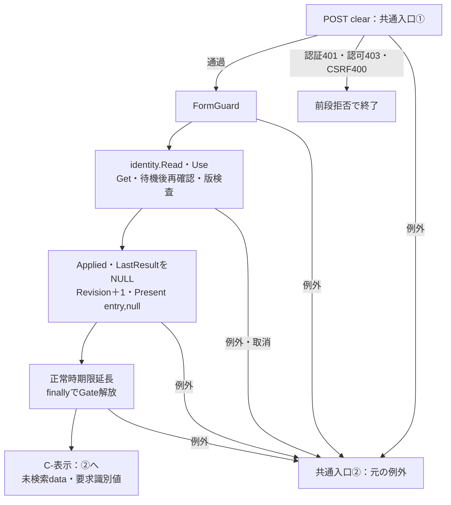

**② 入力初期化と再表示**

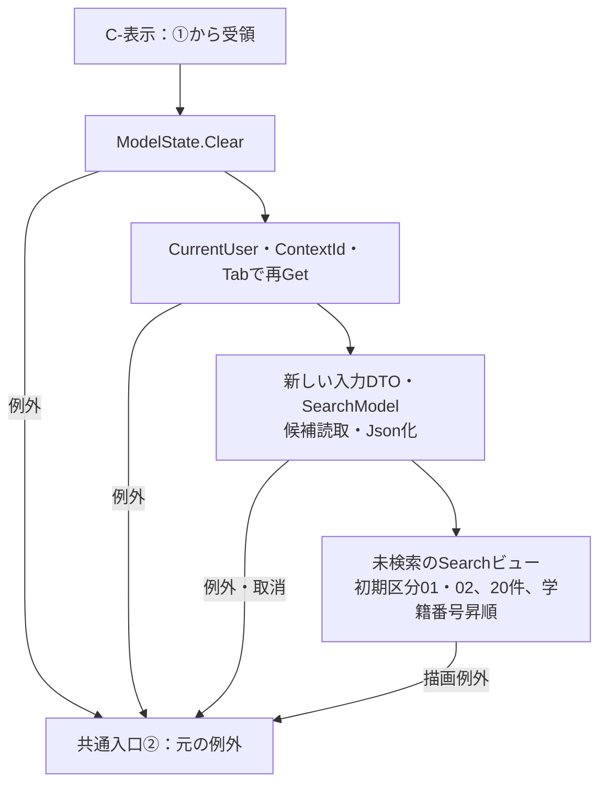

#### SQL・テーブル関連（ER図）

状態解除はSearchContextStoreのメモリ操作である。再表示には補足説明「テーブル関連」の候補SQL側、m_code・m_code_category・m_classを使う。

#### DB操作の詳細

検索条件のDB行を削除する処理はない。学生検索・DB更新は行わず、LookupAsync(false)の候補読取とcommitだけを行う。

#### 結果・例外時の扱い

ModelState.IsValidの検査と局所catchはない。状態拒否・待機取消・解除後再Get・候補・表示失敗は共通外側経路となる。解除後の再表示失敗によってApplied・LastResult・Revisionを戻す処理はない。

根拠：`sources/Web/Controllers/StudentsController.cs:21-21`、`sources/Infrastructure/SearchContextStore.cs:14-14`、`sources/Core/SqlServerStudentService.cs:197-216`。

### 検索復帰（GET /students?contextId=…&contextRevision=…）

#### 処理概要

非空contextId付きGETは、保持結果の単純表示ではなくAppliedによる再検索入口である。登録・編集・参照の戻るリンク、保存・論理削除のSaved後303が接続する。

#### 処理手順

1. 共通入口とidentity.Readを通り、ContextIdでGetする。Tabは渡さない。
2. Entry.Idと受信contextRevisionからContextRequestを作る。版がNULLなら空文字とする。
3. Resumeのidentity.Read、Useの待機後状態再確認・版文字列比較・版上限検査を行う。
4. AppliedがNULLなら未検索dataを返す。版を増やさず、Use正常終了による期限延長を行う。
5. Appliedがあればその条件でSearchAsyncとEnsureSearchを行い、LastResult更新・Revision＋1を行う。AppliedのコピーやPage補正は行わない。
6. Gate解放後、From(Applied)または初期DTO、通知Take、候補取得・Json化によりSearchビューを返す。

根拠：`sources/Web/Controllers/StudentsController.cs:8-11`、`sources/Web/Controllers/StudentsController.cs:39-40`、`sources/Infrastructure/WebStudentCoordinator.cs:14-14`。

#### 処理フロー

①のR-入口は非空contextIdのGETに対応する。初期表示①から到達する場合は共通入口と最初のidentity.Readを通過済みであり、①のGetから続ける。R-再開にはEntry、受信版から作ったContextRequest、Tabなしを渡す。②のR-表示は、Appliedなしの未検索dataまたは再検索成功dataと、その枝でのRevisionを③へ渡す。

②の合流では、Appliedなしの枝へ版増分を加えず、Appliedありの枝のLastResultと増分後Revisionを保持する。両枝ともUseの正常終了時に期限延長と解放を行う。

**① 復帰先取得と要求版の準備**

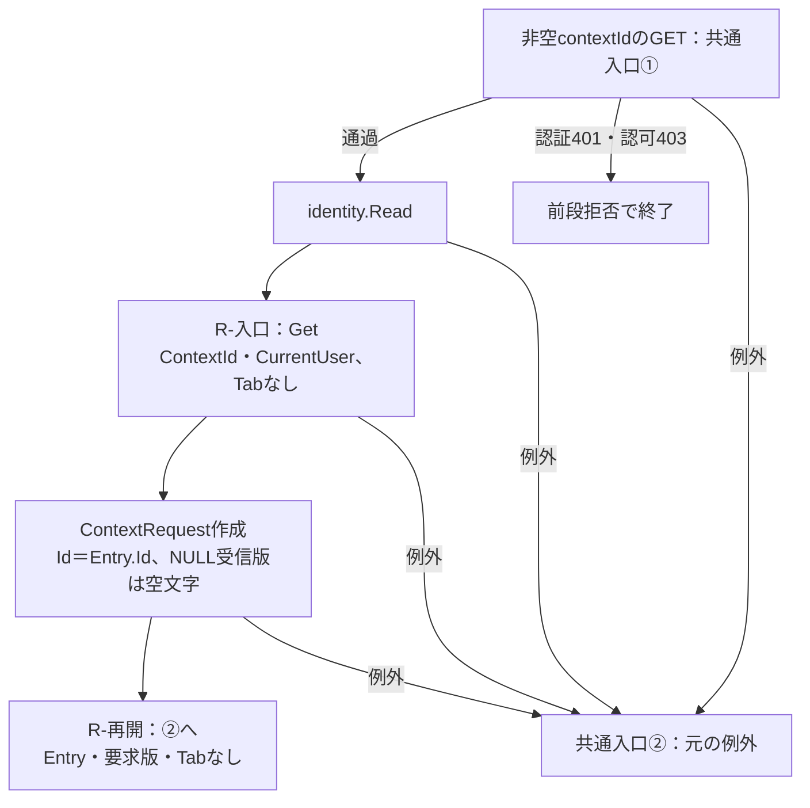

**② 保持条件の再検索または未検索復帰**

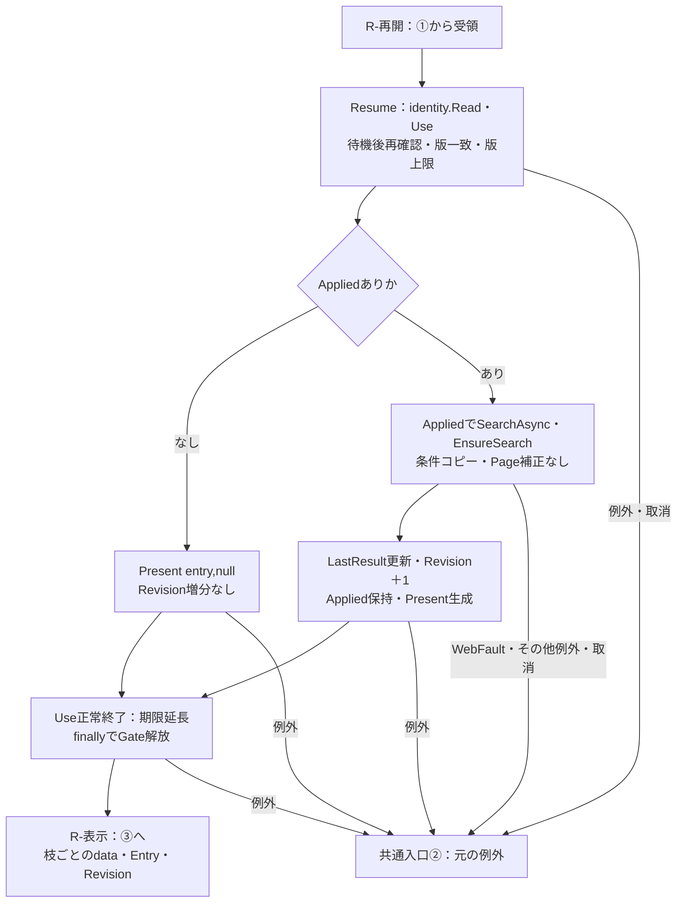

**③ 入力復元・通知取得・表示**

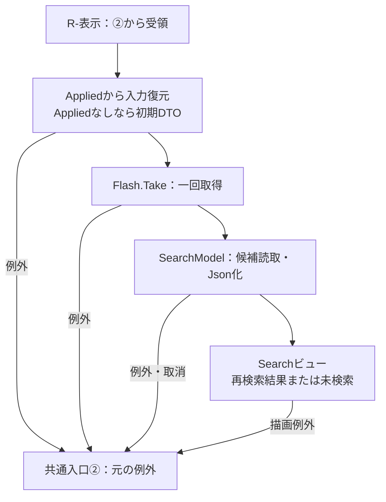

#### SQL・テーブル関連（ER図）

Appliedありでは補足説明「テーブル関連」の検索・候補両側、Appliedなしでは候補側だけを使う。更新先はメモリのLastResult・Revisionである。

#### DB操作の詳細

Appliedありなら共通検索の件数・一覧を再読取し、その後に別トランザクションで候補を読む。Appliedなしでは候補のみである。学生DBの更新はない。

#### 結果・例外時の扱い

局所catchはない。未指定・古い版・期限切れは409、所有者・セッション不一致は403で拒否する。Tabを渡さないことは利用者・版検査の省略ではない。新規Entryへの303復帰はAppliedなしのため学生再検索をしない。

サービスはSQL用ページだけを内部補正する。件数減少でApplied.Pageが最終ページを超えた場合、取得ページとPresentの表示ページが異なる可能性がある。pageイベントの条件補正をResumeにもあるものとして扱わない。

Takeは状態・版照合と必要な再検索の後である。ここまでの拒否・失敗では通知は未取得、Take後の候補・表示失敗では取得済みになり得る。

根拠：`sources/Infrastructure/SearchContextStore.cs:13-14`、`sources/Core/SqlServerStudentService.cs:160-168`、`sources/Infrastructure/FlashMessageStore.cs:9-9`。

## 補足説明

### 共通入口と認証

HTTPフォーム値、MVCバインド後の引数・ModelState、SearchCriteria、サービス正規化値は別の段階である。MVCは非nullable参照型の暗黙Required生成を抑止するため、stringやstring[]の注釈は受信NULL排除の実行保証ではない。検索はModelStateを停止条件にするが、page・options・clearは同じ判定を設けない。モデルバインダー・TagHelperの内部変換と、アクション内の検査を区別する。

要求本文のKestrel上限、フォームのMultipartBodyLengthLimit・ValueLengthLimitは各65536、ValueCountLimitは128、MVC検証エラー上限は100である。これらの設定値は各項目の業務上限とは別である。各POSTはAutoValidateAntiforgeryTokenAttributeを経る。CSRF失敗の独自JSON化は/apiだけであり、/studentsではMVCのAntiforgeryValidationFailedResultによる拒否となる。

根拠：`sources/Infrastructure/WebHostSetup.cs:15-18`、`sources/Infrastructure/AntiforgeryResultFilter.cs:7-8`、`sources/Web/Controllers/StudentsController.cs:13-22`。

FormGuardは各POSTアクション内の最初の処理である。検索・候補更新はStudentSearchInputの公開プロパティへCriteria.を付けた名前と、ContextId・ContextRevision・TabId・PageSize・SortKey・SortDirectionを許可する。pageはPageRequestのプロパティとTabId、clearはContextRequestのプロパティとTabIdを許可する。全フォームで__RequestVerificationTokenと__Invariantも許可する。

許可名はOrdinalIgnoreCaseで照合する。未知項目、不正な__Invariant値、例外対象以外の同名複数値はWebFault 400である。複数値を許すのは__Invariantと、末尾StatusCodes・UnassignedOnlyの項目である。__Invariant専用のキー判定は完全一致なので、許可名照合と比較方法が異なる。許可項目の欠落を必須エラーにする検査はない。

根拠：`sources/Web/Controllers/StudentsController.cs:13-22`、`sources/Web/Controllers/StudentsController.cs:41-41`、`sources/Web/Inputs/StudentSearchInput.cs:7-29`。

CurrentUserは認証済みPrincipalからNameIdentifier、login_session、Roleを読む。未認証、識別値・セッションの空白、識別値64Unicodeスカラー超、セッション64コード単位超、Enum.TryParse<Role>失敗は401である。Enum.IsDefinedはなく、権限条件はViewerとの一致、Administratorとの一致として適用される。サービスもPrincipalを原入力・trim後64スカラーの必須Textで再検査し、空セッションをUnauthorizedAccessExceptionにする。webTokens=trueではGUID形式検査をしない。

根拠：`sources/Infrastructure/RequestIdentity.cs:6-16`、`sources/Core/SqlServerStudentService.cs:46-51`、`sources/Infrastructure/WebHostSetup.cs:19-19`。

**① 認証・認可・MVCから各イベントへの入口**

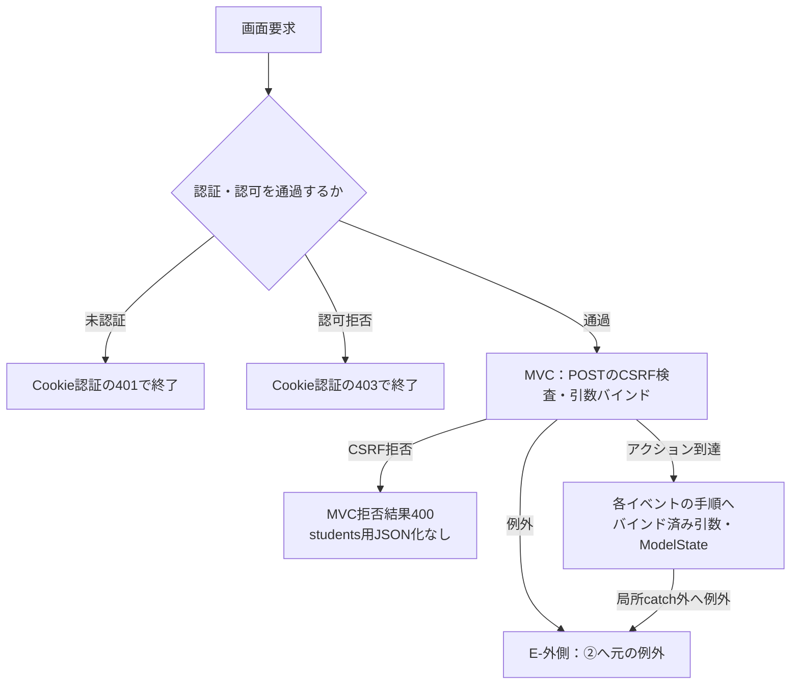

**② 応答開始状態と外側例外応答**

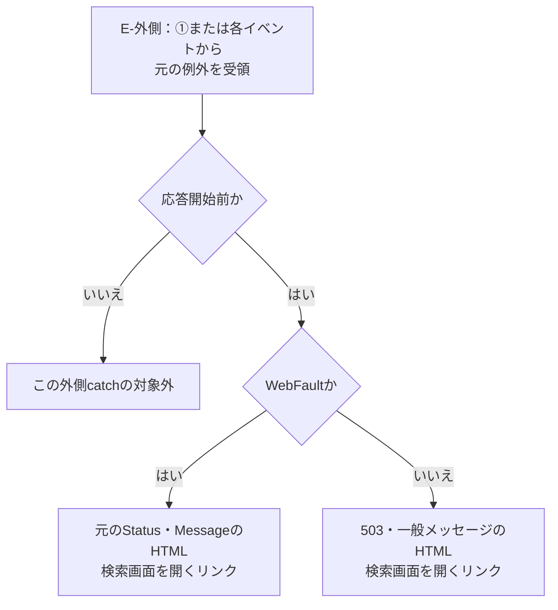

①はCSRFとバインドの内部順序を固定しない。E-外側は例外を引き継ぐ接続位置であり、前段の401・403・400の拒否結果を一律に503へ変換する合流点ではない。Cookie認証の401・403では/students用JSONを書かない。

外側middlewareはno-store、nosniff、no-referrer、CSPを設定して後続をawaitし、応答開始前のExceptionだけを捕捉する。WebFaultは元のStatus・Message、それ以外は503で「処理結果を確認できません。検索で確認してください。」というHTMLとなり、検索画面を開くリンクを含む。この一般応答だけから、学生DB更新の有無や保存結果を確定しない。

取消も局所処理で結果化されない場合、応答未開始なら一般例外経路へ到達し得る。応答開始後はこのcatchの対象外である。

根拠：`sources/Infrastructure/WebHostSetup.cs:14-16`、`sources/Infrastructure/WebHostSetup.cs:21-25`。

### 検索状態の保持契約

| Entry属性 | 型・初期値 | 目的 |
| --- | --- | --- |
| Id | string、乱数32バイトの小文字16進文字列 | 辞書キーと画面間引継ぎ |
| Owner／Session | string、作成利用者のPrincipal／SessionId | 所有者と認証セッションの照合 |
| Tab | string、作成引数がNULL・空なら乱数生成 | 非空Tabを渡した要求の画面照合 |
| Expires | DateTimeOffset、作成UTC＋30分 | 状態期限 |
| Revision | long、1 | 文字列版照合と更新管理 |
| Applied | SearchCriteria?、NULL | 適用済み条件 |
| LastResult | SearchResult?、NULL | 前回成功結果 |
| Gate | SemaphoreSlim(1,1) | 同じEntryへのUseの排他 |

Createは期限切れEntryを辞書から除去して新規登録する。条件CopyはJSON serialize／deserializeによるメモリコピーである。GetはContextIdを加工せず、NULLを辞書呼出し前に、空・未知キーを検索不成立で、期限切れをExpires＜現在UTCで拒否する。いずれも409／W-SRC-002だが判定段階は異なる。Owner・Session不一致と非空Tab不一致は403である。

Useは①Get、②Gate.WaitAsync(ct)、③取得後の再Get、④受信版とRevision.ToString(InvariantCulture)の文字列完全一致、⑤long.MaxValue拒否、⑥operationをawait、⑦正常終了時だけ現在UTC＋30分へ期限延長、⑧finallyのReleaseの順である。先頭ゼロ等を数値同値にしない。待機取消はtry前に起こり得る。Gate取得後の失敗では期限延長せず、finallyで解放する。

次の①はGet単体であり、各イベントの直接GetとUse内の2回のGetに共通する。②から③へのU-operationは、取得済みEntry、取得中Gate、実行するoperationを渡す。③から呼出元へは、正常結果または元の例外を引き継ぐ。409、403、取消、operationの例外を一つの固定Statusへまとめない。

**① Get：キー・期限・所有者・画面の確認**

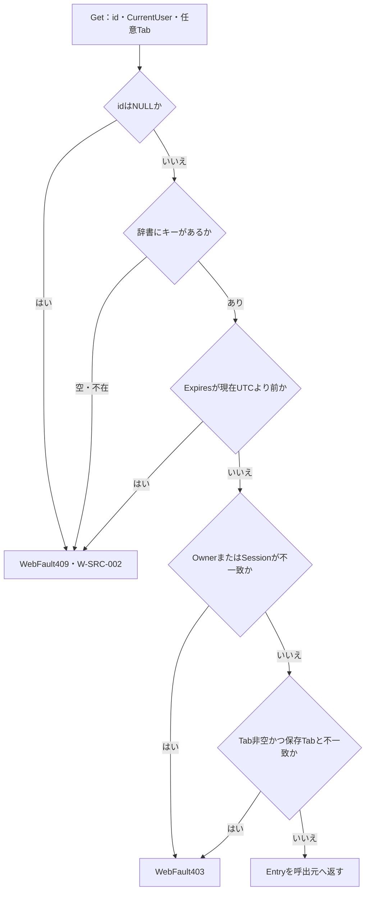

**② Use：排他待機と取得後の再確認**

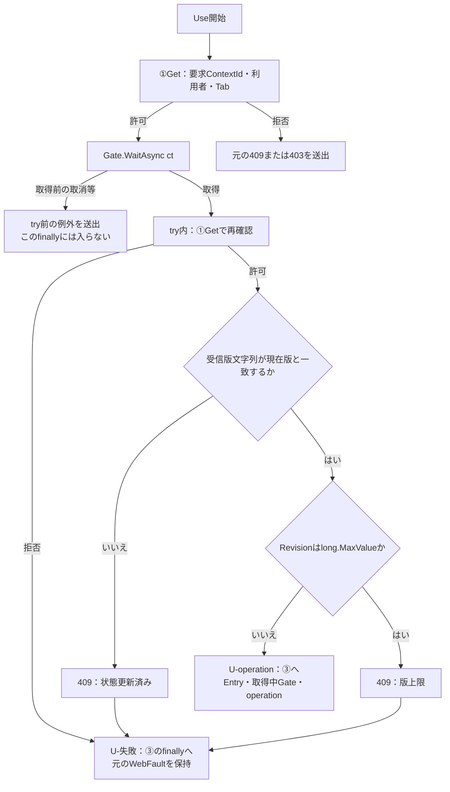

**③ Use：operation・期限延長・finally解放**

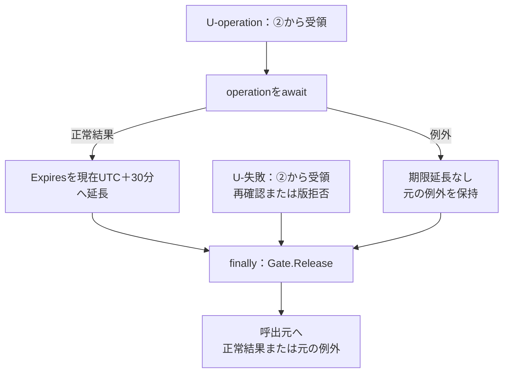

再GetはGate取得直後であり、サービスDB読取のawait後から状態反映直前までに追加Getはない。候補更新はUseを通らず、版比較・排他・期限延長・候補await後の再Getを行わない。入口検査だけから、後続表示まで同じ状態を保証しない。

根拠：`sources/Infrastructure/SearchContextStore.cs:9-15`、`sources/Infrastructure/WebStudentCoordinator.cs:7-15`、`sources/Web/Controllers/StudentsController.cs:22-22`。

### 候補読取

SearchModelはLookupAsync(false)を使う。User確認、Open、Snapshot開始の後、次の1コマンド・2結果セットを読み、commitしてLookupSetを返す。

```sql
SELECT c.category_id,c.code_value,c.code_name,c.display_order,
       CONVERT(bit,CASE WHEN c.is_active=1 AND k.is_active=1 THEN 1 ELSE 0 END) is_active,
       c.valid_from,c.valid_to,c.is_protected
FROM dbo.m_code c
JOIN dbo.m_code_category k ON k.category_id=c.category_id
ORDER BY c.category_id,c.display_order,c.code_value;

SELECT c.*, CONVERT(int,0) occupied
FROM dbo.m_class c
LEFT JOIN dbo.m_code g
  ON g.category_id=c.grade_category AND g.code_value=c.grade_code
ORDER BY c.school_year DESC,g.display_order,c.display_order,c.class_code,c.class_id;
```

第1結果はCodeEntryへ分類・値・名称・表示順、コードと分類の双方が有効という合成状態、有効期間・保護情報を格納する。valid_toはNULL可能である。第2結果はSchoolClassへID・年度・学年・コード・名称・期間・NULL可能な定員・人数・停止状態を格納する。false指定のOccupiedは0固定で、所属人数を集計しない。検索画面は人数・定員を表示しない。

WHERE・パラメータ・ページング・上限はない。停止・期間外も取得する。年度は全クラス年度のDistinct・降順、学年・区分・都道府県は分類別CodeValue／CodeNameを使う。クラスだけ編集中の年度・学年で絞り、未指定の上位条件では絞らない。停止クラスには「（停止）」を付けるが、期間外注記や停止コードのdisabledは検索Razorにない。選択クラスの保持・解除は候補更新イベントの手順に従う。

読取、NextResult、commitへ取消トークンを渡す。LookupAsync内には取消・DB例外を結果DTOへ変換するcatchがない。

根拠：`sources/Core/SqlServerStudentService.cs:197-216`、`sources/Core/Contracts.cs:61-65`、`sources/Views/Students/Search.cshtml:5-5`、`sources/Web/Controllers/StudentsController.cs:22-22`、`sources/Web/Controllers/StudentsController.cs:39-39`。

### 学生検索読取

SearchAsyncはtry前にUser、検索開始時刻now、日本時間業務日dayを取得する。try内の順序は次のとおりである。

1. Page≧1、PageSize=20・50・100、方向asc・descを検査し、SortKeyを許可SQL列へ変換する。不正はE-COM-003。
2. 年度1900～9998と正のClassIdを検査し、不正はE-DATE-003。未所属と所属指定の併用をE-SRC-001で拒否する。
3. 区分配列の長さ・Ordinal重複・01～04の値を検査する。不正はE-STU-009。NULL配列のLength参照は独自検証結果にならない。
4. 学籍番号、氏名・NameKey、カナ・空白除去キー、電話、学年、都道府県の順に正規化する。
5. 入学日期間をParseIsoで変換し、開始＞終了をE-STU-006で拒否する。片側指定と同日指定を許可する。
6. OpenとSnapshot開始後、学年・都道府県をCodeExistsで検査する。分類・値のCOUNT_BIG=1だけを確認し、不存在はE-STU-009。学年不成立なら論理式の短絡により後続都道府県確認へ進まない。在籍区分は固定許可値検査であり、CodeExistsを呼ばない。
7. 指定年度のクラスCOUNT_BIGが0ならE-STU-014。指定クラスの不存在、指定年度・正規化学年との不一致もE-STU-014。
8. 常時is_deleted=0と指定条件をANDで組み立て、TOP(10001)件数を取得する。超過時は一覧を読まずcommitして返す。
9. 通常件数ではSQL用pageだけ最終ページ以下に補正して一覧を読み、commit後にNoChangeのSearchResultを返す。

根拠：`sources/Core/SqlServerStudentService.cs:103-170`、`sources/Core/SqlServerStudentService.cs:218-222`。

| 指定条件 | 追加WHERE | パラメータ／型・サイズ | 値 |
| --- | --- | --- | --- |
| 常時 | `s.is_deleted=0` | なし | 論理削除を除外 |
| 学籍番号 | `s.student_no LIKE @no ESCAPE '!'` | `@no VarChar/31` | エスケープ済み番号＋% |
| 氏名 | `s.name_key LIKE @name ESCAPE '!'` | `@name NVarChar/642` | %＋エスケープ済みNameKey＋% |
| カナ | `s.kana_key LIKE @kana ESCAPE '!'` | `@kana NVarChar/74` | %＋エスケープ済み空白除去キー＋% |
| 年度 | `c.school_year=@year` | `@year SmallInt`、サイズなし | 指定年度 |
| 学年 | `c.grade_code=@grade` | `@grade VarChar/2` | 正規化学年 |
| クラス | `s.class_id=@class` | `@class BigInt`、サイズなし | 指定ID |
| 未所属 | `s.class_id IS NULL` | なし | trueの場合 |
| 都道府県 | `s.prefecture_code=@prefecture` | `@prefecture VarChar/2` | 正規化コード |
| 電話 | `(s.phone_number=@phone OR s.emergency_phone_number=@phone)` | `@phone VarChar/16` | 正規化電話 |
| 入学日開始 | `s.admission_date>=@from` | `@from Date`、サイズなし | 開始日 |
| 入学日終了 | `s.admission_date<=@to` | `@to Date`、サイズなし | 終了日 |
| 在籍区分 | `s.enrollment_status_code IN (@status0,...)` | 各`@statusN VarChar/2` | 非空配列の各許可値 |

NULL条件は述語とパラメータを作らず、空の区分配列も条件を追加しない。LIKEは!、%、_、[を!でエスケープしてから検索用%を付ける。コード存在確認はm_codeのcategory_id・code_value一致で、@category VarChar/24、@value VarChar/10を使う。年度存在確認はm_classのschool_year=@year、@year SmallInt、クラス確認はclass_id=@id、@id BigIntである。これらは停止・期間を拒否しない。

Paramはsize=0ならSizeを設定せず、渡されたNULLをDBNull.Valueへ変換する。DateOnlyは00:00のDateTimeへ変換する。検索のNULL条件はこのDBNull化より前に条件追加を省く。

根拠：`sources/Core/SqlServerStudentService.cs:67-73`、`sources/Core/SqlServerStudentService.cs:125-164`、`sources/Core/SqlServerStudentService.cs:218-222`、`sources/Core/StudentNormalizer.cs:161-161`。

件数SQLはm_studentからm_classへのLEFT JOINと全WHEREを共有する。

```sql
SELECT COUNT_BIG(*)
FROM (
  SELECT TOP (10001) s.student_id
  FROM dbo.m_student s
  LEFT JOIN dbo.m_class c ON c.class_id=s.class_id
  /* 上表の全WHEREをANDで追加 */
) limited;
```

一覧SQLは次の取得列とJOINへ同じWHEREを付け、許可順序とページングを追加する。コメント部分は実装が動的に組み立てる箇所の対応表示である。

```sql
SELECT s.student_id,s.student_no,s.student_name,s.student_name_kana,s.birth_date,
       c.school_year,c.class_code,c.class_name,g.code_name grade_name,e.code_name status_name,
       p.code_name prefecture_name,s.address_line1,s.phone_number,
       s.admission_date,s.updated_at,s.row_version
FROM dbo.m_student s
LEFT JOIN dbo.m_class c ON c.class_id=s.class_id
LEFT JOIN dbo.m_code g ON g.category_id=c.grade_category AND g.code_value=c.grade_code
LEFT JOIN dbo.m_code e ON e.category_id=s.enrollment_category AND e.code_value=s.enrollment_status_code
LEFT JOIN dbo.m_code p ON p.category_id=s.prefecture_category AND p.code_value=s.prefecture_code
/* 上表の全WHEREをANDで追加 */
/* ORDER BY 許可列 許可方向, s.student_id ASC */
OFFSET @offset ROWS FETCH NEXT @size ROWS ONLY;
```

SortKeyはstudentNo→s.student_no、name→s.name_key、admissionDate→s.admission_date、updatedAt→s.updated_atだけを許可する。方向はasc・desc、同順位はstudent_id ASCである。SQL用pageはMin(要求Page, 最終Page)、最終Pageは最低1。@offsetはchecked((page−1)×PageSize)のInt、@sizeもIntで最大PageSize行を取得する。内部補正はSearchCriteria.Pageを書き換えない。

根拠：`sources/Core/SqlServerStudentService.cs:77-90`、`sources/Core/SqlServerStudentService.cs:108-108`、`sources/Core/SqlServerStudentService.cs:156-168`。

接続はEncrypt=Mandatory、TrustServerCertificate=falseで構成する。OpenAsync後に現在DBのsnapshot_isolation_stateを読み、1以外ならInvalidOperationException。Open失敗では接続をDisposeして再送出する。Command helperのtimeoutは30秒で、診断コマンドには原文で明示timeout設定がない。

件数と一覧は同じSnapshotトランザクションで読む。10,000件超ではCount=10001・空Items・LimitExceeded=trueをcommit後に返し、真の総件数は取得しない。通常も超過もOutcome.NoChangeであり、DB更新・監査INSERT・保存用ロックは行わない。取消は接続、診断、トランザクション開始、実行、読取、commitへ渡す。検索は明示Rollback helperを呼ばず、未commit時はawait usingの破棄境界へ進む。

根拠：`sources/Core/SqlServerStudentService.cs:39-73`、`sources/Core/SqlServerStudentService.cs:123-170`。

SearchAsyncのcatchはInputValidationException、続いてArgumentExceptionの順である。前者はFieldErrorを保持し、後者はArgumentError("Search", e)で所定のE-STU・DATE・COM・SRC・MSTの3桁コードを保持し、それ以外はE-STU-002へ変換する。双方はValidationFailed・Count=0・空Itemsを返す。この0は入力失敗用の値であり、学生検索0件とは異なる。

try前のUser、NULL配列のLength、捕捉対象外のDB例外・取消等は、この結果化へ入らない。EnsureSearchはSaved・NoChangeだけを通し、他結果は先頭FieldErrorとOutcome別StatusのWebFaultにする。ValidationFailedは422である。

次の①～③はSearchAsyncのtry内処理を工程で分け、④はcatch順と呼出側のEnsureSearchを示す。D-DBにはcriteria、now、day、許可order、正規化値を渡す。D-取得にはこれらに加え接続、Snapshotトランザクション、WHEREとパラメータを渡す。D-結果には各枝のSearchResultを、D-catchにはtry内の元の例外を渡す。①のtry前失敗はD-catchを通らない。

**① 利用者確認・入力検査・正規化**

```mermaid
flowchart TD
 A["try前：User・now・日本時間day"] --> B["try内：Page・件数・方向検査<br/>SortKeyを許可orderへ変換"]
 A -->|例外| O["サービスから呼出元へ送出"]
 B --> C["年度・ClassId範囲<br/>未所属と所属指定の併用検査"]
 C --> D["区分配列：4件以下・重複なし<br/>値01～04の検査"]
 D --> N["番号、氏名とキー、カナ、電話<br/>学年、都道府県を順に正規化"]
 N --> T["入学日開始・終了をParseIso<br/>開始＞終了なら拒否、同日可"]
 T --> X["D-DB：②へ<br/>criteria・now・day・order・正規化値"]
 B -->|try内例外| E["D-catch：④へ元の例外"]
 C -->|try内例外| E
 D -->|try内例外| E
 N -->|try内例外| E
 T -->|try内例外| E
```

**② 接続・Snapshot・コードと所属の存在確認**

```mermaid
flowchart TD
 A["D-DB：①から受領"] --> O["Open：暗号化接続・Snapshot設定確認<br/>Snapshotトランザクション開始"]
 O --> G["指定学年のCodeExists<br/>指定なしなら省略"]
 G -->|不成立| E1["ArgumentException E-STU-009<br/>都道府県確認には進まない"]
 G -->|成立または指定なし| P["指定都道府県のCodeExists<br/>指定なしなら省略"]
 P -->|不成立| E1
 P -->|成立または指定なし| Y["指定年度のクラス件数確認<br/>指定なしなら省略"]
 Y -->|指定年度が0件| E2["ArgumentException E-STU-014"]
 Y -->|存在または指定なし| C["指定クラスの存在・年度・学年整合<br/>指定なしなら省略"]
 C -->|不一致・不存在| E2
 C -->|整合または指定なし| W["全WHEREとパラメータを構築"]
 W --> X["D-取得：③へ<br/>接続・tx・WHERE・パラメータ・既取得値"]
 E1 --> E["D-catch：④へ元の例外"]
 E2 --> E
 O -->|try内例外・取消| E
 G -->|try内例外・取消| E
 P -->|try内例外・取消| E
 Y -->|try内例外・取消| E
 C -->|try内例外・取消| E
 W -->|try内例外| E
```

**③ 件数上限・一覧ページ取得・commit**

```mermaid
flowchart TD
 A["D-取得：②から受領"] --> C["TOP10001のCOUNT_BIG"]
 C --> H{"Countは10000超か"}
 H -->|はい| T["一覧読取なし・commit"]
 T --> L["NoChange・Count10001・空Items<br/>now・LimitExceeded=true・空Errors"]
 H -->|いいえ| P["最終Pageは最低1<br/>SQL用PageのみMinで補正"]
 P --> S["全JOIN・WHERE・許可ORDER BY<br/>OFFSET/FETCH・最大PageSize行"]
 S --> K["StudentRow読取・commit"]
 K --> N["NoChange・通常CountとItems<br/>now・LimitExceeded=false・空Errors"]
 L --> R["D-結果：④へ枝ごとのSearchResult"]
 N --> R
 C -->|try内例外・取消| E["D-catch：④へ元の例外"]
 T -->|commit等の例外・取消| E
 P -->|try内例外| E
 S -->|try内例外・取消| E
 K -->|try内例外・取消| E
```

**④ サービスcatch順とEnsureSearchの結果判定**

```mermaid
flowchart TD
 A["D-catch：①～③のtry内例外"] --> I{"InputValidationExceptionか"}
 I -->|はい| V["FieldError保持<br/>ValidationFailed・Count0・空Items"]
 I -->|いいえ| G{"続くArgumentException catchに該当するか"}
 G -->|はい| W["ArgumentError Searchで変換<br/>ValidationFailed・Count0・空Items"]
 G -->|いいえ| O["元の例外を呼出元へ送出"]
 B["D-結果：③の枝別SearchResult"] --> R["SearchResultを呼出側へ返す"]
 V --> R
 W --> R
 R --> K{"EnsureSearch：SavedまたはNoChangeか"}
 K -->|はい| P["EnsureSearch通過<br/>元の結果を後続状態反映に使用"]
 K -->|いいえ| E["先頭FieldErrorとOutcome別StatusのWebFault<br/>ValidationFailedなら422"]
```

④のArgumentException判定へ進むのは先行InputValidationException catchに該当しなかった場合だけである。通常0件、超過、検証失敗は枝ごとの結果属性を保ったまま返す。

根拠：`sources/Core/SqlServerStudentService.cs:105-170`、`sources/Core/StudentNormalizer.cs:7-9`、`sources/Core/StudentNormalizer.cs:162-168`、`sources/Infrastructure/WebStudentCoordinator.cs:20-20`、`sources/Infrastructure/WebPresentation.cs:23-23`。

### 文字数と表示変換

maxlengthはブラウザーのコード単位上限、ScalarCountはUnicodeスカラー上限、nvarchar(n)のnはUTF-16の格納単位、varchar(n)はバイト容量であり、同じ尺度ではない。ScalarCountはサロゲート対を1と数え、不正サロゲートはArgumentExceptionにする。学籍番号・電話・コードの正規化結果はASCIIであるが、原入力上限と保存形の容量は区別する。

カナの許可文字はU+30A1～U+30FA、U+30FC・U+30FB・U+30FD・U+30FE。ひらがな変換はU+3041～U+3096・U+309D・U+309Eである。電話はNFKC後にUnicode空白、ASCIIハイフン、U+2010・U+2011・U+2212、丸括弧を除去する。氏名の表示値と照合値、カナの表示値と空白除去キーは、項目一覧の対応で保存・検索される。

根拠：`sources/Core/StudentNormalizer.cs:37-94`、`sources/Core/StudentNormalizer.cs:119-145`。

一覧はSQL→StudentRow→WebPresentation.Row→Web既定名のJsonElement→Razorの11列へ移す。生年月日は元号境界に従う和暦で、元年を「元」、月日を2桁にする。更新日時・検索時刻はUTC+9。住所は都道府県名と住所1の直接連結で、名称NULLは[不整合]、住所2は非使用である。本人電話だけNULLを「－」とし、学年名・クラス名・区分名等へ同じ補完はしない。StudentRowのAdmissionDate・RowVersionはこの表示オブジェクトへ出さない。

根拠：`sources/Core/SqlServerStudentService.cs:74-90`、`sources/Core/Contracts.cs:50-58`、`sources/Core/JapaneseDateService.cs:9-15`、`sources/Core/JapaneseDateService.cs:41-50`、`sources/Infrastructure/WebPresentation.cs:7-7`、`sources/Infrastructure/WebPresentation.cs:20-20`、`sources/Web/Models/StudentSearchPageModel.cs:15-15`、`sources/Views/Students/Search.cshtml:8-8`。

| Present条件 | outcome／totalCount | 表示データ・操作 |
| --- | --- | --- |
| result=NULL | unsearched／NULL | 空items、時刻NULL。保持結果があってもこの表示にできる |
| LimitExceeded=true | tooMany／NULL | 空items、開始時刻あり。内部Count10001を総件数表示しない |
| 通常Count=0 | empty／0 | 成功0件の空items、開始時刻あり |
| 通常Count>0 | found／Count | 最大PageSize件、開始時刻あり。前へはpage>1、次へはpage×PageSize<countで有効 |

Presentのページ・件数・並びはAppliedまたは既定条件から得る。found以外では件数・並び反映と前後の3ボタンをdisabledにする。itemsはSelect(WebPresentation.Row)の遅延列挙であり、SearchModelが候補await後にJson化する時点で行変換される。検索の状態反映と期限延長が済んだ後でも、和暦対象外の日付等の表示変換で失敗し得る。

表示元名称の保守実装は、CodeNameを原入力・trim後12スカラーで必須検査し、code_nameへNVarChar/24で保存する。ClassNameは各18スカラー、class_nameへNVarChar/36、ClassCodeはIdentifierの9スカラー、VarChar/9で保存する。これらはDB容量から推測した上限ではない。保守には書込・監査・commit実装があるが、このWebのDI・ルートからの保守入口は確認できない。本書では表示元属性の確認として扱う。

根拠：`sources/Infrastructure/WebStudentCoordinator.cs:21-21`、`sources/Web/Controllers/StudentsController.cs:39-39`、`sources/Core/MasterMaintenanceService.cs:30-37`、`sources/Core/MasterMaintenanceService.cs:73-85`、`sources/Core/MasterMaintenanceService.cs:113-130`、`sources/database/001_schema.sql:67-81`、`sources/database/001_schema.sql:115-128`。

### テーブル関連

```mermaid
flowchart LR
 S["m_student：検索値・表示値・所属キー"] -->|"FK class_id・NULL可"| C["m_class：年度・学年・クラス"]
 S -->|"FK 都道府県・在籍等の分類と値"| V["m_code：分類別値・名称"]
 C -->|"FK grade_category・grade_code"| V
 V -->|"FK category_id"| K["m_code_category：分類"]
 Q["学生検索SQL"] -.->|"FROM・非削除条件"| S
 Q -.->|"LEFT JOIN"| C
 Q -.->|"学年・区分・都道府県をLEFT JOIN"| V
 L["候補SQL"] -.->|"m_codeと分類をINNER JOIN"| K
 L -.->|"コード候補"| V
 L -.->|"全クラスと学年表示順"| C
```

実線はDDLのFK、点線はSQL参照である。m_student.class_idのNULL可否とLEFT JOINは別の属性である。学生には性別・都道府県・在籍・続柄の分類別FKがあるが、本検索で名称を読むのは学年・在籍・都道府県である。m_codeはcategory_id・code_valueの複合PK、m_code_categoryはcategory_idのPKを持つ。

検索・一覧に使う学生列の型、容量、NULLと用途は項目一覧に示した。加えてis_deletedはbit NOT NULL DEFAULT 0で検索除外、row_versionはbigint NOT NULL DEFAULT 1・正値CHECKで保存比較版となる。検索Entry.Revisionとは別である。クラス・コードの候補状態列は以下の用途を持つ。

| 対象列 | DB属性・既定 | 用途と制約 |
| --- | --- | --- |
| m_class.valid_from／valid_to | 各date NOT NULL、既定なし | 候補DTOの期間。検索候補を除外せず、学生保存側は所属期間の検査に使用 |
| m_class.capacity | int NULL、既定なし | 定員。候補DTOに保持、検索では表示・人数計算なし。学生保存側は新たな在学・休学所属の定員確認 |
| m_class.display_order／is_active | int NOT NULL DEFAULT 0／bit NOT NULL DEFAULT 1 | クラス候補順と停止注記 |
| m_code.category_id／code_value | varchar(24)／varchar(10)、NOT NULL、BIN2、複合PK | 分類別キー、選択値、名称JOIN・存在確認。画面使用分類のコード幅は2 |
| m_code.code_name | nvarchar(24) NOT NULL、既定なし | 候補・一覧・住所の名称、12スカラーCHECKと保守上限12 |
| m_code.display_order／is_active | int NOT NULL DEFAULT 0／bit NOT NULL DEFAULT 1 | 候補順・学年順と分類状態との合成 |
| m_code.valid_from／valid_to | date NOT NULL／date NULL、既定なし | 候補の有効期間。検索では期間による拒否なし |
| m_code.is_protected | bit NOT NULL、既定なし | 保守保護情報。候補DTOに保持するが独立検索項目なし |
| m_code_category.category_id | varchar(24) NOT NULL、BIN2、PK | 分類識別、コードFK参照先、候補INNER JOIN |
| m_code_category.is_active | bit NOT NULL DEFAULT 1 | 候補の有効状態合成 |
| m_code_category.category_name | nvarchar(24) NOT NULL、12スカラーCHECK、既定なし | 分類名称の宣言。検索の独立表示項目なし、保存側の接続された業務上限は未確定 |
| m_code_category.code_length／allow_add | smallint／bit、NOT NULL、既定なし | 保守保存が読むコード幅と追加可否。code_lengthは1～10。検索選択制御へ転用しない |

student_noは削除行も含めUNIQUE、クラスはschool_year・class_codeの組がUNIQUEである。分類CHECKは学生のGENDER・PREFECTURE・ENROLLMENT_STATUS、クラスのGRADEを固定する。学生の日付CHECKは生年月日1900年以降・生年月日≦入学日を要求する。在学・休学なら終了日NULLかつクラス必須、卒業・退学なら終了日必須かつ入学日以降を要求する。したがってclass_idがNULL可でも、すべての区分で未所属が許されるという意味ではない。

連絡先CHECKは本人電話・メール・緊急電話の少なくとも一つを要求し、緊急連絡先の氏名・分類・続柄・電話は全部NULLまたは全部非NULL・RELATIONSHIPを要求する。論理削除情報はis_deleted=0なら全NULL、1なら削除日時・実行者・理由を非NULLとする。更新等の日時はUTCオフセット0、版は正値である。

クラス年度は1900～9998、期間は年度4月1日～翌3月31日内かつ開始≦終了、定員はNULLまたは1～9999、表示順は非負。コード値は非空数字、開始日は1900年以降、終了NULLまたは開始以降、表示順は非負である。検索用存在確認はこれらの有効・停止状態を追加拒否条件にはしない。

非削除学生対象の索引はix_student_birth(birth_date)、ix_student_class_status(class_id, enrollment_status_code)、ix_student_admission(admission_date)、ix_student_updated(updated_at)、ix_student_phone(phone_number)、ix_student_emergency_phone(emergency_phone_number)である。索引宣言と、検索実行計画や性能の確定は別である。

根拠：`sources/database/001_schema.sql:7-134`、`sources/database/001_schema.sql:187-211`、`sources/Core/SqlServerStudentService.cs:77-90`、`sources/Core/SqlServerStudentService.cs:197-222`、`sources/Core/SqlServerStudentService.cs:344-383`、`sources/Core/MasterMaintenanceService.cs:92-107`。

検索状態はSingletonのConcurrentDictionary、編集情報と通知も各メモリ辞書である。t_runtime_stateには状態識別、所有者、セッション、種別、encrypted_payload、期限、版、消費フラグのDDLがあるが、検索ストアから同表への保存・読込・暗号化・消費は接続されていない。

権限SQLはstudent_viewerへ学生・クラス・分類・コードのSELECTを付与し、staff、adminへ段階継承する。staffは学生INSERT／UPDATE・監査INSERTを許可し、学生物理DELETEを拒否する。adminはクラス・コードINSERT／UPDATEを許可する。これはDBロール定義であり、WebのRole判定や実接続利用者の権限とは別である。

根拠：`sources/Infrastructure/SearchContextStore.cs:9-15`、`sources/Infrastructure/EditorSnapshotStore.cs:7-11`、`sources/Infrastructure/FlashMessageStore.cs:6-9`、`sources/database/001_schema.sql:171-184`、`sources/database/003_web_permissions.sql:8-25`。

### 登録編集からの復帰境界

検索リンクはReturnContextIdだけを渡し、遷移時の検索版を付けない。Loadはcoordinator.Editでidentity.Read、非空復帰先のGet、新規時のCreateOrUpdate権限、既存時のGetAsync、LookupAsyncを行う。GetAsyncは正のIDについてstudent_id=@id AND is_deleted=0を読み、@idはBigInt。不在・非正IDのNULL結果は画面側で404／E-STU-103となる。

候補await後にLoadが復帰先を再Getし、その時点のRevisionをReturnRevisionへ格納する。SnapshotはOwner・Session・StudentId・Detail・Original入力コピー・30分期限・ReturnRevisionを保持し、新規・参照でも作る。ViewerではCanEdit=falseで入力fieldsetをdisabledにする。戻るリンクはReturnContextIdと読込時ReturnRevisionを送る。編集JavaScriptのdirty確認は未保存変更の破棄確認である。

根拠：`sources/Views/Students/Search.cshtml:6-8`、`sources/Web/Controllers/StudentsController.cs:23-25`、`sources/Infrastructure/WebStudentCoordinator.cs:6-6`、`sources/Infrastructure/WebStudentCoordinator.cs:17-17`、`sources/Core/SqlServerStudentService.cs:172-194`、`sources/Infrastructure/EditorSnapshotStore.cs:7-11`、`sources/Web/Models/StudentEditPageModel.cs:13-14`、`sources/Views/Students/Edit.cshtml:5-5`、`sources/Views/Students/Edit.cshtml:16-16`、`sources/wwwroot/js/site.js:2-5`。

保存入口はFormGuard→CreateOrUpdate権限→SnapshotId・利用者・対象IDによるSnapshot.Get→非空ReturnContextIdのGet→Originalとの復帰先一致→ModelState→SaveRequest変換の順である。削除入口はFormGuard→identity.Read→Snapshot照合→Originalとの復帰先一致→Administrator確認→非空復帰先Get→Confirmed→ExpectedVersion変換となる。

Snapshot.Getは空・不在・期限切れを独自409、所有者・セッション・対象不一致を403にする。NULL tokenの明示ガードはなく、先にConcurrentDictionary.TryGetValueへ渡す。標準NULLキー契約のArgumentNullExceptionを独自409と同一にしない。ReturnContextIdのNULL・空はCheckReturnでは検査省略だが、Originalとの文字列比較では区別される。非nullable注釈やブラウザーrequiredだけで、これらの受信値の必須保証をしない。

根拠：`sources/Web/Controllers/StudentsController.cs:28-37`、`sources/Infrastructure/EditorSnapshotStore.cs:10-10`、`sources/Infrastructure/WebStudentCoordinator.cs:6-6`、`sources/Infrastructure/WebStudentCoordinator.cs:18-19`、`sources/Web/Inputs/StudentSaveInput.cs:34-43`、`sources/Web/Inputs/StudentSaveInput.cs:57-60`。

保存は正規化後、ReadCommittedとトランザクション所有のExclusiveアプリケーションロック（待機5000ms）を取得する。既存学生の非削除行を再読取し、対象・比較版・変更不可の学籍番号・終了区分訂正の権限と理由を確認する。コード・クラス・定員等の再検査、番号重複、同一人物候補と確認情報の判定後に書き込む。入口通過だけではSavedを保証しない。

保存時のコードは存在を必須とし、新規・変更値ではコードと分類の停止・期間も拒否するが、既存の同値を一律に拒否しない。新たな在学・休学所属はクラスの稼働・期間・定員を確認し、卒業・退学の所属期間変更はクラス期間との重なりを確認する。変更列がなければRollbackAsync(ct)後にNoChange、重複確認が必要ならRollbackAsync(ct)後にConfirmationRequiredを返す。書込み前の対象不在・版不一致等の早期returnはcommitせずawait usingの破棄へ進み、明示Rollback helperの呼出しとは区別する。

INSERTは正規化列に分類GENDER・PREFECTURE・ENROLLMENT_STATUS、is_deleted=0、作成・更新情報、版1を設定する。UPDATEはstudent_noを除く正規化列、更新日時・実行者、版＋1を設定し、WHEREはstudent_id=@id AND row_version=@version AND is_deleted=0。ID・版はBigInt、時刻はDateTimeOffset、実行者はNVarChar/128、項目パラメータは項目一覧の型・サイズである。SQL戻りIDがNULL・DBNullならDBConcurrencyException。監査INSERT後のcommit完了でSavedとなる。

削除はAdministrator、必須複数行理由の原入力・trim後各60スカラー、正のID・版、版上限を確認する。ReadCommitted・保存用ロック後に非削除対象の版を再読取し、不存在はNotFound、版不一致はConflict。UPDATEは同じID・比較版・非削除WHEREでis_deleted=1、deleted_at・deleted_by・delete_reason、updated_at・updated_by、版＋1を設定する。ID・版はBigInt、時刻はDateTimeOffset、実行者NVarChar/128、理由NVarChar/120。更新件数1以外はDBConcurrencyException、監査INSERT・commit後だけSavedとなる。物理DELETEではない。

根拠：`sources/Core/SqlServerStudentService.cs:92-101`、`sources/Core/SqlServerStudentService.cs:227-315`、`sources/Core/SqlServerStudentService.cs:344-383`、`sources/Core/SqlServerStudentService.cs:385-416`。

| 書込処理のcatch順序 | 結果分類 |
| --- | --- |
| 保存：InputValidationException | rollbackを試みValidationFailed、FieldError保持 |
| 保存：SQL重複2601／2627 | rollbackを試みValidationFailed／E-STU-101 |
| 保存・削除：DBConcurrencyException | rollbackを試みConflict／E-STU-105 |
| 上記の先行catchに非該当で、後段のSqlException・InvalidOperationException・OperationCanceledException | rollback成否と書込・commit試行状態からUnknownまたはSystemError |
| 接続・トランザクション開始失敗 | 書込try前のため、上記の結果DTO化対象とはしない |

後段catchへ到達した場合だけ、writeStartedかつ（commitAttemptedまたはrollback失敗）をUnknown、それ以外をSystemErrorとする。先行catchの例外をこの分類へ含めない。RollbackはCancellationToken.Noneを使い、SqlException・InvalidOperationExceptionだけをfalseにする。他のrollback例外まで結果へ固定しない。

Saved以外では303へ進まない。保存はNoChange=200、ValidationFailed=422、Forbidden=403、NotFound=404、Conflict・ConfirmationRequired=409、Unknown・SystemError=503で編集を再表示する。削除の非Savedは結果別Statusとエラーを設定してLoadを再実行するので、その後の不在404・復帰先失効等も発生し得る。

根拠：`sources/Core/SqlServerStudentService.cs:316-329`、`sources/Core/SqlServerStudentService.cs:415-416`、`sources/Web/Controllers/StudentsController.cs:29-33`、`sources/Web/Controllers/StudentsController.cs:37-37`、`sources/Infrastructure/WebPresentation.cs:23-29`。

結果不明は、再試行による確定を促す結果ではない。接続された保存処理のUnknownは「保存結果を確認できません。再保存の前に検索で確認してください。」というE-COM-004のFieldErrorを返す。コントローラーはこれをModelStateへ加え、503の編集再表示へ進む。候補読取と描画が完了すれば、共有検証サマリーにこの案内が表示される。保存要求を再度送る前に検索で確認する、という回復手順が実装メッセージに含まれている。

接続された削除処理のUnknownは「削除結果を確認できません。検索で確認してください。」を返す。コントローラーはエラーをModelStateへ加え、503を設定してLoadを再実行する。ただし実際には削除が確定していて対象を再読取できない場合など、Loadが404等で失敗し、当該案内の編集画面表示まで到達しない可能性がある。Unknownというサービス結果、設定した503、後続再読込の最終応答を区別する。

WebPresentation.SaveMessageには「処理結果が不明です。再送せず検索して確認してください。」というUnknown用の文言があり、WebPresentation.SaveにはretryBySearchも定義される。しかし本画面のコントローラー・ビューから同helperへの接続は確認できず、この文言やJSON属性が画面へ返るとは説明しない。実際の画面経路の根拠は、上記サービスのFieldError、コントローラーのModelStateへの追加、_MessagePanelの表示である。

根拠：`sources/Core/SqlServerStudentService.cs:320-322`、`sources/Core/SqlServerStudentService.cs:416-416`、`sources/Web/Controllers/StudentsController.cs:30-33`、`sources/Web/Controllers/StudentsController.cs:37-37`、`sources/Views/Shared/_MessagePanel.cshtml:2-2`、`sources/Infrastructure/WebPresentation.cs:24-30`。

SavedだけがReturnAfterSaveへ進む。既存復帰先はSnapshot.ReturnRevisionを使い、最新検索版へ置き換えず、ここで既存状態のGetを再実行しない。復帰先NULL・空なら新しいEntryを作ってそのId・Revisionを使う。Flash.Putは利用者・セッション・ContextIdの組へ保存／論理削除通知を10分保持する。応答は303、Locationは/students?contextId=…&contextRevision=…、本文はEmptyResultである。

次の境界図は①のOutcome判定から②の303作成、③の復帰GET、④の通知と画面表示へ順に接続する。B-Savedには受信復帰ContextId、Snapshot.ReturnRevision、処理別通知文を渡す。B-GETには②の各枝で決まったContextIdとRevisionを渡す。B-表示には③の枝別data・Entry・Revisionを渡す。

**① 保存・削除結果と303対象の判定**

```mermaid
flowchart TD
 A["保存・削除の入口検査とDB処理<br/>本文の検査・再読取・catch順に従う"] --> R{"OutcomeはSavedか"}
 A -->|例外| E["入口の局所catchまたは共通入口②<br/>元の例外を引継ぐ"]
 R -->|はい| S["B-Saved：②へ<br/>復帰Id・読込時版・処理別通知文"]
 R -->|いいえ| U{"OutcomeはUnknownか"}
 U -->|はい| G["503・処理別E-COM-004<br/>保存：再保存の前に検索で確認<br/>削除：検索で確認"]
 U -->|いいえ| N["各OutcomeのStatusとエラー<br/>固定Statusへ統合しない"]
 G --> Z["保存：編集再表示<br/>削除：Load再実行・303なし"]
 N --> Z
 Z -->|候補・Load・描画失敗| E
```

**② 復帰先の枝別値保持・通知Put・303**

```mermaid
flowchart TD
 A["B-Saved：①から受領"] --> C{"復帰ContextIdはNULL・空か"}
 C -->|はい| N["新規Entry作成<br/>context＝新規Id<br/>revision＝新規Revision文字列"]
 C -->|いいえ| K["context＝既存復帰Id<br/>revision＝Snapshot.ReturnRevision<br/>最新版取得なし"]
 N --> P["枝ごとのcontext・revisionを保持<br/>Flash.Put：処理別通知を10分"]
 K --> P
 P --> D["303・EmptyResult<br/>Locationに各枝のId・版を設定<br/>NULL revisionは空文字"]
 D --> B["B-GET：③へ<br/>LocationのContextId・Revision"]
 N -->|例外| E["局所catch範囲または共通入口②<br/>元の例外を引継ぐ"]
 P -->|例外| E
 D -->|例外| E
```

**③ 復帰GETの照合・再検索と通知前の境界**

```mermaid
flowchart TD
 A["B-GET：②からの復帰要求"] --> G["共通入口・identity.Read・Get<br/>ResumeのUse：待機後再確認・版照合"]
 G -->|前段認証・認可拒否| F["401または403で終了<br/>通知Take前"]
 G -->|WebFault・その他例外・取消| E["共通入口②：元のStatusまたは503<br/>通知Take前"]
 G -->|許可| P{"Appliedありか"}
 P -->|はい| S["SearchAsync・EnsureSearch<br/>LastResult更新・Revision＋1<br/>Applied保持"]
 P -->|いいえ| N["未検索data・Revision増分なし"]
 S --> X["Use正常終了：期限延長・解放"]
 N --> X
 X --> D["B-表示：④へ<br/>各枝のdata・Entry・Revision"]
 S -->|例外・取消| E
 N -->|例外| E
 X -->|例外| E
```

③のGet・Useの個別条件は検索復帰①・②と検索状態の保持契約①～③に対応する。前段拒否、状態拒否、サービス失敗はいずれも通知Takeより前であり、元の理由とStatusを保つ。サービス成功後に状態を更新した枝と、Appliedなしで版を増やさなかった枝を、B-表示で同じ版へ置き換えない。

**④ 通知の一回取得と検索画面表示**

```mermaid
flowchart TD
 A["B-表示：③から受領"] --> F["入力復元：Appliedまたは初期DTO"]
 F --> T["Flash.Take：TryRemoveと期限判定"]
 T --> L["候補読取・Json化"]
 L --> V["Searchビュー<br/>枝別dataと取得通知を表示"]
 F -->|例外| E["共通入口②：元の例外"]
 T -->|例外| E
 L -->|例外・取消| E
 V -->|描画例外| E
```

①のUnknown枝で設定する503は結果別応答の設定であり、削除の後続Loadが別のWebFaultを送出した場合まで503へ固定しない。②の共通節点では、新規Entryの版と既存Snapshot.ReturnRevisionをそれぞれ引き継ぐ。

通知TakeはTryRemoveの一回取得で、取得時に期限内なら本文を返す。編集読込後に検索版が変わる、または状態が失効すると、学生DB保存がSavedでも復帰GETは409となり得る。戻るリンクも読込時版を使うがFlash.Putは伴わない。Take後の候補・表示失敗では通知が取得済みになり得る。以上は検索への引継ぎ・成功復帰・確定境界であり、登録・編集の全項目仕様を本画面へ拡張しない。

根拠：`sources/Web/Controllers/StudentsController.cs:8-11`、`sources/Web/Controllers/StudentsController.cs:25-25`、`sources/Web/Controllers/StudentsController.cs:31-38`、`sources/Infrastructure/FlashMessageStore.cs:7-9`、`sources/Views/Students/Edit.cshtml:16-17`。
