<!-- spec-meta: {"schema":"spec-md/1.0","documentId":"CSHARP_ASPNET-DET-CSharp_ASPNET-SCR-STU-001","version":"1.5","path":"詳細仕様書/CSharp_ASPNET/01_学生検索画面.md","sheets":[{"heading":"概要","kind":"GRID","sheet":"概要"},{"heading":"項目一覧","kind":"LIST","sheet":"項目一覧","key":["No"]},{"heading":"イベント仕様","kind":"GRID","sheet":"イベント仕様"},{"heading":"補足説明","kind":"GRID","sheet":"補足説明"}]} -->

# 学生検索画面 詳細仕様書

| 文書属性 | 内容 |
| --- | --- |
| 文書ID | CSHARP_ASPNET-DET-CSharp_ASPNET-SCR-STU-001 |
| 種別・版 | detailed-specification／1.5 |
| 文書パス | 詳細仕様書/CSharp_ASPNET/01_学生検索画面.md |
| 対象責務 | MVCによる学生検索、候補と一覧の読取、検索状態の保持、登録・編集・参照からの検索復帰 |
| 関連文書 | [学生検索画面 基本設計書](../../基本設計書/01_学生検索画面.md)。ID：CSHARP_ASPNET-BAS-STU-01、kind：basic-design、path：基本設計書/01_学生検索画面.md。計画に存在する文書であり、リンク先は未生成 |
| 対応方法 | 基本設計と同じ論理項目名・イベント名で対応する。Noは本書内の一意連番。SRC番号は原ビューに明記されたDOM IDであり、在籍区分checkbox群には個別DOM IDを補わない |
| 根拠表記 | `sources/相対パス:開始行-終了行`。indexedの行番号付き原文も同じ原ソース位置へ対応させる |

## 概要

### 機能と実装の接続

学生検索画面は、論理削除されていない学生を条件で絞り込み、氏名、所属、在籍区分、住所、本人電話等を確認する。検索と候補更新は学生DBを更新しない。画面で編集中の条件、適用済み条件Applied、保持結果LastResult、今回の表示dataはそれぞれ独立した値である。検索成功後にAppliedとLastResultをサーバーメモリへ反映する。

Viewerには新規登録リンクを表示せず、一覧の操作を「参照」とする。その他の役割では新規登録リンクと「編集」を表示する。新規読込と保存は、画面のリンク表示とは別にサーバー側でもViewerを拒否する。

根拠：`sources/Views/Students/Search.cshtml:4-8`、`sources/Infrastructure/WebStudentCoordinator.cs:7-18`、`sources/Core/SqlServerStudentService.cs:137-168`。

Programはbuilder生成、WebHostSetup.Add、Build、WebHostSetup.Use、MapControllersの順で構成し、GET `/`を`/students`へ誘導する。AddControllersWithViewsと、Authorize・Route("students")付きStudentsControllerが画面入口を接続する。RequestIdentityとWebStudentCoordinatorはScoped、SearchContextStore・FlashMessageStore・EditorSnapshotStoreはSingletonである。

IStudentServiceにはSqlServerStudentServiceを登録する。接続文字列名StudentDb、要求のCurrentUser取得関数、webTokens=trueを渡す。接続文字列が未設定・空白ならサービス解決時にWebFault 503となる。WebプロジェクトはCoreを参照し、両者の対象はnet10.0、CoreのSqlClient参照はMicrosoft.Data.SqlClient 6.1.3である。

根拠：`sources/Program.cs:2-8`、`sources/Infrastructure/WebHostSetup.cs:12-19`、`sources/Web/Controllers/StudentsController.cs:5-6`、`sources/StudentManagement.Web.csproj:1-5`、`sources/Core/StudentManagement.Core.csproj:1-9`。

| HTTP入口 | 受信・呼出し | 基本設計との対応イベント |
| --- | --- | --- |
| GET `/students` | Index(contextId, contextRevision, ct)。識別値・版は`string?` | 初期表示。非空contextIdでは検索復帰 |
| POST `/students/search` | Search。検索DTOは`[Bind(Prefix="Criteria")]`、ほかに識別値・版・Tab・件数・並びを受信 | 検索 |
| POST `/students/options` | コントローラーOptions。検索と同じフォーム引数 | 候補更新 |
| POST `/students/page` | Page(PageRequest, tabId, ct) | ページ・並び順変更 |
| POST `/students/clear` | Clear(ContextRequest, tabId, ct) | クリア |
| GET `/students/new` | New(returnContextId, ct)→Load(NULL, …) | 新規登録への遷移 |
| GET `/students/{id:long}` | Edit(id, returnContextId, ct)→Load(id, …) | 編集・参照への遷移 |

根拠：`sources/Web/Controllers/StudentsController.cs:8-25`、`sources/Views/Students/Search.cshtml:4-8`。

上記はフォームPOSTとHTML表示の入口である。StudentSearchPageModel.DataのJsonElementはビュー内部の表示用であり、公開JSON応答ではない。StrictJson.ReadとWebStudentCoordinator.Optionsはhelperの宣言があるが、確認した画面入口からの呼出しはない。POST optionsはコントローラーで直接処理する。未接続helper側のWebPresentation.Lookupsにあるselectableや期間外注記を、検索Razorの選択制御へ適用しない。

根拠：`sources/Web/Controllers/StudentsController.cs:13-22`、`sources/Web/Controllers/StudentsController.cs:39-39`、`sources/Web/Models/StudentSearchPageModel.cs:10-15`、`sources/Infrastructure/StrictJson.cs:6-14`、`sources/Infrastructure/WebStudentCoordinator.cs:16-16`、`sources/Infrastructure/WebPresentation.cs:8-18`。

項目一覧のIは画面から処理への入力、Oは処理から画面への出力、I／Oは初期値・復元値の表示と入力の両方を表す。検索入力のDB連携欄は検索先を示す。保存側の列・パラメータは検索値と保存値の対応を確認するために併記し、本画面から保存する意味にはしない。

根拠：`sources/Web/Inputs/StudentSearchInput.cs:7-29`、`sources/Core/Contracts.cs:31-58`。

### 静的画面設計

以下はViewerの初期・未検索状態を表す静的HTMLであり、実画面撮影ではない。共有Layoutのheader・mainと、検索ビューのfieldset・fields・actions・grid・pagerを一体で示す。可変値はプレースホルダーとし、在籍区分の名称見本はseedにある名称を使用する。実画面は読取時のDB名称を表示する。フォーム送信先はdata属性へ移し、ボタンはtype=button、JavaScriptと実HTTP接続は付けない。

根拠：`sources/Views/_ViewStart.cshtml:1-1`、`sources/Views/_ViewImports.cshtml:1-3`、`sources/Views/Shared/_Layout.cshtml:1-1`、`sources/Views/Shared/_MessagePanel.cshtml:2-3`、`sources/Views/Students/Search.cshtml:3-8`、`sources/wwwroot/css/site.css:1-1`、`sources/database/002_seed.sql:19-22`。

<!doctype html>
<html lang="ja">
<head>
<meta charset="utf-8">
<meta name="viewport" content="width=device-width,initial-scale=1">
<title>学生管理</title>
<style>
:root{font-family:Meiryo,'Yu Gothic UI',sans-serif;color:#243448;background:#f2f5f9;font-size:14px}*{box-sizing:border-box}body{margin:0}header{background:#153654;color:white;padding:16px 28px;display:flex;justify-content:space-between;gap:20px}main{background:white;max-width:1440px;margin:24px auto;padding:24px}h1{font-size:24px}fieldset{border:1px solid #c8d1dc;padding:18px;margin:12px 0}legend{font-weight:bold}.fields{display:grid;grid-template-columns:1fr 1fr;gap:14px 28px}label{display:flex;flex-direction:column;gap:5px}input,select,textarea,button{font:inherit;padding:8px;border:1px solid #afbece;border-radius:3px}input,select,textarea{max-width:100%;width:100%}.check{display:inline-flex;flex-direction:row;align-items:center;margin-right:12px}.check input{width:auto}.actions{display:flex;gap:10px;align-items:center;flex-wrap:wrap;margin:16px 0}button{background:white;cursor:pointer}.primary{background:#1c5985;color:white}button:disabled{cursor:default;color:#8a98a5;background:#f3f5f8}.message{padding:14px;border:1px solid #b6dccc;background:#edf7f3}.error{background:#fff1f1;border-color:#c66}.warning{background:#fff8eb;padding:12px}.grid{overflow-x:auto}table{border-collapse:collapse;min-width:1050px;width:100%;font-size:12px}th,td{padding:10px 8px;border:1px solid #d4dee8;vertical-align:top;overflow-wrap:anywhere}th{background:#e6eef6}tr:nth-child(even){background:#f8fafc}.pager{display:flex;gap:14px;align-items:center;justify-content:center;margin:18px}small{color:#5f7183}@media(max-width:760px){main{margin:0;padding:15px}.fields{grid-template-columns:1fr}header{flex-direction:column}}
</style>
</head>
<body>
<header><strong>学生管理システム</strong><span>利用者 ［User.Identity.Name］　業務日 ［日本時間 yyyy/MM/dd］</span></header>
<main>
<h1>学生検索</h1>
<form data-http-method="POST" data-source-action="/students/search" data-search-form>
<input type="hidden" name="ContextId" value="［Entry.Id］"><input type="hidden" name="ContextRevision" value="1"><input type="hidden" name="TabId" value="［Entry.Tab］"><input type="hidden" name="PageSize" value="20"><input type="hidden" name="SortKey" value="studentNo"><input type="hidden" name="SortDirection" value="asc"><input type="hidden" name="__RequestVerificationToken" value="［CSRF情報配置位置］">
<fieldset><legend>検索条件</legend><div class="fields">
<label>学籍番号<input name="Criteria.StudentNo" id="SRC-001" maxlength="30" value=""></label>
<label>氏名<input name="Criteria.Name" id="SRC-002" maxlength="16" value=""></label>
<label>氏名カナ<input name="Criteria.Kana" id="SRC-003" maxlength="72" value=""></label>
<label>年度<select name="Criteria.SchoolYear" id="SRC-004"><option value="" selected>すべて</option><option value="［SchoolYear］">［年度候補］</option></select></label>
<label>学年<select name="Criteria.GradeCode" id="SRC-005"><option value="" selected>すべて</option><option value="［CodeValue］">［GRADEのCodeName］</option></select></label>
<label>クラス<select name="Criteria.ClassId" id="SRC-006"><option value="" selected>すべて</option><option value="［ClassId］">［年度］ ［ClassCode］ ［ClassName］［停止時は（停止）］</option></select></label>
<label class="check"><input type="checkbox" name="Criteria.UnassignedOnly" id="SRC-007" value="true">未所属のみ</label>
<fieldset><legend>在籍区分</legend><label class="check"><input type="checkbox" name="Criteria.StatusCodes" value="01" checked>在学</label><label class="check"><input type="checkbox" name="Criteria.StatusCodes" value="02" checked>休学</label><label class="check"><input type="checkbox" name="Criteria.StatusCodes" value="03">卒業</label><label class="check"><input type="checkbox" name="Criteria.StatusCodes" value="04">退学</label><small>全解除はすべて</small></fieldset>
<label>都道府県<select name="Criteria.PrefectureCode" id="SRC-009"><option value="" selected>すべて</option><option value="［CodeValue］">［PREFECTUREのCodeName］</option></select></label>
<label>電話番号<input name="Criteria.PhoneNumber" id="SRC-010" maxlength="40" value=""></label>
<label>入学日・開始<input name="Criteria.AdmissionFrom" id="SRC-011" type="date"></label>
<label>入学日・終了<input name="Criteria.AdmissionTo" id="SRC-012" type="date"></label>
</div><div class="actions"><button type="button" class="primary">検索</button><button type="button" data-source-formaction="/students/options">候補を更新</button></div></fieldset></form>
<div class="actions"><form data-http-method="POST" data-source-action="/students/clear"><input type="hidden" name="__RequestVerificationToken" value="［CSRF情報配置位置］"><input type="hidden" name="ContextId" value="［Entry.Id］"><input type="hidden" name="ContextRevision" value="1"><input type="hidden" name="TabId" value="［Entry.Tab］"><button type="button">クリア</button></form></div>
<p>未検索</p>
<form data-http-method="POST" data-source-action="/students/page">
<input type="hidden" name="__RequestVerificationToken" value="［CSRF情報配置位置］"><input type="hidden" name="ContextId" value="［Entry.Id］"><input type="hidden" name="ContextRevision" value="1"><input type="hidden" name="TabId" value="［Entry.Tab］">
<div class="actions"><label>表示件数<select name="PageSize"><option value="20" selected>20</option><option value="50">50</option><option value="100">100</option></select></label><label>並び順<select name="SortKey"><option value="studentNo" selected>学籍番号</option><option value="name">氏名</option><option value="admissionDate">入学日</option><option value="updatedAt">更新日時</option></select></label><select name="SortDirection" aria-label="並び順方向"><option value="asc" selected>昇順</option><option value="desc">降順</option></select><button type="button" name="Page" value="1" disabled>並び順・件数を反映</button></div>
<div class="grid"><table><thead><tr><th>学籍番号</th><th>氏名</th><th>氏名カナ</th><th>生年月日</th><th>年度／学年</th><th>クラス</th><th>在籍区分</th><th>住所</th><th>本人電話</th><th>更新日時</th><th>操作</th></tr></thead><tbody></tbody></table></div>
<nav class="pager"><button type="button" name="Page" value="0" disabled>前へ</button><span>1 / 1</span><button type="button" name="Page" value="2" disabled>次へ</button></nav></form>
</main>
</body>
</html>

.fieldsは2列、760px以下で1列になる。同条件でheaderも縦並びとなる。actionsは折返し、gridは横スクロール、tableは最小幅1050px、セルはoverflow-wrap:anywhereを適用する。これらのclass・要素セレクターは、SRCのidや認証Roleとは別の属性である。

| 状態・権限 | 原画面の表示と静的投影の差分 |
| --- | --- |
| Viewer以外 | クリアと同じactions内へ新規登録リンクを追加する。非実行表現は`<a href="#登録編集からの復帰境界" data-source-route="/students/new?returnContextId=［Entry.Id］">新規登録</a>` |
| 一覧行あり | 11列を反復する。操作リンクはViewerなら参照、その他は編集。hrefは文書fragment、元routeは`/students/{studentId}?returnContextId=…`としてdata属性に保持する |
| 未所属trueの再描画 | SRC-004・005・006へdisabled属性を付ける。falseでは属性自体を省略する |
| 検証エラーあり | h1直後にclass=`message error`、asp-validation-summary=All、aria-live=politeの領域を表示する |
| 通知あり | h1直後の共有パネルにclass=`message info`、aria-live=politeで通知文を表示する |
| found | 件数と検索時刻を表示する。件数・並び反映を有効にし、前後操作はページ境界で制御する |
| empty | 「該当する学生はありません。」。件数・並び反映と前後操作をdisabledにする |
| tooMany | warningで「10,000件を超えました。条件を追加してください。」。空一覧、一覧操作3ボタンはdisabled |
| unsearched | 「未検索」。空一覧、一覧操作3ボタンはdisabled。表示ページはAppliedまたは既定条件を引き継ぎ、必ず1へ戻るわけではない |

根拠：`sources/Views/Students/Search.cshtml:3-8`、`sources/Views/Shared/_MessagePanel.cshtml:2-3`、`sources/wwwroot/css/site.css:1-1`。

実JavaScriptは送信時に送信ボタン以外のbuttonをdisabledにし、フォームへaria-busy=trueを設定する。未所属のチェック変更時と初期実行時は、チェックされていれば所属3項目のvalueを空にするが、disabledは変更しない。年度・学年変更時の検索用自動候補取得やクラス解除はない。REG-016～018の即時連動は編集画面用であり、検索画面は候補更新POST後に選択を整理する。

根拠：`sources/wwwroot/js/site.js:4-8`、`sources/Web/Controllers/StudentsController.cs:22-22`。

## 項目一覧

| No | グループ | 項目名 | 種類 | 入出力 | DB連携項目 | 候補取得元 | 必須 | 形式・桁 | 説明 |
| --- | --- | --- | --- | --- | --- | --- | --- | --- | --- |
| 01 | 検索条件 | 学籍番号 | テキストinput | I／O | 検索・表示：`m_student.student_no varchar(15) NOT NULL`、BIN2、UNIQUE | なし | 任意 | maxlength=30コード単位。原入力・trim後・正規化後は各15スカラー以内 | id=SRC-001、`asp-for="Criteria.StudentNo"`、送信名`Criteria.StudentNo`。要求`StudentNo:string`→`SearchCriteria.StudentNo:string?`。NULL・空は条件なし、空白だけは必須エラー。制御文字拒否、trim、NFKC、大文字化後に先頭英数字・以後英数字またはハイフンを検査する。前方一致は`@no VarChar/31`。保存もIdentifier、`@student_no VarChar/15`。更新時は変更不可。根拠：`sources/Views/Students/Search.cshtml:5-5`、`sources/Core/StudentNormalizer.cs:47-64`、`sources/Core/SqlServerStudentService.cs:113-113`、`sources/Core/SqlServerStudentService.cs:140-140`、`sources/Core/SqlServerStudentService.cs:254-254`、`sources/database/001_schema.sql:9-9`、`sources/database/001_schema.sql:187-187` |
| 02 | 検索条件 | 氏名 | テキストinput | I／O | 表示・保存：`m_student.student_name nvarchar(16) NOT NULL`。検索・氏名順：`name_key nvarchar(320) NOT NULL`、BIN2 | なし | 任意 | maxlength=16コード単位。原入力・trim後各8スカラー。照合キー160スカラー以内 | id=SRC-002、`asp-for="Criteria.Name"`、送信名`Criteria.Name`。要求`Name:string`→`StudentName:string?`。NULL・空白は条件なし。表示氏名は制御文字拒否とtrim、NameKeyはNFKC・大文字化・全Unicode空白除去を行う。部分一致`@name NVarChar/642`。保存`@student_name NVarChar/16`、`@name_key NVarChar/320`、DDLのスカラーCHECKは8・160。根拠：`sources/Views/Students/Search.cshtml:5-5`、`sources/Core/StudentNormalizer.cs:47-70`、`sources/Core/StudentNormalizer.cs:125-145`、`sources/Core/SqlServerStudentService.cs:30-32`、`sources/Core/SqlServerStudentService.cs:114-115`、`sources/Core/SqlServerStudentService.cs:141-141`、`sources/database/001_schema.sql:10-13`、`sources/database/001_schema.sql:44-47` |
| 03 | 検索条件 | 氏名カナ | テキストinput | I／O | 表示・保存：`m_student.student_name_kana`。検索・保存：`kana_key`。両列`nvarchar(36) NOT NULL`、キーはBIN2 | なし | 任意 | maxlength=72コード単位。原入力・trim後各36スカラー、正規化表示値18スカラー以内 | id=SRC-003、`asp-for="Criteria.Kana"`、送信名`Criteria.Kana`。要求`Kana:string`→`StudentNameKana:string?`。制御文字拒否、NFKC、所定ひらがなのカタカナ化、語間空白の半角1個化を行い、検索キーは半角空白を除去する。NULL・空は条件なし、空白だけの非空入力は空キーのLIKE条件を追加する。検索`@kana NVarChar/74`、保存両列`NVarChar/36`、各18スカラーCHECK。根拠：`sources/Views/Students/Search.cshtml:5-5`、`sources/Core/StudentNormalizer.cs:72-85`、`sources/Core/StudentNormalizer.cs:126-145`、`sources/Core/SqlServerStudentService.cs:116-116`、`sources/Core/SqlServerStudentService.cs:142-142`、`sources/database/001_schema.sql:11-13`、`sources/database/001_schema.sql:45-47` |
| 04 | 検索条件 | 年度 | select | I／O | 検索：`m_class.school_year smallint NOT NULL`。学生の保存値はclass_id | 全クラスのSchoolYearをDistinct・降順。「すべて」は空値 | 任意 | 要求・内部`int?`、指定時1900～9998 | id=SRC-004、`asp-for="Criteria.SchoolYear"`、送信名`Criteria.SchoolYear`。初期未指定。指定年度のクラス存在を確認する。検索・存在確認`@year SmallInt`、サイズなし。年度は学生表の独立保存列ではなく、保存時も所属クラスとの整合確認に使う。未所属再描画時disabled。根拠：`sources/Views/Students/Search.cshtml:5-5`、`sources/Core/SqlServerStudentService.cs:109-109`、`sources/Core/SqlServerStudentService.cs:126-129`、`sources/Core/SqlServerStudentService.cs:143-143`、`sources/Core/SqlServerStudentService.cs:363-371`、`sources/database/001_schema.sql:64-64` |
| 05 | 検索条件 | 学年 | select | I／O | 検索：`m_class.grade_code varchar(2) NOT NULL`、分類`grade_category varchar(24) NOT NULL`＝GRADE。学生保存はclass_id | GRADEのCodeValue／CodeName。「すべて」は空値 | 任意 | 要求・内部`string?`。原入力・trim後2スカラー以内、NFKC後ASCII数字2コード単位 | id=SRC-005、`asp-for="Criteria.GradeCode"`、送信名`Criteria.GradeCode`。初期未指定。GRADE内の存在を確認し、検索では停止・期間外を拒否しない。検索`@grade VarChar/2`、存在確認は分類24・値10。未所属再描画時disabled。根拠：`sources/Views/Students/Search.cshtml:5-5`、`sources/Core/StudentNormalizer.cs:113-117`、`sources/Core/SqlServerStudentService.cs:118-125`、`sources/Core/SqlServerStudentService.cs:144-144`、`sources/Core/SqlServerStudentService.cs:218-222`、`sources/database/001_schema.sql:65-66`、`sources/database/001_schema.sql:197-197` |
| 06 | 検索条件 | クラス | select | I／O | 検索・保存：`m_student.class_id bigint NULL`。候補キー：`m_class.class_id bigint IDENTITY NOT NULL`、PK | 全クラスを編集中年度・学年で絞る。キーClassId、表示は年度・ClassCode・ClassName・停止注記 | 任意 | 要求`ClassId:string?`→IdParser.Optional→`long?`。非空は19コード単位以内・ASCII数字・正のInt64 | id=SRC-006、`asp-for="Criteria.ClassId"`、送信名`Criteria.ClassId`。NULL・空は未指定、変換不正はWebFault 422。存在、指定年度、正規化学年との一致を検査する。検索`@class BigInt`、存在確認`@id BigInt`、保存`@class_id BigInt`、サイズなし。初期空、未所属再描画時disabled。根拠：`sources/Views/Students/Search.cshtml:5-5`、`sources/Web/Inputs/StudentSearchInput.cs:19-22`、`sources/Web/Inputs/StudentSaveInput.cs:57-60`、`sources/Core/SqlServerStudentService.cs:131-145`、`sources/database/001_schema.sql:28-28`、`sources/database/001_schema.sql:63-63`、`sources/database/001_schema.sql:191-191` |
| 07 | 検索条件 | 未所属のみ | checkbox | I／O | 非DB入力。true時に`m_student.class_id IS NULL`。専用保存列なし | true／false | 任意 | 要求・内部`bool`、初期false | id=SRC-007、`asp-for="Criteria.UnassignedOnly"`、送信名`Criteria.UnassignedOnly`。trueと年度・非NULL学年・クラスの併用はE-SRC-001。学年正規化前の検査なので、サービス引数の空文字も併用指定に含む。JSは所属値を空へ、候補更新は3値をNULLへ変更する。SQLパラメータなし。根拠：`sources/Views/Students/Search.cshtml:5-5`、`sources/wwwroot/js/site.js:7-7`、`sources/Web/Controllers/StudentsController.cs:22-22`、`sources/Core/SqlServerStudentService.cs:109-110`、`sources/Core/SqlServerStudentService.cs:146-146` |
| 08 | 検索条件 | 在籍区分 | 候補別checkbox群 | I／O | 検索・保存：`m_student.enrollment_status_code varchar(2) NOT NULL`、分類`enrollment_category varchar(24) NOT NULL`＝ENROLLMENT_STATUS | ENROLLMENT_STATUSのCodeValue／CodeName | 任意、全解除可能 | 要求`StatusCodes:string[]`→`EnrollmentStatusCodes:string[]`。4件以下、Ordinal重複なし、01～04のみ | name=`Criteria.StatusCodes`、value=CodeValue。原ビューに個別DOM ID・asp-forなし。初期01・02。検索と候補更新はフォームキー欠落を空配列へ補正する。空配列は区分条件なし、非空は各`@statusN VarChar/2`。保存も幅2コード・区分検査、`VarChar/2`。seed名称は在学・休学・卒業・退学、実表示はDB名称。配列NULLの独自ガードなし。根拠：`sources/Views/Students/Search.cshtml:5-5`、`sources/Web/Controllers/StudentsController.cs:14-14`、`sources/Web/Controllers/StudentsController.cs:22-22`、`sources/Core/SqlServerStudentService.cs:111-112`、`sources/Core/SqlServerStudentService.cs:151-153`、`sources/Core/StudentNormalizer.cs:136-153`、`sources/database/001_schema.sql:25-26`、`sources/database/002_seed.sql:19-22` |
| 09 | 検索条件 | 都道府県 | select | I／O | 検索・保存：`m_student.prefecture_code varchar(2) NOT NULL`、分類`prefecture_category varchar(24) NOT NULL`＝PREFECTURE | PREFECTUREのCodeValue／CodeName。「すべて」は空値 | 任意 | 要求・内部`string?`。原入力・trim後2スカラー以内、NFKC後ASCII数字2コード単位 | id=SRC-009、`asp-for="Criteria.PrefectureCode"`、送信名`Criteria.PrefectureCode`。初期未指定、空白は条件なし。分類内存在確認後に完全一致検索する。検索`@prefecture VarChar/2`、保存は必須コードで`@prefecture_code VarChar/2`。存在確認は分類24・値10。一覧名称は分類・値によるLEFT JOIN結果。根拠：`sources/Views/Students/Search.cshtml:5-5`、`sources/Core/StudentNormalizer.cs:113-130`、`sources/Core/SqlServerStudentService.cs:119-125`、`sources/Core/SqlServerStudentService.cs:147-147`、`sources/Core/SqlServerStudentService.cs:296-300`、`sources/database/001_schema.sql:18-19` |
| 10 | 検索条件 | 電話番号 | テキストinput | I／O | 完全一致検索：`m_student.phone_number`または`emergency_phone_number`。両列`varchar(16) NULL` | なし | 任意 | maxlength=40コード単位。原入力・trim後20スカラー以内。正規化後は国内0始まり10～11桁、国際＋と非ゼロ始まり7～15桁 | id=SRC-010、`asp-for="Criteria.PhoneNumber"`、送信名`Criteria.PhoneNumber`。要求`string`→内部`string?`。NFKC後にUnicode空白・所定ハイフン・丸括弧を除去する。NULL・空白は条件なし、除去記号だけは形式エラー。検索`@phone VarChar/16`、保存両電話もPhone・`VarChar/16`。一覧は本人電話のみ。根拠：`sources/Views/Students/Search.cshtml:5-8`、`sources/Core/StudentNormalizer.cs:87-94`、`sources/Core/StudentNormalizer.cs:133-141`、`sources/Core/SqlServerStudentService.cs:34-37`、`sources/Core/SqlServerStudentService.cs:117-117`、`sources/Core/SqlServerStudentService.cs:148-148`、`sources/database/001_schema.sql:22-32` |
| 11 | 検索条件 | 入学日・開始 | date input | I／O | `m_student.admission_date date NOT NULL`へ開始以上 | なし | 任意 | 要求・内部`string?`→`DateOnly? from`。NFKC後10コード単位、yyyy-MM-dd完全一致 | id=SRC-011、`asp-for="Criteria.AdmissionFrom"`、送信名`Criteria.AdmissionFrom`。NULL・空は開始条件なし。trimせず、1900-01-01～検索開始時の日本時間業務日を許可する。開始＞終了は拒否。検索`@from Date`、サイズなし、00:00のDateTimeへ変換。保存入学日もParseIso、`@admission_date Date`。根拠：`sources/Views/Students/Search.cshtml:5-5`、`sources/Core/JapaneseDateService.cs:52-59`、`sources/Core/SqlServerStudentService.cs:67-72`、`sources/Core/SqlServerStudentService.cs:120-122`、`sources/Core/SqlServerStudentService.cs:149-149`、`sources/Core/StudentNormalizer.cs:135-135`、`sources/database/001_schema.sql:24-24` |
| 12 | 検索条件 | 入学日・終了 | date input | I／O | `m_student.admission_date date NOT NULL`へ終了以下 | なし | 任意 | 要求・内部`string?`→`DateOnly? to`。形式・範囲は開始と同じ | id=SRC-012、`asp-for="Criteria.AdmissionTo"`、送信名`Criteria.AdmissionTo`。終了のみ指定可能。両端指定は開始≦終了、同日も許可する。順序不正はE-STU-006。検索`@to Date`、サイズなし。終了条件専用の保存列ではなく、卒業・退学日とも別。根拠：`sources/Views/Students/Search.cshtml:5-5`、`sources/Core/JapaneseDateService.cs:52-59`、`sources/Core/SqlServerStudentService.cs:120-122`、`sources/Core/SqlServerStudentService.cs:150-150` |
| 13 | 検索制御 | 検索状態識別 | 各POSTのhidden | I／O | 非DB。Entry.Id、メモリ辞書キー | 新規Entry生成値 | 状態操作に必要。受信必須の暗黙保証なし | name=ContextId。アクションまたはContextRequestの`string`。生成値は乱数32バイトの小文字16進文字列 | trim・数値化なし。NULLは辞書呼出し前に409、空・不在・期限切れも409。ContextRequest初期値は空文字。SQLパラメータなし。根拠：`sources/Views/Students/Search.cshtml:4-8`、`sources/Web/Inputs/StudentSearchInput.cs:25-29`、`sources/Infrastructure/SearchContextStore.cs:9-14` |
| 14 | 検索制御 | 検索状態の版 | 各POSTのhidden | I／O | 非DB。Entry.Revision:`long` | Entryの現在版 | Useでは一致が必要。候補更新は比較なし | name=ContextRevision、要求`string`、初期版1 | InvariantCulture文字列と完全一致し、先頭ゼロを数値同値にしない。不一致・long.MaxValueは409。検索・page・clear・条件ありResume成功で＋1。SQLパラメータなし。根拠：`sources/Infrastructure/SearchContextStore.cs:9-14`、`sources/Infrastructure/WebStudentCoordinator.cs:9-15`、`sources/Web/Controllers/StudentsController.cs:22-22` |
| 15 | 検索制御 | 画面識別 | 各POSTのhidden | I／O | 非DB。Entry.Tab:`string` | 作成引数または生成値 | 非空の場合だけ照合 | name=TabId。アクション`string tabId`→Get／Useの`string? tab` | NULL・空なら照合省略、非空不一致は403。新規作成時の未指定・空は乱数生成。GET復帰では渡さない。RequestIdentity.TabIdのヘッダー取得helperとは別経路。SQLパラメータなし。根拠：`sources/Infrastructure/SearchContextStore.cs:9-14`、`sources/Infrastructure/RequestIdentity.cs:12-12`、`sources/Web/Controllers/StudentsController.cs:8-22` |
| 16 | 一覧制御 | 表示件数 | 検索hidden／一覧select | I／O | 非DB。SearchCriteria.PageSizeをFETCH件数に使用 | 固定20・50・100 | サービスでは許可値が必要 | name=PageSize、個別idなし、要求`int`、初期20 | 変更時は先頭ページ。検索は受信値を使い、候補更新モデルはAppliedまたは既定値を使う。SQL`@size Int`、サイズなし。検索失敗後も受信値をモデルへ設定するため、0が到達するとRazorのページ数計算でゼロ除算となる。根拠：`sources/Web/Inputs/StudentSearchInput.cs:22-29`、`sources/Web/Controllers/StudentsController.cs:13-16`、`sources/Views/Students/Search.cshtml:8-8`、`sources/Core/SqlServerStudentService.cs:107-107`、`sources/Core/SqlServerStudentService.cs:160-164` |
| 17 | 一覧制御 | 並び順項目 | 検索hidden／一覧select | I／O | ORDER BY参照：`m_student.student_no`・`name_key`・`admission_date`・`updated_at`。指定は非DB | studentNo・name・admissionDate・updatedAt | サービスでは許可値が必要 | name=SortKey、個別idなし、要求`string`、初期studentNo | 許可キーを上記4列へ変換する。変更時Page=1。受信文字列を直接SQL列名にせず、許可列だけを組み立てる。SQL値パラメータなし。根拠：`sources/Views/Students/Search.cshtml:8-8`、`sources/Core/SqlServerStudentService.cs:108-108`、`sources/Core/SqlServerStudentService.cs:162-162` |
| 18 | 一覧制御 | 並び順方向 | 検索hidden／一覧select | I／O | 非DB。ORDER BY方向を制御 | asc＝昇順、desc＝降順 | サービスでは許可値が必要 | name=SortDirection、aria-label=並び順方向、要求`string`、初期asc | asc・descのみ許可。変更時Page=1。同順位は方向にかかわらずstudent_id ASC。SQLパラメータなし。根拠：`sources/Views/Students/Search.cshtml:8-8`、`sources/Core/SqlServerStudentService.cs:107-108`、`sources/Core/SqlServerStudentService.cs:162-162` |
| 19 | 一覧制御 | ページ番号・表示 | Page送信button／pagerのspan | I／O | 非DB。Applied.PageとSQL用page | 反映=1、前へ=現在−1、次へ=現在＋1 | サービスでは1以上が必要 | PageRequest.Page:`int`、初期1 | サービスはSQL用ページだけ最終ページ以下へ補正する。pageイベントは条件Pageも補正して再検索、Resumeは補正しない。未検索再表示でもApplied.Pageを保持し、ページ2なら通常2／1となり得る。`@offset Int`はchecked((SQL用page−1)×PageSize)。found以外とページ境界でbuttonはdisabled。根拠：`sources/Infrastructure/WebStudentCoordinator.cs:12-14`、`sources/Infrastructure/WebStudentCoordinator.cs:21-21`、`sources/Core/SqlServerStudentService.cs:160-164`、`sources/Views/Students/Search.cshtml:2-8` |
| 20 | 一覧 | 学籍番号 | td | O | `m_student.student_no varchar(15) NOT NULL` | 検索結果StudentRow | 表示のみ | StudentNo:`string`→row.studentNo | 検索入力とは別の保存値を表示する。SQL→StudentRow→WebPresentation.Row→JsonElementを経由する。根拠：`sources/Core/SqlServerStudentService.cs:77-90`、`sources/Infrastructure/WebPresentation.cs:20-20`、`sources/Views/Students/Search.cshtml:8-8` |
| 21 | 一覧 | 氏名 | td | O | `m_student.student_name nvarchar(16) NOT NULL`、8スカラーCHECK | 検索結果StudentRow | 表示のみ | StudentName:`string`→row.studentName | trimした表示氏名を出し、name_keyは表示しない。保存業務上限8スカラー、`@student_name NVarChar/16`。根拠：`sources/Core/StudentNormalizer.cs:125-125`、`sources/Core/SqlServerStudentService.cs:31-31`、`sources/Core/SqlServerStudentService.cs:77-90`、`sources/database/001_schema.sql:10-10`、`sources/database/001_schema.sql:44-44` |
| 22 | 一覧 | 氏名カナ | td | O | `m_student.student_name_kana nvarchar(36) NOT NULL`、18スカラーCHECK | 検索結果StudentRow | 表示のみ | StudentNameKana:`string`→row.studentNameKana | 正規化表示値を出し、空白除去キーとは区別する。保存`NVarChar/36`。根拠：`sources/Core/StudentNormalizer.cs:126-145`、`sources/Core/SqlServerStudentService.cs:77-90`、`sources/database/001_schema.sql:11-11`、`sources/database/001_schema.sql:45-45` |
| 23 | 一覧 | 生年月日 | td | O | `m_student.birth_date date NOT NULL` | 検索結果StudentRow | 表示のみ | BirthDate:`DateOnly`→BirthDateWareki:`string` | 和暦で元年を「元」、月日を2桁表示。保存入力BirthDateInputを日付へ変換し、`@birth_date Date`で保存する。根拠：`sources/Core/JapaneseDateService.cs:9-15`、`sources/Core/JapaneseDateService.cs:41-50`、`sources/Core/StudentNormalizer.cs:127-127`、`sources/Core/SqlServerStudentService.cs:32-32`、`sources/database/001_schema.sql:14-14` |
| 24 | 一覧 | 年度／学年 | 同一td内2表示値 | O | `m_class.school_year smallint NOT NULL`、GRADEの`m_code.code_name nvarchar(24) NOT NULL` | 学生所属からクラス・GRADEへLEFT JOIN | 表示のみ | SchoolYear:`int?`、GradeName:`string?`。名称保守上限12スカラー | 任意所属の結合結果でNULL可能。年度はJsonElementを直接出力、学年名はNULL補完なし。名称保存は原入力・trim後各12スカラー、`@name NVarChar/24`。根拠：`sources/Core/SqlServerStudentService.cs:79-90`、`sources/Core/MasterMaintenanceService.cs:82-82`、`sources/Core/MasterMaintenanceService.cs:113-120`、`sources/Views/Students/Search.cshtml:8-8`、`sources/database/001_schema.sql:64-64`、`sources/database/001_schema.sql:115-128` |
| 25 | 一覧 | クラス | 同一td内2表示値 | O | `m_class.class_code varchar(9) NOT NULL`、`class_name nvarchar(36) NOT NULL` | 学生class_idからm_classへLEFT JOIN | 表示のみ | ClassCode・ClassName:`string?`。保守上限はコード9・名称18スカラー | 保存列NOT NULLでも結合結果はNULL可能。コード保存はIdentifier、名称は原入力・trim後各18スカラー。`@class_code VarChar/9`、`@class_name NVarChar/36`。根拠：`sources/Core/MasterMaintenanceService.cs:33-33`、`sources/Core/MasterMaintenanceService.cs:73-76`、`sources/Core/MasterMaintenanceService.cs:124-130`、`sources/database/001_schema.sql:67-81`、`sources/Core/SqlServerStudentService.cs:79-90` |
| 26 | 一覧 | 在籍区分 | td | O | ENROLLMENT_STATUSの`m_code.code_name nvarchar(24) NOT NULL` | 学生の分類・区分値からm_codeへLEFT JOIN | 表示のみ | EnrollmentStatusName:`string?`→row.enrollmentName、保守上限12スカラー | 固定名称置換・NULL補完なし。名称保存`@name NVarChar/24`、DDLにも12スカラーCHECK。根拠：`sources/Core/SqlServerStudentService.cs:80-90`、`sources/Infrastructure/WebPresentation.cs:20-20`、`sources/Core/MasterMaintenanceService.cs:82-82`、`sources/Core/MasterMaintenanceService.cs:115-120`、`sources/database/001_schema.sql:115-128` |
| 27 | 一覧 | 住所 | td | O | PREFECTUREの`m_code.code_name nvarchar(24) NOT NULL`＋`m_student.address_line1 nvarchar(90) NOT NULL` | 都道府県名のLEFT JOINと学生住所1 | 表示のみ | Address:`string`→row.addressDisplay。住所保存各45スカラー、名称12スカラー | 名称と住所1を区切りなしで連結。名称NULLは[不整合]。`address_line2 nvarchar(90) NULL`は保存に含むが一覧非使用。住所保存各`NVarChar/90`、名称`@name NVarChar/24`。根拠：`sources/Core/SqlServerStudentService.cs:34-34`、`sources/Core/SqlServerStudentService.cs:80-90`、`sources/Core/StudentNormalizer.cs:131-132`、`sources/Core/MasterMaintenanceService.cs:82-82`、`sources/database/001_schema.sql:20-21`、`sources/database/001_schema.sql:48-49` |
| 28 | 一覧 | 本人電話 | td | O | `m_student.phone_number varchar(16) NULL` | 検索結果StudentRow | 表示のみ | PhoneNumber:`string?`→row.phoneNumber | NULLだけ「－」。緊急電話で検索一致した行でも本人電話を表示する。根拠：`sources/Core/SqlServerStudentService.cs:80-90`、`sources/Core/SqlServerStudentService.cs:148-148`、`sources/Views/Students/Search.cshtml:8-8`、`sources/database/001_schema.sql:22-22` |
| 29 | 一覧 | 更新日時 | td | O | `m_student.updated_at datetimeoffset(7) NOT NULL`、UTCオフセット0のCHECK | 検索結果StudentRow | 表示のみ | UpdatedAt:`DateTimeOffset`→日本時間yyyy/MM/dd HH:mm:ss | 保存・論理削除で設定する時刻。表示はWebPresentation.Time、保存`@now DateTimeOffset`。根拠：`sources/Infrastructure/WebPresentation.cs:7-7`、`sources/Infrastructure/WebPresentation.cs:20-20`、`sources/Core/SqlServerStudentService.cs:296-300`、`sources/database/001_schema.sql:40-40`、`sources/database/001_schema.sql:57-57` |
| 30 | 一覧 | 操作 | td内a | I／O | 遷移対象`m_student.student_id bigint IDENTITY NOT NULL`、PK。編集比較版`row_version bigint NOT NULL DEFAULT 1`は一覧非表示 | 結果StudentId、操作名は利用者Role | 対象識別値を使用 | StudentId:`long`→InvariantCulture十進文字列 | Viewerは参照、その他は編集。route=`/students/{studentId}?returnContextId=…`。遷移URLに復帰版を付けない。読込`@id BigInt`、保存・削除比較`@version BigInt`。根拠：`sources/Infrastructure/WebPresentation.cs:20-20`、`sources/Views/Students/Search.cshtml:8-8`、`sources/Core/SqlServerStudentService.cs:172-177`、`sources/database/001_schema.sql:8-8`、`sources/database/001_schema.sql:42-43` |
| 31 | 一覧状態 | 結果状態・件数・検索時刻 | p／warning | O | 非DB表示値。件数SELECT結果とサービス開始時刻 | SearchResult→Present→JsonElement | 表示のみ | unsearched・tooMany・empty・found。未検索・超過のtotalCountはNULL | 結果なしは未検索、超過は空一覧、通常0件はempty、それ以外found。内部Count10001を総件数として出さない。時刻は日本時間表示。根拠：`sources/Infrastructure/WebStudentCoordinator.cs:21-21`、`sources/Core/SqlServerStudentService.cs:105-105`、`sources/Core/SqlServerStudentService.cs:156-168`、`sources/Views/Students/Search.cshtml:2-8` |
| 32 | 検索操作 | 検索 | button、class=primary | I | 条件に応じ学生検索SQLを呼ぶ | なし | ‐ | 原画面type=submit、条件フォームの既定送信先 | POST `/students/search`。先頭ページから検索する。根拠：`sources/Views/Students/Search.cshtml:4-5`、`sources/Web/Controllers/StudentsController.cs:13-16` |
| 33 | 検索操作 | 候補を更新 | button | I | 候補用m_code・m_code_category・m_classを読取 | LookupAsync(false) | ‐ | 原画面type=submit、formaction=`/students/options` | 編集中条件で候補を再描画。検索適用・学生再検索は行わない。根拠：`sources/Views/Students/Search.cshtml:5-5`、`sources/Web/Controllers/StudentsController.cs:22-22` |
| 34 | 検索操作 | クリア | 独立form内button | I | 解除は非DB、再表示候補のみDB読取 | 初期StudentSearchInputと候補 | ‐ | POST `/students/clear` | 同じEntryのApplied・LastResultを解除し、初期条件へ戻す。根拠：`sources/Views/Students/Search.cshtml:6-6`、`sources/Web/Controllers/StudentsController.cs:21-21`、`sources/Infrastructure/WebStudentCoordinator.cs:15-15` |
| 35 | 画面遷移 | 新規登録 | a | I | 遷移時の学生DB更新なし | Viewer以外に表示 | ‐ | GET `/students/new?returnContextId=…` | 現検索状態のIdだけを渡す。新規読込はサーバーでもViewerを拒否する。根拠：`sources/Views/Students/Search.cshtml:6-6`、`sources/Web/Controllers/StudentsController.cs:23-25`、`sources/Infrastructure/WebStudentCoordinator.cs:17-17` |
| 36 | 共有ヘッダー | 利用者名 | span内表示 | O | 非DB。認証PrincipalのIdentity.Name | 共有LayoutのUser.Identity | 表示のみ | `User.Identity?.Name` | 状態所有者のNameIdentifierとは取得プロパティが異なる。根拠：`sources/Views/Shared/_Layout.cshtml:1-1`、`sources/Infrastructure/RequestIdentity.cs:8-10` |
| 37 | 共有ヘッダー | 業務日 | span内表示 | O | 非DB。UTC現在時刻から算出 | WebPresentation.BusinessDate | 表示のみ | `DateOnly`、日本時間yyyy/MM/dd | 検索サービスの業務日は検索開始時刻から別に求める。根拠：`sources/Views/Shared/_Layout.cshtml:1-1`、`sources/Infrastructure/WebPresentation.cs:5-5`、`sources/Core/SqlServerStudentService.cs:44-45`、`sources/Core/SqlServerStudentService.cs:105-105` |
| 38 | メッセージ | 検証エラー | div、class=message error | O | 非DB。MVC ModelState | バインド検証、局所catch、結果FieldError | 表示のみ | asp-validation-summary=All、aria-live=polite | ErrorCount>0ならh1直後に表示。局所catch外の失敗と、その後の描画失敗ではこの領域による最終再表示を保証しない。根拠：`sources/Views/Shared/_MessagePanel.cshtml:2-2`、`sources/Web/Controllers/StudentsController.cs:15-19`、`sources/Views/Students/Search.cshtml:8-8` |
| 39 | メッセージ | 通知 | div、class=message info | O | 非DB。PageModel.Message、FlashMessageStoreのメモリ | 候補更新通知、GET時Flash.Take | 表示のみ | 非NULL・非空時だけ表示、aria-live=polite | Saved後通知は10分保持、一回取得。候補更新通知は今回モデルへ設定する。通知ストアに復帰版は保存しない。根拠：`sources/Views/Shared/_MessagePanel.cshtml:3-3`、`sources/Web/Controllers/StudentsController.cs:11-11`、`sources/Web/Controllers/StudentsController.cs:22-22`、`sources/Infrastructure/FlashMessageStore.cs:6-9` |
| 40 | フォーム制御 | CSRF情報 | AntiForgeryToken配置領域 | I／O | 非DB。ASP.NET Core Antiforgery | 各POSTのHtml.AntiForgeryToken | POST検証対象 | 許可フォーム名`__RequestVerificationToken`。項目業務長の指定なし | AutoValidateAntiforgeryTokenAttributeで検査する。/studentsの拒否は/api用JSON変換対象外。生成内部を独自DTO処理と区別する。根拠：`sources/Views/Students/Search.cshtml:4-8`、`sources/Infrastructure/WebHostSetup.cs:15-16`、`sources/Infrastructure/AntiforgeryResultFilter.cs:7-8`、`sources/Web/Controllers/StudentsController.cs:41-41` |

## イベント仕様

### 初期表示（GET /students）

#### 処理概要

contextIdがNULL・空なら、新しい検索状態と候補を準備して未検索画面を表示する。非空なら検索復帰へ進む。初期表示の枝では学生一覧を検索しない。

#### 処理手順

1. 補足説明「共通入口・入力・認証」の認証・認可とMVC境界を通過し、identity.Readで認証情報を確認する。
2. contextIdがNULL・空ならNewContextでEntryを作る。版1、期限30分、Applied・LastResult未設定である。非空の要求は検索復帰イベントへ進む。
3. Present(entry, null)で未検索dataを作る。新しいStudentSearchInputは在籍区分01・02、所属未指定を初期値とする。表示20件、studentNo昇順、ページ1である。
4. Flash.TakeへCurrentUserとEntry.Idを渡し、通知を一回取得する。
5. SearchModelでLookupAsync(false)をawaitし、dataをJsonElement化してSearchビューを返す。

根拠：`sources/Web/Controllers/StudentsController.cs:8-11`、`sources/Web/Controllers/StudentsController.cs:39-39`、`sources/Web/Inputs/StudentSearchInput.cs:7-22`、`sources/Infrastructure/SearchContextStore.cs:9-12`。

#### 処理フロー

①のI-表示は、新規Entry、未検索data、初期入力DTOを②へ渡す。非空contextIdの枝は②へ合流せず、検索復帰のGetから続ける。各図の外側例外は、元の例外を補足説明の外側middlewareへ渡す。

**① 入口・初期状態作成**

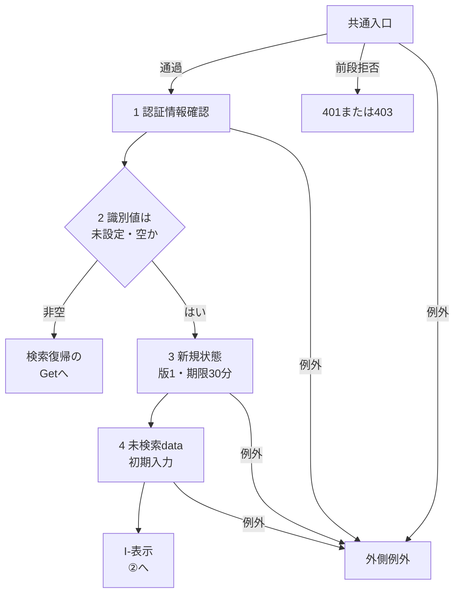

**② 通知・候補・表示**

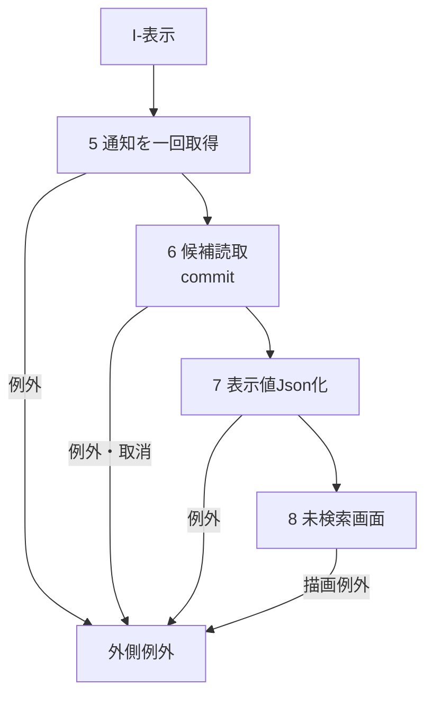

番号5～8は手順4～5の通知取得、SearchModel内の候補読取、Json変換、ビュー描画を分けたものである。

#### SQL・テーブル関連（ER図）

候補のm_code・m_code_category・m_classと学年コードの関連を使う。補足説明「テーブル関連」の候補SQL側に対応する。Entryと通知はメモリ辞書であり、DBの状態行を作成しない。

#### DB操作の詳細

補足説明「候補読取」の1コマンド・2結果セットをSnapshotトランザクションで読みcommitする。WHERE、値パラメータ、ページングはない。学生検索とDB更新は行わない。

#### 結果・例外時の扱い

局所catchはない。認証、状態作成、通知、候補、Json化、描画の例外は外側経路へ進む。Takeは候補読取より先なので、後続表示失敗時には通知が取得済みとなり得る。

初期状態はAppliedなし、ページ1、件数20、totalCount=NULLである。ビューはNULL件数を0としてページ数を最低1にするため、既定状態のページ表示は1／1となる。

根拠：`sources/Infrastructure/FlashMessageStore.cs:7-9`、`sources/Infrastructure/WebStudentCoordinator.cs:21-21`、`sources/Core/SqlServerStudentService.cs:197-216`、`sources/Views/Students/Search.cshtml:2-8`。

### 検索（POST /students/search）

#### 処理概要

編集中の条件を先頭ページから検索する。サービス結果の検査を通過した場合にApplied・LastResult・Revisionを更新する。正常0件と10,000件超過も成功側である。入力拒否時にStatusを設定した後も、候補取得と画面描画が続く。

#### 処理手順

1. 共通入口の認証・認可、POSTのCSRF検査、MVCバインド境界を通過する。アクション内の最初にFormGuardをawaitし、Criteria.StatusCodesキーがなければ空配列を代入する。
2. CurrentUserとContextId・TabでGetする。dataはPresent(entry, null)とする。この段階は局所catch外である。
3. ModelStateが不正なら422を設定し、coordinator・サービスを呼ばない。
4. 有効なら局所try内でcoordinator.Searchを呼ぶ。identity.Readの後、ToCriteriaで項目を移送する。ClassIdはIdParser.Optionalでlong?へ変換する。Pageは1、件数・並びは受信値である。
5. Useの最初のGet、Gate待機、待機後Get、版文字列比較、版上限検査を通過し、SearchAsyncを実行する。
6. EnsureSearchを通過した場合だけ、条件コピーをApplied、結果をLastResultへ設定し、Revisionを＋1する。サービスの正規化値をAppliedへ書き戻す処理はない。
7. Useの正常終了で期限を30分延長し、finallyでGateを解放する。
8. 局所try外のSearchModelで候補読取・Json化を行う。成功、ModelState不正、WebFault捕捉の各枝で、続いて受信pageSize・sortKey・sortDirectionを表示モデルへ代入し、ViewResultを返す。
9. RazorはdataのtotalCountが数値でなければcount=0とする。ページ数式は`Math.Max(1,(count+Model.PageSize-1)/Model.PageSize)`であり、Model.PageSize=0なら最低値補正より先に整数ゼロ除算が起こる。

バインド後のpageSize=0が到達した場合、ModelState・ID変換・状態検査等を通過したサービス経路では、ページ指定不正のArgumentExceptionをValidationFailedへ結果化し、EnsureSearchが422のWebFaultへ変換する。局所catchが422と項目エラーを設定しても、手順8で0を表示モデルへ再代入する。候補・Json化が完了すれば手順9でDivideByZeroExceptionとなる。ModelState不正でサービスを省略した枝も、0が残れば同じ二次例外へ進む。

根拠：`sources/Web/Controllers/StudentsController.cs:13-16`、`sources/Web/Controllers/StudentsController.cs:39-39`、`sources/Web/Inputs/StudentSearchInput.cs:19-22`、`sources/Infrastructure/WebStudentCoordinator.cs:7-9`、`sources/Infrastructure/WebStudentCoordinator.cs:20-21`、`sources/Core/SqlServerStudentService.cs:107-108`、`sources/Core/SqlServerStudentService.cs:169-170`、`sources/Views/Students/Search.cshtml:2-8`。

#### 処理フロー

①のS-実行は入力DTO、受信表示指定、取得Entry、初期未検索dataを②へ渡す。①のModelState不正枝と②の成功・WebFault捕捉枝はS-表示で③へ進む。成功枝だけがcoordinatorの返却dataを使い、不正・捕捉枝は初期未検索dataを維持する。StatusとModelStateも枝別の値を引き継ぐ。

**① フォーム・状態・ModelState**

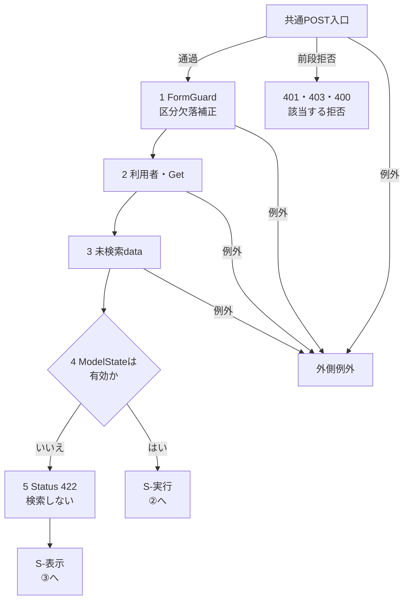

**② 検索・状態反映・局所catch**

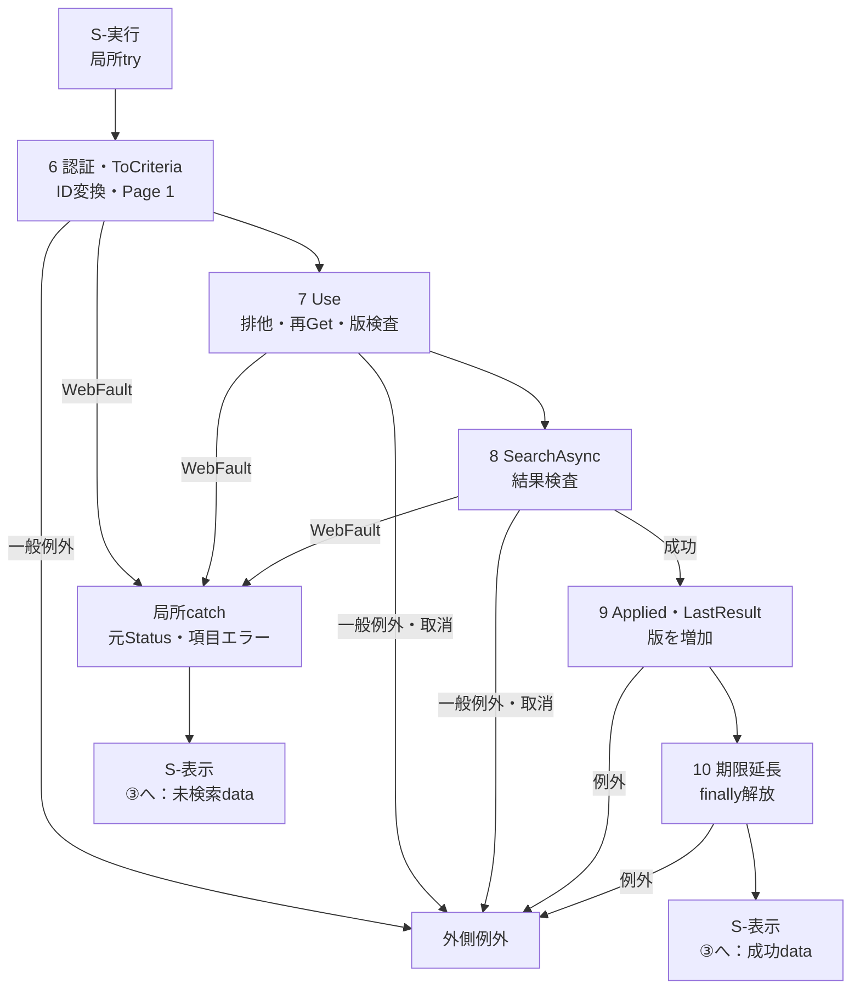

8はSearchAsyncとEnsureSearchを含む。SearchAsyncのcatch順と結果属性は補足説明「学生検索読取」に示す。UseのGate取得後の失敗はfinally解放を経て局所catchまたは外側へ進む。待機取得前の取消はUseのfinallyへ入らない。

**③ 再表示モデル・二次例外**

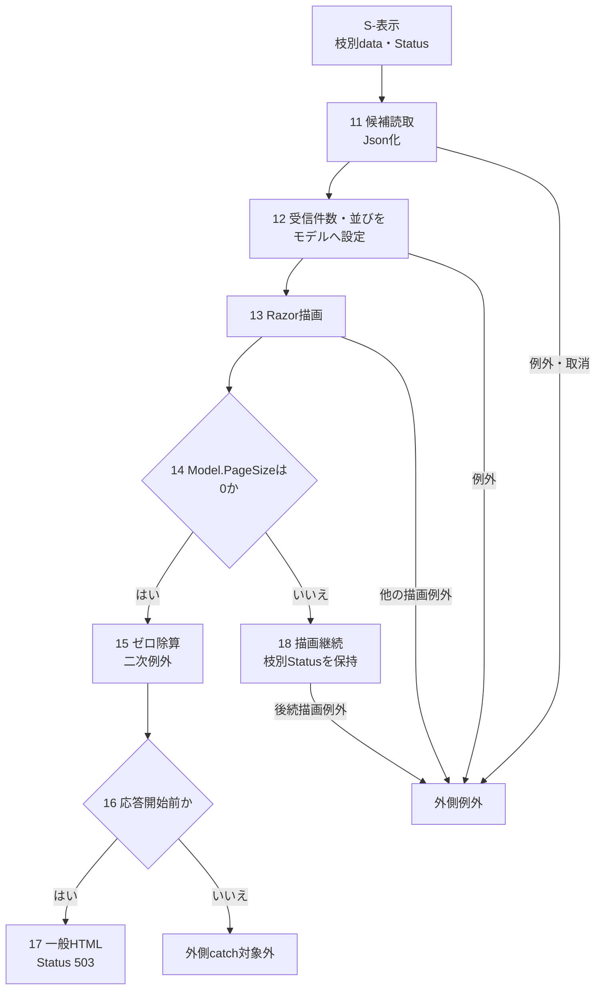

14～17は手順9の式評価と外側middlewareの境界である。先行422を二次例外後の最終応答へ固定しない。

#### SQL・テーブル関連（ER図）

学生検索はm_student、m_class、学年・在籍区分・都道府県のm_codeを読む。再表示候補にはm_code_categoryも使う。補足説明「テーブル関連」の検索SQL・候補SQL双方に対応する。

#### DB操作の詳細

補足説明「学生検索読取」の入力検査、存在確認、全WHERE、TOP(10001)、許可ORDER BY、OFFSET/FETCHを適用する。検索と再表示候補は別のSnapshotトランザクションである。DB更新はなく、検索commit後にApplied・LastResult・Revisionをメモリへ反映する。

PageSize=0は接続前検査で拒否するので学生検索SQLを伴わない。ただし検索アクションは再表示用SearchModelを続けるため、候補SQLは別に実行され得る。

根拠：`sources/Core/SqlServerStudentService.cs:105-170`、`sources/Web/Controllers/StudentsController.cs:15-16`、`sources/Web/Controllers/StudentsController.cs:39-39`。

#### 結果・例外時の扱い

coordinator.SearchのWebFaultだけを局所catchし、e.Status・e.Field・e.Messageを引き継ぐ。入力失敗422、版拒否409、所有者・Tab不一致403、ID変換422を一つの固定応答へまとめない。FormGuard、最初のGet、候補・Json化、ViewResult後の描画は同catch外である。

サービス検証失敗ではApplied・LastResult・Revisionを成功更新しないが、今回dataはPresent(entry, null)なので既存一覧を表示しない。既存Applied.Pageが2ならdata.pageは2、totalCount=NULLはビューで0となり、通常の正の表示件数では2／1と表示され得る。

pageSize=0によるDivideByZeroExceptionはWebFaultではない。応答開始前なら外側middlewareが一般例外として503とHTML案内を設定する。応答開始後は同catchの対象外である。buttonのdisabled判定はページ数式を省略しないため、422の検索画面再表示が完成すると保証しない。

検索成功によるメモリ反映後に候補・表示変換・描画が失敗しても、更新を戻す処理はない。

根拠：`sources/Web/Controllers/StudentsController.cs:14-16`、`sources/Infrastructure/SearchContextStore.cs:14-14`、`sources/Infrastructure/WebStudentCoordinator.cs:21-21`、`sources/Views/Students/Search.cshtml:2-8`、`sources/Infrastructure/WebHostSetup.cs:23-25`。

### 候補更新（POST /students/options）

#### 処理概要

編集中の所属条件に合うクラス候補を再描画する。一覧は既存LastResultを表示し、今回入力をAppliedへ移さない。

#### 処理手順

1. 共通POST入口を通過した後、FormGuard、区分キー欠落の空配列補正、CurrentUser・ContextId・TabによるGetを行う。
2. 未所属trueならSchoolYear・GradeCode・ClassIdをNULLにし、対応するCriteriaキーをModelStateからRemoveする。
3. 入力DTOとPresent(entry, entry.LastResult)をSearchModelへ渡し、候補・Json化を行う。通知は「条件を変更しました。検索を押すと一覧に反映します。」とする。
4. 非空ClassIdについて、候補のID文字列、指定年度、非空学年に一致するクラスがなければClassIdをNULLとし、そのModelStateをRemoveする。通知を「上位条件に合わないクラスを解除しました。」へ変える。
5. Razorで上位条件によるクラス候補絞込みと未所属時の3select無効化を行い、Searchビューを返す。

手順4はIdParserと学年NFKC正規化を呼ばず、入力DTO値と候補値を直接照合する。ID比較は候補ClassId.ToString()と入力ClassIdの文字列一致である。

根拠：`sources/Web/Controllers/StudentsController.cs:22-22`、`sources/Web/Controllers/StudentsController.cs:39-39`、`sources/Views/Students/Search.cshtml:5-5`。

#### 処理フロー

①のO-候補は、Entry、所属解除後または受信時のDTO、現在のModelStateを②へ渡す。②はLastResult由来のdataを保持し、編集中入力を検索条件として適用しない。

**① フォーム・状態・所属解除**

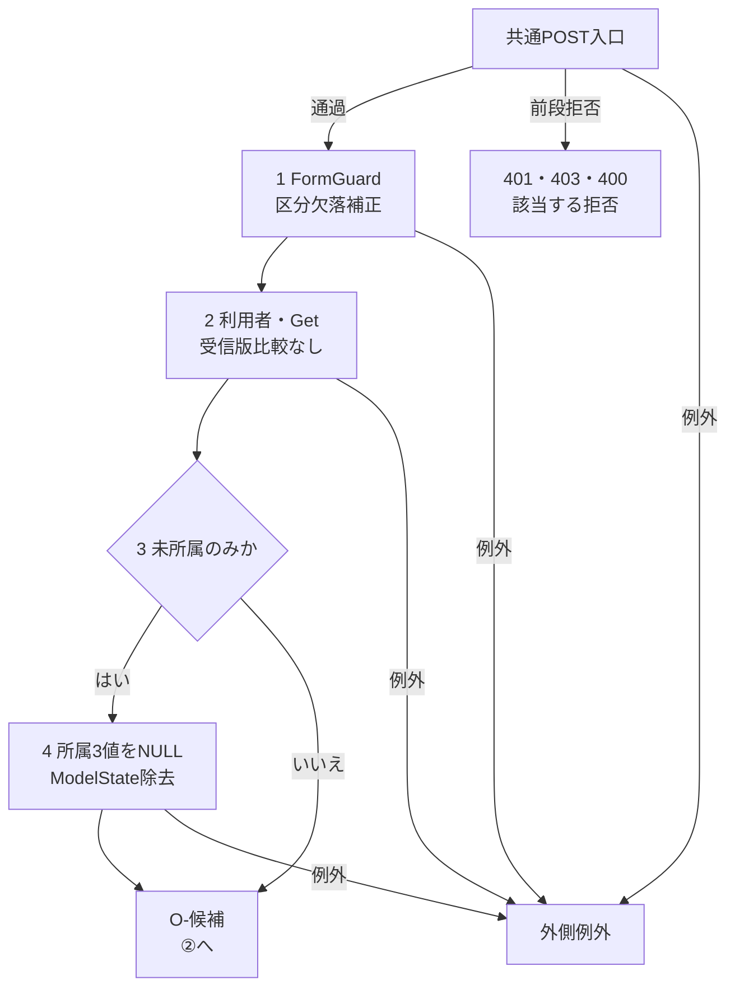

**② 候補・選択保持・表示**

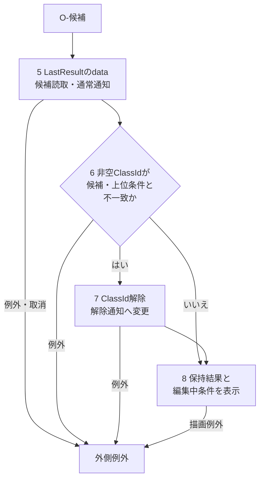

6の上位条件は、年度未指定なら年度比較を省き、学年NULL・空なら学年比較を省く。完全な比較条件は手順4に対応する。

#### SQL・テーブル関連（ER図）

補足説明「テーブル関連」の候補SQL側を使い、m_code、m_code_category、m_classを読む。表示学生行はメモリのLastResultから取得する。

#### DB操作の詳細

LookupAsync(false)の2結果セットを読みcommitする。停止・期間外を除外しない。学生の再検索・更新はない。選択保持・解除は今回DTOとModelStateの変更である。

#### 結果・例外時の扱い

ModelState.IsValid、ToCriteria、IdParser、SearchAsync、Useを呼ばない。受信ContextRevisionの比較、Gate、版増分、期限延長、候補await後のGetもない。件数・並びはAppliedまたは既定値をモデルへ入れ、検索イベントのように受信引数で上書きしない。

局所catchはない。状態、候補、Json化、描画の失敗は外側へ進む。StatusCodesがNULLとしてDTOへ届けばRazorのContainsで一般例外となり得るが、HTTP受信からそのNULLへ至るバインド条件は別の未確認境界である。

根拠：`sources/Web/Controllers/StudentsController.cs:22-22`、`sources/Web/Controllers/StudentsController.cs:39-39`、`sources/Infrastructure/WebStudentCoordinator.cs:21-21`、`sources/Views/Students/Search.cshtml:5-5`。

### ページ・並び順変更（POST /students/page）

#### 処理概要

Appliedを再利用して一覧を読み直す。条件フォームで編集中の値は受信しない。件数・並び項目・方向のいずれかが変われば先頭ページへ戻る。

#### 処理手順

1. 共通POST入口の後、FormGuard、CurrentUser、ContextId・TabによるGetを行う。最初のGetは局所try外である。
2. try内のcoordinator.Pageでidentity.ReadとUseを行い、待機後状態再確認・版照合を通す。AppliedがNULLなら409「先に検索してください。」を送出する。
3. Appliedをコピーする。件数・キー・方向のいずれかが変わればPage=1、それ以外は受信Pageを設定する。件数・並びを受信値へ変更する。
4. SearchAsyncとEnsureSearchを行う。上限超過ではなく、条件Pageが取得件数の最終ページを超えるなら条件Pageも最終ページへ変更し、再度SearchAsync・EnsureSearchを行う。
5. 必要な検索がすべて成功したらAppliedコピー・LastResult・Revision＋1を反映する。Useは期限延長後、finallyでGateを解放する。
6. 同じtry内でFrom(Applied)、SearchModelの候補・Json化、ViewResult返却を行う。
7. try内のWebFaultを捕捉した場合は元のStatusと項目エラーを設定する。catch内でFrom(Appliedまたは既定条件)とPresent(entry, null)を用い、候補を再取得して未検索一覧を返す。

根拠：`sources/Web/Controllers/StudentsController.cs:18-19`、`sources/Web/Controllers/StudentsController.cs:39-40`、`sources/Infrastructure/WebStudentCoordinator.cs:11-12`。

#### 処理フロー

①のP-検索はEntry、条件コピー、取得中Gateを②へ渡す。②のP-成功は更新済みEntryと成功dataを③へ渡す。P-捕捉は元のWebFaultを保持し、Use内でGate取得済みならfinally解放後に③へ進む。

**① 入口・適用条件準備**

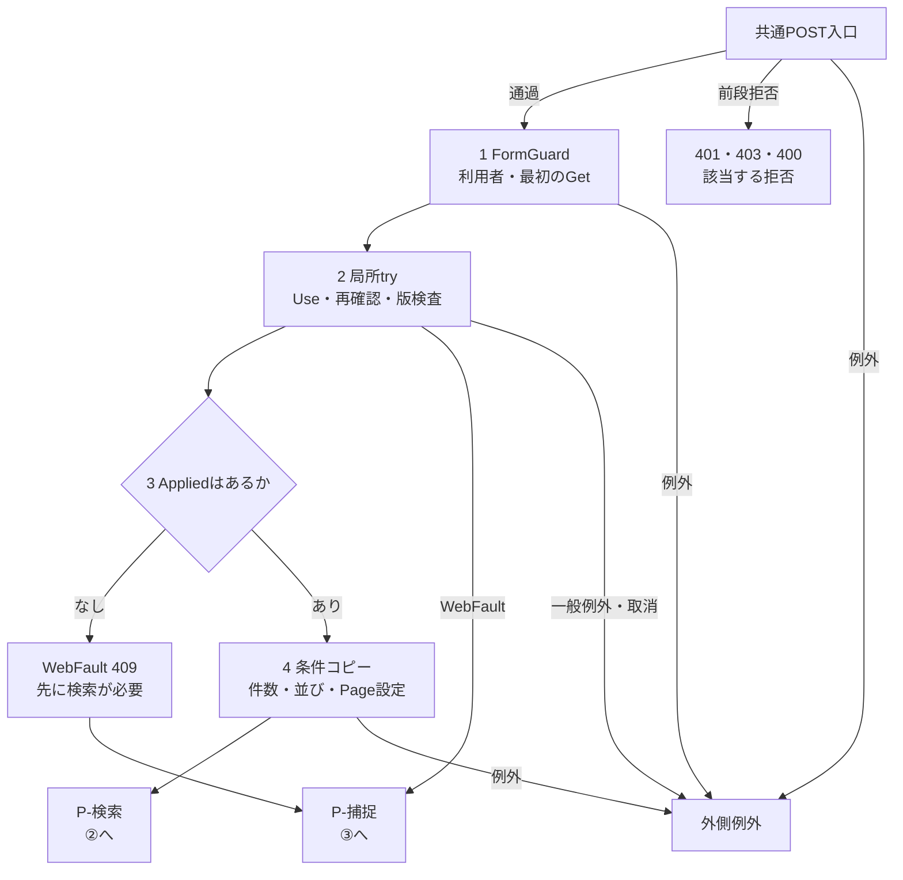

**② 再検索・ページ補正・状態反映**

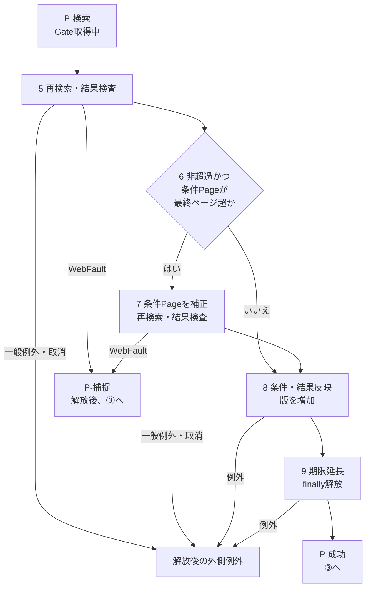

6は`!result.LimitExceeded`かつ`criteria.Page > Math.Max(1,(result.Count+criteria.PageSize-1)/criteria.PageSize)`である。7は同じ最終ページ式を条件Pageへ代入して再検索する。サービス単体のSQL用page補正とは別の処理である。

**③ 成功表示・局所catch内再表示**

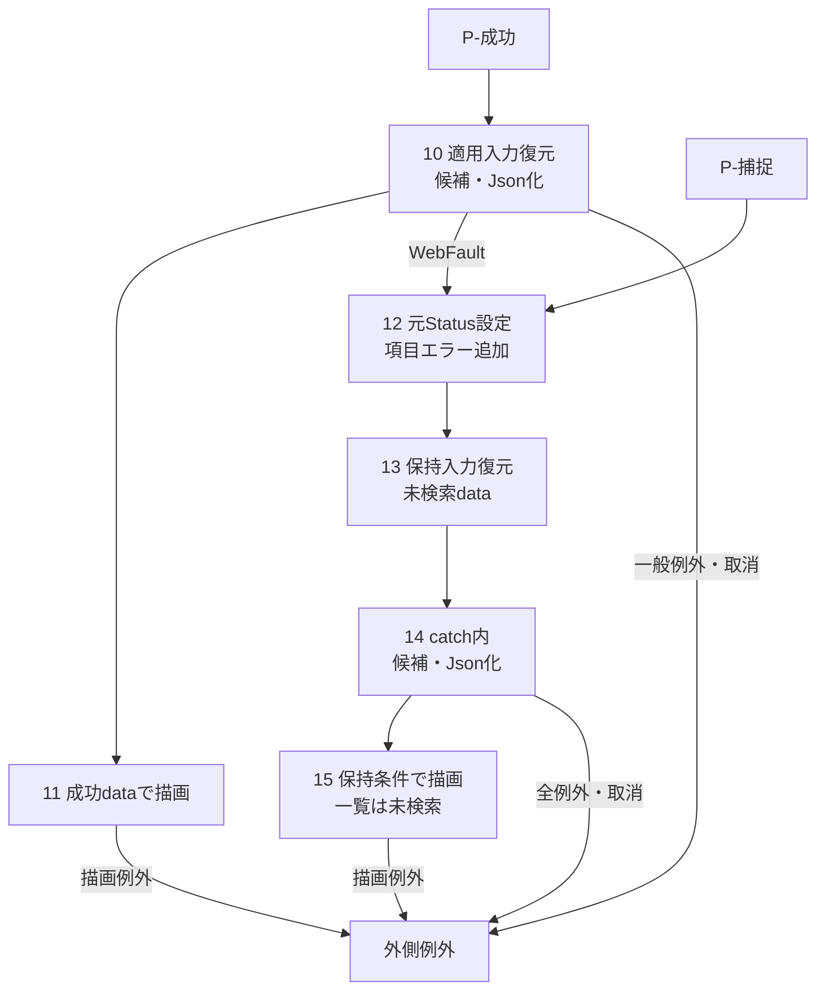

14での失敗は同じcatchに再捕捉されない。成功dataと未検索dataを合流時に置き換えず、それぞれのStatusと条件を保つ。

#### SQL・テーブル関連（ER図）

補足説明「テーブル関連」の検索SQL・候補SQL双方を使う。学生と所属クラス、分類別コードをJOINして一覧を読み、候補取得ではコード分類も読む。

#### DB操作の詳細

Appliedの全検索条件を再使用する。ページ補正による2回目検索は別のSnapshotトランザクションであり、その後の候補読取とも別である。DB更新はなく、成功後に検索Entryを更新する。

#### 結果・例外時の扱い

ModelState.IsValidを停止条件にしない。バインド済み値をサービスが検査するが、変換失敗した原HTTP値がそのまま検査される保証ではない。局所catchはcoordinator.Pageと成功側SearchModelのWebFaultを扱い、元のStatusを保つ。

最初のGet・FormGuard、catch内再表示、ViewResult後の描画は局所catch外である。検索状態更新後の成功側SearchModelがWebFaultを送出した場合、更新済みAppliedを復元しながら一覧は未検索となる。表示失敗だけから状態未更新とは判断しない。

Present(entry, null)はApplied.Pageを保持するため、ページ2の条件では通常2／1となり得る。再表示モデルへ受信PageSizeを上書きしないので、要求の0がサービス検証で拒否されても、検索イベントのようにその0を再代入する経路ではない。

根拠：`sources/Web/Controllers/StudentsController.cs:18-19`、`sources/Web/Controllers/StudentsController.cs:39-39`、`sources/Infrastructure/WebStudentCoordinator.cs:12-21`、`sources/Views/Students/Search.cshtml:2-8`。

### クリア（POST /students/clear）

#### 処理概要

現在Entryの適用条件と保持結果を解除し、初期入力へ戻す。Entry.IdとTabは維持する。

#### 処理手順

1. 共通POST入口の後、FormGuardをawaitする。
2. coordinator.Clearでidentity.Read、UseのGet・Gate待機・待機後Get・版照合・版上限検査を行う。
3. AppliedとLastResultをNULL、Revisionを＋1とし、Present(entry, null)を作る。
4. Use正常終了で期限を延長し、finallyでGateを解放する。
5. ModelState.Clearの後、CurrentUser・ContextId・Tabで再Getする。
6. 新しいStudentSearchInputと候補・Json化により、区分01・02、20件、studentNo昇順、ページ1の未検索画面を返す。

根拠：`sources/Web/Controllers/StudentsController.cs:21-21`、`sources/Web/Controllers/StudentsController.cs:39-39`、`sources/Infrastructure/WebStudentCoordinator.cs:15-15`。

#### 処理フロー

①のC-表示は、解除後の未検索dataと要求識別値を②へ渡す。②の再Getは解除後の独立した検査であり、失敗しても解除を戻さない。

**① 状態確認・解除**

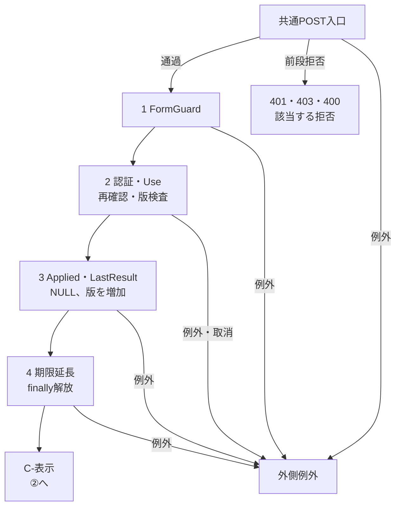

**② 入力初期化・再表示**

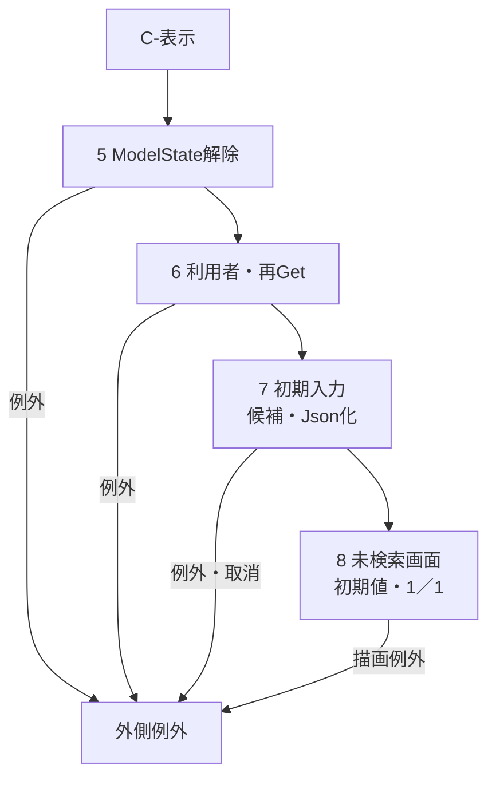

#### SQL・テーブル関連（ER図）

解除対象はSearchContextStoreのメモリである。再表示は補足説明「テーブル関連」の候補SQL側、m_code・m_code_category・m_classを読む。

#### DB操作の詳細

検索条件を保存したDB行を削除する処理はない。学生検索・更新を行わず、再表示候補の読取とcommitだけを行う。

#### 結果・例外時の扱い

ModelState.IsValidと局所catchはない。状態拒否、待機取消、解除後Get、候補、表示の失敗は外側経路である。解除後の表示失敗によってApplied・LastResult・Revisionを戻さない。

正常再表示はAppliedなしとなり、PresentとSearchModelのページ・件数が既定値を使うため、ページ表示は1／1となる。

根拠：`sources/Infrastructure/SearchContextStore.cs:14-14`、`sources/Infrastructure/WebStudentCoordinator.cs:15-21`、`sources/Core/SqlServerStudentService.cs:197-216`、`sources/Views/Students/Search.cshtml:2-8`。

### 検索復帰（GET /students?contextId=…&contextRevision=…）

#### 処理概要

非空contextIdのGETはAppliedによる再検索入口であり、LastResultの単純表示ではない。編集・参照の戻るリンクと、保存・論理削除のSaved後303が接続する。

#### 処理手順

1. 共通入口とidentity.Readの後、ContextIdでGetする。Tabは渡さない。Indexは一旦Present(entry, null)を作る。
2. ContextId=Entry.Id、ContextRevision=受信contextRevisionとしてContextRequestを作り、版NULLは空文字とする。
3. Resumeでidentity.ReadとUseを行い、待機後Get、版文字列比較、版上限検査を通す。
4. AppliedがNULLなら未検索dataを返す。Revisionを増やさず、Use正常終了による期限延長を行う。
5. Appliedありならその条件でSearchAsync・EnsureSearchを行い、LastResultとRevision＋1を反映する。AppliedのコピーとPage補正は行わない。
6. Gate解放後、From(Applied)または初期DTO、Flash.Take、候補・Json化によりSearchビューを返す。手順1の初期dataはResumeの返却値へ置き換わる。

根拠：`sources/Web/Controllers/StudentsController.cs:8-11`、`sources/Web/Controllers/StudentsController.cs:39-40`、`sources/Infrastructure/WebStudentCoordinator.cs:14-14`。

#### 処理フロー

①のR-再開はEntry、受信版から作ったContextRequest、Tabなしを②へ渡す。②のR-表示は枝別dataとRevisionを③へ渡す。Appliedなしの枝へ版増分を加えず、ありの枝の更新済みLastResultと版を維持する。

**① 復帰先・要求版準備**

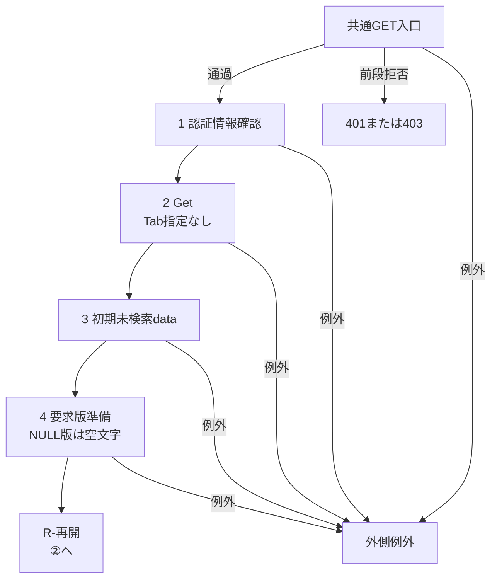

初期表示の非空枝から継続する場合、認証情報確認済みとして2へ進む。

**② 再検索・未検索の枝別反映**

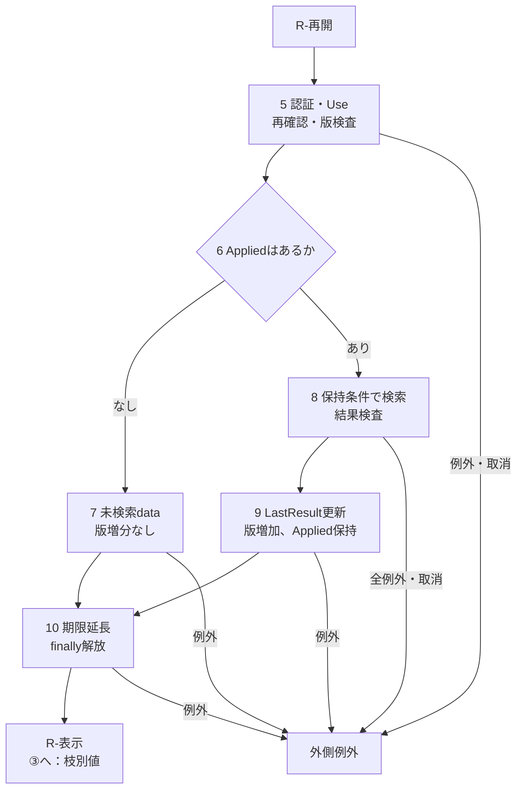

**③ 入力復元・通知・表示**

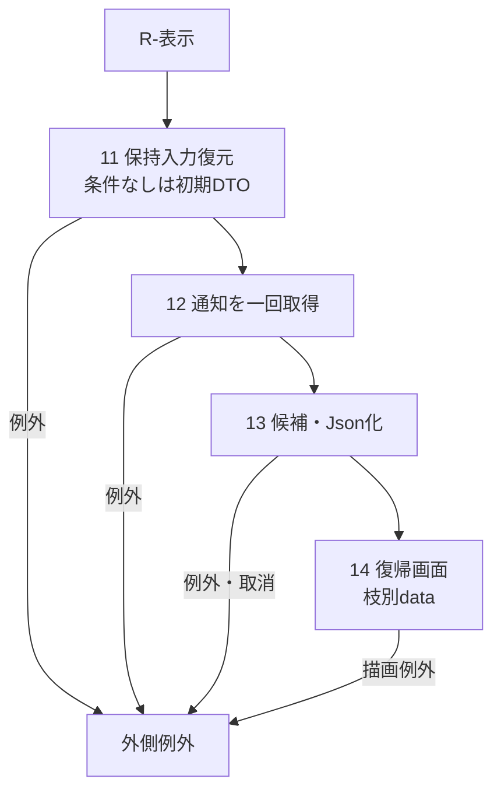

#### SQL・テーブル関連（ER図）

Appliedありでは補足説明「テーブル関連」の検索SQL・候補SQL双方、Appliedなしでは候補SQLだけを使う。反映先はメモリのLastResult・Revisionである。

#### DB操作の詳細

Appliedありなら共通検索で件数と一覧を再読取し、その後に別Snapshotトランザクションで候補を読む。Appliedなしでは候補のみである。学生DBは更新しない。

#### 結果・例外時の扱い

局所catchはない。版未指定・不一致・状態失効は409、所有者・セッション不一致は403。Tabなしでも利用者と版の検査は行う。新規Entryへの303復帰ではAppliedなしなので学生再検索はない。

サービスはSQL用pageだけを内部補正する。件数減少でApplied.Pageが最終ページを超えた場合、取得ページとPresentの表示ページが異なり得る。pageイベントの条件Page補正をResumeにもあるものとして扱わない。

通知Takeは状態・版照合と必要な再検索の後である。ここまでの拒否では通知未取得、Take後の候補・表示失敗では取得済みとなり得る。

根拠：`sources/Infrastructure/SearchContextStore.cs:13-14`、`sources/Core/SqlServerStudentService.cs:160-168`、`sources/Infrastructure/FlashMessageStore.cs:9-9`。

## 補足説明

### 共通入口・入力・認証

HTTPフォーム値、MVCバインド後の引数とModelState、SearchCriteria、サービス内の正規化値は別の段階である。MVCは非nullable参照型の暗黙Requiredを抑止するため、string・string[]の注釈だけで受信NULL排除を保証しない。検索はModelStateを停止条件にするが、page・options・clearは同じ判定を設けない。

Kestrelの要求本文上限、FormOptionsのMultipartBodyLengthLimit・ValueLengthLimitは各65536、ValueCountLimitは128、MVC検証エラー上限は100である。これらは項目の業務上限とは別である。各POSTはAutoValidateAntiforgeryTokenAttributeを経る。AntiforgeryResultFilterの独自JSON化は/api配下だけで、/studentsの失敗はMVCのAntiforgeryValidationFailedResult経路となる。

根拠：`sources/Infrastructure/WebHostSetup.cs:15-18`、`sources/Infrastructure/AntiforgeryResultFilter.cs:7-8`、`sources/Web/Controllers/StudentsController.cs:13-22`。

FormGuardは各POSTアクション内の最初の処理である。検索・候補更新はStudentSearchInputの公開プロパティへCriteria.を付けた名前と、ContextId・ContextRevision・TabId・PageSize・SortKey・SortDirectionを許可する。pageはPageRequestのプロパティとTabId、clearはContextRequestのプロパティとTabIdを許可する。全フォームで__RequestVerificationTokenと__Invariantも許可する。

許可名はOrdinalIgnoreCaseで照合する。未知項目、不正な__Invariant値、許容対象以外の同名複数値はWebFault 400。複数値を許すのは__Invariantと末尾StatusCodes・UnassignedOnlyの項目である。__Invariant専用判定は完全一致であり、許可名照合とは比較方法が異なる。許可項目の欠落を必須エラーにする処理はない。

根拠：`sources/Web/Controllers/StudentsController.cs:13-22`、`sources/Web/Controllers/StudentsController.cs:41-41`、`sources/Web/Inputs/StudentSearchInput.cs:7-29`。

CurrentUserは認証済みPrincipalからNameIdentifier、login_session、Roleを読む。未認証、識別値・セッションの空白、識別値64Unicodeスカラー超、セッション64コード単位超、Enum.TryParse<Role>失敗は401である。Enum.IsDefinedはなく、権限条件はViewer・Administratorとの一致で適用する。サービスもPrincipalを原入力・trim後各64スカラーの必須Textで再検査し、空セッションをUnauthorizedAccessExceptionにする。webTokens=trueではGUID形式検査をしない。

根拠：`sources/Infrastructure/RequestIdentity.cs:6-16`、`sources/Core/SqlServerStudentService.cs:46-51`、`sources/Infrastructure/WebHostSetup.cs:19-19`。

**① 前段拒否とアクション到達**

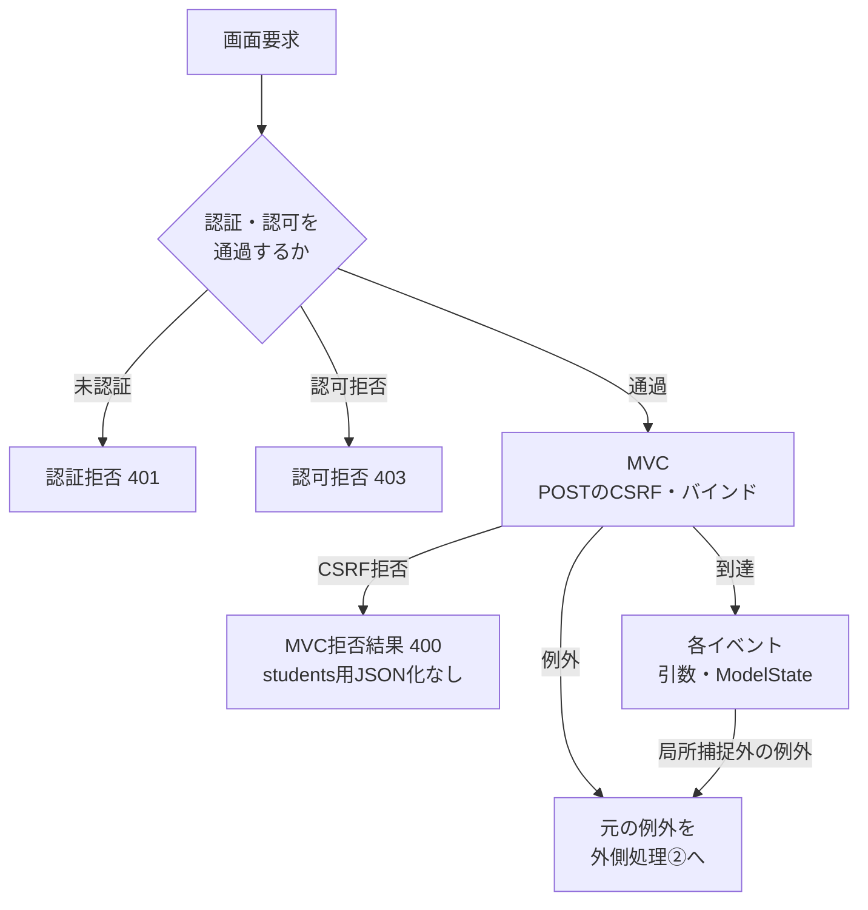

図はCSRFとバインドのフレームワーク内部順序を固定しない。Cookie認証の401・403は/students用JSONを出力しない。前段の拒否結果を一般例外503へまとめない。

**② 外側middlewareの捕捉範囲**

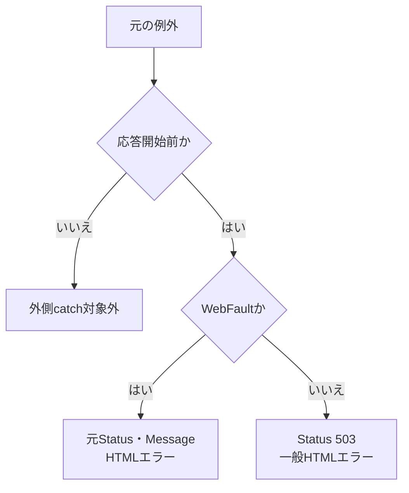

middlewareは共通ヘッダーを設定し、nextをawaitする。Response.HasStartedがfalseの場合だけExceptionを捕捉する。WebFaultは元のStatus・Message、それ以外は503と「処理結果を確認できません。検索で確認してください。」をHTMLへ出力し、検索画面を開くリンクを含む。MessageはHtmlEncodeする。取消が局所で結果化されない場合も、応答開始前なら一般例外側へ到達し得る。

検索再表示のDivideByZeroExceptionも一般例外側であり、先行422があってもこのcatchへ到達すれば503へ設定し直す。応答開始後は同catchによる変換を行わない。

根拠：`sources/Infrastructure/WebHostSetup.cs:14-16`、`sources/Infrastructure/WebHostSetup.cs:21-25`、`sources/Views/Students/Search.cshtml:8-8`。

### HTTP共通設定

| 対象 | 設定 | 登録値・意味 |
| --- | --- | --- |
| Cookie認証 | Scheme | CookieAuthenticationDefaults.AuthenticationScheme |
| 認証Cookie | Name | `__Host-StudentManagement` |
| 認証Cookie | SecurePolicy・HttpOnly・SameSite | Always・true・Strict |
| Cookie認証 | ExpireTimeSpan・SlidingExpiration | 30分・true。検索Entry期限とは独立 |
| Cookie認証 | ログイン誘導・アクセス拒否 | Status 401・403。/api配下だけ独自JSON、/studentsではTask.CompletedTask |
| Antiforgery | HeaderName | `RequestVerificationToken`。フォーム名`__RequestVerificationToken`とは別 |
| CSRF Cookie | Name | `__Host-StudentManagement-CSRF` |
| CSRF Cookie | SecurePolicy・HttpOnly・SameSite | Always・true・Strict |
| 共通応答 | Cache-Control | `no-store` |
| 共通応答 | X-Content-Type-Options | `nosniff` |
| 共通応答 | Referrer-Policy | `no-referrer` |
| CSP | default-src・script-src・style-src・img-src | 各`'self'` |
| CSP | frame-ancestors | `'none'` |
| CSP | base-uri・form-action | 各`'self'` |

CSP設定文字列は`default-src 'self'; script-src 'self'; style-src 'self'; img-src 'self'; frame-ancestors 'none'; base-uri 'self'; form-action 'self'`である。共通ヘッダー・例外処理の後にUseHttpsRedirection→UseStaticFiles→UseRouting→UseAuthentication→UseAuthorizationを登録し、ProgramでMapControllersを行う。静的ファイル処理は認証・認可middlewareより前にあり、Authorize付き画面と同じ認可条件として説明しない。

これらはアプリ登録値であり、DB権限やSQL接続暗号化とは別の設定である。認証Cookieの本番発行元を定義するものでもない。静的画面投影の埋込みCSSは文書単独の表示用で、実アプリの同一オリジンCSS読込とは区別する。

根拠：`sources/Infrastructure/WebHostSetup.cs:14-16`、`sources/Infrastructure/WebHostSetup.cs:21-25`、`sources/Program.cs:5-8`、`sources/Views/Shared/_Layout.cshtml:1-1`。

### 検索状態の保持契約

| Entry属性 | 型・初期値 | 用途 |
| --- | --- | --- |
| Id | string、乱数32バイトの小文字16進文字列 | 辞書キー・画面間引継ぎ |
| Owner・Session | string、CurrentUserのPrincipal・SessionId | 利用者と認証セッションの照合 |
| Tab | string、作成引数NULL・空なら乱数生成 | 非空Tabを渡した要求の画面照合 |
| Expires | DateTimeOffset、作成UTC＋30分 | 利用期限 |
| Revision | long、1 | 文字列版照合と更新管理 |
| Applied | SearchCriteria?、NULL | 適用済み条件 |
| LastResult | SearchResult?、NULL | 前回成功結果 |
| Gate | SemaphoreSlim(1,1) | 同じEntryに対するUseの排他 |

Createは期限切れEntryを辞書から除去して新規登録する。CopyはJSON serialize／deserializeによるメモリコピーである。GetはContextIdを加工せず、NULLを辞書呼出し前に、空・未知キーを検索不成立で、期限切れをExpires＜現在UTCで拒否する。期限失効系は409／W-SRC-002。Owner・Session不一致と非空Tab不一致は403である。

**① Getの条件順序**

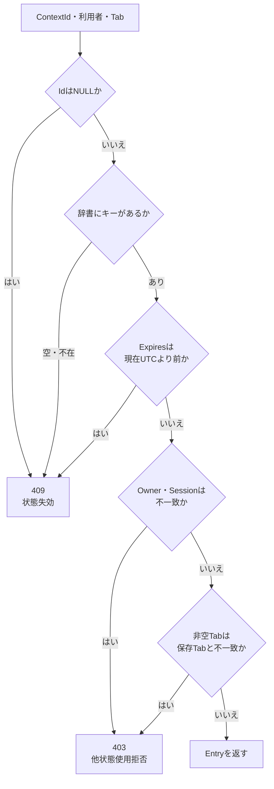

Useは、最初のGet、Gate.WaitAsync(ct)、取得後Get、受信版とRevision.ToString(InvariantCulture)の完全一致、long.MaxValue拒否、operationのawait、正常終了時の期限延長、finally解放の順である。数値同値では比較しない。

**② 排他取得と再確認**

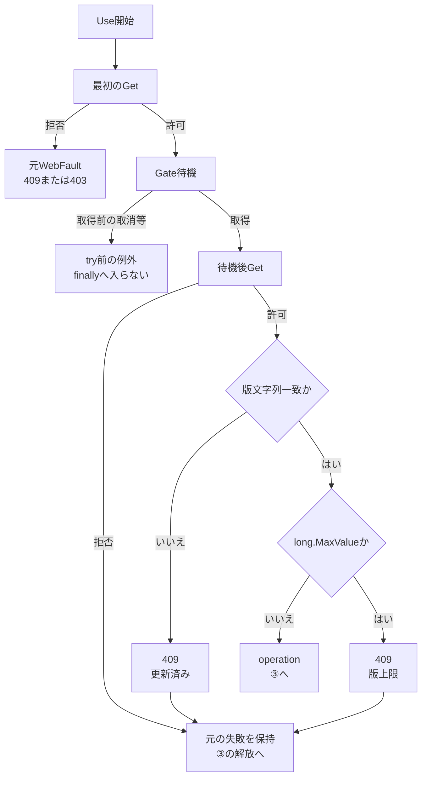

**③ operationとfinally**

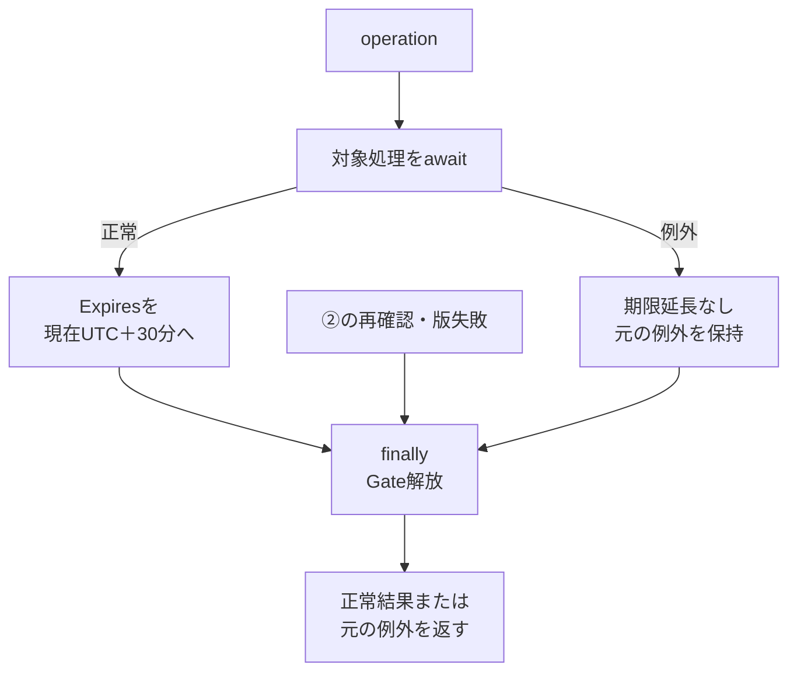

サービスのDB読取await後から状態反映直前までに追加Getはない。候補更新はUseを通らず、版比較・排他・期限延長・候補await後のGetも行わない。Getの期限切れ拒否自体は辞書を削除せず、除去はCreate時の走査である。期限到達時の即時消去タイマーとして説明しない。

根拠：`sources/Infrastructure/SearchContextStore.cs:9-15`、`sources/Infrastructure/WebStudentCoordinator.cs:7-15`、`sources/Web/Controllers/StudentsController.cs:22-22`。

### 候補読取

SearchModelはLookupAsync(false)を呼ぶ。User確認、Open、Snapshot開始後に、次の1コマンド・2結果セットを読み、commitしてLookupSetを返す。

```sql
SELECT c.category_id,c.code_value,c.code_name,c.display_order,
       CONVERT(bit,CASE WHEN c.is_active=1 AND k.is_active=1 THEN 1 ELSE 0 END) is_active,
       c.valid_from,c.valid_to,c.is_protected
FROM dbo.m_code c
JOIN dbo.m_code_category k ON k.category_id=c.category_id
ORDER BY c.category_id,c.display_order,c.code_value;

SELECT c.*, CONVERT(int,0) occupied
FROM dbo.m_class c
LEFT JOIN dbo.m_code g
  ON g.category_id=c.grade_category AND g.code_value=c.grade_code
ORDER BY c.school_year DESC,g.display_order,c.display_order,c.class_code,c.class_id;
```

第1結果はCodeEntryへ分類・値・名称・表示順、コードと分類双方の合成有効状態、開始日・NULL可能な終了日、保護情報を格納する。第2結果はSchoolClassへID・年度・学年・コード・名称・期間・NULL可能な定員・人数・停止状態を格納する。false時のOccupiedは0固定で、所属学生数を集計しない。検索画面は人数・定員を表示しない。

WHERE、パラメータ、ページング、取得上限はない。停止・期間外も取得する。年度は全クラス年度のDistinct・降順。学年・区分・都道府県は分類ごとのCodeValue／CodeNameを使う。クラスだけ編集中年度・学年で絞り、上位条件未指定ならその条件では絞らない。停止クラスに「（停止）」を付けるが、期間外注記と停止コードのdisabledは検索Razorにない。

読取、NextResult、commitへ取消トークンを渡す。LookupAsync内には取消・DB例外を結果DTOへ変換するcatchがない。

根拠：`sources/Core/SqlServerStudentService.cs:197-216`、`sources/Core/Contracts.cs:61-65`、`sources/Views/Students/Search.cshtml:5-5`、`sources/Web/Controllers/StudentsController.cs:22-22`、`sources/Web/Controllers/StudentsController.cs:39-39`。

### 学生検索読取

SearchAsyncはtry前にUser、開始時刻now、日本時間業務日dayを取得する。try内は次の順序で処理する。

1. Page≧1、PageSizeが20・50・100、方向asc・descを検査し、SortKeyを許可SQL列へ変換する。不正はE-COM-003。
2. 年度1900～9998と正のClassIdを検査する。不正はE-DATE-003。未所属と非NULL所属指定の併用はE-SRC-001。
3. 区分配列の長さ4以下、Ordinal重複なし、値01～04を検査する。不正はE-STU-009。NULL配列はLength参照で一般例外となる。
4. 学籍番号、氏名・NameKey、カナ・空白除去キー、電話、学年、都道府県の順に正規化する。
5. 入学日開始・終了をParseIsoで変換し、開始＞終了をE-STU-006で拒否する。片側指定と同日指定は許可する。
6. Open・Snapshot開始後、指定学年と都道府県をCodeExistsで確認する。分類・値のCOUNT_BIG=1だけを判定し、不存在はE-STU-009。学年不成立時は短絡により都道府県確認へ進まない。在籍区分は固定許可値検査でありCodeExistsを呼ばない。
7. 指定年度のクラスCOUNT_BIGが0ならE-STU-014。指定クラスの不存在、指定年度・正規化学年との不一致もE-STU-014。
8. 常時is_deleted=0と指定条件をANDで構築し、TOP(10001)の件数を取得する。超過時は一覧を読まずcommitする。
9. 通常件数は最終ページを最低1としてSQL用pageだけ補正し、一覧取得とcommit後にNoChangeを返す。

根拠：`sources/Core/SqlServerStudentService.cs:103-170`、`sources/Core/SqlServerStudentService.cs:218-222`。

| 条件 | 追加WHERE | パラメータ・SqlDbType／サイズ | 値 |
| --- | --- | --- | --- |
| 常時 | `s.is_deleted=0` | なし | 論理削除を除外 |
| 学籍番号 | `s.student_no LIKE @no ESCAPE '!'` | `@no VarChar/31` | エスケープ済み番号＋% |
| 氏名 | `s.name_key LIKE @name ESCAPE '!'` | `@name NVarChar/642` | %＋エスケープ済みNameKey＋% |
| カナ | `s.kana_key LIKE @kana ESCAPE '!'` | `@kana NVarChar/74` | %＋エスケープ済み空白除去キー＋% |
| 年度 | `c.school_year=@year` | `@year SmallInt`、サイズなし | 指定年度 |
| 学年 | `c.grade_code=@grade` | `@grade VarChar/2` | 正規化学年 |
| クラス | `s.class_id=@class` | `@class BigInt`、サイズなし | 指定ID |
| 未所属 | `s.class_id IS NULL` | なし | true時 |
| 都道府県 | `s.prefecture_code=@prefecture` | `@prefecture VarChar/2` | 正規化コード |
| 電話 | `(s.phone_number=@phone OR s.emergency_phone_number=@phone)` | `@phone VarChar/16` | 正規化電話 |
| 入学日開始 | `s.admission_date>=@from` | `@from Date`、サイズなし | 開始日 |
| 入学日終了 | `s.admission_date<=@to` | `@to Date`、サイズなし | 終了日 |
| 在籍区分 | `s.enrollment_status_code IN (@status0,...)` | 各`@statusN VarChar/2` | 非空配列の許可値 |

NULL条件は述語・パラメータを作らず、空区分配列も条件を追加しない。LIKEは!、%、_、[を!でエスケープした後に検索用%を付ける。空白だけの非空カナは正規化後の空キーが非NULLなので、LIKE '%%'相当を追加する。

存在確認のCodeExistsはm_codeのcategory_id・code_value一致で、@category VarChar/24と@value VarChar/10を使う。年度確認はm_class.school_year=@year、@year SmallInt。クラス確認はclass_id=@id、@id BigIntで、school_year・grade_codeを取得する。停止・期間を追加拒否条件としない。

Paramはsize=0ならSizeを設定せず、NULLはDBNull.Valueへ変換する。DateOnlyは00:00のDateTimeへ変換する。検索のNULL条件はDBNull化より前に条件追加を省く。

根拠：`sources/Core/SqlServerStudentService.cs:67-73`、`sources/Core/SqlServerStudentService.cs:125-164`、`sources/Core/SqlServerStudentService.cs:218-222`、`sources/Core/StudentNormalizer.cs:161-161`。

件数は次のSQLへ上表の全WHEREを付ける。TOPは真の総件数を求めず、超過判定に必要な10001までを数える。

```sql
SELECT COUNT_BIG(*)
FROM (
  SELECT TOP (10001) s.student_id
  FROM dbo.m_student s
  LEFT JOIN dbo.m_class c ON c.class_id=s.class_id
  /* 指定条件のWHEREをANDで追加 */
) limited;
```

一覧は次の取得列・JOINへ同じWHERE、許可ORDER BY、OFFSET/FETCHを付ける。コメントは動的構築箇所の対応表示である。

```sql
SELECT s.student_id,s.student_no,s.student_name,s.student_name_kana,s.birth_date,
       c.school_year,c.class_code,c.class_name,g.code_name grade_name,e.code_name status_name,
       p.code_name prefecture_name,s.address_line1,s.phone_number,
       s.admission_date,s.updated_at,s.row_version
FROM dbo.m_student s
LEFT JOIN dbo.m_class c ON c.class_id=s.class_id
LEFT JOIN dbo.m_code g ON g.category_id=c.grade_category AND g.code_value=c.grade_code
LEFT JOIN dbo.m_code e ON e.category_id=s.enrollment_category AND e.code_value=s.enrollment_status_code
LEFT JOIN dbo.m_code p ON p.category_id=s.prefecture_category AND p.code_value=s.prefecture_code
/* 指定条件のWHEREをANDで追加 */
/* ORDER BY 許可列 許可方向, s.student_id ASC */
OFFSET @offset ROWS FETCH NEXT @size ROWS ONLY;
```

SortKeyはstudentNo→s.student_no、name→s.name_key、admissionDate→s.admission_date、updatedAt→s.updated_atだけを許可する。方向asc・desc、同順位student_id ASC。SQL用pageはMin(要求Page, 最終Page)。@offsetはchecked((page−1)×PageSize)のInt、@sizeはIntで最大PageSize行を取得する。SearchCriteria.Page自体を書き換えない。

根拠：`sources/Core/SqlServerStudentService.cs:77-90`、`sources/Core/SqlServerStudentService.cs:108-108`、`sources/Core/SqlServerStudentService.cs:156-168`。

接続はEncrypt=Mandatory、TrustServerCertificate=false。OpenAsync後、現在DBのsnapshot_isolation_stateを診断し、1以外はInvalidOperationExceptionとなる。Open内失敗では接続Dispose後に再送出する。Command helperのtimeoutは30秒で、診断コマンドには原文で明示timeout設定がない。

件数と一覧は同じSnapshotトランザクションで読む。10,000件超はCount=10001、Items=[]、LimitExceeded=trueをcommit後に返す。通常も超過もOutcome.NoChange、SearchedAt=now、Errors=[]である。DB更新、監査INSERT、保存用アプリケーションロックは行わない。取消トークンは接続、診断、トランザクション開始、実行、読取、commitへ渡す。検索は明示Rollback helperを呼ばず、未commit時はawait usingの破棄境界へ進む。

根拠：`sources/Core/SqlServerStudentService.cs:39-73`、`sources/Core/SqlServerStudentService.cs:123-170`。

catchはInputValidationException、続いてArgumentExceptionの順である。前者はFieldErrorを保持する。後者はArgumentError("Search", e)で、所定のE-STU・DATE・COM・SRC・MSTと3桁番号のコードを保持し、それ以外をE-STU-002へ変換する。双方はValidationFailed、Count=0、Items=[]、LimitExceeded=falseとなる。この0は検証失敗の値であり、検索0件の証拠ではない。

Userはtry外で、NULL配列のNullReferenceException、捕捉型に該当しないDB例外・取消等は同じ結果化へ入らない。EnsureSearchはSaved・NoChangeだけを通し、それ以外は先頭FieldErrorとOutcome別StatusのWebFaultにする。ValidationFailedは422である。

**① 接続前検査**

```mermaid
flowchart TD
 A["User・now・day<br/>try前"] --> B["Page・件数・方向<br/>許可SortKey"]
 A -->|例外| O["呼出元へ送出<br/>入力catch外"]
 B --> C["年度・ClassId<br/>未所属併用検査"]
 C --> D["区分数・重複・値"]
 D --> N["文字列を順に正規化"]
 N --> T["入学日期間・順序"]
 T --> X["D-DB<br/>②へ"]
 B -->|try内例外| E["D-catch<br/>④へ"]
 C -->|try内例外| E
 D -->|try内例外| E
 N -->|try内例外| E
 T -->|try内例外| E
```

D-DBはcriteria、now、day、許可order、正規化値を渡す。

**② 接続・存在確認**

```mermaid
flowchart TD
 A["D-DB"] --> O["Open・診断<br/>Snapshot開始"]
 O --> G["指定GRADEの存在"]
 G -->|不成立| E1["引数例外<br/>E-STU-009"]
 G -->|成立・未指定| P["指定PREFECTUREの存在"]
 P -->|不成立| E1
 P -->|成立・未指定| Y["指定年度のクラス件数"]
 Y -->|0件| E2["引数例外<br/>E-STU-014"]
 Y -->|存在・未指定| C["指定クラス<br/>存在・年度・学年整合"]
 C -->|不存在・不一致| E2
 C -->|整合・未指定| W["WHERE・パラメータ構築"]
 W --> X["D-取得<br/>③へ"]
 E1 --> E["D-catch<br/>④へ"]
 E2 --> E
 O -->|例外・取消| E
 G -->|例外・取消| E
 P -->|例外・取消| E
 Y -->|例外・取消| E
 C -->|例外・取消| E
 W -->|例外| E
```

未指定条件の存在確認は省く。GRADE不成立時はPREFECTURE確認を実行しない。D-取得には接続・Snapshot取引・WHERE・パラメータも渡す。

**③ 件数・一覧・commit**

```mermaid
flowchart TD
 A["D-取得"] --> C["TOP 10001の件数"]
 C --> H{"件数は10000超か"}
 H -->|はい| T["一覧読取なし<br/>commit"]
 T --> L["超過結果<br/>Count 10001・空Items"]
 H -->|いいえ| P["最終ページ算出<br/>SQL用page補正"]
 P --> S["JOIN・WHERE・ORDER BY<br/>OFFSET／FETCH"]
 S --> K["StudentRow読取<br/>commit"]
 K --> N["通常Count・Items<br/>通常結果"]
 L --> R["D-結果<br/>④へ：枝別属性"]
 N --> R
 C -->|例外・取消| E["D-catch<br/>④へ"]
 T -->|例外・取消| E
 P -->|例外| E
 S -->|例外・取消| E
 K -->|例外・取消| E
```

超過はLimitExceeded=true、通常はfalse。両枝のCount・Itemsを合流点で固定値に置き換えない。

**④ catch順・EnsureSearch**

```mermaid
flowchart TD
 A["D-catch<br/>元のtry内例外"] --> I{"InputValidationExceptionか"}
 I -->|はい| V["FieldError保持<br/>ValidationFailed"]
 I -->|いいえ| G{"続くArgumentExceptionか"}
 G -->|はい| W["ArgumentError変換<br/>ValidationFailed"]
 G -->|いいえ| O["元の例外を送出"]
 B["D-結果<br/>通常・超過"] --> R["SearchResultを返す"]
 V --> R
 W --> R
 R --> K{"SavedまたはNoChangeか"}
 K -->|はい| P["EnsureSearch通過<br/>元の結果保持"]
 K -->|いいえ| E["Outcome別WebFault<br/>入力失敗は422"]
```

ArgumentException側へ進むのは先行catchに該当しなかった例外だけである。入力失敗のCount=0・空Itemsと通常0件を区別する。

根拠：`sources/Core/SqlServerStudentService.cs:105-170`、`sources/Core/StudentNormalizer.cs:7-9`、`sources/Core/StudentNormalizer.cs:162-168`、`sources/Infrastructure/WebStudentCoordinator.cs:20-20`、`sources/Infrastructure/WebPresentation.cs:23-23`。

### 文字数・保存値・表示変換

maxlengthはブラウザーのコード単位上限、ScalarCountはUnicodeスカラー上限、nvarchar(n)はUTF-16格納単位、varchar(n)はバイト容量として区別する。ScalarCountはサロゲート対を1と数え、不正サロゲートをArgumentExceptionにする。正規化後の学籍番号・電話・コードはASCIIになるが、その容量を原入力上限と同一にしない。

カナはU+30A1～U+30FA、U+30FC・U+30FB・U+30FD・U+30FEを許可する。ひらがな変換はU+3041～U+3096、U+309D・U+309E。電話はNFKC後にUnicode空白、ASCIIハイフン、U+2010・U+2011・U+2212、丸括弧を除去する。氏名表示値とNameKey、カナ表示値と空白除去キーは別の保存・検索値である。

根拠：`sources/Core/StudentNormalizer.cs:37-94`、`sources/Core/StudentNormalizer.cs:119-145`。

一覧はSQL→StudentRow→WebPresentation.Row→Web既定名規則のJsonElement→Razorの11列へ移る。生年月日は元号境界に従い、元年を「元」、月日を2桁にする。更新・検索時刻はUTC+9。住所は都道府県名と住所1の直接連結、名称NULLは[不整合]、住所2は使用しない。本人電話NULLだけ「－」とし、学年名・クラス名・区分名に同じ補完はしない。StudentRowのAdmissionDateとRowVersionは一覧表示オブジェクトへ出さない。

根拠：`sources/Core/SqlServerStudentService.cs:74-90`、`sources/Core/Contracts.cs:50-58`、`sources/Core/JapaneseDateService.cs:9-15`、`sources/Core/JapaneseDateService.cs:41-50`、`sources/Infrastructure/WebPresentation.cs:7-7`、`sources/Infrastructure/WebPresentation.cs:20-20`、`sources/Web/Models/StudentSearchPageModel.cs:15-15`、`sources/Views/Students/Search.cshtml:8-8`。

| Present条件 | outcome・totalCount | 表示・操作 |
| --- | --- | --- |
| result=NULL | unsearched・NULL | 空items、時刻NULL。保持結果があっても今回一覧は空。pageはAppliedまたは既定条件 |
| LimitExceeded=true | tooMany・NULL | 空items、開始時刻あり。内部10001は総件数表示しない |
| 通常Count=0 | empty・0 | 成功0件、空items、開始時刻あり |
| 通常Count>0 | found・Count | 最大PageSize行、開始時刻あり。前へはpage>1、次へはpage×PageSize<countで有効 |

Presentのページ・件数・並びはAppliedまたは既定条件から得る。found以外は件数・並び反映と前後操作をdisabledにするが、ページ数式を省略しない。初期・クリア後は1／1、Applied.Page=2の未検索再表示は通常2／1となり得る。

検索アクションはSearchModel後に受信PageSizeを上書きするので、失敗時にdata内pageSizeとModel.PageSizeが異なり得る。ページ数式はModel.PageSizeを使い、dataが保持・既定件数を持っていても、モデルへ0を設定した場合のゼロ除算は回避されない。

itemsはSelect(WebPresentation.Row)の遅延列挙で、SearchModelの候補await後にJson化するとき行変換が実行される。状態反映と期限延長の後でも、和暦対象外の日付等による表示変換失敗が起こり得る。

根拠：`sources/Infrastructure/WebStudentCoordinator.cs:21-21`、`sources/Web/Controllers/StudentsController.cs:16-16`、`sources/Web/Controllers/StudentsController.cs:39-39`、`sources/Views/Students/Search.cshtml:2-8`。

表示元名称のSaveCodeAsyncはCodeNameを原入力・trim後各12スカラー、必須、制御文字なしで検査し、code_nameへ@name NVarChar/24で保存する。SaveClassAsyncはClassNameを各18スカラー、class_nameへ@class_name NVarChar/36、ClassCodeをIdentifierの9スカラー、@class_code VarChar/9で保存する。DDL容量から推定した業務上限ではない。保存列NOT NULLとLEFT JOIN結果のNULL可能性は別である。

これらの保守には書込・監査・commit実装があるが、このWebのDI・ルートからの保守入口は確認できない。本書では表示元属性を確認する依存実装として扱う。

根拠：`sources/Core/MasterMaintenanceService.cs:30-37`、`sources/Core/MasterMaintenanceService.cs:73-85`、`sources/Core/MasterMaintenanceService.cs:113-130`、`sources/database/001_schema.sql:67-81`、`sources/database/001_schema.sql:115-128`、`sources/Infrastructure/WebHostSetup.cs:12-19`。

### テーブル関連

図の実線はDDLのFK、点線はSQLの読取関係である。FKは参照元から参照先、SQLは処理から参照表へ向ける。多重度を補わず、完全な参照・結合条件を直後の表へ対応させる。

```mermaid
flowchart TB
 S["学生<br/>m_student"]
 C["クラス<br/>m_class"]
 V["分類別コード<br/>m_code"]
 K["コード分類<br/>m_code_category"]
 Q["学生検索SQL"]
 L["候補SQL"]
 S -->|F1| C
 S -->|F2| V
 C -->|F3| V
 V -->|F4| K
 Q -.->|Q1| S
 Q -.->|Q2| C
 Q -.->|Q3| V
 L -.->|L1| K
 L -.->|L2| V
 L -.->|L3| C
```

| 辺 | 接続方向 | 根拠にある関係・条件 |
| --- | --- | --- |
| F1 | m_student→m_class | class_idのFK。学生側bigint NULL、参照先class_idはPK・NOT NULL。根拠：`sources/database/001_schema.sql:28-28`、`sources/database/001_schema.sql:63-80`、`sources/database/001_schema.sql:191-191` |
| F2 | m_student→m_code | gender_category＋gender_code、prefecture_category＋prefecture_code、enrollment_category＋enrollment_status_code、relationship_category＋relationship_codeからcategory_id＋code_valueへ分類別FK。性別・都道府県・在籍はNOT NULL、続柄はNULL可。根拠：`sources/database/001_schema.sql:15-31`、`sources/database/001_schema.sql:192-195` |
| F3 | m_class→m_code | NOT NULLのgrade_category＋grade_codeからcategory_id＋code_valueへの学年FK。分類GRADE固定。根拠：`sources/database/001_schema.sql:65-66`、`sources/database/001_schema.sql:190-190`、`sources/database/001_schema.sql:197-197` |
| F4 | m_code→m_code_category | category_idのFK。コードの分類はNOT NULL、参照先は分類PK。根拠：`sources/database/001_schema.sql:91-102`、`sources/database/001_schema.sql:113-127`、`sources/database/001_schema.sql:189-189` |
| Q1 | 検索SQL→m_student | 件数・一覧のFROM対象。s.is_deleted=0と指定条件をANDで適用。根拠：`sources/Core/SqlServerStudentService.cs:137-164` |
| Q2 | 検索SQL→m_class | 件数・一覧とも`c.class_id=s.class_id`でLEFT JOIN。未所属ではクラス由来値がNULL可能。根拠：`sources/Core/SqlServerStudentService.cs:83-87`、`sources/Core/SqlServerStudentService.cs:156-156` |
| Q3 | 検索SQL→m_code | 学年は`g.category_id=c.grade_category AND g.code_value=c.grade_code`、区分は`e.category_id=s.enrollment_category AND e.code_value=s.enrollment_status_code`、都道府県は`p.category_id=s.prefecture_category AND p.code_value=s.prefecture_code`で各LEFT JOIN。根拠：`sources/Core/SqlServerStudentService.cs:77-90` |
| L1 | 候補SQL→m_code_category | 第1結果で`k.category_id=c.category_id`のINNER JOIN。分類状態とコード状態を合成。根拠：`sources/Core/SqlServerStudentService.cs:203-205` |
| L2 | 候補SQL→m_code | 第1結果のコード候補。第2結果は`g.category_id=c.grade_category AND g.code_value=c.grade_code`で学年へLEFT JOINし表示順を使う。根拠：`sources/Core/SqlServerStudentService.cs:203-208` |
| L3 | 候補SQL→m_class | 第2結果の全クラス。年度降順、学年表示順、クラス表示順、コード、ID順。Occupiedは0固定。根拠：`sources/Core/SqlServerStudentService.cs:201-208` |

m_codeはcategory_id・code_valueの複合PK、m_code_categoryはcategory_idのPKである。学生の任意class_idと検索LEFT JOINは異なる属性であり、保存列NOT NULLから名称JOIN結果の非NULLを保証しない。

学生の検索・表示列の型、容量、NULL、用途は項目一覧に示した。追加のis_deletedはbit NOT NULL DEFAULT 0で検索除外、row_versionはbigint NOT NULL DEFAULT 1・正値CHECKで編集比較に使う。検索Entry.Revisionとは別の版である。

| 対象列 | DB属性・既定 | この機能との関係 |
| --- | --- | --- |
| m_class.valid_from・valid_to | 各date NOT NULL、既定なし | 候補DTOの期間。検索候補を除外しない。学生保存側は所属期間検査に使用 |
| m_class.capacity | int NULL、既定なし | 候補DTOの定員。検索は表示・人数計算なし。保存側は新たな在学・休学所属の定員確認 |
| m_class.display_order・is_active | int NOT NULL DEFAULT 0・bit NOT NULL DEFAULT 1 | 候補順と停止注記 |
| m_code.category_id・code_value | varchar(24)・varchar(10)、NOT NULL、BIN2、複合PK | 分類別キー、選択値、名称JOIN、存在確認。検索使用分類のコード幅は2 |
| m_code.code_name | nvarchar(24) NOT NULL、既定なし | 候補・一覧・住所の名称。保守上限12スカラー、DDLも12スカラーCHECK |
| m_code.display_order・is_active | int NOT NULL DEFAULT 0・bit NOT NULL DEFAULT 1 | 候補順、学年順、分類状態との合成 |
| m_code.valid_from・valid_to | date NOT NULL・date NULL、既定なし | 有効期間情報。検索では期間拒否なし |
| m_code.is_protected | bit NOT NULL、既定なし | 候補DTOの保護情報。独立検索項目なし |
| m_code_category.category_id | varchar(24) NOT NULL、BIN2、PK | 分類識別、コードFK参照先、候補INNER JOIN |
| m_code_category.is_active | bit NOT NULL DEFAULT 1 | 候補有効状態の合成 |
| m_code_category.category_name | nvarchar(24) NOT NULL、12スカラーCHECK、既定なし | 分類名の宣言。検索の独立表示なし。接続された保存側業務上限は未確定 |
| m_code_category.code_length・allow_add | smallint・bit、NOT NULL、既定なし | 保守が読む保存コード幅と追加可否。code_lengthは1～10。検索選択制御へ転用しない |

student_noは削除行も含めUNIQUE、クラスはschool_year・class_codeの組がUNIQUE。分類CHECKは学生のGENDER・PREFECTURE・ENROLLMENT_STATUS、クラスのGRADEを固定する。

学生日付CHECKは生年月日1900年以降、生年月日≦入学日、入学日1900年以降を要求する。在学・休学は終了日NULLかつクラス必須、卒業・退学は終了日必須かつ入学日以降である。class_idのNULL可はすべての区分で未所属を許す意味ではない。

連絡先CHECKは本人電話・メール・緊急電話の少なくとも一つを要求する。緊急氏名・分類・続柄・電話は全部NULL、または全部非NULLかつRELATIONSHIPを要求する。削除情報は非削除時全NULL、削除時の日時・実行者・理由は非NULL。管理日時はUTCオフセット0、版は正値である。

クラス年度は1900～9998、期間は年度4月1日～翌3月31日内かつ開始≦終了、定員はNULLまたは1～9999、表示順は非負。コード値は非空数字、開始1900年以降、終了NULLまたは開始以降、表示順非負である。検索存在確認は停止・期間を追加拒否条件にしない。

非削除学生用索引はix_student_birth(birth_date)、ix_student_class_status(class_id,enrollment_status_code)、ix_student_admission(admission_date)、ix_student_updated(updated_at)、ix_student_phone(phone_number)、ix_student_emergency_phone(emergency_phone_number)である。索引宣言を検索実行計画・性能の確定と同一にしない。

根拠：`sources/database/001_schema.sql:7-134`、`sources/database/001_schema.sql:187-211`、`sources/Core/SqlServerStudentService.cs:197-222`、`sources/Core/SqlServerStudentService.cs:344-383`、`sources/Core/MasterMaintenanceService.cs:92-107`。

検索・編集・通知は各メモリ辞書へ保持する。t_runtime_stateには状態識別、所有者、セッション、種別、encrypted_payload、期限、版、消費フラグのDDLがあるが、検索ストアから同表への読書き・暗号化・消費は接続されていない。

権限SQLはstudent_viewerへ学生・クラス・分類・コードSELECTを付与し、staff・adminへ段階継承する。staffは学生INSERT／UPDATEと監査INSERTを許可し、学生物理DELETEを拒否する。adminはクラス・コードINSERT／UPDATEを許可する。これはDBロール定義であり、WebのRole判定、実接続利用者、適用済み権限とは別である。

根拠：`sources/Infrastructure/SearchContextStore.cs:9-15`、`sources/Infrastructure/EditorSnapshotStore.cs:7-11`、`sources/Infrastructure/FlashMessageStore.cs:6-9`、`sources/database/001_schema.sql:171-184`、`sources/database/003_web_permissions.sql:8-25`。

### 個人データと画面出力の境界

検索条件はCriteria配下のPOST項目として受け取り、バインド後DTOをToCriteriaへ移す。成功時のAppliedは移送済み条件のコピーであり、サービス内の氏名キー・カナキー・電話正規化値を書き戻さない。LastResultは氏名、生年月日、住所、本人電話等のStudentRowを含む。編集スナップショットもDetailとOriginal入力コピーを保持する。

保持先はサーバーメモリである。所有者・セッション照合と30分期限はアクセス条件であり、DB保存・暗号化を意味しない。期限切れ情報の除去はCreate時の走査である。

根拠：`sources/Web/Inputs/StudentSearchInput.cs:19-22`、`sources/Infrastructure/WebStudentCoordinator.cs:7-9`、`sources/Infrastructure/WebStudentCoordinator.cs:21-21`、`sources/Infrastructure/SearchContextStore.cs:9-15`、`sources/Infrastructure/EditorSnapshotStore.cs:7-11`。

新規URLはreturnContextId、一覧操作URLはstudentIdとreturnContextId、検索へ戻るURLと保存後LocationはcontextIdとcontextRevisionを含む。これらの生成箇所に氏名・電話・住所をURL連結する処理はない。ContextIdは状態参照キー、studentIdは学生識別値である。検索条件専用Cookieへの保存は検索ビュー・コントローラー・ストアにないが、これを全URL・全Cookieの内容保証へ拡張しない。

一覧値、通知、ヘッダー利用者名は通常のRazor式で表示し、編集入力はasp-forを使う。列挙した学生値・利用者値を明示的なHtml.Rawへ渡す処理は観測していない。外側エラーHTMLのメッセージはWebUtility.HtmlEncodeする。通常の値出力、RenderBody、AntiForgeryToken等のHTML生成は役割が異なる。

根拠：`sources/Views/Students/Search.cshtml:4-8`、`sources/Views/Students/Edit.cshtml:4-17`、`sources/Views/Shared/_MessagePanel.cshtml:2-3`、`sources/Views/Shared/_Layout.cshtml:1-1`、`sources/Web/Controllers/StudentsController.cs:38-38`、`sources/Infrastructure/WebHostSetup.cs:23-23`。

保存・削除のAuditはt_operation_logへINSERTし、検索・候補読取は呼ばない。changed_columnsは変更列名配列のJSONであり、学生項目の前後値そのものではない。一方、target_key・executed_byは識別情報、operation_reasonは自由記述なので、監査全体に個人データがないとは断定しない。

| 監査項目 | 設定元・パラメータ | 内容 |
| --- | --- | --- |
| target_table・target_key | m_student・学生ID、`@id VarChar/35` | 対象表・対象識別 |
| operation_type | `@op VarChar/11` | CREATE・UPDATE・DELETE |
| before_version・after_version | 各BigInt | 比較版・更新版。作成前版はNULL可能 |
| changed_columns | `@changed NVarChar/-1` | 変更列名配列のJSON。DB列nvarchar(max) NOT NULL |
| executed_by・executed_at | `@actor NVarChar/128`・`@now DateTimeOffset` | 実行主体と処理開始UTC時刻 |
| correlation_id | `@request UniqueIdentifier` | requestIdのGUID |
| operation_reason | `@reason NVarChar/120` | 保存任意理由・削除必須理由。DB列nvarchar(120) NULL |
| duplicate_confirmed | `@confirmed Bit` | 保存時の候補有無、削除時false |

理由は原入力・trim後各60スカラーのTextで扱い、CRLF・CRをLFへ揃える。複数行ではLFだけを制御文字例外として許す。氏名・電話の検出・伏字はない。監査は学生書込と同じトランザクションでcommit前に行い、失敗は次節のcatch順に従う。

根拠：`sources/Core/StudentNormalizer.cs:47-57`、`sources/Core/SqlServerStudentService.cs:234-234`、`sources/Core/SqlServerStudentService.cs:306-315`、`sources/Core/SqlServerStudentService.cs:385-390`、`sources/Core/SqlServerStudentService.cs:396-396`、`sources/Core/SqlServerStudentService.cs:413-416`、`sources/database/001_schema.sql:137-154`。

### 登録編集からの復帰境界

検索リンクはReturnContextIdだけを渡し、遷移時版を付けない。Loadはcoordinator.Editでidentity.Read、非空復帰先のGet、新規時のCreateOrUpdate権限、既存時のGetAsync、LookupAsyncを行う。GetAsyncは正のIDについてstudent_id=@id AND is_deleted=0を読む。@idはBigInt、不在・非正IDのNULL結果は画面側で404／E-STU-103となる。

候補await後にLoadが復帰先を再Getし、その時点のRevisionをReturnRevisionへ格納する。SnapshotはOwner・Session・StudentId・Detail・Originalコピー・30分期限・ReturnRevisionをメモリ保持し、新規・参照でも作成する。ViewerではCanEdit=falseで入力fieldsetをdisabledにする。戻るリンクはReturnContextIdと読込時ReturnRevisionを送り、編集JavaScriptのdirty確認は未保存変更の破棄確認である。

根拠：`sources/Web/Controllers/StudentsController.cs:23-25`、`sources/Infrastructure/WebStudentCoordinator.cs:6-6`、`sources/Infrastructure/WebStudentCoordinator.cs:17-17`、`sources/Core/SqlServerStudentService.cs:172-194`、`sources/Infrastructure/EditorSnapshotStore.cs:7-11`、`sources/Web/Models/StudentEditPageModel.cs:13-14`、`sources/Views/Students/Edit.cshtml:5-16`、`sources/wwwroot/js/site.js:2-5`。

保存入口はFormGuard→CreateOrUpdate権限→SnapshotId・利用者・対象IDによるSnapshot.Get→非空ReturnContextIdのGet→Originalとの復帰先一致→ModelState→SaveRequest変換の順である。削除入口はFormGuard→identity.Read→Snapshot照合→Originalとの復帰先一致→Administrator確認→非空復帰先Get→Confirmed→ExpectedVersion変換の順である。

Snapshot.Getは空・不在・期限切れを独自409、所有者・セッション・対象不一致を403にする。NULL tokenの明示ガードはなく、先にConcurrentDictionary.TryGetValueへ渡すため、標準NULLキー契約のArgumentNullExceptionと独自409を同一にしない。ReturnContextIdのNULL・空はCheckReturnで検査省略だが、Originalとの文字列比較では区別する。非nullable注釈・ブラウザーrequiredから受信必須を保証しない。

根拠：`sources/Web/Controllers/StudentsController.cs:28-37`、`sources/Infrastructure/EditorSnapshotStore.cs:10-10`、`sources/Infrastructure/WebStudentCoordinator.cs:6-6`、`sources/Infrastructure/WebStudentCoordinator.cs:18-19`、`sources/Web/Inputs/StudentSaveInput.cs:34-43`、`sources/Web/Inputs/StudentSaveInput.cs:57-60`。

保存は正規化後、ReadCommittedトランザクションとトランザクション所有のExclusiveアプリケーションロック、待機5000msを取得する。既存の非削除学生を再読取し、対象、比較版、変更不可学籍番号、終了区分訂正の権限と理由を確認する。コード・クラス・定員、番号重複、同一人物候補と確認情報を検査して書き込む。入口通過だけでSavedを保証しない。

コードは存在を要求し、新規・変更値ではコード・分類の停止・期間も拒否するが、既存同値を一律拒否しない。新たな在学・休学所属はクラス稼働・期間・定員、卒業・退学の所属期間変更はクラス期間との重なりを確認する。変更なしはRollbackAsync(ct)後にNoChange、重複確認が必要ならRollbackAsync(ct)後にConfirmationRequired。対象不在・版不一致等の早期returnはcommitせずawait usingの破棄へ進む。

INSERTは正規化列、分類GENDER・PREFECTURE・ENROLLMENT_STATUS、is_deleted=0、作成・更新情報、版1を設定する。UPDATEはstudent_noを除く正規化列、更新日時・実行者、版＋1を設定し、WHEREはstudent_id=@id AND row_version=@version AND is_deleted=0。ID・版はBigInt、時刻DateTimeOffset、実行者NVarChar/128、項目値は項目一覧の型・サイズである。SQL戻りIDがNULL・DBNullならDBConcurrencyException。監査INSERT・commit完了後にSavedとなる。

削除はAdministrator、原入力・trim後各60スカラーの必須複数行理由、正ID・版、版上限未到達を確認する。ReadCommitted・ロック後に非削除対象版を再読取し、不存在NotFound、版不一致Conflict。UPDATEは同じID・比較版・非削除WHEREでis_deleted=1、deleted_at・deleted_by・delete_reason、updated_at・updated_by、row_version＋1を設定する。ID・版BigInt、時刻DateTimeOffset、実行者NVarChar/128、理由NVarChar/120。更新件数1以外はDBConcurrencyException、監査・commit後だけSavedとなる。物理DELETEではない。

根拠：`sources/Core/SqlServerStudentService.cs:92-101`、`sources/Core/SqlServerStudentService.cs:227-315`、`sources/Core/SqlServerStudentService.cs:344-383`、`sources/Core/SqlServerStudentService.cs:392-416`。

| 書込catch順 | 結果 |
| --- | --- |
| 保存：InputValidationException | rollbackを試みValidationFailed、FieldError保持 |
| 保存：SQL重複2601・2627 | rollbackを試みValidationFailed／E-STU-101 |
| 保存・削除：DBConcurrencyException | rollbackを試みConflict／E-STU-105 |
| 上記先行catchに非該当で、後段のSqlException・InvalidOperationException・OperationCanceledException | writeStarted、commitAttempted、rollback成否からUnknown／SystemError |
| 接続・取引開始失敗 | 書込try前。同じ結果DTO化対象へ一般化しない |

後段catchへ到達した場合だけ、`writeStarted && (commitAttempted || !rolledBack)`をUnknown、それ以外をSystemErrorとする。先行catchの例外を後段分類に含めない。Rollback helperはCancellationToken.Noneを使い、SqlException・InvalidOperationExceptionだけをfalseへ変える。他のrollback例外まで固定結果へまとめない。

Saved以外は303へ進まない。保存はNoChange=200、ValidationFailed=422、Forbidden=403、NotFound=404、Conflict・ConfirmationRequired=409、Unknown・SystemError=503で編集再表示を行う。削除非Savedは結果Statusとエラーを設定してLoadを再実行するため、後続の不在404や復帰先失効で最終応答が変わり得る。

Unknownの保存案内は「保存結果を確認できません。再保存の前に検索で確認してください。」、削除案内は「削除結果を確認できません。検索で確認してください。」である。サービスFieldErrorをModelStateへ加える接続経路で表示する。削除が実際には確定していれば、後続Loadで対象不在となり、当該案内の編集表示まで到達しない場合もある。

WebPresentation.SaveMessage・SaveにあるUnknown文言やretryBySearchは、本コントローラー・ビューからの接続が確認できないhelperである。画面へ返る案内の根拠はサービスFieldError、ModelState追加、共有検証サマリーである。

根拠：`sources/Core/SqlServerStudentService.cs:316-329`、`sources/Core/SqlServerStudentService.cs:415-416`、`sources/Web/Controllers/StudentsController.cs:30-37`、`sources/Infrastructure/WebPresentation.cs:23-30`、`sources/Views/Shared/_MessagePanel.cshtml:2-2`。

SavedだけがReturnAfterSaveへ進む。既存復帰先ではcontextは受信ReturnContextId、revisionはSnapshot.ReturnRevisionを維持し、最新検索版へ置き換えず、ここで既存Entryを再Getしない。contextがNULL・空なら新規Entryを作り、そのIdとRevision文字列を使う。

Flash.Putの引数はCurrentUser、context、messageの3つである。キーは利用者Principal・認証SessionId・ContextId、保存値はMessageとUTC＋10分のExpiresだけであり、revisionは渡さず保存しない。revisionはReturnAfterSaveのローカル変数として枝別の値を保持し、通知保存後のLocation生成で使用する。NULL revisionだけを空文字へ変える。

応答は303、Locationは`/students?contextId=…&contextRevision=…`、本文はEmptyResult。ContextIdと版はそれぞれUri.EscapeDataStringを使う。通知は保存「保存しました。」、削除「論理削除しました。」である。

根拠：`sources/Web/Controllers/StudentsController.cs:31-38`、`sources/Infrastructure/FlashMessageStore.cs:6-9`。

**① 書込結果と成功復帰判定**

```mermaid
flowchart TD
 A["入口検査・DB再読取<br/>書込・catch順"] --> R{"OutcomeはSavedか"}
 A -->|例外| E["該当局所catch<br/>または外側例外"]
 R -->|はい| S["B-Saved<br/>②へ"]
 R -->|いいえ| U{"Unknownか"}
 U -->|はい| G["503・E-COM-004<br/>検索確認案内"]
 U -->|いいえ| N["Outcome別<br/>Status・エラー"]
 G --> Z["保存は編集再表示<br/>削除はLoad、303なし"]
 N --> Z
 Z -->|後続取得・描画例外| E
```

Unknownの503は設定段階の値であり、削除後Loadの失敗まで503へ固定しない。

**② 枝別復帰値・通知保存・303**

```mermaid
flowchart TD
 A["B-Saved"] --> C{"contextは<br/>NULL・空か"}
 C -->|はい| N["新規Entry<br/>context＝新規Id<br/>revision＝新規版"]
 C -->|いいえ| K["既存context維持<br/>revision＝読込時版"]
 N --> P["Flash.Put<br/>利用者・context・通知文"]
 K --> P
 P --> D["ローカルrevision保持<br/>Location生成・303"]
 D --> B["B-GET<br/>③へ：枝別context・版"]
 N -->|例外| E["Saved後の外側例外"]
 P -->|例外| E
 D -->|例外| E
```

共通節点Flash.Putにはrevisionを渡さない。この呼出しはローカルrevisionを変更せず、Locationへ新規版またはSnapshot.ReturnRevisionをそのまま引き継ぐ。ReturnAfterSaveは保存の局所try外であり、通知・Location生成失敗をDB保存取消として扱わない。

**③ 復帰GET・版照合・通知前の境界**

```mermaid
flowchart TD
 A["B-GET"] --> G["共通入口・Get・Use<br/>待機後再確認・版照合"]
 G -->|前段拒否| F["401または403<br/>通知未取得"]
 G -->|例外・取消| E["通知前の外側例外<br/>元Statusまたは503"]
 G -->|許可| P{"Appliedはあるか"}
 P -->|はい| S["再検索・結果更新<br/>版増加、Applied保持"]
 P -->|いいえ| N["未検索data<br/>版増分なし"]
 S --> X["期限延長<br/>finally解放"]
 N --> X
 X --> D["B-表示<br/>④へ：枝別data・版"]
 S -->|例外・取消| E
 N -->|例外| E
 X -->|例外| E
```

Get・Useの個別条件は検索状態契約、再検索は検索復帰イベントに対応する。前段拒否、状態拒否、サービス失敗はTakeより前であり、元の理由とStatusを保つ。

**④ 通知の一回取得・表示**

```mermaid
flowchart TD
 A["B-表示"] --> F["保持入力復元<br/>条件なしは初期DTO"]
 F --> T["Flash.Take<br/>TryRemove・期限判定"]
 T --> L["候補読取・Json化"]
 L --> V["枝別結果と通知で<br/>検索画面描画"]
 F -->|例外| E["外側例外"]
 T -->|例外| E
 L -->|例外・取消| E
 V -->|描画例外| E
```

TakeはTryRemoveの一回取得で、Expires≧現在UTCならMessageを返し、それ以外は空文字を返す。期限切れ通知も取得判定時には辞書から除去される。編集読込後に検索版が変わる、または状態が失効すると、学生DBがSavedでも復帰GETは409となり得る。戻るリンクも読込時版を使うがFlash.Putを伴わない。Take後の候補・表示失敗では通知取得済みとなり得る。

以上は本検索画面への引継ぎ、成功復帰、失敗と確定境界を説明する。登録・編集の全項目仕様としては拡張しない。

根拠：`sources/Web/Controllers/StudentsController.cs:8-11`、`sources/Web/Controllers/StudentsController.cs:25-25`、`sources/Web/Controllers/StudentsController.cs:31-38`、`sources/Infrastructure/FlashMessageStore.cs:6-9`、`sources/Views/Students/Edit.cshtml:16-17`。
