<!-- spec-meta: {"schema":"spec-md/1.0","documentId":"CSHARP_ASPNET-BAS-STU-01","version":"1.0","path":"基本設計書/01_学生検索画面.md","sheets":[{"heading":"概要","kind":"GRID","sheet":"01_概要"},{"heading":"項目一覧","kind":"LIST","sheet":"02_項目一覧","key":["項目ID"]},{"heading":"選択候補一覧","kind":"LIST","sheet":"03_選択候補一覧","key":["候補ID"]},{"heading":"イベント仕様","kind":"GRID","sheet":"04_イベント仕様"},{"heading":"補足説明","kind":"GRID","sheet":"05_補足説明"}],"isolationProfile":"CSharp_ASPNET"} -->
# 学生検索画面 基本設計書

| 属性 | 内容 |
| --- | --- |
| 文書ID | CSHARP_ASPNET-BAS-STU-01 |
| 文書種別 | basic-design |
| 版 | 1.0 |
| 正本path | 基本設計書/01_学生検索画面.md |
| 対象読者 | 業務システムのIT担当者、実装担当者 |
| 記述基準 | ソースで観測した現行動作を本文の基準とする。参考設計の要求は「設計意図」と明記して対応・差異を説明する。 |

## 概要

### 業務の目的と範囲

利用者は学生の識別情報、所属、在籍区分、住所地域、連絡先、入学日の条件を指定して学生を検索する。検索結果で対象を確認し、学生登録画面の新規・編集・参照へ進む。検索画面は学生基本情報を更新せず、検索条件と取得結果をサーバーのメモリに保持する。検索対象は論理削除されていない学生である。根拠（実装）：`sources/Views/Students/Search.cshtml:3-8`、`sources/Web/Controllers/StudentsController.cs:8-24`、`sources/Core/SqlServerStudentService.cs:137-168`。

年度と学年は、学生が参照する現在または最終所属クラスの属性である。学生自身に年度・学年の検索値を保存する処理や、年度別の所属履歴を検索する処理はない。参考設計は単一校の学生基本情報を対象とし、成績、帳票、一覧直接編集、一括更新、削除済み照会を対象外としている。根拠（実装）：`sources/Core/Contracts.cs:31-53`、`sources/Core/SqlServerStudentService.cs:82-90,143-146`。根拠（設計意図）：`reference-designs/基本設計書/01_学生検索画面.md:14-24`。

### 操作入口と権限

| 操作 | 接続された入口 | 送受信の単位 | 権限・役割 |
| --- | --- | --- | --- |
| 初期表示・検索復帰 | GET `/students` | 任意の`contextId`、復帰時の`contextRevision`を受け、HTMLを返す | 認証済み利用者の参照 |
| 検索 | POST `/students/search` | `Criteria`接頭辞の条件、状態ID・版・Tab、表示指定を受ける | 参照 |
| 候補更新 | POST `/students/options` | 検索フォームの編集中条件を受け、HTMLを再表示する | 参照 |
| 並び替え・ページ移動 | POST `/students/page` | 状態ID・版・Tab、ページ・件数・並び順を受ける | 参照 |
| クリア | POST `/students/clear` | 状態ID・版・Tabを受ける | 参照 |
| 新規登録へ進む | GET `/students/new?returnContextId=…` | 復帰先の状態IDを渡す | Viewerにはリンクを表示せず、入口でも作成権限を確認 |
| 編集・参照へ進む | GET `/students/{id}?returnContextId=…` | 学生管理番号と復帰先の状態IDを渡す | Viewerは参照、その他は編集として表示 |

各入口は`StudentsController`に接続されている。検索フォームの送信先はHTML応答の入口であり、学生JSON APIではない。`OptionsRequest`や候補整形用の`Coordinator.Options`の宣言は、実際の候補更新アクションと別である。根拠（実装）：`sources/Program.cs:3-7`、`sources/Web/Controllers/StudentsController.cs:5-24`、`sources/Infrastructure/WebStudentCoordinator.cs:16-17`。

### 画面構成

画面は、共有ヘッダー、学生検索の見出し、共通メッセージ、検索条件、クリア・新規登録、結果状態、一覧操作と一覧、ページ操作の順に配置する。共有ヘッダーはシステム名、利用者名、日本時間の業務日を表示する。条件欄は通常2列、幅760px以下では1列になる。一覧は横スクロール領域に置き、表の最小幅は1050pxである。根拠（実装）：`sources/Views/_ViewStart.cshtml:1-1`、`sources/Views/Shared/_Layout.cshtml:1-1`、`sources/Views/Students/Search.cshtml:3-8`、`sources/wwwroot/css/site.css:1-1`。

以下は担当者・管理者の未検索状態を表す非実行の配置投影である。候補の年度・学年・クラス・都道府県はDBの取得結果に依存するため、固定データを代入していない。在籍区分の4値はseed定義を配置例に用いる。実DBへ投入済みであることを意味しない。状態ID、版、Tab、CSRFの実値は掲載しない。すべてのボタンを`type=button`にし、送信先を`data-route`へ移している。

<!doctype html>
<html lang="ja">
<head>
<meta charset="utf-8">
<meta name="viewport" content="width=device-width,initial-scale=1">
<title>学生管理</title>

</head>
<body>
<header><strong>学生管理システム</strong>利用者［利用者名］　業務日［yyyy/MM/dd］</header>
<main>
<h1>学生検索</h1>
<form data-method="post" data-route="/students/search" data-search-form>
<input type="hidden" name="ContextId" value="">
<input type="hidden" name="ContextRevision" value="">
<input type="hidden" name="TabId" value="">
<input type="hidden" name="PageSize" value="20">
<input type="hidden" name="SortKey" value="studentNo">
<input type="hidden" name="SortDirection" value="asc">
<input type="hidden" name="__RequestVerificationToken" value="">
<fieldset><legend>検索条件</legend>

<label>学籍番号<input name="Criteria.StudentNo" id="SRC-001" maxlength="30" value=""></label>
<label>氏名<input name="Criteria.Name" id="SRC-002" maxlength="16" value=""></label>
<label>氏名カナ<input name="Criteria.Kana" id="SRC-003" maxlength="72" value=""></label>
<label>年度<select name="Criteria.SchoolYear" id="SRC-004"><option value="">すべて</option></select></label>
<label>学年<select name="Criteria.GradeCode" id="SRC-005"><option value="">すべて</option></select></label>
<label>クラス<select name="Criteria.ClassId" id="SRC-006"><option value="">すべて</option></select></label>
<label class="check"><input type="checkbox" name="Criteria.UnassignedOnly" id="SRC-007" value="true">未所属のみ</label>
<fieldset><legend>在籍区分</legend><label class="check"><input type="checkbox" name="Criteria.StatusCodes" value="01" checked>在学</label><label class="check"><input type="checkbox" name="Criteria.StatusCodes" value="02" checked>休学</label><label class="check"><input type="checkbox" name="Criteria.StatusCodes" value="03">卒業</label><label class="check"><input type="checkbox" name="Criteria.StatusCodes" value="04">退学</label><small>全解除はすべて</small></fieldset>
<label>都道府県<select name="Criteria.PrefectureCode" id="SRC-009"><option value="">すべて</option></select></label>
<label>電話番号<input name="Criteria.PhoneNumber" id="SRC-010" maxlength="40" value=""></label>
<label>入学日・開始<input name="Criteria.AdmissionFrom" id="SRC-011" type="date" value=""></label>
<label>入学日・終了<input name="Criteria.AdmissionTo" id="SRC-012" type="date" value=""></label>

<button type="button" class="primary" data-route="/students/search" data-method="post">検索</button><button type="button" data-route="/students/options" data-method="post">候補を更新</button>
</fieldset>
</form>

<form data-method="post" data-route="/students/clear"><input type="hidden" name="__RequestVerificationToken" value=""><input type="hidden" name="ContextId" value=""><input type="hidden" name="ContextRevision" value=""><input type="hidden" name="TabId" value=""><button type="button">クリア</button></form><a href="#registration-transition" data-route="/students/new?returnContextId={ContextId}">新規登録</a>

未検索

<form data-method="post" data-route="/students/page">
<input type="hidden" name="__RequestVerificationToken" value=""><input type="hidden" name="ContextId" value=""><input type="hidden" name="ContextRevision" value=""><input type="hidden" name="TabId" value="">

<label>表示件数<select name="PageSize"><option value="20" selected>20</option><option value="50">50</option><option value="100">100</option></select></label><label>並び順<select name="SortKey"><option value="studentNo" selected>学籍番号</option><option value="name">氏名</option><option value="admissionDate">入学日</option><option value="updatedAt">更新日時</option></select></label><select name="SortDirection" aria-label="並び順方向"><option value="asc" selected>昇順</option><option value="desc">降順</option></select><button type="button" name="Page" value="1" disabled>並び順・件数を反映</button>

<table><thead><tr><th>学籍番号</th><th>氏名</th><th>氏名カナ</th><th>生年月日</th><th>年度／学年</th><th>クラス</th><th>在籍区分</th><th>住所</th><th>本人電話</th><th>更新日時</th><th>操作</th></tr></thead><tbody></tbody></table>

<nav class="pager"><button type="button" name="Page" value="0" disabled>前へ</button>1 / 1<button type="button" name="Page" value="2" disabled>次へ</button></nav>
</form>
</main>
</body>
</html>

根拠（実装）：`sources/Views/Students/Search.cshtml:3-8`、`sources/Views/Shared/_Layout.cshtml:1-1`、`sources/wwwroot/css/site.css:1-1`。在籍表示例の根拠：`sources/database/002_seed.sql:19-22`。

### 状態別の表示と操作

次表は上記投影に適用する状態差分である。状態が相互に異なる場合、同時に表示することを意味しない。

| 状態 | 条件・結果の意味 | 表示と操作 |
| --- | --- | --- |
| 初期・クリア後 | 実行済み条件なし、結果なし | 在学・休学を初期選択。未検索を表示し、件数・検索日時を出さない。一覧の枠と表示指定は残るが、反映・前へ・次へは無効。 |
| 入力不正 | 検索のModelState不正、または局所捕捉したWebFault | 共通パネルを`message error`、`aria-live=polite`で表示する。検索入力を保持し、今回の一覧は未検索・空行にする。サーバーの前回保持条件・結果を消去する処理ではない。 |
| 0件 | 受入結果のCount=0、LimitExceeded=false | 「該当する学生はありません。」を表示する。内部には検索日時を持つが、現行ビューは件数・日時の段落を表示しない。一覧操作は無効。 |
| 上限超過 | 最大10001件の確認で10001を検出 | 「10,000件を超えました。条件を追加してください。」を`warning`で表示する。行は返さず、件数・日時の段落と一覧操作を抑止する。10001を全件総数として表示しない。 |
| 通常結果 | 1～10000件 | 件数と日本時間の検索日時、該当ページの行を表示する。先頭ページで前へ、最終ページで次へを無効にする。 |
| 候補更新後 | 編集中条件を再表示し、前回実行済み条件と結果は維持 | `message info`で未反映通知を表示する。不適合クラスを解除した場合は解除通知に置き換える。条件欄と一覧が同じ条件を示すとは限らない。 |
| 未所属のみ | 編集中のUnassignedOnly=true | サーバー再描画時は年度・学年・クラスを空にしてdisabledにする。ブラウザーのチェック変更時は値の解除だけを行い、その場のdisabled切替は行わない。 |
| Viewer | 閲覧者 | 新規登録リンクを出さない。結果行の操作文言は「参照」。検索条件欄は通常どおり操作できる。 |
| Staff・Administrator | 担当者・管理者 | 新規登録リンクを表示し、結果行の操作文言を「編集」とする。削除操作は遷移先の責務。 |
| 送信処理中 | 共通JavaScriptのsubmit処理が進んだ場合 | 同じフォーム内の送信ボタン以外のbuttonを無効にし、フォームを`aria-busy=true`にする。送信ボタン自身の無効化、専用の検索中文言、応答世代の照合は行わない。 |
| 上位へ伝播した失敗 | 応答開始前の未処理例外 | 共通エラーHTMLを返す。検索条件欄や共有ヘッダーを再構成せず、エラー文と検索画面を開くリンクを表示する。 |

根拠（実装）：`sources/Views/Students/Search.cshtml:5-8`、`sources/Views/Shared/_MessagePanel.cshtml:2-3`、`sources/Infrastructure/WebStudentCoordinator.cs:21-21`、`sources/Web/Controllers/StudentsController.cs:14-22`、`sources/wwwroot/js/site.js:4-7`、`sources/Infrastructure/WebHostSetup.cs:23-23`。

参考設計の画面例は架空の検索済み状態を使った静的見本である。設計では表示範囲、所属欠損の「－」、全名称欠損の不整合注記、一覧クラスの停止・期間外注記、専用の処理中表示も要求している。現行は本人電話NULLを「－」、住所の都道府県名称欠損を「[不整合]」とするが、その他を一律に補完していない。根拠（設計意図）：`reference-designs/基本設計書/01_学生検索画面.md:28-71,122-138,472-483`。根拠（実装）：`sources/Core/SqlServerStudentService.cs:77-90`、`sources/Views/Students/Search.cshtml:7-8`。

### 入出力と保持情報

| 領域 | 入力・保持内容 | 出力・使用先 |
| --- | --- | --- |
| 検索フォーム | 利用者が編集中の12条件と表示指定 | 検索は新条件を実行。候補更新は候補と入力欄だけを再表示する。 |
| 一覧操作フォーム | 状態ID・版・Tab、ページ・件数・並び順 | サーバーに保持した最後の実行条件を使って再検索する。編集中の12条件は送信しない。 |
| 業務DB | 学生、クラス、コード、コード分類 | 候補、存在・組合せ検査、件数、一覧表示値。検索からの更新・履歴追記はない。 |
| 検索状態メモリ | Applied、LastResult、所有者、セッション、Tab、期限、版、Gate | ページ操作と復帰に使用する。Appliedは受け入れた入力側条件の複製であり、サービス内の正規化ローカル値とは別。 |
| 編集スナップショット | 登録画面読込時の入力、対象、版、復帰先の検索状態版 | 登録側の取消・保存後復帰に使う。検索状態とは別の30分保持情報。 |
| 通知メモリ | 確定後の通知、主体・セッション・検索状態ID、10分期限 | 検索復帰で一度だけ取得する。取得と表示成功は別の段階。 |
| HTML出力 | 入力欄、候補、状態、一覧、通知・エラー | 新規・編集・参照へのリンクに学生IDと復帰先IDを渡す。検索条件をURLの業務値として渡さない。 |

根拠（実装）：`sources/Infrastructure/SearchContextStore.cs:9-15`、`sources/Infrastructure/EditorSnapshotStore.cs:7-11`、`sources/Infrastructure/FlashMessageStore.cs:6-9`、`sources/Web/Controllers/StudentsController.cs:13-25,38-40`。

## 項目一覧

| 項目ID | 区分・論理項目 | 実コントロール・移送値 | 初期値・空値 | 検査・加工と意味 | 検索先・表示元 | DB属性・SQLパラメータ | 使用操作 | 根拠 |
| --- | --- | --- | --- | --- | --- | --- | --- | --- |
| SRC-001 | 条件・学籍番号 | input、id=`SRC-001`、`Criteria.StudentNo`、DTO=`string`、内部=`SearchCriteria.StudentNo` | 空文字。サービスはNULL・空文字を条件なしとする | maxlength=30コード単位。raw15スカラーをTrim前に検査し、FormKC・大文字化後も15以内。先頭英数字、以降英数字・ハイフン。空白だけの非空入力は拒否 | `m_student.student_no`への前方一致。入力を保存する処理ではない | 保存列`varchar(15) NOT NULL`。検索`@no VarChar(31)`はLIKEエスケープと末尾%込み。保存側もIdentifier上限15、保存パラメータ`VarChar(15)` | 検索 | `sources/Views/Students/Search.cshtml:5-5`、`sources/Core/StudentNormalizer.cs:47-64,124-124`、`sources/Core/SqlServerStudentService.cs:31-31,113-113,140-140`、`sources/database/001_schema.sql:9-9` |
| SRC-002 | 条件・氏名 | input、id=`SRC-002`、`Criteria.Name`、DTO=`string`→`StudentName`、照合ローカル値`name` | 空文字。NULL・Trim後空は条件なし | maxlength=16コード単位。raw8スカラー、制御文字拒否、Trim。非空値をFormKC・大文字化・全Unicode空白除去し、照合キー160スカラー以内 | 表示氏名ではなく`m_student.name_key`への部分一致 | 原表記`student_name nvarchar(16) NOT NULL`、8スカラーCHECK。キー`name_key nvarchar(320) NOT NULL`、160スカラーCHECK。検索`@name NVarChar(642)`。保存サイズ16・320 | 検索 | `sources/Core/StudentNormalizer.cs:47-70,125-145`、`sources/Core/SqlServerStudentService.cs:31-32,114-115,141-141`、`sources/database/001_schema.sql:10-13,44-47` |
| SRC-003 | 条件・氏名カナ | input、id=`SRC-003`、`Criteria.Kana`、DTO=`string`→`StudentNameKana`、照合ローカル値`kana` | 空文字。NULL・空文字は条件なし。空白だけの非空値は空キーとなる | maxlength=72コード単位。raw36スカラー、FormKC、空白整理、対象ひらがなのカタカナ化、許可カタカナ検査。正規化後18スカラー、照合時は半角空白除去 | `m_student.kana_key`への部分一致。空キーも非NULLのためLIKEの条件を生成する | `student_name_kana`・`kana_key`は各`nvarchar(36) NOT NULL`、18スカラーCHECK。検索`@kana NVarChar(74)`、保存は各`NVarChar(36)` | 検索 | `sources/Core/StudentNormalizer.cs:72-85,126-145`、`sources/Core/SqlServerStudentService.cs:31-32,116-116,139-142`、`sources/database/001_schema.sql:11-13,45-47` |
| SRC-004 | 条件・年度 | select、id=`SRC-004`、`Criteria.SchoolYear`、バインド後DTO・内部=`int?` | 未設定、「すべて」 | 指定値1900～9998。その年度のクラスが1件以上存在することを確認。未所属のみの再描画時はdisabled | `m_student.class_id`から参照する`m_class.school_year`。学生へ年度を別保存しない | `m_class.school_year smallint NOT NULL`。検索・年度存在確認`@year SmallInt`、サイズ指定なし | 検索・候補更新 | `sources/Views/Students/Search.cshtml:5-5`、`sources/Web/Inputs/StudentSearchInput.cs:10-20`、`sources/Core/SqlServerStudentService.cs:109-109,126-130,143-143`、`sources/database/001_schema.sql:64-64` |
| SRC-005 | 条件・学年 | select、id=`SRC-005`、`Criteria.GradeCode`、DTO・内部=`string?` | 未設定、「すべて」 | raw2スカラー、Trim・FormKC後の数字2桁。分類GRADEへの存在を確認。停止・期間外も検索可。00は実コード「学年なし」 | `m_class.grade_code`への一致。class_idがNULLの未所属とは別 | `m_class.grade_code varchar(2) NOT NULL`。検索`@grade VarChar(2)`。存在確認は分類・値を`VarChar(24)`・`VarChar(10)`で渡す | 検索・候補更新 | `sources/Core/StudentNormalizer.cs:113-117`、`sources/Core/SqlServerStudentService.cs:118-125,144-144,218-222`、`sources/database/001_schema.sql:65-66`、`sources/database/002_seed.sql:78-84` |
| SRC-006 | 条件・クラス | select、id=`SRC-006`、`Criteria.ClassId`、DTO=`string?`→IdParser→内部=`long?` | 未設定、「すべて」。NULL・空文字は識別値なし | 非空は19文字以内のASCII数字、long範囲、正数。空白・全角数字・ゼロ・負数等は422。検索時は実在と指定年度・学年の一致を確認 | `m_student.class_id`への一致。候補名ではなくクラスIDを渡す | 学生側`bigint NULL`、参照先`m_class.class_id bigint IDENTITY NOT NULL`。検索`@class BigInt`、存在確認`@id BigInt`、サイズ指定なし | 検索・候補更新 | `sources/Web/Inputs/StudentSearchInput.cs:12-22`、`sources/Web/Inputs/StudentSaveInput.cs:57-60`、`sources/Core/SqlServerStudentService.cs:131-145`、`sources/database/001_schema.sql:28-28,63-63` |
| SRC-007 | 条件・未所属のみ | checkbox、id=`SRC-007`、`Criteria.UnassignedOnly`、DTO・内部=`bool` | false | trueなら年度・学年・クラスとの同時指定を拒否する。サービスの排他検査は正規化前なので、非NULLの空学年文字列も指定ありとして扱う | `m_student.class_id IS NULL`。専用保存列はない | SQLパラメータなし。NULL所属を述語で抽出する | 検索・候補更新・ブラウザー補助 | `sources/Views/Students/Search.cshtml:5-5`、`sources/Core/SqlServerStudentService.cs:110-110,146-146`、`sources/wwwroot/js/site.js:7-7` |
| SRC-008 | 条件・在籍区分 | 候補別checkbox、共通name=`Criteria.StatusCodes`、DTO=`string[]`→`EnrollmentStatusCodes`。固定のSRC-008 DOM idはない | 01・02。フォームキーなしはSearch・Optionsで空配列に補正。空配列は全区分 | 最大4値、重複不可、厳密に01・02・03・04。Trim・全角変換はしない。NULL配列の扱いは補足説明参照 | `m_student.enrollment_status_code IN (…)`。複数選択はいずれか一致 | 保存列`varchar(2) NOT NULL`。検索`@status0`等は各`VarChar(2)`。01在学、02休学、03卒業、04退学はseed定義 | 検索・候補更新 | `sources/Views/Students/Search.cshtml:5-5`、`sources/Web/Controllers/StudentsController.cs:14-15,22-22`、`sources/Core/SqlServerStudentService.cs:111-112,151-154`、`sources/database/001_schema.sql:25-26`、`sources/database/002_seed.sql:19-22` |
| SRC-009 | 条件・都道府県 | select、id=`SRC-009`、`Criteria.PrefectureCode`、DTO・内部=`string?` | 未設定、「すべて」 | raw2スカラー、Trim・FormKC後の数字2桁。分類PREFECTUREへの存在確認。停止・期間外も選択候補から除外しない | `m_student.prefecture_code`への一致。名称は分類と値で別途参照 | 保存列`varchar(2) NOT NULL`。検索`@prefecture VarChar(2)`。存在確認の分類・値は`VarChar(24)`・`VarChar(10)` | 検索・候補更新 | `sources/Core/StudentNormalizer.cs:113-117`、`sources/Core/SqlServerStudentService.cs:89-90,119-125,147-147,218-222`、`sources/database/001_schema.sql:18-19` |
| SRC-010 | 条件・電話番号 | input、id=`SRC-010`、`Criteria.PhoneNumber`、DTO=`string`→内部`PhoneNumber`、ローカル値`phone` | 空文字。NULL・Trim後空は条件なし | maxlength=40コード単位。raw20スカラー、制御文字拒否、Trim・FormKC、空白と対象ハイフン・括弧を除去。国内0始まり10～11桁、国際+と非ゼロ始まり7～15桁。照合値最大16文字 | 本人`phone_number`または緊急`emergency_phone_number`への完全一致OR。一覧は本人電話のみ | 両保存列`varchar(16) NULL`。検索`@phone VarChar(16)`。保存側もPhone処理、各`VarChar(16)` | 検索 | `sources/Core/StudentNormalizer.cs:87-94,133-141`、`sources/Core/SqlServerStudentService.cs:34-37,117-117,148-148`、`sources/database/001_schema.sql:22-22,32-32` |
| SRC-011 | 条件・入学日開始 | date input、id=`SRC-011`、`Criteria.AdmissionFrom`、DTO・内部=`string?`→サービス内`DateOnly? from` | 未設定。NULL・空文字は下限条件なし | FormKC後10文字のyyyy-MM-dd実在日。1900-01-01～検索開始時の日本時間業務日。両端指定時は開始≦終了 | `m_student.admission_date >= @from`。開始日を含む | 保存列`date NOT NULL`。検索`@from Date`、サイズ指定なし。検索文字列を保存しない | 検索 | `sources/Web/Inputs/StudentSearchInput.cs:17-22`、`sources/Core/JapaneseDateService.cs:52-59`、`sources/Core/SqlServerStudentService.cs:120-122,149-149`、`sources/database/001_schema.sql:24-24` |
| SRC-012 | 条件・入学日終了 | date input、id=`SRC-012`、`Criteria.AdmissionTo`、DTO・内部=`string?`→サービス内`DateOnly? to` | 未設定。NULL・空文字は上限条件なし | 開始と同じ日付検査。片側指定可。開始指定時は終了≧開始 | `m_student.admission_date <= @to`。終了日を含む | 保存列`date NOT NULL`。検索`@to Date`、サイズ指定なし | 検索 | `sources/Core/JapaneseDateService.cs:52-59`、`sources/Core/SqlServerStudentService.cs:120-122,150-150`、`sources/database/001_schema.sql:24-24` |
| SRC-013 | 操作・検索 | 条件フォームの検索button。表示指定はhiddenで渡す | 初期から操作可 | 新規検索はPage=1。条件検査とDB参照に成功した受入結果だけを保持 | 条件を使った件数確認・ページ取得 | 業務DB更新なし | 検索イベント | `sources/Views/Students/Search.cshtml:4-5`、`sources/Web/Inputs/StudentSearchInput.cs:19-22`、`sources/Infrastructure/WebStudentCoordinator.cs:7-10` |
| 操作-候補更新 | 操作・候補を更新 | 条件フォームのbutton、送信先`/students/options`。項目IDは文書上の識別 | 操作可 | 編集中の条件を維持・補正して候補を再表示。学生一覧は再検索しない | コード・クラス候補と前回LastResult | 業務DB更新なし。検索状態の版更新もなし | 候補更新イベント | `sources/Views/Students/Search.cshtml:5-5`、`sources/Web/Controllers/StudentsController.cs:22-22` |
| SRC-014 | 操作・クリア | 独立したクリアフォームのbutton | 操作可 | 状態・期待版を確認し、保持条件・結果を消去して初期入力へ戻す | メモリ状態と候補取得 | 学生更新なし。候補DB読取あり | クリアイベント | `sources/Web/Controllers/StudentsController.cs:21-21,39-39`、`sources/Infrastructure/WebStudentCoordinator.cs:15-15` |
| SRC-015 | 操作・新規登録 | 新規登録リンク | Viewerには非表示 | 復帰先ContextIdを渡す。検索入力は登録初期値へ流用しない | 学生登録画面の新規モード | 遷移先で候補を読む。この操作で学生をINSERTしない | 登録画面遷移イベント | `sources/Views/Students/Search.cshtml:6-6`、`sources/Infrastructure/WebStudentCoordinator.cs:17-17` |
| SRC-017 | 表示・件数と結果状態 | `Data.outcome`、`totalCount` | 未検索は件数NULL | 0～10000が一致総数。10001は超過検出値で表示件数をNULLにする。現行に開始・終了の表示範囲欄はない | 非削除・全指定条件一致の最大10001件確認 | `COUNT_BIG`をサービスでintへ変換。DB保存なし | 検索・ページ・復帰 | `sources/Core/SqlServerStudentService.cs:156-168`、`sources/Infrastructure/WebStudentCoordinator.cs:21-21`、`sources/Views/Students/Search.cshtml:7-7` |
| SRC-018 | 表示・検索日時 | `SearchResult.SearchedAt DateTimeOffset`→`searchedAt` | 未検索はNULL | 検索開始時刻を日本時間yyyy/MM/dd HH:mm:ssに変換。現行の段落表示はfoundだけ | サービスの検索開始時刻 | DB列なし。保存なし | 検索・ページ・復帰 | `sources/Core/SqlServerStudentService.cs:105-105,168-170`、`sources/Infrastructure/WebPresentation.cs:7-7`、`sources/Views/Students/Search.cshtml:7-7` |
| SRC-019 | 表示指定・件数 | select name=`PageSize`、要求=`int` | 20 | 20・50・100のみ。件数変更は1ページ目へ戻す | ページ取得範囲 | DB保存なし。`@size Int`、サイズ指定なし | 検索・ページ | `sources/Web/Models/StudentSearchPageModel.cs:12-12`、`sources/Core/SqlServerStudentService.cs:107-107,164-164`、`sources/Infrastructure/WebStudentCoordinator.cs:12-12` |
| SRC-020 | 一覧・学籍番号 | `StudentRow.StudentNo string`→`studentNo` | 行なし | 保存済み番号を表示。上限15。番号の前方検索入力とは別の出力 | `m_student.student_no` | `varchar(15) NOT NULL`、保存`VarChar(15)` | 一覧表示 | `sources/Core/SqlServerStudentService.cs:31-31,77-85`、`sources/database/001_schema.sql:9-9` |
| SRC-021 | 一覧・氏名 | `StudentRow.StudentName string`→`studentName` | 行なし | 保存側Text上限8スカラーの登録表記。照合キーを表示しない | `m_student.student_name` | `nvarchar(16) NOT NULL`、8スカラーCHECK、保存`NVarChar(16)` | 一覧表示 | `sources/Core/StudentNormalizer.cs:125-145`、`sources/Core/SqlServerStudentService.cs:31-31,77-85`、`sources/database/001_schema.sql:10-10,44-44` |
| SRC-022 | 一覧・氏名カナ | `StudentRow.StudentNameKana string`→`studentNameKana` | 行なし | 保存済み正規化カナ。業務上限18スカラー。検索用kana_keyとは別の表示値 | `m_student.student_name_kana` | `nvarchar(36) NOT NULL`、18スカラーCHECK、保存`NVarChar(36)` | 一覧表示 | `sources/Core/StudentNormalizer.cs:72-85,126-145`、`sources/Core/SqlServerStudentService.cs:31-31,77-85`、`sources/database/001_schema.sql:11-11,45-45` |
| SRC-023 | 一覧・生年月日 | `StudentRow.BirthDate DateOnly`→`birthDateWareki` | 行なし | 固定元号境界で元号名＋元または年数＋年＋MM月dd日。日付には時差変換を加えない | `m_student.birth_date` | `date NOT NULL`、保存`Date` | 一覧表示 | `sources/Core/Contracts.cs:50-55`、`sources/Core/JapaneseDateService.cs:9-16,41-50`、`sources/database/001_schema.sql:14-14` |
| SRC-024 | 一覧・年度／学年 | `SchoolYear int?`、`GradeName string?` | 未所属・結合不成立は取得値NULL | 年度は所属先の値、学年は分類GRADEの名称。名称の保存上限12スカラー。現行ビューに所属欠損の「－」補完はない | 学生class_id→`m_class.school_year`・分類付き学年→`m_code.code_name` | 保存元は`smallint NOT NULL`、名称`nvarchar(24) NOT NULL`。LEFT JOINの結果はNULL可。名称保存`NVarChar(24)` | 一覧表示 | `sources/Core/SqlServerStudentService.cs:77-90`、`sources/Core/MasterMaintenanceService.cs:81-83,113-115`、`sources/database/001_schema.sql:64-66,115-128`、`sources/Views/Students/Search.cshtml:8-8` |
| SRC-025 | 一覧・クラス | `ClassCode string?`、`ClassName string?` | 未所属・結合不成立は取得値NULL | コードと名称を表示。コード保存上限9、名称18スカラー。現行一覧は停止・期間外注記を付けない | 学生class_id→`m_class.class_code`・`class_name` | 保存元`varchar(9) NOT NULL`、`nvarchar(36) NOT NULL`、名称18スカラーCHECK。保存サイズ9・36。結合結果はNULL可 | 一覧表示 | `sources/Core/SqlServerStudentService.cs:77-90`、`sources/Core/MasterMaintenanceService.cs:33-35,73-73`、`sources/database/001_schema.sql:67-68,81-81`、`sources/Views/Students/Search.cshtml:8-8` |
| SRC-026 | 一覧・在籍区分 | `EnrollmentStatusName string?`→`enrollmentName` | 名称結合不成立はNULL | 学生の分類と値で取得した名称。保存上限12スカラー。名称未取得でも学生行を落とさない | `m_student.enrollment_category`・`enrollment_status_code`→`m_code.code_name` | コード`varchar(2) NOT NULL`。名称保存元`nvarchar(24) NOT NULL`、12スカラーCHECK、保存`NVarChar(24)`。表示結果はNULL可 | 一覧表示 | `sources/Core/SqlServerStudentService.cs:84-90`、`sources/Core/MasterMaintenanceService.cs:81-83,113-115`、`sources/database/001_schema.sql:25-26,115-128` |
| SRC-027 | 一覧・住所 | `StudentRow.Address string`→`addressDisplay`、算出値 | 行なし | 都道府県名称と住所1を区切りなしで連結。名称欠損は[不整合]。表示元上限は名称12＋住所1の45スカラー。住所2を含めない | 分類付き都道府県→`m_code.code_name`＋`m_student.address_line1` | 名称`nvarchar(24) NOT NULL`、住所1`nvarchar(90) NOT NULL`・45スカラーCHECK。保存サイズ24・90。住所2は別の`nvarchar(90) NULL`列 | 一覧表示 | `sources/Core/SqlServerStudentService.cs:34-34,80-90`、`sources/Core/StudentNormalizer.cs:131-132`、`sources/Core/MasterMaintenanceService.cs:82-82`、`sources/database/001_schema.sql:20-21,48-49,115-128` |
| SRC-028 | 一覧・本人電話 | `PhoneNumber string?`→`phoneNumber` | DBのNULLは「－」 | 正規化済み保存値、最大16文字。緊急電話で検索一致しても、一覧へ緊急電話を代入しない | `m_student.phone_number` | `varchar(16) NULL`、保存`VarChar(16)` | 一覧表示 | `sources/Core/SqlServerStudentService.cs:80-85,148-148`、`sources/Views/Students/Search.cshtml:8-8`、`sources/database/001_schema.sql:22-22` |
| SRC-029 | 一覧・更新日時 | `UpdatedAt DateTimeOffset`→`updatedAt` | 行なし | UTC保存値を日本時間yyyy/MM/dd HH:mm:ssに変換 | `m_student.updated_at` | `datetimeoffset(7) NOT NULL`、UTC CHECK。処理設定・保存パラメータ`DateTimeOffset` | 一覧表示 | `sources/Core/SqlServerStudentService.cs:81-85,300-300`、`sources/Infrastructure/WebPresentation.cs:7-7,20-20`、`sources/database/001_schema.sql:40-40,57-57` |
| SRC-030 | 行操作・編集／参照 | 行リンク、`StudentId long`→10進文字列 | 行がある場合だけ表示 | Viewerは参照、その他は編集。対象は学生管理番号であり行番号ではない。遷移先で再取得 | `m_student.student_id` | `bigint IDENTITY NOT NULL`、PK。再取得`@id BigInt` | 登録画面遷移イベント | `sources/Infrastructure/WebPresentation.cs:20-20`、`sources/Views/Students/Search.cshtml:8-8`、`sources/Core/SqlServerStudentService.cs:172-181`、`sources/database/001_schema.sql:8-8,43-43` |
| SRC-031 | 操作・ページ | name=`Page`のbutton、要求=`int`、`Data.page` | 1 / 1、前後は無効 | 実操作は並び順反映のPage=1、前へ、次へ。専用の先頭・最後ボタンはない。未検索等では無効 | 保持したApplied.Pageと最新結果件数 | DB保存なし。`@offset Int`。取得用ページの内部補正と表示ページは別 | ページイベント | `sources/Views/Students/Search.cshtml:8-8`、`sources/Infrastructure/WebStudentCoordinator.cs:12-14,21-21`、`sources/Core/SqlServerStudentService.cs:159-164` |
| SRC-032 | 表示指定・並び順項目 | select name=`SortKey`、要求=`string` | studentNo | studentNo・name・admissionDate・updatedAtのみ。氏名は照合キー順。変更時は1ページ目 | `s.student_no`・`s.name_key`・`s.admission_date`・`s.updated_at`の許可対応 | DB保存なし。自由な列名を受けず、SQLパラメータでも渡さない。末尾に学生ID昇順を追加 | 検索・ページ | `sources/Views/Students/Search.cshtml:8-8`、`sources/Core/SqlServerStudentService.cs:108-108,162-162` |
| SRC-033 | 表示指定・方向 | select name=`SortDirection`、要求=`string` | asc | asc・descのみ。変更時は1ページ目 | 主ソート項目の方向。学生IDの副順序は常にASC | DB保存なし。許可値だけをSQLの方向に使用 | 検索・ページ | `sources/Core/SqlServerStudentService.cs:107-108,162-162`、`sources/Infrastructure/WebStudentCoordinator.cs:12-12` |

## 選択候補一覧

| 候補ID | 使用先・用途 | 取得元・抽出条件 | 順序 | 選択キー・表示値 | 初期選択 | 保持・解除と停止値の扱い | 根拠 |
| --- | --- | --- | --- | --- | --- | --- | --- |
| OP-YEAR | 年度条件 | 全クラス候補のSchoolYearを重複除去。停止・過去年度を除外しない | 年度降順 | キー・表示とも年度。空候補は「すべて」 | 未設定 | 未所属指定時に解除。年度に合わない選択クラスは候補更新で解除 | `sources/Views/Students/Search.cshtml:5-5`、`sources/Core/SqlServerStudentService.cs:206-214`、`sources/Web/Controllers/StudentsController.cs:22-22` |
| OP-GRADE | 学年条件 | コード候補からCategoryId=GRADEを抽出。コード・分類の利用状態や期間で候補を除外しない | display_order、code_value。全取得時はcategory_idが先行 | CodeValueを送りCodeNameを表示。名称保存上限12スカラー。空は「すべて」、00は「学年なし」 | 未設定 | 未所属指定時に解除。停止・期間外の注記は現行検索ビューにない | `sources/Core/SqlServerStudentService.cs:203-212`、`sources/Views/Students/Search.cshtml:5-5`、`sources/database/002_seed.sql:78-84`、`sources/Core/MasterMaintenanceService.cs:81-83` |
| OP-CLASS | クラス条件 | 全m_class。学年コードをLEFT JOINし順序を参照。ビューが編集中の年度・学年で絞る | 年度降順、学年表示順、クラス表示順、クラスコード、クラスID | ClassIdを送り、年度・ClassCode・ClassNameを表示。コード上限9、名称18スカラー | 未設定、「すべて」 | 停止は（停止）を表示し選択可。期間外は除外せず注記なし。未所属では解除。不適合ID・年度・学年は候補更新で解除。人数は集計せずOccupied=0を返す | `sources/Core/SqlServerStudentService.cs:196-216`、`sources/Views/Students/Search.cshtml:5-5`、`sources/Web/Controllers/StudentsController.cs:22-22,39-39`、`sources/Core/MasterMaintenanceService.cs:33-35` |
| OP-STATUS | 在籍区分条件 | コード候補のENROLLMENT_STATUS。停止・期間外も含む | display_order、code_value | CodeValueを送りCodeNameを表示。サービスが受け入れる値は01～04、名称保存上限12スカラー | 01・02 | 全解除は空配列で全区分。入力した選択を候補更新後も保持する。停止注記なし | `sources/Views/Students/Search.cshtml:5-5`、`sources/Web/Controllers/StudentsController.cs:14-14,22-22`、`sources/Core/SqlServerStudentService.cs:111-112,203-212`、`sources/database/002_seed.sql:19-22` |
| OP-PREFECTURE | 都道府県条件 | コード候補のPREFECTURE。停止・期間外も含む | display_order、code_value | CodeValueを送りCodeNameを表示。名称保存上限12スカラー。空は「すべて」 | 未設定 | 検索時に存在を確認する。候補更新時の独立した値解除・存在検査はない | `sources/Views/Students/Search.cshtml:5-5`、`sources/Core/SqlServerStudentService.cs:119-125,203-212`、`sources/Core/MasterMaintenanceService.cs:81-83` |
| UI-SIZE | 一覧表示件数 | ビュー・サービスに定義された固定UI値。業務コードマスタではない | 20、50、100 | 数値を送信・表示 | 20 | 変更してページ操作すると1ページ目へ戻る | `sources/Views/Students/Search.cshtml:8-8`、`sources/Core/SqlServerStudentService.cs:107-107`、`sources/Infrastructure/WebStudentCoordinator.cs:12-12` |
| UI-SORT | 並び順項目 | 固定UI値 | 学籍番号、氏名、入学日、更新日時 | studentNo、name、admissionDate、updatedAt | studentNo | 変更してページ操作すると1ページ目へ戻る | `sources/Views/Students/Search.cshtml:8-8`、`sources/Core/SqlServerStudentService.cs:108-108` |
| UI-DIRECTION | 並び順方向 | 固定UI値 | 昇順、降順 | asc、desc | asc | 変更してページ操作すると1ページ目へ戻る。副順序の学生IDには適用しない | `sources/Views/Students/Search.cshtml:8-8`、`sources/Core/SqlServerStudentService.cs:107-108,162-162` |

## イベント仕様

### 初期表示

#### 処理概要

復帰先の状態IDを指定しないGET `/students`で、新しい検索状態と初期条件を用意する。学生一覧の検索は行わず、選択候補を取得して未検索画面を返す。既存状態IDがある要求は、後述の検索復帰へ進む。根拠（実装）：`sources/Web/Controllers/StudentsController.cs:8-11,39-39`。

#### 処理手順

1. 認証済み利用者の主体・ログインセッション・Roleを確認する。
2. contextIdがNULLまたは空なら、所有者とセッションに結び付く新しい検索状態を作成する。版は1、期限はUTC現在時刻から30分、AppliedとLastResultは未設定とする。
3. 初期入力は在籍01・02、未所属false、その他の条件未設定とする。表示指定は20件、学籍番号昇順、ページ1とする。
4. `LookupAsync(false)`でコードとクラス候補を取得する。学生人数は集計しない。
5. 共有ヘッダー、候補、未検索状態を持つHTMLを返す。必須候補不足を確認して検索ボタンを禁止する処理は現行にない。
6. contextIdが非空の場合は新状態を作らず、状態取得と検索復帰の手順を適用する。

根拠（実装）：`sources/Infrastructure/RequestIdentity.cs:7-14`、`sources/Infrastructure/SearchContextStore.cs:9-13`、`sources/Web/Inputs/StudentSearchInput.cs:7-18`、`sources/Web/Models/StudentSearchPageModel.cs:12-14`。

#### 処理フロー

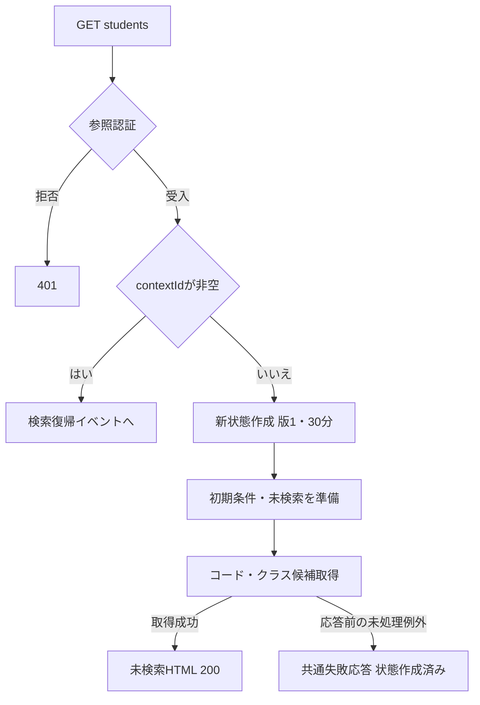

共通失敗応答は、WebFaultならそのStatus、その他なら503である。新状態作成後の候補失敗を、状態未作成の認証拒否と同じ状態にまとめない。

#### SQL・テーブル関連（ER図）

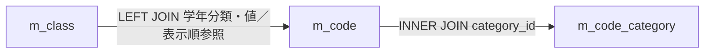

候補読取りの関連を示す。コード分類への実FKと、クラスの分類付き学年への実FKも宣言されている。検索用途ではm_studentの人数集計を行わない。根拠（実装）：`sources/Core/SqlServerStudentService.cs:201-208`、`sources/database/001_schema.sql:189-190`。

#### DB操作の詳細

コード候補は分類をINNER JOINし、分類・値・名称・順序・利用状態・期間・保護状態を返す。クラス候補は全クラスを読み、年度・学年の順序等で並べる。二つの結果集合を同じSNAPSHOT読取トランザクションで取得し、commitして返す。詳細な順序と抽出条件は選択候補一覧、接続・取消の共通規則は補足説明に示す。根拠（実装）：`sources/Core/SqlServerStudentService.cs:197-216`。

#### 結果・例外時の扱い

正常時は未検索HTMLを返す。既存状態IDの失効・所有者不一致・復帰版不一致は検索復帰側で拒否する。初期候補の取得失敗は一覧0件という業務結果にはせず、共通失敗応答へ進む。

設計意図は、初期表示で必須マスタ不足を検出し検索不可とすることである。現行は候補を取得して表示するが、その不足による禁止判定を持たない。根拠（設計意図）：`reference-designs/基本設計書/01_学生検索画面.md:159-176`。根拠（実装）：`sources/Web/Controllers/StudentsController.cs:8-11,39-39`、`sources/Views/Students/Search.cshtml:5-5`。

### 検索

#### 処理概要

利用者が検索を押すと、編集中の条件を検査し、非削除学生の件数と1ページ目を取得する。0件と上限超過も正常に受け入れた検索結果として保持する。入力不正や状態競合では、今回の一覧表示を消す一方、以前のApplied・LastResultを上書きしない。根拠（実装）：`sources/Web/Controllers/StudentsController.cs:13-16`、`sources/Infrastructure/WebStudentCoordinator.cs:7-10,20-21`。

#### 処理手順

1. MVCの認証・CSRF検査とフォームバインドを経て、アクション内のFormGuardで未知キー、書式メタ情報、許可されない同名複数値を検査する。
2. 在籍区分のフォームキーがなければ空配列に設定する。その後、ContextId・所有者・セッション・指定Tabで検索状態を取得する。この取得は局所catchの外である。
3. ModelStateが不正なら422とし、サービスを呼ばない。正常ならCoordinatorが参照認証を再確認し、入力をSearchCriteriaへ移す。クラスIDは文字列から正のlong?へ変換し、Page=1を設定する。
4. 状態のGateを待ち、取得後に所有者・セッション・指定Tab・期限を再確認する。期待版を現版の10進文字列と厳密比較し、不一致または版上限なら409で拒否する。
5. サービスは利用者確認をtryの外で行う。検索開始時刻と、その時刻の日本時間業務日を取得する。
6. try内でページ・件数・方向・ソート、年度・クラスの範囲、未所属の排他、在籍配列を検査する。続いて文字・コード・日付を正規化し、入学日の開始≦終了を確認する。
7. DB接続とSNAPSHOT開始後、指定学年・都道府県の存在、年度候補の存在、クラスの実年度・学年との一致を検査する。停止・期間外は検索拒否条件にしない。
8. 全指定条件を使って最大10001件を確認する。10001なら行取得を省略して上限超過を返す。10000以下なら同じSNAPSHOT内でページを取得する。
9. 受入結果の場合、入力側のcriteriaを複製してAppliedへ、結果をLastResultへ設定し、版を1加算する。サービス内で作った正規化ローカル値を入力欄へ直接上書きする処理ではない。Useが正常終了すると期限を30分延長し、Gateを解放する。
10. コード・クラス候補を別途取得し、結果と入力欄をHTMLへ移送する。候補取得・表示整形の失敗がこの段階で起きても、更新済み検索状態を戻す処理はない。

根拠（実装）：`sources/Web/Controllers/StudentsController.cs:14-16,39-41`、`sources/Web/Inputs/StudentSearchInput.cs:19-22`、`sources/Infrastructure/SearchContextStore.cs:13-15`、`sources/Core/SqlServerStudentService.cs:103-171`。

#### 処理フロー

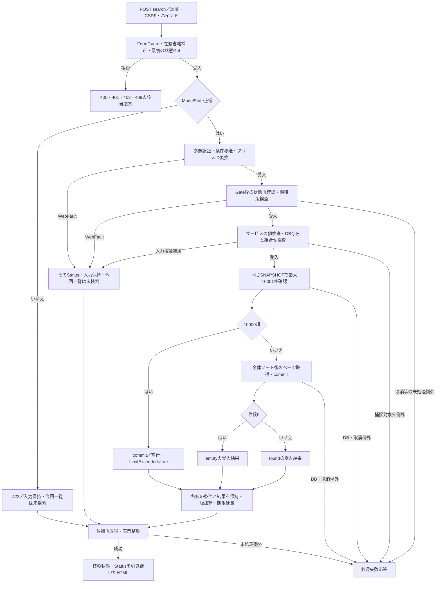

入力検証結果はEnsureSearchが422のWebFaultへ変換する。WebFaultのすべてを422に固定するわけではなく、状態・認証の拒否はそのStatusを引き継ぐ。Kを通過した枝だけが保持条件・結果・版を更新している。

#### SQL・テーブル関連（ER図）

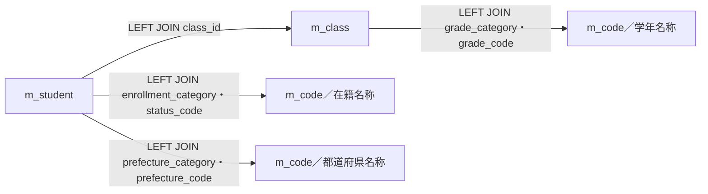

件数SQLは学生とクラス、一覧SQLはさらに名称用のm_codeを参照する。LEFT JOINは所属・名称の取得が成立しない学生行も残す。実FKの対応は補足説明に示す。検索から操作履歴への書込みはない。根拠（実装）：`sources/Core/SqlServerStudentService.cs:82-90,156-168`。

#### DB操作の詳細

必須条件は`s.is_deleted=0`である。指定値ごとのAND、在籍区分のIN、本人・緊急電話のOR、入学日両端包含を適用する。LIKEは学籍番号の前方一致、氏名・カナキーの部分一致に使い、`!`をESCAPE文字とする。全述語、SQL型・サイズ、件数とページの契約は補足説明の検索DB契約に示す。

10001検出時は読取トランザクションをcommitして、`Outcome.NoChange`、件数10001、空行、LimitExceeded=trueを返す。通常はページ読取後にcommitし、`Outcome.NoChange`、一致件数、取得行、LimitExceeded=falseを返す。NoChangeはこの検索に業務更新がないことを表す受入結果であり、未検索や変更なしの画面状態に置き換えない。根拠（実装）：`sources/Core/SqlServerStudentService.cs:137-168`。

#### 結果・例外時の扱い

サービスのcatchはInputValidationException、ArgumentExceptionの順であり、それぞれValidationFailed・件数0・空行・検索開始時刻・LimitExceeded=falseを返す。これは正常0件とは異なり、Coordinatorが422のWebFaultに変換する。Controllerの局所catchは呼出し中のWebFaultを項目エラーへ追加し、そのStatusで再表示する。ModelState不正も422で再表示する。根拠（実装）：`sources/Core/SqlServerStudentService.cs:169-170`、`sources/Infrastructure/WebStudentCoordinator.cs:20-20`、`sources/Web/Controllers/StudentsController.cs:15-16`。

FormGuardと最初の状態Getの拒否は局所catchに入らず、共通エラーHTMLへ進む。SQL例外、取消、NULL配列によるNullReferenceException等は上記二つのサービスcatchの対象外である。サービスの利用者確認もtry外であり、その失敗を検索入力の422保証に含めない。応答前の伝播例外はWebFaultのStatus、その他は503となる。根拠（実装）：`sources/Core/SqlServerStudentService.cs:105-112,169-170`、`sources/Infrastructure/WebHostSetup.cs:23-23`。

### 候補更新・未所属条件の連動

#### 処理概要

利用者が候補を更新すると、編集中の年度・学年に合うクラス候補を再表示する。不適合な選択クラスは解除する。最後に実行した条件と一覧は維持し、学生検索は行わない。ブラウザーで未所属をチェックした場合は上位3条件の値を解除する補助処理もある。根拠（実装）：`sources/Web/Controllers/StudentsController.cs:22-22`、`sources/wwwroot/js/site.js:7-7`。

#### 処理手順

1. 認証・CSRF・バインド後、FormGuardを行い、在籍区分キーの省略を空配列へ補正する。
2. ContextIdと所有者・セッション・指定Tab・期限で状態を取得する。受信したContextRevisionは照合しない。Gateの取得、版加算、期限延長も行わない。
3. 未所属trueなら入力の年度・学年・クラスをNULLにし、対応するModelState値も解除する。
4. LastResultを表示用に渡し、`LookupAsync(false)`で全候補を再取得する。年度・学年によるクラス抽出はビュー側で編集中値を使う。
5. 非空のClassId文字列について、候補のClassIdの10進文字列との一致、指定年度・学年との適合を確認する。該当しなければClassIdとそのModelState値を解除する。この処理は検索時のIdParserやコード正規化を呼ばない。
6. 解除しない場合は「条件を変更しました。検索を押すと一覧に反映します。」を、解除した場合は「上位条件に合わないクラスを解除しました。」を表示する。
7. AppliedとLastResultは変更せずHTMLを返す。受信したPageSize・SortKey・SortDirectionを表示モデルへ上書きせず、保持済み値または既定値を使用する。

根拠（実装）：`sources/Web/Controllers/StudentsController.cs:22-22,39-39`、`sources/Views/Students/Search.cshtml:5-5`。

#### 処理フロー

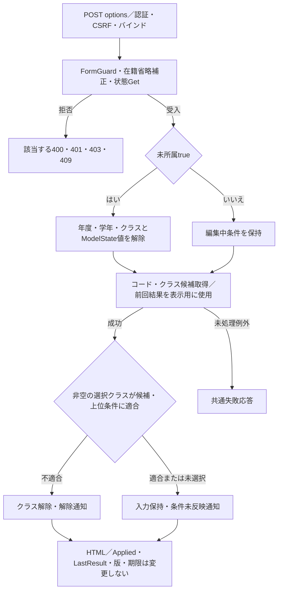

#### SQL・テーブル関連（ER図）

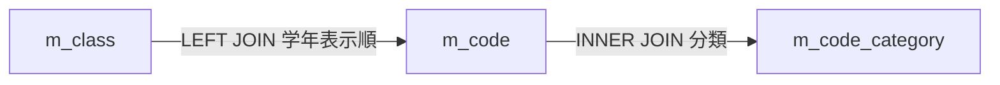

初期表示と同じ候補関連であり、m_studentの再検索・人数集計はない。表示中の学生行はLastResult由来である。根拠（実装）：`sources/Web/Controllers/StudentsController.cs:22-22,39-39`、`sources/Core/SqlServerStudentService.cs:201-216`。

#### DB操作の詳細

コードとクラスの全候補を同じSNAPSHOTで取得し、commitして返す。上位条件はこのSQLのWHEREへ渡さず、取得した候補からビューが抽出する。停止・期間外の候補も取得する。ClassIdの適合確認は取得済みコレクションに対するControllerの検査である。

#### 結果・例外時の扱い

候補更新にはModelState.IsValidによる遮断がない。FormGuardはキーを検査するが、値の型や存在必須を保証しないため、検索イベントと同じ入力拒否保証を候補更新へ拡張しない。独立した学生検索の入力エラー、0件、上限超過を新たに判定するイベントでもない。LastResultが持つ前回状態を引き継ぐ。根拠（実装）：`sources/Web/Controllers/StudentsController.cs:22-22,41-41`。

設計意図は、未所属ONで解除と即時非活性化、OFFでも旧条件を復元しないこと、クラス先行選択から年度・学年を補完すること、候補応答の世代を照合することである。現行は明示POSTによる再表示と不適合クラス解除を持つ。検索の年度・学年変更時の自動通信、クラスから上位条件への補完、古い応答破棄、即時disabled切替、W-STU-107の付与は接続されていない。登録用REGコントロールの連動処理を検索用SRCへ適用しない。根拠（設計意図）：`reference-designs/基本設計書/01_学生検索画面.md:248-254`。根拠（実装）：`sources/wwwroot/js/site.js:7-8`、`sources/Web/Controllers/StudentsController.cs:22-22`。

### 並び替え・表示件数変更・ページ移動

#### 処理概要

一覧操作は最後に受け入れたAppliedを使い、最新DBから一覧を取り直す。編集中の検索フォーム値を混ぜない。表示件数・ソート・方向の変更は1ページ目へ戻し、同じ表示指定なら要求ページへ移動する。根拠（実装）：`sources/Views/Students/Search.cshtml:8-8`、`sources/Infrastructure/WebStudentCoordinator.cs:11-13`。

#### 処理手順

1. 認証・CSRF・バインド後、一覧操作フォームのFormGuardと最初の状態Getを行う。アクションはModelState.IsValidで遮断しない。
2. Coordinatorの参照認証、UseのGate待機後再確認、期待版照合を行う。Appliedがなければ409「先に検索してください。」で拒否する。
3. Appliedを複製する。件数・ソート項目・方向のいずれかが変わればPage=1、それ以外は要求Pageを設定する。新しい表示指定も複製条件へ設定する。
4. 検索DB契約に従って再検索し、受入結果を確認する。
5. 上限超過でなく、要求ページが結果件数から求めた最終ページを超える場合、条件のPageを最終有効ページへ補正してもう一度再検索する。2回目の後に件数変動による補正を反復する処理はない。
6. 補正をしなかった枝は1回目の条件・結果を、補正した枝は補正条件・2回目の結果をApplied・LastResultへ保持する。版を1加算し、正常終了時に期限を延長する。
7. 保持条件から入力欄を作り、候補を取得してHTMLを返す。結果状態は0件・上限超過・通常結果の分類を引き継ぐ。

根拠（実装）：`sources/Web/Controllers/StudentsController.cs:18-19,39-40`、`sources/Infrastructure/WebStudentCoordinator.cs:12-12`、`sources/Infrastructure/SearchContextStore.cs:14-14`。

#### 処理フロー

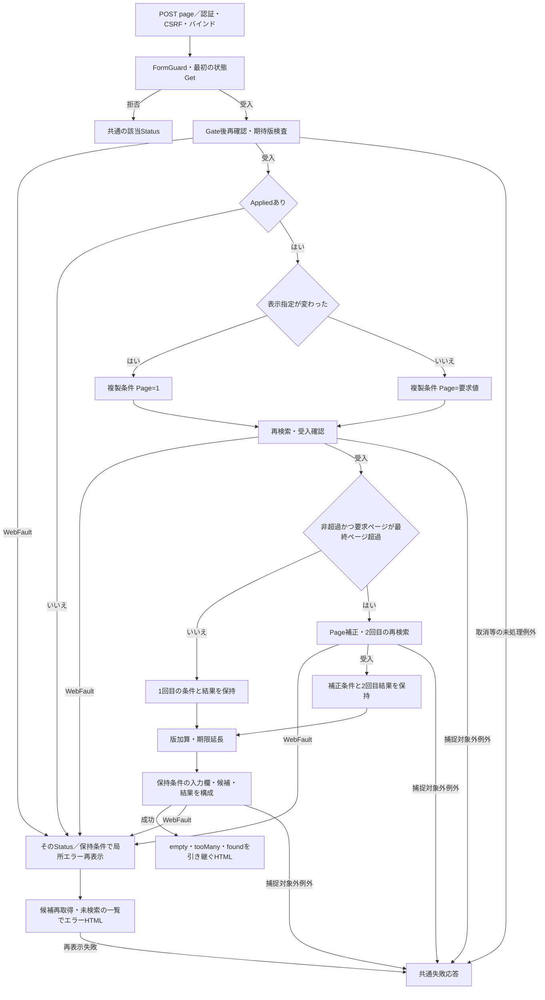

Nから局所catchへ入った場合は、すでにMで状態を更新している可能性がある。Wへ入った理由だけで「状態更新前」と固定しない。

#### SQL・テーブル関連（ER図）

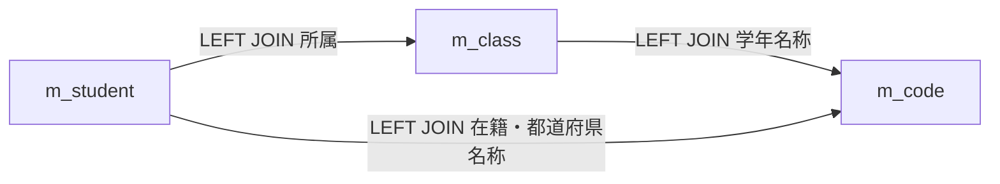

検索と同じ表関連を使用する。各再検索の件数とページはそれぞれ一つのSNAPSHOTであるが、1回目と2回目を同じSNAPSHOTへ統合していない。HTML用候補取得も別の読取である。根拠（実装）：`sources/Core/SqlServerStudentService.cs:82-90,123-124,156-168`。

#### DB操作の詳細

保持した12条件を使い、存在・組合せ検査、最大10001件確認、許可ソート、OFFSET/FETCHを再実行する。上限超過なら行SQLを省略する。0件なら最終ページの計算値は1である。サービス単体も取得ページを最終ページへ丸めるが、実際の取得ページをSearchResultに返さないため、Coordinatorが条件側の補正と必要な再検索を行う。根拠（実装）：`sources/Core/SqlServerStudentService.cs:159-168`、`sources/Core/Contracts.cs:57-58`、`sources/Infrastructure/WebStudentCoordinator.cs:12-12`。

#### 結果・例外時の扱い

正常結果は必ずfoundになるわけではない。件数0はempty、10001検出はtooMany、それ以外はfoundである。ページ操作中のWebFaultは局所catchでそのStatusとエラーを設定し、保持条件の入力欄と未検索・空一覧を再表示する。

FormGuardと最初のGetは局所catch外である。一方、成功後のSearchModel呼出しはtry内にあるため、その段階のWebFaultも局所catchへ入る。エラー再表示側の候補取得がさらに失敗した場合や、SQL・取消・その他の例外は共通失敗応答へ伝播する。根拠（実装）：`sources/Web/Controllers/StudentsController.cs:19-19`。

設計には先頭・最後の専用操作と、保持なし・期限切れ時の初期化通知がある。現行は並び順反映、前へ、次へだけで、保持なし・期限切れは409で拒否する。根拠（設計意図）：`reference-designs/基本設計書/01_学生検索画面.md:135-138,293-308`。根拠（実装）：`sources/Views/Students/Search.cshtml:8-8`、`sources/Infrastructure/SearchContextStore.cs:13-14`。

### クリア

#### 処理概要

利用者がクリアを押すと、同じ検索状態の実行済み条件と結果を消去し、初期条件・未検索へ戻す。検索画面を新しい状態IDに置き換える処理ではない。根拠（実装）：`sources/Infrastructure/WebStudentCoordinator.cs:15-15`、`sources/Web/Controllers/StudentsController.cs:21-21`。

#### 処理手順

1. 認証・CSRF・バインド後、クリアフォームのFormGuardを行う。
2. Coordinatorで参照認証を確認し、Useで状態を取得する。Gate待機後の所有者・セッション・指定Tab・期限、期待版、版上限を確認する。
3. AppliedとLastResultをNULLにし、版を1加算する。未検索の表示データを作り、正常終了時に期限を延長する。
4. ControllerはModelStateを消去し、同じ状態をもう一度Getする。
5. 初期StudentSearchInputと未検索データを使い、候補を取得してHTMLを返す。

根拠（実装）：`sources/Infrastructure/SearchContextStore.cs:14-14`、`sources/Infrastructure/WebStudentCoordinator.cs:15-15`、`sources/Web/Controllers/StudentsController.cs:21-21,39-39`。

#### 処理フロー

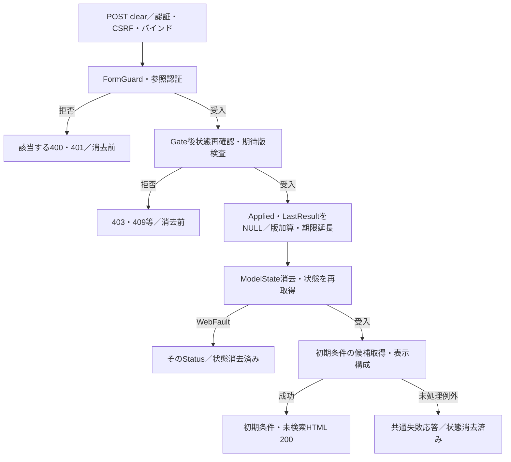

#### SQL・テーブル関連（ER図）

状態消去そのものはSearchContextStoreのメモリ操作であり、DB表のDELETEではない。HTML再表示に必要な候補は次の関連から読み取る。

#### DB操作の詳細

学生のSearchAsyncは呼ばない。候補のLookupAsync(false)は実施するため、クリアイベント全体をDB参照なしとはしない。業務表の更新、操作履歴の追記、t_runtime_stateへの書込みはない。根拠（実装）：`sources/Web/Controllers/StudentsController.cs:21-21,39-39`、`sources/Core/SqlServerStudentService.cs:197-216`。

#### 結果・例外時の扱い

正常時は在学・休学、20件、学籍番号昇順、未検索へ戻る。状態・版の拒否なら消去しない。消去後の再Getや候補取得が失敗した場合は、消去済みの状態のまま共通失敗応答へ進む。クリアには検索・ページと同じ局所WebFault再表示catchがない。

参考設計はクリアを初期化操作として定義しているが、同イベントのDB非使用説明を現行の候補読取まで拡張しない。根拠（設計意図）：`reference-designs/基本設計書/01_学生検索画面.md:337-360`。

### 新規・編集・参照への遷移

#### 処理概要

新規リンクは復帰先の検索状態IDを、結果行のリンクは学生管理番号と復帰先IDを登録画面へ渡す。遷移先は対象を再取得し、読込時点の検索状態版を編集スナップショットへ保持する。

根拠（実装）：`sources/Views/Students/Search.cshtml:6-8`、`sources/Web/Controllers/StudentsController.cs:23-25`。

#### 処理手順

1. 新規登録リンクはViewerに表示しない。結果行の操作はViewerなら参照、それ以外なら編集とする。
2. GET新規またはlong型の学生IDルートへ進む。Coordinatorが参照認証を確認し、非空のReturnContextIdがあれば所有者・セッション・期限を確認する。この確認にはTabを渡さない。
3. 新規の場合は作成権限を確認し、学生詳細は取得しない。検索条件から学籍番号・氏名等を転記せず、新規入力を作る。
4. 既存の場合はGetAsyncで学生IDと非削除条件により再取得する。IDが正数でない、存在しない、削除済みの場合は詳細なしとなり、Coordinatorが404を返す。
5. 登録用の候補を取得し、詳細または新規値から登録フォームを作る。
6. Controllerが復帰先状態をもう一度Getし、その時点のRevisionを取得する。詳細、Originalの複製、対象、所有者・セッション、復帰版を30分の編集スナップショットへ保持する。
7. 登録画面HTMLを返す。検索の保持条件・結果は変更しない。

根拠（実装）：`sources/Infrastructure/WebStudentCoordinator.cs:6-6,17-17`、`sources/Core/SqlServerStudentService.cs:172-181,196-216`、`sources/Infrastructure/EditorSnapshotStore.cs:7-11`。

#### 処理フロー

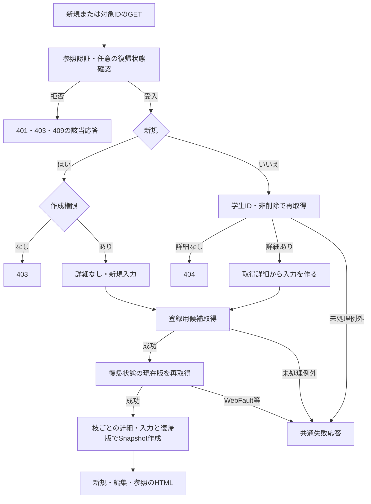

Snapshotの詳細を全枝でNULLに固定しない。新規枝だけが詳細なしであり、既存枝は取得した詳細を引き継ぐ。

#### SQL・テーブル関連（ER図）

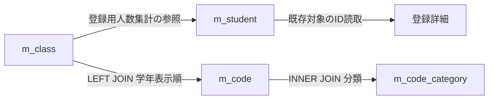

対象取得は学生単独表への読取であり、そのSQL自体にはER結合がない。候補取得は登録用途の別処理として図に併記する。人数集計は非削除かつ在籍01・02の学生を対象とし、検索候補のOccupied=0とは異なる。根拠（実装）：`sources/Core/SqlServerStudentService.cs:172-181,196-208`。

#### DB操作の詳細

既存対象は`SELECT * FROM dbo.m_student WHERE student_id=@id AND is_deleted=0`で取得する。`@id`はBigIntで、PKによる対象1件の読取である。新規枝ではこのSQLを実行しない。候補はLookupAsync(ct)を呼び、登録用途の人数を含めて取得する。ここでは学生INSERT・UPDATE・DELETEや監査追記を行わない。

#### 結果・例外時の扱い

検索時に存在した学生でも、遷移先の再取得で不在・削除済みなら404となる。新規の直URL要求もViewerなら403となる。復帰先の最初の確認が通っても、DB読取後の復帰版取得で期限切れ等を検出すれば登録HTMLを返せない。対象取得成功を最終表示成功へ一般化しない。根拠（実装）：`sources/Infrastructure/WebStudentCoordinator.cs:17-17`、`sources/Web/Controllers/StudentsController.cs:25-25`。

登録画面の業務入力と保存・削除の詳細は関連文書の責務である。本書では、対象の再取得、復帰ID・読込時復帰版、確定後通知という検索との接点を定義する。参考設計のメニュー復帰リンクは現行検索ビューには存在しない。根拠（設計意図）：`reference-designs/基本設計書/01_学生検索画面.md:337-360`。

### 検索復帰・確定通知の取得

#### 処理概要

登録画面から戻る場合、または保存・論理削除成功後の303で戻る場合、既存検索状態を確認する。未検索だった場合は未検索へ戻り、実行済み条件がある場合は同じ条件で最新DBを再検索する。保存した学生が条件外でも検索条件を変更しない。根拠（実装）：`sources/Web/Controllers/StudentsController.cs:8-11,31-38`、`sources/Infrastructure/WebStudentCoordinator.cs:14-14`。

#### 処理手順

1. 登録の検索へ戻るリンクはReturnContextIdと読込時ReturnRevisionを渡す。未保存変更があればブラウザーが破棄確認し、取消なら遷移しない。入力クリア・編集取消のPOST reset、最新情報再読込のGETは検索復帰とは別操作である。
2. 保存・論理削除がOutcome.Savedを返した場合だけ、Controllerが成功通知をFlashへ保存し、検索URLをLocationに設定して303を返す。復帰先がなければ新しい検索状態とその版を作る。
3. GET `/students`は参照認証と既存状態Getを行う。非空contextIdがある場合、contextRevisionの未設定を空文字としてResumeへ渡す。Tabは渡さない。
4. ResumeはGate待機後に状態を再確認し、期待版を照合する。未設定版を現在版で補完しない。
5. Appliedがない場合はSearchAsyncを呼ばず、未検索を返す。版とLastResultへの代入は行わず、Useの正常終了で期限だけ延長する。
6. Appliedがある場合はその条件でSearchAsyncを実行する。受入結果をLastResultへ設定し、版を1加算する。Appliedの条件は変えない。正常終了で期限を延長する。
7. Appliedから条件欄を作り、FlashをTakeする。キーは主体・ログインセッション・検索状態IDである。取得時に辞書から取り除き、期限内なら通知、失効または不在なら空文字を得る。
8. その後に候補を取得し、結果・条件・通知をHTMLへ移す。候補取得や表示整形が失敗しても、Take済み通知を戻す処理はない。

根拠（実装）：`sources/Views/Students/Edit.cshtml:16-16`、`sources/wwwroot/js/site.js:3-5`、`sources/Web/Controllers/StudentsController.cs:8-11,35-40`、`sources/Infrastructure/FlashMessageStore.cs:6-9`、`sources/Infrastructure/SearchContextStore.cs:14-14`。

#### 処理フロー

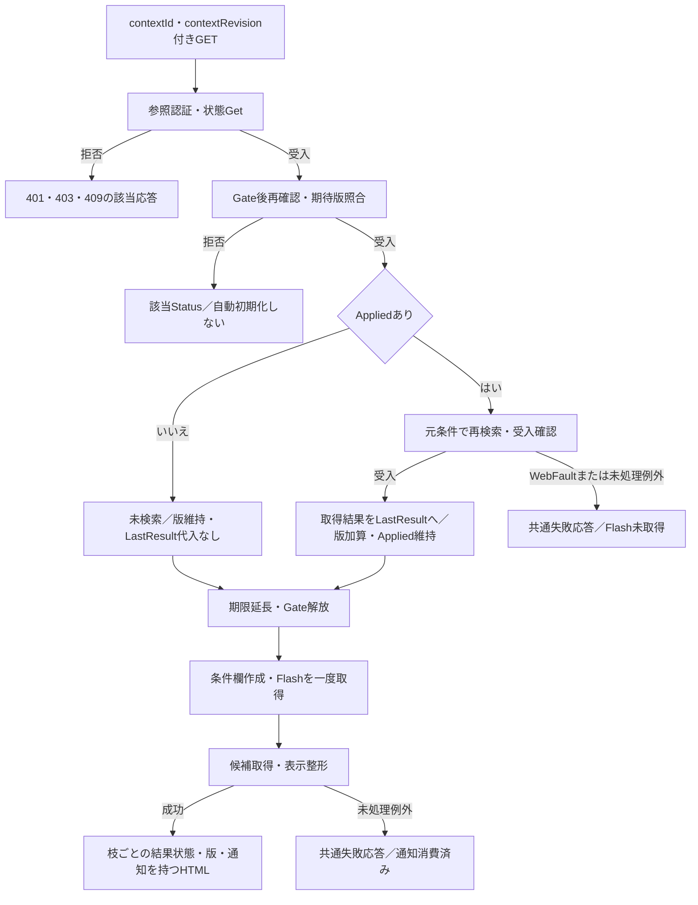

EとGの合流後も、Eは未検索・版維持、Gは取得結果・版加算という値を引き継ぐ。合流点で全結果を未検索やfoundへ固定しない。

#### SQL・テーブル関連（ER図）

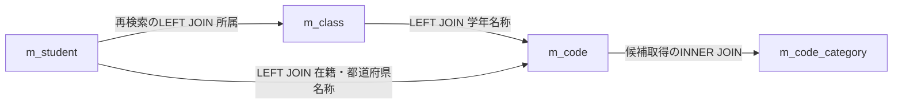

Appliedなしの枝は学生再検索を行わず、候補だけを読む。Appliedありの枝は検索と同じ関連を使用する。Flashはメモリ辞書であり、この図のDB表へ保存・消費するものではない。

#### DB操作の詳細

再検索の存在検査、件数、行取得、取消の契約は検索イベントと同じである。Resumeにはページイベントの条件側Page補正と2回目検索がない。サービスはSQL取得ページを最終ページへ丸めるが、Presentが表示するページはApplied.Pageである。復帰時に件数が減ると、取得行は最終ページ相当でも画面ページ番号が元の値のまま残る可能性がある。根拠（実装）：`sources/Infrastructure/WebStudentCoordinator.cs:12-14,21-21`、`sources/Core/SqlServerStudentService.cs:159-164`。

#### 結果・例外時の扱い

状態の失効・キー不在は409で検索画面を開き直すよう案内する。他者・別セッションは403、旧版・未設定版も409である。設計意図は期限切れ状態の初期化だが、現行は既存IDの失効時に新状態を自動作成しない。根拠（設計意図）：`reference-designs/基本設計書/01_学生検索画面.md:372-376`。根拠（実装）：`sources/Infrastructure/SearchContextStore.cs:13-14`。

再検索が入力検証結果になれば422のWebFaultが上位へ伝播する。Resumeには検索アクションのような局所エラー再表示がなく、共通エラーHTMLになる。再検索成功後の候補・表示失敗ではLastResultと版が更新済みである。通知取得前の拒否と、取得後の表示失敗を区別する。

保存・削除のSavedは、学生変更と操作履歴を同じトランザクションでcommitした後の結果である。その後のFlash、303、復帰版不一致、検索失敗を理由に保存トランザクションを戻す処理はない。編集読込後に検索状態版が進んでいれば、保存が確定していても読込時ReturnRevisionによる復帰は拒否され得る。根拠（実装）：`sources/Core/SqlServerStudentService.cs:294-315,409-414`、`sources/Web/Controllers/StudentsController.cs:25-25,31-38`。

保存側の結果不明判定は最後のSqlException・InvalidOperationException・OperationCanceledException catchへ到達した場合だけに適用する。先行する入力検証、一意違反、DBConcurrencyExceptionのcatchを結果不明条件へ含めない。削除もDBConcurrencyExceptionを先に捕捉する。検索側はSaved以外を確定成功通知にしない。根拠（実装）：`sources/Core/SqlServerStudentService.cs:316-323,415-416`。

## 補足説明

### 検索状態・一時情報の契約

検索状態はSingletonのSearchContextStoreのConcurrentDictionaryに保持する。ContextIdは32バイト乱数から作る64桁小文字hex、Tabも未指定・空なら別の乱数値を発行する。検索状態の個人情報をt_runtime_stateへ保存する接続実装はない。根拠（実装）：`sources/Infrastructure/WebHostSetup.cs:13-13`、`sources/Infrastructure/SearchContextStore.cs:9-12`、`sources/database/001_schema.sql:172-184`。

| 項目・領域 | 型・用途 | 検査・変更条件 |
| --- | --- | --- |
| ContextId | フォームではstring、状態Entry.Id | GetはNULLを辞書呼出し前に拒否。空文字はキー検索し、不在なら同じ409。非空IDの形式・長さをGet自体で検査する処理はない。 |
| 所有者・セッション | Entry.Owner・Session | 期限を通過した状態について現在利用者と比較し、不一致は403。認証自体の不正は401。 |
| TabId | フォームのstring、Entry.Tab | 非空引数だけ一致を検査する。NULL・空なら省略。GET初期・復帰、登録遷移はTabを渡さない。 |
| ContextRevision | 要求string、Entry.Revisionはlong | Useは現版の10進文字列と厳密比較する。未設定・旧版を補完しない。long.MaxValueも409。 |
| Expires | DateTimeOffset、UTC | 初期30分。Gate後に再確認する。操作が正常に返った場合だけ現在UTC＋30分へ延長。DB完了後の追加期限再検査はない。 |
| Gate | SemaphoreSlim | 同じEntryのSearch・Page・Clear・Resumeを直列化する。待機に取消トークンを渡し、取得後はfinallyで解放する。Optionsは使用しない。 |
| Applied | SearchCriteria? | 検索・ページ成功で条件をJSON複製して設定。0件・上限超過も保持。Resumeは変更せず、ClearはNULL。 |
| LastResult | SearchResult? | 検索・ページ・検索済み復帰の受入結果。Optionsは表示に使用し、ClearはNULL。今回エラーの表示消去とは別。 |
| 編集Snapshot | メモリ、30分 | 登録読込の詳細・Original複製・対象・所有者・セッション・ReturnRevisionを保持。検索状態のGate・版とは別。 |
| Flash | メモリ、10分 | 主体・セッション・ContextId単位。Takeで一度取り除く。表示失敗でも再投入しない。 |

根拠（実装）：`sources/Infrastructure/SearchContextStore.cs:9-15`、`sources/Infrastructure/WebStudentCoordinator.cs:9-15`、`sources/Infrastructure/EditorSnapshotStore.cs:7-11`、`sources/Infrastructure/FlashMessageStore.cs:6-9`。

同じ版の検索等が並行すると、Gate取得後に先行操作が版を進め、後続操作は旧版として拒否される。候補更新はこの直列化に参加しないため、検索・候補更新の並行応答を最新世代だけへ統一する契約は実装から確認できない。参考設計は要求開始時の入力複製と最新応答の採用を意図するが、現行のApplied複製は検索成功後である。根拠（設計意図）：`reference-designs/詳細仕様書/CSharp_ASPNET/01_学生検索画面.md:575-584,604-610`。根拠（実装）：`sources/Infrastructure/WebStudentCoordinator.cs:8-9`、`sources/Web/Controllers/StudentsController.cs:22-22`。

### 受信・正規化・保存値を区別する規則

HTTPフォームの値、MVCのバインド後DTO、SearchCriteria、サービス内の照合値、DB保存値は別の段階である。年度はバインド後int?、日付はstring?のまま移送し、クラスだけIdParserでlong?へ変換する。氏名・カナ・電話はサービス内のローカル値を検索へ使う。保持条件の文字列を正規化済みとして扱わない。根拠（実装）：`sources/Web/Inputs/StudentSearchInput.cs:7-22`、`sources/Core/SqlServerStudentService.cs:113-121`。

業務文字数はUnicodeスカラー値で数える。不正サロゲートはArgumentException、制御文字は入力検証エラーとなる。raw上限はTrim前に検査する。ブラウザーmaxlengthはコード単位、nvarchar容量はUTF-16コード単位を格納する容量であり、サービスのスカラー上限とは異なる。上限値が同じ画面を指していても、原入力、正規化後、検索LIKE値、保存列の容量を相互に代用しない。根拠（実装）：`sources/Core/StudentNormalizer.cs:37-70`、`sources/Views/Students/Search.cshtml:5-5`、`sources/database/001_schema.sql:9-13,44-47`。

氏名保存は原表記をText上限8で保持し、照合キーを再生成する。カナ保存は正規化表記をstudent_name_kana、空白除去値をkana_keyへ設定する。検索入力の空白のみは、氏名・電話なら条件なし、学籍番号なら必須検査で拒否、カナなら空キーのLIKE条件となる。これらを一つの「空欄はすべて条件なし」にまとめない。根拠（実装）：`sources/Core/StudentNormalizer.cs:47-94,124-145`、`sources/Core/SqlServerStudentService.cs:113-117,139-142`。

FormGuardは許可キー、同名複数値、__Invariant値を検査する。StatusCodes・UnassignedOnly・__Invariantの複数値を許可するが、項目の存在必須や値型は検査しない。非nullable参照型の暗黙requiredはMVC設定で抑止されている。SearchだけがModelState.IsValidを確認し、Page・Clear・Optionsは同じ遮断を行わない。根拠（実装）：`sources/Web/Controllers/StudentsController.cs:13-22,41-41`、`sources/Infrastructure/WebHostSetup.cs:16-18`。

サービスは任意文字・コード・日付のNULLを条件なしにできる一方、EnrollmentStatusCodesはNULL確認前にLengthを参照する。NULL配列が到達すればNullReferenceExceptionであり、検索サービスの入力検証catchには入らない。NULL要素は許可4値外として入力不正になる。フォームキー省略時の空配列化は確認できるが、欠落・変換失敗・NULLの全受信形に対する具体的なバインド値は別の確認境界である。根拠（実装）：`sources/Core/SqlServerStudentService.cs:111-121,169-170`、`sources/Web/Controllers/StudentsController.cs:14-15,22-22`。

### 検索DB契約

各指定条件は次表のとおりである。Where helperは値がNULLの条件だけを省略し、空文字を独自に省略しない。全条件はANDで結び、在籍選択内部のOR相当、電話内部のORだけを分ける。

| 対象 | 述語・照合 | パラメータ型・サイズ | 値の作成・補足 |
| --- | --- | --- | --- |
| 論理削除 | `s.is_deleted=0` | なし | 常に適用。削除済み照会なし |
| 学籍番号 | `s.student_no LIKE @no ESCAPE '!'` | `VarChar(31)` | 正規化番号をエスケープし末尾に% |
| 氏名 | `s.name_key LIKE @name ESCAPE '!'` | `NVarChar(642)` | 照合キーをエスケープし両端に% |
| カナ | `s.kana_key LIKE @kana ESCAPE '!'` | `NVarChar(74)` | 空白除去キーをエスケープし両端に% |
| 年度 | `c.school_year=@year` | `SmallInt`、サイズ指定なし | 指定年度の候補存在を事前確認 |
| 学年 | `c.grade_code=@grade` | `VarChar(2)` | 正規化したGRADE値の存在確認 |
| クラス | `s.class_id=@class` | `BigInt`、サイズ指定なし | 実在と指定年度・学年との一致確認 |
| 未所属 | `s.class_id IS NULL` | なし | true時だけ追加。所属条件と排他 |
| 都道府県 | `s.prefecture_code=@prefecture` | `VarChar(2)` | 正規化したPREFECTURE値の存在確認 |
| 電話 | 本人`phone_number=@phone` OR 緊急`emergency_phone_number=@phone`を括弧で一条件化 | `VarChar(16)` | 正規化後完全一致 |
| 入学日開始 | `s.admission_date>=@from` | `Date`、サイズ指定なし | DateOnlyを午前0時のDateTimeへ移送 |
| 入学日終了 | `s.admission_date<=@to` | `Date`、サイズ指定なし | 両端包含、片側可 |
| 在籍区分 | `s.enrollment_status_code IN (@status0,…)` | 各`VarChar(2)` | 空配列では述語を作らない。厳密な4値検査を行い、この経路で個別コード存在SQLは呼ばない |

根拠（実装）：`sources/Core/SqlServerStudentService.cs:67-72,125-155`。

LIKEのエスケープ対象は`!`、`%`、`_`、`[`である。検索文字をSQLの列名や自由なORDER BYへ使用しない。検索件数は学生とクラスをLEFT JOINした一致ID集合にTOP (10001)を適用し、COUNT_BIGで数える。10000以下は一致総数、10001は超過検出値である。根拠（実装）：`sources/Core/StudentNormalizer.cs:161-161`、`sources/Core/SqlServerStudentService.cs:156-159`。

ページSQLは一覧用LEFT JOINと同じWHEREを使用し、許可ソート列と方向、`s.student_id ASC`で全体の順序を確定してからOFFSET/FETCHを行う。`@offset`と`@size`はIntである。主ソートが降順でも学生IDの副順序は昇順のままである。根拠（実装）：`sources/Core/SqlServerStudentService.cs:108-108,159-168`。

件数と行取得は一つのSNAPSHOT読取トランザクションで行う。通常は行取得後、超過なら件数確認後にcommitする。検索サービスには明示rollback catchがなく、検査・DB例外時のトランザクションはawait usingの破棄経路へ進む。接続、トランザクション開始、実行、読取、commitに取消トークンを渡す。Command helperを使う検索・候補・存在確認コマンドは30秒設定である。根拠（実装）：`sources/Core/SqlServerStudentService.cs:53-66,123-124,156-170,197-222`。

接続サービスはStudentDb構成名から登録し、未設定なら503とする。実装は接続暗号化Mandatory、証明書を無条件信頼しない設定とし、接続後に対象DBのsnapshot_isolation_state=1を確認する。これらは処理の前提である。根拠（実装）：`sources/Infrastructure/WebHostSetup.cs:19-19`、`sources/Core/SqlServerStudentService.cs:39-64`。

### データ関連と名称の保存側

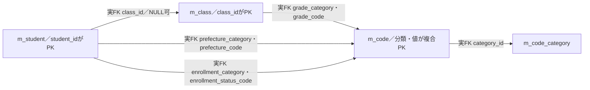

図は検索で使う実FKを示す。学生には性別・続柄の分類付きFKもあるが、検索一覧の名称JOINには使用しない。SQLのLEFT JOINは読取方法であり、FKそのものや削除連動ではない。履歴の対象キーへのFK、未実装の所属履歴、多重度を補わない。根拠（実装）：`sources/database/001_schema.sql:189-195`、`sources/Core/SqlServerStudentService.cs:82-90`。

クラス名は保守サービスのClassChange.ClassNameからText(raw18、保存18、必須)で検査し、m_class.class_nameのnvarchar(36) NOT NULL、18スカラーCHECK、NVarChar(36)へ対応する。クラスコードはIdentifier上限9、varchar(9)、VarChar(9)である。コード名称はCodeChange.CodeNameからText(raw12、保存12、必須)で検査し、m_code.code_nameのnvarchar(24) NOT NULL、12スカラーCHECK、NVarChar(24)へ対応する。表示DTOのstring?からこれらの保存列をNULL可と推定しない。根拠（実装）：`sources/Core/MasterMaintenanceService.cs:33-35,73-76,81-83,113-115`、`sources/database/001_schema.sql:67-68,81-81,115-128`。

保守サービスには名称保存の実装があるが、検索画面からの保守入口ではない。WebHostSetupで接続された学生サービスから、公開コード・クラス保守画面が存在すると判断しない。名称は検索時のJOINで取得するため、学生行に名称のコピーを保存する方式ではない。根拠（実装）：`sources/Infrastructure/WebHostSetup.cs:13-19`、`sources/Core/SqlServerStudentService.cs:82-90`。

### 日付・住所・表示整形

生年月日の表示は固定境界の元号定義を使用する。明治は1900-01-01～1912-07-29、大正は1912-07-30～1926-12-24、昭和は1926-12-25～1989-01-07、平成は1989-01-08～2019-04-30、令和は2019-05-01以降である。1年は元、月日は2桁とする。1900年下限外の値ではToInputがArgumentOutOfRangeExceptionを起こすため、表示整形成功を無条件に保証しない。根拠（実装）：`sources/Core/JapaneseDateService.cs:9-16,41-50`。

検索日時と更新日時は日本時間の西暦19文字に整形する。入学日条件はyyyy-MM-ddとして解析するが、type=dateのブラウザー表示形式は入力文字列の契約と同一ではない。共有ヘッダーの業務日は表示時の現在UTCから日本時間で算出し、検索の日付上限は検索開始時刻から算出する。根拠（実装）：`sources/Infrastructure/WebPresentation.cs:5-7`、`sources/Core/SqlServerStudentService.cs:44-45,105-105`、`sources/Core/JapaneseDateService.cs:52-59`。

住所は都道府県名称と住所1だけの算出値である。住所2、郵便番号、メール、緊急連絡先、備考を一覧へ出力しない。電話条件で緊急電話に一致した場合でも、一覧の電話列は本人電話のままである。根拠（実装）：`sources/Core/SqlServerStudentService.cs:80-90,148-148`。

### 失敗応答と確定境界

認証Cookieの期限は30分・延長ありで、認証失効は401、アクセス拒否は403に設定される。全MVC POSTには自動CSRF検査が登録されている。/api用のCSRF JSON変換を/studentsのフォーム応答へ適用しない。根拠（実装）：`sources/Infrastructure/WebHostSetup.cs:14-16`、`sources/Infrastructure/AntiforgeryResultFilter.cs:7-8`。

共通middlewareは応答開始前の伝播例外を捕捉し、WebFaultならそのStatus、その他なら503を返す。検索・ページの局所catch、認証拒否、CSRFフィルターの結果とは到達経路が異なる。応答開始後はこのcatch条件の対象外である。検索のDB読取成功、検索状態更新、候補取得、表示整形、HTML応答は別の境界として扱う。根拠（実装）：`sources/Infrastructure/WebHostSetup.cs:22-25`、`sources/Web/Controllers/StudentsController.cs:11-22,39-39`。

DDLのt_runtime_stateは宣言として存在するが、検索状態の読書き・暗号化をそこへ割り当てない。t_confirmationの非Web分岐、Webの重複確認情報、検索状態、Snapshot、Flashは用途が異なる。本書の検索処理は学生と監査を変更せず、登録側から受けるSavedだけを確定通知へ結び付ける。根拠（実装）：`sources/database/001_schema.sql:156-184`、`sources/Infrastructure/WebHostSetup.cs:13-19`、`sources/Core/SqlServerStudentService.cs:330-342`。

### 設計意図との対応と担当責務

| 主題 | 参考設計の意図 | 現行実装との対応・確認する責務 |
| --- | --- | --- |
| 入力から再表示まで | rawと正規化値を分け、型変換不正を未設定やゼロに置換せず検査する | DTO・サービス値・保存値・表示元を項目一覧で対応付ける。実装担当はバインド失敗段階、raw上限、正規化後上限、DB容量を別々に確認する。 |
| 初期候補 | 必須マスタ不足を検出し、既定値を先頭候補で代替しない | 現行は不足時の検索禁止を持たない。候補取得失敗、取得成功だが候補0件、既定値不在を別に確認する。 |
| 条件連動 | 上位変更時の解除、クラスから上位補完、未所属時の非活性、古い応答破棄 | 現行の明示POST、解除処理、値だけのブラウザー補助を確認する。自動補完・世代照合を実装済みとして扱わない。 |
| 件数とページ | 0、10000、10001を分け、全体ソート後にページ取得する | 現行の最大10001確認、一覧抑止、同じSNAPSHOTの件数と行、20・50・100の境界を確認する。 |
| 表示 | 和暦、日時、所属・名称欠損、不整合を読める形で出す | 現行の生年月日・日時整形、電話の「－」、住所の[不整合]を確認する。範囲表示や全名称注記の追加は未実装差として判断する。 |
| 状態と競合 | 実行済み条件を分離し、旧版・同版並行要求を拒否する | 現行Gateと版照合、Optionsの非参加、Tab空時の省略、DB処理後再確認なしを確認する。 |
| 復帰 | 元条件の再検索、期限切れ初期化、確定通知だけの表示 | 再検索は接続済み。期限切れは現行409。復帰ページ番号と取得ページ、保存確定後の旧版拒否、Flash取得後表示失敗を別段階で確認する。 |

根拠（設計意図）：`reference-designs/基本設計書/01_学生検索画面.md:159-176,248-254,293-308,372-376,474-491`、`reference-designs/詳細仕様書/CSharp_ASPNET/01_学生検索画面.md:558-610`。実装根拠は対応する項目・イベント・共通契約に示した。

IT担当者は、条件入力から検索列、名称参照、表示、登録への移送、保存後の復帰までの入出力と権限を確認する。実装担当者は、Unicode境界、全角・空白、日付境界、停止・期間外候補、NULL・変換失敗、旧版・期限切れ、DB・表示失敗の各段階を照合する。これらは設計上の確認責務であり、試験合格や顧客承認の記録ではない。根拠（設計意図）：`reference-designs/基本設計書/01_学生検索画面.md:474-491`、`reference-designs/詳細仕様書/CSharp_ASPNET/01_学生検索画面.md:586-602`。

### 関連文書の対応

次の10件は提示計画上の対応先であり、本応答では未生成である。表のpathは計画の正確な相対pathを保持し、生成済みリンクとして扱わない。

| 文書ID | kind | 計画path | 本書との責務の対応 |
| --- | --- | --- | --- |
| CSHARP_ASPNET-BAS-STU-02 | basic-design | 基本設計書/02_学生登録画面.md | 新規・編集・参照の遷移先、保存・削除・取消と検索復帰 |
| CSHARP_ASPNET-BAS-STU-03 | table-index | 基本設計書/03_テーブル仕様書.md | 学生・クラス・コードの関連、共通保存規則 |
| CSHARP_ASPNET-BAS-STU-04 | code-design | 基本設計書/04_コード設計書.md | 学年・在籍・都道府県の候補、名称の保存側制約 |
| CSHARP_ASPNET-BAS-STU-03-M_STUDENT | table-definition | 基本設計書/テーブル/01_m_student.md | 検索対象・表示元・照合キー・非削除・所属列 |
| CSHARP_ASPNET-BAS-STU-03-M_CLASS | table-definition | 基本設計書/テーブル/02_m_class.md | 年度・学年・クラス候補、所属表示元 |
| CSHARP_ASPNET-BAS-STU-03-M_CODE_CATEGORY | table-definition | 基本設計書/テーブル/03_m_code_category.md | 候補分類と分類の利用状態 |
| CSHARP_ASPNET-BAS-STU-03-M_CODE | table-definition | 基本設計書/テーブル/04_m_code.md | 分類付き選択値・名称・順序・期間・利用状態 |
| CSHARP_ASPNET-BAS-STU-03-T_OPERATION_LOG | table-definition | 基本設計書/テーブル/05_t_operation_log.md | 登録側保存・削除の一括確定に関係する監査。検索自身は追記しない |
| CSHARP_ASPNET-DET-CSharp_ASPNET-SCR-STU-001 | detailed-specification | 詳細仕様書/CSharp_ASPNET/01_学生検索画面.md | 同一検索機能の実入力・バインド・型・状態版・SQL・例外経路 |
| CSHARP_ASPNET-DET-CSharp_ASPNET-SCR-STU-002 | detailed-specification | 詳細仕様書/CSharp_ASPNET/02_学生登録画面.md | 登録の実入口、Snapshot、保存確定、303・Flash、復帰の詳細 |
