<!-- spec-meta: {"schema":"spec-md/1.0","documentId":"CSHARP_ASPNET-BAS-STU-02","version":"1.0","path":"基本設計書/02_学生登録画面.md","sheets":[{"heading":"概要","kind":"GRID","sheet":"学生登録_概要"},{"heading":"項目一覧","kind":"LIST","sheet":"学生登録_項目","key":["項目キー"]},{"heading":"イベント仕様","kind":"GRID","sheet":"学生登録_イベント"},{"heading":"補足説明","kind":"GRID","sheet":"学生登録_補足"}]} -->
# 学生登録画面 基本設計書

| 文書属性 | 内容 |
| --- | --- |
| 文書ID | CSHARP_ASPNET-BAS-STU-02 |
| 文書種別 | 基本設計書（basic-design） |
| 版 | 1.0 |
| 正本path | 基本設計書/02_学生登録画面.md |
| 対象 | 学生登録画面の新規・編集・参照、入力補助、保存、重複確認、論理削除、取消・再読込・検索復帰 |
| 根拠の区分 | 現行動作はソース観測、参考設計の要求は設計意図として記載する。根拠位置は論理相対pathと原ソースの開始行・終了行で示す。 |

## 概要

### 業務の目的と保存単位

学生登録画面は、学生1人の基本情報、住所、本人・緊急連絡先、生年月日と在籍日付、在籍区分、現在または最終所属クラスを管理する。新規・編集・参照は同じEditビューを使う。通常保存の業務入力は19項目であり、年度・学年はクラス選択の補助、確認・変更理由は操作履歴の理由として扱う。学生の更新と操作履歴1件の追記を同じトランザクションで確定する。根拠：`Views/Students/Edit.cshtml:3–17`、`Web/Inputs/StudentSaveInput.cs:9–42`、`Core/SqlServerStudentService.cs:294–315`。

所属は学生の`class_id`に現在または最終所属の1件を保持する。在学・休学はクラスを必須とし、どちらも現在人数の集計対象になる。卒業・退学は最終所属を任意とし、現在人数には含めない。論理削除は業務値を残して削除属性を設定し、通常の読取と現在人数から対象を除く。根拠：`Core/StudentNormalizer.cs:151–157`、`Core/SqlServerStudentService.cs:201–201`、`Core/SqlServerStudentService.cs:357–380`、`Core/SqlServerStudentService.cs:409–414`。

参考設計では、検索画面を呼出元・復帰先、クラス・コードを参照専用マスタとする。成績、学籍番号訂正、削除復元、物理消去、所属履歴一覧、将来異動予約、CSV・帳票・取込は本機能の対象外としている。この範囲は設計意図であり、個人情報の保持運用や顧客承認を表すものではない。根拠：`reference-designs/基本設計書/02_学生登録画面.md:16–24`、`reference-designs/基本設計書/02_学生登録画面.md:85–115`。

### 画面モードと権限

画面の見出しは対象IDと編集可否から決める。既存学生の学籍番号はreadonlyとし、通常更新でも変更を認めない。閲覧者では業務入力と保存操作を含むfieldset全体をdisabledにする。入力クリア・編集取消、再読込、検索復帰はそのfieldsetの外側にある。根拠：`Web/Models/StudentEditPageModel.cs:5–14`、`Views/Students/Edit.cshtml:3–6`、`Views/Students/Edit.cshtml:15–17`。

| 状態 | 到達条件 | 業務入力・保存 | 学籍番号 | その他の操作 |
| --- | --- | --- | --- | --- |
| 新規 | 対象IDなし。StaffまたはAdministrator | 入力・登録可能 | 入力可能 | 入力クリア、検索へ戻る。再読込・削除は表示しない。 |
| 編集・職員 | 対象IDあり、Staff | 入力・更新可能 | readonly | 編集取消、最新情報の再読込、検索へ戻る。削除は表示しない。 |
| 編集・管理者 | 対象IDあり、Administrator | 入力・更新可能 | readonly | 職員の操作に加え、別フォームの論理削除を表示する。 |
| 参照 | 対象IDあり、Viewer | fieldsetをdisabledにする | fieldset非活性かつreadonly | 編集取消、最新情報の再読込、検索へ戻るを表示する。 |

Viewerによる新規表示・保存と、管理者以外による削除はサーバーでも拒否する。画面上の非活性や非表示だけを権限保証にはしない。卒業03・退学04から別の在籍区分へ訂正する更新は、管理者と変更理由を追加で要求する。同じ終了区分のまま住所などを更新する場合には、この追加条件を適用しない。根拠：`Infrastructure/RequestIdentity.cs:13–16`、`Infrastructure/WebStudentCoordinator.cs:17–19`、`Core/SqlServerStudentService.cs:255–258`。

### 接続された入口と入出力

学生画面の処理は、StudentsController、WebStudentCoordinator、登録されたIStudentServiceを経由してSqlServerStudentServiceへ到達する。作成・更新は`Input`接頭辞付きフォーム、削除は接頭辞なしの別フォームを受ける。学生登録の公開JSON APIとして接続された入口は確認できない。根拠：`Program.cs:3–7`、`Infrastructure/WebHostSetup.cs:13–19`、`Web/Controllers/StudentsController.cs:23–38`。

| 操作 | 接続入口 | 入力と対象 | 主な出力 |
| --- | --- | --- | --- |
| 新規表示 | GET `/students/new` | 任意の`returnContextId` | 初期入力、候補、読込スナップショットを持つEditビュー |
| 既存表示・再読込 | GET `/students/{id:long}` | ルートID、任意の`returnContextId` | 非削除学生の値・版、候補、新しいスナップショットを持つEditビュー |
| 新規登録 | POST `/students/create` | `Input.*`、`SnapshotId`、CSRF情報 | 結果別の再表示、または保存確定後の303 |
| 更新・確認続行 | POST `/students/{id:long}/update` | ルートID、`Input.*`、`SnapshotId`、CSRF情報 | 結果別の再表示、または保存確定後の303 |
| 入力クリア・編集取消 | POST `/students/reset` | `SnapshotId`、任意の`StudentId`、CSRF情報 | 読込時入力へ戻したEditビュー |
| 論理削除 | POST `/students/{id:long}/delete` | ルートID、`SnapshotId`、期待版、理由、確認値、復帰先、CSRF情報 | 失敗後の再読込、または確定後の303 |
| 検索復帰 | GET `/students` | `contextId`、`contextRevision` | 保持した条件による検索画面 |
| 入力補助・確認取消 | 接続されたJavaScriptイベント | 画面内の選択・入力・確認操作 | DOM上の値変更。専用の登録候補HTTP要求は行わない。 |

| 領域 | 入力方向・役割 | 出力・保持内容 | 根拠 |
| --- | --- | --- | --- |
| 学生DB | 正規化済み業務値を書き込む | 保存値、比較版、作成・更新・削除管理情報 | `Core/SqlServerStudentService.cs:294–315`、`Core/SqlServerStudentService.cs:409–414` |
| クラス・コードDB | 表示候補と保存検査の参照元 | キー、名称、利用状態、有効期間、定員、参考人数 | `Core/SqlServerStudentService.cs:196–216`、`Core/SqlServerStudentService.cs:344–383` |
| 操作履歴DB | 学生変更と同じ保存単位で追記する | 対象、操作、前後版、変更列名JSON、実行者、UTC時点、受付UUID、理由、重複確認フラグ | `Core/SqlServerStudentService.cs:385–390` |
| 読込スナップショット | 読込成功時の入力とDetailを複製する | 所有者、ログインセッション、対象ID、読込時版・入力・管理表示、復帰版、30分期限 | `Infrastructure/EditorSnapshotStore.cs:7–11` |
| 重複確認情報 | 未確認の候補がある場合などに発行する | 所有者・セッション、対象・期待版、内容と全候補のハッシュ、10分期限、Busy | `Core/SqlServerStudentService.cs:19–29`、`Core/SqlServerStudentService.cs:274–290`、`Core/SqlServerStudentService.cs:330–335` |
| 検索状態 | 検索画面から渡された復帰先を参照する | 所有者・セッション・タブ、適用済み条件、結果、版、Gate、30分期限 | `Infrastructure/SearchContextStore.cs:9–15` |
| 成功通知 | 保存・削除のSaved後に保持する | 所有者・セッション・検索Contextに結び付く10分の通知。取得時に除去する。 | `Infrastructure/FlashMessageStore.cs:6–9` |

これらのWeb一時情報はプロセス内メモリに保持する。DDLにある`t_confirmation`はサービスの非Web設定で使う分岐があるが、Web登録は`webTokens=true`を指定する。`t_runtime_state`のDDLから、画面状態の永続化・暗号化・再起動後復元を実装済みとは扱わない。根拠：`Infrastructure/WebHostSetup.cs:13–19`、`Core/SqlServerStudentService.cs:277–283`、`Core/SqlServerStudentService.cs:308–342`、`database/001_schema.sql:156–184`。

### 画面設計の静的投影

次のHTMLは、管理者の既存学生編集画面を非実行で投影したものであり、実画面の撮影ではない。学生値と管理値は空欄・記号で示す。コードの代表候補はseedの定義による表示例であり、DBへの投入を示さない。DBに依存する年度・クラス候補と学生値は埋め込んでいない。実際の候補取得・選択可否は後述の候補仕様による。

共有レイアウトのheader・mainと、個別ビューのfieldset・fields・actionsをそのまま対応させる。実送信先はdata属性へ移し、ボタンはすべてtype=button、ナビゲーションは文書内fragmentとする。JavaScriptを追加しない。根拠：`Views/_ViewStart.cshtml:1–1`、`Views/Shared/_Layout.cshtml:1–1`、`Views/Shared/_MessagePanel.cshtml:1–3`、`Views/Students/Edit.cshtml:3–17`、`wwwroot/css/site.css:1–1`。

<!doctype html>
<html lang="ja">
<head>
<meta charset="utf-8">
<meta name="viewport" content="width=device-width,initial-scale=1">
<title>学生管理</title>

</head>
<body>
<header><strong>学生管理システム</strong>利用者 &lt;利用者名&gt;　業務日 &lt;yyyy/MM/dd&gt;</header>
<main>
<h1>学生登録 ／編集</h1>

氏名を入力してください。（入力エラー表示例）

学生管理番号 &lt;管理番号&gt;　更新日時 &lt;yyyy/MM/dd HH:mm:ss&gt;　更新者 &lt;更新者&gt;

<form data-method="POST" data-route="/students/{id}/update" data-editor-form>
<input type="hidden" name="__RequestVerificationToken" value="">
<input type="hidden" name="SnapshotId" value="">
<input type="hidden" name="Input.ExpectedVersion" value="">
<input type="hidden" name="Input.ReturnContextId" value="">
<input type="hidden" name="Input.DuplicateToken" value="">
<fieldset><legend>学生基本情報</legend>

<label>学籍番号 ※必須<input name="Input.StudentNo" id="REG-002" maxlength="30" readonly required></label>
<label>氏名 ※必須<input name="Input.StudentName" id="REG-003" maxlength="16" required><small>8文字以内</small></label>
<label>氏名カナ ※必須<input name="Input.StudentNameKana" id="REG-004" maxlength="72" required><small>原入力36、正規化後18文字</small></label>
<fieldset class="wareki" id="REG-005"><legend>生年月日 ※必須</legend><select name="Input.BirthDateInput.Era" aria-label="元号" required><option value="">元号</option><option value="REIWA">令和</option><option value="HEISEI">平成</option><option value="SHOWA">昭和</option><option value="TAISHO">大正</option><option value="MEIJI">明治</option></select><input name="Input.BirthDateInput.Year" aria-label="元号年" maxlength="4" required>年<input name="Input.BirthDateInput.Month" aria-label="月" maxlength="2" required>月<input name="Input.BirthDateInput.Day" aria-label="日" maxlength="2" required>日</fieldset>
<label>性別 ※必須<select name="Input.GenderCode" id="REG-006" required><option value="0">未回答</option><option value="1">男性</option><option value="2">女性</option><option value="9">その他</option></select></label>
<label>郵便番号 ※必須<input name="Input.PostalCode" id="REG-007" maxlength="20" required></label>
<label>都道府県 ※必須<select name="Input.PrefectureCode" id="REG-008" required><option value="">未選択</option><option value="01">北海道</option><option value="47">沖縄県</option></select></label>
<label>住所1 ※必須<input name="Input.AddressLine1" id="REG-009" maxlength="90" required><small>45文字以内</small></label>
<label>住所2<input name="Input.AddressLine2" id="REG-010" maxlength="90"></label>
<label>本人電話<input name="Input.PhoneNumber" id="REG-011" maxlength="40"><small>原入力20、正規化後16文字</small></label>
<label>本人メール<input name="Input.EmailAddress" id="REG-012" maxlength="120"></label>
<label>入学日 ※必須<input name="Input.AdmissionDate" id="REG-013" type="date" required></label>
<label>在籍区分 ※必須<select name="Input.EnrollmentStatusCode" id="REG-014" required><option value="01">在学</option><option value="02">休学</option><option value="03">卒業</option><option value="04">退学</option></select></label>
<label>卒業・退学日<input name="Input.EnrollmentEndDate" id="REG-015" type="date"></label>
<label>年度<select name="Input.SchoolYear" id="REG-016"><option value="">未指定</option></select></label>
<label>学年<select name="Input.GradeCode" id="REG-017"><option value="">すべて</option><option value="00">学年なし</option><option value="01">1年</option><option value="02">2年</option><option value="03">3年</option><option value="04">4年</option><option value="05">5年</option><option value="06">6年</option></select></label>
<label>クラス<select name="Input.ClassId" id="REG-018"><option value="">未所属</option></select><small>人数 －／定員 制限なし（参考）</small></label>
<label>緊急連絡先氏名<input name="Input.EmergencyContactName" id="REG-020" maxlength="16"></label>
<label>緊急連絡先続柄<select name="Input.RelationshipCode" id="REG-021"><option value="">未選択</option><option value="01">父</option><option value="02">母</option><option value="03">祖父</option><option value="04">祖母</option><option value="05">兄弟姉妹</option><option value="06">配偶者</option><option value="07">後見人</option><option value="99">その他</option></select></label>
<label>緊急連絡先電話<input name="Input.EmergencyPhoneNumber" id="REG-022" maxlength="40"></label>
<label class="full">備考<textarea name="Input.Remarks" id="REG-023" maxlength="240"></textarea></label>
<label class="full">確認・変更理由<textarea name="Input.OperationReason" id="REG-024" maxlength="120"></textarea></label>

本人電話・メール・緊急電話のいずれか1つ以上。緊急連絡先は3項目すべて入力してください。

<button type="button" class="primary">更新</button>
</fieldset>
</form>

<form data-method="POST" data-route="/students/reset" data-confirm="編集内容を読込時の値へ戻しますか。"><input type="hidden" name="SnapshotId" value=""><input type="hidden" name="StudentId" value=""><button type="button">編集取消</button></form><a href="#ev-reg-007" data-method="GET" data-route="/students/{id}?returnContextId={context}" data-dirty-link data-confirm="編集内容を破棄して最新情報を読み込みますか。">最新情報を再読込</a><a href="#ev-reg-007" data-method="GET" data-route="/students?contextId={context}&amp;contextRevision={revision}" data-dirty-link>検索へ戻る</a>

<form data-method="POST" data-route="/students/{id}/delete" data-confirm="対象と理由を確認して論理削除しますか。"><input type="hidden" name="SnapshotId" value=""><input type="hidden" name="ExpectedVersion" value=""><input type="hidden" name="ReturnContextId" value=""><input type="hidden" name="Confirmed" value="true"><label>削除理由 ※必須<textarea name="Reason" id="REG-026" maxlength="120" required></textarea></label><button type="button" class="danger">対象を確認して論理削除</button>
編集中の業務値は保存されません。
</form>
</main>
</body>
</html>

新規状態では、見出しを「／新規」、管理番号を「新規」、更新日時・更新者を「－」、保存操作を「登録」、取消操作を「入力クリア」とする。学籍番号のreadonly、再読込リンク、削除フォームを除く。新規の性別は0、在籍区分は01、年度は日本時間の業務日から4月始まりで求めた当年度とする。その他の必須業務値は空欄、任意値は未設定である。根拠：`Views/Students/Edit.cshtml:3–6`、`Views/Students/Edit.cshtml:15–17`、`Web/Inputs/StudentSaveInput.cs:44–54`、`Infrastructure/WebPresentation.cs:5–7`。

参照状態では見出しを「／参照」にし、学生基本情報の外側fieldsetにdisabledを付ける。職員編集・参照では削除フォームを除く。卒業・退学日の入力欄には、在籍区分によるdisabled条件は実装されていない。通常幅の入力領域は2列、760px以下は1列となり、備考と確認・変更理由はfull指定で全幅に置く。根拠：`Views/Students/Edit.cshtml:5–17`、`wwwroot/css/site.css:1–1`。

確認要求時は、業務fieldset内の注意文と登録・更新ボタンとの間へ次のsectionを追加する。候補行は返された先頭最大20件である。role、class、idは別の属性であり、このsectionには`.dialog`が付かないため、共有CSSの固定位置・背景遮蔽・`.dialog table`の幅解除は適用されない。根拠：`Views/Students/Edit.cshtml:13–15`、`wwwroot/css/site.css:1–1`。

<section role="dialog" aria-labelledby="duplicate-title" class="warning">
<h2 id="duplicate-title">同一人物候補の確認</h2>

全 &lt;全候補件数&gt; 件、最大20件表示

<table><thead><tr><th>学籍番号</th><th>氏名</th><th>和暦生年月日</th><th>クラス</th></tr></thead><tbody></tbody></table>

別人と確認した場合は、確認理由を入力して続行してください。

<button type="button" data-cancel-duplicate autofocus>確認取消</button>
<button type="button" data-confirm="別人として保存しますか。">別人と確認して続行</button>
</section>

### 候補の取得と表示

登録用LookupAsyncは、SNAPSHOTトランザクション内でコードとクラスを2結果として取得する。コードは分類マスタとINNER JOINし、両方の利用可否からIsActiveを求める。停止・期間外を除外するWHEREはない。クラスは学年コードをLEFT JOINして並び順に使用し、現在人数も同じ読取単位で取得する。候補全体の取得後にcommitする。根拠：`Core/SqlServerStudentService.cs:196–216`。

| 候補 | 取得元・キーと表示 | 順序 | 新規初期値・空欄 | 選択条件・保持 |
| --- | --- | --- | --- | --- |
| 生年月日の元号 | JapaneseDateServiceの固定定義。REIWA、HEISEI、SHOWA、TAISHO、MEIJIと元号名 | 令和、平成、昭和、大正、明治 | 空の「元号」 | 完全一致する識別値を日付変換に使用する。DBコード分類ではない。 |
| 性別 | GENDERのCodeValue、CodeName。seedは0未回答、1男性、2女性、9その他 | 分類、display_order、code_value | 0 | 利用可かつ業務日が期間内、または読込時の同値を選択可能にする。 |
| 都道府県 | PREFECTUREのCodeValue、CodeName。seedは01北海道～47沖縄県の47値 | 分類、display_order、code_value | 空の「未選択」 | 性別と同じ選択条件。保存するのは2桁コードである。 |
| 在籍区分 | ENROLLMENT_STATUSの01在学、02休学、03卒業、04退学 | 分類、display_order、code_value | 01 | 利用状態・期間、または読込時同値で選択可能にする。 |
| 緊急連絡先続柄 | RELATIONSHIPの01父、02母、03祖父、04祖母、05兄弟姉妹、06配偶者、07後見人、99その他 | 分類、display_order、code_value | 空の「未選択」 | 利用状態・期間、または読込時同値で選択可能にする。 |
| 年度 | 取得クラスのSchoolYearと現在入力SchoolYearの重複を除いた値 | 年度降順 | 新規は当年度。空候補は「未指定」 | 年度だけを学生DBへ保存しない。既存で所属がない場合は当年度で補わない。 |
| 学年 | GRADEのCodeValue、CodeName。seedは00学年なし、01～06の1～6年 | 分類、display_order、code_value | 空の「すべて」 | 現行selectには利用状態・期間によるdisabledがない。保存時には2桁形式と、指定クラスとの一致を検査する。 |
| クラス | ClassIdをキーに年度・学年コード・クラスコード・クラス名を表示する | 年度降順、学年display_order、クラスdisplay_order、class_code、class_id | 空の「未所属」 | 全取得クラスを表示する。読込時所属は保持可能。それ以外は在学・休学で利用可かつ現在期間内、卒業・退学で入力在籍期間との重なりを判定する。 |

候補定義と初期値の根拠：`Views/Students/Edit.cshtml:7–13`、`Web/Inputs/StudentSaveInput.cs:44–54`、`Core/JapaneseDateService.cs:9–16`、`database/002_seed.sql:8–84`。性別0と学年00は有効なコード値であり、未選択の空文字や所属NULLとは異なる。

性別・都道府県は選択不可候補へ「停止・期間外」を付ける。在籍・続柄は同じdisabled判定を持つが、この注記を付けない。保存時はコードの存在を必ず再検査し、新規・変更値には分類とコードの利用可否・期間も要求する。存在する停止・期間外コードの同値保持は認める。根拠：`Views/Students/Edit.cshtml:8–13`、`Core/SqlServerStudentService.cs:347–355`。

クラスの参考人数は、非削除で在学01・休学02の学生数である。選択クラスの人数・定員を表示し、未選択の人数は「－」とする。定員NULLは制限なしであり、クラス未選択時にも現行式は「制限なし」と表示する。後者は選択クラスの容量を取得した結果ではない。定員0はDDL・保守処理で許可しない。人数表示は席の予約ではなく、クラス変更後にJavaScriptが人数表示を更新する処理もない。根拠：`Views/Students/Edit.cshtml:2–2`、`Views/Students/Edit.cshtml:12–12`、`Core/SqlServerStudentService.cs:201–214`、`Core/MasterMaintenanceService.cs:32–32`、`database/001_schema.sql:201–201`、`wwwroot/js/site.js:8–8`。

表示名称は学生入力と別に管理される。コード名称は12スカラー、DBは`nvarchar(24) NOT NULL`、保守パラメータは`@name NVarChar(24)`である。クラス名は18スカラー、DBは`nvarchar(36) NOT NULL`、保守パラメータは`@class_name NVarChar(36)`である。クラスの年度は`smallint NOT NULL`、学年コードは`varchar(2) NOT NULL`、クラスコードは`varchar(9) NOT NULL`で、クラスコードの宣言された保守上限は9である。これらの保守サービスは名称の保存契約の根拠であり、本Web画面からマスタを更新する入口としては接続されていない。根拠：`Core/MasterMaintenanceService.cs:30–37`、`Core/MasterMaintenanceService.cs:73–74`、`Core/MasterMaintenanceService.cs:81–83`、`Core/MasterMaintenanceService.cs:113–115`、`database/001_schema.sql:64–71`、`database/001_schema.sql:113–128`、`Infrastructure/WebHostSetup.cs:13–19`。

### 入力値・保存値・再表示の共通規則

文字列の業務上限はUnicodeスカラー数で検査する。Textを使う項目では、加工前上限、制御文字、前後空白除去後の必須性・保存上限を順に確認する。任意文字列の空欄はNULLになる。備考と理由の複数行項目ではCRLF・CRをLFへ統一し、LFだけを許容する。ブラウザーmaxlengthはUTF-16コード単位、サービス上限はスカラー、nvarchar容量とSQLパラメータSizeは別の制約である。根拠：`Core/StudentNormalizer.cs:37–57`、`Views/Students/Edit.cshtml:6–17`、`Core/SqlServerStudentService.cs:30–37`。

保存要求の19項目はStudentDraftへ移し、保存サービスが正規化値、氏名照合キー、カナ照合キー、続柄分類を生成する。氏名の原表記、正規化済みカナ、保存用電話・郵便番号と照合キーを混同しない。年度・学年・理由・確認情報はSaveRequestの補助引数であり、学生の入力19項目とは別である。根拠：`Web/Inputs/StudentSaveInput.cs:34–42`、`Core/Contracts.cs:66–70`、`Core/StudentNormalizer.cs:119–158`。

既存表示はDB保存値から入力へ戻し、生年月日を和暦4入力へ逆変換する。住所1と住所2へ都道府県名称を連結保存しない。郵便番号は現在の移送では数字7桁をそのまま表示する。参考設計が意図する3桁－4桁表示とは差がある。入学日・終了日は現在のDTOへ`yyyy-MM-dd`で戻し、type=dateの実際の表示はブラウザーに依存する。参考設計の`yyyy/MM/dd`表示見本を、現在のブラウザー表示の保証にはしない。根拠：`Core/SqlServerStudentService.cs:183–194`、`Web/Inputs/StudentSaveInput.cs:47–54`、`reference-designs/基本設計書/02_学生登録画面.md:125–146`。

次章の業務項目はすべて`StudentSaveInput`の`Input.*`を受信名とする。DB属性は`database/001_schema.sql:9–42`、保存パラメータの共通定義は`Core/SqlServerStudentService.cs:30–37`、パラメータ設定とNULL移送は同ファイル`67–72`、新規・更新への適用は同ファイル`294–301`を根拠とする。表のNULL可否はDDLから記載し、DTOのnullable注釈から推測していない。

## 項目一覧

| 項目キー | 区分・論理名 | 実コントロール／受信値 | 入力条件・初期値 | 上限（ブラウザー／raw／保存） | 正規化・用途 | DB対応・NULL | SQLパラメータ・根拠 |
| --- | --- | --- | --- | --- | --- | --- | --- |
| REG-002 | 業務・学籍番号 | input／`Input.StudentNo: string` | 必須、新規空欄。既存readonly | 30コード単位／15スカラー／15スカラー | 前後空白除去、FormKC、大文字化。英数字で開始する英数字・ハイフン。削除済みを含む全行一意。既存変更不可 | `m_student.student_no varchar(15) NOT NULL` | `@student_no VarChar(15)`。一意検索は`@no VarChar(15)`。`Core/StudentNormalizer.cs:59–64`、`Core/SqlServerStudentService.cs:254–266`、`database/001_schema.sql:187–187` |
| REG-003 | 業務・氏名 | input／`Input.StudentName: string` | 必須、新規空欄 | 16／8／8 | 前後空白除去後の原表記を保存。FormKC・大文字化・全空白除去による`name_key`はサーバー生成し160スカラー以内 | `student_name nvarchar(16) NOT NULL`、`name_key nvarchar(320) NOT NULL` | `@student_name NVarChar(16)`、`@name_key NVarChar(320)`。`Core/StudentNormalizer.cs:66–70`、`Core/StudentNormalizer.cs:125–145` |
| REG-004 | 業務・氏名カナ | input／`Input.StudentNameKana: string` | 必須、新規空欄 | 72／36／18 | FormKC、ひらがなをカタカナへ変換、連続空白を半角空白1つへ集約。許可カタカナ等を検査。`kana_key`は半角空白を除いて生成 | `student_name_kana nvarchar(36) NOT NULL`、`kana_key nvarchar(36) NOT NULL` | 両列の同名パラメータ`NVarChar(36)`。`Core/StudentNormalizer.cs:72–85`、`Core/StudentNormalizer.cs:144–145` |
| REG-005 | 業務・生年月日 | fieldset内selectと3input／`Input.BirthDateInput`のEra・Year・Month・Day各`string` | 4構成値を要求。新規すべて空欄 | 年4・月2・日2／独立したrawスカラー上限なし／FormKC後の年は最大4桁、月日各2桁。年は「元」も可 | 元号識別値完全一致、正整数、実在日、元号境界、1900年下限、業務日以下、逆変換一致を確認して`DateOnly`へ変換 | `birth_date date NOT NULL`。元号の保存列はない | `@birth_date Date`。`Core/JapaneseDateService.cs:9–50`、`Core/StudentNormalizer.cs:127–127` |
| REG-006 | 業務・性別 | select／`Input.GenderCode: string` | 必須、新規0未回答 | maxlengthなし／1／1桁 | FormKC後ASCII数字1桁。名称を表示しコードを保存 | `gender_code varchar(1) NOT NULL`。新規分類はGENDER固定 | `@gender_code VarChar(1)`。`Core/StudentNormalizer.cs:113–117`、`Core/StudentNormalizer.cs:128–128` |
| REG-007 | 業務・郵便番号 | input／`Input.PostalCode: string` | 必須、新規空欄 | 20／10／ASCII数字7桁 | FormKC後、空白と指定ハイフン類を除去。現行再表示は保存7桁をそのまま移す | `postal_code varchar(7) NOT NULL` | `@postal_code VarChar(7)`。`Core/StudentNormalizer.cs:95–100`、`Web/Inputs/StudentSaveInput.cs:49–49` |
| REG-008 | 業務・都道府県 | select／`Input.PrefectureCode: string` | 必須、新規未選択 | maxlengthなし／2／2桁 | FormKC後ASCII数字2桁。名称は候補のCodeName | `prefecture_code varchar(2) NOT NULL`。新規分類はPREFECTURE固定 | `@prefecture_code VarChar(2)`。`Core/StudentNormalizer.cs:113–117`、`Core/StudentNormalizer.cs:130–130` |
| REG-009 | 業務・住所1 | input／`Input.AddressLine1: string` | 必須、新規空欄 | 90／45／45 | 前後空白除去。都道府県名称は別の参照値 | `address_line1 nvarchar(90) NOT NULL` | `@address_line1 NVarChar(90)`。`Core/StudentNormalizer.cs:131–131` |
| REG-010 | 業務・住所2 | input／`Input.AddressLine2: string?` | 任意、新規未設定 | 90／45／45 | 前後空白除去。空欄はNULLで上書きする | `address_line2 nvarchar(90) NULL` | `@address_line2 NVarChar(90)`。`Core/StudentNormalizer.cs:132–132` |
| REG-011 | 業務・本人電話 | input／`Input.PhoneNumber: string?` | 単独では任意。連絡手段を1つ以上要求 | 40／20／最大16文字 | FormKC後、空白・指定ハイフン類・括弧を除去。国内は0開始10～11桁、国際は+と0以外から始まる7～15桁。空欄NULL | `phone_number varchar(16) NULL` | `@phone_number VarChar(16)`。`Core/StudentNormalizer.cs:87–94`、`Core/StudentNormalizer.cs:155–157` |
| REG-012 | 業務・本人メール | input／`Input.EmailAddress: string?` | 単独では任意。新規未設定 | 120／60／60 | ASCII形式、@1つ、ローカル部の点、ドメインラベルを検査。ローカル部の大小文字を保持し、ドメインだけ小文字化。空欄NULL | `email_address varchar(60) NULL` | `@email_address VarChar(60)`。`Core/StudentNormalizer.cs:102–111` |
| REG-013 | 業務・入学日 | input type=date／`Input.AdmissionDate: string` | 必須、新規空欄 | maxlengthなし／独立したraw上限なし／FormKC後ISO10文字 | `yyyy-MM-dd`、1900年下限、業務日以下、生年月日以上を検査して`DateOnly`へ変換 | `admission_date date NOT NULL` | `@admission_date Date`。`Core/JapaneseDateService.cs:52–59`、`Core/StudentNormalizer.cs:135–151` |
| REG-014 | 業務・在籍区分 | select／`Input.EnrollmentStatusCode: string` | 必須、新規01在学 | maxlengthなし／2／2桁 | FormKC後ASCII数字2桁。01～04を要求。終了日・所属・席消費の条件を決める | `enrollment_status_code varchar(2) NOT NULL`。新規分類はENROLLMENT_STATUS固定 | `@enrollment_status_code VarChar(2)`。`Core/StudentNormalizer.cs:136–154` |
| REG-015 | 業務・卒業・退学日 | input type=date／`Input.EnrollmentEndDate: string?` | 01・02はNULL、03・04は必須。新規未設定 | maxlengthなし／独立したraw上限なし／設定時FormKC後ISO10文字 | 入学日以上、1900年下限、業務日以下。空・NULLは未設定へ変換。画面の在籍連動disabledはない | `enrollment_end_date date NULL` | `@enrollment_end_date Date`。`Core/StudentNormalizer.cs:137–153`、`Views/Students/Edit.cshtml:11–11` |
| REG-018 | 業務・現在／最終所属クラス | select／`Input.ClassId: string?`→`StudentDraft.ClassId: long?` | 01・02は必須、03・04は任意。新規未所属 | maxlengthなし／指定時ASCII数字19桁以内／正のInt64 | NULL・空は未所属。それ以外は正数へ変換。保存時に存在・上位値・期間・増席時定員を確認 | `class_id bigint NULL`。年度・名称を学生列へ複写しない | `@class_id BigInt`。`Web/Inputs/StudentSaveInput.cs:40–42`、`Web/Inputs/StudentSaveInput.cs:57–60`、`Core/SqlServerStudentService.cs:357–383` |
| REG-020 | 業務・緊急連絡先氏名 | input／`Input.EmergencyContactName: string?` | 緊急3項目全部設定、または全部未設定 | 16／8／8 | 前後空白除去、空欄NULL | `emergency_contact_name nvarchar(16) NULL` | `@emergency_contact_name NVarChar(16)`。`Core/StudentNormalizer.cs:139–157` |
| REG-021 | 業務・緊急連絡先続柄 | select／`Input.RelationshipCode: string?` | 緊急3項目の一式条件。新規未選択 | maxlengthなし／2／2桁 | FormKC後ASCII数字2桁。未設定なら分類もNULL、設定時はRELATIONSHIPをサーバー生成 | `relationship_code varchar(2) NULL`、`relationship_category varchar(24) NULL` | `@relationship_code VarChar(2)`、`@relationship_category VarChar(24)`。`Core/StudentNormalizer.cs:140–157` |
| REG-022 | 業務・緊急連絡先電話 | input／`Input.EmergencyPhoneNumber: string?` | 緊急3項目の一式条件。連絡手段の判定にも使用 | 40／20／最大16文字 | 本人電話と同じ正規化・形式。空欄NULL | `emergency_phone_number varchar(16) NULL` | `@emergency_phone_number VarChar(16)`。`Core/StudentNormalizer.cs:87–94`、`Core/StudentNormalizer.cs:141–157` |
| REG-023 | 業務・備考 | textarea class=full／`Input.Remarks: string?` | 任意、新規未設定 | 240／120／120 | CRLF・CRをLFに統一、前後空白除去。LF可。空欄NULL | `remarks nvarchar(240) NULL` | `@remarks NVarChar(240)`。`Core/StudentNormalizer.cs:47–57`、`Core/StudentNormalizer.cs:142–142` |
| REG-016 | 選択補助・年度 | select／`Input.SchoolYear: int?` | 任意。新規は当年度、既存は所属年度。所属なしの既存は未設定 | maxlengthなし／整数バインド境界／サービス1900～9998 | SaveRequestの補助値。クラス指定時に一致を検査 | 参照先`m_class.school_year smallint NOT NULL`。学生には非保存 | 検査読取は`@id BigInt`でクラス取得。`Core/SqlServerStudentService.cs:235–237`、`Core/SqlServerStudentService.cs:363–371` |
| REG-017 | 選択補助・学年 | select／`Input.GradeCode: string?` | 任意。新規未設定、既存は所属学年 | maxlengthなし／2／2桁 | 任意2桁コードへ正規化。指定クラスと一致を検査。クラスなしの場合の独立したコード存在検査はない | 参照先`m_class.grade_code varchar(2) NOT NULL`、表示名は`m_code.code_name`。学生には非保存 | 検査読取は`@id BigInt`。`Core/SqlServerStudentService.cs:237–237`、`Core/SqlServerStudentService.cs:363–383` |
| REG-024 | 履歴用・確認／変更理由 | textarea class=full／`Input.OperationReason: string?` | 通常は任意。重複確認続行と終了区分訂正で必須 | 120／60／60 | 複数行Text。空欄NULL。理由だけの変更は学生業務差分にならない | `t_operation_log.operation_reason nvarchar(120) NULL`。学生業務列には非保存 | `@reason NVarChar(120)`。`Core/SqlServerStudentService.cs:234–234`、`Core/SqlServerStudentService.cs:255–257`、`Core/SqlServerStudentService.cs:286–286`、`Core/SqlServerStudentService.cs:389–389` |
| REG-026 | 削除用・削除理由 | 別フォームtextarea／`Reason: string` | 削除時必須、空欄不可 | 120／60／60 | 複数行Text。編集中の業務入力とは別に受ける | `m_student.delete_reason nvarchar(120) NULL`、履歴理由も同型NULL。削除行では業務・CHECK条件により必須 | 両保存先の`@reason NVarChar(120)`。`Core/SqlServerStudentService.cs:396–410`、`database/001_schema.sql:200–200` |
| 管理番号 | 管理表示・学生管理番号 | pの表示／`StudentId: long?`。既存操作はルート`long` | 新規「新規」、既存は採番値。利用者編集なし | 文字上限なし／内部Int64／IDENTITY | 新規INSERTで採番。ルートのlong制約だけでは正数を保証しない | `student_id bigint IDENTITY(1,1) NOT NULL`、PK | 対象読取・更新の`@id BigInt`。`Core/Contracts.cs:59–60`、`Core/SqlServerStudentService.cs:172–181`、`database/001_schema.sql:8–8` |
| 更新日時 | 管理表示・最終更新時点 | pの表示／`StudentDetail.UpdatedAt: DateTimeOffset` | 新規「－」、既存は読込時Detail | 文字上限なし／サービスUTC時点／datetimeoffset(7) | 表示だけ日本時間`yyyy/MM/dd HH:mm:ss`へ変換。業務日付には時差変換しない | `updated_at datetimeoffset(7) NOT NULL` | `@now DateTimeOffset`。`Infrastructure/WebPresentation.cs:5–7`、`Core/SqlServerStudentService.cs:296–301` |
| 更新者 | 管理表示・最終更新者 | pの表示／`StudentDetail.UpdatedBy: string` | 新規「－」、既存は読込時Detail | 画面入力なし／認証主体64スカラー／DB容量128コード単位 | 要求の認証主体を設定。利用者が保存値を送信しない | `updated_by nvarchar(128) NOT NULL` | `@actor NVarChar(128)`。`Core/SqlServerStudentService.cs:46–51`、`Core/SqlServerStudentService.cs:300–301`、`database/001_schema.sql:58–58` |
| ExpectedVersion | 制御・比較版 | hidden／保存時`Input.ExpectedVersion: string?`、削除時`ExpectedVersion: string`→`long` | 新規未設定、既存は読込版 | maxlengthなし／指定時ASCII数字19桁以内／正のInt64 | 新規に非空版を指定すると400。更新は最新版一致を要求。long上限は変更あり更新でConflict、削除でValidationFailed | 比較先`row_version bigint NOT NULL`。SQL Serverのrowversion型ではない | `@version BigInt`。`Web/Inputs/StudentSaveInput.cs:42–43`、`Web/Inputs/StudentSaveInput.cs:57–60`、`Core/SqlServerStudentService.cs:252–263`、`Core/SqlServerStudentService.cs:398–398` |
| SnapshotId | 制御・読込状態の参照キー | hidden／アクション引数`string` | 保存・取消・削除で使用 | ブラウザー・受信形式上限の明示なし／生成は64桁hex | メモリ辞書を直接検索。期限・所有者・セッション・対象を検査。NULLの前置検査はない | DB非保存。EditorSnapshotStore | SQLなし。`Infrastructure/EditorSnapshotStore.cs:7–11`、`Infrastructure/SearchContextStore.cs:11–11` |
| ReturnContextId | 制御・検索復帰先 | hidden／`Input.ReturnContextId: string?`。削除は接頭辞なし | 任意。読込時と異なる復帰先は拒否 | 明示受信上限なし／生成キーは64桁hex／非保存 | 非空なら検索状態の所有者・期限を検査。画面業務値として保存しない | DB非保存。SearchContextStoreへの参照 | SQLなし。`Web/Controllers/StudentsController.cs:29–29`、`Web/Controllers/StudentsController.cs:37–38` |
| ReturnRevision | 制御・検索復帰版 | ページモデル`string?`、Snapshot保持、復帰リンクのquery値 | 読込時の検索版。復帰先なしでは未設定 | 画面入力なし／版の十進文字列／非保存 | 手動復帰・確定後303に使う。学生の期待版とは別 | DB非保存。検索状態の`Revision: long`と比較 | SQLなし。`Web/Controllers/StudentsController.cs:25–25`、`Web/Controllers/StudentsController.cs:38–38`、`Infrastructure/SearchContextStore.cs:14–14` |
| DuplicateToken | 制御・同一人物確認情報 | hidden／`Input.DuplicateToken: string?`→`ConfirmationToken` | 初回未設定。確認要求時は返却キーへ差替え | 明示受信形式上限なし／Web発行は64桁hex／非保存 | 所有者・対象・版・正規化内容・全候補・期限・Busyを照合。入力変更・確認取消時は画面値を空にする | Webはメモリ辞書。登録画面では確認表へ保存しない | SQLなし。`Core/SqlServerStudentService.cs:274–290`、`Core/SqlServerStudentService.cs:330–335`、`wwwroot/js/site.js:3–6` |
| Confirmed | 制御・削除の明示確認 | 削除フォームhidden／`StudentDeleteInput.Confirmed: bool` | フォーム値true。Coordinatorではfalseを422で拒否 | 文字上限なし／boolバインド境界／非保存 | ブラウザーの確認ダイアログとサーバーの確認値検査は別の段階 | DB非保存 | SQLなし。`Views/Students/Edit.cshtml:17–17`、`Infrastructure/WebStudentCoordinator.cs:19–19` |

## イベント仕様

### EV-REG-001 新規画面表示

#### 処理概要

GET `/students/new`で、作成権限のある利用者へ新規入力を表示する。学生DBの対象行は取得せず、候補、初期フォーム、復帰版、読込スナップショットを用意する。根拠：`Web/Controllers/StudentsController.cs:23–25`、`Infrastructure/WebStudentCoordinator.cs:17–17`。

#### 処理手順

1. 認証された要求としてControllerへ到達し、Coordinatorで認証情報の参照可否を確認する。
2. 非空の検索復帰先が指定されていれば、検索状態の存在・期限・所有者・ログインセッションを確認する。表示入口ではタブ引数や検索版の比較を行わない。
3. 作成・更新権限を確認する。Viewerは拒否する。
4. 人数集計ありのLookupAsyncでコード・クラス候補を取得する。
5. 性別0、在籍01、当年度を設定し、生年月日・入学日などを未入力にしたフォームを作る。
6. 復帰先がある場合は、その時点の検索Revisionをもう一度取得する。
7. 初期フォームの複製、対象ID・Detailなし、復帰版を30分のSnapshotへ保持し、Editビューを返す。

根拠：`Infrastructure/WebStudentCoordinator.cs:6–6`、`Infrastructure/WebStudentCoordinator.cs:17–17`、`Infrastructure/SearchContextStore.cs:13–13`、`Web/Inputs/StudentSaveInput.cs:44–54`、`Web/Controllers/StudentsController.cs:25–25`、`Infrastructure/EditorSnapshotStore.cs:9–9`。

#### 処理フロー

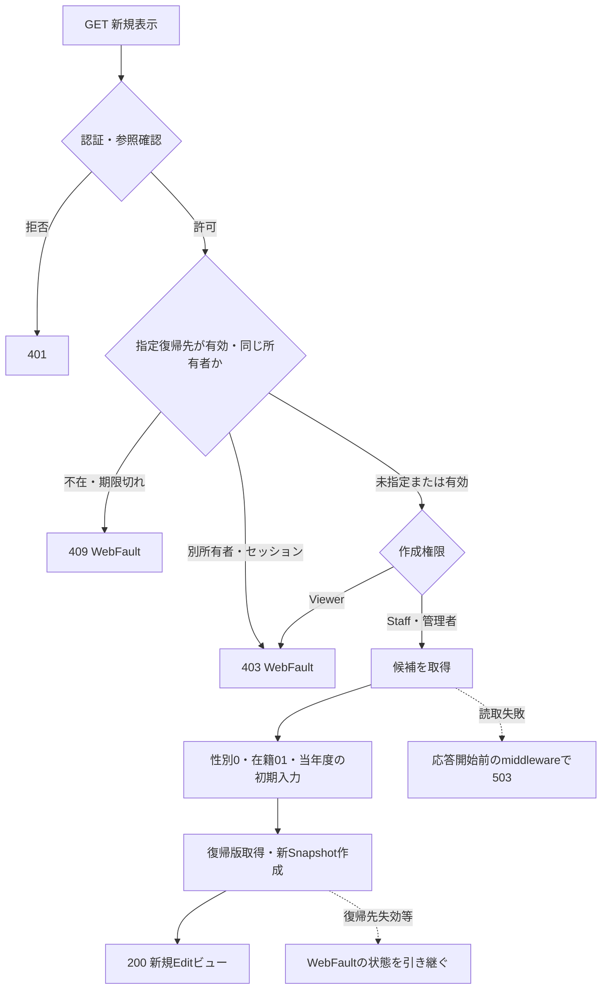

#### SQL・テーブル関連（ER図）

このイベントは学生の新規行を作らない。候補名称の参照と人数集計の依存は次のとおりである。矢印は読取依存であり、人数集計や表示JOINをFKと解釈しない。

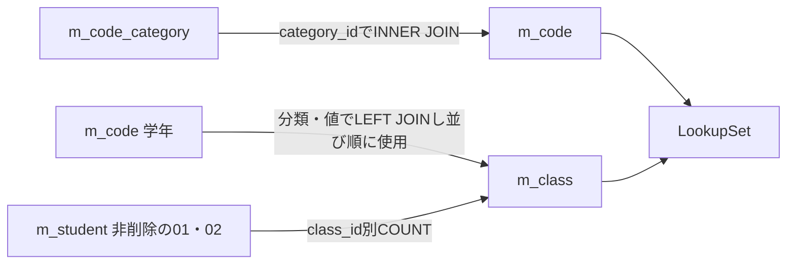

根拠：`Core/SqlServerStudentService.cs:201–214`。

#### DB操作の詳細

コードSQLは分類・表示順・コード値で並べ、利用状態・期間によるWHEREを置かない。クラスSQLも候補を全取得し、年度降順、学年表示順、クラス表示順、クラスコード、クラスIDで並べる。人数は`class_id`が同じ非削除01・02のCOUNTで求める。検索条件パラメータ、ページング、候補件数上限はこの取得にはない。2結果をSNAPSHOT内で読み終えてcommitする。根拠：`Core/SqlServerStudentService.cs:196–216`。

#### 結果・例外時の扱い

成功は200の新規画面である。認証情報不正は401、作成権限不足は403、指定復帰先の不在・期限切れは409、所有者等の不一致は403となる。候補取得やSnapshot生成等の未捕捉例外は、応答開始前であればmiddlewareが処理する。根拠：`Infrastructure/RequestIdentity.cs:7–15`、`Infrastructure/SearchContextStore.cs:13–13`、`Infrastructure/WebHostSetup.cs:23–23`。

参考設計は必須コード不足で保存不可、クラス0件でW-STU-108を表示することを求める。現行表示は候補0件でも専用警告や保存ボタン非活性を生成しない。表示時の警告責務と、保存時のコード存在・クラス必須による拒否を区別する。根拠：`reference-designs/基本設計書/02_学生登録画面.md:175–192`、`Infrastructure/WebStudentCoordinator.cs:17–17`、`Core/StudentNormalizer.cs:154–154`、`Core/SqlServerStudentService.cs:347–355`。

### EV-REG-002 既存学生の編集・参照表示

#### 処理概要

GET `/students/{id:long}`で非削除の学生1人を読み込む。利用者権限によって編集または参照を表示し、読込値と比較版を同じSnapshotへ保持する。対象不在を新規表示に置き換えない。根拠：`Web/Controllers/StudentsController.cs:24–25`、`Infrastructure/WebStudentCoordinator.cs:17–17`。

#### 処理手順

1. 認証情報の参照可否と、指定復帰先の有効性・所有者を確認する。
2. 対象IDをGetAsyncへ渡す。サービスはIDが0以下ならNULLを返す。正数の場合はID一致かつ非削除の学生を取得する。
3. 0件ならCoordinatorが404・E-STU-103を発生させる。
4. 保存値からStudentDraftとStudentDetailを作り、生年月日を元号・年・月・日に戻す。期待版は読取版の十進文字列とする。
5. 人数集計ありの候補を取得し、所属ClassIdに対応する年度・学年を入力補助へ移す。所属がない既存学生には当年度を補わない。
6. 復帰版を取得し、入力複製・Detail・対象ID・復帰版を新しいSnapshotへ保持する。
7. Staff・Administratorは編集、Viewerは参照として表示する。既存の学籍番号はreadonlyとする。

根拠：`Core/SqlServerStudentService.cs:172–194`、`Web/Inputs/StudentSaveInput.cs:44–54`、`Web/Controllers/StudentsController.cs:25–25`、`Web/Models/StudentEditPageModel.cs:14–14`。

#### 処理フロー

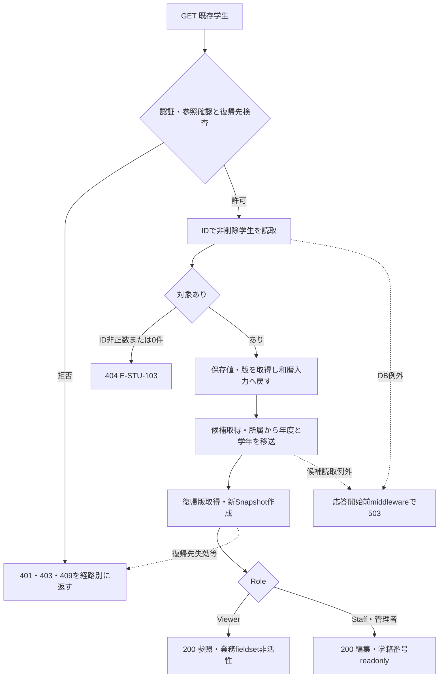

#### SQL・テーブル関連（ER図）

学生本体の読取は単一表で行い、候補を別の読取単位で取得する。学生の所属FKと、候補の表示・人数集計は別の関係である。

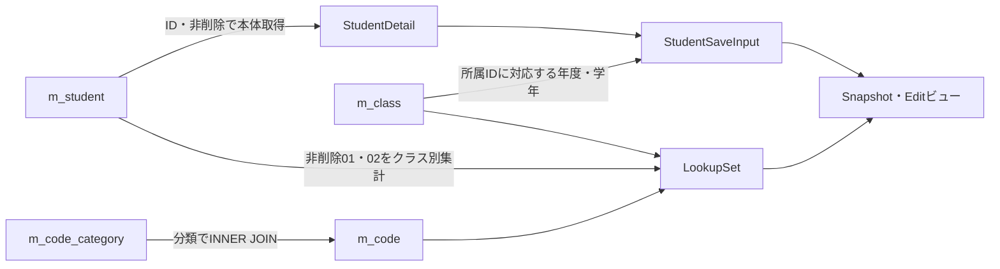

根拠：`Core/SqlServerStudentService.cs:176–216`、`Web/Inputs/StudentSaveInput.cs:46–54`。

#### DB操作の詳細

学生読取は`SELECT * FROM dbo.m_student WHERE student_id=@id AND is_deleted=0`で、`@id`はBigIntである。主キー条件により対象は0件または1件となる。ここに名称JOIN、ページング、ORDER BYはない。学生読取と後続の候補取得は同じSNAPSHOTトランザクションではない。根拠：`Core/SqlServerStudentService.cs:172–181`、`Core/SqlServerStudentService.cs:196–216`。

候補取得のSQLはEV-REG-001と同じであり、このイベントでも現在人数を含める。学生・マスタへの書込みはない。根拠：`Infrastructure/WebStudentCoordinator.cs:17–17`。

#### 結果・例外時の扱い

正常時は200の編集・参照画面を返す。対象不在・削除済みは404で、新規に切り替えない。停止・期間外の既存コードと所属は、読込時Detailに対応する値として保持可能にする。保存時には最新マスタの存在等を改めて確認する。根拠：`Views/Students/Edit.cshtml:8–13`、`Core/SqlServerStudentService.cs:347–383`。

参照・復帰先の拒否と、学生・候補取得の失敗は別の経路である。局所の表示catchはなく、応答開始前のWebFaultはそのHTTP状態、その他例外は503のHTMLエラーへ進む。根拠：`Web/Controllers/StudentsController.cs:25–25`、`Infrastructure/WebHostSetup.cs:23–23`。

### EV-REG-003 入力補助と未保存状態の管理

#### 処理概要

画面内でクラスと年度・学年を同期し、不適合な選択クラスを解除する。業務フォームの入力変更は未保存状態を記録し、重複確認キーを解除する。日付・在籍・所属の最終検査は保存サービスで行う。根拠：`wwwroot/js/site.js:2–8`。

#### 処理手順

1. クラス選択変更時、選択optionにdata-yearがあれば、そのdata-year・data-gradeを年度・学年へ設定する。
2. 年度または学年を変更したとき、選択クラスがあり、指定された上位値とoptionの属性が一致しなければ、クラスだけを空にして「年度・学年に合わないクラスを解除しました。」と通知する。上位値が空の場合は、その上位値による不一致判定を行わない。
3. 業務フォームのinputイベントではdirtyを真にし、`Input.DuplicateToken`を空にする。
4. dirtyかつleavingでない間は、beforeunloadで未保存変更の警告を要求する。
5. フォーム送信時に確認文がある場合はwindow.confirmを呼ぶ。取消なら送信を中止する。受理後はleavingを真にし、送信したボタン以外の同フォームのボタンをdisabledにしてaria-busyを設定する。

根拠：`wwwroot/js/site.js:2–5`、`wwwroot/js/site.js:8–8`、`Views/Students/Edit.cshtml:12–17`。

#### 処理フロー

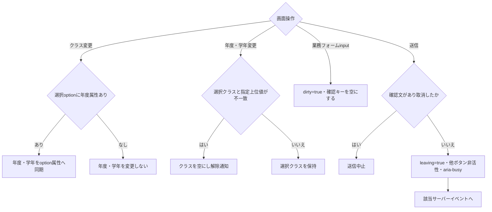

#### SQL・テーブル関連（ER図）

このイベントは、表示済みoptionの属性、input・selectの値、hidden確認キー、JavaScriptのdirty・leavingを変更する。DB、Snapshot、検索Context、サーバー確認辞書を変更する要求は送らないため、DBのER図は非該当である。根拠：`wwwroot/js/site.js:2–8`。

#### DB操作の詳細

DB操作はない。クラス候補の再取得・非表示、人数の再表示、在籍区分変更による終了日非活性化、入力変更時の和暦実在日検査は、この接続コードにはない。Coordinator.Optionsは宣言されているが、登録画面の入力補助から呼び出されていない。`POST /students/options`は検索フォーム用であり、登録候補APIとして扱わない。根拠：`wwwroot/js/site.js:8–8`、`Infrastructure/WebStudentCoordinator.cs:16–16`、`Web/Controllers/StudentsController.cs:22–27`。

#### 結果・例外時の扱い

不適合クラスを解除しても年度・学年と他の業務入力は保持する。クラス選択時に人数表示は更新しないため、表示人数を新しい選択の最新値として判断しない。保存時のクラス・定員再検査を確定判断に使う。根拠：`wwwroot/js/site.js:8–8`、`Core/SqlServerStudentService.cs:362–380`。

参考設計は、和暦の即時検査、在籍による終了日・所属条件表示、年度・学年・区分変更に伴う候補再取得と人数更新、有効な学年の新規選択を求める。これらを現行の選択同期・解除だけで充足したとは扱わない。根拠：`reference-designs/基本設計書/02_学生登録画面.md:160–167`、`reference-designs/基本設計書/02_学生登録画面.md:264–280`。

送信表示は同じ送信を拒否するBusy検査を持たず、送信ボタン自身も非活性にしない。DB書込ゲートと確認情報のBusy取得が、画面表示とは別に後段で働く。根拠：`wwwroot/js/site.js:4–4`、`Core/SqlServerStudentService.cs:92–102`、`Core/SqlServerStudentService.cs:278–278`。

### EV-REG-004 新規登録・更新

#### 処理概要

入力を正規化し、最新の学生・マスタ・人数・候補を確認した後、学生1件と操作履歴1件を一括確定する。確認待ち、変更なし、入力不正、権限不足、対象不在、版競合、処理失敗、結果不明は別の結果として返す。根拠：`Web/Controllers/StudentsController.cs:26–33`、`Core/SqlServerStudentService.cs:227–324`。

#### 処理手順

1. 認証・CSRFの入口検査を経て、アクション内ではFormGuard、作成・更新権限、Snapshot取得、指定復帰先の有効性、Snapshot.Originalの復帰先との一致を順に確認する。不明な項目や許されない同名重複は400、別の復帰先は403とする。
2. これらの事前検査の後にModelStateを判定する。不正ならサービスを呼ばず422で再表示する。有効ならCoordinator.Saveで権限・復帰先を再確認し、DTOから要求を作る。ClassIdと期待版は正のInt64へ変換し、新規の非空期待版は400とする。
3. サービス開始時に受付UUID、認証主体、UTC時点、業務日を取得する。ViewerはForbiddenとする。DB接続前に19項目、理由、対象と期待版の組合せ、年度、学年形式を検査する。入力検証例外・ArgumentExceptionはValidationFailedへ変換する。
4. SQL Serverへ接続し、ReadCommittedトランザクションを開始する。保存try内でXACT_ABORTと共通のExclusive書込ゲートを取得する。ゲート待機は最大5000msで、取得失敗はSQL例外とする。
5. 更新では、ゲート取得後にID一致・非削除の最新学生を取得する。不在はNotFound、期待版不一致はConflict、学籍番号の変更はValidationFailedとする。変更前が03・04で別区分に変える場合は管理者と理由を要求する。新規ではこの対象読取を行わず、前値・前版を未設定のままにする。
6. 性別・都道府県・在籍・設定された続柄の最新コードを確認する。新規・変更コードには分類とコードの利用可否・期間も要求する。クラス指定時は存在、指定年度・学年との一致、状態に応じた期間を確認し、増席時だけ最新人数と定員を検査する。
7. 正規化業務値、2照合キー、続柄分類を最新DB値と比較する。DateOnlyとDBのDateTimeは日付で比較する。差分なしなら明示rollbackしてNoChangeと対象ID・取得版を返す。日時・版・履歴を更新しない。差分がある場合だけ版のlong.MaxValueをConflictにする。
8. 学籍番号が、自分以外の全学生で使用済みでないことを確認する。削除済み学生も含める。使用済みならValidationFailedとする。
9. 非削除、自分以外、同じ生年月日で、氏名キーまたはカナキーが一致する候補をID順に全件取得する。全候補のID・版と正規化内容のハッシュを作る。
10. 確認キーが渡されていれば、所有者・セッション、対象ID・期待版、内容、全候補、期限、Busyを照合する。有効な確認で理由が未設定ならValidationFailedとする。候補あり、または確認キー非NULLで、確認が無効なら保存トランザクションをrollbackし、新しい確認キーと全件数・最大20件を返す。
11. 確認不要、または確認済みで理由もある場合はINSERTまたはUPDATEする。新規は採番ID・版1、更新は既存ID・取得版+1を得る。UPDATEはID・期待版・非削除を条件とし、OUTPUTなしはDBConcurrencyExceptionにする。
12. 学生書込みと同じ接続・トランザクションで履歴を追記する。CREATEまたはUPDATE、前後版、変更列名JSON、実行者、UTC時点、受付UUID、理由、候補が存在する場合の重複確認フラグを記録する。
13. commitを試み、成功した場合は確認キーを除去してSavedとID・新版を返す。ControllerはSavedだけを成功通知と検索復帰の303へ進める。他の結果は、結果別状態で入力画面を再表示する。

入口順序の根拠：`Web/Controllers/StudentsController.cs:29–33`、`Infrastructure/WebStudentCoordinator.cs:18–18`、`Web/Inputs/StudentSaveInput.cs:34–43`。保存本体の根拠：`Core/SqlServerStudentService.cs:227–315`、`Core/SqlServerStudentService.cs:344–390`。

期限の時点はそれぞれ異なる。Snapshotと復帰先はサービス呼出し前に検査し、保存中にDB確定直前の再確認は行わない。確認期限と業務日の比較にはSaveAsync開始時のnowを使い、ゲート待機後に現在時刻を取り直さない。一方、学生の版、コード、クラス、人数、候補はゲート取得後に読み直す。根拠：`Web/Controllers/StudentsController.cs:29–31`、`Core/SqlServerStudentService.cs:229–278`。

#### 処理フロー

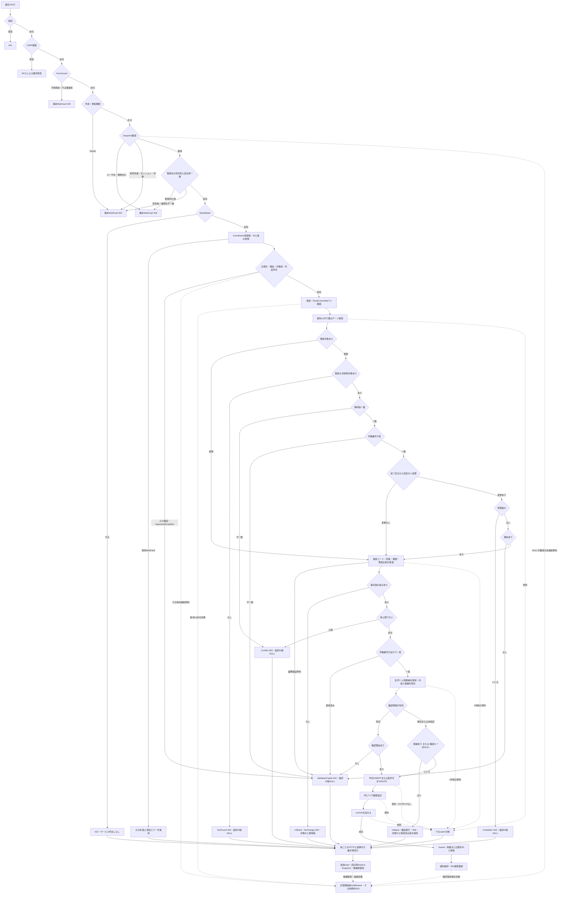

保存try内の例外は次の順に分類する。先行catchへ入った例外を、後段の結果不明判定に含めない。

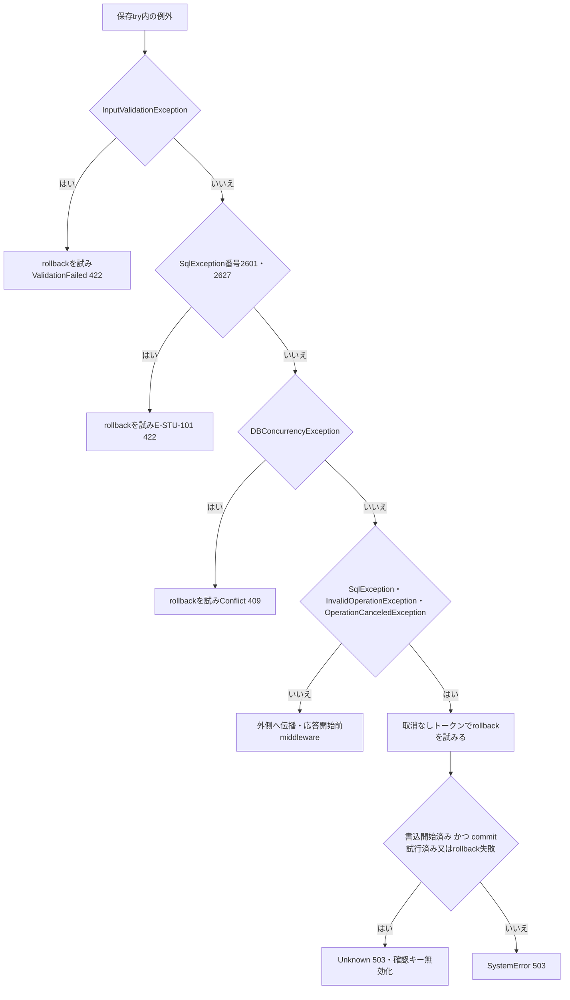

#### SQL・テーブル関連（ER図）

実FKは次の関係である。学生のクラスと続柄は任意、性別・都道府県・在籍の分類付きコードは必須である。クラスの学年とコードの分類もFKを持つ。図はDDLの関係を示し、名称表示のLEFT JOINや監査追記をFKへ置き換えない。

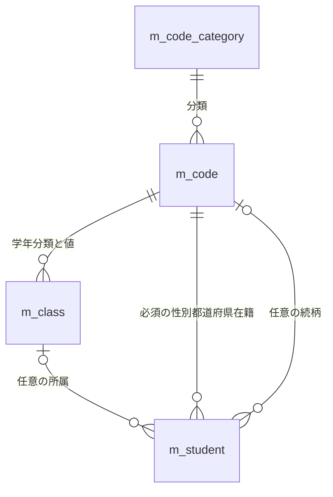

学生変更と履歴追記には、次の同一トランザクション依存がある。履歴のtarget_keyには学生FKが宣言されていない。

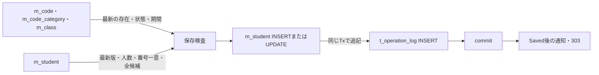

根拠：`database/001_schema.sql:189–199`、`database/001_schema.sql:137–154`、`Core/SqlServerStudentService.cs:307–315`。

#### DB操作の詳細

書込みは共通資源`test-project1:student-write`のトランザクション所有Exclusive applockを使う。業務SQLのCommandTimeoutは30秒、各DB呼出しへ取消トークンを渡す。パラメータはSqlDbTypeを指定し、文字列等のSizeが0以外の場合にSizeを設定する。DateOnlyは日付の午前0時へ変換し、NULLはDBNullで渡す。接続時にはSNAPSHOT許可状態を確認する。根拠：`Core/SqlServerStudentService.cs:53–73`、`Core/SqlServerStudentService.cs:92–102`、`Core/SqlServerStudentService.cs:241–244`。

| 操作 | SQLの対象・全条件 | パラメータ | 結果・用途 |
| --- | --- | --- | --- |
| 更新対象読取 | `m_student`の`student_id=@id AND is_deleted=0` | `@id BigInt` | 最新保存値とrow_version。0件はNotFound、版不一致はConflict。 |
| 最新コード検査 | `m_code`と`m_code_category`を分類でINNER JOINし、分類と値が一致する行を取得 | `@category VarChar(24)`、`@value VarChar(10)` | 存在、双方の利用可否、開始日・終了日。新規・変更値だけ利用状態・期間を要求する。 |
| クラス検査 | `m_class`の`class_id=@id` | `@id BigInt` | 年度、学年、期間、利用状態、定員。指定補助値との一致を確認する。 |
| 増席時人数 | `m_student`のクラス一致、非削除、在籍01・02、自分以外。新規のID NULL時は対象除外条件を適用しない | `@class BigInt`、`@id BigInt` | COUNT_BIGに1を加えて定員と比較。NULL定員では人数による拒否を行わない。 |
| 学籍番号一意 | `m_student`の番号一致、自分以外。削除条件なし | `@no VarChar(15)`、`@id BigInt` | COUNT_BIGが0より大きければE-STU-101。論理削除後も番号を再利用できない。 |
| 同一人物候補 | RowSelectのLEFT JOINに、非削除、自分以外、生年月日一致、氏名キーまたはカナキー一致を付ける。`ORDER BY s.student_id` | `@id BigInt`、`@birth Date`、`@name NVarChar(320)`、`@kana NVarChar(36)` | 全件を取得。SQLのTOP・ページングはなく、返却画面だけ最大20件。 |
| 学生INSERT | 正規化保存値、2照合キー、続柄分類、固定3分類、未削除、作成・更新管理情報、版1を設定 | 項目表の同名パラメータ、`@now DateTimeOffset`、`@actor NVarChar(128)` | OUTPUTのIDを表変数経由で取得する。 |
| 学生UPDATE | 学籍番号以外の正規化保存値と更新日時・者・版加算をSET。WHEREはID・期待版・非削除 | 項目表の更新対象パラメータ、`@id BigInt`、`@version BigInt`、`@now DateTimeOffset`、`@actor NVarChar(128)` | OUTPUTなし・DBNullはDBConcurrencyException。作成情報、番号、固定3分類、削除属性は変更しない。 |
| 履歴INSERT | `t_operation_log`へ1件。対象表はm_student、キーは学生ID文字列 | `@id VarChar(35)`、`@op VarChar(11)`、`@before/@after BigInt`、`@changed NVarChar(max)`、`@actor NVarChar(128)`、`@now DateTimeOffset`、`@request UniqueIdentifier`、`@reason NVarChar(120)`、`@confirmed Bit` | CREATEは前版NULL・後版1、UPDATEは取得版・取得版+1。変更列名を保存し、業務値の前後コピーは持たない。 |

SQL根拠：`Core/SqlServerStudentService.cs:247–272`、`Core/SqlServerStudentService.cs:294–307`、`Core/SqlServerStudentService.cs:347–390`。候補の名称はクラス、学年、在籍、都道府県へのLEFT JOIN結果であり、表示DTOでNULL可能でも、マスタ名称列のNOT NULL属性は変わらない。根拠：`Core/SqlServerStudentService.cs:77–90`、`database/001_schema.sql:68–68`、`database/001_schema.sql:115–115`。

所属・定員の検査は次の状態ごとに行う。

| 保存前後の状態 | 最新クラスの検査 | 人数・定員 |
| --- | --- | --- |
| 新規在学・休学、別クラスへの異動、終了区分から在学・休学への訂正 | 存在、指定年度・学年一致、利用可、業務日が期間内 | 自分を除く非削除01・02人数＋1を定員と比較する。 |
| 在学・休学のまま同じクラスの席を保持 | 存在、指定年度・学年一致 | 増席でないため、停止・期間外・既存定員超過だけでは拒否しない。 |
| 新規卒業・退学で最終所属を指定 | 存在、指定年度・学年一致、入学～終了日とクラス期間が重なる | 席を消費しない。停止クラスも、この期間条件により許容し得る。 |
| 卒業・退学で所属・区分・入学日・終了日を変更 | 存在、指定年度・学年一致、期間の重なり | 席を消費しない。 |
| 卒業・退学で最終所属・在籍期間を保持し、住所等だけ変更 | 存在、指定年度・学年一致。期間重なりの再検査条件には入らない | 席を消費しない。 |
| 卒業・退学でクラス未指定 | 年度範囲・学年形式は検査するが、クラスに対する存在・一致検査は非該当 | 席を消費しない。 |

期間の重なりは両端を含み、入学日がクラス終了日より後、または学生終了日がクラス開始日より前の場合に拒否する。終了日そのものがクラス期間内であることまでは要求しない。参考設計が求める同一席保持時の見直し警告は現行結果に生成されない。根拠：`Core/SqlServerStudentService.cs:357–383`、`reference-designs/基本設計書/02_学生登録画面.md:624–646`。

NoChangeと確認待ちでは明示rollbackする。検査による他の直接returnではcommitを呼ばず、未確定トランザクションの破棄へ進む。catchのrollbackは取消要求と切り離して`CancellationToken.None`を使用し、SqlException・InvalidOperationExceptionの場合は失敗をfalseで返す。根拠：`Core/SqlServerStudentService.cs:250–290`、`Core/SqlServerStudentService.cs:316–329`。

#### 結果・例外時の扱い

| 結果・入口拒否 | HTTP・画面 | 返却ID・版と保持値 | DB確定・操作上の扱い |
| --- | --- | --- | --- |
| Saved | 成功通知を保持して303 | 新規は採番ID・1、更新は既存ID・新版 | 学生と履歴のcommit成功後。検索復帰は後続の別処理。 |
| NoChange | 200、「変更はありません。」 | 対象ID・取得版を結果に保持。画面は送信Inputと読込時Detailを使用 | 学生・日時・版・履歴を変更しない。 |
| ConfirmationRequired | 409、候補sectionを表示 | 対象ID・取得済み前版、新確認キー、全件数、最大20件。新規のID・前版はNULL | 保存Txを終了して確認待ち。学生・履歴を書き込まない。 |
| ValidationFailed | 422、エラーと入力再表示 | 返却ID・版はNULL。送信InputとSnapshotは保持 | 入力・コード・所属・理由・番号一意などの拒否を理由別に表示する。 |
| Forbidden | 403、エラーと入力再表示 | 返却ID・版はNULL | サービスでの権限拒否。事前権限拒否は外側HTML経路になる。 |
| NotFound | 404、エラーと入力再表示 | 返却ID・版はNULL | ゲート下の最新非削除対象がない。 |
| Conflict | 409、エラーと入力再表示 | 返却ID・版はNULL | 期待版不一致、変更ありの版上限、OUTPUTなし等。自動的に期待版だけを新しくしない。 |
| SystemError | 503、サービスのエラーと入力再表示 | 返却ID・版はNULL | 最後のcatchで結果不明条件に該当しない場合の分類。 |
| Unknown | 503、再保存前の検索確認を案内 | 返却ID・版はNULL。指定確認キーを無効化する | 最後のcatchに到達し、書込開始済みかつcommit試行済みまたはrollback失敗の場合。確定状態を断定しない。 |
| ModelState不正 | 422、入力再表示 | SaveResultなし。送信Input・読込時Detail・Snapshotを使用 | サービス呼出しなし。 |
| Coordinator・DTO変換の局所WebFault | 例外のHTTP状態で入力再表示 | SaveResultなし。指定フィールドへエラーを追加 | 保存サービス到達前の拒否を含む。 |
| FormGuard・権限・Snapshot・復帰先の事前WebFault | 例外のHTTP状態で外側HTMLエラー | 通常のEdit再表示経路に入らない | アクション内の局所catchより前に生じる。 |

根拠：`Web/Controllers/StudentsController.cs:29–33`、`Infrastructure/WebPresentation.cs:23–23`、`Core/SqlServerStudentService.cs:226–226`、`Core/SqlServerStudentService.cs:262–262`、`Core/SqlServerStudentService.cs:290–323`。

非Saved再表示は送信Input、読込時Snapshot.Detail、同じSnapshotId・復帰版、再取得候補を組み合わせる。結果がある場合はDuplicateTokenだけを結果のConfirmationTokenへ差し替え、そのModelState旧値を除く。NoChangeや確認待ちの返却版で、期待版・更新日時・更新者を一括して最新化する処理はない。結果のID・版を一律NULLとして合流させず、画面表示用の読込情報とも区別する。根拠：`Web/Controllers/StudentsController.cs:32–33`。

保存tryのcatch順は、入力検証、SQL番号2601・2627、DBConcurrencyException、その他の対象例外である。前3経路はrollbackを試み、それぞれValidationFailed、E-STU-101、Conflictを返し、rollback失敗を理由とするUnknown判定へ進まない。SQL番号2601・2627の分類は発生箇所を区別せず適用する。最後のcatchだけが書込・commitフラグとrollback成否でUnknownかSystemErrorかを決める。根拠：`Core/SqlServerStudentService.cs:316–323`。

正規化では不正Unicodeや通常の日付形式・元号境界のArgumentExceptionを入力エラーへ変換する。一方、有効元号でYear・Month・DayがNULLなら文字列Normalize呼出し、AdmissionDateがNULLならParseIsoでNullReferenceExceptionが生じ得る。ToRequestが補うのはBirthDateInput本体がNULLの場合だけであり、構成文字列のNULLをすべて補うわけではない。これらは入力検証・ArgumentException捕捉を通らず外側へ伝播する。根拠：`Web/Inputs/StudentSaveInput.cs:34–42`、`Core/JapaneseDateService.cs:17–24`、`Core/JapaneseDateService.cs:52–59`、`Core/StudentNormalizer.cs:123–143`、`Core/SqlServerStudentService.cs:232–243`。

接続・トランザクション開始、捕捉対象外の例外、結果後の候補再取得・描画、確定後の通知処理は保存catchの外側で失敗し得る。応答開始前のmiddlewareはWebFaultの状態を引き継ぎ、その他例外を503のHTMLエラーと検索リンクへ変換する。応答開始後はこのcatch対象外である。根拠：`Core/SqlServerStudentService.cs:241–243`、`Web/Controllers/StudentsController.cs:31–33`、`Infrastructure/WebHostSetup.cs:23–23`。

### EV-REG-005 同一人物候補の確認続行・取消

#### 処理概要

氏名またはカナの照合と生年月日が一致した学生を、同一人物の断定ではなく確認候補として扱う。確認待ちでDBロックを持ち続けず、別人と確認した理由を付けて同じ保存入口へ再POSTする。確認取消は画面入力を保持したまま候補領域を閉じる。根拠：`Core/SqlServerStudentService.cs:269–290`、`Views/Students/Edit.cshtml:14–14`、`wwwroot/js/site.js:6–6`、`reference-designs/基本設計書/02_学生登録画面.md:61–72`。

#### 処理手順

1. ConfirmationRequiredの結果から、全候補件数と先頭最大20件を表示する。候補表は学籍番号・氏名・和暦生年月日・クラス名だけとし、住所・電話・メールは表示しない。
2. 取消ボタンを初期フォーカス対象にする。取消時はhidden確認キーを空にし、候補sectionを除去する。入力値とDBは変更しない。
3. 続行時は確認・変更理由を入力し、送信確認を経て同じ新規登録または更新フォームを送信する。
4. EV-REG-004の入口検査、正規化、最新対象・版、コード・所属・定員、番号一意、全候補取得をすべて再実行する。
5. 確認情報の所有者・セッション、対象・期待版、正規化内容、全候補ID・版、10分期限を照合し、Busyの取得に成功した場合だけ確認済みとする。
6. 有効な確認で理由なしなら422。無効なら保存Txを終了して新しい確認情報を発行し409。確認済みで保存成功なら確認キーを除去して303へ進む。

根拠：`Views/Students/Edit.cshtml:14–14`、`wwwroot/js/site.js:4–6`、`Core/SqlServerStudentService.cs:227–290`、`Core/SqlServerStudentService.cs:313–323`。

#### 処理フロー

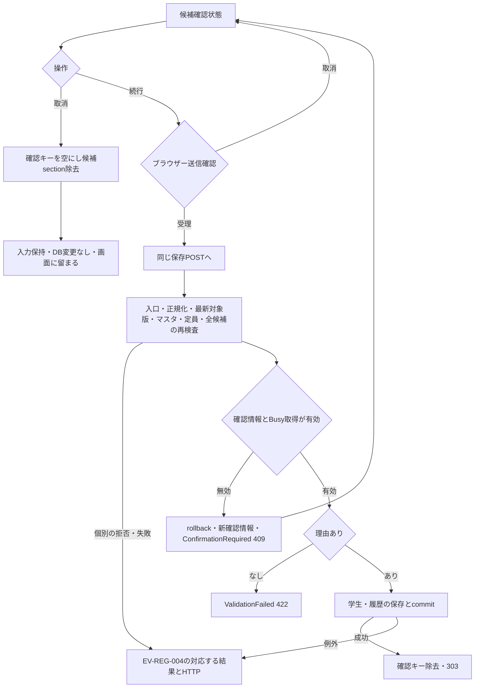

#### SQL・テーブル関連（ER図）

続行は保存イベントと同じDB関係を持つ。取消はDOMだけの変更である。Web確認情報はメモリ辞書にあり、確認待ちの保存Txを終了してから発行する。

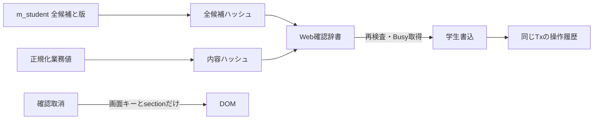

根拠：`Core/SqlServerStudentService.cs:224–225`、`Core/SqlServerStudentService.cs:274–290`、`Core/SqlServerStudentService.cs:307–335`、`wwwroot/js/site.js:6–6`。

#### DB操作の詳細

確認候補SQLとパラメータはEV-REG-004の候補取得と同じである。確認の有効性は先頭20件ではなく、ID順で取得した全候補のID・版ハッシュで比較する。正規化内容ハッシュは保存業務値を対象とし、name_key、kana_key、relationship_categoryは除外する。理由・年度・学年もハッシュには含まれないが、続行時の理由・年度・学年検査は省略しない。根拠：`Core/SqlServerStudentService.cs:224–225`、`Core/SqlServerStudentService.cs:234–237`、`Core/SqlServerStudentService.cs:269–290`。

Web確認キーは256ビット乱数から64桁hexで生成する。確認取消専用のサーバー要求はなく、画面でキーを空にしても元の辞書項目は即時には除去しない。成功時と最後の対象例外catchでUnknownとなった場合はキーを除去し、確認済みで未完了かつUnknown以外の場合はfinallyでBusyを解除する。期限切れ項目は新しい確認情報を発行する際に除去する。根拠：`Core/SqlServerStudentService.cs:313–335`。

#### 結果・例外時の扱い

候補変更、入力変更、期限切れ、所有者・対象・版の不一致、Busy取得失敗では再確認へ進む。参考設計はこの相違にW-STU-102の通知を求めるが、現行ConfirmationRequiredのErrorsは空で、相違理由の通知を設定していない。取消にはautofocusを付ける一方、続行時のwindow.confirmの既定操作をコードで取消へ指定していない。根拠：`Core/SqlServerStudentService.cs:278–290`、`Views/Students/Edit.cshtml:14–14`、`wwwroot/js/site.js:4–4`、`reference-designs/基本設計書/02_学生登録画面.md:364–378`。

サービス引数として確認キーが空文字でも非NULLなら、候補0件であっても無効確認として新しいConfirmationRequiredへ進み得る。画面で空にした値がHTTPバインド後にNULLか空文字かとなる境界とは区別する。根拠：`Core/SqlServerStudentService.cs:276–290`、`wwwroot/js/site.js:3–6`。

### EV-REG-006 論理削除

#### 処理概要

管理者が対象、読込時版、理由、明示確認を指定して論理削除する。別フォームを使うため、編集中の氏名・住所・日付・所属などの業務値を保存しない。削除属性、更新管理情報、DELETE履歴を一括確定する。根拠：`Views/Students/Edit.cshtml:17–17`、`Web/Controllers/StudentsController.cs:37–38`、`Core/SqlServerStudentService.cs:392–416`。

#### 処理手順

1. ブラウザーは削除理由を要求し、フォーム送信時に対象・理由の確認を行う。送る値はSnapshotId、ExpectedVersion、ReturnContextId、Confirmed=true、Reason、CSRF情報である。
2. ControllerではFormGuard、参照権限、対象Snapshot取得、読込時復帰先との一致を順に確認する。保存と同じModelState.IsValid分岐や局所WebFault catchはない。
3. Coordinatorでは管理者権限、復帰先の有効性、Confirmed、期待版の正のInt64変換を順に確認する。
4. DeleteAsyncでは管理者、削除理由60スカラー、正のID・版、版がlong.MaxValueでないことを確認する。
5. 接続とReadCommittedトランザクションを開始し、保存try内で共通書込ゲートを取得する。
6. ID一致・非削除の現在版を読む。不在はNotFound、版不一致はConflictとする。
7. ID・期待版・非削除をWHEREにして削除属性、更新日時・更新者、版加算だけをUPDATEする。件数が1でなければDBConcurrencyExceptionにする。
8. DELETE履歴1件を同じトランザクションで追記し、commitする。成功はID・版+1を返す。
9. ControllerはSavedだけを通知と303へ進める。非Savedは結果のエラーとHTTP状態を設定した後、Loadで学生DB・候補を再読込する。

根拠：`Infrastructure/WebStudentCoordinator.cs:19–19`、`Web/Controllers/StudentsController.cs:37–38`、`Core/SqlServerStudentService.cs:392–416`。

#### 処理フロー

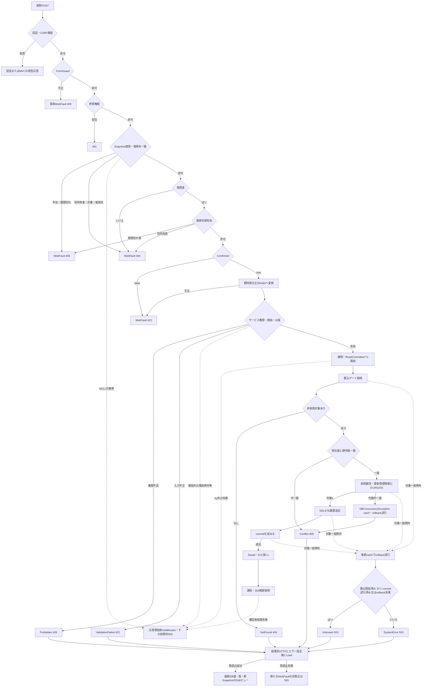

#### SQL・テーブル関連（ER図）

削除は学生表と操作履歴表の2表を書き込む。元のクラス・コードFK値は保持する。履歴追記は同一トランザクション依存であり、学生への履歴FKではない。

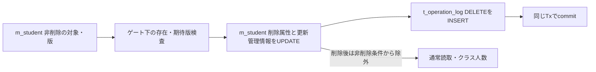

根拠：`Core/SqlServerStudentService.cs:404–414`、`Core/SqlServerStudentService.cs:176–176`、`Core/SqlServerStudentService.cs:201–201`、`database/001_schema.sql:137–154`。

#### DB操作の詳細

| 操作 | 対象・設定・WHERE | パラメータ | 結果 |
| --- | --- | --- | --- |
| 現在版読取 | `m_student`の`student_id=@id AND is_deleted=0`からrow_version取得 | `@id BigInt` | 0件はNotFound。期待版不一致はConflict。 |
| 論理削除UPDATE | SETはis_deleted=1、deleted_at・deleted_by・delete_reason、updated_at・updated_by、row_version+1。WHEREはID・期待版・非削除 | `@id/@version BigInt`、`@now DateTimeOffset`、`@actor NVarChar(128)`、`@reason NVarChar(120)` | 更新1件を要求。氏名、住所、日付、クラス、作成管理情報を保持する。 |
| DELETE履歴 | 対象m_student、ID文字列、前版=要求版、後版=要求版+1、変更列は削除・更新管理7列 | EV-REG-004の履歴型を使用。理由を設定し、duplicate_confirmed=false | 同じTxで1件追記し、その後commitする。 |

根拠：`Core/SqlServerStudentService.cs:404–414`、`Core/SqlServerStudentService.cs:385–390`。削除属性のDDLでは未削除時に削除日時・者・理由をNULL、削除時にはすべて設定するCHECKがある。根拠：`database/001_schema.sql:200–200`。

更新件数不一致後の再存在検査は行わず、DBConcurrencyExceptionからConflictへ返す。参考設計は0件時の存在再確認で不在と版競合を分ける意図を持つが、現行で分けるのはUPDATE前の読取段階である。根拠：`Core/SqlServerStudentService.cs:404–415`、`reference-designs/基本設計書/02_学生登録画面.md:596–605`。

#### 結果・例外時の扱い

削除結果のHTTP対応は保存と同じである。ただし非Saved後は、元入力を保持する保存画面とは異なり、DB最新値・版・候補と新Snapshotを作り直す。読取に成功した場合は削除結果のHTTP状態とエラーを伴う画面になる。対象が削除済み・不在、復帰先が失効、候補取得失敗などの場合には、このLoadから別の最終エラーへ進む。根拠：`Web/Controllers/StudentsController.cs:25–25`、`Web/Controllers/StudentsController.cs:37–37`。

理由検査の局所catchはInputValidationExceptionだけであり、不正UnicodeのArgumentException等は外側へ伝播し得る。トランザクション内ではDBConcurrencyExceptionを先にConflictへ変換する。後続のSqlException・InvalidOperationException・OperationCanceledExceptionだけを、書込開始・commit試行・rollback成否でSystemErrorとUnknownへ分類する。先行Conflictを結果不明条件へ含めない。根拠：`Core/StudentNormalizer.cs:37–57`、`Core/SqlServerStudentService.cs:396–416`。

削除後の通常読取と人数は非削除条件により対象を除外するが、学籍番号一意確認には残る。論理削除を、番号再利用、復元機能、物理消去、永久保存承認と結び付けない。根拠：`Core/SqlServerStudentService.cs:176–176`、`Core/SqlServerStudentService.cs:201–201`、`Core/SqlServerStudentService.cs:264–266`、`reference-designs/基本設計書/02_学生登録画面.md:679–687`。

### EV-REG-007 入力クリア・編集取消・再読込・検索復帰

#### 処理概要

入力クリア・編集取消は読込時Snapshotへ戻し、再読込はDBの最新値・版を取得する。検索復帰は保持した検索状態へ戻る。いずれも通常保存を代わりに実行しない。保存・削除の確定後復帰は、未保存入力の破棄確認とは別の経路である。根拠：`Web/Controllers/StudentsController.cs:25–25`、`Web/Controllers/StudentsController.cs:35–38`、`Views/Students/Edit.cshtml:16–17`。

#### 処理手順

1. 入力クリア・編集取消では、送信確認の後に`/students/reset`へSnapshotIdとStudentIdを送る。ControllerはFormGuard、参照権限、任意StudentIdの正数変換、Snapshotの所有者・対象・期限を検査する。
2. ModelStateをクリアし、Snapshot.Originalを複製する。新規は読込時初期値、既存は最後の読込時値に戻す。Detail、SnapshotId、復帰版は同じ読込状態を使い、候補だけ再取得する。
3. 再読込リンクでは、dirtyの場合だけ破棄確認を行う。受理後は既存表示GETを実行し、EV-REG-002で最新値・版・新Snapshotを一緒に取り直す。
4. 検索復帰リンクでも、dirtyの場合だけ破棄確認を行う。受理後は読込時復帰Context・Revisionで`/students`へ移動する。
5. 保存・削除のSaved後は、復帰Contextがなければ新しい未検索Contextを作る。通知を保持してContext・Revision付きLocationへ303を返す。
6. 検索GETは、指定Contextを取得しResumeを実行する。Gate待機後に所有者・期限・要求版・版上限を確認する。適用済み条件があれば再検索し、結果を保持して検索版を増やす。条件がなければ未検索として返し、版を増やさない。正常終了時に期限を延長し、通知を一度だけ取り出す。

根拠：`Web/Controllers/StudentsController.cs:8–11`、`Web/Controllers/StudentsController.cs:35–38`、`Infrastructure/WebStudentCoordinator.cs:14–14`、`Infrastructure/SearchContextStore.cs:13–15`、`Infrastructure/FlashMessageStore.cs:6–9`、`wwwroot/js/site.js:4–5`。

#### 処理フロー

```mermaid
flowchart TD
    A{操作・結果} -->|入力クリア・編集取消| B{送信確認}
    B -->|取消| STAY[現在の入力画面に留まる]
    B -->|受理| RST[FormGuard・参照権限・対象変換・Snapshot検査]
    RST -->|拒否| ERR[経路別WebFault・未捕捉例外]
    RST -->|成功| ORG[ModelStateクリア・Original複製・同じDetailとSnapshot・復帰版]
    ORG --> LK[候補だけ再取得]
    LK --> V1[200 読込時入力のEditビュー]
    A -->|再読込| DIRTY{dirtyか}
    DIRTY -->|いいえ| GET[既存表示GET]
    DIRTY -->|はい| ASK{破棄確認}
    ASK -->|取消| STAY
    ASK -->|受理| GET
    GET --> V2[EV-REG-002・最新値と版・新Snapshot]
    A -->|手動検索復帰| D2{dirtyか}
    D2 -->|いいえ| CTX[保持Context・復帰版で検索GET]
    D2 -->|はい| A2{破棄確認}
    A2 -->|取消| STAY
    A2 -->|受理| CTX
    A -->|Saved確定後| C0{復帰Contextあり}
    C0 -->|なし| NEW[新Context・版1・適用条件なし]
    C0 -->|あり| OLD[指定Contextと読込時復帰版を保持]
    NEW --> FLASH[成功通知を保持・303]
    OLD --> FLASH
    FLASH --> CTX
    CTX --> USE[Context取得・Gate待機後再確認・版一致検査]
    USE -->|拒否| ERR
    USE -->|許可| AP{適用済み条件あり}
    AP -->|なし| UNS[未検索結果・検索版はそのまま]
    AP -->|あり| SEARCH[保持条件で再検索・結果保存・検索版加算]
    UNS --> OUT[正常終了で期限延長・通知を一度取得・検索表示]
    SEARCH --> OUT
    LK -. 取得失敗 .-> ERR
    GET -. 読取・復帰先失敗 .-> ERR
    SEARCH -. 再検索失敗 .-> ERR
```

#### SQL・テーブル関連（ER図）

取消は学生DBを読み直さず、メモリの読込Snapshotを使う。再読込は学生本体と候補を読み、検索復帰は保持条件がある場合に検索SQLを実行する。通知はDBではなくFlashMessageStoreに保持する。

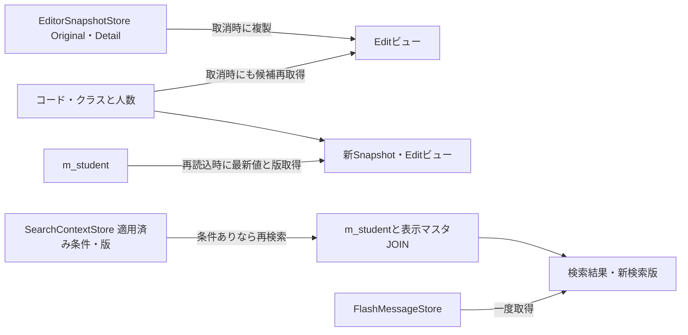

根拠：`Web/Controllers/StudentsController.cs:8–11`、`Web/Controllers/StudentsController.cs:25–25`、`Web/Controllers/StudentsController.cs:35–38`。

#### DB操作の詳細

取消のDB操作は候補のLookupAsyncだけである。学生の値・版はSnapshotから復元するため、取消を最新DB取得として説明しない。再読込の学生・候補SQLはEV-REG-002と同じである。根拠：`Web/Controllers/StudentsController.cs:25–25`、`Web/Controllers/StudentsController.cs:35–35`。

検索復帰では、適用済み条件がない場合は検索DB操作を行わない。条件がある場合はSearchAsyncへその条件を渡し、学生とクラス・学年・在籍・都道府県名称を取得する検索処理を再実行する。ContextのGateは検索状態の所有者・期限・版を待機後にも確認するが、学生保存トランザクションとは別である。根拠：`Infrastructure/WebStudentCoordinator.cs:14–14`、`Infrastructure/SearchContextStore.cs:14–14`、`Core/SqlServerStudentService.cs:82–90`、`Core/SqlServerStudentService.cs:103–171`。

#### 結果・例外時の扱い

取消成功は200で「入力を読込時の値へ戻しました。」を表示する。同じSnapshotを再利用するため、取消成功でSnapshot期限を延長しない。再読込成功は最新の値・版・管理情報と新Snapshotを表示する。検索復帰の未検索枝は検索版を保持し、適用条件ありの再検索枝は版を増やす。これらの枝を共通の固定版へ合流させない。根拠：`Infrastructure/EditorSnapshotStore.cs:10–10`、`Web/Controllers/StudentsController.cs:35–35`、`Infrastructure/WebStudentCoordinator.cs:14–14`。

Snapshotキー不在・期限切れは409、別所有者・セッション・対象は403である。空文字は通常の辞書検索に進む。NULLを渡す前置検査はないため、ライブラリ引数例外が独自409より先行し得る。検索ContextのGetはこれと異なり、NULLを明示的に409として扱う。根拠：`Infrastructure/EditorSnapshotStore.cs:10–10`、`Infrastructure/SearchContextStore.cs:13–13`。

再読込リンクの明示確認はdirtyの場合だけである。参考設計が求める常時の再読込確認や、破棄確認の取消既定とは区別する。ウィンドウ終了警告はbeforeunloadへの要求であり、実際のダイアログ文言・既定操作を画面コードが指定しているわけではない。根拠：`wwwroot/js/site.js:3–5`、`reference-designs/基本設計書/02_学生登録画面.md:453–468`。

保存・削除のcommitと、通知保持・303・検索再実行は別の確定境界である。確定後に検索状態が失効・更新されて復帰できない場合でも、それを学生保存のrollbackと扱わない。結果不明の場合は自動再送する経路を設けず、検索で対象状態を確認してから次の操作を判断する。根拠：`Web/Controllers/StudentsController.cs:31–38`、`Infrastructure/SearchContextStore.cs:14–14`、`Core/SqlServerStudentService.cs:322–322`、`Core/SqlServerStudentService.cs:416–416`。

## 補足説明

### 受信・保持・確定の境界

ControllerにはAuthorize、自動CSRF検証を登録する。要求本文の設定上限は65536バイト、フォーム値数は128で、非nullable参照型の暗黙required検証は抑止する。FormGuardは許可項目・和暦4構成値・追加制御項目を検査するが、欠落値の補完や文字列NULL排除、型変換成功を保証する処理ではない。ブラウザーrequired、DTOの非nullable注釈、サービスの必須検査を別の層として扱う。根拠：`Web/Controllers/StudentsController.cs:5–5`、`Web/Controllers/StudentsController.cs:41–41`、`Infrastructure/WebHostSetup.cs:14–18`。

読込Snapshotは所有者・ログインセッション・対象・期限を検査するが、タブIDは照合項目にない。検索Contextはタブも保持し、UseのGate待機後に所有者・期限・版を再確認する。ただしGETによる登録画面からの復帰ではタブ引数を渡さない。確認情報は保存時に内容・全候補・期待版を再検査する。各一時情報の検査対象と時点を相互に代用しない。根拠：`Infrastructure/EditorSnapshotStore.cs:7–10`、`Infrastructure/SearchContextStore.cs:9–14`、`Web/Controllers/StudentsController.cs:10–10`、`Core/SqlServerStudentService.cs:278–278`。

WebのRoleとDB接続ユーザーのロールは別の権限境界である。権限SQLはstudent_staffに学生INSERT・UPDATEと監査INSERTを許可し、学生物理DELETEと履歴UPDATE・DELETEを拒否する。SQLの宣言から、現在の接続ユーザーへの適用やWeb利用者ごとの対応を確定しない。根拠：`Infrastructure/RequestIdentity.cs:13–16`、`database/003_web_permissions.sql:8–24`。

### 参考設計が求める動作と現行実装の対応

| 主題 | 参考設計の意図 | 現行の観測・残る差 | 根拠 |
| --- | --- | --- | --- |
| 初期候補不足 | 必須コード不足は保存不可、クラス0件はW-STU-108で案内 | 表示時の専用警告・非活性は生成しない。保存時のコード・クラス条件で拒否する。 | `reference-designs/基本設計書/02_学生登録画面.md:175–192`、`Infrastructure/WebStudentCoordinator.cs:17–17` |
| 生年月日補助 | 入力変更時に実在日・元号境界を検査し、不正原入力を保持 | 最終保存時に検査する。接続JavaScriptには即時和暦検査がない。 | 同参考資料`264–280`、`wwwroot/js/site.js:2–8`、`Core/JapaneseDateService.cs:17–33` |
| 在籍・所属連動 | 区分別の終了日・クラス条件を表示し、候補と人数を更新 | 終了日には区分別disabledがない。JavaScriptは上位値同期・クラス解除まで。保存条件はサービスで検査する。 | 同参考資料`264–280`、`Views/Students/Edit.cshtml:11–12`、`wwwroot/js/site.js:8–8` |
| 学年の選択 | 新規は有効候補、既存値は別枠で保持 | 学年selectには停止・期間によるdisabledがない。クラスなしでの独立した学年コード存在検査はない。 | 同参考資料`160–167`、`Views/Students/Edit.cshtml:12–12`、`Core/SqlServerStudentService.cs:237–237`、`Core/SqlServerStudentService.cs:362–383` |
| 同一席の保持 | 期間外・超過の既存席だけで通常変更を拒否せず、見直し警告を出す | 増席でない場合の拒否抑止は実装するが、見直し警告は生成しない。 | 同参考資料`624–646`、`Core/SqlServerStudentService.cs:357–383` |
| 確認情報の相違 | W-STU-102で再確認を通知する | 新確認要求は返すがErrorsは空で、相違理由通知を付けない。 | 同参考資料`364–378`、`Core/SqlServerStudentService.cs:278–290` |
| 郵便番号表示 | 数字7桁保存、3桁－4桁表示 | 保存値をそのまま入力へ移す。ハイフン表示加工はない。 | 同参考資料`125–146`、`Web/Inputs/StudentSaveInput.cs:49–49` |
| 日付表示 | 入学・終了日の入力はISO、表示はyyyy/MM/dd | DTO移送はISO、画面はtype=date。実表示形式を固定する投影や処理はない。 | 同参考資料`125–146`、`Core/SqlServerStudentService.cs:190–191`、`Views/Students/Edit.cshtml:11–11` |
| 書込0件 | 存在再確認で不在と版競合を分ける | 書込前は分けるが、OUTPUTなし・削除件数不一致後は再読取せずConflict。 | 同参考資料`574–605`、`Core/SqlServerStudentService.cs:303–318`、`Core/SqlServerStudentService.cs:411–415` |
| 再読込・破棄確認 | 再読込を明示確認し、破棄確認は取消を既定にする | 再読込確認はdirtyの場合だけ。window.confirmの既定操作は指定しない。 | 同参考資料`453–468`、`wwwroot/js/site.js:4–5` |
| UI非同期制御 | Busyによる再入防止、要求連番による旧応答排除 | ボタン表示制御はあるが同一送信の拒否検査・要求連番はない。DBゲート・確認Busyとは別である。 | `reference-designs/詳細仕様書/CSharp_ASPNET/02_学生登録画面.md:811–815`、`wwwroot/js/site.js:4–8` |

参考資料の設計上のサービス名・共通処理名を、現行ソースの実装名へ読み替えて実在を断定しない。本機能の接続入口はStudentsController、Coordinator、IStudentServiceである。StrictJson、Coordinator.Options、WebPresentation.Saveの宣言を、登録画面の公開APIとして追加しない。根拠：`Infrastructure/StrictJson.cs:4–15`、`Infrastructure/WebStudentCoordinator.cs:16–19`、`Infrastructure/WebPresentation.cs:30–30`、`Web/Controllers/StudentsController.cs:23–38`。

### 実装・業務確認の責務

本機能の確認は、入力がどの処理値となり、どの列へ保存され、どの形で再表示されるかを往復して行う。共通の正規化や候補取得に成功しただけでは、学生保存のcommit成功を意味しない。参考設計は顧客IT部門に入出力・権限・画面からDBへの追跡・競合障害時結果の確認を、実装工程に往復と境界条件の確認を求めている。根拠：`reference-designs/基本設計書/02_学生登録画面.md:685–689`、`reference-designs/詳細仕様書/CSharp_ASPNET/02_学生登録画面.md:749–753`、`reference-designs/詳細仕様書/CSharp_ASPNET/02_学生登録画面.md:789–795`。

| 確認対象 | 実装側で対応させる内容 | 業務・IT側で確認する結果 |
| --- | --- | --- |
| 文字・空欄 | rawスカラー上限、FormKC後上限、HTMLコード単位、SQL Size、DB容量を別々に確認する。必須空欄・任意NULL、氏名原表記・2照合キーの往復を確認する。 | 入力が意図せず切捨て・補正されないこと、保存表記と照合表記が説明どおり分かれること。 |
| 日付 | 4原文字列、DateOnly、date、和暦逆変換を対応させる。元年・元号境界・閏日・1900年下限・業務日・入学日順序を確認する。 | 生年月日・在籍日付の意味と、入力不正時に保持する原入力が確認できること。 |
| NULL・バインド | フォーム欠落・空・不正変換、和暦本体と構成値、識別キー・版・boolの到達値、ModelStateと例外経路を確認する。 | 入力不正の422と、状態拒否・外側HTMLエラーを取り違えないこと。 |
| 候補・所属 | 停止・期間外の同値保持、新規選択、上位変更解除、席保持・増席・席解放、最新人数検査を確認する。 | 参考人数を予約と扱わず、在学・休学と終了区分の条件が判断できること。 |
| 同一人物確認 | 全候補ID・版、内容・所有者・期限、20件表示、理由、Busy、取消・入力変更を対応させる。 | 照合一致が同一人物の断定でなく、確認対象として扱われること。 |
| 保存・競合 | 期待版、変更なし、版上限、番号全行一意、条件付きUPDATEと履歴commitを確認する。 | 不在、競合、変更なし、確認待ち、保存確定が別の結果になること。 |
| 障害・再操作 | 履歴失敗、commit例外、rollback成否、catch外失敗、削除失敗後Load、確定後検索復帰を段階別に確認する。 | SystemErrorとUnknownを分け、結果不明時に検索確認してから次操作を判断できること。 |
| 権限・取消 | Viewer、Staff、Administrator、終了区分訂正、削除別フォーム、Snapshot取消、最新再読込を対応させる。 | 削除が編集中の業務値を保存せず、取消と再読込が異なること。 |

同じ電話・メールを家族で共有することは参考設計で許容され、現行の同一人物候補SQLにも電話・メール重複による拒否条件はない。個人情報保存期間、削除復元、物理消去、論理削除後の保持運用は運用判断として確定する必要があり、画面の論理削除実装から決めない。根拠：`reference-designs/基本設計書/02_学生登録画面.md:679–687`、`Core/SqlServerStudentService.cs:264–272`。

### 関連文書の対応

次のID・kind・相対pathは提供計画の対応を保持する。関連文書は本応答では未生成であり、リンク先の生成済み状態を示さないため、pathを文字列で記載する。本書は同機能の基本設計を担当し、当該イベントの条件・結果・確定境界を本文内に示した上で、詳細な型・SQL・表定義の責務を対応付ける。

| 文書ID | kind | 正確な相対path | 本書との対応・生成状態 |
| --- | --- | --- | --- |
| CSHARP_ASPNET-BAS-STU-01 | basic-design | `基本設計書/01_学生検索画面.md` | 呼出元・復帰先、適用済み検索条件と表示状態。未生成、リンク未設定。 |
| CSHARP_ASPNET-BAS-STU-03 | table-index | `基本設計書/03_テーブル仕様書.md` | 表の関連、共通管理情報、保存・排他・一時表の区分。未生成、リンク未設定。 |
| CSHARP_ASPNET-BAS-STU-04 | code-design | `基本設計書/04_コード設計書.md` | 5分類・初期定義・保守契約。未生成、リンク未設定。 |
| CSHARP_ASPNET-BAS-STU-03-M_STUDENT | table-definition | `基本設計書/テーブル/01_m_student.md` | 19入力、照合・派生値、管理列、制約の物理対応。未生成、リンク未設定。 |
| CSHARP_ASPNET-BAS-STU-03-M_CLASS | table-definition | `基本設計書/テーブル/02_m_class.md` | 年度内クラス、学年、名称、期間、定員。未生成、リンク未設定。 |
| CSHARP_ASPNET-BAS-STU-03-M_CODE_CATEGORY | table-definition | `基本設計書/テーブル/03_m_code_category.md` | 分類・固定桁・利用可否。未生成、リンク未設定。 |
| CSHARP_ASPNET-BAS-STU-03-M_CODE | table-definition | `基本設計書/テーブル/04_m_code.md` | 保存コードと参照名称、期間・停止状態。未生成、リンク未設定。 |
| CSHARP_ASPNET-BAS-STU-03-T_OPERATION_LOG | table-definition | `基本設計書/テーブル/05_t_operation_log.md` | 学生変更と一括確定する履歴、前後版・理由・変更列。未生成、リンク未設定。 |
| CSHARP_ASPNET-DET-CSharp_ASPNET-SCR-STU-001 | detailed-specification | `詳細仕様書/CSharp_ASPNET/01_学生検索画面.md` | 検索復帰、Context・版・保持条件・再検索の詳細。未生成、リンク未設定。 |
| CSHARP_ASPNET-DET-CSharp_ASPNET-SCR-STU-002 | detailed-specification | `詳細仕様書/CSharp_ASPNET/02_学生登録画面.md` | 本機能の実コントロール、受信型・NULL境界、内部値、SQL、例外・移送の詳細。未生成、リンク未設定。 |
