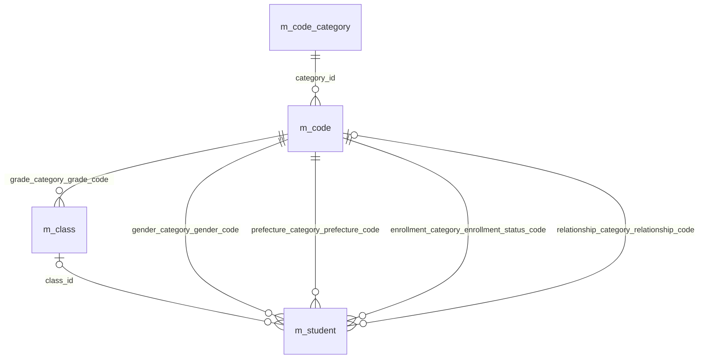
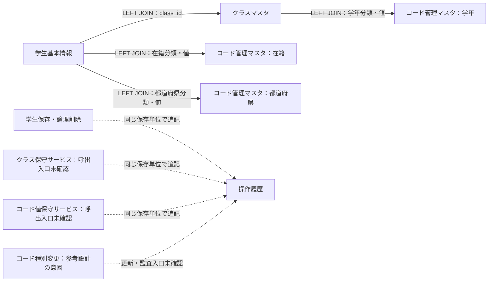
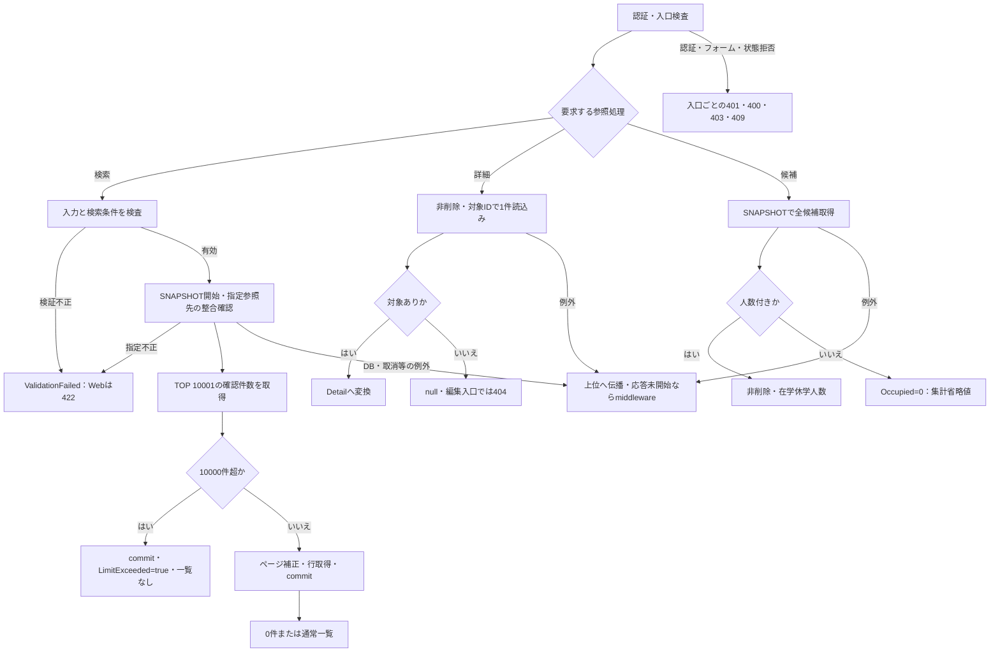
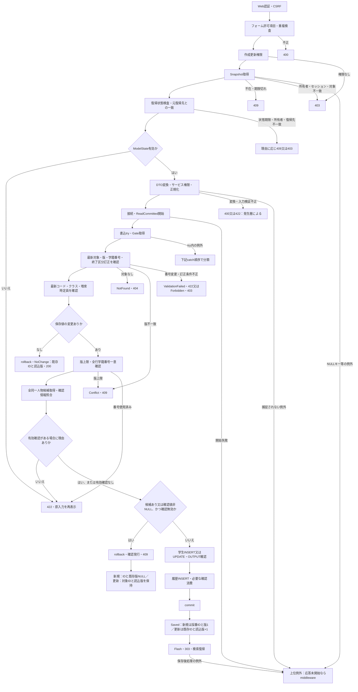
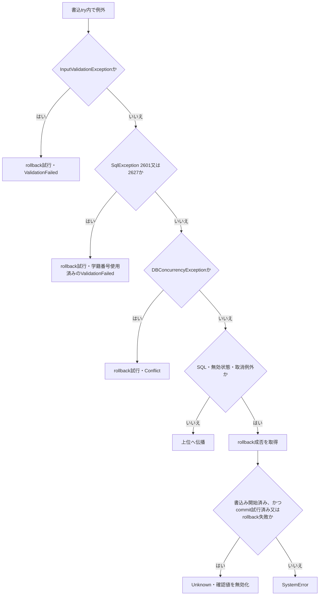
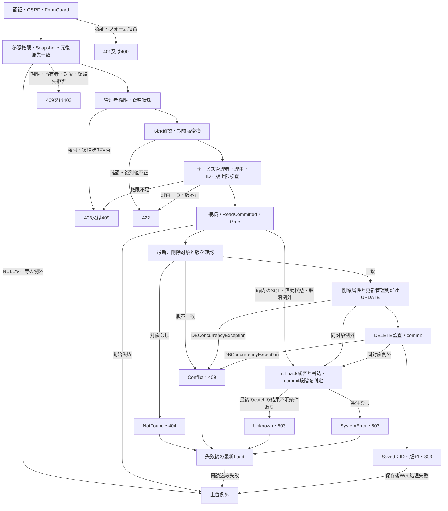
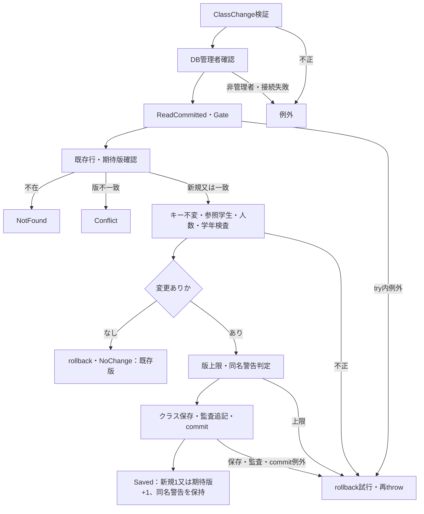
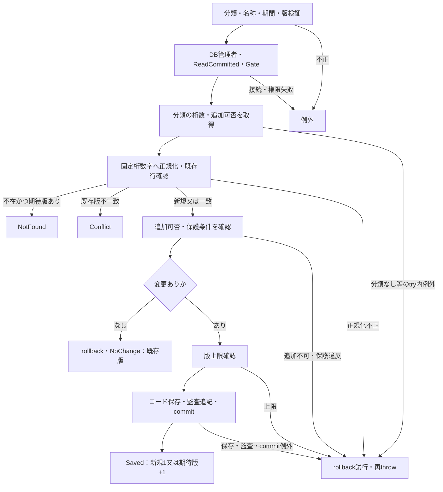
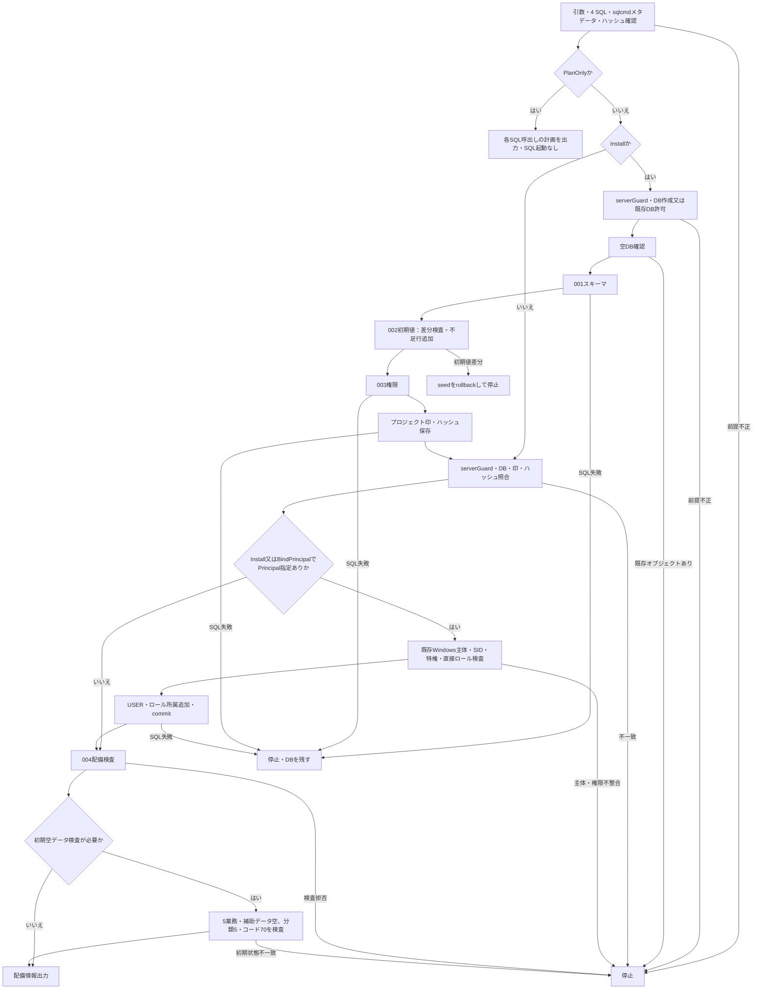

<!-- spec-meta: {"schema":"spec-md/1.0","documentId":"CSHARP_ASPNET-BAS-STU-03","version":"1.0","path":"基本設計書/03_テーブル仕様書.md","sheets":[{"heading":"概要","kind":"GRID","sheet":"01_概要"},{"heading":"項目一覧","kind":"LIST","sheet":"02_テーブル一覧","key":["No"]},{"heading":"イベント仕様","kind":"GRID","sheet":"03_イベント仕様"},{"heading":"補足説明","kind":"GRID","sheet":"04_補足説明"}]} -->
# テーブル仕様書（索引・データ関連・共通保存規則）

文書種別：基本設計・テーブル索引／版：1.0／正本：Markdown／対象：SQL Server向けCSharp_ASPNET実装

## 概要

本書は、学生、年度内のクラス、業務コード、操作記録をどの単位で保存し、どの条件で参照・更新するかを定義する。5業務表の個別列定義は表ごとの分冊へ対応させ、本書では表間の関連、管理項目、入力値と保存値の境界、保存と監査の確定単位を説明する。

学生基本情報は学生1人、クラスマスタは年度内のクラス1件、コード種別マスタは分類1件、コード管理マスタは分類内の値1件、操作履歴は操作記録1件を表す。列数は順に35、17、11、14、12で、合計89列である。学生には年度、学年、クラス名称、年齢を重複保存する列がなく、年度・学年・クラス名称は所属先から参照する。現在人数もクラスの保存列ではなく、学生から求める取得値である。〔実装根拠：`sources/database/001_schema.sql:7-154`、`sources/Core/Contracts.cs:50-70`、`sources/Core/SqlServerStudentService.cs:82-90,196-216`〕

参考設計も5業務表を単位とする分冊化を意図している。各分冊は一つの表について論理的意味と物理定義を対応させ、テーブルヘッダーと項目詳細を同じファイルに置く。本書の共通規則を各分冊へ全面的に繰り返す構成にはしない。分冊の具体型、容量、NULL、DEFAULT、制約は現行DDLで確定する。参考設計の論理型や業務初期値だけでは物理属性を確定しない。〔設計意図根拠：`reference-designs/基本設計書/03_テーブル仕様書.md:8-18,36-46`〕

### 保存情報の参照関係

実FKは次の7件である。分類と値を組にして参照するため、異なる分類の同じ数字文字列は別のコードとして扱う。

| FK | 子側の保存列 | 親側のキー | 業務上の関係 |
| --- | --- | --- | --- |
| `fk_code_category` | `m_code.category_id` | `m_code_category.category_id` | 一つの分類に複数のコード値を持てる |
| `fk_class_grade` | `m_class.grade_category, grade_code` | `m_code.category_id, code_value` | 一つの学年コードを複数クラスが参照できる |
| `fk_student_class` | `m_student.class_id` | `m_class.class_id` | 学生は最大1クラスを参照する。NULLなら未所属 |
| `fk_student_gender` | `m_student.gender_category, gender_code` | `m_code.category_id, code_value` | 学生の性別を分類付きコードで保存する |
| `fk_student_prefecture` | `m_student.prefecture_category, prefecture_code` | `m_code.category_id, code_value` | 学生住所の都道府県を分類付きコードで保存する |
| `fk_student_enrollment` | `m_student.enrollment_category, enrollment_status_code` | `m_code.category_id, code_value` | 学生の在籍区分を分類付きコードで保存する |
| `fk_student_relationship` | `m_student.relationship_category, relationship_code` | `m_code.category_id, code_value` | 緊急連絡先の続柄を分類付きコードで保存する。両列NULLを許容する |

子側の参照列には一意制約がないため、一つの親行を複数の子行が参照できる。続柄の分類・値はNULL可能だが、緊急連絡先一式のCHECKが部分設定を拒否する。7件のFKにはCASCADE指定がなく、参照先の利用停止、期間外、定員超過はFKとは別の業務検査である。〔実装根拠：`sources/database/001_schema.sql:28-31,189-201`〕

### 表示JOINと監査追記の依存

学生一覧は学生を起点に、クラス、学年コード、在籍コード、都道府県コードをLEFT JOINする。これは一覧の取得方法であり、FKの宣言とは別の関係である。監査追記も保存処理から履歴への書込み依存であり、履歴の対象キーにFKを設定するものではない。

操作履歴の`target_table`と`target_key`には業務表へのFKが宣言されていない。学生・クラスの番号、または分類とコード値の組を文字列で記録する。履歴の追記関係から参照整合、削除連動、業務値の復元機能を導かない。参考設計にはコード種別変更の監査もあるが、現行材料で確認できる分類書込みはseedの不足行追加であり、分類更新・監査入口は確認できない。〔実装根拠：`sources/database/001_schema.sql:137-154,187-205`、`sources/Core/SqlServerStudentService.cs:82-90,385-390`、`sources/Core/MasterMaintenanceService.cs:74-76,119-135`、`sources/database/002_seed.sql:85-92`。設計意図根拠：`reference-designs/基本設計書/03_テーブル仕様書.md:20-34`〕

## 項目一覧

| No | 論理名 | 物理名 | 1件の単位・主キー | 列数 | kind | 個別文書ID | 契約上のpath・相対リンク | 生成状態 |
| --- | --- | --- | --- | --- | --- | --- | --- | --- |
| 1 | 学生基本情報 | `dbo.m_student` | 学生1人。`student_id` | 35 | `table-definition` | `CSHARP_ASPNET-BAS-STU-03-M_STUDENT` | [基本設計書/テーブル/01_m_student.md](テーブル/01_m_student.md) | 計画先・本応答では未生成 |
| 2 | クラスマスタ | `dbo.m_class` | 年度内のクラス1件。`class_id` | 17 | `table-definition` | `CSHARP_ASPNET-BAS-STU-03-M_CLASS` | [基本設計書/テーブル/02_m_class.md](テーブル/02_m_class.md) | 計画先・本応答では未生成 |
| 3 | コード種別マスタ | `dbo.m_code_category` | コード分類1件。`category_id` | 11 | `table-definition` | `CSHARP_ASPNET-BAS-STU-03-M_CODE_CATEGORY` | [基本設計書/テーブル/03_m_code_category.md](テーブル/03_m_code_category.md) | 計画先・本応答では未生成 |
| 4 | コード管理マスタ | `dbo.m_code` | 分類内のコード1件。`category_id, code_value` | 14 | `table-definition` | `CSHARP_ASPNET-BAS-STU-03-M_CODE` | [基本設計書/テーブル/04_m_code.md](テーブル/04_m_code.md) | 計画先・本応答では未生成 |
| 5 | 操作履歴 | `dbo.t_operation_log` | 操作記録1件。`log_id` | 12 | `table-definition` | `CSHARP_ASPNET-BAS-STU-03-T_OPERATION_LOG` | [基本設計書/テーブル/05_t_operation_log.md](テーブル/05_t_operation_log.md) | 計画先・本応答では未生成 |

## イベント仕様

### 学生検索・詳細読込み・候補取得

#### 処理概要

検索は非削除学生を条件で絞り、所属先とコード名称を組み合わせて一覧を返す。詳細読込みは学生1件を編集用の値へ戻す。候補取得はコードとクラスを取得し、画面で使う選択値と名称を供給する。いずれも業務表の更新と操作履歴の追記を行わない。

#### 処理手順

1. Web入口では認証を適用し、POSTではCSRFとフォーム許可項目を検査する。検索ではModelStateを確認し、DTOから検索条件へ移す。検索状態を使う操作は所有者・セッション・タブ・期限・状態版も確認する。
2. `SearchAsync`はページ、件数、並び順、年度、クラス、未所属との併用、在籍区分を検査する。文字列を正規化し、氏名・カナの検索キー、電話、日付を生成する。
3. 接続後、SNAPSHOTトランザクションを開始する。指定学年・都道府県コードの存在、年度候補の存在、クラスと年度・学年の一致を確認する。
4. 同じ条件で最大10001件までを数える。10000件を超える場合は一覧を抑止する。通常は最終ページを求めて指定ページを補正し、20・50・100件のいずれかを取得して読取り単位をcommitする。
5. `GetAsync`は正のIDを条件に非削除学生1件を読む。この処理には明示的なSNAPSHOTトランザクションがない。日付、任意値、クラスID、管理情報を`StudentDetail`へ戻す。
6. `LookupAsync`はSNAPSHOT内でコードとクラスを取得する。人数付きでは非削除かつ在学・休学の学生数を集計する。検索画面の`LookupAsync(false)`では集計せず、`Occupied`に0を設定する。

〔実装根拠：`sources/Web/Controllers/StudentsController.cs:13-22,25,39,41`、`sources/Infrastructure/SearchContextStore.cs:13-14`、`sources/Core/SqlServerStudentService.cs:103-216`〕

#### 処理フロー

#### SQL・テーブル関連（ER図）

対象は学生、クラス、コード管理、コード種別の4表である。実FKは概要のER図、一覧の表示依存は概要のLEFT JOIN図に対応する。コード候補ではコード種別をINNER JOINし、分類と値の両利用状態を合成する。候補全体の取得に利用状態・期間のWHERE絞込みはなく、画面用途に応じて選択可否を決める。

#### DB操作の詳細

検索の全条件はANDで結合する。ただし電話の2列比較だけはORである。任意条件は正規化値が非NULLの場合に追加する。

| 条件 | 検索列・述語 | SQLパラメータ・型・サイズ |
| --- | --- | --- |
| 共通 | `s.is_deleted=0` | なし |
| 学籍番号 | `s.student_no`の前方一致 | `@no`：`VarChar(31)`。LIKEエスケープ後に末尾`%`を付加 |
| 氏名 | `s.name_key`の部分一致 | `@name`：`NVarChar(642)`。前後に`%`を付加 |
| カナ | `s.kana_key`の部分一致 | `@kana`：`NVarChar(74)`。前後に`%`を付加 |
| 年度 | `c.school_year=@year` | `@year`：`SmallInt` |
| 学年 | `c.grade_code=@grade` | `@grade`：`VarChar(2)` |
| クラス | `s.class_id=@class` | `@class`：`BigInt` |
| 未所属 | `s.class_id IS NULL` | なし。年度・学年・クラスとの併用は拒否 |
| 都道府県 | `s.prefecture_code=@prefecture` | `@prefecture`：`VarChar(2)` |
| 電話 | 本人電話または緊急電話が`@phone`と等しい | `@phone`：`VarChar(16)` |
| 入学日開始 | `s.admission_date>=@from` | `@from`：`Date` |
| 入学日終了 | `s.admission_date<=@to` | `@to`：`Date` |
| 在籍区分 | `s.enrollment_status_code IN (...)` | 値ごとに`@status0`等：`VarChar(2)`。空配列なら条件なし |
| ページ | `OFFSET @offset ROWS FETCH NEXT @size ROWS ONLY` | 両方`Int` |

LIKEは`!`をESCAPE文字とし、`!`、`%`、`_`、`[`をエスケープする。件数SQLは学生とクラスだけをLEFT JOINし、行SQLは名称取得用のJOINを追加する。並び順は学籍番号、氏名キー、入学日、更新日時の4種類と昇順・降順だけを許可し、副順序は常に学生ID昇順とする。コマンドは30秒設定で、実行、読取、commitへ取消トークンを渡す。〔実装根拠：`sources/Core/SqlServerStudentService.cs:65-72,123-168`、`sources/Core/StudentNormalizer.cs:161-161`〕

コード候補は分類、表示順、値の順、クラス候補は年度降順、学年表示順、クラス表示順、クラスコード、クラスIDの順で取得する。詳細は`student_id=@id AND is_deleted=0`で読み、`@id`は`BigInt`である。〔実装根拠：`sources/Core/SqlServerStudentService.cs:172-216`〕

#### 結果・例外時の扱い

検索0件は条件に該当する学生がない状態であり、入力不正とは異なる。上限超過時の確認件数は10001で打ち切られており、全該当件数ではない。通常検索は`Outcome.NoChange`で結果を返すが、これは読取り結果の分類であって業務更新の有無を検査した結果ではない。

検索内の`InputValidationException`と`ArgumentException`は`ValidationFailed`へ変換する。DB、取消、その他の捕捉されない例外は上位へ伝播する。非nullableな配列注釈だけでは受信後の非NULLを保証できず、在籍区分配列がNULLとしてサービスへ届く場合の`Length`アクセスは、この検証例外変換とは別の境界である。応答未開始の例外はWeb middlewareで処理し、応答開始後は同catchの対象外となる。〔実装根拠：`sources/Core/SqlServerStudentService.cs:111-112,169-170`、`sources/Infrastructure/WebHostSetup.cs:16,22-25`〕

### 学生の新規登録・更新

#### 処理概要

登録・更新は、画面から渡された業務値を正規化し、最新の学生・コード・クラスを排他下で再確認して保存する。学生1件と操作履歴1件を同じ接続・トランザクションで確定する。変更なしと重複確認待ちは、学生書込みを行わずに戻る経路である。

#### 処理手順

1. 認証・CSRFの後、ControllerはFormGuard、作成更新権限、Snapshot取得、復帰状態検査、読込時の復帰先との一致、ModelStateの順に検査する。Coordinatorも作成更新権限と復帰状態を確認し、`StudentSaveInput.ToRequest`でサービス引数へ移す。
2. サービスは認証主体を取得し、入口時刻`now`と日本時間の業務日を求める。閲覧者を拒否し、19業務入力、理由、IDと期待版の組、年度、学年を検査する。正規化成功後に氏名・カナのキーと続柄分類を生成する。
3. 接続を開き、ReadCommittedトランザクションを開始する。この開始部分は書込tryの外である。try内では共通Gateを取得する。
4. 更新の場合は非削除学生を再読込みする。不在、期待版不一致、学籍番号変更を別々に拒否する。保存済み在籍区分が卒業・退学で、別区分へ訂正する場合は管理者権限と理由を要求する。
5. 最新コードの存在を確認する。新規または変更した値には、分類・値の利用可と業務日の有効期間を要求する。変更しない停止・期間外値は保持できる。クラスは存在、指定年度・学年との一致、新たな在学・休学所属の利用状態・期間、卒業・退学時の変更に伴う期間重なりを確認する。
6. 在学・休学の席が増える場合だけ、自身を除く最新人数に1を加えて定員と比較する。その後、正規化保存値とDB値を比較する。変更なしならrollbackし、既存IDと読込済み版を返す。変更がある場合は版上限と、削除済みを含む全行の学籍番号一意性を確認する。
7. 生年月日一致かつ氏名キーまたはカナキー一致の非削除学生を、自身を除いてID順に全件取得する。内容ハッシュと全候補のID・版ハッシュを作り、提示された確認情報を照合する。有効確認の続行には理由が必要である。
8. 候補がある、または確認値が非NULLで、確認が無効なら学生保存単位をrollbackする。その後に確認情報を発行し、`ConfirmationRequired`を返す。新規はID・既存版ともNULL、更新は対象ID・読込済み版を保持する。全候補件数を返す一方、画面用候補は先頭20件だけとする。
9. 保存可能な場合は学生をINSERTまたはUPDATEし、OUTPUTからIDを取得する。監査を追記し、非Web方式で必要な確認消費を行ってからcommitする。commit完了後に`Saved`とID・新しい版を返す。
10. Controllerは`Saved`でFlashを設定し、検索復帰先へ303を返す。それ以外は結果別の状態コードで編集画面を構成し、候補を再取得する。

〔実装根拠：`sources/Web/Controllers/StudentsController.cs:26-33,38,41`、`sources/Infrastructure/WebStudentCoordinator.cs:18-18`、`sources/Core/SqlServerStudentService.cs:227-324,344-383`〕

#### 処理フロー

try内例外の分類は次の順序である。後続catchの結果不明規則を、先行catchで処理した例外へ適用しない。

#### SQL・テーブル関連（ER図）

学生の参照先は概要の7FKに対応する。保存前はコードとコード種別、クラス、人数集計用の学生を読み、学生書込みと履歴追記を同じ単位に置く。非Web確認方式だけは同じ保存単位に確認表の消費を追加する。Web方式の確認保持先はメモリである。

#### DB操作の詳細

新規INSERTは正規化保存値、固定分類`GENDER`・`PREFECTURE`・`ENROLLMENT_STATUS`、未削除状態、作成・更新日時と者、版1を設定する。更新SQLは学籍番号を除く正規化保存列と更新日時・者・版を設定し、作成管理情報と学籍番号を保持する。WHEREは`student_id=@id AND row_version=@version AND is_deleted=0`で、ID・期待版は`BigInt`である。OUTPUTは表変数に受け、NULLまたは`DBNull`なら`DBConcurrencyException`とする。OUTPUT取得時点ではcommit成功を意味しない。〔実装根拠：`sources/Core/SqlServerStudentService.cs:292-315`〕

同一人物候補の条件は、非削除、自身以外、生年月日一致、氏名キーまたはカナキー一致である。パラメータはID=`BigInt`、生年月日=`Date`、氏名キー=`NVarChar(320)`、カナキー=`NVarChar(36)`で、候補取得を20件に打ち切らない。定員集計は対象クラス、非削除、在籍01・02、自身以外の全述語を使用する。〔実装根拠：`sources/Core/SqlServerStudentService.cs:264-290,377-380`〕

監査は対象表`m_student`、対象IDの十進文字列、CREATEまたはUPDATE、前後版、変更列名JSON、認証主体、入口時刻、受付GUID、理由、候補件数が正かどうかを保存する。新規の前版はNULL、後版は1である。新規の変更列には固定分類・管理列も含め、更新には実変更列と更新日時・者・版を含める。個人情報の前後値を複写する処理ではない。〔実装根拠：`sources/Core/SqlServerStudentService.cs:306-307,385-390`〕

変更なしと確認待ちは明示的にrollbackする。対象不在等の早期returnにはcommitがなく、未確定のトランザクションを終了する経路である。業務書込み後に履歴が失敗した場合も、同じトランザクションのrollback対象となる。

#### 結果・例外時の扱い

| 結果 | ID・版と確定状態 | Web応答 |
| --- | --- | --- |
| `Saved` | commit完了。新規は採番ID・1、更新は既存ID・前版+1 | 303で検索へ復帰 |
| `NoChange` | 既存ID・読込済み版。rollbackし日時・版・履歴を増やさない | 200 |
| `ConfirmationRequired` | 新規はID・既存版NULL、更新は対象ID・読込済み版。学生保存はrollback済み | 409 |
| `ValidationFailed` | 入力・業務条件・番号一意等の拒否 | 422 |
| `Forbidden` | 保存権限または終了区分訂正権限の不足 | 403 |
| `NotFound` | 最新読込みで非削除対象なし | 404 |
| `Conflict` | 期待版不一致、変更ありの版上限、又は競合catch | 409 |
| `SystemError` | 最後の対象catchに入り、結果不明条件に該当しない | 503 |
| `Unknown` | 最後の対象catchで書込み開始済み、かつcommit試行済み又はrollback失敗 | 503。自動再送せず検索確認 |

rollback helperは取消なしで実行し、SQL例外・無効状態例外の場合にfalseを返す。先行catchもrollbackを試みるが、その成否で後続catchの`Unknown`へ分類し直す実装ではない。接続・トランザクション開始、認証主体取得、Controllerの事前検査、保存後の候補再取得・Flash・復帰応答生成はそれぞれ別の例外境界である。DB確定後のWeb処理失敗を、保存rollbackの証拠にしない。〔実装根拠：`sources/Core/SqlServerStudentService.cs:229-244,316-329`、`sources/Web/Controllers/StudentsController.cs:29-38`、`sources/Infrastructure/WebHostSetup.cs:22-24`〕

### 学生の論理削除

#### 処理概要

管理者が対象と理由を確認して、学生を論理削除する。編集途中の氏名、住所、所属等を保存せず、削除属性と更新管理情報だけを変更する。

#### 処理手順

1. 認証・CSRFの後、Controllerはフォームを検査し、参照権限、Snapshotの所有者・対象・期限、読込時復帰先との一致を確認する。
2. Coordinatorは管理者権限、復帰状態、明示確認、正の期待版を順に検査する。サービスは管理者、必須理由60スカラー、正のID・版、版上限を確認する。
3. 接続とReadCommitted開始後、Gateを取得し、非削除学生の最新版を読む。不在はNotFound、版不一致はConflictとする。
4. 削除状態・日時・者・理由、更新日時・者、版を変更し、更新1件を要求する。同じ単位にDELETE監査を追記する。
5. commit完了後にID・版+1を返し、Controllerは303で検索へ復帰する。失敗結果ではControllerが最新情報をLoadする。

〔実装根拠：`sources/Web/Controllers/StudentsController.cs:37-38`、`sources/Infrastructure/WebStudentCoordinator.cs:19-19`、`sources/Core/SqlServerStudentService.cs:392-416`〕

#### 処理フロー

#### SQL・テーブル関連（ER図）

対象は学生と操作履歴である。学生からクラス・コードへの既存参照列は変更しない。関係は概要の保存参照図と監査依存図に対応し、物理DELETEやFKの削除連動を行う処理ではない。

#### DB操作の詳細

UPDATEのWHEREは対象ID、期待版、非削除の3条件である。設定列は`is_deleted`、`deleted_at`、`deleted_by`、`delete_reason`、`updated_at`、`updated_by`、`row_version`の7列である。ID・版は`BigInt`、日時は`DateTimeOffset`、者は`NVarChar(128)`、理由は`NVarChar(120)`を使用する。更新件数が1でなければ競合例外とする。

履歴の操作はDELETE、前後版は期待版と期待版+1、変更列JSONは上記7列、理由は削除理由、重複確認フラグはfalseである。削除属性一式の整合はDDLのCHECKでも制約される。〔実装根拠：`sources/Core/SqlServerStudentService.cs:404-414`、`sources/database/001_schema.sql:200-200`〕

#### 結果・例外時の扱い

`DBConcurrencyException`は先行catchでrollbackを試みてConflictを返す。後続のSQL・無効状態・取消例外catchだけが、書込み開始済みかつcommit試行済み又はrollback失敗をUnknown、それ以外をSystemErrorとする。版が`long.MaxValue`の場合はサービス入口でValidationFailedとなり、更新イベントの版上限Conflictと同じ結果にはならない。

理由の入口catchは`InputValidationException`を扱う。Unicode検査等の別例外、接続開始・トランザクション開始の失敗は、この削除結果分類の外へ伝播し得る。失敗後のLoadで対象が不在になった場合や再読込みが失敗した場合は、その後段の結果として扱う。〔実装根拠：`sources/Core/SqlServerStudentService.cs:394-416`、`sources/Web/Controllers/StudentsController.cs:25,37-37`〕

### クラスマスタの保守

#### 処理概要

宣言された`SaveClassAsync`は、年度内クラスの名称、学年、期間、定員、表示順、利用状態、備考を保存する。現行Web登録にはこのサービスの接続がなく、保守画面や稼働CLIの入口としては確定していない。

#### 処理手順

1. `ClassChange`の年度1900～9998、定員NULL又は1～9999、非負表示順、IDと期待版の組を検査する。コードは9文字以内の識別子、名称は原入力・保存とも18スカラー、備考は120スカラーとする。期間は当該年度の4月1日から翌年3月31日の内側で、開始日以下に終了日を置かない。
2. DB接続ごとに`ORIGINAL_LOGIN()`と`IS_ROLEMEMBER('student_admin')`を確認し、管理者でなければ例外とする。ReadCommitted開始後にGateを取得する。
3. 既存行と期待版を確認し、年度とクラスコードの変更を拒否する。削除済みを含む参照学生がいれば学年変更を拒否する。非削除の在学・休学人数が正なら、停止又は業務日を外す期間を拒否する。定員を現在人数未満へ下げる変更も拒否する。
4. 学年コードの存在を確認し、新規・変更値では分類と値の利用可・当日有効を確認する。DB値との比較で変更なしならrollbackし、既存版を返す。変更ありでは版上限を確認する。
5. 同年度・同学年・同名の別クラスを確認し、同名警告フラグを求める。別コードであれば同名だけを理由に拒否しない。クラスと監査を保存してcommitし、新版と警告フラグを返す。

〔実装根拠：`sources/Core/MasterMaintenanceService.cs:17-77`〕

#### 処理フロー

#### SQL・テーブル関連（ER図）

クラスは学年コードを複合FKで参照し、学生はクラスIDを参照する。保守時の参照集計は削除済みを含む学生と現在所属人数を分けて取得する。監査はクラス保存から操作履歴への追記である。これらは概要の実FK・監査図に対応する。

#### DB操作の詳細

既存読込みは`class_id=@id`、学生参照集計は`class_id=@id`を条件とする。全参照件数と、非削除・在籍01又は02の人数を同じ集計で取得する。同名検査のWHEREは年度、学年、名称、自身以外で、停止クラスを除外する述語はない。

新規は`grade_category='GRADE'`、管理情報、版1を加えてINSERTする。更新は`class_id=@id AND row_version=@version`で、学年・名称・期間・定員・順序・利用状態・備考等と更新管理列を設定する。年度・コードは事前の不変検査を通った値である。型は年度=`SmallInt`、学年=`VarChar(2)`、コード=`VarChar(9)`、名称=`NVarChar(36)`、期間=`Date`、定員・順序=`Int`、利用状態=`Bit`、備考=`NVarChar(240)`、ID・版=`BigInt`である。年度・コードの重複はDDLの一意制約でも拒否する。〔実装根拠：`sources/Core/MasterMaintenanceService.cs:44-75,124-130`、`sources/database/001_schema.sql:188-190,201-201`〕

#### 結果・例外時の扱い

変更なしでは日時・版・履歴を増やさない。変更ありでは新規1、更新期待版+1を返す。監査の対象キーはクラスIDの十進文字列で、理由NULL、重複確認false、実行者はDB認証者となる。変更列配列へ管理列を追加する実装はない。

例外catchはrollbackを試みて再throwする。学生サービスのSystemError・Unknown分類やHTTP状態コードをこの宣言サービスへ転用しない。参考設計の学年00、年度開始・終了日の初期値は業務意図であり、DDLのDEFAULTや未確認の保守入口による自動設定とは区別する。〔実装根拠：`sources/Core/MasterMaintenanceService.cs:65-77,132-135`、`sources/database/001_schema.sql:62-88`。設計意図根拠：`reference-designs/基本設計書/テーブル/02_m_class.md:24-40`〕

### コード管理マスタの保守

#### 処理概要

宣言された`SaveCodeAsync`は、分類内のコード名称、表示順、利用状態、期間、備考を保存する。学生やクラスにはコード値を保存し、表示時に名称を参照するため、名称変更で学生の保存コードを置換しない。

#### 処理手順

1. 受付分類をGENDER、ENROLLMENT_STATUS、PREFECTURE、RELATIONSHIP、GRADEに限定する。名称は原入力・保存とも12スカラー、備考は120スカラー、表示順は非負、期待版は指定時に正数とする。開始日を必須とし、終了日があれば開始日以上を要求する。
2. DB管理者確認、ReadCommitted開始、Gate取得の後、分類の桁数と追加可否を読む。コード値を固定桁の数字文字列へ正規化する。
3. 分類と値で既存行を読む。不在かつ期待版ありはNotFound、既存版不一致はConflict、新規で追加不可分類なら例外とする。
4. 保護値では停止、開始日の後ろ倒し、無期限値への終了期限設定、既存終了日の短縮を拒否する。変更比較後、変更なしならrollbackして既存版を返す。変更ありでは版上限を確認する。
5. コード値と監査を同じ単位で保存し、commit完了後に新しい版を返す。

〔実装根拠：`sources/Core/MasterMaintenanceService.cs:79-121`〕

#### 処理フロー

#### SQL・テーブル関連（ER図）

コード値は分類をFKで参照し、学生の4選択値とクラスの学年から参照される。コード値保守はコード種別表の桁数・追加可否を読むが、分類自体を更新しない。コード値から履歴への関連は監査追記であり、概要の図に対応する。

#### DB操作の詳細

既存キーは`category_id=@category AND code_value=@value`である。分類パラメータは`VarChar(24)`、値は`VarChar(10)`で、分類ごとの1桁・2桁という業務制約は保存前に別途検査する。

新規は分類・値・名称・順序・利用状態・期間・備考、`is_protected=0`、作成更新情報、版1をINSERTする。更新WHEREは分類・値・期待版であり、名称、順序、利用状態、期間、備考、更新管理列、版を変更する。キーと`is_protected`は更新しない。名称=`NVarChar(24)`、備考=`NVarChar(240)`、開始・終了=`Date`、順序=`Int`、利用状態=`Bit`、版=`BigInt`を使用し、更新1件を要求する。〔実装根拠：`sources/Core/MasterMaintenanceService.cs:91-120`〕

#### 結果・例外時の扱い

新規の監査はCREATE、利用状態が同じならUPDATE、利用可への変更はENABLE、利用不可への変更はDISABLEとなる。停止済みコードの名称変更もUPDATEである。対象キーは`分類:コード値`、理由NULL、重複確認falseで、変更列配列へ管理列を追加しない。

失敗時はrollbackを試みて例外を再throwする。Web保守入口は確認できない。参考設計が求めるコードの意味不変は運用上の確認責務であり、名称変更前後の意味を自動判定する検査はない。分類の通常更新・監査入口も確認できない。〔実装根拠：`sources/Core/AuditOperation.cs:6-7`、`sources/Core/MasterMaintenanceService.cs:109-135`、`sources/Infrastructure/WebHostSetup.cs:13-19`。設計意図根拠：`reference-designs/基本設計書/03_テーブル仕様書.md:85-91`、`reference-designs/基本設計書/04_コード設計書.md:104-116`〕

### DB配備・初期投入・Principal結合・配備検査

#### 処理概要

`Deploy-Database.ps1`はInstall、Verify、BindPrincipalを宣言し、既定はVerifyである。対象DBは`contextbase_test_project1_mvc`で、Installは空の専用DBへDDL、コード初期値、権限を順に適用する。Verifyは既存配備の印・入力ハッシュ・定義の検査、BindPrincipalは既存Windowsログイン又はグループのDBユーザー・ロール結合を扱う。

#### 処理手順

1. ローカル4 SQLの存在と引数を検査する。Microsoft ODBC版sqlcmdのPEメタデータを読み、ProductVersion major16以上、x64又はx86の候補を選ぶ。PlanOnlyでも候補メタデータとSQLハッシュを読むが、sqlcmdを起動しない。
2. SQL接続にはWindows認証、暗号化、証明書検証を用いる。serverGuardはSQL Server major17のExpress、MachineNameとHOST_NAMEの一致、NTLM又はKERBEROSを要求する。
3. InstallではDBがなければ作成する。既存DBは`UseExistingEmptyDatabase`の指定が必要であり、その後、非システムオブジェクト、対象ロール、プロジェクト印がない空DBを要求する。
4. `001_schema.sql`、`002_seed.sql`、`003_web_permissions.sql`を別々のsqlcmd呼出しで適用する。001はSNAPSHOT有効化、7表、制約、索引、3ロールを宣言する。002は共通Gateを取得し、既存初期値との差分を確認して、不足分類、その後に不足コードだけを追加する。003はWeb向けDBロール権限と継承を設定する。
5. Installはプロジェクト印と3 SQLのSHA-256を拡張プロパティへ保存する。その後、全ActionでserverGuard、対象DB、印、ハッシュを照合する。
6. Install又はBindPrincipalでApplicationPrincipalが指定されていれば、既存Windowsログイン・グループ、sysadmin・DB所有者との分離、SID・種類、直接ロール所属を確認する。許容された場合だけDB USERとロール所属をトランザクション内で追加する。
7. `004_verify_deployment.sql`を実行する設計である。Installはさらに初期空データ検査を必須とする。通常Verifyでは`RequireInitialEmptyData`の指定時だけこの追加検査を行う。

〔実装根拠：`sources/database/Deploy-Database.ps1:1-158`、`sources/database/001_schema.sql:1-7,187-218`、`sources/database/002_seed.sql:3-13,85-92`〕

#### 処理フロー

#### SQL・テーブル関連（ER図）

配備DDLは概要の5業務表と、補助宣言の`t_confirmation`・`t_runtime_state`を対象とする。seedはコード種別を先に、コード値を後に追加してFKの参照先を揃える。学生・クラスのサンプルINSERTと、seedからの操作履歴INSERTはない。

#### DB操作の詳細

| 段階 | 操作・条件 | トランザクション単位 |
| --- | --- | --- |
| 001 | SNAPSHOTをONにし、表・制約・索引・ロールを作成。移行・DROPなし | 配備全体を包む単位ではない |
| 002 | 5分類・70値の投入材料と既存初期行を比較。不一致なら停止。一致行を上書きせず不足行だけ追加 | Gateを持つ明示トランザクション |
| 003 | 対象DB・ロール存在を確認し、GRANT・DENY・ロール継承を設定 | 明示トランザクション |
| 配備印 | プロジェクト識別と3 SQLハッシュを拡張プロパティへ追加 | 個別トランザクション |
| Principal結合 | 既存Windows主体からDB USERを作り、指定ロールへ所属追加 | 個別トランザクション |
| 004 | 表、制約状態、初期キー、宣言権限等を参照検査 | データ更新なし |
| 初期空データ検査 | 学生・クラス・履歴・確認・実行時状態の空、分類5・コード70を確認 | データ更新なし |

seedの分類設定は性別1桁、在籍・都道府県・続柄・学年2桁である。通常追加は続柄・学年だけを許可する。追加行は利用可、コード開始日1900-01-01、終了NULL、版1とし、UTC時刻と`ORIGINAL_LOGIN()`で作成・更新管理情報を設定する。既存分類の名称・桁数・追加可否・利用状態、初期コードの名称・順序・保護・利用状態・期間が違えばrollbackする。管理列や備考まで完全一致を求める差分検査ではない。〔実装根拠：`sources/database/002_seed.sql:7-13,85-92`〕

004はDB名、Express major17、SNAPSHOT状態、dboの7表と列数35・17・11・14・12・9・8、FK総数7、無効・未信頼のFK/CHECK、続柄FK・NULL可能2列・連絡先CHECKを検査する。初期値は分類数5と列挙70キーの存在を確認し、宣言GRANT/DENYとの差分と2段のロール継承を確認する。このSQL単体ではコード総数70、全名称・期間、全CHECK本文、全FK列対応、全索引一致を一律に検査しない。〔実装根拠：`sources/database/004_verify_deployment.sql:3-25,26-127`〕

#### 結果・例外時の扱い

配備全体には一つの共通トランザクションがない。sqlcmdの非ゼロ終了で停止してDBを残すため、001だけ適用済み、権限まで適用済み等の途中状態があり得る。後段検査の失敗から、前段DDLが取り消されたとは判断しない。

Principal結合はサーバーログインの作成・変更や、異なる既存ロール所属の自動置換を行わない。Viewer、Staff、AdministratorはそれぞれDBロールへ対応する指定値であり、WebのClaimsを付与する処理ではない。004のPASSと初期検査のPASSは、条件を通過した場合に返すSELECT文字列である。宣言権限の検査とは別に、運用Principalの実Windowsログインによる実効権限確認が必要とされている。〔実装根拠：`sources/database/Deploy-Database.ps1:65-76,125-158`、`sources/database/004_verify_deployment.sql:128-134`〕

## 補足説明

### 共通管理項目・比較版・時刻

学生、クラス、コード種別、コード値の4表は、次の5管理列を各表の列数に含む。

| 論理項目 | 物理列 | DDL属性 | 設定・用途 |
| --- | --- | --- | --- |
| 作成日時 | `created_at` | `datetimeoffset(7)`、NOT NULL、UTCオフセット0 | 初回保存時に処理側時刻を設定。既存更新では保持 |
| 作成者 | `created_by` | `nvarchar(128)`、NOT NULL、64スカラー以下 | 初回保存の認証主体。既存更新では保持 |
| 更新日時 | `updated_at` | `datetimeoffset(7)`、NOT NULL、UTCオフセット0 | 実変更時に設定。変更なしでは増やさない |
| 更新者 | `updated_by` | `nvarchar(128)`、NOT NULL、64スカラー以下 | 実変更を行う認証主体 |
| 更新管理番号 | `row_version` | `bigint`、NOT NULL、DEFAULT 1、正数CHECK | 新規1、実変更ごとに1加算。読込版と要求期待版を比較 |

日時・者・版は利用者の業務入力で上書きする項目ではない。学生保存はWeb認証主体と`TimeProvider.GetUtcNow()`、マスタ保守はDB認証主体と`DateTimeOffset.UtcNow`、seedは`ORIGINAL_LOGIN()`とUTCのSQL時刻を使う。コード種別について観測できる設定入口はseedの不足行追加であり、通常更新を補って説明しない。〔実装根拠：`sources/database/001_schema.sql:38-59,75-109,122-134`、`sources/Core/SqlServerStudentService.cs:44-50,294-307`、`sources/Core/MasterMaintenanceService.cs:23-26,40,113-135`、`sources/database/002_seed.sql:7,88-91`〕

`row_version`はSQL Serverの自動rowversion型ではなく、処理が比較・加算するbigintである。DTOではlong、フォームの期待版は十進文字列であり、`IdParser`が正のlongへ変換する。変更なし判定は版上限検査より先である。上限到達時の変更あり学生更新はConflict、マスタ保守は例外、学生削除は入口ValidationFailedとなる。〔実装根拠：`sources/Core/Contracts.cs:59-70`、`sources/Web/Inputs/StudentSaveInput.cs:42-60`、`sources/Core/SqlServerStudentService.cs:261-263,398-398`、`sources/Core/MasterMaintenanceService.cs:65-68,109-112`〕

Web日時表示は+09:00へ変換した`yyyy/MM/dd HH:mm:ss`である。学生保存の`now`は入口で取得し、commit完了時刻そのものではない。生年月日、入学日、終了日、マスタ期間はdateとして保存し、時差変換を行う日時列と分ける。DateOnlyは午前0時のDateTimeへ移してDateパラメータに渡す。〔実装根拠：`sources/Infrastructure/WebPresentation.cs:5-7`、`sources/Core/SqlServerStudentService.cs:67-72,229-229`〕

### Unicode・正規化・画面値から保存値への対応

業務文字数はUnicodeスカラー値で数える。正常なサロゲートペアは1、不正なサロゲート列はArgumentExceptionとなる。Text処理はNULLを空文字に置き換え、原入力上限、複数行のLF統一、許可しない制御文字、Trim、必須又は空欄NULL化、保存上限の順に検査する。氏名原表記はTrimした値を保存し、照合キーを別に生成する。〔実装根拠：`sources/Core/StudentNormalizer.cs:37-85,119-147`〕

`nvarchar(n)`とNVarCharサイズのnはUTF-16コード単位の容量であり、業務スカラー上限とは異なる。ASCIIへ正規化する識別子・数字コード・電話・メールのvarchar容量とも分ける。DDLはSC照合順序で文字数CHECKを置き、識別子・照合キーにはBIN2照合順序を使う。HTML maxlengthはブラウザー側のコード単位上限で、サーバーの業務上限やNULL排除を代替しない。

下表のDTO名は`StudentSaveInput`のプロパティで、フォーム接頭辞は`Input`である。DB属性はDDL、SQL型・サイズは保存パラメータの宣言から対応させている。

| 論理項目・実コントロール | DTO型 | 原入力上限・正規化後制約 | 保存列・DB型・NULL | SQL型・サイズ | HTML maxlength |
| --- | --- | --- | --- | --- | --- |
| 学籍番号：`REG-002` input、`StudentNo` | `string` | raw15、保存15。FormKC・大文字化、先頭英数字、英数字とハイフン | `student_no varchar(15)`、不可 | `VarChar(15)` | 30 |
| 氏名：`REG-003` input、`StudentName` | `string` | raw8、保存8。Trimした原表記 | `student_name nvarchar(16)`、不可 | `NVarChar(16)` | 16 |
| 氏名カナ：`REG-004` input、`StudentNameKana` | `string` | raw36、保存18。FormKC、カタカナ化、空白整理 | `student_name_kana nvarchar(36)`、不可 | `NVarChar(36)` | 72 |
| 生年月日：`REG-005`内のselectと3 input、`BirthDateInput` | `BirthDateInput`。構成値は4つの`string` | 元号とFormKC後の数字を検査。年4桁、月・日2桁。元年、実在日、元号境界、1900年下限、業務日を確認 | `birth_date date`、不可 | `Date`、内部値は`DateOnly` | 年4、月2、日2 |
| 性別：`REG-006` select、`GenderCode` | `string` | 固定1桁数字。新規初期値は文字列0 | `gender_code varchar(1)`、不可 | `VarChar(1)` | なし |
| 郵便番号：`REG-007` input、`PostalCode` | `string` | raw10。FormKC、空白・区切り除去後の数字7桁 | `postal_code varchar(7)`、不可 | `VarChar(7)` | 20 |
| 都道府県：`REG-008` select、`PrefectureCode` | `string` | 固定2桁数字。名称ではなく値を保存 | `prefecture_code varchar(2)`、不可 | `VarChar(2)` | なし |
| 住所1：`REG-009` input、`AddressLine1` | `string` | raw45、保存45。必須 | `address_line1 nvarchar(90)`、不可 | `NVarChar(90)` | 90 |
| 住所2：`REG-010` input、`AddressLine2` | `string?` | raw45、保存45。Trim後空ならNULL | `address_line2 nvarchar(90)`、可 | `NVarChar(90)` | 90 |
| 本人電話：`REG-011` input、`PhoneNumber` | `string?` | raw20。FormKC、空白・区切り・括弧除去。国内0始まり10～11桁又は国番号付き最大16文字 | `phone_number varchar(16)`、可 | `VarChar(16)` | 40 |
| 本人メール：`REG-012` input、`EmailAddress` | `string?` | raw60、保存60。ASCII形式検査、ドメイン小文字化 | `email_address varchar(60)`、可 | `VarChar(60)` | 120 |
| 入学日：`REG-013` date input、`AdmissionDate` | `string` | FormKC後`yyyy-MM-dd`、1900年下限、業務日以下 | `admission_date date`、不可 | `Date` | 指定なし |
| 在籍区分：`REG-014` select、`EnrollmentStatusCode` | `string` | 固定2桁数字。新規初期値01 | `enrollment_status_code varchar(2)`、不可 | `VarChar(2)` | なし |
| 卒業・退学日：`REG-015` date input、`EnrollmentEndDate` | `string?` | 空ならNULL。設定時は西暦日付と在籍条件を検査 | `enrollment_end_date date`、可・条件付き必須 | `Date` | 指定なし |
| クラス：`REG-018` select、`ClassId` | `string?`→`long?` | 空・NULLは未所属。設定時は正のlong。存在・所属条件を再検査 | `class_id bigint`、可・条件付き必須 | `BigInt` | なし |
| 緊急氏名：`REG-020` input、`EmergencyContactName` | `string?` | raw8、保存8。Trim後空ならNULL | `emergency_contact_name nvarchar(16)`、可 | `NVarChar(16)` | 16 |
| 続柄：`REG-021` select、`RelationshipCode` | `string?` | 固定2桁数字。未選択ならNULL | `relationship_code varchar(2)`、可 | `VarChar(2)` | なし |
| 緊急電話：`REG-022` input、`EmergencyPhoneNumber` | `string?` | raw20、電話と同じ正規化・形式 | `emergency_phone_number varchar(16)`、可 | `VarChar(16)` | 40 |
| 備考：`REG-023` textarea、`Remarks` | `string?` | raw120、保存120。LF改行を許可。空ならNULL | `remarks nvarchar(240)`、可 | `NVarChar(240)` | 240 |

〔実装根拠：`sources/Views/Students/Edit.cshtml:6-13`、`sources/Web/Inputs/StudentSaveInput.cs:9-42`、`sources/Core/StudentNormalizer.cs:59-158`、`sources/Core/JapaneseDateService.cs:9-59`、`sources/database/001_schema.sql:9-33`、`sources/Core/SqlServerStudentService.cs:30-37`〕

氏名検索は表示列ではなく、FormKC・大文字化・全空白除去した`name_key`へ作用する。キーは最大160スカラー、DBと保存パラメータは`nvarchar(320)`・`NVarChar(320)`である。カナ検索は保存カナから空白を除いた`kana_key`へ作用し、最大18スカラー、DBとパラメータは36コード単位である。検索LIKE用パラメータはエスケープとワイルドカード分の領域を別に持つ。〔実装根拠：`sources/Core/StudentNormalizer.cs:66-85,144-145`、`sources/Core/SqlServerStudentService.cs:31-32,140-142`〕

年度`REG-016/SchoolYear:int?`と学年`REG-017/GradeCode:string?`はクラス選択補助・整合検査に使い、学生へ保存しない。検索ではクラス表の年度・学年を条件にする。生年月日はDBのdateから和暦4入力へ戻す。元号は日付処理の固定定義であり、業務コード5分類に追加する値ではない。〔実装根拠：`sources/Views/Students/Edit.cshtml:7,12`、`sources/Web/Inputs/StudentSaveInput.cs:28-29,46-54`、`sources/Core/SqlServerStudentService.cs:143-144,183-194,371-371`、`sources/Core/JapaneseDateService.cs:9-16,41-50`〕

### 条件付き必須・固定分類・識別子

| 対象 | 保存条件・意味 |
| --- | --- |
| 在学01・休学02 | クラス必須、終了日NULL |
| 卒業03・退学04 | 入学日以上の終了日必須。クラスNULLを許容 |
| 日付の前後 | 生年月日以下に入学日を置かない。終了日は設定時に入学日以上 |
| 連絡方法 | 本人電話・本人メール・緊急電話の少なくとも一つが必要 |
| 緊急連絡先 | 氏名・続柄・電話は全部未設定又は全部設定。続柄分類も同時にNULL又は設定 |
| クラス定員 | NULLは制限なし。0は保存不可。1～9999 |
| 性別0・学年00 | seedで定義された文字列コード。未選択・NULL・数値ゼロとは別 |
| 学籍番号 | 全行一意、更新で変更不可、論理削除後も再利用不可 |
| クラスコード | 年度とコードの組で一意。同年度なら学年が違っても重複不可 |

学生の性別・都道府県・在籍分類、クラスの学年分類は処理が固定値を設定する。DDLにこれらの固定分類DEFAULTはなく、CHECKが分類値を制限する。続柄分類は画面入力ではなく、正規化後の続柄値がNULLならNULL、選択済みならRELATIONSHIPを生成する。学籍番号・クラスコードは個別識別子であり、コード管理へ1件ずつ追加する値ではない。〔実装根拠：`sources/database/001_schema.sql:187-203`、`sources/Core/StudentNormalizer.cs:147-158`、`sources/Core/SqlServerStudentService.cs:296-297`、`sources/Core/MasterMaintenanceService.cs:32-37,127-127`、`sources/database/002_seed.sql:15,78`。設計意図根拠：`reference-designs/基本設計書/04_コード設計書.md:118-127`〕

### 参照名称の保存側と表示側

クラス名の保存上限は18スカラー、保存列・パラメータは`nvarchar(36)`・`NVarChar(36)`である。コード名称は12スカラー、保存列・パラメータは24コード単位である。両保存列はNOT NULLだが、一覧のLEFT JOIN結果では名称がNULLになり得る。表示DTOのnullable名称を保存列のNULL属性へ転記しない。

一覧住所は都道府県名と住所1を連結し、都道府県名欠落時は`[不整合]`を使う。住所2をこの一覧SQLへ含める処理はない。学生の保存値を変えずに参照名称が変わるため、コード名称の保守は表示にも影響する。〔実装根拠：`sources/database/001_schema.sql:68,115`、`sources/Core/MasterMaintenanceService.cs:33,73,82,115`、`sources/Core/Contracts.cs:50-53`、`sources/Core/SqlServerStudentService.cs:77-90`〕

### 排他・保持領域・制御値

学生保存・削除、宣言されたクラス・コード保守、seedは共通資源`test-project1:student-write`のGateを使う。GateはXACT_ABORT ON、Exclusive、Transaction所有、5000ミリ秒待機、DbPrincipal publicで`sp_getapplock`を呼び、負の戻り値をTHROW 51001で拒否する。排他はこのGateを利用する処理間の契約であり、任意の外部DMLも同じGateを使用するという保証ではない。〔実装根拠：`sources/Core/SqlServerStudentService.cs:92-102,241-244,399-403`、`sources/Core/MasterMaintenanceService.cs:38-42,87-90`、`sources/database/002_seed.sql:3-6`〕

| 保持対象 | 実際の保持先・値 | 検査・使用・終了 |
| --- | --- | --- |
| 検索状態 | singleton Storeの辞書。所有者、セッション、タブ、Applied、LastResult、Revision、Gate、30分期限 | 取得時とGate待機後に所有者・期限を再確認。期待状態版を比較し、正常操作後に期限延長。検索・ページ・実行済み条件の復帰再検索・クリアで版を進める |
| 編集Snapshot | singleton Storeの辞書。所有者、セッション、対象ID、Detail、OriginalのJSON複製、復帰版、30分期限 | 保存・削除・Resetで参照。ResetはOriginal複製でありDB再読込みではない |
| Flash | singleton Storeの辞書。利用者・セッション・検索Contextの組、通知、10分期限 | Takeで一度除去し、期限内なら表示 |
| Web重複確認 | static辞書。64桁小文字16進参照値、所有者・セッション、対象ID・期待版、双方ハッシュ、10分期限、Busy | DB候補取得後に照合し、Busyを0から1へ取得。有効確認には理由必須。成功・Unknownで除去し、未完了かつUnknown以外ではBusy解除 |
| 非Web重複確認 | `t_confirmation`。GUIDキー、利用者、GUIDセッション、対象ID・期待版、双方`binary(32)`ハッシュ、UTC期限、consumed | `webTokens:false`でUPDLOCK読込み。確認待ちは元保存rollback後の別単位でINSERT。成功側は学生・履歴と同じ単位でconsumedを1へ更新し1件を要求 |
| 実行時状態表 | `t_runtime_state`のDDL宣言。状態ID、所有者、セッション、種別、`varbinary(max)`ペイロード、UTC期限、正数版、consumed | 業務コードの保存・読取接続は未確認。列名だけから暗号化・復号・消費・期限清掃を実装済みとしない |

〔実装根拠：`sources/Infrastructure/WebHostSetup.cs:13-19`、`sources/Infrastructure/SearchContextStore.cs:9-15`、`sources/Infrastructure/EditorSnapshotStore.cs:7-11`、`sources/Infrastructure/FlashMessageStore.cs:6-9`、`sources/Infrastructure/WebStudentCoordinator.cs:7-15`、`sources/Core/SqlServerStudentService.cs:19-29,276-342`、`sources/database/001_schema.sql:156-184`〕

検索状態版は学生row_versionとは別である。候補更新では未実行条件を画面へ返すが、AppliedとLastResultを置き換えない。編集SnapshotのDetail、現在の入力、DB最新行も別の値であり、取消と最新再読込みを同じ処理として扱わない。

`ExpectedVersion`は比較条件、`DuplicateToken`は確認情報の参照、`ReturnContextId`は復帰先、`SnapshotId`は読込時状態の参照である。`OperationReason`は学生業務列へ保存せず、履歴理由へ渡す。REG-024の理由はraw・保存60スカラー、HTML maxlength120、履歴列とパラメータは`nvarchar(120)`・`NVarChar(120)`である。〔実装根拠：`sources/Web/Inputs/StudentSaveInput.cs:28-43`、`sources/Views/Students/Edit.cshtml:5,13`、`sources/Core/SqlServerStudentService.cs:234,389-389`〕

Web重複確認はDB読取後に所有者・対象・版・ハッシュを再照合するが、期限比較にはサービス入口で取得したnowを使う。待機後の時計を取り直す実装ではない。Snapshot.GetはNULLの事前検査なしで辞書を呼ぶため、NULL引数のライブラリ例外境界を、空文字・キー不在の独自409と同一視しない。検索Context.GetにはNULLの明示検査がある。〔実装根拠：`sources/Core/SqlServerStudentService.cs:229,278-278`、`sources/Infrastructure/EditorSnapshotStore.cs:10-10`、`sources/Infrastructure/SearchContextStore.cs:13-14`〕

### 接続・Web認可・DB権限

Web登録は設定名StudentDbを要求し、未設定ならWebFault 503となる。IStudentServiceには認証主体を供給するSqlServerStudentServiceを`webTokens:true`で登録する。接続生成は暗号化必須・サーバー証明書検証ありとし、接続ごとにSNAPSHOT有効状態1を確認する。登録されたサービス方式から、実接続先や実DBの適用状態までは確定しない。〔実装根拠：`sources/Infrastructure/WebHostSetup.cs:19-19`、`sources/Core/SqlServerStudentService.cs:39-63`〕

| 認可層・主体 | 許可の範囲 | 制限 |
| --- | --- | --- |
| Web Viewer | 学生参照 | 作成・更新不可 |
| Web Staff | 学生作成・更新 | 削除不可。終了区分訂正には管理者条件あり |
| Web Administrator | 学生作成・更新・論理削除 | 各入力・対象・版・業務条件の検査は継続 |
| DB `student_viewer` | 学生・クラス・コード種別・コード値のSELECT | 履歴SELECTのGRANTはこのSQLにない |
| DB `student_staff` | viewerを継承し学生INSERT・UPDATE、履歴INSERT | 学生DELETE、履歴UPDATE・DELETEをDENY |
| DB `student_admin` | staffを継承しクラス・コードINSERT・UPDATE | クラス・コードDELETE、コード種別INSERT・UPDATE・DELETEをDENY |

WebのClaims Roleと接続アカウントのDB Roleは別の認可層である。要求ごとに両者を同一化する登録はない。権限SQLはサーバーログインを作らず、補助2表のDMLも付与しない。非Web確認表分岐を使用する場合の接続Principalと確認表権限は、Web登録だけでは確定しない。〔実装根拠：`sources/Infrastructure/RequestIdentity.cs:7-16`、`sources/Infrastructure/WebHostSetup.cs:19-19`、`sources/database/003_web_permissions.sql:8-24`〕

### 索引・履歴の保存範囲

学生の学籍番号一意は論理削除行を含む全行制約である。クラスの一意単位は年度とクラスコードである。学生には生年月日、クラスと在籍区分、入学日、更新日時、本人電話、緊急電話の非削除行フィルター付き索引があり、履歴には対象表・対象キー・実行日時の索引がある。これらの索引宣言を、すべての検索が同じ実行計画になる保証として扱わない。〔実装根拠：`sources/database/001_schema.sql:187-188,206-212`〕

履歴は前後版と変更列名を記録し、氏名・住所・所属の前後コピーを保持しない。理由は利用者の入力テキストとして保存するため、変更列JSONと理由の内容は別である。参考設計は物理消去と保管期間を別途運用承認の対象としているが、保持期間や消去処理の具体値はこの材料から確定しない。〔実装根拠：`sources/database/001_schema.sql:139-153`、`sources/Core/SqlServerStudentService.cs:385-390`。設計意図根拠：`reference-designs/基本設計書/03_テーブル仕様書.md:59-63,89-91`〕

### 設計確認・実装確認の責務

参考設計は、顧客IT担当者が入出力、権限、画面とDBの対応、競合・障害時の結果を確認し、実装工程が値の往復と異常段階を確認する役割を定めている。本書ではその対象を次のように対応させる。

| 確認対象 | 入力・処理・DB・再表示の対応 | 異常段階の確認責務 |
| --- | --- | --- |
| 文字列・日付 | rawを再表示用に保持し、正規化成功値と生成キーを保存する。DB日付から和暦入力へ戻す | Unicode最大長、不正サロゲート、日付・元号境界、変換失敗をNULL扱いしないこと |
| 選択値・所属 | 候補の値を保存し、名称を参照表示する。既存停止値保持と新規選択を分ける | 停止・期間外、上位条件不一致、増席時の最終席競合、最新マスタ再検査 |
| 保存・削除 | 期待版とDB版を比較し、業務変更と履歴を同じ単位で確定する | 旧版、履歴失敗、OUTPUT後のcommit失敗、rollback失敗、結果不明時の検索確認 |
| 権限・一時情報 | Web主体、DB主体、Context、Snapshot、確認情報を区別する | 別所有者、別セッション、期限、NULL識別値、Gate待機後の再検査、確定後Web失敗 |

参考設計の表示見本・論理型は説明材料であり、現行コントロールのmaxlength、DTO型、DDL属性、実際の表示変換は上記ソース対応で判断する。変換呼出しが成功したこと、OUTPUTを得たこと、配備検査SQLにPASSがあることを、業務保存完了へ置き換えない。〔設計意図根拠：`reference-designs/基本設計書/01_学生検索画面.md:487-495`、`reference-designs/基本設計書/02_学生登録画面.md:685-697`、`reference-designs/詳細仕様書/CSharp_ASPNET/02_学生登録画面.md:789-815`〕

### 関連文書の対応

| 文書ID | kind | 契約上のpath・本書からの相対リンク | 本書との分担 | 生成状態 |
| --- | --- | --- | --- | --- |
| `CSHARP_ASPNET-BAS-STU-01` | `basic-design` | [基本設計書/01_学生検索画面.md](01_学生検索画面.md) | 検索条件、一覧表示、候補連動、検索状態の業務上の扱い | 計画先・本応答では未生成 |
| `CSHARP_ASPNET-BAS-STU-02` | `basic-design` | [基本設計書/02_学生登録画面.md](02_学生登録画面.md) | 登録・編集・参照、条件付き必須、確認・削除の操作 | 計画先・本応答では未生成 |
| `CSHARP_ASPNET-BAS-STU-04` | `code-design` | [基本設計書/04_コード設計書.md](04_コード設計書.md) | 5分類70初期値、表示順、保護、追加可否、意味不変の保守契約 | 計画先・本応答では未生成 |
| `CSHARP_ASPNET-DET-CSharp_ASPNET-SCR-STU-001` | `detailed-specification` | [詳細仕様書/CSharp_ASPNET/01_学生検索画面.md](../詳細仕様書/CSharp_ASPNET/01_学生検索画面.md) | フォーム・DTO・検索SQL・状態保持と結果の実装対応 | 計画先・本応答では未生成 |
| `CSHARP_ASPNET-DET-CSharp_ASPNET-SCR-STU-002` | `detailed-specification` | [詳細仕様書/CSharp_ASPNET/02_学生登録画面.md](../詳細仕様書/CSharp_ASPNET/02_学生登録画面.md) | 入力移送、保存・確認・削除、catchと確定応答の実装対応 | 計画先・本応答では未生成 |
