<!-- spec-meta: {"schema":"spec-md/1.0","documentId":"CSHARP_ASPNET-BAS-STU-04","version":"1.0","path":"基本設計書/04_コード設計書.md","sheets":[{"heading":"概要","kind":"GRID","sheet":"概要"},{"heading":"項目一覧","kind":"LIST","sheet":"初期コード一覧","key":["分類","値"]},{"heading":"イベント仕様","kind":"GRID","sheet":"イベント仕様"},{"heading":"補足説明","kind":"GRID","sheet":"補足説明"}]} -->
# コード設計書（選択値・初期投入・保守契約）
文書ID：CSHARP_ASPNET-BAS-STU-04　版：1.0　種別：code-design　配置：基本設計書/04_コード設計書.md

## 概要

本書は、学生とクラスが使用する業務上の選択値を定義する。分類とコード値の組を保存・比較の単位とし、名称を画面の候補と参照表示に使用する。初期投入SQLには性別、在籍区分、都道府県、緊急連絡先続柄、学年の5分類・70値が列挙されている。学籍番号とクラスコードは個別の識別子、元号は日付処理の固定定義として扱う。〔実装根拠：sources/database/002_seed.sql:8-84、sources/Core/StudentNormalizer.cs:59-64、sources/Core/JapaneseDateService.cs:9-16〕

参考設計は、この5分類・70値を初期値の正本とし、画面には名称を表示して先頭ゼロを含むコード文字列を保存する意図を示す。外部規格への適合を認証した体系ではない。以下の一覧は投入SQLの定義であり、稼働DBの現在値を示す一覧ではない。〔設計意図の根拠：reference-designs/基本設計書/04_コード設計書.md:13-15、104-110〕

| 分類ID | 論理名・用途 | 固定桁 | 初期件数 | 通常追加 | 保護対象 | 新規入力の初期値 |
| --- | --- | --- | --- | --- | --- | --- |
| GENDER | 性別。学生の申告値を保持する | 1桁 | 4 | 不可 | `0` | 学生は`0`（未回答） |
| ENROLLMENT_STATUS | 在籍区分。終了日、所属、定員消費、訂正権限に関係する | 2桁 | 4 | 不可 | 全4値 | 学生は`01`（在学） |
| PREFECTURE | 都道府県。住所の選択値と名称表示に使用する | 2桁 | 47 | 不可 | 全47値 | 学生は空文字の未選択 |
| RELATIONSHIP | 緊急連絡先続柄。緊急氏名・電話と一式で保持する | 2桁 | 8 | 可 | なし | 学生はNULL。画面は未選択 |
| GRADE | 学年。クラスに保存し、学生では所属選択の補助に使用する | 2桁 | 7 | 可 | `00` | 学生の学年補助欄はNULL。参考設計のクラス作成初期値は`00` |

分類の桁数・追加可否はseedの設定値である。学生の初期値は`StudentDraft`と`StudentSaveInput.From`から得られる。クラス保守の引数には学年を必須で渡す必要があり、`00`を補完する処理はない。〔実装根拠：sources/database/002_seed.sql:9-13、sources/Core/Contracts.cs:15-29、sources/Web/Inputs/StudentSaveInput.cs:44-54、sources/Core/MasterMaintenanceService.cs:9-9、32-37。設計意図の根拠：reference-designs/基本設計書/04_コード設計書.md:94-100〕

### 値、未選択、NULLの区別

性別の`0`は「未回答」を表す有効な文字列コードである。性別の空文字やNULLは、必須コードの検査で入力不正になる。学年の`00`も「学年なし」という実コードであり、クラスに設定できる。学生の未所属は`class_id`のNULL、学年検索の未指定は正規化後のNULLであり、いずれも`00`への置換ではない。〔実装根拠：sources/Core/StudentNormalizer.cs:113-117、128-140、sources/database/001_schema.sql:16-16、28-31、65-66、sources/Views/Students/Search.cshtml:5-5〕

画面にある「すべて」「未選択」「未所属」の空文字選択肢は、コード管理マスタの行ではない。任意の続柄・学年は空文字、空白だけの値、NULLを任意コード正規化でNULLにする。ただし、原入力の桁上限を先に確認するため、空白を含む入力が必ず正規化まで進むわけではない。在籍検索の空配列は全区分を意味し、NULL配列と同じ契約ではない。〔実装根拠：sources/Views/Students/Search.cshtml:5-5、sources/Views/Students/Edit.cshtml:9-13、sources/Core/StudentNormalizer.cs:47-57、113-117、sources/Core/SqlServerStudentService.cs:111-112、151-153〕

### 管理属性と保存容量

| 対象・属性 | 業務上の意味と検査 | DB定義・容量 | 設定・保守の範囲 |
| --- | --- | --- | --- |
| 分類ID | 選択値の所属分類を識別する | `m_code_category.category_id varchar(24) NOT NULL`、PK | seedは5分類を追加する。通常の分類更新入口はない |
| 分類名 | 分類自体の名称。個々の候補名称とは別 | `category_name nvarchar(24) NOT NULL`、DDLで12スカラー以内 | seedの分類名を使用する |
| 固定桁 | 分類内のコード値の桁数 | `code_length smallint NOT NULL`、CHECKは1～10 | seedは1桁または2桁。DBの許容範囲とは別 |
| 通常追加可否 | 未登録キーへの通常追加を許す設定 | `allow_add bit NOT NULL` | コード保守は最新分類行の値を読む |
| 分類利用状態 | 分類全体の新規選択可否に影響する | `is_active bit NOT NULL DEFAULT 1` | 候補の合成利用状態と保存時検査に使用する |
| コード値 | 分類内の選択値。先頭ゼロを保持する | `m_code.code_value varchar(10) NOT NULL`、分類との複合PK | 非空ASCII数字。通常保守は分類の固定桁ちょうどを要求する |
| コード名称 | 候補と参照表示の名称 | `code_name nvarchar(24) NOT NULL`、DDLで12スカラー以内 | 保守は原入力と前後空白除去後をそれぞれ12スカラー以内にする |
| 表示順 | 分類内の候補順。同順位はコード値順 | `display_order int NOT NULL DEFAULT 0`、非負 | seedの個別順序または保守引数を設定する |
| 値の利用状態 | 値の新規選択可否に影響する | `is_active bit NOT NULL DEFAULT 1` | 分類と値の両方が利用可の場合に合成利用状態が真になる |
| 有効期間 | 開始日・終了日を含む利用期間。終了NULLは期限なし | `valid_from date NOT NULL`、`valid_to date NULL` | 開始1900-01-01以降、終了は開始以上。seedは開始1900-01-01・終了NULL |
| 保護対象 | 停止と期間短縮を制限する制御項目 | `is_protected bit NOT NULL` | seedで設定。通常新規追加は0、既存更新では変更しない |
| 備考 | コード保守上の補足 | `remarks nvarchar(240) NULL`、120スカラー以内 | 空はNULL、改行をLFへ統一する。seedはNULL |
| 作成・更新管理情報 | 実行日時と認証主体 | `datetimeoffset(7) NOT NULL`、者は`nvarchar(128) NOT NULL` | UTCと64スカラー以内の主体。作成情報は通常更新で保持する |
| 比較版 | 古い内容を基にした更新を検出する | `row_version bigint NOT NULL DEFAULT 1`、正数 | 新規1、変更時加算。変更なしでは加算しない |

上表の物理属性とCHECKはDDL、保守入力の検査と設定範囲はサービスから得られる。コード値の汎用容量10は、性別を10桁で入力できるという意味ではない。〔実装根拠：sources/database/001_schema.sql:90-135、202-203、sources/Core/MasterMaintenanceService.cs:79-120〕

コード名称の12スカラーは、Unicodeのスカラー値を数える上限である。補助文字のサロゲートペアを1として数え、不正なサロゲートは拒否する。`nvarchar(24)`と保存パラメータ`NVarChar(24)`は24個のUTF-16コード単位の容量であり、業務上限を24文字へ広げない。名称にはFormKC変換を行わず、制御文字の検査と前後空白除去を行う。備考は原入力・保存後とも120スカラー以内である。〔実装根拠：sources/Core/StudentNormalizer.cs:37-57、sources/Core/MasterMaintenanceService.cs:82-83、115-115〕

### 画面入力、内部値、保存先の対応

下表の登録用コードは、`StudentSaveInput`から同名の`StudentDraft`属性へ移送した後に正規化する。`select`の`required`と、サーバーの必須・桁・存在検査を別の制約として扱う。対象selectには`maxlength`は設定されていない。〔実装根拠：sources/Views/Students/Edit.cshtml:8-13、sources/Web/Inputs/StudentSaveInput.cs:13-29、34-42〕

| 論理項目・実コントロール | 要求値と言語型 | 処理値・正規化 | 保存列・DB型・NULL | 保存パラメータ |
| --- | --- | --- | --- | --- |
| 性別：REG-006、`Input.GenderCode` select | `GenderCode string`、新規`0` | 原入力1スカラー以内、Trim・FormKC後ASCII数字1桁、必須 | `m_student.gender_code varchar(1) NOT NULL`。分類は新規SQLが`GENDER`を設定 | `@gender_code VarChar(1)`。分類はSQL固定文字列 |
| 都道府県：REG-008、`Input.PrefectureCode` select | `PrefectureCode string`、新規空文字 | 原入力2スカラー以内、Trim・FormKC後ASCII数字2桁、必須 | `prefecture_code varchar(2) NOT NULL`。分類は新規SQLが`PREFECTURE`を設定 | `@prefecture_code VarChar(2)` |
| 在籍区分：REG-014、`Input.EnrollmentStatusCode` select | `EnrollmentStatusCode string`、新規`01` | 原入力2スカラー以内、Trim・FormKC後ASCII数字2桁。さらに`01`～`04`に限定 | `enrollment_status_code varchar(2) NOT NULL`。分類は新規SQLが`ENROLLMENT_STATUS`を設定 | `@enrollment_status_code VarChar(2)` |
| 緊急連絡先続柄：REG-021、`Input.RelationshipCode` select | `RelationshipCode string?`、新規NULL | 任意2桁。値なしはNULL、選択時は分類を`RELATIONSHIP`に算定 | `relationship_code varchar(2) NULL`、`relationship_category varchar(24) NULL` | `@relationship_code VarChar(2)`、`@relationship_category VarChar(24)` |
| 年度補助：REG-016、`Input.SchoolYear` select | `SchoolYear int?` | 値があれば1900～9998。クラス指定時に実年度と照合 | 学生には保存しない。参照先は`m_class.school_year smallint NOT NULL` | 学生保存パラメータなし。所属読取りは`@id BigInt` |
| 学年補助：REG-017、`Input.GradeCode` select | `GradeCode string?`、新規NULL | 任意2桁。クラス指定時に実学年と照合 | 学生には保存しない。参照先は`m_class.grade_code varchar(2) NOT NULL` | 学生保存パラメータなし。クラス保守は`@grade_code VarChar(2)` |
| 所属：REG-018、`Input.ClassId` select | `ClassId string?` | 空・NULLはNULL。その他は19桁以内のASCII数字から正の`long?`へ変換 | `m_student.class_id bigint NULL` | `@class_id BigInt` |

NULLパラメータは共通`Param`が`DBNull.Value`へ変換する。続柄未選択では分類と値の両列をNULLにする。緊急氏名・続柄・緊急電話は全部NULLか全部入力済みのどちらかとし、一部だけの入力はE-STU-019で拒否する。また、本人電話・本人メール・緊急電話のいずれか1つが必要である。〔実装根拠：sources/Core/StudentNormalizer.cs:128-158、sources/Core/SqlServerStudentService.cs:30-37、67-72、294-301、sources/Web/Inputs/StudentSaveInput.cs:57-60、sources/database/001_schema.sql:15-32、198-199〕

学年補助欄は学生への保存列ではない。現行画面は停止・期間外を含む全GRADE行を表示し、学生保存は学年単独の存在・利用状態・期間を検査しない。クラス指定時の実学年との一致を検査する。クラス自体への学年設定は、別のクラス保守処理が存在と有効性を確認する。〔実装根拠：sources/Views/Students/Edit.cshtml:12-12、sources/Core/SqlServerStudentService.cs:235-237、362-374、sources/Core/MasterMaintenanceService.cs:59-64〕

## 項目一覧

| 分類 | 値 | 名称 | 表示順 | 保護対象 | 根拠 |
| --- | --- | --- | --- | --- | --- |
| GENDER | `0` | 未回答 | 0 | 対象 | sources/database/002_seed.sql:15-15 |
| GENDER | `1` | 男性 | 10 | 対象外 | sources/database/002_seed.sql:16-16 |
| GENDER | `2` | 女性 | 20 | 対象外 | sources/database/002_seed.sql:17-17 |
| GENDER | `9` | その他 | 90 | 対象外 | sources/database/002_seed.sql:18-18 |
| ENROLLMENT_STATUS | `01` | 在学 | 10 | 対象 | sources/database/002_seed.sql:19-19 |
| ENROLLMENT_STATUS | `02` | 休学 | 20 | 対象 | sources/database/002_seed.sql:20-20 |
| ENROLLMENT_STATUS | `03` | 卒業 | 30 | 対象 | sources/database/002_seed.sql:21-21 |
| ENROLLMENT_STATUS | `04` | 退学 | 40 | 対象 | sources/database/002_seed.sql:22-22 |
| PREFECTURE | `01` | 北海道 | 10 | 対象 | sources/database/002_seed.sql:23-23 |
| PREFECTURE | `02` | 青森県 | 20 | 対象 | sources/database/002_seed.sql:24-24 |
| PREFECTURE | `03` | 岩手県 | 30 | 対象 | sources/database/002_seed.sql:25-25 |
| PREFECTURE | `04` | 宮城県 | 40 | 対象 | sources/database/002_seed.sql:26-26 |
| PREFECTURE | `05` | 秋田県 | 50 | 対象 | sources/database/002_seed.sql:27-27 |
| PREFECTURE | `06` | 山形県 | 60 | 対象 | sources/database/002_seed.sql:28-28 |
| PREFECTURE | `07` | 福島県 | 70 | 対象 | sources/database/002_seed.sql:29-29 |
| PREFECTURE | `08` | 茨城県 | 80 | 対象 | sources/database/002_seed.sql:30-30 |
| PREFECTURE | `09` | 栃木県 | 90 | 対象 | sources/database/002_seed.sql:31-31 |
| PREFECTURE | `10` | 群馬県 | 100 | 対象 | sources/database/002_seed.sql:32-32 |
| PREFECTURE | `11` | 埼玉県 | 110 | 対象 | sources/database/002_seed.sql:33-33 |
| PREFECTURE | `12` | 千葉県 | 120 | 対象 | sources/database/002_seed.sql:34-34 |
| PREFECTURE | `13` | 東京都 | 130 | 対象 | sources/database/002_seed.sql:35-35 |
| PREFECTURE | `14` | 神奈川県 | 140 | 対象 | sources/database/002_seed.sql:36-36 |
| PREFECTURE | `15` | 新潟県 | 150 | 対象 | sources/database/002_seed.sql:37-37 |
| PREFECTURE | `16` | 富山県 | 160 | 対象 | sources/database/002_seed.sql:38-38 |
| PREFECTURE | `17` | 石川県 | 170 | 対象 | sources/database/002_seed.sql:39-39 |
| PREFECTURE | `18` | 福井県 | 180 | 対象 | sources/database/002_seed.sql:40-40 |
| PREFECTURE | `19` | 山梨県 | 190 | 対象 | sources/database/002_seed.sql:41-41 |
| PREFECTURE | `20` | 長野県 | 200 | 対象 | sources/database/002_seed.sql:42-42 |
| PREFECTURE | `21` | 岐阜県 | 210 | 対象 | sources/database/002_seed.sql:43-43 |
| PREFECTURE | `22` | 静岡県 | 220 | 対象 | sources/database/002_seed.sql:44-44 |
| PREFECTURE | `23` | 愛知県 | 230 | 対象 | sources/database/002_seed.sql:45-45 |
| PREFECTURE | `24` | 三重県 | 240 | 対象 | sources/database/002_seed.sql:46-46 |
| PREFECTURE | `25` | 滋賀県 | 250 | 対象 | sources/database/002_seed.sql:47-47 |
| PREFECTURE | `26` | 京都府 | 260 | 対象 | sources/database/002_seed.sql:48-48 |
| PREFECTURE | `27` | 大阪府 | 270 | 対象 | sources/database/002_seed.sql:49-49 |
| PREFECTURE | `28` | 兵庫県 | 280 | 対象 | sources/database/002_seed.sql:50-50 |
| PREFECTURE | `29` | 奈良県 | 290 | 対象 | sources/database/002_seed.sql:51-51 |
| PREFECTURE | `30` | 和歌山県 | 300 | 対象 | sources/database/002_seed.sql:52-52 |
| PREFECTURE | `31` | 鳥取県 | 310 | 対象 | sources/database/002_seed.sql:53-53 |
| PREFECTURE | `32` | 島根県 | 320 | 対象 | sources/database/002_seed.sql:54-54 |
| PREFECTURE | `33` | 岡山県 | 330 | 対象 | sources/database/002_seed.sql:55-55 |
| PREFECTURE | `34` | 広島県 | 340 | 対象 | sources/database/002_seed.sql:56-56 |
| PREFECTURE | `35` | 山口県 | 350 | 対象 | sources/database/002_seed.sql:57-57 |
| PREFECTURE | `36` | 徳島県 | 360 | 対象 | sources/database/002_seed.sql:58-58 |
| PREFECTURE | `37` | 香川県 | 370 | 対象 | sources/database/002_seed.sql:59-59 |
| PREFECTURE | `38` | 愛媛県 | 380 | 対象 | sources/database/002_seed.sql:60-60 |
| PREFECTURE | `39` | 高知県 | 390 | 対象 | sources/database/002_seed.sql:61-61 |
| PREFECTURE | `40` | 福岡県 | 400 | 対象 | sources/database/002_seed.sql:62-62 |
| PREFECTURE | `41` | 佐賀県 | 410 | 対象 | sources/database/002_seed.sql:63-63 |
| PREFECTURE | `42` | 長崎県 | 420 | 対象 | sources/database/002_seed.sql:64-64 |
| PREFECTURE | `43` | 熊本県 | 430 | 対象 | sources/database/002_seed.sql:65-65 |
| PREFECTURE | `44` | 大分県 | 440 | 対象 | sources/database/002_seed.sql:66-66 |
| PREFECTURE | `45` | 宮崎県 | 450 | 対象 | sources/database/002_seed.sql:67-67 |
| PREFECTURE | `46` | 鹿児島県 | 460 | 対象 | sources/database/002_seed.sql:68-68 |
| PREFECTURE | `47` | 沖縄県 | 470 | 対象 | sources/database/002_seed.sql:69-69 |
| RELATIONSHIP | `01` | 父 | 10 | 対象外 | sources/database/002_seed.sql:70-70 |
| RELATIONSHIP | `02` | 母 | 20 | 対象外 | sources/database/002_seed.sql:71-71 |
| RELATIONSHIP | `03` | 祖父 | 30 | 対象外 | sources/database/002_seed.sql:72-72 |
| RELATIONSHIP | `04` | 祖母 | 40 | 対象外 | sources/database/002_seed.sql:73-73 |
| RELATIONSHIP | `05` | 兄弟姉妹 | 50 | 対象外 | sources/database/002_seed.sql:74-74 |
| RELATIONSHIP | `06` | 配偶者 | 60 | 対象外 | sources/database/002_seed.sql:75-75 |
| RELATIONSHIP | `07` | 後見人 | 70 | 対象外 | sources/database/002_seed.sql:76-76 |
| RELATIONSHIP | `99` | その他 | 990 | 対象外 | sources/database/002_seed.sql:77-77 |
| GRADE | `00` | 学年なし | 0 | 対象 | sources/database/002_seed.sql:78-78 |
| GRADE | `01` | 1年 | 10 | 対象外 | sources/database/002_seed.sql:79-79 |
| GRADE | `02` | 2年 | 20 | 対象外 | sources/database/002_seed.sql:80-80 |
| GRADE | `03` | 3年 | 30 | 対象外 | sources/database/002_seed.sql:81-81 |
| GRADE | `04` | 4年 | 40 | 対象外 | sources/database/002_seed.sql:82-82 |
| GRADE | `05` | 5年 | 50 | 対象外 | sources/database/002_seed.sql:83-83 |
| GRADE | `06` | 6年 | 60 | 対象外 | sources/database/002_seed.sql:84-84 |

## イベント仕様

### 初期コードの投入・再実行

#### 処理概要

`database/002_seed.sql`は初期分類と値を不足分だけ追加する。既存の定義に差分がある場合は停止し、運用中の名称や利用状態を初期値で上書きしない。学生・クラスのサンプル行と操作履歴は投入しない。〔実装根拠：sources/database/002_seed.sql:2-14、85-92〕

#### 処理手順

1. `XACT_ABORT ON`を設定してトランザクションを開始する。
2. 共通資源`test-project1:student-write`のExclusiveロックをTransaction所有で要求する。待機上限は5000ミリ秒、DBプリンシパルは`public`とする。戻り値が負ならrollbackして51001を送出する。
3. UTCの投入時刻と`ORIGINAL_LOGIN()`の実行者を取得し、5分類・70値の投入材料をテーブル変数に展開する。
4. 同じキーで既存分類と既存コードを読み、下記比較項目の差分を確認する。いずれかに差分があれば全体をrollbackして51002を送出する。
5. 差分がなければ、存在しない分類IDだけを`m_code_category`へINSERTする。分類を先に追加してから、存在しない分類・値の組だけを`m_code`へINSERTする。
6. 新規行には利用可、備考NULL、版1、同じ作成・更新日時と者を設定する。コードの開始日は1900-01-01、終了日はNULLとする。
7. commitする。既に全キーが同じ定義で存在する場合もこの分岐を通り、既存行を変更しない。

〔実装根拠：sources/database/002_seed.sql:2-14、85-92〕

#### 処理フロー

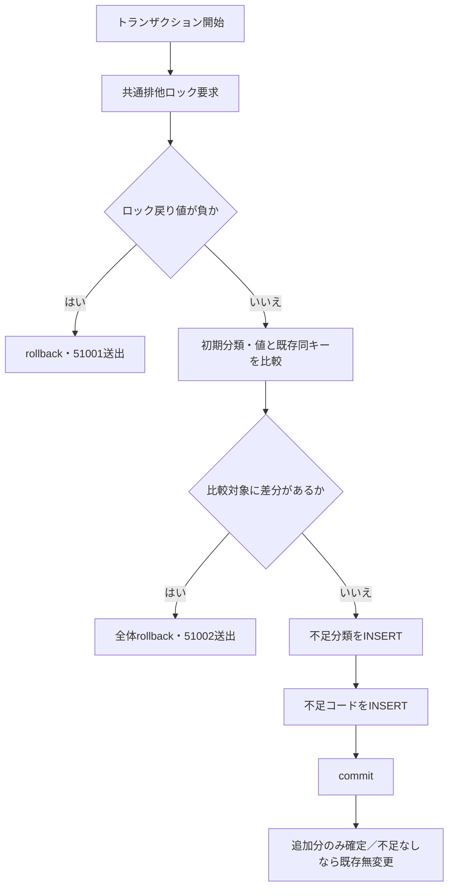

図はSQLに明示された業務分岐を示す。その他のSQL例外を成功や51002へまとめるcatchはない。〔実装根拠：sources/database/002_seed.sql:6-6、85-92〕

#### SQL・テーブル関連（ER図）

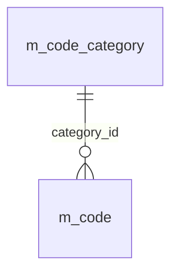

分類IDは分類表のPK、分類ID・コード値はコード表の複合PKである。コード表から分類表へのFKがあり、投入はその順に行う。〔実装根拠：sources/database/001_schema.sql:102-102、127-127、189-189〕

#### DB操作の詳細

| 操作 | 全比較条件・対象 | 結果 |
| --- | --- | --- |
| 分類差分確認 | 初期分類と既存分類を`category_id`でJOIN。名称、固定桁、追加可否の不一致、または既存利用状態が1以外 | 1行でもあれば投入全体を停止 |
| コード差分確認 | 初期値と既存値を分類・値でJOIN。名称、表示順、保護対象の不一致、利用状態が1以外、開始日が1900-01-01以外、終了日が非NULL | 1行でもあれば投入全体を停止 |
| 分類追加 | 初期分類のうち同じ`category_id`が存在しない行 | INSERTのみ |
| コード追加 | 初期値のうち同じ分類・値が存在しない行 | INSERTのみ |

比較しない既存属性は備考、作成・更新管理情報、版であり、上書きもしない。初期一覧に含まれない追加行を拒否する検査はない。投入材料はSQLのテーブル変数と定数で、外部フォームのパラメータではない。並び替え・ページング・取得件数上限は設けていない。〔実装根拠：sources/database/002_seed.sql:8-14、85-92〕

#### 結果・例外時の扱い

ロック失敗は51001、既存定義との差分は51002で、それぞれ明示rollback後に停止する。同一定義の場合は不足行だけを追加してcommitする。既存行の名称を通常保守で変更した後にseedを再実行すると、その名称差分も停止条件になる。SQLにcatchや成功応答DTOはなく、その他のSQL失敗の通知は実行入口に依存する。〔実装根拠：sources/database/002_seed.sql:2-7、85-93〕

### 共通候補の取得・表示

#### 処理概要

学生検索と学生登録は同じ`LookupAsync`から候補を取得する。取得段階では停止・期間外の行を除外せず、使用する画面が新規選択可否を決める。接続された候補更新入口はPOST `/students/options`で、Razorの検索HTMLを再表示する。`Coordinator.Options`と`WebPresentation.Lookups`の宣言を公開JSON APIとして扱わない。〔実装根拠：sources/Core/SqlServerStudentService.cs:196-216、sources/Web/Controllers/StudentsController.cs:22-22、39-39、sources/Infrastructure/WebStudentCoordinator.cs:16-17〕

#### 処理手順

1. 画面入口で認証を確認する。新規学生表示は作成更新権限を必要とし、既存学生表示は読取り権限で対象を取得する。候補取得自体はサービスの認証主体・セッション検査を通る。
2. DBへ接続し、SNAPSHOT利用可能状態を確認した上でSNAPSHOTトランザクションを開始する。
3. コードと分類をINNER JOINして全コードを取得する。値と分類がともに利用可の場合だけ`CodeEntry.IsActive`を真にする。分類ID、表示順、コード値で並べる。
4. クラスを学年コードへLEFT JOINして取得する。年度降順、学年表示順、クラス表示順、クラスコード、クラスIDの順にする。登録用は非削除かつ在籍01・02の学生数を集計する。検索用の`LookupAsync(false)`は集計せず0を返す。
5. コード・クラスを`LookupSet`にまとめてcommitする。ビューは分類ごとに候補を使用し、コード値をoptionやcheckboxの値、名称を表示文言とする。
6. 検索では停止・期間外を選択可能なまま残す。登録の性別・都道府県・在籍・続柄では、現在有効な値、または読込済み`Detail.Draft`と同じ値だけを選択可能にする。
7. 登録の年度・学年・クラスの変更は補助欄と所属を連動させる。検索の候補更新は検索結果を再実行せず、上位条件と合わない選択済みクラスを解除する。

〔実装根拠：sources/Infrastructure/WebStudentCoordinator.cs:17-17、sources/Core/SqlServerStudentService.cs:46-64、196-216、sources/Views/Students/Search.cshtml:5-5、sources/Views/Students/Edit.cshtml:8-13、sources/Web/Controllers/StudentsController.cs:22-22、sources/wwwroot/js/site.js:7-8〕

#### 処理フロー

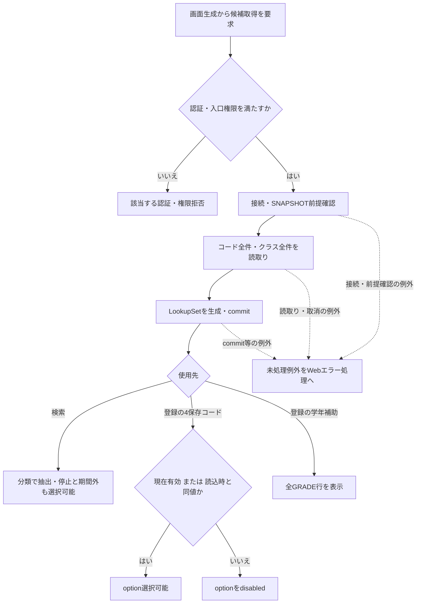

現在有効とは、合成利用状態が真で、表示時の日本日付が開始日以上、終了NULLまたは終了日以下であることを指す。既存同値の保持は有効期間内への変更ではない。〔実装根拠：sources/Views/Students/Edit.cshtml:2-2、8-13〕

#### SQL・テーブル関連（ER図）

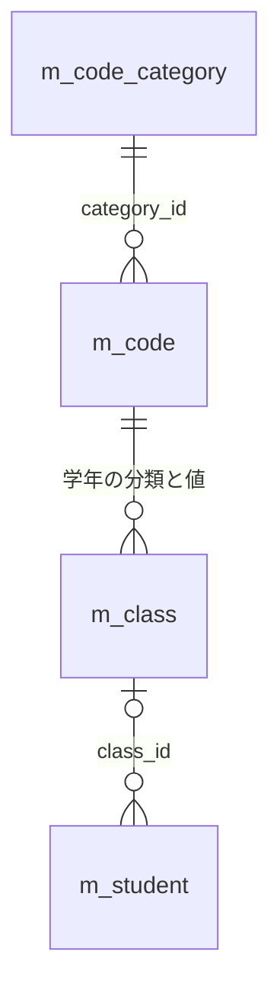

コード候補は分類へのINNER JOIN、クラスの候補順は学年コードへのLEFT JOINで得る。登録用人数は学生の集計であり、クラス表の保存列ではない。上図のFKと、候補順・人数を得るSQLの読取りを区別する。〔実装根拠：sources/database/001_schema.sql:189-191、sources/Core/SqlServerStudentService.cs:201-208〕

#### DB操作の詳細

コードSQLにはWHEREがなく、分類IDのJOINとORDER BYだけを持つ。返す属性は分類ID、値、名称、表示順、合成利用状態、開始・終了日、保護対象である。クラスSQLにも停止・期間のWHEREはなく、登録用人数だけが`class_id`一致、`is_deleted=0`、在籍区分01・02を条件に集計する。両結果とも全件取得で、ページングと件数上限はない。コマンドは30秒設定で、読取りとcommitへ取消トークンを渡す。〔実装根拠：sources/Core/Contracts.cs:61-65、sources/Core/SqlServerStudentService.cs:65-66、196-216〕

| 状態・使用先 | 候補、選択値、表示の扱い |
| --- | --- |
| 検索の学年・都道府県 | 全行を名称で表示する。空文字の「すべて」はマスタ外の選択肢 |
| 検索の在籍区分 | 全行をcheckboxで表示する。初期01・02、全解除は空配列 |
| 登録の有効な新規選択 | 分類・値がともに利用可で期間内なら選択可能 |
| 登録の既存停止値・期間外値 | 読込時の同値は選択可能。他の停止・期間外値はdisabled |
| 停止・期間外の注記 | 性別と都道府県は選択不可行に注記する。在籍と続柄には同じ注記を付けない。既存同値は選択可能なので性別・都道府県にも当該注記を付けない |
| 登録の学年補助 | 全GRADE行を表示する。新規有効値だけに絞る処理はない |
| 検索のクラス | 指定年度・学年でビュー抽出する。候補更新時に不適合な選択済みクラスを解除。未所属指定時は年度・学年・クラスをNULLに解除 |
| 登録のクラス | 読込時の所属は保持可能。在学・休学の新規所属は現在有効、卒業・退学は入力在籍期間との重なりで候補を判定する |
| 登録の連動 | クラスの`data-year`・`data-grade`を補助欄へ移送する。年度・学年変更で選択済みクラスが不適合なら解除する |
| 参照モード | 業務入力fieldsetをdisabledにする。候補の取得と名称表示は行う |
| 入力クリア・編集取消 | メモリの読込時Originalを複製する。候補は再取得するが、業務値を最新DB値へ置き換える操作ではない |

〔実装根拠：sources/Views/Students/Search.cshtml:5-5、sources/Views/Students/Edit.cshtml:5-13、sources/Web/Controllers/StudentsController.cs:22-22、35-35、sources/wwwroot/js/site.js:7-8、sources/Infrastructure/EditorSnapshotStore.cs:7-11〕

#### 結果・例外時の扱い

コード0件なら候補のforeachは空になる。参考設計が求める「必須コード不足時の保存不可表示」とクラス0件のW-STU-108生成は、現行の新規表示処理にはない。保存側の必須・存在・所属検査は別に行われる。存在しない値を先頭候補へ自動代替しないという設計意図を、現行ブラウザーの表示・送信保証へ広げない。〔実装根拠：sources/Infrastructure/WebStudentCoordinator.cs:17-17、sources/Core/SqlServerStudentService.cs:196-216、sources/Views/Students/Edit.cshtml:8-13。設計意図の根拠：reference-designs/基本設計書/04_コード設計書.md:104-110、reference-designs/基本設計書/02_学生登録画面.md:177-181〕

候補取得は保存処理の成功を保証しない。人数表示は参考値で、検索用の人数0は実測0人を意味しない。未処理の接続・読取り・取消等の例外は、応答開始前ならWeb middlewareがHTMLエラーへ変換し、WebFaultはそのstatus、その他は503を使用する。応答開始後は当該catchの対象外となる。〔実装根拠：sources/Core/SqlServerStudentService.cs:201-216、377-380、sources/Infrastructure/WebHostSetup.cs:22-25〕

### 検索条件のコード照合

#### 処理概要

検索は保存済みの過去値も探せるように、学年・都道府県の存在だけを確認し、停止・期間外を拒否しない。在籍区分は固定の01～04を受け付ける。コード文字列を検索列へ渡し、名称は検索結果のJOINで取得する。〔実装根拠：sources/Core/SqlServerStudentService.cs:109-153、218-222〕

#### 処理手順

1. POST `/students/search`は認証・CSRF検査を通過した後、FormGuardで許可項目と重複を検査する。在籍checkboxが未送信なら`StatusCodes`を空配列へ補う。
2. 検索状態の所有者・ログインセッション・タブ・期限を確認する。ModelState不正なら422とし、サービス検索を呼ばない。
3. Coordinatorで入力を`SearchCriteria`へ変換する。検索状態のGateを待ち、待機後にも所有者等と期限を再確認し、ContextRevision一致と版上限を検査する。
4. サービスでページ・並び順、年度・クラス、未所属との同時指定、在籍配列を検査する。学年と都道府県は任意2桁へ正規化する。
5. SNAPSHOT内で、指定学年・都道府県の分類・値の存在、指定年度のクラス存在、指定クラスの年度・学年一致を確認する。
6. 非削除学生に検索条件を適用し、TOP 10001の件数を確認する。10000件超なら一覧を返さず、超過結果を返す。それ以外はページを補正して指定件数の行を取得する。
7. 成功時は実行条件と結果をメモリへ保持し、検索状態の版を加算して期限を延長する。その後、候補を取得してHTMLを表示する。入力不正や状態拒否では成功時の保持更新を行わない。

〔実装根拠：sources/Web/Controllers/StudentsController.cs:13-16、41-41、sources/Infrastructure/WebStudentCoordinator.cs:7-9、sources/Infrastructure/SearchContextStore.cs:13-14、sources/Core/SqlServerStudentService.cs:103-171〕

#### 処理フロー

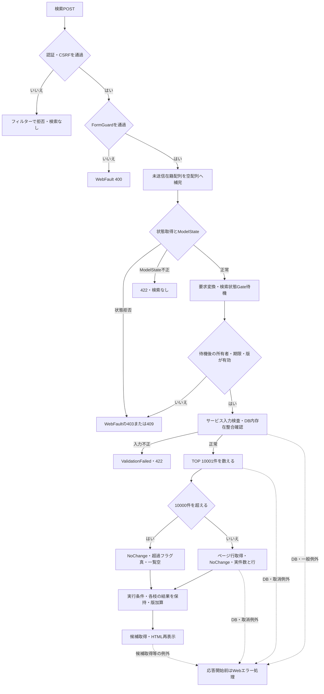

超過枝は件数10001・一覧空・超過フラグ真を、通常枝は実件数・ページ行・超過フラグ偽を保持する。合流時に一方の固定値へ置き換えない。要求変換やGate待機で生じる例外も、サービス検索の入力例外catchに含まれない。〔実装根拠：sources/Core/SqlServerStudentService.cs:156-170、sources/Infrastructure/WebStudentCoordinator.cs:8-9、sources/Infrastructure/SearchContextStore.cs:14-14〕

#### SQL・テーブル関連（ER図）

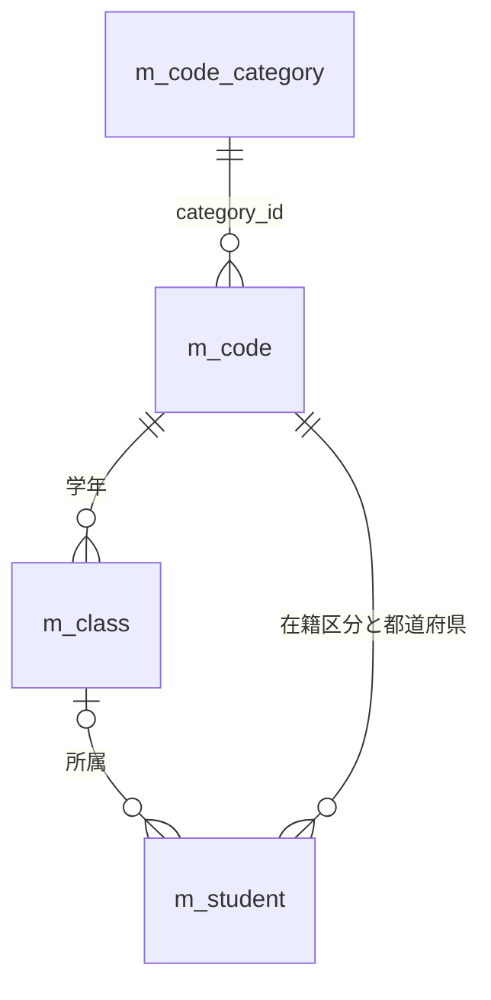

学年条件は所属クラスの`grade_code`に対する条件である。在籍区分・都道府県条件は学生列に対する条件で、名称には条件を付けない。結果のクラス・学年・在籍・都道府県名称はLEFT JOINで取得する。〔実装根拠：sources/Core/SqlServerStudentService.cs:82-90、143-153、sources/database/001_schema.sql:189-195〕

#### DB操作の詳細

| 条件 | 述語・加工とパラメータ |
| --- | --- |
| 共通 | `s.is_deleted=0` |
| 学籍番号 | 正規化値をLIKEエスケープして末尾に`%`を付加。`s.student_no LIKE @no ESCAPE '!'`、`@no VarChar(31)` |
| 氏名 | 原表記からFormKC・大文字化・空白除去した照合キーを生成。エスケープ値の前後に`%`。`s.name_key LIKE @name ESCAPE '!'`、`@name NVarChar(642)` |
| 氏名カナ | カナ正規化後に空白除去し、エスケープ値の前後に`%`。`s.kana_key LIKE @kana ESCAPE '!'`、`@kana NVarChar(74)` |
| 年度 | `c.school_year=@year`、`@year SmallInt` |
| 学年 | 任意2桁の正規化値。`c.grade_code=@grade`、`@grade VarChar(2)` |
| クラス | `s.class_id=@class`、`@class BigInt` |
| 未所属 | `s.class_id IS NULL`。年度・学年・クラスの同時指定はサービスが拒否する |
| 都道府県 | 任意2桁の正規化値。`s.prefecture_code=@prefecture`、`@prefecture VarChar(2)` |
| 電話 | 正規化値について本人電話または緊急電話との一致。`(s.phone_number=@phone OR s.emergency_phone_number=@phone)`、`@phone VarChar(16)` |
| 入学日開始 | `s.admission_date>=@from`、`@from Date` |
| 入学日終了 | `s.admission_date<=@to`、`@to Date` |
| 在籍区分 | 非空配列の場合だけ`s.enrollment_status_code IN (@status0,…)`。各`VarChar(2)`。空配列は述語なし |

各任意値の正規化結果がNULLなら対応する述語を付けない。LIKEでは`!`、`%`、`_`、`[`をエスケープする。在籍配列は最大4件、重複なし、01～04だけを許し、コード値のFormKC変換は行わない。学年と都道府県の存在確認は`m_code`の分類・値一致によるCOUNT_BIGが1であることを確認し、パラメータは`@category VarChar(24)`と`@value VarChar(10)`である。利用状態・期間の述語はない。〔実装根拠：sources/Core/SqlServerStudentService.cs:111-153、218-222、sources/Core/StudentNormalizer.cs:161-161〕

年度の存在確認は`m_class.school_year=@year`、クラスの整合確認は`class_id=@id`で読み取った年度・学年との比較である。件数SQLは学生とクラスのLEFT JOIN、行SQLはさらに学年・在籍・都道府県コードへLEFT JOINする。JOIN条件はそれぞれ分類と値の一致であり、有効期間で結合結果を除外しない。〔実装根拠：sources/Core/SqlServerStudentService.cs:82-90、126-156〕

件数と行取得は同じSNAPSHOT内で行う。行の並び順は学籍番号、氏名照合キー、入学日、更新日時の許可された列から選び、方向はascまたはdesc、同順位は学生ID昇順とする。OFFSETとFETCHは`@offset Int`と`@size Int`で、ページ件数は20・50・100に限定する。DB読取りへ取消トークンを渡し、共通コマンドは30秒設定である。〔実装根拠：sources/Core/SqlServerStudentService.cs:65-66、107-108、156-167〕

#### 結果・例外時の扱い

0件、通常結果、10000件超過は検索成功の別状態であり、いずれもサービスのOutcomeはNoChangeとなる。入力検証例外、次いでArgumentExceptionをValidationFailedへ変換する。DB例外やその他の例外をこの2つのcatchは変換しない。Controllerの個別WebFault catchはCoordinator呼出しを囲み、FormGuardや最初の状態取得はその外側にある。〔実装根拠：sources/Core/SqlServerStudentService.cs:159-170、sources/Web/Controllers/StudentsController.cs:14-16〕

検索の在籍配列がNULLでサービスへ届いた場合は、明示NULL検査より前に`statuses.Length`を参照する。未送信checkboxを空配列へ補う処理はあるが、全バインド経路でNULLを除外する保証ではない。画面の非nullable注釈についても暗黙Requiredが抑止されている。未処理例外は応答開始前ならmiddlewareへ到達し、WebFaultのstatusまたは503となる。〔実装根拠：sources/Core/SqlServerStudentService.cs:111-112、169-170、sources/Web/Controllers/StudentsController.cs:14-15、sources/Infrastructure/WebHostSetup.cs:16-16、23-23〕

### 学生保存時の最新コード照合

#### 処理概要

登録画面で選べたコードも、保存時に最新の分類・値を再読取りする。停止・期間外の同値保持を許す比較対象は最新DB学生の保存値であり、送信された変更有無や読込時画面の自己申告ではない。コード検査は学生保存の一部で、変更なし判定より前に行う。〔実装根拠：sources/Core/SqlServerStudentService.cs:245-262、344-355。設計意図の根拠：reference-designs/基本設計書/04_コード設計書.md:108-110〕

#### 処理手順

1. createまたは対象ID付きupdateの認証・CSRF検査後、FormGuard、作成更新権限、Snapshot取得、復帰状態確認、読込時復帰先との一致、ModelStateの順に検査する。
2. Coordinatorは権限と復帰状態を再確認し、入力を`SaveRequest`へ変換する。サービスは認証情報を検査し、保存開始時のUTC時刻から日本業務日を算出する。
3. 業務入力・理由・IDと期待版・年度・任意学年を正規化する。必須コードは空・NULLを拒否し、続柄未設定はNULLにする。日付・在籍条件と緊急連絡先一式もここで検査する。
4. ReadCommittedトランザクションを開始して共通書込ゲートを取得する。更新では非削除対象を再取得し、期待版、学籍番号不変、卒業・退学から別区分へ変える場合の管理者権限と理由を確認する。
5. 性別・都道府県・在籍・入力済み続柄を、固定分類と正規化値で分類表・コード表から再取得する。行なしはE-STU-009、新規または保存値から変更した値の停止・期間外はE-STU-011とする。同値保持でも存在確認は省略しない。
6. 所属クラスの存在、指定年度・学年一致、必要な利用期間、増席時の定員を確認する。学生の学年補助値単独にはマスタ有効性検査を行わない。学年をクラスへ保存する際の検査はクラス保守側の責務となる。
7. 全検査後に差分を判定する。変更なしは明示rollbackして対象IDと取得済み版を返す。変更ありは版上限、削除済みを含む学籍番号一意、同一人物候補の確認を通る。確認が必要ならrollbackして確認要求を返し、確認続行でも本手順を再実行する。
8. 学生値と監査を同じトランザクションで保存する。commit成功後だけSavedと保存ID・新しい版を返し、Controllerは303で検索へ復帰させる。

〔実装根拠：sources/Web/Controllers/StudentsController.cs:26-38、41-41、sources/Infrastructure/WebStudentCoordinator.cs:18-18、sources/Core/SqlServerStudentService.cs:227-315、344-383〕

#### 処理フロー

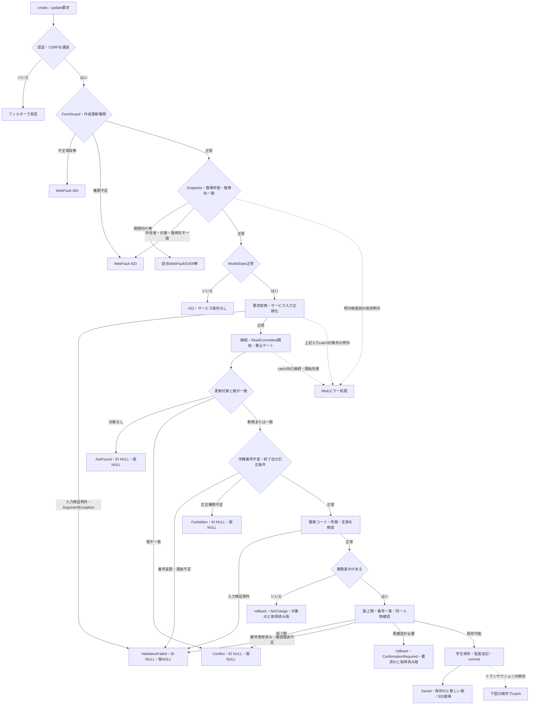

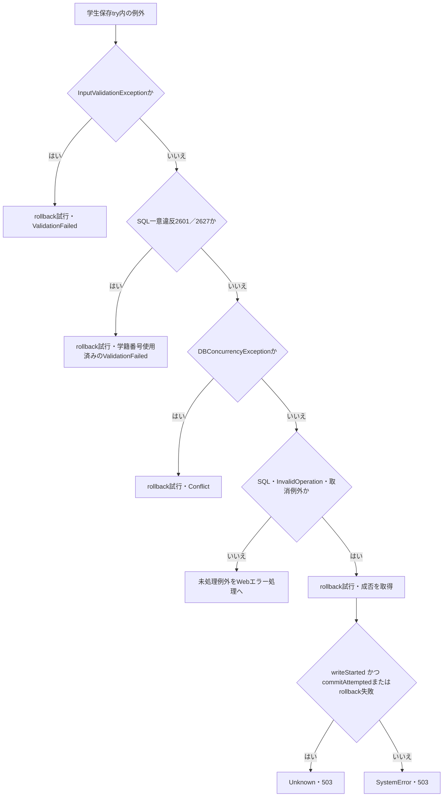

2図目のUnknown条件は最後の対象catchへ到達した場合だけに適用する。先行3catchが処理した例外を後段で再分類しない。1図目のNotFound等の早期戻りと、明示rollbackするNoChange・ConfirmationRequiredも区別する。〔実装根拠：sources/Core/SqlServerStudentService.cs:250-290、316-329〕

#### SQL・テーブル関連（ER図）

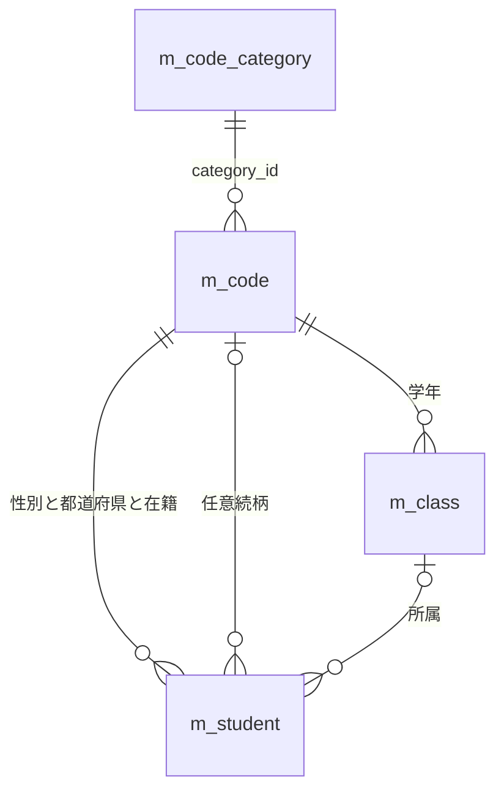

分類・値の存在は複合FKでも支えるが、利用状態・期間の判定はサービスの読取り検査である。`t_operation_log`への追記は保存と同じトランザクションの処理依存であり、対象キーに学生やコードへのFKはない。〔実装根拠：sources/database/001_schema.sql:137-154、189-199、sources/Core/SqlServerStudentService.cs:306-307、349-355〕

#### DB操作の詳細

コード検査は`m_code`と`m_code_category`を分類IDでINNER JOINし、`c.category_id=@category AND c.code_value=@value`を条件に値・分類の利用状態と期間を取得する。パラメータは`VarChar(24)`と`VarChar(10)`である。変更値には両利用状態と両端包含の期間を検査し、同値では存在だけを要求する。日本業務日は保存開始時の時刻に基づき、await後に日付を取り直す処理ではない。〔実装根拠：sources/Core/SqlServerStudentService.cs:229-229、347-355〕

在籍01・02は終了日NULL、クラス必須で、定員の席を消費する。在籍03・04は終了日必須かつ入学日以上、クラスは任意とする。既存03・04から別コードへの訂正は管理者と理由を要求し、同じ終了区分の通常項目訂正とは分ける。新たに席を消費する場合は、ゲート内で非削除・在籍01・02・同じクラス・自分以外をCOUNT_BIGし、1を加えた値と定員を比較する。〔実装根拠：sources/Core/StudentNormalizer.cs:150-158、sources/Core/SqlServerStudentService.cs:255-258、357-380〕

新規学生SQLは3必須分類を固定文字列で設定し、正規化コード値と算定した続柄分類を保存する。更新では必須分類と学籍番号を更新せず、対象ID・期待版・非削除をWHEREに使用する。続柄分類と値は入力に応じて両方NULLまたは分類・値として更新する。学生の名称コピーは保存しない。SQLパラメータの型・サイズは概要の対応表に従い、日時・者・版を更新して学生監査を追記する。〔実装根拠：sources/Core/SqlServerStudentService.cs:30-37、294-307〕

重複確認待ちはDB保存を確定しない。確認情報は正規化内容と全候補ID・版に結び付き、Web接続ではメモリ保持となる。返却ID・版は更新なら要求対象IDと取得済み版、新規ならともにNULLである。表示候補は最大20件だが、確認対象のハッシュは全候補から作る。〔実装根拠：sources/Core/SqlServerStudentService.cs:224-225、274-290、sources/Infrastructure/WebHostSetup.cs:19-19〕

#### 結果・例外時の扱い

| 経路 | サービス結果と確定境界 | 接続された画面結果 |
| --- | --- | --- |
| コードの必須・形式・存在・変更値の有効性不正 | ValidationFailed、ID NULL・版NULL。try内ならrollbackを試行 | 422。原入力と読込時Detailを保持して再表示 |
| 最新対象なし | NotFound、ID NULL・版NULL。保存なし | 404 |
| 最新版不一致・版上限・DB競合 | Conflict、ID NULL・版NULL | 409 |
| 終了区分の訂正権限不足 | Forbidden、ID NULL・版NULL | 403 |
| 検査後の変更なし | 明示rollback、NoChange、対象ID・取得済み版。監査なし | 200、「変更はありません」 |
| 重複再確認要求 | 明示rollback、ConfirmationRequired、要求ID・取得済み版 | 409、確認情報と最大20候補を表示 |
| 学生と履歴のcommit成功 | Saved、保存ID・新しい版 | 303で検索へ復帰 |
| 最後のcatchのUnknown条件成立 | 確定状態を結果から決められない | 503、再保存前に検索で確認する案内 |
| 最後のcatchのUnknown条件不成立 | SystemError | 503 |

各結果のHTML再表示には候補再取得が伴うため、結果生成後の候補取得失敗も最終応答へ影響する。DBのcommit成功後に復帰情報作成や検索再開が失敗しても、その失敗を保存rollbackと同一視しない。〔実装根拠：sources/Core/SqlServerStudentService.cs:226-226、238-242、250-324、sources/Web/Controllers/StudentsController.cs:30-38、sources/Infrastructure/WebPresentation.cs:23-23〕

Snapshotは読込時値、対象、所有者・セッション、30分期限をメモリに保持する。キー不在・期限切れは409、別所有者・セッション・対象は403である。NULLのSnapshotIdは明示検査より前に辞書の`TryGetValue`へ渡る構造で、空文字やキー不在の独自409と同じ経路へまとめない。Controllerの事前検査や、接続・トランザクション開始の失敗は学生保存tryの外側にある。〔実装根拠：sources/Infrastructure/EditorSnapshotStore.cs:7-11、sources/Web/Controllers/StudentsController.cs:29-33、sources/Core/SqlServerStudentService.cs:240-243〕

### コードの通常追加・変更

#### 処理概要

`MasterMaintenanceService.SaveCodeAsync`は、DB認証で管理者を確認してコードを追加・更新する宣言済みサービスである。Webが登録する業務サービスは`IStudentService`の`SqlServerStudentService`であり、この保守サービスの登録や保守ルートはない。呼出しコメントから保守画面や稼働CLIを補わない。〔実装根拠：sources/Core/MasterMaintenanceService.cs:14-28、79-121、sources/Infrastructure/WebHostSetup.cs:13-19、sources/Web/Controllers/StudentsController.cs:5-42〕

#### 処理手順

1. `CodeChange`の分類を5つの固定IDに限定し、正でない期待版と負の表示順を拒否する。名称・備考を検査し、開始・終了日を解析して期間逆転を拒否する。この時点ではコード値の固定桁検査はまだ行わない。
2. 暗号化必須・サーバー証明書検証を設定したDB接続を開く。`ORIGINAL_LOGIN()`と`IS_ROLEMEMBER('student_admin')`を読み、行なし、ロール判定NULL、1以外をUnauthorizedAccessExceptionとする。実行者は必須64スカラー以内にする。
3. ReadCommittedトランザクションを開始し、UTC日時を取得する。tryに入り共通書込ゲートを取得する。
4. 最新分類を分類IDで取得して固定桁と追加可否を読む。分類なしはE-MST-001のArgumentExceptionとする。コード値の原入力上限をその固定桁とし、Trim・FormKC後のASCII数字が指定桁ちょうどであることを検査する。
5. 分類・正規化コード値で対象を読む。対象なしで期待版ありはNotFound、対象ありで保存版と期待版が不一致はConflictを返す。対象あり・期待版NULLもConflictである。対象なし・期待版NULLの新規追加は追加可の分類だけに許す。
6. 既存保護値に対する停止、開始日の後ろ倒し、無期限から有限期限への変更、既存終了日より早い終了日への変更を拒否する。
7. 名称・表示順・利用状態・開始日・終了日・備考の6項目を比較する。差分なしは明示rollbackしてNoChangeと期待版を返す。差分があり期待版が`long.MaxValue`なら例外で停止する。
8. 新規は保護対象外・版1・作成更新情報を含めてINSERTする。更新は6項目と更新情報を設定し、版を1加算する。分類・値・期待版をWHEREに使用し、更新件数が1でなければDBConcurrencyExceptionとする。
9. 同じトランザクションにコード監査を追記する。利用状態の変化に応じてCREATE・UPDATE・ENABLE・DISABLEを判定する。
10. commit成功後にSavedと新しい版を返す。try内の例外はrollbackを試行し、通常復帰した場合は元例外を再throwする。

〔実装根拠：sources/Core/MasterMaintenanceService.cs:10-11、17-28、79-121、132-135、sources/Core/AuditOperation.cs:6-7〕

#### 処理フロー

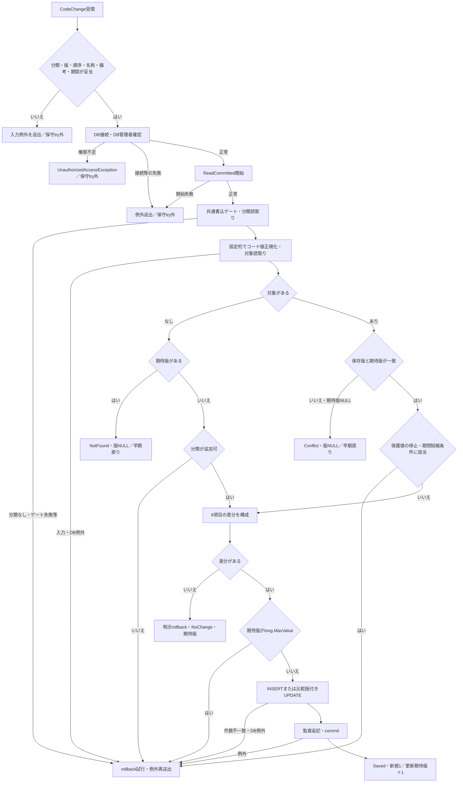

NotFoundとConflictは明示rollbackせず、`await using`で宣言したトランザクションの破棄へ移る。NoChangeは明示rollbackし、Savedだけがcommit後の版を返す。例外枝に成功版を設定する処理はない。〔実装根拠：sources/Core/MasterMaintenanceService.cs:88-121〕

#### SQL・テーブル関連（ER図）

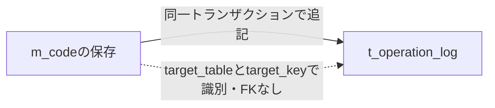

分類は固定桁・追加可否の参照元、コードは更新対象、履歴は確定を共有する追記先である。保守処理は分類の利用状態を追加拒否条件として読み取らず、分類の桁数・追加可否だけを取得する。候補と学生保存の分類利用状態検査とは別である。〔実装根拠：sources/Core/MasterMaintenanceService.cs:92-104、113-120、132-135、sources/database/001_schema.sql:137-154、189-189〕

#### DB操作の詳細

| 入力・内部属性 | 処理と保存先 | パラメータ・型・サイズ |
| --- | --- | --- |
| `CategoryId string` | 固定IDを要求。分類読取りと対象キーに使用。`m_code.category_id varchar(24) NOT NULL` | `@category VarChar(24)` |
| `CodeValue string` | 分類桁を原入力上限とし、正規化後の固定桁ASCII数字を`code_value varchar(10) NOT NULL`へ保存 | `@value VarChar(10)` |
| `CodeName string` | 原入力・保存後12スカラーの必須名称。`code_name nvarchar(24) NOT NULL` | `@name NVarChar(24)` |
| `DisplayOrder int` | 非負。`display_order int NOT NULL` | `@order Int` |
| `IsActive bool` | 今回の利用状態。`is_active bit NOT NULL` | `@active Bit` |
| `ValidFrom string` | FormKC後の厳密なyyyy-MM-dd、1900-01-01以降。`valid_from date NOT NULL` | `@from Date` |
| `ValidTo string?` | NULL・空文字は期限なし。空白だけは日付不正。`valid_to date NULL` | `@to Date`、値なしはDBNull |
| `Remarks string?` | 原入力・保存後120スカラー、LF統一・Trim、空はNULL。`remarks nvarchar(240) NULL` | `@remarks NVarChar(240)` |
| `ExpectedVersion long?` | NULLは新規意図。既存更新は保存版との一致を要求 | 更新のみ`@version BigInt` |
| DB認証主体・UTC日時 | 作成更新者・日時。新規は両方設定、更新は更新側だけ設定 | `@actor NVarChar(128)`、`@now DateTimeOffset` |
| 保護フラグ | 要求項目なし。新規は0、既存は保持 | INSERTの定数0。UPDATE設定なし |

〔実装根拠：sources/Core/MasterMaintenanceService.cs:10-10、81-120、sources/Core/StudentNormalizer.cs:47-57、113-117、sources/Core/JapaneseDateService.cs:52-59、sources/Core/SqlServerStudentService.cs:67-72〕

分類読取りのWHEREは分類ID一致、コード読取りのWHEREは分類IDと正規化値の一致である。単一キー読取りにORDER BY、ページング、件数上限はない。UPDATEのWHEREは同じ2キーと期待版で、分類・値、保護対象、作成日時・者を変更しない。新規の利用状態と表示順は引数値を明示設定するため、seedの全値利用可やDB DEFAULTをそのまま通常追加の値とみなさない。共通コマンドは30秒設定で、読取り・書込み・commitに取消トークンを渡す。〔実装根拠：sources/Core/MasterMaintenanceService.cs:92-120、sources/Core/SqlServerStudentService.cs:65-66〕

保護値については今回の利用可を要求し、開始日を以前より後ろにできない。旧終了日NULLから有限日への変更、有限終了日の短縮も拒否する。開始日の前倒し、有限終了日の延長、終了日のNULL化はこの保護条件では拒否しない。キー変更、物理削除、保護解除の更新項目はない。〔実装根拠：sources/Core/MasterMaintenanceService.cs:105-113〕

| 以前の利用状態 | 今回の利用状態 | 変更ありの場合の操作種別 |
| --- | --- | --- |
| 既存なし | 利用可・利用不可のいずれでも | CREATE |
| 利用可 | 利用可 | UPDATE |
| 利用不可 | 利用不可 | UPDATE |
| 利用不可 | 利用可 | ENABLE |
| 利用可 | 利用不可 | DISABLE |

停止状態のまま名称や表示順を変更した場合もUPDATEである。変更なしはこの判定前に終了して履歴を作らない。この判定はクラス保守でも共用する。〔実装根拠：sources/Core/AuditOperation.cs:6-7、sources/Core/MasterMaintenanceService.cs:67-76、109-119〕

コード監査の対象表は`m_code`、対象キーは分類IDと正規化値をコロンで連結した文字列とする。変更列JSONは6業務項目のうち実際に変わった列名を保持し、新規では6項目すべてを対象にする。前後の名称等のコピーは保存しない。前版は期待版で新規NULL、後版は新規1または期待版＋1、実行者はDB認証主体、日時はUTC、受付UUIDは呼出しごとに新規生成、理由はNULL、重複確認フラグは0とする。〔実装根拠：sources/Core/MasterMaintenanceService.cs:109-120、132-135〕

監査のパラメータは対象表`VarChar(21)`、対象キー`VarChar(35)`、操作種別`VarChar(11)`、前後版`BigInt`、列名JSON`NVarChar(max)`、実行者`NVarChar(128)`、日時`DateTimeOffset`、受付UUID`UniqueIdentifier`である。マスタ保存と履歴の両方がcommit対象となる。〔実装根拠：sources/Core/MasterMaintenanceService.cs:134-135〕

#### 結果・例外時の扱い

| 経路 | MaintenanceResultまたは例外 | DB処理の境界 |
| --- | --- | --- |
| 対象なし・期待版あり | NotFound、RowVersion NULL | 明示rollbackなしの早期戻り。保存・監査なし |
| 対象あり・版不一致または期待版NULL | Conflict、RowVersion NULL | 明示rollbackなしの早期戻り。保存・監査なし |
| 保護検査後に差分なし | NoChange、RowVersionは期待版 | 明示rollback。監査なし。版上限検査より先に終了 |
| INSERT・UPDATE・監査・commit成功 | Saved、新規1または期待版＋1 | マスタと監査を一括確定 |
| 通常追加不可、保護違反、期間逆転等 | ArgumentException。名称等はInputValidationExceptionとなる場合もある | 発生位置がtry内ならrollback試行。結果DTOへ変換しない |
| DB管理者でない | UnauthorizedAccessException | 保守トランザクション開始前 |
| try内のDB・取消・その他例外 | rollback試行後に再throw | rollback成否をMaintenanceResultへ反映しない |

入力前段、DB管理者確認、接続開始、トランザクション開始は保守tryの外にある。開始日NULLが日付解析の`Normalize`へ届く経路など、非nullable宣言だけでは排除できない例外もある。保守結果にHTTP statusを割り当てる接続入口はない。〔実装根拠：sources/Core/MasterMaintenanceService.cs:81-89、121-121、sources/Core/JapaneseDateService.cs:52-54〕

Rollbackヘルパーは取消にSqlExceptionまたはInvalidOperationExceptionが生じるとfalseを返すが、保守サービスはその値を使用しない。commit失敗を含む例外返却を、取消成功や未保存の保証としない。ヘルパーでそれ以外の例外が生じた場合は当該catch内で別に捕捉されず、元例外の再throwまで進まない可能性もある。学生保存のUnknown判定はこの保守処理には適用されない。〔実装根拠：sources/Core/MasterMaintenanceService.cs:120-121、sources/Core/SqlServerStudentService.cs:319-329〕

## 補足説明

### 名称変更と保存値・表示値

学生は分類・コード値と所属クラスIDを保存し、コード名称やクラス名称のコピーを保存しない。コード名称の変更は、その後の候補取得や再検索に反映される。マスタ名称変更だけで学生の保存値・版を変更したり、メモリに保持済みのLastResultを書き換えたりする処理はない。〔実装根拠：sources/database/001_schema.sql:15-32、sources/Core/SqlServerStudentService.cs:82-90、183-216、sources/Infrastructure/WebStudentCoordinator.cs:9-14〕

表示用の学年・在籍・クラス名称はLEFT JOIN結果としてNULLになり得る。一方、保存元の`m_code.code_name`と`m_class.class_name`はNOT NULLである。コード名称は保守の原入力・保存後12スカラー、DB・保存パラメータは24コード単位である。クラス名称は原入力・保存後18スカラー、DBは`nvarchar(36)`、保存パラメータは`NVarChar(36)`である。表示DTOのnullableから保存列のNULL可否や業務上限を推定しない。〔実装根拠：sources/Core/Contracts.cs:50-53、sources/Core/MasterMaintenanceService.cs:33-35、73-74、82-82、115-115、sources/database/001_schema.sql:68-68、115-115〕

| 使用先 | 参考設計の表示契約 | 現行の表示生成 |
| --- | --- | --- |
| 検索結果の年度・学年 | 4桁西暦と学年名称。未所属は「－」、名称欠落は不整合表示 | `schoolYear`と`gradeName`を表示する。ビューに共通の「－」・不整合置換はない |
| クラス | コード9文字以内＋名称18スカラー以内＋停止・期間外等の注記 | 検索候補は年度・コード・名称と停止注記。登録候補は年度・学年コード・コード・名称と停止または期間外注記。検索結果はコードと名称で、同じ注記生成はない |
| 住所 | 都道府県名称12スカラー以内＋住所1の45スカラー以内。住所2は一覧対象外 | 都道府県名称と住所1を連結する。名称がNULLなら先頭を`[不整合]`にする。住所2は取得列に含めない |
| 登録の共有選択値 | コードを保存値、名称を表示値とする。年度・学年は選択補助 | 保存用4コードは同契約。年度・学年は学生へ保存せず、クラス指定時の整合検査に使用する |

上表の参考表示は設計契約で、画面撮影や現行HTMLの投影ではない。現行の表示欄と候補の文言は個別ビューから確認している。〔設計意図の根拠：reference-designs/詳細仕様書/CSharp_ASPNET/01_学生検索画面.md:107-110、reference-designs/詳細仕様書/CSharp_ASPNET/02_学生登録画面.md:92-107、761-763。実装根拠：sources/Views/Students/Search.cshtml:5-8、sources/Views/Students/Edit.cshtml:8-13、sources/Core/SqlServerStudentService.cs:77-90、371-371〕

### 分類ごとの業務意味と保守責務

性別は申告を強制せず、未回答0を有効な値として扱う設計である。クラスや連絡先の必須条件を性別によって変える分岐はない。在籍区分は日付・定員・訂正権限に関係し、初期4値すべてを保護する。検索の初期選択は在学・休学で、全解除は全区分となる。〔設計意図の根拠：reference-designs/基本設計書/04_コード設計書.md:141-147。実装根拠：sources/database/002_seed.sql:15-22、sources/Core/StudentNormalizer.cs:150-158、sources/Web/Inputs/StudentSearchInput.cs:14-14〕

都道府県の参考設計は国内住所を対象とし、不明・海外の特別コードと、郵便番号の実在や都道府県との外部照合を含めない。現行の郵便番号正規化は形式検査であり、外部照合の結果ではない。続柄の追加が許されても、緊急氏名・続柄・電話の一式入力条件は変わらない。具体的な追加値や名称の意味の妥当性は、桁・文字数検査から自動的に保証されるものではない。〔設計意図の根拠：reference-designs/基本設計書/04_コード設計書.md:149-155。実装根拠：sources/Core/StudentNormalizer.cs:95-100、155-158、sources/Core/MasterMaintenanceService.cs:91-115〕

学年01～06は学校種別未指定下の候補例という設計で、6年制を前提に年齢・入学日を制限しない。学年はクラスに保存し、自動進級は定義しない。参考設計のクラス作成時学年00、年度開始・終了日の初期値は、現行の`ClassChange`引数を補完する処理やDDL DEFAULTとは別である。現行は学年・開始日・終了日を呼出し元から受け取る。〔設計意図の根拠：reference-designs/基本設計書/04_コード設計書.md:157-159、reference-designs/基本設計書/テーブル/02_m_class.md:27-31。実装根拠：sources/Core/MasterMaintenanceService.cs:9-9、32-37、sources/database/001_schema.sql:65-70〕

クラス保守で学年を設定するときは必須2桁へ正規化し、ゲート下でGRADE値と分類を読む。存在なしはE-STU-009、新規または保存学年から変更した値の停止・期間外はE-STU-011のArgumentExceptionとなる。同じ学年は存在確認後に停止・期間外を保持できる。ただし削除済みを含む参照学生が1件でもあれば学年変更を拒否する。保存は`grade_code VarChar(2)`と固定分類GRADEであり、学生の学年補助欄の検査とは異なる。〔実装根拠：sources/Core/MasterMaintenanceService.cs:34-34、44-64、73-76、127-129〕

参考設計は、分類・値のキー、分類桁数・追加可否、業務上の意味を通常保守で変えないとする。非保護値を停止しても参照用の実体を残し、再開時は期間・利用状態と履歴を確認する意図がある。現行サービスはキー・保護フラグを更新せず物理削除入口も持たないが、名称変更が意味を保持するかを判断する検査は持たない。運用上の判断を文字数検査の成功へ置き換えない。〔設計意図の根拠：reference-designs/基本設計書/04_コード設計書.md:112-116。実装根拠：sources/Core/MasterMaintenanceService.cs:79-121〕

### DB権限の定義

権限SQLはviewerに学生・クラス・分類・コードのSELECTを付与し、staffをviewer、adminをstaffに所属させる。adminにはクラス・コードのINSERTとUPDATEを付与する一方、それらのDELETEと分類のINSERT・UPDATE・DELETEを拒否する。staffには履歴INSERTを付与し、履歴UPDATE・DELETEを拒否する。この定義はHTTPのRoleとは別であり、保守サービスは接続ごとにDBのstudent_admin所属を確認する。seedの分類追加権限を通常保守権限から導かない。〔実装根拠：sources/database/003_web_permissions.sql:8-24、sources/Core/MasterMaintenanceService.cs:17-28〕

### 学籍番号・クラスコード

| 識別子 | 正規化と入力上限 | 保存・一意性・不変条件 |
| --- | --- | --- |
| 学籍番号 | 必須。原入力15スカラー以内を先に検査し、Trim・FormKC・大文字化後にも15以内。先頭英数字、以降英数字・ハイフン | `m_student.student_no varchar(15) NOT NULL`、保存`VarChar(15)`。削除済みを含む全学生で一意。更新で変更不可。REG-002のブラウザーmaxlength=30は別制約 |
| クラスコード | 必須。同じ正規化で原入力・正規化後9スカラー以内 | `m_class.class_code varchar(9) NOT NULL`、保存`VarChar(9)`。年度との組で一意。既存年度・コードの変更を保守が拒否する |
| 学生・クラス管理番号 | 入力する業務コードとは別のシステム識別値 | 各`bigint IDENTITY(1,1)`。参考設計は採番の連続性を保証せず欠番を認める |

参考設計で学校付番とされる学籍番号も、現行の形式・一意検査が学校の正規付番を認証するわけではない。これらを`m_code`に1件ずつ追加する処理はない。〔実装根拠：sources/Core/StudentNormalizer.cs:59-64、124-124、sources/Views/Students/Edit.cshtml:6-6、sources/Core/SqlServerStudentService.cs:254-266、sources/Core/MasterMaintenanceService.cs:33-33、52-52、73-74、sources/database/001_schema.sql:8-9、63-67、187-188。設計意図の根拠：reference-designs/基本設計書/04_コード設計書.md:118-127〕

### 元号と日付の固定定義

| 固定ID | 表示名 | 西暦年への加算値 | 受け付ける日付範囲 |
| --- | --- | --- | --- |
| REIWA | 令和 | 2018 | 2019-05-01～`DateOnly.MaxValue` |
| HEISEI | 平成 | 1988 | 1989-01-08～2019-04-30 |
| SHOWA | 昭和 | 1925 | 1926-12-25～1989-01-07 |
| TAISHO | 大正 | 1911 | 1912-07-30～1926-12-24 |
| MEIJI | 明治 | 1867 | 1900-01-01～1912-07-29 |

元号は`JapaneseDateService`内の配列と登録画面の固定optionであり、5分類・70値に追加しない。元号ID、年、月、日を受け、年の「元」は1へ変換する。FormKC後の数値、実在日、元号境界、業務日以前、逆変換の一致を確認し、学生の`birth_date date NOT NULL`へ保存する。表示は元号名＋年（1年は元年）＋2桁月日である。明治の開始1900-01-01は本処理の受入下限を表す。〔実装根拠：sources/Core/JapaneseDateService.cs:9-50、sources/Views/Students/Edit.cshtml:7-7、sources/database/001_schema.sql:14-14〕

学校年度は4月開始、日本業務日はUTCから＋09:00で算出する。管理日時はUTC保存と日本時間表示を分け、表示形式は`yyyy/MM/dd HH:mm:ss`である。画面モード、権限内部値、削除フラグ、ページ件数、メッセージ番号も業務コードマスタの分類へ混在させないという設計である。〔実装根拠：sources/Core/JapaneseDateService.cs:61-61、sources/Infrastructure/WebPresentation.cs:5-7。設計意図の根拠：reference-designs/基本設計書/04_コード設計書.md:131-135〕

### 入出力と異常段階の確認責務

参考設計は、顧客IT部門が入出力、権限、画面とDBの対応、競合・障害時の結果を確認し、実装工程では入力から処理値、DB、再表示まで往復確認する責務を置く。本書のコード契約では次の対応を確認対象とする。〔設計意図の根拠：reference-designs/基本設計書/01_学生検索画面.md:487-491、reference-designs/基本設計書/02_学生登録画面.md:685-689、reference-designs/詳細仕様書/CSharp_ASPNET/01_学生検索画面.md:546-550、reference-designs/詳細仕様書/CSharp_ASPNET/02_学生登録画面.md:749-753〕

| 段階 | 確認する値の往復・異常条件 | 判断対象 |
| --- | --- | --- |
| 入力・変換 | `0`・`00`・先頭ゼロ、未選択・NULL、全角数字、原入力上限、正規化後桁、名称12スカラーと24コード単位、不正Unicode | フォーム・内部要求・保守引数で同じ保証を仮定せず、どの層が拒否するか |
| 候補表示 | 分類または値の停止、開始・終了当日、期間外、既存同値、0件、名称欠落、上位変更時の所属解除 | 表示名と選択値、選択可能条件、参考設計との差 |
| 保存前再検査 | 表示後の停止、DB保存値との同値比較、対象・旧版、終了区分訂正、最終席の競合 | ゲート後の最新状態と拒否結果。表示人数を席予約と扱わない |
| DB・監査 | 保存型とサイズ、続柄両列NULL、変更なし、保護値の期間短縮、履歴追記失敗 | マスタ・学生と履歴の確定範囲、版と監査操作種別 |
| 確定・再表示 | commit失敗、rollback失敗、保存後の候補・復帰失敗、名称変更後の再検索 | 学生保存のUnknownと保守の再throwを区別し、旧保持結果を最新名称と扱わない |

この確認責務は、試験合格や承認済みという結果の記載ではない。名称の意味維持、続柄・学年の追加内容、保守障害後の再試行については、入力形式検査だけで決められない。〔設計意図の根拠：reference-designs/基本設計書/04_コード設計書.md:112-116、reference-designs/詳細仕様書/CSharp_ASPNET/02_学生登録画面.md:751-753〕

### 関連文書の対応

以下はユーザー指定計画のID・kind・配置を維持した対応である。本書以外の参照本文は本応答で未生成であり、既存の生成状態を示すものではない。リンクは計画上の参照先を示す。

| 文書ID | kind | 計画path・本書からの参照 | 本書との対応 |
| --- | --- | --- | --- |
| CSHARP_ASPNET-BAS-STU-01 | basic-design | [基本設計書/01_学生検索画面.md](01_学生検索画面.md) | 検索候補、初期在籍選択、名称表示。本応答で未生成 |
| CSHARP_ASPNET-BAS-STU-02 | basic-design | [基本設計書/02_学生登録画面.md](02_学生登録画面.md) | 新規選択、既存値保持、マスタ不足時の設計意図。本応答で未生成 |
| CSHARP_ASPNET-BAS-STU-03 | table-index | [基本設計書/03_テーブル仕様書.md](03_テーブル仕様書.md) | コード関連FK、管理情報、保存と監査の共通境界。本応答で未生成 |
| CSHARP_ASPNET-BAS-STU-04 | code-design | [基本設計書/04_コード設計書.md](04_コード設計書.md) | 本書。初期値・候補利用・保守契約 |
| CSHARP_ASPNET-BAS-STU-03-M_STUDENT | table-definition | [基本設計書/テーブル/01_m_student.md](テーブル/01_m_student.md) | 分類付き選択値、続柄NULL、所属IDの保存先。本応答で未生成 |
| CSHARP_ASPNET-BAS-STU-03-M_CLASS | table-definition | [基本設計書/テーブル/02_m_class.md](テーブル/02_m_class.md) | 学年の保存先、年度とクラスコード・名称。本応答で未生成 |
| CSHARP_ASPNET-BAS-STU-03-M_CODE_CATEGORY | table-definition | [基本設計書/テーブル/03_m_code_category.md](テーブル/03_m_code_category.md) | 分類、固定桁、追加可否、分類利用状態。本応答で未生成 |
| CSHARP_ASPNET-BAS-STU-03-M_CODE | table-definition | [基本設計書/テーブル/04_m_code.md](テーブル/04_m_code.md) | 値、名称、期間、保護、比較版の物理定義。本応答で未生成 |
| CSHARP_ASPNET-BAS-STU-03-T_OPERATION_LOG | table-definition | [基本設計書/テーブル/05_t_operation_log.md](テーブル/05_t_operation_log.md) | 操作種別、対象キー、変更列名、追記権限。本応答で未生成 |
| CSHARP_ASPNET-DET-CSharp_ASPNET-SCR-STU-001 | detailed-specification | [詳細仕様書/CSharp_ASPNET/01_学生検索画面.md](../詳細仕様書/CSharp_ASPNET/01_学生検索画面.md) | フォームから検索条件・SQL・名称再表示への対応。本応答で未生成 |
| CSHARP_ASPNET-DET-CSharp_ASPNET-SCR-STU-002 | detailed-specification | [詳細仕様書/CSharp_ASPNET/02_学生登録画面.md](../詳細仕様書/CSharp_ASPNET/02_学生登録画面.md) | DTO、Snapshot、コード再検査、確認待ち、保存応答。本応答で未生成 |
