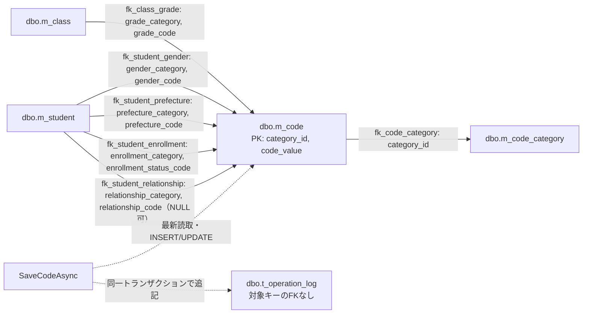
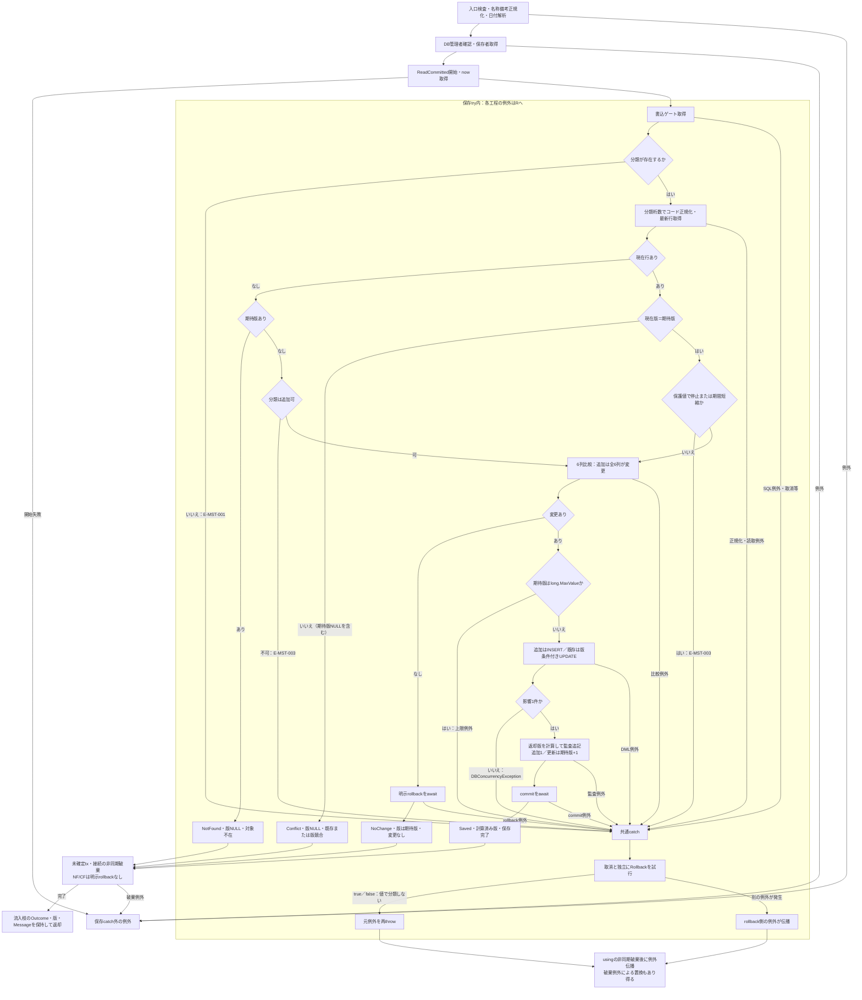

<!-- spec-meta: {"schema":"spec-md/1.1","documentId":"CSHARP_ASPNET-BAS-STU-03-M_CODE","version":"1.0","path":"基本設計書/テーブル/04_m_code.md","layout":"TABLE","sheets":[{"sheet":"m_code"}],"sections":[{"heading":"テーブルヘッダー","kind":"HEADER"},{"heading":"項目詳細","kind":"LIST","key":["No"]}],"columns":["No","論理名","物理名","PK","NOT NULL","タイプ","長さ","初期値","説明"]} -->
# コード管理マスタ（dbo.m_code）テーブル仕様書

文書ID：CSHARP_ASPNET-BAS-STU-03-M_CODE／版：1.0／種別：テーブル定義／対象：SQL Server・dbo.m_code

## テーブルヘッダー

| 項目 | 内容 |
| --- | --- |
| 論理名／物理名 | コード管理マスタ／`dbo.m_code`。分類内の選択値1件を保持する14列の表である。学生・クラスにはコード値を保存し、候補や検索結果の名称は本表から参照する。根拠：`sources/database/001_schema.sql:112-135,189-195`、`sources/Core/SqlServerStudentService.cs:82-90,294-299`。 |
| 主キー／索引 | `pk_m_code(category_id,code_value)`。順序は分類、コード値であり、異なる分類の同じ値は共存できる。全列にIDENTITY指定はない。本表に対する独立したCREATE INDEXの宣言はない。根拠：`sources/database/001_schema.sql:112-135,206-212`。 |
| 照合順序 | 分類・値は`Latin1_General_100_BIN2`、名称・備考・作成者・更新者は`Latin1_General_100_CS_AS_SC`。名称は識別キーに使用しない。根拠：`sources/database/001_schema.sql:113-125,127-127`。 |
| 長さ・初期値の読み方 | 明細の「長さ」はDDLの容量で、varcharはバイト、nvarcharはUTF-16コード単位を示す。業務上限は説明欄に分ける。「初期値」はDDL DEFAULTのみを記載し、seed・通常追加が明示設定する値は説明へ記す。長さ非適用・DEFAULTなしは空欄。PK・NOT NULLの〇はDDL上の指定である。根拠：`sources/database/001_schema.sql:113-134`、`sources/Core/MasterMaintenanceService.cs:81-86,113-115`。 |
| 性別の入出力 | REG-006の`select Input.GenderCode`はGENDERの名称を表示し、値を送る。`StudentSaveInput.GenderCode`→`StudentDraft.GenderCode`は`string`、新規値は`"0"`。必須1桁数字に正規化し、`m_student.gender_code varchar(1) NOT NULL`へ`@gender_code VarChar(1)`で保存する。分類列は新規INSERTでGENDERを設定する。0は「未回答」という実コードで、NULLではない。根拠：`sources/Views/Students/Edit.cshtml:8-8`、`sources/Web/Inputs/StudentSaveInput.cs:13-13,34-36`、`sources/Core/StudentNormalizer.cs:113-128`、`sources/Core/SqlServerStudentService.cs:33-33,294-299`、`sources/database/001_schema.sql:15-16`、`sources/database/002_seed.sql:15-15`。 |
| 都道府県の入出力 | REG-008の`select Input.PrefectureCode`はPREFECTUREの名称を表示し、値を送る。要求・業務入力の型は`string`、新規値は空文字で、必須2桁数字に正規化する。保存先は`m_student.prefecture_code varchar(2) NOT NULL`、パラメータは`@prefecture_code VarChar(2)`。分類列は新規INSERTでPREFECTUREを設定する。SRC-009の`select Criteria.PrefectureCode`は`string?`の検索入力で、空欄は条件なし、指定値は`@prefecture VarChar(2)`による同列の検索に使用する。根拠：`sources/Views/Students/Edit.cshtml:9-9`、`sources/Views/Students/Search.cshtml:5-5`、`sources/Web/Inputs/StudentSaveInput.cs:15-15,37-37`、`sources/Web/Inputs/StudentSearchInput.cs:15-22`、`sources/Core/StudentNormalizer.cs:130-130`、`sources/Core/SqlServerStudentService.cs:33-33,119-119,147-147,294-299`、`sources/database/001_schema.sql:18-19`。 |
| 在籍区分の入出力 | REG-014の`select Input.EnrollmentStatusCode`はENROLLMENT_STATUSの名称を表示し、値を送る。要求・業務入力の型は`string`、新規値は`"01"`。必須2桁数字かつ01～04に検査し、`m_student.enrollment_status_code varchar(2) NOT NULL`へ`@enrollment_status_code VarChar(2)`で保存する。新規の分類はENROLLMENT_STATUS。01・02はクラス必須・終了日なし、03・04は終了日必須であり、名称変更でこの分岐は変わらない。検索では`checkbox name=Criteria.StatusCodes`→`string[]`→`SearchCriteria.EnrollmentStatusCodes`となり、初期選択は01・02、全解除は状態条件なし。`@status0`等は`VarChar(2)`で保存列を検索する。根拠：`sources/Views/Students/Edit.cshtml:11-11`、`sources/Views/Students/Search.cshtml:5-5`、`sources/Web/Inputs/StudentSaveInput.cs:21-21,39-39`、`sources/Web/Inputs/StudentSearchInput.cs:14-22`、`sources/Web/Controllers/StudentsController.cs:13-16`、`sources/Core/StudentNormalizer.cs:136-136,150-154`、`sources/Core/SqlServerStudentService.cs:35-35,111-112,151-153,294-299`、`sources/database/001_schema.sql:25-26,198-198`。 |
| 続柄の入出力 | REG-021の`select Input.RelationshipCode`はRELATIONSHIPの名称を表示し、値を送る。要求・業務入力は`string?`で、未選択の空文字はNULL、有値は2桁数字となる。保存側で分類を有値ならRELATIONSHIP、値なしならNULLと算定する。`m_student.relationship_category varchar(24) NULL`と`relationship_code varchar(2) NULL`へ、それぞれ`@relationship_category VarChar(24)`、`@relationship_code VarChar(2)`で保存する。分類はフォーム入力ではない。緊急連絡先氏名・続柄・電話は全部未入力または全部入力を要求する。根拠：`sources/Views/Students/Edit.cshtml:13-13`、`sources/Web/Inputs/StudentSaveInput.cs:25-25,41-41`、`sources/Core/StudentNormalizer.cs:140-147,156-158`、`sources/Core/SqlServerStudentService.cs:37-37,294-299`、`sources/database/001_schema.sql:29-32,199-199`。 |
| 学年の入出力 | GRADEの保存先は`m_class.grade_code varchar(2) NOT NULL`で、分類列はGRADE。`ClassChange.GradeCode string`を2桁数字に正規化し、`@grade_code VarChar(2)`で保存する。SRC-005の`select Criteria.GradeCode string?`は`@grade VarChar(2)`でクラスの学年を検索する。REG-017の`select Input.GradeCode string?`はクラス選択補助で、学生への保存列はない。選択クラスとの一致検査に使用する。00は「学年なし」という実コードで、未所属のclass_id NULLと異なる。クラス名は別表の`class_name nvarchar(36)`で、通常保守の上限も18スカラーと別である。根拠：`sources/Views/Students/Search.cshtml:5-5`、`sources/Views/Students/Edit.cshtml:12-12`、`sources/Web/Inputs/StudentSaveInput.cs:28-29`、`sources/Core/MasterMaintenanceService.cs:33-35,65-74`、`sources/Core/SqlServerStudentService.cs:118-118,144-144,363-371`、`sources/database/001_schema.sql:65-68,197-197`、`sources/database/002_seed.sql:78-78`。 |
| 外部キー／削除関連 | `fk_code_category`は本表の分類→`m_code_category.category_id`。`fk_class_grade`と学生の`fk_student_gender`、`fk_student_prefecture`、`fk_student_enrollment`、`fk_student_relationship`は分類・値の組で本表を参照する。続柄組だけはNULL可。他の組はNOT NULL。これらにON DELETE CASCADE指定はない。監査の対象キーには本表へのFKはない。根拠：`sources/database/001_schema.sql:15-31,65-66,137-154,189-195`。 |
| DBの値・期間制約 | `ck_code_limits`は空でない数字コード、開始日1900-01-01以降、終了日NULLまたは開始日以上、表示順0以上を検査する。分類の桁数は別表の`ck_category_length`で1～10。分類ごとの固定桁数、追加可否、保護値の停止・期間短縮は本表のCHECKではなく保守処理の検査である。根拠：`sources/database/001_schema.sql:202-203`、`sources/Core/MasterMaintenanceService.cs:91-107`。 |
| DBの文字・管理制約 | `ck_m_code_code_name_scalar`は12、`ck_m_code_remarks_scalar`は120、`ck_m_code_created_by_scalar`・`ck_m_code_updated_by_scalar`は64スカラー相当の上限を検査する。SC照合で末尾に番兵文字を付けてLENから1を引き、末尾空白も数える。名称の非空白・制御文字禁止はDDLからは保証されない。`ck_m_code_created_at_utc`・`ck_m_code_updated_at_utc`はUTCオフセット0、`ck_m_code_row_version`は正値を要求する。根拠：`sources/database/001_schema.sql:128-134`、`sources/Core/StudentNormalizer.cs:37-57`。 |
| 保守の入口／権限 | `SaveCodeAsync(CodeChange,CancellationToken)`は宣言されたサービス入口。Webには`IStudentService→SqlServerStudentService`が登録され、コード保守サービスの登録・画面・ルートは確認できない。保守はDB接続ごとに`IS_ROLEMEMBER(N'student_admin')=1`を確認し、`ORIGINAL_LOGIN()`を保存者にする。権限SQLは閲覧者へSELECT、管理者へ本表のINSERT・UPDATEを許可しDELETEを拒否する。分類表のDMLも管理者へ拒否する。WebのRoleクレームとは別の検査である。根拠：`sources/Core/MasterMaintenanceService.cs:9-28,79-79`、`sources/Infrastructure/WebHostSetup.cs:13-19`、`sources/Web/Controllers/StudentsController.cs:5-38`、`sources/database/003_web_permissions.sql:10-24`。 |
| 設計意図と実装の対応 | 参考設計は分類・値の意味を保持し、同じ値を別の意味へ再利用しない運用を求める。通常UPDATEはキーと保護属性を変更しないが、名称変更の意味や参照学生への影響を自動判定しない。保護期間、候補0件、名称欠損表示の具体的な差は後述する。根拠：`reference-designs/基本設計書/04_コード設計書.md:110-116`、`reference-designs/基本設計書/テーブル/04_m_code.md:24-37`、`sources/Core/MasterMaintenanceService.cs:105-119`。 |
| 関連文書：表・共通保存規則 | 計画上の対応先であり、本応答では未生成。CSHARP_ASPNET-BAS-STU-03：[テーブル索引・共通保存規則](../03_テーブル仕様書.md)。CSHARP_ASPNET-BAS-STU-03-M_CODE_CATEGORY：[コード種別マスタ](03_m_code_category.md)。CSHARP_ASPNET-BAS-STU-03-M_CLASS：[クラスマスタ](02_m_class.md)。CSHARP_ASPNET-BAS-STU-03-M_STUDENT：[学生基本情報](01_m_student.md)。CSHARP_ASPNET-BAS-STU-03-T_OPERATION_LOG：[操作履歴](05_t_operation_log.md)。 |
| 関連文書：コードと利用画面 | 計画上の対応先であり、本応答では未生成。CSHARP_ASPNET-BAS-STU-04：[コード設計書](../04_コード設計書.md)。CSHARP_ASPNET-BAS-STU-01：[学生検索画面 基本設計](../01_学生検索画面.md)。CSHARP_ASPNET-BAS-STU-02：[学生登録画面 基本設計](../02_学生登録画面.md)。CSHARP_ASPNET-DET-CSharp_ASPNET-SCR-STU-001：[学生検索画面 詳細仕様](../../詳細仕様書/CSharp_ASPNET/01_学生検索画面.md)。CSHARP_ASPNET-DET-CSharp_ASPNET-SCR-STU-002：[学生登録画面 詳細仕様](../../詳細仕様書/CSharp_ASPNET/02_学生登録画面.md)。 |

### データ関連

次図の実線はDDLの外部キー、点線は保守による読書き・監査追記の依存を表す。参照元から参照先へ矢印を向け、未宣言の多重度は付けない。名称取得のLEFT JOINは読取処理であり、FKや削除連動とは区別する。根拠：`sources/database/001_schema.sql:189-195`、`sources/Core/MasterMaintenanceService.cs:113-120,132-135`。

### 候補・名称の読取り

学生画面の候補取得は、接続された学生サービスの`LookupAsync`から行う。認証情報を確認して接続を開き、SNAPSHOTトランザクションでコードとクラスの2結果集合を取得し、読取りのcommit後に`LookupSet`を返す。コードSQLは分類表とのINNER JOINで全行を読み、分類・表示順・コード値の順に並べる。停止・期間外の除外、件数上限、ページングは付けない。クラス側の並びには学年コードの表示順も使用する。根拠：`sources/Core/SqlServerStudentService.cs:196-216`、`sources/Web/Controllers/StudentsController.cs:25-25,33-39`、`sources/Infrastructure/WebStudentCoordinator.cs:17-17`。

`CodeEntry`へ渡す参照出力は、分類・値・名称の`string`、表示順の`int`、利用可否・保護属性の`bool`、開始日の`DateOnly`、終了日の`DateOnly?`である。備考・管理列は候補へ移さない。利用可否は本表と分類表がともに利用可の場合だけtrueとなる合成値であり、保存列is_activeの単純なコピーではない。用途・既存値・業務日はこの全件取得SQLの引数ではなく、画面の分類別抽出と選択判定に使う。根拠：`sources/Core/Contracts.cs:61-65`、`sources/Core/SqlServerStudentService.cs:203-214`、`sources/Views/Students/Edit.cshtml:8-13`。

検索では停止・期間外も候補として表示する。学年・都道府県の指定値は分類・値の存在だけを照会し、有効期間や利用可否を検索の拒否条件にしない。在籍区分は01～04の許可値を検査する。登録では、分類と値が利用可で日本時間の当日が開始日以上、終了日NULLまたは終了日以下なら新しく選択できる。読込済み学生の同じ保存値は停止・期間外でも保持できる。性別・都道府県では選択不可候補に「停止・期間外」を表示し、在籍・続柄ではdisabledを設定する。学年補助には全GRADE候補を表示し、このselectでは停止・期間のdisabled判定を行わない。閲覧者は入力fieldset全体を非活性にする。根拠：`sources/Core/SqlServerStudentService.cs:111-125,218-222`、`sources/Views/Students/Search.cshtml:5-5`、`sources/Views/Students/Edit.cshtml:5-13`、`sources/Infrastructure/WebPresentation.cs:5-5`、`sources/Web/Models/StudentEditPageModel.cs:14-14`。

学生保存は書込ゲート取得と既存学生の版確認後、各非NULLコードを最新の分類・値で照会する。不存在はE-STU-009、新規または保存済み値から変更したコードが停止・期間外ならE-STU-011となる。同じ既存値でも存在確認は残す。検査は変更なし判定より先で、エラーを集約した`InputValidationException`は学生保存の先行catchでrollbackを試みてValidationFailedとなる。クラス保守でも学年の存在を確認し、新規・学年変更時は利用可否と期間を検査する。同じ既存学年は有効性の拒否を省くが、学年変更には削除済みを含む参照学生がいないことも必要である。根拠：`sources/Core/SqlServerStudentService.cs:241-262,316-318,344-355,383-383`、`sources/Core/MasterMaintenanceService.cs:44-63`。

検索結果は学年・在籍・都道府県の名称を分類・値のLEFT JOINで取得し、停止・期間外を理由に名称を落とさない。code_name列はNOT NULLでも、結合結果の学年名・在籍名はNULLになり得るため`StudentRow`では`string?`で受ける。都道府県名称NULLは`[不整合]`へ置換し住所1を連結する。住所2、性別名称、続柄名称はこの一覧SQLの出力に含まれない。名称変更は学生の保存コードを変更せず、以後の読取りに反映する。ただし保持済みLastResultを候補更新だけで置換せず、検索・ページ移動・検索復帰で再取得した時に一覧を更新する。根拠：`sources/Core/Contracts.cs:50-53`、`sources/Core/SqlServerStudentService.cs:77-90`、`sources/Core/MasterMaintenanceService.cs:113-113`、`sources/Infrastructure/WebStudentCoordinator.cs:7-14`、`sources/Web/Controllers/StudentsController.cs:22-22`。

### 初期投入と再投入

seedはGENDER（1桁・通常追加不可・4値）、ENROLLMENT_STATUS（2桁・不可・4値）、PREFECTURE（2桁・不可・47値）、RELATIONSHIP（2桁・可・8値）、GRADE（2桁・可・7値）の5分類70値を宣言する。保護対象は性別0、在籍01～04、都道府県01～47、学年00である。通常保守の追加可否は名称やコード容量から決めず、分類行のallow_addを読む。根拠：`sources/database/002_seed.sql:8-84`、`sources/Core/MasterMaintenanceService.cs:91-104`。

投入SQLはXACT_ABORTを設定してトランザクションを開始し、共通書込ゲートを取得する。既存の初期分類は名称・桁数・追加可否・利用可否、初期コードは名称・表示順・保護属性・利用可否・開始日・終了日を比較する。比較に差分があれば明示rollbackし51002で停止する。備考・管理列・版は比較対象にせず、初期集合外の追加行もこの条件では拒否しない。存在する一致行を上書きせず、不足分類を先に、不足コードを次に追加する。根拠：`sources/database/002_seed.sql:2-7,85-91`。

追加コードには利用可1、開始日1900-01-01、終了日NULL、宣言された保護値、備考NULL、同一の作成・更新日時と者、版1を明示設定して最後にCOMMITする。日時はSQLのUTC取得値、者はORIGINAL_LOGIN()であり、通常保守の文字正規化は経由しない。seedは監査履歴を追記しない。これらは投入SQLの設定値であり、開始日や保護属性にDDL DEFAULTを追加する定義ではない。根拠：`sources/database/002_seed.sql:7-7,88-92`、`sources/database/001_schema.sql:116-126`。

### 通常保守の保存

保守要求`CodeChange`は分類・値・名称・開始日の`string`、期待版の`long?`、表示順の`int`、利用可否の`bool`、終了日・備考の`string?`を受ける。これはサービス引数の契約であり、接続されていないHTTPフォーム・JSONの受信契約ではない。根拠：`sources/Core/MasterMaintenanceService.cs:10-11,79-79`、`sources/Infrastructure/WebHostSetup.cs:13-19`。

1. 分類を5値に限定し、設定された期待版が正値、表示順が非負であることを確認する。名称は原入力12スカラー以下を検査して制御文字を拒否し、Trim後の必須・保存上限12を確認する。備考は原入力120を先に確認し、CRLF・CRをLFに統一してLF以外の制御文字を拒否し、Trim後の空をNULLにする。名称と備考にはFormKCを適用しない。根拠：`sources/Core/MasterMaintenanceService.cs:81-83`、`sources/Core/StudentNormalizer.cs:37-57`。
2. 開始日をFormKC後の長さ10・yyyy-MM-ddの実在日に変換する。1900-01-01未満を拒否するが未来日は拒否しない。終了日のNULL・空文字は期限なしとし、有値は同じ変換後に開始日以上を確認する。空白だけの終了日は期限なしに代替しない。根拠：`sources/Core/MasterMaintenanceService.cs:84-86`、`sources/Core/JapaneseDateService.cs:52-59`。
3. 暗号化必須・サーバー証明書検証を指定したDB接続を開き、管理者ロールと保存者を取得する。ロール読取なし・NULL・1以外ならUnauthorizedAccessExceptionとし、接続を破棄する。保存者は64スカラー以内の必須文字列に正規化する。その後ReadCommittedトランザクションを開始し、UTCのnowを取得して書込ゲートを待つ。nowはゲート待機前の値で、commit完了時刻ではない。根拠：`sources/Core/MasterMaintenanceService.cs:17-28,87-90`。
4. ゲート取得後に分類行からcode_length・allow_addを読み、分類不在はE-MST-001のArgumentExceptionとする。分類is_activeはこの保守入口で検査しない。コード値は分類の桁数をraw上限として必須文字検査・Trimを行い、FormKC後の長さがその桁数で各文字がASCII数字であることを確認する。数値へ変換せず先頭ゼロを保持する。分類・正規化値で現在行を最大1件読み、NULL列も現在値として保持する。根拠：`sources/Core/MasterMaintenanceService.cs:91-101`、`sources/Core/StudentNormalizer.cs:113-117`。
5. 現在行がなく期待版がある場合はNotFound、既存行の版が期待版と異なる場合はConflictとする。既存行に期待版NULLで追加を求めてもConflictとなる。行なし・期待版NULLの場合だけ追加で、allow_add=falseならE-MST-003を投げる。既存行はallow_add=falseでも版一致なら保守できる。根拠：`sources/Core/MasterMaintenanceService.cs:102-104`。
6. 既存保護行について、保存要求が停止、開始日が旧開始日より後、または終了日を設定して旧終了日がNULLもしくは旧終了日より前ならE-MST-003を投げる。開始日の前倒し、有限終了日の延長、終了日のNULL化はこの条件では拒否しない。検査は変更なし判定より前なので、既存の停止済み保護行を停止のまま同値保存しても拒否する。根拠：`sources/Core/MasterMaintenanceService.cs:105-111`。
7. 正規化済みの名称・表示順・利用可否・開始日・終了日・備考の6列を比較する。DateOnlyとDBのDateTimeは日付へ揃える。追加は6列すべてを変更列とする。差がなければ明示rollbackをawaitしてNoChange・期待版を返す。差がある場合だけlong.MaxValueを拒否するため、版上限でも同値はNoChangeとなる。根拠：`sources/Core/MasterMaintenanceService.cs:109-112,123-123`。
8. 追加は14列を指定したINSERTで保護0・版1・同一の作成更新管理値を設定する。更新は6業務列、更新日時・者、版の1加算だけを変更し、WHEREは分類・値・期待版の3条件とする。キー・保護属性・作成管理情報は保持する。停止や期間をWHEREへ追加しない。影響件数が1以外ならDBConcurrencyExceptionとする。根拠：`sources/Core/MasterMaintenanceService.cs:113-116`。
9. 返却版を追加なら1、更新なら期待版+1と計算し、同一接続・トランザクションで監査を追記してcommitをawaitする。DBのOUTPUTから版を取得する処理ではない。commit成功後にSavedを作り、usingの非同期破棄を経て呼出元へ返す。根拠：`sources/Core/MasterMaintenanceService.cs:87-88,118-121,132-135`。

図のNotFound・Conflict・NoChange・Savedはそれぞれの版とメッセージを保持する。保護検査は既存行だけ、追加可否検査は追加だけに適用する。ゲート・分類読取を含むtry内のその他のDB実行、行読取、比較で生じる例外も共通catchへ進む。根拠：`sources/Core/MasterMaintenanceService.cs:89-123`。

### 監査・結果・例外の境界

監査対象表はm_code、キーは分類・コロン・正規化値の連結である。変更列JSONには実際に変わった6業務列の物理名を記録し、業務値の前後コピーや自動管理列は加えない。前版は期待版、後版は計算済み版、実行者・日時は本表と共通、受付UUIDは新規生成、理由はNULL、重複確認フラグは0とする。追加はCREATE、利用状態不変の実変更はUPDATE、停止から利用可への変更はENABLE、利用可から停止はDISABLEである。したがって停止済み非保護値の名称変更はUPDATEとなる。根拠：`sources/Core/MasterMaintenanceService.cs:109-120,132-135`、`sources/Core/AuditOperation.cs:6-7`。

NotFoundは版NULL・「対象コードが存在しません。」、Conflictは版NULL・「コードは既に存在するか、他の操作で変更されています。」を返す枝で、明示rollbackは行わず未確定トランザクションの破棄へ進む。NoChangeは明示rollback完了後に期待版・「変更内容がありません。」を返し、DMLと監査を行わない。Savedは本表DML、監査、commitの順が完了した枝で計算済み版・「コードを保存しました。」を返す。各枝の`SameNameWarning`は既定falseである。根拠：`sources/Core/MasterMaintenanceService.cs:11-11,87-88,102-120`。

SQLコマンドは30秒タイムアウトと型付きパラメータを使用する。サイズ0以外だけSizeを設定し、DateOnlyは午前0時のDateTimeへ、NULLはDBNull.Valueへ変換する。ゲートは`test-project1:student-write`のExclusiveロックをTransaction所有で取得し、待機上限5000ミリ秒、負戻り値はSQLの51001例外となる。通常のDB実行・読取・commit・変更なしrollbackにはCancellationTokenを渡す。根拠：`sources/Core/SqlServerStudentService.cs:65-73,92-102`、`sources/Core/MasterMaintenanceService.cs:93-120`。

保守の共通catchは入力例外、SQL例外、DBConcurrencyException、取消等を個別のOutcomeに変換しない。RollbackヘルパーはCancellationToken.Noneで試行し、SqlException・InvalidOperationExceptionならfalseを返すが、その成否を結果分類に使用せず元例外を再throwする。ヘルパーがこの2種類以外の例外で完了しなければ元例外の再throwに到達せず、rollback側の例外が伝播する。commit中の通信失敗から未保存を一律に断定できない。根拠：`sources/Core/MasterMaintenanceService.cs:121-121`、`sources/Core/SqlServerStudentService.cs:329-329`。

入口検査・日付解析、接続認証、トランザクション開始は保存catchの外である。分類NULLは限定検査で拒否され、名称NULL・コード値NULLはTextの必須エラーになる。一方、ValidFromは非nullableのstringでもNormalize前のNULL検査がなく、NULLを直接渡すと日付の独自検証例外にはならない。CodeChange自体がNULLの場合も先頭のプロパティ参照前に検査がない。トランザクション・接続のawait usingによる破棄も保存try/catchの外にあり、結果を構築した後の破棄失敗で呼出元へ結果が届かない可能性を残す。未接続の呼出側HTTP応答や例外フィルターへ、このサービスの戻り値を拡張しない。根拠：`sources/Core/MasterMaintenanceService.cs:79-96,120-122`、`sources/Core/StudentNormalizer.cs:47-57,113-117`、`sources/Core/JapaneseDateService.cs:52-59`。

### 設計意図と実装・確認の責務

参考設計は同じ分類・値の意味を保持した名称・表示順の調整を求め、保護対象の停止、期限設定・短縮、開始日の後ろ倒し、削除、保護解除を禁止する。現行保守はキーと保護属性を更新せず、停止・期間短縮を検査するが、既に有限の終了日がある保護値の同値保存・延長や終了日NULL化を拒否しない。コードが参照する学生・クラスの意味上の影響はこの保守で自動確認しないため、意味維持は入力者の運用判断を含む設計意図として扱う。根拠：`reference-designs/基本設計書/04_コード設計書.md:114-116`、`sources/Core/MasterMaintenanceService.cs:105-119`。

候補設計では必要分類の0件を検出し、既定値・不存在値を先頭候補へ代替しないことを要求する。現行LookupAsyncは空リストも返し、学生ビューには必要分類の0件を明示拒否する処理がない。新規の性別0・在籍01を先頭候補へ書き換える処理もない。「すべて」「未選択」「未所属」は画面の空値で、マスタの実コードとして追加しない。根拠：`reference-designs/基本設計書/01_学生検索画面.md:415-424`、`reference-designs/詳細仕様書/CSharp_ASPNET/02_学生登録画面.md:517-526`、`sources/Core/SqlServerStudentService.cs:210-216`、`sources/Core/Contracts.cs:15-27`、`sources/Views/Students/Search.cshtml:5-5`、`sources/Views/Students/Edit.cshtml:8-13`。

参考の一覧表示は年度4桁と学年名称12、在籍名称12、都道府県名称12と住所1の45の連結を定義し、表示欠損を「－」、マスタ欠落を不整合として明示する。これは表示形式の意図である。現行の学年名・在籍名はNULLのまま行投影・ビューへ渡し、都道府県だけ前述の置換を行うため、すべての欠損が参考表示へ変換される仕様にはしない。名称の業務上限12は参照DTOの型からでなく、保存側の検査とDDLの制約で確認する。根拠：`reference-designs/基本設計書/01_学生検索画面.md:129-132`、`sources/Core/SqlServerStudentService.cs:77-90`、`sources/Infrastructure/WebPresentation.cs:20-20`、`sources/Views/Students/Search.cshtml:8-8`、`sources/Core/MasterMaintenanceService.cs:82-82`、`sources/database/001_schema.sql:115-128`。

実装・確認の責務は、画面が送るコード、正規化した型付き値、分類付き保存列、再取得した名称の往復を対応させることである。名称のraw12・保存12スカラーとnvarchar(24)、備考のraw120・保存120とnvarchar(240)を別に確認し、型変換失敗を任意値NULLへ置き換えない。候補表示後の停止、不存在、期間境界、旧版、保護制限、変更なし、監査失敗、commit応答不明を異なる段階として確認する。顧客IT部門が確認する対象は、この入出力・権限・画面からDBへの対応・競合障害時の結果である。ここでいう確認対象は設計上の責務を示す。根拠：`reference-designs/詳細仕様書/CSharp_ASPNET/02_学生登録画面.md:789-809`、`reference-designs/基本設計書/01_学生検索画面.md:487-491`。

## 項目詳細

| No | 論理名 | 物理名 | PK | NOT NULL | タイプ | 長さ | 初期値 | 説明 |
| --- | --- | --- | --- | --- | --- | --- | --- | --- |
| 1 | コード分類 | category_id | 〇 | 〇 | `varchar(24)` | 24バイト |  | 分類内でコードを識別する複合PKの第1要素。`m_code_category.category_id`へのFK。`CodeChange.CategoryId string`はGENDER・ENROLLMENT_STATUS・PREFECTURE・RELATIONSHIP・GRADEに限定する。分類読取・対象読取・保存の`@category VarChar(24)`に使用し、UPDATEでは保持する。根拠：`sources/database/001_schema.sql:113-127,189-189`、`sources/Core/MasterMaintenanceService.cs:10-10,81-81,92-115`。 |
| 2 | コード値 | code_value | 〇 | 〇 | `varchar(10)` | 10バイト |  | 候補の送信値・保存値を表す複合PKの第2要素。`CodeChange.CodeValue string`を分類桁数のrawスカラー上限で検査・Trimし、FormKC後のUTF-16長が固定桁でASCII数字だけであることを確認する。先頭ゼロを保持し、`@value VarChar(10)`で照会・保存する。分類固定桁とDB容量10は別制約。UPDATEでは保持する。根拠：`sources/database/001_schema.sql:114-127,203-203`、`sources/Core/MasterMaintenanceService.cs:91-115`、`sources/Core/StudentNormalizer.cs:47-57,113-117`。 |
| 3 | コード名称 | code_name |  | 〇 | `nvarchar(24)` | 24 UTF-16コード単位 |  | 候補と検索JOINの表示名称。`CodeChange.CodeName string`はraw・Trim後とも12スカラー以内、制御文字不可、Trim後必須。FormKCは適用せず、`@name NVarChar(24)`で保存する。DBも末尾空白を含む12スカラー相当の上限を検査するが、空白だけの名称はDDLだけでは排除しない。`CodeEntry.CodeName string`へ移す。LEFT JOIN結果のNULLは本列のNULL可否と別。根拠：`sources/database/001_schema.sql:115-128`、`sources/Core/MasterMaintenanceService.cs:82-82,115-115`、`sources/Core/StudentNormalizer.cs:37-57`、`sources/Core/Contracts.cs:61-62`、`sources/Core/SqlServerStudentService.cs:77-90`。 |
| 4 | 表示順 | display_order |  | 〇 | `int` |  | 0 | 同一分類の候補順。同順位はコード値順。`CodeChange.DisplayOrder int`→`@order Int`で保存する。入口とck_code_limitsで0以上を検査する。型容量とは別の業務最大値検査はない。DEFAULT名はdf_m_code_display_order。根拠：`sources/database/001_schema.sql:116-116,203-203`、`sources/Core/MasterMaintenanceService.cs:81-81,109-115`、`sources/Core/SqlServerStudentService.cs:203-205`。 |
| 5 | 利用可否 | is_active |  | 〇 | `bit` |  | 1 | コード値自体の利用状態。`CodeChange.IsActive bool`→`@active Bit`で保存する。候補の`CodeEntry.IsActive`は分類側とのAND合成値。停止値を検索から除外せず、新規選択・変更値の保存は最新状態で検査する。DEFAULT名はdf_m_code_is_active。根拠：`sources/database/001_schema.sql:117-117`、`sources/Core/MasterMaintenanceService.cs:10-10,113-115`、`sources/Core/SqlServerStudentService.cs:203-212,347-355`。 |
| 6 | 有効開始日 | valid_from |  | 〇 | `date` |  |  | 選択可能期間の開始日で当日を含む。`CodeChange.ValidFrom string`をFormKC後のISO日付からDateOnlyへ変換し、`@from Date`で保存する。1900-01-01以降、未来日可。参考設計の業務初期値とseed設定値は1900-01-01だがDDL DEFAULTはない。保護行の後ろ倒しは通常保守で拒否する。根拠：`sources/database/001_schema.sql:118-118,203-203`、`sources/database/002_seed.sql:90-91`、`sources/Core/MasterMaintenanceService.cs:84-86,105-107,115-115`、`sources/Core/JapaneseDateService.cs:52-59`、`reference-designs/基本設計書/テーブル/04_m_code.md:29-29`。 |
| 7 | 有効終了日 | valid_to |  |  | `date` |  |  | 選択可能期間の終了日で当日を含む。NULLは期限なし。`CodeChange.ValidTo string?`のNULL・空文字をDateOnly?のNULL、それ以外をISO解析し、開始日以上を確認する。`@to Date`のNULLはDBNull.Value。seedはNULLを明示設定する。保護行の期限なしから有期限化・旧終了日より前への短縮は拒否する。根拠：`sources/database/001_schema.sql:119-119,203-203`、`sources/database/002_seed.sql:90-91`、`sources/Core/MasterMaintenanceService.cs:85-86,105-107,115-115`、`sources/Core/SqlServerStudentService.cs:67-72,354-354`。 |
| 8 | 保護対象 | is_protected |  | 〇 | `bit` |  |  | 通常保守の停止・期間短縮制限に使用する。seedは値別の保護属性、通常追加はSQLリテラル0を設定する。CodeChangeに対応入力はなく、既存UPDATEでは保持する。`CodeEntry.IsProtected bool`へ取得するが、学生画面で編集する列ではない。根拠：`sources/database/001_schema.sql:120-120`、`sources/database/002_seed.sql:14-84,90-91`、`sources/Core/MasterMaintenanceService.cs:10-10,105-113`、`sources/Core/Contracts.cs:61-62`。 |
| 9 | 備考 | remarks |  |  | `nvarchar(240)` | 240 UTF-16コード単位 |  | コードの意味・使用上の注意を記録する任意値。`CodeChange.Remarks string?`はraw120スカラーを改行変換前に検査し、CRLF・CRをLFへ統一、LF以外の制御文字を拒否、Trim後の空をNULL、保存上限120とする。`@remarks NVarChar(240)`で保存し、DBも120スカラー相当を検査する。候補DTOには移さない。根拠：`sources/database/001_schema.sql:121-129`、`sources/Core/MasterMaintenanceService.cs:83-83,115-115`、`sources/Core/StudentNormalizer.cs:47-57`、`sources/Core/Contracts.cs:61-62`、`reference-designs/基本設計書/テーブル/04_m_code.md:32-32`。 |
| 10 | 作成日時 | created_at |  | 〇 | `datetimeoffset(7)` |  |  | 初回追加の管理日時。seedはSQLのUTC取得値、通常追加はトランザクション開始後・ゲート待機前のDateTimeOffset.UtcNowを設定する。`@now DateTimeOffset`は更新日時・監査日時と共通。UTCオフセット0のCHECKを持ち、既存UPDATEでは保持する。commit完了日時そのものではない。根拠：`sources/database/001_schema.sql:122-130`、`sources/database/002_seed.sql:7-7,90-91`、`sources/Core/MasterMaintenanceService.cs:88-90,113-119`。 |
| 11 | 作成者 | created_by |  | 〇 | `nvarchar(128)` | 128 UTF-16コード単位 |  | 初回追加のDB認証主体。通常保守はORIGINAL_LOGIN()をraw・保存後64スカラー以内の必須文字列へ正規化し、`@actor NVarChar(128)`で設定する。seedはORIGINAL_LOGIN()を直接設定する。DBにも64スカラー相当の上限があり、既存UPDATEでは保持する。根拠：`sources/database/001_schema.sql:123-131`、`sources/database/002_seed.sql:7-7,90-91`、`sources/Core/MasterMaintenanceService.cs:23-27,113-115`。 |
| 12 | 更新日時 | updated_at |  | 〇 | `datetimeoffset(7)` |  |  | 追加時は作成日時と同じ値、実変更時はその呼出しのUTC nowを`@now DateTimeOffset`で設定する。変更なしでは保持する。UTCオフセット0のCHECKを持つ。利用者の直接入力ではない。根拠：`sources/database/001_schema.sql:124-132`、`sources/Core/MasterMaintenanceService.cs:88-88,109-115`、`sources/database/002_seed.sql:90-91`。 |
| 13 | 更新者 | updated_by |  | 〇 | `nvarchar(128)` | 128 UTF-16コード単位 |  | 追加・実変更を行ったDB認証主体。作成者と同じactorを`@actor NVarChar(128)`で設定し、変更なしでは保持する。DB上限は64スカラー相当。コード保守へWebのフォーム値やCurrentUser.Principalを直接保存する経路ではない。根拠：`sources/database/001_schema.sql:125-133`、`sources/Core/MasterMaintenanceService.cs:17-27,109-115`。 |
| 14 | 更新管理番号 | row_version |  | 〇 | `bigint` |  | 1 | SQL Serverのrowversion型ではなく比較用の正の整数。期待値は`CodeChange.ExpectedVersion long?`で、既存行との一致とUPDATEの`@version BigInt`に使用する。追加は1、実変更は1加算、変更なしは保持する。実変更のみlong.MaxValueで停止し、監査へ前後版を渡す。DEFAULT名はdf_m_code_row_version。根拠：`sources/database/001_schema.sql:126-134`、`sources/Core/MasterMaintenanceService.cs:10-10,102-120`。 |
