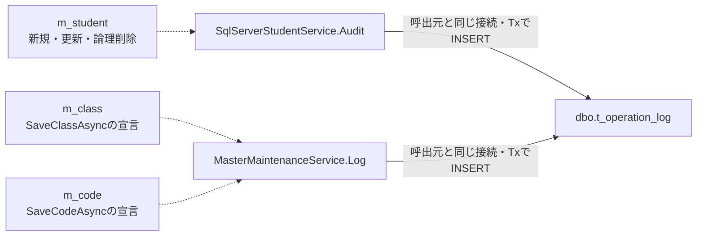

<!-- spec-meta: {"schema":"spec-md/1.1","documentId":"CSHARP_ASPNET-BAS-STU-03-T_OPERATION_LOG","version":"1.0","path":"基本設計書/テーブル/05_t_operation_log.md","layout":"TABLE","sheets":[{"sheet":"t_operation_log"}],"sections":[{"heading":"テーブルヘッダー","kind":"HEADER"},{"heading":"項目詳細","kind":"LIST","key":["No"]}],"columns":["No","論理名","物理名","PK","NOT NULL","タイプ","長さ","初期値","説明"],"table":{"logicalName":"操作履歴","physicalName":"t_operation_log","primaryKey":["log_id"],"fieldIds":{"log_id":"TBL-05-001","target_table":"TBL-05-002","target_key":"TBL-05-003","operation_type":"TBL-05-004","before_version":"TBL-05-005","after_version":"TBL-05-006","changed_columns":"TBL-05-007","executed_by":"TBL-05-008","executed_at":"TBL-05-009","correlation_id":"TBL-05-010","operation_reason":"TBL-05-011","duplicate_confirmed":"TBL-05-012"}}} -->
# 操作履歴（dbo.t_operation_log）テーブル仕様書

文書ID：CSHARP_ASPNET-BAS-STU-03-T_OPERATION_LOG／版：1.0／文書種別：テーブル定義／対象：SQL Server／文書パス：基本設計書/テーブル/05_t_operation_log.md

## テーブルヘッダー

| 項目 | 内容 |
| --- | --- |
| 論理名／物理名 | 操作履歴／`dbo.t_operation_log`。12列で構成する。根拠：`database/001_schema.sql:137-154`。 |
| 1件の意味 | 業務データの実変更に伴って追記する操作記録。対象、操作種別、前後の更新管理番号、変更列名、実行者・日時、受付番号、理由、重複確認有無を保存する。業務変更と履歴INSERTが同じトランザクションでcommitされた場合に確定する。根拠：`Core/SqlServerStudentService.cs:306-315,413-414`、`Core/MasterMaintenanceService.cs:74-76,119-120`。 |
| 主キー／採番 | `pk_t_operation_log(log_id)`。`log_id`は`IDENTITY(1,1)`。追記SQLはこの列を指定せず、採番された履歴番号も取得しない。根拠：`database/001_schema.sql:138-150`、`Core/SqlServerStudentService.cs:385-390`、`Core/MasterMaintenanceService.cs:132-135`。 |
| NULL／既定値 | NULL可は`before_version`と`operation_reason`。DEFAULTは`df_t_operation_log_duplicate_confirmed DEFAULT (0)`だけ。新規の後版1、日時、実行者、UUIDは処理設定値でありDEFAULTではない。根拠：`database/001_schema.sql:137-154`。 |
| 長さ／記号 | 明細の長さは物理容量。`varchar(n)`のnはバイト、`nvarchar(n)`のnはUTF-16コード単位として記載する。実行者64・理由60のUnicodeスカラー上限は説明欄へ分ける。PK・NOT NULLは〇が該当し、非該当、長さ非適用、DEFAULTなしは空欄とする。 |
| 照合順序 | `target_table`、`target_key`、`operation_type`は`Latin1_General_100_BIN2`。`changed_columns`、`executed_by`、`operation_reason`は`Latin1_General_100_CS_AS_SC`。根拠：`database/001_schema.sql:139-148`。 |
| CHECK制約 | `ck_audit_operation`はCREATE・UPDATE・DELETE・DISABLE・ENABLEを許可する。`ck_audit_json`は`ISJSON(changed_columns)=1`かつ`LEFT(LTRIM(changed_columns),1)='['`を要求する。`ck_t_operation_log_executed_by_scalar`は64スカラー以内、`ck_t_operation_log_operation_reason_scalar`はNULLまたは60スカラー以内、`ck_t_operation_log_executed_at_utc`は日時のオフセット0を要求する。文字数CHECKは末尾に`N'#'`を加えてLENから1を引く式で、末尾空白も上限へ含める。根拠：`database/001_schema.sql:151-153,204-205`。 |
| DB制約と処理検査の境界 | 対象表名の許可一覧、対象キーの実在、操作別の前版必須、版の正値・前後差、操作別の理由必須、JSON要素の型・列名・件数を保証するCHECKはない。受付番号の一意制約もない。これらを列のNOT NULLや索引から補わない。根拠：`database/001_schema.sql:137-154,187-212`。 |
| 索引 | 通常索引`ix_operation_target(target_table,target_key,executed_at)`。列順は対象表、対象キー、実行日時であり、一意索引ではない。根拠：`database/001_schema.sql:212-212`。 |
| FK／削除連動 | 履歴表から業務表へのFKは宣言されていない。対象表名と文字列キーは処理が作る対応情報であり、対象の存在や削除連動をDB参照制約で保証しない。根拠：`database/001_schema.sql:137-154,187-205`。 |
| 追記元の範囲 | 学生の新規・更新・論理削除は接続されたWebサービスから`Audit`を呼ぶ。クラス・コード値は`MasterMaintenanceService`に`Log`呼出しが宣言されているが、Webのサービス登録・保守ルートには接続されていない。根拠：`Infrastructure/WebHostSetup.cs:13-19`、`Web/Controllers/StudentsController.cs:26-37`、`Core/MasterMaintenanceService.cs:75-77,119-121`。 |
| 参考設計との対応 | 参考設計は学生・クラス・コード分類・コード値の監査を意図する。現行の追記元は学生・クラス・コード値であり、コード分類の通常変更・監査入口は確認できない。参考設計の実行者「利用者番号」は、現行では学生の認証Principal、マスタのDBログイン名に対応し、数値番号の検査はない。根拠：`reference-designs/基本設計書/テーブル/05_t_operation_log.md:25-35`、`Core/SqlServerStudentService.cs:46-51,307-307`、`Core/MasterMaintenanceService.cs:23-27,75-75,119-119`。 |
| DB権限の定義 | `student_staff`へ履歴INSERTをGRANTし、UPDATE・DELETEをDENYする。`student_admin`は`student_staff`のメンバーで、この役割構成における権限を継承する。このSQLのviewer向けSELECT許可は4業務表で、履歴SELECTのGRANTは含まない。コード分類DMLはadminにDENYされる。根拠：`database/003_web_permissions.sql:8-22`。 |
| 保管／運用上の未確定 | 参考設計は履歴を追記のみとし、保管期間・物理消去には別途運用承認を求める。保管年数、承認済み消去手順、履歴閲覧の画面・表示形式は定義できる材料がない。根拠：`reference-designs/基本設計書/03_テーブル仕様書.md:63-63,89-91`。 |
| 関連文書：共通保存規則 | 計画ID `CSHARP_ASPNET-BAS-STU-03`、相対path `基本設計書/03_テーブル仕様書.md`。表の索引、全体の参照関係、共通保存規則を担当する。計画上の関連文書であり、本ジョブでは未生成。 |
| 関連文書：学生の入口・結果 | 計画ID `CSHARP_ASPNET-BAS-STU-02`、相対path `基本設計書/02_学生登録画面.md`は画面操作と理由入力を担当する。計画ID `CSHARP_ASPNET-DET-CSharp_ASPNET-SCR-STU-002`、相対path `詳細仕様書/CSharp_ASPNET/02_学生登録画面.md`はDTO、検査順序、保存・削除のSQLと応答分岐を担当する。いずれも本ジョブでは未生成。 |
| 関連文書：追記元の列定義 | `CSHARP_ASPNET-BAS-STU-03-M_STUDENT`＝`基本設計書/テーブル/01_m_student.md`、`CSHARP_ASPNET-BAS-STU-03-M_CLASS`＝`基本設計書/テーブル/02_m_class.md`、`CSHARP_ASPNET-BAS-STU-03-M_CODE`＝`基本設計書/テーブル/04_m_code.md`。業務変更対象の列を担当する。`CSHARP_ASPNET-BAS-STU-03-M_CODE_CATEGORY`＝`基本設計書/テーブル/03_m_code_category.md`は設計上の監査対象と未確認入口の対応先。すべて計画上の文書で、本ジョブでは未生成。 |
| 関連文書：マスタ操作の意味 | 計画ID `CSHARP_ASPNET-BAS-STU-04`、相対path `基本設計書/04_コード設計書.md`。分類・選択値、保護、停止・再開の意味を担当する。本ジョブでは未生成。 |

本表へ渡す変更項目一覧は列名の配列である。学生の氏名・住所・所属などの前後値や、編集取消用の読込スナップショットは保存しない。前後版も業務値のコピーを参照する履歴キーではないため、この表から過去の業務値を復元する機能は定義できない。ただし理由は自由入力の文字列を別に保存するため、履歴全体に個人情報が含まれないことまでは保証しない。根拠：`Core/SqlServerStudentService.cs:306-307,385-390`、`Core/MasterMaintenanceService.cs:132-135`、`reference-designs/基本設計書/03_テーブル仕様書.md:89-91`。

次図は履歴追記の処理依存を表す。FKの多重度や削除連動を示すER線ではない。クラス・コード値の線はサービス内に宣言された呼出しであり、公開保守機能の存在を示さない。根拠：`Core/SqlServerStudentService.cs:307-307,413-413`、`Core/MasterMaintenanceService.cs:75-75,119-119,132-135`。

**理由の入力と履歴への移送。** 通常保存の理由は`textarea#REG-024`の`Input.OperationReason`から`StudentSaveInput.OperationReason:string?`、`SaveRequest.Reason:string?`へ渡る。削除理由は別フォームの`textarea#REG-026`、`name=Reason`から`StudentDeleteInput.Reason:string`を経て`DeleteAsync`へ渡り、学生の`delete_reason`と履歴の`operation_reason`に同じ正規化値を設定する。実行者・日時・受付番号・確認有無は利用者の理由入力から生成せず、処理が設定する。根拠：`Views/Students/Edit.cshtml:13-17`、`Web/Inputs/StudentSaveInput.cs:32-42`、`Web/Inputs/StudentDeleteInput.cs:4-4`、`Core/SqlServerStudentService.cs:234-234,409-413`。

両textareaの`maxlength=120`と、サービスの原入力60スカラー・正規化後60スカラー、DBの120コード単位は別の制約である。`StudentNormalizer.Text`はNULLを空文字にし、原入力の長さを先に検査する。その後CRLF・CRをLFへ統一し、LF以外の制御文字を拒否し、前後空白を除いて保存値の長さを再検査する。任意の空欄はNULL、必須の空欄は入力検証例外になる。前後空白や改行の正規化で短くなる入力でも、原入力上限を超えれば拒否される。根拠：`Core/StudentNormalizer.cs:37-57`。

**学生保存で追記する条件。** 接続された入口はPOST `/students/create`とPOST `/students/{id:long}/update`である。認証・CSRFの登録に加え、ControllerはFormGuard、作成更新権限、編集スナップショット取得、復帰状態、読込時復帰先との一致、ModelStateの順で検査し、Coordinatorから`ToRequest`、`SaveAsync`へ渡す。スナップショットは所有者・ログインセッション・対象・期限を持つサーバーメモリの情報で、履歴列へは移送しない。根拠：`Infrastructure/WebHostSetup.cs:14-19,25-25`、`Web/Controllers/StudentsController.cs:26-33,41-41`、`Infrastructure/WebStudentCoordinator.cs:18-18`、`Infrastructure/EditorSnapshotStore.cs:7-10`。

スナップショット取得は辞書のTryGetValueを先に呼ぶ。キー不在・期限切れは409、所有者・セッション・対象不一致は403になるが、SnapshotIdがNULLの場合の事前検査はなく、独自WebFaultへ到達する前に辞書APIへ渡る。空文字・キー不在とNULLを同じ結果には扱わない。MVCは非nullable参照型の暗黙requiredを抑止しており、string注釈やブラウザーrequiredだけで受信NULLの排除を保証しない。根拠：`Infrastructure/EditorSnapshotStore.cs:10-10`、`Infrastructure/WebHostSetup.cs:16-16`。

1. サービスは呼出しごとの受付UUID、認証利用者、入口のUTC時刻を取得し、閲覧者を拒否する。学生入力・理由を正規化し、学生IDと期待版の正値・対の設定、年度・学年を検査する。この入力検査の`InputValidationException`と`ArgumentException`は`ValidationFailed`へ変換する。
2. 接続を開いてReadCommittedトランザクションを開始し、`test-project1:student-write`を資源名とするトランザクション所有のExclusiveな`sp_getapplock`を取得する。待機上限は5000msで、負の戻り値はSQL例外となる。
3. 既存学生はゲート取得後にID・非削除条件で再読込する。不在、期待版不一致、学籍番号変更は追記前に終了する。卒業・退学から別区分への訂正には管理者と理由が必要である。最新コードの存在と、新規・変更選択時の利用状態・期間、クラスの年度・学年・期間、新たな席が増える場合の定員を検査する。
4. 正規化Valuesと最新保存値を比較する。差が0件なら明示rollbackし、元の学生IDと読取版を持つ`NoChange`を返す。理由だけの変更では業務列の差にならず、版・更新日時・履歴を増やさない。
5. 差があれば版上限と、削除済みを含む学籍番号一意性を検査する。同一生年月日かつ氏名キーまたはカナキーが一致する非削除の他学生をID順に全件取得し、確認情報を照合する。候補または送信済み確認値があり照合不成立ならrollbackし、`ConfirmationRequired`を返す。この結果は既存の学生ID・読取版を保持し、新規だけが両者NULLとなる。候補総数と表示最大20件を返すが、履歴は追記しない。
6. 確認が不要、または有効な確認と理由が揃った場合に学生INSERT／UPDATEを行い、同じ接続・トランザクションで`Audit`を1回呼ぶ。UPDATEはID・期待版・非削除をWHEREで再確認し、OUTPUTがNULLまたはDBNullなら競合例外として追記へ進まない。履歴追記後のcommit完了を経て、`Saved`と学生ID・後版・受付番号を返す。

以上の順序と結果の根拠：`Core/SqlServerStudentService.cs:227-315,344-383`。ゲートの根拠：`Core/SqlServerStudentService.cs:92-102`。早期の不在・競合等のreturn枝にはcommitがなく、トランザクションは`await using`の破棄へ進む。変更なしと確認待ちの枝はコード上でrollbackを明示している。

Web確認情報はメモリで、所有者・セッション・対象ID・期待版・正規化内容ハッシュ・全候補IDと版のハッシュ・10分期限・Busy取得を照合する。期限比較にはサービス入口で取得したnowを使う。保存履歴の確認有無は、その保存要求で再検索した候補件数が1件以上かで設定し、確認値の送信だけではtrueにしない。commit完了時と結果不明時はWeb確認情報を無効化し、未完了かつ結果不明でない場合は取得済みBusyを解除する。`webTokens:false`で有効な確認を消費する場合だけ、履歴の後に`t_confirmation.consumed=1`を同じトランザクションで更新し、1件でなければ競合例外とする。登録されたWebは`webTokens:true`であり、この確認表更新は通常Web経路には含まれない。根拠：`Core/SqlServerStudentService.cs:19-29,224-225,274-290,308-323,330-342`、`Infrastructure/WebHostSetup.cs:19-19`。

**変更項目一覧の内容。** 学生新規のJSONには、正規化Valuesの22列と、`gender_category`、`prefecture_category`、`enrollment_category`、`is_deleted`、`created_at`、`created_by`、`updated_at`、`updated_by`、`row_version`を合わせた31列名を記録する。22列には任意値がNULLとなる列、氏名・カナ照合キー、算定した続柄分類も含む。採番IDと、INSERTで明示しない削除日時・削除者・削除理由は含まない。学生更新ではValuesの実差分へ更新日時・更新者・版の3列名だけを追加するため、SET対象全列の一覧とは異なる。根拠：`Core/StudentNormalizer.cs:119-147`、`Core/SqlServerStudentService.cs:261-261,294-307`。

**学生論理削除。** POST `/students/{id:long}/delete`はFormGuard、認証読取、スナップショットと元復帰先の検査を経る。Coordinatorは管理者権限、復帰状態、明示確認、期待版の変換を検査する。サービスも管理者、必須削除理由、正のID・版と版上限を検査した後、ReadCommittedと同じゲートの下で非削除対象と版を読み直す。不在は`NotFound`、版不一致は`Conflict`で追記前に終了する。根拠：`Web/Controllers/StudentsController.cs:37-37`、`Infrastructure/WebStudentCoordinator.cs:19-19`、`Core/SqlServerStudentService.cs:392-407`。

削除UPDATEのWHEREは学生ID・期待版・非削除であり、変更するのは`is_deleted`、`deleted_at`、`deleted_by`、`delete_reason`、`updated_at`、`updated_by`、`row_version`の7列に限る。影響件数が1でなければ競合例外とする。1件なら同じ7列名をDELETE履歴へ渡し、前版は照合済み版、後版は版+1、理由は削除理由、重複確認はfalseとしてcommitする。編集中の氏名等の業務値は保存しない。根拠：`Core/SqlServerStudentService.cs:409-414`。

**宣言されたマスタ保守の追記。** クラス保守は入力検査とDB接続上の管理者確認の後、ReadCommittedと共通ゲートを使い、最新対象・期待版、年度とコードの不変、参照学生・現在人数、学年選択の条件を検査する。比較する10列は`school_year`、`grade_code`、`class_code`、`class_name`、`valid_from`、`valid_to`、`capacity`、`display_order`、`is_active`、`remarks`である。差がなければrollbackして`NoChange`、差があれば業務保存後に保存結果のclass_idと前後版をLogへ渡してcommitする。新規は10列名、更新はこの中の差分列名を記録し、固定学年分類や管理列をJSONへ追加しない。根拠：`Core/MasterMaintenanceService.cs:17-77,124-130`。

コード値保守は分類設定と最新コードをゲート下で読み直し、分類桁数で値を正規化する。追加可否、期待版、保護値の停止・期間短縮制限を確認してから、`code_name`、`display_order`、`is_active`、`valid_from`、`valid_to`、`remarks`の6列を比較する。差がなければrollbackして`NoChange`、差があればINSERTまたは分類・値・期待版をWHEREとするUPDATEを実行し、影響件数1を確認してLog、commitへ進む。新規のJSONは6列名、更新はその差分であり、分類・値・保護フラグ・管理列は追加しない。根拠：`Core/MasterMaintenanceService.cs:79-121`。

マスタの操作種別は旧利用状態がNULLならCREATE、旧新が同じならUPDATE、falseからtrueならENABLE、trueからfalseならDISABLEとなる。したがって停止済みデータの名称変更もUPDATEである。マスタ履歴の理由はNULL、重複確認は0に固定する。try内の例外はrollbackを試みて再throwし、学生処理のSystemError／Unknownへ変換しない。参考設計が求めるコードの意味の維持は運用意図であり、名称の意味を自動判定する検査を示すものではない。根拠：`Core/AuditOperation.cs:6-7`、`Core/MasterMaintenanceService.cs:77-77,121-121,132-135`、`reference-designs/基本設計書/04_コード設計書.md:114-116`。

**履歴INSERTと戻り値。** Audit／Logはlog_id以外の11列を1回のINSERTで設定する。共通Commandは30秒のタイムアウトを設定し、ExecuteNonQueryAsyncへ呼出元のCancellationTokenを渡す。NULL引数は共通ParamでDBNull.Valueとなる。履歴INSERTにはWHERE、JOIN、ORDER BY、ページング、OUTPUTや結果行取得がなく、追記関数は影響件数も比較しない。呼出元が完了をawaitしてからcommitするため、INSERTの完了だけを保存成功の戻り値とは扱わない。根拠：`Core/SqlServerStudentService.cs:65-72,385-390`、`Core/MasterMaintenanceService.cs:132-135`。

**取消・結果不明の区別。** 保存トランザクション内のcatchは、入力検証例外、SQLエラー2601／2627、DBConcurrencyException、残るSqlException・InvalidOperationException・OperationCanceledExceptionの順である。先行catchはrollbackを試み、それぞれValidationFailed、学籍番号使用済みのValidationFailed、Conflictを返す。削除ではDBConcurrencyExceptionの先行catchがConflictを返す。これらの先行catchはrollback成否によるUnknown分類を行わない。根拠：`Core/SqlServerStudentService.cs:316-318,415-415`。

最後の対象例外catchに到達した場合だけ、`writeStarted && (commitAttempted || !rolledBack)`を判定し、trueならUnknown、falseならSystemErrorを返す。履歴INSERTでこのcatchの対象例外が生じ、commit前にrollbackが成功すればSystemError、rollbackに失敗すればUnknownとなる。commit試行後の対象例外もUnknownになる。両結果のメッセージIDはE-COM-004だが、Unknownは保存・削除結果を検索で確認する案内、SystemErrorは処理失敗と受付番号の案内である。Rollback helperはCancellationToken.Noneを使い、SqlExceptionまたはInvalidOperationExceptionを捕捉した場合にfalseを返す。参考設計の「双方取消」という意図を、取消失敗や確定応答不明の場合まで成功保証へ拡張しない。根拠：`Core/SqlServerStudentService.cs:319-329,416-416`、`reference-designs/詳細仕様書/CSharp_ASPNET/02_学生登録画面.md:611-614`。

**画面へ返す結果と確定後の境界。** ControllerはSavedだけを303と一度取得する成功通知による検索復帰へ進める。NoChangeは200、入力不正は422、権限不足は403、不在は404、競合・確認待ちは409、SystemError・Unknownは503へ対応する。失敗・不明結果にもサービスの受付番号はあるが、対応する履歴行の存在を意味しない。削除の非Saved結果は状態コード設定後に学生を再読込するため、そこで別の不在・取得失敗が生じる場合がある。根拠：`Core/SqlServerStudentService.cs:226-226,315-322,414-416`、`Web/Controllers/StudentsController.cs:30-38`、`Infrastructure/WebPresentation.cs:23-23`、`Infrastructure/FlashMessageStore.cs:6-9`。

User取得、DB接続・トランザクション開始は保存／削除の後段catch外である。削除理由の前処理はInputValidationExceptionだけを捕捉し、不正サロゲートによるArgumentExceptionまでValidationFailedへ変換しない。Controllerの保存用個別catchもWebFaultに限り、事前検査、結果後の候補取得、削除後の再読込をすべて包むcatchではない。応答未開始の未捕捉例外は接続されたmiddlewareへ届き、WebFaultならその状態、その他は503のHTML案内となる。応答開始後はこのmiddleware catchの対象外である。commit後の通知・検索復帰で失敗しても、業務変更と履歴を取り消す処理へ戻らない。根拠：`Core/SqlServerStudentService.cs:229-244,394-402`、`Core/StudentNormalizer.cs:37-50`、`Web/Controllers/StudentsController.cs:29-38`、`Infrastructure/WebHostSetup.cs:22-24`。

**設計上の確認責務。** 参考設計が求める入力→処理値→DB→再表示の往復確認では、本表に関係する理由の原入力・正規化後60スカラーと120コード単位、空欄と条件付き必須、学生の対象・前後版・操作種別・変更列JSON、候補再検査後の確認有無を対応させる。学生側の再読込・更新管理表示と履歴への保存内容を照合し、旧版・定員競合・履歴失敗・commit応答不明の各段階で、追記有無と戻り値が上記の経路に従うことを確認する責務である。参考設計の日時19文字・更新者64文字の表示は学生登録の更新情報であり、履歴一覧の表示定義へ転用しない。根拠：`reference-designs/詳細仕様書/CSharp_ASPNET/02_学生登録画面.md:751-753`、`reference-designs/基本設計書/02_学生登録画面.md:145-145`。

## 項目詳細

| No | 論理名 | 物理名 | PK | NOT NULL | タイプ | 長さ | 初期値 | 説明 |
| --- | --- | --- | --- | --- | --- | --- | --- | --- |
| 1 | 操作履歴番号 | log_id | 〇 | 〇 | `bigint` |  |  | 追記記録の識別子。`IDENTITY(1,1)`でDBが採番し、追記関数は引数・SQL列に指定しない。履歴番号を取得せず、学生のSaveResult・マスタのMaintenanceResultにも返さない。根拠：`database/001_schema.sql:138-150`、`Core/SqlServerStudentService.cs:385-390`、`Core/MasterMaintenanceService.cs:11-11,132-135`、`Core/Contracts.cs:68-70`。 |
| 2 | 対象情報の種類 | target_table |  | 〇 | `varchar(21)` | 21バイト |  | 操作対象の表を識別する。学生AuditはSQL固定値`m_student`。マスタLogは`table:string`へ`m_class`または`m_code`を渡し、`@table:SqlDbType.VarChar, Size=21`で保存する。許可表一覧のCHECKはない。コード分類は参考設計上の対象で、現行呼出しは確認できない。根拠：`database/001_schema.sql:139-139`、`Core/SqlServerStudentService.cs:387-387`、`Core/MasterMaintenanceService.cs:75-75,119-119,132-135`。 |
| 3 | 対象の識別情報 | target_key |  | 〇 | `varchar(35)` | 35バイト |  | 学生は`id:long`のstudent_id、クラスは保存結果のclass_idをInvariantCultureの十進文字列にする。学籍番号・クラスコードはキーに使わない。コード値は`CategoryId + ":" + 正規化CodeValue`。`@id`（学生）／`@key`（マスタ）は`SqlDbType.VarChar, Size=35`。名称・氏名・住所は組み込まず、対象へのFKもない。根拠：`database/001_schema.sql:140-140`、`Core/SqlServerStudentService.cs:388-388`、`Core/MasterMaintenanceService.cs:75-75,96-119,135-135`。 |
| 4 | 操作の種類 | operation_type |  | 〇 | `varchar(11)` | 11バイト |  | `operation:string`を`@op:SqlDbType.VarChar, Size=11`へ渡す。学生は新規CREATE、更新UPDATE、論理削除DELETE。マスタは旧状態なしCREATE、同じ状態UPDATE、利用再開ENABLE、停止DISABLE。DBの`ck_audit_operation`もこの5値を許可する。根拠：`database/001_schema.sql:141-141,205-205`、`Core/SqlServerStudentService.cs:307-307,388-388,413-413`、`Core/AuditOperation.cs:6-7`。 |
| 5 | 変更前の更新管理番号 | before_version |  |  | `bigint` |  |  | `before:long?`を`@before:SqlDbType.BigInt`へ渡す。学生新規はNULL、更新はゲート下で読取った最新row_version、削除は最新値と照合済みの要求版。マスタは照合済みExpectedVersionで新規はNULL。NULL引数はDBNull.Valueになる。新規以外必須は設計・呼出し側の条件で、操作種別との組合せCHECKはない。根拠：`database/001_schema.sql:142-142`、`Core/SqlServerStudentService.cs:67-72,245-252,307-307,404-413`、`Core/MasterMaintenanceService.cs:75-75,119-119`。 |
| 6 | 変更後の更新管理番号 | after_version |  | 〇 | `bigint` |  |  | `after:long`を`@after:SqlDbType.BigInt`へ渡す。SQL Serverのrowversion型ではない。学生保存は読取前版または0に1を加え、削除は照合済み版+1、マスタはExpectedVersionまたは0に1を加える。新規1は処理設定値。変更前版long.MaxValueは書込み前に拒否するが、本表のCHECKには正値・前後差の検査がない。根拠：`database/001_schema.sql:143-143`、`Core/SqlServerStudentService.cs:263-263,292-307,398-414`、`Core/MasterMaintenanceService.cs:68-68,112-119,130-130`。 |
| 7 | 変更項目一覧 | changed_columns |  | 〇 | `nvarchar(max)` | max |  | `changed:string[]`をJsonSerializer.SerializeしたJSON文字列。`@changed:SqlDbType.NVarChar, Size=-1`。学生新規は31列名、更新はValues差分と管理3列、削除は削除属性・管理の7列。クラスは比較対象10列、コード値は6列について新規は全対象、更新は差分を記録する。前後の業務値は保存しない。DBはJSONと配列開始を検査するが、要素型・許可列名・件数は検査せず、max容量から業務上限を算定しない。根拠：`database/001_schema.sql:144-144,204-204`、`Core/SqlServerStudentService.cs:306-307,389-389,413-413`、`Core/MasterMaintenanceService.cs:65-75,109-119,135-135`。 |
| 8 | 実行者 | executed_by |  | 〇 | `nvarchar(128)` | 128コード単位 |  | `actor:string`、`@actor:SqlDbType.NVarChar, Size=128`。学生はCurrentUser.Principalを原入力・正規化後64スカラーの必須検査へ渡すが、Textの戻り値を使わず元のPrincipalを記録する。マスタはDBのORIGINAL_LOGIN()を同条件で検査し、Textの戻り値を記録する。DBにも64スカラー上限CHECKがある。数値利用者番号の検査はない。根拠：`database/001_schema.sql:145-145,151-151`、`Core/SqlServerStudentService.cs:46-51,307-307,389-389`、`Core/MasterMaintenanceService.cs:23-27,135-135`。 |
| 9 | 実行日時 | executed_at |  | 〇 | `datetimeoffset(7)` |  |  | `now:DateTimeOffset`、`@now:SqlDbType.DateTimeOffset`。学生はサービス入口の_clock.GetUtcNow()、マスタはトランザクション開始後のDateTimeOffset.UtcNowを使い、業務表の管理日時と共用する。DBのUTC制約はオフセット0を要求する。履歴追記時やcommit後の再採時はなく、commit完了時刻ではない。根拠：`database/001_schema.sql:146-146,152-152`、`Core/SqlServerStudentService.cs:44-45,229-229,296-307,394-394`、`Core/MasterMaintenanceService.cs:39-40,88-88,135-135`。 |
| 10 | 受付番号 | correlation_id |  | 〇 | `uniqueidentifier` |  |  | `requestId:Guid`を`@request:SqlDbType.UniqueIdentifier`へ渡す障害調査用の対応情報。学生は保存・削除呼出しごとのGuid.NewGuid()を履歴とSaveResult.RequestIdで共用する。マスタはLog内で新しいGuidを生成し、MaintenanceResultには返さない。一意制約はなく、再POSTでは別番号となるため、この列による二重実行防止はない。根拠：`database/001_schema.sql:147-147,187-212`、`Core/SqlServerStudentService.cs:229-229,307-315,394-414`、`Core/MasterMaintenanceService.cs:11-11,135-135`。 |
| 11 | 操作・確認理由 | operation_reason |  |  | `nvarchar(120)` | 120コード単位 |  | 学生の`reason:string?`を`@reason:SqlDbType.NVarChar, Size=120`へ渡す。通常保存は正規化SaveRequest.Reason、削除は必須検査後の削除理由で、学生delete_reasonにも同値を保存する。原入力・保存値各60スカラー、DBにもNULLまたは60スカラーのCHECKがある。終了区分訂正・有効確認による続行・削除の必須性は学生処理で検査し、DDLではNULL可。マスタはSQL固定NULL。根拠：`database/001_schema.sql:148-148,153-153`、`Core/SqlServerStudentService.cs:234-234,255-257,286-307,389-389,396-413`、`Core/MasterMaintenanceService.cs:134-134`。 |
| 12 | 重複警告の確認有無 | duplicate_confirmed |  | 〇 | `bit` |  | 0 | `df_t_operation_log_duplicate_confirmed`のDEFAULTは0。学生Auditの`confirmed:bool`は`@confirmed:SqlDbType.Bit`で保存する。保存へ到達した再検索候補が1件以上ならtrueで、その前に必要な確認・理由の検査を通過する。確認値を送っただけではtrueにしない。学生削除はfalse、マスタはSQL固定0を明示する。根拠：`database/001_schema.sql:149-149`、`Core/SqlServerStudentService.cs:268-307,389-389,413-413`、`Core/MasterMaintenanceService.cs:134-134`。 |
