<!-- spec-meta: {"schema":"spec-md/1.0","documentId":"CSHARP_ASPNET-DET-CSharp_ASPNET-SCR-STU-001","version":"1.0","path":"詳細仕様書/CSharp_ASPNET/01_学生検索画面.md","sheets":[{"heading":"概要","kind":"GRID","sheet":"01_概要"},{"heading":"項目一覧","kind":"LIST","sheet":"02_項目一覧","key":["項目ID"]},{"heading":"選択候補一覧","kind":"LIST","sheet":"03_選択候補一覧","key":["候補ID"]},{"heading":"内部項目一覧","kind":"LIST","sheet":"04_内部項目一覧","key":["内部項目ID"]},{"heading":"イベント仕様","kind":"GRID","sheet":"05_イベント仕様"},{"heading":"項目移送仕様","kind":"LIST","sheet":"06_項目移送仕様","key":["移送ID"]},{"heading":"補足説明","kind":"GRID","sheet":"07_補足説明"}]} -->
# 学生検索画面 詳細仕様書

| 文書属性 | 値 |
| --- | --- |
| 文書ID | CSHARP_ASPNET-DET-CSharp_ASPNET-SCR-STU-001 |
| 文書種別 | detailed-specification |
| 文書版 | 1.0 |
| 正本の相対パス | 詳細仕様書/CSharp_ASPNET/01_学生検索画面.md |
| 記述区分 | 現行ソースで観測した接続・処理を本文の中心とし、参考設計の要求は「設計意図」として区別する。 |

## 概要

### 機能と責務

学生検索画面は、検索条件から論理削除されていない学生を抽出し、学生登録画面の新規登録・編集・参照へ進む入口である。年度と学年は、学生の `class_id` が参照するクラスの属性で絞り込む。年度別の所属履歴を検索する処理ではない。検索、候補更新、ページ操作、クリアは業務表を更新せず、検索条件と取得結果をプロセス内の検索状態へ保持する。〔実装根拠：`sources/Views/Students/Search.cshtml:4-8`、`sources/Core/SqlServerStudentService.cs:137-168`、`sources/Infrastructure/WebStudentCoordinator.cs:7-15`〕

画面では編集中の `StudentSearchInput` と、最後に正常実行した `SearchCriteria` を分ける。候補更新は編集中の条件を画面へ返し、一覧には最後の結果を使う。ページ操作は画面で編集中の条件を送らず、保持した実行済み条件を複製して検索する。検索用に生成した氏名キー、カナキー、電話値等はサービスのローカル値であり、保持条件の文字列へ書き戻さない。〔実装根拠：`sources/Web/Controllers/StudentsController.cs:14-22`、`sources/Infrastructure/WebStudentCoordinator.cs:8-14`、`sources/Core/SqlServerStudentService.cs:113-153`〕

参考設計は単一校の学生基本情報を対象とし、成績、帳票、一覧直接編集、一括更新、削除済み学生照会を対象外とする。また、入力からDB、再表示までの対応と、権限・競合・障害時の結果を確認対象にしている。これらは設計上の対象と確認責務であり、承認済みという意味ではない。〔設計意図の根拠：`reference-designs/基本設計書/01_学生検索画面.md:14-24`、`reference-designs/基本設計書/01_学生検索画面.md:487-491`〕

### 接続される入口

| 入口 | 実画面の起点・受信モデル | 接続先と役割 |
| --- | --- | --- |
| GET `/students` | 起動。またはクエリの `contextId`、`contextRevision` による復帰 | `StudentsController.Index`。識別子なしは状態作成、ありは `Resume`。 |
| POST `/students/search` | `data-search-form` の検索ボタン。`Criteria` 接頭辞の `StudentSearchInput` と状態・表示指定 | `StudentsController.Search` → `WebStudentCoordinator.Search` → `IStudentService.SearchAsync`。 |
| POST `/students/options` | 同じ検索フォームの「候補を更新」。実ビューではボタンの `formaction` | `StudentsController.Options` → `SearchModel` → `LookupAsync(false, ct)`。学生の再検索はしない。 |
| POST `/students/page` | 一覧フォーム。`PageRequest` と `TabId` | `StudentsController.Page` → `WebStudentCoordinator.Page`。保持条件のページ・表示順を変更する。 |
| POST `/students/clear` | 独立したクリアフォーム。`ContextRequest` と `TabId` | `StudentsController.Clear` → `WebStudentCoordinator.Clear`。同じ検索状態を未検索へ戻す。 |
| GET `/students/new` | Viewer以外に表示する新規登録リンク | `returnContextId` を渡して登録側の `Load` へ進む。 |
| GET `/students/{id:long}` | 学生IDを使う行リンク。Viewerは「参照」、それ以外は「編集」 | 登録側の `Load` で最新の非削除対象を取得する。行の版はURLへ渡さない。 |

`Program` は `WebHostSetup.Add`、`WebHostSetup.Use`、`MapControllers` を接続する。Controllerには `Authorize` と `Route("students")` がある。Coordinatorと認証情報はScoped、検索状態・Flash・編集スナップショットはSingletonである。登録された `IStudentService` の実装は `SqlServerStudentService` で、`StudentDb` が空白なら生成時に503の `WebFault` を投げる。〔実装根拠：`sources/Program.cs:2-8`、`sources/Infrastructure/WebHostSetup.cs:13-19`、`sources/Web/Controllers/StudentsController.cs:5-25`〕

`SearchRequest` は検索アクションが組み立てる内部引数である。`PageRequest` はフォーム受信にも使う。`OptionsRequest`、`StrictJson.Read`、Coordinatorの `Options`、`WebPresentation.Lookups` は宣言されているが、この学生フォームのルートから呼ばれない。JSONの重複・未知プロパティ検査を学生フォームの保証へ転用せず、これらを公開学生JSON APIとして扱わない。〔実装根拠：`sources/Web/Inputs/StudentSearchInput.cs:24-31`、`sources/Infrastructure/StrictJson.cs:4-15`、`sources/Infrastructure/WebStudentCoordinator.cs:16-16`、`sources/Web/Controllers/StudentsController.cs:13-22`〕

### 入出力と保持先

| 区分 | 当該機能から見た方向 | 値と保持先 |
| --- | --- | --- |
| HTTPフォーム | 入力 | 条件、表示指定、状態ID・版・タブ、CSRF情報。MVCによるバインド後にアクションへ渡る。 |
| 認証情報 | 入力 | Claimから主体、ログインセッション、Roleを取得する。フォームの権限値は使わない。 |
| 学生DB | 読取り | `dbo.m_student` の条件照合、件数、一覧。学生の書込み・履歴追記はない。 |
| クラス・コードDB | 読取り | 存在・組合せ確認、候補、一覧の参照名称。 |
| 検索状態 | 入出力 | Singleton内の `ConcurrentDictionary<string, Entry>`。条件、結果、版、期限を保持する。 |
| Flash | 取得・消費 | 主体・セッション・検索状態ID別のメモリ通知。GETで一度だけ取り出す。 |
| HTML | 出力 | 検索条件、候補、一覧、状態別文言、情報・エラー、権限別リンク。 |
| 外部ファイル | 対応する処理なし | この検索入口にはCSV、取込、帳票ファイルの入出力がない。 |

〔実装根拠：`sources/Infrastructure/RequestIdentity.cs:7-16`、`sources/Infrastructure/SearchContextStore.cs:9-15`、`sources/Infrastructure/FlashMessageStore.cs:6-9`、`sources/Web/Controllers/StudentsController.cs:8-22`。入出力を分ける設計意図：`reference-designs/詳細仕様書/CSharp_ASPNET/01_学生検索画面.md:47-74`〕

### 画面の静的投影

以下はStaffの未検索状態を示す非実行のHTMLである。画面撮影や実データの表示ではない。共有レイアウトのヘッダー、実ビューのフォーム構造、検索画面に適用される共有CSSを合わせている。コード候補はseedに定義された値の抜粋で、年度・クラスの実データは仮造していない。識別子とCSRF値は投影では空欄にする。候補全件の取得・抽出規則は「選択候補一覧」に定義する。

送信先とHTTP methodは `data-*` 属性に記録し、`action`、`formaction`、実アプリへの `href`、JavaScriptを付けない。すべてのボタンを `type="button"` とする。〔投影の実装根拠：`sources/Views/_ViewStart.cshtml:1-1`、`sources/Views/Shared/_Layout.cshtml:1-1`、`sources/Views/Students/Search.cshtml:3-8`、`sources/wwwroot/css/site.css:1-1`、候補表示例：`sources/database/002_seed.sql:19-23`、`sources/database/002_seed.sql:78-84`。静的モックの設計上の位置付け：`reference-designs/詳細仕様書/CSharp_ASPNET/01_学生検索画面.md:27-45`〕

<!doctype html>
<html lang="ja">
<head>
<meta charset="utf-8">
<meta name="viewport" content="width=device-width,initial-scale=1">
<title>学生管理</title>
<style>
:root{font-family:Meiryo,'Yu Gothic UI',sans-serif;color:#243448;background:#f2f5f9;font-size:14px}*{box-sizing:border-box}body{margin:0}header{background:#153654;color:white;padding:16px 28px;display:flex;justify-content:space-between;gap:20px}main{background:white;max-width:1440px;margin:24px auto;padding:24px}h1{font-size:24px}fieldset{border:1px solid #c8d1dc;padding:18px;margin:12px 0}legend{font-weight:bold}.fields{display:grid;grid-template-columns:1fr 1fr;gap:14px 28px}label{display:flex;flex-direction:column;gap:5px}input,select,textarea,button{font:inherit;padding:8px;border:1px solid #afbece;border-radius:3px}input,select,textarea{max-width:100%;width:100%}.check{display:inline-flex;flex-direction:row;align-items:center;margin-right:12px}.check input{width:auto}.actions{display:flex;gap:10px;align-items:center;flex-wrap:wrap;margin:16px 0}button{background:white;cursor:pointer}.primary{background:#1c5985;color:white}button:disabled{cursor:default;color:#8a98a5;background:#f3f5f8}.message{padding:14px;border:1px solid #b6dccc;background:#edf7f3}.error{background:#fff1f1;border-color:#c66}.warning{background:#fff8eb;padding:12px}.grid{overflow-x:auto}table{border-collapse:collapse;min-width:1050px;width:100%;font-size:12px}th,td{padding:10px 8px;border:1px solid #d4dee8;vertical-align:top;overflow-wrap:anywhere}th{background:#e6eef6}tr:nth-child(even){background:#f8fafc}.pager{display:flex;gap:14px;align-items:center;justify-content:center;margin:18px}small{color:#5f7183}@media(max-width:760px){main{margin:0;padding:15px}.fields{grid-template-columns:1fr}header{flex-direction:column}}
</style>
</head>
<body>
<header><strong>学生管理システム</strong><span>利用者 〔利用者名〕　業務日 〔yyyy/MM/dd〕</span></header>
<main>
<h1>学生検索</h1>
<form data-method="POST" data-action="/students/search" data-search-form>
<input type="hidden" name="ContextId" value=""><input type="hidden" name="ContextRevision" value="1"><input type="hidden" name="TabId" value=""><input type="hidden" name="PageSize" value="20"><input type="hidden" name="SortKey" value="studentNo"><input type="hidden" name="SortDirection" value="asc"><input type="hidden" name="__RequestVerificationToken" value="">
<fieldset><legend>検索条件</legend><div class="fields">
<label>学籍番号<input name="Criteria.StudentNo" id="SRC-001" maxlength="30" value=""></label>
<label>氏名<input name="Criteria.Name" id="SRC-002" maxlength="16" value=""></label>
<label>氏名カナ<input name="Criteria.Kana" id="SRC-003" maxlength="72" value=""></label>
<label>年度<select name="Criteria.SchoolYear" id="SRC-004"><option value="">すべて</option></select></label>
<label>学年<select name="Criteria.GradeCode" id="SRC-005"><option value="">すべて</option><option value="00">学年なし</option><option value="01">1年</option><option value="02">2年</option><option value="03">3年</option><option value="04">4年</option><option value="05">5年</option><option value="06">6年</option></select></label>
<label>クラス<select name="Criteria.ClassId" id="SRC-006"><option value="">すべて</option></select></label>
<label class="check"><input type="checkbox" name="Criteria.UnassignedOnly" id="SRC-007" value="true">未所属のみ</label>
<fieldset><legend>在籍区分</legend><label class="check"><input type="checkbox" name="Criteria.StatusCodes" value="01" checked>在学</label><label class="check"><input type="checkbox" name="Criteria.StatusCodes" value="02" checked>休学</label><label class="check"><input type="checkbox" name="Criteria.StatusCodes" value="03">卒業</label><label class="check"><input type="checkbox" name="Criteria.StatusCodes" value="04">退学</label><small>全解除はすべて</small></fieldset>
<label>都道府県<select name="Criteria.PrefectureCode" id="SRC-009"><option value="">すべて</option><option value="01">北海道</option></select></label>
<label>電話番号<input name="Criteria.PhoneNumber" id="SRC-010" maxlength="40" value=""></label>
<label>入学日・開始<input name="Criteria.AdmissionFrom" id="SRC-011" type="date" value=""></label>
<label>入学日・終了<input name="Criteria.AdmissionTo" id="SRC-012" type="date" value=""></label>
</div><div class="actions"><button type="button" class="primary" data-method="POST" data-action="/students/search">検索</button><button type="button" data-method="POST" data-formaction="/students/options">候補を更新</button></div></fieldset>
</form>
<div class="actions"><form data-method="POST" data-action="/students/clear"><input type="hidden" name="__RequestVerificationToken" value=""><input type="hidden" name="ContextId" value=""><input type="hidden" name="ContextRevision" value="1"><input type="hidden" name="TabId" value=""><button type="button">クリア</button></form><a href="#登録画面への遷移" data-route="/students/new?returnContextId={ContextId}">新規登録</a></div>
<p>未検索</p>
<form data-method="POST" data-action="/students/page"><input type="hidden" name="__RequestVerificationToken" value=""><input type="hidden" name="ContextId" value=""><input type="hidden" name="ContextRevision" value="1"><input type="hidden" name="TabId" value="">
<div class="actions"><label>表示件数<select name="PageSize"><option value="20" selected>20</option><option value="50">50</option><option value="100">100</option></select></label><label>並び順<select name="SortKey"><option value="studentNo" selected>学籍番号</option><option value="name">氏名</option><option value="admissionDate">入学日</option><option value="updatedAt">更新日時</option></select></label><select name="SortDirection" aria-label="並び順方向"><option value="asc" selected>昇順</option><option value="desc">降順</option></select><button type="button" name="Page" value="1" disabled>並び順・件数を反映</button></div>
<div class="grid"><table><thead><tr><th>学籍番号</th><th>氏名</th><th>氏名カナ</th><th>生年月日</th><th>年度／学年</th><th>クラス</th><th>在籍区分</th><th>住所</th><th>本人電話</th><th>更新日時</th><th>操作</th></tr></thead><tbody></tbody></table></div>
<nav class="pager"><button type="button" name="Page" value="0" disabled>前へ</button><span>1 / 1</span><button type="button" name="Page" value="2" disabled>次へ</button></nav>
</form>
</main>
</body>
</html>

### 状態別の画面差分

| 状態・条件 | 結果表示と一覧 | 操作・情報表示 |
| --- | --- | --- |
| 新規未検索 | 「未検索」。一覧の枠は存在し、行はない。 | 件数・並び順反映、前へ、次へは非活性。条件入力、検索、候補更新、クリアは置かれる。 |
| 0件 | 「該当する学生はありません。」。行なし。 | ページ操作は非活性。結果には検索日時があるが、この文言の枝では画面へ日時を出さない。 |
| 10000件超過 | `p.warning` に「10,000件を超えました。条件を追加してください。」。行なし。 | ページ操作は非活性。実総件数や検索日時をこの文言へ付けない。 |
| 1～10000件 | 件数と検索日時、取得ページの行を表示する。 | 反映ボタンは活性。前へは `page` が1以下なら非活性、次へは `page × PageSize` が件数以上なら非活性。 |
| 検索・ページの個別WebFaultによる再表示 | `Present(entry, null)` により一覧を空にして未検索表示にする。 | エラーを `message error` のvalidation summaryへ表示する。保持条件や保持結果を消したとは限らず、ページ値も常に1にはならない。 |
| 候補更新 | `LastResult` の状態と行を維持する。 | 「条件を変更しました。検索を押すと一覧に反映します。」、またはクラス解除通知を `message info` へ表示する。 |
| サーバーが返す未所属ON | 年度・学年・クラスを空にし、3つのselectをdisabledにする。 | ブラウザー内のON/OFFだけではdisabledを変更しない。切替後の候補更新・検索の応答と区別する。 |
| Viewer | 検索結果の行リンクは「参照」。 | 新規登録リンクを置かない。 |
| Staff・Administrator | 行リンクは「編集」。 | 新規登録リンクを置く。検索画面には削除ボタンを置かない。 |
| 応答前の例外がmiddlewareへ到達 | 独立したHTMLエラーと「検索画面を開く」リンク。 | 正常な検索ビューの再表示とは別の応答である。 |

情報とエラーの領域には `aria-live="polite"` を使う。`info` 用の独立したCSSセレクターはなく、`message` のスタイルが適用される。検索画面の警告は `class="warning"` であり、共有CSSの `.dialog` は適用されない。〔実装根拠：`sources/Views/Shared/_MessagePanel.cshtml:1-3`、`sources/Views/Students/Search.cshtml:5-8`、`sources/wwwroot/css/site.css:1-1`、`sources/Infrastructure/WebHostSetup.cs:23-23`〕

### DBの関連

次のER図は検索に関係する宣言済みFKを示す。学生の所属は列としてNULL可だが、在学・休学ではCHECK制約によりクラス必須となる。各コード参照は分類と値の複合FKである。

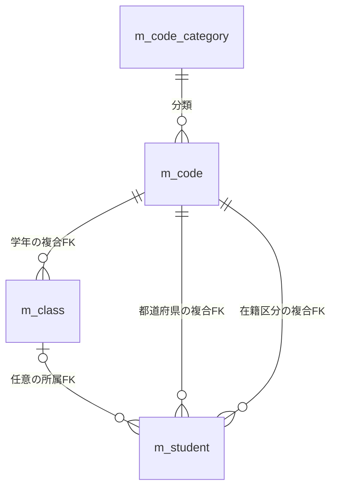

一覧SQLでは所属、学年名称、在籍名称、都道府県名称をすべてLEFT JOINで取得する。候補コードの取得はコード種別とのINNER JOINである。FKの宣言と、検索SQLで採用するJOINの種類は別の事項である。検索から操作履歴への追記や削除連動はない。〔実装根拠：`sources/database/001_schema.sql:189-198`、`sources/Core/SqlServerStudentService.cs:82-90`、`sources/Core/SqlServerStudentService.cs:203-208`〕

## 項目一覧

| 項目ID | 論理項目・実コントロール | name・バインド型 | 処理値・初期値・検査 | 検索先または表示元・DB属性 | SQLパラメータ・保存側との対応 | 根拠 |
| --- | --- | --- | --- | --- | --- | --- |
| SRC-001 | 学籍番号。input、id=`SRC-001`、maxlength=30 | `Criteria.StudentNo` → `StudentSearchInput.StudentNo: string` → `SearchCriteria.StudentNo: string?` | 初期空文字。NULL・空文字は条件なし。その他はraw、Trim後、FormKC・大文字化後とも15スカラー以内。先頭英数字、後続英数字・ハイフン。空白だけは必須検査で拒否。 | 前方一致対象は `m_student.student_no`。`varchar(15)`、NOT NULL、BIN2。 | `@no: VarChar(31)`。エスケープ済み番号に末尾 `%` を付ける。検索画面から保存しない。 | `sources/Views/Students/Search.cshtml:5-5`、`sources/Web/Inputs/StudentSearchInput.cs:7-22`、`sources/Core/StudentNormalizer.cs:47-64`、`sources/Core/SqlServerStudentService.cs:113-140`、`sources/database/001_schema.sql:9-9` |
| SRC-002 | 氏名。input、id=`SRC-002`、maxlength=16 | `Criteria.Name` → `Name: string` → `StudentName: string?` | 初期空文字。raw・Trim後8スカラー、制御文字禁止。空白だけは条件なし。照合値はFormKC、大文字化、全Unicode空白除去、160スカラー以内。 | 部分一致対象は `name_key`。`nvarchar(320)`、NOT NULL、BIN2、160スカラーCHECK。表示・保存原表記は `student_name: nvarchar(16)`、NOT NULL、8スカラーCHECK。 | `@name: NVarChar(642)`。照合値の両側に `%`。保存側は原表記と再生成キーを別列へ渡す。 | `sources/Views/Students/Search.cshtml:5-5`、`sources/Core/StudentNormalizer.cs:47-70`、`sources/Core/SqlServerStudentService.cs:114-141`、`sources/database/001_schema.sql:10-13`、`sources/database/001_schema.sql:44-47` |
| SRC-003 | 氏名カナ。input、id=`SRC-003`、maxlength=72 | `Criteria.Kana` → `Kana: string` → `StudentNameKana: string?` | 初期空文字。raw36スカラー以内。FormKC、空白整理、ひらがなからカタカナへの変換、許容文字検査後18スカラー以内。照合値はASCII空白を除去。空白だけの非空入力は空の照合値になる。 | 部分一致対象は `kana_key: nvarchar(36)`、NOT NULL、BIN2、18スカラーCHECK。表示元 `student_name_kana` も `nvarchar(36)`、NOT NULL、18スカラーCHECK。 | `@kana: NVarChar(74)`。空の照合値もNULLではないため `LIKE '%%'` を作る。保存側はカナと空白除去キーを別列へ渡す。 | `sources/Core/StudentNormalizer.cs:72-85`、`sources/Core/SqlServerStudentService.cs:116-142`、`sources/database/001_schema.sql:11-13`、`sources/database/001_schema.sql:45-47` |
| SRC-004 | 年度。select、id=`SRC-004` | `Criteria.SchoolYear` → DTO・条件とも `int?` | 初期NULL。「すべて」は未指定。サービスでは1900～9998とクラスマスタ内の年度存在を検査。原文字列の4桁検査はサービスにない。未所属ONの応答ではdisabled。 | `m_class.school_year` の一致。保存列は `smallint`、NOT NULL。入力の未指定とは別。 | `@year: SmallInt`。年度存在確認と検索述語に使用する。 | `sources/Views/Students/Search.cshtml:5-5`、`sources/Web/Inputs/StudentSearchInput.cs:10-22`、`sources/Core/SqlServerStudentService.cs:109-143`、`sources/database/001_schema.sql:64-64` |
| SRC-005 | 学年。select、id=`SRC-005` | `Criteria.GradeCode` → DTO・条件とも `string?` | 初期NULL。raw・Trim後2スカラー以内、FormKC後ASCII数字2桁。任意の空・空白はNULL。GRADEの存在を検査。`00` は学年なしという値。未所属ONの応答ではdisabled。 | `m_class.grade_code: varchar(2)`、NOT NULL。参照値は `m_code.code_value: varchar(10)`、NOT NULL。 | 検索 `@grade: VarChar(2)`。存在確認の `@value` は汎用サイズ10。 | `sources/Core/StudentNormalizer.cs:113-117`、`sources/Core/SqlServerStudentService.cs:118-144`、`sources/database/001_schema.sql:65-66`、`sources/database/001_schema.sql:113-114`、`sources/database/002_seed.sql:78-84` |
| SRC-006 | クラス。select、id=`SRC-006` | `Criteria.ClassId` → `ClassId: string?` → `IdParser.Optional` → 条件の `ClassId: long?` | 初期NULL。NULL・空文字は未指定。その他は19コード単位以内のASCII数字で正のInt64。Trim・FormKCなし。19桁以内の先行ゼロを一律禁止しない。実在と指定年度・学年との一致を検査。 | 検索列 `m_student.class_id: bigint NULL`。参照先 `m_class.class_id: bigint IDENTITY`、NOT NULL、PK。 | 検索 `@class: BigInt`。組合せ確認 `@id: BigInt`。未所属ONの応答ではdisabled。 | `sources/Web/Inputs/StudentSearchInput.cs:12-22`、`sources/Web/Inputs/StudentSaveInput.cs:57-60`、`sources/Core/SqlServerStudentService.cs:131-145`、`sources/database/001_schema.sql:28-28`、`sources/database/001_schema.sql:63-80` |
| SRC-007 | 未所属のみ。checkbox、id=`SRC-007` | `Criteria.UnassignedOnly` → DTO・条件とも `bool` | 初期false。trueで年度・学年・クラスが正規化前にいずれか非NULLなら拒否する。GradeCodeの空文字もこの段階では非NULLである。 | 条件は `s.class_id IS NULL`。このboolを保存する列はない。 | パラメータなし。検索は入力値をDBへ保存しない。 | `sources/Views/Students/Search.cshtml:5-5`、`sources/Web/Inputs/StudentSearchInput.cs:13-22`、`sources/Core/SqlServerStudentService.cs:110-146` |
| SRC-008 | 在籍区分。分類別checkbox群。実ビューに `SRC-008` のid属性や個々のidはない。 | 各checkboxのnameは `Criteria.StatusCodes`。DTOは `string[]`、条件は `EnrollmentStatusCodes: string[]` | 初期 `01,02`。検索・候補更新で項目自体が未送信なら空配列へ設定する。最大4値、重複不可、`01`～`04` の完全一致。FormKCなし。全解除は状態条件なし。 | `m_student.enrollment_status_code: varchar(2)`、NOT NULL。名称は分類付きコード参照。 | 選択数に応じ `@status0`～`@status3: VarChar(2)`。INでいずれか一致。配列NULLは空配列と同じ契約ではない。 | `sources/Views/Students/Search.cshtml:5-5`、`sources/Web/Controllers/StudentsController.cs:14-22`、`sources/Core/SqlServerStudentService.cs:111-112`、`sources/Core/SqlServerStudentService.cs:151-153`、`sources/database/001_schema.sql:25-26` |
| SRC-009 | 都道府県。select、id=`SRC-009` | `Criteria.PrefectureCode` → DTO・条件とも `string?` | 初期NULL。任意の数字2桁へ正規化し、PREFECTUREの分類・値の存在を確認。未指定は条件を省く。 | `m_student.prefecture_code: varchar(2)`、NOT NULL。`prefecture_category` と組でFK。 | `@prefecture: VarChar(2)`。保存列がNULLの学生を探す指定ではない。 | `sources/Core/StudentNormalizer.cs:113-117`、`sources/Core/SqlServerStudentService.cs:119-147`、`sources/database/001_schema.sql:18-19`、`sources/database/001_schema.sql:193-193` |
| SRC-010 | 電話番号。input、id=`SRC-010`、maxlength=40 | `Criteria.PhoneNumber` → `PhoneNumber: string` → 条件の `string?` | 初期空文字。raw20スカラー以内、制御文字禁止、Trim、FormKC後に空白、指定ハイフン類、丸括弧を除く。国内は0始まり10～11桁、国際は `+` と非ゼロ始まり7～15桁。最大16文字。 | `phone_number` と `emergency_phone_number` の完全一致OR。両列とも `varchar(16) NULL`。 | 共通の `@phone: VarChar(16)`。NULL・空白だけは条件なし。表示一覧は本人電話だけを出す。 | `sources/Core/StudentNormalizer.cs:87-93`、`sources/Core/SqlServerStudentService.cs:117-148`、`sources/database/001_schema.sql:22-22`、`sources/database/001_schema.sql:32-32` |
| SRC-011 | 入学日・開始。input type=date、id=`SRC-011` | `Criteria.AdmissionFrom` → DTO・条件とも `string?` → ローカル `DateOnly? from` | 初期NULL。NULL・空文字は下限なし。FormKC後に厳密な10文字の `yyyy-MM-dd`、実在日、1900-01-01以上、要求時の日本時間業務日以下を検査。Trimなし。 | `m_student.admission_date: date`、NOT NULLへの両端包含の下限。 | `@from: Date`。DBへ渡す際は日付の深夜時刻へ変換する。raw10文字上限の事前検査はない。 | `sources/Core/SqlServerStudentService.cs:120-122`、`sources/Core/SqlServerStudentService.cs:149-150`、`sources/Core/JapaneseDateService.cs:52-59`、`sources/database/001_schema.sql:24-24` |
| SRC-012 | 入学日・終了。input type=date、id=`SRC-012` | `Criteria.AdmissionTo` → DTO・条件とも `string?` → ローカル `DateOnly? to` | 初期NULL。開始側と同じ形式・範囲検査。両端指定時は開始日が終了日以下。片側だけなら指定側の述語を使う。 | `m_student.admission_date: date`、NOT NULLへの両端包含の上限。 | `@to: Date`。開始超過は `E-STU-006`。 | `sources/Views/Students/Search.cshtml:5-5`、`sources/Core/SqlServerStudentService.cs:120-122`、`sources/Core/SqlServerStudentService.cs:149-150`、`sources/Core/JapaneseDateService.cs:52-59` |
| PAGE-001 | 表示件数。ページフォームのselect。検索フォームではhidden。 | `PageSize`。`PageRequest.PageSize: int`、検索アクション引数も `int` | 初期20、候補20・50・100。ページ操作では変更時に1ページへ戻す。検索再表示では受信引数でモデルを上書きするため、0の拒否後に描画例外が起こり得る。 | 業務保存列なし。取得範囲を制御する。 | `@size: Int`。ページャーの除算にも使用する。 | `sources/Views/Students/Search.cshtml:4-8`、`sources/Web/Controllers/StudentsController.cs:13-19`、`sources/Core/SqlServerStudentService.cs:107-164` |
| PAGE-002 | 並び順。ページフォームのselect。検索フォームではhidden。 | `SortKey: string` | 初期 `studentNo`。許可値は `studentNo,name,admissionDate,updatedAt`。氏名ソートは表示原表記ではなく照合キー。 | 順序列は `student_no,name_key,admission_date,updated_at`。保存はしない。 | 許可列へ変換してORDER BYへ組み込む。入力を自由なSQL列名として使わない。 | `sources/Views/Students/Search.cshtml:8-8`、`sources/Core/SqlServerStudentService.cs:108-108`、`sources/Core/SqlServerStudentService.cs:162-162` |
| PAGE-003 | 並び順方向。aria-label=`並び順方向` のselect。検索フォームではhidden。 | `SortDirection: string` | 初期 `asc`。`asc` と `desc` だけを許可する。 | 業務保存列なし。主順序の方向を制御する。 | ORDER BYの方向。副順序の学生IDは常にASC。 | `sources/Web/Inputs/StudentSearchInput.cs:27-29`、`sources/Core/SqlServerStudentService.cs:107-108`、`sources/Core/SqlServerStudentService.cs:162-162` |
| PAGE-004 | ページ指定。「並び順・件数を反映」「前へ」「次へ」のbutton。 | 各name=`Page`、送信値は1、現在ページ−1、現在ページ＋1。`PageRequest.Page: int` | 既定1。正数を検査。実検索では最終ページまで補正。前後ボタンは画面条件に応じdisabled。先頭・最後のボタンはない。 | 業務保存列なし。`Applied.Page` とSQL実取得ページは別領域。 | `@offset: Int` は実取得ページからchecked計算。 | `sources/Views/Students/Search.cshtml:8-8`、`sources/Infrastructure/WebStudentCoordinator.cs:12-14`、`sources/Core/SqlServerStudentService.cs:160-164` |
| OUT-001 | 一覧の学籍番号。td | `StudentRow.StudentNo: string` → `studentNo` | 取得した保存番号を出力する。 | `m_student.student_no: varchar(15)`、NOT NULL。保存側の業務上限15。 | 読取り表示。検索入力のLIKEパターンを表示しない。 | `sources/Core/SqlServerStudentService.cs:77-85`、`sources/Infrastructure/WebPresentation.cs:20-20`、`sources/Views/Students/Search.cshtml:8-8` |
| OUT-002 | 一覧の氏名。td | `StudentRow.StudentName: string` → `studentName` | 保存された原表記を表示する。照合キーを表示しない。 | `student_name: nvarchar(16)`、NOT NULL。保存側raw・Trim後8スカラー。 | 保存パラメータは `NVarChar(16)`。検索画面では読取りのみ。 | `sources/Core/StudentNormalizer.cs:125-145`、`sources/Core/SqlServerStudentService.cs:30-32`、`sources/database/001_schema.sql:10-12` |
| OUT-003 | 一覧の氏名カナ。td | `StudentRow.StudentNameKana: string` → `studentNameKana` | 保存時に正規化したカナを表示する。検索キーとは別。 | `student_name_kana: nvarchar(36)`、NOT NULL。raw36、正規化後18スカラー。 | 保存パラメータ `NVarChar(36)`。 | `sources/Core/StudentNormalizer.cs:72-85`、`sources/Core/StudentNormalizer.cs:126-145`、`sources/Core/SqlServerStudentService.cs:31-32` |
| OUT-004 | 一覧の生年月日。td | `BirthDate: DateOnly` → `BirthDateWareki: string` → `birthDateWareki` | 元号境界に基づく和暦。年1は「元」、月日は2桁。日付に時差変換はしない。 | `birth_date: date`、NOT NULL。 | 保存パラメータ `Date`。表示文字列をDBへ保存しない。 | `sources/Core/Contracts.cs:50-55`、`sources/Core/JapaneseDateService.cs:9-16`、`sources/Core/JapaneseDateService.cs:41-50`、`sources/database/001_schema.sql:14-14` |
| OUT-005 | 一覧の年度／学年。td | `SchoolYear: int?`、`GradeName: string?` → `schoolYear,gradeName` | クラス年度と学年コードの名称を並べて出す。NULL時の「－」を明示生成しない。 | `m_class.school_year: smallint NOT NULL`、学年名称は `m_code.code_name: nvarchar(24) NOT NULL`。LEFT JOIN結果はNULL可。 | 学年名称は保存側raw・Trim後12スカラー、`NVarChar(24)`。 | `sources/Core/SqlServerStudentService.cs:79-90`、`sources/Core/MasterMaintenanceService.cs:82-115`、`sources/database/001_schema.sql:64-66`、`sources/database/001_schema.sql:115-128` |
| OUT-006 | 一覧のクラス。td | `ClassCode: string?`、`ClassName: string?` → `classCode,className` | コードと名称を並べる。未所属の「－」、停止・期間外注記は一覧行に生成しない。 | `m_class.class_code: varchar(9) NOT NULL`、`class_name: nvarchar(36) NOT NULL`。結合結果はNULL可。 | 保守契約ではコード9、名称raw・Trim後18スカラー。保存型は `VarChar(9)`、`NVarChar(36)`。 | `sources/Core/SqlServerStudentService.cs:79-87`、`sources/Core/MasterMaintenanceService.cs:33-34`、`sources/Core/MasterMaintenanceService.cs:73-76`、`sources/database/001_schema.sql:67-81` |
| OUT-007 | 一覧の在籍区分。td | `EnrollmentStatusName: string?` → `enrollmentName` | 保存コードを分類付きJOINして得た名称。名称NULLへの代替文字列はない。 | `m_code.code_name: nvarchar(24)`、NOT NULL、12スカラーCHECK。LEFT JOIN結果はNULL可。 | コード名称の保存型 `NVarChar(24)`。学生へ保存するのは名称ではなくコード。 | `sources/Core/SqlServerStudentService.cs:80-89`、`sources/Infrastructure/WebPresentation.cs:20-20`、`sources/Core/MasterMaintenanceService.cs:82-115` |
| OUT-008 | 一覧の住所。td | `StudentRow.Address: string` → `addressDisplay` | 都道府県名称と住所1を区切り追加なしで連結。都道府県名称NULLなら `[不整合]`。住所2は一覧に出さない。 | 名称は `m_code.code_name: nvarchar(24) NOT NULL`、住所1は `address_line1: nvarchar(90) NOT NULL`。住所2は `nvarchar(90) NULL`。 | 名称の保存業務上限12、住所1・2は各raw・Trim後45スカラー。保存型は名称 `NVarChar(24)`、住所各 `NVarChar(90)`。 | `sources/Core/SqlServerStudentService.cs:80-90`、`sources/Core/StudentNormalizer.cs:131-132`、`sources/database/001_schema.sql:20-21`、`sources/Core/MasterMaintenanceService.cs:82-115` |
| OUT-009 | 一覧の本人電話。td | `PhoneNumber: string?` → `phoneNumber` | 保存された正規化値を出す。NULLの場合だけ「－」。緊急電話は一覧へ出さない。 | `phone_number: varchar(16) NULL`。 | 保存型 `VarChar(16)`。ハイフンの再付与はない。 | `sources/Core/StudentNormalizer.cs:133-141`、`sources/Infrastructure/WebPresentation.cs:20-20`、`sources/Views/Students/Search.cshtml:8-8` |
| OUT-010 | 一覧の更新日時。td | `UpdatedAt: DateTimeOffset` → `updatedAt: string` | UTC+9の `yyyy/MM/dd HH:mm:ss`。 | `m_student.updated_at: datetimeoffset(7)`、NOT NULL。UTC保存のCHECKがある。 | 検索では読取り。表示文字列は保存値と別。 | `sources/Infrastructure/WebPresentation.cs:7-7`、`sources/database/001_schema.sql:40-40`、`sources/database/001_schema.sql:57-57` |
| OUT-011 | 行の操作リンク。a | `StudentId: long` → InvariantCultureの10進文字列 | Viewerは参照、それ以外は編集。学生IDと `returnContextId` を遷移先へ渡す。 | `student_id: bigint IDENTITY`、NOT NULL、PK。取得した `RowVersion: long` はリンクへ渡さない。 | 登録側で最新対象を再取得する。 | `sources/Core/Contracts.cs:50-53`、`sources/Infrastructure/WebPresentation.cs:20-20`、`sources/Views/Students/Search.cshtml:8-8`、`sources/Web/Controllers/StudentsController.cs:23-25` |
| OUT-012 | 結果状態・件数・検索日時。p、警告は `p.warning` | `outcome,totalCount,searchedAt` | 結果NULLは未検索、上限超過はtooMany、0件はempty、それ以外はfound。日時は検索開始時のUTC値を日本時間へ表示変換。 | 件数・日時は算出結果で業務保存列ではない。上限超過時のCount=10001は実総数ではない。 | 画面はfoundの枝で件数と日時を出す。 | `sources/Core/SqlServerStudentService.cs:105-168`、`sources/Infrastructure/WebStudentCoordinator.cs:21-21`、`sources/Views/Students/Search.cshtml:7-7` |
| OUT-013 | 情報・エラー表示。div | `Message: string`、`ModelState` | 情報は `message info`、エラーは `message error` のvalidation summary。各 `aria-live=polite`。 | DB列なし。Flash、候補解除、例外等から生成する。 | 項目エラーのFieldはControllerがそのままModelStateのキーとして使用する。 | `sources/Views/Shared/_MessagePanel.cshtml:1-3`、`sources/Web/Controllers/StudentsController.cs:15-22` |

## 選択候補一覧

| 候補ID | 使用項目・初期選択 | 取得元・抽出 | 順序 | キー・表示名 | 選択保持・解除・停止値 | 根拠 |
| --- | --- | --- | --- | --- | --- | --- |
| CAND-001 | 年度。初期「すべて」。 | `LookupSet.Classes` 全件から年度を重複除去する。年度専用マスタを読む処理ではない。 | 年度降順。 | 数値の年度／同じ年度。 | 停止・期間外クラスが持つ年度も含む。未所属ONの候補更新では選択をNULLへ戻す。 | `sources/Views/Students/Search.cshtml:5-5`、`sources/Core/SqlServerStudentService.cs:206-214`、`sources/Web/Controllers/StudentsController.cs:22-22` |
| CAND-002 | 学年。初期「すべて」。 | 全コード候補から `CategoryId=GRADE` をビューで抽出。 | コード取得順の分類、表示順、コード値。 | `CodeValue`／`CodeName`。seedの `00` は学年なし。 | 有効性・期間で除外せず、注記・選択禁止を付けない。未所属ONで解除。名称は12スカラー、DB `nvarchar(24) NOT NULL`。 | `sources/Core/SqlServerStudentService.cs:203-212`、`sources/Views/Students/Search.cshtml:5-5`、`sources/Core/MasterMaintenanceService.cs:82-115`、`sources/database/002_seed.sql:78-84` |
| CAND-003 | クラス。初期「すべて」。 | クラス全件から、年度未指定または一致、かつ学年未指定・空文字または一致のものをビューで抽出。 | 年度DESC、学年コードの表示順、クラス表示順、クラスコード、クラスID。 | クラスIDの文字列／年度、クラスコード、クラス名。 | 停止には「（停止）」、期間外には注記なし。候補更新で実取得候補と生の選択文字列・上位条件が合わなければ解除。未所属ONでも解除。名称は18スカラー、DB `nvarchar(36) NOT NULL`。人数・定員は検索画面に出さない。 | `sources/Core/SqlServerStudentService.cs:206-214`、`sources/Web/Controllers/StudentsController.cs:22-22`、`sources/Views/Students/Search.cshtml:5-5`、`sources/Core/MasterMaintenanceService.cs:33-34`、`sources/database/001_schema.sql:68-81` |
| CAND-004 | 在籍区分。初期01・02。 | 全コード候補から `ENROLLMENT_STATUS` を抽出。 | コード取得順。 | `CodeValue`／`CodeName`。seedでは01在学、02休学、03卒業、04退学。 | 停止・期間外も候補として残す。全解除は条件なし。候補取得自体は01～04だけに限定しないが、検索サービスの受入値はこの4値に限定する。 | `sources/Core/SqlServerStudentService.cs:112-112`、`sources/Core/SqlServerStudentService.cs:203-212`、`sources/database/002_seed.sql:19-22`、`sources/Views/Students/Search.cshtml:5-5` |
| CAND-005 | 都道府県。初期「すべて」。 | 全コード候補から `PREFECTURE` を抽出。 | コード取得順。 | `CodeValue`／`CodeName`。 | 停止・期間外も候補として残し、注記・選択禁止を付けない。名称の保存契約はraw・Trim後12スカラー、`NVarChar(24)`。 | `sources/Core/SqlServerStudentService.cs:203-212`、`sources/Views/Students/Search.cshtml:5-5`、`sources/Core/MasterMaintenanceService.cs:82-115` |
| CAND-006 | 表示件数。初期20。 | ビュー内の固定配列20・50・100。 | 20、50、100。 | 数値／同じ数値。 | 候補更新では受信表示指定を採用せず、保持条件の値または20をモデルへ設定。 | `sources/Views/Students/Search.cshtml:8-8`、`sources/Web/Controllers/StudentsController.cs:39-39` |
| CAND-007 | 並び順。初期studentNo。 | ビュー内の固定組。 | 学籍番号、氏名、入学日、更新日時。 | `studentNo,name,admissionDate,updatedAt`／各表示名。 | 検索は受信指定、ページは保持条件からの変更として扱う。 | `sources/Views/Students/Search.cshtml:8-8`、`sources/Core/SqlServerStudentService.cs:108-108` |
| CAND-008 | 並び順方向。初期asc。 | ビューの固定option。 | 昇順、降順。 | `asc,desc`／昇順、降順。 | 主順序だけに適用し、学生IDの副順序はASC。 | `sources/Views/Students/Search.cshtml:8-8`、`sources/Core/SqlServerStudentService.cs:162-162` |

## 内部項目一覧

| 内部項目ID | 実名・型・領域 | 初期値・取得元 | 用途と更新境界 | 検査・寿命 | 根拠 |
| --- | --- | --- | --- | --- | --- |
| INT-001 | `Entry.Id: string`。メモリ辞書キー。フォームのnameは `ContextId`、id属性なし。要求側は `ContextRequest.ContextId: string`。 | 32乱数バイトを小文字64桁hexにした値。 | 新規状態を識別する。検索・ページ・クリアで同じIDを維持する。業務入力をURLへ移す代わりに登録・復帰先へ渡す。 | GetはNULLを辞書呼出し前に409へする。空文字・不在キーも409。64桁形式の事前検査はない。 | `sources/Infrastructure/SearchContextStore.cs:9-13`、`sources/Views/Students/Search.cshtml:4-8`、`sources/Web/Inputs/StudentSearchInput.cs:25-25` |
| INT-002 | `Entry.Owner: string` | `CurrentUser.Principal` | 状態の主体所有者。フォームから変更しない。 | 有効な状態でも主体不一致は403。認証側は空白または64Rune超過を401にする。 | `sources/Infrastructure/SearchContextStore.cs:9-14`、`sources/Infrastructure/RequestIdentity.cs:7-10` |
| INT-003 | `Entry.Session: string` | `CurrentUser.SessionId` | 同一主体でも別ログインセッションの状態を拒否する。 | 不一致403。認証側は空白または64コード単位超過を401にする。 | `sources/Infrastructure/SearchContextStore.cs:9-14`、`sources/Infrastructure/RequestIdentity.cs:7-10` |
| INT-004 | `Entry.Tab: string`。フォームname=`TabId`、id属性なし。 | 作成引数がNULL・空なら独立した乱数識別子。 | POSTの状態照合に渡す。 | Getが比較するのは要求tabがNULL・空でない場合だけ。GET復帰はNULLを渡す。`RequestIdentity.TabId` プロパティはこの経路で使わない。 | `sources/Infrastructure/SearchContextStore.cs:9-14`、`sources/Infrastructure/RequestIdentity.cs:12-12`、`sources/Web/Controllers/StudentsController.cs:8-22` |
| INT-005 | `Entry.Revision: long`。フォームname=`ContextRevision`。要求側は `string`。 | 1。応答ではInvariantCultureの10進文字列。 | 検索、ページ、クリア、検索済みResumeで1加算。学生のrow_versionとは別。 | Gate下で文字列の完全一致。省略、NULL、空、旧版、先行ゼロの別表現を補完しない。不一致・long.MaxValueは409。 | `sources/Infrastructure/SearchContextStore.cs:9-14`、`sources/Infrastructure/WebStudentCoordinator.cs:9-15`、`sources/Web/Inputs/StudentSearchInput.cs:25-25` |
| INT-006 | `Entry.Expires: DateTimeOffset` | 作成時UTC＋30分。 | Useのoperationが正常に返った後で現在UTC＋30分へ延長。Getだけの候補更新では延長しない。 | 現在UTCより前なら409。Createは期限を過ぎた既存エントリを辞書から除去。DB await後の期限再確認はない。 | `sources/Infrastructure/SearchContextStore.cs:9-14` |
| INT-007 | `Entry.Applied: SearchCriteria?` | NULL。 | 正常検索・ページでJSON複製を保存。正規化用ローカル値を書き戻さない。Resumeは既存条件を使用し、ClearはNULLにする。 | 検証・版等の拒否では更新しない。保持する文字列はバインド後の入力表現である。 | `sources/Infrastructure/SearchContextStore.cs:15-15`、`sources/Infrastructure/WebStudentCoordinator.cs:8-15` |
| INT-008 | `Entry.LastResult: SearchResult?` | NULL。 | 正常検索・ページ・検索済みResumeで更新。候補更新だけはこの値をPresentへ渡す。ClearはNULL。 | 検索・ページの拒否画面では暗黙に再使用せず、PresentへNULLを渡す。 | `sources/Infrastructure/WebStudentCoordinator.cs:9-15`、`sources/Web/Controllers/StudentsController.cs:14-22` |
| INT-009 | `Entry.Gate: SemaphoreSlim(1,1)` | 状態ごとに1つ。 | Useの操作を同一プロセス・同一状態で直列化する。 | ct付き待機後にGetと版検査を再実施。取得後のfinallyでRelease。候補更新には使わない。待機取消時は未取得のGateを解放しない。 | `sources/Infrastructure/SearchContextStore.cs:9-14` |
| INT-010 | 正規化ローカル値 `no,name,kana,phone,grade,prefecture` と `DateOnly? from,to` | 検索要求から生成。 | 検査成功後に存在確認・検索パラメータへ使用する。 | SearchCriteriaの保持文字列、保存列、表示原表記とは別。 | `sources/Core/SqlServerStudentService.cs:113-153` |
| INT-011 | `SearchResult` と `StudentSearchPageModel.Data: JsonElement` | サービス結果→Present→`SerializeToElement`。 | 結果状態、当該結果のitems、保持条件由来のページ・ソートを画面へ渡す。 | 応答用JSON要素であり公開JSON APIではない。投影・描画は状態更新の後に行う。 | `sources/Core/Contracts.cs:57-58`、`sources/Infrastructure/WebStudentCoordinator.cs:21-21`、`sources/Web/Models/StudentSearchPageModel.cs:10-15` |
| INT-012 | Flashの辞書値 `(string Message, DateTimeOffset Expires)` | 登録側のSaved後にPut。 | 主体、セッション、ContextIdをNUL区切りで組み合わせたキーで一度だけ通知を取得する。 | UTC＋10分。TakeはTryRemoveを先に行い、期限内だけ返す。後続表示失敗で復元しない。 | `sources/Infrastructure/FlashMessageStore.cs:6-9`、`sources/Web/Controllers/StudentsController.cs:31-38` |
| INT-013 | 登録側の `ReturnContextId`、`ReturnRevision` | 検索リンクはIDだけを渡す。Load時に状態の現在版を読み、編集スナップショットへ保存。 | 戻るリンクとSaved後の303復帰に使用する。検索条件を登録値へ流用しない。 | 編集開始後に検索版が進んでも保存済み復帰版を最新値へ補完しない。 | `sources/Web/Controllers/StudentsController.cs:23-25`、`sources/Web/Controllers/StudentsController.cs:38-38`、`sources/Views/Students/Edit.cshtml:16-16` |

## イベント仕様

### 初期表示

#### 処理概要

GET `/students` で `contextId` がNULL・空の場合、認証利用者に新しい検索状態を作り、候補と初期条件を表示する。学生件数・一覧は取得しない。既存IDがある場合は後述の「検索状態への復帰」へ進む。〔根拠：`sources/Web/Controllers/StudentsController.cs:8-11`〕

#### 処理手順

1. 認証・認可パイプラインを通り、`identity.Read()` で主体、ログインセッション、Roleの解析を確認する。
2. `contextId` がNULL・空なら `NewContext()` を呼ぶ。辞書へ新しいEntryを追加し、版1、AppliedとLastResultはNULL、期限はUTC＋30分とする。
3. `Present(entry, null)` を作り、未検索、空一覧、件数・検索日時NULLとする。初期条件は在籍01・02、Page=1、PageSize=20、studentNo昇順である。
4. `StudentSearchInput` を新しく作り、`flash.Take(user, entry.Id)` を評価する。
5. `SearchModel` が `LookupAsync(false, ct)` でコード・クラス候補を取得し、データをJsonElementへ変換してSearchビューへ渡す。
6. Razorが共有ヘッダーと検索ビューを描画する。参考設計が要求する「必須マスタ不足なら検索不可」の検査は現行入口にない。候補が不足しても、この理由だけで検索ボタンを非活性にする分岐はない。

〔根拠：`sources/Infrastructure/SearchContextStore.cs:9-12`、`sources/Web/Inputs/StudentSearchInput.cs:7-18`、`sources/Core/Contracts.cs:31-48`、`sources/Web/Controllers/StudentsController.cs:9-11`、`sources/Web/Controllers/StudentsController.cs:39-39`。設計意図：`reference-designs/詳細仕様書/CSharp_ASPNET/01_学生検索画面.md:159-176`〕

#### 処理フロー

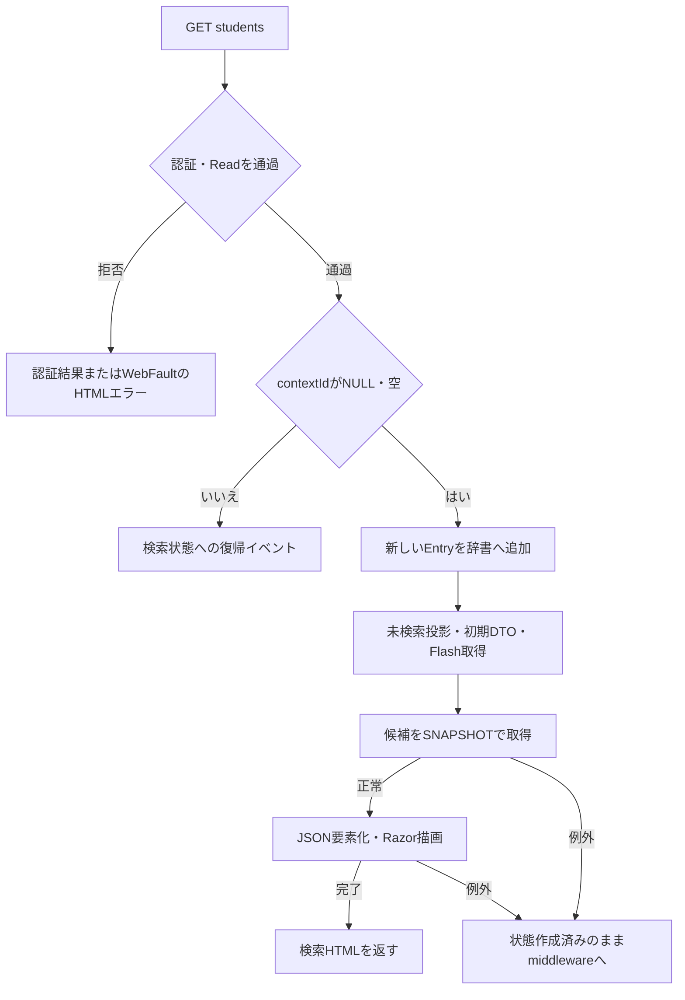

#### SQL・テーブル関連（ER図）

初期表示が使うのは候補読取りである。全体ER図のコード分類→コード、コード→クラスの関連を利用する。学生の人数集計は検索用途では行わない。

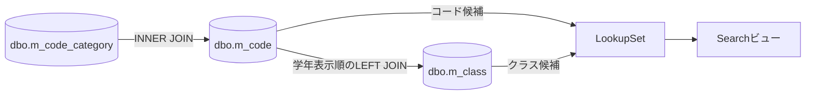

#### DB操作の詳細

`LookupAsync(false, ct)` は接続・SNAPSHOT開始後、コード候補とクラス候補の2結果セットを読み、commitして返す。コードと分類の利用可否から候補のIsActiveを算出するが、停止・期間外でWHERE抽出しない。クラスの `occupied` は `CONVERT(int,0)` で作る集計省略値である。これは実測人数0を意味しない。〔根拠：`sources/Core/SqlServerStudentService.cs:196-216`〕

#### 結果・例外時の扱い

正常完了時は200の検索HTMLとなる。アクション内の個別catchはない。Read、状態作成後の候補取得、JSON要素化、描画の例外はmiddlewareの捕捉範囲に従う。候補取得失敗前に作成したメモリ状態を除去する処理はない。Cookieの認証拒否と、例外による独立HTMLエラーは同じ経路ではない。〔根拠：`sources/Web/Controllers/StudentsController.cs:8-11`、`sources/Infrastructure/WebHostSetup.cs:14-25`〕

### 検索実行

#### 処理概要

検索フォームの条件と表示指定で新しい検索を実行する。正常結果は0件・上限超過も含めて実行済み条件として保持する。入力や状態の拒否時は当該応答の一覧を空にする一方、以前のAppliedとLastResultをクリアする処理は行わない。〔根拠：`sources/Web/Controllers/StudentsController.cs:13-16`、`sources/Infrastructure/WebStudentCoordinator.cs:7-9`〕

#### 処理手順

1. 認証・認可とCSRFのMVCフィルターを通った後、アクションが `FormGuard` を実行する。許可名、同名値の重複、フォームメタ情報を検査する。この時点はMVCのバインド後である。
2. フォームに `Criteria.StatusCodes` 自体がなければ、DTOの初期01・02を使わず空配列にする。
3. `identity.CurrentUser` を取得し、`contexts.Get(contextId, user, tabId)` で状態の存在、期限、主体・セッション、指定されたタブを確認する。ここは個別catchの外である。
4. 当該応答のデータを `Present(entry, null)` へ初期化する。保持ページ・ソートはAppliedがあればその値を使う。
5. `ModelState.IsValid` がfalseならHTTP statusを422とし、Coordinatorと検索サービスは呼ばない。
6. 有効なら個別tryへ入り、CoordinatorがReadを再確認して `ToCriteria` を実行する。クラスIDを `IdParser.Optional` で変換し、Pageを1にする。この変換はUseの状態・版照合より前である。
7. UseはGet、Gate待機、取得後のGet、要求版の完全一致、版上限の順で確認する。その後サービスへ条件とctを渡す。
8. サービスはUserと検索開始時刻・日本時間業務日を取得し、try内で表示指定、年度・クラス値、未所属との排他、在籍配列を検査する。次に文字列・コード・日付を正規化し、日付範囲を検査する。
9. 接続とSNAPSHOTを開始し、指定コード・年度・クラスの存在と組合せを確認する。その後、共通述語で最大10001件までの件数を取得する。上限超過なら一覧を取得せずcommitして返す。それ以外は同じSNAPSHOT内でページを取得してcommitする。
10. `EnsureSearch` が正常Outcomeを確認した後、条件のJSON複製をAppliedへ、結果をLastResultへ保存し、Revisionを加算する。operationが正常に返るとUseが期限を延長し、Gateを解放する。
11. try内のWebFaultはFieldまたは空キーでModelStateへ追加し、HTTP statusを `e.Status` にする。続いてtryの外で候補を再取得する。
12. 検索アクションは再表示モデルのPageSize・SortKey・SortDirectionを受信引数で上書きする。Razor描画まで完了した場合に検索HTMLを返す。

〔根拠：`sources/Web/Controllers/StudentsController.cs:13-16`、`sources/Web/Controllers/StudentsController.cs:41-41`、`sources/Infrastructure/WebStudentCoordinator.cs:7-9`、`sources/Infrastructure/SearchContextStore.cs:13-15`、`sources/Core/SqlServerStudentService.cs:103-170`〕

#### 処理フロー

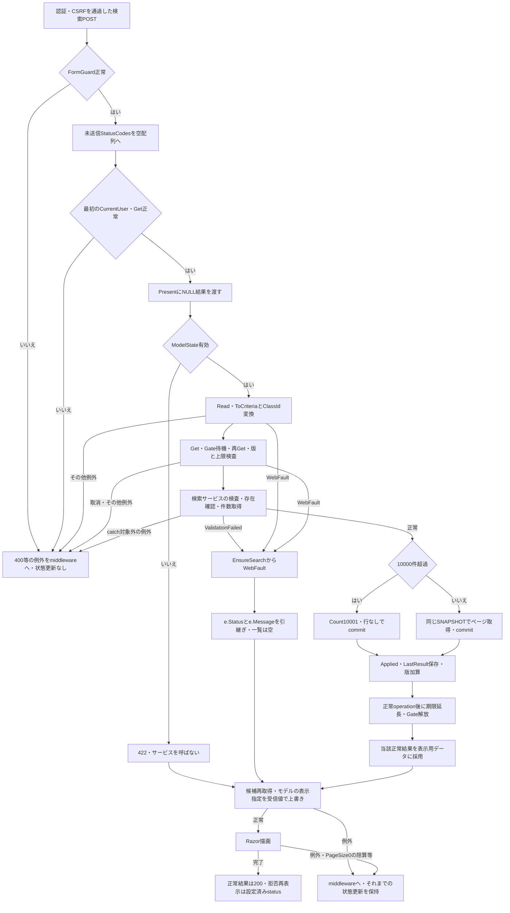

#### SQL・テーブル関連（ER図）

指定コードの存在確認は `m_code`、年度・所属組合せは `m_class`、件数は学生とクラス、一覧はさらに3用途のコード名称を読む。FKは概要のER図に従い、実際の名称取得は次のLEFT JOINである。

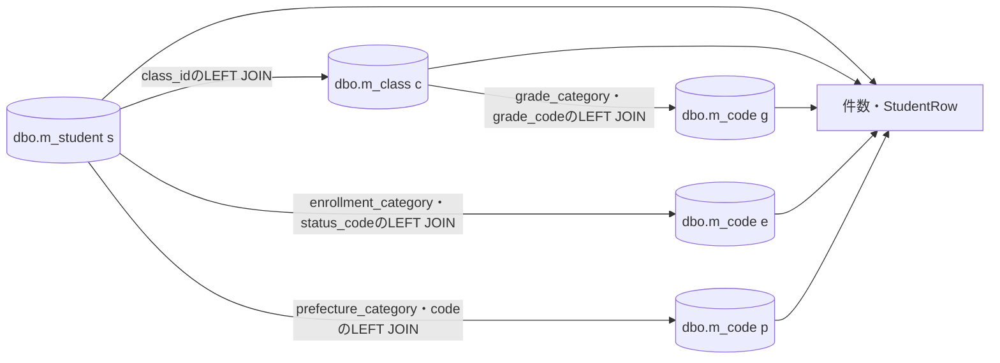

#### DB操作の詳細

常設述語は `s.is_deleted=0` である。指定条件はANDで組み合わせ、在籍配列内だけIN、電話だけ本人・緊急の括弧付きORを使う。学籍番号は前方一致、氏名・カナキーは部分一致、所属・都道府県は一致、入学日は両端包含である。列・パラメータ型とサイズは項目一覧、存在・件数・ページSQLは補足説明の検索SQL契約に従う。

検索用トランザクションには学生・マスタ・履歴の書込みがない。件数と一覧は同じSNAPSHOTで取得し、正常枝でcommitする。存在不正等の例外枝に明示的な `RollbackAsync` はなく、宣言した読取トランザクションを `await using` で破棄する。候補再取得は検索とは別接続・別SNAPSHOTである。〔根拠：`sources/Core/SqlServerStudentService.cs:123-170`、`sources/Web/Controllers/StudentsController.cs:39-39`〕

#### 結果・例外時の扱い

0件、1～10000件、上限超過はいずれも現行サービスでは `Outcome.NoChange` であり、正常検索として状態を更新する。上限結果のCountは10001、Itemsは空、LimitExceededはtrueで、画面のtotalCountはNULLとなる。0件はCount=0、Items空、LimitExceeded=falseである。〔根拠：`sources/Core/SqlServerStudentService.cs:156-168`、`sources/Infrastructure/WebStudentCoordinator.cs:20-21`〕

サービスのcatchは `InputValidationException` が先、`ArgumentException` が後である。前者は保持されたFieldError群、後者は `ArgumentError("Search", e)` によるエラーを返す。Coordinatorはその先頭エラーからWebFaultを作り、ControllerはFieldを接頭辞変換せずModelStateへ追加する。SQL例外、InvalidOperationException、取消、NullReferenceExceptionはこの検索結果への変換catchに入らない。サービスのUser取得はtry外である。〔根拠：`sources/Core/SqlServerStudentService.cs:105-106`、`sources/Core/SqlServerStudentService.cs:169-170`、`sources/Core/StudentNormalizer.cs:162-166`、`sources/Infrastructure/WebStudentCoordinator.cs:20-20`、`sources/Web/Controllers/StudentsController.cs:15-15`〕

バインド後のPageSizeが0なら、入力拒否後もControllerが再表示モデルへ0を設定する。ビューは未検索の枝でもページ総数の除算を実行するため、ゼロ除算で再表示が失敗する。したがって、この枝を「422の検索HTMLが必ず返る」と記述しない。描画例外はアクションのWebFault catch外であり、middlewareの応答開始条件に従う。〔根拠：`sources/Core/SqlServerStudentService.cs:107-107`、`sources/Web/Controllers/StudentsController.cs:15-16`、`sources/Views/Students/Search.cshtml:8-8`、`sources/Infrastructure/WebHostSetup.cs:23-23`〕

正常検索の後に候補取得・JSON要素化・描画が失敗しても、既に更新したApplied、LastResult、Revisionを戻す処理はない。拒否前の失敗と、状態更新後の表示失敗を同じ状態にまとめない。

### 候補更新

#### 処理概要

「候補を更新」は検索フォーム全体をPOSTし、編集中の年度・学年に合うクラス候補と選択値を整える。学生一覧はLastResultを使い、再検索しない。要求のContextRevisionと表示指定はアクション引数として受けるが、版照合や状態更新には使用しない。〔根拠：`sources/Web/Controllers/StudentsController.cs:22-22`、`sources/Views/Students/Search.cshtml:5-5`〕

#### 処理手順

1. 認証・CSRFの入口検査後、FormGuardを実行する。
2. StatusCodes項目が未送信なら空配列へ設定する。
3. CurrentUserと `Get(contextId, user, tabId)` で状態の期限・所有者等を確認する。Gate待機と版照合は行わない。
4. 未所属ONなら入力のSchoolYear・GradeCode・ClassIdをNULLにし、それぞれの `Criteria.*` のModelStateを除去する。
5. `Present(entry, entry.LastResult)` を作り、保持済み一覧と結果状態を引き継ぐ。SearchModelが全コード・クラス候補を再取得する。
6. 非空ClassIdについて、実取得クラスのID文字列と、生の入力年度・学年との適合を確認する。不適合ならClassIdをNULLにして該当ModelStateを除去し、解除通知を設定する。
7. ビューは入力年度・学年でクラス候補を抽出し、未所属ONなら3つの所属selectをdisabledにする。PageSize・ソートはApplied由来、なければ初期値で返す。

この処理は `IdParser` やコード正規化を呼ばない。たとえば数値としては同じ先行ゼロ付きIDでも、候補IDの文字列表現と一致しなければ解除される。ModelState全体の有効判定も行わない。〔根拠：`sources/Web/Controllers/StudentsController.cs:22-22`、`sources/Web/Controllers/StudentsController.cs:39-39`、`sources/Views/Students/Search.cshtml:5-5`〕

#### 処理フロー

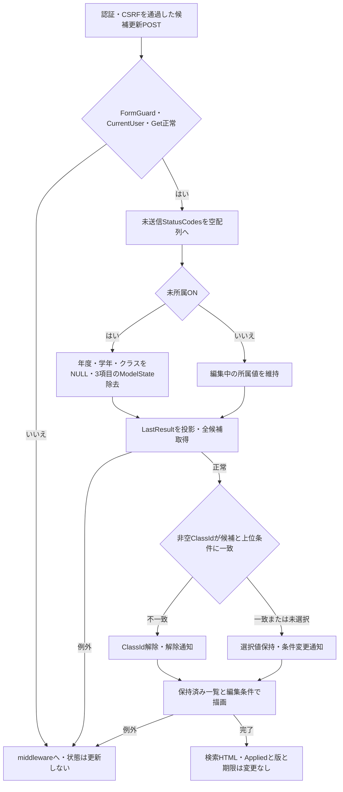

#### SQL・テーブル関連（ER図）

初期表示と同じ候補関連を読む。コード分類とコードはINNER JOIN、クラスと学年コードはLEFT JOINである。学生件数・一覧の新規取得はない。

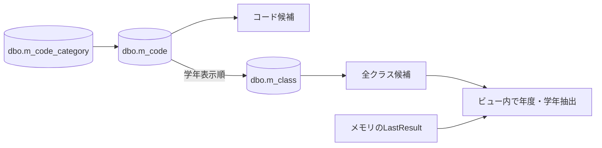

#### DB操作の詳細

`LookupAsync(false, ct)` の候補SQLを実行する。年度・学年をSQLパラメータにして候補を絞る実装ではなく、全取得後にControllerとビューで照合・抽出する。停止・期間外を検索候補に残し、人数は集計しない。業務表の書込みと検索状態の版加算はない。〔根拠：`sources/Core/SqlServerStudentService.cs:197-216`、`sources/Web/Controllers/StudentsController.cs:22-22`〕

#### 結果・例外時の扱い

正常な描画完了時は検索HTMLを返す。入力不正を一律422にするModelState判定やサービス検査はない。候補取得、状態取得、描画の例外を捕捉する個別catchもない。StatusCodesがNULLのままビューへ届く場合、checkbox選択判定の `Contains` で例外が起こり得る。NULLが実際のHTTPバインドから到達するかはバインド契約の確認事項である。〔根拠：`sources/Web/Controllers/StudentsController.cs:22-22`、`sources/Views/Students/Search.cshtml:5-5`〕

設計意図にはクラス先行選択による年度・学年の反映、要求順序による旧応答破棄、W-STU-107による解除通知がある。現行は全HTML応答で、生値の不適合クラス解除と文言通知を実装する。検索側の先行反映、要求連番、通知IDの画面出力はない。〔設計意図：`reference-designs/詳細仕様書/CSharp_ASPNET/01_学生検索画面.md:252-273`。実装：`sources/wwwroot/js/site.js:7-8`、`sources/Web/Controllers/StudentsController.cs:22-22`〕

### 並び替え・表示件数変更・ページ移動

#### 処理概要

ページフォームは状態ID・版・タブ、表示件数、ソート、要求Pageを送る。編集中のCriteriaは送らない。保持した条件の結果を最新DBから取り直し、必要なページ補正を行う。〔根拠：`sources/Views/Students/Search.cshtml:8-8`、`sources/Infrastructure/WebStudentCoordinator.cs:11-12`〕

#### 処理手順

1. 認証・CSRF検査後、PageRequestの公開プロパティとTabIdを対象にFormGuardを行う。
2. CurrentUserと最初のGetで状態を取得する。この処理は個別tryの外である。アクションは `ModelState.IsValid` を判定しない。
3. try内でCoordinator.PageがRead、UseのGet・Gate待機・再Get・版照合・版上限を確認する。
4. Appliedがなければ409「先に検索してください。」を投げる。
5. Appliedを複製する。PageSize・SortKey・SortDirectionのどれかが変わればPageを1、すべて同じなら要求Pageを使い、表示指定を設定する。
6. SearchAsyncとEnsureSearchを実行する。サービス自身はSQL実取得ページを最終有効ページ以下へ補正するが、条件のPageは書き戻さない。
7. 上限超過でなく、条件のPageが結果件数から求めた最終ページを超える場合、条件のPageをその最終ページへ変更し、もう一度SearchAsyncとEnsureSearchを実行する。再検索は別接続・別SNAPSHOTである。
8. 必要な検索がすべて成功した後、複製条件をAppliedへ、最終結果をLastResultへ保存して版を加算する。正常operation後に期限を延長する。
9. try内で候補を再取得し、Appliedから復元した入力と結果をSearchビューへ渡す。
10. try内のWebFaultはstatusとメッセージを引き継ぎ、NULL結果、Applied由来の入力、再取得候補で再表示する。catch内の再取得で生じた例外は再びこのcatchへ入らない。

〔根拠：`sources/Web/Controllers/StudentsController.cs:18-19`、`sources/Infrastructure/WebStudentCoordinator.cs:12-12`、`sources/Infrastructure/SearchContextStore.cs:14-14`、`sources/Core/SqlServerStudentService.cs:160-168`〕

#### 処理フロー

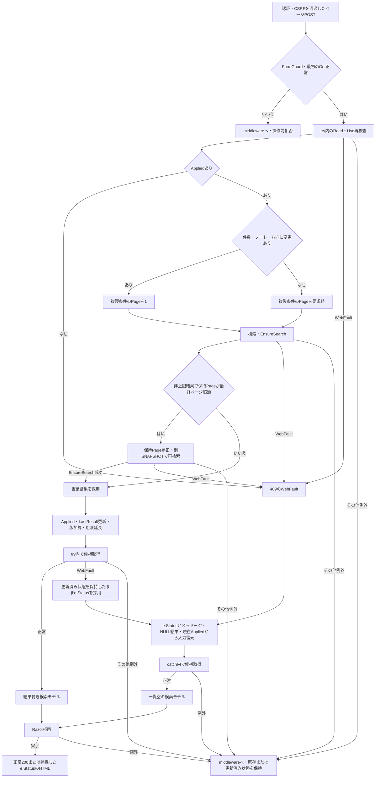

#### SQL・テーブル関連（ER図）

保持条件で検索実行と同じ学生・クラス・コードの関連を読む。候補再取得ではコード種別も参照する。検索の関連と候補の関連は概要ER図に対応する。

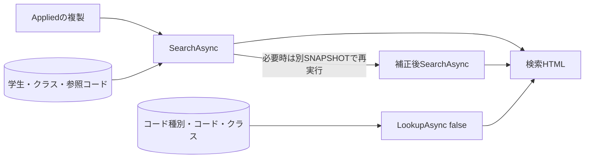

#### DB操作の詳細

各SearchAsyncの中では存在確認、同じ述語の件数、一覧が単一SNAPSHOTに属する。補正による2回目の検索と、表示候補の読取りはそれぞれ別のSNAPSHOTである。2回目の結果に対して同じ補正判定を繰り返すループはない。業務更新・操作履歴追記は行わない。〔根拠：`sources/Infrastructure/WebStudentCoordinator.cs:12-12`、`sources/Core/SqlServerStudentService.cs:123-168`〕

#### 結果・例外時の扱い

Appliedなしの409は個別catchによる一覧空の再表示となる。最初のGetで期限切れになった409はtry外なのでmiddlewareへ進む。設計の「保持条件なし・失効→初期化・通知」を、現行の共通初期化処理として図示しない。〔根拠：`sources/Web/Controllers/StudentsController.cs:19-19`、`sources/Infrastructure/WebStudentCoordinator.cs:12-12`。設計意図：`reference-designs/詳細仕様書/CSharp_ASPNET/01_学生検索画面.md:303-320`〕

正常な検索結果でも、後続候補取得のWebFaultはこのイベントではtry内にあるため個別catchへ入る。その場合は新しいApplied・版を保持したまま当該画面の一覧を空にする。SQL例外や取消等はWebFault catchの対象ではない。バインド変換失敗時にサービスへどのPage等が渡るかは、サービスの正数・候補検査だけでは確定しない。

### クリア

#### 処理概要

クリアは、同じ状態IDとタブを保ちながら実行済み条件と結果を解除し、初期入力・未検索へ戻す。学生を更新・削除する処理ではない。再表示の候補DB読取りは実施する。〔根拠：`sources/Web/Controllers/StudentsController.cs:21-21`、`sources/Infrastructure/WebStudentCoordinator.cs:15-15`〕

#### 処理手順

1. 認証・CSRF検査後、ContextRequestとTabIdを対象にFormGuardを行う。
2. Coordinator.ClearがReadを確認し、Useで状態取得、Gate待機、再Get、要求版と版上限の検査を行う。
3. 正常枝でAppliedとLastResultをNULLにし、Revisionを加算して `Present(entry, null)` を返す。Useは正常operation後に期限を延長する。
4. ControllerがModelStateをClearし、Getで状態を取得し直す。
5. 新しいStudentSearchInputと `LookupAsync(false, ct)` の候補を使って再表示する。条件は空、在籍01・02、20件、studentNo昇順、Page=1へ戻る。

〔根拠：`sources/Infrastructure/SearchContextStore.cs:14-14`、`sources/Web/Controllers/StudentsController.cs:21-21`、`sources/Web/Controllers/StudentsController.cs:39-39`、`sources/Web/Inputs/StudentSearchInput.cs:7-18`〕

#### 処理フロー

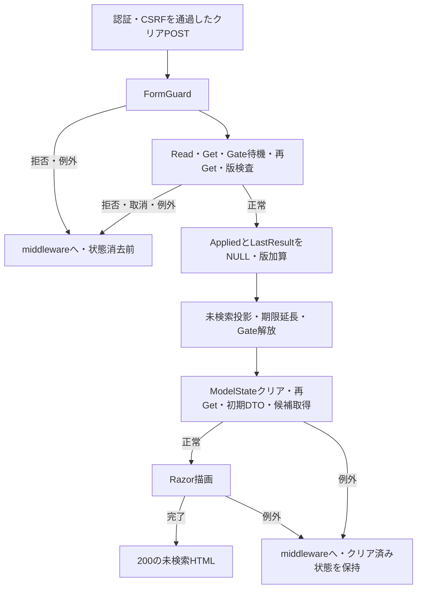

#### SQL・テーブル関連（ER図）

検索状態の初期化対象はメモリのEntryである。再表示にコード種別・コード・クラスを読むため、候補関連の複数表読取りがある。

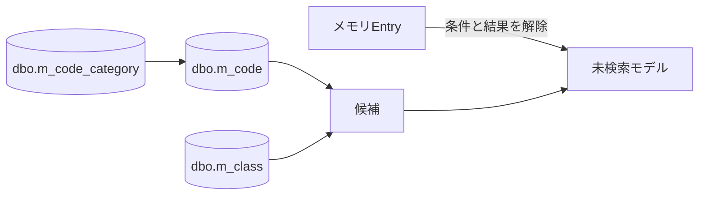

#### DB操作の詳細

学生検索SQLは呼ばず、候補SQLだけを呼ぶ。業務表のUPDATE・DELETE、履歴INSERTはない。「クリアにDB操作がない」とまとめると、候補読取りを欠落させる。〔根拠：`sources/Web/Controllers/StudentsController.cs:21-21`、`sources/Web/Controllers/StudentsController.cs:39-39`、`sources/Core/SqlServerStudentService.cs:197-216`〕

#### 結果・例外時の扱い

個別catchとModelState有効判定はない。状態や版の拒否はmiddlewareへ進む。クリア成功後の再Get・候補取得・描画が失敗しても、解除した条件・結果と加算した版を戻す処理はない。

### 未所属の切替と送信中表示

#### 処理概要

検索側のJavaScriptは未所属チェックの変更と初回評価で所属3項目の値を空にする。共通submit処理は送信中表示を付ける。これらは画面内の補助であり、サーバーの入力検査・版照合・Gateの代わりにはならない。〔根拠：`sources/wwwroot/js/site.js:4-7`〕

#### 処理手順

1. スクリプトが `#SRC-007` を取得し、changeへ値クリア処理を登録して初回にも評価する。
2. チェックONなら `SRC-004`、`SRC-005`、`SRC-006` のDOM値を空にする。チェックOFFなら値を復元しない。
3. この処理はdisabledを変更しない。サーバーがON状態で返したdisabledを、OFFへのDOM変更だけで解除する処理もない。
4. 年度・学年・クラスの候補を自動通信で取得する処理はない。「候補を更新」ボタンでPOSTする。
5. 各formのsubmitでは確認文言があれば確認ダイアログを評価する。検索フォームには確認文言の属性がない。
6. 送信するbutton以外の同じform内のbuttonをdisabledにし、formの `aria-busy` をtrueにする。送信button自身をdisabledにせず、busy値を使った再入拒否もしない。

〔根拠：`sources/wwwroot/js/site.js:4-7`、`sources/Views/Students/Search.cshtml:4-8`〕

#### 処理フロー

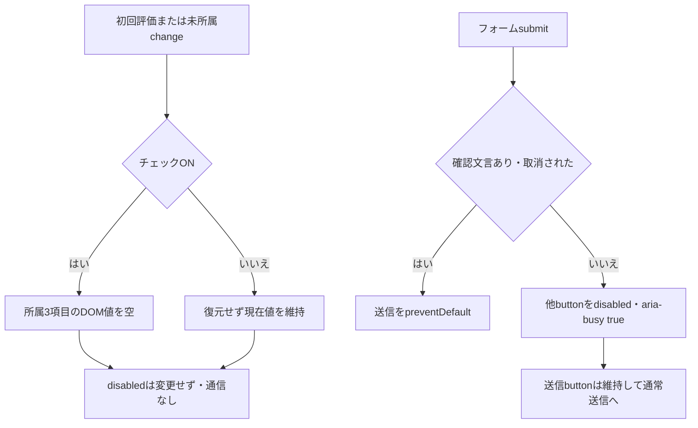

#### SQL・テーブル関連（ER図）

このイベント単体はDOMだけを扱い、DBを使用しないためER図を置かない。サーバー側の候補更新・検索が別イベントとしてメモリとDBを扱う。画面上の送信中属性を検索状態のGateやDB排他として解釈しない。

#### DB操作の詳細

該当なし。保持先はinput/selectのDOM値、buttonのdisabled、formのaria-busyである。Applied、LastResult、Revision、DB列をこのJavaScriptが変更する処理はない。

#### 結果・例外時の扱い

未所属ONでも、サーバー応答前のdisabled状態は変更前のままである。値クリアと非活性化が同時に成立すると保証しない。検索側にはクラス選択から年度・学年を設定する処理もない。`REG-018` 等を使う登録側の連動処理を検索側へ適用しない。〔根拠：`sources/wwwroot/js/site.js:7-8`〕

### 新規登録・編集・参照への遷移

#### 処理概要

新規登録リンクと行リンクは、検索状態IDを復帰先として登録画面へ渡す。行リンクの対象は一覧の行番号ではなく学生IDである。検索入力を登録の業務値へ移す処理はない。〔根拠：`sources/Views/Students/Search.cshtml:6-8`〕

#### 処理手順

1. Viewerでは新規リンクを表示せず、行リンクを「参照」とする。Staff・Administratorでは新規と「編集」を表示する。
2. 新規は `/students/new?returnContextId=...`、行は `/students/{studentId}?returnContextId=...` へGETする。検索版はこのリンクに含めない。
3. 登録側でReadと復帰状態のGetを確認する。新規の場合はCreateOrUpdateも確認し、Viewerを拒否する。
4. 既存IDの場合、登録側のGetAsyncで最新の非削除学生を取得する。不在なら404とする。新規は既存学生の読取りを行わない。
5. 登録用候補を取得し、Controller.Loadが復帰状態の現在Revisionを取得する。入力原本・対象等とともに編集スナップショットへ保存する。
6. 登録画面へ引き渡す。保存、削除、編集取消の詳細は登録文書の責務である。検索側が渡す対象ID・復帰IDと、戻る際に必要な保存済み復帰版は本書で定義する。

〔根拠：`sources/Web/Controllers/StudentsController.cs:23-25`、`sources/Infrastructure/WebStudentCoordinator.cs:6-6`、`sources/Infrastructure/WebStudentCoordinator.cs:17-17`、`sources/Infrastructure/EditorSnapshotStore.cs:7-9`〕

#### 処理フロー

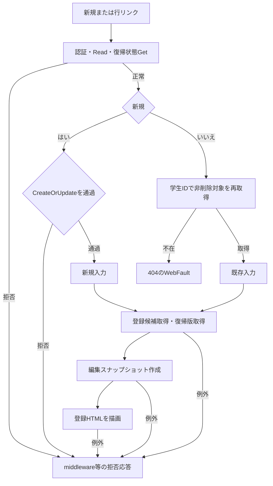

#### SQL・テーブル関連（ER図）

リンク操作自体はDBを読まない。接続された遷移先では、既存学生の単一表読取りと登録用候補の関連読取りがある。検索から登録へ移すのは参照キーであり、業務保存値ではない。

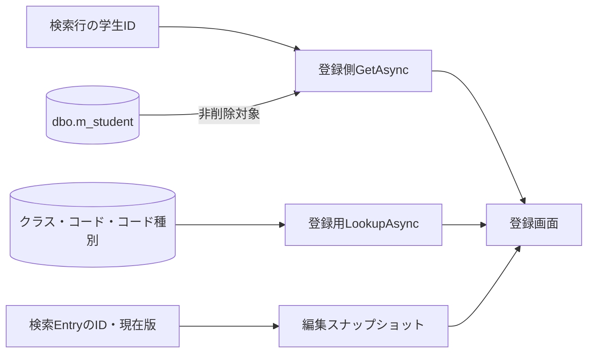

#### DB操作の詳細

既存読取りは学生IDをBigIntで渡し、`student_id=@id AND is_deleted=0` の対象を取得する。登録側の `LookupAsync(ct)` は検索用false指定とは異なり、人数集計を含む候補取得経路である。検索状態の版を学生版として保存要求へ流用しない。〔根拠：`sources/Core/SqlServerStudentService.cs:173-194`、`sources/Core/SqlServerStudentService.cs:196-216`、`sources/Infrastructure/WebStudentCoordinator.cs:17-17`〕

#### 結果・例外時の扱い

リンクの非表示だけで権限を保証せず、新規入口でもViewerを拒否する。復帰状態の期限・所有者不正、既存対象の不在、読取り失敗は正常登録画面の生成を中断する。対象取得時のStudentRow.RowVersionを検索リンクに付けないため、編集側で取得した最新対象と版が編集の基準となる。

<a id="登録画面への遷移"></a>

### 検索状態への復帰

#### 処理概要

既存ContextIdによるGETは、元の検索条件を使って結果を取り直す。未検索状態なら学生検索を実行しない。保存した学生を一覧へ含める目的で元条件を変更しない。保存・削除後の成功通知はFlashから一度だけ取得する。〔根拠：`sources/Web/Controllers/StudentsController.cs:8-11`、`sources/Infrastructure/WebStudentCoordinator.cs:14-14`〕

#### 処理手順

1. 登録画面の戻るリンクは元ContextIdと保存済みReturnRevisionを送る。保存・削除が `Outcome.Saved` の場合はReturnAfterSaveが通知をPutし、303とLocationを返す。復帰先がなければ新しい未検索状態を作って、そのIDと版を使う。
2. GET `/students` はRead後、既存IDをGetする。GETではタブ引数を渡さない。
3. `contextRevision` がNULLなら空文字にしてResumeへ渡す。最新版で補完しない。
4. ResumeのUseがGet、Gate待機、再Get、版照合、版上限を確認する。ここでもtabはNULLである。
5. AppliedがNULLならNULL結果でPresentを返す。学生SQL、LastResult代入、版加算はしない。operation正常終了により期限だけを延長する。
6. Appliedありならその保持条件でSearchAsyncを再実行し、EnsureSearch後にLastResultを更新して版を加算する。Applied自体は更新しない。正常終了で期限を延長する。
7. Appliedから入力DTOを復元し、FlashをTakeする。候補を再取得してJsonElementへ変換し、Searchビューを描画する。

〔根拠：`sources/Web/Controllers/StudentsController.cs:8-11`、`sources/Web/Controllers/StudentsController.cs:31-38`、`sources/Views/Students/Edit.cshtml:16-16`、`sources/Infrastructure/WebStudentCoordinator.cs:14-14`、`sources/Infrastructure/FlashMessageStore.cs:6-9`〕

#### 処理フロー

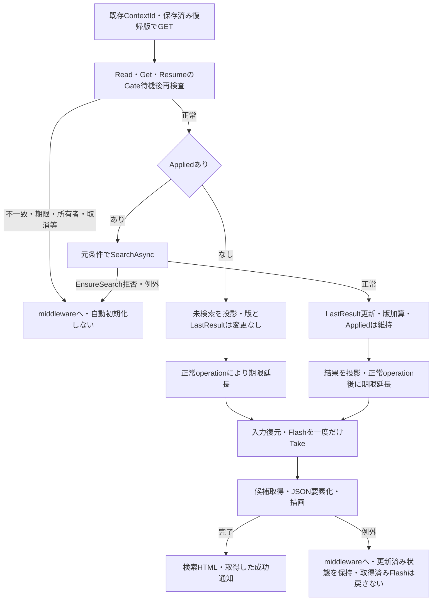

#### SQL・テーブル関連（ER図）

未検索枝は候補のコード種別・コード・クラスだけを読む。検索済み枝は学生・クラス・参照コードの件数・一覧を再取得し、その後に候補を別途読む。通知と検索条件はメモリに保持する。

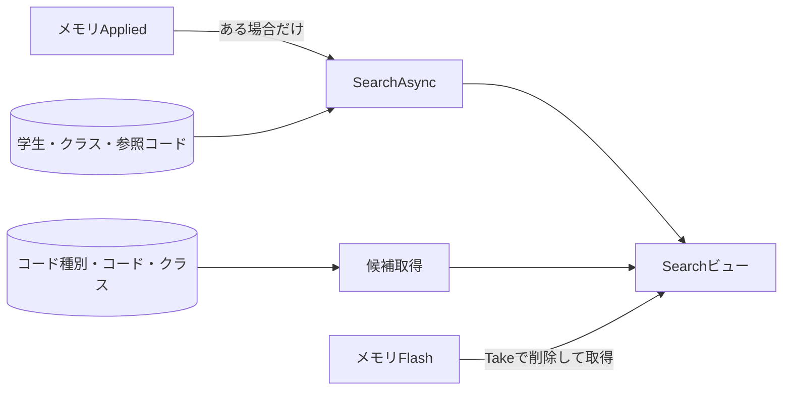

#### DB操作の詳細

検索済み枝は保持条件で検索SQL契約を実行する。ResumeにはPageイベントの「条件Pageを最終ページへ書き戻して再検索する」処理がない。サービス内でSQL実取得ページが補正されてもApplied.Pageは元のままで、Presentのpageもその値を使う。結果件数が減ると表示ページと実取得ページがずれる場合がある。未検索枝に学生検索はないが、再表示候補の読取りは両枝で行う。〔根拠：`sources/Infrastructure/WebStudentCoordinator.cs:12-14`、`sources/Infrastructure/WebStudentCoordinator.cs:21-21`、`sources/Core/SqlServerStudentService.cs:160-164`、`sources/Web/Controllers/StudentsController.cs:39-39`〕

#### 結果・例外時の扱い

既存状態の期限切れは409、他者・別セッションは403、復帰版不一致は409であり、初期状態へ自動復元しない。編集開始後に検索状態の版が進んだ場合、古いReturnRevisionによる復帰は拒否される。GETはTabを比較しないため、設計上の別タブ分離をこの入口だけで保証しない。〔根拠：`sources/Infrastructure/SearchContextStore.cs:13-14`、`sources/Web/Controllers/StudentsController.cs:10-10`、`sources/Web/Controllers/StudentsController.cs:38-38`。設計意図：`reference-designs/詳細仕様書/CSharp_ASPNET/01_学生検索画面.md:390-392`〕

Flashは候補読取りより前に消費される。後続処理で失敗しても通知を復元しない。保存・削除のSaved後に発行した303や、その後の検索復帰が失敗したことは、既に確定した学生保存のrollbackを意味しない。〔根拠：`sources/Infrastructure/FlashMessageStore.cs:9-9`、`sources/Web/Controllers/StudentsController.cs:11-11`、`sources/Web/Controllers/StudentsController.cs:31-38`〕

## 項目移送仕様

| 移送ID | 起点・方向 | 移送先 | 値と加工 | 成立条件・保持結果 | 根拠 |
| --- | --- | --- | --- | --- | --- |
| MOVE-001 | フォーム→MVCアクション | `StudentSearchInput`、表示指定、状態指定 | `Criteria` 接頭辞で条件をバインド。年度は `int?`、未所属は `bool`、在籍は `string[]`。原HTTP表現からの変換とFormGuardは別段階。 | SearchだけはModelStateを明示判定。未送信StatusCodesはSearch・Optionsで空配列にする。 | `sources/Web/Controllers/StudentsController.cs:13-22`、`sources/Web/Inputs/StudentSearchInput.cs:7-29` |
| MOVE-002 | 入力DTO→検索条件 | `SearchCriteria` | Name→StudentName、Kana→StudentNameKana、StatusCodes→EnrollmentStatusCodes。ClassIdだけOptionalで `long?` へ。Pageは1、表示指定は引数を使用。 | ClassIdの変換拒否はUse前。文字列正規化はまだ行わない。 | `sources/Web/Inputs/StudentSearchInput.cs:19-22`、`sources/Infrastructure/WebStudentCoordinator.cs:8-9` |
| MOVE-003 | 条件→サービスの照合値 | ローカル値・SQLパラメータ | 氏名・カナの照合キー、正規化電話、コード、DateOnlyの範囲を生成する。 | 正規化成功後の値だけをSQLへ使う。SearchCriteriaの文字列を変更しない。 | `sources/Core/SqlServerStudentService.cs:113-153` |
| MOVE-004 | 正常検索条件・結果→メモリ | Applied・LastResult・Revision | 条件をJSONで複製、結果を保持、版を1加算。 | EnsureSearch成功後。0件・上限超過も成功。後続表示失敗で戻さない。 | `sources/Infrastructure/WebStudentCoordinator.cs:9-9`、`sources/Infrastructure/SearchContextStore.cs:15-15` |
| MOVE-005 | Applied→ページ検索条件 | SearchCriteriaの複製 | 件数・ソート・方向変更はPage=1。同じなら要求Page。必要時に最終ページへ補正して再検索。 | 全検索のEnsureSearch成功後に保持を置換する。編集途中のCriteriaを混ぜない。 | `sources/Infrastructure/WebStudentCoordinator.cs:12-12` |
| MOVE-006 | Applied→再表示入力 | `StudentsController.From` のStudentSearchInput | NULLの番号・氏名・カナ・電話は空文字。ClassIdはInvariantCultureの10進文字列。コード・日付・配列を対応付ける。 | GET復帰、ページ正常・拒否の再表示に使用する。検索拒否は受信inputを使う。 | `sources/Web/Controllers/StudentsController.cs:11-19`、`sources/Web/Controllers/StudentsController.cs:40-40` |
| MOVE-007 | Entryと当該result→応答投影 | Presentの匿名型→JsonElement | resultからoutcome・件数・items・日時。ページ・ソート・criteriaはApplied、なければ初期条件。状態版は現在Entry。 | result=NULLでもAppliedをNULLにしない。LastResultの暗黙代用はしない。 | `sources/Infrastructure/WebStudentCoordinator.cs:21-21`、`sources/Web/Models/StudentSearchPageModel.cs:15-15` |
| MOVE-008 | DB行→表示DTO | StudentRow→WebPresentation.Row | 保存原表記、和暦、JOIN名称、都道府県名＋住所1、本人電話、日本時間更新日時、文字列学生ID。 | AdmissionDateとRowVersionはStudentRowまで取得するが一覧投影には含めない。 | `sources/Core/SqlServerStudentService.cs:77-90`、`sources/Infrastructure/WebPresentation.cs:20-20` |
| MOVE-009 | 全候補→画面候補と選択 | Searchビュー・Options | 分類別コード、重複除去年度、上位条件でクラス抽出。Optionsは非適合の選択クラスを解除する。 | 候補リストと選択済み値は別。未所属ONは入力3項目と該当ModelStateを解除。Appliedは変更しない。 | `sources/Web/Controllers/StudentsController.cs:22-22`、`sources/Views/Students/Search.cshtml:5-5` |
| MOVE-010 | 検索→登録 | URLの学生ID・returnContextId | 新規は状態IDだけ、行は学生IDと状態ID。 | 検索の業務入力や行版を登録要求へ流用しない。登録側で最新対象と復帰版を取得。 | `sources/Views/Students/Search.cshtml:6-8`、`sources/Web/Controllers/StudentsController.cs:23-25` |
| MOVE-011 | 登録→検索 | contextId・contextRevision・Flash | 戻るは保存済みReturnRevision。Saved後は通知Putと303。元条件で再検索。 | Saved以外を成功通知にしない。元条件を保存学生に合わせて変更しない。 | `sources/Web/Controllers/StudentsController.cs:31-38`、`sources/Views/Students/Edit.cshtml:16-16`、`sources/Infrastructure/WebStudentCoordinator.cs:14-14` |
| MOVE-012 | クリア→初期状態 | 同じEntry・新しい入力DTO | Applied・LastResultをNULL、版加算、初期入力、20件・studentNo昇順。 | 状態・版検査成功後。候補読取りは再実施する。 | `sources/Infrastructure/WebStudentCoordinator.cs:15-15`、`sources/Web/Controllers/StudentsController.cs:21-21` |

## 補足説明

### 入力検査の層と順序

Cookie認証はSecure、HttpOnly、SameSite=Strict、30分期限、SlidingExpirationを設定する。認証要求のリダイレクト処理は401、アクセス拒否は403を設定する。学生ルートではこれらの処理がJSON本文を生成しない。MVC全体にはAutoValidateAntiforgeryTokenとAntiforgeryResultFilterが登録され、各POSTフォームにCSRF情報を置く。ただし独自JSONへのCSRF失敗変換は `/api` 配下だけである。〔根拠：`sources/Infrastructure/WebHostSetup.cs:14-16`、`sources/Infrastructure/AntiforgeryResultFilter.cs:5-8`、`sources/Views/Students/Search.cshtml:4-8`〕

FormGuardの許可名はDTOの公開プロパティから作る。検索・候補更新では `Criteria.*` に状態3項目と表示3項目を加える。ページはPageRequest、クリアはContextRequestにTabIdを加える。許可集合は大文字小文字を区別しない。CSRF項目と `__Invariant` も許可する。許可外名は400、同名の複数値は原則400である。末尾がStatusCodesまたはUnassignedOnlyの項目は複数値を許すが、値の形式が正しいと認定する検査ではない。〔根拠：`sources/Web/Controllers/StudentsController.cs:13-22`、`sources/Web/Controllers/StudentsController.cs:41-41`〕

`__Invariant` の値が許可項目名かどうかを調べる分岐と複数値の例外は、コード上の正確な綴りに対する比較である。許可名集合の大文字小文字無視と、この個別分岐を同じ比較規則として扱わない。

受信の共通上限はKestrel本文65536、FormOptionsのMultipartBodyLengthLimit=65536、ValueLengthLimit=65536、ValueCountLimit=128である。これらは項目ごとの業務長と別の制約であり、全プロトコルの実受信結果を規定するものではない。〔根拠：`sources/Infrastructure/WebHostSetup.cs:17-18`〕

MVCは非nullable参照型への暗黙Requiredを抑止している。`string`、`string[]` の注釈や初期値だけでHTTP受信NULLを排除する実行保証にはしない。フォーム受信値、バインド・変換後のDTO、サービス引数を分けて扱う。検索はModelState不正ならサービスを呼ばない一方、Page・Options・Clearは同じ判定を持たない。〔根拠：`sources/Infrastructure/WebHostSetup.cs:16-16`、`sources/Web/Inputs/StudentSearchInput.cs:7-29`、`sources/Web/Controllers/StudentsController.cs:13-22`〕

NULLの扱いは項目ごとに異なる。TextはNULLを空文字に補い、OptionalはNULLを未指定にし、検索状態GetはNULLを辞書呼出し前に409へする。一方、在籍配列はLengthを先に参照するので、NULLがサービスへ届いた場合は独自の在籍不正例外より先にNullReferenceExceptionとなる。候補更新のビューも配列Containsに依存する。欠落・空配列・NULL配列を同じ結果へまとめない。〔根拠：`sources/Core/StudentNormalizer.cs:47-55`、`sources/Web/Inputs/StudentSaveInput.cs:60-60`、`sources/Infrastructure/SearchContextStore.cs:13-13`、`sources/Core/SqlServerStudentService.cs:111-112`、`sources/Views/Students/Search.cshtml:5-5`〕

### 長さ、保存値、表示名称

業務文字数はStudentNormalizerのScalarCountによるUnicodeスカラー値で数える。不正なサロゲート並びはArgumentExceptionとなる。HTML maxlength、文字列のLength、SQL Serverのnvarchar容量を同じ数値の制約として扱わない。番号・氏名・カナ・電話のHTML上限は30・16・72・40だが、サービスのraw上限は15・8・36・20である。カナは正規化後18、氏名照合キーは160、正規化電話は最大16という別の制約を持つ。nvarcharの宣言容量とNVarCharパラメータサイズはUTF-16領域として確保される。ASCIIへ限定するvarchar項目の業務桁数とも区別する。〔根拠：`sources/Views/Students/Search.cshtml:5-5`、`sources/Core/StudentNormalizer.cs:37-93`、`sources/database/001_schema.sql:9-13`。長さを分ける設計意図：`reference-designs/詳細仕様書/CSharp_ASPNET/01_学生検索画面.md:594-602`〕

保存側では氏名原表記、正規化カナからname_key・kana_keyを再生成する。検索側のローカルキーをそのまま保存する経路はない。学生保存側の列パラメータは氏名NVarChar(16)、name_key NVarChar(320)、カナとkana_key NVarChar(36)、住所各NVarChar(90)、電話各VarChar(16)である。検索画面はこれらの列を読み、更新しない。〔根拠：`sources/Core/StudentNormalizer.cs:124-145`、`sources/Core/SqlServerStudentService.cs:30-37`〕

クラス名は宣言されたSaveClassAsyncでraw・Trim後18スカラー、クラスコードはIdentifierで9以内に検査し、NVarChar(36)・VarChar(9)へ渡す。コード名称はSaveCodeAsyncでraw・Trim後12スカラーを検査し、NVarChar(24)へ渡す。DDLにも対応する名称スカラーCHECKがある。これらの保守契約は表示名称の上限根拠だが、学生検索がマスタを保存することや公開保守画面が接続されていることを意味しない。コード種別名 `category_name` と候補の `code_name` は別列である。〔根拠：`sources/Core/MasterMaintenanceService.cs:30-37`、`sources/Core/MasterMaintenanceService.cs:73-76`、`sources/Core/MasterMaintenanceService.cs:79-115`、`sources/database/001_schema.sql:68-81`、`sources/database/001_schema.sql:92-103`、`sources/database/001_schema.sql:115-128`、`sources/Infrastructure/WebHostSetup.cs:13-19`〕

### 検索SQL契約

#### 接続と共通パラメータ処理

サービスは接続文字列のEncryptをMandatory、TrustServerCertificateをfalseに設定する。OpenAsync後に現在DBの `snapshot_isolation_state=1` を診断し、不一致ならInvalidOperationExceptionとする。接続失敗時は接続を破棄して再throwする。検索・候補のCommand補助はCommandTimeout=30である。診断用CreateCommandには明示的なTimeout設定がない。〔根拠：`sources/Core/SqlServerStudentService.cs:39-66`〕

Param補助はSQL型を指定し、サイズが0以外ならSizeを設定する。DateOnlyはTimeOnly.MinValueのDateTimeに変換し、NULLはDBNull.Valueへ移す。接続、トランザクション開始、SQL実行、行読取り、commitにはctを渡す。30秒のコマンド設定と要求取消は別の境界である。〔根拠：`sources/Core/SqlServerStudentService.cs:67-72`、`sources/Core/SqlServerStudentService.cs:123-168`、`sources/Core/SqlServerStudentService.cs:197-216`〕

#### 存在と組合せ

| 確認対象 | SQLの条件・結果 | パラメータ | 拒否条件 |
| --- | --- | --- | --- |
| 学年・都道府県 | `m_code` を `category_id=@category AND code_value=@value` でCOUNT_BIG。 | `@category: VarChar(24)`、`@value: VarChar(10)`。分類はGRADEまたはPREFECTURE。 | 件数が1でない指定コードは `E-STU-009`。停止・期間は検査しない。 |
| 年度 | `m_class` を `school_year=@year` でCOUNT_BIG。 | `@year: SmallInt`。 | 0件は `E-STU-014`。 |
| クラス | `m_class` を `class_id=@id` で取得し、school_yearとgrade_codeを読む。 | `@id: BigInt`。 | 不在、指定年度との不一致、正規化済み指定学年との不一致は `E-STU-014`。停止・期間は検査しない。 |
| 学籍番号 | 完全一致の存在検査なし。 | 前方一致用 `@no` を検索時に設定。 | 番号候補の存在・一意・重複確認を検索前に行わない。 |

コード確認は学年側から評価し、学年不在ならORの短絡により都道府県確認を行わず拒否する。確認SQLも検索のSNAPSHOT内で実行する。〔根拠：`sources/Core/SqlServerStudentService.cs:123-135`、`sources/Core/SqlServerStudentService.cs:218-222`〕

#### 全検索述語

| 適用条件 | 述語 | 値の作り方・パラメータ |
| --- | --- | --- |
| 常時 | `s.is_deleted=0` | 論理削除学生を除外。 |
| noが非NULL | `s.student_no LIKE @no ESCAPE '!'` | エスケープ済みno＋末尾 `%`。VarChar(31)。 |
| nameが非NULL | `s.name_key LIKE @name ESCAPE '!'` | 両側 `%` の照合キー。NVarChar(642)。 |
| kanaが非NULL | `s.kana_key LIKE @kana ESCAPE '!'` | 両側 `%` の空白除去キー。NVarChar(74)。空文字は省かない。 |
| 年度非NULL | `c.school_year=@year` | SmallInt。 |
| grade非NULL | `c.grade_code=@grade` | VarChar(2)。 |
| クラスID非NULL | `s.class_id=@class` | BigInt。 |
| 未所属true | `s.class_id IS NULL` | パラメータなし。所属条件との同時指定は正規化前に拒否済み。 |
| prefecture非NULL | `s.prefecture_code=@prefecture` | VarChar(2)。 |
| phone非NULL | `(s.phone_number=@phone OR s.emergency_phone_number=@phone)` | 共通VarChar(16)。他の条件とは括弧外でAND。 |
| from非NULL | `s.admission_date>=@from` | Date。 |
| to非NULL | `s.admission_date<=@to` | Date。 |
| 在籍配列が非空 | `s.enrollment_status_code IN (@status0,...)` | 各VarChar(2)。空配列では述語なし。 |

Where補助が条件を省く基準はNULLであり、空文字を一律に省かない。LIKEのエスケープは `!`→`!!`、`%`→`!%`、`_`→`!_`、`[`→`![` の順である。各値はパラメータで渡し、入力値を述語文字列へ直接連結しない。〔根拠：`sources/Core/SqlServerStudentService.cs:137-155`、`sources/Core/StudentNormalizer.cs:161-161`〕

#### 件数とページ取得

件数SQLは次の形で、波括弧部分に上記の同一述語を組み立てる。これはSQL構成の説明である。

```sql
SELECT COUNT_BIG(*)
FROM (
  SELECT TOP (10001) s.student_id
  FROM dbo.m_student s
  LEFT JOIN dbo.m_class c ON c.class_id=s.class_id
  {検索述語}
) limited
```

10000件を超えた結果はCount=10001で打ち切る。実総数は数えず、一覧SQLも実行しない。10000件以下は同じ検索述語・パラメータをRowSelectへ適用する。0件でもページSQLを実行する。結果列は学生ID、番号、氏名、カナ、生年月日、年度、クラスコード・名、学年名、在籍名、都道府県名、住所1、本人電話、入学日、更新日時、学生版である。〔根拠：`sources/Core/SqlServerStudentService.cs:82-90`、`sources/Core/SqlServerStudentService.cs:156-168`〕

| 指定 | ORDER BYの主列 | 方向・副順序 |
| --- | --- | --- |
| studentNo | `s.student_no` | ascまたはdesc。続けて `s.student_id ASC`。 |
| name | `s.name_key` | ascまたはdesc。続けて `s.student_id ASC`。 |
| admissionDate | `s.admission_date` | ascまたはdesc。続けて `s.student_id ASC`。 |
| updatedAt | `s.updated_at` | ascまたはdesc。続けて `s.student_id ASC`。 |

全一致集合にORDER BYを適用してから `OFFSET @offset ROWS FETCH NEXT @size ROWS ONLY` を使う。最終ページは `max(1, ceil(count / PageSize))`、実取得ページは要求Pageと最終ページの小さい方である。offsetは `checked((page-1)*PageSize)`、sizeはPageSize、いずれもInt。実取得ページをSearchCriteriaへ書き戻す処理はない。〔根拠：`sources/Core/SqlServerStudentService.cs:107-108`、`sources/Core/SqlServerStudentService.cs:160-168`〕

#### 候補SQL

コードは `m_code c JOIN m_code_category k ON k.category_id=c.category_id` で全件を読み、category_id、display_order、code_value順に返す。候補のIsActiveはコードと分類が両方有効なときだけtrueであり、その値や有効期間によるWHEREはない。

クラスは `m_class c LEFT JOIN m_code g ON g.category_id=c.grade_category AND g.code_value=c.grade_code` で全件を読み、年度DESC、学年表示順、クラス表示順、クラスコード、クラスID順に返す。検索用false指定ではoccupiedを整数0で投影する。登録用true指定だけが非削除・在籍01または02の学生人数を集計する。検索UIへその省略値を実測人数として表示しない。〔根拠：`sources/Core/SqlServerStudentService.cs:196-216`〕

### 状態版、確定境界、最終応答

Useは操作前のGetに加え、Gate取得後にもGetを行う。待機中の期限切れや所有者不一致をこの再確認で拒否する。その後に版を比較し、operationを呼ぶ。DB読取りのawait後に期限や所有者を再確認する処理はない。operationが正常に返った場合だけ期限を延長し、finallyでGateを解放する。版加算はUse自身ではなく各operationが行う。〔根拠：`sources/Infrastructure/SearchContextStore.cs:14-14`、`sources/Infrastructure/WebStudentCoordinator.cs:9-15`〕

| 経路 | Applied | LastResult | Revision・期限 | 当該応答に使う結果 |
| --- | --- | --- | --- | --- |
| 正常検索・ページ | 成功した条件の複製へ置換。 | 成功結果へ置換。 | 版＋1。operation正常復帰後に期限延長。 | 成功結果。0件・上限も含む。 |
| 検索の入力・状態版等の拒否 | 以前の値を保持。 | 以前の値を保持。 | 状態代入に至らなければ版・期限を変えない。 | NULL。以前のLastResultを暗黙表示しない。 |
| 候補更新 | 変更なし。 | 変更なし。 | Gate・版照合・延長なし。 | 取得時のLastResult。 |
| クリア成功 | NULL。 | NULL。 | 版＋1、正常復帰後に期限延長。 | NULL、初期条件。 |
| AppliedなしResume | NULLのまま。 | 代入なし。 | 版加算なし、正常復帰で期限延長。 | NULL。 |
| AppliedありResume | 元条件を保持。 | 再検索結果へ置換。 | 版＋1、正常復帰で期限延長。 | 再検索結果。 |
| 状態更新後の候補取得・描画失敗 | 更新済み値を戻さない。 | 更新済み値を戻さない。 | 更新済み版を保持。期限はUse正常復帰の有無に従う。 | 正常HTMLの生成完了を保証しない。 |

Presentは、当該resultからitemsと検索日時を作り、Appliedからpage・pageSize・ソート・criteriaを作る。失敗時のNULL結果を、保持条件もNULL・pageも1という固定成功節点へ合流させない。上限超過時のtotalCountはNULL、0件は0である。ビューはNULL件数を局所変数count=0としてページ総数計算に使うため、保持Pageが大きい拒否・上限画面では「保持Page / 1」となる場合もある。〔根拠：`sources/Infrastructure/WebStudentCoordinator.cs:21-21`、`sources/Views/Students/Search.cshtml:2-8`〕

| 失敗段階 | 捕捉・分類 | 応答が到達する範囲 |
| --- | --- | --- |
| 認証パイプラインの拒否 | Cookieの設定により401または403。 | アクションへ到達しない。学生向けJSON生成はない。 |
| CSRF失敗 | MVCの検証結果。独自変換はAPI配下だけ。 | 学生フォームの個別catchより前。 |
| SearchのModelState不正 | Controllerが422を設定。 | 候補取得と描画が成功すれば検索ビュー。後続描画例外は別。 |
| Searchサービス内InputValidationException | 先行catchでFieldError群を返す。 | EnsureSearchがWebFault化。検索・ページではtry範囲に従い再表示、Resumeではmiddlewareへ。 |
| Searchサービス内ArgumentException | 後段catchで既知コードまたはE-STU-002へ変換。 | 先行catchが処理する型をこの分類へ含めない。 |
| Search・Pageのtry内WebFault | `e.Status`、`e.Field`、`e.Message` を引き継ぐ。 | 項目または全体エラーとNULL結果で再表示。Pageは成功後候補取得のWebFaultも捕捉する。 |
| FormGuard・最初のGet等のtry外WebFault | アクションの個別catch外。 | 応答未開始ならmiddlewareがそのStatusで独立HTMLエラーを返す。 |
| SQL例外・取消・一般例外 | 検索の入力catchやControllerのWebFault catchに該当しない場合はmiddlewareへ。 | 応答未開始なら503。応答開始後はこのmiddlewareのcatch条件に合わない。 |
| Razor等の後続例外 | アクションのtryが戻った後の失敗。 | middlewareのHasStarted条件による。常に入力不正422へ変換されるわけではない。 |

middlewareは後続処理の例外を `Response.HasStarted=false` の場合だけ捕捉する。学生ルートではWebFaultのstatus、その他は503を設定し、メッセージをHtmlEncodeした独立HTMLを返す。応答開始後の例外を必ずこのエラーHTMLへ変換する保証はない。〔根拠：`sources/Infrastructure/WebHostSetup.cs:22-25`、`sources/Infrastructure/WebPresentation.cs:23-23`〕

検索状態とFlashは接続されたメモリ実装である。DDLの `t_runtime_state` に暗号化ペイロード・期限・版等の列があっても、この検索状態の読書き、暗号化、消費処理として接続されていない。WebのRole ClaimとDB接続主体のロールも別であり、DDL・権限文の宣言から実環境への適用を認定しない。〔根拠：`sources/Infrastructure/SearchContextStore.cs:9-15`、`sources/Infrastructure/FlashMessageStore.cs:6-9`、`sources/database/001_schema.sql:171-184`、`sources/database/003_web_permissions.sql:8-24`〕

### 設計意図と現行実装の対応

| 設計上の対象 | 設計意図 | 現行で確認できる動作・差分 |
| --- | --- | --- |
| 初期候補 | 必須マスタ不足なら検索不可。 | 全候補を取得するが、必須分類・既定値不足を理由に検索を非活性化しない。 |
| 条件連動 | 未所属ONで解除・非活性、OFFで復元しない。クラス先行選択で年度学年反映、旧応答破棄。 | DOMのON時値クリアとサーバー応答時disabled、Optionsで不適合クラス解除。検索側の先行反映・要求連番はない。 |
| ページ失効 | 保持条件なし・失効を初期化して通知。 | Appliedなしはtry内409の再表示、最初のGetの失効はmiddlewareの409。自動初期化しない。 |
| 復帰 | 元条件で最新DB再検索、未検索は未検索、確定成功通知、期限切れ初期化。 | 再検索とFlashは接続される。失効は409。GETのTab比較はなく、Resumeの保持Page補正もない。 |
| 一覧・ページ操作 | 表示範囲、先頭・前・次・最後、メニュー。 | 件数・日時、前・次・反映を持つ。表示範囲・先頭・最後・メニューの実コントロールはない。 |
| 欠損表示 | 未所属等は「－」、名称欠落は不整合表示。 | 本人電話NULLは「－」、都道府県名NULLは `[不整合]`。他の名称や未所属は同じ代替表示を生成しない。 |
| 検索結果通知 | 0件I-SRC-001、上限W-SRC-001。 | 意味に対応する文言を表示するが、そのMessageIdを画面へ出す処理はない。 |
| raw入力 | 表示用rawを保持し、成功した処理値だけを次層へ渡す。 | バインド後DTOと保持条件の文字列を残し、サービス内でローカル正規化。年度・ページ等の原HTTP文字列はDTOで保持しない。 |

〔設計意図の根拠：`reference-designs/詳細仕様書/CSharp_ASPNET/01_学生検索画面.md:99-147`、`reference-designs/詳細仕様書/CSharp_ASPNET/01_学生検索画面.md:159-176`、`reference-designs/詳細仕様書/CSharp_ASPNET/01_学生検索画面.md:201-246`、`reference-designs/詳細仕様書/CSharp_ASPNET/01_学生検索画面.md:256-273`、`reference-designs/詳細仕様書/CSharp_ASPNET/01_学生検索画面.md:303-320`、`reference-designs/詳細仕様書/CSharp_ASPNET/01_学生検索画面.md:390-392`、`reference-designs/詳細仕様書/CSharp_ASPNET/01_学生検索画面.md:590-608`。実装の対応位置は各イベント・項目一覧に記載。〕

### 実装・確認の責務

実装者は、受信値の変換結果と、サービスへ渡した値・DB条件・表示値の往復を確認する。文字列についてはHTML上限、rawスカラー上限、正規化後上限、SQLパラメータ、保存列容量を別々に確認し、氏名・カナ照合キーを表示原表記と取り違えない。クラスID等の制御項目にも、欠落・空文字・NULL・形式不正・不在・所有者不一致・期限・旧版の段階別確認を適用する。

検索では、存在確認前の形式不正とDB読取り後の存在不正、0件・10000件・10001件以上、停止・期間外候補、電話の二列OR、日付両端、同順位の副順序を確認する。状態ではGate待機中の期限切れ、同じ期待版の並行更新、Optionsの版未照合、Resumeのページ不整合、状態更新後の候補・描画失敗を確認対象にする。検索PageSize=0の拒否後描画、配列NULLが到達する場合の例外、Flash消費後の表示失敗も含める。

顧客IT担当者が確認する対象は、検索入力の意味、一覧の保存元、権限差、登録との移送、状態競合と障害時の結果である。設計との差異は、意図へ合わせるか現行動作を採用するかを個別に判断する。確認観点の列挙を、実装試験合格や顧客承認に置き換えない。〔設計上の責務：`reference-designs/詳細仕様書/CSharp_ASPNET/01_学生検索画面.md:546-550`、`reference-designs/詳細仕様書/CSharp_ASPNET/01_学生検索画面.md:586-608`、`reference-designs/基本設計書/01_学生検索画面.md:487-491`〕

### 関連文書の対応

以下は提供計画との対応である。本書以外の本文は本ジョブでは未生成で、リンクは生成後の配置を示す。参照先の生成を前提に、本書に必要な条件・分岐を省略しない。

| 計画ID | kind | 計画の相対path・リンク | 責務との対応 |
| --- | --- | --- | --- |
| CSHARP_ASPNET-BAS-STU-01 | basic-design | [基本設計書/01_学生検索画面.md](../../基本設計書/01_学生検索画面.md) | 検索の業務目的、論理項目、状態別操作。未生成。 |
| CSHARP_ASPNET-BAS-STU-02 | basic-design | [基本設計書/02_学生登録画面.md](../../基本設計書/02_学生登録画面.md) | 遷移先の新規・編集・参照、保存後復帰の業務。未生成。 |
| CSHARP_ASPNET-BAS-STU-03 | table-index | [基本設計書/03_テーブル仕様書.md](../../基本設計書/03_テーブル仕様書.md) | 契約表の関連と共通保存規則。未生成。 |
| CSHARP_ASPNET-BAS-STU-04 | code-design | [基本設計書/04_コード設計書.md](../../基本設計書/04_コード設計書.md) | 候補コード、初期投入、停止・保守契約。未生成。 |
| CSHARP_ASPNET-BAS-STU-03-M_STUDENT | table-definition | [基本設計書/テーブル/01_m_student.md](../../基本設計書/テーブル/01_m_student.md) | 検索列、表示列、所属・コードFKの物理定義。未生成。 |
| CSHARP_ASPNET-BAS-STU-03-M_CLASS | table-definition | [基本設計書/テーブル/02_m_class.md](../../基本設計書/テーブル/02_m_class.md) | 年度・学年・クラス候補、名称、期間等。未生成。 |
| CSHARP_ASPNET-BAS-STU-03-M_CODE_CATEGORY | table-definition | [基本設計書/テーブル/03_m_code_category.md](../../基本設計書/テーブル/03_m_code_category.md) | コード分類と候補有効性への参照。未生成。 |
| CSHARP_ASPNET-BAS-STU-03-M_CODE | table-definition | [基本設計書/テーブル/04_m_code.md](../../基本設計書/テーブル/04_m_code.md) | 選択値、参照名称、存在確認。未生成。 |
| CSHARP_ASPNET-BAS-STU-03-T_OPERATION_LOG | table-definition | [基本設計書/テーブル/05_t_operation_log.md](../../基本設計書/テーブル/05_t_operation_log.md) | 登録側の確定・監査に関連。検索イベントからの読書きはない。未生成。 |
| CSHARP_ASPNET-DET-CSharp_ASPNET-SCR-STU-001 | detailed-specification | 詳細仕様書/CSharp_ASPNET/01_学生検索画面.md | 本稿。検索フォーム、状態、候補、SQL、HTML応答。 |
| CSHARP_ASPNET-DET-CSharp_ASPNET-SCR-STU-002 | detailed-specification | [詳細仕様書/CSharp_ASPNET/02_学生登録画面.md](02_学生登録画面.md) | 登録の保存・削除・スナップショットと検索復帰。未生成。 |
