<!-- spec-meta: {"schema":"spec-md/1.0","documentId":"CSHARP_ASPNET-DET-CSharp_ASPNET-SCR-STU-002","version":"1.0","path":"詳細仕様書/CSharp_ASPNET/02_学生登録画面.md","sheets":[{"heading":"概要","kind":"GRID","sheet":"概要"},{"heading":"項目一覧","kind":"LIST","sheet":"項目一覧","key":["項目ID"]},{"heading":"選択候補一覧","kind":"LIST","sheet":"選択候補一覧","key":["候補ID"]},{"heading":"内部項目一覧","kind":"LIST","sheet":"内部項目一覧","key":["内部項目ID"]},{"heading":"イベント仕様","kind":"GRID","sheet":"イベント仕様"},{"heading":"項目移送仕様","kind":"LIST","sheet":"項目移送仕様","key":["移送ID"]},{"heading":"項目更新仕様","kind":"LIST","sheet":"項目更新仕様","key":["更新ID"]},{"heading":"補足説明","kind":"GRID","sheet":"補足説明"}]} -->
# 学生登録画面 詳細仕様書

| 文書属性 | 値 |
| --- | --- |
| 文書種別 | 詳細仕様書 |
| 対象機能 | 学生の新規登録、編集、参照、同一人物候補確認、論理削除、入力取消、検索復帰 |
| 版 | 1.0 |
| 記述区分 | 現行実装を中心に記述し、参考設計の要求・表示定義は「設計意図」と明示する |

## 概要

本画面は学生1人の基本情報、住所、連絡先、生年月日、入学日、在籍区分、現在または最終所属クラスを扱う。新規、編集、参照は同じ `Views/Students/Edit.cshtml` の表示モードである。学生の保存と操作履歴の追記を一つのトランザクションで確定し、クラス、コード分類、コード値は参照する。年度・学年はクラス選択と整合検査の補助であり、学生へ重複保存しない。根拠：`sources/Views/Students/Edit.cshtml:3–17`、`sources/Core/Contracts.cs:9–30,66–70`、`sources/Core/SqlServerStudentService.cs:294–315`。

検索画面から渡される復帰Context、読込時Snapshot、同一人物候補の確認情報は、それぞれ独立したメモリ保持情報である。学生DBの保存値、読込時の表示値、編集中の入力、期待版、確認Tokenを同じ領域として扱わない。CSV、帳票、取込、学籍番号訂正、削除復元、物理消去、所属履歴一覧、将来異動予約は本機能の参考設計上の対象外である。根拠：`sources/Infrastructure/EditorSnapshotStore.cs:7–11`、`sources/Infrastructure/SearchContextStore.cs:9–15`、`sources/Core/SqlServerStudentService.cs:19–29`、設計意図：`reference-designs/基本設計書/02_学生登録画面.md:89–115`。

### 接続された入口と呼出し

| HTTP入口・操作 | 受信値 | 接続された処理 | 主な出力 |
| --- | --- | --- | --- |
| GET `/students/new` | `returnContextId: string?` | `New → Load → Coordinator.Edit(null, …)` | 新規入力、候補、新Snapshot |
| GET `/students/{id:long}` | ルート `id: long`、`returnContextId: string?` | `Edit → Load → Coordinator.Edit(id, …)` | 非削除学生のDetail、入力、候補、新Snapshot |
| POST `/students/create` | `Input` 接頭辞の `StudentSaveInput`、`snapshotId: string` | `Create → Save → Coordinator.Save → SaveAsync` | 保存結果、入力保持画面、または303 |
| POST `/students/{id:long}/update` | ルート `id: long`、同上 | `Update → Save → Coordinator.Save → SaveAsync` | 同上 |
| POST `/students/reset` | `SnapshotId`、`StudentId: string?` | `Reset → Snapshot.Get → Original複製` | 読込時入力、元Snapshot、新しい候補 |
| POST `/students/{id:long}/delete` | 接頭辞なしの `StudentDeleteInput`、`SnapshotId`、ルートID | `Delete → Coordinator.Delete → DeleteAsync` | 論理削除結果、再読込画面、または303 |
| 検索へ戻る・保存後復帰 | `contextId`、`contextRevision` | GET `/students → Coordinator.Resume` | 未検索状態または保持条件による再検索結果 |

根拠：`sources/Web/Controllers/StudentsController.cs:8–11,23–38`。

`StudentsController` は `[Authorize, Route("students")]` に接続され、`Program` が `WebHostSetup.Add/Use` の後に `MapControllers` を行う。登録された `IStudentService` は `webTokens:true` の `SqlServerStudentService` であり、Web画面の確認情報はメモリ方式を使う。WebとCoreは `net10.0`、WebからCoreへの参照が宣言されている。根拠：`sources/Web/Controllers/StudentsController.cs:5–6`、`sources/Program.cs:2–7`、`sources/Infrastructure/WebHostSetup.cs:13–19`、`sources/StudentManagement.Web.csproj:1–3`、`sources/Core/StudentManagement.Core.csproj:1–8`。

### モードと操作の活性

| 状態 | 業務入力 | 保存操作 | その他の操作・表示 |
| --- | --- | --- | --- |
| 新規・StaffまたはAdministrator | 入力可能。学籍番号も入力可能 | 「登録」 | 管理番号は「新規」、更新日時・者は「－」。入力クリア、検索へ戻る |
| 既存・Staff | 学籍番号のみreadonly。他は編集可能 | 「更新」 | 編集取消、最新情報を再読込、検索へ戻る。削除フォームは表示しない |
| 既存・Administrator | Staffと同じ | 「更新」 | 独立した削除理由・論理削除フォームを追加表示 |
| 既存・Viewer | 業務入力と保存ボタンを包むfieldsetがdisabled | 非活性 | 編集取消、最新情報を再読込、検索へ戻るはfieldset外。削除フォームは表示しない |
| 確認待ち | 投稿入力を保持 | 同じ保存フォームで続行 | fieldset内に `section role="dialog" class="warning"` を表示。固定配置用 `.dialog` は適用されない |
| 入力不正・競合・変更なし | 投稿入力を保持 | 再操作可能な画面を返す | DetailとSnapshotは元の読込時情報。候補は再取得する |

モード判定は `StudentId == null` と `CanEdit = User.Role != Viewer` による。既存の学籍番号は画面のreadonlyに加えて保存時にも不変を検査する。根拠：`sources/Web/Models/StudentEditPageModel.cs:5–14`、`sources/Views/Students/Edit.cshtml:3–17`、`sources/Core/SqlServerStudentService.cs:254–258`。

### 現行画面の静的投影

以下は新規モードの非実行投影である。候補領域は取得結果で展開されるため、固定元号と新規既定値以外の動的候補はHTMLコメントで挿入位置を示す。ヘッダー、本文、2列配置、760px以下の折返し、項目順は共有レイアウトとCSSに合わせる。実画面撮影や実DBの候補一覧ではない。フォームの送信先は `data-route` に残し、操作ボタンをすべて `type="button"` とする。

<!doctype html>
<html lang="ja">
<head>
<meta charset="utf-8">
<meta name="viewport" content="width=device-width,initial-scale=1">
<title>学生管理</title>

</head>
<body>
<header><strong>学生管理システム</strong>利用者 （認証主体の表示名）　業務日 （日本時間のyyyy/MM/dd）</header>
<main>
<h1>学生登録 ／新規</h1>
<!-- ModelStateにエラーがあればmessage error、Messageがあればmessage infoをここへ表示。いずれもaria-live="polite"。 -->

学生管理番号 新規　更新日時 －　更新者 －

<form data-http-method="POST" data-route="/students/create" data-editor-form>
<!-- 原画面はここへAntiForgeryTokenを出力する。 -->
<input type="hidden" name="SnapshotId" value="">
<input type="hidden" name="Input.ExpectedVersion" value="">
<input type="hidden" name="Input.ReturnContextId" value="">
<input type="hidden" name="Input.DuplicateToken" value="">
<fieldset><legend>学生基本情報</legend>

<label>学籍番号 ※必須<input name="Input.StudentNo" id="REG-002" maxlength="30" required></label>
<label>氏名 ※必須<input name="Input.StudentName" id="REG-003" maxlength="16" required><small>8文字以内</small></label>
<label>氏名カナ ※必須<input name="Input.StudentNameKana" id="REG-004" maxlength="72" required><small>原入力36、正規化後18文字</small></label>
<fieldset class="wareki" id="REG-005"><legend>生年月日 ※必須</legend><select name="Input.BirthDateInput.Era" aria-label="元号" required><option value="">元号</option><option value="REIWA">令和</option><option value="HEISEI">平成</option><option value="SHOWA">昭和</option><option value="TAISHO">大正</option><option value="MEIJI">明治</option></select><input name="Input.BirthDateInput.Year" aria-label="元号年" maxlength="4" required>年<input name="Input.BirthDateInput.Month" aria-label="月" maxlength="2" required>月<input name="Input.BirthDateInput.Day" aria-label="日" maxlength="2" required>日</fieldset>
<label>性別 ※必須<select name="Input.GenderCode" id="REG-006" required><option value="0" selected>未回答</option><!-- GENDERの取得候補を追加。選択可否は候補一覧に従う。 --></select></label>
<label>郵便番号 ※必須<input name="Input.PostalCode" id="REG-007" maxlength="20" required></label>
<label>都道府県 ※必須<select name="Input.PrefectureCode" id="REG-008" required><option value="">未選択</option><!-- PREFECTUREの取得候補 --></select></label>
<label>住所1 ※必須<input name="Input.AddressLine1" id="REG-009" maxlength="90" required><small>45文字以内</small></label>
<label>住所2<input name="Input.AddressLine2" id="REG-010" maxlength="90"></label>
<label>本人電話<input name="Input.PhoneNumber" id="REG-011" maxlength="40"><small>原入力20、正規化後16文字</small></label>
<label>本人メール<input name="Input.EmailAddress" id="REG-012" maxlength="120"></label>
<label>入学日 ※必須<input name="Input.AdmissionDate" id="REG-013" type="date" required></label>
<label>在籍区分 ※必須<select name="Input.EnrollmentStatusCode" id="REG-014" required><option value="01" selected>在学</option><!-- ENROLLMENT_STATUSの取得候補 --></select></label>
<label>卒業・退学日<input name="Input.EnrollmentEndDate" id="REG-015" type="date"></label>
<label>年度<select name="Input.SchoolYear" id="REG-016"><option value="">未指定</option><option selected>（当年度）</option><!-- クラスの年度と入力年度を合成し、重複除去・降順 --></select></label>
<label>学年<select name="Input.GradeCode" id="REG-017"><option value="">すべて</option><!-- GRADEの全取得候補 --></select></label>
<label>クラス<select name="Input.ClassId" id="REG-018"><option value="">未所属</option><!-- 全クラス。各optionへdata-year・data-gradeと条件付きdisabledを設定 --></select><small>人数 －／定員 制限なし（参考）</small></label>
<label>緊急連絡先氏名<input name="Input.EmergencyContactName" id="REG-020" maxlength="16"></label>
<label>緊急連絡先続柄<select name="Input.RelationshipCode" id="REG-021"><option value="">未選択</option><!-- RELATIONSHIPの取得候補 --></select></label>
<label>緊急連絡先電話<input name="Input.EmergencyPhoneNumber" id="REG-022" maxlength="40"></label>
<label class="full">備考<textarea name="Input.Remarks" id="REG-023" maxlength="240"></textarea></label>
<label class="full">確認・変更理由<textarea name="Input.OperationReason" id="REG-024" maxlength="120"></textarea></label>

本人電話・メール・緊急電話のいずれか1つ以上。緊急連絡先は3項目すべて入力してください。

<button type="button" class="primary">登録</button>

</fieldset></form>

<form data-http-method="POST" data-route="/students/reset" data-confirm="編集内容を読込時の値へ戻しますか。"><input type="hidden" name="SnapshotId" value=""><input type="hidden" name="StudentId" value=""><button type="button">入力クリア</button></form><a data-dirty-link data-route="/students?contextId=…&amp;contextRevision=…" href="#検索復帰">検索へ戻る</a>

</main>
</body>
</html>

編集・参照・確認待ち・削除の投影は、上記新規状態への次の差分として読む。互いに異なるモードを同時表示する指定ではない。

| 投影状態 | 原文に対応する差分 |
| --- | --- |
| 編集 | 見出しを「／編集」、管理情報をDetailの値にし、学籍番号へreadonlyを付ける。保存先を `data-route="/students/{id}/update"`、ボタンを「更新」、取消を「編集取消」にする。既存GETの再読込リンクをfieldset外へ追加する |
| 参照 | 既存表示に加え、外側fieldsetへdisabledを付ける。保存ボタンをfieldset外へ移さない |
| エラー・情報 | 見出し直後に `div.message.error` の全エラーsummary、または `div.message.info` のMessageを表示する。どちらも `aria-live="polite"` |
| 確認待ち | 保存fieldset内、通常保存ボタンの前に下記確認sectionを挿入する。`.warning` の背景と余白、通常tableの幅1050px以上が適用される。`.dialog` の固定配置・影・table幅解除は適用されない |
| 管理者の既存表示 | 取消・再読込・検索リンクの後に、下記の独立した削除フォームを追加する。新規およびStaff・Viewerでは追加しない |

確認待ちの非実行差分。候補行は結果値の挿入位置であり、架空の学生行を追加しない。

<section role="dialog" aria-labelledby="duplicate-title" class="warning">
<h2 id="duplicate-title">同一人物候補の確認</h2>

全 （CandidateCount） 件、最大20件表示

<table><thead><tr><th>学籍番号</th><th>氏名</th><th>和暦生年月日</th><th>クラス</th></tr></thead><tbody><!-- Candidatesの最大20行。クラス名NULLは空表示。 --></tbody></table>

別人と確認した場合は、確認理由を入力して続行してください。

<button type="button" data-cancel-duplicate autofocus>確認取消</button>
<button type="button" data-http-method="POST" data-route="同じ保存フォーム" data-confirm="別人として保存しますか。">別人と確認して続行</button>
</section>

管理者の既存表示に追加する非実行差分。

<form data-http-method="POST" data-route="/students/{id}/delete" data-confirm="対象と理由を確認して論理削除しますか。">
<!-- 原画面はAntiForgeryTokenを出力する。 -->
<input type="hidden" name="SnapshotId" value="">
<input type="hidden" name="ExpectedVersion" value="">
<input type="hidden" name="ReturnContextId" value="">
<input type="hidden" name="Confirmed" value="true">
<label>削除理由 ※必須<textarea name="Reason" id="REG-026" maxlength="120" required></textarea></label>
<button type="button" class="danger">対象を確認して論理削除</button>

編集中の業務値は保存されません。

</form>

根拠：`sources/Views/Students/Edit.cshtml:2–17`、`sources/Views/Shared/_Layout.cshtml:1–1`、`sources/Views/Shared/_MessagePanel.cshtml:1–3`、`sources/Views/_ViewStart.cshtml:1–1`、`sources/wwwroot/css/site.css:1–1`。参考設計の別ラッパー・区分別パネル・モック用CSSを現行ViewのDOMとして採用しない。

## 項目一覧

| 項目ID | 論理項目・実コントロール | DTO・処理型／新規初期値 | 必須・HTML上限・raw上限 | 正規化・保存値 | DB列・型・NULL | SQLパラメータ・型／サイズ | 根拠 |
| --- | --- | --- | --- | --- | --- | --- | --- |
| REG-001 | 学生管理番号。本文p、実idなし | ページ `StudentId: long?`／NULL | 表示専用。更新・削除はルートlong | 新規表示は「新規」、既存は10進ID | `m_student.student_id bigint NOT NULL`、IDENTITY・PK | 読取・更新の `@id: BigInt`。新規はOUTPUT取得 | `sources/Views/Students/Edit.cshtml:4–5`、`sources/Web/Controllers/StudentsController.cs:23–27`、`sources/database/001_schema.sql:8–8,43–43` |
| REG-002 | 学籍番号。input `Input.StudentNo`、id REG-002 | `string → StudentDraft.StudentNo → string`／空文字 | 必須、maxlength30。raw・Trim後各15スカラー。既存readonly | FormKC・大文字化後15以内。先頭英数字、後続英数字・ハイフン | `student_no varchar(15) NOT NULL`、BIN2、全行一意 | `@student_no: VarChar(15)`。更新SET対象外 | `sources/Views/Students/Edit.cshtml:6–6`、`sources/Web/Inputs/StudentSaveInput.cs:9–9`、`sources/Core/StudentNormalizer.cs:59–64,124–124`、`sources/Core/SqlServerStudentService.cs:30–31,294–301`、`sources/database/001_schema.sql:9–9,187–187` |
| REG-003 | 氏名。input `Input.StudentName`、id REG-003 | `string → StudentDraft.StudentName → string`／空文字 | 必須、maxlength16。raw・Trim後各8スカラー | Trim後の原表記を保存。別途FormKC・大文字化・全Unicode空白除去でname_key、上限160スカラー | `student_name nvarchar(16) NOT NULL`、`name_key nvarchar(320) NOT NULL` | `@student_name: NVarChar(16)`、`@name_key: NVarChar(320)` | `sources/Views/Students/Edit.cshtml:6–6`、`sources/Core/StudentNormalizer.cs:47–70,125–125,144–144`、`sources/Core/SqlServerStudentService.cs:31–32`、`sources/database/001_schema.sql:10–13` |
| REG-004 | 氏名カナ。input `Input.StudentNameKana`、id REG-004 | `string → StudentDraft.StudentNameKana → string`／空文字 | 必須、maxlength72。raw・Trim後各36スカラー | FormKC、ひらがなをカタカナ化、内部空白を1個に整理。最終18スカラー。kana_keyはASCII空白除去 | `student_name_kana nvarchar(36) NOT NULL`、`kana_key nvarchar(36) NOT NULL` | 各 `NVarChar(36)` の `@student_name_kana`、`@kana_key` | `sources/Views/Students/Edit.cshtml:6–6`、`sources/Core/StudentNormalizer.cs:72–85,126–126,145–145`、`sources/Core/SqlServerStudentService.cs:31–32`、`sources/database/001_schema.sql:11–13` |
| REG-005 | 生年月日。fieldset id REG-005、元号select・年/月/日input。nameは `Input.BirthDateInput.Era/Year/Month/Day` | `BirthDateInput` の4つの `string → DateOnly`／各空文字 | 4入力必須。年maxlength4、月日2。サーバー桁判定はFormKC後 | 元号ID、正整数または年の「元」、実在日、元号境界、1900年下限、業務日以前を検査 | `birth_date date NOT NULL`。元号・元号年の別列なし | `@birth_date: Date`、サイズ指定なし | `sources/Views/Students/Edit.cshtml:7–7`、`sources/Web/Inputs/StudentSaveInput.cs:12–12,34–36`、`sources/Core/JapaneseDateService.cs:9–39`、`sources/Core/SqlServerStudentService.cs:32–32`、`sources/database/001_schema.sql:14–14` |
| REG-006 | 性別。select `Input.GenderCode`、id REG-006 | `string → StudentDraft.GenderCode → string`／`0` | required。raw・Trim後各1スカラー | FormKC後ASCII数字1桁。0は未回答の値で、未設定とは異なる | `gender_code varchar(1) NOT NULL`。分類 `gender_category varchar(24) NOT NULL` は新規にGENDER設定 | `@gender_code: VarChar(1)`。必須分類はSQL定数 | `sources/Views/Students/Edit.cshtml:8–8`、`sources/Web/Inputs/StudentSaveInput.cs:13–13`、`sources/Core/StudentNormalizer.cs:113–117,128–128`、`sources/Core/SqlServerStudentService.cs:33–33,296–297`、`sources/database/001_schema.sql:15–16` |
| REG-007 | 郵便番号。input `Input.PostalCode`、id REG-007 | `string → StudentDraft.PostalCode → string`／空文字 | 必須、maxlength20。raw・Trim後各10スカラー | FormKC後、空白と指定ハイフンを除去しASCII数字7桁。読込時は保存7桁をそのまま戻す | `postal_code varchar(7) NOT NULL` | `@postal_code: VarChar(7)` | `sources/Views/Students/Edit.cshtml:9–9`、`sources/Web/Inputs/StudentSaveInput.cs:14–14,49–49`、`sources/Core/StudentNormalizer.cs:95–100`、`sources/Core/SqlServerStudentService.cs:33–33,189–189`、`sources/database/001_schema.sql:17–17` |
| REG-008 | 都道府県。select `Input.PrefectureCode`、id REG-008 | `string → StudentDraft.PrefectureCode → string`／空文字 | required。raw・Trim後各2スカラー | FormKC後ASCII数字2桁。表示名称は候補から取得 | `prefecture_code varchar(2) NOT NULL`。分類 `prefecture_category varchar(24) NOT NULL` はPREFECTURE | `@prefecture_code: VarChar(2)`。分類は新規SQL定数 | `sources/Views/Students/Edit.cshtml:9–9`、`sources/Core/StudentNormalizer.cs:113–117,130–130`、`sources/Core/SqlServerStudentService.cs:33–33,296–297`、`sources/database/001_schema.sql:18–19` |
| REG-009 | 住所1。input `Input.AddressLine1`、id REG-009 | `string → StudentDraft.AddressLine1 → string`／空文字 | 必須、maxlength90。raw・Trim後各45スカラー | Trim、制御文字拒否。FormKCは適用しない | `address_line1 nvarchar(90) NOT NULL` | `@address_line1: NVarChar(90)` | `sources/Views/Students/Edit.cshtml:10–10`、`sources/Core/StudentNormalizer.cs:47–57,131–131`、`sources/Core/SqlServerStudentService.cs:34–34`、`sources/database/001_schema.sql:20–20` |
| REG-010 | 住所2。input `Input.AddressLine2`、id REG-010 | `string? → StudentDraft.AddressLine2 → string?`／NULL | 任意、maxlength90。raw・Trim後各45スカラー | NULL・空・Trim後空はNULL。非空は住所1と同じ文字検査 | `address_line2 nvarchar(90) NULL` | `@address_line2: NVarChar(90)` | `sources/Views/Students/Edit.cshtml:10–10`、`sources/Core/StudentNormalizer.cs:47–57,132–132`、`sources/Core/SqlServerStudentService.cs:34–34`、`sources/database/001_schema.sql:21–21` |
| REG-011 | 本人電話。input `Input.PhoneNumber`、id REG-011 | `string? → StudentDraft.PhoneNumber → string?`／NULL | maxlength40。raw・Trim後各20スカラー。連絡先条件あり | FormKC、空白・指定ハイフン・丸括弧除去。国内0始まり10～11桁、国際は+と7～15桁。保存最大16 ASCII文字。空はNULL | `phone_number varchar(16) NULL` | `@phone_number: VarChar(16)` | `sources/Views/Students/Edit.cshtml:10–10`、`sources/Core/StudentNormalizer.cs:87–93,133–133,155–155`、`sources/Core/SqlServerStudentService.cs:34–34`、`sources/database/001_schema.sql:22–22` |
| REG-012 | 本人メール。input `Input.EmailAddress`、id REG-012。明示的type=emailなし | `string? → StudentDraft.EmailAddress → string?`／NULL | maxlength120。raw・Trim後各60スカラー。連絡先条件あり | @が1個、local部とdomainラベル形式を検査。domainだけ小文字化。空はNULL | `email_address varchar(60) NULL` | `@email_address: VarChar(60)` | `sources/Views/Students/Edit.cshtml:10–10`、`sources/Core/StudentNormalizer.cs:102–111,134–134,155–155`、`sources/Core/SqlServerStudentService.cs:35–35`、`sources/database/001_schema.sql:23–23` |
| REG-013 | 入学日。date input `Input.AdmissionDate`、id REG-013 | `string → StudentDraft.AdmissionDate → DateOnly`／空文字 | required、maxlength宣言なし。独立raw上限なし | FormKC後10文字のyyyy-MM-dd。1900-01-01以上、業務日以下、生年月日以上 | `admission_date date NOT NULL` | `@admission_date: Date` | `sources/Views/Students/Edit.cshtml:11–11`、`sources/Core/JapaneseDateService.cs:52–59`、`sources/Core/StudentNormalizer.cs:135–135,148–153`、`sources/Core/SqlServerStudentService.cs:35–35`、`sources/database/001_schema.sql:24–24` |
| REG-014 | 在籍区分。select `Input.EnrollmentStatusCode`、id REG-014 | `string → StudentDraft.EnrollmentStatusCode → string`／`01` | required。raw・Trim後各2スカラー | FormKC後2桁。業務値は01在学、02休学、03卒業、04退学 | `enrollment_status_code varchar(2) NOT NULL`。分類 `enrollment_category varchar(24) NOT NULL` はENROLLMENT_STATUS | `@enrollment_status_code: VarChar(2)`。分類は新規SQL定数 | `sources/Views/Students/Edit.cshtml:11–11`、`sources/Core/StudentNormalizer.cs:113–117,136–136,150–154`、`sources/Core/SqlServerStudentService.cs:35–35,296–297`、`sources/database/001_schema.sql:25–26`、`sources/database/002_seed.sql:19–22` |
| REG-015 | 卒業・退学日。date input `Input.EnrollmentEndDate`、id REG-015 | `string? → StudentDraft.EnrollmentEndDate → DateOnly?`／NULL | maxlength宣言なし。01・02は未設定、03・04は必須 | NULL・空文字はNULL。空白だけは不正。非空はISO厳密変換、1900年下限・業務日以前・入学日以上 | `enrollment_end_date date NULL`、区分により条件付き必須 | `@enrollment_end_date: Date` | `sources/Views/Students/Edit.cshtml:11–11`、`sources/Core/StudentNormalizer.cs:137–137,149–153`、`sources/Core/JapaneseDateService.cs:52–59`、`sources/Core/SqlServerStudentService.cs:36–36`、`sources/database/001_schema.sql:27–27,198–198` |
| REG-016 | 年度。select `Input.SchoolYear`、id REG-016 | DTO・SaveRequestの `int?`。新規は日本時間の4月開始年度 | 任意。サービス範囲1900～9998 | 指定クラスの年度と、非NULL時だけ一致検査 | 学生への保存なし。参照先 `m_class.school_year smallint NOT NULL` | 学生保存パラメータなし。クラス読取は `@id: BigInt` | `sources/Views/Students/Edit.cshtml:12–12`、`sources/Web/Inputs/StudentSaveInput.cs:28–28,42–54`、`sources/Core/SqlServerStudentService.cs:236–236,363–371`、`sources/database/001_schema.sql:64–64` |
| REG-017 | 学年。select `Input.GradeCode`、id REG-017 | DTO・SaveRequestの `string?`／NULL | 任意、raw・Trim後各2スカラー | 非空はFormKC後ASCII数字2桁。クラス指定時だけ実学年と一致検査。学年単独の存在検査なし | 学生への保存なし。参照先 `m_class.grade_code varchar(2) NOT NULL` | 学生保存パラメータなし | `sources/Views/Students/Edit.cshtml:12–12`、`sources/Web/Inputs/StudentSaveInput.cs:29–29,42–54`、`sources/Core/SqlServerStudentService.cs:237–237,371–371`、`sources/database/001_schema.sql:65–66` |
| REG-018 | クラス。select `Input.ClassId`、id REG-018 | DTO `string? → StudentDraft.ClassId: long? → long?`／NULL | HTML requiredなし。01・02はサービスで必須。識別文字列は最大19文字 | NULL・空はNULL。非空はASCII数字、正のlong。期間・増席・定員をDB再検査 | `class_id bigint NULL`、m_classへのFK | `@class_id: BigInt` | `sources/Views/Students/Edit.cshtml:12–12`、`sources/Web/Inputs/StudentSaveInput.cs:23–23,40–40,57–60`、`sources/Core/StudentNormalizer.cs:138–138,154–154`、`sources/Core/SqlServerStudentService.cs:36–36,357–383`、`sources/database/001_schema.sql:28–28,191–191` |
| REG-019 | 人数・定員。クラス欄のsmall、実idなし | `SchoolClass.Occupied: int`、`Capacity: int?`。未選択時人数「－」 | 表示専用、投稿・学生保存なし | 人数は非削除01・02集計。定員NULLは制限なし。未選択時もView文字列は「制限なし」 | 人数は算出値。定員 `m_class.capacity int NULL`、非NULLは1～9999 | 候補取得にパラメータなし。保存時人数検査は `@class/@id: BigInt` | `sources/Views/Students/Edit.cshtml:12–12`、`sources/Core/Contracts.cs:63–64`、`sources/Core/SqlServerStudentService.cs:201–214,377–380`、`sources/database/001_schema.sql:71–71,201–201` |
| REG-020 | 緊急連絡先氏名。input `Input.EmergencyContactName`、id REG-020 | `string? → StudentDraft.EmergencyContactName → string?`／NULL | maxlength16。raw・Trim後各8スカラー。緊急3項目一式条件 | Trim後原表記。空はNULL | `emergency_contact_name nvarchar(16) NULL` | `@emergency_contact_name: NVarChar(16)` | `sources/Views/Students/Edit.cshtml:13–13`、`sources/Core/StudentNormalizer.cs:139–139,156–158`、`sources/Core/SqlServerStudentService.cs:36–36`、`sources/database/001_schema.sql:29–29,199–199` |
| REG-021 | 緊急連絡先続柄。select `Input.RelationshipCode`、id REG-021 | `string? → StudentDraft.RelationshipCode → string?`／NULL | 任意、raw・Trim後各2スカラー。緊急3項目一式条件 | FormKC後数字2桁。値ありなら分類RELATIONSHIP、値なしなら分類もNULL | `relationship_code varchar(2) NULL`、`relationship_category varchar(24) NULL` | `@relationship_code: VarChar(2)`、`@relationship_category: VarChar(24)` | `sources/Views/Students/Edit.cshtml:13–13`、`sources/Core/StudentNormalizer.cs:140–147,156–158`、`sources/Core/SqlServerStudentService.cs:37–37`、`sources/database/001_schema.sql:30–31,199–199` |
| REG-022 | 緊急連絡先電話。input `Input.EmergencyPhoneNumber`、id REG-022 | `string? → StudentDraft.EmergencyPhoneNumber → string?`／NULL | maxlength40、raw・Trim後各20スカラー。緊急3項目一式条件 | 本人電話と同じ正規化・形式。空はNULL | `emergency_phone_number varchar(16) NULL` | `@emergency_phone_number: VarChar(16)` | `sources/Views/Students/Edit.cshtml:13–13`、`sources/Core/StudentNormalizer.cs:87–93,141–141,155–158`、`sources/Core/SqlServerStudentService.cs:37–37`、`sources/database/001_schema.sql:32–32` |
| REG-023 | 備考。textarea `Input.Remarks`、id REG-023、label.full | `string? → StudentDraft.Remarks → string?`／NULL | maxlength240。raw・正規化後各120スカラー | CRLF・CRをLFへ統一、LF以外の制御文字拒否、Trim。空はNULL | `remarks nvarchar(240) NULL` | `@remarks: NVarChar(240)` | `sources/Views/Students/Edit.cshtml:13–13`、`sources/Core/StudentNormalizer.cs:47–57,142–142`、`sources/Core/SqlServerStudentService.cs:37–37`、`sources/database/001_schema.sql:33–33` |
| REG-024 | 確認・変更理由。textarea `Input.OperationReason`、id REG-024、label.full | DTO `string? → SaveRequest.Reason → string?`／NULL | maxlength120。raw・正規化後各60スカラー。重複確認続行・終了区分訂正時必須 | 複数行Text。一般学生列ではなく監査理由。理由単独は変更なし比較に含めない | `t_operation_log.operation_reason nvarchar(120) NULL` | 監査 `@reason: NVarChar(120)` | `sources/Views/Students/Edit.cshtml:13–14`、`sources/Core/SqlServerStudentService.cs:234–234,255–262,286–286,385–390`、`sources/database/001_schema.sql:148–153` |
| REG-025 | 更新日時・更新者。本文p、実idなし | `Detail.UpdatedAt: DateTimeOffset`、`UpdatedBy: string`。Detailなしは「－」 | 表示専用。実行者上限64スカラー、DB容量128コード単位 | UTC保持、日時を日本時間yyyy/MM/dd HH:mm:ssで表示。実行者は認証主体 | `updated_at datetimeoffset(7) NOT NULL`、`updated_by nvarchar(128) NOT NULL` | `@now: DateTimeOffset`、`@actor: NVarChar(128)` | `sources/Views/Students/Edit.cshtml:4–4`、`sources/Infrastructure/WebPresentation.cs:7–7`、`sources/Core/SqlServerStudentService.cs:300–300`、`sources/database/001_schema.sql:40–41,57–58` |
| REG-026 | 削除理由。別フォームtextarea `Reason`、id REG-026 | `StudentDeleteInput.Reason: string → string`／空文字 | required、maxlength120。raw・正規化後各60スカラー、削除時必須 | 複数行Text。学生削除理由と監査理由へ同じ値を渡す | `m_student.delete_reason nvarchar(120) NULL`、削除時必須。監査理由もNULL可能列 | 両処理の `@reason: NVarChar(120)` | `sources/Views/Students/Edit.cshtml:17–17`、`sources/Web/Inputs/StudentDeleteInput.cs:4–4`、`sources/Core/SqlServerStudentService.cs:396–397,409–413`、`sources/database/001_schema.sql:37–37,148–153,200–200` |
| UI-SAVE | 登録・更新button.primary、fieldset内 | 新規と既存で文言・送信先を変更 | Viewerは外側fieldsetにより非活性 | 保存POST。業務値・期待版・Snapshot・確認Tokenを送る | DB更新は保存イベントで決定 | 直接SQLパラメータなし | `sources/Views/Students/Edit.cshtml:5–5,15–15` |
| UI-CONFIRM | 確認取消button、続行button、候補table | `SaveResult.CandidateCount/Candidates` | ConfirmationRequiredだけ表示。取消autofocus | 取消はToken解除とsection除去。続行は同じ保存POST | 取消にDB更新なし | 続行は保存イベントの引数を再使用 | `sources/Views/Students/Edit.cshtml:14–14`、`sources/wwwroot/js/site.js:6–6` |
| UI-NAV | 入力クリア・編集取消、再読込、検索へ戻る | SnapshotId、対象ID、復帰Context・Revision | 再読込は既存だけ。リンク離脱はdirty確認対象 | Reset、既存GET、検索GETという別入口 | Resetは学生DBを再取得しない | 各イベントに従う | `sources/Views/Students/Edit.cshtml:16–16`、`sources/Web/Controllers/StudentsController.cs:25–25,35–35` |
| UI-DELETE | 別フォームbutton.danger | 対象ID、期待版、Snapshot、復帰先、Confirmed、Reason | 既存かつAdministratorだけ表示 | 編集中の業務値を送らず論理削除 | 削除属性と更新管理情報だけ更新 | 削除イベントに従う | `sources/Views/Students/Edit.cshtml:17–17`、`sources/Core/SqlServerStudentService.cs:409–414` |

## 選択候補一覧

| 候補ID | 使用先・取得元 | キー・表示 | 取得条件・順序 | 新規・既存・選択可否 | 連動・保存時の確認 | 表示名称・物理属性・根拠 |
| --- | --- | --- | --- | --- | --- | --- |
| OPT-ERA | REG-005、JapaneseDateService固定定義 | REIWA令和、HEISEI平成、SHOWA昭和、TAISHO大正、MEIJI明治 | Viewの固定順。DB候補ではない | 新規は空選択。既存dateから元号・年・月・日を逆変換 | 保存時に元号完全一致、実在日、境界、業務日を検査 | 名称は固定文字列。`sources/Views/Students/Edit.cshtml:7–7`、`sources/Core/JapaneseDateService.cs:9–50` |
| OPT-GENDER | REG-006、m_codeとm_code_categoryのJOIN、分類GENDER | code_value／code_name | 全件取得後分類抽出。category_id、display_order、code_value順 | 新規既定0。分類・値利用可かつ期間内、または読込時同値なら選択可能 | 最新存在検査必須。新規・変更値のみ停止・期間外を拒否 | 名称12スカラー、`code_name nvarchar(24) NOT NULL`、保守 `@name NVarChar(24)`。`sources/Core/SqlServerStudentService.cs:203–212,347–355`、`sources/Views/Students/Edit.cshtml:8–8`、`sources/Core/MasterMaintenanceService.cs:82–82,115–115`、`sources/database/001_schema.sql:115–128` |
| OPT-PREFECTURE | REG-008、同JOIN、分類PREFECTURE | code_value／code_name | 同上 | 新規未選択。停止・期間外の読込時同値は保持可能 | 保存条件は性別と同じ。郵便番号との外部照合なし | 名称属性はOPT-GENDERと同じ。`sources/Views/Students/Edit.cshtml:9–9`、`sources/Core/SqlServerStudentService.cs:347–355` |
| OPT-STATUS | REG-014、同JOIN、分類ENROLLMENT_STATUS | 01在学、02休学、03卒業、04退学／名称 | 同上 | 新規既定01。読込時同値の保持を許可 | 01・02は席あり、終了日なし、クラス必須。保存済03・04を別区分へ変える場合は管理者・理由必須 | 名称属性はOPT-GENDERと同じ。`sources/Views/Students/Edit.cshtml:11–11`、`sources/Core/SqlServerStudentService.cs:255–258,347–355`、`sources/database/002_seed.sql:19–22` |
| OPT-RELATIONSHIP | REG-021、同JOIN、分類RELATIONSHIP | code_value／code_name | 同上 | 初期未選択。選択可否は性別と同じ | 値なしは検査省略、分類もNULL。値ありは最新存在・変更時利用条件を検査 | 名称属性はOPT-GENDERと同じ。`sources/Views/Students/Edit.cshtml:13–13`、`sources/Core/StudentNormalizer.cs:140–147`、`sources/Core/SqlServerStudentService.cs:347–355` |
| OPT-GRADE | REG-017、同JOIN、分類GRADE | code_value／code_name。00は学年なし、空選択「すべて」と異なる | GRADE全件を取得順に列挙 | 新規NULL、既存は選択クラスのgrade_code。現行selectに停止・期間外disabled分岐なし | 学年変更は不一致の現在クラスを解除。保存は任意2桁と指定クラスとの一致を検査し、単独存在検査はしない | 名称属性はOPT-GENDERと同じ。`sources/Views/Students/Edit.cshtml:12–12`、`sources/wwwroot/js/site.js:8–8`、`sources/Core/SqlServerStudentService.cs:237–237,371–371`、`sources/database/002_seed.sql:78–84` |
| OPT-YEAR | REG-016、取得クラス年度とInput.SchoolYear | 年度数値／同数値。「未指定」は空 | クラス年度に現在入力年度を合成、Distinct、降順 | 新規は日本時間の当年度。既存は所属クラス年度、未所属既存はNULL | 年度変更は不一致クラスを解除。保存範囲1900～9998。年度単独の候補存在検査なし | `m_class.school_year smallint NOT NULL`。`sources/Views/Students/Edit.cshtml:12–12`、`sources/Web/Inputs/StudentSaveInput.cs:46–54`、`sources/Infrastructure/WebPresentation.cs:5–6`、`sources/Core/SqlServerStudentService.cs:236–236`、`sources/database/001_schema.sql:64–64` |
| OPT-CLASS | REG-018、m_classと学年m_codeのLEFT JOIN、人数はm_student集計 | class_id／年度・学年コード・クラスコード・名称 | 全クラス。年度DESC、学年表示順、クラス表示順、class_code、class_id。SQL上限・ページング・期間抽出なし | 未所属は空。読込時同一クラスは保持。その他は非終了区分で有効・業務日期間内、03・04で入力在籍期間とクラス期間が重なるもの | 現行Viewは年度・学年で候補を絞らない。クラス変更で年度・学年を補う。保存時は存在・補助一致・期間・増席定員を再検査 | 名称18スカラー、`class_name nvarchar(36) NOT NULL`、保守 `NVarChar(36)`。class_codeは `varchar(9) NOT NULL`、保守識別子上限9。`sources/Core/SqlServerStudentService.cs:196–216,357–383`、`sources/Views/Students/Edit.cshtml:12–12`、`sources/Core/MasterMaintenanceService.cs:33–34,73–74`、`sources/database/001_schema.sql:63–81` |
| OPT-DUPLICATE | 確認table、RowSelectによる学生・クラス・学年・在籍・都道府県のLEFT JOIN | 内部照合は全student_idとrow_version。表示は学籍番号・氏名・和暦生年月日・クラス名 | 非削除、自分以外、同生年月日かつ氏名キーまたはカナキー一致。student_id昇順、全件取得 | 全件数を示し表示最大20件。同一人物の断定ではない | 全候補ID・版をハッシュ化。20件以外も確認照合対象 | 結合結果のClassName等はNULL可能。マスタ名称列のNOT NULLとは別。Viewのクラス名NULLは空表示。`sources/Core/SqlServerStudentService.cs:77–90,269–290`、`sources/Views/Students/Edit.cshtml:14–14` |

## 内部項目一覧

| 内部項目ID | 値・型・取得元 | 保持場所・有効期間 | 使用先・検査 | 更新・解除 | 根拠 |
| --- | --- | --- | --- | --- | --- |
| INT-USER | `CurrentUser(Principal, SessionId, Role)`。claimから作成 | 認証Cookieに対応する要求内情報。DB保存列とは別 | 認証済み、主体空白不可・64スカラー以内、セッション空白不可・string.Length64以内、Role解析。作成更新はViewer拒否、削除はAdministrator必須 | 業務DTOから受けない。サービスのUserでも主体Text・セッションを確認 | `sources/Infrastructure/RequestIdentity.cs:7–16`、`sources/Core/Contracts.cs:4–6`、`sources/Core/SqlServerStudentService.cs:46–51` |
| INT-ID | ルート `long`、新規 `long? = null`。ResetはStudentId文字列 | ページStudentId、Snapshot.StudentId、SaveRequest.StudentId | 更新・削除対象、Snapshot対象一致、SQL BigInt。新規IDはIDENTITY OUTPUT | SaveResultのNULLを画面対象IDへ代入しない | `sources/Web/Controllers/StudentsController.cs:23–37`、`sources/Web/Inputs/StudentSaveInput.cs:57–60` |
| INT-VERSION | 保存DTO `ExpectedVersion: string?`、削除DTOは空初期 `string`。命令では `long?` または `long` | hidden、読込Detail、Snapshot、確認情報。DBはbigint版 | 更新・削除はASCII数字19文字以内・正のlong。新規はNULLまたは空だけ。最新版とWHERE比較 | 確認待ち・失敗時に結果版で差し替えない。更新実変更で+1 | `sources/Web/Inputs/StudentSaveInput.cs:30–43,57–60`、`sources/Web/Inputs/StudentDeleteInput.cs:4–4`、`sources/Core/SqlServerStudentService.cs:251–263,297–301`、`sources/database/001_schema.sql:42–59` |
| INT-SNAPSHOT | SnapshotId。32byte乱数の64桁小文字hex | Singleton EditorSnapshotStoreのConcurrentDictionary。作成から30分 | OriginalのJSON複製、Detail、所有者、セッション、対象、ReturnRevisionを保持。辞書取得と期限確認後に所有者・対象確認 | Get・保存・Resetで期限延長なし。保存成功による消費・削除なし | `sources/Infrastructure/EditorSnapshotStore.cs:7–11`、`sources/Infrastructure/SearchContextStore.cs:11–11`、`sources/Infrastructure/WebHostSetup.cs:13–13` |
| INT-RETURN | `Input.ReturnContextId: string?`、`ReturnRevision: string?` | Originalとページに復帰先、Snapshotに読込時検索Revision | 非空Contextは期限・所有者・セッションを確認。投稿値とOriginalの復帰先を比較。登録側はタブ引数なし | 復帰先なしの保存成功時は新Context・初期Revisionを作る。既存復帰先はSnapshotのRevisionを維持 | `sources/Web/Controllers/StudentsController.cs:25–38`、`sources/Infrastructure/WebStudentCoordinator.cs:6–6` |
| INT-CONTEXT | ContextId、Owner、Session、Tab、Revision初期1、Applied、LastResult、SemaphoreSlim Gate | Singleton SearchContextStoreのメモリ。30分 | GetはNULL・不在・期限切れ409、所有者等不一致403。UseはGate待機後にGetを再実行し版一致・版上限確認 | Use正常完了で期限延長。ResumeはAppliedありの再検索成功でRevision+1、なしは加算しない | `sources/Infrastructure/SearchContextStore.cs:9–15`、`sources/Infrastructure/WebStudentCoordinator.cs:14–14` |
| INT-TOKEN | `Input.DuplicateToken: string? → SaveRequest.ConfirmationToken` | hiddenとstatic WebConfirmations。発行基準nowから10分 | 所有者・セッション・対象・期待版・期限・内容SHA-256・全候補ID版SHA-256を照合。空文字もサービスへ届けば非NULLの供給値 | 入力イベント・確認取消でhiddenを空にする。Saved・Unknownで供給Token削除。通常結果はControllerが結果Tokenを代入 | `sources/Core/SqlServerStudentService.cs:19–29,224–225,274–290,313–335`、`sources/Web/Controllers/StudentsController.cs:32–32`、`sources/wwwroot/js/site.js:3–6` |
| INT-CONFIRM-BUSY | Confirmation.Busy `int` | Web確認情報1件のメモリ | 有効照合の最後にCompareExchangeで0→1を取得した場合だけ続行可能 | 未完了かつUnknown以外のfinallyで0へ戻す。UIのaria-busyとは別 | `sources/Core/SqlServerStudentService.cs:27–29,278–278,323–323` |
| INT-RESULT | `SaveResult`。Outcome、ID、版、Errors、Token、件数、最大20候補、RequestId | 保存呼出しの結果、ページResult | Savedのみ303。NoChange・確認待ちは取得済みID版を保持。共通拒否ResultはID版NULL | 結果TokenだけInputへ代入。画面Detailや期待版は置換しない | `sources/Core/Contracts.cs:68–70`、`sources/Core/SqlServerStudentService.cs:226–226,262–262,290–290,315–323`、`sources/Web/Controllers/StudentsController.cs:30–33` |
| INT-FLASH | MessageとExpires。キーは主体・セッション・Contextの組 | Singleton FlashMessageStore。10分 | 保存・削除成功後の検索通知 | Putで設定、検索GETのTakeで取り出しと削除。期限切れは空文字 | `sources/Infrastructure/FlashMessageStore.cs:6–9`、`sources/Web/Controllers/StudentsController.cs:11–11,38–38` |
| INT-UI | JavaScriptのdirty、leaving、フォームaria-busy | ブラウザーの画面内状態 | editorのinputでdirty、離脱確認、送信確認、他ボタン非活性 | 確認取消はTokenとsectionだけ解除。DB排他やSnapshot消費とは別 | `sources/wwwroot/js/site.js:2–6` |
| INT-CSRF | AntiForgeryTokenと基盤Cookie | 認証・CSRF基盤、各POSTフォーム | AutoValidateAntiforgeryToken。FormGuardの許可項目にも含める | 基盤管理。業務表へ保存しない | `sources/Infrastructure/WebHostSetup.cs:15–16`、`sources/Views/Students/Edit.cshtml:5–5,16–17` |
| INT-REQUEST | 受付UUID、サービス入口のUTC now、日本時間day | SaveAsync・DeleteAsyncのローカル値 | 履歴受付番号、実行時点、業務日検査、確認期限比較 | サービス呼出しごとに作成。DB待機後にnowを取り直さない | `sources/Core/SqlServerStudentService.cs:44–45,229–229,278–278,394–394` |

## イベント仕様

### EV-REG-001 新規画面表示

#### 処理概要

作成更新権限を持つ利用者が GET `/students/new` を開き、保存値がまだ存在しない入力と候補を受け取る。復帰先検索状態が指定されていれば、その状態を確認して新しい編集Snapshotへ関連付ける。

#### 処理手順

1. 認証必須Controllerへ到達後、CoordinatorがReadを行う。非空の復帰Contextを確認し、その後、新規だけCreateOrUpdateでViewerを拒否する。
2. 学生のGetAsyncは呼ばず、LookupAsyncでコードとクラス・人数を取得する。
3. `StudentSaveInput.From(null, contextId, lookups)` が空のStudentDraftから入力を作る。性別0、在籍01、年度は日本時間の当年度とし、生年月日4入力・入学日・学籍番号・氏名・住所等は未入力にする。任意値、期待版、理由、確認TokenはNULLである。
4. 復帰先がある場合は、候補取得のawait後にContextを再取得して現在Revisionを保持する。この再取得でも期限切れ・所有者不一致を拒否できる。
5. OriginalをJSON複製したSnapshotを作り、StudentIdとDetailをNULLにしたページを返す。

根拠：`sources/Web/Controllers/StudentsController.cs:23–25`、`sources/Infrastructure/WebStudentCoordinator.cs:6–6,17–17`、`sources/Web/Inputs/StudentSaveInput.cs:44–54`、`sources/Infrastructure/EditorSnapshotStore.cs:9–11`。

#### 処理フロー

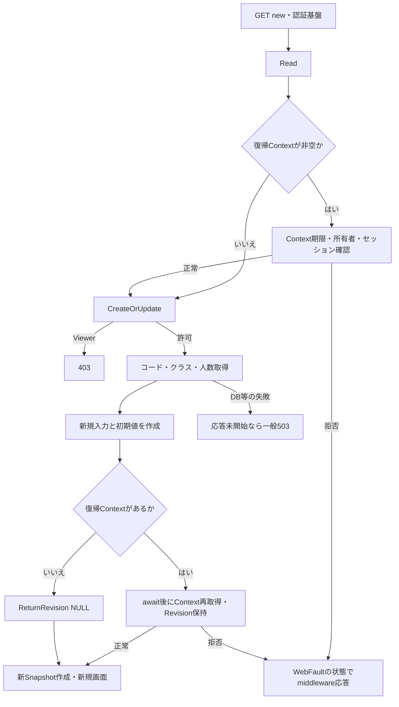

#### SQL・テーブル関連（ER図）

新規表示は学生行をINSERTしない。コード・クラスの候補と人数を参照する。

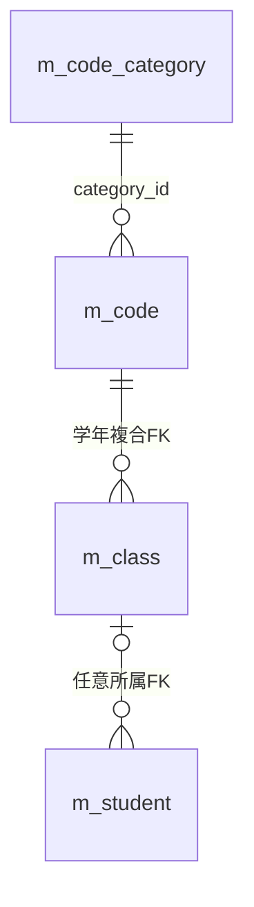

この図はDDLのFKである。候補SQLの学年LEFT JOINと人数集計は、次節の読取操作として区別する。根拠：`sources/database/001_schema.sql:189–191`。

#### DB操作の詳細

LookupAsyncはSNAPSHOT内で二つの結果集合を取得する。コードは `m_code JOIN m_code_category ON category_id` の全件で、分類・値の両方が有効な場合だけIsActiveをtrueとする。順序はcategory_id、display_order、code_valueである。クラスは全m_classを学年m_codeへLEFT JOINし、年度降順、学年表示順、クラス表示順、クラスコード、IDで並べる。人数は同一class_id、非削除、在籍01・02のCOUNTである。パラメータ、件数上限、ページング、SQL上の期間絞込みはない。読取完了後にcommitしてLookupSetを返す。根拠：`sources/Core/SqlServerStudentService.cs:196–216`。

#### 結果・例外時の扱い

正常時は新規画面を返す。コード初期値の不足を専用エラーで拒否する処理や、クラス0件の専用警告は接続されていない。クラス0件では未所属optionだけが残り、01・02の保存はクラス必須検査で拒否される。

設計意図は初期コード存在の確認、不足時の保存不可、クラス0件のW-STU-108である。現行の「空候補を表示し、保存時に検査する」段階との差を保持する。根拠：`sources/Infrastructure/WebStudentCoordinator.cs:17–17`、`sources/Views/Students/Edit.cshtml:12–12`、`sources/Core/StudentNormalizer.cs:154–154`、設計意図：`reference-designs/詳細仕様書/CSharp_ASPNET/02_学生登録画面.md:171–177`。

権限・復帰状態のWebFault、候補DB障害などに局所catchはない。応答未開始ならmiddlewareがWebFaultの状態、その他は503のHTMLエラーを返す。

### EV-REG-002 既存学生の編集・参照表示

#### 処理概要

GET `/students/{id:long}` で非削除の学生を読み、Staff・Administratorは編集、Viewerは参照として表示する。対象不在を新規登録へ切り替えない。

#### 処理手順

1. CoordinatorがRead、復帰Context確認を行う。既存表示ではCreateOrUpdateを呼ばない。
2. GetAsyncがサービスUserを確認する。IDが0以下ならNULLを返し、正のIDは非削除学生を取得する。
3. 取得0件をCoordinatorが404・E-STU-103へ変換する。
4. 学生の保存列、bigint版、更新日時・者からStudentDetailを作る。日付はDateOnlyへ、入学日・終了日はyyyy-MM-dd文字列へ戻す。
5. LookupAsyncで最新候補と人数を取得する。FromがクラスID・期待版をInvariantCultureの10進文字列、誕生日を和暦4入力に戻す。選択クラスが候補にあれば年度・学年も設定する。
6. 復帰Contextをawait後に再取得してRevisionを保持し、新Snapshotを作る。理由・確認TokenはFromで設定されない。
7. ページのCanEditで外側fieldsetを制御し、既存学籍番号をreadonlyにする。

根拠：`sources/Web/Controllers/StudentsController.cs:24–25`、`sources/Infrastructure/WebStudentCoordinator.cs:17–17`、`sources/Core/SqlServerStudentService.cs:172–194`、`sources/Web/Inputs/StudentSaveInput.cs:44–54`、`sources/Views/Students/Edit.cshtml:3–6`。

#### 処理フロー

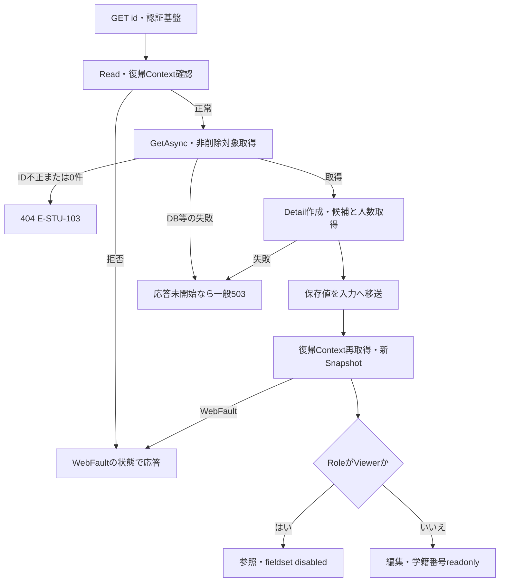

#### SQL・テーブル関連（ER図）

学生本体取得はm_student単独のSELECTであり、その取得自体のER図は省略する。候補取得はEV-REG-001のFK関連を使う。学生とクラスの読取は別の呼出しであり、画面Detailと候補全体を一つの共通SNAPSHOTで取得する実装ではない。

#### DB操作の詳細

`SELECT * FROM dbo.m_student WHERE student_id=@id AND is_deleted=0` を `@id: BigInt` で実行し、最初の1行をStudentDetailへ変換する。IDはPK、学生取得にORDER BY・ページングはない。name_key・kana_key等も保存値辞書へ読むが、利用者が入力する照合キーとしてFromへ移さない。候補はEV-REG-001と同じ二結果集合で取得する。根拠：`sources/Core/SqlServerStudentService.cs:172–216`。

#### 結果・例外時の扱い

未所属の既存学生は年度・学年がNULLとなる。停止・期間外の読込時同値は候補として保持できるが、マスタ不存在まで許可する規則ではない。既存表示・候補取得・復帰Revision取得・Snapshot作成に局所catchはなく、失敗時は共通middlewareへ進む。

更新日時はDetailを日本時間へ変換し、更新者は認証主体の保存値を表示する。保存失敗後に元Detailを使う再表示と、このイベントの最新Detail取得を区別する。

### EV-REG-003 入力補助・候補連動・離脱確認

#### 処理概要

画面内JavaScriptはクラスと年度・学年の対応、未保存変更、送信確認、確認Token解除を扱う。入力補助でDB候補を再取得する接続はない。

#### 処理手順

1. editorフォーム内のinputイベントでdirtyをtrueにし、Input.DuplicateTokenを空文字へ戻す。確認・変更理由もこの対象である。
2. クラス変更時、選択optionにdata-yearがあれば年度・学年をその値へ合わせる。
3. 年度・学年変更時、指定されている上位値と現在クラスのdata属性が一致しなければクラスを空へ戻し、解除通知を表示する。空の上位条件は不一致判定に使わない。
4. フォーム送信時は、押されたボタンのdata-confirm、なければフォームのdata-confirmを使う。取消なら送信を止める。続行ならleavingをtrueにし、押されたボタン以外のbuttonをdisabledにしてaria-busyを付ける。
5. dirtyリンクの離脱時は破棄確認を行い、取消なら遷移を止める。beforeunloadではdirtyかつleavingでない場合に離脱確認を要求する。

根拠：`sources/wwwroot/js/site.js:2–8`、`sources/Views/Students/Edit.cshtml:12–17`。

#### 処理フロー

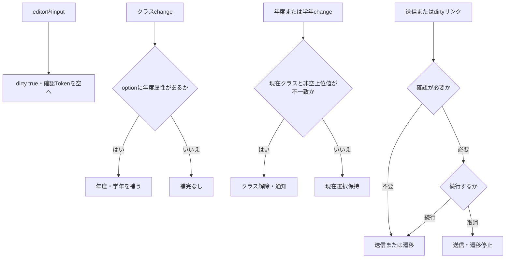

#### SQL・テーブル関連（ER図）

このイベントはブラウザーのDOMとローカル変数だけを変更する。DB呼出しがないためER図は省略する。クラスoptionのdata-year・data-gradeは、直前にサーバーから受け取ったLookupSetをViewが投影した値である。

#### DB操作の詳細

DB操作はない。クラス選択後に人数表示を更新する処理、年度・学年・在籍・日付変更で候補をサーバーから再取得する処理、和暦の即時厳密検査、01・02で終了日をdisabledにする処理は、接続されたsite.jsにない。最終検査は保存時に行う。

#### 結果・例外時の扱い

上位値変更で解除したクラスは、01・02の保存に必要な値を失うため再選択が必要となる。候補全件の表示、参照人数、選択済みクラスを同じ情報として扱わない。

設計意図は候補再取得、適合しない値の解除、在籍に応じた項目制御、和暦・日付の厳密補助である。現行は年度・学年・クラスのDOM連動と保存時検査に対応する。要求連番による旧非同期応答の排除は接続されていない。根拠：設計意図 `reference-designs/詳細仕様書/CSharp_ASPNET/02_学生登録画面.md:260–285,778–787`、現行 `sources/wwwroot/js/site.js:2–8`。

### EV-REG-004 登録・更新

#### 処理概要

新規と更新は共通Save入口を使う。Controllerの保持情報検査、DTOから命令への変換、サービスの正規化、書込ゲート下の最新DB検査を順に行い、同一人物候補を確認する。学生DMLと履歴追記のcommit完了後だけSavedを返す。

#### 処理手順

1. 認証・CSRF・モデルバインドの基盤処理後、ControllerがFormGuardで許可項目、未知キー、通常項目の多重値を確認する。これは必須値・型検査ではない。
2. CreateOrUpdate、Snapshot.Get、CheckReturn、投稿復帰先とOriginal.ReturnContextIdの一致をこの順に検査する。これらは保存の局所try外である。
3. ModelState不正なら422としてサービスを呼ばない。正常なら局所try内でCoordinator.Saveを呼ぶ。
4. Coordinatorが作成更新権限・復帰状態を再確認する。ToRequestはクラスIDを任意正数longへ、更新の期待版を必須正数longへ変換する。新規で非空期待版は400とする。復帰先とSnapshotIdはSaveRequestに渡さない。
5. SaveAsyncが受付UUID、User、UTC now、日本時間dayを取得する。ViewerはForbiddenで返す。続いて19入力正規化、任意理由60スカラー、対象ID・期待版の正数と設定有無一致、年度1900～9998、任意学年2桁を検査する。
6. 接続を開き、SNAPSHOT使用可能状態を確認してReadCommittedを開始する。Openとトランザクション開始は保存try外である。
7. 保存try内で `SET XACT_ABORT ON` とトランザクション所有のExclusive applockを取得する。待機5000ms、資源名は `test-project1:student-write`。負の戻り値はSQL THROW 51001となる。
8. 更新だけ非削除学生を読み直す。不在はNotFound、版不一致はConflict、学籍番号変更はValidationFailed。保存済み03・04から別区分への訂正は管理者を要求し、理由NULLも拒否する。同一区分の住所等の訂正にはこの特別権限分岐を適用しない。
9. 最新コードとクラスを再検査する。コードは同値保持でも存在を要求する。クラスは存在と指定補助の一致、増席時の期間・利用可否・定員、終了区分で必要な期間重なりを検査する。
10. 正規化全保存値を最新DB値と比較する。DateOnlyとDB DateTimeは日付で比較する。変更0列なら明示rollbackしてNoChangeを返し、番号一意・同一人物候補検査には進まない。
11. 変更ありでは版long.MaxValueをConflictで拒否し、削除済みを含む全学生に対して自分以外の学籍番号完全一致を確認する。
12. 同生年月日かつname_keyまたはkana_key一致の全候補を取得する。確認Token照合・理由検査はEV-REG-005に従う。確認が必要ならrollbackし、確認情報と全件数・最大20候補を返す。
13. 確認不要または確認済みなら新規INSERT、または学籍番号を除く正規化全列のUPDATEを行う。更新WHEREは対象ID・期待版・非削除。OUTPUT INTOから学生IDを取得し、値なしはDBConcurrencyExceptionとする。
14. 同一トランザクションで操作履歴を追記する。commit直前にcommitAttempted、完了後にcompletedを設定する。供給Tokenを無効化し、Saved、学生ID、新版を返す。
15. ControllerはSavedだけ303へ進める。その他はErrorsをModelStateへ加え、結果HTTP状態と結果Tokenを設定し、投稿入力・元Detail・元Snapshot・元ReturnRevision・再取得候補で画面を返す。局所WebFaultはその状態を設定して再表示するが、SaveResultがないため結果Token代入は行わない。

根拠：`sources/Web/Controllers/StudentsController.cs:26–33,41–41`、`sources/Infrastructure/WebStudentCoordinator.cs:18–18`、`sources/Web/Inputs/StudentSaveInput.cs:34–43,57–60`、`sources/Core/SqlServerStudentService.cs:227–324,344–390`。

#### 処理フロー

入口の拒否は次の順序で保持する。

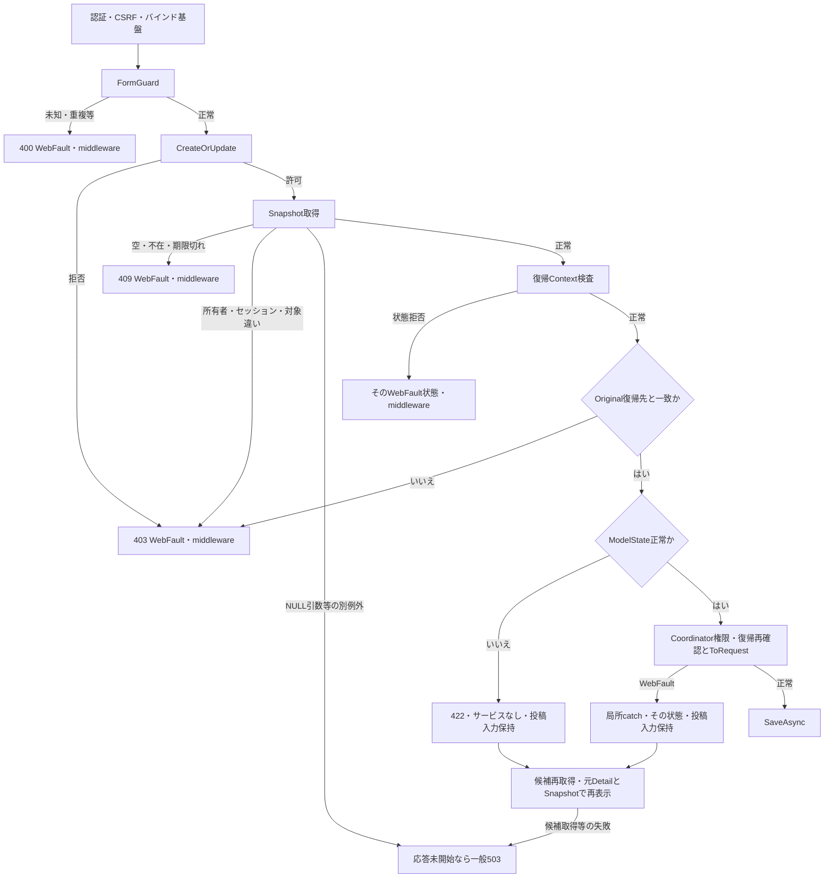

サービス内では、結果ごとにID・版を分ける。

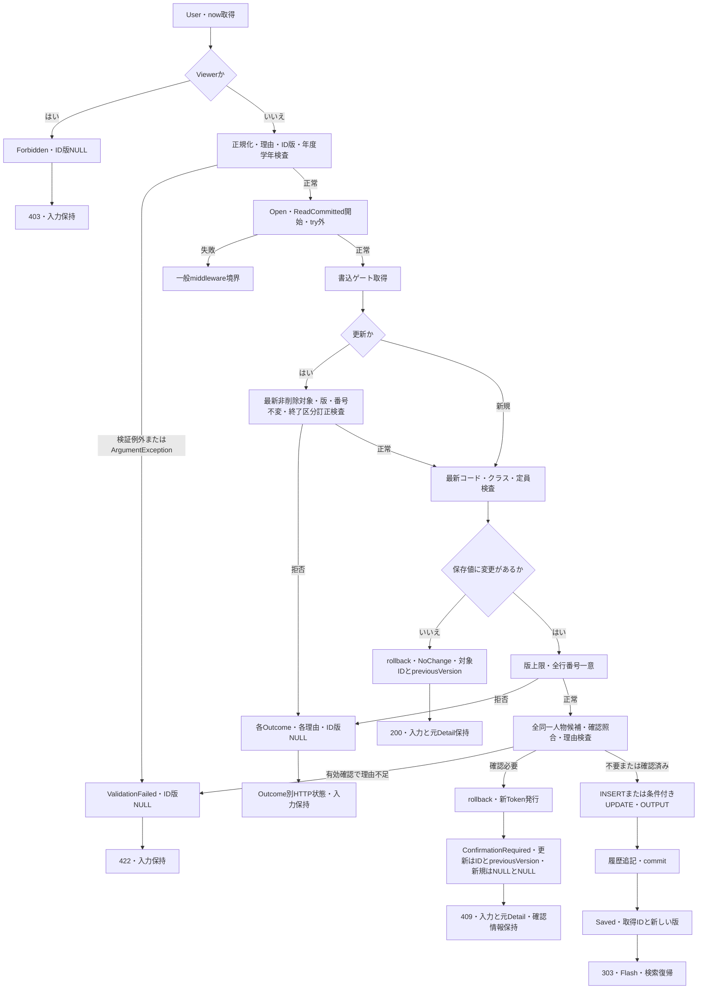

保存tryの例外枝は、上図のゲート取得以後の実行に対して次の順序で適用する。合流後のUnknown規則を先行catchへ適用しない。

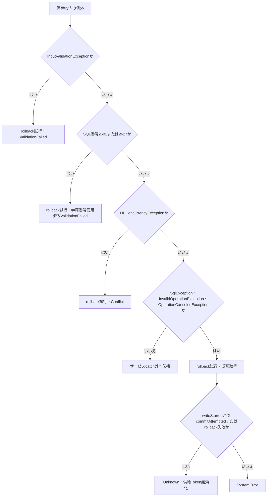

#### SQL・テーブル関連（ER図）

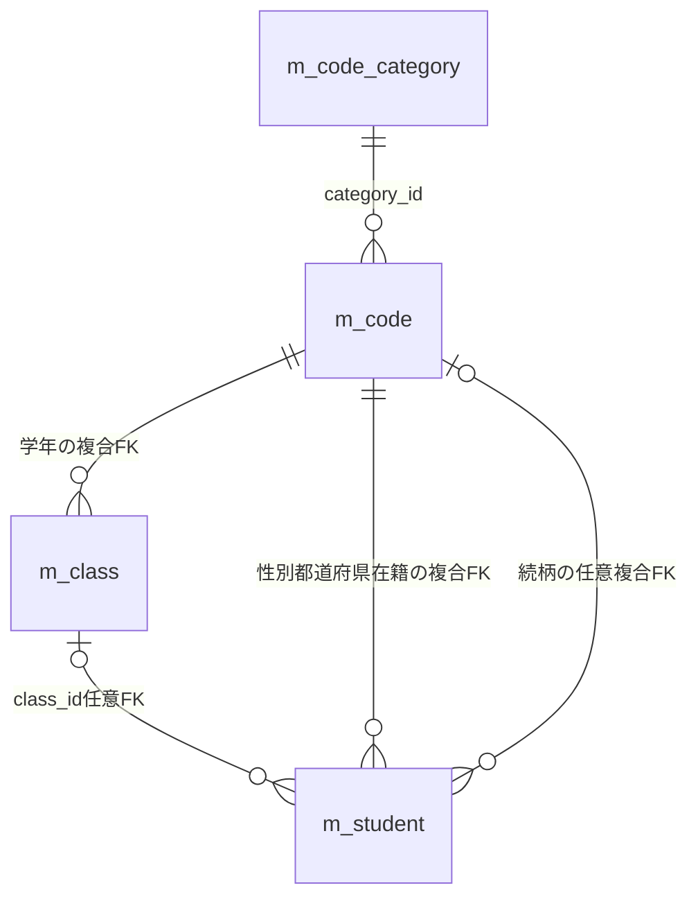

`t_operation_log.target_key` に学生へのFKは宣言されていない。保存処理の依存は次の追記関係で表す。

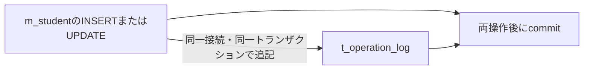

根拠：`sources/database/001_schema.sql:137–154,189–199`、`sources/Core/SqlServerStudentService.cs:306–315,385–390`。

#### DB操作の詳細

| 操作 | SQL条件・結果・パラメータ |
| --- | --- |
| 更新対象再取得 | m_studentを `student_id=@id AND is_deleted=0` でSELECT *。`@id BigInt`。0件はNotFound、取得版と期待版の不一致はConflict |
| コード再検査 | m_codeとm_code_categoryをcategory_idでINNER JOINし、`c.category_id=@category AND c.code_value=@value`。`@category VarChar(24)`、`@value VarChar(10)`。分類・値の利用状態とvalid_from/toを取得。任意続柄NULLは対象外 |
| クラス再検査 | m_classを `class_id=@id`、`@id BigInt` で取得。年度・学年・期間・利用状態・定員を読む。不存在と補助不一致を別エラーにする |
| 増席人数 | `class_id=@class AND is_deleted=0 AND enrollment_status_code IN ('01','02') AND (@id IS NULL OR student_id<>@id)` のCOUNT_BIG。両IDはBigInt。人数+1が非NULL定員を超えると拒否 |
| 学籍番号一意 | `student_no=@no AND (@id IS NULL OR student_id<>@id)` のCOUNT_BIG。`@no VarChar(15)`、`@id BigInt`。is_deleted条件なし |
| 同一人物候補 | RowSelectに `s.is_deleted=0`、自分除外、`s.birth_date=@birth`、氏名キーまたはカナキー一致を追加。student_id昇順、全件。`@id BigInt`、`@birth Date`、`@name NVarChar(320)`、`@kana NVarChar(36)` |
| 新規INSERT | 正規化22列、必須3分類、未削除、作成更新時点・者、版1を設定。student_idはIDENTITY。OUTPUT INSERTED.student_id INTO表変数からSELECTする |
| 通常UPDATE | 正規化22列からstudent_noを除く21列をすべてSETし、updated_at/byとrow_version+1を設定。WHEREは `student_id=@id AND row_version=@version AND is_deleted=0`。作成情報・必須3分類・削除情報は維持 |
| 監査INSERT | target_table固定m_student、対象ID文字列、CREATE/UPDATE、前後版、変更列名JSON、実行者、UTC時点、受付UUID、理由、候補件数が1以上かを追記 |

各保存列のパラメータ型・サイズは項目一覧に記載する。管理値は `@now DateTimeOffset`、`@actor NVarChar(128)`、更新比較は `@version BigInt`。NULLはDBNull.Value、DateOnlyは午前0時のDateTimeへ変換し、Dateパラメータで渡す。通常コマンドは30秒設定で、DB実行・読取・commitには呼出元CancellationTokenを渡す。Open時の診断コマンドは共通Commandを使わないため、同じ30秒設定とは断定しない。根拠：`sources/Core/SqlServerStudentService.cs:53–72,92–102,247–315,347–390`。

新規履歴は前版NULL・後版1、正規化書込列とシステム設定列を記録する。更新履歴は実際に値が変わった正規化列とupdated_at/by・row_versionを記録する。UPDATEのSET列が全列であることと、監査の変更列が実変更列だけであることを区別する。履歴は個人情報値の前後コピーを持たない。監査パラメータは `@id VarChar(35)`、`@op VarChar(11)`、`@before/@after BigInt`、`@changed NVarChar(max)`、`@actor NVarChar(128)`、`@now DateTimeOffset`、`@request UniqueIdentifier`、`@reason NVarChar(120)`、`@confirmed Bit`。根拠：`sources/Core/SqlServerStudentService.cs:306–307,385–390`。

#### 結果・例外時の扱い

| サービス結果・境界 | 返却ID・版 | Controllerの状態・保持 |
| --- | --- | --- |
| Saved | OUTPUTのID、新規1またはpreviousVersion+1 | 303。入力保持画面へ戻さずFlash・検索復帰へ進む |
| NoChange | 対象ID、取得済みpreviousVersion | 200、「変更はありません。」。投稿Input、元Detail・Snapshot・期待版を保持 |
| ConfirmationRequired | 新規NULL/NULL、更新は対象ID/previousVersion | 409。結果Token、全件数・最大20候補。投稿Inputと元Detailを保持 |
| ValidationFailed | NULL/NULL | 422。項目エラーをsummaryへ追加 |
| Forbidden | NULL/NULL | 403。権限・終了区分訂正拒否 |
| NotFound | NULL/NULL | 404。保存ゲート下の対象不在 |
| Conflict | NULL/NULL | 409。版不一致、版上限、DML競合等 |
| SystemError・Unknown | NULL/NULL | 503。サービスから返る理由を表示。Unknownは再保存前の検索確認を案内 |
| ModelState不正 | SaveResultなし | 422、サービス未呼出し。結果Token代入なし |
| Coordinator・ToRequestの局所WebFault | SaveResultなし | その状態とエラーで再表示。候補再取得が後続する |

サービス事前検証のInputValidationExceptionは元Errors、ArgumentExceptionはField=SaveのArgumentErrorとして返す。User取得、Open、トランザクション開始はこの結果化の範囲外である。

保存tryの先行三catchはrollbackを試み、それぞれValidationFailed、SQL2601/2627の学籍番号使用済み、Conflictを返す。SQL一意違反の発生元テーブルを限定する条件はなく、番号による分類である。この三枝はrollback失敗を理由にUnknownへ分類し直さない。最後の対象catchに到達した場合だけ、writeStartedかつcommitAttemptedまたはrollback失敗をUnknownとする。writeStartedは学生DMLの直前に設定する。RollbackヘルパーはCancellationToken.Noneを使い、SqlException・InvalidOperationExceptionをfalseへ変換する。根拠：`sources/Core/SqlServerStudentService.cs:238–243,302–329`。

早期拒否returnには明示rollbackがない枝もあり、await usingの終了へ進む。変更なし・確認待ちの明示rollback失敗は保存tryの例外経路へ入る。学生DMLのOUTPUTなしを検出した後の存在再読取はなく、DBConcurrencyExceptionとしてConflictにする。設計意図の「DML0件後の存在再確認」とは異なる。根拠：`sources/Core/SqlServerStudentService.cs:250–266,288–303,318–318`、設計意図：`reference-designs/詳細仕様書/CSharp_ASPNET/02_学生登録画面.md:600–603,797–799`。

結果を受けた後のLookupAsyncやView、資源終了の失敗は、サービス結果のHTTP応答到達を別途妨げ得る。保存結果ID・版がNULLの枝でも、画面StudentIdをNULLへ変更したり元Detailを消したりしない。

### EV-REG-005 同一人物候補の確認・続行・取消

#### 処理概要

候補は同一人物と断定する情報ではなく、別人として正当な保存を続けるための確認対象である。画面は全件数と最大20件だけを表示し、続行は同じ保存POSTを最初から実行する。

#### 処理手順

1. EV-REG-004で全候補をstudent_id昇順に取得する。住所・電話・メールは確認tableへ表示しない。
2. 正規化保存値の内容ハッシュと、全候補のID・RowVersionのハッシュをSHA-256で生成する。内容はColumns順の業務保存値をJSON化し、name_key、kana_key、relationship_categoryを除く。理由、年度、学年は含めない。
3. 供給Tokenが非NULLなら、Web確認情報を取得し、主体・セッション・対象ID・期待版・期限・両ハッシュを照合する。最後にBusyを0から1へ取得できた場合だけconfirmationValidとする。
4. 有効確認で理由NULLならE-STU-107を返す。候補1件以上、または供給Token非NULLで、有効確認が得られなければ学生保存トランザクションをrollbackする。
5. Web確認情報へ新Tokenを発行し、10分期限と全候補照合情報を保持する。ConfirmationRequiredとして全件数、最大20候補、枝別ID・版を返す。
6. 画面の確認取消はhidden Tokenを空へ戻し、確認sectionを除去する。サーバーへの削除呼出しは行わない。
7. 続行は現在のInputとToken・理由を同じ保存POSTへ送る。入力の正規化、最新対象・版・コード・クラス・候補取得を再実行してから照合する。
8. commit成功または最後の対象catchでUnknownとなった場合は供給Tokenを削除する。Busyを取得した未完了処理はUnknown以外でfinallyからBusyを0へ戻す。

根拠：`sources/Core/SqlServerStudentService.cs:19–29,224–225,269–290,313–335`、`sources/Views/Students/Edit.cshtml:14–14`、`sources/wwwroot/js/site.js:3–6`。

#### 処理フロー

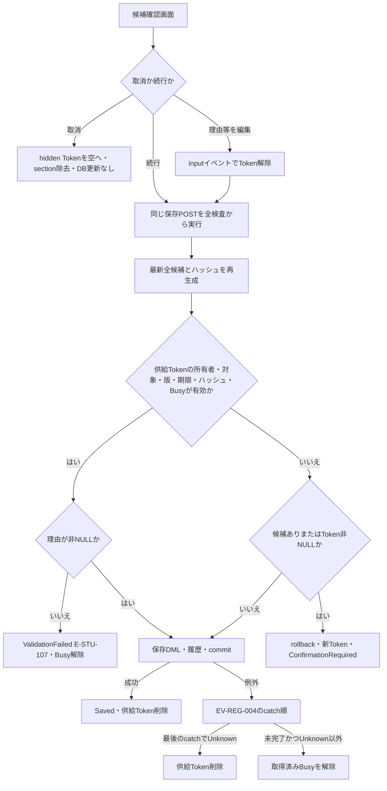

#### SQL・テーブル関連（ER図）

候補取得はm_studentからm_class、クラス学年m_code、学生在籍m_code、都道府県m_codeへのLEFT JOINである。DDLのFKはEV-REG-004の関連図、候補表示の結合は次の読取依存である。

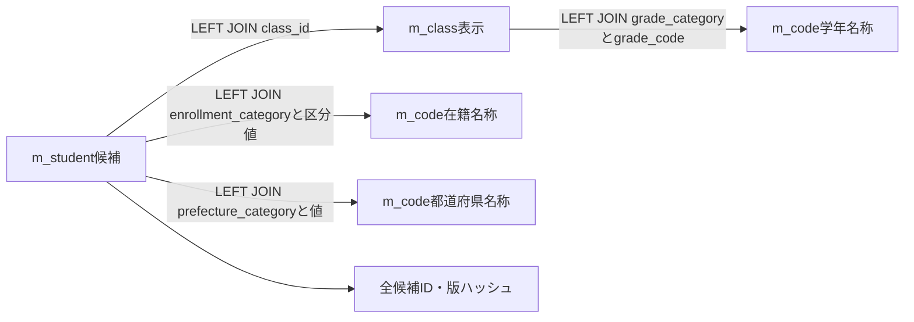

Web確認情報の保持先はメモリであり、Web経路でt_confirmationへ発行・消費する図にはしない。

#### DB操作の詳細

候補SQLは非削除、自分除外、同生年月日、氏名キーまたはカナキー完全一致をすべて適用する。TOPとページングはなく、全件をID順に読み、結果表示だけTake(20)する。クラス名等のLEFT JOIN結果NULLをマスタ保存列のNULL可否へ逆推定しない。

確認待ちでは保存トランザクションをrollbackしてからメモリ確認情報を発行するため、利用者の判断待ちに書込ゲートを保持しない。Token発行は32byte乱数の64桁小文字hex、期限はサービス入口now+10分である。照合は `Expires > now` で、ゲート・DB待機後の現在時刻を取り直さない。根拠：`sources/Core/SqlServerStudentService.cs:269–290,330–335`。

非Web設定の別分岐は、GUIDセッション・Tokenを用い、t_confirmationをUPDLOCKで読み、主体・セッション・対象と期待版のNULL組合せ・期限・consumed=0・両ハッシュを確認する。発行はrollback後の別ReadCommittedでINSERTし、確認済み保存は学生と同じトランザクションでconsumed=1を更新して1件を要求する。この分岐はWebの登録先ではない。根拠：`sources/Infrastructure/WebHostSetup.cs:19–19`、`sources/Core/SqlServerStudentService.cs:279–284,308–311,337–342`。

#### 結果・例外時の扱い

ConfirmationRequiredのErrorsは空で、現行Viewは確認見出し・件数・候補を表示する。参考設計の再確認W-STU-102を専用表示する接続はない。取消ボタンにautofocusがあるが、実利用者の判断結果を証明する情報ではない。

理由入力もTokenを解除するため、確認画面で理由を新たに入力した直後の続行は、候補が残っていれば新Tokenの確認待ちに戻り得る。再発行画面で入力内容を変えず続行した場合に、有効Tokenと非NULL理由で保存へ進む。空文字Tokenがサービスへ届けば非NULLの供給値として再確認条件へ入るが、HTTP空文字からNULLへの変換は受信基盤の境界として区別する。

ControllerはSaveResultがある場合に限り結果TokenをInputへ代入し、`Input.DuplicateToken` のModelStateを除去する。通常失敗結果ではTokenはNULLとなる。確認取消や保存成功はSnapshotを消費しない。根拠：`sources/Web/Controllers/StudentsController.cs:30–33`、`sources/Infrastructure/EditorSnapshotStore.cs:8–11`、設計意図：`reference-designs/詳細仕様書/CSharp_ASPNET/02_学生登録画面.md:374–390`。

### EV-REG-006 論理削除

#### 処理概要

管理者が独立した削除フォームから、対象、読込時期待版、理由、Confirmedを送る。編集中の学生業務値は保存せず、削除属性と更新管理情報を履歴と一括確定する。

#### 処理手順

1. ControllerはFormGuard、Read、Snapshot.Get、投稿復帰先とOriginalの一致をこの順に検査する。保存のCreateOrUpdate・ModelState分岐とは異なる。
2. CoordinatorはAdministrator、CheckReturn、Confirmed、期待版Requiredの順で確認する。Confirmed=falseは422・REG-026、期待版不正も422のWebFaultである。
3. DeleteAsyncはUser・受付UUID・nowを取得し、管理者以外をForbiddenで返す。理由を必須複数行Text、raw・正規化後60スカラー以内で検査する。ID・版は正数、版long.MaxValueも拒否する。
4. Open、ReadCommitted開始後、削除try内で保存用ゲートを取得する。
5. 非削除対象の版を読み直す。0件はNotFound、期待版不一致はConflictで返す。
6. ID・期待版・非削除のWHEREで削除管理7列をUPDATEする。影響件数が1以外ならDBConcurrencyExceptionを投げる。
7. DELETE履歴を追記し、commit完了でSaved、対象ID、版+1を返す。
8. ControllerはSavedだけ303へ進む。他の結果はErrorsと結果HTTP状態を設定した後、Loadを呼び、最新学生・候補・復帰Revision・新Snapshotで再表示する。

根拠：`sources/Views/Students/Edit.cshtml:17–17`、`sources/Web/Controllers/StudentsController.cs:37–38`、`sources/Infrastructure/WebStudentCoordinator.cs:19–19`、`sources/Core/SqlServerStudentService.cs:392–416`。

#### 処理フロー

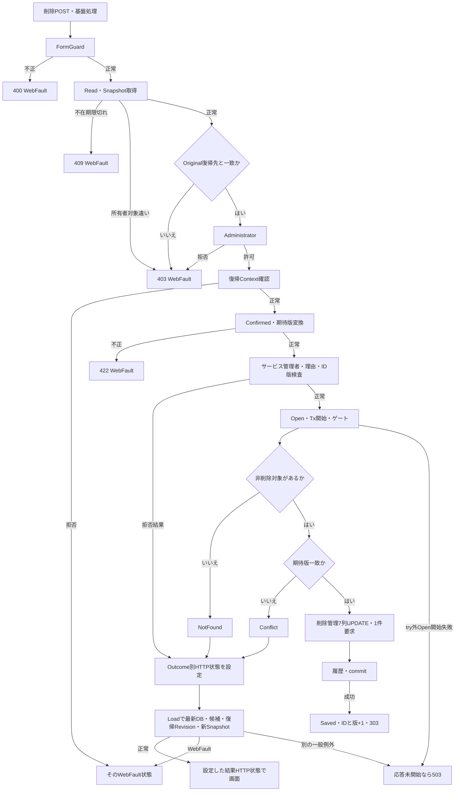

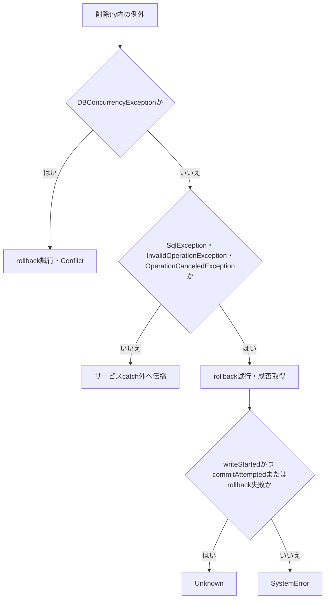

#### SQL・テーブル関連（ER図）

学生の既存FKはEV-REG-004の図と同じで、論理削除で所属FKや業務値を消去しない。削除処理の直接操作はm_studentとt_operation_logである。

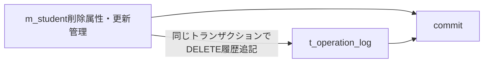

この追記線はFKではない。人数への影響は非削除条件により集計から外れることで生じる。

#### DB操作の詳細

再確認SELECTは `SELECT row_version FROM dbo.m_student WHERE student_id=@id AND is_deleted=0`、`@id BigInt` である。UPDATEは `is_deleted=1`、deleted_at、deleted_by、delete_reason、updated_at、updated_by、row_version+1だけを設定する。WHEREは `student_id=@id AND row_version=@version AND is_deleted=0`。パラメータはID・版BigInt、時点DateTimeOffset、実行者NVarChar(128)、理由NVarChar(120)である。

履歴は操作DELETE、前版version、後版version+1、上記7列名、理由、duplicate_confirmed=falseを保存する。学生UPDATEと履歴INSERTが終わってからcommitする。class_id、氏名、住所、連絡先等は変更しない。根拠：`sources/Core/SqlServerStudentService.cs:404–414`。

#### 結果・例外時の扱い

削除理由検証はInputValidationExceptionだけを捕捉する。不正UnicodeのArgumentExceptionはこのcatchの対象外で、Open前に伝播する。ControllerにもModelState.IsValid分岐・局所WebFault catchはない。

DML件数不一致のDBConcurrencyExceptionは先行catchでConflictとなる。後続の対象catchだけがwriteStarted、commitAttempted、rollback成否でSystemErrorとUnknownを分ける。件数不一致後の存在再読取は行わない。

サービスが失敗結果を返しても、後続Loadの対象不在なら404、復帰状態の期限切れなら409、DB等の別失敗なら一般503へ変わり得る。正常にLoadできた場合も、編集中の業務入力を保持する保存失敗とは異なり最新DB値へ戻る。削除Reasonはページへ移送されず、Viewの通常textareaに再表示値を設定する実装はない。根拠：`sources/Web/Controllers/StudentsController.cs:25–25,37–37`、`sources/Views/Students/Edit.cshtml:17–17`、`sources/Core/SqlServerStudentService.cs:396–416`。

### EV-REG-007 入力クリア・編集取消

#### 処理概要

Resetは読込時Originalへ戻す操作であり、学生DBの最新再取得ではない。新規の入力クリアも、初期値を保持したOriginalへの復元である。

#### 処理手順

1. ブラウザーのフォーム確認で取消した場合はPOSTしない。
2. POST `/students/reset` のControllerがFormGuard、Readを行う。
3. StudentId文字列をIdParser.Optionalで対象IDへ変換する。NULL・空文字は新規、非空は正のlongを要求する。
4. Snapshotの存在・期限・所有者・セッション・対象を確認し、ModelStateをClearする。
5. OriginalをJSON複製してInputへ戻し、Detail、SnapshotId、ReturnRevisionを元の値で保持する。
6. 候補と人数だけ再取得し、「入力を読込時の値へ戻しました。」を表示する。

根拠：`sources/Web/Controllers/StudentsController.cs:35–35`、`sources/Infrastructure/EditorSnapshotStore.cs:10–11`、`sources/Views/Students/Edit.cshtml:16–16`、`sources/wwwroot/js/site.js:4–4`。

#### 処理フロー

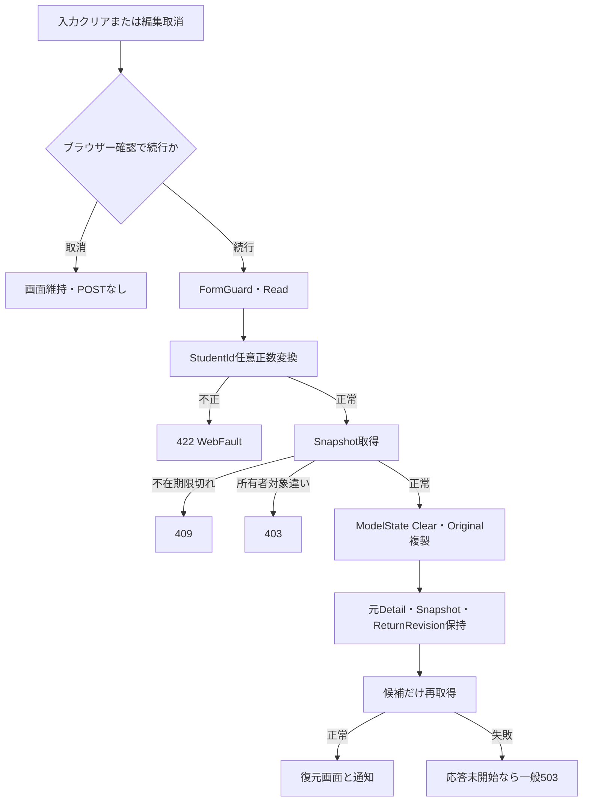

#### SQL・テーブル関連（ER図）

入力復元先はEditorSnapshotStoreのメモリである。学生行の再読込・更新は行わない。候補再取得だけEV-REG-001のマスタ・人数関連を使うため、ここではそのER図を重複掲載しない。

#### DB操作の詳細

OriginalとDetailは元Snapshotから取得し、学生GetAsyncは呼ばない。LookupAsyncの二結果集合と人数集計だけを再実行する。Snapshot期限は延長せず、新Snapshotも作らない。Resetでは復帰ContextのCheckReturnを呼ばないため、復帰状態が有効であることをこの操作だけで保証しない。

#### 結果・例外時の扱い

入力と期待版を同じ読込時点へ戻す。DBで他者が更新していても、Reset後の期待版は古いままであり、次の保存の版検査で扱う。復元した旧クラス・旧コードと新しい候補の組合せも保存時に再検査する。

SnapshotIdの空・不在・期限切れは409、存在して所有者等が違えば403である。NULL引数は辞書呼出しの境界であり、空キーと同じ独自409としない。根拠：`sources/Infrastructure/EditorSnapshotStore.cs:10–10`。

### EV-REG-008 最新情報を再読込

#### 処理概要

既存画面の再読込リンクは対象GETを再実行し、最新業務値と版を一緒に取得して新Snapshotへ置き換える。

#### 処理手順

1. dirtyの場合だけ、リンクの「編集内容を破棄して最新情報を読み込みますか。」で離脱確認する。取消なら遷移しない。
2. 対象IDとReturnContextIdを指定した既存GETへ進む。
3. EV-REG-002のRead、復帰状態、対象取得、候補取得を実行する。
4. 最新DetailからInputと期待版を作り、現在の復帰Revisionを取得し、新Snapshotを作る。理由・確認Tokenは初期化される。

根拠：`sources/Views/Students/Edit.cshtml:16–16`、`sources/wwwroot/js/site.js:5–5`、`sources/Web/Controllers/StudentsController.cs:24–25`、`sources/Web/Inputs/StudentSaveInput.cs:44–54`。

#### 処理フロー

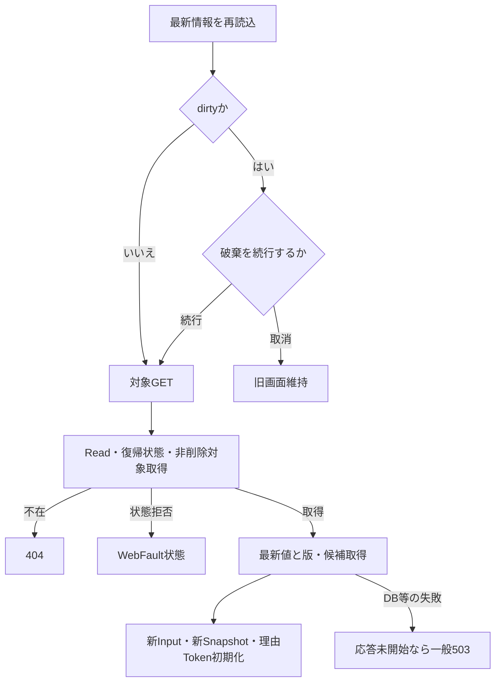

#### SQL・テーブル関連（ER図）

学生本体取得はm_student単独、候補はEV-REG-001の関連である。再読込は同じIDのSELECTであり、版だけを更新するDMLやSnapshotの部分更新ではない。

#### DB操作の詳細

EV-REG-002と同じ非削除学生SELECTとLookupAsyncを行う。画面入力へ戻す保存列と期待版は新Detailから同時に作る。旧SnapshotのIDを再利用するのではなくCreateで新しい保持情報を作る。

#### 結果・例外時の扱い

再読込が正常なら未保存入力を破棄した最新画面となる。対象が削除済みなら404で、古い入力を最新対象として保存しない。復帰Contextの期限切れやDB障害は既存表示イベントと同じ応答境界である。

設計意図も取消と最新再読込を別操作とし、競合時に期待版だけを最新へ差し替えない。根拠：`reference-designs/詳細仕様書/CSharp_ASPNET/02_学生登録画面.md:471–477`。

### EV-REG-009 検索復帰・保存後通知

#### 処理概要

検索へ戻るリンクとSaved後の303は、検索Contextへ復帰する入口である。登録画面の未保存値は検索条件へ移さず、Context.Appliedに保持した実行済み条件を使う。

#### 処理手順

1. リンク復帰ではdirtyに応じて破棄確認を行う。Saved後はReturnAfterSaveへ、投稿復帰ContextとSnapshot.ReturnRevision、保存または削除の通知を渡す。
2. Savedで復帰ContextがNULL・空なら、新しい検索Contextを作り、そのIDと初期Revisionを使用する。既存ContextならSnapshotのRevisionを保持する。
3. Flash.Putで主体・セッション・Contextに通知を10分保持し、303と `/students?contextId=…&contextRevision=…` のLocationを返す。
4. 検索GETがReadを行い、非空Contextを取得してResumeへ渡す。登録からの復帰はタブ引数を渡さない。
5. Context.Useは最初のGet後にGateを待ち、待機後のGetで所有者・セッション・期限を再確認する。文字列Revisionの一致とlong版上限を確認する。
6. Appliedなしなら未検索を返しRevisionを増やさない。AppliedありならSearchAsyncで再検索し、LastResultを更新してRevisionを増やす。正常終了で期限を30分延長する。
7. Flash.Takeで通知を一度だけ取り出し、検索用候補を取得して検索画面を返す。

根拠：`sources/Web/Controllers/StudentsController.cs:8–11,31–38`、`sources/Infrastructure/SearchContextStore.cs:9–15`、`sources/Infrastructure/WebStudentCoordinator.cs:14–14`、`sources/Infrastructure/FlashMessageStore.cs:6–9`。

#### 処理フロー

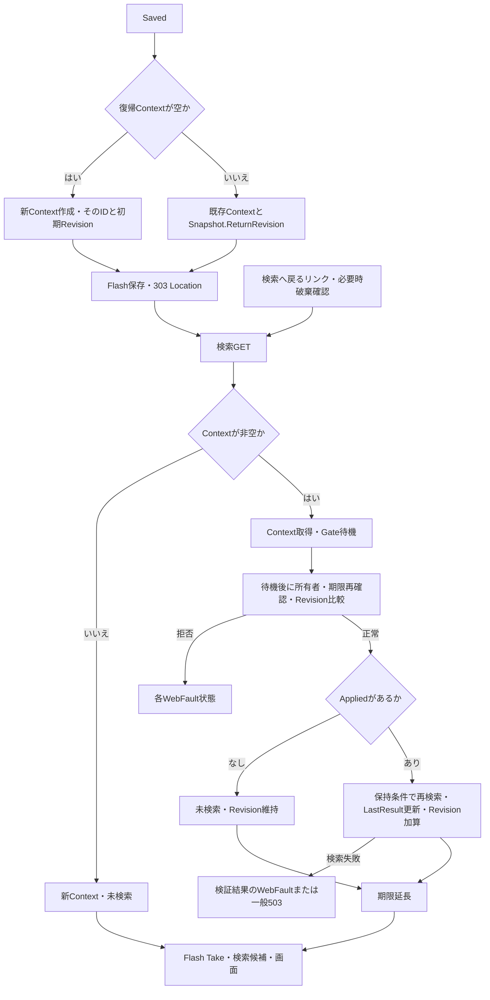

#### SQL・テーブル関連（ER図）

検索再実行はm_studentとm_class、学年・在籍・都道府県m_codeへの読取JOINを使う。FKはEV-REG-004の図、RowSelectのLEFT JOINはEV-REG-005の関連図に対応する。Context、Gate、Flashはメモリ保持であり、t_runtime_stateへの読書きは接続されていない。

#### DB操作の詳細

Appliedなしでは学生検索を実行しない。Appliedありでは非削除条件を基本に、番号前方一致、氏名・カナキー部分一致、年度・学年・クラス、未所属、都道府県、本人または緊急電話完全一致、入学日両端包含、在籍INを指定値に応じて追加する。LIKEは `!` によるエスケープを行う。

主な検索パラメータは番号VarChar(31)、氏名キーNVarChar(642)、カナキーNVarChar(74)、年度SmallInt、学年・都道府県・在籍VarChar(2)、クラスBigInt、電話VarChar(16)、日付Dateである。件数は同じSNAPSHOT内のTOP(10001)に対するCOUNT_BIGで確認し、10000超なら一覧を返さない。通常は許可済みの番号・氏名キー・入学日・更新日時の並び順とID昇順副順序、Intのoffset/sizeによるOFFSET/FETCHで20・50・100件を取得する。根拠：`sources/Core/SqlServerStudentService.cs:103–171`。

検索用LookupAsync(false)の人数0は集計省略値であり、実測0人ではない。登録画面のLookupAsync(true)の参考人数と区別する。

#### 結果・例外時の扱い

検索出力はunsearched、tooMany、empty、foundに分かれる。未検索と上限超過では表示totalCountはNULL、通常0件は0、結果ありは実件数である。各枝を固定0件へまとめない。根拠：`sources/Infrastructure/WebStudentCoordinator.cs:21–21`。

検索Contextの期限・所有者・版不一致はWebFaultで拒否する。再検索の入力検証結果はEnsureSearchでWebFaultに変換し、DB等の一般例外はmiddlewareへ進む。FlashはResume後にTakeされ、Take後の候補取得・View失敗でも取り出した通知は戻されない。

保存・削除commit後のContext作成、Flash、303、検索Resumeの失敗は、保存済みDBのrollbackではない。検索状態が他操作で更新されていれば、Snapshotに保持した旧Revisionでの復帰は拒否され得る。根拠：`sources/Web/Controllers/StudentsController.cs:8–11,38–38`、`sources/Infrastructure/SearchContextStore.cs:14–14`。

## 項目移送仕様

| 移送ID | 入出力方向・契機 | 入力元 | 中間値・変換 | 出力先・保持 | 失敗・枝別の扱い | 根拠 |
| --- | --- | --- | --- | --- | --- | --- |
| MAP-BUSINESS | 画面→保存POST→業務命令 | Input接頭辞の19業務入力 | StudentSaveInputからStudentDraft。同名プロパティを移し、ClassIdだけ文字列→long?。正規化成功後NormalizedStudent.Values22列 | 学生19対応値、氏名・カナキー、続柄分類。raw Inputは再表示用に別保持 | 正規化不正を未入力・0へ置換しない。ModelState不正は命令未生成 | `sources/Web/Inputs/StudentSaveInput.cs:34–42`、`sources/Core/StudentNormalizer.cs:119–159` |
| MAP-BIRTH | 和暦4入力→内部日付→再表示 | BirthDateInputの4string | オブジェクトNULLだけToRequestでnew()補完。ParseでDateOnly、DBからはToInput | birth_date Date。元号は別保存しない。既存は年数値文字列・月日2桁 | 内部文字列NULLは補完しない。通常日付例外とNullReferenceExceptionを分ける | `sources/Web/Inputs/StudentSaveInput.cs:36–36,48–48`、`sources/Core/JapaneseDateService.cs:17–50` |
| MAP-NAME | 氏名・カナ→保存・照合 | StudentName、StudentNameKana | 氏名はTrim原表記とNameKeyを分離。カナは正規化値と空白除去キーを分離 | 表示保存列と検索・候補用キー列 | 原表記を照合キーへ置換しない。キーは受信せず保存側生成 | `sources/Core/StudentNormalizer.cs:66–85,125–126,144–145`、`sources/Core/SqlServerStudentService.cs:140–141,269–271` |
| MAP-CONTACT | 連絡入力→正規化→保存 | 本人電話、メール、緊急氏名・続柄・電話 | 電話・メール等の空をNULL化、続柄分類を算定。連絡先1件以上、緊急3入力一式を検査 | 各独立保存列と続柄分類 | 緊急一式全消去は4列同時NULL。本人電話と緊急電話は別保存列だが検索はOR | `sources/Core/StudentNormalizer.cs:87–117,139–158`、`sources/Core/SqlServerStudentService.cs:148–148` |
| MAP-CLASS | 選択補助→保存規則 | 年度int?、学年string?、クラスID文字列 | 年度範囲、学年2桁、クラス正数。DBクラスの年度・学年と指定値だけ比較 | 学生にはclass_idだけ保存。年度・学年は命令補助 | クラスなしの年度・学年単独存在検査なし。人数は入力しない | `sources/Web/Inputs/StudentSaveInput.cs:28–42`、`sources/Core/SqlServerStudentService.cs:235–237,363–380` |
| MAP-LOAD | DB→読込Detail→画面 | 非削除学生の保存列、版、更新時点・者 | DateTime→DateOnly、日付→ISO、ID版→10進文字列、クラス候補から補助取得 | Input、Detail、Original複製、Snapshot、ReturnRevision | 0件は404。既存未所属は補助NULL。理由Tokenは新規設定しない | `sources/Core/SqlServerStudentService.cs:172–194`、`sources/Web/Inputs/StudentSaveInput.cs:44–54`、`sources/Web/Controllers/StudentsController.cs:25–25` |
| MAP-REASON | 理由→関連保存 | OperationReason、削除Reason | 複数行Text60。保存理由は任意後条件、削除理由は必須 | 保存は履歴理由。削除はdelete_reasonと履歴理由 | 理由だけの変更は学生変更判定に含まれない。削除失敗後にReasonをページへ明示移送しない | `sources/Core/SqlServerStudentService.cs:234–234,261–262,385–397,409–413`、`sources/Web/Controllers/StudentsController.cs:37–37` |
| MAP-RESULT | サービス→保存再表示 | SaveResultと投稿Input、元Snapshot | Outcome→HTTP状態。結果TokenだけInputへ代入しModelState当該値を除去 | StudentIdはルート、Detail・ReturnRevisionは元Snapshot、候補は再取得 | NoChange・確認待ちの取得ID版を保持。拒否ResultのNULLを画面対象へ適用しない | `sources/Web/Controllers/StudentsController.cs:30–33`、`sources/Infrastructure/WebPresentation.cs:23–23` |
| MAP-RESET | メモリ→取消画面 | Snapshot.Original | JSON複製、ModelState Clear | 読込時Input・期待版、元Detail・Snapshot・Revision、新候補 | 学生最新値を取得しない。期限延長なし | `sources/Web/Controllers/StudentsController.cs:35–35`、`sources/Infrastructure/EditorSnapshotStore.cs:10–11` |
| MAP-CONFIRM | 全候補・保存値→確認→保存再送 | 全候補ID版、正規化保存値、CurrentUser、対象期待版 | SHA-256、10分期限、Busy。表示は最大20行 | メモリ確認情報、hidden Token、結果候補 | 理由・補助はハッシュ外。inputでToken解除、続行時に全検査再実行 | `sources/Core/SqlServerStudentService.cs:224–225,274–290,330–335`、`sources/wwwroot/js/site.js:3–6` |
| MAP-RETURN | 保存結果→検索出力 | 復帰Context、Snapshot.ReturnRevision、通知 | 復帰先なしだけ新Context・初期版。既存は保持版。Flash10分 | 303 Location、検索Resume、再検索結果、通知1回取得 | commit後の復帰失敗はDB取消ではない。Appliedなしは未検索・版維持 | `sources/Web/Controllers/StudentsController.cs:8–11,38–38`、`sources/Infrastructure/WebStudentCoordinator.cs:14–14`、`sources/Infrastructure/FlashMessageStore.cs:6–9` |

## 項目更新仕様

| 更新ID | 対象列・情報 | 新規登録 | 通常更新 | 論理削除 | 比較・監査・根拠 |
| --- | --- | --- | --- | --- | --- |
| UPD-NO | student_no | 正規化学籍番号を設定 | 不変を検査、SETしない | 維持 | 全行一意。削除後再利用不可。`sources/Core/SqlServerStudentService.cs:254–254,264–266,294–301` |
| UPD-PROFILE | student_name、student_name_kana、birth_date、gender_code | 検証済み値を設定 | 検証済み値をすべてSET | 維持 | 実変更を比較し列名を監査。`sources/Core/StudentNormalizer.cs:125–128`、`sources/Core/SqlServerStudentService.cs:261–261,294–307` |
| UPD-ADDRESS | postal_code、prefecture_code、address_line1、address_line2 | 検証済み値を設定 | 検証済み値、任意住所2はNULL上書き可 | 維持 | 保存郵便7桁、住所表示の都道府県名称は保存列ではない。`sources/Core/StudentNormalizer.cs:129–132`、`sources/Core/SqlServerStudentService.cs:77–90,294–307` |
| UPD-CONTACT | phone_number、email_address | 正規化値またはNULL | 正規化値またはNULLをSET | 維持 | 緊急電話を含む連絡先条件を検査。`sources/Core/StudentNormalizer.cs:133–134,155–155` |
| UPD-ENROLLMENT | admission_date、enrollment_status_code、enrollment_end_date、class_id | 検証済み日付・区分・所属を設定 | 同列をSET。終了区分訂正・席増加等を条件検査 | 維持 | 学籍番号以外18入力の更新に含む。`sources/Core/StudentNormalizer.cs:135–138,148–154`、`sources/Core/SqlServerStudentService.cs:255–260,357–383` |
| UPD-EMERGENCY | emergency_contact_name、relationship_code、emergency_phone_number、relationship_category | 緊急3入力から4保存列を設定 | 一式設定、または4列同時NULL | 維持 | 分類も変更なし比較・変更列監査対象。`sources/Core/StudentNormalizer.cs:139–147,156–158`、`sources/Core/SqlServerStudentService.cs:261–261,294–307` |
| UPD-REMARKS | remarks | 正規化複数行値またはNULL | 値またはNULLをSET | 維持 | LF統一、120スカラー。`sources/Core/StudentNormalizer.cs:47–57,142–142` |
| UPD-KEYS | name_key、kana_key | 保存側生成 | 氏名・カナから再生成してSET | 維持 | フォーム受信対象外。`sources/Core/StudentNormalizer.cs:144–145` |
| UPD-CATEGORIES | gender_category、prefecture_category、enrollment_category | GENDER、PREFECTURE、ENROLLMENT_STATUS固定 | 維持 | 維持 | 続柄分類をこの固定3分類に含めない。`sources/Core/SqlServerStudentService.cs:296–297` |
| UPD-ID | student_id | IDENTITY、OUTPUT取得 | WHERE・OUTPUT識別子、変更なし | WHERE識別子、変更なし | 最大値+1の手動採番なし。`sources/database/001_schema.sql:8–8`、`sources/Core/SqlServerStudentService.cs:296–304,409–410` |
| UPD-CREATED | created_at、created_by | サービスUTC now、認証主体 | 維持 | 維持 | 処理設定値でありDTO入力ではない。`sources/Core/SqlServerStudentService.cs:296–300` |
| UPD-MANAGEMENT | updated_at、updated_by、row_version | now、主体、1 | 実変更時だけnow、主体、版+1 | now、主体、版+1 | NoChangeではDML・履歴なし。版はbigint、SQL rowversion型ではない。`sources/Core/SqlServerStudentService.cs:262–263,297–300,409–414`、`sources/database/001_schema.sql:40–42` |
| UPD-DELETED | is_deleted、deleted_at、deleted_by、delete_reason | 未削除0。削除属性は未設定 | 維持 | 1、now、主体、検証済み削除理由 | DDL既定値と処理の明示0設定を区別。`sources/database/001_schema.sql:34–37,200–200`、`sources/Core/SqlServerStudentService.cs:296–296,409–410` |
| UPD-AUDIT | t_operation_log | CREATE、前版NULL、後版1、全書込列と設定列名 | UPDATE、取得前版・新版、実変更列名と更新管理列名 | DELETE、前後版、削除管理7列名 | 同一トランザクション追記。値の前後コピーなし、NoChange追記なし。`sources/Core/SqlServerStudentService.cs:262–262,306–307,385–390,413–414` |
| UPD-AUXILIARY | 年度、学年、理由、期待版、復帰先、確認Token、Snapshot | 用途に応じ補助・検査・履歴・一時保持へ移送 | 同じ用途。学生一般列へ追加保存しない | 削除引数は期待版・理由・対象だけ | 原入力・保存値・制御情報を分離。`sources/Web/Inputs/StudentSaveInput.cs:28–43`、`sources/Infrastructure/WebStudentCoordinator.cs:18–19` |

## 補足説明

### 正規化と長さの契約

TextはNULLを空文字へ補い、Trimや改行統一より先にraw Unicodeスカラー数を検査する。サロゲートの不正な組合せはArgumentExceptionで拒否する。複数行だけCRLF・CRをLFへ統一し、LF以外の制御文字を拒否する。単一行ではLFも許可しない。Trim後空の必須値はE-STU-001、任意値はNULL、上限超過・許可しない文字は検証エラーとなる。根拠：`sources/Core/StudentNormalizer.cs:37–57`。

HTML maxlengthは物理入力制約であり、サービスraw上限、正規化後の業務上限、nvarcharのUTF-16容量、ASCII保存値のvarchar容量を拡張しない。氏名8スカラーとnvarchar(16)、カナraw36・保存18とHTML72・nvarchar(36)は別の数値である。SQLサイズも項目一覧の容量へ合わせて設定するが、型・サイズの設定だけを入力検証として扱わない。

カナはFormKC後、ひらがなU+3041～U+3096およびU+309D・U+309Eを対応するカタカナへ変換する。許可範囲はU+30A1～U+30FA、長音U+30FC、中点U+30FB、繰返しU+30FD・U+30FEで、内部空白をASCII空白1個へ整理する。氏名原表記にはこの変換や空白除去を適用しない。根拠：`sources/Core/StudentNormalizer.cs:66–85`。

電話・郵便番号で除去するハイフンはASCII `-`、U+2010、U+2011、U+2212である。電話だけ丸括弧も除去する。メールはlocal部の先頭末尾ドット・連続ドットを禁止し、ASCIIの許可文字集合を検査する。domainは2ラベル以上、各1～63文字、先頭末尾英数字と内部ハイフンを検査し、domainだけ小文字化する。電話・メールの重複だけで保存を拒否する処理はない。根拠：`sources/Core/StudentNormalizer.cs:87–111`、`sources/Core/SqlServerStudentService.cs:264–290`。

### 和暦・西暦日付とNULLの境界

| 元号ID | 表示名 | 許容開始日 | 許容終了日 | 西暦年への加算値 |
| --- | --- | --- | --- | --- |
| REIWA | 令和 | 2019-05-01 | DateOnly.MaxValue。ただし生年月日は業務日以前 | 2018 |
| HEISEI | 平成 | 1989-01-08 | 2019-04-30 | 1988 |
| SHOWA | 昭和 | 1926-12-25 | 1989-01-07 | 1925 |
| TAISHO | 大正 | 1912-07-30 | 1926-12-24 | 1911 |
| MEIJI | 明治 | 1900-01-01 | 1912-07-29 | 1867 |

元号IDは完全一致で選び、年・月・日へFormKCを適用する。年は「元」だけを1として扱い、それ以外は4桁以内、月日は2桁以内のASCII正整数である。余分な空白をTrimする処理はない。実在日を作って元号期間・業務日を確認し、逆変換の元号と年が入力と一致することも検査する。存在しない日を翌月へ補正しない。ToInputは1年も数値「1」、ToWarekiの表示だけ「元年」である。根拠：`sources/Core/JapaneseDateService.cs:9–50`。

入学日・終了日はFormKC後、10文字のyyyy-MM-ddを厳密変換し、1900-01-01以上・業務日以前を要求する。生年月日≦入学日、01・02は終了日NULL、03・04は終了日必須かつ入学日以上である。終了日のNULL・空文字と、空白だけの不正文字列を区別する。学校種別、年齢、修業年限による追加制限はこの実装から導かない。根拠：`sources/Core/JapaneseDateService.cs:52–59`、`sources/Core/StudentNormalizer.cs:148–158`。

ToRequestが補完するのはBirthDateInputオブジェクト自体のNULLであり、構成文字列のNULLではない。有効元号でYear・Month・DayのNULLがNormalize呼出しへ届いた場合や、必須AdmissionDateのNULLがParseIsoへ届いた場合にはNullReferenceExceptionが生じ得る。元号不正が先に検出される場合は、そのArgumentExceptionの経路となる。

NormalizeのSetはInputValidationExceptionを集約し、ArgumentExceptionを対応項目へ変換する。日付形式・実在日・境界の通常不正はこの検証結果へ到達する。NullReferenceExceptionはSet、サービス事前検証、ControllerのWebFault catchに含まれず、応答未開始なら一般middlewareの503へ進む。実フォームの欠落・空・変換失敗がどのNULLや初期値になるかは、非nullable宣言やrequiredから保証しない。MVCは非nullable参照型への暗黙Requiredを抑制している。根拠：`sources/Web/Inputs/StudentSaveInput.cs:34–43`、`sources/Core/StudentNormalizer.cs:123–143`、`sources/Core/SqlServerStudentService.cs:232–243`、`sources/Infrastructure/WebHostSetup.cs:16–16,23–23`。

### 最新コード・所属・定員の状態別判断

| 保存状態 | 確認内容 | 結果 |
| --- | --- | --- |
| 新規または変更したコード | 分類・値の存在、両利用状態、有効開始日以下・終了日以上 | 不在E-STU-009、停止・期間外E-STU-011 |
| 読込済みと同じコード | 存在を確認。停止・期間外の保持は許可 | 不在は拒否。同値であることだけで存在検査を省略しない |
| 指定クラスあり | 存在、非NULLの年度・学年補助との一致 | 不在E-STU-010、不一致E-STU-014 |
| 01・02で旧席なし、またはクラス変更 | 新しい席を使うため利用可・業務日期間内、非NULL定員 | 期間等E-STU-013、人数+1超過E-STU-102 |
| 同じクラスの01・02保持 | クラス存在・指定補助整合。増席期間・定員検査は適用しない | 既存超過だけで拒否しない。現行に見直し専用警告はない |
| 03・04の新規、クラス・区分・入学日・終了日変更 | 在籍期間とクラス期間の包含端点を含む重なり | 重ならなければE-STU-108。1日重なる場合は非重複条件に該当しない |
| 03・04で住所等だけ変更 | 上記期間変更条件に該当しない | 期間重なりの再検査を追加しない |
| 卒業・退学または論理削除 | 人数集計から席を解放する方向 | 増席定員検査を適用しない |

休学02も人数集計上1人として数える。定員NULLだけが制限なしで、0を制限なしとして扱わない。DDL・保守宣言は非NULL定員1～9999を要求する。表示人数は参考値で、保存時の増席COUNT_BIGが確定前の検査である。根拠：`sources/Core/SqlServerStudentService.cs:201–214,347–383`、`sources/Core/MasterMaintenanceService.cs:32–32`、`sources/database/001_schema.sql:201–201`。

### フォーム・Snapshot・例外応答の共通境界

FormGuardの許可集合は大文字小文字を区別しない。DTOプロパティ、追加内部項目、__RequestVerificationToken、__Invariantを許可し、BirthDateInputはEra・Year・Month・Dayだけを子キーにする。未知キーと通常項目の複数値は400で拒否する。__Invariantの内容確認と複数値の例外扱いは、実装のキー文字列が正確に `__Invariant` と一致する場合の分岐である。必須存在や値型の検査は行わない。要求本文・値長・multipart上限は65536、値数上限は128が設定される。根拠：`sources/Web/Controllers/StudentsController.cs:41–41`、`sources/Infrastructure/WebHostSetup.cs:17–18`。

EditorSnapshotStore.Getは辞書取得を先に呼ぶ。空文字・キー不在・期限切れは独自409、存在して主体・セッション・対象が違えば403である。NULLキーの先行検査はないため、NULLが届いた場合はConcurrentDictionaryの引数契約による例外が独自検査より先に生じ得る。これを空文字と同じ409にまとめない。辞書がArgumentNullExceptionを投げた場合、ControllerのWebFault catch対象ではなく一般503境界となる。根拠：`sources/Infrastructure/EditorSnapshotStore.cs:10–10`、`sources/Web/Controllers/StudentsController.cs:29–35`、`sources/Infrastructure/WebHostSetup.cs:23–23`。

保存入口後にSnapshotを再取得する処理はなく、その所有者・期限をサービスawait後にも再確認したと説明しない。これに対して検索Context.UseはGate待機後にGetを再実行する。Web確認情報は最新対象・候補読取後に照合するが、期限判定時刻は入口nowである。各保持情報の再検査時点を混同しない。

共通middlewareは応答未開始の例外だけを捕捉し、WebFaultの状態コードを維持し、その他を503としてHTMLエラーと検索リンクを返す。応答開始後はそのcatch条件に入らない。Cookieの認証失効は401、権限拒否は403で、学生ルートにログイン先への自動リダイレクトは返さない。CSRF結果のJSON置換は/apiだけであり、このフォーム機能をJSON APIとして説明しない。根拠：`sources/Infrastructure/WebHostSetup.cs:14–16,22–25`、`sources/Infrastructure/AntiforgeryResultFilter.cs:7–8`。

### 設計意図と現行表示・制御の対応

| 設計意図・定義 | 現行の具体的な対応 | 実装・確認責務 |
| --- | --- | --- |
| 生年月日は和暦4入力、内部date。元年表示 | 保存Parse、既存ToInput、候補ToWarekiに対応。入力年は「1」、和暦表示は「元年」 | 4入力→date→4入力・和暦表示の往復と元号境界を確認する |
| 入学日・終了日は入力yyyy-MM-dd、表示yyyy/MM/dd | DBからの入力値はyyyy-MM-dd、Viewはtype=date。別のyyyy/MM/dd表示文字列を作る処理はない | ブラウザー表示と保存文字列を区別して確認する |
| 郵便番号保存7桁・表示3桁－4桁 | 保存7桁をFromがそのまま戻し、Viewに再整形なし | 形式変換を追加するなら保存値と再表示値の往復責務として扱う |
| 更新日時は日本時間19文字、更新者64文字定義 | WebPresentation.Timeがyyyy/MM/dd HH:mm:ss。更新者は認証主体を表示し、サービス・DDL上限64スカラー | UTC保存、日本時間表示、業務上限とDB128コード単位を確認する |
| 新規初期コード存在とクラス0件通知 | 候補取得と初期0・01はある。専用不足検査・W-STU-108表示なし | 表示段階の不足と保存段階の拒否を分ける |
| 上位・在籍・日付変更に応じ候補再取得と解除 | 年度・学年・クラスのDOM連動あり。候補HTTP再取得、在籍・日付の即時制御なし | 入力変更→候補→保存時再検査の各段階を区別する |
| 停止・期間外の新規選択禁止、既存同値保持 | 学生の4分類・クラスに条件あり。GRADE selectは全候補、学年単独存在検査なし | 候補表示の制御とサーバー受信後の検査を別に確認する |
| 変更なし、全候補確認、短い同時保存制御 | 最新規則後にNoChange、確認待ちrollback、全候補ハッシュ、applock | 通常保存・最終席競合・旧版・候補変更を確認する |
| DML0件後に存在再確認 | ゲート下の事前読取は不在と版競合を区別。DML後は再読取せずConflict | 事前不在とDML競合を別経路として確認する |
| 続柄分類は派生値、全消去は4列NULL | Normalizer・更新SQL・変更比較に対応 | 入力3項目、分類算定、DB4列、読込値を往復確認する |
| RequestSequenceで旧非同期応答を排除 | フォーム遷移、dirty、aria-busyあり。要求世代管理なし | 設計名を実在する変数・稼働機能とみなさない |

設計意図の根拠：`reference-designs/基本設計書/02_学生登録画面.md:28–83,267–270,624–646`、`reference-designs/詳細仕様書/CSharp_ASPNET/02_学生登録画面.md:169–177,260–285,314–318,374–390,600–603,759–815`。現行の根拠：`sources/Views/Students/Edit.cshtml:4–17`、`sources/Web/Inputs/StudentSaveInput.cs:44–54`、`sources/wwwroot/js/site.js:2–8`、`sources/Core/StudentNormalizer.cs:123–158`、`sources/Core/SqlServerStudentService.cs:244–323`。

### 関連文書の責務

次は文書計画上の対応であり、リンク先は本応答では未生成である。本書に必要な入力・分岐・DB確定境界は前章までに記載しており、未生成文書へ説明を委ねない。

| 文書ID | kind | 計画上の相対リンク | 対応責務・状態 |
| --- | --- | --- | --- |
| CSHARP_ASPNET-BAS-STU-01 | basic-design | [基本設計書/01_学生検索画面.md](../../基本設計書/01_学生検索画面.md) | 呼出元・復帰先の業務操作。未生成 |
| CSHARP_ASPNET-BAS-STU-02 | basic-design | [基本設計書/02_学生登録画面.md](../../基本設計書/02_学生登録画面.md) | 論理項目、権限、業務条件、利用者操作。未生成 |
| CSHARP_ASPNET-BAS-STU-03 | table-index | [基本設計書/03_テーブル仕様書.md](../../基本設計書/03_テーブル仕様書.md) | 5業務表の索引・関連・共通保存規則。未生成 |
| CSHARP_ASPNET-BAS-STU-04 | code-design | [基本設計書/04_コード設計書.md](../../基本設計書/04_コード設計書.md) | 分類・選択値・初期投入・保守契約。未生成 |
| CSHARP_ASPNET-BAS-STU-03-M_STUDENT | table-definition | [基本設計書/テーブル/01_m_student.md](../../基本設計書/テーブル/01_m_student.md) | 学生35列、制約、保存・検索対応。未生成 |
| CSHARP_ASPNET-BAS-STU-03-M_CLASS | table-definition | [基本設計書/テーブル/02_m_class.md](../../基本設計書/テーブル/02_m_class.md) | クラス17列、期間・定員・名称保存。未生成 |
| CSHARP_ASPNET-BAS-STU-03-M_CODE_CATEGORY | table-definition | [基本設計書/テーブル/03_m_code_category.md](../../基本設計書/テーブル/03_m_code_category.md) | 分類11列、候補利用条件。未生成 |
| CSHARP_ASPNET-BAS-STU-03-M_CODE | table-definition | [基本設計書/テーブル/04_m_code.md](../../基本設計書/テーブル/04_m_code.md) | コード14列、名称・期間・利用状態。未生成 |
| CSHARP_ASPNET-BAS-STU-03-T_OPERATION_LOG | table-definition | [基本設計書/テーブル/05_t_operation_log.md](../../基本設計書/テーブル/05_t_operation_log.md) | 履歴12列、前後版・変更列名・追記。未生成 |
| CSHARP_ASPNET-DET-CSharp_ASPNET-SCR-STU-001 | detailed-specification | [詳細仕様書/CSharp_ASPNET/01_学生検索画面.md](01_学生検索画面.md) | 検索フォーム、Context、候補、検索・復帰実装。未生成 |

### 実装・確認担当の責務

実装者は、項目一覧の物理コントロール・DTO型・正規化・保存列・SQL型サイズを一続きの契約として確認する。特に和暦4入力、氏名原表記とキー、任意NULL、クラス補助、続柄分類、期待版、理由の履歴移送を、入力→処理値→DB→再表示で照合する。コード・クラス名称の上限は宣言された保守サービスとDDLまで対応しており、学生登録から名称を更新する機能ではない。

異常確認は、フォーム拒否、認証・権限、Snapshot・復帰状態、変換失敗、サービス正規化、ゲート待機、最新版・停止候補・定員、確認Token、学生DML、履歴、commit、確定後の復帰という発生段階ごとに行う。InputValidationException、ArgumentException、DBConcurrencyException、SQL一意違反、最後の対象catch、catch外失敗を同じ応答へまとめない。参考設計はUnicode最大長、日付境界、停止候補、最終席競合、旧版、履歴失敗、結果不明を実装工程の確認対象としている。根拠：`reference-designs/詳細仕様書/CSharp_ASPNET/02_学生登録画面.md:749–753,789–795`。

IT担当者は、入出力、権限、画面とDBの追跡、競合・障害時の利用者対応を確認する。文書レビュー、実装試験、運用判断、顧客承認は別の責務である。個人情報保存期間、削除復元・物理消去、学校固有のクラス運用は、この論理削除実装から確定しない。設計意図：`reference-designs/基本設計書/02_学生登録画面.md:679–689`。
