<!-- spec-meta: {"schema":"spec-md/1.0","documentId":"CSHARP_ASPNET-BAS-STU-03","version":"1.1","path":"基本設計書/03_テーブル仕様書.md","sheets":[{"heading":"概要","kind":"GRID","sheet":"01_概要"},{"heading":"項目一覧","kind":"LIST","sheet":"02_テーブル一覧","key":["No"]},{"heading":"イベント仕様","kind":"GRID","sheet":"03_イベント仕様"},{"heading":"補足説明","kind":"GRID","sheet":"04_補足説明"}]} -->
# テーブル仕様書（索引・データ関連・共通保存規則）

文書ID：CSHARP_ASPNET-BAS-STU-03／文書種別：基本設計・テーブル索引／版：1.1／正本：Markdown／対象：CSharp_ASPNET実装のSQL Server保存情報

## 概要

本書は、学生、年度内のクラス、業務コード、操作記録の保存単位と、その参照・更新を成立させる共通規則を説明する。個別列の物理定義は5表それぞれのテーブル文書へ対応させ、本書では実FK、表示のためのJOIN、監査追記、排他、比較版、一時情報、接続権限、DB配備の関係をまとめる。

学生基本情報は学生1人、クラスマスタは年度内のクラス1件、コード種別マスタは分類1件、コード管理マスタは分類内のコード値1件、操作履歴は操作記録1件を保存する。列数は順に35、17、11、14、12で、合計89列である。DDLにはこれらに加えて確認表と実行時状態表があるが、5業務表の列数には含めない。〔observed-source：`sources/database/001_schema.sql:7-184`〕

学生には年度、学年、クラス名称、年齢を重複保存する列がない。年度と所属名称はクラス・コードから参照する。クラスの現在人数も保存列ではなく、学生を集計して`SchoolClass.Occupied`へ移す取得値である。`StudentRow`、`StudentDetail`、`CodeEntry`、`SchoolClass`は取得・移送用の型であり、そのnullable属性と保存元DB列のNULL可否は別に確認する。〔observed-source：`sources/Core/Contracts.cs:50-65`、`sources/Core/SqlServerStudentService.cs:77-90`、`sources/Core/SqlServerStudentService.cs:196-216`〕

参考設計は、各表の論理的意味と物理対応を「テーブルヘッダー＋項目詳細」の1ファイルへまとめる構成を意図する。分冊のDB型、容量、NULL、DEFAULT、制約は現行DDLで具体化し、参考設計の論理型や業務初期値と区別する。5分冊の対応は項目一覧に示す。〔reference-design：`reference-designs/基本設計書/03_テーブル仕様書.md:8-18`、`reference-designs/基本設計書/03_テーブル仕様書.md:36-46`〕

### 実FKによる保存情報の関連

コードは分類と値の組で識別する。例えば異なる分類の文字列`01`は別の親行であり、コード値だけを共通識別子として扱わない。

| FK名 | 子側の保存列 | 親側のキー | 子1件からの参照 |
| --- | --- | --- | --- |
| `fk_code_category` | `m_code.category_id` | `m_code_category.category_id` | 分類1件、必須 |
| `fk_class_grade` | `m_class.grade_category, grade_code` | `m_code.category_id, code_value` | 学年コード1件、必須 |
| `fk_student_class` | `m_student.class_id` | `m_class.class_id` | クラス0又は1件。条件付き必須 |
| `fk_student_gender` | `m_student.gender_category, gender_code` | `m_code.category_id, code_value` | 性別コード1件、必須 |
| `fk_student_prefecture` | `m_student.prefecture_category, prefecture_code` | `m_code.category_id, code_value` | 都道府県コード1件、必須 |
| `fk_student_enrollment` | `m_student.enrollment_category, enrollment_status_code` | `m_code.category_id, code_value` | 在籍コード1件、必須 |
| `fk_student_relationship` | `m_student.relationship_category, relationship_code` | `m_code.category_id, code_value` | 続柄コード0又は1件。緊急連絡先設定時は必須 |

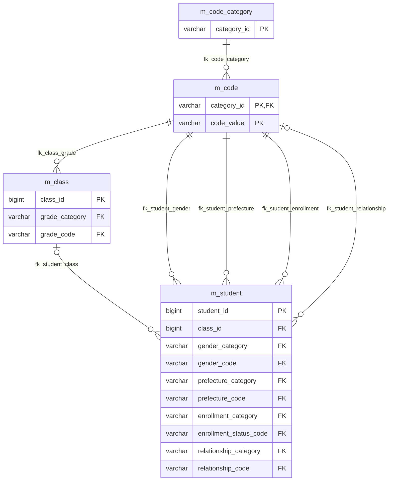

親キーは一意で、子の参照列には一意制約がないため、親1件を子0件以上が参照できる。クラス参照はDB列としてNULL可能だが、在学・休学ではCHECKとサービス検査が所属を要求する。続柄2列もNULL可能だが、緊急氏名・続柄分類・続柄値・緊急電話を全部NULL又は全部設定とするCHECKがある。7件のFKにCASCADE指定はない。参照先の存在と、利用停止・期間・定員の業務条件は別の検査である。〔observed-source：`sources/database/001_schema.sql:15-32`、`sources/database/001_schema.sql:187-201`〕

### 表示JOINと監査追記の関連

一覧は学生を起点にクラス、学年コード、在籍コード、都道府県コードをLEFT JOINする。性別・続柄名称のJOINはこの一覧SQLにない。結合先がない場合もLEFT JOIN自体は学生行を除去しないが、年度・学年等の検索述語を指定した場合は、その述語による絞込みがある。

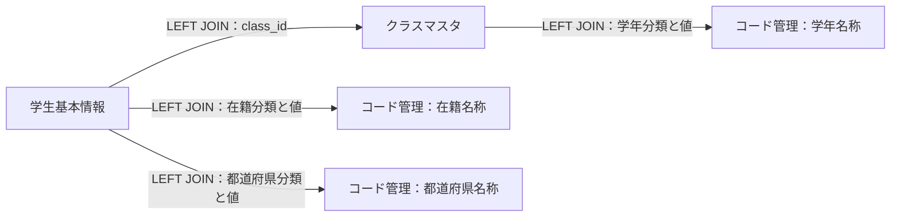

一覧住所は都道府県名称と`address_line1`を連結した表示値で、都道府県名称欠落時は`[不整合]`を使う。`address_line2`はこの一覧住所に含まれない。クラス名の保存上限は18スカラー、`nvarchar(36) NOT NULL`、保存パラメータは`NVarChar(36)`である。コード名称は12スカラー、`nvarchar(24) NOT NULL`、`NVarChar(24)`である。これらの保存列のNOT NULLと、LEFT JOIN結果の名称NULLを混同しない。分類名称`category_name`は候補表示名称`code_name`とは別列である。〔observed-source：`sources/Core/SqlServerStudentService.cs:77-90`、`sources/Core/SqlServerStudentService.cs:140-147`、`sources/Core/MasterMaintenanceService.cs:33-35`、`sources/Core/MasterMaintenanceService.cs:73-73`、`sources/Core/MasterMaintenanceService.cs:81-83`、`sources/Core/MasterMaintenanceService.cs:115-115`、`sources/database/001_schema.sql:68-68`、`sources/database/001_schema.sql:92-103`、`sources/database/001_schema.sql:115-128`〕

監査は更新処理が履歴へ追記する依存であり、業務表間のFKとは分ける。

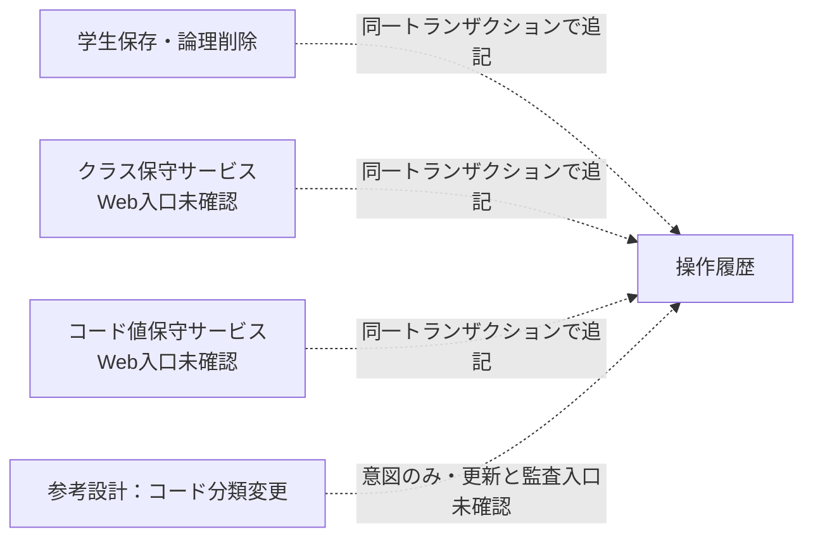

`target_table`・`target_key`に業務表へのFKは宣言されていない。対象キーは学生・クラスの管理番号、又は分類とコード値を文字列で記録する。参考設計にはコード分類変更の監査もあるが、観測できる分類書込みはseedの不足行追加であり、通常の分類更新・監査入口は確認できない。〔observed-source：`sources/database/001_schema.sql:137-154`、`sources/database/001_schema.sql:187-205`、`sources/Core/SqlServerStudentService.cs:385-390`、`sources/Core/MasterMaintenanceService.cs:132-135`、`sources/database/002_seed.sql:85-92`。reference-design：`reference-designs/基本設計書/03_テーブル仕様書.md:20-34`〕

## 項目一覧

| No | 論理名 | 物理名 | 1件の単位・主キー | 列数 | kind | 個別文書ID | 契約path・本書からの相対リンク | 文書状態 |
| --- | --- | --- | --- | --- | --- | --- | --- | --- |
| 1 | 学生基本情報 | `dbo.m_student` | 学生1人。`student_id` | 35 | `table-definition` | `CSHARP_ASPNET-BAS-STU-03-M_STUDENT` | [基本設計書/テーブル/01_m_student.md](テーブル/01_m_student.md) | 計画先。本応答では未生成 |
| 2 | クラスマスタ | `dbo.m_class` | 年度内のクラス1件。`class_id` | 17 | `table-definition` | `CSHARP_ASPNET-BAS-STU-03-M_CLASS` | [基本設計書/テーブル/02_m_class.md](テーブル/02_m_class.md) | 計画先。本応答では未生成 |
| 3 | コード種別マスタ | `dbo.m_code_category` | 分類1件。`category_id` | 11 | `table-definition` | `CSHARP_ASPNET-BAS-STU-03-M_CODE_CATEGORY` | [基本設計書/テーブル/03_m_code_category.md](テーブル/03_m_code_category.md) | 計画先。本応答では未生成 |
| 4 | コード管理マスタ | `dbo.m_code` | 分類内のコード1件。`category_id, code_value` | 14 | `table-definition` | `CSHARP_ASPNET-BAS-STU-03-M_CODE` | [基本設計書/テーブル/04_m_code.md](テーブル/04_m_code.md) | 計画先。本応答では未生成 |
| 5 | 操作履歴 | `dbo.t_operation_log` | 操作記録1件。`log_id` | 12 | `table-definition` | `CSHARP_ASPNET-BAS-STU-03-T_OPERATION_LOG` | [基本設計書/テーブル/05_t_operation_log.md](テーブル/05_t_operation_log.md) | 計画先。本応答では未生成 |

## イベント仕様

### 学生検索・詳細読込み・候補取得

#### 処理概要

検索は非削除学生を条件で絞り、所属先とコード名称を付けた一覧を返す。詳細読込みは学生1件を登録画面用の値へ戻す。候補取得はコード値とクラスを取得し、選択キー、表示名称、期間、利用状態を供給する。これらの参照処理は業務表を変更せず、操作履歴を増やさない。

#### 処理手順

1. Web入口は認証を適用する。検索POSTはCSRF、許可フォーム項目と重複、検索状態の所有者・セッション・指定タブを確認する。ModelState有効時にDTOを検索条件へ移し、検索状態のGate待機後にも所有者・期限・期待状態版を再確認する。
2. `SearchAsync`はページ正数、件数20・50・100、許可された並び順と方向、年度1900～9998、正のクラスIDを検査する。未所属と年度・学年・クラスの併用を拒否する。在籍区分は最大4値、重複なし、01～04とする。検索文字列から照合キー、電話、日付等を生成し、日付範囲は開始日≦終了日を要求する。
3. 接続を開きSNAPSHOTを開始する。指定学年・都道府県コードの存在、指定年度のクラス存在、指定クラスと年度・学年の一致を確認する。検索用途の存在検査は、停止・期間外の値を一律に拒否する検査ではない。
4. 同じ検索条件で最大10001件を数える。10000件超ならcommitして一覧を返さない。通常は最終ページを計算して要求ページを補正し、行を取得してcommitする。
5. `GetAsync`は認証主体を確認し、正でないIDならNULLを返す。正のIDでは非削除学生を1件読み、不在ならNULL、存在すれば日付・任意値・版・更新情報を`StudentDetail`へ移す。この読込みに明示的なSNAPSHOTトランザクションはない。
6. `LookupAsync`はSNAPSHOT内でコードとクラスの2結果集合を取得する。人数付きでは非削除・在学又は休学の学生数を集計する。検索用の`LookupAsync(false)`では集計せず、`Occupied=0`を設定する。

〔observed-source：`sources/Web/Controllers/StudentsController.cs:13-22`、`sources/Infrastructure/SearchContextStore.cs:13-14`、`sources/Core/SqlServerStudentService.cs:103-222`〕

#### 処理フロー

**参照1：検索。** 入力・検索状態の受付後、参照2の詳細・候補取得とは別の読取り単位へ進む。

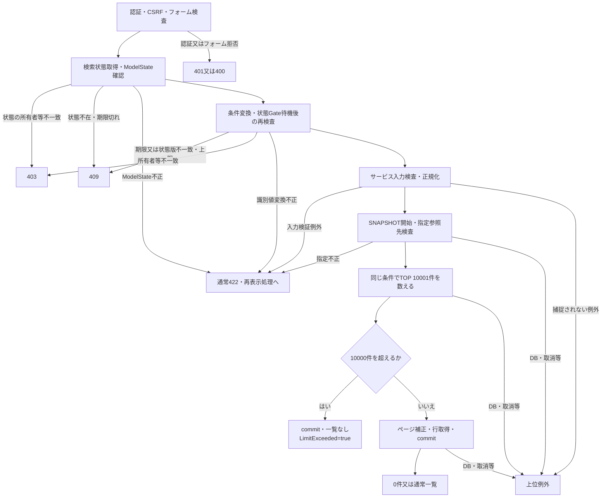

**参照2：詳細と候補。** 詳細のNULL、人数集計済みの値、集計省略値を別の出口にする。

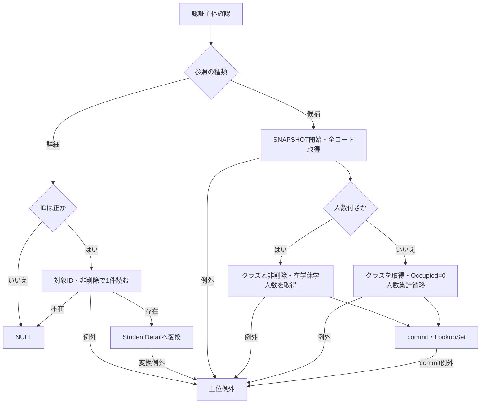

上位例外のWeb処理と再表示の二次例外は、結果・例外時の扱いに示す。図中の422等は後続のモデル構築とビュー出力が完了した場合の通常応答である。

#### SQL・テーブル関連（ER図）

実FKは概要のER図に対応する。件数SQLは学生とクラス、行SQLはそれに学年・在籍・都道府県名称を加える。コード候補はコードと分類のINNER JOINで、両方が利用可の場合に取得DTOの`IsActive=true`とする。クラス候補は学年コードをLEFT JOINする。候補取得SQLには利用状態・有効期間によるWHERE除外がなく、画面側で用途に応じて選択可否を決める。

#### DB操作の詳細

検索は常に`s.is_deleted=0`を適用する。下表の任意条件は正規化後の値が非NULLの場合にANDで追加し、電話の2列比較だけをORとする。

| 条件 | 検索列・述語 | SQLパラメータ・型・サイズ |
| --- | --- | --- |
| 学籍番号 | `s.student_no`の前方一致 | `@no VarChar(31)`。LIKEエスケープ後に末尾`%` |
| 氏名 | `s.name_key`の部分一致 | `@name NVarChar(642)`。前後に`%` |
| カナ | `s.kana_key`の部分一致 | `@kana NVarChar(74)`。前後に`%` |
| 年度 | `c.school_year=@year` | `@year SmallInt` |
| 学年 | `c.grade_code=@grade` | `@grade VarChar(2)` |
| クラス | `s.class_id=@class` | `@class BigInt` |
| 未所属 | `s.class_id IS NULL` | なし。所属条件との併用を拒否 |
| 都道府県 | `s.prefecture_code=@prefecture` | `@prefecture VarChar(2)` |
| 電話 | 本人電話又は緊急電話が`@phone`と等しい | `@phone VarChar(16)` |
| 入学日開始 | `s.admission_date>=@from` | `@from Date` |
| 入学日終了 | `s.admission_date<=@to` | `@to Date` |
| 在籍区分 | `s.enrollment_status_code IN (...)` | 値ごとに`@statusN VarChar(2)`。空配列なら条件なし |
| ページ | `OFFSET @offset ROWS FETCH NEXT @size ROWS ONLY` | 両方`Int` |

LIKEは`!`をESCAPE文字にし、`!`・`%`・`_`・`[`をエスケープする。氏名・カナは原表記列ではなく生成キーを検索する。並び順は学籍番号、氏名キー、入学日、更新日時の4種類、方向は昇順・降順に限定し、副順序を常に学生ID昇順とする。件数と行は同じSNAPSHOT内で取得する。〔observed-source：`sources/Core/SqlServerStudentService.cs:107-170`、`sources/Core/StudentNormalizer.cs:161-161`〕

詳細SQLは`student_id=@id AND is_deleted=0`、`@id BigInt`である。コード候補は分類、表示順、コード値の順、クラス候補は年度降順、学年表示順、クラス表示順、クラスコード、クラスIDの順で返す。現在人数の条件はクラスID一致、非削除、在籍01・02である。検索用の人数0は実測0人を意味しない。〔observed-source：`sources/Core/SqlServerStudentService.cs:172-216`〕

#### 結果・例外時の扱い

0件、通常一覧、上限超過はいずれも読取り結果として`Outcome.NoChange`を返す。上限超過時の確認件数10001は全該当件数ではなく、Webの提示では総件数を未確定として扱う。詳細NULLは、編集入口では対象不在404へ変換される。

検索の`InputValidationException`と`ArgumentException`は`ValidationFailed`へ変換する。DB・取消・その他の捕捉されない例外は上位へ伝播する。例えば在籍区分配列がNULLとしてサービスへ届く場合は`Length`アクセスがあり、非nullable注釈だけでは排除できない。HTTPバインド後にその値が届くかは未確認の境界である。〔observed-source：`sources/Core/SqlServerStudentService.cs:111-112`、`sources/Core/SqlServerStudentService.cs:169-170`、`sources/Infrastructure/WebStudentCoordinator.cs:17-20`〕

入力拒否後にも候補取得とビュー処理が続く。検索Controllerは受信した`pageSize`を再表示モデルへ設定し、ビューはその値でページ数を除算する。0が残れば二次例外が生じ得るため、入力拒否を安全な画面再表示の完了と同一視しない。Controllerの個別WebFault catchより後のビュー例外も、応答未開始ならmiddlewareが一般例外503として扱う。応答開始後は同middleware catchの対象外である。〔observed-source：`sources/Web/Controllers/StudentsController.cs:13-19`、`sources/Views/Students/Search.cshtml:8-8`、`sources/Infrastructure/WebHostSetup.cs:22-24`〕

### 学生の新規登録・更新

#### 処理概要

保存は画面から受けた業務値を正規化し、書込ゲート下で対象・比較版・参照先・定員を再確認する。学生1件と操作履歴1件を同じトランザクションで確定する。変更なしと同一人物候補の確認待ちは、学生書込みを行わずに戻る。

#### 処理手順

1. 認証・CSRFの下で、ControllerはFormGuard、作成更新権限、Snapshot取得、復帰検索状態、読込時復帰先との一致、ModelStateの順に確認する。Snapshot等の事前検査は、保存呼出し付近の個別WebFault catchの外である。Coordinatorも権限と復帰状態を確認し、`StudentSaveInput.ToRequest`でサービス引数へ移す。
2. サービスは受付GUID、認証主体、入口UTC時刻、日本時間の業務日を取得する。Viewerを拒否し、19業務入力の正規化、任意理由60スカラー、ID・期待版の正数と同時設定、年度範囲、任意学年コードを検査する。
3. 接続を開きReadCommittedを開始する。この開始部分は書込tryの外である。try内で共通書込ゲートを取得する。
4. 更新では非削除対象を再読込みする。不在、版不一致、学籍番号変更をそれぞれ拒否する。保存済み区分が卒業・退学で別区分へ訂正する場合は、管理者権限と理由を要求する。
5. 各コードの存在を確認し、新規又は変更値には分類・値の利用可と当日有効を要求する。変更しない停止・期間外値は存在確認の上で保持できる。クラスは存在、指定年度・学年との一致、新たな在学・休学所属の利用可・当日期間内、卒業・退学で所属や在籍期間等が変わる場合の期間重なりを確認する。
6. 席が増える場合だけ、対象クラスの非削除・在籍01又は02・自身以外の最新人数に1を加えて定員と比較する。参照先・所属・定員の項目別エラーは`InputValidationException`となり、先行catchでrollbackを試みて`ValidationFailed`を返す。
7. 正規化保存値とDB値を比較する。変更なしならrollbackして既存ID・読込済み版を返す。理由だけの変更では学生の日時・版・履歴を増やさない。変更ありの場合に版上限を確認し、その後、削除済みを含む全行で学籍番号一意性を確認する。
8. 非削除、自身以外、生年月日一致、氏名キー又はカナキー一致の同一人物候補を全件取得する。正規化内容と全候補ID・版のハッシュを作り、提示された確認情報と照合する。有効確認の続行には理由を要求する。
9. 候補がある、又は確認値が非NULLで、確認が無効なら保存トランザクションをrollbackして確認情報を発行する。全候補件数と先頭20件を返す。新規のID・既存版はNULL、更新は対象ID・読込済み版を保持する。
10. 保存可能なら学生をINSERT又はUPDATEし、OUTPUTからIDを取得する。監査を追記し、非Web方式では必要な確認消費を行ってcommitする。commit完了後にだけ`Saved`とID・新版を返す。
11. ControllerはSavedでFlashを保存し303を返す。それ以外は結果に対応する状態コードと編集モデルを構成し、候補を再取得して表示する。

〔observed-source：`sources/Web/Controllers/StudentsController.cs:26-33`、`sources/Infrastructure/WebStudentCoordinator.cs:18-18`、`sources/Core/SqlServerStudentService.cs:227-324`、`sources/Core/SqlServerStudentService.cs:344-383`〕

#### 処理フロー

**保存1：Web受付。** 有効入力は保存2へ渡す。渡す値はルートID、入力DTO、Snapshot、復帰情報であり、ここではDB保存を確定しない。

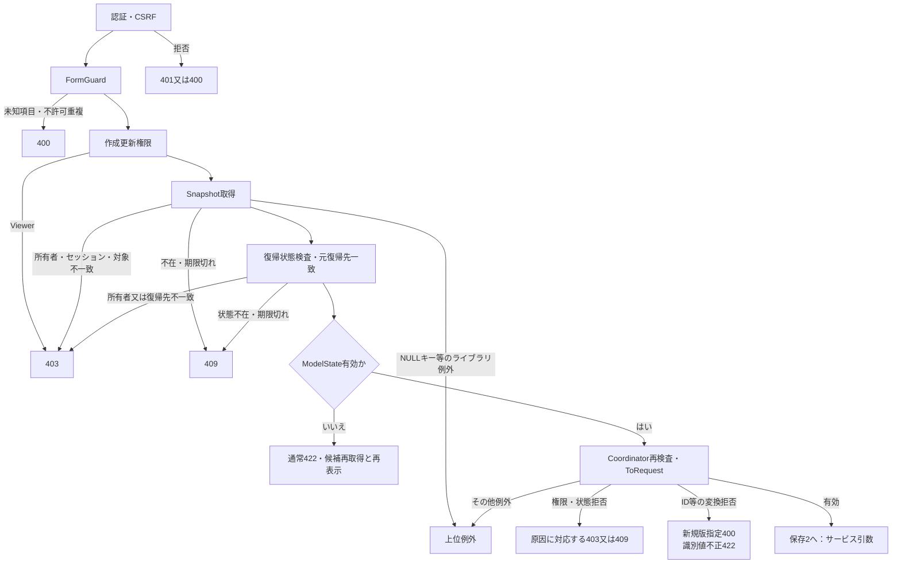

**保存2：入口・最新DB検査。** 新規は`previousVersion=NULL`、更新は読込済み版を保持して保存3へ渡す。書込try内の対象例外は保存4で分類する。

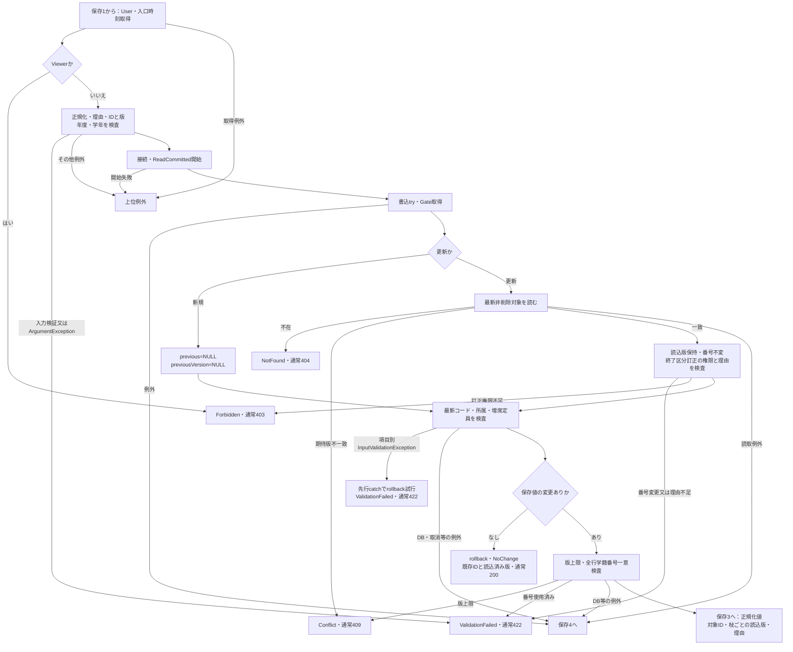

不在、版不一致、番号変更等の早期returnはcommitを行わない。図の通常応答は保存結果を画面へ返す通常経路であり、後続表示の成功を保証しない。

**保存3：確認・書込み・確定。** 確認待ちと保存完了は、ID・版を異なる出口で返す。

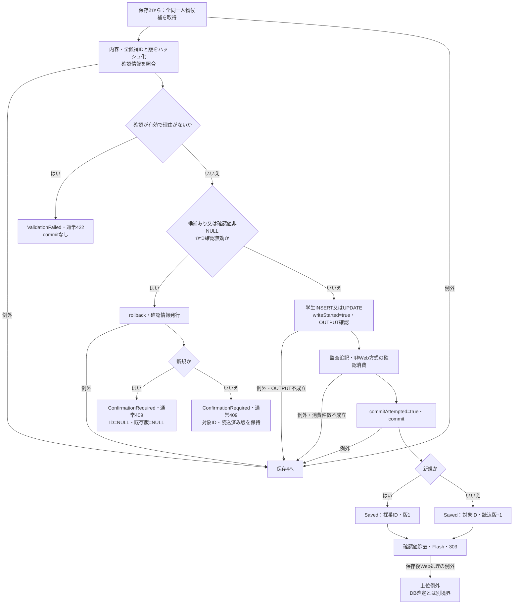

**保存4：書込tryのcatch順。** 先行catchで処理した例外を後続の結果不明条件へ含めない。

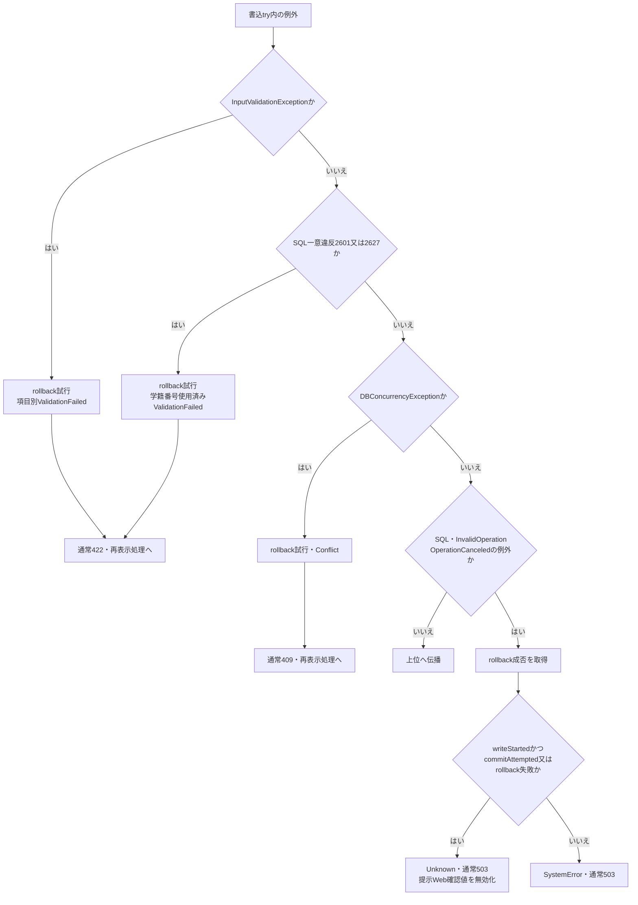

finallyでは、有効確認のBusyを取得済みで、未完了かつUnknownでない場合にBusyを解除する。Saved以外の再表示には候補取得・ビュー処理が続く。上位例外は、応答未開始ならWebFaultの状態又は一般例外503、応答開始後なら同middleware catchの対象外となる。

#### SQL・テーブル関連（ER図）

学生の保存参照は概要の7FKに対応する。保存前にはコード・分類、クラス、人数集計用の学生を読み、学生書込みと履歴追記を同じトランザクションへ置く。非Web確認方式だけは確認表の消費更新を追加する。Web方式の確認情報はメモリに保持する。

#### DB操作の詳細

新規INSERTは正規化保存列、固定分類`GENDER`・`PREFECTURE`・`ENROLLMENT_STATUS`、未削除状態、作成・更新日時と者、版1を設定する。UPDATEは学籍番号を除く正規化保存列と更新管理情報・版を設定する。作成管理情報、学籍番号、固定3分類は保持する。UPDATEのWHEREは`student_id=@id AND row_version=@version AND is_deleted=0`で、ID・期待版は`BigInt`である。OUTPUTは表変数を経由してIDを取得し、NULL又は`DBNull`なら`DBConcurrencyException`とする。OUTPUT取得はcommit完了を意味しない。〔observed-source：`sources/Core/SqlServerStudentService.cs:292-315`〕

参照コード検査は分類・値の両条件でコードと分類をJOINし、分類=`VarChar(24)`、値=`VarChar(10)`を渡す。クラスはID=`BigInt`で読む。増席時の定員集計はクラス一致、非削除、在籍01・02、自身以外の全条件を使用する。定員NULLは制限なしであり、画面表示人数ではなく、この保存中の最新人数で判断する。〔observed-source：`sources/Core/SqlServerStudentService.cs:347-380`〕

学籍番号の使用済み検査は番号一致と自身以外を条件とし、論理削除行を除外しない。同一人物候補は非削除、自身以外、生年月日一致、氏名キー又はカナキー一致、学生ID順で全件取得する。候補パラメータはID=`BigInt`、生年月日=`Date`、氏名キー=`NVarChar(320)`、カナキー=`NVarChar(36)`である。表示20件は候補照合の取得上限ではない。〔observed-source：`sources/Core/SqlServerStudentService.cs:264-290`〕

監査は対象表`m_student`、対象IDの十進文字列、CREATE又はUPDATE、前後版、変更列名JSON、認証主体、入口時刻、受付GUID、理由、候補件数が正かどうかを追記する。新規は前版NULL・後版1で、変更列一覧に固定分類・管理列も加える。更新は実変更列と`updated_at`・`updated_by`・`row_version`を記録する。業務値の前後コピーを保持する処理ではない。〔observed-source：`sources/Core/SqlServerStudentService.cs:306-307`、`sources/Core/SqlServerStudentService.cs:385-390`〕

#### 結果・例外時の扱い

| 結果 | 返却ID・版、DB確定状態 | 通常のWeb処理 |
| --- | --- | --- |
| `Saved` | commit完了。新規は採番ID・1、更新は対象ID・読込版+1 | Flashを設定し303 |
| `NoChange` | 既存ID・読込済み版。明示rollback。日時・版・履歴を増やさない | 200で再表示 |
| `ConfirmationRequired` | 新規はID・既存版NULL、更新は対象ID・読込済み版。学生保存はrollback済み | 409。全件数と最大20件を表示 |
| `ValidationFailed` | ID・版未設定。項目不正、参照先不正、定員、番号一意等の拒否 | 422で再表示 |
| `Forbidden` | ID・版未設定。保存又は終了区分訂正の権限不足 | 403で再表示 |
| `NotFound` | ID・版未設定。最新非削除対象なし | 404で再表示 |
| `Conflict` | ID・版未設定。期待版不一致、変更ありの版上限、又は競合catch | 409で再表示 |
| `SystemError` | 最後の対象catchに入り、結果不明条件に該当しない | 503で再表示 |
| `Unknown` | 最後の対象catchで書込み開始済み、かつcommit試行済み又はrollback失敗 | 503。再送前に検索確認 |

rollback helperは取消なしで試み、SQL例外又は無効状態例外ならfalseを返す。先行catchはrollback成否によってUnknownへ分類し直さない。履歴失敗も同じ保存トランザクションの取消対象だが、最後のcatchへ入った場合の確定状態は、書込み・commit段階とrollback成否で分かれる。〔observed-source：`sources/Core/SqlServerStudentService.cs:316-329`、`sources/Infrastructure/WebPresentation.cs:23-29`〕

認証主体取得、接続・トランザクション開始、Controllerの事前検査、候補再取得、ビュー処理は別の例外境界である。Saved後のFlashや303生成、次要求の検索復帰が失敗しても、確定済み保存のrollbackを意味しない。〔observed-source：`sources/Web/Controllers/StudentsController.cs:29-38`、`sources/Infrastructure/WebHostSetup.cs:22-24`〕

### 学生の論理削除

#### 処理概要

管理者が対象と理由を確認し、削除属性と更新管理情報だけを変更する。編集中の氏名、住所、所属等は保存しない。学生の論理削除とDELETE監査を同じトランザクションで確定する。

#### 処理手順

1. Controllerは認証・CSRFの下でFormGuard、参照権限、Snapshot取得、読込時復帰先との一致を確認する。Coordinatorは管理者権限、復帰状態、明示確認、正の期待版への変換の順に検査する。
2. サービスは管理者を確認し、理由の必須・原入力と保存の60スカラー上限を検査する。この入口catchは`InputValidationException`だけを捕捉する。その後、正のID・版と版上限を確認する。
3. 接続を開きReadCommittedを開始した後、try内で共通Gateを取得する。非削除対象の最新版を読み、不在はNotFound、期待版不一致はConflictとする。
4. 対象ID・期待版・非削除のWHEREで削除属性と更新管理列を変更し、更新1件を要求する。DELETE監査を追記してcommitする。
5. commit完了後に対象ID・版+1を返す。Savedは303で復帰する。それ以外はControllerがエラー・状態コードを設定した後、最新情報をLoadする。

〔observed-source：`sources/Web/Controllers/StudentsController.cs:37-38`、`sources/Infrastructure/WebStudentCoordinator.cs:19-19`、`sources/Core/SqlServerStudentService.cs:392-416`〕

#### 処理フロー

**削除1：受付と理由。** 業務入力拒否と、捕捉されないUnicode例外を分ける。有効値は削除2へ渡す。

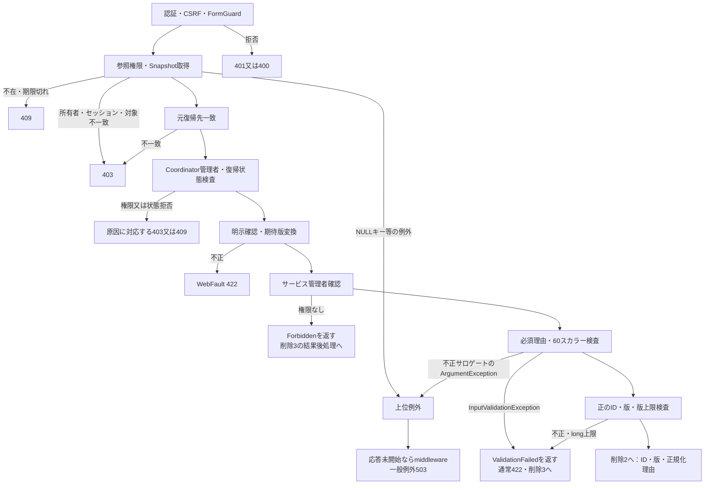

理由の不正サロゲートは`ScalarCount`が明示的に投げる`ArgumentException`であり、削除の入力検証結果へ変換されない。HTTPバインド後にその文字列が届くかは未確認で、図はサービスへ届いた場合の経路を示す。

**削除2：DB更新と監査。** 開始失敗は書込catchの外、try内例外は削除3へ渡す。

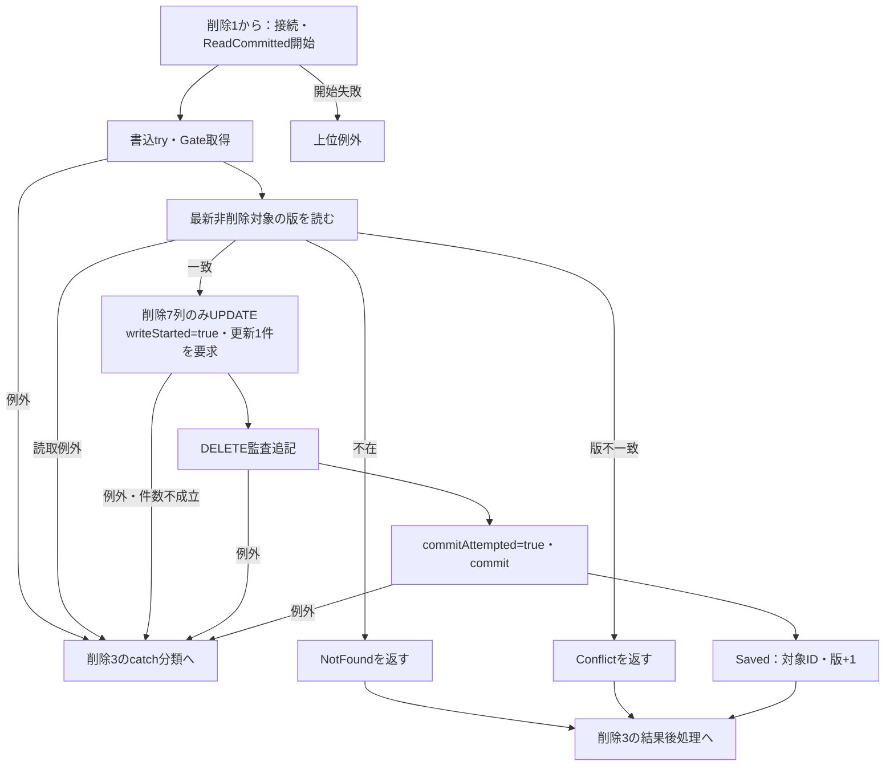

**削除3：catchと結果後処理。** 削除1のサービス結果、削除2の通常結果、下図のcatch結果は、各結果を保持してControllerへ戻る。

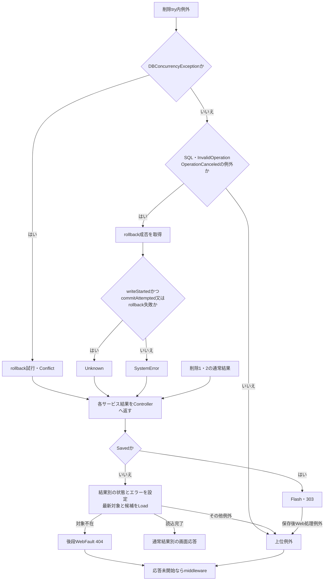

#### SQL・テーブル関連（ER図）

対象は学生と操作履歴で、概要の監査追記図に対応する。学生のクラス・コード参照列を変更せず、物理DELETEやFKによる削除連動は行わない。

#### DB操作の詳細

UPDATEのWHEREは`student_id=@id AND row_version=@version AND is_deleted=0`である。設定列は`is_deleted`、`deleted_at`、`deleted_by`、`delete_reason`、`updated_at`、`updated_by`、`row_version`の7列である。ID・版は`BigInt`、日時は`DateTimeOffset`、者は`NVarChar(128)`、理由は`NVarChar(120)`を渡す。更新件数が1でなければ競合例外とする。

監査はDELETE、前後版は期待版と期待版+1、変更列JSONは上記7列、理由は削除理由、`duplicate_confirmed=false`である。削除済み状態では削除日時・者・理由をすべて設定することをDDLのCHECKも要求する。〔observed-source：`sources/Core/SqlServerStudentService.cs:404-414`、`sources/database/001_schema.sql:200-200`〕

#### 結果・例外時の扱い

理由の必須・長さ・制御文字等による`InputValidationException`はValidationFailedとなる。不正サロゲートの`ArgumentException`は入口catchを通らず、Controllerにも個別catchがないため上位へ伝播する。応答未開始なら一般例外503となる。〔observed-source：`sources/Core/StudentNormalizer.cs:37-56`、`sources/Core/SqlServerStudentService.cs:394-398`、`sources/Web/Controllers/StudentsController.cs:37-37`、`sources/Infrastructure/WebHostSetup.cs:22-24`〕

書込tryの`DBConcurrencyException`は先行catchでConflictとなる。後続のSQL・無効状態・取消例外catchだけが、書込み開始済みかつcommit試行済み又はrollback失敗ならUnknown、それ以外をSystemErrorとする。学生削除の版上限は入口ValidationFailedであり、変更あり学生更新の版上限Conflictとは異なる。〔observed-source：`sources/Core/SqlServerStudentService.cs:398-416`〕

通常の対応はSaved=303、ValidationFailed=422、Forbidden=403、NotFound=404、Conflict=409、SystemError・Unknown=503である。ただしSaved以外は最新Loadを行うため、対象不在404や候補取得失敗等が後段で生じ得る。先に得た削除結果だけで最終HTML応答を確定しない。〔observed-source：`sources/Web/Controllers/StudentsController.cs:25-25`、`sources/Web/Controllers/StudentsController.cs:37-38`、`sources/Infrastructure/WebPresentation.cs:23-23`〕

### クラスマスタの保守

#### 処理概要

`SaveClassAsync`は年度内クラスの学年、名称、期間、定員、表示順、利用状態、備考を保存する宣言サービスである。WebのDI登録とControllerに接続入口は確認できない。実行者はWeb Claimsではなく、DB接続で取得する認証主体である。

#### 処理手順

1. `ClassChange`の年度1900～9998、定員NULL又は1～9999、非負表示順、ID・期待版の正数と同時設定を検査する。コードは原入力・正規化後9文字以内の識別子、名称は18スカラー、備考は120スカラーとする。
2. 期間をISO日付へ変換し、当該年度4月1日～翌年3月31日の内側で、開始日≦終了日を要求する。同日を許す。
3. 接続ごとに`ORIGINAL_LOGIN()`と`IS_ROLEMEMBER('student_admin')`を読み、管理者でなければ例外とする。ReadCommittedを開始し、try内で共通Gateを取得する。
4. 既存行・期待版を確認し、年度・クラスコード変更を拒否する。削除済みを含む参照学生がいれば学年変更を拒否する。非削除・在籍01又は02の人数が正なら停止又は当日を外す期間を拒否し、定員を現在人数未満にする変更も拒否する。
5. 学年コードの存在を確認し、新規又は変更値では分類・値の利用可と当日有効を要求する。保存値の変更なしならrollbackして既存版を返す。変更ありでは版上限を検査する。
6. 同年度・同学年・同名・自身以外のクラスを確認して同名警告を求める。停止クラスも除外しない。別コードの同名だけでは保存を拒否しない。
7. クラスと監査を保存してcommitする。新版と同名警告フラグを返す。

〔observed-source：`sources/Core/MasterMaintenanceService.cs:9-77`〕

#### 処理フロー

**クラス1：検査。** 有効な保存値、既存行、期待版をクラス2へ渡す。

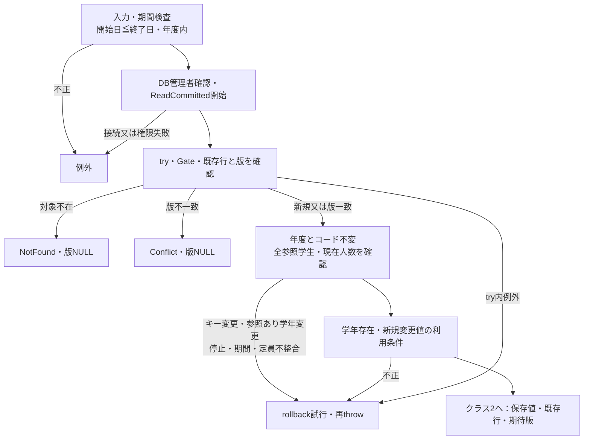

**クラス2：変更と確定。** 変更なしでは同名検査を行わず、成功時は取得した警告フラグを保持する。

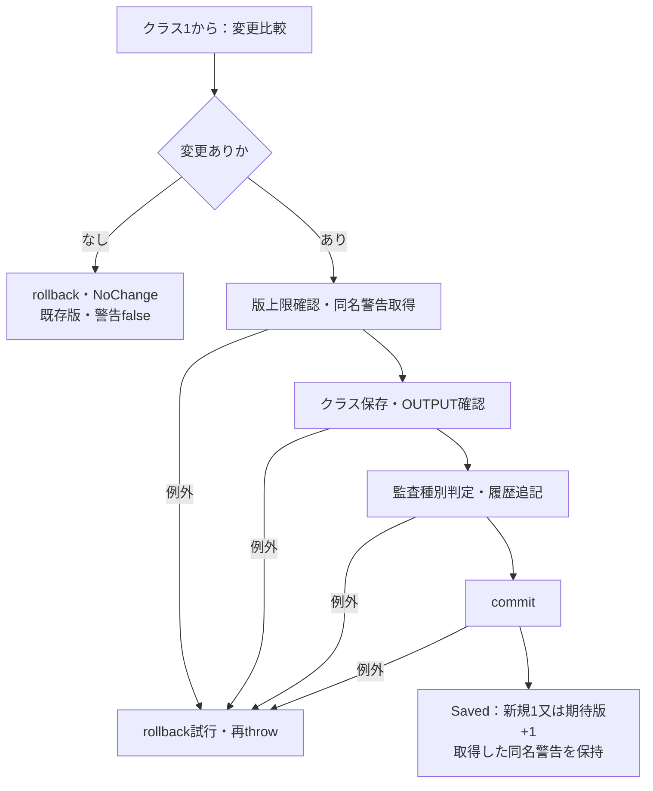

#### SQL・テーブル関連（ER図）

クラスは学年コードを複合FKで参照し、学生はクラスIDを参照する。概要のER図に対応する。保守時の全参照件数と現在人数は同じ学生表から条件を分けて求め、クラス保存から履歴への追記は別の依存である。

#### DB操作の詳細

既存行は`class_id=@id`、学生参照集計も`class_id=@id`で取得する。全参照件数は削除済みを含み、現在人数は非削除・在籍01又は02だけを数える。同名検査は年度・学年・名称・自身以外の4条件で、利用状態による除外はない。

新規は`grade_category='GRADE'`、作成更新情報、版1を加える。更新WHEREは`class_id=@id AND row_version=@version`で、保存値辞書の列と更新管理列・版を設定する。SQL上は年度・クラスコードも設定対象だが、事前の不変検査で既存値と同じ値に限定される。型は年度=`SmallInt`、学年=`VarChar(2)`、コード=`VarChar(9)`、名称=`NVarChar(36)`、期間=`Date`、定員・順序=`Int`、利用状態=`Bit`、備考=`NVarChar(240)`、ID・版=`BigInt`である。年度・クラスコード一意はDDLでも制約する。〔observed-source：`sources/Core/MasterMaintenanceService.cs:44-75`、`sources/Core/MasterMaintenanceService.cs:124-130`、`sources/database/001_schema.sql:188-190`、`sources/database/001_schema.sql:201-201`〕

#### 結果・例外時の扱い

変更なしでは日時・版・履歴を増やさない。保存成功は新規1又は期待版+1と、同名検査の結果を返す。監査種別は新規CREATE、利用状態維持UPDATE、利用可への変更ENABLE、利用不可への変更DISABLEである。停止したままの名称変更もUPDATEとなる。

監査の対象キーはクラスIDの十進文字列、理由NULL、重複確認false、実行者はDB認証者である。変更列配列へ管理列を追加する処理はない。try内の例外はrollbackを試みて再throwし、学生サービスのSystemError・UnknownやHTTP応答へ変換しない。〔observed-source：`sources/Core/MasterMaintenanceService.cs:65-77`、`sources/Core/MasterMaintenanceService.cs:132-135`、`sources/Core/AuditOperation.cs:6-7`〕

参考設計は新規の学年00と年度開始・終了日の初期値を意図するが、DDLのDEFAULTではなく、サービスも渡された学年・日付を検査して使う。未確認の保守入口による自動補完は確定できない。〔reference-design：`reference-designs/基本設計書/テーブル/02_m_class.md:25-40`。observed-source：`sources/database/001_schema.sql:62-88`、`sources/Core/MasterMaintenanceService.cs:32-37`〕

### コード管理マスタの保守

#### 処理概要

`SaveCodeAsync`は分類内のコード名称、表示順、利用状態、期間、備考を保存する宣言サービスである。学生・クラスへ保存したコード値を置換せず、名称の参照表示へ変更を反映する。Web保守入口は確認できない。

#### 処理手順

1. 分類をGENDER、ENROLLMENT_STATUS、PREFECTURE、RELATIONSHIP、GRADEに限定する。名称12スカラー、備考120スカラー、非負表示順、指定時の正の期待版を検査する。開始日を必須、終了日をNULL又は開始日以上とする。
2. DB管理者確認、ReadCommitted開始、Gate取得の後、分類から固定桁数と通常追加可否を読む。コード値をその桁数の数字文字列へ正規化する。
3. 分類・値で既存行を読む。不在で期待版ありはNotFound、既存版と要求版の不一致はConflictとなる。既存行があるのに期待版を省略した要求も一致しない。新規で通常追加不可なら例外とする。
4. 保護値の停止、開始日の後ろ倒し、無期限値への終了日設定、既存終了日の短縮を拒否する。
5. 変更なしならrollbackして既存版を返す。変更ありでは版上限を確認し、コードと監査を同じ単位で保存してcommitする。

〔observed-source：`sources/Core/MasterMaintenanceService.cs:79-121`〕

#### 処理フロー

**コード1：分類と保護検査。** 有効な分類・値、保存値、既存行、期待版をコード2へ渡す。

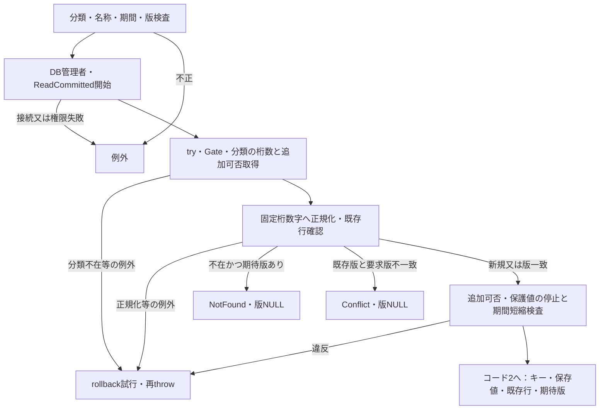

**コード2：変更と確定。** 戻す版は新規・更新で分ける。

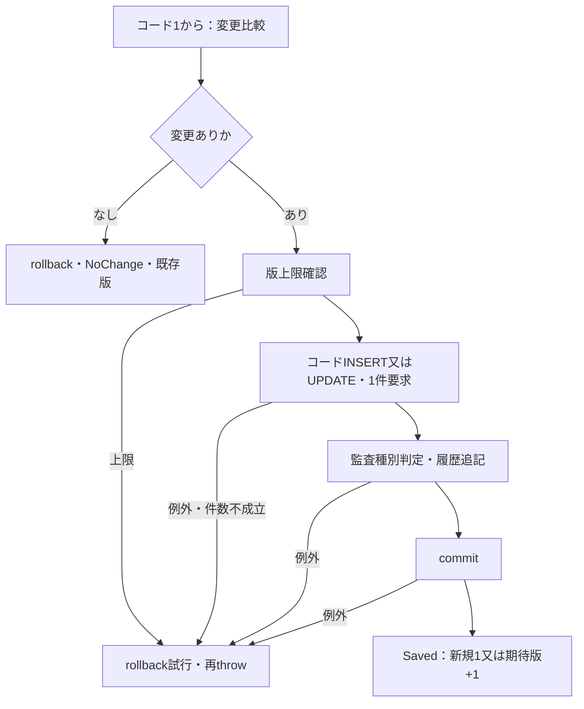

#### SQL・テーブル関連（ER図）

コードは分類をFKで参照し、学生の4選択値とクラスの学年から参照される。概要のER図に対応する。保守は分類の桁数・追加可否を読むが、分類名称・桁数・追加可否・利用状態を更新しない。履歴はコード保存からの追記依存である。

#### DB操作の詳細

既存キーは`category_id=@category AND code_value=@value`である。分類は`VarChar(24)`、値は`VarChar(10)`を渡す。DBの汎用容量10桁と分類ごとの1桁・2桁等の固定桁検査は別の制約である。

新規は分類・値・名称・順序・利用状態・期間・備考、`is_protected=0`、作成更新情報、版1をINSERTする。更新WHEREは分類・値・期待版で、名称・順序・利用状態・期間・備考・更新管理列・版を変更する。キーと`is_protected`は変更しない。名称=`NVarChar(24)`、備考=`NVarChar(240)`、期間=`Date`、順序=`Int`、利用状態=`Bit`、版=`BigInt`を使用し、更新1件を要求する。〔observed-source：`sources/Core/MasterMaintenanceService.cs:91-120`、`sources/database/001_schema.sql:112-135`、`sources/database/001_schema.sql:202-203`〕

#### 結果・例外時の扱い

クラス保守と同じ監査判定を用い、新規CREATE、利用状態維持UPDATE、利用可への変更ENABLE、利用不可への変更DISABLEを記録する。停止したままの名称変更もUPDATEである。対象キーは`分類:コード値`、理由NULL、重複確認false、実行者はDB認証者となる。保存と監査を同じトランザクションで確定し、try内失敗はrollbackを試みて再throwする。〔observed-source：`sources/Core/AuditOperation.cs:6-7`、`sources/Core/MasterMaintenanceService.cs:109-135`〕

参考設計はコード値を別の意味へ再利用しない保守責務を定める。現行サービスには名称変更前後の意味を自動判定する検査はなく、保護値・版・期間等の検査によって意味不変のすべてを保証するものではない。分類自体の通常更新・監査入口も確認できない。〔reference-design：`reference-designs/基本設計書/03_テーブル仕様書.md:85-91`。observed-source：`sources/Core/MasterMaintenanceService.cs:79-121`、`sources/database/002_seed.sql:85-92`、`sources/database/003_web_permissions.sql:22-24`〕

### DB配備・初期投入・Principal結合・配備検査

#### 処理概要

配備スクリプトはInstall、Verify、BindPrincipalを宣言し、既定ActionはVerify、対象DBは`contextbase_test_project1_mvc`である。Installは空の専用DBへスキーマ、コード初期値、権限を順に適用する。Verifyは配備印・入力ハッシュ・定義を検査し、BindPrincipalは既存Windowsログイン又はグループをDBユーザーとロールへ結合する。

#### 処理手順

1. ローカル4 SQLの存在と引数を検査する。Microsoft ODBC版sqlcmdのPE・製品メタデータを読み、ProductVersion major16以上のx64又はx86を選ぶ。PlanOnlyでも候補メタデータとSQLハッシュを読むが、sqlcmdを起動しない。
2. 通常SQL呼出しはWindows認証、暗号化、証明書検証を使用する。serverGuardはSQL Server major17、Express、MachineNameとHOST_NAMEの一致、NTLM又はKERBEROSを要求する。
3. InstallではDB不在時に作成する。既存DBの利用には`UseExistingEmptyDatabase`を要求し、非システムオブジェクト、対象3ロール、プロジェクト印がない空DBを確認する。
4. `001_schema.sql`、`002_seed.sql`、`003_web_permissions.sql`を別々のsqlcmd呼出しで適用する。001はSNAPSHOT有効化、7表、制約、索引、3ロールを宣言する。002は共通Gate下で既存初期値との差分を検査し、不足分類の後に不足コードを追加する。003はDBロール権限と継承を設定する。
5. Installはプロジェクト印と3 SQLのSHA-256を拡張プロパティへ保存する。その後、全ActionでserverGuard、対象DB、印、ハッシュを照合する。
6. Install又はBindPrincipalでApplicationPrincipalが指定されていれば、既存Windowsログイン・グループ、sysadmin・DB所有者との分離、SID・種類、異なる直接ロール所属の不在を検査する。許容時だけDB USERと指定ロール所属を追加する。
7. 004の配備検査へ進む。Installでは初期空データ検査も必須とし、それ以外は`RequireInitialEmptyData`指定時に追加する。

〔observed-source：`sources/database/Deploy-Database.ps1:1-158`、`sources/database/001_schema.sql:3-7`、`sources/database/001_schema.sql:187-218`、`sources/database/002_seed.sql:2-13`、`sources/database/002_seed.sql:85-92`〕

#### 処理フロー

**配備1：前提とInstall。** 通常実行は配備2へ進む。PlanOnlyは選択Actionに対応するSQL呼出し計画を出力する経路である。

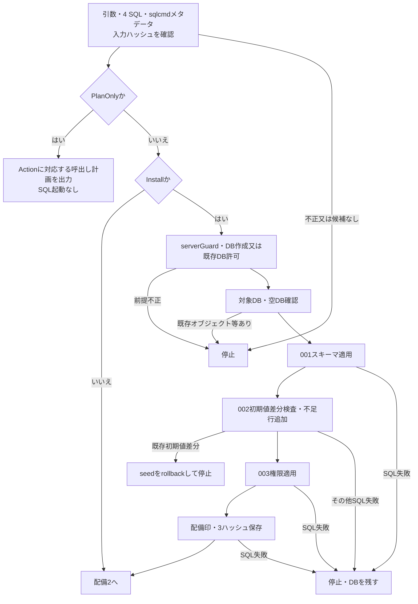

**配備2：照合・結合・検査。** 各検査の拒否理由を保持し、後段失敗を前段DDLの取消へ合流させない。

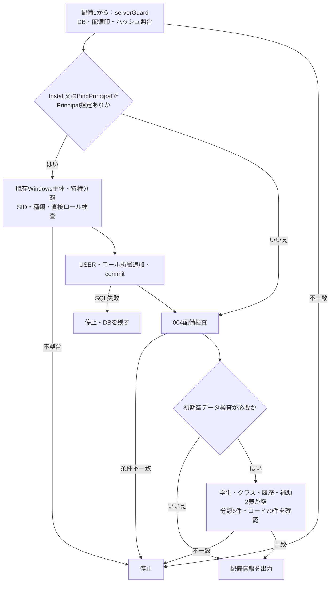

#### SQL・テーブル関連（ER図）

DDLは概要の5業務表と、補足説明の補助2表を宣言する。seedは分類を先に、コード値を後に追加してFKの参照先を揃える。学生・クラスのサンプル投入とseedからの操作履歴追記はない。

#### DB操作の詳細

| 段階 | 操作・検査 | 確定単位 |
| --- | --- | --- |
| 001 | SNAPSHOTをONにし、表・制約・索引・ロールを作成 | 配備全体を包むトランザクションではない |
| 002 | 5分類・70初期値を既存行と比較し、不足行だけ追加 | Gateを持つ明示トランザクション |
| 003 | DB名とロール存在を確認し、GRANT・DENY・継承を設定 | 明示トランザクション |
| 配備印 | プロジェクト印と3 SQLハッシュを追加 | 個別トランザクション |
| Principal結合 | DB USERと直接ロール所属を追加 | 個別トランザクション |
| 004 | 配備メタデータ・初期キー・宣言権限を参照検査 | 業務データ更新なし |
| 初期空データ検査 | 学生・クラス・履歴・補助表の空、分類5・コード70を確認 | 業務データ更新なし |

seedの分類設定は性別1桁、その他4分類2桁で、通常追加可は続柄・学年だけである。既存分類の名称・桁数・追加可否・利用状態、初期コードの名称・順序・保護・利用状態・開始1900-01-01・終了NULLが違えばrollbackしてTHROW 51002で停止する。一致行は上書きしない。不足行は利用可、備考NULL、UTC管理日時、`ORIGINAL_LOGIN()`、版1を設定する。管理列・備考まで既存値の完全一致を要求する検査ではない。〔observed-source：`sources/database/002_seed.sql:3-13`、`sources/database/002_seed.sql:85-92`〕

004はDB名、Express major17、SNAPSHOT状態、非システム表総数7、dboの指定表、列数35・17・11・14・12・9・8を確認する。無効又は未信頼のFK/CHECK、FK総数7、続柄FKの参照表と削除更新非連動、続柄2列のNULL可能、連絡先CHECKの存在を検査する。全列型・容量、全CHECK本文、全FK列対応、全索引を完全比較する検査ではない。〔observed-source：`sources/database/004_verify_deployment.sql:3-25`〕

004は分類数5、列挙70初期キーの存在、対象3ロールの宣言GRANT/DENYとの差分、viewerからstaff、staffからadminへの継承を検査する。このSQL単体ではコード総数70や全名称・期間の一致を要求しない。コード総数70は初期空データ追加検査で確認する。〔observed-source：`sources/database/004_verify_deployment.sql:26-127`、`sources/database/Deploy-Database.ps1:149-156`〕

#### 結果・例外時の扱い

配備全体に一つの共通トランザクションはない。sqlcmdが非ゼロ終了すると停止してDBを残すため、スキーマのみ適用済み、権限まで適用済み等の途中状態があり得る。後段検査の失敗によって前段DDLが取り消されたとは判断しない。

Principal結合はサーバーログインを作成・変更せず、異なる既存ロール所属を自動置換しない。Viewer・Staff・Administratorの指定はDBロールへの対応であり、Web Claimsを付与する処理ではない。〔observed-source：`sources/database/Deploy-Database.ps1:65-76`、`sources/database/Deploy-Database.ps1:125-147`〕

004のPASSと初期データ検査のPASSは、条件通過時にSELECTする文字列である。宣言権限の検査はWindowsグループ・サーバー権限を含む実効権限の検査とは異なり、ソースコメントは運用Principalの実Windowsログインによる確認を求めている。〔observed-source：`sources/database/004_verify_deployment.sql:128-134`、`sources/database/Deploy-Database.ps1:150-165`〕

## 補足説明

### 共通管理項目・比較版・日時

学生・クラス・コード種別・コード値の4表は、次の5管理列を各表の列数に含む。

| 論理項目 | 物理列 | DB属性 | 設定・用途 |
| --- | --- | --- | --- |
| 作成日時 | `created_at` | `datetimeoffset(7) NOT NULL`、UTCオフセット0 | 初回保存で設定し、既存更新で保持 |
| 作成者 | `created_by` | `nvarchar(128) NOT NULL`、64スカラー以下 | 初回保存の認証主体。既存更新で保持 |
| 更新日時 | `updated_at` | `datetimeoffset(7) NOT NULL`、UTCオフセット0 | 実変更時に設定。変更なしでは増やさない |
| 更新者 | `updated_by` | `nvarchar(128) NOT NULL`、64スカラー以下 | 実変更を行う認証主体 |
| 更新管理番号 | `row_version` | `bigint NOT NULL`、DEFAULT 1、正数CHECK | 新規1、実変更ごとに1加算。要求期待版と比較 |

日時・者にDDL DEFAULTはなく、保存処理が設定する。学生はWeb認証主体と`TimeProvider.GetUtcNow()`、マスタ保守はDB認証主体と`DateTimeOffset.UtcNow`、seedは`ORIGINAL_LOGIN()`とUTC SQL時刻を使う。コード種別について観測できる設定入口はseedの不足行追加であり、通常更新を補って説明しない。〔observed-source：`sources/database/001_schema.sql:38-59`、`sources/database/001_schema.sql:75-109`、`sources/database/001_schema.sql:122-134`、`sources/Core/SqlServerStudentService.cs:44-50`、`sources/Core/SqlServerStudentService.cs:299-307`、`sources/Core/MasterMaintenanceService.cs:23-26`、`sources/Core/MasterMaintenanceService.cs:40-40`、`sources/database/002_seed.sql:7-7`、`sources/database/002_seed.sql:88-91`〕

`row_version`はSQL Serverの自動rowversion型ではなく、処理が比較・加算するbigintで、C#のlongへ対応する。フォーム期待版は十進文字列から正のlongへ変換する。変更なし判定は版上限検査より前であり、変更あり学生更新の上限はConflict、マスタ保守は例外、学生削除は入口ValidationFailedとなる。〔observed-source：`sources/Web/Inputs/StudentSaveInput.cs:42-60`、`sources/Core/SqlServerStudentService.cs:261-263`、`sources/Core/SqlServerStudentService.cs:398-398`、`sources/Core/MasterMaintenanceService.cs:65-68`、`sources/Core/MasterMaintenanceService.cs:109-112`〕

Web管理日時は+09:00へ変換し`yyyy/MM/dd HH:mm:ss`で表示する。学生保存の時刻は入口で取得した値で、commit完了時刻を取り直さない。生年月日、入学日、終了日、マスタ期間はdateで保存し、管理日時の時差変換とは分ける。DateOnlyは午前0時のDateTimeへ移してDateパラメータへ渡す。〔observed-source：`sources/Infrastructure/WebPresentation.cs:5-7`、`sources/Core/SqlServerStudentService.cs:67-72`、`sources/Core/SqlServerStudentService.cs:229-229`〕

### 入力・正規化値・保存値の対応

登録フォームは`Input`接頭辞で`StudentSaveInput`へバインドする。日付は文字列又は和暦4文字列、クラスID・期待版は十進文字列として受ける。ToRequestでサービス引数へ移し、Normalize成功後に正規化保存値と照合キーを生成する。ブラウザーrequired、HTML maxlength、DTOの非nullable注釈は、受信値のNULL排除やDB必須性の実行保証ではない。MVCは非nullable参照型からの暗黙required生成を抑止している。〔observed-source：`sources/Web/Controllers/StudentsController.cs:26-33`、`sources/Web/Inputs/StudentSaveInput.cs:9-43`、`sources/Infrastructure/WebHostSetup.cs:16-18`〕

業務文字数はUnicodeスカラーで数え、正常なサロゲートペアは1、不正な組合せはArgumentExceptionとする。Text処理はNULLを空文字へ補い、原入力上限、複数行のLF統一、制御文字、Trim、必須又は空欄NULL化、保存上限の順に検査する。nvarchar容量とNVarCharサイズはUTF-16コード単位の領域であり、業務スカラー上限やHTML maxlengthとは別の制約である。DDLの文字数CHECKはSC照合順序を使い、末尾へ`#`を付けて末尾空白も数える。識別子・照合キー等はBIN2照合順序を使う。〔observed-source：`sources/Core/StudentNormalizer.cs:37-85`、`sources/database/001_schema.sql:9-13`、`sources/database/001_schema.sql:44-58`〕

下表は登録画面から学生保存への対応である。DBのNULLはDDLで確認し、SQLサイズは保存パラメータの宣言から示す。

| 項目・実コントロール | DTO型・内部値 | 原入力上限・正規化後条件 | 保存列・DB型・NULL | SQL型・サイズ | HTML maxlength |
| --- | --- | --- | --- | --- | --- |
| 学籍番号 `REG-002` input | `StudentNo:string` | raw15、保存15。FormKC・大文字化、先頭英数字、英数字とハイフン | `student_no varchar(15)`、不可 | `VarChar(15)` | 30 |
| 氏名 `REG-003` input | `StudentName:string` | raw8、保存8。Trimした原表記 | `student_name nvarchar(16)`、不可 | `NVarChar(16)` | 16 |
| 氏名カナ `REG-004` input | `StudentNameKana:string` | raw36、保存18。FormKC・カタカナ化・空白整理 | `student_name_kana nvarchar(36)`、不可 | `NVarChar(36)` | 72 |
| 生年月日 `REG-005` selectと3 input | `BirthDateInput`内の4つの`string`→`DateOnly` | 元号、年、月、日を厳密変換。元年、実在日、元号境界、1900年下限、業務日上限 | `birth_date date`、不可 | `Date` | 年4、月2、日2 |
| 性別 `REG-006` select | `GenderCode:string` | raw・正規化後1桁数字。新規0 | `gender_code varchar(1)`、不可 | `VarChar(1)` | なし |
| 郵便番号 `REG-007` input | `PostalCode:string` | raw10。FormKC・空白と区切り除去後7桁 | `postal_code varchar(7)`、不可 | `VarChar(7)` | 20 |
| 都道府県 `REG-008` select | `PrefectureCode:string` | raw・正規化後2桁数字 | `prefecture_code varchar(2)`、不可 | `VarChar(2)` | なし |
| 住所1 `REG-009` input | `AddressLine1:string` | raw45、保存45、必須 | `address_line1 nvarchar(90)`、不可 | `NVarChar(90)` | 90 |
| 住所2 `REG-010` input | `AddressLine2:string?` | raw45、保存45。Trim後空はNULL | `address_line2 nvarchar(90)`、可 | `NVarChar(90)` | 90 |
| 本人電話 `REG-011` input | `PhoneNumber:string?` | raw20。FormKC・空白、区切り、括弧除去。国内0始まり10～11桁又は国番号付き最大16文字 | `phone_number varchar(16)`、可 | `VarChar(16)` | 40 |
| 本人メール `REG-012` input | `EmailAddress:string?` | raw60、保存60。ASCII形式検査・ドメイン小文字化 | `email_address varchar(60)`、可 | `VarChar(60)` | 120 |
| 入学日 `REG-013` date input | `AdmissionDate:string`→`DateOnly` | FormKC後の`yyyy-MM-dd`、1900年下限、業務日上限 | `admission_date date`、不可 | `Date` | 指定なし |
| 在籍区分 `REG-014` select | `EnrollmentStatusCode:string` | raw・正規化後2桁数字。新規01 | `enrollment_status_code varchar(2)`、不可 | `VarChar(2)` | なし |
| 卒業・退学日 `REG-015` date input | `EnrollmentEndDate:string?`→`DateOnly?` | NULL・空文字はNULL。設定時は日付と在籍条件を検査 | `enrollment_end_date date`、可・条件付き必須 | `Date` | 指定なし |
| クラス `REG-018` select | `ClassId:string?`→`long?` | NULL・空は未所属。設定時は正のlong | `class_id bigint`、可・条件付き必須 | `BigInt` | なし |
| 緊急氏名 `REG-020` input | `EmergencyContactName:string?` | raw8、保存8。Trim後空はNULL | `emergency_contact_name nvarchar(16)`、可 | `NVarChar(16)` | 16 |
| 続柄 `REG-021` select | `RelationshipCode:string?` | raw・正規化後2桁数字。未選択はNULL | `relationship_code varchar(2)`、可 | `VarChar(2)` | なし |
| 緊急電話 `REG-022` input | `EmergencyPhoneNumber:string?` | raw20。本人電話と同じ正規化・形式 | `emergency_phone_number varchar(16)`、可 | `VarChar(16)` | 40 |
| 備考 `REG-023` textarea | `Remarks:string?` | raw120、保存120、LF改行可。空はNULL | `remarks nvarchar(240)`、可 | `NVarChar(240)` | 240 |

〔observed-source：`sources/Views/Students/Edit.cshtml:6-13`、`sources/Web/Inputs/StudentSaveInput.cs:9-42`、`sources/Core/StudentNormalizer.cs:59-158`、`sources/Core/JapaneseDateService.cs:17-59`、`sources/database/001_schema.sql:9-33`、`sources/Core/SqlServerStudentService.cs:30-37`〕

氏名の保存原表記とは別に、FormKC・大文字化・全空白除去した`name_key`を生成する。上限160スカラー、DB・保存パラメータは320コード単位である。カナの保存値から空白を除いた`kana_key`は18スカラー、DB・保存パラメータは36コード単位である。検索LIKE用のサイズはエスケープとワイルドカード用の領域を別に持つ。〔observed-source：`sources/Core/StudentNormalizer.cs:66-85`、`sources/Core/StudentNormalizer.cs:144-145`、`sources/Core/SqlServerStudentService.cs:31-32`、`sources/Core/SqlServerStudentService.cs:140-142`〕

年度`REG-016/SchoolYear:int?`、学年`REG-017/GradeCode:string?`はクラス選択補助と整合検査に使い、学生へ保存しない。検索ではクラスの年度・学年を条件にする。読込みではDBのdateから生年月日の和暦4入力、他の日付からISO文字列を作り、所属クラスから年度・学年を戻す。〔observed-source：`sources/Web/Inputs/StudentSaveInput.cs:28-29`、`sources/Web/Inputs/StudentSaveInput.cs:44-54`、`sources/Core/SqlServerStudentService.cs:183-194`、`sources/Core/SqlServerStudentService.cs:371-371`〕

参考設計は生年月日の和暦入出力、その他の日付の西暦表示、業務長と物理領域の分離を意図する。現行は生年月日を4入力へ戻し、date inputにはISO値を設定するため、ブラウザーが実際に描画する日付形式までは確定しない。参考設計の郵便番号3桁－4桁表示に対して、現行の再設定は保存7桁をそのまま渡す。設計の表示見本と現行の値移送を区別する。〔reference-design：`reference-designs/基本設計書/03_テーブル仕様書.md:65-67`、`reference-designs/基本設計書/02_学生登録画面.md:125-145`、`reference-designs/詳細仕様書/CSharp_ASPNET/02_学生登録画面.md:803-809`。observed-source：`sources/Web/Inputs/StudentSaveInput.cs:47-54`、`sources/Views/Students/Edit.cshtml:7-11`〕

### 条件付き必須・固定分類・候補値

| 対象 | 条件・保存上の意味 |
| --- | --- |
| 学生日付 | 生年月日≦入学日。同日を許す。終了日設定時は入学日以上 |
| 在学01・休学02 | クラス必須、終了日NULL |
| 卒業03・退学04 | 終了日必須、クラスNULL可 |
| 連絡方法 | 本人電話・本人メール・緊急電話の少なくとも1つを設定 |
| 緊急連絡先 | 氏名・続柄・電話は全部未設定又は全部設定。続柄分類も連動 |
| クラス期間 | 年度内、開始日≦終了日。同日を許す |
| クラス定員 | NULLは制限なし。0は不可。設定時は1～9999 |
| 性別0・学年00 | seedの文字列コード。未選択・NULL・数値ゼロと区別 |
| 学籍番号 | 全行一意、更新で変更不可、論理削除後も再利用不可 |
| クラスコード | 年度とコードの組で一意。同年度では学年が違っても重複不可 |

日付変換はサービスで1900年下限と学生日付の業務日上限を確認する。DDLは前後関係と在籍条件等を制約するが、サービスの未来日上限を同じ形で検査するものではない。〔observed-source：`sources/Core/StudentNormalizer.cs:148-158`、`sources/Core/JapaneseDateService.cs:17-29`、`sources/Core/JapaneseDateService.cs:52-59`、`sources/database/001_schema.sql:187-203`〕

学生の性別・都道府県・在籍分類、クラスの学年分類は処理が固定値を設定し、DDLのCHECKも分類値を限定する。固定分類のDDL DEFAULTはない。続柄分類は画面入力ではなく、正規化後の続柄値がNULLならNULL、設定済みなら`RELATIONSHIP`を算定する。学籍番号・クラスコードは個別識別子で、コード管理へ追加する選択値ではない。元号も日付処理の固定定義である。〔observed-source：`sources/Core/StudentNormalizer.cs:147-147`、`sources/Core/SqlServerStudentService.cs:296-297`、`sources/Core/MasterMaintenanceService.cs:127-127`、`sources/database/001_schema.sql:196-199`、`sources/Core/JapaneseDateService.cs:9-16`〕

候補はコード値・クラスIDを保存し、名称や人数は保存しない。コード候補のキーは分類内コード値、名称は`code_name`、クラス候補のキーは`class_id`、名称は`class_name`である。新規学生の初期値は性別0・在籍01で、任意値は未設定とする。検索候補は停止・期間外を含み、登録候補は利用状態・期間を検査しつつ読込時の既存値を保持できる。検索の年度・学年変更では上位条件に合わないクラスを解除し、未所属指定では年度・学年・クラスを解除する。保存では候補提示時点の状態に依存せず最新DBを再検査する。〔observed-source：`sources/Core/Contracts.cs:11-29`、`sources/Core/SqlServerStudentService.cs:196-216`、`sources/Views/Students/Edit.cshtml:8-13`、`sources/Web/Controllers/StudentsController.cs:22-22`、`sources/Core/SqlServerStudentService.cs:344-383`〕

### CRUDと保存の依存

CはINSERT、Rは参照、UはUPDATE、‐は当該処理で操作しないことを示す。論理削除はUである。

| 処理 | 学生 | クラス | コード種別 | コード値 | 操作履歴 | 接続状況 |
| --- | --- | --- | --- | --- | --- | --- |
| 学生検索 | R | R | ‐ | R | ‐ | Web接続あり |
| 学生詳細読込み | R | ‐ | ‐ | ‐ | ‐ | Web接続あり |
| 候補取得 | 人数付きのみR | R | R | R | ‐ | Web接続あり |
| 学生保存 | R・C又はU | R | R | R | C | Web接続あり |
| 学生論理削除 | R・U | ‐ | ‐ | ‐ | C | Web接続あり |
| クラス保守 | R | R・C又はU | R | R | C | 宣言サービス。Web入口未確認 |
| コード値保守 | ‐ | ‐ | R | R・C又はU | C | 宣言サービス。Web入口未確認 |
| seed | ‐ | ‐ | R・不足行C | R・不足行C | ‐ | 配備スクリプト内の適用対象 |

接続された通常処理に学生・クラス・コードの物理DELETEや履歴UPDATE・DELETEはない。コード種別の確認できる書込みはseedだけである。非Web確認方式では上記学生保存に確認表の参照・発行・消費更新が加わるが、Web通常方式には加わらない。〔observed-source：`sources/Core/SqlServerStudentService.cs:123-216`、`sources/Core/SqlServerStudentService.cs:276-342`、`sources/Core/SqlServerStudentService.cs:409-414`、`sources/Core/MasterMaintenanceService.cs:44-135`、`sources/database/002_seed.sql:85-92`〕

### 排他・一時情報・制御値

学生保存・削除、宣言されたクラス・コード保守、seedは共通資源`test-project1:student-write`を使う。GateはXACT_ABORT ON、Exclusive、Transaction所有、待機5000ミリ秒、DbPrincipal publicで`sp_getapplock`を呼び、負の戻り値をTHROW 51001で拒否する。このGateを利用する処理間の契約であり、任意の外部DMLが同じGateを使う保証ではない。検索状態の`SemaphoreSlim`とは別の排他である。〔observed-source：`sources/Core/SqlServerStudentService.cs:92-102`、`sources/Core/SqlServerStudentService.cs:241-244`、`sources/Core/SqlServerStudentService.cs:399-403`、`sources/Core/MasterMaintenanceService.cs:38-42`、`sources/Core/MasterMaintenanceService.cs:87-90`、`sources/database/002_seed.sql:3-6`〕

| 保持対象 | 保持先・内容 | 使用と終了 |
| --- | --- | --- |
| 検索状態 | singleton辞書。所有者・セッション・タブ、Applied、LastResult、Revision初期1、Gate、30分期限 | 取得時とGate待機後に再確認。成功後に期限延長。検索・ページ・実行済み条件の復帰再検索・クリアで版を加算 |
| 編集Snapshot | singleton辞書。所有者・セッション・対象ID、Detail、OriginalのJSON複製、復帰版、30分期限 | 保存・削除・Resetで確認。ResetはOriginalの複製であり、DB最新読込みではない |
| Flash | singleton辞書。利用者・セッション・検索Contextの組、通知、10分期限 | Takeで先に除去し、期限内なら1回表示 |
| Web重複確認 | static辞書。64桁小文字16進参照値、所有者・セッション、対象ID・期待版、内容と全候補のハッシュ、10分期限、Busy | DB候補取得後に照合しBusyを取得。有効続行は理由必須。Saved・Unknownで除去、未完了かつUnknown以外はBusy解除 |
| 非Web重複確認 | `t_confirmation`。GUID主キー、所有者、GUIDセッション、任意ID・版、2つの32バイトハッシュ、UTC期限、consumed | `webTokens=false`の分岐。UPDLOCKで確認。確認待ちは元保存rollback後の別単位で発行。成功側は学生・履歴と同じ単位で消費更新 |
| 実行時状態表 | `t_runtime_state`のDDL。状態ID、所有者、セッション、種別、`varbinary(max)`ペイロード、UTC期限、正数revision、consumed | 業務コードの読書き入口は未確認。配備検査と初期空データ検査には登場する |

〔observed-source：`sources/Infrastructure/WebHostSetup.cs:13-19`、`sources/Infrastructure/SearchContextStore.cs:9-15`、`sources/Infrastructure/EditorSnapshotStore.cs:7-11`、`sources/Infrastructure/FlashMessageStore.cs:6-9`、`sources/Infrastructure/WebStudentCoordinator.cs:7-15`、`sources/Core/SqlServerStudentService.cs:19-29`、`sources/Core/SqlServerStudentService.cs:276-342`、`sources/database/001_schema.sql:156-184`〕

検索状態版と学生の比較版は別である。未実行の画面入力、Applied、LastResultも別の値で、候補更新は未実行条件を返すがAppliedとLastResultを置換しない。Snapshotの読込時Detail、現在の入力、DB最新行も区別し、取消と最新再読込みを同じ処理として扱わない。

検索Context.GetはNULLを明示検査する。一方、Snapshot.GetはNULL事前検査なしで辞書の`TryGetValue`を呼ぶため、NULL引数のライブラリ例外境界を、空文字・キー不在の独自409と同じ結果へまとめない。確認情報はDB読取後に所有者・対象・版・ハッシュを照合するが、期限比較にはサービス入口のnowを使い、待機後の時計を取り直さない。〔observed-source：`sources/Infrastructure/SearchContextStore.cs:13-14`、`sources/Infrastructure/EditorSnapshotStore.cs:10-10`、`sources/Core/SqlServerStudentService.cs:229-229`、`sources/Core/SqlServerStudentService.cs:278-278`〕

`t_confirmation`は9列で、ID・期待版がNULL可能、ハッシュは`binary(32)`である。`t_runtime_state`は8列で、`encrypted_payload`という列名があるが、暗号化・復号・消費・期限清掃・DB状態共有の実装は確認できない。両表は本書で宣言と接続範囲を説明し、契約外の個別表文書は追加しない。〔observed-source：`sources/database/001_schema.sql:156-184`、`sources/database/004_verify_deployment.sql:7-17`、`sources/database/Deploy-Database.ps1:150-155`〕

`ExpectedVersion`は比較条件、`DuplicateToken`は確認情報の参照、`ReturnContextId`は復帰先、`SnapshotId`は読込時状態の参照である。`OperationReason`は学生業務列へ保存せず履歴へ渡す。REG-024の理由はraw・保存60スカラー、HTML maxlength120、履歴列・パラメータは`nvarchar(120)`・`NVarChar(120)`である。〔observed-source：`sources/Web/Inputs/StudentSaveInput.cs:28-43`、`sources/Views/Students/Edit.cshtml:5-13`、`sources/Core/SqlServerStudentService.cs:234-234`、`sources/Core/SqlServerStudentService.cs:389-389`〕

ToRequestはBirthDateInput全体のNULLを補うが、構成文字列のNULLまでは補わない。日付処理のNormalize呼出しへNULLが届く場合、入力検証用ArgumentExceptionとは別の例外が生じ得る。Normalizeの項目集約はInputValidationExceptionとArgumentExceptionを扱い、すべての例外を入力不正へ変換するものではない。これらのサービス分岐を、未確認のHTTPバインド境界全体の保証へ拡張しない。〔observed-source：`sources/Web/Inputs/StudentSaveInput.cs:34-42`、`sources/Core/JapaneseDateService.cs:19-24`、`sources/Core/JapaneseDateService.cs:52-55`、`sources/Core/StudentNormalizer.cs:123-143`〕

### 接続・Web認可・DB権限

Webは設定名`StudentDb`を要求し、未設定ならWebFault 503となる。IStudentServiceにはRequestIdentityを認証主体供給元とする`SqlServerStudentService`を`webTokens=true`で登録する。接続生成は暗号化必須・証明書検証ありとし、学生サービスは接続ごとにSNAPSHOT有効状態1を要求する。この登録は実接続先や実DBの適用状態を確定するものではない。〔observed-source：`sources/Infrastructure/WebHostSetup.cs:19-19`、`sources/Core/SqlServerStudentService.cs:39-63`〕

共通Command helperはタイムアウト30秒を設定し、Param helperはSqlDbType、指定時のSize、NULLのDBNull変換を明示する。実行・読取・トランザクション操作には取消トークンを渡す。OpenのSNAPSHOT診断は別途CreateCommandで作られ、Command helperを直接通らない。〔observed-source：`sources/Core/SqlServerStudentService.cs:53-72`、`sources/Core/SqlServerStudentService.cs:156-167`、`sources/Core/SqlServerStudentService.cs:298-313`〕

| 認可層・主体 | 許可範囲 | 制限・補足 |
| --- | --- | --- |
| Web Viewer | 学生参照 | 作成・更新不可 |
| Web Staff | 学生作成・更新 | 削除不可。終了区分訂正は管理者条件あり |
| Web Administrator | 学生作成・更新・論理削除 | 入力、対象、版、業務条件の検査は継続 |
| DB `student_viewer` | 学生・クラス・コード種別・コード値SELECT | 履歴SELECTのGRANTは当該SQLにない |
| DB `student_staff` | viewer継承、学生INSERT・UPDATE、履歴INSERT | 学生DELETE、履歴UPDATE・DELETEをDENY |
| DB `student_admin` | staff継承、クラス・コードINSERT・UPDATE | クラス・コードDELETE、コード種別INSERT・UPDATE・DELETEをDENY |

Web Claims Roleと接続主体のDB Roleは別の認可層で、要求ごとに両者を同一化する登録は確認できない。権限SQLはサーバーログインを作らず、補助2表のDMLも付与しない。非Web確認表分岐の採用時に必要なPrincipalと確認表権限は、Web登録から確定できない。〔observed-source：`sources/Infrastructure/RequestIdentity.cs:7-16`、`sources/Infrastructure/WebHostSetup.cs:19-19`、`sources/database/003_web_permissions.sql:8-24`〕

### 索引・履歴・運用上の確認

学生の学籍番号一意制約は論理削除行を含む。クラスは年度・クラスコード一意である。学生には生年月日、クラスと在籍区分、入学日、更新日時、本人電話、緊急電話の非削除行フィルター付き索引があり、履歴には対象表・対象キー・実行日時の索引がある。これらは索引宣言であり、各検索の実行計画や性能値を定めるものではない。〔observed-source：`sources/database/001_schema.sql:187-188`、`sources/database/001_schema.sql:206-212`〕

履歴は前後版と変更列名を記録し、個人情報の前後値を保持しない。理由は入力テキストとして保存するため、変更列JSONと理由の内容は別である。履歴から過去の氏名・住所・所属を復元する処理は確認できない。〔observed-source：`sources/database/001_schema.sql:139-153`、`sources/Core/SqlServerStudentService.cs:385-390`〕

参考設計は、物理消去と保管期間を別途運用承認の対象とし、初期投入を分類、コード値、学校が確認したクラスの順とする。現行seedは分類・コード値までで、学校固有クラスの確認済み投入入口、保管期間、消去・復元の具体的運用は未確定である。論理削除を永久保存の承認として扱わない。〔reference-design：`reference-designs/基本設計書/03_テーブル仕様書.md:59-67`、`reference-designs/基本設計書/02_学生登録画面.md:679-683`。observed-source：`sources/database/002_seed.sql:88-92`〕

### 設計確認と実装確認の対応

参考設計が定める顧客IT部門の確認対象は入出力、権限、画面とDBの追跡、競合・障害時の結果である。実装工程は値の往復と異常段階を確認する責務を持つ。ここでは本書の保存契約へ次のように対応させる。

| 確認対象 | 値の往復 | 異常段階の確認対象 |
| --- | --- | --- |
| 文字列・日付 | raw入力、正規化保存値、生成キー、DB値、和暦・ISO再設定を区別 | Unicode最大長、不正サロゲート、日付・元号境界、NULL・変換失敗 |
| 選択値・所属 | コード値とクラスIDを保存し、名称・人数を参照表示 | 停止・期間外、上位条件不一致、既存値保持、最終席競合、最新マスタ検査 |
| 保存・削除 | 期待版、DB版、業務更新、監査、commit後の返却ID・版を対応 | 旧版、履歴失敗、OUTPUT後のcommit失敗、rollback失敗、結果不明 |
| 一時情報・権限 | Web主体、DB主体、Context、Snapshot、確認値を区別 | 別所有者・別セッション、期限、NULLキー、Gate待機後の再確認、確定後Web失敗 |

これは確認対象の整理であり、顧客確認・承認の結果を示すものではない。共通変換の成功、OUTPUT取得、配備SQLのPASS文字列を業務保存完了へ置き換えない。〔reference-design：`reference-designs/基本設計書/02_学生登録画面.md:685-697`、`reference-designs/詳細仕様書/CSharp_ASPNET/02_学生登録画面.md:749-753`、`reference-designs/詳細仕様書/CSharp_ASPNET/02_学生登録画面.md:789-809`〕

### 関連文書の対応

| 文書ID | kind | 契約path・本書からの相対リンク | 分担 | 文書状態 |
| --- | --- | --- | --- | --- |
| `CSHARP_ASPNET-BAS-STU-01` | `basic-design` | [基本設計書/01_学生検索画面.md](01_学生検索画面.md) | 検索条件・一覧・候補連動・検索状態の業務説明 | 計画先。本応答では未生成 |
| `CSHARP_ASPNET-BAS-STU-02` | `basic-design` | [基本設計書/02_学生登録画面.md](02_学生登録画面.md) | 登録・編集・参照、条件付き必須、確認・削除操作 | 計画先。本応答では未生成 |
| `CSHARP_ASPNET-BAS-STU-04` | `code-design` | [基本設計書/04_コード設計書.md](04_コード設計書.md) | 5分類70初期値、順序・保護・追加可否、意味保持 | 計画先。本応答では未生成 |
| `CSHARP_ASPNET-DET-CSharp_ASPNET-SCR-STU-001` | `detailed-specification` | [詳細仕様書/CSharp_ASPNET/01_学生検索画面.md](../詳細仕様書/CSharp_ASPNET/01_学生検索画面.md) | フォーム・DTO・検索SQL・状態版・例外応答 | 計画先。本応答では未生成 |
| `CSHARP_ASPNET-DET-CSharp_ASPNET-SCR-STU-002` | `detailed-specification` | [詳細仕様書/CSharp_ASPNET/02_学生登録画面.md](../詳細仕様書/CSharp_ASPNET/02_学生登録画面.md) | 入力移送、保存・確認・削除、catchと確定応答 | 計画先。本応答では未生成 |
