<!-- spec-meta: {"schema":"spec-md/1.0","documentId":"CSHARP_ASPNET-BAS-STU-02","version":"1.1","path":"基本設計書/02_学生登録画面.md","sheets":[{"heading":"概要","kind":"GRID","sheet":"学生登録_概要"},{"heading":"項目一覧","kind":"LIST","sheet":"学生登録_項目","key":["No"]},{"heading":"イベント仕様","kind":"GRID","sheet":"学生登録_イベント"},{"heading":"補足説明","kind":"GRID","sheet":"学生登録_補足"}]} -->
# 学生登録画面 基本設計書

| 文書属性 | 内容 |
| --- | --- |
| 文書ID | CSHARP_ASPNET-BAS-STU-02 |
| 文書種別 | 基本設計書（basic-design） |
| 版 | 1.1 |
| 正本path | 基本設計書/02_学生登録画面.md |
| 対象読者 | 業務システムのIT担当者、経験5年程度の実装者 |
| 対象機能 | 学生の新規登録・編集・参照、所属入力補助、同一人物候補確認、論理削除、取消・再読込・検索復帰 |
| 根拠表記 | 現行動作は原ソース、設計意図はreference-designsを根拠とし、相対pathと原文の開始行・終了行を記載する。 |

## 概要

### 業務の目的と保存する情報

学生登録画面は、学生1人の基本情報、住所、本人と緊急連絡先、生年月日、入学・終了日、在籍区分、現在または最終所属クラスを管理する。新規・編集・参照は同じEditビューで表示する。通常保存の業務入力は19項目であり、年度・学年は所属選択の補助、確認・変更理由は操作履歴のための入力として分ける。学生の実変更と操作履歴1件を同じトランザクションで確定する。根拠：`Views/Students/Edit.cshtml:3-17`、`Web/Inputs/StudentSaveInput.cs:9-42`、`Core/Contracts.cs:9-30,66-70`、`Core/SqlServerStudentService.cs:294-315`。

所属は学生の`class_id`に1件だけ保存する。在学01・休学02では現在所属が必須で、休学も人数集計の1席に含める。卒業03・退学04では最終所属を任意とし、現在人数には含めない。年度・学年・クラス名称を学生へ複写する処理はなく、表示や整合検査では参照先クラスを使用する。根拠：`Core/StudentNormalizer.cs:151-157`、`Core/SqlServerStudentService.cs:201-214,357-383`。

参考設計は、学生検索画面を呼出元・復帰先とし、クラス・コードを本機能の参照専用マスタとする。成績、学籍番号訂正、削除復元、物理消去、所属履歴一覧、将来異動予約、CSV・帳票・取込は設計上の対象外である。この業務範囲の定義と、ソースで確認した接続処理を区別する。根拠：`reference-designs/基本設計書/02_学生登録画面.md:16-24,85-100`。

### 画面モードと操作権限

対象IDがない場合は新規、対象IDがある場合は編集可否によって編集または参照を表示する。既存学生の学籍番号はreadonlyとし、保存サービスでも変更を拒否する。Viewerでは業務入力と保存ボタンを含む外側fieldset全体をdisabledにする。取消・再読込・検索復帰はそのfieldsetの外に置く。根拠：`Web/Models/StudentEditPageModel.cs:5-14`、`Views/Students/Edit.cshtml:3-6,15-17`、`Core/SqlServerStudentService.cs:254-258`。

| モード | 利用者・対象 | 入力と保存 | 学籍番号 | その他の操作 |
| --- | --- | --- | --- | --- |
| 新規 | StaffまたはAdministrator、対象IDなし | 入力・登録可能 | 入力可能 | 入力クリア、検索復帰。再読込・削除は表示しない。 |
| 編集 | Staff、既存対象 | 入力・更新可能 | readonly | 編集取消、最新再読込、検索復帰。削除は表示しない。 |
| 編集 | Administrator、既存対象 | 入力・更新可能 | readonly | 職員の操作に加えて、別フォームの論理削除を表示する。 |
| 参照 | Viewer、既存対象 | 業務fieldsetをdisabledにする | readonlyかつfieldset非活性 | 編集取消、最新再読込、検索復帰を表示する。 |

Viewerの作成・更新と、管理者以外の削除はサーバーでも拒否する。卒業・退学から別の在籍区分へ訂正する更新は、管理者と変更理由を追加で要求する。同じ終了区分のまま氏名・住所などを訂正する場合には、この追加条件を適用しない。根拠：`Infrastructure/RequestIdentity.cs:13-16`、`Infrastructure/WebStudentCoordinator.cs:17-19`、`Core/SqlServerStudentService.cs:255-258`。

### 接続入口と情報の受渡し

HTTPフォームはStudentsControllerからWebStudentCoordinatorを経由し、DIで登録された`IStudentService`の実装であるSqlServerStudentServiceへ渡る。作成・更新の入力名は`Input.*`、削除は接頭辞なしの別DTOである。登録画面から接続された学生JSON APIは確認できず、宣言されたJSON helperを公開入口へ追加しない。根拠：`Program.cs:3-7`、`Infrastructure/WebHostSetup.cs:13-19`、`Web/Controllers/StudentsController.cs:23-38`。

| 操作 | HTTP入口 | 入力・対象 | 出力 |
| --- | --- | --- | --- |
| 新規表示 | GET `/students/new` | 任意の`returnContextId` | 初期入力、候補、新SnapshotのEditビュー |
| 既存表示・再読込 | GET `/students/{id:long}` | ルートID、任意の`returnContextId` | 非削除対象の保存値・版、候補、新SnapshotのEditビュー |
| 新規登録 | POST `/students/create` | `Input.*`、`SnapshotId`、CSRF情報 | 結果別再表示、または確定後303 |
| 更新・確認続行 | POST `/students/{id:long}/update` | ルートID、`Input.*`、`SnapshotId`、CSRF情報 | 結果別再表示、または確定後303 |
| 入力クリア・編集取消 | POST `/students/reset` | `SnapshotId`、任意の`StudentId`、CSRF情報 | 読込時入力へ戻したEditビュー |
| 論理削除 | POST `/students/{id:long}/delete` | ルートID、Snapshot、期待版、理由、Confirmed、復帰先、CSRF情報 | 非成功後の再読込、または確定後303 |
| 検索復帰 | GET `/students` | 任意の`contextId`、`contextRevision` | 新しい未検索状態、または既存条件を再開した検索画面 |
| 入力補助・確認取消 | 画面内JavaScriptイベント | 表示済みoptionとフォーム値 | DOMの選択値・確認キー・表示領域を変更する。 |

`long`のルート制約、DTOへのバインド、IdParserの正数変換、サービスの対象検査は別の段階である。ブラウザーrequiredや非nullable注釈から、欠落値・NULL・変換失敗が後段へ届かないとは判断しない。根拠：`Web/Inputs/StudentSaveInput.cs:34-43,57-60`、`Infrastructure/WebHostSetup.cs:16-18`。

| 保持領域 | 入力方向・役割 | 保持・返却する値 | 根拠 |
| --- | --- | --- | --- |
| 学生DB | 正規化された業務値を書き込む | 学生ID、保存値、比較版、作成・更新・削除管理情報 | `Core/SqlServerStudentService.cs:294-315,409-414` |
| クラス・コードDB | 候補表示と保存検査の参照元 | キー、名称、期間、利用状態、定員、算出人数 | `Core/SqlServerStudentService.cs:196-216,344-383` |
| 操作履歴DB | 学生の実変更と同じTxで追記する | 対象、操作、前後版、変更列名JSON、実行者、UTC時点、受付UUID、理由、確認フラグ | `Core/SqlServerStudentService.cs:385-390` |
| EditorSnapshotStore | 読込時入力を取消用に保持する | 入力OriginalはJSON往復で複製する。Detailは渡された参照を保持する。所有者、セッション、対象、復帰版、30分期限を結び付ける。 | `Infrastructure/EditorSnapshotStore.cs:7-11` |
| Web確認辞書 | 同一人物確認待ちの内容を保持する | 所有者、セッション、対象、期待版、内容・全候補のハッシュ、10分期限、Busy | `Core/SqlServerStudentService.cs:19-29,274-290,330-335` |
| SearchContextStore | 検索復帰先を保持する | 所有者、セッション、タブ、適用済み条件、結果、検索版、Gate、30分期限 | `Infrastructure/SearchContextStore.cs:9-15` |
| FlashMessageStore | 確定後通知を一度だけ表示する | 所有者・セッション・Context別の通知と10分期限。取得時に除去する。 | `Infrastructure/FlashMessageStore.cs:6-9` |

WebのSnapshot・検索状態・通知はSingletonのプロセス内メモリ、確認情報は静的メモリ辞書にある。Web登録は`webTokens=true`であり、非Web設定の確認表分岐と分ける。`t_runtime_state`のDDLから、画面状態のDB永続化・暗号化・再起動復元を補わない。根拠：`Infrastructure/WebHostSetup.cs:13-19`、`Core/SqlServerStudentService.cs:277-283,308-342`、`database/001_schema.sql:156-184`。

### 候補と所属条件

登録用LookupAsyncは、コードとクラス・人数をSNAPSHOTトランザクション内の2結果として取得する。停止・期間外をSQLで除外せず、候補取得後にビューが選択可否を判定する。コードの順序は分類・表示順・コード値、クラスの順序は年度降順・学年表示順・クラス表示順・クラスコード・クラスIDである。根拠：`Core/SqlServerStudentService.cs:196-216`。

| 候補 | 取得元・選択値と表示値 | 初期値・空欄 | 選択・保持の条件 |
| --- | --- | --- | --- |
| 元号 | JapaneseDateServiceの固定識別値と元号名。新しい元号順 | 新規は空の「元号」 | REIWA、HEISEI、SHOWA、TAISHO、MEIJIを完全一致で使用する。DBコード分類ではない。 |
| 性別 | GENDERのCodeValueとCodeName。seedは0未回答、1男性、2女性、9その他 | 新規0 | 利用可かつ業務日が期間内、または読込時同値を選択可能にする。 |
| 都道府県 | PREFECTUREのCodeValueとCodeName。seedは01～47の47値 | 新規は空の「未選択」 | 性別と同じ選択条件。保存するのは2桁コードである。 |
| 在籍区分 | ENROLLMENT_STATUSの値と名称。01在学、02休学、03卒業、04退学 | 新規01 | 利用可・期間内、または読込時同値を選択可能にする。 |
| 続柄 | RELATIONSHIPの値と名称。seedは01父、02母、03祖父、04祖母、05兄弟姉妹、06配偶者、07後見人、99その他 | 新規は空の「未選択」 | 利用可・期間内、または読込時同値を選択可能にする。 |
| 年度 | 全クラス年度と現在入力年度を重複除去し、降順で表示 | 新規は当年度。空は「未指定」 | 選択補助であり学生へ保存しない。所属なしの既存学生には当年度を補わない。 |
| 学年 | GRADEの値と名称。seedは00学年なし、01～06の1～6年 | 空の「すべて」 | 現行selectには停止・期間によるdisabledがない。保存時は形式と指定クラスとの一致を検査する。 |
| クラス | ClassId。年度・学年コード・クラスコード・クラス名を表示 | 空の「未所属」 | 全取得クラスを表示する。読込時所属は保持可能。それ以外は在学・休学で利用可・業務日期間内、卒業・退学で入力在籍期間との重なりを使う。 |

候補・初期値の根拠：`Views/Students/Edit.cshtml:7-13`、`Web/Inputs/StudentSaveInput.cs:44-54`、`Core/JapaneseDateService.cs:9-16`、`database/002_seed.sql:8-84`。性別0・学年00は有効なコード値であり、未選択の空文字、未所属NULL、数値ゼロと相互に置き換えない。

性別・都道府県には選択不可時の「停止・期間外」を付ける。在籍・続柄は同じdisabled判定を持つが、この注記は付けない。保存時は最新コードの存在を必ず再検査し、新規・変更値だけ分類とコード双方の利用状態・期間も検査する。存在する停止・期間外の同値保持は認める。根拠：`Views/Students/Edit.cshtml:8-13`、`Core/SqlServerStudentService.cs:347-355`。

参考人数は、選択クラスと同じ`class_id`を持つ非削除の在学01・休学02学生数である。未選択時の人数は「－」、現行の定員表示式は未選択時にも「制限なし」とする。これは選択クラスの容量を取得した結果ではない。定員NULLは制限なし、0はDDL・保守処理で許容しない。人数は非保存の算出値であり、席の予約ではない。根拠：`Views/Students/Edit.cshtml:2-2,12-12`、`Core/SqlServerStudentService.cs:201-214`、`Core/MasterMaintenanceService.cs:32-32`、`database/001_schema.sql:71-71,201-201`。

名称は参照先の保存契約を持つ。クラス名は加工前・保存とも18スカラー、`m_class.class_name nvarchar(36) NOT NULL`、保守パラメータは`@class_name NVarChar(36)`である。コード名称は12スカラー、`m_code.code_name nvarchar(24) NOT NULL`、`@name NVarChar(24)`である。クラスの年度・学年・クラスコードはそれぞれ`smallint`・`varchar(2)`・`varchar(9)`のNOT NULLで、クラスコードの保守上限は9スカラーである。LEFT JOINによる表示結果のNULL可能性と、保存列のNOT NULLを区別する。名称保守サービスの宣言を、このWebから接続されたマスタ更新機能とは扱わない。根拠：`Core/MasterMaintenanceService.cs:30-37,73-74,81-83,113-115`、`database/001_schema.sql:64-71,113-128`、`Core/SqlServerStudentService.cs:77-90`、`Infrastructure/WebHostSetup.cs:13-19`。

### 入力・内部値・保存値の対応規則

文字列の業務上限はUnicodeスカラー数である。Textを使う項目は、加工前上限、制御文字、前後空白除去後の必須性・保存上限を順に検査する。任意文字列の空欄はNULLになる。備考と理由はCRLF・CRをLFへ統一し、制御文字のうちLFだけを許す。HTML maxlengthはUTF-16コード単位、サービス上限はスカラー、DB容量とSQLパラメータSizeは物理制約として別に扱う。根拠：`Core/StudentNormalizer.cs:37-57`、`Views/Students/Edit.cshtml:6-17`、`Core/SqlServerStudentService.cs:30-37`。

氏名は前後空白除去後の原表記を保存し、氏名照合キーはFormKC・大文字化・全空白除去で生成する。氏名カナはFormKC、ひらがなからカタカナへの変換、空白集約後の表記を保存し、カナ照合キーからは半角空白を除く。続柄分類は続柄の設定有無から保存側が生成する。これらの生成値を画面から受け取る業務入力には含めない。根拠：`Core/StudentNormalizer.cs:66-85,119-158`、`Web/Inputs/StudentSaveInput.cs:34-42`。

生年月日は元号・年・月・日の4原文字列からDateOnlyへ変換する。元号識別値は完全一致で、年・月・日はFormKC後の正整数、年は「元」も認める。実在日、元号境界、1900年下限、業務日上限、逆変換一致を検査する。固定定義の範囲は令和2019-05-01以降、平成1989-01-08～2019-04-30、昭和1926-12-25～1989-01-07、大正1912-07-30～1926-12-24、明治は本処理の許容範囲として1900-01-01～1912-07-29である。根拠：`Core/JapaneseDateService.cs:9-50`。

入学・終了日はFormKC後の`yyyy-MM-dd`を厳密解析し、1900-01-01以上・業務日以下を要求する。生年月日≦入学日、終了区分では入学日≦終了日も確認する。業務日付には時点の時差変換を適用せず、更新日時だけをUTC保存・日本時間表示とする。根拠：`Core/JapaneseDateService.cs:52-59`、`Core/StudentNormalizer.cs:135-154`、`Infrastructure/WebPresentation.cs:5-7`。

既存表示ではDB日付を和暦4入力またはISO日付文字列へ戻す。郵便番号は保存された数字7桁をそのまま移す。参考設計が示す3桁－4桁表示、入学・終了日の`yyyy/MM/dd`表示見本と、現行の無加工郵便番号・type=dateのブラウザー表示を区別する。設計上、住所1は市区町村・町域・番地、住所2は建物名・部屋番号を表す。現行は都道府県コードと住所1・2を別々に保存する。根拠：`Core/SqlServerStudentService.cs:183-194`、`Web/Inputs/StudentSaveInput.cs:47-54`、`reference-designs/基本設計書/02_学生登録画面.md:125-146`、`reference-designs/基本設計書/テーブル/01_m_student.md:33-40`。

次章のDB型・NULL属性は`database/001_schema.sql:8-42`、業務入力の保存パラメータ型・Sizeは`Core/SqlServerStudentService.cs:30-37`を共通根拠とする。保存時は原則として列名と同名の`@列名`パラメータを用い、DateOnlyは午前0時のDateTime、NULLはDBNullへ移す。DTOのnullable注釈からDBのNULL可否を推定していない。根拠：`Core/SqlServerStudentService.cs:67-72,294-301`。

### 画面設計の静的投影

次のHTMLは管理者の既存編集状態の配置・属性を示す非実行投影である。学生値・管理値は空欄または置換記号、コード候補はseedに定義された表示例であり、実際の学生の選択値やDBへの投入状態を表さない。年度・クラスはDB依存のため空候補だけを示す。エラー領域は表示位置の例で、通常はModelStateエラーがある場合だけ出力する。

共有header・main、個別fieldset・fields・actionsと共有CSSのセレクターを対応させる。原ビューにない幅改善用ラッパーは加えない。実送信先はdata属性へ移し、ボタンはtype=button、ナビゲーションは文書内fragmentとする。根拠：`Views/_ViewStart.cshtml:1-1`、`Views/Shared/_Layout.cshtml:1-1`、`Views/Shared/_MessagePanel.cshtml:1-3`、`Views/Students/Edit.cshtml:3-17`、`wwwroot/css/site.css:1-1`。

<!doctype html>
<html lang="ja">
<head>
<meta charset="utf-8">
<meta name="viewport" content="width=device-width,initial-scale=1">
<title>学生管理</title>
<style>
:root{font-family:Meiryo,'Yu Gothic UI',sans-serif;color:#243448;background:#f2f5f9;font-size:14px}*{box-sizing:border-box}body{margin:0}header{background:#153654;color:white;padding:16px 28px;display:flex;justify-content:space-between;gap:20px}main{background:white;max-width:1440px;margin:24px auto;padding:24px}h1{font-size:24px}fieldset{border:1px solid #c8d1dc;padding:18px;margin:12px 0}legend{font-weight:bold}.fields{display:grid;grid-template-columns:1fr 1fr;gap:14px 28px}label{display:flex;flex-direction:column;gap:5px}.full{grid-column:1/-1}input,select,textarea,button{font:inherit;padding:8px;border:1px solid #afbece;border-radius:3px}textarea{min-height:90px}input,select,textarea{max-width:100%;width:100%}.check{display:inline-flex;flex-direction:row;align-items:center;margin-right:12px}.check input{width:auto}.actions{display:flex;gap:10px;align-items:center;flex-wrap:wrap;margin:16px 0}button{background:white;cursor:pointer}.primary{background:#1c5985;color:white}.danger{color:#ae2534;border-color:#b44d59}button:disabled{cursor:default;color:#8a98a5;background:#f3f5f8}.message{padding:14px;border:1px solid #b6dccc;background:#edf7f3}.error{background:#fff1f1;border-color:#c66}.warning{background:#fff8eb;padding:12px}.grid{overflow-x:auto}table{border-collapse:collapse;min-width:1050px;width:100%;font-size:12px}th,td{padding:10px 8px;border:1px solid #d4dee8;vertical-align:top;overflow-wrap:anywhere}th{background:#e6eef6}tr:nth-child(even){background:#f8fafc}.pager{display:flex;gap:14px;align-items:center;justify-content:center;margin:18px}.wareki{display:flex;gap:6px;align-items:center;flex-wrap:wrap}.wareki input{width:65px}.wareki select{width:100px}.dialog{position:fixed;inset:10% 10%;overflow:auto;padding:28px;background:white;border:3px solid #153654;box-shadow:0 0 0 100vmax #0007;z-index:10}.dialog table{min-width:0}small{color:#5f7183}@media(max-width:760px){main{margin:0;padding:15px}.fields{grid-template-columns:1fr}header{flex-direction:column}.dialog{inset:5%}}
</style>
</head>
<body>
<header><strong>学生管理システム</strong><span>利用者 &lt;利用者名&gt;　業務日 &lt;yyyy/MM/dd&gt;</span></header>
<main>
<h1>学生登録 ／編集</h1>
<div class="message error" aria-live="polite">氏名を入力してください。（エラー表示位置の例）</div>
<p>学生管理番号 &lt;学生ID&gt;　更新日時 &lt;yyyy/MM/dd HH:mm:ss&gt;　更新者 &lt;更新者&gt;</p>
<form data-method="POST" data-route="/students/{id}/update" data-editor-form>
<input type="hidden" name="__RequestVerificationToken" value="">
<input type="hidden" name="SnapshotId" value="">
<input type="hidden" name="Input.ExpectedVersion" value="">
<input type="hidden" name="Input.ReturnContextId" value="">
<input type="hidden" name="Input.DuplicateToken" value="">
<fieldset><legend>学生基本情報</legend><div class="fields">
<label>学籍番号 ※必須<input name="Input.StudentNo" id="REG-002" maxlength="30" readonly required></label>
<label>氏名 ※必須<input name="Input.StudentName" id="REG-003" maxlength="16" required><small>8文字以内</small></label>
<label>氏名カナ ※必須<input name="Input.StudentNameKana" id="REG-004" maxlength="72" required><small>原入力36、正規化後18文字</small></label>
<fieldset class="wareki" id="REG-005"><legend>生年月日 ※必須</legend><select name="Input.BirthDateInput.Era" aria-label="元号" required><option value="">元号</option><option value="REIWA">令和</option><option value="HEISEI">平成</option><option value="SHOWA">昭和</option><option value="TAISHO">大正</option><option value="MEIJI">明治</option></select><input name="Input.BirthDateInput.Year" aria-label="元号年" maxlength="4" required><span>年</span><input name="Input.BirthDateInput.Month" aria-label="月" maxlength="2" required><span>月</span><input name="Input.BirthDateInput.Day" aria-label="日" maxlength="2" required><span>日</span></fieldset>
<label>性別 ※必須<select name="Input.GenderCode" id="REG-006" required><option value="0">未回答</option><option value="1">男性</option><option value="2">女性</option><option value="9">その他</option></select></label>
<label>郵便番号 ※必須<input name="Input.PostalCode" id="REG-007" maxlength="20" required></label>
<label>都道府県 ※必須<select name="Input.PrefectureCode" id="REG-008" required><option value="">未選択</option><option value="01">北海道</option><option value="02">青森県</option><option value="03">岩手県</option><option value="04">宮城県</option><option value="05">秋田県</option><option value="06">山形県</option><option value="07">福島県</option><option value="08">茨城県</option><option value="09">栃木県</option><option value="10">群馬県</option><option value="11">埼玉県</option><option value="12">千葉県</option><option value="13">東京都</option><option value="14">神奈川県</option><option value="15">新潟県</option><option value="16">富山県</option><option value="17">石川県</option><option value="18">福井県</option><option value="19">山梨県</option><option value="20">長野県</option><option value="21">岐阜県</option><option value="22">静岡県</option><option value="23">愛知県</option><option value="24">三重県</option><option value="25">滋賀県</option><option value="26">京都府</option><option value="27">大阪府</option><option value="28">兵庫県</option><option value="29">奈良県</option><option value="30">和歌山県</option><option value="31">鳥取県</option><option value="32">島根県</option><option value="33">岡山県</option><option value="34">広島県</option><option value="35">山口県</option><option value="36">徳島県</option><option value="37">香川県</option><option value="38">愛媛県</option><option value="39">高知県</option><option value="40">福岡県</option><option value="41">佐賀県</option><option value="42">長崎県</option><option value="43">熊本県</option><option value="44">大分県</option><option value="45">宮崎県</option><option value="46">鹿児島県</option><option value="47">沖縄県</option></select></label>
<label>住所1 ※必須<input name="Input.AddressLine1" id="REG-009" maxlength="90" required><small>45文字以内</small></label>
<label>住所2<input name="Input.AddressLine2" id="REG-010" maxlength="90"></label>
<label>本人電話<input name="Input.PhoneNumber" id="REG-011" maxlength="40"><small>原入力20、正規化後16文字</small></label>
<label>本人メール<input name="Input.EmailAddress" id="REG-012" maxlength="120"></label>
<label>入学日 ※必須<input name="Input.AdmissionDate" id="REG-013" type="date" required></label>
<label>在籍区分 ※必須<select name="Input.EnrollmentStatusCode" id="REG-014" required><option value="01">在学</option><option value="02">休学</option><option value="03">卒業</option><option value="04">退学</option></select></label>
<label>卒業・退学日<input name="Input.EnrollmentEndDate" id="REG-015" type="date"></label>
<label>年度<select name="Input.SchoolYear" id="REG-016"><option value="">未指定</option></select></label>
<label>学年<select name="Input.GradeCode" id="REG-017"><option value="">すべて</option><option value="00">学年なし</option><option value="01">1年</option><option value="02">2年</option><option value="03">3年</option><option value="04">4年</option><option value="05">5年</option><option value="06">6年</option></select></label>
<label>クラス<select name="Input.ClassId" id="REG-018"><option value="">未所属</option></select><small>人数 －／定員 制限なし（参考）</small></label>
<label>緊急連絡先氏名<input name="Input.EmergencyContactName" id="REG-020" maxlength="16"></label>
<label>緊急連絡先続柄<select name="Input.RelationshipCode" id="REG-021"><option value="">未選択</option><option value="01">父</option><option value="02">母</option><option value="03">祖父</option><option value="04">祖母</option><option value="05">兄弟姉妹</option><option value="06">配偶者</option><option value="07">後見人</option><option value="99">その他</option></select></label>
<label>緊急連絡先電話<input name="Input.EmergencyPhoneNumber" id="REG-022" maxlength="40"></label>
<label class="full">備考<textarea name="Input.Remarks" id="REG-023" maxlength="240"></textarea></label>
<label class="full">確認・変更理由<textarea name="Input.OperationReason" id="REG-024" maxlength="120"></textarea></label>
</div><p>本人電話・メール・緊急電話のいずれか1つ以上。緊急連絡先は3項目すべて入力してください。</p>
<div class="actions"><button type="button" class="primary">更新</button></div></fieldset>
</form>
<div class="actions"><form data-method="POST" data-route="/students/reset" data-confirm="編集内容を読込時の値へ戻しますか。"><input type="hidden" name="__RequestVerificationToken" value=""><input type="hidden" name="SnapshotId" value=""><input type="hidden" name="StudentId" value=""><button type="button">編集取消</button></form><a href="#ev-reg-007" data-method="GET" data-route="/students/{id}?returnContextId={context}" data-dirty-link data-confirm="編集内容を破棄して最新情報を読み込みますか。">最新情報を再読込</a><a href="#ev-reg-007" data-method="GET" data-route="/students?contextId={context}&amp;contextRevision={revision}" data-dirty-link>検索へ戻る</a></div>
<form data-method="POST" data-route="/students/{id}/delete" data-confirm="対象と理由を確認して論理削除しますか。"><input type="hidden" name="__RequestVerificationToken" value=""><input type="hidden" name="SnapshotId" value=""><input type="hidden" name="ExpectedVersion" value=""><input type="hidden" name="ReturnContextId" value=""><input type="hidden" name="Confirmed" value="true"><label>削除理由 ※必須<textarea name="Reason" id="REG-026" maxlength="120" required></textarea></label><button type="button" class="danger">対象を確認して論理削除</button><p>編集中の業務値は保存されません。</p></form>
</main>
</body>
</html>

モード差は次の属性・表示変更として投影する。false状態のboolean属性は属性自体を出力しない。

| 状態 | 基準HTMLからの差分 |
| --- | --- |
| 新規 | 見出しは「／新規」、管理番号は「新規」、更新日時・者は「－」。学籍番号のreadonlyを省略し、保存は「登録」、取消は「入力クリア」。再読込リンクと削除フォームを出力しない。性別0・在籍01・当年度を初期設定する。 |
| 職員編集 | 基準HTMLの削除フォームを出力しない。業務fieldsetのdisabledは出力しない。 |
| 参照 | 見出しは「／参照」。学生基本情報の外側fieldsetを`<fieldset disabled>`とする。既存学籍番号のreadonlyは維持し、削除フォームを出力しない。fieldset外の取消・再読込・復帰は維持する。 |
| 通常表示 | ModelStateエラーがなければmessage errorを出力しない。情報がある場合だけmessage infoを表示する。 |
| 候補選択 | 現在入力に対応するoptionだけselectedを付け、選択不可optionだけdisabledを付ける。判断条件は前述の候補仕様による。 |

根拠：`Views/Students/Edit.cshtml:3-17`、`Views/Shared/_MessagePanel.cshtml:2-3`、`Web/Inputs/StudentSaveInput.cs:44-54`。卒業・退学日の入力には区分連動のdisabled条件がない。入力領域は通常2列、760px以下は1列で、備考・理由は親label.fullが全幅を占める。

ConfirmationRequiredの場合だけ、注意文の後・登録更新ボタンの前へ次のsectionを追加する。tbodyは候補結果の最大20行を同じ4列で配置する領域である。role=dialog、class=warning、idとaria-labelledbyは別の属性であり、`.dialog`の固定位置・背景遮蔽・表幅解除は適用されない。根拠：`Views/Students/Edit.cshtml:13-15`、`wwwroot/css/site.css:1-1`。

<section role="dialog" aria-labelledby="duplicate-title" class="warning">
<h2 id="duplicate-title">同一人物候補の確認</h2>
<p>全 &lt;全候補件数&gt; 件、最大20件表示</p>
<table><thead><tr><th>学籍番号</th><th>氏名</th><th>和暦生年月日</th><th>クラス</th></tr></thead><tbody></tbody></table>
<p>別人と確認した場合は、確認理由を入力して続行してください。</p>
<button type="button" data-cancel-duplicate autofocus>確認取消</button>
<button type="button" data-confirm="別人として保存しますか。" data-method="POST" data-route="現在のcreateまたはupdateフォーム">別人と確認して続行</button>
</section>

## 項目一覧

| No | グループ | 項目名 | 種類 | 入出力 | DB連携項目 | 候補取得元 | 必須 | 形式・桁 | 説明 |
| --- | --- | --- | --- | --- | --- | --- | --- | --- | --- |
| 1 | 基本情報 | 学籍番号 | 文字入力 | I／O | `m_student.student_no varchar(15) NOT NULL` | ‐ | 必須 | HTML30コード単位、raw15・正規化後15スカラー。英数字で開始する英数字・ハイフン | `input#REG-002`、`Input.StudentNo:string`。新規空欄、既存readonly。Trim・FormKC・大文字化後に保存し、更新時変更不可、削除済みを含む全行一意。`@student_no VarChar(15)`、一意検索`@no VarChar(15)`。根拠：`Core/StudentNormalizer.cs:59-64`、`Core/SqlServerStudentService.cs:254-266`、`database/001_schema.sql:187-187`。 |
| 2 | 基本情報 | 氏名 | 文字入力 | I／O | `student_name nvarchar(16) NOT NULL`、生成`name_key nvarchar(320) NOT NULL` | ‐ | 必須 | HTML16、raw・保存8スカラー。生成キー160スカラー以内 | `input#REG-003`、`Input.StudentName:string`。新規空欄。Trim後の原表記を保存し、FormKC・大文字化・全空白除去で照合キーを生成する。同名パラメータは`NVarChar(16)`・`NVarChar(320)`。根拠：`Core/StudentNormalizer.cs:66-70,125-145`。 |
| 3 | 基本情報 | 氏名カナ | 文字入力 | I／O | `student_name_kana`・`kana_key`は各`nvarchar(36) NOT NULL` | ‐ | 必須 | HTML72、raw36・正規化後18スカラー | `input#REG-004`、`Input.StudentNameKana:string`。新規空欄。FormKC・ひらがな変換・空白集約後に許可カタカナ等を検査する。保存カナと空白除去キーを分け、両パラメータは`NVarChar(36)`。根拠：`Core/StudentNormalizer.cs:72-85,144-145`。 |
| 4 | 基本情報 | 生年月日 | 和暦4入力 | I／O | `birth_date date NOT NULL` | 固定元号定義。DB候補ではない | 4構成値必須 | HTML年4・月日各2。独立raw上限なし。FormKC後は年4桁以内、月日2桁以内、正整数。年は「元」も可 | `fieldset#REG-005`内select・3input、`Input.BirthDateInput`のEra・Year・Month・Day各`string`。新規すべて空。実在日・元号境界・1900年下限・業務日上限を検査しDateOnlyへ変換、`@birth_date Date`で保存する。元号列なし。根拠：`Core/JapaneseDateService.cs:9-50`、`Views/Students/Edit.cshtml:7-7`。 |
| 5 | 基本情報 | 性別 | 選択 | I／O | `gender_code varchar(1) NOT NULL`、新規分類GENDER固定 | `m_code`のGENDER、分類とのJOIN | 必須 | HTML maxlengthなし、raw1スカラー、FormKC後ASCII数字1桁 | `select#REG-006`、`Input.GenderCode:string`。新規0未回答。名称を表示し値を`@gender_code VarChar(1)`で保存する。0は空欄ではない。根拠：`Web/Inputs/StudentSaveInput.cs:13-13`、`Core/StudentNormalizer.cs:113-128`、`database/002_seed.sql:15-18`。 |
| 6 | 住所 | 郵便番号 | 文字入力 | I／O | `postal_code varchar(7) NOT NULL` | ‐ | 必須 | HTML20、raw10スカラー、保存ASCII数字7桁 | `input#REG-007`、`Input.PostalCode:string`。新規空欄。FormKC後に空白・指定ハイフン類を除去し、`@postal_code VarChar(7)`へ渡す。再表示は7桁のまま。根拠：`Core/StudentNormalizer.cs:95-100`、`Web/Inputs/StudentSaveInput.cs:49-49`。 |
| 7 | 住所 | 都道府県 | 選択 | I／O | `prefecture_code varchar(2) NOT NULL`、新規分類PREFECTURE固定 | `m_code`のPREFECTURE、分類とのJOIN | 必須 | maxlengthなし、raw2スカラー、FormKC後ASCII数字2桁 | `select#REG-008`、`Input.PrefectureCode:string`。新規は未選択。名称は参照表示、保存は`@prefecture_code VarChar(2)`。住所列へ名称を連結しない。根拠：`Views/Students/Edit.cshtml:9-9`、`Core/StudentNormalizer.cs:113-130`。 |
| 8 | 住所 | 住所1 | 文字入力 | I／O | `address_line1 nvarchar(90) NOT NULL` | ‐ | 必須 | HTML90、raw・保存45スカラー | `input#REG-009`、`Input.AddressLine1:string`。新規空欄。Trim後に`@address_line1 NVarChar(90)`で保存する。設計意図は市区町村・町域・番地。根拠：`Core/StudentNormalizer.cs:131-131`、`reference-designs/基本設計書/02_学生登録画面.md:129-129`。 |
| 9 | 住所 | 住所2 | 文字入力 | I／O | `address_line2 nvarchar(90) NULL` | ‐ | 任意 | HTML90、raw・保存45スカラー | `input#REG-010`、`Input.AddressLine2:string?`。新規未設定。Trim後空欄はNULLで上書きし、`@address_line2 NVarChar(90)`へ渡す。設計意図は建物名・部屋番号。根拠：`Core/StudentNormalizer.cs:47-57,132-132`、`reference-designs/基本設計書/テーブル/01_m_student.md:33-40`。 |
| 10 | 本人連絡先 | 本人電話 | 文字入力 | I／O | `phone_number varchar(16) NULL` | ‐ | 連絡手段3種のいずれか1つ以上 | HTML40、raw20スカラー、保存最大16文字 | `input#REG-011`、`Input.PhoneNumber:string?`。新規未設定。FormKC後に空白・指定ハイフン類・括弧を除去。国内0開始10～11桁、国際は+と非0開始7～15桁。空欄NULL、`@phone_number VarChar(16)`。根拠：`Core/StudentNormalizer.cs:87-94,155-155`。 |
| 11 | 本人連絡先 | 本人メール | 文字入力 | I／O | `email_address varchar(60) NULL` | ‐ | 連絡手段3種のいずれか1つ以上 | HTML120、raw・保存60スカラー、許可ASCII形式 | `input#REG-012`、`Input.EmailAddress:string?`。新規未設定。@1つ、ローカル部の点・文字形式、2つ以上のドメインラベルを検査する。ローカル部の大小文字を保持しドメインだけ小文字化。空欄NULL、`@email_address VarChar(60)`。根拠：`Core/StudentNormalizer.cs:102-111,155-155`。 |
| 12 | 在籍 | 入学日 | 西暦日付入力 | I／O | `admission_date date NOT NULL` | ‐ | 必須 | type=date、maxlength・独立raw上限なし。FormKC後ISO10文字 | `input#REG-013`、`Input.AdmissionDate:string`。新規空欄。1900年下限・業務日上限・生年月日以上を検査しDateOnlyへ変換。`@admission_date Date`、既存はISO文字列へ戻す。根拠：`Core/JapaneseDateService.cs:52-59`、`Core/StudentNormalizer.cs:135-151`、`Core/SqlServerStudentService.cs:190-190`。 |
| 13 | 在籍 | 在籍区分 | 選択 | I／O | `enrollment_status_code varchar(2) NOT NULL`、新規分類ENROLLMENT_STATUS固定 | `m_code`のENROLLMENT_STATUS、分類とのJOIN | 必須 | maxlengthなし、raw2スカラー、FormKC後ASCII数字2桁、01～04 | `select#REG-014`、`Input.EnrollmentStatusCode:string`。新規01在学。`@enrollment_status_code VarChar(2)`で保存し、終了日・所属・席消費の条件を決める。根拠：`Core/StudentNormalizer.cs:136-154`、`Web/Inputs/StudentSaveInput.cs:21-21`。 |
| 14 | 在籍 | 卒業・退学日 | 西暦日付入力 | I／O | `enrollment_end_date date NULL` | ‐ | 03・04で必須、01・02で未設定 | type=date、maxlength・独立raw上限なし。設定時FormKC後ISO10文字 | `input#REG-015`、`Input.EnrollmentEndDate:string?`。新規未設定。NULL・空は未設定、設定時は1900年下限・業務日上限・入学日以上。`@enrollment_end_date Date`。区分連動disabledなし。根拠：`Core/StudentNormalizer.cs:137-153`、`Views/Students/Edit.cshtml:11-11`。 |
| 15 | 所属 | 現在・最終所属クラス | 選択 | I／O | `class_id bigint NULL`。年度・学年・名称は学生へ非保存 | `m_class`、学年コードJOIN、学生人数集計 | 01・02で必須、03・04で任意 | 指定時ASCII数字19桁以内かつ正のInt64。HTML maxlengthなし | `select#REG-018`、`Input.ClassId:string?`→`StudentDraft.ClassId:long?`。NULL・空は未所属。空白除去なし。`@class_id BigInt`。存在・上位値・期間・増席定員を保存時再検査する。根拠：`Web/Inputs/StudentSaveInput.cs:40-42,57-60`、`Core/SqlServerStudentService.cs:357-383`。 |
| 16 | 緊急連絡先 | 氏名 | 文字入力 | I／O | `emergency_contact_name nvarchar(16) NULL` | ‐ | 緊急3項目を全部設定、または全部未設定 | HTML16、raw・保存8スカラー | `input#REG-020`、`Input.EmergencyContactName:string?`。新規未設定。Trim後空欄NULL、`@emergency_contact_name NVarChar(16)`。根拠：`Core/StudentNormalizer.cs:139-157`。 |
| 17 | 緊急連絡先 | 続柄 | 選択 | I／O | `relationship_code varchar(2) NULL`、生成`relationship_category varchar(24) NULL` | `m_code`のRELATIONSHIP、分類とのJOIN | 緊急3項目の一式条件 | maxlengthなし、設定時raw2スカラー・FormKC後ASCII数字2桁 | `select#REG-021`、`Input.RelationshipCode:string?`。新規未選択。設定時分類RELATIONSHIP、未設定時分類もNULL。`@relationship_code VarChar(2)`、`@relationship_category VarChar(24)`。根拠：`Core/StudentNormalizer.cs:140-157`。 |
| 18 | 緊急連絡先 | 電話 | 文字入力 | I／O | `emergency_phone_number varchar(16) NULL` | ‐ | 緊急一式条件と連絡手段条件 | HTML40、raw20スカラー、保存最大16文字 | `input#REG-022`、`Input.EmergencyPhoneNumber:string?`。新規未設定。本人電話と同じ正規化・形式、空欄NULL。`@emergency_phone_number VarChar(16)`。根拠：`Core/StudentNormalizer.cs:87-94,141-157`。 |
| 19 | その他 | 備考 | 複数行入力 | I／O | `remarks nvarchar(240) NULL` | ‐ | 任意 | HTML240、raw・保存120スカラー、LF可 | `textarea#REG-023`、`Input.Remarks:string?`。新規未設定。改行統一・Trim後空欄NULL、`@remarks NVarChar(240)`。fullは親labelのclassでありtextareaには付かない。根拠：`Views/Students/Edit.cshtml:13-13`、`Core/StudentNormalizer.cs:47-57,142-142`。 |
| 20 | 所属選択補助 | 年度 | 選択 | I／O | 学生へ非保存。参照`m_class.school_year smallint NOT NULL` | 全クラス年度＋現在入力年度、重複除去・降順 | 任意 | `int?`、サービス1900～9998。バインド変換は別境界 | `select#REG-016`、`Input.SchoolYear:int?`。新規当年度、既存は所属年度、所属なし既存は未設定。指定クラスとの一致を検査する。クラスなしでの年度候補存在検査なし。根拠：`Web/Inputs/StudentSaveInput.cs:46-54`、`Core/SqlServerStudentService.cs:235-237,363-383`。 |
| 21 | 所属選択補助 | 学年 | 選択 | I／O | 学生へ非保存。参照`m_class.grade_code varchar(2) NOT NULL`、名称`m_code.code_name` | GRADE分類 | 任意 | raw2スカラー、設定時FormKC後ASCII数字2桁 | `select#REG-017`、`Input.GradeCode:string?`。新規未設定、既存は所属学年。空は「すべて」、00は学年なし。selectの停止・期間disabledなし。指定クラスとの一致を検査し、クラスなしでの独立コード存在検査なし。根拠：`Views/Students/Edit.cshtml:12-12`、`Core/SqlServerStudentService.cs:237-237,363-383`。 |
| 22 | 操作理由 | 確認・変更理由 | 複数行入力 | I／O | 学生へ非保存。`t_operation_log.operation_reason nvarchar(120) NULL` | ‐ | 有効確認の続行と終了区分訂正で必須 | HTML120、raw・保存60スカラー、LF可 | `textarea#REG-024`、`Input.OperationReason:string?`、親label.full。空欄NULL、`@reason NVarChar(120)`。理由だけの変更は学生差分に含めない。再表示は送信入力を保持する。根拠：`Views/Students/Edit.cshtml:13-13`、`Core/SqlServerStudentService.cs:234-234,255-262,286-286,389-389`。 |
| 23 | 削除理由 | 削除理由 | 別フォーム複数行入力 | I | `m_student.delete_reason`と履歴理由、各`nvarchar(120) NULL` | ‐ | 削除時必須 | HTML120、raw・保存60スカラー、LF可 | `textarea#REG-026 name=Reason`、`StudentDeleteInput.Reason:string`。Trim後必須、両保存先に`@reason NVarChar(120)`。通常保存とは別入力で、編集中の業務値を保存しない。根拠：`Views/Students/Edit.cshtml:17-17`、`Core/SqlServerStudentService.cs:396-414`、`database/001_schema.sql:200-200`。 |
| 24 | 管理表示 | 学生管理番号 | 表示 | O | `student_id bigint IDENTITY(1,1) NOT NULL`、PK | ‐ | 利用者入力なし | `StudentId:long?`、既存操作のルートは`long` | pに新規「新規」または採番IDを表示する。取消フォームではStudentIdもhiddenで渡す。対象パラメータは`@id BigInt`。根拠：`Views/Students/Edit.cshtml:4-4,16-16`、`Core/Contracts.cs:59-60`、`database/001_schema.sql:8-8,43-43`。 |
| 25 | 管理表示 | 更新日時 | 表示 | O | `updated_at datetimeoffset(7) NOT NULL` | ‐ | システム設定 | `StudentDetail.UpdatedAt:DateTimeOffset`。日本時間19文字表示 | 新規「－」、既存は読込時Detailを日本時間`yyyy/MM/dd HH:mm:ss`で表示。保存時`@now DateTimeOffset`、UTC保存。根拠：`Views/Students/Edit.cshtml:4-4`、`Infrastructure/WebPresentation.cs:7-7`、`Core/SqlServerStudentService.cs:300-301`。 |
| 26 | 管理表示 | 更新者 | 表示 | O | `updated_by nvarchar(128) NOT NULL` | ‐ | システム設定 | 認証主体64スカラー、DB128コード単位 | `StudentDetail.UpdatedBy:string`。新規「－」、既存は読込時Detail。認証主体を`@actor NVarChar(128)`で保存し、フォームから更新者を受けない。根拠：`Infrastructure/RequestIdentity.cs:7-10`、`Core/SqlServerStudentService.cs:46-51,300-301`、`database/001_schema.sql:58-58`。 |
| 27 | 所属参考表示 | 現在人数 | 表示 | O | 非保存。`m_student.class_id`別の非削除01・02件数 | 登録用LookupAsyncのクラス結果 | 入力対象外 | `SchoolClass.Occupied:int`、未選択は「－」 | クラスlabel内smallに表示する。席予約ではなく、クラス変更JavaScriptによる再表示はない。根拠：`Views/Students/Edit.cshtml:2-2,12-12`、`Core/SqlServerStudentService.cs:201-214`、`wwwroot/js/site.js:8-8`。 |
| 28 | 所属参考表示 | 定員 | 表示 | O | `m_class.capacity int NULL` | 選択クラスのLookup結果 | 入力対象外 | NULLは制限なし、設定時1～9999。0不可 | `SchoolClass.Capacity:int?`。未選択時にも現行式は「制限なし」と表示する。保存の増席検査は最新DB値を使う。根拠：`Views/Students/Edit.cshtml:12-12`、`Core/SqlServerStudentService.cs:377-380`、`database/001_schema.sql:201-201`。 |
| 29 | 同一人物候補 | 学籍番号 | 候補表表示 | O | 候補学生の`student_no varchar(15) NOT NULL` | 全同一人物候補SQLの先頭最大20件 | 入力対象外 | `StudentRow.StudentNo:string`、保存契約15 | section内の表第1列。全件数は別表示し、候補を選択済み学生として保存しない。根拠：`Views/Students/Edit.cshtml:14-14`、`Core/SqlServerStudentService.cs:269-290`。 |
| 30 | 同一人物候補 | 氏名 | 候補表表示 | O | 候補学生の`student_name nvarchar(16) NOT NULL` | 同一人物候補SQL | 入力対象外 | `StudentRow.StudentName:string`、保存契約8スカラー | 表第2列。照合キーではなく保存氏名を表示する。根拠：`Core/SqlServerStudentService.cs:77-90`、`Views/Students/Edit.cshtml:14-14`。 |
| 31 | 同一人物候補 | 和暦生年月日 | 候補表表示 | O | 候補学生の`birth_date date NOT NULL` | 同一人物候補SQLと固定元号変換 | 入力対象外 | `BirthDate:DateOnly`から`BirthDateWareki:string`を算出 | 表第3列。元年または年数と2桁月日を表示する。根拠：`Core/Contracts.cs:50-55`、`Core/JapaneseDateService.cs:41-50`、`Views/Students/Edit.cshtml:14-14`。 |
| 32 | 同一人物候補 | クラス名 | 候補表表示 | O | `m_class.class_name nvarchar(36) NOT NULL`。LEFT JOIN結果はNULL可能 | 候補学生の所属からLEFT JOIN | 入力対象外 | `StudentRow.ClassName:string?`。名称業務上限18スカラー | 表第4列。現行ビューはClassNameをそのまま出力し、NULLを固定の「未所属」へ加工しない。名称保守パラメータは`@class_name NVarChar(36)`。根拠：`Core/SqlServerStudentService.cs:77-90`、`Core/MasterMaintenanceService.cs:33-33,73-74`、`Views/Students/Edit.cshtml:14-14`。 |
| 33 | 制御 | 期待版 | hidden | I／O | 比較先`row_version bigint NOT NULL` | 読込時Detailの版 | 更新・削除時必須、新規未設定 | rawはASCII数字19桁以内、正のInt64。空白除去なし | 保存は`Input.ExpectedVersion:string?`、削除は`ExpectedVersion:string`。`@version BigInt`。新規非空は400。変更あり更新の版上限はConflict、削除の版上限はValidationFailed。SQL Serverのrowversion型ではない。根拠：`Web/Inputs/StudentSaveInput.cs:42-43,57-60`、`Core/SqlServerStudentService.cs:263-263,398-398`。 |
| 34 | 制御 | SnapshotId | hidden | I／O | DB非保存。EditorSnapshotStore参照 | 読込・再読込時に生成 | 保存・取消・削除で使用 | 生成は64桁hex。受信形式・長さの明示検査なし | アクション引数`string`。キー・期限・所有者・セッション・対象を検査する。空文字の不一致と、NULL引数の辞書例外を区別する。根拠：`Infrastructure/EditorSnapshotStore.cs:7-11`、`Infrastructure/SearchContextStore.cs:11-11`。 |
| 35 | 制御 | 検索復帰先 | hidden・リンクquery | I／O | DB非保存。SearchContextStore参照 | 呼出元のContextId | 任意 | `ReturnContextId:string?`。生成キー64桁hex、受信上限の明示なし | 保存は`Input.ReturnContextId`、削除は接頭辞なし。非空なら有効性・所有者を確認し、保存・削除では読込時復帰先との一致も確認する。根拠：`Web/Controllers/StudentsController.cs:29-29,37-38`、`Infrastructure/WebStudentCoordinator.cs:6-6`。 |
| 36 | 制御 | 検索復帰版 | 保持値・リンクquery | O | DB非保存。検索Revisionと比較 | 表示時の検索Context | Context指定時に保持 | ページモデル`ReturnRevision:string?`、内部版`long` | Snapshotにも保持し、手動復帰と確定後303へ渡す。学生の期待版とは別。Contextなしの手動復帰は新しい版1の未検索状態となる。根拠：`Web/Controllers/StudentsController.cs:8-11,25-25,38-38`。 |
| 37 | 制御 | 同一人物確認キー | hidden | I／O | Web確認辞書。学生DBへ非保存 | ConfirmationRequiredの返却値 | 確認続行時に使用 | `Input.DuplicateToken:string?`、Web生成64桁hex。明示受信上限なし | SaveRequestのConfirmationTokenへ移送する。所有者・対象・版・内容・全候補・期限・Busyを照合。入力変更・取消で画面値を空にする。根拠：`Core/SqlServerStudentService.cs:274-290,330-335`、`wwwroot/js/site.js:3-6`。 |
| 38 | 制御 | 削除の明示確認 | hidden | I | DB非保存 | 削除フォーム | trueを要求 | `StudentDeleteInput.Confirmed:bool`。バインド境界は別 | フォーム値はtrue、Coordinatorはfalseを422で拒否する。ブラウザー確認ダイアログとは別段階。根拠：`Views/Students/Edit.cshtml:17-17`、`Infrastructure/WebStudentCoordinator.cs:19-19`。 |
| 39 | 制御 | CSRF情報 | hidden | I／O | DB非保存 | MVCのAntiforgery | POSTで検証 | opaque値。実値長を本機能で規定しない | 各フォームに出力し、自動CSRF検証へ渡す。認可・版検査・二重送信制御の代替ではない。根拠：`Views/Students/Edit.cshtml:5-5,16-17`、`Infrastructure/WebHostSetup.cs:15-16`。 |
| 40 | 操作 | 登録・更新 | button | I | ボタン自体は非保存。イベント内で学生・履歴を書込 | ‐ | ‐ | 新規「登録」、既存「更新」 | 業務fieldset内のprimaryボタン。Viewerではfieldset非活性。EV-REG-004へ進む。根拠：`Views/Students/Edit.cshtml:5-5,15-15`。 |
| 41 | 操作 | 入力クリア・編集取消 | 別フォームbutton | I | 学生DBへ書込なし。Originalを復元し候補を読取 | ‐ | ‐ | 新規「入力クリア」、既存「編集取消」 | fieldset外。送信確認後にresetへ進む。最新DB取得とは異なる。EV-REG-007。根拠：`Views/Students/Edit.cshtml:16-16`、`Web/Controllers/StudentsController.cs:35-35`。 |
| 42 | 操作 | 最新情報を再読込 | link | I | 学生・候補を読取 | ‐ | ‐ | 既存時のみ表示 | dirty時だけ破棄確認し、最新値・版・新Snapshotを取り直す。EV-REG-007。根拠：`Views/Students/Edit.cshtml:16-16`、`wwwroot/js/site.js:5-5`。 |
| 43 | 操作 | 検索へ戻る | link | I | 条件保持時は学生検索を再実行 | ‐ | ‐ | Context指定有無で分岐 | dirty時の破棄確認後に検索GETへ進む。指定なしは新Context、指定ありだけResumeを実行する。EV-REG-007。根拠：`Views/Students/Edit.cshtml:16-16`、`Web/Controllers/StudentsController.cs:8-11`。 |
| 44 | 操作 | 確認取消 | button | I | DB・サーバー確認辞書へ直接変更なし | ‐ | ‐ | ConfirmationRequired時のみ、autofocus | 画面確認キーを空にし候補sectionを除去する。入力を保持する。EV-REG-005。根拠：`Views/Students/Edit.cshtml:14-14`、`wwwroot/js/site.js:6-6`。 |
| 45 | 操作 | 別人と確認して続行 | button | I | 同じ保存イベントにより条件付きで学生・履歴を書込 | ‐ | ‐ | ConfirmationRequired時のみ | 理由と確認キーを伴う同じcreate・updateフォームを送る。再検査後にNoChangeで終了する場合もある。EV-REG-005。根拠：`Views/Students/Edit.cshtml:14-14`、`Core/SqlServerStudentService.cs:260-290`。 |
| 46 | 操作 | 論理削除 | 別フォームbutton | I | 削除属性・更新管理7列とDELETE履歴 | ‐ | ‐ | 既存・Administratorだけ表示 | dangerボタン。対象・理由の確認後にdeleteへ進む。業務入力19項目は送らない。EV-REG-006。根拠：`Views/Students/Edit.cshtml:17-17`、`Core/SqlServerStudentService.cs:409-414`。 |

## イベント仕様

### EV-REG-001 新規画面表示

#### 処理概要

GET `/students/new`で作成権限のある利用者へ初期入力を表示する。学生行を作らず、候補・復帰版・初期入力のSnapshotを用意する。根拠：`Web/Controllers/StudentsController.cs:23-25`、`Infrastructure/WebStudentCoordinator.cs:17-17`。

#### 処理手順

1. 認証された要求について、認証主体・ログインセッション・Roleを確認する。
2. 復帰先が非空なら検索状態の存在・期限・所有者・セッションを確認する。ここではタブ引数と検索版の比較を行わない。
3. 作成権限を確認し、Viewerを拒否する。
4. 人数取得ありのLookupAsyncでコード・クラスを取得する。
5. 性別0、在籍01、日本時間の業務日から4月始まりで求めた当年度を設定する。生年月日4入力・入学日などは空欄、任意業務値は未設定とする。
6. 復帰先がある場合は候補取得後にもContextを取得し、その時点のRevisionを保持する。
7. 入力Originalを複製し、対象ID・Detailなし、復帰版・30分期限を持つSnapshotを作成してEditを返す。

根拠：`Infrastructure/RequestIdentity.cs:7-15`、`Infrastructure/WebStudentCoordinator.cs:6-6,17-17`、`Web/Inputs/StudentSaveInput.cs:44-54`、`Infrastructure/WebPresentation.cs:5-6`、`Infrastructure/EditorSnapshotStore.cs:9-11`。

#### 処理フロー

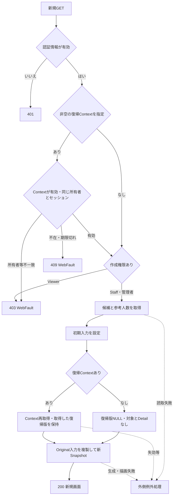

外側例外処理は、応答開始前のWebFaultならその状態、その他例外なら503のHTMLエラーである。

#### SQL・テーブル関連（ER図）

学生INSERTは行わない。複数表の候補取得を行うため、読取依存を図示する。人数集計と表示JOINはFKを表す矢印ではない。

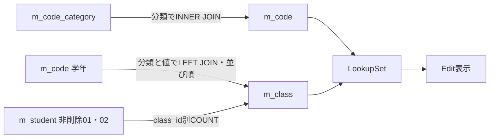

根拠：`Core/SqlServerStudentService.cs:201-214`。

#### DB操作の詳細

コード取得は`m_code`と`m_code_category`を`category_id`でINNER JOINし、両方の利用状態から候補IsActiveを算出する。WHEREはなく、分類・表示順・コード値で並べる。クラス取得は学年コードへ分類・値でLEFT JOINし、全クラスを年度降順・学年表示順・クラス表示順・コード・IDで並べる。現在人数はクラス一致・非削除・在籍01または02のCOUNTで求める。抽出パラメータ、ページング、件数上限はない。2結果をSNAPSHOT内で読み終えてcommitする。根拠：`Core/SqlServerStudentService.cs:196-216`。

#### 結果・例外時の扱い

正常時は200の新規画面となる。認証情報不正は401、Viewerは403、指定復帰先の不在・期限切れは409、所有者・セッション不一致は403である。候補取得後のContext再取得でも拒否が生じ得るため、入口の検査成功だけで表示成功を保証しない。根拠：`Infrastructure/RequestIdentity.cs:7-15`、`Infrastructure/SearchContextStore.cs:13-13`、`Web/Controllers/StudentsController.cs:25-25`。

参考設計は必須コード不足時の保存不可、クラス0件時のW-STU-108案内を求める。現行は候補0件でも専用警告や保存ボタン非活性を生成しない。保存時のコード存在・在学休学のクラス必須検査と、表示時に要求された案内責務を分ける。根拠：`reference-designs/基本設計書/02_学生登録画面.md:175-192`、`Infrastructure/WebStudentCoordinator.cs:17-17`、`Core/StudentNormalizer.cs:154-154`、`Core/SqlServerStudentService.cs:347-355`。

### EV-REG-002 既存学生の編集・参照表示

#### 処理概要

GET `/students/{id:long}`で非削除の学生1人を読み込み、権限に応じ編集または参照を表示する。対象不在を新規表示へ置き換えない。根拠：`Web/Controllers/StudentsController.cs:24-25`、`Infrastructure/WebStudentCoordinator.cs:17-17`。

#### 処理手順

1. 認証情報の参照可否と、非空復帰先の有効性・所有者・セッションを確認する。
2. GetAsyncへ対象IDを渡す。サービスはIDが0以下ならNULLを返し、正数ならID一致・非削除の学生を取得する。
3. 対象がなければ404・E-STU-103で終了する。
4. 保存業務値、読取版、更新日時・者をDetailへ移す。生年月日は和暦4入力、在籍日付はISO文字列、期待版は十進文字列へ戻す。
5. 人数あり候補を取得する。所属ClassIdに対応する年度・学年を入力補助へ移し、所属なしの既存学生には当年度を補わない。
6. 復帰版を取得し、新SnapshotへOriginal入力の複製とDetail参照を保持する。
7. Staff・Administratorは編集、Viewerは参照を表示する。既存学籍番号はreadonlyとする。

根拠：`Core/SqlServerStudentService.cs:172-216`、`Web/Inputs/StudentSaveInput.cs:44-54`、`Infrastructure/EditorSnapshotStore.cs:7-11`、`Web/Models/StudentEditPageModel.cs:14-14`。

#### 処理フロー

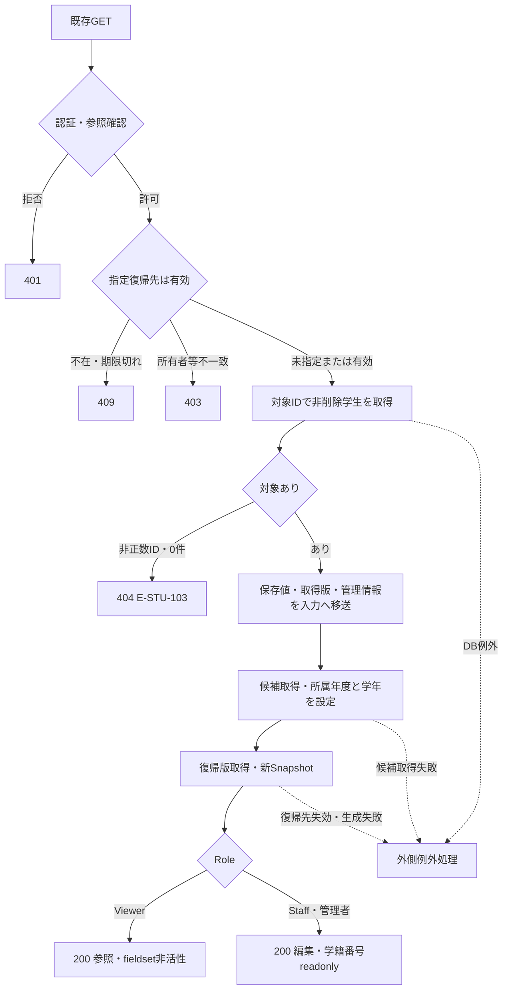

#### SQL・テーブル関連（ER図）

学生本体は単一表で読み、候補は別の読取単位で取得する。本体単独のER図は省略し、候補・Snapshotへの移送関係を示す。

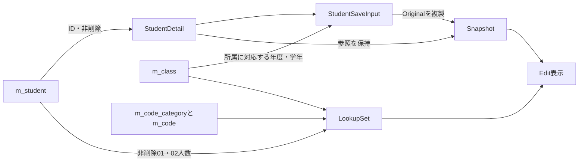

根拠：`Core/SqlServerStudentService.cs:176-216`、`Web/Inputs/StudentSaveInput.cs:46-54`、`Infrastructure/EditorSnapshotStore.cs:9-11`。

#### DB操作の詳細

本体SQLは`SELECT * FROM dbo.m_student WHERE student_id=@id AND is_deleted=0`、パラメータは`@id BigInt`である。主キー条件により0件または1件で、名称JOIN、ORDER BY、ページングはない。本体読取と候補取得は同じSNAPSHOTトランザクションではない。候補SQLはEV-REG-001と同じで、人数を含める。DB書込みはない。根拠：`Core/SqlServerStudentService.cs:172-181,196-216`。

#### 結果・例外時の扱い

正常時は200の編集・参照画面、対象不在・削除済みは404となる。存在する停止・期間外の既存コード・所属は読込時同値として保持可能にするが、保存時には最新の存在・状態条件を再検査する。根拠：`Views/Students/Edit.cshtml:8-13`、`Core/SqlServerStudentService.cs:347-383`。

表示処理には局所catchがない。参照・復帰先のWebFaultは外側へ伝播し、学生・候補取得等のその他例外は応答開始前なら503のHTMLエラーとなる。根拠：`Web/Controllers/StudentsController.cs:25-25`、`Infrastructure/WebHostSetup.cs:23-23`。

### EV-REG-003 入力補助と未保存状態

#### 処理概要

表示済みクラスoptionから年度・学年を同期し、上位値に合わないクラスを解除する。業務入力の変更はdirty状態を記録し、画面の確認キーを解除する。最終的な日付・在籍・所属の妥当性は保存時に検査する。根拠：`wwwroot/js/site.js:2-8`。

#### 処理手順

1. クラス変更時、選択optionにdata-yearがあれば、そのdata-year・data-gradeを年度・学年へ設定する。空の未所属optionでは上位値を変更しない。
2. 年度・学年変更時、現在クラスがあり、指定された非空上位値とoption属性が不一致ならクラスだけを空にし、解除をalertで通知する。空の上位値ではその条件の不一致検査を行わない。
3. 業務フォームのinputイベントでdirty=trueとし、hiddenの`Input.DuplicateToken`を空にする。
4. dirtyかつleaving=falseの間はbeforeunloadで離脱警告を要求する。
5. フォーム送信時、ボタンまたはフォームに確認文があればwindow.confirmを行う。取消なら送信を止め、受理後はleaving=true、送信ボタン以外の同フォームのボタンをdisabled、フォームをaria-busy=trueにする。

根拠：`wwwroot/js/site.js:2-5,8-8`、`Views/Students/Edit.cshtml:12-17`。

#### 処理フロー

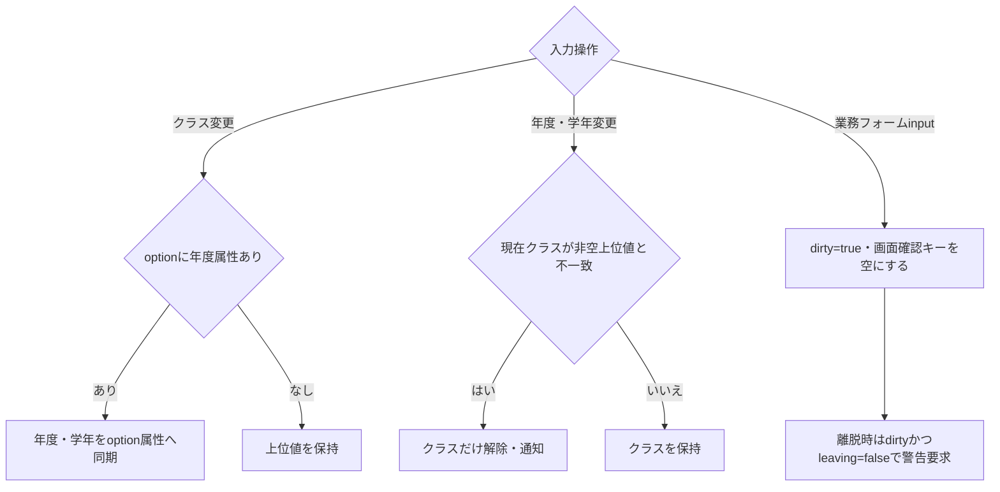

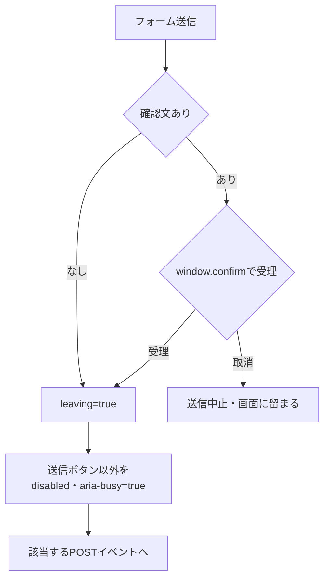

#### SQL・テーブル関連（ER図）

保持領域はDOM上の入力・option属性・hidden確認キーとJavaScriptのdirty・leavingである。このイベントからDBやSnapshotを変更する要求は送らず、DBのER図は非該当である。根拠：`wwwroot/js/site.js:2-8`。

#### DB操作の詳細

DB操作はない。候補再取得、クラス候補の絞込み表示、参考人数更新、在籍変更による終了日非活性化、即時和暦検査はこの接続JavaScriptにはない。宣言されたCoordinator.Optionsを登録画面の候補APIとして扱わない。`POST /students/options`は検索フォームのCriteriaを受ける別処理である。根拠：`Infrastructure/WebStudentCoordinator.cs:16-16`、`Web/Controllers/StudentsController.cs:22-27`、`wwwroot/js/site.js:8-8`。

#### 結果・例外時の扱い

不適合クラスを解除しても上位値と他の業務入力は保持する。クラス変更後に人数を再表示しないため、表示人数を新しい選択の最新値として使用しない。保存時のゲート下の最新人数検査が確定判断となる。根拠：`wwwroot/js/site.js:8-8`、`Core/SqlServerStudentService.cs:377-380`。

参考設計は即時和暦検査、区分別条件表示、候補と人数の再取得、有効学年の新規選択を求める。現行の同期・解除だけでこれらを充足したとは扱わない。根拠：`reference-designs/基本設計書/02_学生登録画面.md:160-167,264-280`。

送信表示には同一送信を拒否する検査がなく、送信ボタン自身も非活性にしない。UIの再入防止・旧応答無視という設計意図は詳細参考資料158～159行にあり、DB書込ゲートと確認Busyとは別責務である。根拠：`wwwroot/js/site.js:4-4`、`reference-designs/詳細仕様書/CSharp_ASPNET/02_学生登録画面.md:158-159`、`Core/SqlServerStudentService.cs:92-102,278-278`。

### EV-REG-004 新規登録・更新

#### 処理概要

入力を正規化し、ゲート取得後の最新対象・マスタ・人数・同一人物候補を検査して、学生1件と履歴1件を一括保存する。変更なし、確認待ち、入力不正、権限不足、対象不在、版競合、処理失敗、結果不明を別の結果として扱う。根拠：`Web/Controllers/StudentsController.cs:26-33`、`Core/SqlServerStudentService.cs:227-324`。

#### 処理手順

1. **S1：Web入口。** 認証・CSRF検査後、FormGuard→作成更新権限→Snapshot取得→指定復帰先検査→Originalの復帰先との一致の順に確認する。これらは局所catchの外である。不明項目・不正重複等は400、Snapshot不在・期限切れは409、所有者・セッション・対象・復帰先の不一致は403となる。
2. **S1：要求への変換。** 先行検査後にModelStateを判定する。不正ならサービスを呼ばず422。正常ならCoordinatorで権限と復帰先を再確認し、ClassId・期待版を正のInt64へ変換してSaveRequestを作る。この範囲のWebFaultは局所catchでHTTP状態と項目エラーを保持して再表示する。
3. **S2：サービス事前検査。** 受付UUID、認証主体、開始時UTC時点・業務日を取得する。ViewerはForbidden。19項目、理由、対象IDと期待版の設定組合せ・正数、年度1900～9998、任意学年形式をDB接続前に検査する。InputValidationException・ArgumentExceptionはValidationFailedとなる。
4. **S2：DB開始。** 接続とReadCommittedトランザクションを開始する。保存try内でXACT_ABORTとトランザクション所有のExclusive書込ゲートを取得する。接続・Tx開始は保存tryの外である。
5. **S3：更新対象。** 更新だけ最新のID一致・非削除学生を読む。不在はNotFound、期待版不一致はConflict、学籍番号変更はValidationFailed。卒業・退学から別区分への変更では管理者と理由を要求する。新規のprevious・previousVersionはNULL、更新で取得したprevious・版は以後も保持する。
6. **S3：最新マスタ・所属。** 性別・都道府県・在籍・設定された続柄の存在を検査する。新規・変更コードは利用状態・期間も要求する。クラス指定時は存在・指定年度学年一致を検査し、増席時は利用可・現在期間・最新人数と定員、終了区分の所属期間変更時は期間重なりを検査する。
7. **S4：差分。** 正規化業務値、2照合キー、続柄分類を最新DB値と比較する。差分なしなら明示rollbackし、NoChangeと対象ID・取得版を返す。理由・年度・学年・確認キーだけの変更は差分に含めない。差分ありの場合だけ版上限、番号一意、全候補、確認照合へ進む。
8. **S4：一意・候補。** 削除済みを含む自分以外の全学生について番号使用済みを検査する。同一人物候補は非削除・自分以外・生年月日一致・氏名キーまたはカナキー一致でID順に全件取得する。
9. **S4：確認。** 確認キーが非NULLなら、所有者・セッション・対象・期待版・内容・全候補・開始時点に対する期限・Busyを照合する。有効でも理由なしならValidationFailed。候補あり、または確認キー非NULLで、確認が無効ならrollback後に新確認キーを発行し、ConfirmationRequired、対象ID・取得済み版、全件数・最大20件を返す。
10. **S5：書込み。** 確認不要または確認済みなら、writeStarted=trueとして学生INSERTまたは条件付きUPDATEを行う。新規は採番ID・版1、更新は既存ID・取得版+1を得る。UPDATEのOUTPUTなしはDBConcurrencyExceptionとなる。
11. **S5：確定。** 同じTxでCREATEまたはUPDATE履歴1件を追記し、commitAttempted=trueとしてcommitする。成功時だけ確認キーを除去しSavedとID・新版を返す。
12. **S6：画面受渡し。** Savedだけ通知保持・303へ進む。非Savedは結果別HTTPと入力再表示へ進み、送信Input、読込時Detail、同じSnapshot・復帰版、再取得候補を組み合わせる。例外はSCの順序で分類する。

入口の根拠：`Web/Controllers/StudentsController.cs:29-33`、`Infrastructure/WebStudentCoordinator.cs:18-18`、`Web/Inputs/StudentSaveInput.cs:34-43`。サービス順序の根拠：`Core/SqlServerStudentService.cs:227-324,344-390`。

Snapshot・復帰先の検査はサービス呼出し前であり、DB確定直前の再検査はない。業務日・確認期限比較はSaveAsync開始時のnowを使い、ゲート待機後に時点を取り直さない。一方、対象版・コード・クラス・増席人数・全候補はゲート取得後に読み直す。根拠：`Web/Controllers/StudentsController.cs:29-31`、`Core/SqlServerStudentService.cs:229-278`。

#### 処理フロー

**S1：入口検査と要求変換。** 事前拒否は外側HTML、ModelState不正・局所WebFaultはS6再表示、正常要求はS2へ渡す。

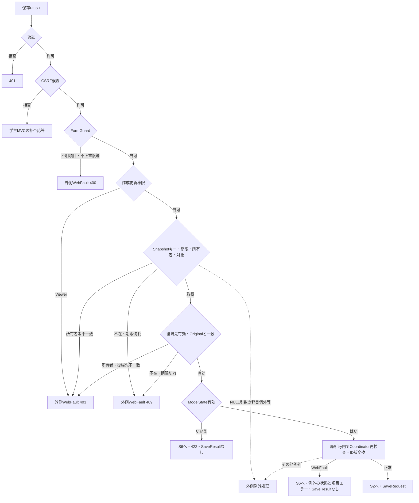

**S2：正規化・DB開始。** サービスの結果はS6、保存try内の例外はSC、try外の例外は外側処理へ渡す。

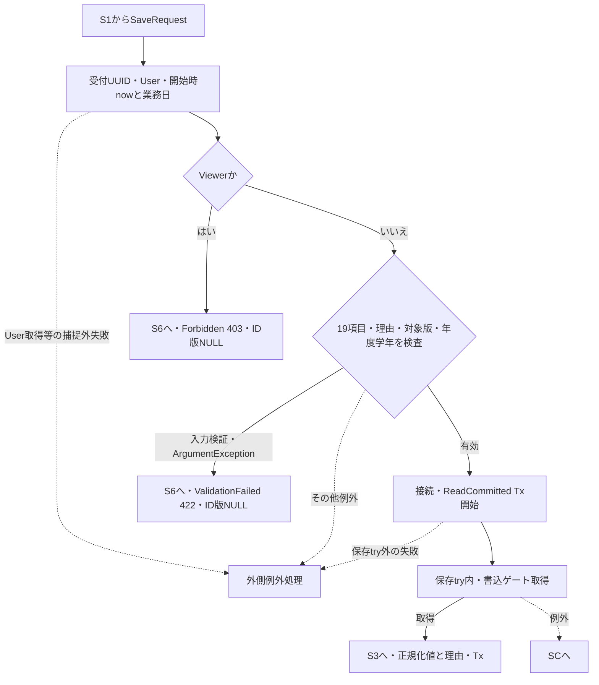

**S3：最新対象とマスタ・所属。** 新規と更新の前値・前版を別に設定し、取得済み情報を合流点で消さない。

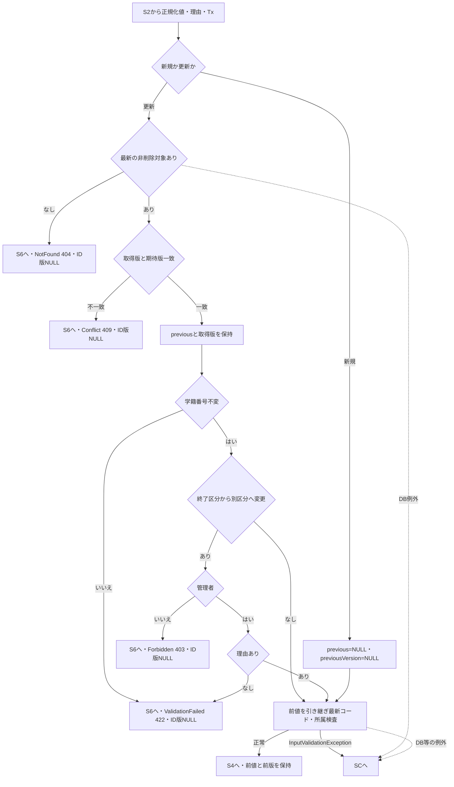

**S4：差分・番号・候補確認。** NoChangeは番号一意・候補・確認照合より前に終了する。

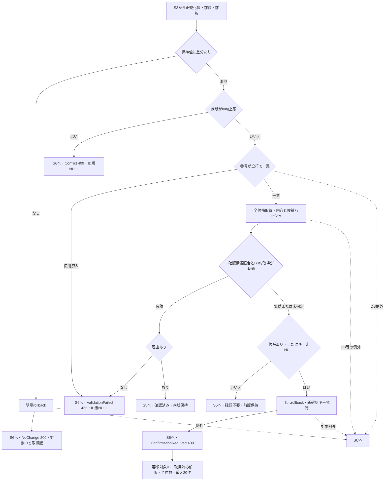

**S5：学生・履歴の書込みとcommit。** 書込直前とcommit直前のフラグを例外分類へ渡す。

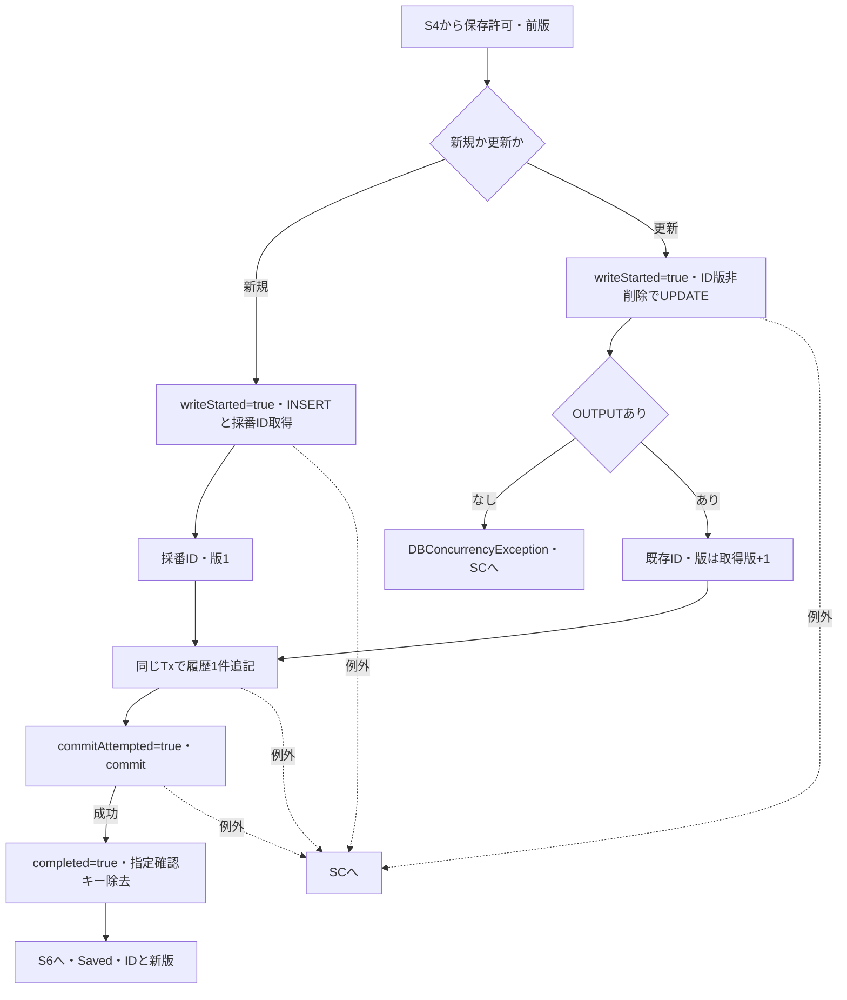

**SC：保存tryのcatch順。** 最後のcatchに到達した対象例外だけを結果不明条件で分類する。

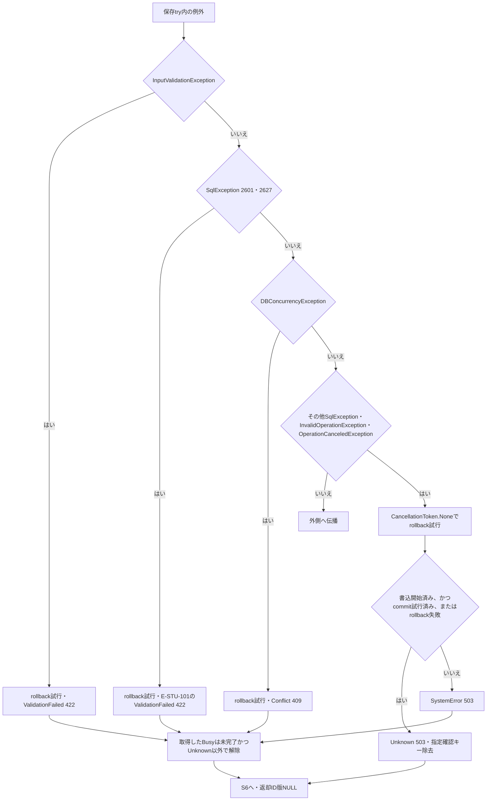

SCのQは、**書込開始済み、かつ（commit試行済み、またはrollback失敗）**を意味する。書込開始前ならrollback失敗だけでUnknownにはならない。先行3catchはQへ進まない。捕捉外の例外でもfinallyは実行され、claimedがある未完了・Unknown以外の場合にBusyを解除してから伝播する。根拠：`Core/SqlServerStudentService.cs:316-329`。

**S6：結果と画面の受渡し。** 各流入枝のHTTP・ID・版・確認値を引き継ぐ。

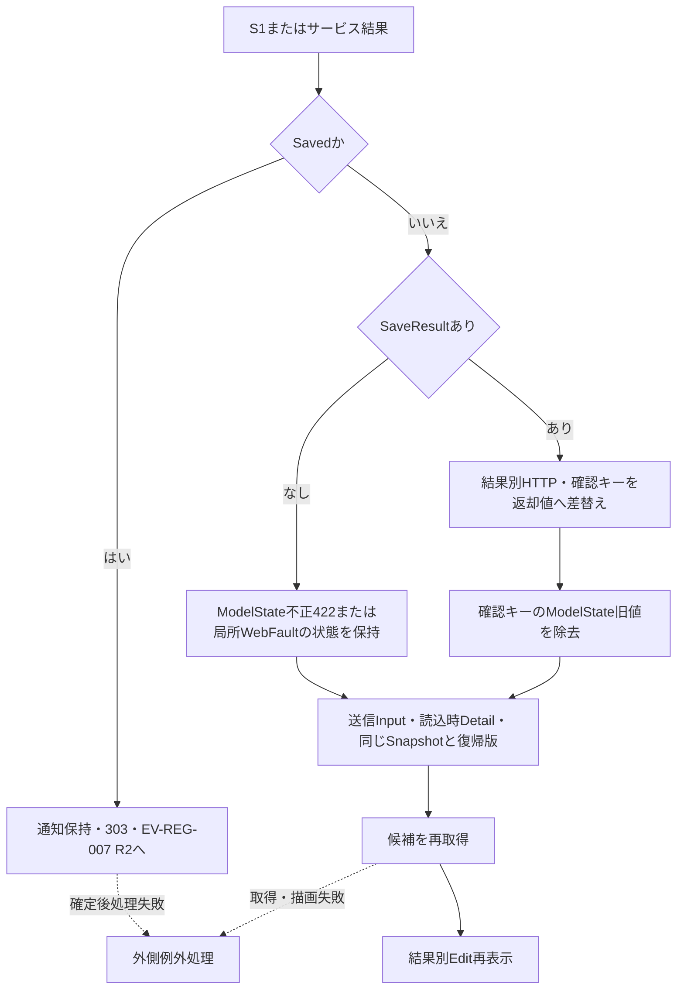

図Qの条件は本文の括弧付き条件と同じであり、合流後の結果値を一つの固定HTTPやNULL版へ置き換えない。

#### SQL・テーブル関連（ER図）

実FKの関係は次のとおりである。必須の性別・都道府県・在籍は分類と値の複合FK、続柄は任意の分類付きFK、所属は任意のクラスFKである。

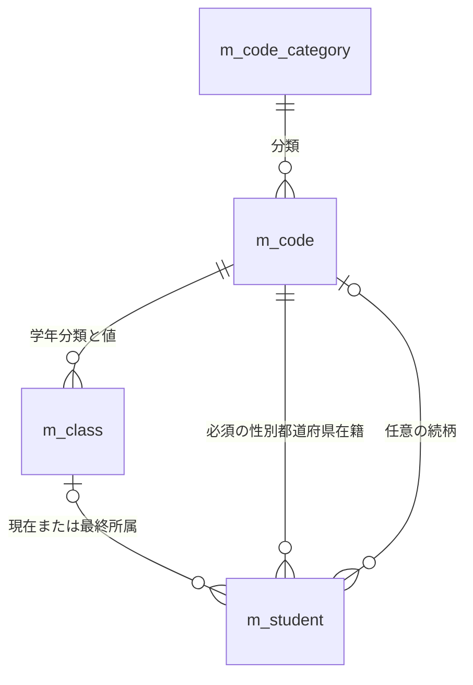

履歴は学生へのFKではなく、同一Txの追記依存である。

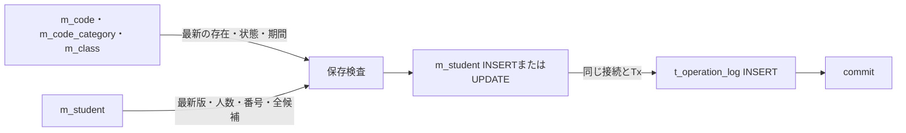

根拠：`database/001_schema.sql:137-154,189-199`、`Core/SqlServerStudentService.cs:307-315`。

#### DB操作の詳細

接続構築時は暗号化必須・証明書信頼falseを設定し、接続後に現在DBのSNAPSHOT許可状態を確認する。業務コマンドは30秒タイムアウトで、DB呼出しへ取消トークンを渡す。書込ゲートは資源`test-project1:student-write`、Exclusive、Transaction所有、待機5000msで、負の戻り値はSQL例外となる。根拠：`Core/SqlServerStudentService.cs:39-73,92-102`。

| DB操作 | 対象・条件・順序 | パラメータ型・Size | 結果・用途 |
| --- | --- | --- | --- |
| 更新対象取得 | `m_student`のID一致かつ非削除。JOIN・ORDER BY・ページングなし | `@id BigInt` | 0件はNotFound。取得版不一致はConflict。保存前値を保持する。 |
| コード検査 | `m_code`と分類表を分類でINNER JOIN。分類・コード値一致 | `@category VarChar(24)`、`@value VarChar(10)` | 存在なしE-STU-009。新規・変更値の利用状態・期間不正E-STU-011。 |
| クラス検査 | `m_class`のID一致。年度、学年、期間、利用可否、定員を取得 | `@id BigInt` | 存在なしE-STU-010、上位不一致E-STU-014、増席不可E-STU-013、期間重なりなしE-STU-108。 |
| 増席人数 | クラス一致・非削除・01または02・自分以外。新規ID NULLは対象除外なし | `@class BigInt`、`@id BigInt` | COUNT_BIG＋1が非NULL定員を超えればE-STU-102。 |
| 番号一意 | 番号一致、ID NULLまたは自分以外。削除条件なし | `@no VarChar(15)`、`@id BigInt` | COUNT_BIGが正ならE-STU-101。 |
| 同一人物候補 | RowSelectに非削除・自分以外・生年月日一致・氏名キーまたはカナキー一致を追加。ID昇順 | `@id BigInt`、`@birth Date`、`@name NVarChar(320)`、`@kana NVarChar(36)` | 全件取得。TOP・ページングなし。画面返却だけ最大20件。 |
| 学生INSERT | 正規化19値・照合キー2・続柄分類、固定3分類、未削除、作成更新情報、版1を設定 | 項目表の同名パラメータ、`@now DateTimeOffset`、`@actor NVarChar(128)` | OUTPUTを表変数に受け、採番IDを取得する。 |
| 学生UPDATE | 学籍番号以外の正規化値・派生値と更新日時・者・版加算をSET。WHEREはID・期待版・非削除 | 更新項目の同名パラメータ、`@id/@version BigInt`、`@now DateTimeOffset`、`@actor NVarChar(128)` | OUTPUTなし・DBNullはDBConcurrencyException。作成情報・番号・固定3分類・削除情報を変更しない。 |
| 履歴INSERT | 対象表m_student、キーはID文字列。変更列名JSONを1件追記 | `@id VarChar(35)`、`@op VarChar(11)`、`@before/@after BigInt`、`@changed NVarChar(max)`、`@actor NVarChar(128)`、`@now DateTimeOffset`、`@request UniqueIdentifier`、`@reason NVarChar(120)`、`@confirmed Bit` | CREATEは前版NULL・後版1、UPDATEは取得版・取得版+1。候補存在時に確認フラグtrue。 |

SQL根拠：`Core/SqlServerStudentService.cs:247-272,294-307,347-390`。RowSelectのJOINはクラスID、クラス学年分類と値、学生在籍分類と値、学生都道府県分類と値のLEFT JOINである。候補に電話・メールの一致条件は含めない。根拠：同ファイル`82-90,269-272`。

| 所属・在籍の保存状態 | クラス条件 | 人数・定員条件 |
| --- | --- | --- |
| 新規在学・休学、別クラスへの異動、終了区分から在学・休学への訂正 | 存在、指定年度学年一致、利用可、業務日が期間内 | 自分以外の非削除01・02人数＋1を定員と比較する。 |
| 在学・休学の同じクラスの席を保持 | 存在、指定年度学年一致 | 増席でないため、停止・期間外・既存定員超過だけでは拒否しない。 |
| 新規卒業・退学、または最終所属・区分・入学日・終了日を変更 | 指定時は存在・上位一致、在籍期間とクラス期間の重なり | 席を消費しない。利用状態停止だけで一律拒否しない。 |
| 卒業・退学で所属・区分・在籍期間を保持し通常項目だけ変更 | 存在、指定年度学年一致。期間重なりの再検査条件に入らない | 席を消費しない。 |
| 卒業・退学でクラス未指定 | 年度範囲・学年形式は検査する。クラスの存在・上位一致は非該当 | 席を消費しない。 |

重なりは両端を含み、入学日がクラス終了日より後、または学生終了日がクラス開始日より前なら拒否する。終了日そのものがクラス期間内であることまでは要求しない。同一席保持時の見直し警告は現行結果に生成されない。根拠：`Core/SqlServerStudentService.cs:357-383`、`reference-designs/基本設計書/02_学生登録画面.md:624-646`。

NoChange・確認待ちは明示rollbackする。他の検査直接returnではcommitせず、未確定Txの破棄へ進む。catchのrollbackはCancellationToken.Noneで試み、SqlException・InvalidOperationExceptionをfalseへ変換する。履歴は業務値の前後コピーを保存せず、変更列名と前後版を記録する。根拠：`Core/SqlServerStudentService.cs:250-290,306-329,385-390`。

#### 結果・例外時の扱い

| 結果・入口拒否 | HTTP・表示 | ID・版・保持値 | 確定境界 |
| --- | --- | --- | --- |
| Saved | 通知保持後303 | 新規は採番ID・1、更新は既存ID・新版 | 学生・履歴のcommit成功後。検索復帰は別処理。 |
| NoChange | 200、変更なし通知 | 対象ID・取得版を返す。送信Input・読込時Detail・同じSnapshotを使用 | rollback。日時・版・履歴を変更しない。 |
| ConfirmationRequired | 409、候補領域 | 要求対象ID・取得版、新キー、全件数・最大20件。新規のID・前版はNULL | rollback後に確認待ち。学生・履歴を書かない。 |
| ValidationFailed | 422、入力再表示 | 返却ID・版NULL。入力・Snapshotを保持 | 正規化・番号・コード・所属・理由等の拒否。 |
| Forbidden | 403、入力再表示 | 返却ID・版NULL | サービスの権限拒否。入口の権限拒否とは応答経路が異なる。 |
| NotFound | 404、入力再表示 | 返却ID・版NULL | ゲート下で最新非削除対象なし。 |
| Conflict | 409、入力再表示 | 返却ID・版NULL。期待版を勝手に最新化しない | 版不一致、変更あり版上限、OUTPUTなし等。 |
| SystemError | 503、入力再表示 | 返却ID・版NULL | 最後の対象例外catchでUnknown条件に該当しない場合。 |
| Unknown | 503、検索確認を案内 | 返却ID・版NULL、指定確認キー無効化 | 最後の対象例外catchで、書込開始済み、かつ（commit試行済み、またはrollback失敗）。確定状態を断定しない。 |
| ModelState不正 | 422、入力再表示 | SaveResultなし、送信Input・読込時Detail・Snapshot | サービス呼出しなし。 |
| 局所WebFault | 例外の状態、項目エラーと再表示 | SaveResultなし、送信Input・読込時情報 | Coordinator・DTO変換等の局所try内。 |
| 事前WebFault | 例外の状態、外側HTML | 通常のEdit再表示に入らない | FormGuard・権限・Snapshot・復帰先の先行検査。 |

根拠：`Web/Controllers/StudentsController.cs:29-33`、`Infrastructure/WebPresentation.cs:23-23`、`Core/SqlServerStudentService.cs:226-226,262-262,290-323`。

非SavedではDuplicateTokenだけを結果のConfirmationTokenへ差し替え、ModelStateの旧値を除去する。NoChange・確認待ちの返却ID・版を一律NULLとして扱わない一方、その返却版で画面の期待版・更新日時・更新者を自動最新化する処理もない。根拠：`Web/Controllers/StudentsController.cs:32-33`。

保存tryの先行3catchはそれぞれ入力検証、SQL一意違反2601・2627、DBConcurrencyExceptionを処理し、rollback失敗を理由に後段Unknown判定へ進まない。SQL一意違反の分類は発生箇所を区別せずE-STU-101へ変換する。最後の対象例外catchだけが括弧付きUnknown条件を使う。根拠：`Core/SqlServerStudentService.cs:316-323`。

ToRequestが補うのはBirthDateInput本体のNULLだけである。有効元号でYear・Month・DayがNULL、またはAdmissionDateがNULLなら、Normalize呼出しでNullReferenceExceptionが生じ得る。これはInputValidationException・ArgumentExceptionの捕捉を通らず外側へ伝播する。通常の形式不正・元号境界不正・不正UnicodeのArgumentExceptionは入力エラーへ変換する。HTTP欠落・空欄が各値へ何としてバインドされるかは、このサービス単体の分岐とは分ける。根拠：`Web/Inputs/StudentSaveInput.cs:34-42`、`Core/JapaneseDateService.cs:19-24,52-59`、`Core/StudentNormalizer.cs:123-143`、`Core/SqlServerStudentService.cs:232-243`。

接続・Tx開始、捕捉対象外例外、結果後の候補再取得・描画、Saved後の通知・303は保存catchの外で失敗し得る。外側middlewareは応答開始前のWebFaultの状態を引き継ぎ、その他例外を503のHTMLと検索リンクへ変換する。応答開始後はこのcatchの対象外である。根拠：`Core/SqlServerStudentService.cs:241-243`、`Web/Controllers/StudentsController.cs:31-38`、`Infrastructure/WebHostSetup.cs:23-23`。

### EV-REG-005 同一人物候補の確認続行・取消

#### 処理概要

氏名またはカナの照合と生年月日が一致する学生を確認候補として表示する。候補一致は同一人物の断定や登録禁止ではない。確認待ちで保存Txを終了し、別人と判断した理由を付けて同じ保存入口へ再送する。根拠：`Core/SqlServerStudentService.cs:269-290`、`Views/Students/Edit.cshtml:14-14`、`reference-designs/基本設計書/02_学生登録画面.md:61-72`。

#### 処理手順

1. 全候補件数と先頭最大20件の学籍番号・氏名・和暦生年月日・クラス名を表示する。住所・電話・メールを候補表へ出さない。
2. 取消ボタンにautofocusを付ける。取消時は画面の確認キーを空にし、候補sectionを除去する。入力を保持し、DB・サーバー確認辞書を直接変更しない。
3. 続行時は理由と確認キーを伴う同じcreateまたはupdateフォームを送る。ブラウザーの送信確認を取消した場合は送らない。
4. 保存S1～S3の入口、正規化、最新対象・版、コード・所属・定員検査を再実行する。
5. **C2の差分判定**へ進み、差分なしなら確認照合より前にrollbackして200・NoChange、対象ID・取得版を返す。番号一意・全候補取得・確認情報照合は差分ありの場合に限る。
6. 差分ありではS4の版上限・番号一意・全候補取得・確認照合を行う。有効確認でも理由なしは422、無効確認は新確認情報を返して409、保存許可時はS5の学生・履歴commitへ進む。

根拠：`Views/Students/Edit.cshtml:14-14`、`wwwroot/js/site.js:3-6`、`Core/SqlServerStudentService.cs:260-315`、`Web/Controllers/StudentsController.cs:30-33`。

#### 処理フロー

**C1：確認操作。** 続行の出口はC2、取消は画面内終了である。

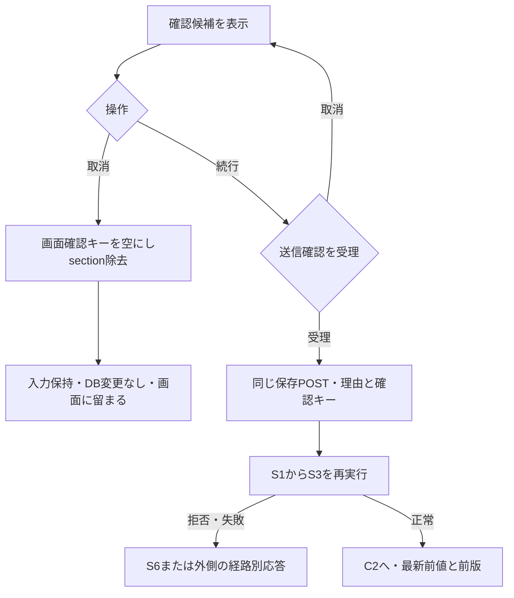

**C2：差分と確認。** NoChangeを候補照合へ合流させない。

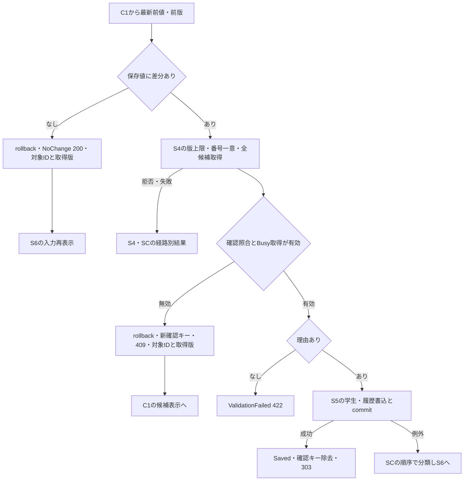

#### SQL・テーブル関連（ER図）

続行はEV-REG-004の実FK・同一Tx関係を使用する。取消はDOMだけの処理である。確認情報と保存値の依存を図示する。

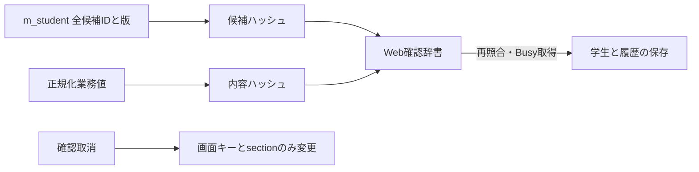

根拠：`Core/SqlServerStudentService.cs:224-225,274-290,330-335`、`wwwroot/js/site.js:6-6`。

#### DB操作の詳細

差分なしでは候補SQL・確認情報照合を実行しない。差分ありの候補SQLはEV-REG-004と同じで、全候補ID・版を確認対象とする。表示最大20件だけでは照合しない。内容ハッシュは保存業務値を対象とし、name_key・kana_key・relationship_category、理由・年度・学年は含まない。ただし理由・年度・学年の個別検査は再送時も行う。根拠：`Core/SqlServerStudentService.cs:224-225,234-237,260-290`。

Web確認情報は所有者Principal・SessionId、対象ID・期待版、内容・全候補ハッシュ、10分期限、Busyを保持する。期限は開始時nowより後、Busyは0→1取得を要求する。確認待ちは保存Txをrollbackしてから発行する。根拠：`Core/SqlServerStudentService.cs:19-29,278-290,330-335`。

成功時と最後の対象例外catchでUnknownとなった場合に指定確認キーを除去する。確認Busy取得後に未完了でUnknown以外ならfinallyでBusyを解除する。取消・入力変更によるhidden解除では元辞書項目を即時削除しない。期限切れ項目は新しい確認情報発行時に除去する。根拠：`Core/SqlServerStudentService.cs:313-335`、`wwwroot/js/site.js:3-6`。

#### 結果・例外時の扱い

続行時に元の業務値へ戻していれば、最新マスタ検査後にNoChangeで終了し得る。理由だけの変更でも差分なしとなる。NoChangeは200で入力画面を返し、更新日時・版・履歴を増やさない。根拠：`Core/SqlServerStudentService.cs:260-262`、`Web/Controllers/StudentsController.cs:30-33`。

差分ありでは候補変更、期限切れ、所有者・対象・版・内容不一致、Busy取得失敗を再確認へ進める。参考設計はW-STU-102の相違通知を求めるが、現行ConfirmationRequiredのErrorsは空である。取消にはautofocusがあるが、続行のwindow.confirmの既定操作をコードで取消へ指定していない。根拠：`Core/SqlServerStudentService.cs:278-290`、`Views/Students/Edit.cshtml:14-14`、`wwwroot/js/site.js:4-4`、`reference-designs/基本設計書/02_学生登録画面.md:364-378`。

サービス引数の確認キーが空文字でも非NULLなら、候補0件で新しいConfirmationRequiredへ進み得る。画面で空にした値がバインド後にNULLか空文字となる境界と、この条件を区別する。根拠：`Core/SqlServerStudentService.cs:276-290`。

### EV-REG-006 論理削除

#### 処理概要

管理者が対象・期待版・理由・明示確認を指定して論理削除する。別フォームのため、編集中の業務値19項目を保存しない。削除属性・更新管理情報とDELETE履歴を一括確定する。根拠：`Views/Students/Edit.cshtml:17-17`、`Web/Controllers/StudentsController.cs:37-38`、`Core/SqlServerStudentService.cs:392-416`。

#### 処理手順

1. **D1：入口。** ブラウザーは理由を要求し、対象・理由の送信確認を行う。SnapshotId、ExpectedVersion、ReturnContextId、Confirmed=true、Reason、CSRF情報を送る。
2. ControllerはFormGuard→参照権限→対象Snapshot→読込時復帰先との一致を確認する。保存と同じModelState.IsValid分岐・局所WebFault catchはない。
3. Coordinatorは管理者→復帰先有効性→Confirmed→期待版正数変換の順に検査する。
4. サービスは管理者、理由の加工前・保存60スカラーと必須性、正のID・版、版がlong.MaxValueでないことを確認する。
5. **D2：DB処理。** 接続とReadCommitted Txを開始し、try内で共通書込ゲートを取得する。最新非削除対象の版を読み、不在はNotFound、版不一致はConflict。
6. ID・期待版・非削除をWHEREにし、削除属性・更新管理7列だけをUPDATEする。writeStarted=trueを設定し、更新件数1以外はDBConcurrencyExceptionとする。
7. DELETE履歴を同じTxで追記し、commitAttempted=trueとしてcommitする。成功時はSaved・対象ID・要求版+1。
8. **D3：結果。** Savedだけ通知・303へ進む。非Savedはエラー・HTTP状態設定後にLoadを行い、DB最新値・版・新Snapshotへ再読込する。

根拠：`Infrastructure/WebStudentCoordinator.cs:19-19`、`Web/Controllers/StudentsController.cs:37-38`、`Core/SqlServerStudentService.cs:392-416`。

#### 処理フロー

**D1：Webとサービスの事前検査。** 局所再表示catchを持たないWeb拒否は外側応答へ進む。

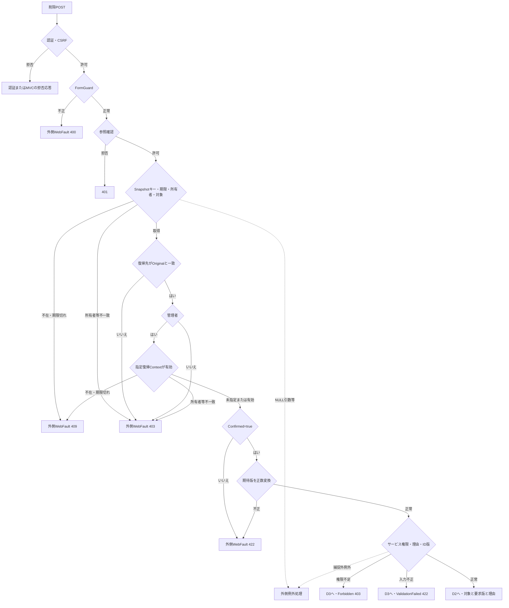

**D2：削除と例外分類。** 先行Conflictと後続一般対象例外を分ける。

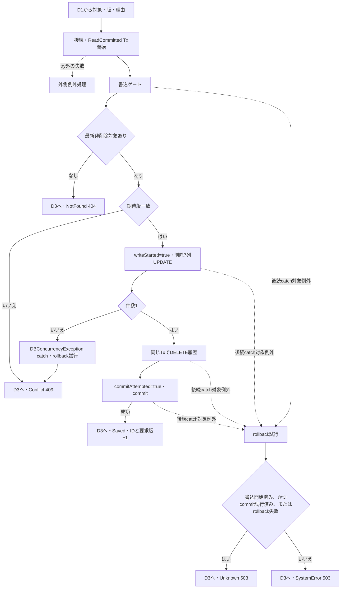

D2のUは、**書込開始済み、かつ（commit試行済み、またはrollback失敗）**である。後続catchの対象はSqlException・InvalidOperationException・OperationCanceledExceptionであり、先行DBConcurrencyExceptionはUへ進まない。捕捉対象外の例外は外側へ伝播する。根拠：`Core/SqlServerStudentService.cs:415-416`。

**D3：確定後復帰または失敗後Load。** Loadの成功と別の最終失敗を分ける。

```mermaid
flowchart TD
    A[削除結果] --> S{Saved}
    S -->|はい| R[通知・303・EV-REG-007 R2へ]
    S -->|いいえ| E[結果別HTTPとエラーを設定]
    E --> L[Load・最新学生と候補を再取得]
    L -->|成功| V[最新値と版・新SnapshotのEdit表示]
    L -->|対象不在・復帰先失効等| W[新たなWebFaultの状態で外側HTML]
    L -. その他取得・描画失敗 .-> X[応答開始前は503 HTML]
    R -. 確定後処理失敗 .-> X
```

#### SQL・テーブル関連（ER図）

学生と履歴の2表を書き込む。所属・コードのFK値は保持する。履歴関係は同一Txの追記依存であり、target_keyへの学生FKではない。

```mermaid
flowchart LR
    S[m_student 非削除対象の版] --> V[ゲート下の存在・版検査]
    V --> U[m_student 削除属性・更新管理だけUPDATE]
    U --> L[t_operation_log DELETE追記]
    L --> C[同じTxでcommit]
    U -->|削除後は除外| Q[通常読取・検索・クラス人数]
```

根拠：`Core/SqlServerStudentService.cs:404-414`、`database/001_schema.sql:137-154`。

#### DB操作の詳細

| 操作 | 設定・WHERE | パラメータ | 件数・結果 |
| --- | --- | --- | --- |
| 現在版取得 | `m_student`のID一致・非削除からrow_versionを取得 | `@id BigInt` | 0件NotFound、版不一致Conflict。 |
| 論理削除UPDATE | is_deleted=1、deleted_at・deleted_by・delete_reason、updated_at・updated_by、row_version+1。WHEREはID・期待版・非削除 | `@id/@version BigInt`、`@now DateTimeOffset`、`@actor NVarChar(128)`、`@reason NVarChar(120)` | 1件を要求。氏名・住所・日付・区分・所属・作成情報は保持する。 |
| DELETE履歴 | m_student、ID文字列、前版=要求版、後版=要求版+1、変更列名は削除更新7列、理由、確認フラグfalse | EV-REG-004の履歴パラメータ型 | 同じTxで1件追記後commit。 |

根拠：`Core/SqlServerStudentService.cs:385-390,404-414`。DDLは未削除時に削除日時・者・理由NULL、削除時に全設定を要求する。根拠：`database/001_schema.sql:200-200`。

件数不一致後に再存在確認は行わず、DBConcurrencyExceptionからConflictへ返す。参考設計の書込0件後再確認という意図で、現行の再読取を補わない。現行が不在と競合を分けるのは書込前の読取段階である。根拠：`Core/SqlServerStudentService.cs:404-415`、`reference-designs/基本設計書/02_学生登録画面.md:574-583,695-697`。

#### 結果・例外時の扱い

サービスのHTTP対応はEV-REG-004と同じだが、非Saved後は送信業務入力を保持する通常保存とは異なり、LoadでDB最新値・版・新Snapshotを作る。再読込成功時は削除結果のHTTP・エラーを伴う画面となる。対象消失・論理削除済み・復帰先失効・候補取得失敗ではLoadから別の最終エラーへ進み得る。根拠：`Web/Controllers/StudentsController.cs:25-25,37-37`。

理由検査の局所catchはInputValidationExceptionだけで、不正Unicode等のArgumentExceptionは外側へ伝播し得る。Tx内はDBConcurrencyExceptionを先にConflictへ変換し、後続の対象例外だけを括弧付き条件でSystemError・Unknownへ分類する。書込開始前のrollback失敗だけではUnknownにならない。根拠：`Core/StudentNormalizer.cs:37-57`、`Core/SqlServerStudentService.cs:396-416`。

削除後は通常読取・検索・人数から除外するが、番号一意検査には残る。論理削除を番号再利用、復元、物理消去、保存期間決定へ拡張しない。根拠：`Core/SqlServerStudentService.cs:137-137,176-176,201-201,264-266`。

### EV-REG-007 入力クリア・編集取消・再読込・検索復帰

#### 処理概要

取消は読込時Snapshot、再読込は最新DB、検索復帰は検索Contextを使用する。保存・削除の確定後303は、未保存入力の破棄確認とは別の経路である。根拠：`Web/Controllers/StudentsController.cs:8-11,25-25,35-38`、`Views/Students/Edit.cshtml:16-17`。

#### 処理手順

1. **R1：入力クリア・編集取消。** 送信確認後、FormGuard→参照権限→任意StudentId正数変換→Snapshot検査を行う。ModelStateをクリアし、Originalを複製する。新規は読込時初期値、既存は最後の読込時入力に戻す。Detail参照・SnapshotId・復帰版は同じ値を使用し、候補だけ再取得する。
2. **R1：再読込。** dirtyの場合だけ破棄確認を行う。受理後は既存GETで最新保存値・版・管理情報と新Snapshotを同時に取り直す。dirty=falseならdata-confirmがあっても確認を呼ばない。
3. **R1：手動復帰。** dirtyの場合だけ破棄確認し、受理後にInput.ReturnContextIdとModel.ReturnRevisionで検索GETへ移動する。取消なら現在入力に留まる。
4. **R2：確定後303。** Saved後、復帰ContextがNULLまたは空なら新Context・版1を作る。指定ありなら指定ContextとSnapshotの復帰版を使用する。所有者・セッション・Context別のFlashを保持し、ローカル検索URLのLocationと303を返す。
5. **R3：検索GETの指定有無。** contextIdがNULLまたは空なら新Contextを作り、Revision=1、Applied・LastResultなしの未検索表示へ進む。Resumeは呼ばない。非空指定時だけ既存Contextを取得してResumeへ進む。
6. **R4：指定Contextの再開。** Gate取得後に所有者・セッション・期限、要求版の文字列一致、版上限を再確認する。登録画面からのGET復帰はタブ引数なしである。
7. Appliedなしなら未検索結果を返して検索版を維持する。Appliedありなら保持条件で再検索し、LastResultを設定して版を増やす。正常終了時に期限を30分延長し、finallyでGateを解放する。
8. 検索GETはFlashを一度だけ取り出し、検索用候補を取得して表示する。Flash取得は後続候補取得より前に評価される。

根拠：`Web/Controllers/StudentsController.cs:8-11,25-25,35-39`、`Infrastructure/EditorSnapshotStore.cs:9-11`、`Infrastructure/SearchContextStore.cs:9-15`、`Infrastructure/WebStudentCoordinator.cs:14-14`、`Infrastructure/FlashMessageStore.cs:6-9`、`wwwroot/js/site.js:4-5`。

#### 処理フロー

**R1：取消・再読込・手動復帰。** 手動復帰の出口はR3であり、Context取得を固定の共通経路にしない。

```mermaid
flowchart TD
    A{操作} -->|入力クリア・編集取消| C{送信確認}
    C -->|取消| STAY[現在入力に留まる]
    C -->|受理| R[FormGuard・参照・ID変換・Snapshot検査]
    R -->|拒否・例外| X[経路別の外側応答]
    R -->|成功| O[ModelStateクリア・Original複製]
    O --> P[同じDetail参照・SnapshotId・復帰版を保持]
    P --> L[候補だけ再取得]
    L --> V[200 読込時入力・取消通知]
    A -->|再読込| D{dirty}
    D -->|いいえ| GET[EV-REG-002の既存GET]
    D -->|はい| Q{破棄確認}
    Q -->|取消| STAY
    Q -->|受理| GET
    A -->|手動検索復帰| D2{dirty}
    D2 -->|いいえ| RET[R3へ・入力のContextと保持復帰版]
    D2 -->|はい| Q2{破棄確認}
    Q2 -->|取消| STAY
    Q2 -->|受理| RET
    L -. 取得・描画失敗 .-> X
```

**R2：保存・削除確定後の303。** Contextあり枝の復帰版を、新規枝の版1へ上書きしない。

```mermaid
flowchart TD
    A[学生と履歴のSaved] --> C{復帰Context非空}
    C -->|なし| N[新Contextを作成・Revision=1・条件結果なし]
    C -->|あり| O[指定ContextとSnapshotの復帰版を保持]
    N --> F[所有者・セッション・Context別Flashを保持]
    O --> F
    F --> R[303・Contextと対応する版をLocationへ]
    R --> NEXT[R3の検索GETへ・Context指定あり]
    F -. 確定後処理失敗 .-> X[外側応答・学生commitとは別]
```

**R3：検索GETのContext指定有無。** 未指定はResume・Gate検査へ合流させない。

```mermaid
flowchart TD
    A[検索GET] --> U{認証・参照確認}
    U -->|拒否| E[401]
    U -->|許可| C{contextIdは非空}
    C -->|NULLまたは空| N[新Context・版1・AppliedとLastResultなし]
    N --> P[未検索表示データ・Resumeなし]
    P --> V[Flash取得・検索候補取得・200未検索表示]
    C -->|非空| G{既存Context取得}
    G -->|不在・期限切れ| W409[409 WebFault]
    G -->|所有者・セッション不一致| W403[403 WebFault]
    G -->|取得| NEXT[R4へ・既存Contextと要求版]
    V -. 候補取得等の失敗 .-> X[外側例外処理]
```

**R4：指定ContextのResume。** 未検索枝は版保持、検索済み枝は版加算を引き継ぐ。

```mermaid
flowchart TD
    A[R3から既存Context・要求版] --> G[Context.Useで取得・Gate待機]
    G --> C{待機後も存在・期限・所有者等が有効}
    C -->|不在・期限切れ| E[409]
    C -->|所有者等不一致| F[403]
    C -->|有効| V{要求版一致・版上限未到達}
    V -->|不一致または上限| E
    V -->|正常| P{Appliedあり}
    P -->|なし| N[未検索結果・検索版維持]
    P -->|あり| S[保持条件でSearchAsync]
    S -->|正常結果| R[LastResult設定・検索版+1]
    S -->|検証拒否・例外| X[結果からWebFaultまたは外側例外]
    N --> T[正常終了で期限延長]
    R --> T
    T --> L[finallyでGate解放]
    E --> L2[取得済みGateをfinallyで解放・409]
    F --> L3[取得済みGateをfinallyで解放・403]
    X --> L4[取得済みGateをfinallyで解放・経路別応答]
    L --> TAKE[Flashを一度取得・検索候補取得]
    TAKE --> VIEW[枝に対応する版・検索状態を表示]
    TAKE -. 後続失敗 .-> MW[外側例外処理]
```

Gate待機前の取得失敗・待機取消では、未取得のGateを解放する経路へ入らない。根拠：`Infrastructure/SearchContextStore.cs:14-14`。

#### SQL・テーブル関連（ER図）

取消は学生を再読取せず、Snapshotを使う。再読込は学生と候補、検索済み復帰は保持条件の検索SQLを使用する。複数の保持領域と読取依存を分けて示す。

```mermaid
flowchart LR
    SNAP[Snapshot Original・Detail参照] -->|取消| E[読込時入力のEdit]
    MASTER[コード・クラス・人数] -->|候補再取得| E
    STUDENT[m_student 最新値と版] -->|再読込| NEW[新Snapshot・Edit]
    MASTER --> NEW
    CONTEXT[SearchContext Applied・Revision] -->|Appliedありだけ| QUERY[学生検索・表示マスタJOIN]
    QUERY --> RESULT[再検索結果・版加算]
    CONTEXT -->|Appliedなし| UNS[未検索・版保持]
    FLASH[FlashMessageStore] -->|一度取得| VIEW[検索表示]
    RESULT --> VIEW
    UNS --> VIEW
```

根拠：`Web/Controllers/StudentsController.cs:8-11,25-25,35-39`、`Infrastructure/WebStudentCoordinator.cs:14-14`。

#### DB操作の詳細

取消は候補LookupAsyncだけを実行する。学生値・版はOriginalとDetailから戻し、Snapshot期限は延長しない。再読込の学生SQL・候補SQLはEV-REG-002と同じである。手動復帰のContext未指定枝とAppliedなし枝では学生検索を行わないが、検索画面表示のコード・クラス候補は取得する。検索用LookupAsync(false)の人数0は集計省略値である。根拠：`Web/Controllers/StudentsController.cs:35-35,39-39`、`Core/SqlServerStudentService.cs:196-216`。

Appliedありの復帰は、保持SearchCriteriaをSearchAsyncへ渡して再検索する。条件を保存学生に合わせて書き換える処理はない。検索条件とパラメータの対応は次のとおりである。

| 保持条件 | SQLへの適用 | パラメータ |
| --- | --- | --- |
| 共通 | `s.is_deleted=0`を必須とする | なし |
| 学籍番号 | 正規化後の前方一致。LIKEの特殊文字を!でエスケープ | `@no VarChar(31)` |
| 氏名・カナ | 生成した照合キーの部分一致。LIKE特殊文字をエスケープ | `@name NVarChar(642)`、`@kana NVarChar(74)` |
| 年度・学年・クラス | `c.school_year`、`c.grade_code`、`s.class_id`の一致 | `@year SmallInt`、`@grade VarChar(2)`、`@class BigInt` |
| 未所属 | `s.class_id IS NULL`。年度学年クラスとの同時指定を拒否 | なし |
| 在籍区分 | 指定値をINへ展開。空配列なら在籍条件なし | 各`@statusN VarChar(2)` |
| 都道府県 | `s.prefecture_code`一致 | `@prefecture VarChar(2)` |
| 電話 | 本人電話または緊急電話の正規化値一致 | `@phone VarChar(16)` |
| 入学日範囲 | 開始以上・終了以下の両端包含 | `@from/@to Date` |

根拠：`Core/SqlServerStudentService.cs:103-154`。指定学年・都道府県のコード存在、指定年度のクラス存在、指定クラスの上位一致を検索前に検査する。コード存在は分類・値、年度は年度一致、クラスはID一致の読取である。根拠：同ファイル`125-135,218-222`。

件数SQLは学生とクラスのLEFT JOINへ全条件を適用し、TOP10001件のCOUNT_BIGで上限を確認する。10000件超は一覧を返さない。通常は同じSNAPSHOT内でRowSelectのクラス・学年・在籍・都道府県LEFT JOINを使用し、許可された学籍番号・氏名キー・入学日・更新日時の順序とID昇順を副順序にしてOFFSET/FETCHする。ページサイズは20・50・100、`@offset/@size Int`である。根拠：`Core/SqlServerStudentService.cs:82-90,107-108,155-168`。

検索結果はStudentRowの一覧、件数、検索時点、上限超過、エラーを返す。0件はempty、上限超過はtooMany、通常結果はfoundとして表示し、Resume成功時にLastResult・検索版へ反映する。DBコマンドは30秒設定・取消トークン付きである。根拠：`Core/Contracts.cs:50-58`、`Infrastructure/WebStudentCoordinator.cs:14-14,20-21`、`Core/SqlServerStudentService.cs:65-66,156-168`。

#### 結果・例外時の扱い

取消成功は200・「入力を読込時の値へ戻しました。」で、同じSnapshotを再利用する。最新再読込は値・版・管理情報と新Snapshotを表示する。手動復帰のContext未指定は新Context・版1・未検索、指定ありのAppliedなしは取得した版を保持、Appliedありは再検索後の版を使用する。これらを共通の固定版へ合流させない。根拠：`Web/Controllers/StudentsController.cs:8-11,25-25,35-35`、`Infrastructure/WebStudentCoordinator.cs:14-14`。

Snapshotキー不在・期限切れは409、所有者・セッション・対象不一致は403。空文字は通常の辞書不一致から409となる。NULLの前置検査がないため、NULLが届けば辞書の引数例外が独自409より先行し得る。SearchContextStore.GetはNULLを明示的に409とするが、検索GET自体はNULL・空を新Context枝へ振り分ける。根拠：`Infrastructure/EditorSnapshotStore.cs:10-10`、`Infrastructure/SearchContextStore.cs:13-13`、`Web/Controllers/StudentsController.cs:9-10`。

非空Contextの期限切れ・版不一致・版上限は409で、自動初期化しない。参考検索設計が求める期限切れ時の初期化と現行拒否を区別する。根拠：`Infrastructure/SearchContextStore.cs:13-14`、`reference-designs/基本設計書/01_学生検索画面.md:366-388`。

参考設計は再読込の明示確認と破棄確認の取消既定を求める。現行リンク確認はdirty時だけで、window.confirmの既定操作・beforeunloadの実文言をコードで規定しない。根拠：`wwwroot/js/site.js:3-5`、`reference-designs/基本設計書/02_学生登録画面.md:453-468`。

学生commit、Flash保持、303、検索Resumeは別の境界である。確定後に復帰先が失効・更新されて検索復帰に失敗しても学生rollbackとは扱わない。Flash.Takeは除去を伴い、後続の検索候補取得に失敗した場合の通知再表示を保証しない。Unknownでは自動再送せず検索確認を案内する。根拠：`Web/Controllers/StudentsController.cs:11-11,31-39`、`Infrastructure/FlashMessageStore.cs:8-9`、`Core/SqlServerStudentService.cs:322-322,416-416`。

## 補足説明

### 受信・保持・確定の共通境界

StudentsControllerはAuthorizeと自動CSRF検証を使用する。設定上、要求本文65536バイト、フォーム値数128、非nullable参照型への暗黙required抑止がある。FormGuardは許可項目・和暦4構成値・制御項目と重複を検査するが、欠落値の補完、NULL排除、整数・bool変換成功を保証しない。保存はModelStateを判定し、削除・取消は同じ判定分岐を持たない。根拠：`Infrastructure/WebHostSetup.cs:14-18`、`Web/Controllers/StudentsController.cs:29-41`。

Snapshotは所有者・セッション・対象・期限を検査するが、タブを照合しない。検索Contextはタブも保持し、UseではGate待機後に状態・要求版を再確認する。ただし登録画面からのGET復帰はタブ引数を渡さない。確認情報は保存内容・全候補・期待版を再検査する。各領域の検査対象と時点を代用しない。根拠：`Infrastructure/EditorSnapshotStore.cs:7-10`、`Infrastructure/SearchContextStore.cs:9-14`、`Web/Controllers/StudentsController.cs:10-10`、`Core/SqlServerStudentService.cs:278-278`。

Web RoleとDB接続ユーザーの権限は別である。権限SQLはstudent_staffへ学生INSERT・UPDATE、履歴INSERTを許可し、学生物理DELETEと履歴UPDATE・DELETEを拒否する。student_adminのクラス・コード保守権限も別に宣言される。この宣言をWeb利用者ごとのDBロール対応や適用済み状態へ拡張しない。根拠：`Infrastructure/RequestIdentity.cs:13-16`、`database/003_web_permissions.sql:8-24`。

### 参考設計の意図と現行動作の対応

| 主題 | 設計意図 | 現行動作と対応が必要な点 | 根拠 |
| --- | --- | --- | --- |
| 初期候補不足 | 必須コード不足で保存不可、クラス0件で案内 | 表示時の専用警告・非活性分岐はない。保存時の存在・所属条件で拒否する。 | 参考基本`175-192`、`Infrastructure/WebStudentCoordinator.cs:17-17` |
| 即時入力補助 | 和暦検査、区分条件表示、候補・人数再取得 | 接続JavaScriptは上位同期・不適合クラス解除まで。最終検査は保存時。 | 参考基本`264-280`、`wwwroot/js/site.js:2-8` |
| 学年選択 | 新規は有効値、既存値は保持 | selectに利用状態・期間disabledなし。クラスなしで独立コード存在検査なし。 | 参考基本`160-167`、`Views/Students/Edit.cshtml:12-12`、`Core/SqlServerStudentService.cs:237-237,362-383` |
| 同じ席の保持 | 拒否せず見直し警告 | 増席でない拒否抑止はあるが、見直し警告は生成しない。 | 参考基本`624-646`、`Core/SqlServerStudentService.cs:357-383` |
| 確認情報の相違 | W-STU-102で再確認通知 | 新確認要求は返すがErrorsは空で、相違理由通知なし。 | 参考基本`364-378`、`Core/SqlServerStudentService.cs:278-290` |
| 郵便・日付表示 | 郵便3桁－4桁、入学終了日yyyy/MM/dd | 郵便は7桁のまま移送。日付はISOとtype=dateで実表示はブラウザー依存。 | 参考基本`125-146`、`Web/Inputs/StudentSaveInput.cs:49-50`、`Views/Students/Edit.cshtml:11-11` |
| 書込0件 | 存在再確認で不在と競合を分離 | 書込前は分ける。OUTPUTなし・削除件数不一致後は再確認せずConflict。 | 参考基本`574-583,695-697`、`Core/SqlServerStudentService.cs:303-318,411-415` |
| 再読込・破棄 | 明示確認、取消既定 | 再読込確認はdirty時のみ。window.confirmの既定操作は指定しない。 | 参考基本`453-468`、`wwwroot/js/site.js:4-5` |
| UI制御 | IsBusyで再入防止、RequestSequenceで旧応答排除 | 他ボタン非活性・aria-busyはあるが、再入拒否・要求連番はない。 | `reference-designs/詳細仕様書/CSharp_ASPNET/02_学生登録画面.md:158-159`、`wwwroot/js/site.js:4-8` |
| 期限切れ復帰 | 検索初期化 | 非空Context不在・期限切れは409。未指定の新Context生成とは別。 | `reference-designs/基本設計書/01_学生検索画面.md:366-388`、`Infrastructure/SearchContextStore.cs:13-14` |

表中の「参考基本」は`reference-designs/基本設計書/02_学生登録画面.md`を指す。参考資料のサービス名・共通処理名を現行クラスの存在根拠にしない。StrictJson、Coordinator.Options、WebPresentation.Saveは、この登録画面の公開APIとして接続されていない。根拠：`Infrastructure/StrictJson.cs:4-15`、`Infrastructure/WebStudentCoordinator.cs:16-19`、`Infrastructure/WebPresentation.cs:30-30`、`Web/Controllers/StudentsController.cs:23-38`。

### 実装者とIT担当者が確認する責務

本機能は、入力→型付き処理値→DB保存値→再表示の往復で確認する。参考設計はIT部門へ入出力・権限・画面からDBへの追跡・競合障害結果の確認を、実装工程へUnicode最大長・日付境界・停止候補・最終席競合・旧版・履歴失敗・結果不明を含む確認を求める。これは確認責務の定義である。根拠：`reference-designs/基本設計書/02_学生登録画面.md:685-689`、`reference-designs/詳細仕様書/CSharp_ASPNET/02_学生登録画面.md:749-753,789-795`。

| 確認対象 | 実装側の対応 | IT・業務側で判断する内容 |
| --- | --- | --- |
| 文字と空欄 | raw・正規化後・コード単位・DB容量・SQL Size、必須空欄と任意NULL、氏名原表記と照合キーを対応させる。 | 切捨て・意図しない補正がなく、表示表記と照合用表記を区別できること。 |
| 日付 | 和暦4原文字列、DateOnly、date、逆変換を対応させ、元年・元号境界・閏日・下限・業務日・在籍順序を確認する。 | 不正原入力が成功値に置き換わらず、日付の業務意味が保たれること。 |
| 受信境界 | 欠落・空・NULL・変換失敗、Snapshotキー・版・年度・Confirmed、ModelState・局所catch・外側応答を追跡する。 | 422の入力拒否、403・409の状態拒否、503の外側失敗を取り違えないこと。 |
| 候補・所属 | 新規選択・既存停止値保持・上位変更解除・席保持・増席・席解放を対応させる。 | 参考人数を予約と扱わず、休学も1席であることと最終所属の条件を判断できること。 |
| 同一人物確認 | 全候補ID・版、20件表示、内容・期限・所有者・Busy・理由・取消・NoChangeを確認する。 | 照合一致を同一人物の断定にせず、別人続行の理由と再検査を確認できること。 |
| 保存・削除 | 最新版、変更なし、番号全行一意、条件付きUPDATE、履歴一括commit、削除7列を対応させる。 | 不在・競合・確認待ち・変更なし・確定を区別し、削除が未保存業務値を保存しないこと。 |
| 障害・復帰 | catch順、書込開始・commit試行・rollback成否、catch外失敗、削除後Load、確定後303・Resumeを分ける。 | SystemError・Unknownと確定後の復帰失敗を区別し、結果不明時の次操作を検索確認後に判断すること。 |

家族による電話・メール共有は参考設計で許容され、現行の候補SQLにも連絡先重複だけを拒否する条件はない。個人情報保存期間、復元・物理消去、論理削除後の保持運用は運用判断として確定する必要があり、削除属性から決めない。根拠：`reference-designs/基本設計書/02_学生登録画面.md:679-687`、`Core/SqlServerStudentService.cs:264-272`。

### 関連文書の対応

本書は提供計画のBAS-STU-02の責務を担当する。次の関連文書は計画上のID・kind・相対pathを保持する。本応答では生成しておらず、他ジョブの生成状態も確認していないため、生成済みリンクとして扱わずpathを文字列で示す。

| 文書ID | kind | 相対path | 本書との対応・生成状態 |
| --- | --- | --- | --- |
| CSHARP_ASPNET-BAS-STU-01 | basic-design | `基本設計書/01_学生検索画面.md` | 呼出元・復帰先、検索条件と状態。未生成、リンク未設定。 |
| CSHARP_ASPNET-BAS-STU-03 | table-index | `基本設計書/03_テーブル仕様書.md` | 表関連・共通管理・保存排他・一時表の区分。未生成、リンク未設定。 |
| CSHARP_ASPNET-BAS-STU-04 | code-design | `基本設計書/04_コード設計書.md` | 5分類、初期定義、候補・名称保守契約。未生成、リンク未設定。 |
| CSHARP_ASPNET-BAS-STU-03-M_STUDENT | table-definition | `基本設計書/テーブル/01_m_student.md` | 業務値・派生値・管理列・制約の物理対応。未生成、リンク未設定。 |
| CSHARP_ASPNET-BAS-STU-03-M_CLASS | table-definition | `基本設計書/テーブル/02_m_class.md` | 年度内クラス、名称、期間、定員。未生成、リンク未設定。 |
| CSHARP_ASPNET-BAS-STU-03-M_CODE_CATEGORY | table-definition | `基本設計書/テーブル/03_m_code_category.md` | 分類・桁・利用状態。未生成、リンク未設定。 |
| CSHARP_ASPNET-BAS-STU-03-M_CODE | table-definition | `基本設計書/テーブル/04_m_code.md` | 保存コードと名称、期間・利用状態。未生成、リンク未設定。 |
| CSHARP_ASPNET-BAS-STU-03-T_OPERATION_LOG | table-definition | `基本設計書/テーブル/05_t_operation_log.md` | 一括確定する履歴、前後版・理由・変更列名。未生成、リンク未設定。 |
| CSHARP_ASPNET-DET-CSharp_ASPNET-SCR-STU-001 | detailed-specification | `詳細仕様書/CSharp_ASPNET/01_学生検索画面.md` | 検索Context・版・保持条件・Resumeの詳細。未生成、リンク未設定。 |
| CSHARP_ASPNET-DET-CSharp_ASPNET-SCR-STU-002 | detailed-specification | `詳細仕様書/CSharp_ASPNET/02_学生登録画面.md` | 本機能の実コントロール、受信型・移送・SQL・例外の詳細。未生成、リンク未設定。 |
