<!-- spec-meta: {"schema":"spec-md/1.0","documentId":"CSHARP_ASPNET-BAS-STU-02","version":"1.3","path":"基本設計書/02_学生登録画面.md","sheets":[{"heading":"概要","kind":"GRID","sheet":"学生登録_概要"},{"heading":"項目一覧","kind":"LIST","sheet":"学生登録_項目","key":["No"]},{"heading":"イベント仕様","kind":"GRID","sheet":"学生登録_イベント"},{"heading":"補足説明","kind":"GRID","sheet":"学生登録_補足"}]} -->
# 学生登録画面 基本設計書

| 文書属性 | 内容 |
| --- | --- |
| 文書ID | CSHARP_ASPNET-BAS-STU-02 |
| 文書種別 | 基本設計書（basic-design） |
| 版 | 1.3 |
| 正本path | 基本設計書/02_学生登録画面.md |
| 対象読者 | 業務システムのIT担当者、経験5年程度の実装者 |
| 対象機能 | 学生の新規登録・編集・参照、所属入力補助、同一人物候補確認、論理削除、取消・再読込・検索復帰 |
| 根拠表記 | 現行動作は原ソース、設計意図はreference-designsとして区別し、論理相対pathと原文の開始行・終了行を示す。 |

## 概要

### 業務の目的と管理単位

学生登録画面は、学生1人の基本情報、住所、本人と緊急連絡先、生年月日、入学・終了日、在籍区分、現在または最終所属クラスを管理する。新規・編集・参照は同じEditビューのモードである。通常保存の業務入力は19項目で、年度・学年は所属選択の補助、確認・変更理由は履歴用の入力として扱う。学生の実変更と操作履歴1件は同じトランザクションで確定する。根拠：`Core/Contracts.cs:9-30,66-70`、`Views/Students/Edit.cshtml:3-17`、`Core/SqlServerStudentService.cs:294-315`。

所属は学生の`class_id`に最大1件を保存する。在学01・休学02では現在所属が必須で、休学もクラス人数の1席に含める。卒業03・退学04では最終所属を任意とし、人数には含めない。年度・学年・クラス名称を学生へ複写せず、表示と整合検査で参照先クラスを使用する。根拠：`Core/StudentNormalizer.cs:151-157`、`Core/SqlServerStudentService.cs:201-214,357-383`。

参考設計では学生検索画面を呼出元・復帰先とし、クラス・コードを本機能の参照専用マスタとする。成績、学籍番号訂正、削除復元、物理消去、所属履歴一覧、将来異動予約、CSV・帳票・取込は設計上の対象外である。この範囲定義は設計意図であり、現行の接続処理は以下のイベント仕様で説明する。根拠：`reference-designs/基本設計書/02_学生登録画面.md:16-24,85-100`。

### モードと操作権限

対象IDなしでは新規、対象IDありでは編集可否に応じ編集または参照を表示する。`CanEdit`はRoleがViewer以外の場合に真となる。既存の学籍番号はreadonlyで、サービスも番号変更を拒否する。Viewerでは業務入力と保存ボタンを含む外側fieldsetをdisabledにする。取消・再読込・検索復帰はその外側に置く。根拠：`Web/Models/StudentEditPageModel.cs:5-14`、`Views/Students/Edit.cshtml:3-6,15-17`、`Core/SqlServerStudentService.cs:254-258`。

| モード | 定義された利用者・対象 | 入力・保存 | 学籍番号 | その他の操作 |
| --- | --- | --- | --- | --- |
| 新規 | Staff・Administrator、対象IDなし | 入力・登録可能 | 入力可能 | 入力クリア、検索復帰。再読込・削除は表示しない。 |
| 編集 | Staff、既存対象 | 入力・更新可能 | readonly | 編集取消、最新再読込、検索復帰。 |
| 編集 | Administrator、既存対象 | 入力・更新可能 | readonly | 職員の操作に加え、別フォームの論理削除を表示する。 |
| 参照 | Viewer、既存対象 | 業務fieldset全体が非活性 | readonlyかつ非活性 | fieldset外の編集取消、最新再読込、検索復帰を表示する。 |

Viewerの作成・更新と管理者以外の削除はサーバーでも拒否する。卒業・退学から別の在籍区分へ訂正する場合は、管理者と変更理由を追加で要求する。同じ終了区分のまま氏名・住所等を変更する場合には、この追加条件を適用しない。根拠：`Infrastructure/RequestIdentity.cs:13-16`、`Infrastructure/WebStudentCoordinator.cs:18-19`、`Core/SqlServerStudentService.cs:255-258`。

### 接続入口と情報の受渡し

HTTPフォームはStudentsControllerからWebStudentCoordinatorを経由し、DIで`IStudentService`へ登録されたSqlServerStudentServiceに到達する。作成・更新は`Input.*`という接頭辞付き入力、削除は接頭辞なしの別DTOを受ける。根拠：`Program.cs:3-7`、`Infrastructure/WebHostSetup.cs:13-19`、`Web/Controllers/StudentsController.cs:23-38`。

| 操作 | HTTP入口 | 主な受信値 | 出力・続き先 |
| --- | --- | --- | --- |
| 新規表示 | GET `/students/new` | 任意のreturnContextId | 初期入力・候補・新Snapshotを持つEdit画面 |
| 既存表示・再読込 | GET `/students/{id:long}` | ルートID、任意のreturnContextId | 非削除学生の保存値・版・候補・新Snapshot |
| 新規登録 | POST `/students/create` | Input、SnapshotId、CSRF情報 | 結果別再表示、またはSaved後303 |
| 更新・確認続行 | POST `/students/{id:long}/update` | ルートID、Input、SnapshotId、CSRF情報 | 結果別再表示、またはSaved後303 |
| 入力クリア・編集取消 | POST `/students/reset` | SnapshotId、任意StudentId、CSRF情報 | 読込時入力へ戻したEdit画面 |
| 論理削除 | POST `/students/{id:long}/delete` | 対象ID、SnapshotId、期待版、理由、Confirmed、復帰先 | 非成功後Load、またはSaved後303 |
| 検索復帰 | GET `/students` | 任意contextId・contextRevision | 未検索状態、または保持条件による検索再開 |
| 入力補助・確認取消 | 画面内イベント | 表示済みoption、入力値、画面確認キー | DOMの値・確認領域を変更する。 |

ルートのlong制約、フレームワークのフォームバインド、IdParserの正数変換、サービスの検査は別の段階である。ブラウザーrequired、DTOの非nullable注釈、初期値を、欠落・NULL・変換失敗を排除する実行保証とは扱わない。根拠：`Web/Inputs/StudentSaveInput.cs:9-43,57-60`、`Infrastructure/WebHostSetup.cs:16-18`。

| 保持領域 | 入出力と役割 | 主な保持値・期限 | 根拠 |
| --- | --- | --- | --- |
| 学生DB | 正規化済み業務値を保存し、読込値を画面へ返す | 学生ID、保存値、比較版、作成・更新・削除管理情報 | `Core/SqlServerStudentService.cs:183-194,294-315,409-414` |
| マスタDB | 候補表示・保存検査の参照元 | コード値と名称、クラス、期間、利用状態、定員 | `Core/SqlServerStudentService.cs:196-216,344-383` |
| 操作履歴DB | 実変更と同じTxで追記する | 対象、操作、前後版、変更列名、実行者、UTC日時、受付UUID、理由、重複確認フラグ | `Core/SqlServerStudentService.cs:385-390` |
| EditorSnapshotStore | 読込時入力を取消用に保持する | 所有者・セッション・対象・Original・Detail・復帰版、30分期限。Originalは複製しDetailは参照を保持する。 | `Infrastructure/EditorSnapshotStore.cs:7-11` |
| Web確認辞書 | 同一人物確認待ちを保持する | 所有者・セッション・対象・期待版・内容と全候補のハッシュ、10分期限、Busy | `Core/SqlServerStudentService.cs:19-29,274-290,330-335` |
| SearchContextStore | 検索復帰先を保持する | 所有者・セッション・タブ・条件・結果・検索版・Gate、30分期限 | `Infrastructure/SearchContextStore.cs:9-15` |
| FlashMessageStore | 確定後通知を一度だけ返す | 所有者・セッション・Context別通知、10分期限。取得時に除去する。 | `Infrastructure/FlashMessageStore.cs:6-9` |

Snapshot・検索状態・通知はSingletonのプロセス内メモリ、確認情報は静的メモリ辞書である。Web登録は`webTokens=true`を指定する。非Web設定の`t_confirmation`分岐は別契約で、`t_runtime_state`のDDL宣言から画面状態のDB永続化・暗号化・再起動復元を補わない。根拠：`Infrastructure/WebHostSetup.cs:13-19`、`Core/SqlServerStudentService.cs:277-283,308-342`、`database/001_schema.sql:156-184`。

### 候補と所属条件

登録用LookupAsyncは人数取得ありで、SNAPSHOTトランザクション内にコードとクラスの2結果を取得する。停止・期間外をSQLで除外せず、ビューが選択可否を判断する。コードは分類・表示順・コード値順、クラスは年度降順・学年表示順・クラス表示順・クラスコード・クラスID順である。根拠：`Core/SqlServerStudentService.cs:196-216`。

| 候補 | 取得元・キーと表示 | 初期値・空欄 | 選択・保持 |
| --- | --- | --- | --- |
| 元号 | 固定定義の識別値と元号名、新しい元号順 | 新規は空の「元号」 | REIWA・HEISEI・SHOWA・TAISHO・MEIJIを完全一致で使用する。DB分類ではない。 |
| 性別 | GENDERのCodeValueとCodeName。seedは0未回答・1男性・2女性・9その他 | 新規0 | 利用可・業務日期間内、または読込時同値を選択可能にする。 |
| 都道府県 | PREFECTUREの値と名称。seedは01～47 | 新規は空の「未選択」 | 性別と同じ条件。保存するのは2桁コード。 |
| 在籍 | ENROLLMENT_STATUSの値と名称。01在学・02休学・03卒業・04退学 | 新規01 | 利用可・期間内、または読込時同値を選択可能にする。 |
| 続柄 | RELATIONSHIPの値と名称。01父・02母・03祖父・04祖母・05兄弟姉妹・06配偶者・07後見人・99その他 | 新規は空の「未選択」 | 利用可・期間内、または読込時同値を選択可能にする。 |
| 年度 | 全クラス年度＋現在入力年度、重複除去・降順 | 新規当年度、空は「未指定」 | 選択補助。所属なしの既存学生には当年度を補わない。 |
| 学年 | GRADEの値と名称。00学年なし・01～06の1～6年 | 空は「すべて」 | 現行selectには停止・期間によるdisabledがない。 |
| クラス | ClassIdをキーとし、年度・学年コード・クラスコード・名称を表示 | 空は「未所属」 | 全クラスを表示する。読込時所属は保持可能。それ以外は在学・休学で利用可・現在期間内、卒業・退学で入力在籍期間との重なりを要求する。 |

根拠：`Views/Students/Edit.cshtml:7-13`、`Web/Inputs/StudentSaveInput.cs:44-54`、`Core/JapaneseDateService.cs:9-16`、`database/002_seed.sql:8-84`。性別0・学年00はコード値で、空文字・NULL・未所属へ置き換えない。

性別・都道府県は選択不可時に「停止・期間外」を付ける。在籍・続柄は同じdisabled判定を持つが、その注記は付けない。保存では最新コードの存在を必ず検査し、新規・変更値だけ分類とコード双方の利用状態・期間も検査する。存在する停止・期間外の同値保持は認める。根拠：`Views/Students/Edit.cshtml:8-13`、`Core/SqlServerStudentService.cs:347-355`。

参考人数は同じclass_idを持つ非削除の在学・休学人数である。未選択の人数は「－」で、現行の定員表示式は未選択時にも「制限なし」と表示する。定員NULLは制限なし、0はDDL・保守処理で許容しない。人数は保存列ではなく算出値であり、席予約ではない。根拠：`Views/Students/Edit.cshtml:2-2,12-12`、`Core/SqlServerStudentService.cs:201-214`、`Core/MasterMaintenanceService.cs:32-32`、`database/001_schema.sql:71-71,201-201`。

表示名称の保存側には独立した業務上限がある。クラス名はraw・保存18スカラー、`m_class.class_name nvarchar(36) NOT NULL`、保守パラメータは`@class_name NVarChar(36)`である。コード名称はraw・保存12スカラー、`m_code.code_name nvarchar(24) NOT NULL`、`@name NVarChar(24)`である。年度・学年・クラスコードはsmallint・varchar(2)・varchar(9)のNOT NULLで、クラスコードの保守上限は9スカラーである。LEFT JOIN結果の名称NULLとマスタ保存列のNOT NULLを区別する。名称保守サービスには保存契約があるが、このWebからの保守入口は確認できない。根拠：`Core/MasterMaintenanceService.cs:32-37,73-74,81-83,113-115`、`database/001_schema.sql:64-71,113-128`、`Core/SqlServerStudentService.cs:77-90`、`Infrastructure/WebHostSetup.cs:13-19`。

### 入力・内部値・保存値の対応

文字列の業務上限はUnicodeスカラー数である。Textを使用する項目は、加工前上限、制御文字、Trim後の必須性・保存上限を順に検査する。任意文字列の空欄はNULLになる。備考・理由はCRLFとCRをLFへ統一し、制御文字のうちLFだけを許す。ブラウザーmaxlengthはUTF-16コード単位、サービス上限はスカラー、nvarchar容量とSQLパラメータSizeは物理制約として分ける。根拠：`Core/StudentNormalizer.cs:37-57`、`Views/Students/Edit.cshtml:6-17`、`Core/SqlServerStudentService.cs:30-37`。

氏名はTrim後の原表記を保存し、照合キーはFormKC・大文字化・全空白除去で生成する。カナはFormKC、ひらがなからカタカナへの変換、空白集約後の表記を保存し、カナキーは半角空白を除く。続柄分類は続柄の有無から算定する。これらの生成値は画面から受ける業務入力ではない。根拠：`Core/StudentNormalizer.cs:66-85,119-158`、`Web/Inputs/StudentSaveInput.cs:34-42`。

生年月日は和暦4原文字列からDateOnlyへ変換する。元号識別値は完全一致、年・月・日はFormKC後の正整数で、年は「元」も認める。実在日、元号境界、1900年下限、業務日上限、逆変換一致を検査する。固定範囲は令和2019-05-01以降、平成1989-01-08～2019-04-30、昭和1926-12-25～1989-01-07、大正1912-07-30～1926-12-24、明治は本処理の許容範囲として1900-01-01～1912-07-29である。根拠：`Core/JapaneseDateService.cs:9-50`。

入学・終了日はFormKC後のyyyy-MM-ddを厳密解析し、1900-01-01以上・業務日以下を要求する。生年月日≦入学日、終了区分では入学日≦終了日も検査する。業務日付には時点の時差変換を適用せず、更新日時をUTC保存・日本時間表示する。根拠：`Core/JapaneseDateService.cs:52-59`、`Core/StudentNormalizer.cs:135-154`、`Infrastructure/WebPresentation.cs:5-7`。

既存表示は保存日付を和暦4入力またはISO文字列へ戻し、郵便番号は保存7桁のまま戻す。参考設計の郵便3桁－4桁、入学・終了日yyyy/MM/ddという表示見本と、現行の郵便無加工・type=dateのブラウザー表示を区別する。設計上、住所1は市区町村・町域・番地、住所2は建物名・部屋番号であり、現行も都道府県と住所1・2を別列へ保存する。根拠：`Core/SqlServerStudentService.cs:183-194`、`Web/Inputs/StudentSaveInput.cs:47-54`、`reference-designs/基本設計書/02_学生登録画面.md:125-146`、`reference-designs/基本設計書/テーブル/01_m_student.md:33-40`。

項目一覧のDB型・NULL属性の共通根拠は`database/001_schema.sql:8-42,64-71,113-128,137-154`、保存パラメータの型・Sizeは`Core/SqlServerStudentService.cs:30-37,388-389`である。通常保存は列名と同名の@列名を使用する。DateOnlyは午前0時のDateTimeへ、NULLはDBNullへ移す。DTOのnullableからDBのNULL可否を推定しない。根拠：`Core/SqlServerStudentService.cs:67-72,294-301`。

### 画面設計の静的投影

次のHTMLは管理者の既存編集モードを非実行表示する。学生値・管理値は置換記号または空欄である。コードはseedの表示例を配置し、実際の選択値・利用状態・投入状態を示さない。年度・クラスはDB依存なので空候補のみを示す。エラー領域は表示位置の例で、通常はModelStateエラーがある場合だけ出力する。

共有header・main、個別fieldset・fields・actionsと共有CSSを一体で投影する。実送信先はdata属性へ残し、ボタンをtype=button、ナビゲーションを文書内fragmentとする。JavaScriptを追加せず、原ビューにないDOMラッパーやCSS改善を加えない。根拠：`Views/_ViewStart.cshtml:1-1`、`Views/Shared/_Layout.cshtml:1-1`、`Views/Shared/_MessagePanel.cshtml:1-3`、`Views/Students/Edit.cshtml:3-17`、`wwwroot/css/site.css:1-1`。

<!doctype html>
<html lang="ja">
<head>
<meta charset="utf-8">
<meta name="viewport" content="width=device-width,initial-scale=1">
<title>学生管理</title>
<style>
:root{font-family:Meiryo,'Yu Gothic UI',sans-serif;color:#243448;background:#f2f5f9;font-size:14px}*{box-sizing:border-box}body{margin:0}header{background:#153654;color:white;padding:16px 28px;display:flex;justify-content:space-between;gap:20px}main{background:white;max-width:1440px;margin:24px auto;padding:24px}h1{font-size:24px}fieldset{border:1px solid #c8d1dc;padding:18px;margin:12px 0}legend{font-weight:bold}.fields{display:grid;grid-template-columns:1fr 1fr;gap:14px 28px}label{display:flex;flex-direction:column;gap:5px}.full{grid-column:1/-1}input,select,textarea,button{font:inherit;padding:8px;border:1px solid #afbece;border-radius:3px}textarea{min-height:90px}input,select,textarea{max-width:100%;width:100%}.check{display:inline-flex;flex-direction:row;align-items:center;margin-right:12px}.check input{width:auto}.actions{display:flex;gap:10px;align-items:center;flex-wrap:wrap;margin:16px 0}button{background:white;cursor:pointer}.primary{background:#1c5985;color:white}.danger{color:#ae2534;border-color:#b44d59}button:disabled{cursor:default;color:#8a98a5;background:#f3f5f8}.message{padding:14px;border:1px solid #b6dccc;background:#edf7f3}.error{background:#fff1f1;border-color:#c66}.warning{background:#fff8eb;padding:12px}.grid{overflow-x:auto}table{border-collapse:collapse;min-width:1050px;width:100%;font-size:12px}th,td{padding:10px 8px;border:1px solid #d4dee8;vertical-align:top;overflow-wrap:anywhere}th{background:#e6eef6}tr:nth-child(even){background:#f8fafc}.pager{display:flex;gap:14px;align-items:center;justify-content:center;margin:18px}.wareki{display:flex;gap:6px;align-items:center;flex-wrap:wrap}.wareki input{width:65px}.wareki select{width:100px}.dialog{position:fixed;inset:10% 10%;overflow:auto;padding:28px;background:white;border:3px solid #153654;box-shadow:0 0 0 100vmax #0007;z-index:10}.dialog table{min-width:0}small{color:#5f7183}@media(max-width:760px){main{margin:0;padding:15px}.fields{grid-template-columns:1fr}header{flex-direction:column}.dialog{inset:5%}}
</style>
</head>
<body>
<header><strong>学生管理システム</strong><span>利用者 &lt;利用者名&gt;　業務日 &lt;yyyy/MM/dd&gt;</span></header>
<main>
<h1>学生登録 ／編集</h1>
<div class="message error" aria-live="polite">〈項目エラーの表示位置〉</div>
<p>学生管理番号 &lt;学生ID&gt;　更新日時 &lt;yyyy/MM/dd HH:mm:ss&gt;　更新者 &lt;更新者&gt;</p>
<form data-method="POST" data-route="/students/{id}/update" data-editor-form>
<input type="hidden" name="__RequestVerificationToken" value="">
<input type="hidden" name="SnapshotId" value="">
<input type="hidden" name="Input.ExpectedVersion" value="">
<input type="hidden" name="Input.ReturnContextId" value="">
<input type="hidden" name="Input.DuplicateToken" value="">
<fieldset><legend>学生基本情報</legend><div class="fields">
<label>学籍番号 ※必須<input name="Input.StudentNo" id="REG-002" maxlength="30" readonly required></label>
<label>氏名 ※必須<input name="Input.StudentName" id="REG-003" maxlength="16" required><small>8文字以内</small></label>
<label>氏名カナ ※必須<input name="Input.StudentNameKana" id="REG-004" maxlength="72" required><small>原入力36、正規化後18文字</small></label>
<fieldset class="wareki" id="REG-005"><legend>生年月日 ※必須</legend><select name="Input.BirthDateInput.Era" aria-label="元号" required><option value="">元号</option><option value="REIWA">令和</option><option value="HEISEI">平成</option><option value="SHOWA">昭和</option><option value="TAISHO">大正</option><option value="MEIJI">明治</option></select><input name="Input.BirthDateInput.Year" aria-label="元号年" maxlength="4" required><span>年</span><input name="Input.BirthDateInput.Month" aria-label="月" maxlength="2" required><span>月</span><input name="Input.BirthDateInput.Day" aria-label="日" maxlength="2" required><span>日</span></fieldset>
<label>性別 ※必須<select name="Input.GenderCode" id="REG-006" required><option value="0">未回答</option><option value="1">男性</option><option value="2">女性</option><option value="9">その他</option></select></label>
<label>郵便番号 ※必須<input name="Input.PostalCode" id="REG-007" maxlength="20" required></label>
<label>都道府県 ※必須<select name="Input.PrefectureCode" id="REG-008" required><option value="">未選択</option><option value="01">北海道</option><option value="02">青森県</option><option value="03">岩手県</option><option value="04">宮城県</option><option value="05">秋田県</option><option value="06">山形県</option><option value="07">福島県</option><option value="08">茨城県</option><option value="09">栃木県</option><option value="10">群馬県</option><option value="11">埼玉県</option><option value="12">千葉県</option><option value="13">東京都</option><option value="14">神奈川県</option><option value="15">新潟県</option><option value="16">富山県</option><option value="17">石川県</option><option value="18">福井県</option><option value="19">山梨県</option><option value="20">長野県</option><option value="21">岐阜県</option><option value="22">静岡県</option><option value="23">愛知県</option><option value="24">三重県</option><option value="25">滋賀県</option><option value="26">京都府</option><option value="27">大阪府</option><option value="28">兵庫県</option><option value="29">奈良県</option><option value="30">和歌山県</option><option value="31">鳥取県</option><option value="32">島根県</option><option value="33">岡山県</option><option value="34">広島県</option><option value="35">山口県</option><option value="36">徳島県</option><option value="37">香川県</option><option value="38">愛媛県</option><option value="39">高知県</option><option value="40">福岡県</option><option value="41">佐賀県</option><option value="42">長崎県</option><option value="43">熊本県</option><option value="44">大分県</option><option value="45">宮崎県</option><option value="46">鹿児島県</option><option value="47">沖縄県</option></select></label>
<label>住所1 ※必須<input name="Input.AddressLine1" id="REG-009" maxlength="90" required><small>45文字以内</small></label>
<label>住所2<input name="Input.AddressLine2" id="REG-010" maxlength="90"></label>
<label>本人電話<input name="Input.PhoneNumber" id="REG-011" maxlength="40"><small>原入力20、正規化後16文字</small></label>
<label>本人メール<input name="Input.EmailAddress" id="REG-012" maxlength="120"></label>
<label>入学日 ※必須<input name="Input.AdmissionDate" id="REG-013" type="date" required></label>
<label>在籍区分 ※必須<select name="Input.EnrollmentStatusCode" id="REG-014" required><option value="01">在学</option><option value="02">休学</option><option value="03">卒業</option><option value="04">退学</option></select></label>
<label>卒業・退学日<input name="Input.EnrollmentEndDate" id="REG-015" type="date"></label>
<label>年度<select name="Input.SchoolYear" id="REG-016"><option value="">未指定</option></select></label>
<label>学年<select name="Input.GradeCode" id="REG-017"><option value="">すべて</option><option value="00">学年なし</option><option value="01">1年</option><option value="02">2年</option><option value="03">3年</option><option value="04">4年</option><option value="05">5年</option><option value="06">6年</option></select></label>
<label>クラス<select name="Input.ClassId" id="REG-018"><option value="">未所属</option></select><small>人数 －／定員 制限なし（参考）</small></label>
<label>緊急連絡先氏名<input name="Input.EmergencyContactName" id="REG-020" maxlength="16"></label>
<label>緊急連絡先続柄<select name="Input.RelationshipCode" id="REG-021"><option value="">未選択</option><option value="01">父</option><option value="02">母</option><option value="03">祖父</option><option value="04">祖母</option><option value="05">兄弟姉妹</option><option value="06">配偶者</option><option value="07">後見人</option><option value="99">その他</option></select></label>
<label>緊急連絡先電話<input name="Input.EmergencyPhoneNumber" id="REG-022" maxlength="40"></label>
<label class="full">備考<textarea name="Input.Remarks" id="REG-023" maxlength="240"></textarea></label>
<label class="full">確認・変更理由<textarea name="Input.OperationReason" id="REG-024" maxlength="120"></textarea></label>
</div><p>本人電話・メール・緊急電話のいずれか1つ以上。緊急連絡先は3項目すべて入力してください。</p>
<div class="actions"><button type="button" class="primary">更新</button></div></fieldset>
</form>
<div class="actions"><form data-method="POST" data-route="/students/reset" data-confirm="編集内容を読込時の値へ戻しますか。"><input type="hidden" name="__RequestVerificationToken" value=""><input type="hidden" name="SnapshotId" value=""><input type="hidden" name="StudentId" value=""><button type="button">編集取消</button></form><a href="#ev-reg-007" data-method="GET" data-route="/students/{id}?returnContextId={context}" data-dirty-link data-confirm="編集内容を破棄して最新情報を読み込みますか。">最新情報を再読込</a><a href="#ev-reg-007" data-method="GET" data-route="/students?contextId={context}&amp;contextRevision={revision}" data-dirty-link>検索へ戻る</a></div>
<form data-method="POST" data-route="/students/{id}/delete" data-confirm="対象と理由を確認して論理削除しますか。"><input type="hidden" name="__RequestVerificationToken" value=""><input type="hidden" name="SnapshotId" value=""><input type="hidden" name="ExpectedVersion" value=""><input type="hidden" name="ReturnContextId" value=""><input type="hidden" name="Confirmed" value="true"><label>削除理由 ※必須<textarea name="Reason" id="REG-026" maxlength="120" required></textarea></label><button type="button" class="danger">対象を確認して論理削除</button><p>編集中の業務値は保存されません。</p></form>
</main>
</body>
</html>

モード差は次の属性・表示変更で表す。boolean属性は真のとき存在させ、偽のとき省略する。hiddenのConfirmedの文字列値trueやaria-busyの文字列はHTML boolean属性ではない。

| 状態 | 基準HTMLからの差分 |
| --- | --- |
| 新規 | 見出し「／新規」、管理番号「新規」、更新日時・者「－」。学籍番号のreadonlyを省略。保存「登録」、取消「入力クリア」。再読込・削除を出力しない。性別0・在籍01・当年度を初期設定する。 |
| 職員編集 | 削除フォームを出力しない。業務fieldsetのdisabledを出力しない。 |
| 参照 | 見出し「／参照」。業務fieldsetを`<fieldset disabled>`とし、学籍番号readonlyを維持する。削除は出力しない。外側の取消・再読込・検索復帰は維持する。 |
| 通常表示 | エラーなしではmessage errorを省略する。情報がある場合だけmessage infoを出力する。 |
| 候補状態 | 現在入力に対応するoptionだけselected、選択不可optionだけdisabledを付ける。コード・クラスの条件は前述の候補仕様による。 |

根拠：`Views/Students/Edit.cshtml:3-17`、`Views/Shared/_MessagePanel.cshtml:2-3`、`Web/Inputs/StudentSaveInput.cs:44-54`。卒業・退学日には区分連動のdisabled条件がない。入力領域は通常2列、760px以下で1列となり、備考・理由は親label.fullが全幅を占める。

ConfirmationRequired時だけ、注意文の後・通常保存ボタンの前に次のsectionを追加する。tbodyは候補の最大20行を4列で配置する領域である。role=dialogとclass=warningは別属性であり、`.dialog`の固定位置・背景遮蔽・表幅解除は適用されない。根拠：`Views/Students/Edit.cshtml:13-15`、`wwwroot/css/site.css:1-1`。

<section role="dialog" aria-labelledby="duplicate-title" class="warning">
<h2 id="duplicate-title">同一人物候補の確認</h2>
<p>全 &lt;全候補件数&gt; 件、最大20件表示</p>
<table><thead><tr><th>学籍番号</th><th>氏名</th><th>和暦生年月日</th><th>クラス</th></tr></thead><tbody></tbody></table>
<p>別人と確認した場合は、確認理由を入力して続行してください。</p>
<button type="button" data-cancel-duplicate autofocus>確認取消</button>
<button type="button" data-confirm="別人として保存しますか。" data-method="POST" data-route="現在のcreateまたはupdateフォーム">別人と確認して続行</button>
</section>

## 項目一覧

| No | グループ | 項目名 | 種類 | 入出力 | DB連携項目 | 候補取得元 | 必須 | 形式・桁 | 説明 |
| --- | --- | --- | --- | --- | --- | --- | --- | --- | --- |
| 1 | 基本情報 | 学籍番号 | 文字入力 | I／O | `m_student.student_no varchar(15) NOT NULL` | ‐ | 必須 | HTML30コード単位、raw・正規化後15スカラー。英数字開始、英数字・ハイフン | `input#REG-002`、`Input.StudentNo:string`。新規空欄、既存readonly。Trim・FormKC・大文字化。`@student_no VarChar(15)`、一意検査`@no VarChar(15)`。更新不可、削除済みを含む全行一意。根拠：`Core/StudentNormalizer.cs:59-64`、`Core/SqlServerStudentService.cs:254-266`、`database/001_schema.sql:187-187`。 |
| 2 | 基本情報 | 氏名 | 文字入力 | I／O | `student_name nvarchar(16) NOT NULL`、生成`name_key nvarchar(320) NOT NULL` | ‐ | 必須 | HTML16、raw・保存8スカラー。生成キー160スカラー以内 | `input#REG-003`、`Input.StudentName:string`、新規空欄。Trim後の原表記とFormKC・大文字化・全空白除去キーを分ける。パラメータは`NVarChar(16)`・`NVarChar(320)`。根拠：`Core/StudentNormalizer.cs:66-70,125-145`。 |
| 3 | 基本情報 | 氏名カナ | 文字入力 | I／O | `student_name_kana`・`kana_key`各`nvarchar(36) NOT NULL` | ‐ | 必須 | HTML72、raw36・正規化後18スカラー | `input#REG-004`、`Input.StudentNameKana:string`、新規空欄。FormKC・ひらがな変換・空白集約後、許可カタカナ等を検査する。保存表記と空白除去キーを分け、両パラメータは`NVarChar(36)`。根拠：`Core/StudentNormalizer.cs:72-85,144-145`。 |
| 4 | 基本情報 | 生年月日 | 和暦4入力 | I／O | `birth_date date NOT NULL` | 固定元号定義 | 4構成値必須 | HTML年4・月日各2。独立raw上限なし。正規化後は年4桁・月日2桁以内の正整数、年は「元」も可 | `fieldset#REG-005`内select・3input、Era・Year・Month・Day各`string`。新規4値空。実在日・元号境界・1900年下限・業務日上限を検査しDateOnlyへ変換。`@birth_date Date`、元号列なし。根拠：`Core/JapaneseDateService.cs:9-50`、`Views/Students/Edit.cshtml:7-7`。 |
| 5 | 基本情報 | 性別 | 選択 | I／O | `gender_code varchar(1) NOT NULL`、分類GENDER固定 | `m_code`のGENDER、分類JOIN | 必須 | maxlengthなし、raw1スカラー、FormKC後ASCII数字1桁 | `select#REG-006`、`Input.GenderCode:string`。新規0未回答。名称表示、値を`@gender_code VarChar(1)`で保存。0は空欄ではない。根拠：`Web/Inputs/StudentSaveInput.cs:13-13`、`Core/StudentNormalizer.cs:113-128`、`database/002_seed.sql:15-18`。 |
| 6 | 住所 | 郵便番号 | 文字入力 | I／O | `postal_code varchar(7) NOT NULL` | ‐ | 必須 | HTML20、raw10スカラー、保存ASCII数字7桁 | `input#REG-007`、`Input.PostalCode:string`、新規空欄。FormKC後に空白・指定ハイフン類を除去。`@postal_code VarChar(7)`。既存表示も7桁。根拠：`Core/StudentNormalizer.cs:95-100`、`Web/Inputs/StudentSaveInput.cs:49-49`。 |
| 7 | 住所 | 都道府県 | 選択 | I／O | `prefecture_code varchar(2) NOT NULL`、分類PREFECTURE固定 | `m_code`のPREFECTURE、分類JOIN | 必須 | maxlengthなし、raw2スカラー、FormKC後ASCII数字2桁 | `select#REG-008`、`Input.PrefectureCode:string`、新規未選択。名称を参照表示し`@prefecture_code VarChar(2)`で保存。名称を住所列へ複写しない。根拠：`Views/Students/Edit.cshtml:9-9`、`Core/StudentNormalizer.cs:113-130`。 |
| 8 | 住所 | 住所1 | 文字入力 | I／O | `address_line1 nvarchar(90) NOT NULL` | ‐ | 必須 | HTML90、raw・保存45スカラー | `input#REG-009`、`Input.AddressLine1:string`、新規空欄。Trim後に`@address_line1 NVarChar(90)`で保存。設計意図は市区町村・町域・番地。根拠：`Core/StudentNormalizer.cs:131-131`、`reference-designs/基本設計書/02_学生登録画面.md:129-129`。 |
| 9 | 住所 | 住所2 | 文字入力 | I／O | `address_line2 nvarchar(90) NULL` | ‐ | 任意 | HTML90、raw・保存45スカラー | `input#REG-010`、`Input.AddressLine2:string?`。新規未設定、Trim後空欄はNULLで上書き。`@address_line2 NVarChar(90)`。設計意図は建物名・部屋番号。根拠：`Core/StudentNormalizer.cs:47-57,132-132`、`reference-designs/基本設計書/テーブル/01_m_student.md:33-40`。 |
| 10 | 本人連絡先 | 本人電話 | 文字入力 | I／O | `phone_number varchar(16) NULL` | ‐ | 連絡手段3種のいずれか1つ以上 | HTML40、raw20スカラー、保存最大16文字 | `input#REG-011`、`Input.PhoneNumber:string?`、新規未設定。FormKC後に空白・指定ハイフン類・括弧を除去。国内0開始10～11桁、国際は+と非0開始7～15桁。空欄NULL、`@phone_number VarChar(16)`。根拠：`Core/StudentNormalizer.cs:87-94,155-155`。 |
| 11 | 本人連絡先 | 本人メール | 文字入力 | I／O | `email_address varchar(60) NULL` | ‐ | 連絡手段3種のいずれか1つ以上 | HTML120、raw・保存60スカラー、許可ASCII形式 | `input#REG-012`、`Input.EmailAddress:string?`、新規未設定。@1つ、ローカル部の文字・点、2つ以上のドメインラベルを検査。ローカル部大小を保持しドメインを小文字化。空欄NULL、`@email_address VarChar(60)`。根拠：`Core/StudentNormalizer.cs:102-111,155-155`。 |
| 12 | 在籍 | 入学日 | 西暦日付入力 | I／O | `admission_date date NOT NULL` | ‐ | 必須 | type=date。maxlength・独立raw上限なし。FormKC後ISO10文字 | `input#REG-013`、`Input.AdmissionDate:string`、新規空欄。1900年下限・業務日上限・生年月日以上を検査しDateOnlyへ変換。`@admission_date Date`、既存はISO文字列。根拠：`Core/JapaneseDateService.cs:52-59`、`Core/StudentNormalizer.cs:135-151`。 |
| 13 | 在籍 | 在籍区分 | 選択 | I／O | `enrollment_status_code varchar(2) NOT NULL`、分類ENROLLMENT_STATUS固定 | `m_code`のENROLLMENT_STATUS、分類JOIN | 必須 | maxlengthなし、raw2スカラー、FormKC後ASCII数字2桁、01～04 | `select#REG-014`、`Input.EnrollmentStatusCode:string`、新規01。在籍日付・所属・席消費の条件を決め、`@enrollment_status_code VarChar(2)`で保存。根拠：`Core/StudentNormalizer.cs:136-154`、`Web/Inputs/StudentSaveInput.cs:21-21`。 |
| 14 | 在籍 | 卒業・退学日 | 西暦日付入力 | I／O | `enrollment_end_date date NULL` | ‐ | 03・04必須、01・02未設定 | type=date。maxlength・独立raw上限なし。設定時FormKC後ISO10文字 | `input#REG-015`、`Input.EnrollmentEndDate:string?`、新規未設定。NULL・空は未設定。設定時は1900年下限・業務日上限・入学日以上。`@enrollment_end_date Date`。区分連動disabledなし。根拠：`Core/StudentNormalizer.cs:137-153`、`Views/Students/Edit.cshtml:11-11`。 |
| 15 | 所属 | 現在・最終所属クラス | 選択 | I／O | `class_id bigint NULL`。年度・学年・名称は学生へ非保存 | `m_class`、学年JOIN、人数集計 | 01・02必須、03・04任意 | 指定時ASCII数字19桁以内、正のInt64。maxlengthなし | `select#REG-018`、`Input.ClassId:string?`→`StudentDraft.ClassId:long?`。NULL・空は未所属。Trimしない。`@class_id BigInt`。存在・上位一致・期間・増席定員を再検査。根拠：`Web/Inputs/StudentSaveInput.cs:40-42,57-60`、`Core/SqlServerStudentService.cs:357-383`。 |
| 16 | 緊急連絡先 | 氏名 | 文字入力 | I／O | `emergency_contact_name nvarchar(16) NULL` | ‐ | 緊急3項目一式、または全部未設定 | HTML16、raw・保存8スカラー | `input#REG-020`、`Input.EmergencyContactName:string?`、新規未設定。Trim後空欄NULL、`@emergency_contact_name NVarChar(16)`。根拠：`Core/StudentNormalizer.cs:139-157`。 |
| 17 | 緊急連絡先 | 続柄 | 選択 | I／O | `relationship_code varchar(2) NULL`、生成`relationship_category varchar(24) NULL` | `m_code`のRELATIONSHIP、分類JOIN | 緊急一式条件 | maxlengthなし、設定時raw2スカラー・FormKC後ASCII数字2桁 | `select#REG-021`、`Input.RelationshipCode:string?`、新規未選択。設定時分類RELATIONSHIP、未設定時分類もNULL。パラメータは`VarChar(2)`・`VarChar(24)`。根拠：`Core/StudentNormalizer.cs:140-157`。 |
| 18 | 緊急連絡先 | 電話 | 文字入力 | I／O | `emergency_phone_number varchar(16) NULL` | ‐ | 緊急一式条件・連絡手段条件 | HTML40、raw20スカラー、保存最大16文字 | `input#REG-022`、`Input.EmergencyPhoneNumber:string?`、新規未設定。本人電話と同じ正規化・形式。空欄NULL、`@emergency_phone_number VarChar(16)`。根拠：`Core/StudentNormalizer.cs:87-94,141-157`。 |
| 19 | その他 | 備考 | 複数行入力 | I／O | `remarks nvarchar(240) NULL` | ‐ | 任意 | HTML240、raw・保存120スカラー、LF可 | `textarea#REG-023`、`Input.Remarks:string?`、新規未設定。改行統一・Trim後空欄NULL、`@remarks NVarChar(240)`。fullは親labelのclass。根拠：`Views/Students/Edit.cshtml:13-13`、`Core/StudentNormalizer.cs:47-57,142-142`。 |
| 20 | 所属選択補助 | 年度 | 選択 | I／O | 学生へ非保存。参照`m_class.school_year smallint NOT NULL` | 全クラス年度＋入力年度、重複除去・降順 | 任意 | `int?`、サービス範囲1900～9998 | `select#REG-016`、`Input.SchoolYear:int?`。新規当年度、既存所属年度、所属なし既存は未設定。指定クラスと一致を検査。クラスなしで候補存在検査なし。根拠：`Web/Inputs/StudentSaveInput.cs:46-54`、`Core/SqlServerStudentService.cs:235-237,363-383`。 |
| 21 | 所属選択補助 | 学年 | 選択 | I／O | 学生へ非保存。参照`m_class.grade_code varchar(2) NOT NULL`、名称`m_code.code_name` | GRADE分類 | 任意 | raw2スカラー、設定時FormKC後ASCII数字2桁 | `select#REG-017`、`Input.GradeCode:string?`。新規未設定、既存所属学年。空はすべて、00は学年なし。停止・期間disabledなし。クラスなしで独立コード存在検査なし。根拠：`Views/Students/Edit.cshtml:12-12`、`Core/SqlServerStudentService.cs:237-237,363-383`。 |
| 22 | 操作理由 | 確認・変更理由 | 複数行入力 | I／O | 学生へ非保存。`t_operation_log.operation_reason nvarchar(120) NULL` | ‐ | 有効確認続行・終了区分訂正で必須 | HTML120、raw・保存60スカラー、LF可 | `textarea#REG-024`、`Input.OperationReason:string?`。親label.full。空欄NULL、`@reason NVarChar(120)`。理由のみの変更は学生差分に含めない。根拠：`Core/SqlServerStudentService.cs:234-234,255-262,286-286,389-389`。 |
| 23 | 削除理由 | 削除理由 | 別フォーム複数行入力 | I | `m_student.delete_reason`・履歴理由、各`nvarchar(120) NULL` | ‐ | 削除時必須 | HTML120、raw・保存60スカラー、LF可 | `textarea#REG-026 name=Reason`、`StudentDeleteInput.Reason:string`。Trim後必須、両保存先に`@reason NVarChar(120)`。通常保存とは別入力。根拠：`Views/Students/Edit.cshtml:17-17`、`Core/SqlServerStudentService.cs:396-414`、`database/001_schema.sql:200-200`。 |
| 24 | 管理表示 | 学生管理番号 | 表示 | O | `student_id bigint IDENTITY(1,1) NOT NULL`、PK | ‐ | 利用者入力なし | `StudentId:long?`、既存ルート`long` | 新規「新規」、既存採番ID。取消フォームはStudentIdをhiddenで渡す。対象パラメータ`@id BigInt`。根拠：`Views/Students/Edit.cshtml:4-4,16-16`、`database/001_schema.sql:8-8,43-43`。 |
| 25 | 管理表示 | 更新日時 | 表示 | O | `updated_at datetimeoffset(7) NOT NULL` | ‐ | システム設定 | `UpdatedAt:DateTimeOffset`、日本時間19文字表示 | 新規「－」、既存は読込時Detailをyyyy/MM/dd HH:mm:ssで表示。保存`@now DateTimeOffset`、UTC。根拠：`Views/Students/Edit.cshtml:4-4`、`Infrastructure/WebPresentation.cs:7-7`、`Core/SqlServerStudentService.cs:300-301`。 |
| 26 | 管理表示 | 更新者 | 表示 | O | `updated_by nvarchar(128) NOT NULL` | ‐ | システム設定 | `UpdatedBy:string`、主体64スカラー・DB128コード単位 | 新規「－」、既存は読込時Detail。認証主体を`@actor NVarChar(128)`で保存し、フォームから受けない。根拠：`Infrastructure/RequestIdentity.cs:7-10`、`Core/SqlServerStudentService.cs:46-51,300-301`、`database/001_schema.sql:58-58`。 |
| 27 | 所属参考表示 | 現在人数 | 表示 | O | 非保存。クラス一致・非削除01・02の学生件数 | 登録用LookupAsync | 入力対象外 | `SchoolClass.Occupied:int`、未選択「－」 | クラスlabel内smallに表示。席予約ではない。JavaScriptによる選択変更後の人数更新なし。根拠：`Views/Students/Edit.cshtml:2-2,12-12`、`Core/SqlServerStudentService.cs:201-214`、`wwwroot/js/site.js:8-8`。 |
| 28 | 所属参考表示 | 定員 | 表示 | O | `m_class.capacity int NULL` | 選択クラスLookup結果 | 入力対象外 | `Capacity:int?`。NULLは制限なし、設定時1～9999、0不可 | 未選択でも現行式は制限なし。増席検査は最新DB値を使う。根拠：`Views/Students/Edit.cshtml:12-12`、`Core/SqlServerStudentService.cs:377-380`、`database/001_schema.sql:201-201`。 |
| 29 | 同一人物候補 | 学籍番号 | 候補表表示 | O | 候補の`student_no varchar(15) NOT NULL` | 全候補SQLの先頭最大20件 | 入力対象外 | `StudentRow.StudentNo:string`、保存上限15 | 候補表第1列。全件数は別表示。候補を選択済み学生として保存しない。根拠：`Views/Students/Edit.cshtml:14-14`、`Core/SqlServerStudentService.cs:269-290`。 |
| 30 | 同一人物候補 | 氏名 | 候補表表示 | O | 候補の`student_name nvarchar(16) NOT NULL` | 同一人物候補SQL | 入力対象外 | `StudentName:string`、保存上限8スカラー | 第2列。照合キーではなく保存表記を表示。根拠：`Core/SqlServerStudentService.cs:77-90`、`Views/Students/Edit.cshtml:14-14`。 |
| 31 | 同一人物候補 | 和暦生年月日 | 候補表表示 | O | 候補の`birth_date date NOT NULL` | 候補SQL・固定元号変換 | 入力対象外 | `BirthDate:DateOnly`→`BirthDateWareki:string` | 第3列。元年または年数と2桁月日。根拠：`Core/Contracts.cs:50-55`、`Core/JapaneseDateService.cs:41-50`、`Views/Students/Edit.cshtml:14-14`。 |
| 32 | 同一人物候補 | クラス名 | 候補表表示 | O | `m_class.class_name nvarchar(36) NOT NULL`。LEFT JOIN結果NULL可能 | 候補の所属からLEFT JOIN | 入力対象外 | `ClassName:string?`、名称18スカラー | 第4列。現行ビューはNULLを固定の未所属表示へ加工しない。保守`@class_name NVarChar(36)`。根拠：`Core/SqlServerStudentService.cs:77-90`、`Core/MasterMaintenanceService.cs:33-33,73-74`、`Views/Students/Edit.cshtml:14-14`。 |
| 33 | 制御 | 期待版 | hidden | I／O | 比較先`row_version bigint NOT NULL` | 読込時Detail | 更新・削除必須、新規未設定 | ASCII数字19桁以内、正のInt64。Trimなし | 保存`Input.ExpectedVersion:string?`、削除`ExpectedVersion:string`。`@version BigInt`。新規非空400。変更あり更新の版上限Conflict、削除の版上限ValidationFailed。SQL rowversion型ではない。根拠：`Web/Inputs/StudentSaveInput.cs:42-43,57-60`、`Core/SqlServerStudentService.cs:263-263,398-398`。 |
| 34 | 制御 | SnapshotId | hidden | I／O | DB非保存。EditorSnapshotStore参照 | 読込時生成 | 保存・取消・削除で使用 | 生成64桁hex、受信形式・長さの明示検査なし | アクション引数`string`。存在・期限・所有者・セッション・対象を検査。空文字の不一致とNULL引数の辞書例外を分ける。根拠：`Infrastructure/EditorSnapshotStore.cs:7-11`、`Infrastructure/SearchContextStore.cs:11-11`。 |
| 35 | 制御 | 検索復帰先 | hidden・query | I／O | DB非保存。SearchContextStore参照 | 呼出元ContextId | 任意 | `ReturnContextId:string?`、生成64桁hex、明示受信上限なし | 保存はInput接頭辞、削除は接頭辞なし。非空なら有効性・所有者を確認。保存・削除はOriginalの復帰先とも比較。根拠：`Web/Controllers/StudentsController.cs:29-29,37-38`、`Infrastructure/WebStudentCoordinator.cs:6-6`。 |
| 36 | 制御 | 検索復帰版 | 保持値・query | O | DB非保存。検索Revisionと比較 | 表示時検索Context | Context指定時に保持 | ページモデル`ReturnRevision:string?`、内部`long` | Snapshotにも保持し、手動復帰・303へ渡す。学生期待版とは別。未指定の手動復帰は新Context版1。根拠：`Web/Controllers/StudentsController.cs:8-11,25-25,38-38`。 |
| 37 | 制御 | 同一人物確認キー | hidden | I／O | Web確認辞書、学生DBへ非保存 | ConfirmationRequired結果 | 確認続行に使用 | `Input.DuplicateToken:string?`、生成64桁hex、明示受信上限なし | SaveRequestのConfirmationTokenへ移送。所有者・対象・版・内容・全候補・期限・Busyを照合。入力変更・取消で画面値を空にする。根拠：`Core/SqlServerStudentService.cs:274-290,330-335`、`wwwroot/js/site.js:3-6`。 |
| 38 | 制御 | 削除の明示確認 | hidden | I | DB非保存 | 削除フォーム | trueを要求 | `StudentDeleteInput.Confirmed:bool` | フォーム値true。Coordinatorはfalseを422で拒否。型変換とブラウザー確認は別段階。根拠：`Views/Students/Edit.cshtml:17-17`、`Infrastructure/WebStudentCoordinator.cs:19-19`。 |
| 39 | 制御 | CSRF情報 | hidden | I／O | DB非保存 | MVC Antiforgery | POSTで検証 | opaque値、長さを本機能で規定しない | 各フォームから自動検証へ渡す。認可・版検査・二重送信制御を代替しない。根拠：`Views/Students/Edit.cshtml:5-5,16-17`、`Infrastructure/WebHostSetup.cs:15-16`。 |
| 40 | 操作 | 登録・更新 | button | I | 操作内で学生・履歴を書込 | ‐ | ‐ | 新規登録、既存更新 | 業務fieldset内primaryボタン。Viewerでは非活性。EV-REG-004。根拠：`Views/Students/Edit.cshtml:5-5,15-15`。 |
| 41 | 操作 | 入力クリア・編集取消 | 別フォームbutton | I | Original復元、候補読取 | ‐ | ‐ | 新規クリア、既存取消 | fieldset外。送信確認後reset。DB最新取得とは別。EV-REG-007。根拠：`Views/Students/Edit.cshtml:16-16`、`Web/Controllers/StudentsController.cs:35-35`。 |
| 42 | 操作 | 最新情報を再読込 | link | I | 学生・候補読取 | ‐ | ‐ | 既存のみ | dirty時に破棄確認。最新値・版・新Snapshotを取得。EV-REG-007。根拠：`Views/Students/Edit.cshtml:16-16`、`wwwroot/js/site.js:5-5`。 |
| 43 | 操作 | 検索へ戻る | link | I | 条件保持時は学生再検索 | ‐ | ‐ | Context指定有無で分岐 | dirty時の破棄確認後に検索GET。未指定は新Context、指定時だけResume。EV-REG-007。根拠：`Views/Students/Edit.cshtml:16-16`、`Web/Controllers/StudentsController.cs:8-11`。 |
| 44 | 操作 | 確認取消 | button | I | DB・確認辞書へ直接変更なし | ‐ | ‐ | 確認要求時のみ、autofocus | 画面キーを空にしsectionを除去。入力保持。EV-REG-005。根拠：`Views/Students/Edit.cshtml:14-14`、`wwwroot/js/site.js:6-6`。 |
| 45 | 操作 | 別人と確認して続行 | button | I | 同じ保存入口で条件付き書込 | ‐ | ‐ | 確認要求時のみ | 理由・確認キーを伴うフォームを送る。NoChange・再確認・確認不要保存の枝も再判定。EV-REG-005。根拠：`Views/Students/Edit.cshtml:14-14`、`Core/SqlServerStudentService.cs:260-302`。 |
| 46 | 操作 | 論理削除 | 別フォームbutton | I | 削除・更新管理7列、DELETE履歴 | ‐ | ‐ | 既存Administratorのみ表示 | dangerボタン。対象・理由確認後delete。業務19項目を送らない。EV-REG-006。根拠：`Views/Students/Edit.cshtml:17-17`、`Core/SqlServerStudentService.cs:409-414`。 |

## イベント仕様

図番号は前稿のMermaid出現順に対応する固定番号とし、分割した図には枝番を付ける。枝番間の接続節点は描画上の入口・出口で、追加の業務処理ではない。英字識別子・数値は一つの意味単位として記載し、日本語との境界で明示改行する。長い条件を番号参照へ移す場合は直近の本文に完全な条件を置く。

### EV-REG-001 新規画面表示

#### 処理概要

GET `/students/new`で作成権限のある利用者へ初期入力を表示する。学生行を作らず、候補・復帰版・初期入力Snapshotを用意する。根拠：`Web/Controllers/StudentsController.cs:23-25`、`Infrastructure/WebStudentCoordinator.cs:17-17`。

#### 処理手順

1. 認証主体、ログインセッション、Roleを確認する。
2. 復帰先が非空なら、検索状態の存在・期限・所有者・セッションを検査する。この段階ではタブと検索版を比較しない。
3. 作成権限を確認し、Viewerを拒否する。
4. 人数取得ありのLookupAsyncでコード・クラスを読む。
5. 性別0、在籍01、業務日から4月始まりで求めた当年度を設定する。和暦4入力・入学日等は空欄、任意業務値は未設定とする。
6. 復帰先があれば候補取得後にもContextを取得し、その時点のRevisionを保持する。復帰先なしでは復帰版NULLを保持する。
7. Original入力を複製し、対象ID・Detailなし、復帰版・30分期限を持つSnapshotを作成してEditを返す。

根拠：`Infrastructure/RequestIdentity.cs:7-15`、`Infrastructure/WebStudentCoordinator.cs:6-6,17-17`、`Web/Inputs/StudentSaveInput.cs:44-54`、`Web/Controllers/StudentsController.cs:25-25`、`Infrastructure/EditorSnapshotStore.cs:9-11`。

#### 処理フロー

図1-1は入口検査、図1-2は候補取得以後を示す。図1-1の正常出口は利用者と指定復帰先を図1-2へ渡す。学生ID・Detailは両図を通じて未設定である。

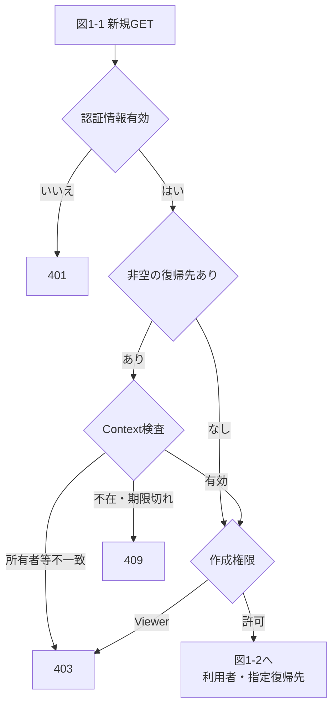

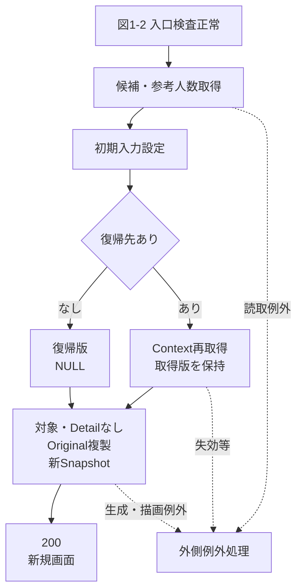

外側例外処理は、応答開始前のWebFaultではその状態、その他例外では503のHTMLエラーである。復帰先ありの取得版を、復帰先なしのNULLへ上書きしない。

#### SQL・テーブル関連（ER図）

学生INSERTは行わない。図2は候補の複数表読取依存であり、人数集計・JOINの矢印はFKや保存を表さない。

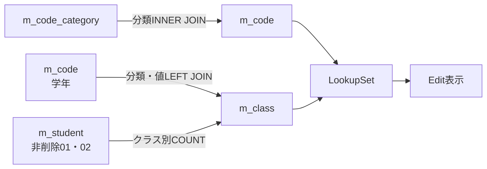

根拠：`Core/SqlServerStudentService.cs:201-214`。

#### DB操作の詳細

コードSQLはm_codeとm_code_categoryをcategory_idでINNER JOINし、両方の利用状態を候補IsActiveへ反映する。WHEREはなく、分類・display_order・code_value順で全件取得する。クラスSQLは学年コードへ分類・値でLEFT JOINし、年度降順・学年表示順・クラス表示順・コード・ID順とする。人数は同じclass_id・非削除・01または02のCOUNTである。抽出パラメータ・件数上限・ページングはない。SNAPSHOT内で2結果を読み終えてcommitする。根拠：`Core/SqlServerStudentService.cs:196-216`。

#### 結果・例外時の扱い

正常時は200の新規画面である。認証情報不正401、Viewer403、指定復帰先の不在・期限切れ409、所有者・セッション不一致403を区別する。候補取得後のContext再取得でも拒否が生じ得るため、入口検査だけで表示成功を保証しない。根拠：`Infrastructure/RequestIdentity.cs:7-15`、`Infrastructure/SearchContextStore.cs:13-13`、`Web/Controllers/StudentsController.cs:25-25`。

参考設計は必須コード不足時の保存不可、クラス0件時のW-STU-108案内を求める。現行表示は候補0件の専用警告・保存ボタン非活性を生成しない。後段のコード存在検査と在学・休学のクラス必須検査は実装されており、表示時案内とは別責務である。根拠：`reference-designs/基本設計書/02_学生登録画面.md:175-192`、`Infrastructure/WebStudentCoordinator.cs:17-17`、`Core/StudentNormalizer.cs:154-154`、`Core/SqlServerStudentService.cs:347-355`。

### EV-REG-002 既存学生の編集・参照表示

#### 処理概要

GET `/students/{id:long}`で非削除学生を読み、権限に応じ編集・参照を表示する。対象不在を新規へ切り替えない。根拠：`Web/Controllers/StudentsController.cs:24-25`、`Infrastructure/WebStudentCoordinator.cs:17-17`。

#### 処理手順

1. 認証情報の参照確認後、非空復帰先の有効性・所有者・セッションを確認する。
2. GetAsyncへ対象IDを渡す。IDが0以下ならNULL、正数ならID一致・非削除学生を取得する。
3. 対象なしは404・E-STU-103とする。
4. 保存業務値、読取版、更新日時・者をDetailへ移す。生年月日は和暦4入力、在籍日付はISO文字列、期待版は十進文字列へ戻す。
5. 人数あり候補を取得し、所属ClassIdの年度・学年を補助入力へ移す。所属なし既存には当年度を補わない。
6. 復帰版を取得し、新SnapshotにOriginalの複製とDetail参照を保持する。
7. Staff・Administratorは編集、Viewerは参照を表示し、既存学籍番号をreadonlyにする。

根拠：`Core/SqlServerStudentService.cs:172-216`、`Web/Inputs/StudentSaveInput.cs:44-54`、`Infrastructure/EditorSnapshotStore.cs:7-11`、`Web/Models/StudentEditPageModel.cs:14-14`。

#### 処理フロー

図3の入口は既存表示GET、出口は編集・参照または経路別エラーである。取得版と管理情報はDetailへ、編集入力はOriginalの複製へ移し、双方を新Snapshotへ引き継ぐ。

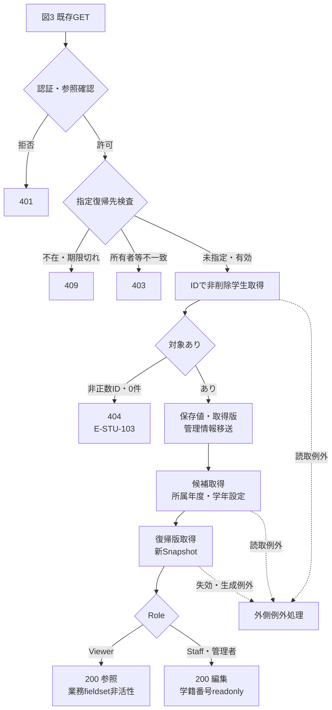

#### SQL・テーブル関連（ER図）

学生本体は単一表読取であるため、本体だけのER図を省略する。図4は候補・保持領域への移送を示す。

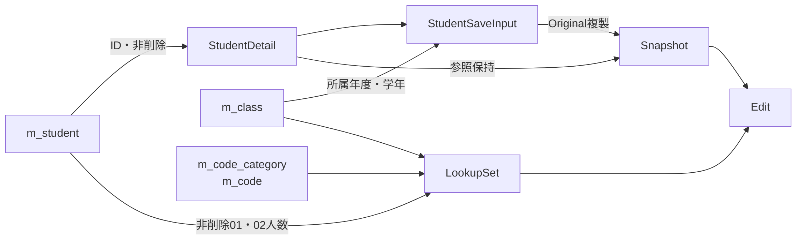

根拠：`Core/SqlServerStudentService.cs:176-216`、`Web/Inputs/StudentSaveInput.cs:46-54`、`Infrastructure/EditorSnapshotStore.cs:9-11`。

#### DB操作の詳細

本体SQLは`SELECT * FROM dbo.m_student WHERE student_id=@id AND is_deleted=0`、`@id BigInt`である。主キー条件で0件または1件となり、名称JOIN・ORDER BY・ページングはない。候補SQLはEV-REG-001と同じで人数を含める。本体読取と候補取得は同じSNAPSHOTトランザクションではない。DB書込みは行わない。根拠：`Core/SqlServerStudentService.cs:172-181,196-216`。

#### 結果・例外時の扱い

正常時は200の編集・参照画面、対象不在・削除済みは404である。存在する停止・期間外の既存コード・所属は読込時同値として選択保持できるが、保存時には最新存在・状態条件を再検査する。局所catchはなく、WebFaultはその状態で、その他取得・描画例外は応答開始前なら503の外側HTMLへ進む。根拠：`Views/Students/Edit.cshtml:8-13`、`Core/SqlServerStudentService.cs:347-383`、`Web/Controllers/StudentsController.cs:25-25`、`Infrastructure/WebHostSetup.cs:23-23`。

### EV-REG-003 入力補助と未保存状態

#### 処理概要

表示済みクラスoptionから年度・学年を同期し、上位値に合わないクラスを解除する。業務入力変更はdirtyを記録し、画面確認キーを解除する。日付・在籍・所属の最終判断は保存時に行う。根拠：`wwwroot/js/site.js:2-8`。

#### 処理手順

1. クラス変更時、選択optionにdata-yearがあれば、その年度・学年コードを上位selectへ設定する。未所属optionでは上位値を変更しない。
2. 年度・学年変更時、現在クラスと指定された非空上位値が不一致ならクラスだけを空にし、alertで通知する。空上位値による不一致検査は行わない。
3. 業務フォームのinputイベントでdirty=true、Input.DuplicateTokenの画面値を空にする。
4. dirtyかつleaving=falseの間、beforeunloadで離脱警告を要求する。
5. フォーム送信時、ボタンまたはフォームに確認文があればwindow.confirmへ渡す。取消なら送信を止める。
6. 送信受理後はleaving=true、同フォームの送信ボタン以外をdisabled、フォームをaria-busy=trueにする。

根拠：`wwwroot/js/site.js:2-5,8-8`、`Views/Students/Edit.cshtml:12-17`。

#### 処理フロー

図5は入力補助、図6は送信準備である。図5の出口はDOM更新、図6の出口は選択されたPOSTであり、双方をDB保存成功へ合流させない。

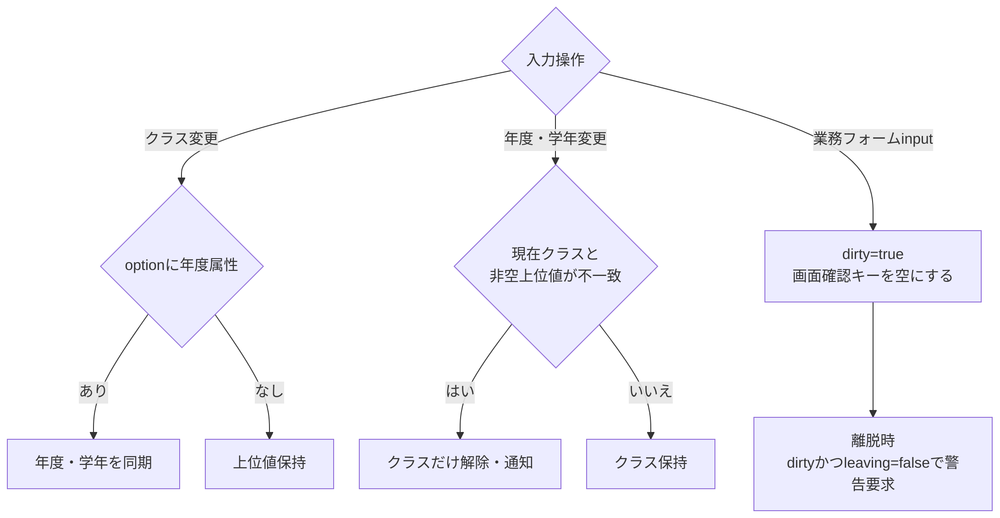

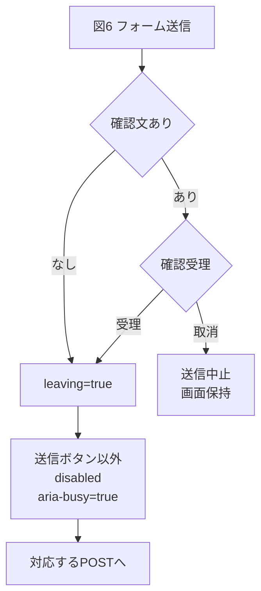

#### SQL・テーブル関連（ER図）

保持領域はDOMの入力・option属性・hidden確認キーと、JavaScriptのdirty・leavingである。DB・Snapshotへ要求を送らないため、DBのER図は非該当である。根拠：`wwwroot/js/site.js:2-8`。

#### DB操作の詳細

DB操作はない。接続JavaScriptは候補再取得、クラス候補の絞込み表示、人数更新、在籍連動の終了日非活性化、即時和暦検査を行わない。宣言されたCoordinator.Optionsを登録候補APIとしない。`POST /students/options`はCriteriaを受ける検索フォーム処理である。根拠：`Infrastructure/WebStudentCoordinator.cs:16-16`、`Web/Controllers/StudentsController.cs:22-27`、`wwwroot/js/site.js:8-8`。

#### 結果・例外時の扱い

不適合クラス解除後も上位値・他入力を保持する。選択変更後に人数を再表示しないため、画面人数を新選択の最新値として扱わず、保存時の最新人数検査を用いる。根拠：`wwwroot/js/site.js:8-8`、`Core/SqlServerStudentService.cs:377-380`。

参考設計は即時和暦検査、区分別条件表示、候補・人数再取得、有効学年の新規選択を求める。現行の同期・解除だけでこれらを充足したとは扱わない。送信ボタン自身は非活性にならず、同一送信の再入拒否・要求連番による旧応答排除もない。参考のIsBusy・RequestSequenceはUI責務であり、DBゲート・確認Busyとは別である。根拠：`reference-designs/基本設計書/02_学生登録画面.md:160-167,264-280`、`reference-designs/詳細仕様書/CSharp_ASPNET/02_学生登録画面.md:158-159`、`wwwroot/js/site.js:4-8`。

### EV-REG-004 新規登録・更新

#### 処理概要

入力を正規化し、書込ゲート下で最新対象・版・マスタ・所属・人数・候補を検査する。保存許可時は学生1件と履歴1件を一括確定する。変更なし、確認待ち、入力不正、権限不足、不在、競合、失敗、結果不明を別の結果として返す。根拠：`Web/Controllers/StudentsController.cs:26-33`、`Core/SqlServerStudentService.cs:227-324`。

#### 処理手順

1. **S1・Web入口。** 認証・CSRFの後、FormGuard→作成更新権限→Snapshot取得→指定復帰先検査→Originalの復帰先との一致の順に検査する。この範囲は局所catch外である。不明項目・不正重複等400、Snapshot不在・期限切れ409、所有者・セッション・対象・復帰先不一致403を区別する。
2. **S1・要求変換。** 先行検査後にModelStateを判定する。不正はサービスを呼ばず422。正常なら局所try内でCoordinatorが権限・復帰先を再確認し、ClassId・期待版を変換してSaveRequestを作る。WebFaultは項目エラーと状態を保持して再表示へ進む。
3. **S2・事前検査。** サービスは受付UUID、利用者、開始時UTC時点・業務日を取得する。ViewerはForbidden。19項目、理由、対象IDと期待版の設定組合せ・正数、年度1900～9998、任意学年形式を検査する。InputValidationException・ArgumentExceptionはValidationFailedとする。
4. **S2・DB開始。** 接続とReadCommitted Txを開始する。これらは保存try外である。try内でXACT_ABORTとTransaction所有のExclusive書込ゲートを取得する。
5. **S3・対象。** 更新は最新のID一致・非削除学生を読む。不在NotFound、期待版不一致Conflict、番号変更ValidationFailed。卒業・退学から別区分への訂正は管理者と理由を要求する。新規のprevious・previousVersionはNULL、更新は取得前値・版を保持する。
6. **S3・マスタと所属。** 性別・都道府県・在籍・設定続柄の存在を確認する。新規・変更コードは利用状態・期間も検査する。指定クラスの存在と指定年度・学年一致、増席時の利用状態・現在期間・定員、終了区分の所属期間変更時の重なりを検査する。
7. **S4・差分。** 正規化業務値、照合キー2値、続柄分類を最新DB値と比較する。差分なしは明示rollbackし、NoChange・対象ID・取得版を返す。理由・年度・学年・確認キーは学生差分に含めない。
8. **S4・番号と候補。** 差分ありだけ版上限、全行学籍番号一意、全同一人物候補を検査する。番号検査は削除済みを含む。候補は非削除・自分以外・生年月日一致・氏名キーまたはカナキー一致で、ID順に全件取得する。
9. **S4・確認。** 確認キーが非NULLなら所有者・セッション・対象・期待版・内容・全候補・期限・Busyを照合する。有効でも理由なしはValidationFailed。無効の場合は、候補1件以上またはキー非NULLならrollback後に新確認キーとConfirmationRequiredを返す。候補0件かつキーNULLなら確認不要で書込みへ進む。
10. **S5・学生書込み。** 保存許可後、writeStarted=trueとしてINSERTまたは条件付きUPDATEを行う。新規は採番ID・版1、更新は既存ID・取得版+1となる。INSERT・UPDATEのいずれもOUTPUTの取得値がNULLまたはDBNullならDBConcurrencyExceptionとする。
11. **S5・確定。** 同じTxへCREATEまたはUPDATE履歴を追記し、commitAttempted=trueとしてcommitする。成功時はcompleted=true、指定確認キーを除去してSavedを返す。
12. **SC・例外と終了。** catch順と確定不明条件は後述のSCによる。保存tryからの直接return・捕捉済み結果・捕捉外例外のいずれもfinallyを通り、取得済み確認Busyを条件付きで解除する。
13. **S6・画面受渡し。** Savedだけ通知・303へ進む。非Savedは送信Input、読込時Detail、同じSnapshot・復帰版、再取得候補で再表示する。ModelState不正・局所WebFaultではSaveResultがない。

根拠：`Web/Controllers/StudentsController.cs:29-33`、`Infrastructure/WebStudentCoordinator.cs:18-18`、`Web/Inputs/StudentSaveInput.cs:34-43`、`Core/SqlServerStudentService.cs:227-329,344-390`。

Snapshot・復帰先の検査はサービス呼出し前で、DB確定直前には再検査しない。業務日・確認期限比較はサービス開始時nowを使い、ゲート待機後に時点を取り直さない。対象版・コード・クラス・増席人数・全候補はゲート取得後に再読取する。根拠：`Web/Controllers/StudentsController.cs:29-31`、`Core/SqlServerStudentService.cs:229-278`。

#### 処理フロー

S1のサービス要求はS2へ、S2～S5の結果は適用範囲のfinallyを経てS6へ進む。保存try内の例外はSCへ渡す。SCで捕捉しない例外はfinally後に外側へ伝播し、S6へ合流しない。接続・Tx開始前の結果は保存tryのfinallyを通らない。

**S1：入口と要求変換（図7-1・7-2）。** 図7-1の正常出口は取得済みSnapshot、利用者、対象ID、送信Inputを図7-2へ渡す。

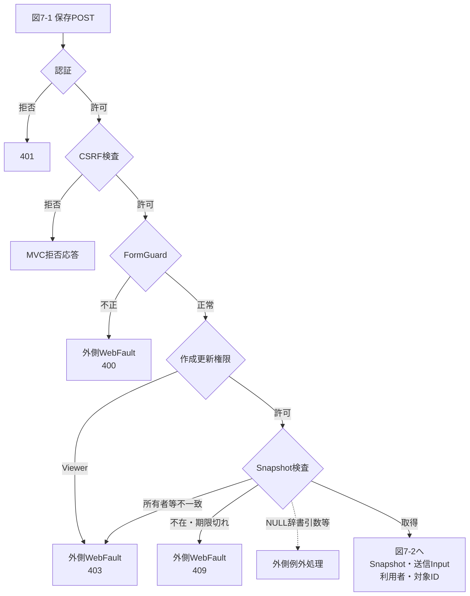

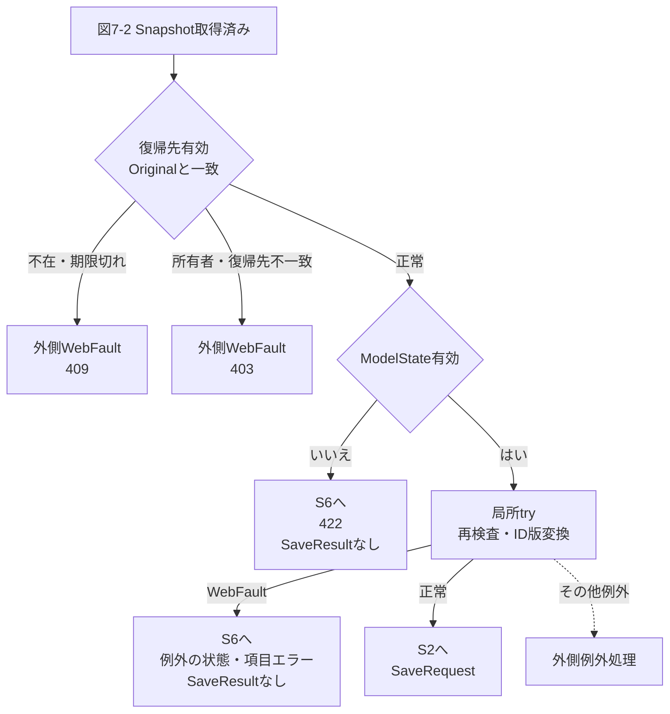

**S2：正規化・DB開始（図8）。** 図中の「事前検査」は手順3の全条件であり、InputValidationExceptionとArgumentExceptionを同じ入力結果へ変換する。その他例外をその変換へ含めない。

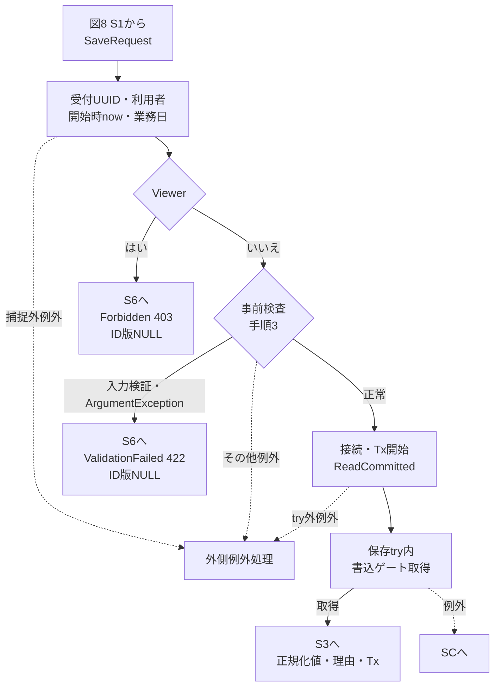

**S3：最新対象・マスタ・所属（図9-1・9-2）。** 新規はprevious=NULL・previousVersion=NULLを保持する。更新は版一致後の前値と取得版を保持し、図9-2の更新入口へ渡す。新規のNULLを更新枝へ適用しない。

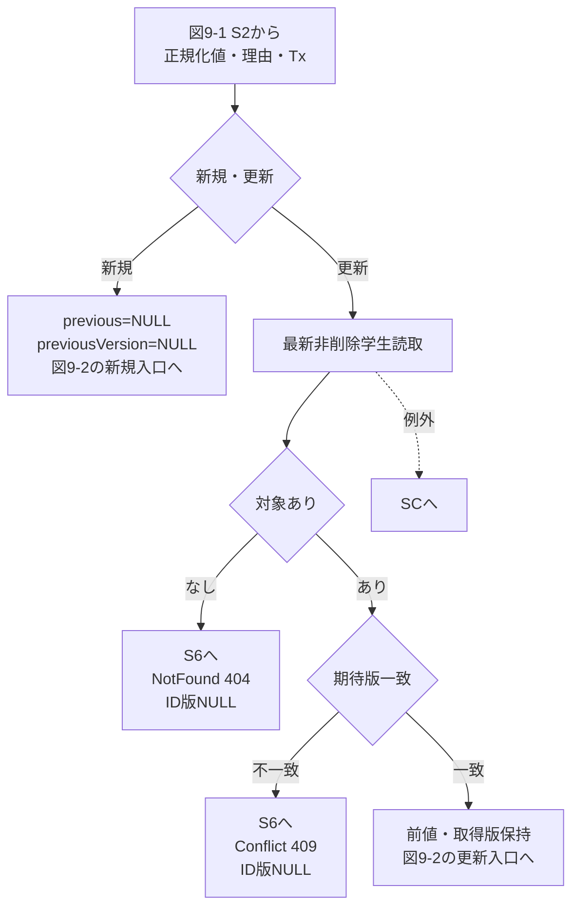

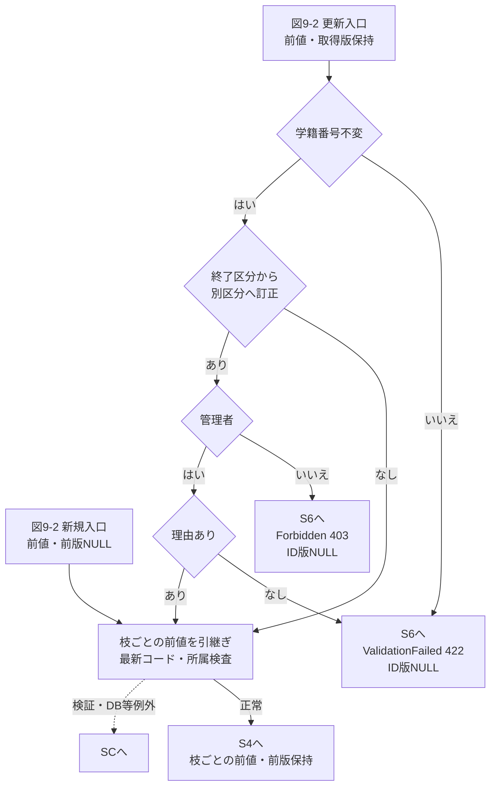

**S4：差分・番号・確認（図10-1・10-2）。** NoChangeは候補・確認照合より前の出口である。図10-1の正常出口は正規化値、要求対象ID、前値・前版、全候補、内容・候補ハッシュを図10-2へ渡す。

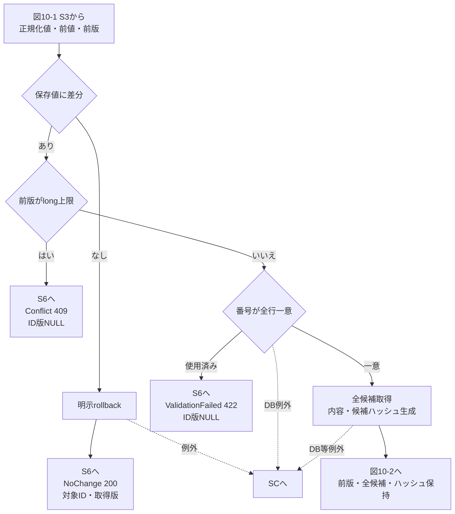

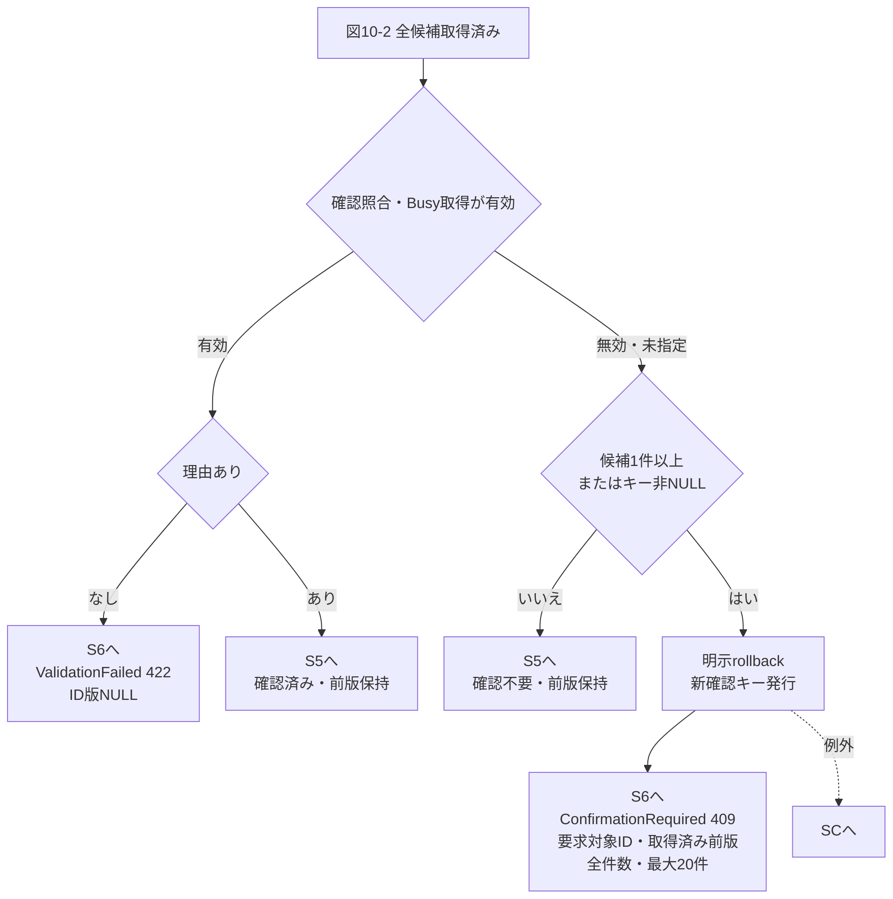

確認照合の完全条件は、所有者Principal・SessionId、対象ID、期待版、正規化内容ハッシュ、全候補ID・版ハッシュの一致、期限が開始時nowより後、Busyの0→1取得成功である。根拠：`Core/SqlServerStudentService.cs:274-290`。

**S5：学生・履歴の一括確定（図11）。** 書込種別ごとのID・版を維持する。OUTPUT判定はINSERT・UPDATEの双方に適用する。根拠：`Core/SqlServerStudentService.cs:292-315`。

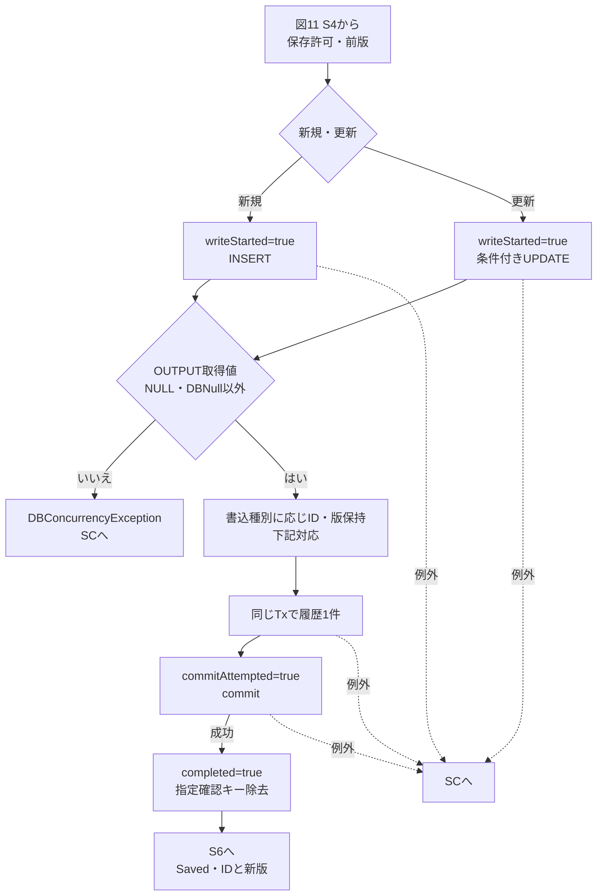

| 書込種別 | OUTPUTから保持するID | 返却版・履歴後版 |
| --- | --- | --- |
| INSERT | 新規採番ID | 1 |
| UPDATE | 更新した既存ID | 取得済みpreviousVersion＋1 |

図11の共通節点ではこの条件付き対応を保持し、更新ID・取得版を新規の値へ置換しない。

**SC：catch順・finally・伝播（図12-1・12-2）。** 長い例外型は以下の番号と対応させる。略称の例外型を新設するものではない。

| 図中参照 | 完全な捕捉条件 | 処理 |
| --- | --- | --- |
| SC-1 | `InputValidationException` | rollback試行後、ValidationFailed・422。 |
| SC-2 | `SqlException`かつNumberが2601または2627 | rollback試行後、E-STU-101のValidationFailed・422。 |
| SC-3 | `DBConcurrencyException` | rollback試行後、Conflict・409。 |
| SC-4 | 先行catchで処理されなかった`SqlException`、`InvalidOperationException`、`OperationCanceledException` | rollback成否と書込・commitフラグでSystemErrorまたはUnknown。 |
| SC-Q | `writeStarted && (commitAttempted || !rolledBack)` | 最後の対象例外catchだけで結果不明を判定。 |
| SC-F | `claimed is not null && !completed && !unknown` | finallyで取得済み確認Busyを0へ戻す。 |

図12-1のSC-4候補出口は元の例外とフラグ、claimedを図12-2へ渡す。先行catchの結果はSC-Qへ進まない。

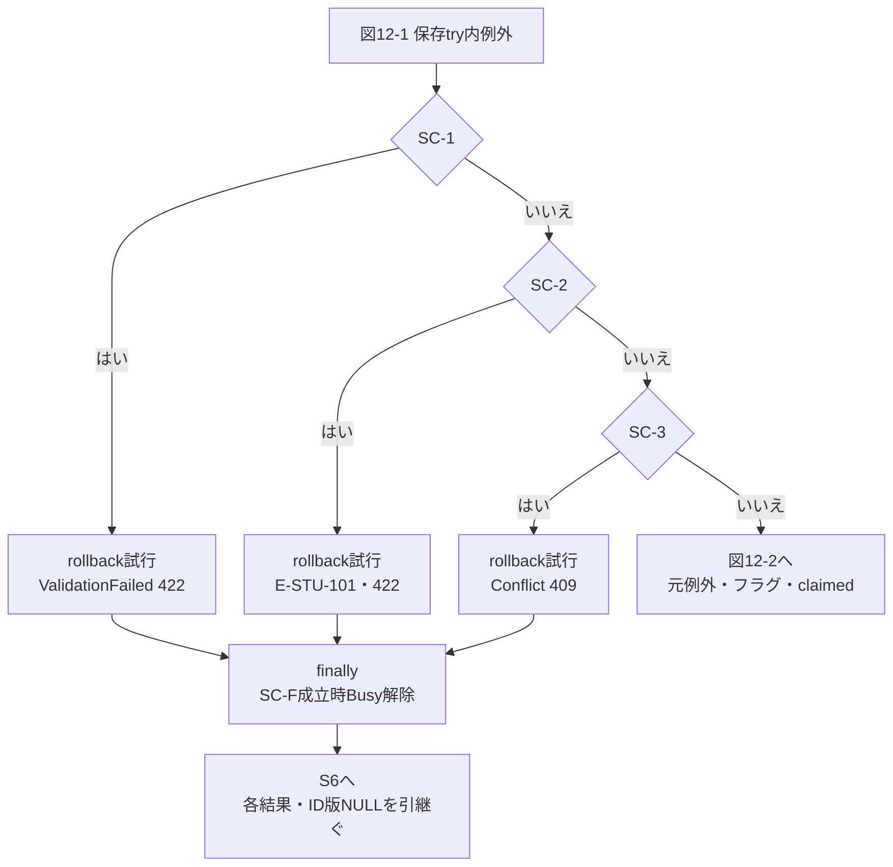

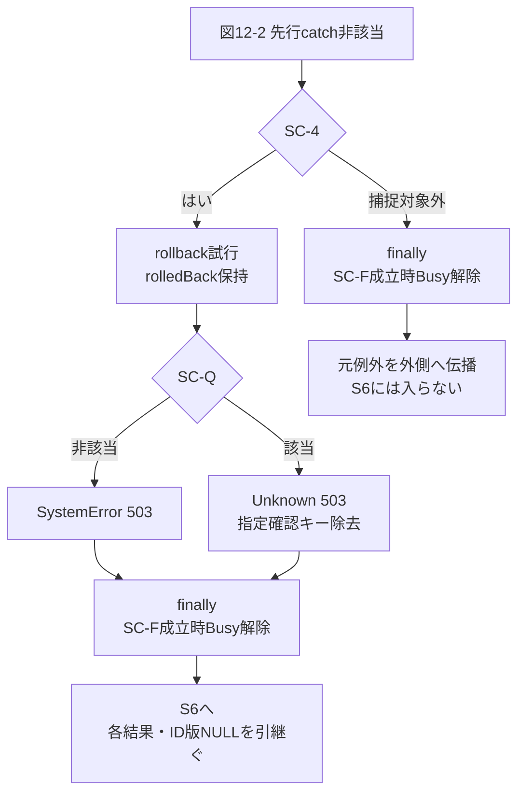

SC-Qは、**writeStarted=true、かつ（commitAttempted=true、またはrollback失敗）**である。括弧内だけでUnknownを判断しない。先行3catchはSC-Qへ進まず、書込開始前はrollback失敗だけでUnknownにならない。捕捉対象外でもfinallyを実行してから伝播する。S3・S4の直接returnにもfinallyが適用され、有効確認を取得した後の理由拒否ではBusyを解除する。根拠：`Core/SqlServerStudentService.cs:286-286,316-329`。

**S6：結果と画面への受渡し（図13）。** SaveResultがない枝のHTTPと、結果がある枝のHTTPを区別して引き継ぐ。

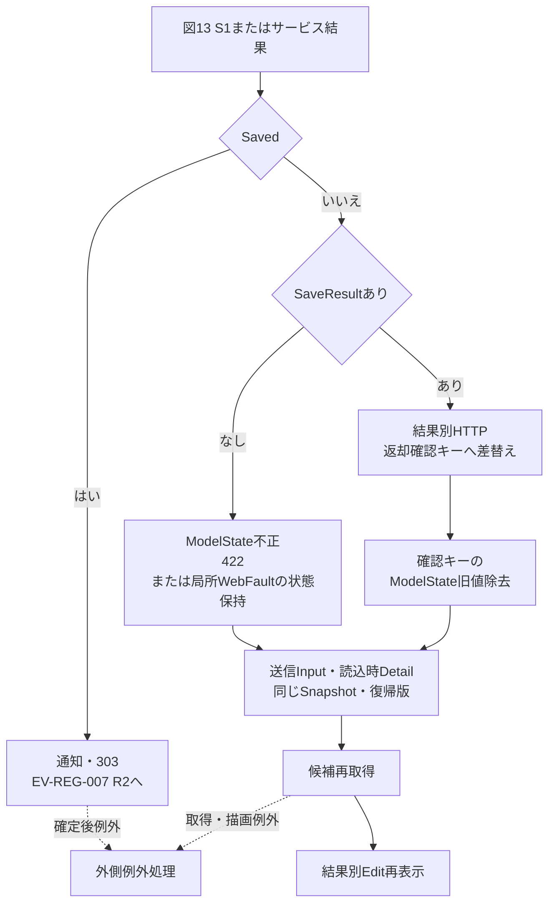

#### SQL・テーブル関連（ER図）

実FKは図14-1～14-5に分ける。各図のm_code・m_studentは同じ物理表であり、分冊・別表・別レコードを意味しない。性別・都道府県・在籍の三つの必須関係を統合せず、各関係を独立した図で示す。

図14-1：分類、クラスの学年、現在・最終所属。

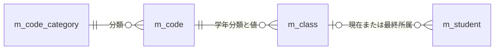

図14-2：必須の性別分類・値。

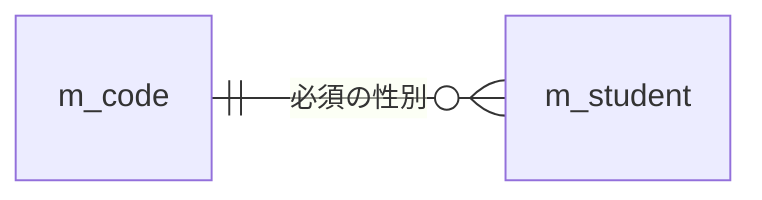

図14-3：必須の都道府県分類・値。

```mermaid
erDiagram
    direction LR
    m_code ||--o{ m_student : 必須の都道府県
```

図14-4：必須の在籍分類・値。

```mermaid
erDiagram
    direction LR
    m_code ||--o{ m_student : 必須の在籍
```

図14-5：任意の続柄分類・値。

```mermaid
erDiagram
    direction LR
    m_code |o--o{ m_student : 任意の続柄
```

必須関係は各学生に参照コード1件、任意関係は各学生に0または1件を対応させ、各マスタ側から学生側は0件以上とする。根拠：`database/001_schema.sql:15-31,189-199`。

履歴target_keyには学生へのFKがなく、学生と履歴は同一Txの追記依存である。図15は保存処理の読取・書込依存を示す。

```mermaid
%%{init: {"flowchart":{"htmlLabels":true,"useMaxWidth":false,"nodeSpacing":28,"rankSpacing":30},"themeCSS":".nodeLabel,.edgeLabel{white-space:nowrap;word-break:keep-all;overflow-wrap:normal;}"}}%%
flowchart LR
    M["m_code・分類・クラス"] -->|存在・状態・期間| V["保存検査"]
    S["m_student"] -->|最新版・人数・番号・全候補| V
    V --> W["m_student<br/>INSERT・UPDATE"]
    W -->|同じ接続・Tx| L["t_operation_log<br/>INSERT"]
    L --> C["commit"]
```

根拠：`database/001_schema.sql:137-154,189-199`、`Core/SqlServerStudentService.cs:307-315`。

#### DB操作の詳細

接続構築は暗号化必須・証明書信頼falseとし、接続後に現在DBのSNAPSHOT許可状態を要求する。業務コマンドは30秒、DB呼出しには取消トークンを渡す。書込ゲートは資源`test-project1:student-write`、Exclusive、Transaction所有、待機5000msで、負の戻り値をSQL例外とする。根拠：`Core/SqlServerStudentService.cs:39-73,92-102`。

| 操作 | 対象・条件 | パラメータ型・Size | 結果・用途 |
| --- | --- | --- | --- |
| 更新対象取得 | m_studentのID一致・非削除。JOIN・ORDER BY・ページングなし | `@id BigInt` | 0件NotFound、取得版不一致Conflict。前値・前版を保持する。 |
| コード検査 | m_codeと分類をINNER JOIN。分類・値一致 | `@category VarChar(24)`、`@value VarChar(10)` | 不在E-STU-009、新規・変更値の停止・期間外E-STU-011。 |
| クラス検査 | m_classのID一致。年度・学年・期間・利用状態・定員 | `@id BigInt` | 不在E-STU-010、上位不一致E-STU-014、増席不可E-STU-013、期間重なりなしE-STU-108。 |
| 増席人数 | クラス一致・非削除・01/02・自分以外。新規ID NULLなら除外なし | `@class BigInt`、`@id BigInt` | COUNT_BIG＋1が非NULL定員を超えるとE-STU-102。 |
| 番号一意 | 番号一致、ID NULLまたは自分以外。削除条件なし | `@no VarChar(15)`、`@id BigInt` | COUNT_BIGが正ならE-STU-101。 |
| 同一人物候補 | 非削除・自分以外・生年月日一致・氏名キーまたはカナキー一致、ID昇順 | `@id BigInt`、`@birth Date`、`@name NVarChar(320)`、`@kana NVarChar(36)` | 全件取得。TOP・ページングなし。返却表示だけ最大20件。 |
| 学生INSERT | 正規化19値・照合キー2・続柄分類、固定3分類、未削除、作成更新情報、版1 | 項目一覧の同名パラメータ、`@now DateTimeOffset`、`@actor NVarChar(128)` | OUTPUTを表変数に受けて採番ID取得。取得値NULL・DBNullはDBConcurrencyException。 |
| 学生UPDATE | 学籍番号以外の正規化値・派生値、更新日時・者・版加算。WHEREはID・期待版・非削除 | 同名パラメータ、`@id/@version BigInt`、`@now DateTimeOffset`、`@actor NVarChar(128)` | OUTPUTなし・DBNullはDBConcurrencyException。番号・作成情報・固定3分類・削除情報を保持。 |
| 履歴INSERT | target_table=m_student、target_key=ID文字列。変更列名JSONを1件追記 | `@id VarChar(35)`、`@op VarChar(11)`、`@before/@after BigInt`、`@changed NVarChar(max)`、`@actor NVarChar(128)`、`@now DateTimeOffset`、`@request UniqueIdentifier`、`@reason NVarChar(120)`、`@confirmed Bit` | 新規は前版NULL・後版1、更新は取得版・取得版+1。候補が存在すると確認フラグtrue。 |

根拠：`Core/SqlServerStudentService.cs:247-272,294-307,347-390`。候補RowSelectはクラスID、クラス学年分類・値、学生在籍分類・値、都道府県分類・値でLEFT JOINする。表示結果の名称NULLと保存列のNOT NULLは別である。電話・メール一致を同一人物候補条件に含めない。根拠：同ファイル`77-90,269-272`。

| 在籍・所属の状態 | クラス条件 | 席・定員 |
| --- | --- | --- |
| 新規在学・休学、別クラス異動、終了区分から在学・休学へ訂正 | 存在・指定上位値一致・利用可・業務日期間内 | 自分以外の非削除01・02人数＋1を定員と比較。 |
| 在学・休学で同じクラスの席を保持 | 存在・指定上位値一致 | 増席でないため、停止・期間外・既存超過だけでは拒否しない。 |
| 新規卒業・退学、または最終所属・区分・入学日・終了日を変更 | 指定時は存在・上位一致・在籍期間との重なり | 席を消費しない。停止だけで一律拒否しない。 |
| 終了区分で所属・区分・期間を保持し通常項目だけ変更 | 存在・上位一致。重なり再検査条件に入らない | 席を消費しない。 |
| 終了区分でクラスなし | 年度範囲・学年形式を検査。独立した候補存在検査なし | 席を消費しない。 |

期間重なりは両端包含である。入学日がクラス終了日より後、または学生終了日がクラス開始日より前なら拒否する。終了日そのもののクラス期間内を要求する条件ではない。同一席保持の見直し警告は現行結果に生成されない。根拠：`Core/SqlServerStudentService.cs:357-383`、`reference-designs/基本設計書/02_学生登録画面.md:624-646`。

NoChange・確認待ちは明示rollbackする。他の検査直接returnはcommitせず未確定Txの破棄へ進む。catchのrollbackはCancellationToken.Noneを使い、SqlException・InvalidOperationExceptionをfalseへ変換する。履歴は業務値の前後コピーを保持せず、変更列名と前後版を記録する。根拠：`Core/SqlServerStudentService.cs:250-290,306-329,385-390`。

#### 結果・例外時の扱い

| 結果・拒否 | HTTP・表示 | ID・版・画面保持 | 確定境界 |
| --- | --- | --- | --- |
| Saved | 通知後303 | 新規採番ID・1、更新既存ID・新版 | 学生・履歴commit成功後。復帰は別処理。 |
| NoChange | 200、変更なし通知 | 対象ID・取得版。送信入力・読込時Detail・同Snapshot | rollback。日時・版・履歴を変更しない。 |
| ConfirmationRequired | 409、候補領域 | 要求対象ID・取得版、新キー、全件数・最大20件。新規ID・前版NULL | rollback後の確認待ち。学生・履歴を書かない。 |
| ValidationFailed | 422、入力再表示 | 結果ID・版NULL、入力・Snapshot保持 | 正規化・番号・マスタ・所属・理由等の拒否。 |
| Forbidden | 403、入力再表示 | 結果ID・版NULL | サービス内権限拒否。入口の外側拒否とは別経路。 |
| NotFound | 404、入力再表示 | 結果ID・版NULL | ゲート下の最新非削除対象なし。 |
| Conflict | 409、入力再表示 | 結果ID・版NULL。期待版を自動最新化しない | 版不一致、差分あり版上限、OUTPUTなし等。 |
| SystemError | 503、入力再表示 | 結果ID・版NULL | 最後の対象例外catchでUnknown条件非該当。 |
| Unknown | 503、検索確認案内 | 結果ID・版NULL、指定確認キー無効化 | 最後の対象例外catchで書込開始済み、かつcommit試行済みまたはrollback失敗。確定状態不明。 |
| ModelState不正 | 422、入力再表示 | SaveResultなし、送信入力・読込時情報 | サービス呼出しなし。 |
| 局所WebFault | 例外の状態、項目エラー・再表示 | SaveResultなし、送信入力・読込時情報 | Coordinator・DTO変換等の局所try内。 |
| 事前WebFault | 例外の状態、外側HTML | 通常Edit再表示へ入らない | FormGuard・権限・Snapshot・復帰先の先行検査。 |

根拠：`Web/Controllers/StudentsController.cs:29-33`、`Infrastructure/WebPresentation.cs:23-23`、`Core/SqlServerStudentService.cs:226-226,262-262,290-323`。

非Savedでは確認キーだけを結果のConfirmationTokenへ差し替え、そのModelState旧値を除く。NoChange・確認待ちの返却版で画面期待版・管理情報を最新化する処理はない。送信Inputと読込時Detailを維持するため、返却ID・版と表示管理値を混同しない。根拠：`Web/Controllers/StudentsController.cs:32-33`。

先行3catchは各結果を返し、rollback失敗を理由に後段Unknownへ進まない。SQL一意違反2601・2627は発生箇所を区別せずE-STU-101へ変換する。最後の対象例外catchに届いた場合だけ、SC-Qの括弧付き条件を使う。根拠：`Core/SqlServerStudentService.cs:316-323`。

ToRequestが補うNULLはBirthDateInput本体だけである。有効元号でYear・Month・DayがNULL、またはAdmissionDateがNULLなら、Normalize呼出しでNullReferenceExceptionが生じ得る。これはInputValidationException・ArgumentExceptionの捕捉を通らず外側へ伝播する。通常の形式不正・元号境界不正・不正UnicodeのArgumentExceptionは入力エラーへ変換する。HTTP欠落・空欄から各値へ至るバインド結果は、このサービス契約とは別に確認する。根拠：`Web/Inputs/StudentSaveInput.cs:34-42`、`Core/JapaneseDateService.cs:19-24,52-59`、`Core/StudentNormalizer.cs:123-143`、`Core/SqlServerStudentService.cs:232-243`。

入力拒否後も候補取得とビュー描画が続く。Editビューは残った日付文字列をクラス選択判定のDateOnly.TryParseへ渡し、不正なら期間重なり不成立として扱う。元号4入力は原入力の再表示に使う。これらは保存用の厳密変換とは別であり、候補再取得・Tag Helper・描画等の後続例外を保存結果catchへ含めない。応答開始前のWebFaultは状態を引き継ぎ、その他例外は503の外側HTMLとなる。応答開始後はmiddlewareのcatch対象外である。根拠：`Views/Students/Edit.cshtml:7-7,12-12`、`Web/Controllers/StudentsController.cs:33-33`、`Infrastructure/WebHostSetup.cs:23-23`。

接続・Tx開始、捕捉対象外例外、資源終了処理、Saved後の通知・303も保存結果の確定とは別境界である。結果不明では自動再送せず、検索で対象を確認して次操作を判断する。根拠：`Core/SqlServerStudentService.cs:241-243,313-323`、`Web/Controllers/StudentsController.cs:31-38`。

### EV-REG-005 同一人物候補の確認続行・取消

#### 処理概要

生年月日と氏名またはカナの照合キーが一致する学生を確認候補として示す。一致を同一人物の断定・登録禁止にせず、別人として続行する場合に理由と確認情報を再検査する。確認待ちでは保存Txを終了する。根拠：`Core/SqlServerStudentService.cs:269-290`、`Views/Students/Edit.cshtml:14-14`、`reference-designs/基本設計書/02_学生登録画面.md:61-72`。

#### 処理手順

1. 全候補件数と先頭最大20件の学籍番号・氏名・和暦生年月日・クラス名を表示する。住所・電話・メールは表示しない。
2. 取消にautofocusを付ける。取消時は画面キーを空にして候補sectionを除去し、入力を保持する。DB・サーバー辞書を直接変更しない。
3. 続行時は理由・画面キーを伴う同じcreate・updateフォームを送る。ブラウザー確認取消なら送信しない。入力変更でキーが空にされた後の送信も、同じ保存入口で処理する。
4. S1～S3の入口、正規化、最新対象・版、マスタ・所属・定員検査を再実行する。
5. 差分なしは確認照合より前にrollbackし、200・NoChange、対象ID・取得版を返す。差分ありだけ版上限・番号一意・全候補取得へ進む。
6. 確認有効なら理由なしを422、有効理由ありを確認済み保存とする。確認無効・未指定なら、候補1件以上またはサービス引数のキー非NULLを再確認条件とする。候補0件かつキーNULLは確認不要保存へ進む。

根拠：`Views/Students/Edit.cshtml:14-14`、`wwwroot/js/site.js:3-6`、`Core/SqlServerStudentService.cs:260-302`。

#### 処理フロー

**C1：確認操作（図16）。** 取消は画面内終了、続行はC2へ最新前値・前版を渡す。

```mermaid
%%{init: {"flowchart":{"htmlLabels":true,"useMaxWidth":false,"nodeSpacing":28,"rankSpacing":30},"themeCSS":".nodeLabel,.edgeLabel{white-space:nowrap;word-break:keep-all;overflow-wrap:normal;}"}}%%
flowchart TD
    A["図16 確認候補表示"] --> O{"操作"}
    O -->|取消| C["画面キーを空にする<br/>section除去"]
    C --> S["入力保持・画面に留まる<br/>DB変更なし"]
    O -->|続行| Q{"送信確認受理"}
    Q -->|取消| A
    Q -->|受理| P["同じ保存POST<br/>現在入力・理由・画面キー"]
    P --> V["S1～S3を再実行"]
    V -->|拒否・例外| R["経路別のS6<br/>または外側応答"]
    V -->|正常| NEXT["C2へ<br/>最新前値・前版"]
```

**C2：差分と確認の全分岐（図17-1・17-2）。** 図17-1の正常出口は全候補とハッシュ、最新前値・前版を図17-2へ渡す。確認無効を固定の409へ合流させない。

```mermaid
%%{init: {"flowchart":{"htmlLabels":true,"useMaxWidth":false,"nodeSpacing":28,"rankSpacing":30},"themeCSS":".nodeLabel,.edgeLabel{white-space:nowrap;word-break:keep-all;overflow-wrap:normal;}"}}%%
flowchart TD
    A["図17-1 C1から<br/>最新前値・前版"] --> D{"保存値に差分"}
    D -->|なし| N["rollback<br/>NoChange 200<br/>対象ID・取得版"]
    N --> V["共通finally後S6<br/>入力再表示"]
    D -->|あり| B["S4の版上限・番号一意<br/>全候補再取得"]
    B -->|拒否・例外| E["S4・SCの経路別結果"]
    B -->|正常| NEXT["図17-2へ<br/>全候補・ハッシュ<br/>最新前値・前版"]
```

```mermaid
%%{init: {"flowchart":{"htmlLabels":true,"useMaxWidth":false,"nodeSpacing":28,"rankSpacing":30},"themeCSS":".nodeLabel,.edgeLabel{white-space:nowrap;word-break:keep-all;overflow-wrap:normal;}"}}%%
flowchart TD
    A["図17-2 全候補取得済み"] --> T{"確認照合・Busy取得有効"}
    T -->|有効| R{"理由あり"}
    R -->|なし| F["ValidationFailed 422<br/>共通finally後S6"]
    R -->|あり| W["S5へ<br/>確認済み"]
    T -->|無効・未指定| NEED{"候補1件以上<br/>またはキー非NULL"}
    NEED -->|はい| CR["rollback・新確認キー<br/>ConfirmationRequired 409<br/>対象ID・取得版<br/>全件数・最大20件"]
    CR --> BACK["共通finally後S6<br/>再表示・C1へ"]
    NEED -->|いいえ| W2["S5へ<br/>確認不要<br/>候補0件・キーNULL"]
    W --> SAVE["学生・履歴書込とcommit"]
    W2 --> SAVE
    SAVE -->|成功| OK["Saved・指定キー除去<br/>共通finally後303"]
    SAVE -. 例外 .-> EX["SCのcatch順・finally<br/>結果または外側伝播"]
```

C2の各出口はEV-REG-004のfinally・結果処理を使用する。NoChangeや確認待ちのID・版はその枝の返却値を保ち、他の拒否結果のNULLへまとめない。

#### SQL・テーブル関連（ER図）

続行はEV-REG-004のFK・同一Tx関係を使用する。取消はDOM処理だけである。図18は確認情報への依存を示す。

```mermaid
%%{init: {"flowchart":{"htmlLabels":true,"useMaxWidth":false,"nodeSpacing":28,"rankSpacing":30},"themeCSS":".nodeLabel,.edgeLabel{white-space:nowrap;word-break:keep-all;overflow-wrap:normal;}"}}%%
flowchart LR
    S["m_student<br/>全候補ID・版"] --> H["候補ハッシュ"]
    N["正規化業務値"] --> P["内容ハッシュ"]
    H --> T["Web確認辞書"]
    P --> T
    T -->|再照合・Busy取得| W["条件付き学生・履歴保存"]
    C["確認取消"] --> D["画面キー・section変更"]
```

根拠：`Core/SqlServerStudentService.cs:224-225,274-290,330-335`、`wwwroot/js/site.js:6-6`。

#### DB操作の詳細

差分なしでは候補SQL・確認照合を実行しない。差分ありでは全候補を再取得し、全ID・版をハッシュへ結び付ける。最大20件は表示上限であり確認対象件数ではない。内容ハッシュは保存業務値を対象とし、照合キー2値・続柄分類・理由・年度・学年を含めない。ただし理由・年度・学年の個別検査は再送時も行う。根拠：`Core/SqlServerStudentService.cs:224-225,234-237,260-290`。

Web確認情報は所有者Principal・SessionId、対象ID・期待版、内容・全候補ハッシュ、10分期限、Busyを保持する。期限は開始時nowより後、Busyは0→1取得を要求する。確認待ちはrollback後に発行する。成功時と最後の対象例外catchのUnknown時に指定キーを除去し、取得済みBusyは未完了かつUnknown以外ならfinallyで解除する。画面キー解除は辞書削除ではなく、期限切れ項目は新発行時に除去する。根拠：`Core/SqlServerStudentService.cs:19-29,278-290,313-335`。

#### 結果・例外時の扱い

業務値を元へ戻した続行や理由だけの変更は、最新マスタ検査後にNoChangeとなり得る。差分ありでも候補0件・キーNULLなら確認不要保存となる。キーが空文字なら非NULLなので、確認無効時は候補0件でも再確認となり得る。画面が空にした文字列がフォームバインド後にNULLか空文字かは、原文だけでは固定しない。根拠：`Core/SqlServerStudentService.cs:260-290`、`wwwroot/js/site.js:3-6`。

候補変更・期限切れ・所有者・対象・版・内容不一致・Busy取得失敗は確認無効となる。その後の候補件数・キー非NULL条件で再確認と確認不要保存を分ける。参考設計の相違通知W-STU-102に対し、現行ConfirmationRequiredのErrorsは空である。取消autofocusと、window.confirmの既定操作を取消へ指定することは別で、後者の設定はない。根拠：`Core/SqlServerStudentService.cs:278-290`、`Views/Students/Edit.cshtml:14-14`、`wwwroot/js/site.js:4-4`、`reference-designs/基本設計書/02_学生登録画面.md:364-378`。

### EV-REG-006 論理削除

#### 処理概要

管理者が対象・期待版・理由・明示確認を指定し、削除属性・更新管理情報とDELETE履歴を一括確定する。別フォームであり、編集中の業務19項目を保存しない。根拠：`Views/Students/Edit.cshtml:17-17`、`Web/Controllers/StudentsController.cs:37-38`、`Core/SqlServerStudentService.cs:392-416`。

#### 処理手順

1. **D1・入口。** ブラウザーは理由を要求し、対象・理由の送信確認を行う。対象ID、SnapshotId、期待版、理由、Confirmed=true、復帰先、CSRF情報を送る。
2. ControllerはFormGuard→参照確認→対象Snapshot→Originalの復帰先との一致を確認する。保存と同じModelState.IsValid分岐・局所WebFault catchはない。
3. Coordinatorは管理者→復帰先有効性→Confirmed→期待版正数変換の順で検査する。
4. サービスは管理者、理由のraw・保存60スカラーと必須性、正のID・版、版がlong.MaxValueでないことを確認する。
5. **D2・DB。** 接続とReadCommitted Txを開始し、try内でゲートを取得する。最新非削除対象の版をSELECTし、不在NotFound、期待版不一致Conflictとする。
6. writeStarted=trueとしてID・期待版・非削除条件で削除・更新管理7列だけをUPDATEする。更新件数1以外はDBConcurrencyException。
7. DELETE履歴を同じTxで追記し、commitAttempted=trueとしてcommitする。成功はSaved・対象ID・要求版+1。
8. **DC・例外。** DBConcurrencyExceptionを先にConflictへ変換する。他の対象例外はrollback後、書込開始・commit試行・rollback成否でSystemErrorまたはUnknownとする。ゲート後SELECTもこのtry内にある。
9. **D3・表示。** Savedだけ通知・303へ進む。非Savedはエラー・HTTP状態を設定後にLoadし、DB最新値・版・新Snapshotへ再読込する。

根拠：`Web/Controllers/StudentsController.cs:37-38`、`Infrastructure/WebStudentCoordinator.cs:19-19`、`Core/SqlServerStudentService.cs:392-416`。

#### 処理フロー

**D1：Web・サービス事前検査（図19-1～19-3）。** 図19-1はController、図19-2はCoordinator、図19-3はサービス事前検査である。各正常出口は対象ID、期待版原文字列、理由、明示確認、復帰先と取得済みSnapshotを後続へ渡し、検査順を入れ替えない。

```mermaid
%%{init: {"flowchart":{"htmlLabels":true,"useMaxWidth":false,"nodeSpacing":28,"rankSpacing":30},"themeCSS":".nodeLabel,.edgeLabel{white-space:nowrap;word-break:keep-all;overflow-wrap:normal;}"}}%%
flowchart TD
    A["図19-1 削除POST"] --> AU{"認証・CSRF"}
    AU -->|拒否| R["認証またはMVC拒否応答"]
    AU -->|許可| FG{"FormGuard"}
    FG -->|不正| W400["外側WebFault<br/>400"]
    FG -->|正常| READ{"参照確認"}
    READ -->|拒否| W401["401"]
    READ -->|許可| SN{"Snapshot検査"}
    SN -->|不在・期限切れ| W409["外側WebFault<br/>409"]
    SN -->|所有者等不一致| W403["外側WebFault<br/>403"]
    SN -. NULL辞書引数等 .-> X["外側例外処理"]
    SN -->|取得| EQ{"Originalの復帰先と一致"}
    EQ -->|いいえ| W403
    EQ -->|はい| NEXT["図19-2へ<br/>Snapshot・削除要求保持"]
```

```mermaid
%%{init: {"flowchart":{"htmlLabels":true,"useMaxWidth":false,"nodeSpacing":28,"rankSpacing":30},"themeCSS":".nodeLabel,.edgeLabel{white-space:nowrap;word-break:keep-all;overflow-wrap:normal;}"}}%%
flowchart TD
    A["図19-2 Controller検査正常"] --> ADM{"管理者"}
    ADM -->|いいえ| W403["外側WebFault<br/>403"]
    ADM -->|はい| CT{"指定復帰先有効"}
    CT -->|不在・期限切れ| W409["外側WebFault<br/>409"]
    CT -->|所有者等不一致| W403
    CT -->|未指定・有効| CF{"Confirmed=true"}
    CF -->|いいえ| W422["外側WebFault<br/>422"]
    CF -->|はい| VER{"期待版正数変換"}
    VER -->|不正| W422
    VER -->|正常| NEXT["図19-3へ<br/>対象ID・変換版・理由"]
```

```mermaid
%%{init: {"flowchart":{"htmlLabels":true,"useMaxWidth":false,"nodeSpacing":28,"rankSpacing":30},"themeCSS":".nodeLabel,.edgeLabel{white-space:nowrap;word-break:keep-all;overflow-wrap:normal;}"}}%%
flowchart TD
    A["図19-3 サービス要求"] --> CHECK{"サービス権限・理由・ID版<br/>手順4"}
    CHECK -->|権限不足| F["D3へ<br/>Forbidden 403"]
    CHECK -->|入力不正| V["D3へ<br/>ValidationFailed 422"]
    CHECK -->|正常| NEXT["D2へ<br/>対象・要求版・正規化理由"]
    CHECK -. 捕捉外例外 .-> X["外側例外処理"]
```

**D2：対象読取・削除・確定（図20-1・20-2）。** 図20-1の正常出口は非削除対象の存在・版一致を確認した状態を図20-2へ渡す。書込フラグはこの時点ではfalseである。

```mermaid
%%{init: {"flowchart":{"htmlLabels":true,"useMaxWidth":false,"nodeSpacing":28,"rankSpacing":30},"themeCSS":".nodeLabel,.edgeLabel{white-space:nowrap;word-break:keep-all;overflow-wrap:normal;}"}}%%
flowchart TD
    A["図20-1 D1から<br/>対象・版・理由"] --> DB["接続・Tx開始<br/>ReadCommitted"]
    DB -. try外例外 .-> X["外側例外処理"]
    DB --> G["try内<br/>書込ゲート"]
    G --> L["最新非削除対象の版<br/>SELECT"]
    L --> E{"対象あり"}
    E -->|なし| N["D3へ<br/>NotFound 404"]
    E -->|あり| P{"期待版一致"}
    P -->|いいえ| C["D3へ<br/>Conflict 409"]
    P -->|はい| NEXT["図20-2へ<br/>対象・要求版・理由<br/>書込未開始"]
    G -. 対象例外 .-> DC["DCへ<br/>フラグ保持"]
    L -. SELECT対象例外 .-> DC
    G -. 捕捉対象外 .-> X
    L -. 捕捉対象外 .-> X
```

```mermaid
%%{init: {"flowchart":{"htmlLabels":true,"useMaxWidth":false,"nodeSpacing":28,"rankSpacing":30},"themeCSS":".nodeLabel,.edgeLabel{white-space:nowrap;word-break:keep-all;overflow-wrap:normal;}"}}%%
flowchart TD
    A["図20-2 対象あり・版一致"] --> W["writeStarted=true<br/>削除・更新管理7列<br/>UPDATE"]
    W --> ROW{"件数1"}
    ROW -->|いいえ| CC["DBConcurrencyException<br/>DCへ"]
    ROW -->|はい| H["同じTxで<br/>DELETE履歴"]
    H --> CM["commitAttempted=true<br/>commit"]
    CM -->|成功| OK["D3へ<br/>Saved<br/>ID・要求版+1"]
    W -. 対象例外 .-> DC["DCへ<br/>フラグ保持"]
    H -. 対象例外 .-> DC
    CM -. 対象例外 .-> DC
    W -. 捕捉対象外 .-> X["外側例外処理"]
    H -. 捕捉対象外 .-> X
    CM -. 捕捉対象外 .-> X
```

**DC：削除catch順（図21）。** 番号DC-1はDBConcurrencyException、DC-2は後段catchのSqlException・InvalidOperationException・OperationCanceledExceptionである。DC-Qは`writeStarted && (commitAttempted || !rolledBack)`で、DC-2に到達した場合だけ適用する。

```mermaid
%%{init: {"flowchart":{"htmlLabels":true,"useMaxWidth":false,"nodeSpacing":28,"rankSpacing":30},"themeCSS":".nodeLabel,.edgeLabel{white-space:nowrap;word-break:keep-all;overflow-wrap:normal;}"}}%%
flowchart TD
    A["図21 D2のtry内例外"] --> C{"DC-1"}
    C -->|はい| CR["rollback試行<br/>D3へ<br/>Conflict 409"]
    C -->|いいえ| T{"DC-2"}
    T -->|いいえ| X["外側へ伝播"]
    T -->|はい| RB["rollback試行<br/>rolledBack保持"]
    RB --> Q{"DC-Q"}
    Q -->|該当| U["D3へ<br/>Unknown 503"]
    Q -->|非該当| S["D3へ<br/>SystemError 503"]
```

DC-Qは、**writeStarted=true、かつ（commitAttempted=true、またはrollback失敗）**である。先行DBConcurrencyExceptionはDC-Qへ進まない。SELECT失敗は書込開始前なので、後段対象例外catchに届けばrollback失敗でもSystemErrorとなる。根拠：`Core/SqlServerStudentService.cs:401-416`。

**D3：確定後復帰・非成功後Load（図22）。** Load成功では結果のHTTPとエラーを保持し、新しいDB値・版・Snapshotを表示する。Load失敗ではその新しい例外の応答へ進む。

```mermaid
%%{init: {"flowchart":{"htmlLabels":true,"useMaxWidth":false,"nodeSpacing":28,"rankSpacing":30},"themeCSS":".nodeLabel,.edgeLabel{white-space:nowrap;word-break:keep-all;overflow-wrap:normal;}"}}%%
flowchart TD
    A["図22 削除結果"] --> S{"Saved"}
    S -->|はい| R["通知・303<br/>EV-REG-007 R2へ"]
    S -->|いいえ| E["結果別HTTP・エラー設定"]
    E --> L["Load<br/>最新学生・候補再取得"]
    L -->|成功| V["最新値・版<br/>新Snapshot<br/>結果のHTTPでEdit表示"]
    L -->|不在・復帰先失効等| W["新WebFaultの状態<br/>外側HTML"]
    L -. その他取得・描画例外 .-> X["応答開始前<br/>503 HTML"]
    R -. 確定後例外 .-> X
```

#### SQL・テーブル関連（ER図）

学生と履歴を書き込み、所属・コードのFK値は保持する。履歴は学生FKではなく同一Txの追記依存である。図23はその依存を示す。

```mermaid
%%{init: {"flowchart":{"htmlLabels":true,"useMaxWidth":false,"nodeSpacing":28,"rankSpacing":30},"themeCSS":".nodeLabel,.edgeLabel{white-space:nowrap;word-break:keep-all;overflow-wrap:normal;}"}}%%
flowchart LR
    S["m_student<br/>非削除対象の版"] --> V["ゲート下の存在・版検査"]
    V --> U["m_student<br/>削除・更新管理のみUPDATE"]
    U --> L["t_operation_log<br/>DELETE追記"]
    L --> C["同じTxでcommit"]
    U -->|削除後除外| Q["通常読取・検索・人数"]
```

根拠：`Core/SqlServerStudentService.cs:404-414`、`database/001_schema.sql:137-154`。

#### DB操作の詳細

| 操作 | 設定・条件 | パラメータ | 件数・結果 |
| --- | --- | --- | --- |
| 現在版SELECT | ID一致・非削除からrow_versionを取得。JOIN・ORDER BY・ページングなし | `@id BigInt` | 0件NotFound、版不一致Conflict。SELECT例外はDCへ。 |
| 論理削除UPDATE | is_deleted=1、deleted_at・deleted_by・delete_reason、updated_at・updated_by、row_version+1。WHEREはID・期待版・非削除 | `@id/@version BigInt`、`@now DateTimeOffset`、`@actor NVarChar(128)`、`@reason NVarChar(120)` | 1件要求。業務値・所属・作成情報を保持。 |
| DELETE履歴 | m_student、ID文字列、前版要求版・後版要求版+1。削除更新7列の名前・理由、確認フラグfalse | EV-REG-004の履歴パラメータ型・Size | 同じTxで1件追記後commit。 |

根拠：`Core/SqlServerStudentService.cs:385-390,404-414`。DDLは未削除時に削除日時・者・理由NULL、削除時は全設定を要求する。根拠：`database/001_schema.sql:200-200`。

件数不一致後に再存在読取はなく、DBConcurrencyExceptionからConflictへ返す。現行が不在と競合を分けるのは書込前SELECTである。参考設計の書込0件後再確認を現行処理へ補わない。根拠：`Core/SqlServerStudentService.cs:404-415`、`reference-designs/基本設計書/02_学生登録画面.md:574-583,695-697`。

#### 結果・例外時の扱い

非Saved後は、通常保存の送信業務入力保持と異なりLoadでDB最新値・版・新Snapshotを作る。Load成功時は削除結果のHTTPとエラーを伴うEditとなる。削除理由textareaには再表示値を設定する記述がない。対象消失・削除済み・復帰先失効・候補取得失敗では別の最終応答となり得る。根拠：`Web/Controllers/StudentsController.cs:25-25,37-37`、`Views/Students/Edit.cshtml:17-17`。

理由検査の局所catchはInputValidationExceptionだけで、不正Unicode等のArgumentExceptionは外側へ伝播し得る。Tx内は先行Conflictと後段SystemError・Unknownを分ける。書込開始前のSELECT対象例外はSystemErrorとなった後もD3のLoadへ進み、その再読込が失敗すれば最終応答がさらに変わる。根拠：`Core/StudentNormalizer.cs:37-57`、`Core/SqlServerStudentService.cs:396-416`、`Web/Controllers/StudentsController.cs:37-37`。

削除後は通常読取・検索・人数から除外するが、番号一意検査には残る。番号再利用・復元・物理消去・保存期間の決定へ拡張しない。根拠：`Core/SqlServerStudentService.cs:137-137,176-176,201-201,264-266`。

### EV-REG-007 入力クリア・編集取消・再読込・検索復帰

#### 処理概要

取消は読込時Snapshot、再読込は最新DB、検索復帰は検索Contextを使用する。保存・削除後303は確定後の遷移であり、未保存入力の破棄操作とは別である。検索復帰ではSQL取得ページ、保持ページ、表示ページを分けて扱う。根拠：`Web/Controllers/StudentsController.cs:8-11,25-25,35-38`、`Infrastructure/WebStudentCoordinator.cs:14-14,21-21`。

#### 処理手順

1. **R1・取消。** 送信確認後、FormGuard→参照確認→任意StudentId変換→Snapshot検査を行う。ModelStateをクリアしOriginalを複製する。新規は読込時初期値、既存は最後の読込時入力へ戻す。Detail参照・SnapshotId・復帰版は同じ値を使い、候補だけ再取得する。
2. **R1・再読込。** dirty時だけ破棄確認し、既存GETで最新保存値・版・管理情報・新Snapshotを取り直す。dirty=falseならdata-confirmがあっても確認を呼ばない。
3. **R1・手動復帰。** dirty時だけ破棄確認し、Input.ReturnContextIdとModel.ReturnRevisionで検索GETへ進む。取消なら入力画面を保持する。
4. **R2・確定後303。** 復帰ContextがNULL・空なら新Context・版1を作る。指定ありなら指定ContextとSnapshotの復帰版を保持する。Flashを保持し、ローカル検索URLをLocationに設定して303を返す。
5. **R3・検索GET。** Context未指定なら新Context・版1・Applied/LastResultなしの未検索表示へ進み、Resumeを呼ばない。非空指定時だけ既存Contextを取得してResumeへ進む。
6. **R4-1・再開の状態検査。** Useは取得後Gateを待ち、待機後にも存在・期限・所有者・セッションを確認する。要求版の文字列一致と版上限を検査する。登録画面からのGETはタブ引数なしである。
7. **R4-2・再開内容。** Appliedなしなら未検索・検索版維持。Appliedありなら保持条件で再検索し、LastResultを設定して検索版を加算する。ResumeはApplied.Pageを変更しない。
8. **R4-2・ページ値。** SearchAsyncはSQL取得用ページを最終ページ以下へ補正するが、SearchResultに取得ページを返さない。PresentはApplied.Pageを表示ページに使うため、件数減少時は取得行とページ表示が一致しない場合がある。
9. 正常終了時はContext期限を30分延長し、取得済みGateをfinallyで解放する。検索GETはFlashを一度だけ取得後、検索用候補を読んで表示する。

根拠：`Web/Controllers/StudentsController.cs:8-11,25-25,35-39`、`Infrastructure/EditorSnapshotStore.cs:9-11`、`Infrastructure/SearchContextStore.cs:9-15`、`Infrastructure/WebStudentCoordinator.cs:12-14,21-21`、`Core/SqlServerStudentService.cs:160-168`、`Infrastructure/FlashMessageStore.cs:6-9`、`wwwroot/js/site.js:4-5`。

#### 処理フロー

**R1：取消・再読込・手動復帰（図24）。** 手動復帰はR3へContextと保持復帰版を渡す。取消は同Snapshot、再読込は新Snapshotとなる。

```mermaid
%%{init: {"flowchart":{"htmlLabels":true,"useMaxWidth":false,"nodeSpacing":28,"rankSpacing":30},"themeCSS":".nodeLabel,.edgeLabel{white-space:nowrap;word-break:keep-all;overflow-wrap:normal;}"}}%%
flowchart TD
    A{"操作"} -->|入力クリア・編集取消| C{"送信確認"}
    C -->|取消| STAY["現在入力保持"]
    C -->|受理| R["FormGuard・参照<br/>ID変換・Snapshot検査"]
    R -->|拒否・例外| X["経路別外側応答"]
    R -->|成功| O["ModelStateクリア<br/>Original複製"]
    O --> P["同じDetail・SnapshotId<br/>復帰版保持"]
    P --> L["候補だけ再取得"]
    L --> V["200<br/>読込時入力・取消通知"]
    L -. 取得・描画例外 .-> X
    A -->|再読込| D{"dirty"}
    D -->|いいえ| GET["EV-REG-002<br/>既存GET"]
    D -->|はい| Q{"破棄確認"}
    Q -->|取消| STAY
    Q -->|受理| GET
    A -->|手動検索復帰| D2{"dirty"}
    D2 -->|いいえ| RET["R3へ<br/>入力Context・保持復帰版"]
    D2 -->|はい| Q2{"破棄確認"}
    Q2 -->|取消| STAY
    Q2 -->|受理| RET
```

**R2：確定後303（図25）。** Contextあり枝の復帰版を新規枝の版1へ上書きしない。

```mermaid
%%{init: {"flowchart":{"htmlLabels":true,"useMaxWidth":false,"nodeSpacing":28,"rankSpacing":30},"themeCSS":".nodeLabel,.edgeLabel{white-space:nowrap;word-break:keep-all;overflow-wrap:normal;}"}}%%
flowchart TD
    A["学生・履歴Saved"] --> C{"復帰Context非空"}
    C -->|なし| N["新Context・版1<br/>条件・結果なし"]
    C -->|あり| O["指定Context<br/>Snapshot復帰版保持"]
    N --> F["所有者・セッション<br/>Context別Flash保持"]
    O --> F
    F --> R["303<br/>枝ごとのContext・版をLocationへ"]
    R --> NEXT["R3へ<br/>Context指定あり"]
    F -. 確定後例外 .-> X["外側応答<br/>学生commitと別境界"]
```

**R3：Context指定有無（図26）。** 未指定はResumeへ合流させない。

```mermaid
%%{init: {"flowchart":{"htmlLabels":true,"useMaxWidth":false,"nodeSpacing":28,"rankSpacing":30},"themeCSS":".nodeLabel,.edgeLabel{white-space:nowrap;word-break:keep-all;overflow-wrap:normal;}"}}%%
flowchart TD
    A["検索GET"] --> U{"認証・参照"}
    U -->|拒否| E["401"]
    U -->|許可| C{"contextId非空"}
    C -->|NULL・空| N["新Context・版1<br/>Appliedなし<br/>LastResultなし"]
    N --> P["未検索・Resumeなし"]
    P --> V["Flash取得・検索候補取得<br/>200 未検索表示"]
    C -->|非空| G{"既存Context取得"}
    G -->|不在・期限切れ| W409["409"]
    G -->|所有者等不一致| W403["403"]
    G -->|取得| NEXT["R4-1へ<br/>Context・要求版"]
    V -. 後続例外 .-> X["外側例外処理"]
```

**R4-1：Gateと再確認（図27）。** 取得済みGateだけを解放する。正常出口はGate、Applied、検索版をR4-2へ渡す。

```mermaid
%%{init: {"flowchart":{"htmlLabels":true,"useMaxWidth":false,"nodeSpacing":28,"rankSpacing":30},"themeCSS":".nodeLabel,.edgeLabel{white-space:nowrap;word-break:keep-all;overflow-wrap:normal;}"}}%%
flowchart TD
    A["R3から<br/>Context・要求版"] --> G["UseのGet<br/>Gate待機"]
    G -. 取得拒否・待機取消 .-> X["経路別外側応答<br/>Gate未取得なら解放なし"]
    G --> C{"待機後も存在・期限<br/>所有者等が有効"}
    C -->|不在・期限切れ| E["409"]
    C -->|所有者等不一致| F["403"]
    C -->|有効| V{"要求版一致<br/>版上限未到達"}
    V -->|不一致・上限| E
    V -->|正常| NEXT["R4-2へ<br/>取得Gate・Applied<br/>検索版"]
    E --> L["finallyでGate解放<br/>409を引継ぐ"]
    F --> L2["finallyでGate解放<br/>403を引継ぐ"]
```

**R4-2：再検索・ページ値・表示（図28）。** 長い代入説明は次の番号で対応させ、SQL取得ページと保持・表示ページを区別する。

| 図中参照 | 完全な処理・保持値 | 根拠 |
| --- | --- | --- |
| R4-A | `service.SearchAsync(entry.Applied, ct)`で保持条件を再検索する。 | `Infrastructure/WebStudentCoordinator.cs:14-14` |
| R4-B | 通常結果ではSQL取得用ローカル`page = Math.Min(criteria.Page, lastPage)`を用いる。10000件超では一覧を取得しない。 | `Core/SqlServerStudentService.cs:155-168` |
| R4-C | 成功結果を`entry.LastResult=result`へ設定し、`entry.Revision++`を行う。 | `Infrastructure/WebStudentCoordinator.cs:14-14` |
| R4-D | `entry.Applied.Page`を更新しない。`Present`の`page`は保持条件のPageである。 | `Infrastructure/WebStudentCoordinator.cs:14-14,21-21` |

```mermaid
%%{init: {"flowchart":{"htmlLabels":true,"useMaxWidth":false,"nodeSpacing":28,"rankSpacing":30},"themeCSS":".nodeLabel,.edgeLabel{white-space:nowrap;word-break:keep-all;overflow-wrap:normal;}"}}%%
flowchart TD
    A["R4-1から<br/>取得Gate・Applied・版"] --> P{"Appliedあり"}
    P -->|なし| N["未検索結果<br/>検索版維持"]
    P -->|あり| S["R4-A<br/>保持条件をSearchAsyncへ"]
    S --> SQL["R4-B<br/>件数確認・取得ページ処理"]
    SQL --> R["R4-C<br/>LastResult設定・検索版+1"]
    R --> HOLD["R4-D<br/>保持・表示ページを維持"]
    HOLD --> T["正常終了<br/>期限延長"]
    N --> T
    S -->|検索検証拒否| ERR["結果からWebFault"]
    S -. その他例外 .-> EX["例外保持"]
    SQL -. 取得例外 .-> EX
    T --> L["finallyでGate解放"]
    ERR --> LE["finallyでGate解放<br/>WebFaultを外側へ"]
    EX --> LX["finallyでGate解放<br/>例外を外側へ"]
    L --> TAKE["Flash一度取得<br/>検索候補取得"]
    TAKE --> VIEW["保持ページ・最新件数<br/>取得行を表示"]
    TAKE -. 後続例外 .-> MW["外側例外処理"]
```

SQL補正は通常結果のページ取得に適用する。10000件超では一覧取得を省略しtooManyを返し、Resumeはその結果をLastResultへ設定して検索版を増やす。保持ページはこの枝でも書き換えない。根拠：`Core/SqlServerStudentService.cs:155-168`、`Infrastructure/WebStudentCoordinator.cs:14-14,21-21`。

#### SQL・テーブル関連（ER図）

取消は学生を再読取せずSnapshotを使い、再読込は学生と候補を読む。検索済み復帰だけ保持条件の学生検索を実行する。図29のRevision・Applied・LastResultはSearchContextStore.Entryの保持値、FlashMessageStoreは別の通知領域である。

```mermaid
%%{init: {"flowchart":{"htmlLabels":true,"useMaxWidth":false,"nodeSpacing":28,"rankSpacing":30},"themeCSS":".nodeLabel,.edgeLabel{white-space:nowrap;word-break:keep-all;overflow-wrap:normal;}"}}%%
flowchart LR
    SNAP["Snapshot<br/>Original・Detail"] -->|取消| E["読込時入力Edit"]
    MASTER["コード・クラス・人数"] -->|候補再取得| E
    STUDENT["m_student<br/>最新値・版"] -->|再読込| NEW["新Snapshot・Edit"]
    MASTER --> NEW
    CONTEXT["Applied・Revision"] -->|Appliedあり| QUERY["学生検索<br/>名称JOIN"]
    QUERY --> RESULT["新LastResult<br/>検索版加算"]
    CONTEXT -->|Appliedなし| UNS["未検索・版維持"]
    RESULT --> VIEW["検索表示"]
    UNS --> VIEW
    CONTEXT -->|保持Pageを表示| VIEW
    FLASH["FlashMessageStore"] -->|一度取得| VIEW
```

根拠：`Web/Controllers/StudentsController.cs:8-11,25-25,35-39`、`Infrastructure/WebStudentCoordinator.cs:14-14,21-21`。

#### DB操作の詳細

取消は候補LookupAsyncだけを実行する。学生値・版はOriginalとDetailから戻し、Snapshot期限を延長しない。再読込のSQLはEV-REG-002と同じである。Context未指定・Appliedなしでは学生検索を行わないが、検索画面候補は取得する。検索用LookupAsync(false)の人数0は集計省略値で、実測人数ではない。根拠：`Web/Controllers/StudentsController.cs:35-35,39-39`、`Core/SqlServerStudentService.cs:196-216`。

Appliedありでは保持SearchCriteriaを再検索する。保存学生に合わせて条件を変更しない。検索条件とSQLの対応は以下である。

| 保持条件 | 適用先・述語 | パラメータ |
| --- | --- | --- |
| 共通 | `s.is_deleted=0` | なし |
| 学籍番号 | 正規化値の前方一致、LIKE特殊文字を!でエスケープ | `@no VarChar(31)` |
| 氏名・カナ | 生成照合キーの部分一致、LIKEエスケープ | `@name NVarChar(642)`、`@kana NVarChar(74)` |
| 年度・学年・クラス | `c.school_year`・`c.grade_code`・`s.class_id`一致 | `@year SmallInt`、`@grade VarChar(2)`、`@class BigInt` |
| 未所属 | `s.class_id IS NULL`。上位・クラス同時指定拒否 | なし |
| 在籍 | 指定値IN。空配列なら条件なし | 各`@statusN VarChar(2)` |
| 都道府県 | `s.prefecture_code`一致 | `@prefecture VarChar(2)` |
| 電話 | 本人電話または緊急電話の正規化値一致 | `@phone VarChar(16)` |
| 入学日範囲 | 開始以上・終了以下、両端包含 | `@from/@to Date` |

根拠：`Core/SqlServerStudentService.cs:103-154`。指定学年・都道府県コードの存在、年度に属するクラスの存在、指定クラスと上位値の一致を検索前に確認する。根拠：同ファイル`125-135,218-222`。

件数SQLは学生とクラスのLEFT JOINへ全条件を適用し、TOP10001件のCOUNT_BIGで上限を確認する。10000件超は一覧を返さない。通常は同じSNAPSHOT内でクラス・学年・在籍・都道府県のLEFT JOINを行い、許可された学籍番号・氏名キー・入学日・更新日時の順序とID昇順を副順序にしてOFFSET/FETCHする。ページサイズ20・50・100、`@offset/@size Int`、コマンド30秒・取消トークン付きである。根拠：`Core/SqlServerStudentService.cs:65-66,82-90,107-108,155-168`。

検索復帰のページは3値に分ける。SQL取得用ローカルpageは、保持criteria.Pageと最終ページの小さい方である。ResumeはApplied.Pageを更新せず、Presentはその保持ページを返す。ビューもPresentのpageを現在ページとして、最新件数とPageSizeから総ページを計算する。Page操作には保持ページを補正してAppliedへ保存する別処理があるが、Resumeにはその処理がない。根拠：`Core/SqlServerStudentService.cs:160-168`、`Infrastructure/WebStudentCoordinator.cs:12-14,21-21`、`Views/Students/Search.cshtml:2-2,8-8`。

例えば20件表示の2ページ目から、削除によって件数が21件から20件へ減った場合、SQLは最終ページ1を取得する。保持・表示ページは2のままなので、取得行は1ページ目でもページ表示は「2 / 1」となり得る。この例は原文の式から導く現行挙動である。復帰時に取得ページと保持・表示ページを揃える処理を実装済みとして補わない。根拠：同上。

#### 結果・例外時の扱い

取消成功は200・読込時に戻した通知で、同じSnapshotを再利用する。再読込は値・版・管理情報と新Snapshotを表示する。手動復帰未指定は新Context・版1、指定ContextのAppliedなしは取得版維持、Appliedありは再検索後の検索版を使う。検索版加算とページ補正を同じ更新と扱わない。根拠：`Web/Controllers/StudentsController.cs:8-11,25-25,35-35`、`Infrastructure/WebStudentCoordinator.cs:14-14,21-21`。

Snapshotの空文字・キー不在は辞書不一致から409、期限切れ409、所有者・セッション・対象不一致403である。NULL前置検査がないため、NULLが届けば辞書引数例外が独自409より先行し得る。SearchContextStore.GetはNULLを明示的に409とするが、検索GET自体はNULL・空を新Context枝へ振り分ける。根拠：`Infrastructure/EditorSnapshotStore.cs:10-10`、`Infrastructure/SearchContextStore.cs:13-13`、`Web/Controllers/StudentsController.cs:9-10`。

非空Contextの期限切れ・版不一致・版上限は409で、自動初期化しない。参考検索設計の期限切れ初期化と、現行の拒否を分ける。再読込確認はdirty時だけで、window.confirmの既定操作・beforeunloadの実文言をコードで規定しない。根拠：`Infrastructure/SearchContextStore.cs:13-14`、`wwwroot/js/site.js:3-5`、`reference-designs/基本設計書/01_学生検索画面.md:366-388`、`reference-designs/基本設計書/02_学生登録画面.md:453-468`。

学生commit、Flash保持、303、検索Resumeは別境界である。確定後のContext失効・版更新・検索失敗を学生rollbackと扱わない。Flash.Takeは後続候補取得より先に除去するので、候補取得失敗時の通知再表示を保証しない。検索復帰の取得・保持・表示ページ不一致も、学生保存失敗とは別の表示結果である。根拠：`Web/Controllers/StudentsController.cs:11-11,31-39`、`Infrastructure/FlashMessageStore.cs:8-9`、`Infrastructure/WebStudentCoordinator.cs:14-14,21-21`。

## 補足説明

### 受信・保持・確定の共通境界

StudentsControllerはAuthorizeと自動CSRF検証を使用する。設定は要求本文65536バイト、フォーム値数128、非nullable参照型への暗黙required抑止である。FormGuardは許可項目・和暦4構成値・制御項目と重複を検査するが、欠落値補完・NULL排除・整数やboolの変換成功を保証しない。保存はModelStateを判定し、削除・取消には同じ判定分岐がない。`/students`のCSRF拒否に、`/api`だけを対象とするJSON変換契約を適用しない。根拠：`Infrastructure/WebHostSetup.cs:14-18`、`Infrastructure/AntiforgeryResultFilter.cs:7-8`、`Web/Controllers/StudentsController.cs:29-41`。

Snapshotは所有者・セッション・対象・期限を確認し、タブは照合しない。検索Contextはタブを保持し、UseでGate待機後に状態・要求版を再確認する。ただし登録からのGET復帰はタブを渡さない。確認情報は正規化内容・全候補・期待版・Busyを照合する。各保持領域の検査項目と時点を互いに代用しない。根拠：`Infrastructure/EditorSnapshotStore.cs:7-10`、`Infrastructure/SearchContextStore.cs:9-14`、`Web/Controllers/StudentsController.cs:10-10`、`Core/SqlServerStudentService.cs:278-278`。

Web RoleとDB接続ユーザーの権限は別である。権限SQLはstudent_staffに学生INSERT・UPDATEと履歴INSERTを許可し、学生物理DELETE・履歴UPDATE/DELETEを拒否する。student_adminのマスタ保守権限も別宣言である。この宣言からWeb利用者別DBロール対応や適用済み状態を断定しない。根拠：`Infrastructure/RequestIdentity.cs:13-16`、`database/003_web_permissions.sql:8-24`。

StrictJson、Coordinator.Options、WebPresentation.Saveは宣言があるが、この登録Controller・JavaScriptから公開入口へ接続されていない。参考設計のサービス名・共通処理名を現行クラスの実在根拠としない。根拠：`Infrastructure/StrictJson.cs:4-15`、`Infrastructure/WebStudentCoordinator.cs:16-19`、`Infrastructure/WebPresentation.cs:30-30`、`Web/Controllers/StudentsController.cs:23-38`。

### 設計意図と現行動作の対応

| 主題 | 参考設計の意図 | 現行動作・対応が必要な点 | 根拠 |
| --- | --- | --- | --- |
| 初期候補不足 | 必須コード不足で保存不可、クラス0件で案内 | 表示専用警告・非活性なし。保存時の存在・所属検査で拒否。 | `reference-designs/基本設計書/02_学生登録画面.md:175-192`、`Infrastructure/WebStudentCoordinator.cs:17-17` |
| 即時入力補助 | 和暦検査、区分条件表示、候補・人数再取得 | 接続JSは上位同期・不適合クラス解除。厳密検査は保存時。 | 参考基本`264-280`、`wwwroot/js/site.js:2-8` |
| 学年選択 | 新規有効値、既存値別枠保持 | 停止・期間disabledなし。クラスなしで独立存在検査なし。 | 参考基本`160-167`、`Views/Students/Edit.cshtml:12-12`、`Core/SqlServerStudentService.cs:237-237,363-383` |
| 同一席保持 | 通常更新を拒否せず見直し警告 | 増席拒否抑止はあるが警告生成なし。 | 参考基本`624-646`、`Core/SqlServerStudentService.cs:357-383` |
| 確認相違 | W-STU-102で再確認通知 | 新確認要求を返すがErrorsは空。無効後も候補・キー条件で確認不要保存を判定。 | 参考基本`364-378`、`Core/SqlServerStudentService.cs:276-290` |
| 郵便・日付表示 | 郵便3桁－4桁、入学終了日yyyy/MM/dd | 郵便7桁のまま。日付はISOとtype=date、実表示はブラウザー依存。 | 参考基本`125-146`、`Web/Inputs/StudentSaveInput.cs:49-50`、`Views/Students/Edit.cshtml:11-11` |
| 書込0件 | 再存在確認で不在・競合を分離 | 書込前には分離。OUTPUTなし・削除件数不一致後は再読取せずConflict。 | 参考基本`574-583,695-697`、`Core/SqlServerStudentService.cs:303-318,411-415` |
| 再読込・破棄 | 明示確認、取消既定 | リンク確認はdirty時のみ。window.confirm既定操作の指定なし。 | 参考基本`453-468`、`wwwroot/js/site.js:4-5` |
| UI再入・旧応答 | IsBusy・RequestSequenceで制御 | 他ボタン非活性・aria-busyはあるが、送信再入拒否・要求連番なし。 | `reference-designs/詳細仕様書/CSharp_ASPNET/02_学生登録画面.md:158-159`、`wwwroot/js/site.js:4-8` |
| 期限切れ検索復帰 | 検索初期化 | 非空Context不在・期限切れ409。未指定の新Context生成とは別。 | `reference-designs/基本設計書/01_学生検索画面.md:366-388`、`Infrastructure/SearchContextStore.cs:13-14` |

表中の「参考基本」は`reference-designs/基本設計書/02_学生登録画面.md`を指す。検索復帰のページ不一致は、取得ページを補正して保持・表示ページを維持する現行の実装上の特性であり、参考資料の意図で補正済みと読み替えない。根拠：`Core/SqlServerStudentService.cs:160-168`、`Infrastructure/WebStudentCoordinator.cs:12-14,21-21`。

### 実装者とIT担当者が確認する責務

確認は入力→処理値→DB→再表示の往復に対応させる。参考設計はIT部門へ入出力・権限・画面とDBの追跡・競合障害結果の確認を求め、実装工程へUnicode最大長・日付境界・停止候補・最終席競合・旧版・履歴失敗・結果不明を含める。この節は確認責務を定義する。根拠：`reference-designs/基本設計書/02_学生登録画面.md:685-689`、`reference-designs/詳細仕様書/CSharp_ASPNET/02_学生登録画面.md:749-753,789-795`。

| 確認対象 | 実装側の対応 | IT・業務側の判断 |
| --- | --- | --- |
| 文字・空欄 | raw・正規化後・コード単位・DB容量・SQL Size、必須空欄と任意NULL、原表記とキーを対応させる。 | 切捨てや意図しない補正がなく、表示表記と照合値を区別できること。 |
| 日付 | 和暦4文字列、DateOnly、date、逆変換を追跡し、元年・境界・閏日・下限・業務日・在籍順序を確認する。 | 不正原入力を成功値へ置換せず、日付の意味が保たれること。 |
| 受信・再表示 | 欠落・空・NULL・変換失敗、Snapshot・期待版・年度・Confirmed、各catchと再表示後の処理を追跡する。 | 入力422、権限403、状態409、外側503を区別すること。 |
| 候補・所属 | 新規選択、既存停止値保持、上位解除、席保持・増席・席解放を対応させる。 | 参考人数を予約とせず、休学も1席、最終所属は任意であることを確認できること。 |
| 同一人物確認 | 全候補ID・版、20件表示、内容・期限・所有者・Busy・理由・取消・NoChange・確認不要保存を確認する。 | 一致を同一人物の断定にせず、再送時の条件と理由を判断できること。 |
| 保存・削除 | 最新版、変更なし、全行番号一意、条件付きUPDATE、履歴一括commit、削除7列を対応させる。 | 不在・競合・確認待ち・変更なし・確定と、削除の業務値保持を区別できること。 |
| 障害・復帰 | catch順、finally、読取例外、書込・commit・rollback、削除後Load、303・Resumeを分ける。 | SystemError・Unknown・確定後復帰失敗を区別し、結果不明時に検索確認すること。 |
| 復帰ページ | SQL取得ページ、Applied保持ページ、Present表示ページ、Page操作の補正を分ける。 | 件数減少時の取得行とページ表示の不一致を認識し、是正方針を判断すること。 |

家族による電話・メール共有は参考設計で許容され、現行の候補SQLにも連絡先重複だけを拒否する条件はない。個人情報保存期間、復元・物理消去、論理削除後の保持運用は運用判断として確定する必要があり、削除属性から決めない。根拠：`reference-designs/基本設計書/02_学生登録画面.md:679-687`、`Core/SqlServerStudentService.cs:264-272`。

### 関連文書の対応

本書は提供計画のCSHARP_ASPNET-BAS-STU-02を担当する。以下は計画にある正確なID・kind・相対pathと、本書との責務対応である。関連文書の生成状態は未確認のため、生成済みリンクとして扱わずpathを示す。

| 文書ID | kind | 相対path | 本書との対応 |
| --- | --- | --- | --- |
| CSHARP_ASPNET-BAS-STU-01 | basic-design | `基本設計書/01_学生検索画面.md` | 呼出元・復帰先、検索条件と状態。リンク未設定。 |
| CSHARP_ASPNET-BAS-STU-03 | table-index | `基本設計書/03_テーブル仕様書.md` | 表関連・共通管理・保存排他・一時表の区分。リンク未設定。 |
| CSHARP_ASPNET-BAS-STU-04 | code-design | `基本設計書/04_コード設計書.md` | 候補分類・初期定義・名称保守契約。リンク未設定。 |
| CSHARP_ASPNET-BAS-STU-03-M_STUDENT | table-definition | `基本設計書/テーブル/01_m_student.md` | 業務値・派生値・管理列・制約。リンク未設定。 |
| CSHARP_ASPNET-BAS-STU-03-M_CLASS | table-definition | `基本設計書/テーブル/02_m_class.md` | 年度内所属、名称・期間・定員。リンク未設定。 |
| CSHARP_ASPNET-BAS-STU-03-M_CODE_CATEGORY | table-definition | `基本設計書/テーブル/03_m_code_category.md` | 分類・桁・利用状態。リンク未設定。 |
| CSHARP_ASPNET-BAS-STU-03-M_CODE | table-definition | `基本設計書/テーブル/04_m_code.md` | 保存コード・名称・期間・利用状態。リンク未設定。 |
| CSHARP_ASPNET-BAS-STU-03-T_OPERATION_LOG | table-definition | `基本設計書/テーブル/05_t_operation_log.md` | 同一Tx履歴、前後版・理由・変更列名。リンク未設定。 |
| CSHARP_ASPNET-DET-CSharp_ASPNET-SCR-STU-001 | detailed-specification | `詳細仕様書/CSharp_ASPNET/01_学生検索画面.md` | Context・検索版・保持条件・Resume・ページの詳細。リンク未設定。 |
| CSHARP_ASPNET-DET-CSharp_ASPNET-SCR-STU-002 | detailed-specification | `詳細仕様書/CSharp_ASPNET/02_学生登録画面.md` | 実コントロール・受信型・移送・SQL・例外の詳細。リンク未設定。 |
