<!-- spec-meta: {"schema":"spec-md/1.0","documentId":"CSHARP_ASPNET-DET-CSharp_ASPNET-SCR-STU-002","version":"1.1","path":"詳細仕様書/CSharp_ASPNET/02_学生登録画面.md","sheets":[{"heading":"概要","kind":"GRID","sheet":"概要"},{"heading":"項目一覧","kind":"LIST","sheet":"項目一覧","key":["No"]},{"heading":"選択候補一覧","kind":"LIST","sheet":"選択候補一覧","key":["候補ID"]},{"heading":"内部項目一覧","kind":"LIST","sheet":"内部項目一覧","key":["内部項目ID"]},{"heading":"イベント仕様","kind":"GRID","sheet":"イベント仕様"},{"heading":"項目移送仕様","kind":"LIST","sheet":"項目移送仕様","key":["移送ID"]},{"heading":"項目更新仕様","kind":"LIST","sheet":"項目更新仕様","key":["更新ID"]},{"heading":"補足説明","kind":"GRID","sheet":"補足説明"}]} -->
# 学生登録画面 詳細仕様書

| 文書属性 | 値 |
| --- | --- |
| 文書種別 | detailed-specification（詳細仕様書） |
| 文書ID | CSHARP_ASPNET-DET-CSharp_ASPNET-SCR-STU-002 |
| 相対path | 詳細仕様書/CSharp_ASPNET/02_学生登録画面.md |
| 版 | 1.1 |
| 対象 | 学生の新規登録、編集、参照、同一人物候補確認、論理削除、取消、再読込、検索復帰 |
| 記述区分 | ソースで観測した実装を記述し、参考設計の要求は「設計意図」と区別する |

## 概要

本画面は学生1人の基本情報、住所、連絡先、生年月日、入学日、在籍区分、現在または最終所属クラスを管理する。新規・編集・参照を同じViewのモードとして表示する。学生の実変更と操作履歴の追記を一つのトランザクションで確定する。コードとクラスは参照対象であり、この画面からマスタを更新しない。年度・学年はクラス選択と整合検査の補助で、学生へ保存する所属情報はクラスIDである。根拠：`sources/Views/Students/Edit.cshtml:3-17`、`sources/Core/Contracts.cs:9-30,66-70`、`sources/Core/SqlServerStudentService.cs:294-315`。

機能への入力はフォームの原入力と操作、対象ID、期待版、理由、認証主体、業務日時、学生・マスタの読取結果である。出力は画面、確認候補、保存結果、学生の登録・更新・論理削除、履歴追記、検索復帰先と通知である。検索Context、編集Snapshot、確認Tokenはそれぞれ独立した一時保持情報として扱う。原入力、読込時のDetail、正規化値、DB保存値を同じ領域へ上書きしない。根拠：`sources/Web/Controllers/StudentsController.cs:25-38`、`sources/Infrastructure/EditorSnapshotStore.cs:7-11`、`sources/Infrastructure/SearchContextStore.cs:9-15`、`sources/Core/SqlServerStudentService.cs:19-29,224-225`。

### 接続された入口

| 操作・HTTP入口 | 受信値と呼出入口 | 出力・保持先 |
| --- | --- | --- |
| 新規表示：GET `/students/new` | `returnContextId: string?`。`New → Load(null, …) → Coordinator.Edit` | 新規Input、候補、新Snapshot。学生ID・DetailはNULL |
| 既存表示：GET `/students/{id:long}` | ルート`id: long`、`returnContextId: string?`。`Edit → Load → Coordinator.Edit` | 非削除学生のDetail、Input、候補、新Snapshot |
| 登録：POST `/students/create` | `Input`接頭辞の`StudentSaveInput`、`snapshotId: string`。`Create → Save` | 保存結果による再表示、または303 |
| 更新：POST `/students/{id:long}/update` | ルート`id: long`と登録同様のフォーム。`Update → Save` | 同上 |
| 取消：POST `/students/reset` | `SnapshotId`、`StudentId: string?`。`Reset` | Originalの複製、元Detail・Snapshot・復帰版、新候補 |
| 論理削除：POST `/students/{id:long}/delete` | ルート`id: long`、接頭辞なしの`StudentDeleteInput`、`SnapshotId` | 失敗後の最新読込画面、または303 |
| 検索へ戻る：GET `/students` | `contextId`、`contextRevision` | 未検索状態、または保持条件による再検索結果と通知 |

根拠：`sources/Web/Controllers/StudentsController.cs:8-11,23-38`。

Controllerは認証必須で、`Program`の`WebHostSetup.Add → Build → WebHostSetup.Use → MapControllers`により接続される。要求単位のCoordinatorから、登録された`IStudentService`の`SqlServerStudentService`を呼ぶ。Web登録では`webTokens:true`を指定するため、確認情報の実経路はメモリ方式である。接続文字列名は`StudentDb`で、未設定・空白は503のWebFaultとなる。サービス構築時は暗号化必須、証明書の無条件信頼なしを設定する。根拠：`sources/Program.cs:2-8`、`sources/Web/Controllers/StudentsController.cs:5-6`、`sources/Infrastructure/WebHostSetup.cs:13-19`、`sources/Core/SqlServerStudentService.cs:39-42`。

### モードと表示状態

| 状態 | 見出し・業務入力 | 保存・その他の操作 |
| --- | --- | --- |
| 新規、Staff・Administrator | 「学生登録 ／新規」。学籍番号を含め入力可能。管理番号は「新規」、日時・者は「－」 | 「登録」、入力クリア、検索へ戻る |
| 既存、Staff | 「学生登録 ／編集」。学籍番号だけreadonly | 「更新」、編集取消、最新情報を再読込、検索へ戻る |
| 既存、Administrator | 編集と同じ | 編集操作に加え、独立した削除フォームを表示 |
| 既存、Viewer | 「学生登録 ／参照」。業務入力、確認領域、保存ボタンを包むfieldsetがdisabled。学籍番号もreadonly | fieldset外の編集取消、再読込、検索復帰は表示。削除フォームは表示しない |
| 確認待ち | 投稿Inputを保持し、fieldset内へ候補確認sectionを追加 | 確認取消と同じ保存フォームの続行。通常保存ボタンも残る |
| 保存の入力不正・競合・変更なし | 投稿Input、元Detail、元Snapshot、元復帰版を保持。候補だけ再取得 | 結果に応じた状態コード、エラーまたは変更なし通知 |
| 削除の失敗結果 | 後続Loadに成功すれば最新DB値と版、新Snapshotへ再構成 | 保存失敗時の原入力保持とは異なる |

`CanEdit`は`User.Role != Viewer`で、見出しは対象IDの有無とCanEditから決定する。既存の学籍番号不変は、readonly表示に加えて保存サービスでも検査する。根拠：`sources/Web/Models/StudentEditPageModel.cs:5-14`、`sources/Views/Students/Edit.cshtml:3-17`、`sources/Core/SqlServerStudentService.cs:254-258`。

### 現行画面の静的投影

以下は新規モードを表す非実行HTMLである。共有レイアウトとCSS、個別Viewの項目順・配置を対応させる。利用者、日付、hidden値、動的候補はモデル差込み位置として示す。性別0・在籍01のoptionはseedで定義された初期値が候補に存在する状態の投影であり、実DBから取得した結果を示すものではない。送信先はdata属性に記録し、ボタンはすべて`type="button"`とする。

<!doctype html>
<html lang="ja">
<head>
<meta charset="utf-8">
<meta name="viewport" content="width=device-width,initial-scale=1">
<title>学生管理</title>
<style>
:root{font-family:Meiryo,'Yu Gothic UI',sans-serif;color:#243448;background:#f2f5f9;font-size:14px}*{box-sizing:border-box}body{margin:0}header{background:#153654;color:white;padding:16px 28px;display:flex;justify-content:space-between;gap:20px}main{background:white;max-width:1440px;margin:24px auto;padding:24px}h1{font-size:24px}fieldset{border:1px solid #c8d1dc;padding:18px;margin:12px 0}legend{font-weight:bold}.fields{display:grid;grid-template-columns:1fr 1fr;gap:14px 28px}label{display:flex;flex-direction:column;gap:5px}.full{grid-column:1/-1}input,select,textarea,button{font:inherit;padding:8px;border:1px solid #afbece;border-radius:3px}textarea{min-height:90px}input,select,textarea{max-width:100%;width:100%}.check{display:inline-flex;flex-direction:row;align-items:center;margin-right:12px}.check input{width:auto}.actions{display:flex;gap:10px;align-items:center;flex-wrap:wrap;margin:16px 0}button{background:white;cursor:pointer}.primary{background:#1c5985;color:white}.danger{color:#ae2534;border-color:#b44d59}button:disabled{cursor:default;color:#8a98a5;background:#f3f5f8}.message{padding:14px;border:1px solid #b6dccc;background:#edf7f3}.error{background:#fff1f1;border-color:#c66}.warning{background:#fff8eb;padding:12px}.grid{overflow-x:auto}table{border-collapse:collapse;min-width:1050px;width:100%;font-size:12px}th,td{padding:10px 8px;border:1px solid #d4dee8;vertical-align:top;overflow-wrap:anywhere}th{background:#e6eef6}tr:nth-child(even){background:#f8fafc}.pager{display:flex;gap:14px;align-items:center;justify-content:center;margin:18px}.wareki{display:flex;gap:6px;align-items:center;flex-wrap:wrap}.wareki input{width:65px}.wareki select{width:100px}.dialog{position:fixed;inset:10% 10%;overflow:auto;padding:28px;background:white;border:3px solid #153654;box-shadow:0 0 0 100vmax #0007;z-index:10}.dialog table{min-width:0}small{color:#5f7183}@media(max-width:760px){main{margin:0;padding:15px}.fields{grid-template-columns:1fr}header{flex-direction:column}.dialog{inset:5%}}
</style>
</head>
<body>
<header><strong>学生管理システム</strong><span>利用者 （認証主体の表示名）　業務日 （日本時間のyyyy/MM/dd）</span></header>
<main>
<h1>学生登録 ／新規</h1>
<!-- ModelStateエラーはdiv.message.error、Messageはdiv.message.infoをここへ出力する。各aria-live="polite"。 -->
<p>学生管理番号 新規　更新日時 －　更新者 －</p>
<form data-http-method="POST" data-route="/students/create" data-editor-form>
<!-- 実画面ではAntiForgeryTokenとモデルのhidden値を出力する。以下の空値は差込み位置。 -->
<input type="hidden" name="SnapshotId" value="">
<input type="hidden" name="Input.ExpectedVersion" value="">
<input type="hidden" name="Input.ReturnContextId" value="">
<input type="hidden" name="Input.DuplicateToken" value="">
<fieldset><legend>学生基本情報</legend><div class="fields">
<label>学籍番号 ※必須<input name="Input.StudentNo" id="REG-002" maxlength="30" required></label>
<label>氏名 ※必須<input name="Input.StudentName" id="REG-003" maxlength="16" required><small>8文字以内</small></label>
<label>氏名カナ ※必須<input name="Input.StudentNameKana" id="REG-004" maxlength="72" required><small>原入力36、正規化後18文字</small></label>
<fieldset class="wareki" id="REG-005"><legend>生年月日 ※必須</legend><select name="Input.BirthDateInput.Era" aria-label="元号" required><option value="">元号</option><option value="REIWA">令和</option><option value="HEISEI">平成</option><option value="SHOWA">昭和</option><option value="TAISHO">大正</option><option value="MEIJI">明治</option></select><input name="Input.BirthDateInput.Year" aria-label="元号年" maxlength="4" required><span>年</span><input name="Input.BirthDateInput.Month" aria-label="月" maxlength="2" required><span>月</span><input name="Input.BirthDateInput.Day" aria-label="日" maxlength="2" required><span>日</span></fieldset>
<label>性別 ※必須<select name="Input.GenderCode" id="REG-006" required><option value="0" selected>未回答</option><!-- 取得したGENDER候補と選択可否を展開。 --></select></label>
<label>郵便番号 ※必須<input name="Input.PostalCode" id="REG-007" maxlength="20" required></label>
<label>都道府県 ※必須<select name="Input.PrefectureCode" id="REG-008" required><option value="">未選択</option><!-- 取得したPREFECTURE候補を展開。 --></select></label>
<label>住所1 ※必須<input name="Input.AddressLine1" id="REG-009" maxlength="90" required><small>45文字以内</small></label>
<label>住所2<input name="Input.AddressLine2" id="REG-010" maxlength="90"></label>
<label>本人電話<input name="Input.PhoneNumber" id="REG-011" maxlength="40"><small>原入力20、正規化後16文字</small></label>
<label>本人メール<input name="Input.EmailAddress" id="REG-012" maxlength="120"></label>
<label>入学日 ※必須<input name="Input.AdmissionDate" id="REG-013" type="date" required></label>
<label>在籍区分 ※必須<select name="Input.EnrollmentStatusCode" id="REG-014" required><option value="01" selected>在学</option><!-- 取得したENROLLMENT_STATUS候補を展開。 --></select></label>
<label>卒業・退学日<input name="Input.EnrollmentEndDate" id="REG-015" type="date"></label>
<label>年度<select name="Input.SchoolYear" id="REG-016"><option value="">未指定</option><!-- クラス年度と入力年度を合成し、重複除去・降順で展開。新規は当年度を選択。 --></select></label>
<label>学年<select name="Input.GradeCode" id="REG-017"><option value="">すべて</option><!-- GRADE全候補を展開。 --></select></label>
<label>クラス<select name="Input.ClassId" id="REG-018"><option value="">未所属</option><!-- 全クラスを展開。optionへdata-year/data-grade、選択不可の場合だけdisabledを付ける。 --></select><small>人数 －／定員 制限なし（参考）</small></label>
<label>緊急連絡先氏名<input name="Input.EmergencyContactName" id="REG-020" maxlength="16"></label>
<label>緊急連絡先続柄<select name="Input.RelationshipCode" id="REG-021"><option value="">未選択</option><!-- RELATIONSHIP候補を展開。 --></select></label>
<label>緊急連絡先電話<input name="Input.EmergencyPhoneNumber" id="REG-022" maxlength="40"></label>
<label class="full">備考<textarea name="Input.Remarks" id="REG-023" maxlength="240"></textarea></label>
<label class="full">確認・変更理由<textarea name="Input.OperationReason" id="REG-024" maxlength="120"></textarea></label>
</div><p>本人電話・メール・緊急電話のいずれか1つ以上。緊急連絡先は3項目すべて入力してください。</p>
<div class="actions"><button type="button" class="primary">登録</button></div>
</fieldset></form>
<div class="actions"><form data-http-method="POST" data-route="/students/reset" data-confirm="編集内容を読込時の値へ戻しますか。"><input type="hidden" name="SnapshotId" value=""><input type="hidden" name="StudentId" value=""><button type="button">入力クリア</button></form><a data-dirty-link data-route="/students?contextId=…&amp;contextRevision=…" href="#検索復帰">検索へ戻る</a></div>
</main>
</body>
</html>

モード差分は次のとおりである。各行は別状態を表し、同時に成立しない状態を重ねない。

| 状態 | 上記投影への差分 |
| --- | --- |
| 編集 | 見出しを「学生登録 ／編集」にし、管理情報と入力をDetail由来の値へ置換する。学籍番号にreadonlyを付ける。保存先data-routeを`/students/{id}/update`、ボタンを「更新」、取消を「編集取消」にする。fieldset外へ既存GETの再読込リンクを追加する |
| 参照 | 見出しを「学生登録 ／参照」にする。既存管理情報、学籍番号readonly、保存ボタンのfieldset内配置を保持し、外側fieldsetにdisabledを付ける。再読込・取消・検索リンクはfieldset外に残す |
| エラー・情報 | 見出し直後へ全エラーsummaryの`div.message.error`、非空Messageの`div.message.info`を表示する。双方`aria-live="polite"` |
| 確認待ち | 保存fieldset内の通常保存ボタンの前へ下記sectionを挿入する。`role="dialog"`、`class="warning"`を保持する。通常tableの最小幅1050pxが適用され、`.dialog`の固定配置・影・table幅解除は適用されない |
| 管理者の既存表示 | 取消・再読込・検索リンクの後へ下記削除フォームを追加する。新規、Staff、Viewerでは追加しない |

確認待ちの非実行差分は次の構造になる。候補行は結果の差込み位置とする。

<section role="dialog" aria-labelledby="duplicate-title" class="warning">
<h2 id="duplicate-title">同一人物候補の確認</h2>
<p>全 （CandidateCount） 件、最大20件表示</p>
<table><thead><tr><th>学籍番号</th><th>氏名</th><th>和暦生年月日</th><th>クラス</th></tr></thead><tbody><!-- Candidatesの最大20行。ClassNameがNULLなら空表示。 --></tbody></table>
<p>別人と確認した場合は、確認理由を入力して続行してください。</p>
<button type="button" data-cancel-duplicate autofocus>確認取消</button>
<button type="button" data-http-method="POST" data-route="同じ保存フォーム" data-confirm="別人として保存しますか。">別人と確認して続行</button>
</section>

管理者の既存状態に追加する非実行差分は次の構造になる。

<form data-http-method="POST" data-route="/students/{id}/delete" data-confirm="対象と理由を確認して論理削除しますか。">
<!-- 実画面ではAntiForgeryTokenとモデルのhidden値を出力する。 -->
<input type="hidden" name="SnapshotId" value="">
<input type="hidden" name="ExpectedVersion" value="">
<input type="hidden" name="ReturnContextId" value="">
<input type="hidden" name="Confirmed" value="true">
<label>削除理由 ※必須<textarea name="Reason" id="REG-026" maxlength="120" required></textarea></label>
<button type="button" class="danger">対象を確認して論理削除</button>
<p>編集中の業務値は保存されません。</p>
</form>

根拠：`sources/Views/Students/Edit.cshtml:2-17`、`sources/Views/Shared/_Layout.cshtml:1-1`、`sources/Views/Shared/_MessagePanel.cshtml:1-3`、`sources/Views/_ViewStart.cshtml:1-1`、`sources/Views/_ViewImports.cshtml:1-3`、`sources/wwwroot/css/site.css:1-1`、`sources/database/002_seed.sql:15-22`。

## 項目一覧

| No | グループ | 項目名 | 種類 | 入出力 | DB連携項目 | 候補取得元 | 必須 | 形式・桁 | 説明 |
| --- | --- | --- | --- | --- | --- | --- | --- | --- | --- |
| REG-001 | 管理 | 学生管理番号 | 本文p、明示idなし | O | `m_student.student_id bigint NOT NULL`、IDENTITY・PK | ‐ | 表示項目 | `StudentId: long?`、既存は10進整数 | 新規はNULLを「新規」と表示。新規保存時はOUTPUTで採番結果を取得。根拠：`sources/Views/Students/Edit.cshtml:4-5`、`sources/database/001_schema.sql:8-8,43-43` |
| REG-002 | 基本 | 学籍番号 | input、id REG-002 | I／O | `m_student.student_no varchar(15) NOT NULL` | ‐ | 必須 | HTML30コード単位、raw・Trim後・最終各15スカラー | `Input.StudentNo: string`、新規空。FormKC・大文字化後、先頭英数字、後続英数字・ハイフン。既存readonly、保存時も不変。削除済みを含め一意。根拠：`sources/Web/Inputs/StudentSaveInput.cs:9-9`、`sources/Core/StudentNormalizer.cs:59-64`、`sources/Core/SqlServerStudentService.cs:254-266` |
| REG-003 | 基本 | 氏名 | input、id REG-003 | I／O | `student_name nvarchar(16) NOT NULL`、派生`name_key nvarchar(320) NOT NULL` | ‐ | 必須 | HTML16、raw・Trim後各8スカラー、キー160スカラー以内 | `Input.StudentName: string`、新規空。Trimした原表記を保存。FormKC・大文字化・Unicode空白除去したキーを別生成。根拠：`sources/Core/StudentNormalizer.cs:47-70,125-125,144-144` |
| REG-004 | 基本 | 氏名カナ | input、id REG-004 | I／O | `student_name_kana`、`kana_key`、双方`nvarchar(36) NOT NULL` | ‐ | 必須 | HTML72、raw・Trim後36、正規化後18スカラー以内 | `Input.StudentNameKana: string`、新規空。FormKC、ひらがなをカタカナへ変換し、内部空白を1個へ整理。キーはASCII空白を除去。根拠：`sources/Core/StudentNormalizer.cs:72-85,126-126,145-145` |
| REG-005 | 基本 | 生年月日 | fieldset REG-005内の元号select、年・月・日input | I／O | `birth_date date NOT NULL` | JapaneseDateService固定元号 | 4入力必須 | 年HTML4、月日HTML2。FormKC後は年4桁以内、月日2桁以内の正整数。年の「元」を許可 | `Input.BirthDateInput`のEra・Year・Month・Dayは`string`、新規各空。内部`DateOnly`へ変換し、元号を別保存しない。根拠：`sources/Views/Students/Edit.cshtml:7-7`、`sources/Core/Contracts.cs:8-8`、`sources/Core/JapaneseDateService.cs:17-50` |
| REG-006 | 基本 | 性別 | select、id REG-006 | I／O | `gender_code varchar(1) NOT NULL`、固定分類`gender_category varchar(24) NOT NULL` | `m_code`と`m_code_category`、GENDER | 必須 | raw・Trim後1スカラー、FormKC後ASCII数字1桁 | `Input.GenderCode: string`、新規0。0は未回答の値。名称を表示しコードを保存する。新規分類はGENDER。根拠：`sources/Web/Inputs/StudentSaveInput.cs:13-13`、`sources/Core/StudentNormalizer.cs:113-117,128-128` |
| REG-007 | 住所 | 郵便番号 | input、id REG-007 | I／O | `postal_code varchar(7) NOT NULL` | ‐ | 必須 | HTML20、raw・Trim後10スカラー、保存ASCII数字7桁 | `Input.PostalCode: string`、新規空。FormKC後にUnicode空白と指定ハイフンを除去。読込は保存7桁をそのまま戻す。根拠：`sources/Core/StudentNormalizer.cs:95-100`、`sources/Web/Inputs/StudentSaveInput.cs:49-49` |
| REG-008 | 住所 | 都道府県 | select、id REG-008 | I／O | `prefecture_code varchar(2) NOT NULL`、固定分類`prefecture_category varchar(24) NOT NULL` | 同JOIN、PREFECTURE | 必須 | raw・Trim後2スカラー、FormKC後ASCII数字2桁 | `Input.PrefectureCode: string`、新規空。「未選択」はコードではない。分類は新規にPREFECTURE設定。根拠：`sources/Views/Students/Edit.cshtml:9-9`、`sources/Core/StudentNormalizer.cs:113-117,130-130` |
| REG-009 | 住所 | 住所1 | input、id REG-009 | I／O | `address_line1 nvarchar(90) NOT NULL` | ‐ | 必須 | HTML90、raw・Trim後45スカラー | `Input.AddressLine1: string`、新規空。Trim、制御文字拒否。FormKCを適用しない。根拠：`sources/Core/StudentNormalizer.cs:47-57,131-131` |
| REG-010 | 住所 | 住所2 | input、id REG-010 | I／O | `address_line2 nvarchar(90) NULL` | ‐ | 任意 | HTML90、raw・Trim後45スカラー | `Input.AddressLine2: string?`、新規NULL。NULL・空・Trim後空はNULL。非空は住所1同様に検査。根拠：`sources/Core/StudentNormalizer.cs:47-57,132-132` |
| REG-011 | 連絡先 | 本人電話 | input、id REG-011 | I／O | `phone_number varchar(16) NULL` | ‐ | 連絡先条件あり | HTML40、raw・Trim後20スカラー。国内10～11桁、国際は+と7～15桁 | `Input.PhoneNumber: string?`、新規NULL。国内は0始まり、国際は+直後1～9。FormKC後の空白・指定ハイフン・丸括弧を除去。空はNULL。根拠：`sources/Core/StudentNormalizer.cs:87-93,133-133,155-155` |
| REG-012 | 連絡先 | 本人メール | input、id REG-012。明示type=emailなし | I／O | `email_address varchar(60) NULL` | ‐ | 連絡先条件あり | HTML120、raw・Trim後60スカラー。許容文字とdomain形式は補足説明参照 | `Input.EmailAddress: string?`、新規NULL。空はNULL。@は1個、local部のドット位置を検査しdomainだけ小文字化。FormKCなし。根拠：`sources/Views/Students/Edit.cshtml:10-10`、`sources/Core/StudentNormalizer.cs:102-111,155-155` |
| REG-013 | 在籍 | 入学日 | date input、id REG-013 | I／O | `admission_date date NOT NULL` | ‐ | 必須 | HTML maxlengthなし。FormKC後10文字のyyyy-MM-dd | `Input.AdmissionDate: string`、新規空。内部`DateOnly`。1900年下限、業務日以前、生年月日以上。根拠：`sources/Core/JapaneseDateService.cs:52-59`、`sources/Core/StudentNormalizer.cs:135-135,148-153` |
| REG-014 | 在籍 | 在籍区分 | select、id REG-014 | I／O | `enrollment_status_code varchar(2) NOT NULL`、固定分類`enrollment_category varchar(24) NOT NULL` | 同JOIN、ENROLLMENT_STATUS | 必須 | raw・Trim後2スカラー、FormKC後数字2桁、01～04 | `Input.EnrollmentStatusCode: string`、新規01。在学01・休学02は席あり。卒業03・退学04は終了区分。旧03・04から別区分への訂正は管理者と理由を要求。根拠：`sources/Core/StudentNormalizer.cs:136-154`、`sources/Core/SqlServerStudentService.cs:255-258`、`sources/database/002_seed.sql:19-22` |
| REG-015 | 在籍 | 卒業・退学日 | date input、id REG-015 | I／O | `enrollment_end_date date NULL` | ‐ | 03・04で必須、01・02で未設定 | HTML maxlengthなし。非空はFormKC後yyyy-MM-dd、10文字 | `Input.EnrollmentEndDate: string?`、新規NULL。内部`DateOnly?`。NULL・空文字はNULL、空白だけは不正。業務日以前・入学日以上。根拠：`sources/Core/StudentNormalizer.cs:137-137,149-153` |
| REG-016 | 所属補助 | 年度 | select、id REG-016 | I／O | 学生へ保存なし。参照`m_class.school_year smallint NOT NULL` | クラス年度と現在入力年度 | 任意 | `int?`、サービス範囲1900～9998 | `Input.SchoolYear`。新規は日本時間の4月開始当年度、既存は所属クラス年度、未所属既存はNULL。非NULL時にクラスと一致検査。根拠：`sources/Web/Inputs/StudentSaveInput.cs:28-28,46-54`、`sources/Core/SqlServerStudentService.cs:236-236,371-371` |
| REG-017 | 所属補助 | 学年 | select、id REG-017 | I／O | 学生へ保存なし。参照`m_class.grade_code varchar(2) NOT NULL` | 同JOIN、GRADE | 任意 | `string?`、raw・Trim後2スカラー、FormKC後数字2桁 | 新規NULL、既存はクラスの学年。空の「すべて」と00の「学年なし」を区別。保存では指定クラスとの一致を検査し、学年単独の存在検査なし。根拠：`sources/Views/Students/Edit.cshtml:12-12`、`sources/Core/SqlServerStudentService.cs:237-237,371-371` |
| REG-018 | 所属 | クラス | select、id REG-018 | I／O | `class_id bigint NULL`、m_classへのFK | `m_class`、学年LEFT JOIN、人数集計 | 01・02で必須、03・04で任意 | DTO`string?`、非空はASCII数字19文字以内・正のlong | `Input.ClassId → StudentDraft.ClassId: long?`。新規NULL。未所属は空。最新クラス・期間・増席定員を保存時に検査。根拠：`sources/Web/Inputs/StudentSaveInput.cs:23-23,40-40,57-60`、`sources/Core/SqlServerStudentService.cs:357-383` |
| REG-019 | 所属情報 | 人数・定員 | クラス欄small、明示idなし | O | 人数は算出値、定員は`m_class.capacity int NULL` | LookupAsyncの選択クラス | 表示項目 | `Occupied: int`、`Capacity: int?`。非NULL定員1～9999 | 非削除01・02の参考人数。未選択人数は「－」、定員側は「制限なし」。NULLだけが無制限で、0は代用値ではない。投稿・学生保存なし。根拠：`sources/Views/Students/Edit.cshtml:12-12`、`sources/Core/SqlServerStudentService.cs:201-214`、`sources/database/001_schema.sql:201-201` |
| REG-020 | 緊急連絡先 | 緊急連絡先氏名 | input、id REG-020 | I／O | `emergency_contact_name nvarchar(16) NULL` | ‐ | 緊急3入力を一式指定 | HTML16、raw・Trim後8スカラー | `Input.EmergencyContactName: string?`、新規NULL。Trimした原表記を保存。空はNULL。根拠：`sources/Core/StudentNormalizer.cs:139-139,156-158` |
| REG-021 | 緊急連絡先 | 緊急連絡先続柄 | select、id REG-021 | I／O | `relationship_code varchar(2) NULL`、派生`relationship_category varchar(24) NULL` | 同JOIN、RELATIONSHIP | 緊急3入力を一式指定 | `string?`、raw・Trim後2スカラー、FormKC後数字2桁 | 新規NULL。値ありは分類RELATIONSHIP、値なしは分類もNULL。分類をフォームから受けない。根拠：`sources/Core/StudentNormalizer.cs:140-147,156-158` |
| REG-022 | 緊急連絡先 | 緊急連絡先電話 | input、id REG-022 | I／O | `emergency_phone_number varchar(16) NULL` | ‐ | 緊急3入力を一式指定、連絡先条件あり | HTML40、raw・Trim後20スカラー。本人電話と同じ形式 | `Input.EmergencyPhoneNumber: string?`、新規NULL。国内0始まり10～11桁、国際+直後1～9で数字7～15桁。空はNULL。根拠：`sources/Core/StudentNormalizer.cs:87-93,141-141,155-158` |
| REG-023 | 補足 | 備考 | textarea、id REG-023、label.full | I／O | `remarks nvarchar(240) NULL` | ‐ | 任意 | HTML240、raw・正規化後120スカラー | `Input.Remarks: string?`、新規NULL。CRLF・CRをLFへ統一、LF以外の制御文字拒否、Trim、空はNULL。根拠：`sources/Core/StudentNormalizer.cs:47-57,142-142` |
| REG-024 | 保存理由 | 確認・変更理由 | textarea、id REG-024、label.full | I／O | `t_operation_log.operation_reason nvarchar(120) NULL` | ‐ | 有効確認の続行、終了区分訂正で必須 | HTML120、raw・正規化後60スカラー、複数行 | `Input.OperationReason: string? → SaveRequest.Reason`、新規NULL。学生一般列へ保存せず履歴理由へ移す。理由だけの変更はNoChange比較外。根拠：`sources/Core/SqlServerStudentService.cs:234-234,255-262,286-286,385-390` |
| REG-025 | 管理 | 更新日時・更新者 | 本文p、明示idなし | O | `updated_at datetimeoffset(7) NOT NULL`、`updated_by nvarchar(128) NOT NULL` | StudentDetail | 表示項目 | `DateTimeOffset`、`string`。日時表示19文字、主体上限64スカラー | Detailなしは「－」。UTC保存日時を日本時間yyyy/MM/dd HH:mm:ssへ変換。主体は処理設定値。根拠：`sources/Views/Students/Edit.cshtml:4-4`、`sources/Infrastructure/WebPresentation.cs:7-7`、`sources/database/001_schema.sql:40-41,57-58` |
| REG-026 | 削除理由 | 削除理由 | 別フォームtextarea、name Reason、id REG-026 | I | `m_student.delete_reason nvarchar(120) NULL`、履歴理由 | ‐ | 削除時必須 | HTML120、raw・正規化後60スカラー、複数行 | `StudentDeleteInput.Reason: string`、初期空。同じ正規化理由を学生削除属性と履歴へ渡す。削除失敗後のページへ明示移送しない。根拠：`sources/Web/Inputs/StudentDeleteInput.cs:4-4`、`sources/Core/SqlServerStudentService.cs:396-413` |
| UI-SAVE | 操作 | 登録・更新 | fieldset内button.primary | I | 保存イベントで決定 | ‐ | ‐ | 新規「登録」、既存「更新」 | 業務Input、期待版、Snapshot、復帰先、確認TokenをPOSTする。Viewerはfieldsetにより非活性。根拠：`sources/Views/Students/Edit.cshtml:5-5,15-15` |
| UI-DUP | 確認 | 同一人物候補・取消・続行 | section、table、2ボタン | I／O | 候補は学生とマスタの読取、取消はDB非使用 | SaveResult.Candidates | 続行には理由条件あり | 全件数、表示最大20行 | ConfirmationRequiredだけ表示。学籍番号・氏名・和暦生年月日・クラスを表示。取消autofocus。根拠：`sources/Views/Students/Edit.cshtml:14-14` |
| UI-NAV | 操作 | 入力クリア・編集取消・再読込・検索へ戻る | form/button、リンク | I | Resetは学生再読込なし、再読込と復帰はSELECT | Snapshot、検索Context | ‐ | 再読込は既存だけ | 読込時復元、最新DB取得、検索復帰を別入口へ接続。根拠：`sources/Views/Students/Edit.cshtml:16-16`、`sources/Web/Controllers/StudentsController.cs:24-25,35-38` |
| UI-DELETE | 操作 | 対象を確認して論理削除 | 独立フォームbutton.danger | I | 削除属性・更新管理と履歴 | ‐ | 管理者・明示確認・理由 | 既存かつAdministratorだけ表示 | 編集中の業務値を送らず、対象、期待版、Snapshot、復帰先、Confirmed、Reasonを送る。根拠：`sources/Views/Students/Edit.cshtml:17-17` |
| UI-MESSAGE | 通知 | エラーsummary・情報 | div.message.error／div.message.info | O | ‐ | ModelState、ページMessage | ‐ | aria-live polite | 全エラーと非空Messageを見出し直後へ表示する。根拠：`sources/Views/Students/Edit.cshtml:3-3`、`sources/Views/Shared/_MessagePanel.cshtml:1-3` |

## 選択候補一覧

| 候補ID | 使用項目・取得元 | キー・表示名 | 抽出・順序 | 初期値・選択保持 | 連動・保存時の確認 | 名称属性・根拠 |
| --- | --- | --- | --- | --- | --- | --- |
| OPT-ERA | REG-005、固定元号配列 | REIWA令和、HEISEI平成、SHOWA昭和、TAISHO大正、MEIJI明治 | Viewの固定順、DB非使用 | 新規空、既存dateから4入力へ逆変換 | 完全一致の元号、実在日、境界、業務日を検査 | 固定名称。`sources/Core/JapaneseDateService.cs:9-50`、`sources/Views/Students/Edit.cshtml:7-7` |
| OPT-GENDER | REG-006、m_codeとm_code_categoryのINNER JOIN | code_value／code_name | 全取得後GENDER抽出。category_id、display_order、code_value順 | 新規0。両利用状態と期間が有効、または読込時同値なら選択可能 | 同値でも最新存在は必須。新規・変更値だけ利用状態・期間を検査 | code_nameはraw・保存12スカラー、`nvarchar(24) NOT NULL`、保守`@name NVarChar(24)`。`sources/Core/SqlServerStudentService.cs:203-212,347-355`、`sources/Core/MasterMaintenanceService.cs:82-82,115-115`、`sources/database/001_schema.sql:115-128` |
| OPT-PREFECTURE | REG-008、同JOIN | code_value／code_name | PREFECTURE抽出、コード取得順 | 新規未選択、読込時停止・期間外同値の保持可 | 性別と同じ最新検査。郵便番号からの外部住所照会は接続されていない | コード名称属性はOPT-GENDERと同じ。`sources/Views/Students/Edit.cshtml:9-9`、`sources/Core/SqlServerStudentService.cs:347-355` |
| OPT-STATUS | REG-014、同JOIN | 01在学、02休学、03卒業、04退学／code_name | ENROLLMENT_STATUS抽出、コード取得順 | 新規01、読込時同値の保持可 | 最新コード検査に加え、終了日・所属・席・終了区分訂正を検査 | コード名称属性はOPT-GENDERと同じ。`sources/Views/Students/Edit.cshtml:11-11`、`sources/database/002_seed.sql:19-22`、`sources/Core/SqlServerStudentService.cs:255-258,347-355` |
| OPT-RELATIONSHIP | REG-021、同JOIN | code_value／code_name | RELATIONSHIP抽出、コード取得順 | 新規未選択、読込時同値の保持可 | 値NULLはコード検査対象外、分類もNULL。値ありは最新存在と変更時利用条件を検査 | コード名称属性はOPT-GENDERと同じ。`sources/Views/Students/Edit.cshtml:13-13`、`sources/Core/StudentNormalizer.cs:140-147` |
| OPT-GRADE | REG-017、同JOIN | code_value／code_name。00は学年なし | GRADE全件を取得順に表示。停止・期間外disabled分岐なし | 新規NULL、既存クラスの学年。空「すべて」は00と別 | 上位値変更で不一致クラスを解除。保存は2桁と指定クラスとの一致を検査 | コード名称属性はOPT-GENDERと同じ。`sources/Views/Students/Edit.cshtml:12-12`、`sources/wwwroot/js/site.js:8-8`、`sources/database/002_seed.sql:78-84` |
| OPT-YEAR | REG-016、全クラス年度とInput.SchoolYear | 年度数値／同数値、空「未指定」 | 合成、Distinct、降順 | 新規当年度、既存所属年度、既存未所属NULL | 年度変更で不一致クラスを解除。保存範囲とクラス一致を検査 | `m_class.school_year smallint NOT NULL`。`sources/Views/Students/Edit.cshtml:12-12`、`sources/Web/Inputs/StudentSaveInput.cs:46-54` |
| OPT-CLASS | REG-018、m_class、学年m_codeのLEFT JOIN、学生人数集計 | class_id／年度・学年コード・クラスコード・名称 | 全件。年度DESC、学年表示順、クラス表示順、class_code、class_id。年度・学年によるView抽出なし | 空「未所属」。読込時同一所属は保持。その他は非終了区分で現在有効・期間内、03・04で入力在籍期間との重なり | クラス変更で年度・学年を補う。保存時に存在・補助一致・期間・増席定員を再確認 | class_nameはraw・保存18スカラー、`nvarchar(36) NOT NULL`、保守`NVarChar(36)`。class_codeは識別子9、`varchar(9) NOT NULL`。`sources/Core/SqlServerStudentService.cs:196-216,357-383`、`sources/Views/Students/Edit.cshtml:12-12`、`sources/Core/MasterMaintenanceService.cs:33-34,73-74` |
| OPT-DUPLICATE | UI-DUP、学生RowSelectと表示用LEFT JOIN | 内部は全student_id・row_version、表示は学籍番号・氏名・和暦生年月日・クラス名 | 非削除、自分以外、同生年月日かつ氏名キーまたはカナキー一致。student_id順、全件 | 全件数と最大20行を表示。候補を同一人物と断定しない | 全候補ID・版をハッシュ化して続行時に再照合 | ClassName等の結合結果はNULL可能。参照先名称列のNOT NULLと別。`sources/Core/SqlServerStudentService.cs:77-90,269-290`、`sources/Views/Students/Edit.cshtml:14-14` |

## 内部項目一覧

| 内部項目ID | 型・取得元 | 保持領域・期限 | 使用先・検査 | 更新・解除 | 根拠 |
| --- | --- | --- | --- | --- | --- |
| INT-USER | `CurrentUser(Principal, SessionId, Role)`、認証claim | 要求内。業務DTO入力ではない | 主体は空白不可・64スカラー以内、セッションは空白不可・string.Length64以内、RoleはEnum.TryParse。作成更新はViewer拒否、削除はAdministrator必須 | Coreでも主体Text64・セッションを検査。User取得は保存・削除の事前検証catch前 | `sources/Infrastructure/RequestIdentity.cs:7-16`、`sources/Core/SqlServerStudentService.cs:46-51,229-230,394-395` |
| INT-ID | ルート`long`、ページ・命令`long?`。Resetは文字列から変換 | 要求、ページ、Snapshot、確認情報 | 正数、Snapshot対象一致、SQL BigInt。新規はNULL、保存IDはOUTPUT | 拒否結果のNULLを画面対象へ代入しない | `sources/Web/Controllers/StudentsController.cs:23-37`、`sources/Web/Inputs/StudentSaveInput.cs:57-60` |
| INT-VERSION | 保存`ExpectedVersion: string?`、削除`string`、内部`long?`または`long` | hidden、Detail、Snapshot、確認情報、DB bigint | 更新・削除はASCII数字19文字以内の正のlong。新規はNULL・空のみ | 実変更・削除で+1。再表示時に結果版だけを期待版へ差し替えない | `sources/Web/Inputs/StudentSaveInput.cs:30-43,57-60`、`sources/Web/Inputs/StudentDeleteInput.cs:4-4`、`sources/Core/SqlServerStudentService.cs:251-263,297-301,398-414` |
| INT-SNAPSHOT | SnapshotId、生成値は32byte乱数の64桁小文字hex | SingletonのConcurrentDictionary、作成時+30分 | Owner、Session、StudentId、Detail、Original複製、ReturnRevision。辞書取得と期限の後に所有者等を検査 | Get・Reset・保存成功で延長・消費・削除なし。保存await後の再取得なし | `sources/Infrastructure/EditorSnapshotStore.cs:7-11`、`sources/Infrastructure/SearchContextStore.cs:11-11` |
| INT-RETURN | `Input.ReturnContextId: string?`、ページ`ReturnRevision: string?` | Original、Snapshot、ページ | 非空Contextの期限・主体・セッション。投稿復帰先とOriginalの一致。登録側はタブ引数なし | Loadのawait後にContext再取得して版を保存。成功後の既存復帰はこの版を使用 | `sources/Web/Controllers/StudentsController.cs:25-38`、`sources/Infrastructure/WebStudentCoordinator.cs:6-6` |
| INT-CONTEXT | Id、Owner、Session、Tab、`Revision: long`初期1、Applied、LastResult、Gate | Singletonメモリ、30分 | Get、Gate待機後のGet、要求版一致、版上限 | 正常Useで期限延長。ResumeはAppliedありの成功時だけ版+1 | `sources/Infrastructure/SearchContextStore.cs:9-15`、`sources/Infrastructure/WebStudentCoordinator.cs:14-14` |
| INT-TOKEN | `Input.DuplicateToken: string? → SaveRequest.ConfirmationToken` | hidden、static WebConfirmations、入口now+10分 | 主体・セッション・対象・期待版・期限・内容ハッシュ・全候補ハッシュ・Busy | inputと確認取消で画面値解除。Saved・Unknownで供給Token削除。結果がある場合は結果TokenをInputへ代入 | `sources/Core/SqlServerStudentService.cs:19-29,274-290,313-335`、`sources/Web/Controllers/StudentsController.cs:32-33`、`sources/wwwroot/js/site.js:3-6` |
| INT-CONFIRM-BUSY | `Confirmation.Busy: int` | 確認情報1件のメモリ | 最後にCompareExchangeで0→1を取得できた場合だけ有効確認 | claimedあり、未完了、Unknown以外の場合にfinallyで0へ戻す | `sources/Core/SqlServerStudentService.cs:27-29,278-278,323-323` |
| INT-RESULT | `SaveResult`のOutcome、ID、版、Errors、Token、件数、候補、RequestId | 呼出結果、ページResult | Outcome別HTTP。確認待ちは全件数と最大20候補 | 結果TokenだけInputへ移送。元Detail・対象ID・期待版を結果NULLで消さない | `sources/Core/Contracts.cs:68-70`、`sources/Web/Controllers/StudentsController.cs:30-33` |
| INT-FLASH | MessageとExpires、主体・セッション・Contextの組 | Singletonメモリ、10分 | Saved後通知、検索GETで取得 | Putで設定。Takeは取得と削除を同時に行い、期限切れは空 | `sources/Infrastructure/FlashMessageStore.cs:6-9`、`sources/Web/Controllers/StudentsController.cs:11-11,38-38` |
| INT-UI | JavaScriptのdirty、leaving、フォームaria-busy | ブラウザー内 | 入力変更、離脱確認、送信確認、他ボタン非活性 | 画面確認Token解除。サーバー確認Busy・DBゲートとは別 | `sources/wwwroot/js/site.js:2-6` |
| INT-CSRF | AntiForgeryToken | 認証・CSRF基盤、各POSTフォーム | AutoValidateAntiforgeryToken、FormGuard許可項目 | 業務DBへ保存しない | `sources/Infrastructure/WebHostSetup.cs:15-16`、`sources/Views/Students/Edit.cshtml:5-5,16-17` |
| INT-REQUEST | 受付UUID、UTC now、日本時間day | サービス呼出しのローカル値 | 履歴受付番号、日時、日付・期限比較 | 呼出しごとに生成。ゲート・DB待機後にnowを取り直さない | `sources/Core/SqlServerStudentService.cs:44-45,229-229,278-278,394-394` |

## イベント仕様

### EV-REG-001 新規画面表示

#### 処理概要

GET `/students/new`で未保存の学生入力を開く。復帰先が指定されている場合は、その検索状態と現在版を新しい編集Snapshotへ関連付ける。

#### 処理手順

1. 認証必須ControllerからLoadを呼ぶ。CoordinatorはRead、非空復帰Contextの確認、新規のCreateOrUpdateの順に検査する。
2. 新規では学生GetAsyncを呼ばず、LookupAsyncでコード・クラス・参考人数を取得する。
3. Fromが空のStudentDraftを基にInputを作る。性別0、在籍01、年度は日本時間の当年度とし、生年月日4入力・入学日等は空、任意値・期待版・理由・TokenはNULLにする。
4. 候補取得await後に、非空復帰Contextを再取得して現在Revisionを保持する。ここでも期限・所有者・セッションの拒否が起こり得る。
5. OriginalをJSON複製したSnapshotを作成する。ページStudentIdとDetailはNULLとし、新規画面を返す。

根拠：`sources/Web/Controllers/StudentsController.cs:23-25`、`sources/Infrastructure/WebStudentCoordinator.cs:6-6,17-17`、`sources/Web/Inputs/StudentSaveInput.cs:44-54`、`sources/Infrastructure/EditorSnapshotStore.cs:9-11`。

#### 処理フロー

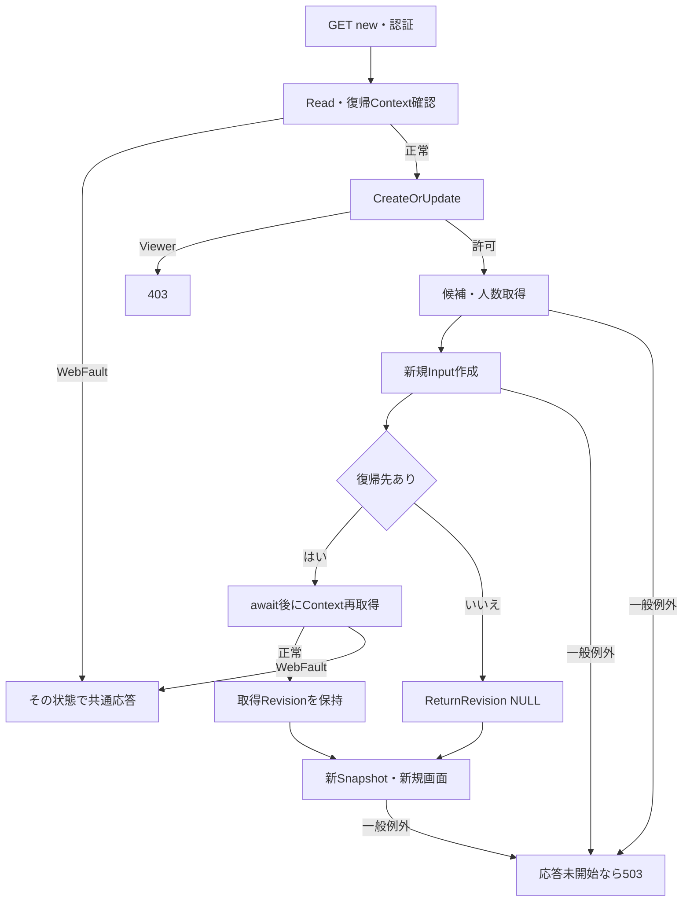

入口は対象IDなしである。復帰先ありの枝は取得したRevision、なしの枝はNULLをJへ引き継ぐ。

#### SQL・テーブル関連（ER図）

新規表示では学生をINSERTしない。候補・人数取得に関わるFKは次のとおりである。

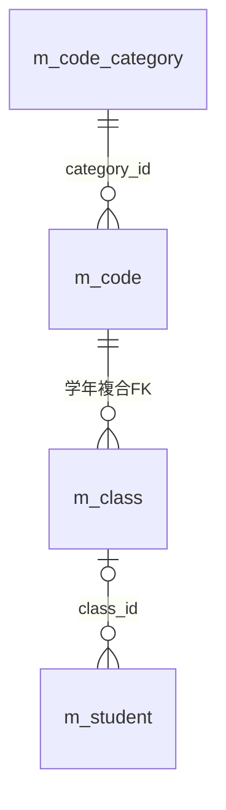

人数集計と学年名称LEFT JOINは読取操作であり、図のFKとは別である。根拠：`sources/database/001_schema.sql:189-191`。

#### DB操作の詳細

LookupAsyncはSNAPSHOTトランザクション内で二つの結果集合を取得する。コードはm_codeとm_code_categoryをcategory_idでINNER JOINし、分類・値の両is_activeがtrueの場合にIsActiveをtrueとする。全件をcategory_id、display_order、code_value順で返す。

クラスは全m_classを学年m_codeへ分類と値でLEFT JOINし、年度降順、学年表示順、クラス表示順、class_code、class_id順で返す。参考人数は同一class_id、非削除、在籍01・02のCOUNTである。SQLの年度・期間抽出、入力パラメータ、件数上限、ページングはない。読取後にcommitしてLookupSetを返す。根拠：`sources/Core/SqlServerStudentService.cs:196-216`。

#### 結果・例外時の扱い

正常時は新規画面となる。必須初期コードの不足を表示段階で専用エラーにする処理や、クラス0件の専用通知はない。クラス0件なら未所属optionだけとなり、01・02の保存はクラス必須検査で拒否される。

設計意図は初期コード存在の確認、不足時の保存不可、クラス0件のW-STU-108表示である。現行は初期値を設定して候補を表示し、最終検査を保存段階で行う。根拠：`sources/Infrastructure/WebStudentCoordinator.cs:17-17`、`sources/Views/Students/Edit.cshtml:12-12`、`sources/Core/StudentNormalizer.cs:154-154`、設計意図：`reference-designs/詳細仕様書/CSharp_ASPNET/02_学生登録画面.md:169-177`。

局所catchはない。WebFaultは共通middlewareでその状態コード、その他の例外は応答未開始の場合に503のHTML応答となる。

### EV-REG-002 既存学生の編集・参照表示

#### 処理概要

GET `/students/{id:long}`で非削除学生を読み、Staff・Administratorは編集、Viewerは参照として表示する。対象不在を新規へ切り替えない。

#### 処理手順

1. CoordinatorがReadと復帰Context確認を行う。既存表示ではCreateOrUpdateを呼ばない。
2. GetAsyncがUserを検査する。IDが0以下ならNULL、正のIDは非削除学生の取得へ進む。
3. 取得0件をCoordinatorが404、E-STU-103へ変換する。
4. 保存列、版、更新日時・者をStudentDetailへ移す。birth_dateはDateOnly、入学日・終了日はyyyy-MM-dd文字列としてDraftへ戻す。
5. LookupAsyncで候補・人数を別途取得する。FromがクラスID・期待版を10進文字列、生年月日を和暦4入力へ変換し、候補内の所属クラスから年度・学年を補う。
6. await後に復帰Contextを再確認してRevisionを取得し、新Snapshotを作る。Fromは理由とTokenを設定しない。
7. 既存学籍番号をreadonly、Viewerの外側fieldsetをdisabledとし、見出しを編集または参照へ切り替える。

根拠：`sources/Web/Controllers/StudentsController.cs:24-25`、`sources/Infrastructure/WebStudentCoordinator.cs:17-17`、`sources/Core/SqlServerStudentService.cs:172-216`、`sources/Web/Inputs/StudentSaveInput.cs:44-54`、`sources/Views/Students/Edit.cshtml:3-6`。

#### 処理フロー

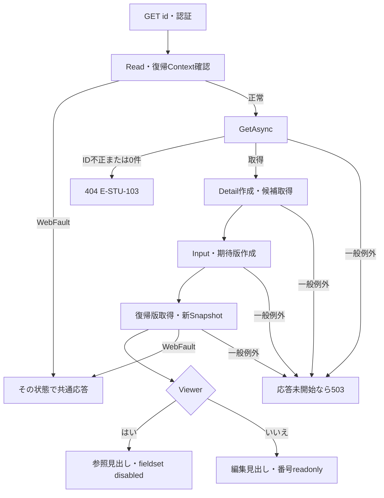

#### SQL・テーブル関連（ER図）

学生本体取得はm_student単独のため、そのSELECTのER図は省略する。候補取得はEV-REG-001の関連を使う。GetAsyncとLookupAsyncは別呼出しで、学生Detailと画面候補全体を一つの共通SNAPSHOTで取得する処理ではない。

#### DB操作の詳細

`SELECT * FROM dbo.m_student WHERE student_id=@id AND is_deleted=0`を`@id: BigInt`で実行する。PK対象の最初の1行を読み、ORDER BY・ページングはない。保存値辞書には照合キーも読むが、Fromは利用者入力の照合キーとして移送しない。候補SQLはEV-REG-001と同じである。根拠：`sources/Core/SqlServerStudentService.cs:172-216`。

#### 結果・例外時の扱い

未所属なら年度・学年はNULLとなる。読込時と同じ停止・期間外値は選択保持できるが、マスタ不存在を許可する規則ではない。対象取得、日付逆変換、候補取得、復帰版取得、Snapshot作成、Viewに局所catchはない。エラーは共通応答境界へ進む。

更新日時はDetailのUTC値を日本時間へ変換する。保存失敗後に元Detailを保持する再表示と、このイベントで最新Detailを取得する処理を区別する。

### EV-REG-003 入力補助・候補連動・離脱確認

#### 処理概要

site.jsが画面内の年度・学年・クラス対応、未保存変更、送信・離脱確認、確認Token解除を扱う。候補をHTTPで再取得する登録画面の入口は接続されていない。

#### 処理手順

1. editorフォーム内のinputイベントでdirtyをtrueとし、Input.DuplicateTokenを空文字へ戻す。確認・変更理由の編集も対象となる。
2. クラスchangeでは、選択optionにdata-yearがあれば年度・学年へdata属性値を設定する。
3. 年度・学年changeでは、現在クラスがあり、非空上位値とoptionの対応値が不一致ならクラスを空へ戻して解除通知を表示する。空上位値は不一致条件に使わない。
4. form送信時は押されたボタンのdata-confirm、なければformのdata-confirmで確認する。取消なら送信を止め、続行ならleaving=true、同form内の他ボタンdisabled、aria-busy=trueとする。
5. dirtyリンクでは破棄確認を行い、取消なら遷移を止める。beforeunloadはdirtyかつleavingでない場合に離脱確認を要求する。

根拠：`sources/wwwroot/js/site.js:2-8`、`sources/Views/Students/Edit.cshtml:12-17`。

#### 処理フロー

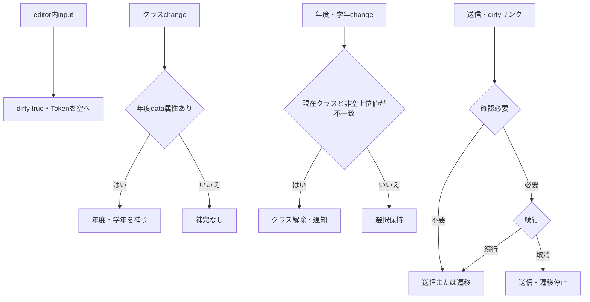

#### SQL・テーブル関連（ER図）

変更対象はDOMとブラウザー内の変数で、DB操作がないためER図は省略する。クラスのdata-year・data-gradeは、直前のLookupSetをViewがoptionへ投影した値である。

#### DB操作の詳細

DB操作はない。人数表示の再計算、在籍・日付変更による候補再取得、和暦の即時厳密検査、01・02時の終了日disabled、要求世代による古い応答の排除はsite.jsに接続されていない。保存時のサーバー検査は別に行う。

#### 結果・例外時の扱い

上位変更で解除されたクラスは、01・02保存時の必須値を失うため再選択が必要となる。参考人数は席の確保を意味しない。

設計意図は和暦検査、在籍に応じた条件表示、年度・学年・区分変更時の候補再取得、不適合値の解除である。現行は年度・学年・クラスのDOM連動と保存時検査に対応する。根拠：`sources/wwwroot/js/site.js:2-8`、設計意図：`reference-designs/詳細仕様書/CSharp_ASPNET/02_学生登録画面.md:260-285,778-787`。

### EV-REG-004 新規登録・更新

#### 処理概要

登録・更新はControllerの共通Saveを入口とする。フォーム、権限、編集状態、復帰先、ModelStateを検査した後、保存命令を作る。サービスは正規化、書込ゲート下の最新状態検査、変更判定、番号一意、全同一人物候補の確認を行い、学生と履歴のcommit完了後にSavedを返す。

#### 処理手順

1. 認証・CSRF・モデルバインドの基盤処理後、FormGuardが許可キーと通常項目の重複を確認する。必須存在、型、業務長の検査ではない。
2. ControllerがCreateOrUpdate、Snapshot.Get、CheckReturn、投稿ReturnContextIdとOriginal.ReturnContextIdの一致を、この順に検査する。これらは局所tryの外である。
3. ModelState不正は422としてサービスを呼ばず再表示へ進む。正常なら局所try内でCoordinator.Saveを呼ぶ。
4. Coordinatorが作成更新権限と復帰状態を再確認する。ToRequestはClassIdを任意正数longへ、更新期待版を必須正数longへ変換する。新規に非空期待版があれば400。SnapshotId・復帰先はSaveRequestへ渡さない。
5. SaveAsyncが受付UUID、User、UTC now、日本時間dayを取得する。ViewerはForbidden。事前検証tryで19入力正規化、任意理由Text60、対象IDと期待版の正数・設定有無一致、年度範囲、任意学年2桁を検査する。
6. 接続を開き、SNAPSHOT使用可能状態を確認し、ReadCommittedを開始する。Openとトランザクション開始は書込みtryの外である。
7. 書込みtry内でXACT_ABORTと保存用applockを取得する。更新だけ非削除対象を読み直し、不在、期待版、学籍番号不変、旧03・04から別区分への訂正権限・理由を確認する。
8. 最新コードと指定クラスを検査する。同値コードでも存在が必要。クラスは存在、指定年度・学年との一致、状態に応じた期間、増席時の定員を検査する。
9. 正規化22保存値を最新DB値と比較する。変更0列なら明示rollbackしてNoChangeを返し、番号一意・候補取得へ進まない。変更ありで版上限ならConflict。
10. 削除済みを含む全学生に対して、自分以外の学籍番号完全一致を確認する。
11. 同生年月日かつ氏名キーまたはカナキー一致の全候補を取得し、EV-REG-005の確認契約を適用する。未確認ならrollbackして確認情報を発行し、ConfirmationRequiredを返す。
12. 保存可能なら新規INSERT、または学籍番号を除いた正規化列のUPDATEを実行する。更新WHEREはID・期待版・非削除。OUTPUTのIDなしはDBConcurrencyException。
13. 同じトランザクションで履歴を追記する。commit直前にcommitAttempted=true、完了後にcompleted=trueとし、供給Tokenを削除してSaved、取得ID、新版を返す。
14. ControllerはSavedだけ303へ進む。その他はOutcome別状態、Errors、結果Tokenを反映し、投稿Input、元Detail・Snapshot・復帰版、新候補で再表示する。局所WebFaultでは結果Token代入を行わない。

根拠：`sources/Web/Controllers/StudentsController.cs:26-33,41-41`、`sources/Infrastructure/WebStudentCoordinator.cs:18-18`、`sources/Web/Inputs/StudentSaveInput.cs:34-43,57-60`、`sources/Core/SqlServerStudentService.cs:227-329,344-390`。

#### 処理フロー

保存を五つのサブフローに分ける。SF-2は事前検証とゲート下の検査を別図にする。各出口の結果は後掲の結果表へ引き継ぎ、合流点でID・版・状態を固定値へ置換しない。

**1. SF-1：入口検査（手順1～4）**

入口はルート対象IDと投稿Input・SnapshotIdである。正常出口はSaveRequest、再表示出口は投稿Inputと取得済みSnapshotである。

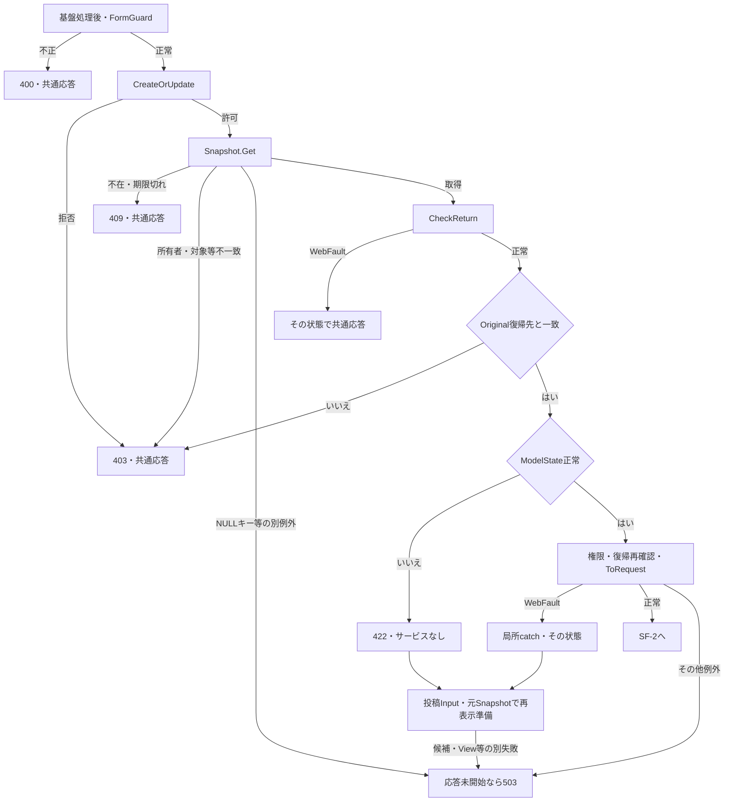

**2. SF-2.1：サービス事前検証（手順5～6）**

User取得は事前検証catchより前にある。検証正常時の出口は正規化student、reason、request、入口now・day、開始済みトランザクションである。

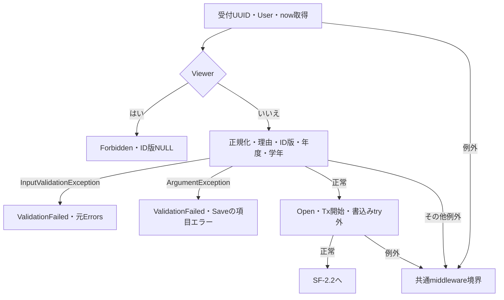

C・E・Fの返却IDと版はNULLである。NULLの構成日付が生じる例外は、補足説明の日付境界に従い「その他例外」を通る。

**3. SF-2.2：最新DB検査と変更判定（手順7～10）**

入口はSF-2.1の値である。新規枝ではprevious・previousVersionがNULL、更新の読取成功枝では取得した保存値・版を保持し、そのまま後続へ渡す。

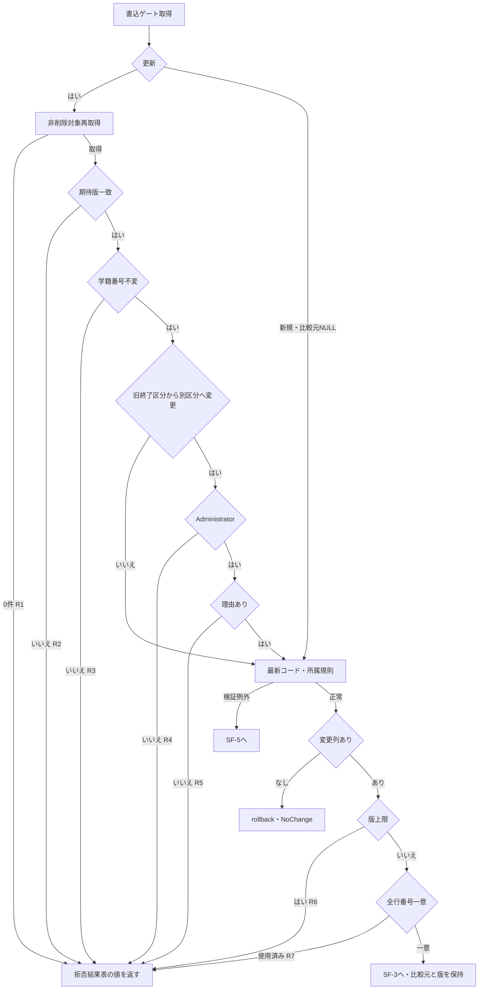

| 拒否枝 | 条件・返却値 | ID・版 |
| --- | --- | --- |
| R1 | 更新対象なし：NotFound、E-STU-103 | NULL・NULL |
| R2 | 取得版と期待版不一致：Conflict、E-STU-105 | NULL・NULL |
| R3 | 学籍番号変更：ValidationFailed、E-STU-104 | NULL・NULL |
| R4 | 旧03・04から別区分へ変更し非管理者：Forbidden、E-COM-002 | NULL・NULL |
| R5 | 上記訂正で理由NULL：ValidationFailed、E-STU-106 | NULL・NULL |
| R6 | 実変更あり、previousVersionがlong.MaxValue：Conflict、E-STU-105 | NULL・NULL |
| R7 | 自分以外に全行学籍番号一致あり：ValidationFailed、E-STU-101 | NULL・NULL |

MはNoChange、対象IDと取得previousVersionを返す。新規は比較元がなく全保存値が変更扱いとなる。図中の他の実行例外はSF-5へ進み、例外型がcatch対象外なら共通境界へ伝播する。

**4. SF-3：候補・確認情報（手順11）**

入口は正規化内容、対象・期待版、比較元版、最新候補である。確認待ち出口はrollback済み、書込み出口は確認状態と取得済み比較元をSF-4へ渡す。

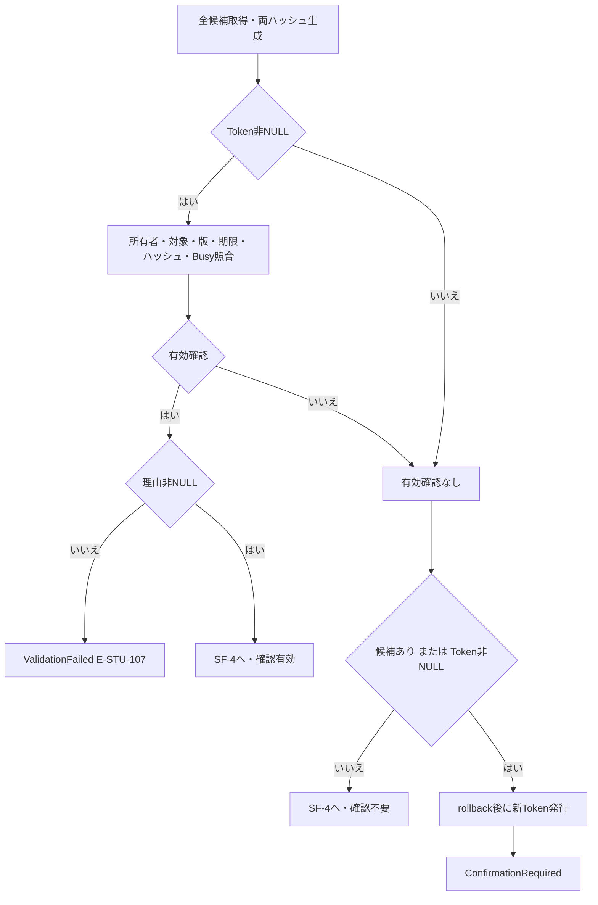

LのID・版は更新なら対象ID・previousVersion、新規ならNULL・NULLである。Errorsは空、件数は全件、表示候補は最大20件となる。Gは共通拒否結果のNULL・NULLである。照合失敗理由を一つの固定成功状態へ合流させない。

**5. SF-4：学生・履歴の確定と応答（手順12～14）**

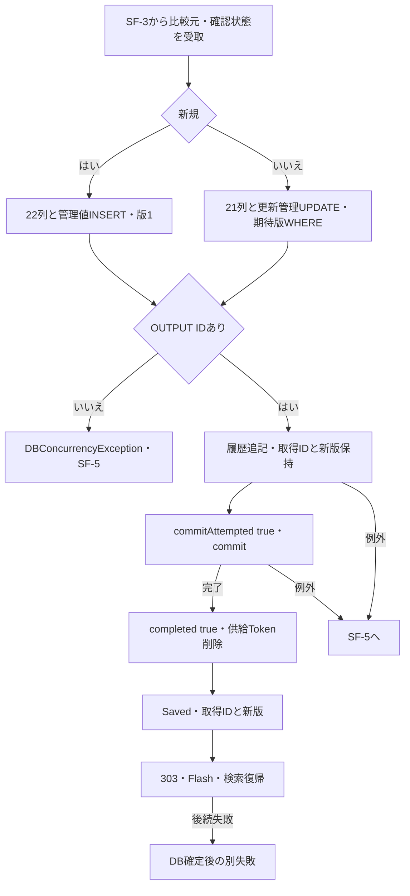

writeStartedは学生DMLの実行直前にtrueとなる。INSERT・UPDATEの実行例外もSF-5へ進む。Jの失敗を学生保存のrollbackへ戻す経路はない。

**6. SF-5：保存tryのcatch順**

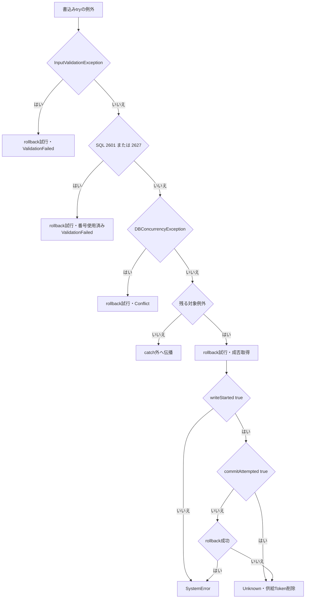

「残る対象例外」はSqlException、InvalidOperationException、OperationCanceledExceptionである。最後のcatchだけが、`writeStartedがtrue、かつ（commitAttemptedがtrueまたはrollback失敗）`をUnknown条件にする。先行三catchをUnknownへ再分類しない。finallyはclaimedがあり、completed=false、unknown=falseの場合に確認Busyを解除する。

#### SQL・テーブル関連（ER図）

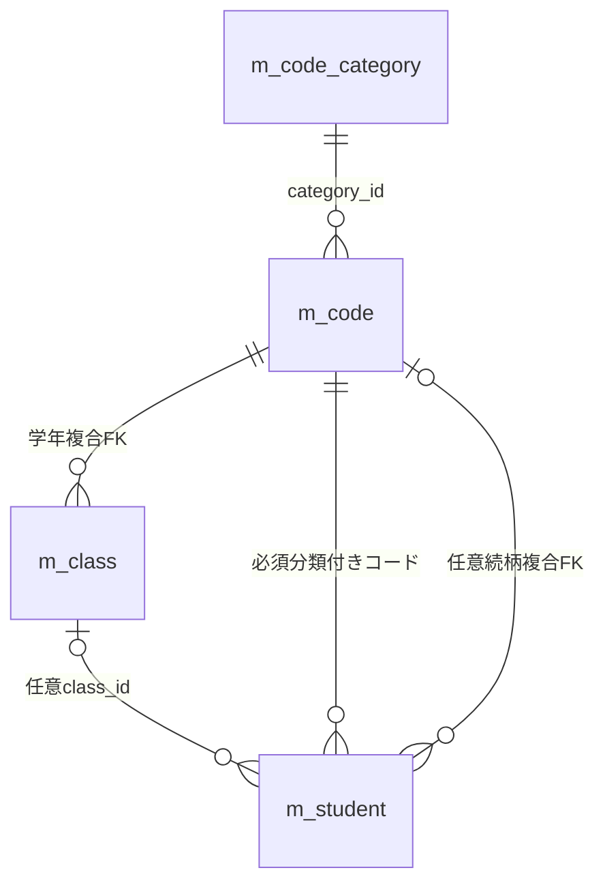

必須分類付きコードは性別・都道府県・在籍である。続柄の分類と値は任意一式となる。履歴target_keyに学生へのFKは宣言されていないため、保存依存は別図で示す。

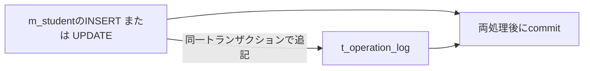

根拠：`sources/database/001_schema.sql:137-154,189-200`、`sources/Core/SqlServerStudentService.cs:306-315,385-390`。

#### DB操作の詳細

| 操作 | 全条件・取得／設定・パラメータ |
| --- | --- |
| 更新対象読取 | m_studentの`student_id=@id AND is_deleted=0`でSELECT *。`@id BigInt`。取得22保存値とrow_versionを比較元へ保持 |
| 最新コード検査 | m_codeとm_code_categoryをcategory_idでINNER JOIN。`c.category_id=@category AND c.code_value=@value`。`@category VarChar(24)`、`@value VarChar(10)`。利用状態2値とvalid_from/toを取得 |
| 最新クラス検査 | m_classの`class_id=@id`。`@id BigInt`。年度、学年、期間、利用状態、定員を取得 |
| 増席人数 | `class_id=@class AND is_deleted=0 AND enrollment_status_code IN ('01','02') AND (@id IS NULL OR student_id<>@id)`のCOUNT_BIG。両IDはBigInt。人数+1と非NULL定員を比較 |
| 番号一意 | `student_no=@no AND (@id IS NULL OR student_id<>@id)`のCOUNT_BIG。`@no VarChar(15)`、`@id BigInt`。削除条件なし |
| 候補取得 | RowSelectへ非削除、自分除外、同生年月日、氏名キーまたはカナキー一致を追加。student_id昇順、全件。`@id BigInt`、`@birth Date`、`@name NVarChar(320)`、`@kana NVarChar(36)` |
| 新規INSERT | 正規化22列、必須3分類、is_deleted=0、作成・更新時点と主体、版1を設定。IDはIDENTITY。OUTPUT INSERTED.student_id INTO表変数後にSELECT |
| 通常UPDATE | 正規化22列からstudent_noを除く21列を全SET。updated_at/byと版+1を設定。WHEREはID・期待版・非削除。学籍番号、作成情報、必須3分類、削除属性は維持 |
| 履歴INSERT | target_table=m_student、対象ID、CREATEまたはUPDATE、前後版、変更列名JSON、主体、UTC日時、受付UUID、理由、候補件数が1以上かを追記 |

根拠：`sources/Core/SqlServerStudentService.cs:247-315,347-390`。保存列のSqlDbType・サイズは補足説明の対応表に記載する。管理値は`@now DateTimeOffset`、`@actor NVarChar(128)`、更新比較は`@version BigInt`である。

新規履歴の前版はNULL、後版は1で、変更列名は22書込列と9システム設定列である。更新履歴は取得前版・新版と、実際に変化した正規化列、updated_at、updated_by、row_versionを記録する。UPDATEのSET列は全21列である一方、履歴の業務列は実変更列だけである。履歴に個人情報値の前後コピーは保存しない。NoChangeではDMLも履歴追記もない。

監査パラメータは`@id VarChar(35)`、`@op VarChar(11)`、`@before/@after BigInt`、`@changed NVarChar(max)`、`@actor NVarChar(128)`、`@now DateTimeOffset`、`@request UniqueIdentifier`、`@reason NVarChar(120)`、`@confirmed Bit`である。根拠：`sources/Core/SqlServerStudentService.cs:261-262,306-307,385-390`。

#### 結果・例外時の扱い

| 結果・発生境界 | 返却ID・版 | HTTP・保持情報 |
| --- | --- | --- |
| Saved | OUTPUTのID、新規1またはpreviousVersion+1 | Controllerが303。Flashと検索復帰へ進む |
| NoChange | 対象ID、取得previousVersion | 200、変更なし通知。投稿Input、元Detail・Snapshot・期待版を保持 |
| ConfirmationRequired | 新規NULL・NULL、更新対象ID・previousVersion | 409。結果Token、全件数、最大20候補。元Detailと投稿Inputを保持 |
| ValidationFailed | NULL・NULL | 422。ErrorsをModelStateへ追加 |
| Forbidden | NULL・NULL | 403 |
| NotFound | NULL・NULL | 404 |
| Conflict | NULL・NULL | 409 |
| SystemError・Unknown | NULL・NULL | 503。Unknownは再保存前の検索確認を案内 |
| ModelState不正 | SaveResultなし | 422、サービスなし。結果Token代入なし |
| Coordinator・ToRequestの局所WebFault | SaveResultなし | WebFaultの状態とエラーで再表示。結果Token代入なし |

根拠：`sources/Core/SqlServerStudentService.cs:226-242,250-266,290-323`、`sources/Infrastructure/WebPresentation.cs:23-23`、`sources/Web/Controllers/StudentsController.cs:30-33`。

事前検証のInputValidationExceptionは元Errors、ArgumentExceptionはField=SaveのArgumentErrorとなる。通常の項目別ArgumentExceptionはNormalizer.Setが先に当該項目へ変換する。User取得、Open、Tx開始は、この保存結果化の範囲外である。

書込みtryのcatchは入力検証、SQL2601・2627、DBConcurrencyException、残る対象例外の順である。SQL一意違反はSQL番号による分類で、発生元テーブルを限定していない。先行三catchはrollbackを試すが、その失敗を理由にUnknownへ分類し直さない。最後の対象catchだけの条件は次の式である。

`unknown = writeStarted && (commitAttempted || !rolledBack)`

writeStarted=falseなら、rollback失敗だけではUnknownにならない。RollbackヘルパーはCancellationToken.Noneを使い、SqlExceptionとInvalidOperationExceptionをfalseへ変換する。それ以外の例外は伝播し得る。根拠：`sources/Core/SqlServerStudentService.cs:316-329`。

ゲート下の早期拒否には明示rollbackのないreturnもあり、await usingの終了へ進む。NoChangeと確認待ちでは明示rollbackを実行し、その失敗は書込みtryの例外枝へ入る。DMLのOUTPUTなしは存在再読取を行わずConflictとなる。設計意図の「DML0件後に存在を再確認して不在・競合を分ける」処理との差である。根拠：`sources/Core/SqlServerStudentService.cs:250-266,287-303,318-318`、設計意図：`reference-designs/詳細仕様書/CSharp_ASPNET/02_学生登録画面.md:600-603,799-799`。

再表示はサービス結果ID・版をページ対象や期待版へ代入しない。結果TokenだけInputへ代入し、`Input.DuplicateToken`のModelStateを除去する。その他の原入力は保持する。ViewではClassId文字列による候補参照、入力日付のTryParse、和暦4入力のasp-forを再度扱う。日付TryParse不成立はクラス期間重なりをfalseにし、読込時同所属の保持条件は別に残る。候補取得、候補和暦表示、ネスト値の描画、資源Dispose等で二次失敗が起きれば、先に設定した422・409等が最終応答へ到達する保証はない。応答未開始なら共通middleware、開始後はそのcatch対象外となる。根拠：`sources/Web/Controllers/StudentsController.cs:29-33`、`sources/Views/Students/Edit.cshtml:2-14`、`sources/Core/Contracts.cs:55-55`、`sources/Infrastructure/WebHostSetup.cs:23-23`。

### EV-REG-005 同一人物候補の確認・続行・取消

#### 処理概要

候補を同一人物と断定せず、別人として保存を続ける確認対象として扱う。表示は最大20件だが、照合は全候補IDと版を対象にする。続行は同じ保存POSTを入口から再実行する。

#### 処理手順

1. EV-REG-004で全候補をstudent_id順に取得する。画面へは学籍番号・氏名・和暦生年月日・クラス名を表示する。
2. Columns順の正規化保存値からname_key、kana_key、relationship_categoryを除いた19対応値をJSON化し、SHA-256内容ハッシュを作る。年度・学年・理由は含めない。全候補StudentId・RowVersionも取得順でJSON化し、候補ハッシュを作る。
3. 供給Token非NULLの場合、Web確認情報の主体・セッション・対象・期待版・期限・両ハッシュを照合する。最後のBusy取得が0→1に成功した場合だけ有効確認とする。
4. 有効確認で理由NULLならValidationFailed、E-STU-107。候補ありまたは供給Token非NULLで有効確認なしなら、保存Txをrollbackして新Tokenを発行する。
5. ConfirmationRequiredに枝別ID・版、全件数、最大20候補を返す。メモリ確認情報は入口now+10分、利用者判断待ちにTx・書込ゲートを保持しない。
6. 取消ボタンはhidden Tokenを空へ戻し、確認sectionを除去する。サーバー確認情報の削除は呼ばない。
7. 続行時は正規化、最新対象・版・マスタ・クラス・定員・全候補を再取得・再検査して照合する。
8. Savedまたは最後の対象catchでUnknownになった場合に供給Tokenを削除する。取得済みBusyは未完了かつUnknown以外でfinallyから解除する。

根拠：`sources/Core/SqlServerStudentService.cs:19-29,224-225,269-290,313-342`、`sources/Views/Students/Edit.cshtml:14-14`、`sources/wwwroot/js/site.js:3-6`。

#### 処理フロー

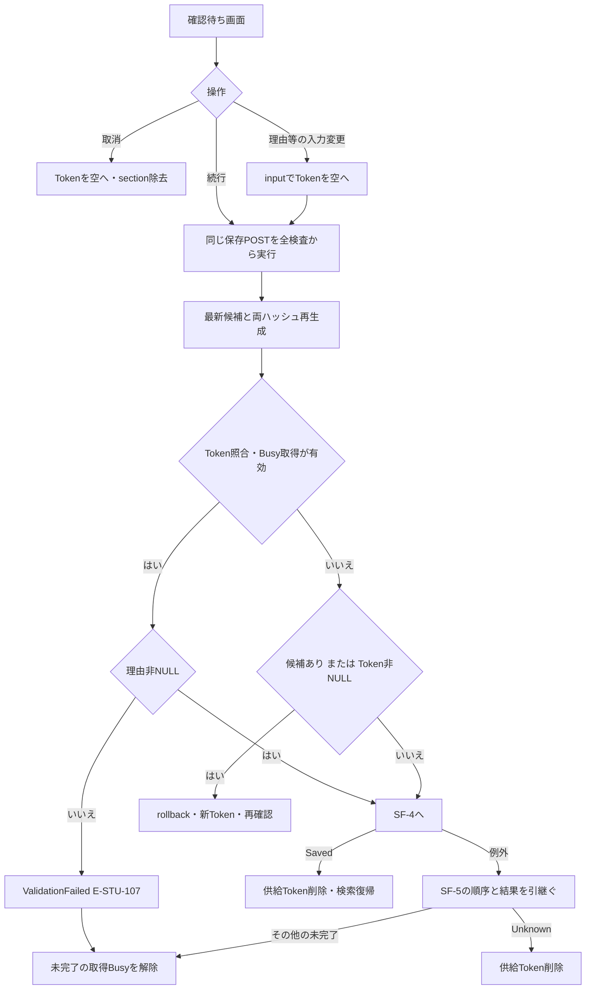

Cは画面内取消でDB操作なし。LはSF-3の枝別ID・版を引き継ぐ。Oの複数結果を一つのHTTP状態へまとめない。

#### SQL・テーブル関連（ER図）

候補取得の表示JOINを示す。これはFK図ではなく読取依存図である。

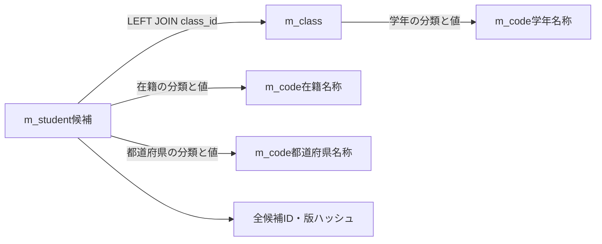

Webの確認保持先はメモリで、t_confirmationをWeb経路の発行・消費先として図示しない。根拠：`sources/Core/SqlServerStudentService.cs:82-90,276-284`、`sources/Infrastructure/WebHostSetup.cs:19-19`。

#### DB操作の詳細

RowSelectに`is_deleted=0`、自分除外、同生年月日、氏名キーまたはカナキー完全一致を追加し、student_id順で全件取得する。TOP・ページングはなく、Take(20)は返却・表示段階だけである。LEFT JOINの名称NULLを、マスタ保存列のNULL属性へ逆推定しない。ClassNameがNULLならViewは空表示し、「未所属」への代替を行わない。根拠：`sources/Core/SqlServerStudentService.cs:77-90,269-290`、`sources/Views/Students/Edit.cshtml:14-14`。

確認待ちはrollback後に32byte乱数の64桁小文字hexを発行する。既存確認情報の期限切れ除去と新期限には入口nowを使い、照合条件はExpires > nowである。ゲート・DB待機後の現在時刻を取り直す処理はない。

非Web設定ではGUID Token・GUIDセッションを使う別分岐がある。t_confirmationをUPDLOCKで読み、主体、セッション、対象と期待版のNULL組合せ、expires_at、consumed=0、両binary(32)ハッシュを照合する。発行は保存rollback後の別ReadCommittedでINSERT・commitし、確認済み保存では同じ学生Tx内でconsumed=1のUPDATEを行い1件を要求する。この分岐をWeb画面の実経路へ混ぜない。根拠：`sources/Core/SqlServerStudentService.cs:279-284,308-311,330-342`。

#### 結果・例外時の扱い

ConfirmationRequiredのErrorsは空で、Viewは確認見出し、全件数、最大20候補を表示する。設計意図の相違時W-STU-102専用メッセージは接続されていない。取消autofocusやTokenの存在は、利用者の実判断を証明する情報ではない。根拠：`sources/Core/SqlServerStudentService.cs:290-290`、`sources/Views/Students/Edit.cshtml:14-14`、設計意図：`reference-designs/詳細仕様書/CSharp_ASPNET/02_学生登録画面.md:374-380`。

理由編集もTokenを解除するため、確認画面で理由を初めて入力した直後の続行は、候補が残っていれば再確認へ戻り得る。再発行後に内容を変えず、有効Tokenと非NULL理由を送ると保存へ進む。空文字Tokenがサービスへ届いた場合も非NULL供給値であり、再確認条件に入る。HTTP空文字からNULLへのバインド境界とは分けて扱う。

取消はSnapshotを消費せず、サーバー確認情報も直接削除しない。結果が返った場合はControllerが結果Tokenへ置換するので、通常失敗結果ではInputのTokenはNULLとなる。Busy解除条件は`claimedあり、completed=false、unknown=false`で、ブラウザーaria-busyとは別である。

### EV-REG-006 論理削除

#### 処理概要

管理者が独立したフォームから対象、読込時期待版、理由、Confirmedを送る。編集中の学生業務値を保存せず、削除属性と更新管理情報だけを履歴と一括確定する。

#### 処理手順

1. ControllerがFormGuard、Read、Snapshot.Get、投稿復帰先とOriginalの一致を順に検査する。保存のCreateOrUpdate・ModelState分岐・局所WebFault catchはない。
2. CoordinatorがAdministrator、CheckReturn、Confirmed、期待版Requiredの順に確認する。Confirmed=falseは422、Field=REG-026。期待版不正も422のWebFaultとなる。
3. DeleteAsyncが受付UUID、User、nowを取得し、非管理者をForbiddenとする。理由を必須複数行Text60で検査し、InputValidationExceptionだけをValidationFailedへ変換する。
4. ID・版の正数と版long.MaxValueでないことを検査する。Open・ReadCommitted開始は削除tryの外である。
5. try内で保存ゲートを取得し、非削除対象の最新row_versionを読む。不在はNotFound、版不一致はConflict。
6. ID・期待版・非削除のWHEREで削除属性・更新管理7列をUPDATEする。影響件数が1以外ならDBConcurrencyException。
7. DELETE履歴を追記してcommitする。正常結果はSaved、対象ID、版+1。
8. ControllerはSavedだけ303へ進む。その他はErrorsと状態コードを設定した後にLoadを呼び、最新DB値、候補、復帰版、新Snapshotで再表示する。

根拠：`sources/Views/Students/Edit.cshtml:17-17`、`sources/Web/Controllers/StudentsController.cs:37-38`、`sources/Infrastructure/WebStudentCoordinator.cs:19-19`、`sources/Core/SqlServerStudentService.cs:392-416`。

#### 処理フロー

**1. 削除入口：保持情報と削除命令**

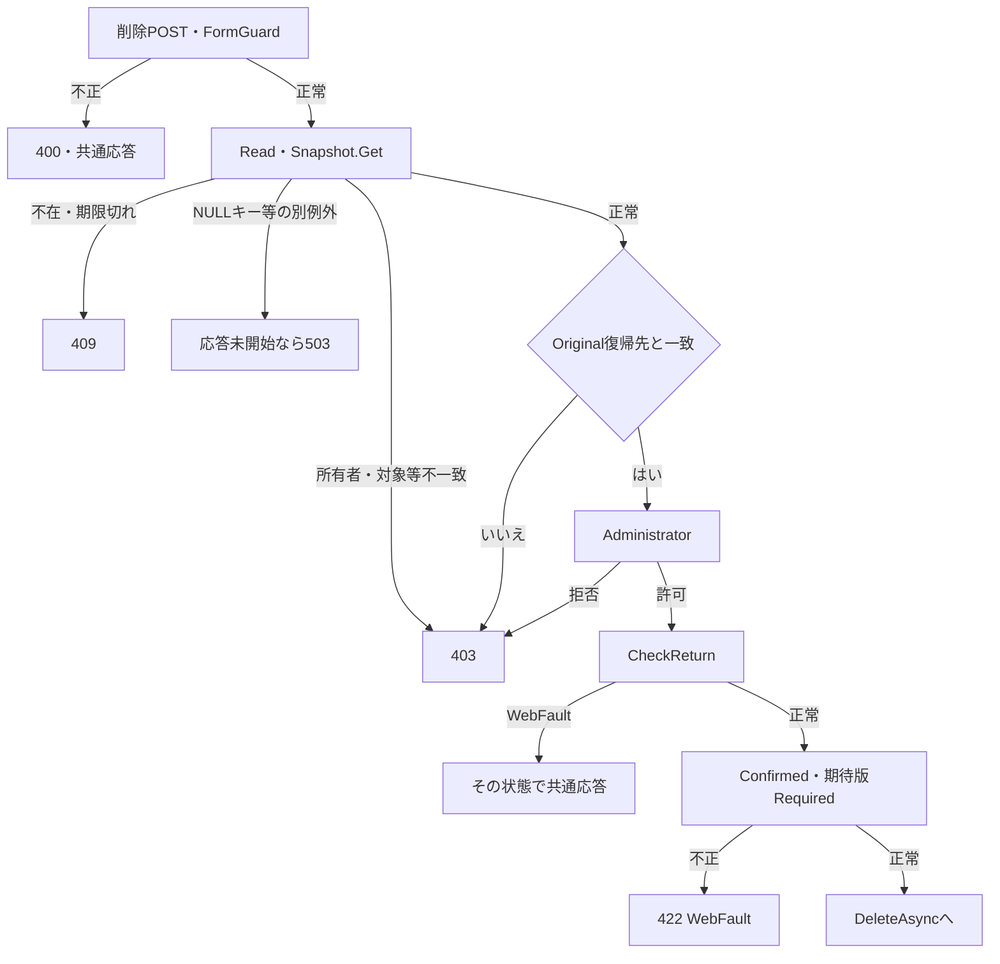

Readの認証不正は401のWebFaultとして共通境界へ進む。入口のWebFaultを削除結果化した再表示へ合流させない。

**2. 削除サービス：最新検査・確定・失敗後Load**

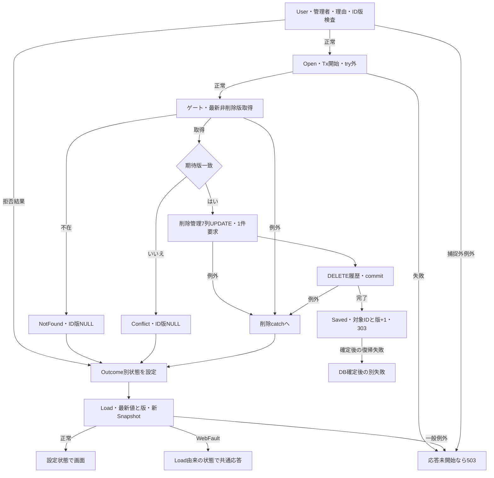

**3. 削除catch：競合を先に分類**

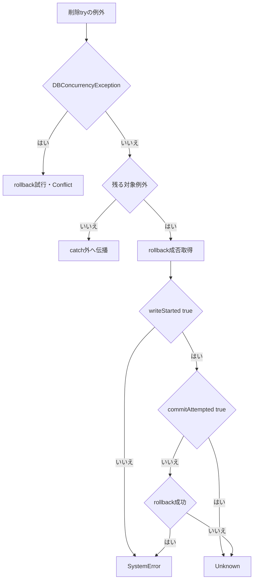

残る対象例外はSqlException、InvalidOperationException、OperationCanceledExceptionである。後続catchだけが「writeStartedがtrue、かつ（commitAttemptedがtrueまたはrollback失敗）」をUnknown条件とする。競合catchへこの条件を拡張しない。

#### SQL・テーブル関連（ER図）

学生のFKはEV-REG-004の図と同じで、論理削除はclass_idや一般業務値を消去しない。直接書込みは学生と履歴である。

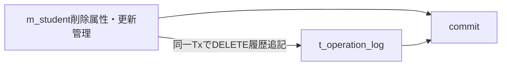

これは処理依存線で、履歴FKではない。非削除条件によって人数集計から対象が外れる。

#### DB操作の詳細

再確認は`SELECT row_version FROM dbo.m_student WHERE student_id=@id AND is_deleted=0`、`@id BigInt`で行う。UPDATEも`student_id=@id AND row_version=@version AND is_deleted=0`を条件とする。

SET列はis_deleted=1、deleted_at、deleted_by、delete_reason、updated_at、updated_by、row_version+1の7列だけである。パラメータはID・版BigInt、now DateTimeOffset、actor NVarChar(128)、reason NVarChar(120)。1件以外は競合例外とし、DML後の存在再読取はない。

履歴はDELETE、前版version、後版version+1、7列名、同じ理由、duplicate_confirmed=falseを設定する。両書込み後にcommitする。氏名・住所・連絡先・class_id・作成管理情報は維持し、物理DELETEを行わない。根拠：`sources/Core/SqlServerStudentService.cs:404-414`。

#### 結果・例外時の扱い

理由検証はInputValidationExceptionだけを捕捉する。不正UnicodeのArgumentExceptionはそのcatch外で、Open前に伝播する。ControllerにはModelState.IsValid分岐と局所WebFault catchがない。非nullable宣言やhidden Confirmed=trueから、受信値の変換成功を保証しない。

DBConcurrencyExceptionは先行catchでConflictとなり、rollback失敗を理由にUnknownへ変更しない。後続対象catchだけが上記の括り付き条件でSystemErrorとUnknownを分ける。Saved以外のID・版は共通結果のNULLとなる。根拠：`sources/Core/SqlServerStudentService.cs:395-416`。

失敗結果後のLoadが正常なら、設定済み状態で最新DB画面を返す。Loadの対象不在は404、復帰期限切れは409、別の一般失敗は応答未開始なら503となり得る。削除理由はページモデルへ明示移送されず、Viewの通常textareaにも再表示値設定がない。保存失敗時の投稿業務値保持と同じ処理ではない。根拠：`sources/Web/Controllers/StudentsController.cs:25-25,37-37`、`sources/Views/Students/Edit.cshtml:17-17`、`sources/Infrastructure/WebHostSetup.cs:23-23`。

設計意図も削除を対象・読込時版・理由・明示確認の操作として定義し、編集中の業務値を保存しない。根拠：`reference-designs/詳細仕様書/CSharp_ASPNET/02_学生登録画面.md:418-424`。

### EV-REG-007 入力クリア・編集取消

#### 処理概要

Resetは読込時Originalへ戻す操作である。新規は初期値を含むOriginalへ、既存は最後の読込時入力へ復元し、学生の最新DB取得は行わない。

#### 処理手順

1. ブラウザーのフォーム確認を取消した場合はPOSTしない。
2. ControllerがFormGuard、Readを行い、StudentId文字列をIdParser.Optionalで変換する。NULL・空は新規、非空は正のlongを要求する。
3. Snapshotの存在、期限、主体、セッション、対象を確認する。
4. ModelStateをClearし、OriginalをJSON複製してInputへ戻す。
5. 元Detail、SnapshotId、ReturnRevisionを保持し、候補・人数だけ再取得する。
6. 「入力を読込時の値へ戻しました。」と復元画面を返す。

根拠：`sources/Web/Controllers/StudentsController.cs:35-35`、`sources/Infrastructure/EditorSnapshotStore.cs:10-11`、`sources/Views/Students/Edit.cshtml:16-16`、`sources/wwwroot/js/site.js:4-4`。

#### 処理フロー

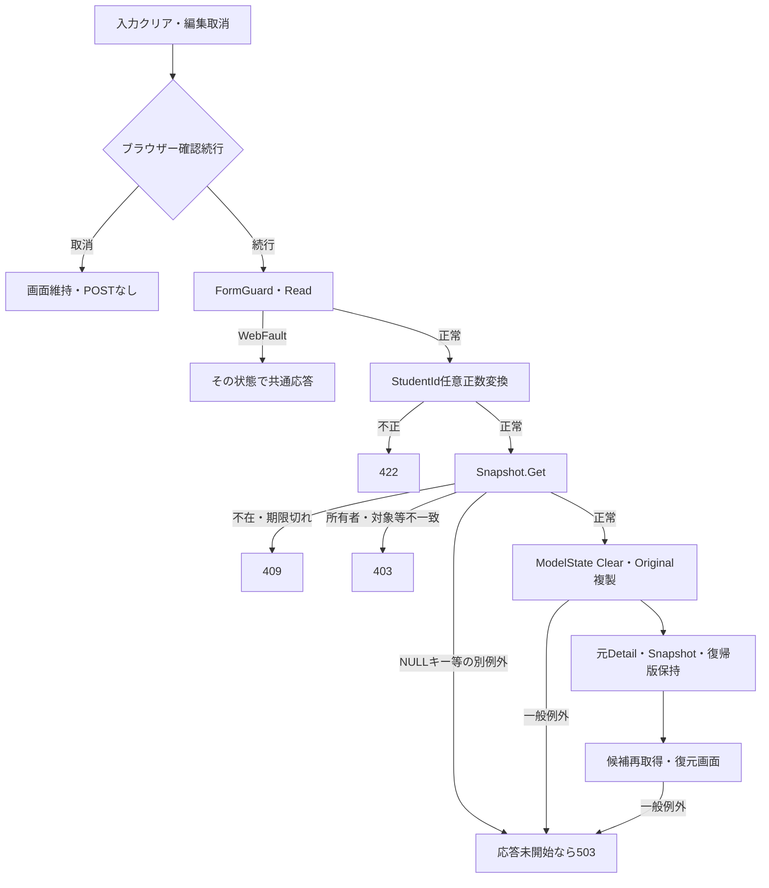

#### SQL・テーブル関連（ER図）

復元元はEditorSnapshotStoreのメモリである。学生行の取得・更新はない。候補・人数再取得だけEV-REG-001の関連を使用するため、ER図の重複は省略する。

#### DB操作の詳細

学生GetAsyncは呼ばず、OriginalとDetailを元Snapshotから得る。LookupAsyncのコード・クラス二結果集合と人数集計だけを再実行する。新Snapshot作成とSnapshot期限延長は行わない。ResetはCheckReturnを呼ばないため、復帰Contextの有効性をこの操作で保証しない。

#### 結果・例外時の扱い

入力と期待版は同じ読込時点へ戻る。他者更新後も期待版は古いままで、次の保存が最新DB版を検査する。旧コード・クラスと新候補の組合せも保存時に検査する。

Snapshot空キー・不在・期限切れは409、存在する別所有者等は403。NULLキーは辞書呼出しが独自検査より先で、空キーと同じ409へまとめない。根拠：`sources/Infrastructure/EditorSnapshotStore.cs:10-10`。

### EV-REG-008 最新情報を再読込

#### 処理概要

既存画面のリンクで対象GETを再実行し、最新値と版を同時に取得して新Snapshotを作る。期待版だけを最新へ差し替える操作ではない。

#### 処理手順

1. dirtyなら「編集内容を破棄して最新情報を読み込みますか。」で確認し、取消なら遷移しない。
2. 対象IDとReturnContextIdを指定して既存GETへ進む。
3. EV-REG-002の認証、Read、復帰Context、非削除対象、候補取得を行う。
4. 最新DetailからInput・期待版を作り、現在復帰Revisionと新Snapshotを設定する。理由・TokenはFromの初期状態へ戻る。

根拠：`sources/Views/Students/Edit.cshtml:16-16`、`sources/wwwroot/js/site.js:5-5`、`sources/Web/Controllers/StudentsController.cs:24-25`、`sources/Web/Inputs/StudentSaveInput.cs:44-54`。

#### 処理フロー

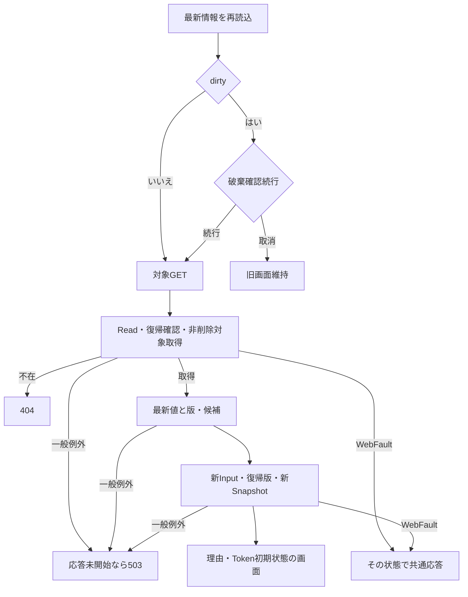

#### SQL・テーブル関連（ER図）

学生本体はm_student単独SELECT、候補はEV-REG-001の関連である。Snapshotの部分更新や版更新DMLは行わないため、それらのER図は作らない。

#### DB操作の詳細

EV-REG-002と同じID・非削除条件のSELECTとLookupAsyncを実行する。値・期待版は新Detailから作り、Snapshot.Createで新しい保持情報を作る。元Snapshotをその場で更新しない。

#### 結果・例外時の扱い

正常なら未保存値を破棄した最新画面となる。削除済み・不在は404で、旧入力を最新対象として表示しない。復帰状態拒否、DB障害、描画失敗は既存表示と同じ共通応答境界へ進む。

設計意図も取消と再読込を分け、競合時に版だけを最新へ差し替えない。根拠：`reference-designs/詳細仕様書/CSharp_ASPNET/02_学生登録画面.md:471-477`。

### EV-REG-009 検索復帰・保存後通知

#### 処理概要

検索リンクとSaved後の303が検索Contextへ復帰する。登録の未保存業務値を検索条件へ移さず、Context.Appliedに保持した実行済み条件で再検索する。

#### 処理手順

1. リンクはdirty時の破棄確認後に検索GETへ進む。SavedはReturnAfterSaveへ復帰Context、Snapshot.ReturnRevision、保存・削除通知を渡す。
2. SavedでContextがNULL・空なら新Contextを作り、そのIDと初期Revisionを使用する。既存ならSnapshotの復帰Revisionを維持する。
3. Flashへ主体・セッション・Contextをキーに通知を10分保持し、303とローカル検索URLのLocationを返す。
4. 検索GETがReadを行い、非空Contextを取得してResumeを呼ぶ。登録からの復帰ではタブ引数を渡さない。
5. Context.UseはGet後にGateを待ち、待機後のGetで所有者・セッション・期限を再確認し、要求Revision一致と版上限を検査する。
6. Appliedなしなら未検索・版維持。AppliedありならSearchAsync、EnsureSearch、LastResult更新、Revision+1を行う。正常operation後に期限を30分延長する。
7. Resume後にFlash.Takeで通知を一度だけ取得・削除し、検索用候補を取得して検索画面を返す。

根拠：`sources/Web/Controllers/StudentsController.cs:8-11,31-39`、`sources/Infrastructure/SearchContextStore.cs:9-15`、`sources/Infrastructure/WebStudentCoordinator.cs:14-14,20-21`、`sources/Infrastructure/FlashMessageStore.cs:6-9`。

#### 処理フロー

```mermaid
flowchart TD
 A[Saved] --> B{復帰Context空}
 B -->|はい| C[新ContextのID・初期Revision]
 B -->|いいえ| D[既存ID・Snapshotの復帰版]
 C --> E[Flash保存・303]
 D --> E
 F[検索リンク・必要時破棄確認] --> G[検索GET・Read]
 E --> G
 G --> H{Context非空}
 H -->|いいえ| I[新Context・未検索]
 H -->|はい| J[Get・Gate待機・Get再確認]
 J --> K[Revision一致・版上限確認]
 K -->|WebFault| X[各状態で共通応答]
 K -->|正常| L{Appliedあり}
 L -->|いいえ| M[未検索・版維持]
 L -->|はい| N[保持条件で再検索]
 N -->|成功| O[LastResult更新・版加算]
 N -->|検証拒否| X
 N -->|一般例外| Y[応答未開始なら503]
 M --> P[期限延長]
 O --> P
 I --> Q[Flash Take・候補・画面]
 P --> Q
 Q -->|一般例外| Y
```

各GetのWebFault、Gate待機取消、Flash・候補・Viewの失敗も共通境界へ進む。新Context枝と既存Context枝のRevisionを同じ固定値へ合流させない。

#### SQL・テーブル関連（ER図）

復帰再検索は学生とクラス、学年・在籍・都道府県コードのLEFT JOINを使う。表示読取関連はEV-REG-005、FKはEV-REG-004の図に対応する。Context、Gate、Flashはメモリで、t_runtime_stateの読書きへ接続されていない。

#### DB操作の詳細

Appliedなしは学生検索を行わない。Appliedありは保持条件を使い、非削除を基本として、指定された番号前方一致、氏名・カナキー部分一致、クラス年度・学年、学生class_id、未所属、都道府県、本人または緊急電話完全一致、入学日の両端包含、在籍INをANDで追加する。LIKEは`!`、`%`、`_`、`[`を`!`でエスケープする。

検索前に学年・都道府県の存在、指定年度のクラス存在、指定クラスの存在と上位値一致を確認する。検索では停止コードを存在検査だけで扱い、保存の新規選択可否と同じ検査ではない。

パラメータは番号VarChar(31)、氏名キーNVarChar(642)、カナキーNVarChar(74)、年度SmallInt、学年・都道府県・各在籍VarChar(2)、クラスBigInt、電話VarChar(16)、日付Date、offset・size Intである。同じSNAPSHOT内でTOP(10001)のCOUNT_BIGを確認し、10000超は一覧を返さない。通常はstudentNo、name、admissionDate、updatedAtの許可列と方向、student_id ASCの副順序でOFFSET/FETCHし、20・50・100件を取得する。

SearchAsyncは取得ページを最終ページ以内へ補正するが、Resume自体はApplied.Pageを変更しない。保持条件・画面のpage情報と、取得時の補正ページを同じ更新値とは扱わない。検索用LookupAsync(false)の人数0は集計省略値で、実測0人ではない。根拠：`sources/Core/SqlServerStudentService.cs:103-171,196-216`、`sources/Infrastructure/WebStudentCoordinator.cs:14-14,21-21`。

#### 結果・例外時の扱い

出力はunsearched、tooMany、empty、foundである。unsearched・tooManyのtotalCountはNULL、emptyは0、foundは件数となる。上限確認の内部Count=10001を実際の全件数として表示しない。

Contextの期限・所有者・版拒否はWebFault、検索検証結果はEnsureSearchでWebFaultへ変換する。その他のDB等の例外は共通middlewareへ進む。FlashはResume後にTakeするため、Take後の候補・View失敗でも通知を戻さない。

学生commit後のContext作成、Flash、303生成、検索再実行の失敗は、学生更新のrollbackではない。検索状態が別操作で進んでいれば旧Snapshotの復帰Revisionが拒否され得る。根拠：`sources/Web/Controllers/StudentsController.cs:8-11,38-38`、`sources/Infrastructure/SearchContextStore.cs:14-14`、`sources/Infrastructure/WebStudentCoordinator.cs:20-21`。

## 項目移送仕様

| 移送ID | 方向・契機 | 入力元 | 変換・内部値 | 出力先・保持 | 不正・枝別の扱い | 根拠 |
| --- | --- | --- | --- | --- | --- | --- |
| MAP-BUSINESS | 画面→保存命令 | Input接頭辞の19入力 | StudentSaveInput→StudentDraft。同名移送、ClassIdのみstring?→long? | 正規化成功後の22保存値。投稿Inputは別保持 | ModelState不正は命令未生成。変換失敗をNULL・0へ置換しない | `sources/Web/Inputs/StudentSaveInput.cs:34-42`、`sources/Core/StudentNormalizer.cs:119-159` |
| MAP-BIRTH | 和暦入力→保存→表示 | Era・Year・Month・Dayのstring | ToRequestはオブジェクトNULLだけ補完。Parse→DateOnly、読込→ToInput | birth_date。候補表示はToWareki | 構成string NULLは補完しない。通常ArgumentExceptionとNullReferenceExceptionを分離 | `sources/Web/Inputs/StudentSaveInput.cs:36-36,48-48`、`sources/Core/JapaneseDateService.cs:17-50` |
| MAP-NAME | 原表記→保存・照合 | 氏名、カナ | 氏名原表記とname_key、正規化カナとkana_keyを分離 | 表示保存列と検索・候補キー列 | キーをフォーム入力として受けない | `sources/Core/StudentNormalizer.cs:66-85,125-126,144-145` |
| MAP-CONTACT | 原入力→保存 | 本人電話・メール、緊急3入力 | 空をNULL化、電話・メールを形式変換、続柄分類を算定 | 独立保存列、続柄分類 | 連絡先1件以上、緊急全部なしまたは3入力全部。全消去は4保存列NULL | `sources/Core/StudentNormalizer.cs:87-117,139-158` |
| MAP-CLASS | 補助選択→所属保存 | 年度int?、学年string?、ClassId文字列 | 年度範囲、学年2桁、ID正数、実クラスとの一致 | 学生class_idだけ保存。年度・学年は命令補助 | クラスなしで年度・学年単独存在検査なし。人数は入力しない | `sources/Web/Inputs/StudentSaveInput.cs:28-42`、`sources/Core/SqlServerStudentService.cs:235-237,363-380` |
| MAP-LOAD | DB→Detail→画面 | 保存22列、版、更新時点・者 | DateOnly、ISO、和暦4入力、ID・版10進文字列、クラス補助 | Input、Detail、Original複製、新Snapshot | 不在404、既存未所属の補助NULL、理由・Token初期状態 | `sources/Core/SqlServerStudentService.cs:172-194`、`sources/Web/Inputs/StudentSaveInput.cs:44-54` |
| MAP-REASON | 保存・削除理由→履歴 | OperationReason、Reason | 複数行Text60 | 保存理由は履歴、削除理由は学生delete_reasonと履歴 | 理由単独は変更判定外。削除失敗後へ明示再表示移送なし | `sources/Core/SqlServerStudentService.cs:234-262,385-413` |
| MAP-RESULT | サービス→保存再表示 | SaveResult、投稿Input、Snapshot | Outcome→HTTP。結果Tokenだけ代入し当該ModelState除去 | ルート対象、元Detail・Snapshot・復帰版、新候補 | 結果NULLのID・版で画面値を消さない。二次失敗は別境界 | `sources/Web/Controllers/StudentsController.cs:30-33` |
| MAP-RESET | メモリ→取消画面 | Original、元Detail | JSON複製、ModelState Clear | 読込時Input・期待版、元Snapshot・復帰版、新候補 | 学生最新取得なし、期限延長なし | `sources/Web/Controllers/StudentsController.cs:35-35`、`sources/Infrastructure/EditorSnapshotStore.cs:10-11` |
| MAP-CONFIRM | 内容・候補→確認→再送 | 19正規化値、全候補ID・版、主体、対象、期待版 | SHA-256、10分期限、Busy取得 | Webメモリ、hidden Token、全件数・20候補 | 理由・補助はハッシュ外。入力でToken解除。続行で全再検査 | `sources/Core/SqlServerStudentService.cs:224-225,274-290,330-335`、`sources/wwwroot/js/site.js:3-6` |
| MAP-RETURN | 保存確定→検索 | Context、Snapshot復帰版、通知 | 空Contextだけ新ID・初期版。Flash10分 | 303、Resume、再検索、通知1回取得 | Appliedなしは未検索・版維持。確定後失敗は保存取消ではない | `sources/Web/Controllers/StudentsController.cs:8-11,38-38`、`sources/Infrastructure/WebStudentCoordinator.cs:14-14` |

## 項目更新仕様

| 更新ID | 対象列・情報 | 新規 | 通常更新 | 論理削除 | 比較・監査・根拠 |
| --- | --- | --- | --- | --- | --- |
| UPD-NO | student_no | 正規化番号設定 | 不変検査、SETしない | 維持 | 全行一意。`sources/Core/SqlServerStudentService.cs:254-266,294-301` |
| UPD-PROFILE | student_name、student_name_kana、birth_date、gender_code | 検証済み値 | 全SET | 維持 | 実変更列を比較・監査。`sources/Core/StudentNormalizer.cs:125-128`、`sources/Core/SqlServerStudentService.cs:261-307` |
| UPD-ADDRESS | postal_code、prefecture_code、address_line1、address_line2 | 検証済み値、任意NULL | 全SET、住所2はNULL上書き可 | 維持 | 名称を住所保存列へ追加しない。`sources/Core/StudentNormalizer.cs:129-132` |
| UPD-CONTACT | phone_number、email_address | 正規化値またはNULL | 値またはNULLをSET | 維持 | 連絡先条件を検査。`sources/Core/StudentNormalizer.cs:133-134,155-155` |
| UPD-ENROLLMENT | admission_date、enrollment_status_code、enrollment_end_date、class_id | 検証済み値 | 全SET、区分・期間・増席条件検査 | 維持 | `sources/Core/StudentNormalizer.cs:135-154`、`sources/Core/SqlServerStudentService.cs:255-260,357-383` |
| UPD-EMERGENCY | emergency_contact_name、relationship_category、relationship_code、emergency_phone_number | 3入力から4保存列設定 | 一式設定または4列同時NULL | 維持 | 派生分類も比較・監査対象。`sources/Core/StudentNormalizer.cs:139-147,156-158` |
| UPD-REMARKS | remarks | 正規化値またはNULL | 値またはNULLをSET | 維持 | LF統一、120スカラー。`sources/Core/StudentNormalizer.cs:47-57,142-142` |
| UPD-KEYS | name_key、kana_key | 保存側生成 | 再生成してSET | 維持 | 受信対象外。`sources/Core/StudentNormalizer.cs:144-145` |
| UPD-CATEGORIES | gender_category、prefecture_category、enrollment_category | 固定3分類 | 維持 | 維持 | 続柄分類と別。`sources/Core/SqlServerStudentService.cs:296-297` |
| UPD-ID | student_id | IDENTITY、OUTPUT | WHERE・OUTPUT識別子 | WHERE識別子 | 手動採番なし。`sources/database/001_schema.sql:8-8`、`sources/Core/SqlServerStudentService.cs:296-304` |
| UPD-CREATED | created_at、created_by | UTC now、主体 | 維持 | 維持 | DTO入力ではない。`sources/Core/SqlServerStudentService.cs:296-300` |
| UPD-MANAGEMENT | updated_at、updated_by、row_version | now、主体、1 | 実変更時だけnow、主体、+1 | now、主体、+1 | NoChangeは変更なし。bigint版でrowversion型ではない。`sources/Core/SqlServerStudentService.cs:262-263,297-300,409-414` |
| UPD-DELETED | is_deleted、deleted_at、deleted_by、delete_reason | 0、削除情報未設定 | 維持 | 1、now、主体、削除理由 | DDLのDEFAULTとSQL明示設定を分離。`sources/database/001_schema.sql:34-37,200-200`、`sources/Core/SqlServerStudentService.cs:296-296,409-410` |
| UPD-AUDIT | t_operation_log | CREATE、前版NULL、後版1、書込・設定列名 | UPDATE、前後版、実変更・更新管理列名 | DELETE、前後版、削除管理7列名 | 同一Tx。NoChange追記なし、前後値コピーなし。`sources/Core/SqlServerStudentService.cs:262-262,306-307,385-390,413-414` |
| UPD-AUXILIARY | 年度、学年、理由、期待版、Snapshot、復帰先、Token | 選択・検査・履歴・一時保持へ移送 | 同じ用途 | 対象・期待版・理由で削除 | 学生一般列へ追加保存しない。`sources/Web/Inputs/StudentSaveInput.cs:28-43`、`sources/Infrastructure/WebStudentCoordinator.cs:18-19` |

## 補足説明

### 言語型、保存列、SQLパラメータの対応

19業務入力はStudentDraftへ移送する。ID以外の文字・和暦原入力はこの段階で日付型へ変換しない。Normalizer成功後のNormalizedStudent.ValuesがDateOnly、long?、正規化string・NULLを保持し、下表の型付きパラメータへ移る。SQLサイズ0はSizeを設定しないことを意味する。NULLはDBNull.Value、DateOnlyは午前0時DateTimeへ変換してDateパラメータで渡す。根拠：`sources/Web/Inputs/StudentSaveInput.cs:34-42`、`sources/Core/Contracts.cs:9-30`、`sources/Core/StudentNormalizer.cs:119-159`、`sources/Core/SqlServerStudentService.cs:30-37,67-72,294-301`。

| Input／派生値 | Draft・正規化後の型 | 保存列・DB型・NULL | パラメータ・SqlDbType・サイズ |
| --- | --- | --- | --- |
| StudentNo | string→string | student_no varchar(15) NOT NULL | @student_no VarChar(15)、新規のみ |
| StudentName | string→string | student_name nvarchar(16) NOT NULL | @student_name NVarChar(16) |
| StudentNameKana | string→string | student_name_kana nvarchar(36) NOT NULL | @student_name_kana NVarChar(36) |
| 氏名から生成 | string | name_key nvarchar(320) NOT NULL | @name_key NVarChar(320) |
| カナから生成 | string | kana_key nvarchar(36) NOT NULL | @kana_key NVarChar(36) |
| BirthDateInput | 4つのstring→DateOnly | birth_date date NOT NULL | @birth_date Date、Size指定なし |
| GenderCode | string→string | gender_code varchar(1) NOT NULL | @gender_code VarChar(1) |
| PostalCode | string→string | postal_code varchar(7) NOT NULL | @postal_code VarChar(7) |
| PrefectureCode | string→string | prefecture_code varchar(2) NOT NULL | @prefecture_code VarChar(2) |
| AddressLine1 | string→string | address_line1 nvarchar(90) NOT NULL | @address_line1 NVarChar(90) |
| AddressLine2 | string?→string? | address_line2 nvarchar(90) NULL | @address_line2 NVarChar(90) |
| PhoneNumber | string?→string? | phone_number varchar(16) NULL | @phone_number VarChar(16) |
| EmailAddress | string?→string? | email_address varchar(60) NULL | @email_address VarChar(60) |
| AdmissionDate | string→DateOnly | admission_date date NOT NULL | @admission_date Date、Size指定なし |
| EnrollmentStatusCode | string→string | enrollment_status_code varchar(2) NOT NULL | @enrollment_status_code VarChar(2) |
| EnrollmentEndDate | string?→DateOnly? | enrollment_end_date date NULL | @enrollment_end_date Date、Size指定なし |
| ClassId | DTO string?→Draft long?→long? | class_id bigint NULL | @class_id BigInt、Size指定なし |
| EmergencyContactName | string?→string? | emergency_contact_name nvarchar(16) NULL | @emergency_contact_name NVarChar(16) |
| 続柄から算定 | string? | relationship_category varchar(24) NULL | @relationship_category VarChar(24) |
| RelationshipCode | string?→string? | relationship_code varchar(2) NULL | @relationship_code VarChar(2) |
| EmergencyPhoneNumber | string?→string? | emergency_phone_number varchar(16) NULL | @emergency_phone_number VarChar(16) |
| Remarks | string?→string? | remarks nvarchar(240) NULL | @remarks NVarChar(240) |

DB属性の根拠：`sources/database/001_schema.sql:7-59`。氏名原表記・住所・備考等はCS_AS_SC、番号・照合キー・コード・電話・メール等はBIN2の照合順序を宣言する。DTOのnullable注釈からDBのNULL可否を推測せず、DDLの属性を使用する。

SchoolYearはint?、GradeCodeはstring?で、SaveRequestの補助引数へ渡すが学生保存パラメータはない。期待版は文字列からlongへ変換しWHEREに使う。理由は履歴または削除属性へ渡す。Snapshot・復帰先はWeb側の保持・検査対象で、業務保存22列に含めない。

### 文字正規化、電話、メール

TextはNULLを空文字へ補い、加工前rawのUnicodeスカラー数を検査する。不正なサロゲート組合せはArgumentException。複数行だけCRLF・CRをLFへ統一し、LF以外の制御文字を拒否する。単一行は改行も拒否する。続いてTrimし、必須空はE-STU-001、任意空はNULL、長さ・禁止文字は検証エラーとする。根拠：`sources/Core/StudentNormalizer.cs:37-57`。

ブラウザーmaxlengthのコード単位、raw上限、正規化後の業務スカラー上限、nvarcharのUTF-16容量、varcharの容量、SQLパラメータサイズは別制約である。カナのHTML72、raw36、保存18、nvarchar(36)を同じ上限として扱わない。氏名は8スカラーの原表記を保存し、160スカラーの照合キー容量で業務入力長を代用しない。

カナはFormKC後、ひらがなU+3041～U+3096とU+309D・U+309Eを対応カタカナへ変換する。許可文字はU+30A1～U+30FA、長音U+30FC、中点U+30FB、繰返しU+30FD・U+30FE。内部Unicode空白をASCII空白1個へ整理し、kana_keyではその空白も除去する。氏名原表記にはこの変換を適用しない。根拠：`sources/Core/StudentNormalizer.cs:66-85`。

本人電話と緊急電話は共通Phoneを使う。FormKC後にUnicode空白、ASCIIハイフン、U+2010、U+2011、U+2212、丸括弧を除去する。国内は0で始まるASCII数字10～11桁、国際は+に続くASCII数字7～15桁で、+直後の数字は1～9に限る。保存最大長は+を含め16文字である。郵便番号も同じ空白・ハイフンを除去するが、丸括弧は除去対象ではなく、最終ASCII数字7桁を要求する。根拠：`sources/Core/StudentNormalizer.cs:87-100`。

メールはFormKCを適用しない。@で2部分に分かれること、local部非空・64文字以内、先頭末尾ドットなし・連続ドットなしを要求する。local部で許可する文字はASCII英数字と、ドット、感嘆符、番号記号、ドル記号、パーセント、アンパサンド、単一引用符、アスタリスク、プラス、スラッシュ、等号、疑問符、キャレット、アンダースコア、バッククォート、左右波括弧、縦棒、チルダ、ハイフンである。domainは2ラベル以上、各1～63文字で、先頭末尾はASCII英数字、内部は英数字またはハイフンとし、domainだけ小文字化する。全体にはraw・Trim後60スカラー上限が先に適用される。根拠：`sources/Core/StudentNormalizer.cs:102-111`。

本人電話・メール・緊急電話の1つ以上を要求する。緊急氏名・続柄・電話は全部未設定または全部入力とし、全部消去では派生分類を含む4保存列をNULLにする。電話・メールの重複だけで拒否する処理はない。設計意図も家族の連絡先共有を許容する。根拠：`sources/Core/StudentNormalizer.cs:147-158`、`sources/Core/SqlServerStudentService.cs:264-290`、設計意図：`reference-designs/基本設計書/02_学生登録画面.md:679-687`。

### 和暦・西暦とNULLの境界

| 元号ID | 名称 | 開始日 | 終了日 | 西暦年への加算値 |
| --- | --- | --- | --- | --- |
| REIWA | 令和 | 2019-05-01 | DateOnly.MaxValue | 2018 |
| HEISEI | 平成 | 1989-01-08 | 2019-04-30 | 1988 |
| SHOWA | 昭和 | 1926-12-25 | 1989-01-07 | 1925 |
| TAISHO | 大正 | 1912-07-30 | 1926-12-24 | 1911 |
| MEIJI | 明治 | 1900-01-01 | 1912-07-29 | 1867 |

元号IDは完全一致で選び、年・月・日にFormKCを適用する。年の「元」だけを1とし、他は指定桁以内のASCII正整数である。空白Trimや日付の翌月補正は行わない。実在日、元号期間、業務日以前、逆変換した元号と年の一致を確認する。ToInputは元年を「1」、月日を2桁で返し、ToWarekiだけ「元年」表示とする。元号定義と期間により生年月日の下限は1900-01-01となる。根拠：`sources/Core/JapaneseDateService.cs:9-50`。

入学日・終了日はFormKC後string.Length=10のyyyy-MM-dd厳密変換を行い、1900-01-01以上・業務日以前を要求する。生年月日≦入学日、01・02は終了日NULL、03・04は終了日必須かつ入学日以上となる。NULL・空文字の終了日と、空白だけの不正文字列を区別する。DateOnlyの業務日付へ時差変換を適用せず、日時管理値の日本時間表示と分ける。根拠：`sources/Core/JapaneseDateService.cs:52-59`、`sources/Core/StudentNormalizer.cs:135-154`。

ToRequestが補うのはBirthDateInputオブジェクト自体のNULLだけで、構成stringは補わない。有効元号でYear・Month・DayのNULLが届くとstring.NormalizeでNullReferenceExceptionが生じ得る。元号不正が先ならArgumentExceptionとなる。AdmissionDateのNULLもParseIsoのNormalizeへ届けばNullReferenceExceptionとなる。

Normalizer.SetはInputValidationExceptionを集約し、ArgumentExceptionを当該項目FieldErrorへ変換する。通常の日付形式・実在日・元号境界不正はこの検証経路に入る。NullReferenceExceptionはSet、SaveAsync事前検証、ControllerのWebFault catchに含まれず、応答未開始なら共通503へ進む。非nullable注釈、required、DTO初期値をHTTP欠落・空・変換失敗の実行保証にしない。MVCは非nullable参照型の暗黙Requiredを抑制している。根拠：`sources/Web/Inputs/StudentSaveInput.cs:34-43`、`sources/Core/JapaneseDateService.cs:17-39,52-59`、`sources/Core/StudentNormalizer.cs:123-143`、`sources/Core/SqlServerStudentService.cs:232-242`、`sources/Infrastructure/WebHostSetup.cs:16-16,23-23`。

### 最新マスタ・所属の状態別判断

| 状態 | 保存時の確認 | 結果 |
| --- | --- | --- |
| 新規・変更コード | 分類・値の存在、両利用状態、開始日≦day、終了NULLまたはday≦終了 | 不在E-STU-009、停止・期間外E-STU-011 |
| 同値コード保持 | 存在を確認。利用状態・期間の新規選択検査は省略 | 停止・期間外保持は可、不在は拒否 |
| クラス指定あり | 存在、非NULL年度・学年との一致 | 不在E-STU-010、不一致E-STU-014 |
| 01・02で旧席なし、またはクラス変更 | 新席の利用可、業務日期間内、自分除外人数+1と非NULL定員 | 期間等E-STU-013、定員E-STU-102 |
| 同クラスの01・02保持 | 存在・指定補助一致。増席期間・定員検査は行わない | 既存超過だけでは拒否しない。専用見直し警告はない |
| 03・04の新規、クラス・区分・入学日・終了日変更 | 在籍期間とクラス期間の重なり | 入学日がクラス終了後、または終了日がクラス開始前ならE-STU-108。端点1日の重なりは許容 |
| 03・04の住所等だけ変更 | 上記期間変更条件に該当しない | 期間重なりの再検査を追加しない |
| 卒業・退学・論理削除による席解放 | 非削除01・02集計から外れる方向 | 増席定員検査は適用しない |

旧席・新席は「クラスあり、かつ在籍01・02」で判定し、休学も1席とする。定員NULLだけが無制限で、DDLと保守宣言は非NULL値1～9999を要求する。表示参考人数とは別に、保存ゲート下でCOUNT_BIGを行う。根拠：`sources/Core/SqlServerStudentService.cs:347-383`、`sources/Core/MasterMaintenanceService.cs:32-32`、`sources/database/001_schema.sql:201-201`。

### フォーム、保持情報、最終応答の共通契約

FormGuardは大文字小文字を区別しない許可集合を使用し、DTOプロパティ、追加内部項目、__RequestVerificationToken、__Invariantを許可する。BirthDateInputはEra・Year・Month・Dayの子キーだけを認める。未知キーと通常項目の多重値は400で拒否する。__Invariantの内容検査と多重値例外は、キー文字列が正確に__Invariantの場合の分岐である。必須キー存在・型・業務上限の検査は行わない。本文・multipart本文上限は65536byte、フォーム値長設定は65536、値数は128、ModelState最大エラー数は100である。根拠：`sources/Web/Controllers/StudentsController.cs:41-41`、`sources/Infrastructure/WebHostSetup.cs:16-18`。

Snapshot.GetはTryGetValueを先に呼ぶ。空文字・不在キー・期限切れは独自409、取得済みの別主体・セッション・対象は403である。NULLキーの先行検査はなく、NULLが実引数へ届く場合は辞書の引数例外が独自409より前に起こり得る。ArgumentNullException等はWebFault catchへ入らず共通一般例外境界となる。これを受信時に必ず発生する応答として保証しない。根拠：`sources/Infrastructure/EditorSnapshotStore.cs:10-10`、`sources/Web/Controllers/StudentsController.cs:29-35`、`sources/Infrastructure/WebHostSetup.cs:23-23`。

Snapshotは保存入口で取得後に再検査しない。検索ContextはGate待機後にGetを再実行する。確認情報は最新対象・候補読取後に照合するが、時刻は入口nowである。保持情報ごとに再確認時点と期限条件が違う。Snapshot・ContextはExpires < 現在時刻で期限切れ、確認情報はExpires > nowが有効条件である。

認証主体取得はNameIdentifier、login_session、Roleのclaimを使う。RoleはEnum.TryParseのみでEnum.IsDefined検査はない。想定した三権限の表と、定義外数値列挙値を排除する実行保証を混同しない。Web権限とDBロールは別層であり、DB権限SQLの宣言だけで実接続主体の権限を確定しない。根拠：`sources/Infrastructure/RequestIdentity.cs:7-16`、`sources/Core/Contracts.cs:4-6`、`sources/database/003_web_permissions.sql:8-24`。

共通middlewareはResponse.HasStarted=falseの場合だけ捕捉し、WebFaultの状態を維持し、その他は503のHTMLエラーと検索リンクを返す。応答開始後の例外はそのcatchに入らない。Cookie認証の学生ルートではログイン誘導を401、アクセス拒否を403とし、自動ログインリダイレクトを返さない。CSRF失敗のJSON置換は/apiだけで、この学生フォームを公開JSON APIとしない。根拠：`sources/Infrastructure/WebHostSetup.cs:14-16,22-25`、`sources/Infrastructure/AntiforgeryResultFilter.cs:5-8`。

DBコマンドは通常30秒、ゲートは資源`test-project1:student-write`、Exclusive、Transaction所有、待機5000ms、DB principal publicで、負戻り値はTHROW 51001となる。接続時診断はsnapshot_isolation_state=1を要求する。実行・読取・commitには呼出元CancellationTokenを渡し、rollbackヘルパーはNoneを使う。Open診断は共通Commandを使わないので、同じ30秒の明示設定とは断定しない。根拠：`sources/Core/SqlServerStudentService.cs:53-72,92-102,329-329`。

StrictJson、Coordinator.Options、WebPresentation.Lookups・Saveには宣言があるが、この登録フォームの公開JSON入口へ接続されていない。MasterMaintenanceServiceは名称保存上限の根拠となる宣言で、WebHostSetupの登録・Controllerの保守入口はない。t_confirmationは非Web分岐、t_runtime_stateはDDL宣言を区別し、WebのSnapshot・Context保存先に置換しない。根拠：`sources/Infrastructure/StrictJson.cs:4-15`、`sources/Infrastructure/WebStudentCoordinator.cs:16-19`、`sources/Infrastructure/WebPresentation.cs:8-30`、`sources/Infrastructure/WebHostSetup.cs:13-19`、`sources/database/001_schema.sql:156-184`。

### 設計意図と実装・確認責務

| 設計意図 | 現行実装との対応 | 確認すべき値・異常段階 |
| --- | --- | --- |
| 和暦4入力、内部date、元年表示 | Parse、ToInput、ToWarekiに対応。入力年は1、表示は元年 | 4入力→DateOnly→DB→4入力・表示、元号境界、NULL構成値、形式不正 |
| 日付入力yyyy-MM-dd、表示yyyy/MM/dd | FromはISO、Viewはtype=date。別のスラッシュ形式表示値は設定しない | ブラウザー表示と受信・保存文字列、業務日・日付上下関係 |
| 郵便番号保存7桁、表示3桁－4桁 | 保存7桁をそのままFromへ戻す。再整形なし | 原入力→正規化7桁→再表示の往復、表示形式意図との相違 |
| 更新日時は日本時間19文字、更新者64文字 | WebPresentation.Timeと主体Text64・DB128容量に対応 | UTC保存、日本時間表示、主体スカラー上限とコード単位容量 |
| 初期候補不足・クラス0件の通知 | 初期0・01・当年度と候補取得はある。専用不足・W-STU-108表示なし | 初期表示段階と保存時コード・クラス拒否を分ける |
| 上位・在籍・日付による候補制御 | 年度・学年・クラスのDOM連動。候補再取得、在籍・日付即時制御なし | 上位変更、クラス解除、原入力保持、保存時の最新規則 |
| 停止値の新規選択禁止・既存保持 | 学生4分類とクラスに対応。GRADE停止制御・単独存在検査なし | 候補選択可否と受信後検査、不存在と停止を分離 |
| 短い保存制御、全候補確認、変更なし | applock、最新規則後NoChange、rollback後確認、全候補ハッシュ | 最終席競合、旧版、候補追加・版変更、期限・Busy、理由編集による再確認 |
| DML0件後の存在再確認 | 事前読取は不在・版競合を分離。DML後は再読取せずConflict | 事前不在、WHERE不成立、OUTPUTなし、catch順 |
| 続柄分類は派生、全消去は4列NULL | 算定・比較・保存・監査に対応 | 緊急3入力→4保存列→読込、全部なし・部分入力・全入力 |
| 旧非同期応答の要求世代管理 | dirty・leaving・aria-busyはある。RequestSequenceの接続なし | 設計変数名を実在の制御値として扱わない |
| 学生・履歴を一括確定し結果不明は検索確認 | 同一TxとOutcomeに対応。ただしcatchごとに分類条件が異なる | DML、履歴、commit、rollback、資源終了、確定後の303・復帰失敗 |

設計意図の根拠：`reference-designs/詳細仕様書/CSharp_ASPNET/02_学生登録画面.md:91-112,169-177,260-285,314-322,374-380,600-603,749-753,759-815`。現行の根拠：`sources/Views/Students/Edit.cshtml:4-17`、`sources/Web/Inputs/StudentSaveInput.cs:34-54`、`sources/wwwroot/js/site.js:2-8`、`sources/Core/StudentNormalizer.cs:123-158`、`sources/Core/SqlServerStudentService.cs:244-329,344-416`。

実装者は入力→処理値→DB→再表示を往復確認する責務を持つ。特に原表記とキー、和暦4入力、任意NULL、補助値、派生分類、期待版、履歴理由を対応させ、変換失敗をNULLや0へ置換しない。異常確認はフォーム・認証・保持情報、変換・正規化、ゲート・最新規則、確認情報、DML・履歴・commit、再表示・検索復帰の段階別に行う。参考設計はUnicode最大長、日付境界、停止候補、最終席競合、旧版、履歴失敗、結果不明を確認対象にする。文書検査、実装試験、業務運用判断、顧客承認は別の責務である。根拠：`reference-designs/詳細仕様書/CSharp_ASPNET/02_学生登録画面.md:749-753,789-795`。

IT担当者は機能入出力、権限、画面項目とDBの対応、競合・障害時の利用者結果を確認する。個人情報保存期間、削除復元・物理消去、学校固有の所属運用は、この論理削除処理だけから決定しない。設計意図：`reference-designs/基本設計書/02_学生登録画面.md:679-689`。

### 関連文書の対応

以下は入力計画上の対応である。リンク先は本応答では未生成で、別成果物の完成状態も未確認である。本画面に必要な条件・引数・結果・確定境界は本書に記載する。

| 文書ID | kind | 計画上の相対path・リンク | 対応責務 |
| --- | --- | --- | --- |
| CSHARP_ASPNET-BAS-STU-01 | basic-design | [基本設計書/01_学生検索画面.md](../../基本設計書/01_学生検索画面.md) | 呼出元・復帰先の業務操作。未生成 |
| CSHARP_ASPNET-BAS-STU-02 | basic-design | [基本設計書/02_学生登録画面.md](../../基本設計書/02_学生登録画面.md) | 論理項目・権限・操作・業務条件。未生成 |
| CSHARP_ASPNET-BAS-STU-03 | table-index | [基本設計書/03_テーブル仕様書.md](../../基本設計書/03_テーブル仕様書.md) | 業務表の索引・関連・共通保存規則。未生成 |
| CSHARP_ASPNET-BAS-STU-04 | code-design | [基本設計書/04_コード設計書.md](../../基本設計書/04_コード設計書.md) | 分類・選択値・seed・保守契約。未生成 |
| CSHARP_ASPNET-BAS-STU-03-M_STUDENT | table-definition | [基本設計書/テーブル/01_m_student.md](../../基本設計書/テーブル/01_m_student.md) | 学生35列と制約、入力・検索・保存対応。未生成 |
| CSHARP_ASPNET-BAS-STU-03-M_CLASS | table-definition | [基本設計書/テーブル/02_m_class.md](../../基本設計書/テーブル/02_m_class.md) | クラス17列、名称・期間・定員。未生成 |
| CSHARP_ASPNET-BAS-STU-03-M_CODE_CATEGORY | table-definition | [基本設計書/テーブル/03_m_code_category.md](../../基本設計書/テーブル/03_m_code_category.md) | 分類11列と候補利用条件。未生成 |
| CSHARP_ASPNET-BAS-STU-03-M_CODE | table-definition | [基本設計書/テーブル/04_m_code.md](../../基本設計書/テーブル/04_m_code.md) | コード14列、名称・期間・利用状態。未生成 |
| CSHARP_ASPNET-BAS-STU-03-T_OPERATION_LOG | table-definition | [基本設計書/テーブル/05_t_operation_log.md](../../基本設計書/テーブル/05_t_operation_log.md) | 履歴12列、版・変更列名・追記。未生成 |
| CSHARP_ASPNET-DET-CSharp_ASPNET-SCR-STU-001 | detailed-specification | [詳細仕様書/CSharp_ASPNET/01_学生検索画面.md](01_学生検索画面.md) | 検索フォーム、Context、検索・復帰実装。未生成 |
