<!-- spec-meta: {"schema":"spec-md/1.0","documentId":"CSHARP_ASPNET-BAS-STU-01","version":"1.1","path":"基本設計書/01_学生検索画面.md","sheets":[{"heading":"概要","kind":"GRID","sheet":"01_概要"},{"heading":"項目一覧","kind":"LIST","sheet":"02_項目一覧","key":["No"]},{"heading":"選択候補一覧","kind":"LIST","sheet":"03_選択候補一覧","key":["候補ID"]},{"heading":"イベント仕様","kind":"GRID","sheet":"04_イベント仕様"},{"heading":"補足説明","kind":"GRID","sheet":"05_補足説明"}]} -->
# 学生検索画面 基本設計書

| 属性 | 内容 |
| --- | --- |
| 文書ID | CSHARP_ASPNET-BAS-STU-01 |
| 文書種別 | basic-design |
| 版 | 1.1 |
| 正本path | 基本設計書/01_学生検索画面.md |
| 対象読者 | 業務システムのIT担当者、経験5年程度の実装者 |
| 記述基準 | 現行動作はソースで観測した接続・処理を記載する。参考設計の要求は「設計意図」として現行との対応を分ける。 |

## 概要

### 業務の目的と範囲

利用者は学生の識別情報、所属、在籍区分、住所地域、電話、入学日の条件で学生を探し、対象行から学生登録画面の編集・参照へ進む。作成権限のある利用者は新規登録にも進める。検索画面は学生基本情報を変更せず、非削除学生の検索結果と最後に実行した条件をサーバーのメモリへ保持する。検索から操作履歴を追記する処理はない。実装根拠：`sources/Views/Students/Search.cshtml:3-8`、`sources/Core/SqlServerStudentService.cs:137-168`、`sources/Infrastructure/WebStudentCoordinator.cs:7-15`。

年度・学年は、学生の現在または最終所属を示すクラスの属性である。学生自身に年度・学年の検索値を保存する処理や、過去の年度別所属履歴を検索する処理はない。参考設計は単一校の学生基本情報を対象とし、成績、帳票、一覧直接編集、一括更新、削除済み照会を業務範囲に含めていない。実装根拠：`sources/Core/Contracts.cs:31-53`、`sources/Core/SqlServerStudentService.cs:82-90,143-146`。設計意図の根拠：`reference-designs/基本設計書/01_学生検索画面.md:14-24`。

### 操作入口と利用者

| 操作 | 接続された入口 | 受け渡す情報 | 権限・表示 |
| --- | --- | --- | --- |
| 初期表示・検索復帰 | GET `/students` | 任意のcontextId、既存状態の復帰ではcontextRevision | 認証済み利用者の参照 |
| 検索 | POST `/students/search` | Criteria接頭辞の12条件、状態ID・版・Tab、表示指定 | 参照 |
| 候補更新 | POST `/students/options` | 検索フォームの編集中条件と制御値 | 参照。全画面HTMLを返す |
| 並び替え・ページ移動 | POST `/students/page` | 状態ID・版・Tab、Page・PageSize・SortKey・SortDirection | 参照。12条件を送らない |
| クリア | POST `/students/clear` | 状態ID・版・Tab | 参照 |
| 新規登録へ進む | GET `/students/new` | returnContextId | Viewerにはリンクを表示せず、入口でも403で拒否 |
| 編集・参照へ進む | GET `/students/{id:long}` | 学生管理番号、returnContextId | Viewerは参照、Viewer以外は編集 |

ProgramのController登録、認証を要求するStudentsController、WebHostSetupのIStudentService登録によって上記入口が接続されている。検索・候補更新はHTMLフォームの操作である。宣言だけのOptionsRequest、Coordinator.Options、StrictJson.Readから、公開学生JSON APIの存在を補わない。実装根拠：`sources/Program.cs:3-7`、`sources/Web/Controllers/StudentsController.cs:5-24`、`sources/Infrastructure/WebHostSetup.cs:13-19`、`sources/Infrastructure/WebStudentCoordinator.cs:16-17`、`sources/Infrastructure/StrictJson.cs:4-15`。

Roleの定義はViewer・Staff・Administratorである。検索ビューの分岐はRoleがViewerかどうかであり、検索条件欄はViewerにも操作可能である。登録画面の削除操作は既存学生かつAdministratorだけに表示する。実装根拠：`sources/Core/Contracts.cs:4-4`、`sources/Views/Students/Search.cshtml:5-8`、`sources/Web/Models/StudentEditPageModel.cs:14-14`、`sources/Views/Students/Edit.cshtml:17-17`。

### 画面構成と非実行の静的投影

共有ヘッダー、学生検索見出し、情報・エラー表示、検索条件、クリア・新規登録、結果状態、表示指定、一覧、ページ操作の順に配置する。条件欄は2列、画面幅760px以下では1列となる。一覧は横スクロール領域に置き、表の最小幅は1050pxである。実装根拠：`sources/Views/_ViewStart.cshtml:1-1`、`sources/Views/Shared/_Layout.cshtml:1-1`、`sources/Views/Shared/_MessagePanel.cshtml:1-3`、`sources/Views/Students/Search.cshtml:3-8`、`sources/wwwroot/css/site.css:1-1`。

以下はStaff・Administratorの未検索状態を表す配置投影である。実画面撮影ではない。在籍区分の配置例はseedの4値を使用し、年度・学年・クラス・都道府県の実データは代入していない。実DBへの投入状態を表すものでもない。実フォームの送信先はdata属性に残し、ボタンをtype=button、アプリへのリンクを文書内fragmentにしている。JavaScriptと外部CSSへの接続は付けていない。

<!doctype html>
<html lang="ja">
<head>
<meta charset="utf-8">
<meta name="viewport" content="width=device-width,initial-scale=1">
<title>学生管理</title>
<style>
:root{font-family:Meiryo,'Yu Gothic UI',sans-serif;color:#243448;background:#f2f5f9;font-size:14px}*{box-sizing:border-box}body{margin:0}header{background:#153654;color:white;padding:16px 28px;display:flex;justify-content:space-between;gap:20px}main{background:white;max-width:1440px;margin:24px auto;padding:24px}h1{font-size:24px}fieldset{border:1px solid #c8d1dc;padding:18px;margin:12px 0}legend{font-weight:bold}.fields{display:grid;grid-template-columns:1fr 1fr;gap:14px 28px}label{display:flex;flex-direction:column;gap:5px}.full{grid-column:1/-1}input,select,textarea,button{font:inherit;padding:8px;border:1px solid #afbece;border-radius:3px}textarea{min-height:90px}input,select,textarea{max-width:100%;width:100%}.check{display:inline-flex;flex-direction:row;align-items:center;margin-right:12px}.check input{width:auto}.actions{display:flex;gap:10px;align-items:center;flex-wrap:wrap;margin:16px 0}button{background:white;cursor:pointer}.primary{background:#1c5985;color:white}.danger{color:#ae2534;border-color:#b44d59}button:disabled{cursor:default;color:#8a98a5;background:#f3f5f8}.message{padding:14px;border:1px solid #b6dccc;background:#edf7f3}.error{background:#fff1f1;border-color:#c66}.warning{background:#fff8eb;padding:12px}.grid{overflow-x:auto}table{border-collapse:collapse;min-width:1050px;width:100%;font-size:12px}th,td{padding:10px 8px;border:1px solid #d4dee8;vertical-align:top;overflow-wrap:anywhere}th{background:#e6eef6}tr:nth-child(even){background:#f8fafc}.pager{display:flex;gap:14px;align-items:center;justify-content:center;margin:18px}.wareki{display:flex;gap:6px;align-items:center;flex-wrap:wrap}.wareki input{width:65px}.wareki select{width:100px}.dialog{position:fixed;inset:10% 10%;overflow:auto;padding:28px;background:white;border:3px solid #153654;box-shadow:0 0 0 100vmax #0007;z-index:10}.dialog table{min-width:0}small{color:#5f7183}@media(max-width:760px){main{margin:0;padding:15px}.fields{grid-template-columns:1fr}header{flex-direction:column}.dialog{inset:5%}}
</style>
</head>
<body>
<header><strong>学生管理システム</strong><span>利用者［利用者名］　業務日［yyyy/MM/dd］</span></header>
<main>
<h1>学生検索</h1>
<form data-method="post" data-route="/students/search" data-search-form>
<input type="hidden" name="ContextId" value="">
<input type="hidden" name="ContextRevision" value="">
<input type="hidden" name="TabId" value="">
<input type="hidden" name="PageSize" value="20">
<input type="hidden" name="SortKey" value="studentNo">
<input type="hidden" name="SortDirection" value="asc">
<input type="hidden" name="__RequestVerificationToken" value="">
<fieldset><legend>検索条件</legend><div class="fields">
<label>学籍番号<input name="Criteria.StudentNo" id="SRC-001" maxlength="30" value=""></label>
<label>氏名<input name="Criteria.Name" id="SRC-002" maxlength="16" value=""></label>
<label>氏名カナ<input name="Criteria.Kana" id="SRC-003" maxlength="72" value=""></label>
<label>年度<select name="Criteria.SchoolYear" id="SRC-004"><option value="">すべて</option></select></label>
<label>学年<select name="Criteria.GradeCode" id="SRC-005"><option value="">すべて</option></select></label>
<label>クラス<select name="Criteria.ClassId" id="SRC-006"><option value="">すべて</option></select></label>
<label class="check"><input type="checkbox" name="Criteria.UnassignedOnly" id="SRC-007" value="true">未所属のみ</label>
<fieldset><legend>在籍区分</legend><label class="check"><input type="checkbox" name="Criteria.StatusCodes" value="01" checked>在学</label><label class="check"><input type="checkbox" name="Criteria.StatusCodes" value="02" checked>休学</label><label class="check"><input type="checkbox" name="Criteria.StatusCodes" value="03">卒業</label><label class="check"><input type="checkbox" name="Criteria.StatusCodes" value="04">退学</label><small>全解除はすべて</small></fieldset>
<label>都道府県<select name="Criteria.PrefectureCode" id="SRC-009"><option value="">すべて</option></select></label>
<label>電話番号<input name="Criteria.PhoneNumber" id="SRC-010" maxlength="40" value=""></label>
<label>入学日・開始<input name="Criteria.AdmissionFrom" id="SRC-011" type="date" value=""></label>
<label>入学日・終了<input name="Criteria.AdmissionTo" id="SRC-012" type="date" value=""></label>
</div><div class="actions"><button type="button" class="primary" data-method="post" data-route="/students/search">検索</button><button type="button" data-method="post" data-route="/students/options">候補を更新</button></div></fieldset>
</form>
<div class="actions"><form data-method="post" data-route="/students/clear"><input type="hidden" name="__RequestVerificationToken" value=""><input type="hidden" name="ContextId" value=""><input type="hidden" name="ContextRevision" value=""><input type="hidden" name="TabId" value=""><button type="button">クリア</button></form><a href="#registration-transition" data-route="/students/new?returnContextId={ContextId}">新規登録</a></div>
<p>未検索</p>
<form data-method="post" data-route="/students/page">
<input type="hidden" name="__RequestVerificationToken" value=""><input type="hidden" name="ContextId" value=""><input type="hidden" name="ContextRevision" value=""><input type="hidden" name="TabId" value="">
<div class="actions"><label>表示件数<select name="PageSize"><option value="20" selected>20</option><option value="50">50</option><option value="100">100</option></select></label><label>並び順<select name="SortKey"><option value="studentNo" selected>学籍番号</option><option value="name">氏名</option><option value="admissionDate">入学日</option><option value="updatedAt">更新日時</option></select></label><select name="SortDirection" aria-label="並び順方向"><option value="asc" selected>昇順</option><option value="desc">降順</option></select><button type="button" name="Page" value="1" disabled>並び順・件数を反映</button></div>
<div class="grid"><table><thead><tr><th>学籍番号</th><th>氏名</th><th>氏名カナ</th><th>生年月日</th><th>年度／学年</th><th>クラス</th><th>在籍区分</th><th>住所</th><th>本人電話</th><th>更新日時</th><th>操作</th></tr></thead><tbody></tbody></table></div>
<nav class="pager"><button type="button" name="Page" value="0" disabled>前へ</button><span>1 / 1</span><button type="button" name="Page" value="2" disabled>次へ</button></nav>
</form>
</main>
</body>
</html>

投影の根拠：`sources/Views/Students/Search.cshtml:3-8`、`sources/Views/Shared/_Layout.cshtml:1-1`、`sources/wwwroot/css/site.css:1-1`。在籍区分の配置例：`sources/database/002_seed.sql:19-22`。

情報がある状態では見出しの直後に`class="message info"`、入力エラーがある状態では`class="message error"`と`aria-live="polite"`のパネルが入る。上限警告は結果状態の位置に`class="warning"`の段落として出る。これらは未検索の正常状態には追加しない。実装根拠：`sources/Views/Shared/_MessagePanel.cshtml:2-3`、`sources/Views/Students/Search.cshtml:3-7`。

### 状態別の表示・操作

| 状態 | 表示 | 条件・操作・保持への影響 |
| --- | --- | --- |
| 初期・クリア後 | 未検索。行なし、件数・検索日時なし | 在籍01・02、20件、学籍番号昇順。反映・前へ・次へは無効。一覧枠は残る |
| 正常0件 | 「該当する学生はありません。」 | 検索日時は内部結果にあるが、ビューは件数・日時の段落を出さない。一覧操作は無効 |
| 上限超過 | 「10,000件を超えました。条件を追加してください。」 | 10001は超過検出値。表示件数はNULL、一覧なし、一覧操作は無効 |
| 通常結果 | 件数、検索日時、取得ページの行 | 1～10000件。先頭で前へ、最終で次へを無効にする |
| 検索入力不正 | 再表示に到達した場合、入力とエラーパネル、未検索・空一覧 | サーバーの前回Applied・LastResultを消去しない。再表示モデル作成・ビュー描画は後続段階であり、成功保証ではない |
| SearchのPageSize=0 | サービス到達時は入力拒否、Controllerは422を設定 | 要求の0をモデルへ戻すため、ビューのページ数計算へ到達するとゼロ除算。応答未開始なら503の共通エラーHTMLへ進む |
| 候補更新後 | 条件未反映通知、または不適合クラス解除通知。前回一覧を表示 | 編集中条件と前回一覧の実行条件は異なり得る。Applied・LastResult・版・期限は更新しない |
| Optionsで未所属ON | 年度・学年・クラスを解除し、再表示のselectを非活性化 | ControllerがDTOの3値とModelStateの3項目を消去する |
| Searchで未所属と所属条件が同時指定 | サービス到達時は矛盾を拒否 | SearchはDTO・ModelStateを消去しない。ビューの非活性化と、表示後のJavaScriptによるDOM値消去は別処理 |
| Viewer | 新規登録リンクなし、行操作は参照 | 検索条件は操作可。登録画面の業務入力は参照モード |
| Viewer以外 | 新規登録リンク、行操作は編集 | 削除の表示・実行権限は登録画面側で追加判定する |
| 送信処理中 | フォームにaria-busy=true | 共通JSが同じフォームの送信ボタン以外のbuttonを無効化する。送信ボタン自身は無効化しない |
| 共通失敗応答 | エラー文と検索画面を開くリンク | 通常の共有ヘッダー・条件・一覧を再構成する応答ではない。応答開始後は共通middlewareの例外catch対象外 |

実装根拠：`sources/Infrastructure/WebStudentCoordinator.cs:21-21`、`sources/Views/Students/Search.cshtml:5-8`、`sources/Web/Controllers/StudentsController.cs:13-22`、`sources/wwwroot/js/site.js:4-7`、`sources/Infrastructure/WebHostSetup.cs:23-23`。

参考設計の静的見本は架空の検索済み状態で、表示範囲、未所属の「－」、名称欠損の不整合明示、一覧クラスの停止・期間外注記、専用の検索中表示を要求している。現行は件数・検索日時、本人電話NULLの「－」、住所の都道府県名称欠損の「[不整合]」を表示する。表示範囲欄、所属・全名称の統一補完、一覧クラス注記、検索専用の処理中表示は追加していない。設計意図の根拠：`reference-designs/基本設計書/01_学生検索画面.md:28-71,122-138,459-483`。実装根拠：`sources/Core/SqlServerStudentService.cs:77-90`、`sources/Views/Students/Search.cshtml:7-8`、`sources/wwwroot/js/site.js:4-4`。

### 入出力と値の保持領域

| 領域 | 入力・保持するもの | 使用先・出力 |
| --- | --- | --- |
| 検索フォーム | 編集中の12条件、状態制御値、表示指定 | Searchは新条件を実行。Optionsは入力と候補だけを再表示 |
| 一覧操作フォーム | 状態制御値、ページ・件数・並び順 | サーバーのAppliedを使って最新DBから再取得。編集中条件は送らない |
| 業務DB | 学生、クラス、コード、コード分類 | 条件の存在検査、件数、一覧表示値、候補を供給する |
| 検索状態メモリ | 所有者、ログインセッション、Tab、期限、Revision、Applied、LastResult、Gate | ページ操作、クリア、検索復帰の制御 |
| 編集Snapshotメモリ | 登録読込時の対象・詳細・原入力複製・復帰版 | 登録側の取消・再表示・確定後復帰に使用 |
| Flashメモリ | 主体・セッション・検索状態IDごとの確定通知 | 検索表示で一度だけ取り出す |
| HTML出力 | 入力、候補、一覧、状態、情報・エラー | 学生IDと復帰先IDを登録画面へ渡す。検索条件を登録値へ転記しない |

HTTPフォーム文字列、MVCバインド後DTO、SearchCriteria、サービスの正規化ローカル値、DB保存値、表示値を区別する。年度はDTOではint?、クラスはstring?から手動変換したlong?、入学日両端はstring?からサービス内でDateOnly?にする。Appliedに保持する氏名・カナ・電話は入力側の値であり、サービス内の検索キーを直接書き戻した値ではない。実装根拠：`sources/Web/Inputs/StudentSearchInput.cs:7-29`、`sources/Core/SqlServerStudentService.cs:113-121`、`sources/Infrastructure/WebStudentCoordinator.cs:8-15`、`sources/Infrastructure/SearchContextStore.cs:9-15`、`sources/Infrastructure/EditorSnapshotStore.cs:7-11`、`sources/Infrastructure/FlashMessageStore.cs:6-9`。

項目一覧のSRC識別子は原ビュー・解析材料との対応を表す。在籍区分には固定SRC-008のDOM idがなく、候補別checkboxが同じnameを使用する。操作・制御・共通表示の文書上のNoはDOM idを新設する指示ではない。コントロールと初期値の共通根拠は` sources/Views/Students/Search.cshtml:4-8 `、`sources/Web/Inputs/StudentSearchInput.cs:7-29`、`sources/Web/Models/StudentSearchPageModel.cs:12-14`である。

## 項目一覧

| No | グループ | 項目名 | 種類 | 入出力 | DB連携項目 | 候補取得元 | 必須 | 形式・桁 | 説明 |
| --- | --- | --- | --- | --- | --- | --- | --- | --- | --- |
| 01 | 検索条件 | 学籍番号 | 文字入力 | I | `m_student.student_no` | なし | 任意 | maxlength30コード単位、raw15スカラー、正規化後15以内 | SRC-001、input、`Criteria.StudentNo:string`→`SearchCriteria.StudentNo:string?`。初期空文字。NULL・空文字は条件なし。非空はTrim、FormKC、大文字化し、先頭英数字、以降英数字・ハイフンを検査。空白だけは拒否。前方一致。保存元`varchar(15) NOT NULL`、保存側上限15・`VarChar(15)`。検索`@no VarChar(31)`。根拠：`sources/Core/StudentNormalizer.cs:59-64,124-124`、`sources/Core/SqlServerStudentService.cs:31-31,113-113,140-140`、`sources/database/001_schema.sql:9-9`。 |
| 02 | 検索条件 | 氏名 | 文字入力 | I | 検索：`m_student.name_key`、原表記：`student_name` | なし | 任意 | maxlength16コード単位、raw8スカラー、照合キー160スカラー以内 | SRC-002、input、`Criteria.Name:string`→`StudentName:string?`。初期空文字。NULL・Trim後空は条件なし。制御文字を拒否し、FormKC・大文字化・Unicode空白除去で照合キーを作る。部分一致。保存元は原表記`nvarchar(16) NOT NULL`・8スカラー、キー`nvarchar(320) NOT NULL`・160スカラー。保存サイズ16・320、検索`@name NVarChar(642)`。根拠：`sources/Core/StudentNormalizer.cs:47-70,125-145`、`sources/Core/SqlServerStudentService.cs:31-32,114-115,141-141`、`sources/database/001_schema.sql:10-13,44-47`。 |
| 03 | 検索条件 | 氏名カナ | 文字入力 | I | 検索：`m_student.kana_key`、保存表記：`student_name_kana` | なし | 任意 | maxlength72コード単位、raw36スカラー、正規化後18スカラー | SRC-003、input、`Criteria.Kana:string`→`StudentNameKana:string?`。FormKC、空白整理、対象ひらがなのカタカナ化、許可カタカナ検査後、照合では半角空白を除去する。NULL・空文字は条件なし。空白だけの非空入力は空キーのLIKE条件となる。保存元は表記・キーとも`nvarchar(36) NOT NULL`・18スカラー、保存サイズ各36、検索`@kana NVarChar(74)`。根拠：`sources/Core/StudentNormalizer.cs:72-85,126-145`、`sources/Core/SqlServerStudentService.cs:31-32,116-116,142-142`、`sources/database/001_schema.sql:11-13,45-47`。 |
| 04 | 検索条件 | 年度 | 選択 | I | 学生の所属先`m_class.school_year` | OP-YEAR | 任意 | バインド後`int?`、1900～9998 | SRC-004、select、`Criteria.SchoolYear`。初期未設定「すべて」。指定年度のクラス存在を確認し完全一致検索。学生に年度を別保存しない。保存元`smallint NOT NULL`、存在確認・検索`@year SmallInt`、サイズ指定なし。未所属時の解除はイベント別。根拠：`sources/Core/SqlServerStudentService.cs:109-109,126-130,143-143`、`sources/database/001_schema.sql:64-64`。 |
| 05 | 検索条件 | 学年 | 選択 | I | 所属先`m_class.grade_code` | OP-GRADE | 任意 | DTO・内部`string?`、raw2スカラー、正規化後数字2桁 | SRC-005、select、`Criteria.GradeCode`。初期未設定「すべて」。Trim・FormKC後、GRADEの存在を確認。停止・期間外も検索可。00は「学年なし」の実コードで、未所属ではない。保存元`varchar(2) NOT NULL`、検索`@grade VarChar(2)`。存在確認の分類・値は`VarChar(24)`・`VarChar(10)`。根拠：`sources/Core/StudentNormalizer.cs:113-117`、`sources/Core/SqlServerStudentService.cs:118-125,144-144,218-222`、`sources/database/001_schema.sql:65-66`、`sources/database/002_seed.sql:78-84`。 |
| 06 | 検索条件 | クラス | 選択 | I | `m_student.class_id`→`m_class.class_id` | OP-CLASS | 任意 | DTO`string?`→内部`long?`、非空はASCII数字19文字以内・正の64bit整数 | SRC-006、select、`Criteria.ClassId`。NULL・空文字は未選択。IdParserで変換し、不正は422。実在と指定年度・学年の一致を確認。名称・クラスコードではなく管理番号を送る。学生列`bigint NULL`、参照先`bigint IDENTITY NOT NULL`、検索`@class`・存在確認`@id`はBigInt、サイズ指定なし。根拠：`sources/Web/Inputs/StudentSaveInput.cs:57-60`、`sources/Core/SqlServerStudentService.cs:131-145`、`sources/database/001_schema.sql:28-28,63-63`。 |
| 07 | 検索条件 | 未所属のみ | チェック | I | `m_student.class_id IS NULL`、専用保存列なし | なし | 任意 | `Criteria.UnassignedOnly:bool`、初期false | SRC-007。trueでは年度・学年・クラスとの同時指定をサービスが正規化前に拒否。非NULLの空学年文字列もこの検査では指定あり。ビューは3つのselectを非活性化するが、値消去とは別。SQLパラメータなし。根拠：`sources/Core/SqlServerStudentService.cs:110-110,146-146`、`sources/Views/Students/Search.cshtml:5-5`。 |
| 08 | 検索条件 | 在籍区分 | 複数チェック | I | `m_student.enrollment_status_code` | OP-STATUS | 任意 | `Criteria.StatusCodes:string[]`、厳密な01・02・03・04、最大4値・重複不可 | 固定SRC-008 DOM idなし。初期01・02。Search・Optionsはキー省略を空配列へ補正。空配列は全区分、Trim・全角変換なし。IN検索、各`@statusN VarChar(2)`。保存元`varchar(2) NOT NULL`。NULL配列はサービスのLength参照で一般例外となる境界を持つ。根拠：`sources/Web/Controllers/StudentsController.cs:14-15,22-22`、`sources/Core/SqlServerStudentService.cs:111-112,151-154`、`sources/database/001_schema.sql:25-26`。 |
| 09 | 検索条件 | 都道府県 | 選択 | I | `m_student.prefecture_code` | OP-PREFECTURE | 任意 | DTO・内部`string?`、raw2スカラー、正規化後数字2桁 | SRC-009、select、`Criteria.PrefectureCode`。初期未設定「すべて」。Trim・FormKC後、PREFECTUREの存在を確認し完全一致。名称は送信しない。保存元`varchar(2) NOT NULL`、検索`@prefecture VarChar(2)`、存在確認は分類24・値10のVarChar。根拠：`sources/Core/StudentNormalizer.cs:113-117`、`sources/Core/SqlServerStudentService.cs:119-125,147-147,218-222`、`sources/database/001_schema.sql:18-19`。 |
| 10 | 検索条件 | 電話番号 | 文字入力 | I | 本人`phone_number`・緊急`emergency_phone_number` | なし | 任意 | maxlength40コード単位、raw20スカラー、正規化値最大16文字 | SRC-010、input、`Criteria.PhoneNumber:string`→内部`string?`。初期空文字。NULL・Trim後空は条件なし。FormKC後に空白・対象ハイフン・括弧を除去。国内0始まり10～11桁、国際は+と非ゼロ始まり7～15桁。2列の完全一致OR。両保存元`varchar(16) NULL`、保存・検索はVarChar(16)。一覧には本人電話だけを出す。根拠：`sources/Core/StudentNormalizer.cs:87-94,133-141`、`sources/Core/SqlServerStudentService.cs:34-37,117-117,148-148`、`sources/database/001_schema.sql:22-22,32-32`。 |
| 11 | 検索条件 | 入学日・開始 | 日付入力 | I | `m_student.admission_date`の下限 | なし | 任意 | DTO・内部`string?`→`DateOnly?`、FormKC後ISO10文字 | SRC-011、type=date、`Criteria.AdmissionFrom`。初期未設定。NULL・空文字は下限なし。yyyy-MM-ddの実在日、1900-01-01～検索開始時の日本時間業務日。終了指定時は開始≦終了。開始を含む。保存元`date NOT NULL`、検索`@from Date`、サイズ指定なし。根拠：`sources/Core/JapaneseDateService.cs:52-59`、`sources/Core/SqlServerStudentService.cs:120-122,149-149`、`sources/database/001_schema.sql:24-24`。 |
| 12 | 検索条件 | 入学日・終了 | 日付入力 | I | `m_student.admission_date`の上限 | なし | 任意 | DTO・内部`string?`→`DateOnly?`、FormKC後ISO10文字 | SRC-012、type=date、`Criteria.AdmissionTo`。初期未設定。NULL・空文字は上限なし。開始と同じ許容日付範囲。終了を含み、片側だけの指定も可。検索`@to Date`、サイズ指定なし。ブラウザー表示形式と送信ISO値は別。根拠：`sources/Core/JapaneseDateService.cs:52-59`、`sources/Core/SqlServerStudentService.cs:120-122,150-150`。 |
| 13 | 操作 | 検索 | ボタン | ‐ | 学生・クラス・コードを読取、更新なし | なし | 非該当 | 検索フォーム、Page=1 | SRC-013。新条件を実行し、受入結果だけを保持する。表示指定はhiddenで送る。根拠：`sources/Views/Students/Search.cshtml:4-5`、`sources/Infrastructure/WebStudentCoordinator.cs:7-10`。 |
| 14 | 操作 | 候補を更新 | ボタン | ‐ | コード・クラス候補を読取、学生再検索なし | OP-YEAR～OP-PREFECTURE | 非該当 | 検索フォーム、送信先options | 原ビューに固有SRC idなし。編集中条件を保持・補正して前回一覧とともに再表示。検索状態版を進めない。根拠：`sources/Web/Controllers/StudentsController.cs:22-22`。 |
| 15 | 操作 | クリア | ボタン | ‐ | 業務更新なし、候補読取あり | OP-YEAR～OP-PREFECTURE | 非該当 | 独立フォーム | SRC-014。同じ状態IDのApplied・LastResultを消去し、初期条件へ戻す。根拠：`sources/Web/Controllers/StudentsController.cs:21-21,39-39`、`sources/Infrastructure/WebStudentCoordinator.cs:15-15`。 |
| 16 | 操作 | 新規登録 | リンク | ‐ | 遷移先で候補読取、この操作で学生保存なし | 遷移先の登録候補 | 非該当 | returnContextIdを渡す | SRC-015。Viewerには非表示。入口でも作成権限を確認し、検索条件を登録初期値へ流用しない。根拠：`sources/Views/Students/Search.cshtml:6-6`、`sources/Infrastructure/WebStudentCoordinator.cs:17-17`。 |
| 17 | 結果 | 件数・結果状態 | 表示 | O | 最大10001件のCOUNT_BIG結果 | なし | 非該当 | 件数0～10000、未検索・超過は表示件数NULL | SRC-017、`Data.outcome`・`totalCount`。10001は超過検出値。現行に開始・終了位置の表示欄なし。根拠：`sources/Core/SqlServerStudentService.cs:156-168`、`sources/Infrastructure/WebStudentCoordinator.cs:21-21`、`sources/Views/Students/Search.cshtml:7-7`。 |
| 18 | 結果 | 検索日時 | 表示 | O | DB列なし、検索開始時刻 | なし | 非該当 | DateTimeOffset→日本時間19文字 | SRC-018。yyyy/MM/dd HH:mm:ss。未検索はNULL。0件にも内部時刻があるが段落表示はfoundだけ。根拠：`sources/Core/SqlServerStudentService.cs:105-105,168-170`、`sources/Infrastructure/WebPresentation.cs:7-7`、`sources/Views/Students/Search.cshtml:7-7`。 |
| 19 | 表示指定 | 表示件数 | 選択 | I | DB保存なし、ページ取得範囲 | UI-SIZE | 有効値を要求 | `PageSize:int`、20・50・100、既定20 | SRC-019、select name=PageSize。SQL`@size Int`、サイズ指定なし。変更時は1ページ。Searchでは不正値も再表示モデルへ代入され、0は描画失敗原因となる。根拠：`sources/Core/SqlServerStudentService.cs:107-107,164-164`、`sources/Web/Controllers/StudentsController.cs:16-16`、`sources/Views/Students/Search.cshtml:8-8`。 |
| 20 | 一覧 | 学籍番号 | 表示 | O | `m_student.student_no` | なし | 非該当 | `StudentRow.StudentNo:string`、保存上限15 | SRC-020。保存済み番号を表示。検索前方一致値とは別。保存元`varchar(15) NOT NULL`、保存VarChar(15)。根拠：`sources/Core/SqlServerStudentService.cs:31-31,77-85`、`sources/database/001_schema.sql:9-9`。 |
| 21 | 一覧 | 氏名 | 表示 | O | `m_student.student_name` | なし | 非該当 | `StudentName:string`、保存上限8スカラー | SRC-021。登録表記を表示し照合キーは表示しない。`nvarchar(16) NOT NULL`・8スカラーCHECK、保存NVarChar(16)。根拠：`sources/Core/StudentNormalizer.cs:125-125`、`sources/Core/SqlServerStudentService.cs:31-31,77-85`、`sources/database/001_schema.sql:10-10,44-44`。 |
| 22 | 一覧 | 氏名カナ | 表示 | O | `m_student.student_name_kana` | なし | 非該当 | `StudentNameKana:string`、保存上限18スカラー | SRC-022。正規化済み保存表記を表示しkana_keyとは区別する。`nvarchar(36) NOT NULL`・18スカラーCHECK、保存NVarChar(36)。根拠：`sources/Core/StudentNormalizer.cs:72-85,126-126`、`sources/Core/SqlServerStudentService.cs:31-31,77-85`、`sources/database/001_schema.sql:11-11,45-45`。 |
| 23 | 一覧 | 生年月日 | 表示 | O | `m_student.birth_date` | なし | 非該当 | `BirthDate:DateOnly`→和暦 | SRC-023。固定元号境界で元号名・元または年数・2桁月日を表示。日付に時差を加えない。保存元`date NOT NULL`、保存Date。範囲外の表示変換はArgumentOutOfRangeException。根拠：`sources/Core/JapaneseDateService.cs:9-16,41-50`、`sources/Core/Contracts.cs:50-55`、`sources/database/001_schema.sql:14-14`。 |
| 24 | 一覧 | 年度／学年 | 表示 | O | 所属先`m_class.school_year`・分類付き学年→`m_code.code_name` | なし | 非該当 | `SchoolYear:int?`、`GradeName:string?`、名称上限12スカラー | SRC-024。年度は所属先の値、学年は参照名称。保存元はsmallint NOT NULL、名称nvarchar(24) NOT NULL・12スカラーCHECK、名称保存NVarChar(24)。LEFT JOIN結果はNULL可。現行ビューに統一「－」補完なし。根拠：`sources/Core/SqlServerStudentService.cs:77-90`、`sources/Core/MasterMaintenanceService.cs:82-82,115-115`、`sources/database/001_schema.sql:64-66,115-128`。 |
| 25 | 一覧 | クラス | 表示 | O | `m_class.class_code`・`class_name` | なし | 非該当 | `ClassCode:string?`・`ClassName:string?`、コード9・名称18スカラー | SRC-025。保存元はvarchar(9) NOT NULL、nvarchar(36) NOT NULL・18スカラーCHECK。保存サイズ9・36。未所属・結合不成立はNULL結果。現行一覧に停止・期間外注記なし。根拠：`sources/Core/MasterMaintenanceService.cs:33-35,73-73`、`sources/Core/SqlServerStudentService.cs:77-90`、`sources/database/001_schema.sql:67-68,81-81`。 |
| 26 | 一覧 | 在籍区分 | 表示 | O | 学生の分類・コード→`m_code.code_name` | なし | 非該当 | `EnrollmentStatusName:string?`、名称上限12スカラー | SRC-026。保存元名称nvarchar(24) NOT NULL・12スカラーCHECK、名称保存NVarChar(24)。名称取得不成立でも学生行を残し、表示結果はNULL可。根拠：`sources/Core/SqlServerStudentService.cs:84-90`、`sources/Core/MasterMaintenanceService.cs:82-82,115-115`、`sources/database/001_schema.sql:115-128`。 |
| 27 | 一覧 | 住所 | 算出表示 | O | 都道府県名称＋`m_student.address_line1` | なし | 非該当 | `Address:string`、表示元上限12＋45スカラー | SRC-027。区切りなしで連結し、都道府県名称欠損は[不整合]。住所1はnvarchar(90) NOT NULL・45スカラーCHECK、保存NVarChar(90)。住所2はnvarchar(90) NULLの別列で一覧に含めない。根拠：`sources/Core/SqlServerStudentService.cs:34-34,80-90`、`sources/Core/StudentNormalizer.cs:131-132`、`sources/database/001_schema.sql:20-21,48-49`。 |
| 28 | 一覧 | 本人電話 | 表示 | O | `m_student.phone_number` | なし | 非該当 | `PhoneNumber:string?`、正規化値最大16文字 | SRC-028。保存元varchar(16) NULL、保存VarChar(16)。NULLは「－」。緊急電話による検索一致でも本人電話を表示する。根拠：`sources/Core/SqlServerStudentService.cs:34-34,80-85,148-148`、`sources/Views/Students/Search.cshtml:8-8`、`sources/database/001_schema.sql:22-22`。 |
| 29 | 一覧 | 更新日時 | 表示 | O | `m_student.updated_at` | なし | 非該当 | DateTimeOffset→日本時間19文字 | SRC-029。UTC保存値をyyyy/MM/dd HH:mm:ssにする。保存元datetimeoffset(7) NOT NULL・UTC CHECK。保存パラメータDateTimeOffset。根拠：`sources/Infrastructure/WebPresentation.cs:7-7,20-20`、`sources/Core/SqlServerStudentService.cs:300-300`、`sources/database/001_schema.sql:40-40,57-57`。 |
| 30 | 行操作 | 編集／参照 | リンク | ‐ | `m_student.student_id` | なし | 対象行がある場合 | 内部long→10進文字列 | SRC-030。行番号ではなく学生管理番号で遷移し、遷移先で非削除対象を再取得。PKはbigint IDENTITY NOT NULL、再取得`@id BigInt`。検索時row_versionはWebの行出力に含めない。根拠：`sources/Infrastructure/WebPresentation.cs:20-20`、`sources/Core/SqlServerStudentService.cs:172-181`、`sources/database/001_schema.sql:8-8,43-43`。 |
| 31 | 一覧操作 | ページ移動 | ボタン・表示 | I／O | DB保存なし、取得範囲 | なし | 移送後Pageは正数を要求 | `Page:int`、初期1 / 1 | SRC-031。反映Page=1、前へ、次へ。先頭・最後の専用ボタンなし。表示指定変更時は要求Pageを使わず1にする。SQL`@offset Int`、サイズ指定なし。根拠：`sources/Views/Students/Search.cshtml:8-8`、`sources/Infrastructure/WebStudentCoordinator.cs:12-12`、`sources/Core/SqlServerStudentService.cs:107-107,159-164`。 |
| 32 | 表示指定 | 並び順項目 | 選択 | I | 学籍番号・氏名キー・入学日・更新日時の取得順 | UI-SORT | 有効値を要求 | `SortKey:string`、許可4値、既定studentNo | SRC-032。nameは氏名原表記ではなくname_key順。変更時は1ページ。自由な列名をSQLへ渡さず、末尾にstudent_id ASCを追加する。根拠：`sources/Core/SqlServerStudentService.cs:108-108,162-162`、`sources/Infrastructure/WebStudentCoordinator.cs:12-12`。 |
| 33 | 表示指定 | 並び順方向 | 選択 | I | DB保存なし、主ソート方向 | UI-DIRECTION | 有効値を要求 | `SortDirection:string`、asc・desc、既定asc | SRC-033。方向変更は1ページ。学生IDの副順序は方向によらずASC。根拠：`sources/Core/SqlServerStudentService.cs:107-108,162-162`、`sources/Infrastructure/WebStudentCoordinator.cs:12-12`。 |
| 34 | 状態制御 | 検索状態ID | hidden | I／O | DB保存なし、検索状態メモリのキー | サーバー発行 | 既存状態操作に必要 | 要求string、発行値64桁小文字hex | ContextId。NULLは辞書呼出し前に409。空文字・キー不在・失効も409。Get自体は形式・長さを検査しない。根拠：`sources/Infrastructure/SearchContextStore.cs:9-13`。 |
| 35 | 状態制御 | 検索状態版 | hidden | I／O | DB保存なし、Entry.Revision | サーバー発行 | Search・Page・Clear・Resumeで一致が必要 | 要求string、保持long、初期1 | ContextRevision。10進文字列で厳密一致。省略・旧版を最新版で補完しない。Optionsは照合しない。学生row_versionとは別。根拠：`sources/Infrastructure/SearchContextStore.cs:9-14`、`sources/Web/Controllers/StudentsController.cs:22-22`。 |
| 36 | 状態制御 | タブ識別 | hidden | I／O | DB保存なし、Entry.Tab | サーバー発行、またはCreateの引数 | 非空で渡された場合に一致検査 | 要求string、未指定・空で発行時は64桁hex | TabId。検索フォーム等は状態のTabを返す。GetではNULL・空なら照合省略。GET復帰・登録遷移はTabを渡さない。根拠：`sources/Views/Students/Search.cshtml:4-8`、`sources/Infrastructure/SearchContextStore.cs:12-14`、`sources/Web/Controllers/StudentsController.cs:8-25`。 |
| 37 | 要求制御 | CSRF情報 | hidden | I／O | 業務DB列なし、認証基盤 | Html.AntiForgeryToken | MVC POST検査の対象 | 基盤が発行する不透明値 | 認可・検索状態版・二重送信制御とは別。実値を業務項目として保存しない。根拠：`sources/Views/Students/Search.cshtml:4-8`、`sources/Infrastructure/WebHostSetup.cs:15-16`。 |
| 38 | 共有表示 | システム名 | 固定表示 | O | DB連携なし | なし | 非該当 | 学生管理システム | 共有headerのstrongで表示する。根拠：`sources/Views/Shared/_Layout.cshtml:1-1`。 |
| 39 | 共有表示 | 利用者名 | 表示 | O | 業務DB列なし、User.Identity.Name | 認証情報 | 非該当 | 表示用名称。業務上限の定義なし | 認証主体の識別値とは別の表示。空でないことをこのビューが検査する処理はない。根拠：`sources/Views/Shared/_Layout.cshtml:1-1`、`sources/Infrastructure/RequestIdentity.cs:7-10`。 |
| 40 | 共有表示 | 業務日 | 算出表示 | O | DB列なし、表示時UTC現在 | WebPresentation.BusinessDate | 非該当 | 日本時間、yyyy/MM/dd | 検索開始時にサービスが算出する日付上限とは算出時点が異なる。根拠：`sources/Infrastructure/WebPresentation.cs:5-5`、`sources/Core/SqlServerStudentService.cs:44-45,105-105`。 |
| 41 | 情報表示 | 通知・入力エラー・上限警告 | パネル・段落 | O | エラーはModelState、確定通知はFlashメモリ | 呼出結果・Controller・Flash | 条件付き表示 | メッセージ文字列、専用の業務長定義なし | 情報はmessage info、エラーはmessage errorとaria-live、上限はwarning。取得した通知の表示成功を保証しない。根拠：`sources/Views/Shared/_MessagePanel.cshtml:2-3`、`sources/Views/Students/Search.cshtml:7-7`、`sources/Infrastructure/FlashMessageStore.cs:6-9`。 |

## 選択候補一覧

| 候補ID | 使用先 | 取得元・抽出条件 | 順序 | 選択キー・表示名 | 初期値 | 保持・解除・有効性 | 根拠 |
| --- | --- | --- | --- | --- | --- | --- | --- |
| OP-YEAR | 年度条件 | 全クラスのSchoolYearを重複除去。停止・過去年度を含む | 年度降順 | キー・表示とも年度。空はすべて | 未設定 | 未所属のOptionsで解除。年度変更だけの自動検索はない | `sources/Views/Students/Search.cshtml:5-5`、`sources/Core/SqlServerStudentService.cs:206-214`、`sources/Web/Controllers/StudentsController.cs:22-22` |
| OP-GRADE | 学年条件 | 全コード候補からGRADEを抽出。停止・期間外を除外しない | display_order、code_value | CodeValueを送りCodeNameを表示。00は学年なし、空はすべて | 未設定 | 未所属のOptionsで解除。現行検索ビューにコード停止・期間外注記なし | `sources/Core/SqlServerStudentService.cs:203-212`、`sources/Views/Students/Search.cshtml:5-5`、`sources/database/002_seed.sql:78-84` |
| OP-CLASS | クラス条件 | 全m_classを取得し、ビューが編集中の年度・学年で抽出 | 年度降順、学年表示順、クラス表示順、クラスコード、クラスID | ClassIdを送り、年度・ClassCode・ClassNameを表示。空はすべて | 未設定 | 停止は（停止）を付け選択可。期間外も取得し注記なし。Optionsで候補・上位条件に合わない選択を解除。検索候補のOccupied=0は集計省略値 | `sources/Core/SqlServerStudentService.cs:196-216`、`sources/Web/Controllers/StudentsController.cs:22-22,39-39`、`sources/Views/Students/Search.cshtml:5-5` |
| OP-STATUS | 在籍区分条件 | 全コード候補からENROLLMENT_STATUSを抽出 | display_order、code_value | CodeValue・CodeName。保存名称の業務上限12スカラー | 01・02 | 全解除は空配列で全区分。停止・期間外も候補に含む。検索サービスの受入値は01～04 | `sources/Core/SqlServerStudentService.cs:111-112,203-212`、`sources/Views/Students/Search.cshtml:5-5`、`sources/Core/MasterMaintenanceService.cs:82-82` |
| OP-PREFECTURE | 都道府県条件 | 全コード候補からPREFECTUREを抽出 | display_order、code_value | CodeValue・CodeName。空はすべて | 未設定 | 検索時に存在確認。Optionsに独立した都道府県の解除・存在検査はない | `sources/Core/SqlServerStudentService.cs:119-125,203-212`、`sources/Web/Controllers/StudentsController.cs:22-22` |
| UI-SIZE | 表示件数 | ビュー・サービスの固定値。業務コードマスタではない | 20、50、100 | 件数の数値 | 20 | 変更してページ操作すると1ページへ戻る | `sources/Views/Students/Search.cshtml:8-8`、`sources/Core/SqlServerStudentService.cs:107-107`、`sources/Infrastructure/WebStudentCoordinator.cs:12-12` |
| UI-SORT | 並び順項目 | 固定4値 | 学籍番号、氏名、入学日、更新日時 | studentNo、name、admissionDate、updatedAt | studentNo | 変更時は1ページ。nameのSQL列はname_key | `sources/Views/Students/Search.cshtml:8-8`、`sources/Core/SqlServerStudentService.cs:108-108` |
| UI-DIRECTION | 並び順方向 | 固定2値 | 昇順、降順 | asc、desc | asc | 変更時は1ページ。副順序の学生IDは常に昇順 | `sources/Views/Students/Search.cshtml:8-8`、`sources/Core/SqlServerStudentService.cs:107-108,162-162` |

## イベント仕様

### EV-01 初期表示

#### 処理概要

contextIdを指定しないGETで新しい検索状態と初期条件を用意する。学生一覧を検索せず、候補を取得して未検索画面を返す。既存IDを指定したGETはEV-07の検索復帰へ進む。実装根拠：`sources/Web/Controllers/StudentsController.cs:8-11,39-39`。

#### 処理手順

1. MVCの認証を経て、RequestIdentityで主体・ログインセッション・Roleを確認する。
2. contextIdがNULL・空なら所有者・セッションに結び付く状態を作る。初期Revisionは1、期限はUTC現在＋30分、Applied・LastResultは未設定とする。
3. 在籍01・02、未所属false、その他未指定のStudentSearchInputを用意する。表示は20件、学籍番号昇順、ページ1とする。
4. 新状態についてもFlash.Takeを通る。その後、LookupAsync(false)で候補を取得し、表示用データを整形する。
5. ビューを描画してHTMLを返す。候補取得成功後に必須マスタ不足を検出して検索を禁止する判定はない。

根拠：`sources/Infrastructure/RequestIdentity.cs:7-14`、`sources/Infrastructure/SearchContextStore.cs:9-13`、`sources/Web/Inputs/StudentSearchInput.cs:7-18`、`sources/Web/Controllers/StudentsController.cs:9-11,39-39`。

#### 処理フロー

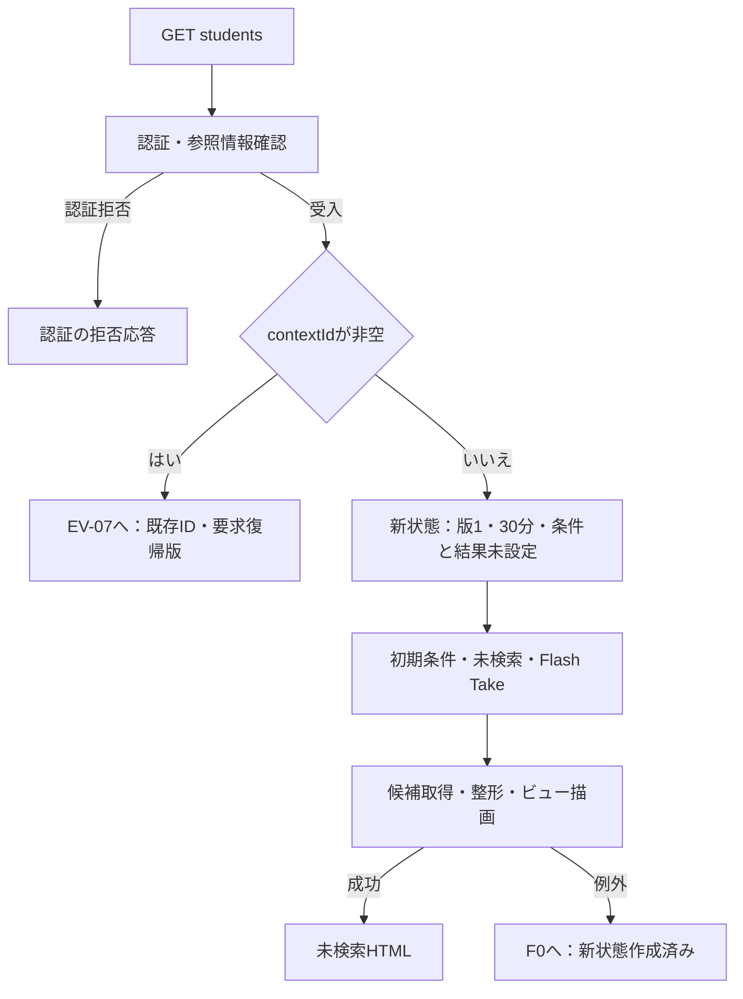

F0は補足説明の共通例外処理である。以降の図でも、例外理由と処理済み状態をF0へ引き継ぐ。

#### SQL・テーブル関連（ER図）

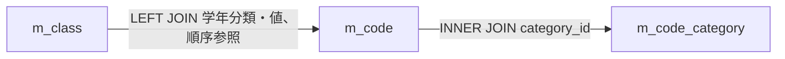

図は候補読取りのJOINである。分類・コード、クラス・学年コードの実FKとは区別する。初期表示では学生人数を集計しない。

#### DB操作の詳細

候補処理はコードとクラスの2結果集合を一つのSNAPSHOT読取トランザクションで取得し、commitして返す。コードと分類の利用状態は候補属性へ計算するが、停止・期間外の除外WHEREはない。クラスは全取得し、検索用途のOccupiedは0を設定する。順序・使用先は選択候補一覧に示した。根拠：`sources/Core/SqlServerStudentService.cs:197-216`。

#### 結果・例外時の扱い

正常時は未検索画面となる。認証拒否は状態作成前である。候補取得・整形・描画が失敗した場合はF0へ進み、作成済み状態を削除する処理はない。

設計意図は必須候補不足を検出して検索不可とし、先頭候補で既定値を代替しないことである。現行は候補取得を行うが不足による検索禁止は行わないため、「取得失敗」「取得成功だが候補0件」「初期在籍値の候補不在」を別の状況として扱う。設計意図の根拠：`reference-designs/基本設計書/01_学生検索画面.md:159-176,415-435`。

### EV-02 検索

#### 処理概要

検索ボタンで編集中の条件を実行し、非削除学生の件数と1ページ目を取得する。正常0件と上限超過も受入結果として保持する。拒否時の今回表示は未検索・空一覧とするが、以前の保持条件・結果を消去しない。入力拒否後のHTML再表示にも独立した失敗段階がある。根拠：`sources/Web/Controllers/StudentsController.cs:13-16`、`sources/Infrastructure/WebStudentCoordinator.cs:7-10,20-21`。

#### 処理手順

1. S1：MVCの認証・CSRF検査とフォームバインドを経て、アクション内でFormGuardを行う。未知キー、不正な書式メタ情報、許可されない同名複数値は拒否する。
2. S1：在籍区分キーがなければ空配列に補正する。所有者・セッション・指定Tab・期限による最初の状態Getを行う。この検査は局所catchの外である。
3. S1：ModelState不正ならサービスを呼ばず422を設定し、S4へ進む。正常なら局所try内でCoordinatorを呼ぶ。
4. S2：参照情報を確認し、DTOをSearchCriteriaへ移す。ClassIdは正のlong?に変換し、新規検索のPageは1とする。Useで状態を取得しGateを待ち、待機後に所有者・セッション・Tab・期限を再確認する。要求版の厳密一致と版上限を確認する。
5. S3：サービスはUser確認を自身のtry外で行い、検索開始時刻と日本時間業務日を取得する。try内では表示指定、年度・クラス範囲、未所属の排他、在籍配列を検査し、文字・コード・日付を正規化する。
6. S3：DB接続とSNAPSHOT開始後、指定コード・年度・クラスの存在と上位条件の一致を確認する。全検索条件で最大10001件を確認し、超過なら行取得を省略、10000以下なら同じSNAPSHOTでページ行を取得してcommitする。
7. S3：Coordinatorが結果を受入確認する。受入結果だけ、入力側条件の複製をApplied、結果をLastResultへ設定し、版を1加算する。Useの正常終了で期限を30分延長する。Gateはfinallyで解放する。
8. S4：SearchModelで別途候補を取得し、結果をJSON表示データにする。Controllerは要求PageSize・SortKey・SortDirectionをモデルへ代入する。正常枝の結果、拒否枝のStatus、受信入力・ModelStateを引き継いでビューを描画する。
9. S4：PageSize=0のままページ数計算へ到達するとDivideByZeroExceptionとなる。候補・整形・他の描画失敗もF0へ伝播する。状態未更新と再表示成功を同じ結果にはしない。

根拠：`sources/Web/Controllers/StudentsController.cs:14-16,39-41`、`sources/Web/Inputs/StudentSearchInput.cs:19-22`、`sources/Infrastructure/SearchContextStore.cs:13-15`、`sources/Core/SqlServerStudentService.cs:103-170`、`sources/Views/Students/Search.cshtml:8-8`。

#### 処理フロー

**S1：入口検査。出口はS2、S4、またはF0。**

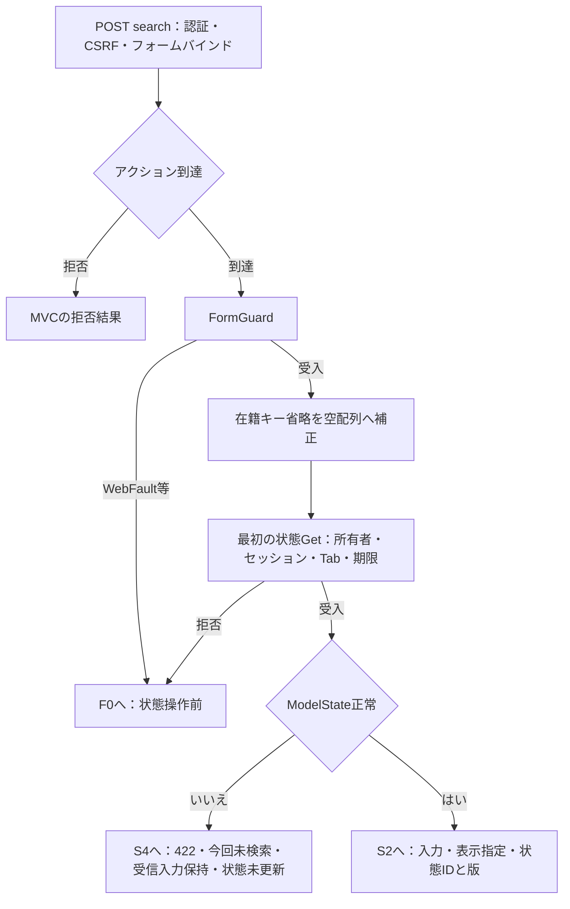

**S2：状態操作の開始。WebFaultはControllerの局所catchへ、その他の例外はF0へ渡す。**

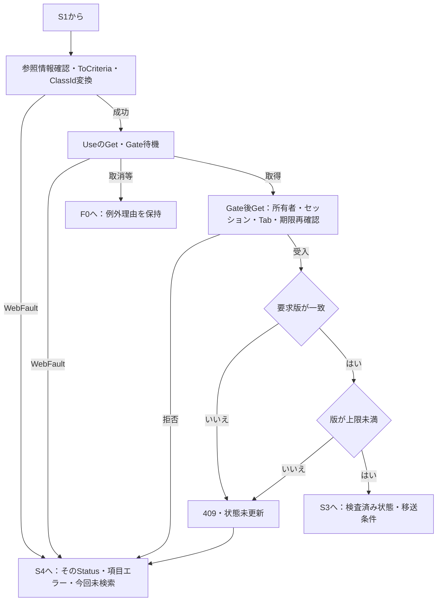

**S3：サービス結果と保持値の確定。例外の分類は先行catchから順に行う。**

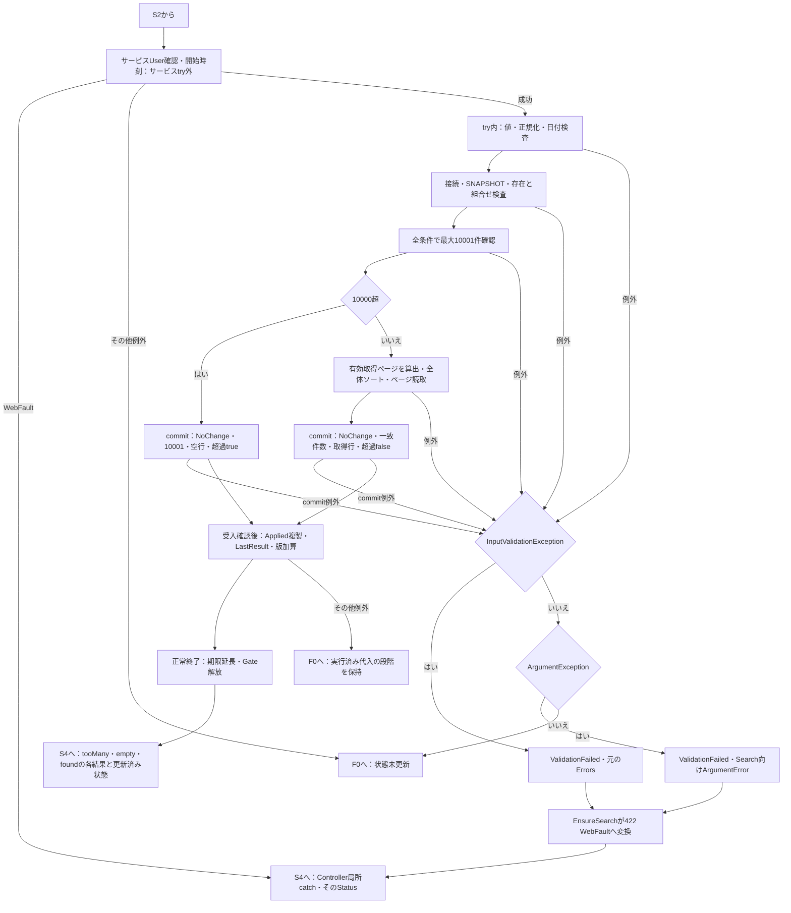

Gate取得後の失敗もfinallyで解放する。S3の受入結果はtooMany・empty・foundのそれぞれの値を保持し、合流点でfoundや未検索に固定しない。

**S4：候補取得から応答まで。S1の422枝と局所catch枝は状態未更新、S3受入枝は状態更新済みとして入る。**

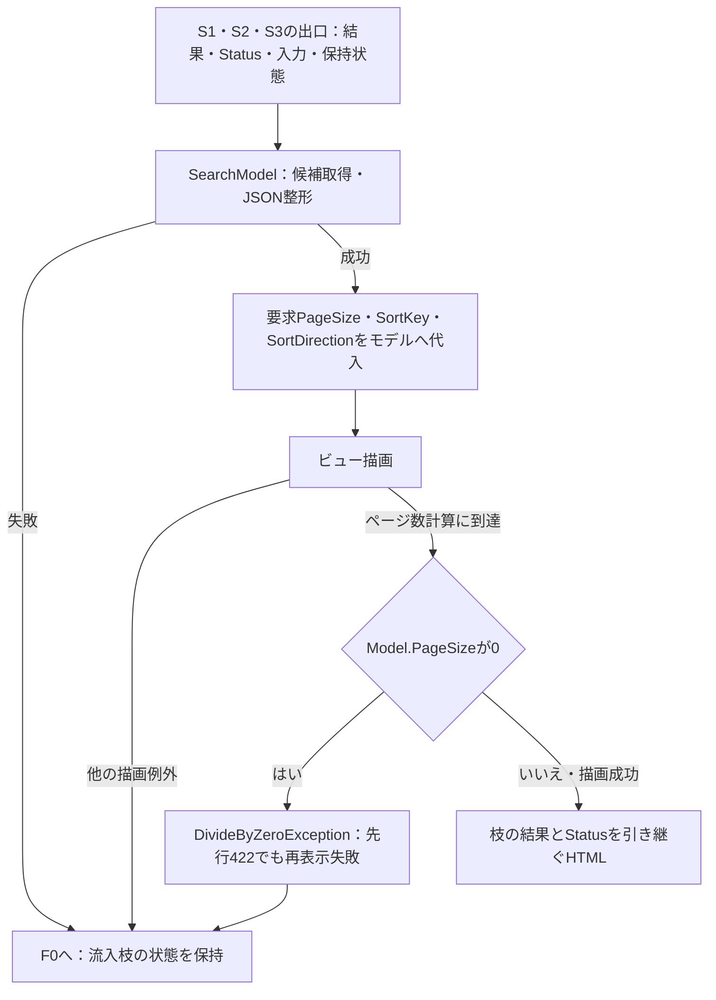

#### SQL・テーブル関連（ER図）

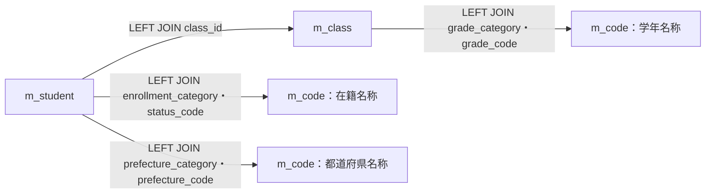

件数SQLは学生・クラスを参照し、行SQLは名称用コードも参照する。図は検索JOINであり、実FKは補足説明に別図で示す。根拠：`sources/Core/SqlServerStudentService.cs:82-90,156-168`。

#### DB操作の詳細

検索は必須の非削除条件に、指定された12条件を追加する。指定条件同士はAND、在籍区分内はIN、電話内は本人・緊急電話の括弧付きORである。氏名とカナは照合キーの部分一致、学籍番号は前方一致、所属・地域・電話は一致、入学日は両端包含とする。全述語、パラメータ型・サイズ、存在検査は補足説明の検索DB契約に定義する。

最大10001件確認で10001を検出した場合は読取commit後にNoChange・空行・LimitExceeded=trueを返す。10000以下は全体を許可順序で並べ、OFFSET/FETCHで20・50・100件を取得する。正常0件もNoChangeであり、検索のNoChangeは「業務更新なしの受入結果」を意味する。検索前や登録画面の変更なし通知とは区別する。根拠：`sources/Core/SqlServerStudentService.cs:137-168`。

#### 結果・例外時の扱い

サービスはInputValidationExceptionを先に、ArgumentExceptionを次に捕捉し、ValidationFailed・件数0・空行・開始時刻・超過falseを返す。Coordinatorは先頭エラーを用いて422のWebFaultへ変換する。Controllerの局所catchはWebFaultのField・MessageをModelStateへ追加し、そのStatusを設定する。この件数0は正常0件の受入結果ではない。根拠：`sources/Core/SqlServerStudentService.cs:169-170`、`sources/Infrastructure/WebStudentCoordinator.cs:20-20`、`sources/Web/Controllers/StudentsController.cs:15-16`。

FormGuardと最初の状態Getは局所catch外である。SQL例外・取消・NULL在籍配列のNullReferenceException等はサービスの2つのcatchに入らない。サービスUser確認も自身のtry外である。局所再表示が設定した422を、候補取得・整形・ビュー描画の成功まで保証する応答と説明しない。

PageSize=0では、サービスへ到達した枝はページ指定不正で拒否され、検索状態を更新しない。それでもControllerは0をモデルへ戻す。ModelState不正でサービスを呼ばない枝も同じ代入を行う。未検索・空一覧でもビューは`(count+Model.PageSize-1)/Model.PageSize`を計算するため、そこまで到達するとゼロ除算になる。F0は応答未開始なら503へ切り替え、開始済みなら同catchで処理しない。根拠：`sources/Core/SqlServerStudentService.cs:107-108,169-170`、`sources/Web/Controllers/StudentsController.cs:13-16`、`sources/Views/Students/Search.cshtml:8-8`、`sources/Infrastructure/WebHostSetup.cs:23-23`。

### EV-03 候補更新・未所属連動

#### 処理概要

利用者が候補を更新すると、編集中の年度・学年に合うクラスを再表示し、不適合な選択を解除する。学生検索は行わず、前回LastResultを表示する。ブラウザーの未所属補助と、サーバーのOptionsによる入力消去は別の処理である。根拠：`sources/Web/Controllers/StudentsController.cs:22-22`、`sources/wwwroot/js/site.js:7-7`。

#### 処理手順

1. 認証・CSRF・バインド後、FormGuardと在籍キー省略の空配列補正を行う。
2. 状態ID・所有者・セッション・指定Tab・期限でGetする。ContextRevisionは受信するが照合せず、Gate取得・版加算・期限延長も行わない。
3. 未所属trueならDTOの年度・学年・クラスをNULLにし、対応するModelState項目も除去する。
4. LastResultと編集中入力をSearchModelへ渡し、LookupAsync(false)で全候補を読む。クラスの候補抽出はビューで編集中年度・学年を使う。
5. 非空ClassIdが候補IDの10進文字列と一致し、指定年度・学年にも適合するか確認する。検索のIdParserやコード正規化は呼ばない。不適合ならClassIdとModelState値を解除する。
6. 通常は条件未反映通知、不適合解除時は解除通知を表示する。表示件数・並び順は保持済み値または既定値を使い、受信表示指定をモデルへ上書きしない。
7. ブラウザーのclearAssignedは初期実行時とチェック変更時に、未所属がONなら3つのDOM値を空にする。disabledの即時切替、DTO変更、ModelState消去は行わない。

根拠：`sources/Web/Controllers/StudentsController.cs:22-22,39-39`、`sources/Views/Students/Search.cshtml:5-5`、`sources/wwwroot/js/site.js:7-7`。

#### 処理フロー

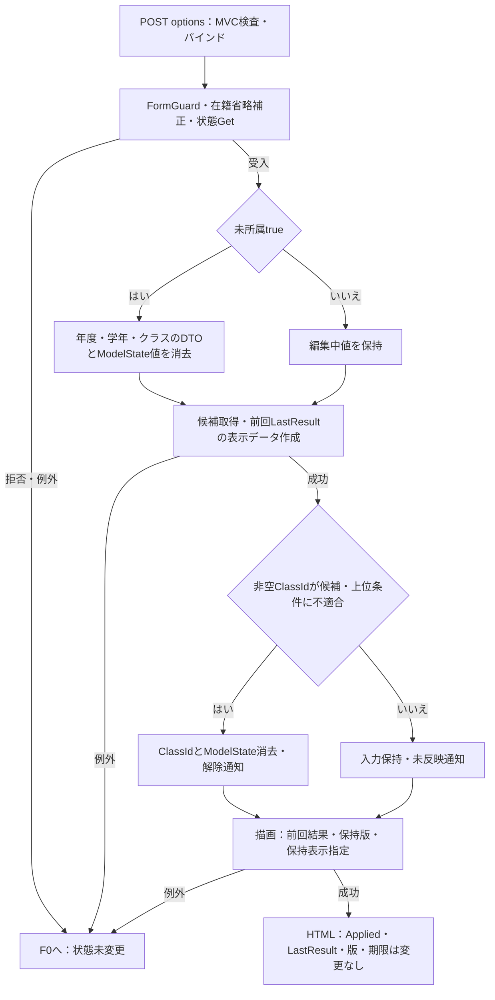

ブラウザー補助はこのPOSTフローの代わりではない。未所属チェック変更時のDOM値消去にはDB・状態ストアへの呼出しがない。

#### SQL・テーブル関連（ER図）

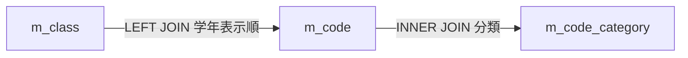

読取りは初期表示と同じ候補関連である。表示する学生行は前回LastResult由来で、m_studentの再検索・人数集計は行わない。

#### DB操作の詳細

全コード・全クラスを一つのSNAPSHOTで取得してcommitする。上位条件を候補SQLのWHEREへ渡す方式ではなく、取得後のビュー抽出とControllerの選択適合確認で使用する。学生・マスタ・操作履歴の更新はない。根拠：`sources/Core/SqlServerStudentService.cs:197-216`、`sources/Web/Controllers/StudentsController.cs:22-22`。

#### 結果・例外時の扱い

OptionsにはModelState.IsValidによる遮断と局所catchがない。FormGuardのキー検査を、値の変換・存在・NULL排除の保証へ広げない。取得・整形・描画が失敗すればF0へ進む。正常HTMLの一覧は前回の未検索・0件・上限超過・通常結果を引き継ぐ。

Searchの未所属矛盾拒否後は、Optionsと同じDTO・ModelState消去を行わない。ビューのdisabled設定は非活性化であり、消去ではない。表示後にJSがDOM値を空にしても、サーバーが受信入力を消去したことにはならない。根拠：`sources/Web/Controllers/StudentsController.cs:13-16,22-22`、`sources/Core/SqlServerStudentService.cs:110-110`、`sources/Views/Students/Search.cshtml:5-5`、`sources/wwwroot/js/site.js:7-7`。

設計意図は未所属ONの解除・即時非活性化、OFFでも旧値を復元しないこと、クラス先行選択から年度・学年を補完すること、古い候補応答の破棄、W-STU-107による解除通知である。現行は明示POSTと解除通知を持つが、検索SRCの上位変更による自動通信、クラスからの上位補完、世代照合、即時disabled切替、当該メッセージID付与は接続されていない。REG用JSの補完を検索へ適用しない。設計意図の根拠：`reference-designs/基本設計書/01_学生検索画面.md:248-254`。実装根拠：`sources/wwwroot/js/site.js:7-8`。

### EV-04 並び替え・表示件数変更・ページ移動

#### 処理概要

最後に実行したAppliedを使って最新DBから一覧を取得する。編集中の12条件は混ぜない。表示件数・ソート・方向が変われば1ページへ、同じなら要求ページへ進む。件数減少でページ範囲を超えた場合は条件側のページを補正して再検索する。根拠：`sources/Infrastructure/WebStudentCoordinator.cs:11-13`。

#### 処理手順

1. P1：MVC検査・バインド後、FormGuardと最初の状態Getを行う。アクションにModelState.IsValidの判定はない。
2. P1：局所try内で参照情報を確認し、UseのGate後再確認・期待版・版上限検査を行う。Appliedなしは409「先に検索してください。」で拒否する。
3. P1：Appliedを複製する。表示件数・ソート・方向のいずれかが変わった場合はPage=1、それ以外は要求Pageを設定し、新しい表示指定を移す。サービスの正数検査対象はこの移送後Pageである。
4. P1：検索DB契約に従い、存在・組合せ、件数、ページを再取得し受入確認する。
5. P2：非超過で条件Pageが件数から求めた最終ページを超えた場合、Pageを最終有効ページへ補正して2回目の検索・受入確認を行う。2回目後の補正を反復しない。
6. P2：補正なしは1回目の条件・結果、補正ありは補正条件・2回目結果をApplied・LastResultへ保持し、版加算・正常終了時の期限延長を行う。
7. P2：保持条件から入力欄を作り、候補を取得してHTMLを返す。WebFaultは局所catchで、そのStatusとエラー、保持条件の入力欄、未検索・空一覧を再表示する。

根拠：`sources/Web/Controllers/StudentsController.cs:18-19,39-40`、`sources/Infrastructure/WebStudentCoordinator.cs:12-12`、`sources/Infrastructure/SearchContextStore.cs:14-14`。

#### 処理フロー

**P1：保持条件による要求の作成。**

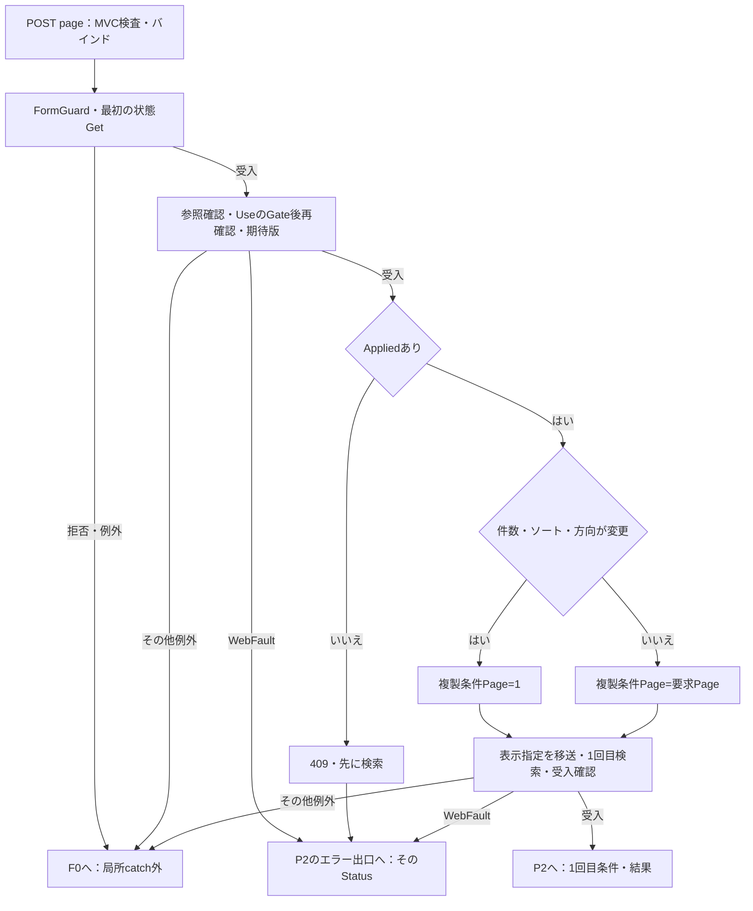

**P2：補正、保持、表示。局所エラー出口には拒否理由と更新段階を引き継ぐ。**

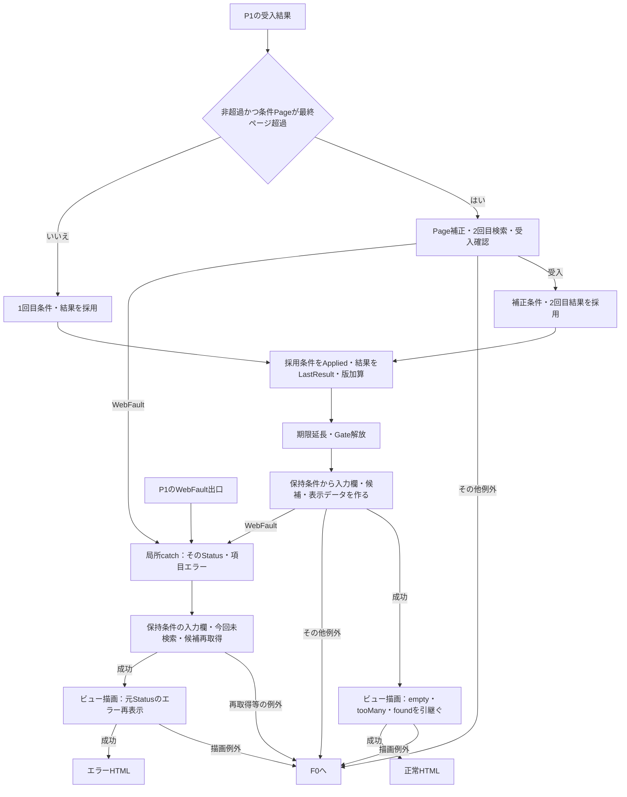

Hの失敗で局所catchへ入った場合はFの状態更新が済んでいる。P1の状態・入力拒否と同じ「更新前」にまとめない。F等の捕捉対象外例外もF0へ伝播し、メモリ代入をrollbackする処理はない。

#### SQL・テーブル関連（ER図）

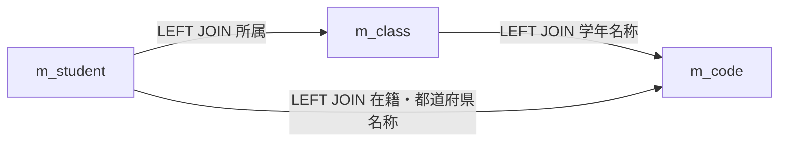

検索と同じ関連を使用する。HTML用候補にはm_code_categoryのINNER JOINも使う。補正時の1回目・2回目検索、候補取得は別々の読取単位である。

#### DB操作の詳細

保持条件を使い、EV-02と同じ存在検査・全述語・最大10001件確認・許可ソート・OFFSET/FETCHを実行する。最終ページは最低1とする。サービス単体も取得ページを最終ページに丸めるが、SearchResultには取得ページ番号を返さない。このためCoordinatorは条件側Pageを補正して再検索する。根拠：`sources/Core/SqlServerStudentService.cs:123-168`、`sources/Core/Contracts.cs:57-58`、`sources/Infrastructure/WebStudentCoordinator.cs:12-12`。

#### 結果・例外時の扱い

正常結果は0件・上限超過・通常結果を引き継ぐ。局所WebFaultでは保持条件から入力欄を作り、今回の一覧は未検索・空にする。要求した不正表示指定をSearchと同じ方法でモデルへ上書きする処理はない。

FormGuard・最初のGetは局所catch外、成功後のSearchModelはtry内である。catch内の候補再取得失敗とView返却後の描画例外は同じ局所catchでは捕捉しない。SQL・取消等もF0へ伝播する。根拠：`sources/Web/Controllers/StudentsController.cs:19-19`。

設計には先頭・最後の操作と、保持なし・失効時の初期化通知がある。現行の操作は反映・前へ・次へで、保持なし・期限切れ・旧版は409拒否となる。設計意図の根拠：`reference-designs/基本設計書/01_学生検索画面.md:135-138,293-308`。実装根拠：`sources/Views/Students/Search.cshtml:8-8`、`sources/Infrastructure/SearchContextStore.cs:13-14`。

### EV-05 クリア

#### 処理概要

同じ状態IDの実行済み条件と結果を消去して、初期条件・未検索へ戻す。学生DBの削除や、新しい検索状態IDへの置換ではない。根拠：`sources/Infrastructure/WebStudentCoordinator.cs:15-15`。

#### 処理手順

1. MVC検査・バインド後、クリアフォームのFormGuardを行う。
2. 参照情報を確認し、Useで状態Get、Gate待機後再確認、期待版・版上限を検査する。
3. Applied・LastResultをNULLにして版を1加算し、未検索データを返す。正常終了時に期限を30分延長する。
4. ControllerでModelStateを全消去し、同じ状態を再Getする。
5. 初期StudentSearchInput、20件・学籍番号昇順の表示指定、候補を使ってHTMLを返す。

根拠：`sources/Infrastructure/SearchContextStore.cs:14-14`、`sources/Web/Controllers/StudentsController.cs:21-21,39-39`。

#### 処理フロー

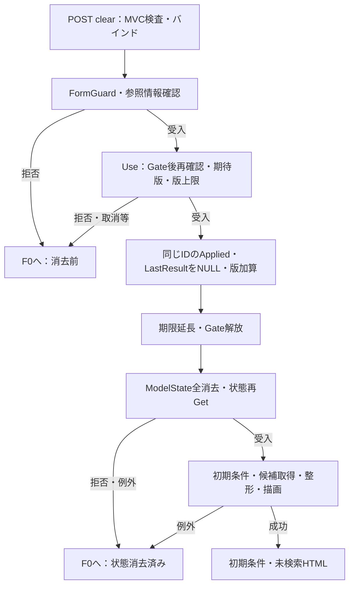

#### SQL・テーブル関連（ER図）

状態消去はSearchContextStoreのメモリ操作である。学生表のDELETEではない。再表示用候補は次の関連から読む。


#### DB操作の詳細

SearchAsyncは呼ばず、LookupAsync(false)を呼ぶ。候補読取りはSNAPSHOTでcommitして返す。学生・マスタ更新、履歴追記、t_runtime_stateへの書込みはない。クリア全体を「DB参照なし」とは説明しない。根拠：`sources/Web/Controllers/StudentsController.cs:21-21,39-39`、`sources/Core/SqlServerStudentService.cs:197-216`。

#### 結果・例外時の扱い

状態・版の拒否は消去前である。再Get・候補取得・描画の失敗は消去後に発生し得る。ClearにはSearch・Pageの局所WebFault再表示catchがなく、F0へ伝播する。

参考設計のクリアは初期化を意図し、当該イベントのDB非使用を説明している。現行の初期化動作と、再表示の候補読取を別に対応させる。設計意図の根拠：`reference-designs/基本設計書/01_学生検索画面.md:337-360`。

### EV-06 新規・編集・参照への遷移

#### 処理概要

<span id="registration-transition"></span>

新規リンクは復帰先の状態IDを、行リンクは学生管理番号と復帰先IDを登録画面へ渡す。遷移先は既存学生を再取得し、読込時の復帰版を編集Snapshotへ保持する。根拠：`sources/Views/Students/Search.cshtml:6-8`、`sources/Web/Controllers/StudentsController.cs:23-25`。

#### 処理手順

1. 新規はViewerに非表示、行操作はViewerなら参照、それ以外なら編集とする。
2. GET入口で参照情報を確認し、非空ReturnContextIdがあれば所有者・セッション・期限を確認する。ここではTabを渡さない。
3. 新規枝だけ作成権限を追加確認する。学生詳細を読まず、新規入力を作る。検索条件を学籍番号・氏名等の初期値へ転記しない。
4. 既存枝は学生IDと非削除条件でGetAsyncする。正数でないID、不在、削除済みは詳細なしとなり404へ進む。
5. 登録用LookupAsyncで候補と現在人数を取得し、新規入力または取得Detailから登録入力を作る。
6. DB読取り後、Controllerが復帰状態を再Getして現在Revisionを取得する。Owner・Session・対象ID・Detail・Original入力複製・ReturnRevisionを30分のSnapshotへ保持する。
7. 新規はDetailなし、既存は取得Detailを引き継いで登録HTMLを返す。検索のApplied・LastResult・Revisionは変更しない。

根拠：`sources/Infrastructure/WebStudentCoordinator.cs:6-6,17-17`、`sources/Core/SqlServerStudentService.cs:172-181,196-216`、`sources/Web/Inputs/StudentSaveInput.cs:44-54`、`sources/Infrastructure/EditorSnapshotStore.cs:7-11`。

#### 処理フロー

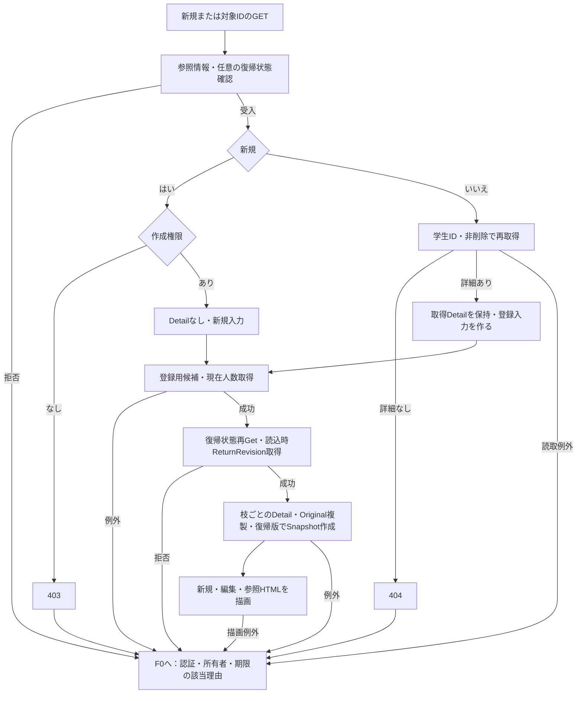

共通Snapshot作成節点にDetail=NULLを固定しない。NULLは新規枝だけで、既存枝は取得済み詳細を渡す。

#### SQL・テーブル関連（ER図）

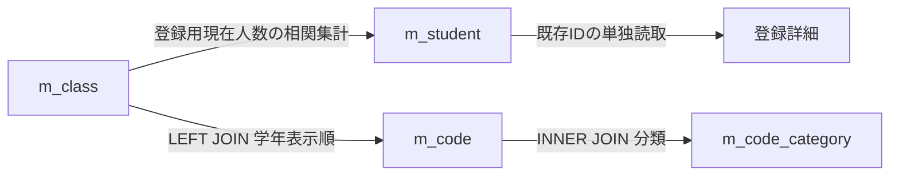

対象取得SQLは学生単独表で、結合ERは不要である。図には別処理の登録用候補参照を併記している。現在人数は非削除かつ在籍01・02を数える。

#### DB操作の詳細

既存対象は`SELECT * FROM dbo.m_student WHERE student_id=@id AND is_deleted=0`で読む。@idはBigInt、サイズ指定なし、PKによる対象読取りである。新規枝はこのSQLを呼ばない。登録用候補はLookupAsync(ct)から人数集計ありの処理へ進む。表示人数は保存時の予約や定員確保を意味しない。このイベントでは学生更新・履歴追記を行わない。根拠：`sources/Core/SqlServerStudentService.cs:172-181,196-216`。

#### 結果・例外時の扱い

検索時に存在した学生でも、遷移時に不在・削除済みなら404となる。Viewerの新規直URL要求も403で拒否する。最初の復帰状態確認に通っていても、DB読取り後の再Getで期限切れ等になれば登録HTMLに到達しない。

検索との接点は対象再取得、復帰ID、読込時ReturnRevision、確定後通知である。Snapshotを使用する登録側では、NULL識別値の事前検査とキー不在検査を混同しない。Snapshot.GetはNULL検査なしで辞書へ渡すため、空文字・キー不在の独自409分岐より前にライブラリ例外の境界を持つ。根拠：`sources/Web/Controllers/StudentsController.cs:25-25,29-29,35-37`、`sources/Infrastructure/EditorSnapshotStore.cs:10-10`。

### EV-07 検索復帰・確定通知の取得

#### 処理概要

登録画面から戻る場合と、保存・論理削除の確定後に303で戻る場合、既存検索状態を確認する。未検索から進んだ場合は未検索へ、検索済みなら元条件で最新DBを再検索する。保存した学生が条件外でも検索条件は変更しない。根拠：`sources/Web/Controllers/StudentsController.cs:8-11,31-38`、`sources/Infrastructure/WebStudentCoordinator.cs:14-14`。

#### 処理手順

1. 登録の検索へ戻るリンクはReturnContextIdと読込時ReturnRevisionを渡す。未保存変更があれば共通JSが破棄確認し、取消なら遷移を止める。入力クリア・編集取消のreset、最新再読込のGETは別操作である。
2. 保存・削除のOutcome.SavedだけReturnAfterSaveへ進む。Flashへ「保存しました。」または「論理削除しました。」を保存し、検索URLをLocationにして303を返す。復帰先なしなら新状態と版を作る。
3. R1：既存IDのGETは参照情報と最初の状態Getを確認する。contextRevision未設定は空文字としてResumeへ渡す。Tabは渡さない。
4. R1：UseのGate待機後再確認、期待版厳密一致、版上限を検査する。期限切れ・旧版・未設定版を新状態や最新版で補完しない。
5. R2：Appliedなしでは再検索せず未検索を返し、Revision・LastResultへ代入しない。Appliedありではその条件で再検索し、受入結果をLastResultへ設定して版を1加算する。Appliedは維持する。
6. R2：両正常枝とも期限を30分延長しGateを解放する。未検索枝の版維持と検索済み枝の版加算を保持したままR3へ渡す。
7. R3：Appliedまたは初期条件から入力欄を作り、Flash.Takeで通知を一度取り出す。その後に候補取得・表示整形・描画を行う。Take後の失敗で通知を戻す処理はない。

根拠：`sources/Views/Students/Edit.cshtml:16-16`、`sources/wwwroot/js/site.js:3-5`、`sources/Web/Controllers/StudentsController.cs:8-11,35-40`、`sources/Infrastructure/SearchContextStore.cs:14-14`、`sources/Infrastructure/FlashMessageStore.cs:6-9`。

#### 処理フロー

**R1：復帰状態の確認。拒否時はFlash未取得。**

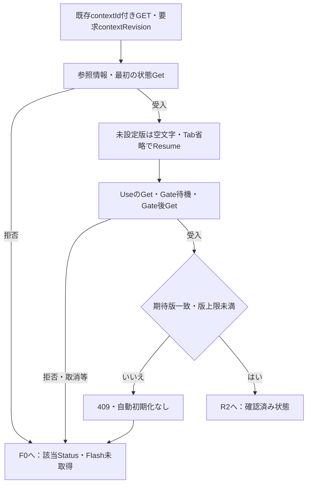

**R2：未検索と検索済みの枝。**

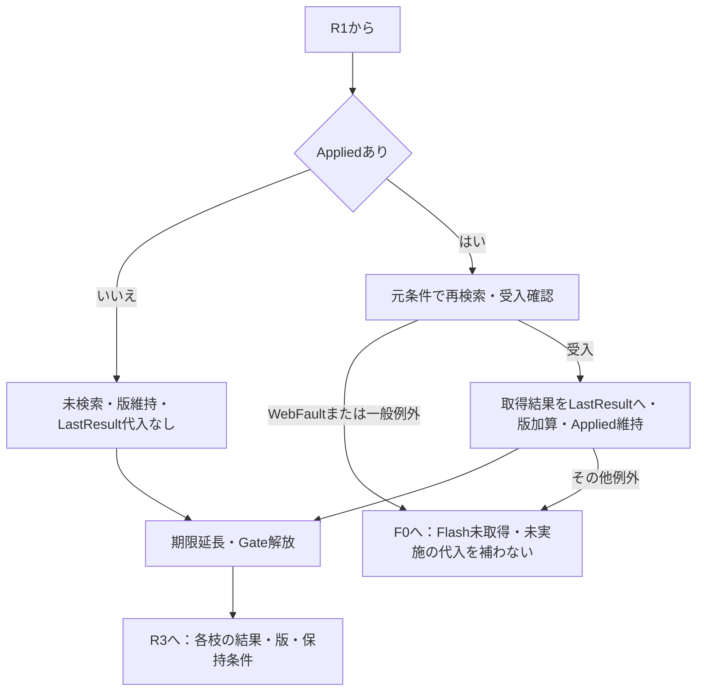

**R3：通知消費とHTML出力。**

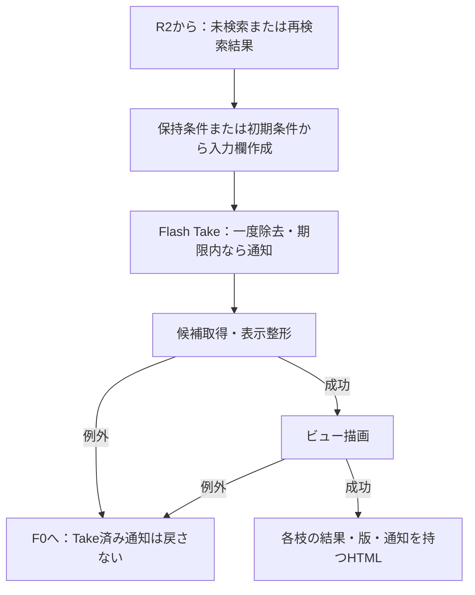

R2・R3の合流で未検索枝を版加算した状態に置き換えず、再検索枝をfoundに固定しない。再検索結果はempty・tooMany・foundを引き継ぐ。

#### SQL・テーブル関連（ER図）

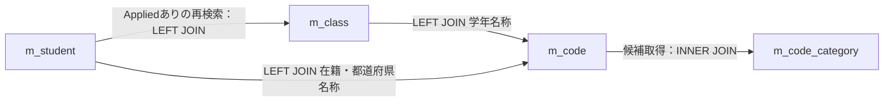

Appliedなしの枝は学生再検索をせず候補だけを読む。Flash・検索状態・Snapshotはメモリ情報であり、この図のDB表に保存・消費するものではない。

#### DB操作の詳細

Appliedありの再検索はEV-02の存在検査・件数・行取得・取消契約を使う。ResumeにはPageの条件側補正と2回目検索がない。サービスは取得ページを最終ページへ丸めるが、PresentはApplied.Pageを表示する。そのため件数減少時、取得行は最終ページ相当でも画面ページ番号が以前のままになり得る。根拠：`sources/Infrastructure/WebStudentCoordinator.cs:12-14,21-21`、`sources/Core/SqlServerStudentService.cs:159-168`、`sources/Core/Contracts.cs:57-58`。

#### 結果・例外時の扱い

状態NULL・キー不在・失効は409、所有者・別セッションの不一致は403、旧版・未設定版・版上限は409である。設計意図は期限切れの初期化だが、現行は既存IDの失効を拒否し、画面を開き直すよう案内する。設計意図の根拠：`reference-designs/基本設計書/01_学生検索画面.md:372-376`。実装根拠：`sources/Infrastructure/SearchContextStore.cs:13-14`。

Resumeには検索アクションの局所エラー再表示catchがない。再検索のValidationFailedは422 WebFaultとしてF0へ伝播する。再検索受入後の候補・整形・描画失敗ではLastResult・Revisionが更新済みである。Flash前の拒否は通知未取得、Take後の失敗は通知消費済みという差を保持する。

Savedは学生変更と履歴のcommit後に返る。NoChange、確認要求、入力不正、競合、SystemError、Unknownはこの成功通知・303経路へ進まない。保存後の通知・303・検索復帰失敗は確定済みDBをrollbackしない。登録読込後に検索版が進んでいれば、保存が確定済みでも読込時ReturnRevisionの復帰は409になり得る。根拠：`sources/Core/SqlServerStudentService.cs:306-315,409-416`、`sources/Web/Controllers/StudentsController.cs:25-25,31-38`。

## 補足説明

### 検索状態と一時情報の共通契約

SearchContextStoreはSingletonのConcurrentDictionaryで検索状態を保持する。状態IDは32バイト乱数の64桁小文字hexである。Tab未指定・空のCreateでは別の乱数値を発行する。検索状態のRevisionはlongで初期1、学生のrow_versionや登録時ExpectedVersionとは別である。実装根拠：`sources/Infrastructure/WebHostSetup.cs:13-13`、`sources/Infrastructure/SearchContextStore.cs:9-12`、`sources/Web/Inputs/StudentSaveInput.cs:30-33`。

| 対象 | 確認・変更の順序と意味 |
| --- | --- |
| Get | IDがNULLなら辞書呼出し前に409。空文字は辞書検索を行い、不在なら409。存在・期限を確認してから所有者・セッション・非空Tabを比較し、不一致は403 |
| Use | Get、取消可能なGate待機、取得後Get、期待版厳密一致、版上限の順。正常終了だけ期限をUTC現在＋30分へ延長し、finallyでGate解放 |
| Applied | 最後に受け入れた入力側SearchCriteriaのJSON複製。Search・Page成功で設定、Resumeは保持、ClearはNULL |
| LastResult | 受け入れた検索結果。Search・Page・検索済みResumeで設定。Optionsは前回結果を読む。ClearはNULL |
| 期限 | 初期30分。Gate待機後には再確認するが、DB await後の追加期限・所有者再確認はない |
| Options | Getだけ。期待版・Gate・版加算・期限延長に参加しない |
| Snapshot | 登録読込時の詳細・原入力複製・対象・所有者・セッション・復帰版を30分保持。検索Gateとは別 |
| Flash | 主体・セッション・検索状態IDの組合せで10分保持。TakeはTryRemoveし、期限内なら通知、不在・失効なら空文字 |

根拠：`sources/Infrastructure/SearchContextStore.cs:9-15`、`sources/Infrastructure/WebStudentCoordinator.cs:7-15`、`sources/Web/Controllers/StudentsController.cs:22-25`、`sources/Infrastructure/EditorSnapshotStore.cs:7-11`、`sources/Infrastructure/FlashMessageStore.cs:6-9`。

同じ状態版のSearch・Page・Clear・検索済みResumeが並行すると、Gate後に先行操作の版加算を確認した後続操作は旧版として409になる。Optionsはこの直列化に参加せず、GET復帰・登録遷移はTabを渡さない。すべての入口にTab必須検査や最新応答だけの採用があるとは説明しない。参考設計の要求連番・Busy・古い非同期応答破棄は、現行のGate・Revision・aria-busyとは異なる責務である。設計意図の根拠：`reference-designs/詳細仕様書/CSharp_ASPNET/01_学生検索画面.md:143-147,575-584,604-610`。

DDLにt_runtime_stateとt_confirmationがあるが、検索状態・Snapshot・Flashは上記メモリ実装である。検索状態のDB保存・暗号化・消費をt_runtime_stateへ割り当てない。Web登録はwebTokens=trueを使い、確認情報もWebConfirmationsへ保持する。t_confirmationは非Web設定の分岐であり、検索状態とは用途が異なる。根拠：`sources/database/001_schema.sql:156-184`、`sources/Infrastructure/WebHostSetup.cs:13-19`、`sources/Core/SqlServerStudentService.cs:276-284,330-342`。

### 受信・正規化の契約

業務文字数はUnicodeスカラー値で数える。不正サロゲートはArgumentExceptionとなる。TextはNULLを空文字へ補い、Trim前のraw上限、制御文字、Trim後の必須・保存上限の順に検査する。HTML maxlengthのコード単位、サービスのスカラー上限、nvarcharのUTF-16コード単位容量、LIKE用SQLパラメータのサイズを別の制約として扱う。根拠：`sources/Core/StudentNormalizer.cs:37-70`、`sources/Views/Students/Search.cshtml:5-5`、`sources/database/001_schema.sql:9-13,44-47`。

氏名保存は原表記を保持してname_keyを再生成する。カナ保存は正規化表記をstudent_name_kana、半角空白除去値をkana_keyにする。検索の空白だけの入力は、氏名・電話なら条件なし、学籍番号なら拒否、カナなら空キーLIKE条件となる。原入力、照合値、保存表記を一つの値として扱わない。根拠：`sources/Core/StudentNormalizer.cs:47-94,124-145`、`sources/Core/SqlServerStudentService.cs:113-117,139-142`。

FormGuardは許可キーと同名複数値、__Invariant値を検査する。StatusCodes・UnassignedOnly・__Invariantの複数値は許可するが、存在必須・値型・NULL排除は検査しない。MVC設定は非nullable参照型の暗黙requiredを抑止する。SearchだけがModelStateを確認し、Page・Clear・Optionsには同じ遮断がない。非nullable注釈やブラウザー部品から、全HTTP受信形のNULL排除を保証しない。根拠：`sources/Web/Controllers/StudentsController.cs:13-22,41-41`、`sources/Infrastructure/WebHostSetup.cs:16-18`。

任意の文字・コード・入学日両端はサービスでNULLを条件なしにできる。一方、在籍配列はNULL確認前にLengthを参照するため、NULL配列が届けばNullReferenceExceptionとなり、検索サービスの入力検証catchには入らない。NULL要素は許可4値外として入力不正となる。フォームキー省略の空配列化は接続コードで確認できるが、全受信形のバインド結果を代替する規則ではない。根拠：`sources/Core/SqlServerStudentService.cs:111-121,169-170`、`sources/Web/Controllers/StudentsController.cs:14-15,22-22`。

### 検索DB契約

存在・組合せ検査はSNAPSHOT開始後に行う。学年・都道府県はm_codeの分類＋値でCOUNT_BIG=1を要求し、@category VarChar(24)、@value VarChar(10)を使う。年度はm_classのschool_yearに1件以上存在すること、クラスはclass_idでschool_year・grade_codeを取得して指定上位条件と一致することを確認する。これらのSQLに停止・期間外の拒否条件はない。在籍01～04は固定配列値検査で、個別CodeExistsを呼ばない。根拠：`sources/Core/SqlServerStudentService.cs:111-135,218-222`。

| 対象 | SQL条件 | パラメータ型・サイズ | 値の作成・意味 |
| --- | --- | --- | --- |
| 論理削除 | `s.is_deleted=0` | なし | 常時適用 |
| 学籍番号 | `s.student_no LIKE @no ESCAPE '!'` | VarChar(31) | 正規化・LIKEエスケープ後、末尾% |
| 氏名 | `s.name_key LIKE @name ESCAPE '!'` | NVarChar(642) | 氏名照合キーの両端に% |
| 氏名カナ | `s.kana_key LIKE @kana ESCAPE '!'` | NVarChar(74) | 正規化・空白除去キーの両端に% |
| 年度 | `c.school_year=@year` | SmallInt、サイズ指定なし | 所属クラス年度 |
| 学年 | `c.grade_code=@grade` | VarChar(2) | 正規化済み学年コード |
| クラス | `s.class_id=@class` | BigInt、サイズ指定なし | 選択したクラス管理番号 |
| 未所属 | `s.class_id IS NULL` | なし | trueの場合だけ追加 |
| 都道府県 | `s.prefecture_code=@prefecture` | VarChar(2) | 正規化済み地域コード |
| 電話 | `(s.phone_number=@phone OR s.emergency_phone_number=@phone)` | VarChar(16) | 正規化後の完全一致。括弧全体で一条件 |
| 入学日開始 | `s.admission_date>=@from` | Date、サイズ指定なし | 開始日を含む |
| 入学日終了 | `s.admission_date<=@to` | Date、サイズ指定なし | 終了日を含む |
| 在籍区分 | `s.enrollment_status_code IN (@status0,…)` | 各VarChar(2) | 空配列ならIN述語なし |

根拠：`sources/Core/SqlServerStudentService.cs:137-155`。全条件はANDで結ぶ。Where helperが省略するのは値NULLの条件だけで、空文字を独自に省略しない。LIKEのエスケープ対象は`!`、`%`、`_`、`[`である。DateOnlyパラメータは午前0時のDateTimeへ移す。根拠：`sources/Core/StudentNormalizer.cs:161-161`、`sources/Core/SqlServerStudentService.cs:67-72,139-142`。

件数SQLは学生とクラスをLEFT JOINした一致ID集合にTOP (10001)を適用し、COUNT_BIGで数える。10000以下は一致総数、10001は超過検出値である。行SQLは名称用LEFT JOINを加えた全一致集合を、studentNo→student_no、name→name_key、admissionDate→admission_date、updatedAt→updated_atの許可対応とasc・descでソートし、最後にstudent_id ASCを付けてページ化する。@offset・@sizeはInt、サイズ指定なし。根拠：`sources/Core/SqlServerStudentService.cs:108-108,156-168`。

存在検査・件数・行取得は同じSNAPSHOT読取トランザクションである。候補2結果集合は別のSNAPSHOTで読み、検索結果と候補を同じ読取時点へ統合しない。超過は件数確認後、通常は行取得後にcommitする。検索には明示rollback catchがなく、例外時はawait usingの破棄経路となる。Command helperのコマンドは30秒設定で、接続・トランザクション開始・SQL実行・読取・commitへ取消トークンを渡す。根拠：`sources/Core/SqlServerStudentService.cs:53-66,123-170,197-222`。

IStudentServiceはStudentDb構成名でSqlServerStudentServiceへ接続され、設定未指定なら503のWebFaultとなる。サービスは暗号化Mandatory・TrustServerCertificate=falseを設定し、接続後に対象DBのsnapshot_isolation_state=1を確認する。これらは接続と読取方式の前提である。根拠：`sources/Infrastructure/WebHostSetup.cs:19-19`、`sources/Core/SqlServerStudentService.cs:39-64`。

### 実FKと表示名称の保存側

```mermaid
flowchart LR
  CODE[m_code：分類・値が複合PK] -->|実FK category_id| CATEGORY[m_code_category]
  CLASS[m_class：class_idがPK] -->|実FK grade_category・grade_code| CODE
  STUDENT[m_student：student_idがPK] -->|実FK class_id、NULL可| CLASS
  STUDENT -->|実FK prefecture_category・prefecture_code| CODE
  STUDENT -->|実FK enrollment_category・enrollment_status_code| CODE
```

図は検索に関係する実FKである。学生には性別・続柄の分類付きFKもあるが、検索一覧の名称JOINでは使わない。検索JOIN、参照整合性制約、削除連動は別の概念である。未宣言の多重度や所属履歴を追加しない。根拠：`sources/database/001_schema.sql:189-195`、`sources/Core/SqlServerStudentService.cs:82-90`。

クラス名称はClassChange.ClassNameをText(raw18・保存18・必須)で検査し、m_class.class_nameのnvarchar(36) NOT NULL・18スカラーCHECKへNVarChar(36)で保存する。クラスコードはIdentifier上限9、varchar(9) NOT NULL、VarChar(9)である。学年・在籍・都道府県の名称はCodeChange.CodeNameをText(raw12・保存12・必須)で検査し、m_code.code_nameのnvarchar(24) NOT NULL・12スカラーCHECKへNVarChar(24)で保存する。LEFT JOIN結果のstring?から保存列のNULL属性や業務上限を推定しない。根拠：`sources/Core/MasterMaintenanceService.cs:33-35,73-76,81-83,113-120`、`sources/database/001_schema.sql:67-68,81-81,115-128`。

名称保守の実装は存在するが、検索画面からの保守入口ではなく、WebHostSetupに保守サービス登録はない。学生へ名称コピーを保存する方式ではなく、検索時JOINで現在の名称を取得する。根拠：`sources/Infrastructure/WebHostSetup.cs:13-19`、`sources/Core/SqlServerStudentService.cs:82-90`。

### 日付・住所・表示形式

生年月日は固定元号境界で表示する。明治は1900-01-01～1912-07-29、大正は1912-07-30～1926-12-24、昭和は1926-12-25～1989-01-07、平成は1989-01-08～2019-04-30、令和は2019-05-01以降である。1年は「元」、月日は2桁とし、日付には時差を加えない。範囲外のToInputはArgumentOutOfRangeExceptionとなる。根拠：`sources/Core/JapaneseDateService.cs:9-16,41-50`。

検索日時・更新日時はDateTimeOffsetを日本時間のyyyy/MM/dd HH:mm:ssにする。入学日条件はyyyy-MM-ddとして解析するが、type=dateのブラウザー表示形式とは区別する。共有ヘッダー業務日は表示時のUTC現在、検索の日付上限はサービス検索開始時刻を基にする。根拠：`sources/Infrastructure/WebPresentation.cs:5-7`、`sources/Core/SqlServerStudentService.cs:44-45,105-105`、`sources/Core/JapaneseDateService.cs:52-59`。

住所表示は都道府県名称＋住所1で、住所2を含まない。郵便番号、メール、緊急連絡先、備考も一覧へ出さない。名称欠損は住所の都道府県だけ[不整合]にし、本人電話NULLはビューで「－」にする。年度・学年・クラス・在籍名称のNULLを同じ規則で補完しない。根拠：`sources/Core/SqlServerStudentService.cs:77-90`、`sources/Views/Students/Search.cshtml:8-8`。

### F0 共通例外処理と確定境界

認証Cookieは30分・延長ありで、認証失効401、アクセス拒否403を設定する。MVC POSTは自動CSRF検査対象である。/api用のCSRF JSON変換を/studentsのフォーム応答へ適用しない。認証・CSRFフィルターの拒否結果と、アクションから伝播した例外は異なる経路である。根拠：`sources/Infrastructure/WebHostSetup.cs:14-16`、`sources/Infrastructure/AntiforgeryResultFilter.cs:7-8`。

```mermaid
flowchart TD
  A[F0：伝播例外・理由・処理済み状態] --> B{Response.HasStartedがfalse}
  B -->|いいえ| X[このmiddlewareのcatch対象外・最終応答は確定しない]
  B -->|はい| C{WebFault}
  C -->|はい| D[例外のStatus・Messageを使用]
  C -->|いいえ| E[503・共通失敗メッセージ]
  D --> F[students用エラーHTML・検索画面を開くリンク]
  E --> F
  F --> G[通常検索レイアウトを再構成しない・処理済み状態を戻さない]
```

共通middlewareは応答未開始の伝播例外だけを捕捉する。Searchの422設定後にゼロ除算が起きても、ここへ到達して応答未開始なら503を設定する。応答開始済みの場合の完了・中断を、このcatchから保証しない。根拠：`sources/Infrastructure/WebHostSetup.cs:22-25`。

| 失敗・拒否 | 到達先と結果 | 保持・確定の境界 |
| --- | --- | --- |
| FormGuardの未知キー・重複等 | WebFault 400、局所catch外ならF0 | そのイベントの状態更新前 |
| RequestIdentityの認証不正 | WebFault 401。MVC認証拒否とは経路を区別 | 状態操作に進めない |
| 状態の所有者・セッション・指定Tab不一致 | WebFault 403 | 更新前。Getは先に存在・期限を確認 |
| 状態の不在・期限切れ・旧版・版上限 | WebFault 409 | 自動初期化・最新版補完なし |
| SearchのModelState不正 | 422設定後、候補・描画へ | サービス未実行。再表示は後続処理 |
| SearchAsyncのInputValidationException・ArgumentException | ValidationFailedから422 WebFault | 正常0件にしない。Applied・LastResultの受入更新なし |
| SearchのPageSize=0でページ数計算到達 | DivideByZeroExceptionからF0 | 検索拒否枝は状態未更新、HTML再表示は失敗 |
| SQL・取消・NULL配列等の捕捉対象外例外 | F0。応答未開始なら一般例外は503 | 検索を正常0件や保存Unknownに置き換えない |
| 検索・ページ・復帰の受入後に候補・表示が失敗 | 局所catchの範囲またはF0に従う | 検索状態更新済みの場合がある。メモリrollbackなし |
| Flash Take後に候補・描画が失敗 | F0 | 通知消費済み。再投入なし |
| 登録Saved後に通知・303・復帰が失敗 | 登録後の別段階の失敗 | 学生・履歴のcommitを取り消さない |

根拠：`sources/Web/Controllers/StudentsController.cs:8-22,31-41`、`sources/Infrastructure/SearchContextStore.cs:13-14`、`sources/Core/SqlServerStudentService.cs:105-112,169-170,306-323,413-416`。

保存側の結果不明は、入力検証、一意違反、DBConcurrencyExceptionの先行catchを通過し、最後のSqlException・InvalidOperationException・OperationCanceledException対象catchへ到達した場合に限る。そのcatchでwriteStartedがtrue、かつcommitAttemptedまたはrollback失敗ならUnknownとなる。削除もDBConcurrencyExceptionを先に捕捉する。先行catchの例外すべてへUnknown判定を一般化せず、検索復帰はSavedだけを確定通知へ結び付ける。根拠：`sources/Core/SqlServerStudentService.cs:316-329,415-416`、`sources/Web/Controllers/StudentsController.cs:31-38`。

### 設計意図との対応と確認責務

| 主題 | 設計意図 | 現行との対応と確認する内容 |
| --- | --- | --- |
| 値の往復 | rawを表示用に保持し、正規化成功値だけ型付き命令へ移す | HTTP、DTO、SearchCriteria、サービス照合値、保存列、再表示を段階別に追う。年度int?・未所属boolのバインド、ClassId手動変換、日付文字列解析を区別する |
| 長さ | 業務スカラー長と物理ガードを分ける | raw上限、正規化後上限、ブラウザーコード単位、DB容量、SQLサイズを別々に照合する。業務長の算定理由は材料にないため追加しない |
| 初期候補 | 必須不足の検出、既定値の勝手な代替禁止 | 現行の取得失敗、候補0件、既定在籍候補不在を区別する。不足による検索禁止は現行差として判断する |
| 条件連動 | 上位変更解除、クラスから上位補完、未所属の即時非活性、旧応答破棄 | OptionsのDTO・ModelState消去、Searchの保持、DOM消去を個別確認する。REG用連動をSRC実装として扱わない |
| 件数・ページ | 0・10000・10001、全体ソート後のページ化 | 同じSNAPSHOTの件数・行、超過の一覧抑止、20・50・100、ページ補正を確認する |
| 表示 | 和暦・日時・範囲・欠損・停止注記 | 現行の保存表記、参照名称、住所算出、電話NULL補完を確認する。範囲と全名称補完は設計意図との差として扱う |
| 競合・期限 | 旧版拒否、同じ版の並行要求を両方更新成功させない | Gate後再確認、版加算、Options非参加、Tab省略入口、DB await後再検査の有無を確認する |
| 異常段階 | 入力不正と障害を区別する | サービス拒否、ControllerのStatus、候補・整形、ビュー、middlewareを分ける。PageSize=0を422再表示成功として終えない |
| 復帰・通知 | 元条件再検索、期限切れ初期化、確定後だけ成功通知 | 再検索は接続済み、失効は現行409。復帰の表示ページと取得ページ、保存確定後の旧版拒否、Take前後の失敗を分ける |

設計意図の根拠：`reference-designs/基本設計書/01_学生検索画面.md:159-176,248-254,293-308,372-376,474-491`、`reference-designs/詳細仕様書/CSharp_ASPNET/01_学生検索画面.md:546-550,558-610`。実装根拠は各項目・イベント・共通契約に対応する。

IT担当者は検索入力、権限、候補、検索先、表示元、登録への移送、確定後復帰を業務として確認する。実装担当者はUnicode最大長、全角・空白、日付境界、停止・期間外候補、NULL・変換失敗、期限・旧版、DB・整形・描画の失敗を値の往復と各拒否段階へ対応させる。参考設計にある確認責務を、顧客承認や試験合格の記録に置き換えない。設計意図の根拠：`reference-designs/基本設計書/01_学生検索画面.md:474-491`、`reference-designs/詳細仕様書/CSharp_ASPNET/01_学生検索画面.md:546-550,586-602`。

### 関連文書の対応

次表は提示計画の対応先である。本応答で生成する文書は本書だけで、以下の10件は本応答では未生成である。pathを生成済みリンクとして扱わない。本書で必要な条件・結果は本文に記載し、分冊参照だけで省略しない。

| 文書ID | kind | 相対path | 本書との対応 |
| --- | --- | --- | --- |
| CSHARP_ASPNET-BAS-STU-02 | basic-design | 基本設計書/02_学生登録画面.md | 新規・編集・参照、保存・削除・取消、検索復帰 |
| CSHARP_ASPNET-BAS-STU-03 | table-index | 基本設計書/03_テーブル仕様書.md | 検索対象・マスタの関連、共通保存規則 |
| CSHARP_ASPNET-BAS-STU-04 | code-design | 基本設計書/04_コード設計書.md | 学年・在籍・都道府県の選択値、名称・保守契約 |
| CSHARP_ASPNET-BAS-STU-03-M_STUDENT | table-definition | 基本設計書/テーブル/01_m_student.md | 検索・表示列、照合キー、非削除、所属 |
| CSHARP_ASPNET-BAS-STU-03-M_CLASS | table-definition | 基本設計書/テーブル/02_m_class.md | 年度・学年・クラス候補、所属・名称表示 |
| CSHARP_ASPNET-BAS-STU-03-M_CODE_CATEGORY | table-definition | 基本設計書/テーブル/03_m_code_category.md | 候補分類、分類利用状態 |
| CSHARP_ASPNET-BAS-STU-03-M_CODE | table-definition | 基本設計書/テーブル/04_m_code.md | 分類付き値・名称・順序・期間・利用状態 |
| CSHARP_ASPNET-BAS-STU-03-T_OPERATION_LOG | table-definition | 基本設計書/テーブル/05_t_operation_log.md | 登録側の学生変更と一括確定する履歴。検索自身は追記しない |
| CSHARP_ASPNET-DET-CSharp_ASPNET-SCR-STU-001 | detailed-specification | 詳細仕様書/CSharp_ASPNET/01_学生検索画面.md | 同機能の実コントロール、受信・型・状態版・SQL・例外経路 |
| CSHARP_ASPNET-DET-CSharp_ASPNET-SCR-STU-002 | detailed-specification | 詳細仕様書/CSharp_ASPNET/02_学生登録画面.md | Snapshot、登録処理の確定、303・Flash、復帰接点 |
